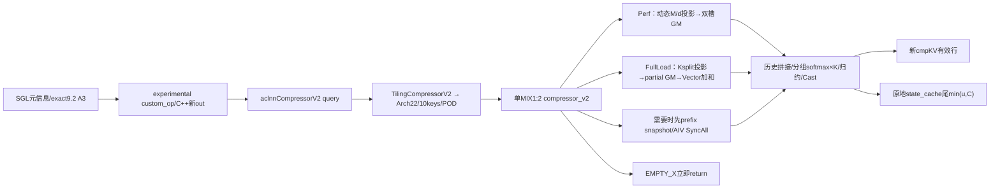
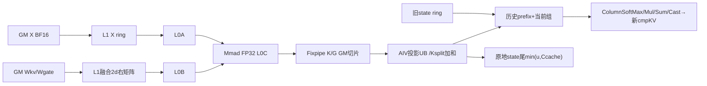
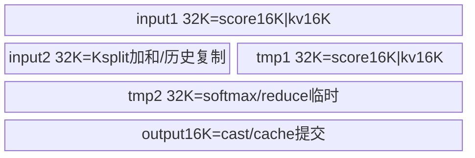
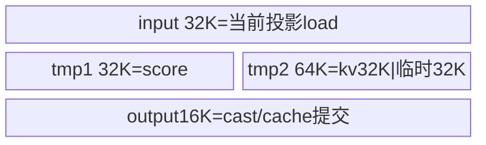
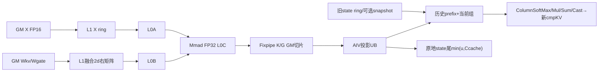

# CompressorV2 A3 ACLNN 算子知识

## 算子速览

| 项目 | 内容 |
|---|---|
| 实际入口 | SGL `attention.compressor_v2` selected CANN9.2/A3 → experimental `ds41.compressor` → `aclnnCompressorV2GetWorkspaceSize/aclnnCompressorV2` |
| 计算语义 | XWkvᵀ/XWgateᵀ 双投影累积FP32；每个完整绝对位置r组逐通道softmax(G)加权K归约，再Cast回X dtype；原地写state_cache，仅返回cmp_kv |
| 输入输出 | FP16/BF16 X BSH/TH，H1024..10240/512对齐，D128/512；FP32[P,C,2D] ring；int32独立物理块表；r2..128幂；输出只有完整组有效、padding未定义 |
| 执行类型 | 单 `compressor_v2` MIX_CV、MIX_AIC_1_2：AIC_CUBE共享X/右矩阵；FullLoad逻辑N256拆为两个N128 Mmad及两个L0C槽，Perf在各K片以N=2d覆盖两投影→FP32 GM→AIV_VECTOR历史拼接/softmax/Mul/Reduce/写cache |
| Kernel 路线 | R-001/002 BSH短序列FullLoad；R-003…006 BSH/TH Perf含动态tile与可选prefix快照；R-007…010空输入 |
| 核心资源 | 非空每AIC L1=524288B、L0A/B各65536B、L0C=131072B；每AIV UB=147456B，两实现分区不同；Host Wlib+32*MHost*D*JHost+16τ+snapshot |
| 来源闭包 | `source_closed`：固定SGL dda6/e7da experimental/SDK a63d，完整Host/平面POD/10keys/两个Cube和Vector及iterator/softmax/build闭合；生成ACLNN/通用Runtime primitive边界明示 |
| 验证状态 | draft；τ字段自有Host未赋值、FullLoad24项数组与attr位宽前提、历史容量/发布文档差异均保留；本次未编译、真机、数值或性能测试 |

## 接口与语义

### 计算语义

对batch b的新token行i及通道d，
`K[b,i,d]=Σ_h X[b,i,h]*Wkv[d,h]`，
`G[b,i,d]=Σ_h X[b,i,h]*Wgate[d,h]`。
W的公开存储是[D,H]，所以公式转置后相乘；不是把[D,H]直接当[H,D]读取。两矩阵行在L1拼成同一右矩阵，Cube一次N=2*dBase覆盖K和G、FP32累积分别Fixpipe到两个GM切片。FullLoad按H分多核partial，Vector按固定组序加和；Perf沿H错位的512/256/128小块积累，累加顺序会依dtype/分核变化。未声称等同先显式把X/W转FP32再任意框架GEMM的逐位结果。

令a=start_pos[b]（None→0），u=seqused[b]（None→物理长度），r=cmp_ratio，p=a%r。每个已完成的绝对位置组使用r行逐特征计算
`α[t,d]=exp(G[t,d]-max_j G[j,d])/Σ_j exp(G[j,d]-max_k G[k,d])`，
`Y[g,d]=Σ_t α[t,d]*K[t,d]`，最后 `Cast(CAST_ROUND)` 为X.dtype。源码顺序为ColumnMax→MatSubVec→Exp→ColumnSum→MatDivVec→Mul(K,α)→ColumnSum→Cast，不含APE、RMSNorm、RoPE、bias或额外激活；固定coff=1、cacheMode=RING_BUFFER2，不把模板内未实例化的OVERLAP2变成支持路线。

初始未对齐p行从调用前的历史state_cache读取，完整组数
`v_b=floor((p+u)/r)`。
BSH输出容量[B,ceil(S/r),D]，每batch前v_b槽有效；TH容量[min(T,T//r+B),D]，各batch的v_b组按batch顺序紧密拼接，之后padding未写/未定义。只有有效区可消费或比较，不把容量当有效长度，start非0时仍从本次输出槽0开始。

state_cache前D通道K、后D通道G。新输入只将本次末尾min(u,C)行写入物理块table[b]、绝对位置mod C，未写位置不变：
`state[table[b],(a+i)%C,0:D]=K[b,i,:]`、
`state[...,D:2D]=G[b,i,:]`，
其中i∈[max(0,u−C),u)。块号0实际有效，非法/重复块号不由Device修复。需要跨调用续接时保持更新后cache、正确a和足够的有效历史；snapshot只保护本次读写时序，不补回已经在调用前被有限ring容量丢失的历史。

### 输入、输出与属性

| 参数 | shape/layout | dtype | 约束、默认值与语义 |
|---|---|---|---|
| x | BSH [B,S,H] 或 TH [T,H]，连续ND | FP16/BF16 | H∈1024..10240、H%512=0；B/S/T可0 |
| wkv/wgate | [D,H]连续 | 同x | D128/512，非空、同设备 |
| stateCacheRef | [P,C,2D] | FP32 | P>0、P≥B、C1..1024；仅0轴可非连续；原地读写，caller保活 |
| stateBlockTable | [B]连续 | int32 | 虽public optional，A3实际必传；table[b]∈[0,P)、各请求物理块唯一；0有效 |
| cuSeqlens | [B+1]连续 | int32 | TH必传，从0到T非递减；BSH必须None；只检查元信息不回读内容 |
| seqused | [B]连续/None | int32 | 0≤u≤每batch物理长度；None用全物理长度 |
| startPos | [B]连续/None | int32 | a≥0；None全0；多处Device还转换u32，绝对位置乘加须可表达 |
| cmpRatio | 标量，默认4 | public int64 | 仅2/4/8/16/32/64/128；Host通过int*读取，当前小值可表达 |
| stateCacheStrideDim0 | actual cache.stride(0) | public int64 | adapter传入元素stride；arch22 Host GetAttrPointer<int>，要求实际读取等于真实stride且int范围可表达，不能默认全int64域 |
| cmpKvOut | BSH [B,ceil(S/r),D] 或 TH [min(T,T//r+B),D] | 同x | adapter新分配；只有完整组有效，padding未定义 |
| stateCacheOut | OpDef output1别名stateCacheRef | FP32 | entry明确忽略独立形参、写input stateCache；Python只返回cmpKV |
| impl | keyword str | — | 本卡冻结auto/cann_ops_transformers_cann920；显式torch_native是独立CPU参考，不作失败fallback |

### 入口与版本

已全文读并复用[CompressorV2环形缓存API](../../../../apis/sgl_kernel_npu/sgl_compressor_v2.md)。SGL固定 dda6d36b0cdb4081e102d14c0a2fb276fc416e69，9.2 profile additional_builds独立experimental vendor，精确固定ops-transformer e7da18105f08b06e01ef0fff78f439098d483746（version.cmake=9.2.0）。SDK9.2为 a63d5261c7c8077a0081e867f43a0e884fec066b；该固定树解释primitive，不代表所有同名9.2二进制完全相同。本任务覆盖SGL selected A3，不沿用Common9.1。

SGL公开CANN后端仅A3支持、950不支持，vendor公开ACLNN表A2/A3/950支持，OpDef三平台但kernel各分支不同。这是接入范围与vendor平台范围不同，不把950 vendor body冒充SGL950可用卡。本卡只读arch22实际可达body，arch35未选Route不展开。

vendor `docs/aclnnCompressor.md` 与固定SGL/实际body有合同差异：文档称块号0跳写并要求C≥r+S−1；实际SGL文档明确0有效、C1..1024、ring只写末min(u,C)，本体table[b]直接参与取址无0跳过、Perf另有prefix snapshot。还存在文档“只支持B、S为0”与同页非空示例/空域条目的矛盾。本文保留每层实际事实及更严格历史有效性前提，不把旧描述悄悄改成已验证的普遍支持。

## Host/Launcher 执行流程

### 参数校验与前处理

SGL检查X rank2/3、r幂/范围、X和权重同B16dtype、H范围、W[D,H]/D128或512、stateFP32 rank3/最后2D/P/C、state stride1=2D/stride2=1/stride0至少C*2D、其它输入连续同设备。TH由cu.numel−1得B且cu必传；BSH禁止cu。stateBlockTable必传，所有索引tensor连续int32同设备且精确[B]/[B+1]。数据内容合法性、块唯一、历史有效由caller负责，launch前不同步读回。

registry ARCH22、detect_cann_version()==9.2.0后缓存导入 `_third_party.sgl_ops_transformer_experimental.ops.ds41.compressor`。profile两条build命令均带--experimental、arch22只选compressor_v2、has_aicpu=false，独立vendor/Python包/LICENSE/manifest；staging重写Python包引用/动态sys.modules定位，保留Torch custom_op名 `cann_ops_transformer::ds41.compressor`。builder缓存/JIT/arg-check与普通vendor共用固定源码，header不在cpp指纹覆盖范围，编译器/torch_npu是外部部署边界，本轮未执行。

vendor `@torch.library.custom_op(...mutates_args=())` 与实际state写入冲突；fake只返回输出元信息，不能证明functionalization、torch.compile、TorchAir或autograd合同。本卡记录eager推理的真实mutation，不声称图模式安全。C++输出构造与Host infershape容量一致，按x.options新建out、取state.stride0属性、执行ACLNN_CMD。

Host先ConvertContext，读取x/W/cache/optional/out元信息及两个attr。state axes1/2 stride可见时检查连续；required stateBlockTable与TH cu不可空。RunBigKernelTiling顺序：平台/C,V/内存查询→必选存在→CheckEmptyTensor→逐参dtype/rank/H/D/C/r/stride→SetBase/Page→feature与多参shape/dtype/rank一致→C≥D/64→选FullLoad→分核→workspace字段→空域返回或CalcWorkSpace/GenKey。空X仍先过上述共同guard，不是绕过全部校验的快捷成功。

Host没有重复SGL的cache最后维2D与所有同设备/内容合法性检查。GetAttrPointer<int>读取public Int属性后将stride转u64，固定值域分析须以实际Host读取为准；未见完整int64转换实现，不把其等同于无损64位stride准入。

### 参数、Workspace 与生命周期

ACLNN_CMD选首Tensor设备并guard，解析精确GetWorkspaceSize/run pair、取current NPU stream，按sizes/strides/storage_offset建立aclTensor。custom库优先，后libopapi_transformer/libopapi；生成ACLNN负责OpDef/ref output/普通AutoContiguous与Tiling/launch，gen bridge和OpCommand排队作为框架边界。cache IgnoreContiguous，不能通过普通复制丢掉原地写回语义；caller保留该storage和历史。

query失败释放已转换descriptor后抛错；W>0且≤INT64_MAX分配外层workspace_tensor，不存在局部遮蔽。lambda捕获raw workspace_addr/W/executor/stream/descriptor，未捕获Tensor owner；cmd.Run期间局部workspace仍在作用域，Device异步完成后的allocator/stream保活属于框架契约。run返回后释放descriptor/huge mem、检查状态，无自动数值降级；新out归caller，stateCacheRef保持caller原owner并被写入。

Host Wlib取SDK GetLibApiWorkSpaceSize，DAV2201固定16MiB；Device两个InitWorkspace**直接按传入workspace基址分片，不调用GetUserWorkspace**。不能把SparseLI的KFC+16MiB偏移套到这里。本文所有offset均以本entry实际收到的workspace地址P为基准；生成executor传递的地址/系统保留管理仍为边界，不凭Wlib名义添加第二份偏移。

定义τ=`workspaceParams.vec1TailCacheSize` 的实际成员值：该字段无默认成员初始化式，arch22自有Host没有set，却进入CalcWorkSpace及Device尾slice指针计算。固定来源未给 `gert::TilingContext::GetTilingData<T>` 的初始化body；不能把τ擅写0或断言必为随机值。这里保留实际读点和符号化字节账；是否由框架清零/构造须另有同版本证据。活跃coff1流程没有调用SaveToWorkSpace/LoadFromWorkSpace，不从尾cache slice读取数学结果，但τ仍会改变query分配和snapshot offset，不能把字段整个忽略。

### 启动图与失败传播



图中snapshot与AIC投影可并行：snapshot只从旧cache读取、AIC只写workspace；AIV必须在快照全局同步之后才进入会写cache的主体。不能画成snapshot消费GEMM输出的边。

| 节点/边 | 精确对象 | 参数/顺序 | owner/失败传播 |
|---|---|---|---|
| Host | Compressor→ACLNN_CMD | exactpair，同currentstream，query后run | 参数/query失败阻断run；无Torch核心math fallback |
| Tiling | TilingCompressorV2→TilingCompressorV2Arch22 | 非3510分Arch22；ScheduleMode1；非空blockDim=C，空1 | GRAPH_FAILED向上；仅本A3选定分支 |
| K1 | compressor_v2<XLayout,XDType,TemplateId> | MIX1:2；TemplateEmpty先return，再TPipe/body | 同Kernel内Cube与Vector，没有独立Cast/Softmax ACLNN节点 |
| FullLoad C→V | 两FP32投影partial GM | C mode0 PIPE_FIX flag3全C集合，再mode2 flag7给AIV | 所有Ksplit partial就绪后Vector加和/压缩 |
| Perf C↔V | MM双缓冲slot0/1 | C等8+db、发布6+db；V等6+db和5+db、发布4集合/8+db/5+next | 空任务核也维持配平协议；不同mode/pipe与ID不可简单合并 |
| snapshot | oldstate→32K暂存→snapshotGM→历史读 | modeAIV SyncAll<true>、MTE2_MTE3/MTE3_MTE2 | 同workspace；只保护被选prefix |
| 输出/状态 | cmpOut新storage；stateinput原地 | CAST_ROUND与cache FP32分别写回 | 不混淆return值与ref输出；padding未定义 |

## Route 与参数设计

### 分核与资源计算

记C=物理AIC核数，V=物理AIV核数，D=headDim，H=hidden，r倍率。Host只拒C/V=0、C<D/64，非空SetBlockDim=C；本MIX1:2通过AscendC::GetBlockIdx得到AIC a、AIV v=2a+sub，源码a=v/2。不要把raw get_block_idx与已展开的GetBlockIdx混同，也不把源注释的24/48当所有设备实际核数。

Host FullLoad仅BSH、0<S≤4、0<T=B*S≤128；M_H=128、d_H=128、D组数n_D=D/128（1或4），J_H=floor(C/n_D)。Kalign=H/128，mNum=ceil(T/128)=1；当n_D*mNum<C，kNum=min(Kalign,floor(C/n_D))，H按128列块商余分到kNum组，每核nStart=(a%n_D)*128，组kStart/kEnd按商余，剩余空K核kStart=kEnd=0。所有核mStart0/mEndT。当前共同guard C≥D/64=2n_D，H/128≥8，所以合法非空FullLoad必有kNum≥2；源码kNum1的M轴分核分支在该冻结域不命中，不作为漏掉的运行Route。

Host FullLoad按a<C写 `splitCoreParam[24]`，未见C≤24 guard。**只有在实际C≤24时**这份固定数组写入范围闭合；C>24按普通C++数组边界会超出该表，但本轮没有该硬件/运行证据，不推A3实际可达故障。Perf不读取/填充这张split表，不将这个条件泛化成所有Perf平台上界。

Host Perf M_H=256、d_H=64、J_H=floor(C/(D/64))。Device先扫描物理GetSeqLength（BSH S或TH cu差分），统计总m/是否等长及最小不可拆组minM；变量名sameSeqUsed并不检查seqused内容。若物理等长且m≤256*floor(C/(D/64))，尝试把D组数改为D128时8（d16）、D512时16（d32），仅C够组数时生效。此时J=floor(C/D组数)，Mnew=ceil(B/J)*首batch物理长度；只有minM<Mnew<256才缩M，否则M仍256；不满足动态条件时d64/M256。实际M/d用于workspace地址和Cube/Vector分工，Host仍按上界分配。

Perf每大循环quota=J*M，沿物理batch序列分配连续行；跨quota边界按绝对r组向下对齐，保留headHolder。SkipOneLoop在当前组越出总数据时dealSeqCnt=0；GetLoopTimes预扫描同一逻辑，不把padding的seqused空洞当压缩有效行。每批完整组/空洞由Vec1SliceIterator精确推进，源码对su=0、不完整head、tailH、部分空洞分开，不能用只更新row而不消耗Tc的简化迭代器替代。

分层资源（所有非空typed实例相同字节数）：
L1 FullLoad=4*64KiB X +4*64KiB W=512KiB；Perf=2*128KiB X+4*64KiB W=512KiB。
L0A=2*32KiB，L0B=2*32KiB，L0C=2*64KiB。
FullLoad UB=input1 32KiB+input2 32KiB+tmp1 32KiB+tmp2 32KiB+output16KiB=144KiB=147456B；
Perf UB=input32KiB+tmp1 32KiB+tmp2 64KiB+output16KiB=同147456B。
Host虽查询UB/L1/L0B/L0C，没有把这些容量和上述需求比较，也没有显式缩资源fallback。

Host workspace在整数运算无溢出且τ初始化可解释的域：
`W_H=Llib+32*M_H*D*J_H+16τ+S_snap`。
两个MM双缓冲共16*M_H*D*J_H B；两tail slices共16τ B；另vec1ResSize=2*M_H*D、双缓冲共16*M_H*D*J_H B，Host保留但本体未绑定活跃vec1Res输出GM；最后snapshot。
Device实际两个MM双缓冲共16*M*D*J B，两个tail地址随后16τ；FullLoad M128/J_H，Perf使用动态M/J。snapshot始终以Host POD offset `32*M_H*D*J_H+16τ`定位，**不能用Device动态M重算snapshot起点**。Wlib与未绑定保留区不当作实际DMA流量。

Host snapshot guard：非FullLoad、maxSeq=(BSH S/TH T)>0，maxWrite=min(maxSeq,Ccache)，maxWrite+r−1>Ccache；分配S_snap=B*2*(r−1)*D*4B，否则0。Runtime还需某batch prefix=a%r>0、u>0、跨完整组、prefix+min(u,Ccache)>Ccache，且按总物理Tc计算的Vector组数>1才启用；保留区可分配而不实际写满。

### Route 选择

| 顺序 | Route | Key/模板 | 精确选择条件与优先级 | 不适用去向 |
|---:|---|---|---|---|
| 1 | R-001 FullLoad BSH/BF16 | GET_TPL(0,0,2) | selected A3/9.2、dtypeBF16/layoutBSH、共同Hostguard通过、0<S≤4且0<B*S≤128 | 空域优先；其它shape选择对应FullLoad/Perf；Host拒绝无合法key |
| 2 | R-002 FullLoad BSH/FP16 | GET_TPL(0,1,2) | selected A3/9.2、dtypeFP16/layoutBSH、共同Hostguard通过、0<S≤4且0<B*S≤128 | 空域优先；其它shape选择对应FullLoad/Perf；Host拒绝无合法key |
| 3 | R-003 Perf BSH/BF16 | GET_TPL(0,0,1) | selected A3/9.2、dtypeBF16/layoutBSH、共同Hostguard通过、B*S>0且(S>4或B*S>128) | 空域优先；其它shape选择对应FullLoad/Perf；Host拒绝无合法key |
| 4 | R-004 Perf BSH/FP16 | GET_TPL(0,1,1) | selected A3/9.2、dtypeFP16/layoutBSH、共同Hostguard通过、B*S>0且(S>4或B*S>128) | 空域优先；其它shape选择对应FullLoad/Perf；Host拒绝无合法key |
| 5 | R-005 Perf TH/BF16 | GET_TPL(1,0,1) | selected A3/9.2、dtypeBF16/layoutTH、共同Hostguard通过、T>0且TH累计边界合法 | 空域优先；其它shape选择对应FullLoad/Perf；Host拒绝无合法key |
| 6 | R-006 Perf TH/FP16 | GET_TPL(1,1,1) | selected A3/9.2、dtypeFP16/layoutTH、共同Hostguard通过、T>0且TH累计边界合法 | 空域优先；其它shape选择对应FullLoad/Perf；Host拒绝无合法key |
| 7 | R-007 Empty BSH/BF16 | GET_TPL(0,0,0) | selected A3/9.2、dtypeBF16/layoutBSH、共同Hostguard通过、B=0或S=0 | 空域优先；其它shape选择对应FullLoad/Perf；Host拒绝无合法key |
| 8 | R-008 Empty BSH/FP16 | GET_TPL(0,1,0) | selected A3/9.2、dtypeFP16/layoutBSH、共同Hostguard通过、B=0或S=0 | 空域优先；其它shape选择对应FullLoad/Perf；Host拒绝无合法key |
| 9 | R-009 Empty TH/BF16 | GET_TPL(1,0,0) | selected A3/9.2、dtypeBF16/layoutTH、共同Hostguard通过、T=0 | 空域优先；其它shape选择对应FullLoad/Perf；Host拒绝无合法key |
| 10 | R-010 Empty TH/FP16 | GET_TPL(1,1,0) | selected A3/9.2、dtypeFP16/layoutTH、共同Hostguard通过、T=0 | 空域优先；其它shape选择对应FullLoad/Perf；Host拒绝无合法key |

```text
SGL CANN9.2 A3 → vendor query → TilingCompressorV2Arch22
  required/shape/dtype/ratio/stride/optional及核数guard先共同执行
  if BSH(B==0 || S==0) or TH(T==0): TemplateEMPTY0，blockDim1，Wlib；entry直接return
  else if BSH && S<=4 && B*S<=128: TemplateFULL2，M128/d128
    本域C>=D/64 ⇒kNum>=2；K按128列分核partial，Vector最终求和
  else: TemplateNORMAL1，HostM256/d64
    Device根据物理length等长/总m/核数选M、d：
      默认d64/M256
      够核小m时D128→d16，D512→d32；条件minM<Mnew<256才再缩M
    snapshot Host reserve → runtime冲突+Vector多组 ? snapshot并AIV SyncAll : 不启用
  dtype BF16→0 / FP16→1；layoutBSH→0 / TH→1；上列10个tuple穷尽
  TH/FULL不在SEL；coff2/linear-cache、arch35均非本入口实例
```

### 模板/实现执行矩阵

| Route | key/selector | dtype/shape/platform 完整命中条件 | 执行族与 kernel 节点 | 实际模板/body | 内存与同步特征 | tail/fallback |
|---|---|---|---|---|---|---|
| R-001 | (0,0,2) | A3/9.2、BF16、BSH、0<S≤4且0<B*S≤128；共同合同 | 单MIX1:2 AIC投影→FP32GM→AIV softmax/归约/原地cache | CompressorV2KernelFullLoad<COMPType<X_LAYOUT::BSH,X_DTYPE::BF16>> | L1512KiB/L0A/B64KiB各/L0C128KiB/UB144KiB；C全局3→C/V7 | r完整组才输出；seqused空洞/历史prefix/ring wrap；无外部数学fallback |
| R-002 | (0,1,2) | A3/9.2、FP16、BSH、0<S≤4且0<B*S≤128；共同合同 | 单MIX1:2 AIC投影→FP32GM→AIV softmax/归约/原地cache | CompressorV2KernelFullLoad<COMPType<X_LAYOUT::BSH,X_DTYPE::FP16>> | L1512KiB/L0A/B64KiB各/L0C128KiB/UB144KiB；C全局3→C/V7 | r完整组才输出；seqused空洞/历史prefix/ring wrap；无外部数学fallback |
| R-003 | (0,0,1) | A3/9.2、BF16、BSH、B*S>0且(S>4或B*S>128)；共同合同 | 单MIX1:2 AIC投影→FP32GM→AIV softmax/归约/原地cache | CompressorV2KernelPerf<COMPType<X_LAYOUT::BSH,X_DTYPE::BF16>> | 同资源峰值；MM双槽flags6/7↔8/9；可选snapshot/AIVSyncAll | r完整组才输出；seqused空洞/历史prefix/ring wrap；无外部数学fallback |
| R-004 | (0,1,1) | A3/9.2、FP16、BSH、B*S>0且(S>4或B*S>128)；共同合同 | 单MIX1:2 AIC投影→FP32GM→AIV softmax/归约/原地cache | CompressorV2KernelPerf<COMPType<X_LAYOUT::BSH,X_DTYPE::FP16>> | 同资源峰值；MM双槽flags6/7↔8/9；可选snapshot/AIVSyncAll | r完整组才输出；seqused空洞/历史prefix/ring wrap；无外部数学fallback |
| R-005 | (1,0,1) | A3/9.2、BF16、TH、T>0且TH累计边界合法；共同合同 | 单MIX1:2 AIC投影→FP32GM→AIV softmax/归约/原地cache | CompressorV2KernelPerf<COMPType<X_LAYOUT::TH,X_DTYPE::BF16>> | 同资源峰值；MM双槽flags6/7↔8/9；可选snapshot/AIVSyncAll | r完整组才输出；seqused空洞/历史prefix/ring wrap；无外部数学fallback |
| R-006 | (1,1,1) | A3/9.2、FP16、TH、T>0且TH累计边界合法；共同合同 | 单MIX1:2 AIC投影→FP32GM→AIV softmax/归约/原地cache | CompressorV2KernelPerf<COMPType<X_LAYOUT::TH,X_DTYPE::FP16>> | 同资源峰值；MM双槽flags6/7↔8/9；可选snapshot/AIVSyncAll | r完整组才输出；seqused空洞/历史prefix/ring wrap；无外部数学fallback |
| R-007 | (0,0,0) | A3/9.2、BF16、BSH、B=0或S=0；共同合同 | MIX入口立即return，无数学节点 | TemplateEMPTY | Wlib，entry不构造TPipe | 不写cache/out；仍需通过Hostguard |
| R-008 | (0,1,0) | A3/9.2、FP16、BSH、B=0或S=0；共同合同 | MIX入口立即return，无数学节点 | TemplateEMPTY | Wlib，entry不构造TPipe | 不写cache/out；仍需通过Hostguard |
| R-009 | (1,0,0) | A3/9.2、BF16、TH、T=0；共同合同 | MIX入口立即return，无数学节点 | TemplateEMPTY | Wlib，entry不构造TPipe | 不写cache/out；仍需通过Hostguard |
| R-010 | (1,1,0) | A3/9.2、FP16、TH、T=0；共同合同 | MIX入口立即return，无数学节点 | TemplateEMPTY | Wlib，entry不构造TPipe | 不写cache/out；仍需通过Hostguard |

### 隐藏性能 Guard

| Guard | Host/Tiling 条件 | Device/资源原因 | 影响 Route | 不满足时去向 | 源码符号 |
|---|---|---|---|---|---|
| 平台/版本 | SGLARCH22精确9.2，Host非3510进Arch22；OpDef910_93 | c220MIX1:2/Mmad/Fixpipe | 全部 | SGLregistry/version错误；不以vendor950配置扩大本目标 | _cann_impl/TilingCompressorV2/entry |
| H/D/r | H1024..10240且512对齐，D128/512，r2..128幂 | K512/256/128循环、d分片、组归约与bitmask | 全部 | 参数失败；无任意H/r尾fallback | CheckSinglePara/ComputeMm1/ColumnSoftMax |
| FullLoad优先级 | 非空BSH且S≤4且T≤128 | m128、Ksplit补足核并行、每Vector整batch | R-001/002 | 其它非空去Perf；不是“UB够就Full” | SetTemplateId/SetInnerSplitInfo |
| 最小核数 | C≥D/64、C/V非0 | d切分组J≥1；Full必Ksplit≥2 | 非空/空共同 | GRAPH_FAILED；空X也不能跳guard | CheckBlockDimConstrain/GetNpuInfo |
| Full表上界 | Host未检查C≤24 | 按i<C写splitCoreParam[24]；Device按a读取 | FullLoad | C≤24为静态必要条件；未观察硬件违规 | SetInnerSplitInfo/tiling_data.h |
| 内存容量 | Host读UB/L1/L0但无总量guard | UB147456B、L1512KiB、L0A/B64KiB、L0C128KiB | 非空 | 无更小资源fallback；需要真实平台容量满足 | GetNpuInfo/InitBuffers |
| Device动态tile | 相同物理length、小总m、C够8/16个D组；可选缩M | 以d16/32提升小m并行、改变实际workspace布局 | Perf | 条件不满足维持M256/d64；不改Host分配上界 | SetBaseSize |
| Vector列对齐 | dBase cap为FloorPow2(Trunc(32KiB/(r*4),8))，输出至少16列 | DataCopy blockLen/gap以32B整数计，B16输出32B对齐 | 非空 | cap/dLoop路径，不接受任意非对齐列窗 | CalcGroupInfo/CalcTilingStrategy |
| prefix快照 | Host reserve guard +runtime prefix/有效完成组/ring overlap/多Vector组 | 不让并发新写覆盖其它组待读旧prefix | Perf | 无冲突直接readstate；Full整batch先读算后写，不启该快照 | SetWorkSpaceInfo/NeedBatchPrefixSnapshot/Process |
| τ初始化 | vec1TailCacheSize无自有赋值/默认初始化式 | 控制W和尾指针/snapshotOffset；非活跃math尾cache | 非空 | 符号化保留，需框架GetTilingData初始化契约，不能假0 | CalcWorkSpace/InitWorkspace |
| stride属性位宽 | adapter int64 actualstride；HostGetAttrPointer<int>后u64 | 保证跨物理块地址真实，不能64位值误解 | 全部 | 要求实际Host读值与stride一致且int域可表达；未证明其它域 | ConvertContext/SetBaseInfo |
| ring/输入内容 | table唯一合法、prefix/history有效、u≤物理、start非负 | 原地更新跨batch共享storage会产生冲突，C不足旧历史不能凭snapshot补全 | 非空 | caller保证，launch不回读；不把未guard当安全域 | SaveState/ReadState/Tools |
| 整数与DMA | 多处u32/int32位置/长度，DataCopy字段窄化 | 地址乘加、Tc/quotas、snapshotextent与输出容量 | 全部 | 限定无溢出/窄化域；无补充safe fallback | Host/Tools/DataCopyAlign*/SDK |

### POD/ABI

本例是同一个 `compressor_v2_tiling_data.h` 明文C++结构被Host `GetTilingData<T>()` 与Device `GET_TILING_DATA_WITH_STRUCT` 共用，不是手工仿写宏POD。为给出可复核布局，下面明确**条件推导**：若目标ABI的u32为size/align4、u64为size/align8且没有额外packing，则SplitCoreParams=24B/align4，BaseParams=640B/align8，PageParams=12B/align4，InnerParams=8B/align4，WorkspaceParams=40B/align8，TilingData=704B/align8。真实编译产物sizeof/offsetof本轮未编译验证；若工具链ABI不同须用同头重算，不能把条件推导称真机测量。

Base中九个u32后4B padding再u64；split表从Base+64开始，24个元素，每个6×u32。顶层Base@0、Page@640、Inner@652、Workspace@664（中间4B padding），workspace五u32后4B padding再两u64。以下offset均是上述ABI前提下的结构内偏移，顶层父offset明确相加；j∈0..23。所有字段独立列出，inactive不当0值已被producer赋入。

| 结构 | 字段 | 类型/位宽 | ABI 布局 | 单位 | Host/launcher producer | Device consumer | 边界 |
|---|---|---|---|---|---|---|---|
| Base | batchSize | u32 | 条件offset 0B | batch | BSH x.B；TH cu.shape0−1 | InitTilingData、Tools/batch loops | u32域；prefix内容caller |
| Base | seqSize | u32 | 条件offset 4B | token/batch | BSH x.S；TH不赋、header初始化式0 | BSH tools.seqSize；TH分支不依赖 | 框架是否构造对象见初始化边界 |
| Base | hiddenSize | u32 | 条件offset 8B | H元素 | x最后维H | hSize、Cube K循环 | H512对齐 |
| Base | tokenSize | u32 | 条件offset 12B | token | BSH B*S；TH x.T | 主要Host选模板/分核，Device不直接读 | 乘积先u32 |
| Base | headDim | u32 | 条件offset 16B | D元素 | wkv.dim0 | 所有shape/GM行stride/分核 | 128/512，SGL保证cache2D |
| Base | csSize | u32 | 条件offset 20B | token | seqSize−seqSize%r | 实际body未读 | TH依seqSize初值，inactive |
| Base | cmpRatio | u32 | 条件offset 24B | token/组 | *cmpRatio(int) | Tools/softmax/prefix/位mask | 2..128幂 |
| Base | usedCoreNum | u32 | 条件offset 28B | AIC核 | aicNum | Cube/Vector分组、snapshot stride | Full表需要C≤24；空entry不消费 |
| Base | nSize | u32 | 条件offset 32B | 轮 | 常量2 | Hostvec1Res、ConstInfo派生 | 不是coff |
| Base | stateCacheStrideDim0 | u64 | 条件offset 40B | FP32元素/物理块 | static_cast<u64>(*intAttrStride) | Read/Write/SnapshotCache取址 | 公开int64与Hostint读差异 |
| Base | kBaseNum | u32 | 条件offset 48B | K分核组 | Full min(H/128,C/nD)；Perf未set | Full AddMultiDataToUb；Perf不读 | Full本域≥2 |
| Base | kBaseSize | u32 | 条件offset 52B | H列 | Full floor((H/128)/kNum)*128 | FullInit复制；Cube使用kStart/end | Perfinactive |
| Base | coreGroupNum | u32 | 条件offset 56B | 核组 | Full C/nD；Perf未set | Device重算group，POD值未直接消费 | 不要以未赋成员替代Device实际J |
| Base | mLoopNum | u32 | 条件offset 60B | 轮 | Full Ksplit1；kNum1分支mNum/J | Full拷贝但Process.loopTimes恒1 | Perfinactive |
| Base.splitCoreParam[j] | mStart | u32 | 条件offset 64+24j+0B | token | Full Ksplit0；kNum1分支按组M | FullCube X起点/行数 | j<C≤24，Perf不读 |
| Base.splitCoreParam[j] | mEnd | u32 | 条件offset 64+24j+4B | token | Full KsplitT；kNum1分支start+128 | FullCube dealSeqCnt=mEnd−mStart | FullT≤128 |
| Base.splitCoreParam[j] | nStart | u32 | 条件offset 64+24j+8B | 输出D列 | (j%nD)*128 | FullW取址/Fixpipe输出D片 | N融合两权重，不是table页号 |
| Base.splitCoreParam[j] | nEnd | u32 | 条件offset 64+24j+12B | 输出D列 | nStart+128 | Init复制，核心循环按dBase/2d | 半开边界 |
| Base.splitCoreParam[j] | kStart | u32 | 条件offset 64+24j+16B | H列 | K128块商余分片；剩余空核0 | FullGEMM K起点 | K按128整片 |
| Base.splitCoreParam[j] | kEnd | u32 | 条件offset 64+24j+20B | H列 | kStart+dealKSize；空核0 | FullGEMM hSize=end−start | 空K核仍参与跨核同步 |
| Page | blockNum | u32 | 条件offset 父640+0B | 物理块 | state.shape0 P | ConstInfo复制、未检查table[b]范围 | P≥B不能代替table内容合法 |
| Page | blockSize | u32 | 条件offset 父640+4B | ring token | state.shape1 Ccache | modC/写尾裁剪/snapshotguard | 1..1024 |
| Page | maxBlockNumPerBatch | u32 | 条件offset 父640+8B | 页表列 | Host未set，header初始化式1 | 只出现未使用的blockTablebaseOffset计算，实际table[b] | 不虚构多页Route |
| Inner | mBaseSize | u32 | 条件offset 父652+0B | token tile | Full128/Perf256 | Full固定；Perf运行时可缩M | Host按上界W |
| Inner | dBaseSize | u32 | 条件offset 父652+4B | D列 tile | Full128/Perf64 | Full读；Perf动态SetBaseSize从64重选 | 不能只写Host值掩盖Device变体 |
| Workspace | mm1KvResSize | u32 | 条件offset 父664+0B | FP32元素 | M_H*D | HostCalcW；Device自行按M重算 | 非实际byte |
| Workspace | mm1ScoreResSize | u32 | 条件offset 父664+4B | FP32元素 | M_H*D | HostCalcW；Device自行重算 | 两投影独立GM片 |
| Workspace | vec1ResSize | u32 | 条件offset 父664+8B | FP32元素 | M_H*D*nSize=2M_HD | Host保留W，body未绑定对应输出GM | 不是额外实际传输 |
| Workspace | vec1TailCacheSize | u32 | 条件offset 父664+12B | FP32元素 | 自有Host未赋、无默认初始化式；实际值τ | CalcW与两tail地址步进 | GetTilingData对象初始化外部边界，不能假0 |
| Workspace | dbWorkspaceRatio | u32 | 条件offset 父664+16B | 槽数 | 常量2 | cubeDbIdx/vecDbIdx及切片 | & (db−1)依2幂 |
| Workspace | stateCacheSnapshotOffset | u64 | 条件offset 父664+24B | byte | CalcW在加snap前：W−Llib | PerfInitWorkspace P+该offset | 按Host上界，不随Device M缩放 |
| Workspace | stateCacheSnapshotSize | u64 | 条件offset 父664+32B | byte | 0或B*2*(r−1)*D*4 | Perf启用guard与snapshot容量 | 分配不等实际写入量；Full0 |

### Route 源码闭包

| Route | Key/selector | Host/Tiling producer | POD/参数 | Kernel entry/router | Kernel body/直接依赖 | 构建接线 |
|---|---|---|---|---|---|---|
| R-001 | (0,0,2) | arch22/compressor_tiling.cpp::RunBigKernelTiling/GenTilingKey/SetInnerSplitInfo | CompressorV2TilingData四子结构；τ初始化边界明示 | compressor_v2.cpp Template2/layout0/dtype0 | kernel_full_load.h +block_cube/vector对应body；Tools/Vec1SliceIterator/ColumnSoftMax已逐函数读 | experimental op_host/CMakeLists→arch22 tiling注册、OpDef910_93、10tupleSEL |
| R-002 | (0,1,2) | arch22/compressor_tiling.cpp::RunBigKernelTiling/GenTilingKey/SetInnerSplitInfo | CompressorV2TilingData四子结构；τ初始化边界明示 | compressor_v2.cpp Template2/layout0/dtype1 | kernel_full_load.h +block_cube/vector对应body；Tools/Vec1SliceIterator/ColumnSoftMax已逐函数读 | experimental op_host/CMakeLists→arch22 tiling注册、OpDef910_93、10tupleSEL |
| R-003 | (0,0,1) | arch22/compressor_tiling.cpp::RunBigKernelTiling/GenTilingKey/SetInnerSplitInfo | CompressorV2TilingData四子结构；τ初始化边界明示 | compressor_v2.cpp Template1/layout0/dtype0 | kernel_perf.h +block_cube/vector对应body；Tools/Vec1SliceIterator/ColumnSoftMax已逐函数读 | experimental op_host/CMakeLists→arch22 tiling注册、OpDef910_93、10tupleSEL |
| R-004 | (0,1,1) | arch22/compressor_tiling.cpp::RunBigKernelTiling/GenTilingKey/SetInnerSplitInfo | CompressorV2TilingData四子结构；τ初始化边界明示 | compressor_v2.cpp Template1/layout0/dtype1 | kernel_perf.h +block_cube/vector对应body；Tools/Vec1SliceIterator/ColumnSoftMax已逐函数读 | experimental op_host/CMakeLists→arch22 tiling注册、OpDef910_93、10tupleSEL |
| R-005 | (1,0,1) | arch22/compressor_tiling.cpp::RunBigKernelTiling/GenTilingKey/SetInnerSplitInfo | CompressorV2TilingData四子结构；τ初始化边界明示 | compressor_v2.cpp Template1/layout1/dtype0 | kernel_perf.h +block_cube/vector对应body；Tools/Vec1SliceIterator/ColumnSoftMax已逐函数读 | experimental op_host/CMakeLists→arch22 tiling注册、OpDef910_93、10tupleSEL |
| R-006 | (1,1,1) | arch22/compressor_tiling.cpp::RunBigKernelTiling/GenTilingKey/SetInnerSplitInfo | CompressorV2TilingData四子结构；τ初始化边界明示 | compressor_v2.cpp Template1/layout1/dtype1 | kernel_perf.h +block_cube/vector对应body；Tools/Vec1SliceIterator/ColumnSoftMax已逐函数读 | experimental op_host/CMakeLists→arch22 tiling注册、OpDef910_93、10tupleSEL |
| R-007 | (0,0,0) | arch22/compressor_tiling.cpp::RunBigKernelTiling/GenTilingKey/SetInnerSplitInfo | CompressorV2TilingData四子结构；τ初始化边界明示 | compressor_v2.cpp Template0/layout0/dtype0 | entry constexpr return，未构造pipe | experimental op_host/CMakeLists→arch22 tiling注册、OpDef910_93、10tupleSEL |
| R-008 | (0,1,0) | arch22/compressor_tiling.cpp::RunBigKernelTiling/GenTilingKey/SetInnerSplitInfo | CompressorV2TilingData四子结构；τ初始化边界明示 | compressor_v2.cpp Template0/layout0/dtype1 | entry constexpr return，未构造pipe | experimental op_host/CMakeLists→arch22 tiling注册、OpDef910_93、10tupleSEL |
| R-009 | (1,0,0) | arch22/compressor_tiling.cpp::RunBigKernelTiling/GenTilingKey/SetInnerSplitInfo | CompressorV2TilingData四子结构；τ初始化边界明示 | compressor_v2.cpp Template0/layout1/dtype0 | entry constexpr return，未构造pipe | experimental op_host/CMakeLists→arch22 tiling注册、OpDef910_93、10tupleSEL |
| R-010 | (1,1,0) | arch22/compressor_tiling.cpp::RunBigKernelTiling/GenTilingKey/SetInnerSplitInfo | CompressorV2TilingData四子结构；τ初始化边界明示 | compressor_v2.cpp Template0/layout1/dtype1 | entry constexpr return，未构造pipe | experimental op_host/CMakeLists→arch22 tiling注册、OpDef910_93、10tupleSEL |

## Kernel 实现

### 公共执行流程

所有typed非空实例固定 `COMPType<xLayout,xDtype>`、coff1/ring2，InitTilingData→Tools读start/used/cu→从batch尾跳过**物理长度0**的batch→分核→workspace→分别Cube/Vector InitBuffers。GetSeqLength不读取seqused，所以全部u=0不等于Init立即退出：仍可能投影物理行、迭代空洞，但不产生有效压缩组或state新写；padding仍未定义。合法非空TH的cu末项T要求至少一个非零物理batch，不能用非法prefix制造“空任务”闭包替代正常路线。

Cube把wkv/wgate组合成2d列右矩阵，不调用外部GEMM ACLNN；FullLoad d128时N_L0_BASE=128，在nL0=0/128分别MatrixMmad(n=128)并用两个L0C槽，Perf每K片才以N=2d计算两投影；累积FP32→Fixpipe分别提交K/G。FullLoad跨K核集合后Vector读多个partial加和；Perf每loop等待双槽可复用，Cube/Vector都参与跨核配平，即使某核dealSeq0也发对应集合flag。weights按H错位加载用于不同D核错开GM访问，保持覆盖完整H，不是数学上移位输入。

AIV以Vec1SliceIterator将workspace物理行、有效seqused、绝对r组head/tail及BSH/TH输出位置对应起来。完成组先补历史prefix、搬当前有效行，再ColumnSoftMax/逐元素Mul/ColumnSum/Cast；不完整尾组只更新cache、不输出。FullLoad批量内全部历史读/输出计算完成后才SaveState；Perf在每slice ReadState→PadAlign→SaveState，因此需要前述跨Vector组历史prefix快照。不同K/G状态分区交错在原cache行内，store地址带stateIdx*D；index0从不跳过。

Perf快照由奇数AIV（v%2=1）、a<B的核负责batch=a+k*C，每batch两state、最多r−1行，D按32KiB/prefix限制向8float对齐分块。每块GM→UB后MTE2_MTE3、UB→GM后MTE3_MTE2，最后PIPE_MTE3；全AIV判断同一needSnapshot并SyncAll<true>后主体才能写cache。AIC不参与这个AIV-only barrier，投影只写MM GM可并行；不画虚假snapshot→GEMM消费边。快照读地址
`P+snapshotOffset+(((b*2+stateIdx)*(r−1)+prefixRow)*D+d)*4`，
只有NeedBatchPrefixSnapshot为真的batch区域被写/读，剩余保留区未定义且不消费。

### Route R-001：FullLoad BSH/BF16

#### 适用条件

##### 选择证据

| 层级 | 文件 | 符号 | 源码谓词/参数 | 结果/下一跳 |
|---|---|---|---|---|
| SGL/adapter | operators/attention/compressor_v2.py / torch_extension/csrc/compressor_v2.cpp | compressor_v2/Compressor | selected exact9.2/A3、X/W同BF16、BSH、共同SGL合同 | ACLNN两段→Arch22 |
| Host | op_host/arch22/compressor_tiling.cpp | CheckEmptyTensor/SetTemplateId/GenTilingKey | 0<S≤4且0<B*S≤128，dtype0/layout0 | GET_TPL(0,0,2)、Template2 |
| Router | op_kernel/compressor_v2.cpp | constexpr TemplateId、__CCE_AICORE__==220 | 非Empty、FULL_LOAD | CompressorV2KernelFullLoad<COMPType<X_LAYOUT::BSH,X_DTYPE::BF16>> |
| Device | kernel_full_load.h | Init/CalcSplitCoreInfo | H128块Ksplit，C>=D/64使kNum≥2，C≤24为数组必要条件 | 当前实例完整MIX主体；无外部核心fallback |

该Route逐核KStart/KEnd来自POD24项表，额外空K核仍进入全C集合；不能按“少token”只运行一个Cube核。FullLoad按整batch分配Vector组，历史prefix的读/输出计算在该批次窗口cache写前完成，不启用Perf的跨Tc组快照。

#### Device 数据流

##### 函数级调用链

```text
compressor_v2<(0,0,2)> → CompressorV2KernelFullLoad<COMPType<X_LAYOUT::BSH,X_DTYPE::BF16>>::Init
 → InitTilingData → Tools.Init/GetSeqLength → CalcSplitCoreInfo → InitWorkspace
 → CubeFullLoad.Init/InitBuffers + VectorFullLoad.Init/InitBuffers
 → Process/AllocEventID
 → AIC ComputeMm1 → CopyXGmToL1/CopyWeightGmToL1 → LoadAToL0/LoadBToL0
      → MatrixMmad → CopyOutMm1Res → mode0 flag3集合 → mode2flag7
 → AIV PrepareForComputeVec/SplitCoreV1 → waitflag7
      → FromWokrSpaceToUb/AddMultiDataToUb(partial K求和)
      → Vec1SliceIterator/OverLapScoreKv/ReadState/PadAlign
      → ColumnSoftMax/Mul/ColumnSum/Cast/CopyOut
      → 单独SaveState→WriteToCacheState（历史读算先完成）
 → FreeEventID/drain → TPipe生命周期结束
```

##### 源码等价伪码

```text
# 伪码；地址单位先为元素，实际byte=元素*dtypebytes
for AIC a:
  n0=POD[a].nStart; k0/k1=POD[a].kStart/kEnd; m0=0,m1=T
  for h128 within [k0,k1),按D核循环错位：
    X_Nd2Nz((m0+i)*H+h, Mvalid, K128)
    combine Wkv/Wgate [n0:n0+128,h:h+128] to one L1
    for Nsub in 0,128: LoadData → Mmad(m=max(16,Mvalid),n128,k128)
                      accumulate H chunks, first initializesL0C
    lastH Fixpipe K/G partial to P[group*M128*D+n0+i*D]
  allC mode0集合3; publish C→V7
for AIV batch/D group:
  choose whole batches and aligned Dwindow
  load each physical batch's S rows; sum first kNum partial slabs
  for complete r groups:
    read history [floor(a/r)*r,a) from ring
    padalign current projected rows → FP32 softmaxG, MulK, Sum → CAST_ROUND → cmpKV有效槽
  after all groups in this batch window:
    write K/G valid tail [max(a,a+u-Ccache),a+u) to original state input
  no write of output padding
```

#### 内存与数据搬运

##### 资源与搬运表

| 层级/缓冲区 | offset/地址公式 | extent/容量公式 | dtype/layout | producer | consumer | owner/lifetime | 对齐/复用 |
|---|---|---|---|---|---|---|---|
| GM X | (b*S+i)*H+h | Mvalid*H*2B有效投影读；每D核/FullK组按子片重复 | BF16 ND | caller | Nd2Nz | caller跨stream完成 | H512对齐，K128片/所有T≤128 |
| GM Wkv/Wgate | (d0+j)*H+h | 两权重各D*H*2B；按M组重读 | BF16 ND | caller | CopyWeightGmToL1 | caller | 两矩阵N合并，coff1无额外行 |
| GM state input/ref | blockID*stride0+((abs%Ccache)*2+stateIdx)*D+d0 | 实际写尾min(u,Ccache)*2D*4B/batch，历史prefix读p*2D*4B | FP32 ring | caller旧state/SaveState | ReadState/下次调用 | 原storage owner不变 | 真实stride0，0块有效；分段跨ring末尾 |
| GM cmpKV | (b*ceil(S/r)+本组)*D+d0 | v_b*D*2B有效/batch；其余容量未写 | BF16 ND | Cast/CopyOut | caller | 新Tensor | D窗至少16元素→B16 32B对齐 |
| workspace K | P+group*M*D*4+db*J*M*D*4 | 2*J*M*D*4B | FP32 [db,J,M,D] | Cube Fixpipe | Vector AddMulti partial | queryworkspace跨完成 | loopTimes1仅db0实际写，按kNum个partial求和 |
| workspace G | P+2*J*M*D*4 +同K内offset | 同K容量 | FP32 [db,J,M,D] | Cube Fixpipe | Vector softmax | 同上 | 与K独立，不能混原cache交错layout |
| workspace tail/保留 | 两MM后各2τ*4B；Host另保留vec1Res区 | 两tail16τB，Hostvec保留16*M_H*D*J_H B | FP32 | 活跃body未写数学尾cache | 活跃body无对应math读 | 同workspace | τ未见Host赋值；不假已传输/为0 |
| snapshot | P+HostSnapshotOffset+(((b*2+s)*(r−1)+row)*D+d0)*4 | 0，本Route不启 | FP32 [B,2,r−1,D] | N/A | N/A | workspace跨本kernel读写 | 历史按整batch先读算后写 |
| L1 X/W | A1两TBuf，X4×64K/W4×64K | 总524288B | BF16 NZ | MTE2 Nd2Nz | MTE1 LoadData | 每AIC TPipe | X slot实际读≤128×128×2=32K，保留64Kslot；Wslot≤64K |
| L0A/L0B/L0C | 各独立pool，两slot | 65536/65536/131072B | BF16/BF16/FP32 | MTE1/Mmad | Mmad/Fixpipe | AIC pipe | N256拆两个N128累积slot；slot各32K/32K/64K |
| UB | input1/input2/tmp1/tmp2各32768，output16384 | 147456B/AIV | FP32/{BF16} | TPipe/MTE2/Vector | 对应Vector body | AIV私有 | input1前16Kscore/后16Kkv；tmp1前16Kscore/后16Kkv |
| 寄存器 | prefix/quotas/iterator/event状态 | 编译后分配未给 | scalar | 控制流 | API/地址 | 局部 | 不虚构寄存器字节量 |

##### 分层内存布局





##### 字节账、交接边与复用顺序

```text
HostW=Llib+32*M_H*D*J_H+16τ+SnapshotSize
本RouteHostM_H=128, d_H=128, J_H=floor(C/(D/d_H))
Device MM2路*2槽*J*M*D*4=16*J*M*D B
L1=524288B; L0A=L0B=65536B; L0C=131072B; UB=147456B
需要各平台pool容量≥上述；Host未做比较guard
完成组每r行/D窗：score与kv各r*d*4B；softmax/reduce临时≤r*d*4B窗口
Full dSplit*tcSplit*r*4≤16KiB，每批input score/kv各≤16KiB
state有效写总量Σ_b min(u_b,Ccache)*2*D*4B
cmpKV有效写总量Σ_b floor((a_b%r+u_b)/r)*D*2B
KsplitpartialGM由kNum组分别写FP32，Vector按repeatTimes=kNum加和；额外空K组无有效写
所有名义容量/流量限定无溢出及合法storage，非运行成功保证
```

| 边/复用子区 | producer | offset/extent | dtype/layout | consumer | ordering/sync | owner/lifetime | 安全条件 |
|---|---|---|---|---|---|---|---|
| X/W L1 | Nd2Nz | 上表slots；X/W独立 | BF16NZ | LoadData | MTE1_MTE2 X0..3/W4..7；MTE2_MTE1对应 | AIC pipe | H循环错位覆盖完整H，不提前复用 |
| L0 A/B/C | LoadData/Mmad | A/Bslot32K、Cslot64K | B16/FP32 | Mmad/Fixpipe | M_MTE1 3/4；FIX_M/M_FIX0/1 | AIC pipe | firstH初始化、lastH才Fixpipe；N子片独立Cslot |
| K/G MM→Vector | Fixpipe | 独立双槽/组stride M*D*4 | FP32ND | MTE2/归约 | C全集合flag3后mode2flag7；Vector等待全部partial | workspace | kNum个partial必须都有效再加和 |
| 历史prefix | stateGM | p行*D*4/每state | FP32 | ReadState | inputQue2 load/copy；同batch历史计算在SaveState前 | caller state/workspace | 历史调用前已有效，snapshot不补失去的历史 |
| UB复用 | projections→score/K→压缩结果 | input1前后16K；tmp1前后16K；tmp2独立32K | FP32 | SoftmaxDN/KvMulReduceScore | TQue/实际HardEvents/PIPE_V；DataCopyUB2UB走SDKcopy_ubuf_to_ubuf | 当前AIV | 不把仅PIPE_V泛化成跨pipe fence；保留原调用顺序/primitive契约 |
| 输出queue | Cast或cache copy | <=16KiB/单次 | BF16/FP32 | MTE3 output/cache | EnQue/DeQue/FreeTensor；batch窗口先完整计算再写 | 16KiB队列/GMowner | 列窗与stride为32B整倍数，只写完整组/裁剪尾行 |
| input mutation | SaveState | absolute validStart=max(start,a+u−C)到a+u，modC | FP32交错[K,G] | 下次调用/ReadState | 整batch独占+D列分区，先读算后写 | 原state输入 | table合法唯一、C/history契约、无输入异常alias |
| 收尾 | FreeEventID | 所有primed事件 | control | TPipe销毁 | Cube等待L1/L0事件；无Perf双槽token | 同K1 | 不伪造第二个Kernel或主机同步 |

#### 同步、精度与尾块

##### 同步与数值边界表

| 阶段 | primitive/机制 | producer | consumer/等待点 | 保护对象 | 精度/尾块 |
|---|---|---|---|---|---|
| Cube | LoadData/Mmad/Fixpipe | B16 X/W | FP32 K/G GM | L1/L0 rings | K128分核partial，m=max(16,Mactual)而非自行改Align；N128两片；无ReLU/量化 |
| 跨C集合 | mode0 PIPE_FIX flag3 | 所有AIC | 每AICwait3 | 所有组投影 | 空K核也参与，Vector才可加partial |
| C/AIV | mode2flag7 | FIX/MTE2/MTE3 | 对应wait | MM/阶段reuse | 与mode/pipe一起解释数值ID；SDK最终ffts/wait primitive边界 |
| 归约 | ColumnMax/Sub/Exp/Sum/Div再Mul/Sum | FP32G/K | FP32压缩行 | UB score/K/tmp | r2..128幂，固定二分ColumnSum；无bias/RMS/RoPE；NaN/Inf依普通指令传播 |
| 索引/尾 | Vec1SliceIterator | physical/cu/used/start | workspace/输出定位 | head/tail/空洞 | su0不会造有效slice；tailH clamp本batch，任务量和row推进同步 |
| 状态 | ReadState/SaveState/ring分段 | 历史与新投影 | 原FP32cache | prefix与尾C行 | block0有效；只最新min(u,C)；u0不写，输出padding未初始化 |
| 输出 | Cast(CAST_ROUND)+DataCopy | FP32压缩行 | BF16 GM | 新out有效域 | BSH每batch固定ceil(S/r)容量；完整r组才写 |

#### 关键实现

##### 符号证据表

| 阶段 | 文件 | 符号/模板实例 | 实现事实 |
|---|---|---|---|
| Host/Tiling producer | arch22/compressor_tiling.cpp | SetTemplateId/SetInnerSplitInfo/SetWorkSpaceInfo/CalcWorkSpace | (0,0,2)、POD/资源/snapshotreserve |
| Kernel entry/router | compressor_v2.cpp | COMPType<X_LAYOUT::BSH,X_DTYPE::BF16>/Template2 | 固定coff1/ring2，stateCacheOut忽略写input |
| Kernel body | compressor_v2_kernel_full_load.h | Init/Process/ComputeMm1/ComputeVec | Ksplit全局集合→Vector整batch |
| Cube helper | compressor_v2_block_cube_full_load.h | CopyWeightGmToL1/MatrixMmad/CopyOutMm1Res | 组合Wkv/Gate、MmadFP32、两个GM投影 |
| Vector helper | compressor_v2_block_vec_full_load.h | SplitCoreV1/OverLapScoreKv/ReadState/SaveState/CopyOutVec1ResToOutput | 全部GM/UB与状态/输出路径 |
| 迭代/softmax | compressor_v2_tools.h / compressor_v2_soft_max.h / compressor_v2_vector_comm.h | Vec1SliceIterator/ColumnSoftMax/ColumnSum/MatSubVec/MatDivVec | 所有实际被调用公共数学与索引helper闭合 |

### Route R-002：FullLoad BSH/FP16

#### 适用条件

##### 选择证据

| 层级 | 文件 | 符号 | 源码谓词/参数 | 结果/下一跳 |
|---|---|---|---|---|
| SGL/adapter | operators/attention/compressor_v2.py / torch_extension/csrc/compressor_v2.cpp | compressor_v2/Compressor | selected exact9.2/A3、X/W同FP16、BSH、共同SGL合同 | ACLNN两段→Arch22 |
| Host | op_host/arch22/compressor_tiling.cpp | CheckEmptyTensor/SetTemplateId/GenTilingKey | 0<S≤4且0<B*S≤128，dtype1/layout0 | GET_TPL(0,1,2)、Template2 |
| Router | op_kernel/compressor_v2.cpp | constexpr TemplateId、__CCE_AICORE__==220 | 非Empty、FULL_LOAD | CompressorV2KernelFullLoad<COMPType<X_LAYOUT::BSH,X_DTYPE::FP16>> |
| Device | kernel_full_load.h | Init/CalcSplitCoreInfo | H128块Ksplit，C>=D/64使kNum≥2，C≤24为数组必要条件 | 当前实例完整MIX主体；无外部核心fallback |

该Route逐核KStart/KEnd来自POD24项表，额外空K核仍进入全C集合；不能按“少token”只运行一个Cube核。FullLoad按整batch分配Vector组，历史prefix的读/输出计算在该批次窗口cache写前完成，不启用Perf的跨Tc组快照。

#### Device 数据流

##### 函数级调用链

```text
compressor_v2<(0,1,2)> → CompressorV2KernelFullLoad<COMPType<X_LAYOUT::BSH,X_DTYPE::FP16>>::Init
 → InitTilingData → Tools.Init/GetSeqLength → CalcSplitCoreInfo → InitWorkspace
 → CubeFullLoad.Init/InitBuffers + VectorFullLoad.Init/InitBuffers
 → Process/AllocEventID
 → AIC ComputeMm1 → CopyXGmToL1/CopyWeightGmToL1 → LoadAToL0/LoadBToL0
      → MatrixMmad → CopyOutMm1Res → mode0 flag3集合 → mode2flag7
 → AIV PrepareForComputeVec/SplitCoreV1 → waitflag7
      → FromWokrSpaceToUb/AddMultiDataToUb(partial K求和)
      → Vec1SliceIterator/OverLapScoreKv/ReadState/PadAlign
      → ColumnSoftMax/Mul/ColumnSum/Cast/CopyOut
      → 单独SaveState→WriteToCacheState（历史读算先完成）
 → FreeEventID/drain → TPipe生命周期结束
```

##### 源码等价伪码

```text
# 伪码；地址单位先为元素，实际byte=元素*dtypebytes
for AIC a:
  n0=POD[a].nStart; k0/k1=POD[a].kStart/kEnd; m0=0,m1=T
  for h128 within [k0,k1),按D核循环错位：
    X_Nd2Nz((m0+i)*H+h, Mvalid, K128)
    combine Wkv/Wgate [n0:n0+128,h:h+128] to one L1
    for Nsub in 0,128: LoadData → Mmad(m=max(16,Mvalid),n128,k128)
                      accumulate H chunks, first initializesL0C
    lastH Fixpipe K/G partial to P[group*M128*D+n0+i*D]
  allC mode0集合3; publish C→V7
for AIV batch/D group:
  choose whole batches and aligned Dwindow
  load each physical batch's S rows; sum first kNum partial slabs
  for complete r groups:
    read history [floor(a/r)*r,a) from ring
    padalign current projected rows → FP32 softmaxG, MulK, Sum → CAST_ROUND → cmpKV有效槽
  after all groups in this batch window:
    write K/G valid tail [max(a,a+u-Ccache),a+u) to original state input
  no write of output padding
```

#### 内存与数据搬运

##### 资源与搬运表

| 层级/缓冲区 | offset/地址公式 | extent/容量公式 | dtype/layout | producer | consumer | owner/lifetime | 对齐/复用 |
|---|---|---|---|---|---|---|---|
| GM X | (b*S+i)*H+h | Mvalid*H*2B有效投影读；每D核/FullK组按子片重复 | FP16 ND | caller | Nd2Nz | caller跨stream完成 | H512对齐，K128片/所有T≤128 |
| GM Wkv/Wgate | (d0+j)*H+h | 两权重各D*H*2B；按M组重读 | FP16 ND | caller | CopyWeightGmToL1 | caller | 两矩阵N合并，coff1无额外行 |
| GM state input/ref | blockID*stride0+((abs%Ccache)*2+stateIdx)*D+d0 | 实际写尾min(u,Ccache)*2D*4B/batch，历史prefix读p*2D*4B | FP32 ring | caller旧state/SaveState | ReadState/下次调用 | 原storage owner不变 | 真实stride0，0块有效；分段跨ring末尾 |
| GM cmpKV | (b*ceil(S/r)+本组)*D+d0 | v_b*D*2B有效/batch；其余容量未写 | FP16 ND | Cast/CopyOut | caller | 新Tensor | D窗至少16元素→B16 32B对齐 |
| workspace K | P+group*M*D*4+db*J*M*D*4 | 2*J*M*D*4B | FP32 [db,J,M,D] | Cube Fixpipe | Vector AddMulti partial | queryworkspace跨完成 | loopTimes1仅db0实际写，按kNum个partial求和 |
| workspace G | P+2*J*M*D*4 +同K内offset | 同K容量 | FP32 [db,J,M,D] | Cube Fixpipe | Vector softmax | 同上 | 与K独立，不能混原cache交错layout |
| workspace tail/保留 | 两MM后各2τ*4B；Host另保留vec1Res区 | 两tail16τB，Hostvec保留16*M_H*D*J_H B | FP32 | 活跃body未写数学尾cache | 活跃body无对应math读 | 同workspace | τ未见Host赋值；不假已传输/为0 |
| snapshot | P+HostSnapshotOffset+(((b*2+s)*(r−1)+row)*D+d0)*4 | 0，本Route不启 | FP32 [B,2,r−1,D] | N/A | N/A | workspace跨本kernel读写 | 历史按整batch先读算后写 |
| L1 X/W | A1两TBuf，X4×64K/W4×64K | 总524288B | FP16 NZ | MTE2 Nd2Nz | MTE1 LoadData | 每AIC TPipe | X slot实际读≤128×128×2=32K，保留64Kslot；Wslot≤64K |
| L0A/L0B/L0C | 各独立pool，两slot | 65536/65536/131072B | FP16/FP16/FP32 | MTE1/Mmad | Mmad/Fixpipe | AIC pipe | N256拆两个N128累积slot；slot各32K/32K/64K |
| UB | input1/input2/tmp1/tmp2各32768，output16384 | 147456B/AIV | FP32/{FP16} | TPipe/MTE2/Vector | 对应Vector body | AIV私有 | input1前16Kscore/后16Kkv；tmp1前16Kscore/后16Kkv |
| 寄存器 | prefix/quotas/iterator/event状态 | 编译后分配未给 | scalar | 控制流 | API/地址 | 局部 | 不虚构寄存器字节量 |

##### 分层内存布局


##### 字节账、交接边与复用顺序

```text
HostW=Llib+32*M_H*D*J_H+16τ+SnapshotSize
本RouteHostM_H=128, d_H=128, J_H=floor(C/(D/d_H))
Device MM2路*2槽*J*M*D*4=16*J*M*D B
L1=524288B; L0A=L0B=65536B; L0C=131072B; UB=147456B
需要各平台pool容量≥上述；Host未做比较guard
完成组每r行/D窗：score与kv各r*d*4B；softmax/reduce临时≤r*d*4B窗口
Full dSplit*tcSplit*r*4≤16KiB，每批input score/kv各≤16KiB
state有效写总量Σ_b min(u_b,Ccache)*2*D*4B
cmpKV有效写总量Σ_b floor((a_b%r+u_b)/r)*D*2B
KsplitpartialGM由kNum组分别写FP32，Vector按repeatTimes=kNum加和；额外空K组无有效写
所有名义容量/流量限定无溢出及合法storage，非运行成功保证
```

| 边/复用子区 | producer | offset/extent | dtype/layout | consumer | ordering/sync | owner/lifetime | 安全条件 |
|---|---|---|---|---|---|---|---|
| X/W L1 | Nd2Nz | 上表slots；X/W独立 | FP16NZ | LoadData | MTE1_MTE2 X0..3/W4..7；MTE2_MTE1对应 | AIC pipe | H循环错位覆盖完整H，不提前复用 |
| L0 A/B/C | LoadData/Mmad | A/Bslot32K、Cslot64K | B16/FP32 | Mmad/Fixpipe | M_MTE1 3/4；FIX_M/M_FIX0/1 | AIC pipe | firstH初始化、lastH才Fixpipe；N子片独立Cslot |
| K/G MM→Vector | Fixpipe | 独立双槽/组stride M*D*4 | FP32ND | MTE2/归约 | C全集合flag3后mode2flag7；Vector等待全部partial | workspace | kNum个partial必须都有效再加和 |
| 历史prefix | stateGM | p行*D*4/每state | FP32 | ReadState | inputQue2 load/copy；同batch历史计算在SaveState前 | caller state/workspace | 历史调用前已有效，snapshot不补失去的历史 |
| UB复用 | projections→score/K→压缩结果 | input1前后16K；tmp1前后16K；tmp2独立32K | FP32 | SoftmaxDN/KvMulReduceScore | TQue/实际HardEvents/PIPE_V；DataCopyUB2UB走SDKcopy_ubuf_to_ubuf | 当前AIV | 不把仅PIPE_V泛化成跨pipe fence；保留原调用顺序/primitive契约 |
| 输出queue | Cast或cache copy | <=16KiB/单次 | FP16/FP32 | MTE3 output/cache | EnQue/DeQue/FreeTensor；batch窗口先完整计算再写 | 16KiB队列/GMowner | 列窗与stride为32B整倍数，只写完整组/裁剪尾行 |
| input mutation | SaveState | absolute validStart=max(start,a+u−C)到a+u，modC | FP32交错[K,G] | 下次调用/ReadState | 整batch独占+D列分区，先读算后写 | 原state输入 | table合法唯一、C/history契约、无输入异常alias |
| 收尾 | FreeEventID | 所有primed事件 | control | TPipe销毁 | Cube等待L1/L0事件；无Perf双槽token | 同K1 | 不伪造第二个Kernel或主机同步 |

#### 同步、精度与尾块

##### 同步与数值边界表

| 阶段 | primitive/机制 | producer | consumer/等待点 | 保护对象 | 精度/尾块 |
|---|---|---|---|---|---|
| Cube | LoadData/Mmad/Fixpipe | B16 X/W | FP32 K/G GM | L1/L0 rings | K128分核partial，m=max(16,Mactual)而非自行改Align；N128两片；无ReLU/量化 |
| 跨C集合 | mode0 PIPE_FIX flag3 | 所有AIC | 每AICwait3 | 所有组投影 | 空K核也参与，Vector才可加partial |
| C/AIV | mode2flag7 | FIX/MTE2/MTE3 | 对应wait | MM/阶段reuse | 与mode/pipe一起解释数值ID；SDK最终ffts/wait primitive边界 |
| 归约 | ColumnMax/Sub/Exp/Sum/Div再Mul/Sum | FP32G/K | FP32压缩行 | UB score/K/tmp | r2..128幂，固定二分ColumnSum；无bias/RMS/RoPE；NaN/Inf依普通指令传播 |
| 索引/尾 | Vec1SliceIterator | physical/cu/used/start | workspace/输出定位 | head/tail/空洞 | su0不会造有效slice；tailH clamp本batch，任务量和row推进同步 |
| 状态 | ReadState/SaveState/ring分段 | 历史与新投影 | 原FP32cache | prefix与尾C行 | block0有效；只最新min(u,C)；u0不写，输出padding未初始化 |
| 输出 | Cast(CAST_ROUND)+DataCopy | FP32压缩行 | FP16 GM | 新out有效域 | BSH每batch固定ceil(S/r)容量；完整r组才写 |

#### 关键实现

##### 符号证据表

| 阶段 | 文件 | 符号/模板实例 | 实现事实 |
|---|---|---|---|
| Host/Tiling producer | arch22/compressor_tiling.cpp | SetTemplateId/SetInnerSplitInfo/SetWorkSpaceInfo/CalcWorkSpace | (0,1,2)、POD/资源/snapshotreserve |
| Kernel entry/router | compressor_v2.cpp | COMPType<X_LAYOUT::BSH,X_DTYPE::FP16>/Template2 | 固定coff1/ring2，stateCacheOut忽略写input |
| Kernel body | compressor_v2_kernel_full_load.h | Init/Process/ComputeMm1/ComputeVec | Ksplit全局集合→Vector整batch |
| Cube helper | compressor_v2_block_cube_full_load.h | CopyWeightGmToL1/MatrixMmad/CopyOutMm1Res | 组合Wkv/Gate、MmadFP32、两个GM投影 |
| Vector helper | compressor_v2_block_vec_full_load.h | SplitCoreV1/OverLapScoreKv/ReadState/SaveState/CopyOutVec1ResToOutput | 全部GM/UB与状态/输出路径 |
| 迭代/softmax | compressor_v2_tools.h / compressor_v2_soft_max.h / compressor_v2_vector_comm.h | Vec1SliceIterator/ColumnSoftMax/ColumnSum/MatSubVec/MatDivVec | 所有实际被调用公共数学与索引helper闭合 |

### Route R-003：Perf BSH/BF16

#### 适用条件

##### 选择证据

| 层级 | 文件 | 符号 | 源码谓词/参数 | 结果/下一跳 |
|---|---|---|---|---|
| SGL/adapter | operators/attention/compressor_v2.py / torch_extension/csrc/compressor_v2.cpp | compressor_v2/Compressor | selected exact9.2/A3、X/W同BF16、BSH、共同SGL合同 | ACLNN两段→Arch22 |
| Host | op_host/arch22/compressor_tiling.cpp | CheckEmptyTensor/SetTemplateId/GenTilingKey | B*S>0且(S>4或B*S>128)，dtype0/layout0 | GET_TPL(0,0,1)、Template1 |
| Router | op_kernel/compressor_v2.cpp | constexpr TemplateId、__CCE_AICORE__==220 | 非Empty、NORMAL | CompressorV2KernelPerf<COMPType<X_LAYOUT::BSH,X_DTYPE::BF16>> |
| Device | kernel_perf.h | Init/SetBaseSize/CalcSplitCoreInfo | 扫描物理length，默认M256/d64或条件动态M/d16/32 | 当前实例完整MIX主体；无外部核心fallback |

该Route实际布局是BSH，Device可重选M/d。BSH物理长度都相等，但TH需要实际cu差分相等才满足动态条件；是否seqused相等不参与SetBaseSize这个判定。Hostsnapshot已预留时仍要运行NeedBatchPrefixSnapshot/IsPotentialStateCacheConflict，关闭/启用两个分支均在本Route闭合。

#### Device 数据流

##### 函数级调用链

```text
compressor_v2<(0,0,1)> → CompressorV2KernelPerf<COMPType<X_LAYOUT::BSH,X_DTYPE::BF16>>::Init
 → InitTilingData → Tools.Init/GetSeqLength → SetBaseSize/CalcSplitCoreInfo/GetLoopTimes → InitWorkspace
 → CubePerf.Init/InitBuffers + VectorPerf.Init/InitBuffers
 → Process/AllocEventID
 → AIV [Hostreserve>0且runtime冲突] SnapshotStateCache/SyncAll<true>
 → each loop CalcC1V1Params/SkipOneLoop
   AIC ComputeMm1 wait8+db → CopyX/Weight Nd2Nz → LoadData/Mmad/Fixpipe → global3 → set6+db
   AIV wait6+db、5+db → ComputeVec1/SplitCoreV1/Vec1SliceIterator
       → FromWokrSpaceToUb → OverLapScoreKv → ReadState(原ring或snapshot)/PadAlign/SaveState
       → ColumnSoftMax/Mul/ColumnSum/Cast/CopyOut → global4 /set8+db /set5+next
 → FreeEventID/drain → TPipe生命周期结束
```

##### 源码等价伪码

```text
# 伪码；地址单位先为元素，实际byte=元素*dtypebytes
scan physical lengths → runtime M<=256,d∈{64,16,32} under selectors
if needSnapshot:
  oddAIV per batch stripe reads oldprefix bothstates in <=32KB chunks
  store snapshot[P+Hostoffset]; allAIV SyncAll(true)
for each physical quota-loop (J*M rows, cuts align to absolute r boundaries):
  db=loop&1
  AIC wait reusable8+db; process owned M rows
    H scan size512 → K_L1 256 → K_L0 128,per-D-core cyclic Hphase
    X[b*S+i,h] and fused Wkv/Wgate[d0,h]
    Mmad FP32 (m=A16(Msub),n=2*d,k128); Fixpipe to K/G MM db slabs
    allC sync3; publish6+db
  AIV waits6+db,globalstage5+db
    balance Tc-group+D windows across 2*C AIV
    Vec1SliceIterator advances physical gaps/headHolder/tailHolder exactly
    for each tc/D tile:
      load FP32 projections; read ringprefix or frozenprefix whenselected
      PadAlign complete groups; SaveState only latestCcache rows
      ColumnSoftMax(G) → Mul(K) → ColumnSum → CAST_ROUND → validcmpKV
    syncall-vector4; return MM token8+db; publishoutput/cache done5+next
drain primed tokens; padding untouched
```

#### 内存与数据搬运

##### 资源与搬运表

| 层级/缓冲区 | offset/地址公式 | extent/容量公式 | dtype/layout | producer | consumer | owner/lifetime | 对齐/复用 |
|---|---|---|---|---|---|---|---|
| GM X | (b*S+i)*H+h | Mvalid*H*2B有效投影读；每D核/FullK组按子片重复 | BF16 ND | caller | Nd2Nz | caller跨stream完成 | H512对齐，K256片/M≤256；physicalpadding也可读 |
| GM Wkv/Wgate | (d0+j)*H+h | 两权重各D*H*2B；按M组重读 | BF16 ND | caller | CopyWeightGmToL1 | caller | 两矩阵N合并，coff1无额外行 |
| GM state input/ref | blockID*stride0+((abs%Ccache)*2+stateIdx)*D+d0 | 实际写尾min(u,Ccache)*2D*4B/batch，历史prefix读p*2D*4B | FP32 ring | caller旧state/SaveState | ReadState/下次调用 | 原storage owner不变 | 真实stride0，0块有效；分段跨ring末尾 |
| GM cmpKV | (b*ceil(S/r)+本组)*D+d0 | v_b*D*2B有效/batch；其余容量未写 | BF16 ND | Cast/CopyOut | caller | 新Tensor | D窗至少16元素→B16 32B对齐 |
| workspace K | P+group*M*D*4+db*J*M*D*4 | 2*J*M*D*4B | FP32 [db,J,M,D] | Cube Fixpipe | Vector MM MTE2 | queryworkspace跨完成 | 动态M/J控制实际stride、db0/1 |
| workspace G | P+2*J*M*D*4 +同K内offset | 同K容量 | FP32 [db,J,M,D] | Cube Fixpipe | Vector softmax | 同上 | 与K独立，不能混原cache交错layout |
| workspace tail/保留 | 两MM后各2τ*4B；Host另保留vec1Res区 | 两tail16τB，Hostvec保留16*M_H*D*J_H B | FP32 | 活跃body未写数学尾cache | 活跃body无对应math读 | 同workspace | τ未见Host赋值；不假已传输/为0 |
| snapshot | P+HostSnapshotOffset+(((b*2+s)*(r−1)+row)*D+d0)*4 | Host0或B*2*(r−1)*D*4B，实际仅被选batchprefix | FP32 [B,2,r−1,D] | oddAIV SnapshotStateCache | 选中ReadState | workspace跨本kernel读写 | D按8float对齐分块、MTE3完成后全AIV同步 |
| L1 X/W | A1两TBuf，X2×128K/W4×64K | 总524288B | BF16 NZ | MTE2 Nd2Nz | MTE1 LoadData | 每AIC TPipe | Xslot M256*K256*2=128K；Wslot≤64K |
| L0A/L0B/L0C | 各独立pool，两slot | 65536/65536/131072B | BF16/BF16/FP32 | MTE1/Mmad | Mmad/Fixpipe | AIC pipe | M256拆两个M128累积slot；slot各32K/32K/64K |
| UB | input32768/tmp1 32768/tmp2 65536/output16384 | 147456B/AIV | FP32/{BF16} | TPipe/MTE2/Vector | 对应Vector body | AIV私有 | tmp1 score32K；tmp2前32K K/后32K softmax/reduce tmp |
| 寄存器 | prefix/quotas/iterator/event状态 | 编译后分配未给 | scalar | 控制流 | API/地址 | 局部 | 不虚构寄存器字节量 |

##### 分层内存布局




##### 字节账、交接边与复用顺序

```text
HostW=Llib+32*M_H*D*J_H+16τ+SnapshotSize
本RouteHostM_H=256, d_H=64, J_H=floor(C/(D/d_H))
Device MM2路*2槽*J*M*D*4=16*J*M*D B
L1=524288B; L0A=L0B=65536B; L0C=131072B; UB=147456B
需要各平台pool容量≥上述；Host未做比较guard
完成组每r行/D窗：score与kv各r*d*4B；softmax/reduce临时≤r*d*4B窗口
Perf dSplit*tcSplit*r*4≤32KiB，tmp2后32KiB与前K区不重叠
state有效写总量Σ_b min(u_b,Ccache)*2*D*4B
cmpKV有效写总量Σ_b floor((a_b%r+u_b)/r)*D*2B
Snapshot实际store/read各Σ_selected prefix_b*2*D*4B；分配上界B*2*(r−1)*D*4B非实传保证
所有名义容量/流量限定无溢出及合法storage，非运行成功保证
```

| 边/复用子区 | producer | offset/extent | dtype/layout | consumer | ordering/sync | owner/lifetime | 安全条件 |
|---|---|---|---|---|---|---|---|
| X/W L1 | Nd2Nz | 上表slots；X/W独立 | BF16NZ | LoadData | MTE1_MTE2 X0/1/W4..7；MTE2_MTE1对应 | AIC pipe | H循环错位覆盖完整H，不提前复用 |
| L0 A/B/C | LoadData/Mmad | A/Bslot32K、Cslot64K | B16/FP32 | Mmad/Fixpipe | M_MTE1 3/4；FIX_M/M_FIX0/1 | AIC pipe | firstH初始化、lastH才Fixpipe；M子片独立Cslot |
| K/G MM→Vector | Fixpipe | 独立双槽/组stride M*D*4 | FP32ND | MTE2/归约 | C先wait8+db、全C3后set6+db；Vwait6+db并读完再return8+db | workspace | 动态M/J与所有核一致，不能按HostM定位 |
| 历史prefix | stateGM/snapshotGM | p行*D*4/每state | FP32 | ReadState | NeedSnapshot时MTE2_MTE3/MTE3_MTE2+PIPE_MTE3+全AIVSyncAll，ReadState选择冻结GM | caller state/workspace | 历史调用前已有效，snapshot不补失去的历史 |
| UB复用 | projections→score/K→压缩结果 | input32K serial score/K；tmp1score32K；tmp2 K32K+tmp32K | FP32 | SoftmaxDN/KvMulReduceScore | TQue/实际HardEvents/PIPE_V；DataCopyUB2UB走SDKcopy_ubuf_to_ubuf | 当前AIV | 不把仅PIPE_V泛化成跨pipe fence；保留原调用顺序/primitive契约 |
| 输出queue | Cast或cache copy | <=16KiB/单次 | BF16/FP32 | MTE3 output/cache | EnQue/DeQue/FreeTensor；跨loop另由5+next MTE3完成集合 | 16KiB队列/GMowner | 列窗与stride为32B整倍数，只写完整组/裁剪尾行 |
| input mutation | SaveState | absolute validStart=max(start,a+u−C)到a+u，modC | FP32交错[K,G] | 下次调用/ReadState | 每slice读旧prefix后才写；跨Vector组冲突由snapshot保护 | 原state输入 | table合法唯一、C/history契约、无输入异常alias |
| 收尾 | FreeEventID | 所有primed事件 | control | TPipe销毁 | AIC回收8/9，AIV回收5+loop%2与本地事件 | 同K1 | 不伪造第二个Kernel或主机同步 |

#### 同步、精度与尾块

##### 同步与数值边界表

| 阶段 | primitive/机制 | producer | consumer/等待点 | 保护对象 | 精度/尾块 |
|---|---|---|---|---|---|
| Cube | LoadData/Mmad/Fixpipe | B16 X/W | FP32 K/G GM | L1/L0 rings | K512→256→128错位积累，m=A16(Mactual)，N=2d；无ReLU/量化 |
| 跨C集合 | mode0 PIPE_FIX flag3 | 所有AIC | 每AICwait3 | 所有组投影 | 无task核也维持协议，不能跳flag |
| C/AIV | mode2 6/7与8/9，mode0Vector4/5/6 | FIX/MTE2/MTE3 | 对应wait | MM/阶段reuse | 与mode/pipe一起解释数值ID；SDK最终ffts/wait primitive边界 |
| 归约 | ColumnMax/Sub/Exp/Sum/Div再Mul/Sum | FP32G/K | FP32压缩行 | UB score/K/tmp | r2..128幂，固定二分ColumnSum；无bias/RMS/RoPE；NaN/Inf依普通指令传播 |
| 索引/尾 | Vec1SliceIterator | physical/cu/used/start | workspace/输出定位 | head/tail/空洞 | su0不会造有效slice；tailH clamp本batch，任务量和row推进同步 |
| 状态 | ReadState/SaveState/ring分段 | 历史与新投影 | 原FP32cache | prefix与尾C行 | block0有效；只最新min(u,C)；u0不写，输出padding未初始化 |
| 输出 | Cast(CAST_ROUND)+DataCopy | FP32压缩行 | BF16 GM | 新out有效域 | BSH每batch固定ceil(S/r)容量；完整r组才写 |

#### 关键实现

##### 符号证据表

| 阶段 | 文件 | 符号/模板实例 | 实现事实 |
|---|---|---|---|
| Host/Tiling producer | arch22/compressor_tiling.cpp | SetTemplateId/SetInnerSplitInfo/SetWorkSpaceInfo/CalcWorkSpace | (0,0,1)、POD/资源/snapshotreserve |
| Kernel entry/router | compressor_v2.cpp | COMPType<X_LAYOUT::BSH,X_DTYPE::BF16>/Template1 | 固定coff1/ring2，stateCacheOut忽略写input |
| Kernel body | compressor_v2_kernel_perf.h | Init/Process/SetBaseSize/CalcC1V1Params | 动态M/d、双槽、snapshot控制 |
| Cube helper | compressor_v2_block_cube_perf.h | CopyWeightGmToL1/MatrixMmad/CopyOutMm1Res | 组合Wkv/Gate、MmadFP32、两个GM投影 |
| Vector helper | compressor_v2_block_vec_perf.h | SplitCoreV1/OverLapScoreKv/ReadState/SaveState/CopyOutVec1ResToOutput | 全部GM/UB与状态/输出路径 |
| 迭代/softmax | compressor_v2_tools.h / compressor_v2_soft_max.h / compressor_v2_vector_comm.h | Vec1SliceIterator/ColumnSoftMax/ColumnSum/MatSubVec/MatDivVec | 所有实际被调用公共数学与索引helper闭合 |

### Route R-004：Perf BSH/FP16

#### 适用条件

##### 选择证据

| 层级 | 文件 | 符号 | 源码谓词/参数 | 结果/下一跳 |
|---|---|---|---|---|
| SGL/adapter | operators/attention/compressor_v2.py / torch_extension/csrc/compressor_v2.cpp | compressor_v2/Compressor | selected exact9.2/A3、X/W同FP16、BSH、共同SGL合同 | ACLNN两段→Arch22 |
| Host | op_host/arch22/compressor_tiling.cpp | CheckEmptyTensor/SetTemplateId/GenTilingKey | B*S>0且(S>4或B*S>128)，dtype1/layout0 | GET_TPL(0,1,1)、Template1 |
| Router | op_kernel/compressor_v2.cpp | constexpr TemplateId、__CCE_AICORE__==220 | 非Empty、NORMAL | CompressorV2KernelPerf<COMPType<X_LAYOUT::BSH,X_DTYPE::FP16>> |
| Device | kernel_perf.h | Init/SetBaseSize/CalcSplitCoreInfo | 扫描物理length，默认M256/d64或条件动态M/d16/32 | 当前实例完整MIX主体；无外部核心fallback |

该Route实际布局是BSH，Device可重选M/d。BSH物理长度都相等，但TH需要实际cu差分相等才满足动态条件；是否seqused相等不参与SetBaseSize这个判定。Hostsnapshot已预留时仍要运行NeedBatchPrefixSnapshot/IsPotentialStateCacheConflict，关闭/启用两个分支均在本Route闭合。

#### Device 数据流

##### 函数级调用链

```text
compressor_v2<(0,1,1)> → CompressorV2KernelPerf<COMPType<X_LAYOUT::BSH,X_DTYPE::FP16>>::Init
 → InitTilingData → Tools.Init/GetSeqLength → SetBaseSize/CalcSplitCoreInfo/GetLoopTimes → InitWorkspace
 → CubePerf.Init/InitBuffers + VectorPerf.Init/InitBuffers
 → Process/AllocEventID
 → AIV [Hostreserve>0且runtime冲突] SnapshotStateCache/SyncAll<true>
 → each loop CalcC1V1Params/SkipOneLoop
   AIC ComputeMm1 wait8+db → CopyX/Weight Nd2Nz → LoadData/Mmad/Fixpipe → global3 → set6+db
   AIV wait6+db、5+db → ComputeVec1/SplitCoreV1/Vec1SliceIterator
       → FromWokrSpaceToUb → OverLapScoreKv → ReadState(原ring或snapshot)/PadAlign/SaveState
       → ColumnSoftMax/Mul/ColumnSum/Cast/CopyOut → global4 /set8+db /set5+next
 → FreeEventID/drain → TPipe生命周期结束
```

##### 源码等价伪码

```text
# 伪码；地址单位先为元素，实际byte=元素*dtypebytes
scan physical lengths → runtime M<=256,d∈{64,16,32} under selectors
if needSnapshot:
  oddAIV per batch stripe reads oldprefix bothstates in <=32KB chunks
  store snapshot[P+Hostoffset]; allAIV SyncAll(true)
for each physical quota-loop (J*M rows, cuts align to absolute r boundaries):
  db=loop&1
  AIC wait reusable8+db; process owned M rows
    H scan size512 → K_L1 256 → K_L0 128,per-D-core cyclic Hphase
    X[b*S+i,h] and fused Wkv/Wgate[d0,h]
    Mmad FP32 (m=A16(Msub),n=2*d,k128); Fixpipe to K/G MM db slabs
    allC sync3; publish6+db
  AIV waits6+db,globalstage5+db
    balance Tc-group+D windows across 2*C AIV
    Vec1SliceIterator advances physical gaps/headHolder/tailHolder exactly
    for each tc/D tile:
      load FP32 projections; read ringprefix or frozenprefix whenselected
      PadAlign complete groups; SaveState only latestCcache rows
      ColumnSoftMax(G) → Mul(K) → ColumnSum → CAST_ROUND → validcmpKV
    syncall-vector4; return MM token8+db; publishoutput/cache done5+next
drain primed tokens; padding untouched
```

#### 内存与数据搬运

##### 资源与搬运表

| 层级/缓冲区 | offset/地址公式 | extent/容量公式 | dtype/layout | producer | consumer | owner/lifetime | 对齐/复用 |
|---|---|---|---|---|---|---|---|
| GM X | (b*S+i)*H+h | Mvalid*H*2B有效投影读；每D核/FullK组按子片重复 | FP16 ND | caller | Nd2Nz | caller跨stream完成 | H512对齐，K256片/M≤256；physicalpadding也可读 |
| GM Wkv/Wgate | (d0+j)*H+h | 两权重各D*H*2B；按M组重读 | FP16 ND | caller | CopyWeightGmToL1 | caller | 两矩阵N合并，coff1无额外行 |
| GM state input/ref | blockID*stride0+((abs%Ccache)*2+stateIdx)*D+d0 | 实际写尾min(u,Ccache)*2D*4B/batch，历史prefix读p*2D*4B | FP32 ring | caller旧state/SaveState | ReadState/下次调用 | 原storage owner不变 | 真实stride0，0块有效；分段跨ring末尾 |
| GM cmpKV | (b*ceil(S/r)+本组)*D+d0 | v_b*D*2B有效/batch；其余容量未写 | FP16 ND | Cast/CopyOut | caller | 新Tensor | D窗至少16元素→B16 32B对齐 |
| workspace K | P+group*M*D*4+db*J*M*D*4 | 2*J*M*D*4B | FP32 [db,J,M,D] | Cube Fixpipe | Vector MM MTE2 | queryworkspace跨完成 | 动态M/J控制实际stride、db0/1 |
| workspace G | P+2*J*M*D*4 +同K内offset | 同K容量 | FP32 [db,J,M,D] | Cube Fixpipe | Vector softmax | 同上 | 与K独立，不能混原cache交错layout |
| workspace tail/保留 | 两MM后各2τ*4B；Host另保留vec1Res区 | 两tail16τB，Hostvec保留16*M_H*D*J_H B | FP32 | 活跃body未写数学尾cache | 活跃body无对应math读 | 同workspace | τ未见Host赋值；不假已传输/为0 |
| snapshot | P+HostSnapshotOffset+(((b*2+s)*(r−1)+row)*D+d0)*4 | Host0或B*2*(r−1)*D*4B，实际仅被选batchprefix | FP32 [B,2,r−1,D] | oddAIV SnapshotStateCache | 选中ReadState | workspace跨本kernel读写 | D按8float对齐分块、MTE3完成后全AIV同步 |
| L1 X/W | A1两TBuf，X2×128K/W4×64K | 总524288B | FP16 NZ | MTE2 Nd2Nz | MTE1 LoadData | 每AIC TPipe | Xslot M256*K256*2=128K；Wslot≤64K |
| L0A/L0B/L0C | 各独立pool，两slot | 65536/65536/131072B | FP16/FP16/FP32 | MTE1/Mmad | Mmad/Fixpipe | AIC pipe | M256拆两个M128累积slot；slot各32K/32K/64K |
| UB | input32768/tmp1 32768/tmp2 65536/output16384 | 147456B/AIV | FP32/{FP16} | TPipe/MTE2/Vector | 对应Vector body | AIV私有 | tmp1 score32K；tmp2前32K K/后32K softmax/reduce tmp |
| 寄存器 | prefix/quotas/iterator/event状态 | 编译后分配未给 | scalar | 控制流 | API/地址 | 局部 | 不虚构寄存器字节量 |

##### 分层内存布局




##### 字节账、交接边与复用顺序

```text
HostW=Llib+32*M_H*D*J_H+16τ+SnapshotSize
本RouteHostM_H=256, d_H=64, J_H=floor(C/(D/d_H))
Device MM2路*2槽*J*M*D*4=16*J*M*D B
L1=524288B; L0A=L0B=65536B; L0C=131072B; UB=147456B
需要各平台pool容量≥上述；Host未做比较guard
完成组每r行/D窗：score与kv各r*d*4B；softmax/reduce临时≤r*d*4B窗口
Perf dSplit*tcSplit*r*4≤32KiB，tmp2后32KiB与前K区不重叠
state有效写总量Σ_b min(u_b,Ccache)*2*D*4B
cmpKV有效写总量Σ_b floor((a_b%r+u_b)/r)*D*2B
Snapshot实际store/read各Σ_selected prefix_b*2*D*4B；分配上界B*2*(r−1)*D*4B非实传保证
所有名义容量/流量限定无溢出及合法storage，非运行成功保证
```

| 边/复用子区 | producer | offset/extent | dtype/layout | consumer | ordering/sync | owner/lifetime | 安全条件 |
|---|---|---|---|---|---|---|---|
| X/W L1 | Nd2Nz | 上表slots；X/W独立 | FP16NZ | LoadData | MTE1_MTE2 X0/1/W4..7；MTE2_MTE1对应 | AIC pipe | H循环错位覆盖完整H，不提前复用 |
| L0 A/B/C | LoadData/Mmad | A/Bslot32K、Cslot64K | B16/FP32 | Mmad/Fixpipe | M_MTE1 3/4；FIX_M/M_FIX0/1 | AIC pipe | firstH初始化、lastH才Fixpipe；M子片独立Cslot |
| K/G MM→Vector | Fixpipe | 独立双槽/组stride M*D*4 | FP32ND | MTE2/归约 | C先wait8+db、全C3后set6+db；Vwait6+db并读完再return8+db | workspace | 动态M/J与所有核一致，不能按HostM定位 |
| 历史prefix | stateGM/snapshotGM | p行*D*4/每state | FP32 | ReadState | NeedSnapshot时MTE2_MTE3/MTE3_MTE2+PIPE_MTE3+全AIVSyncAll，ReadState选择冻结GM | caller state/workspace | 历史调用前已有效，snapshot不补失去的历史 |
| UB复用 | projections→score/K→压缩结果 | input32K serial score/K；tmp1score32K；tmp2 K32K+tmp32K | FP32 | SoftmaxDN/KvMulReduceScore | TQue/实际HardEvents/PIPE_V；DataCopyUB2UB走SDKcopy_ubuf_to_ubuf | 当前AIV | 不把仅PIPE_V泛化成跨pipe fence；保留原调用顺序/primitive契约 |
| 输出queue | Cast或cache copy | <=16KiB/单次 | FP16/FP32 | MTE3 output/cache | EnQue/DeQue/FreeTensor；跨loop另由5+next MTE3完成集合 | 16KiB队列/GMowner | 列窗与stride为32B整倍数，只写完整组/裁剪尾行 |
| input mutation | SaveState | absolute validStart=max(start,a+u−C)到a+u，modC | FP32交错[K,G] | 下次调用/ReadState | 每slice读旧prefix后才写；跨Vector组冲突由snapshot保护 | 原state输入 | table合法唯一、C/history契约、无输入异常alias |
| 收尾 | FreeEventID | 所有primed事件 | control | TPipe销毁 | AIC回收8/9，AIV回收5+loop%2与本地事件 | 同K1 | 不伪造第二个Kernel或主机同步 |

#### 同步、精度与尾块

##### 同步与数值边界表

| 阶段 | primitive/机制 | producer | consumer/等待点 | 保护对象 | 精度/尾块 |
|---|---|---|---|---|---|
| Cube | LoadData/Mmad/Fixpipe | B16 X/W | FP32 K/G GM | L1/L0 rings | K512→256→128错位积累，m=A16(Mactual)，N=2d；无ReLU/量化 |
| 跨C集合 | mode0 PIPE_FIX flag3 | 所有AIC | 每AICwait3 | 所有组投影 | 无task核也维持协议，不能跳flag |
| C/AIV | mode2 6/7与8/9，mode0Vector4/5/6 | FIX/MTE2/MTE3 | 对应wait | MM/阶段reuse | 与mode/pipe一起解释数值ID；SDK最终ffts/wait primitive边界 |
| 归约 | ColumnMax/Sub/Exp/Sum/Div再Mul/Sum | FP32G/K | FP32压缩行 | UB score/K/tmp | r2..128幂，固定二分ColumnSum；无bias/RMS/RoPE；NaN/Inf依普通指令传播 |
| 索引/尾 | Vec1SliceIterator | physical/cu/used/start | workspace/输出定位 | head/tail/空洞 | su0不会造有效slice；tailH clamp本batch，任务量和row推进同步 |
| 状态 | ReadState/SaveState/ring分段 | 历史与新投影 | 原FP32cache | prefix与尾C行 | block0有效；只最新min(u,C)；u0不写，输出padding未初始化 |
| 输出 | Cast(CAST_ROUND)+DataCopy | FP32压缩行 | FP16 GM | 新out有效域 | BSH每batch固定ceil(S/r)容量；完整r组才写 |

#### 关键实现

##### 符号证据表

| 阶段 | 文件 | 符号/模板实例 | 实现事实 |
|---|---|---|---|
| Host/Tiling producer | arch22/compressor_tiling.cpp | SetTemplateId/SetInnerSplitInfo/SetWorkSpaceInfo/CalcWorkSpace | (0,1,1)、POD/资源/snapshotreserve |
| Kernel entry/router | compressor_v2.cpp | COMPType<X_LAYOUT::BSH,X_DTYPE::FP16>/Template1 | 固定coff1/ring2，stateCacheOut忽略写input |
| Kernel body | compressor_v2_kernel_perf.h | Init/Process/SetBaseSize/CalcC1V1Params | 动态M/d、双槽、snapshot控制 |
| Cube helper | compressor_v2_block_cube_perf.h | CopyWeightGmToL1/MatrixMmad/CopyOutMm1Res | 组合Wkv/Gate、MmadFP32、两个GM投影 |
| Vector helper | compressor_v2_block_vec_perf.h | SplitCoreV1/OverLapScoreKv/ReadState/SaveState/CopyOutVec1ResToOutput | 全部GM/UB与状态/输出路径 |
| 迭代/softmax | compressor_v2_tools.h / compressor_v2_soft_max.h / compressor_v2_vector_comm.h | Vec1SliceIterator/ColumnSoftMax/ColumnSum/MatSubVec/MatDivVec | 所有实际被调用公共数学与索引helper闭合 |

### Route R-005：Perf TH/BF16

#### 适用条件

##### 选择证据

| 层级 | 文件 | 符号 | 源码谓词/参数 | 结果/下一跳 |
|---|---|---|---|---|
| SGL/adapter | operators/attention/compressor_v2.py / torch_extension/csrc/compressor_v2.cpp | compressor_v2/Compressor | selected exact9.2/A3、X/W同BF16、TH、共同SGL合同 | ACLNN两段→Arch22 |
| Host | op_host/arch22/compressor_tiling.cpp | CheckEmptyTensor/SetTemplateId/GenTilingKey | T>0且TH累计边界合法，dtype0/layout1 | GET_TPL(1,0,1)、Template1 |
| Router | op_kernel/compressor_v2.cpp | constexpr TemplateId、__CCE_AICORE__==220 | 非Empty、NORMAL | CompressorV2KernelPerf<COMPType<X_LAYOUT::TH,X_DTYPE::BF16>> |
| Device | kernel_perf.h | Init/SetBaseSize/CalcSplitCoreInfo | 扫描物理length，默认M256/d64或条件动态M/d16/32 | 当前实例完整MIX主体；无外部核心fallback |

该Route实际布局是TH，Device可重选M/d。BSH物理长度都相等，但TH需要实际cu差分相等才满足动态条件；是否seqused相等不参与SetBaseSize这个判定。Hostsnapshot已预留时仍要运行NeedBatchPrefixSnapshot/IsPotentialStateCacheConflict，关闭/启用两个分支均在本Route闭合。

#### Device 数据流

##### 函数级调用链

```text
compressor_v2<(1,0,1)> → CompressorV2KernelPerf<COMPType<X_LAYOUT::TH,X_DTYPE::BF16>>::Init
 → InitTilingData → Tools.Init/GetSeqLength → SetBaseSize/CalcSplitCoreInfo/GetLoopTimes → InitWorkspace
 → CubePerf.Init/InitBuffers + VectorPerf.Init/InitBuffers
 → Process/AllocEventID
 → AIV [Hostreserve>0且runtime冲突] SnapshotStateCache/SyncAll<true>
 → each loop CalcC1V1Params/SkipOneLoop
   AIC ComputeMm1 wait8+db → CopyX/Weight Nd2Nz → LoadData/Mmad/Fixpipe → global3 → set6+db
   AIV wait6+db、5+db → ComputeVec1/SplitCoreV1/Vec1SliceIterator
       → FromWokrSpaceToUb → OverLapScoreKv → ReadState(原ring或snapshot)/PadAlign/SaveState
       → ColumnSoftMax/Mul/ColumnSum/Cast/CopyOut → global4 /set8+db /set5+next
 → FreeEventID/drain → TPipe生命周期结束
```

##### 源码等价伪码

```text
# 伪码；地址单位先为元素，实际byte=元素*dtypebytes
scan physical lengths → runtime M<=256,d∈{64,16,32} under selectors
if needSnapshot:
  oddAIV per batch stripe reads oldprefix bothstates in <=32KB chunks
  store snapshot[P+Hostoffset]; allAIV SyncAll(true)
for each physical quota-loop (J*M rows, cuts align to absolute r boundaries):
  db=loop&1
  AIC wait reusable8+db; process owned M rows
    H scan size512 → K_L1 256 → K_L0 128,per-D-core cyclic Hphase
    X[cu[b]+i,h] and fused Wkv/Wgate[d0,h]
    Mmad FP32 (m=A16(Msub),n=2*d,k128); Fixpipe to K/G MM db slabs
    allC sync3; publish6+db
  AIV waits6+db,globalstage5+db
    balance Tc-group+D windows across 2*C AIV
    Vec1SliceIterator advances physical gaps/headHolder/tailHolder exactly
    for each tc/D tile:
      load FP32 projections; read ringprefix or frozenprefix whenselected
      PadAlign complete groups; SaveState only latestCcache rows
      ColumnSoftMax(G) → Mul(K) → ColumnSum → CAST_ROUND → validcmpKV
    syncall-vector4; return MM token8+db; publishoutput/cache done5+next
drain primed tokens; padding untouched
```

#### 内存与数据搬运

##### 资源与搬运表

| 层级/缓冲区 | offset/地址公式 | extent/容量公式 | dtype/layout | producer | consumer | owner/lifetime | 对齐/复用 |
|---|---|---|---|---|---|---|---|
| GM X | (cu[b]+i)*H+h | Mvalid*H*2B有效投影读；每D核/FullK组按子片重复 | BF16 ND | caller | Nd2Nz | caller跨stream完成 | H512对齐，K256片/M≤256；physicalpadding也可读 |
| GM Wkv/Wgate | (d0+j)*H+h | 两权重各D*H*2B；按M组重读 | BF16 ND | caller | CopyWeightGmToL1 | caller | 两矩阵N合并，coff1无额外行 |
| GM state input/ref | blockID*stride0+((abs%Ccache)*2+stateIdx)*D+d0 | 实际写尾min(u,Ccache)*2D*4B/batch，历史prefix读p*2D*4B | FP32 ring | caller旧state/SaveState | ReadState/下次调用 | 原storage owner不变 | 真实stride0，0块有效；分段跨ring末尾 |
| GM cmpKV | (Σ前batch v +本组)*D+d0 | v_b*D*2B有效/batch；其余容量未写 | BF16 ND | Cast/CopyOut | caller | 新Tensor | D窗至少16元素→B16 32B对齐 |
| workspace K | P+group*M*D*4+db*J*M*D*4 | 2*J*M*D*4B | FP32 [db,J,M,D] | Cube Fixpipe | Vector MM MTE2 | queryworkspace跨完成 | 动态M/J控制实际stride、db0/1 |
| workspace G | P+2*J*M*D*4 +同K内offset | 同K容量 | FP32 [db,J,M,D] | Cube Fixpipe | Vector softmax | 同上 | 与K独立，不能混原cache交错layout |
| workspace tail/保留 | 两MM后各2τ*4B；Host另保留vec1Res区 | 两tail16τB，Hostvec保留16*M_H*D*J_H B | FP32 | 活跃body未写数学尾cache | 活跃body无对应math读 | 同workspace | τ未见Host赋值；不假已传输/为0 |
| snapshot | P+HostSnapshotOffset+(((b*2+s)*(r−1)+row)*D+d0)*4 | Host0或B*2*(r−1)*D*4B，实际仅被选batchprefix | FP32 [B,2,r−1,D] | oddAIV SnapshotStateCache | 选中ReadState | workspace跨本kernel读写 | D按8float对齐分块、MTE3完成后全AIV同步 |
| L1 X/W | A1两TBuf，X2×128K/W4×64K | 总524288B | BF16 NZ | MTE2 Nd2Nz | MTE1 LoadData | 每AIC TPipe | Xslot M256*K256*2=128K；Wslot≤64K |
| L0A/L0B/L0C | 各独立pool，两slot | 65536/65536/131072B | BF16/BF16/FP32 | MTE1/Mmad | Mmad/Fixpipe | AIC pipe | M256拆两个M128累积slot；slot各32K/32K/64K |
| UB | input32768/tmp1 32768/tmp2 65536/output16384 | 147456B/AIV | FP32/{BF16} | TPipe/MTE2/Vector | 对应Vector body | AIV私有 | tmp1 score32K；tmp2前32K K/后32K softmax/reduce tmp |
| 寄存器 | prefix/quotas/iterator/event状态 | 编译后分配未给 | scalar | 控制流 | API/地址 | 局部 | 不虚构寄存器字节量 |

##### 分层内存布局


##### 字节账、交接边与复用顺序

```text
HostW=Llib+32*M_H*D*J_H+16τ+SnapshotSize
本RouteHostM_H=256, d_H=64, J_H=floor(C/(D/d_H))
Device MM2路*2槽*J*M*D*4=16*J*M*D B
L1=524288B; L0A=L0B=65536B; L0C=131072B; UB=147456B
需要各平台pool容量≥上述；Host未做比较guard
完成组每r行/D窗：score与kv各r*d*4B；softmax/reduce临时≤r*d*4B窗口
Perf dSplit*tcSplit*r*4≤32KiB，tmp2后32KiB与前K区不重叠
state有效写总量Σ_b min(u_b,Ccache)*2*D*4B
cmpKV有效写总量Σ_b floor((a_b%r+u_b)/r)*D*2B
Snapshot实际store/read各Σ_selected prefix_b*2*D*4B；分配上界B*2*(r−1)*D*4B非实传保证
所有名义容量/流量限定无溢出及合法storage，非运行成功保证
```

| 边/复用子区 | producer | offset/extent | dtype/layout | consumer | ordering/sync | owner/lifetime | 安全条件 |
|---|---|---|---|---|---|---|---|
| X/W L1 | Nd2Nz | 上表slots；X/W独立 | BF16NZ | LoadData | MTE1_MTE2 X0/1/W4..7；MTE2_MTE1对应 | AIC pipe | H循环错位覆盖完整H，不提前复用 |
| L0 A/B/C | LoadData/Mmad | A/Bslot32K、Cslot64K | B16/FP32 | Mmad/Fixpipe | M_MTE1 3/4；FIX_M/M_FIX0/1 | AIC pipe | firstH初始化、lastH才Fixpipe；M子片独立Cslot |
| K/G MM→Vector | Fixpipe | 独立双槽/组stride M*D*4 | FP32ND | MTE2/归约 | C先wait8+db、全C3后set6+db；Vwait6+db并读完再return8+db | workspace | 动态M/J与所有核一致，不能按HostM定位 |
| 历史prefix | stateGM/snapshotGM | p行*D*4/每state | FP32 | ReadState | NeedSnapshot时MTE2_MTE3/MTE3_MTE2+PIPE_MTE3+全AIVSyncAll，ReadState选择冻结GM | caller state/workspace | 历史调用前已有效，snapshot不补失去的历史 |
| UB复用 | projections→score/K→压缩结果 | input32K serial score/K；tmp1score32K；tmp2 K32K+tmp32K | FP32 | SoftmaxDN/KvMulReduceScore | TQue/实际HardEvents/PIPE_V；DataCopyUB2UB走SDKcopy_ubuf_to_ubuf | 当前AIV | 不把仅PIPE_V泛化成跨pipe fence；保留原调用顺序/primitive契约 |
| 输出queue | Cast或cache copy | <=16KiB/单次 | BF16/FP32 | MTE3 output/cache | EnQue/DeQue/FreeTensor；跨loop另由5+next MTE3完成集合 | 16KiB队列/GMowner | 列窗与stride为32B整倍数，只写完整组/裁剪尾行 |
| input mutation | SaveState | absolute validStart=max(start,a+u−C)到a+u，modC | FP32交错[K,G] | 下次调用/ReadState | 每slice读旧prefix后才写；跨Vector组冲突由snapshot保护 | 原state输入 | table合法唯一、C/history契约、无输入异常alias |
| 收尾 | FreeEventID | 所有primed事件 | control | TPipe销毁 | AIC回收8/9，AIV回收5+loop%2与本地事件 | 同K1 | 不伪造第二个Kernel或主机同步 |

#### 同步、精度与尾块

##### 同步与数值边界表

| 阶段 | primitive/机制 | producer | consumer/等待点 | 保护对象 | 精度/尾块 |
|---|---|---|---|---|---|
| Cube | LoadData/Mmad/Fixpipe | B16 X/W | FP32 K/G GM | L1/L0 rings | K512→256→128错位积累，m=A16(Mactual)，N=2d；无ReLU/量化 |
| 跨C集合 | mode0 PIPE_FIX flag3 | 所有AIC | 每AICwait3 | 所有组投影 | 无task核也维持协议，不能跳flag |
| C/AIV | mode2 6/7与8/9，mode0Vector4/5/6 | FIX/MTE2/MTE3 | 对应wait | MM/阶段reuse | 与mode/pipe一起解释数值ID；SDK最终ffts/wait primitive边界 |
| 归约 | ColumnMax/Sub/Exp/Sum/Div再Mul/Sum | FP32G/K | FP32压缩行 | UB score/K/tmp | r2..128幂，固定二分ColumnSum；无bias/RMS/RoPE；NaN/Inf依普通指令传播 |
| 索引/尾 | Vec1SliceIterator | physical/cu/used/start | workspace/输出定位 | head/tail/空洞 | su0不会造有效slice；tailH clamp本batch，任务量和row推进同步 |
| 状态 | ReadState/SaveState/ring分段 | 历史与新投影 | 原FP32cache | prefix与尾C行 | block0有效；只最新min(u,C)；u0不写，输出padding未初始化 |
| 输出 | Cast(CAST_ROUND)+DataCopy | FP32压缩行 | BF16 GM | 新out有效域 | TH以compressedCnt紧密prefix；完整r组才写 |

#### 关键实现

##### 符号证据表

| 阶段 | 文件 | 符号/模板实例 | 实现事实 |
|---|---|---|---|
| Host/Tiling producer | arch22/compressor_tiling.cpp | SetTemplateId/SetInnerSplitInfo/SetWorkSpaceInfo/CalcWorkSpace | (1,0,1)、POD/资源/snapshotreserve |
| Kernel entry/router | compressor_v2.cpp | COMPType<X_LAYOUT::TH,X_DTYPE::BF16>/Template1 | 固定coff1/ring2，stateCacheOut忽略写input |
| Kernel body | compressor_v2_kernel_perf.h | Init/Process/SetBaseSize/CalcC1V1Params | 动态M/d、双槽、snapshot控制 |
| Cube helper | compressor_v2_block_cube_perf.h | CopyWeightGmToL1/MatrixMmad/CopyOutMm1Res | 组合Wkv/Gate、MmadFP32、两个GM投影 |
| Vector helper | compressor_v2_block_vec_perf.h | SplitCoreV1/OverLapScoreKv/ReadState/SaveState/CopyOutVec1ResToOutput | 全部GM/UB与状态/输出路径 |
| 迭代/softmax | compressor_v2_tools.h / compressor_v2_soft_max.h / compressor_v2_vector_comm.h | Vec1SliceIterator/ColumnSoftMax/ColumnSum/MatSubVec/MatDivVec | 所有实际被调用公共数学与索引helper闭合 |

### Route R-006：Perf TH/FP16

#### 适用条件

##### 选择证据

| 层级 | 文件 | 符号 | 源码谓词/参数 | 结果/下一跳 |
|---|---|---|---|---|
| SGL/adapter | operators/attention/compressor_v2.py / torch_extension/csrc/compressor_v2.cpp | compressor_v2/Compressor | selected exact9.2/A3、X/W同FP16、TH、共同SGL合同 | ACLNN两段→Arch22 |
| Host | op_host/arch22/compressor_tiling.cpp | CheckEmptyTensor/SetTemplateId/GenTilingKey | T>0且TH累计边界合法，dtype1/layout1 | GET_TPL(1,1,1)、Template1 |
| Router | op_kernel/compressor_v2.cpp | constexpr TemplateId、__CCE_AICORE__==220 | 非Empty、NORMAL | CompressorV2KernelPerf<COMPType<X_LAYOUT::TH,X_DTYPE::FP16>> |
| Device | kernel_perf.h | Init/SetBaseSize/CalcSplitCoreInfo | 扫描物理length，默认M256/d64或条件动态M/d16/32 | 当前实例完整MIX主体；无外部核心fallback |

该Route实际布局是TH，Device可重选M/d。BSH物理长度都相等，但TH需要实际cu差分相等才满足动态条件；是否seqused相等不参与SetBaseSize这个判定。Hostsnapshot已预留时仍要运行NeedBatchPrefixSnapshot/IsPotentialStateCacheConflict，关闭/启用两个分支均在本Route闭合。

#### Device 数据流

##### 函数级调用链

```text
compressor_v2<(1,1,1)> → CompressorV2KernelPerf<COMPType<X_LAYOUT::TH,X_DTYPE::FP16>>::Init
 → InitTilingData → Tools.Init/GetSeqLength → SetBaseSize/CalcSplitCoreInfo/GetLoopTimes → InitWorkspace
 → CubePerf.Init/InitBuffers + VectorPerf.Init/InitBuffers
 → Process/AllocEventID
 → AIV [Hostreserve>0且runtime冲突] SnapshotStateCache/SyncAll<true>
 → each loop CalcC1V1Params/SkipOneLoop
   AIC ComputeMm1 wait8+db → CopyX/Weight Nd2Nz → LoadData/Mmad/Fixpipe → global3 → set6+db
   AIV wait6+db、5+db → ComputeVec1/SplitCoreV1/Vec1SliceIterator
       → FromWokrSpaceToUb → OverLapScoreKv → ReadState(原ring或snapshot)/PadAlign/SaveState
       → ColumnSoftMax/Mul/ColumnSum/Cast/CopyOut → global4 /set8+db /set5+next
 → FreeEventID/drain → TPipe生命周期结束
```

##### 源码等价伪码

```text
# 伪码；地址单位先为元素，实际byte=元素*dtypebytes
scan physical lengths → runtime M<=256,d∈{64,16,32} under selectors
if needSnapshot:
  oddAIV per batch stripe reads oldprefix bothstates in <=32KB chunks
  store snapshot[P+Hostoffset]; allAIV SyncAll(true)
for each physical quota-loop (J*M rows, cuts align to absolute r boundaries):
  db=loop&1
  AIC wait reusable8+db; process owned M rows
    H scan size512 → K_L1 256 → K_L0 128,per-D-core cyclic Hphase
    X[cu[b]+i,h] and fused Wkv/Wgate[d0,h]
    Mmad FP32 (m=A16(Msub),n=2*d,k128); Fixpipe to K/G MM db slabs
    allC sync3; publish6+db
  AIV waits6+db,globalstage5+db
    balance Tc-group+D windows across 2*C AIV
    Vec1SliceIterator advances physical gaps/headHolder/tailHolder exactly
    for each tc/D tile:
      load FP32 projections; read ringprefix or frozenprefix whenselected
      PadAlign complete groups; SaveState only latestCcache rows
      ColumnSoftMax(G) → Mul(K) → ColumnSum → CAST_ROUND → validcmpKV
    syncall-vector4; return MM token8+db; publishoutput/cache done5+next
drain primed tokens; padding untouched
```

#### 内存与数据搬运

##### 资源与搬运表

| 层级/缓冲区 | offset/地址公式 | extent/容量公式 | dtype/layout | producer | consumer | owner/lifetime | 对齐/复用 |
|---|---|---|---|---|---|---|---|
| GM X | (cu[b]+i)*H+h | Mvalid*H*2B有效投影读；每D核/FullK组按子片重复 | FP16 ND | caller | Nd2Nz | caller跨stream完成 | H512对齐，K256片/M≤256；physicalpadding也可读 |
| GM Wkv/Wgate | (d0+j)*H+h | 两权重各D*H*2B；按M组重读 | FP16 ND | caller | CopyWeightGmToL1 | caller | 两矩阵N合并，coff1无额外行 |
| GM state input/ref | blockID*stride0+((abs%Ccache)*2+stateIdx)*D+d0 | 实际写尾min(u,Ccache)*2D*4B/batch，历史prefix读p*2D*4B | FP32 ring | caller旧state/SaveState | ReadState/下次调用 | 原storage owner不变 | 真实stride0，0块有效；分段跨ring末尾 |
| GM cmpKV | (Σ前batch v +本组)*D+d0 | v_b*D*2B有效/batch；其余容量未写 | FP16 ND | Cast/CopyOut | caller | 新Tensor | D窗至少16元素→B16 32B对齐 |
| workspace K | P+group*M*D*4+db*J*M*D*4 | 2*J*M*D*4B | FP32 [db,J,M,D] | Cube Fixpipe | Vector MM MTE2 | queryworkspace跨完成 | 动态M/J控制实际stride、db0/1 |
| workspace G | P+2*J*M*D*4 +同K内offset | 同K容量 | FP32 [db,J,M,D] | Cube Fixpipe | Vector softmax | 同上 | 与K独立，不能混原cache交错layout |
| workspace tail/保留 | 两MM后各2τ*4B；Host另保留vec1Res区 | 两tail16τB，Hostvec保留16*M_H*D*J_H B | FP32 | 活跃body未写数学尾cache | 活跃body无对应math读 | 同workspace | τ未见Host赋值；不假已传输/为0 |
| snapshot | P+HostSnapshotOffset+(((b*2+s)*(r−1)+row)*D+d0)*4 | Host0或B*2*(r−1)*D*4B，实际仅被选batchprefix | FP32 [B,2,r−1,D] | oddAIV SnapshotStateCache | 选中ReadState | workspace跨本kernel读写 | D按8float对齐分块、MTE3完成后全AIV同步 |
| L1 X/W | A1两TBuf，X2×128K/W4×64K | 总524288B | FP16 NZ | MTE2 Nd2Nz | MTE1 LoadData | 每AIC TPipe | Xslot M256*K256*2=128K；Wslot≤64K |
| L0A/L0B/L0C | 各独立pool，两slot | 65536/65536/131072B | FP16/FP16/FP32 | MTE1/Mmad | Mmad/Fixpipe | AIC pipe | M256拆两个M128累积slot；slot各32K/32K/64K |
| UB | input32768/tmp1 32768/tmp2 65536/output16384 | 147456B/AIV | FP32/{FP16} | TPipe/MTE2/Vector | 对应Vector body | AIV私有 | tmp1 score32K；tmp2前32K K/后32K softmax/reduce tmp |
| 寄存器 | prefix/quotas/iterator/event状态 | 编译后分配未给 | scalar | 控制流 | API/地址 | 局部 | 不虚构寄存器字节量 |

##### 分层内存布局


##### 字节账、交接边与复用顺序

```text
HostW=Llib+32*M_H*D*J_H+16τ+SnapshotSize
本RouteHostM_H=256, d_H=64, J_H=floor(C/(D/d_H))
Device MM2路*2槽*J*M*D*4=16*J*M*D B
L1=524288B; L0A=L0B=65536B; L0C=131072B; UB=147456B
需要各平台pool容量≥上述；Host未做比较guard
完成组每r行/D窗：score与kv各r*d*4B；softmax/reduce临时≤r*d*4B窗口
Perf dSplit*tcSplit*r*4≤32KiB，tmp2后32KiB与前K区不重叠
state有效写总量Σ_b min(u_b,Ccache)*2*D*4B
cmpKV有效写总量Σ_b floor((a_b%r+u_b)/r)*D*2B
Snapshot实际store/read各Σ_selected prefix_b*2*D*4B；分配上界B*2*(r−1)*D*4B非实传保证
所有名义容量/流量限定无溢出及合法storage，非运行成功保证
```

| 边/复用子区 | producer | offset/extent | dtype/layout | consumer | ordering/sync | owner/lifetime | 安全条件 |
|---|---|---|---|---|---|---|---|
| X/W L1 | Nd2Nz | 上表slots；X/W独立 | FP16NZ | LoadData | MTE1_MTE2 X0/1/W4..7；MTE2_MTE1对应 | AIC pipe | H循环错位覆盖完整H，不提前复用 |
| L0 A/B/C | LoadData/Mmad | A/Bslot32K、Cslot64K | B16/FP32 | Mmad/Fixpipe | M_MTE1 3/4；FIX_M/M_FIX0/1 | AIC pipe | firstH初始化、lastH才Fixpipe；M子片独立Cslot |
| K/G MM→Vector | Fixpipe | 独立双槽/组stride M*D*4 | FP32ND | MTE2/归约 | C先wait8+db、全C3后set6+db；Vwait6+db并读完再return8+db | workspace | 动态M/J与所有核一致，不能按HostM定位 |
| 历史prefix | stateGM/snapshotGM | p行*D*4/每state | FP32 | ReadState | NeedSnapshot时MTE2_MTE3/MTE3_MTE2+PIPE_MTE3+全AIVSyncAll，ReadState选择冻结GM | caller state/workspace | 历史调用前已有效，snapshot不补失去的历史 |
| UB复用 | projections→score/K→压缩结果 | input32K serial score/K；tmp1score32K；tmp2 K32K+tmp32K | FP32 | SoftmaxDN/KvMulReduceScore | TQue/实际HardEvents/PIPE_V；DataCopyUB2UB走SDKcopy_ubuf_to_ubuf | 当前AIV | 不把仅PIPE_V泛化成跨pipe fence；保留原调用顺序/primitive契约 |
| 输出queue | Cast或cache copy | <=16KiB/单次 | FP16/FP32 | MTE3 output/cache | EnQue/DeQue/FreeTensor；跨loop另由5+next MTE3完成集合 | 16KiB队列/GMowner | 列窗与stride为32B整倍数，只写完整组/裁剪尾行 |
| input mutation | SaveState | absolute validStart=max(start,a+u−C)到a+u，modC | FP32交错[K,G] | 下次调用/ReadState | 每slice读旧prefix后才写；跨Vector组冲突由snapshot保护 | 原state输入 | table合法唯一、C/history契约、无输入异常alias |
| 收尾 | FreeEventID | 所有primed事件 | control | TPipe销毁 | AIC回收8/9，AIV回收5+loop%2与本地事件 | 同K1 | 不伪造第二个Kernel或主机同步 |

#### 同步、精度与尾块

##### 同步与数值边界表

| 阶段 | primitive/机制 | producer | consumer/等待点 | 保护对象 | 精度/尾块 |
|---|---|---|---|---|---|
| Cube | LoadData/Mmad/Fixpipe | B16 X/W | FP32 K/G GM | L1/L0 rings | K512→256→128错位积累，m=A16(Mactual)，N=2d；无ReLU/量化 |
| 跨C集合 | mode0 PIPE_FIX flag3 | 所有AIC | 每AICwait3 | 所有组投影 | 无task核也维持协议，不能跳flag |
| C/AIV | mode2 6/7与8/9，mode0Vector4/5/6 | FIX/MTE2/MTE3 | 对应wait | MM/阶段reuse | 与mode/pipe一起解释数值ID；SDK最终ffts/wait primitive边界 |
| 归约 | ColumnMax/Sub/Exp/Sum/Div再Mul/Sum | FP32G/K | FP32压缩行 | UB score/K/tmp | r2..128幂，固定二分ColumnSum；无bias/RMS/RoPE；NaN/Inf依普通指令传播 |
| 索引/尾 | Vec1SliceIterator | physical/cu/used/start | workspace/输出定位 | head/tail/空洞 | su0不会造有效slice；tailH clamp本batch，任务量和row推进同步 |
| 状态 | ReadState/SaveState/ring分段 | 历史与新投影 | 原FP32cache | prefix与尾C行 | block0有效；只最新min(u,C)；u0不写，输出padding未初始化 |
| 输出 | Cast(CAST_ROUND)+DataCopy | FP32压缩行 | FP16 GM | 新out有效域 | TH以compressedCnt紧密prefix；完整r组才写 |

#### 关键实现

##### 符号证据表

| 阶段 | 文件 | 符号/模板实例 | 实现事实 |
|---|---|---|---|
| Host/Tiling producer | arch22/compressor_tiling.cpp | SetTemplateId/SetInnerSplitInfo/SetWorkSpaceInfo/CalcWorkSpace | (1,1,1)、POD/资源/snapshotreserve |
| Kernel entry/router | compressor_v2.cpp | COMPType<X_LAYOUT::TH,X_DTYPE::FP16>/Template1 | 固定coff1/ring2，stateCacheOut忽略写input |
| Kernel body | compressor_v2_kernel_perf.h | Init/Process/SetBaseSize/CalcC1V1Params | 动态M/d、双槽、snapshot控制 |
| Cube helper | compressor_v2_block_cube_perf.h | CopyWeightGmToL1/MatrixMmad/CopyOutMm1Res | 组合Wkv/Gate、MmadFP32、两个GM投影 |
| Vector helper | compressor_v2_block_vec_perf.h | SplitCoreV1/OverLapScoreKv/ReadState/SaveState/CopyOutVec1ResToOutput | 全部GM/UB与状态/输出路径 |
| 迭代/softmax | compressor_v2_tools.h / compressor_v2_soft_max.h / compressor_v2_vector_comm.h | Vec1SliceIterator/ColumnSoftMax/ColumnSum/MatSubVec/MatDivVec | 所有实际被调用公共数学与索引helper闭合 |

### Route R-007：空输入 BSH/BF16

#### 适用条件

##### 选择证据

| 层级 | 文件 | 符号 | 源码谓词/参数 | 结果/下一跳 |
|---|---|---|---|---|
| SGL/adapter | compressor_v2.py / csrc/compressor_v2.cpp | compressor_v2/ConstructCompressorOutputTensor | BSH/BF16，B=0或S=0，权重/cache/索引元信息合同仍满足 | 新cmpKV容量为空 |
| Host | arch22/compressor_tiling.cpp | CheckEmptyTensor/RunBigKernelTiling | EMPTY_X设置后仍执行SinglePara/Base/Page/Consistency/Cguard等 | key(0,0,0)、Wlib、blockDim1 |
| Router | op_kernel/compressor_v2.cpp | if constexpr TemplateId==EMPTY_X | Template0 | 解码POD后return，在TPipe构造及任何body Init之前 |

#### Device 数据流

##### 函数级调用链

```text
Compressor → output empty → aclnnCompressorV2 query/run
 → Host共同参数检查 → CheckEmptyTensor → key(0,0,0)/Wlib/blockDim1
 → compressor_v2<(0,0,0)> → GET_TILING_DATA_WITH_STRUCT → constexpr return
```

##### 源码等价伪码

```text
# 伪码
if B==0 || S==0:
  Host先验证H/D/r/cache/requiredtable/可选cu与核数等
  key=(0,0,0); workspace=Wlib; blocks=1
  entry copies/decodes version-matched POD
  return   # 不构造TPipe；不读X/W/cache，不写cmpKV或cache
```

#### 内存与数据搬运

##### 资源与搬运表

| 层级/缓冲区 | offset/地址公式 | extent/容量公式 | dtype/layout | producer | consumer | owner/lifetime | 对齐/复用 |
|---|---|---|---|---|---|---|---|
| GM inputs | x空；W/cache仍caller原storage | X0B；W/cache不在Device读取 | BF16/FP32 | caller | 只有Host元信息检查 | caller | cache非空/P>0/C1..1024，不跳输入合同 |
| GM output | 新cmpKV空Tensor | 0有效元素 | BF16 | adapter | caller | 新owner | stateCacheRef不更新 |
| workspace | entry收到P，HostWlib16MiB（SDK2201） | query实际W，Device数学slice0 | byte | allocator | 生成executor；本body不读写 | 框架跨完成生命周期 | 不擅减去HostWlib，不认为空输入完全无分配 |
| POD | 同CompressorV2TilingData | 条件ABI704B，版本一致 | plainstruct | Host | GET_TILING_DATA_WITH_STRUCT | executor/tilingbuffer | 未赋inactive字段不能假已初始化，但不进入数学消费 |
| L1/L0A/L0B/L0C/UB/寄存器 | 不构造TPipe/非空body | 自有local allocation0；编译控制寄存器量未给 | N/A | N/A | N/A | N/A | 不是先分147456B再清理 |

##### 分层内存布局


##### 字节账、交接边与复用顺序

```text
HostW=Wlib（SDKDAV2201=16MiB）；blockDim1
自有L1=L0A=L0B=L0C=UB=0B
X/W/state/cmpKV数学DMA=0B；无snapshot/双槽/softmax
仍由实际query W与executor管理外部framework资源
```

| 边/复用子区 | producer | offset/extent | dtype/layout | consumer | ordering/sync | owner/lifetime | 安全条件 |
|---|---|---|---|---|---|---|---|
| Host→entry | Tiling/GenKey | 同POD、Template0 | plainstruct | constexpr分支 | query→同streamrun | executor | 全部共同guard通过，特别stateBlockTable仍必需 |
| 输出/state | 无写者 | 有效输出0；state保留全部 | BF16/FP32 | caller | 无跨族数据边 | 原state/newemptyout | 不把EMPTY当非法索引/缺必选参数豁免 |
| 临时资源 | query分配Wlib | 实际W | byte | framework | OpCommand同stream | 外部allocator | 无自有bufferreuse，不套用非空token协议 |

#### 同步、精度与尾块

##### 同步与数值边界表

| 阶段 | primitive/机制 | producer | consumer/等待点 | 保护对象 | 精度/尾块 |
|---|---|---|---|---|---|
| entry | constexpr Template0 return | Hostkey | entry | 空域 | 无浮点cast/归约，不写padding或cache |
| launch | ACLNN同stream | caller/executor | entry | 参数/资源生命周期 | blockDim1；无CrossCoreSet/Wait或SyncAll |

#### 关键实现

##### 符号证据表

| 阶段 | 文件 | 符号/模板实例 | 实现事实 |
|---|---|---|---|
| Host/Tiling producer | arch22/compressor_tiling.cpp | CheckEmptyTensor/RunBigKernelTiling/GenTilingKey | (0,0,0)、Host共同guard、Wlib/1block |
| Kernel entry/router | compressor_v2.cpp | compressor_v2<(0,0,0)> | TemplateEMPTY优先return，TPipe尚未构造 |
| Device body/helper | compressor_v2.cpp | constexpr return | 无其它可达核心body；不拿空域替代非空闭包 |

### Route R-008：空输入 BSH/FP16

#### 适用条件

##### 选择证据

| 层级 | 文件 | 符号 | 源码谓词/参数 | 结果/下一跳 |
|---|---|---|---|---|
| SGL/adapter | compressor_v2.py / csrc/compressor_v2.cpp | compressor_v2/ConstructCompressorOutputTensor | BSH/FP16，B=0或S=0，权重/cache/索引元信息合同仍满足 | 新cmpKV容量为空 |
| Host | arch22/compressor_tiling.cpp | CheckEmptyTensor/RunBigKernelTiling | EMPTY_X设置后仍执行SinglePara/Base/Page/Consistency/Cguard等 | key(0,1,0)、Wlib、blockDim1 |
| Router | op_kernel/compressor_v2.cpp | if constexpr TemplateId==EMPTY_X | Template0 | 解码POD后return，在TPipe构造及任何body Init之前 |

#### Device 数据流

##### 函数级调用链

```text
Compressor → output empty → aclnnCompressorV2 query/run
 → Host共同参数检查 → CheckEmptyTensor → key(0,1,0)/Wlib/blockDim1
 → compressor_v2<(0,1,0)> → GET_TILING_DATA_WITH_STRUCT → constexpr return
```

##### 源码等价伪码

```text
# 伪码
if B==0 || S==0:
  Host先验证H/D/r/cache/requiredtable/可选cu与核数等
  key=(0,1,0); workspace=Wlib; blocks=1
  entry copies/decodes version-matched POD
  return   # 不构造TPipe；不读X/W/cache，不写cmpKV或cache
```

#### 内存与数据搬运

##### 资源与搬运表

| 层级/缓冲区 | offset/地址公式 | extent/容量公式 | dtype/layout | producer | consumer | owner/lifetime | 对齐/复用 |
|---|---|---|---|---|---|---|---|
| GM inputs | x空；W/cache仍caller原storage | X0B；W/cache不在Device读取 | FP16/FP32 | caller | 只有Host元信息检查 | caller | cache非空/P>0/C1..1024，不跳输入合同 |
| GM output | 新cmpKV空Tensor | 0有效元素 | FP16 | adapter | caller | 新owner | stateCacheRef不更新 |
| workspace | entry收到P，HostWlib16MiB（SDK2201） | query实际W，Device数学slice0 | byte | allocator | 生成executor；本body不读写 | 框架跨完成生命周期 | 不擅减去HostWlib，不认为空输入完全无分配 |
| POD | 同CompressorV2TilingData | 条件ABI704B，版本一致 | plainstruct | Host | GET_TILING_DATA_WITH_STRUCT | executor/tilingbuffer | 未赋inactive字段不能假已初始化，但不进入数学消费 |
| L1/L0A/L0B/L0C/UB/寄存器 | 不构造TPipe/非空body | 自有local allocation0；编译控制寄存器量未给 | N/A | N/A | N/A | N/A | 不是先分147456B再清理 |

##### 分层内存布局


##### 字节账、交接边与复用顺序

```text
HostW=Wlib（SDKDAV2201=16MiB）；blockDim1
自有L1=L0A=L0B=L0C=UB=0B
X/W/state/cmpKV数学DMA=0B；无snapshot/双槽/softmax
仍由实际query W与executor管理外部framework资源
```

| 边/复用子区 | producer | offset/extent | dtype/layout | consumer | ordering/sync | owner/lifetime | 安全条件 |
|---|---|---|---|---|---|---|---|
| Host→entry | Tiling/GenKey | 同POD、Template0 | plainstruct | constexpr分支 | query→同streamrun | executor | 全部共同guard通过，特别stateBlockTable仍必需 |
| 输出/state | 无写者 | 有效输出0；state保留全部 | FP16/FP32 | caller | 无跨族数据边 | 原state/newemptyout | 不把EMPTY当非法索引/缺必选参数豁免 |
| 临时资源 | query分配Wlib | 实际W | byte | framework | OpCommand同stream | 外部allocator | 无自有bufferreuse，不套用非空token协议 |

#### 同步、精度与尾块

##### 同步与数值边界表

| 阶段 | primitive/机制 | producer | consumer/等待点 | 保护对象 | 精度/尾块 |
|---|---|---|---|---|---|
| entry | constexpr Template0 return | Hostkey | entry | 空域 | 无浮点cast/归约，不写padding或cache |
| launch | ACLNN同stream | caller/executor | entry | 参数/资源生命周期 | blockDim1；无CrossCoreSet/Wait或SyncAll |

#### 关键实现

##### 符号证据表

| 阶段 | 文件 | 符号/模板实例 | 实现事实 |
|---|---|---|---|
| Host/Tiling producer | arch22/compressor_tiling.cpp | CheckEmptyTensor/RunBigKernelTiling/GenTilingKey | (0,1,0)、Host共同guard、Wlib/1block |
| Kernel entry/router | compressor_v2.cpp | compressor_v2<(0,1,0)> | TemplateEMPTY优先return，TPipe尚未构造 |
| Device body/helper | compressor_v2.cpp | constexpr return | 无其它可达核心body；不拿空域替代非空闭包 |

### Route R-009：空输入 TH/BF16

#### 适用条件

##### 选择证据

| 层级 | 文件 | 符号 | 源码谓词/参数 | 结果/下一跳 |
|---|---|---|---|---|
| SGL/adapter | compressor_v2.py / csrc/compressor_v2.cpp | compressor_v2/ConstructCompressorOutputTensor | TH/BF16，T=0，权重/cache/索引元信息合同仍满足 | 新cmpKV容量为空 |
| Host | arch22/compressor_tiling.cpp | CheckEmptyTensor/RunBigKernelTiling | EMPTY_X设置后仍执行SinglePara/Base/Page/Consistency/Cguard等 | key(1,0,0)、Wlib、blockDim1 |
| Router | op_kernel/compressor_v2.cpp | if constexpr TemplateId==EMPTY_X | Template0 | 解码POD后return，在TPipe构造及任何body Init之前 |

#### Device 数据流

##### 函数级调用链

```text
Compressor → output empty → aclnnCompressorV2 query/run
 → Host共同参数检查 → CheckEmptyTensor → key(1,0,0)/Wlib/blockDim1
 → compressor_v2<(1,0,0)> → GET_TILING_DATA_WITH_STRUCT → constexpr return
```

##### 源码等价伪码

```text
# 伪码
if T==0:
  Host先验证H/D/r/cache/requiredtable/可选cu与核数等
  key=(1,0,0); workspace=Wlib; blocks=1
  entry copies/decodes version-matched POD
  return   # 不构造TPipe；不读X/W/cache，不写cmpKV或cache
```

#### 内存与数据搬运

##### 资源与搬运表

| 层级/缓冲区 | offset/地址公式 | extent/容量公式 | dtype/layout | producer | consumer | owner/lifetime | 对齐/复用 |
|---|---|---|---|---|---|---|---|
| GM inputs | x空；W/cache仍caller原storage | X0B；W/cache不在Device读取 | BF16/FP32 | caller | 只有Host元信息检查 | caller | cache非空/P>0/C1..1024，不跳输入合同 |
| GM output | 新cmpKV空Tensor | 0有效元素 | BF16 | adapter | caller | 新owner | stateCacheRef不更新 |
| workspace | entry收到P，HostWlib16MiB（SDK2201） | query实际W，Device数学slice0 | byte | allocator | 生成executor；本body不读写 | 框架跨完成生命周期 | 不擅减去HostWlib，不认为空输入完全无分配 |
| POD | 同CompressorV2TilingData | 条件ABI704B，版本一致 | plainstruct | Host | GET_TILING_DATA_WITH_STRUCT | executor/tilingbuffer | 未赋inactive字段不能假已初始化，但不进入数学消费 |
| L1/L0A/L0B/L0C/UB/寄存器 | 不构造TPipe/非空body | 自有local allocation0；编译控制寄存器量未给 | N/A | N/A | N/A | N/A | 不是先分147456B再清理 |

##### 分层内存布局


##### 字节账、交接边与复用顺序

```text
HostW=Wlib（SDKDAV2201=16MiB）；blockDim1
自有L1=L0A=L0B=L0C=UB=0B
X/W/state/cmpKV数学DMA=0B；无snapshot/双槽/softmax
仍由实际query W与executor管理外部framework资源
```

| 边/复用子区 | producer | offset/extent | dtype/layout | consumer | ordering/sync | owner/lifetime | 安全条件 |
|---|---|---|---|---|---|---|---|
| Host→entry | Tiling/GenKey | 同POD、Template0 | plainstruct | constexpr分支 | query→同streamrun | executor | 全部共同guard通过，特别stateBlockTable仍必需 |
| 输出/state | 无写者 | 有效输出0；state保留全部 | BF16/FP32 | caller | 无跨族数据边 | 原state/newemptyout | 不把EMPTY当非法索引/缺必选参数豁免 |
| 临时资源 | query分配Wlib | 实际W | byte | framework | OpCommand同stream | 外部allocator | 无自有bufferreuse，不套用非空token协议 |

#### 同步、精度与尾块

##### 同步与数值边界表

| 阶段 | primitive/机制 | producer | consumer/等待点 | 保护对象 | 精度/尾块 |
|---|---|---|---|---|---|
| entry | constexpr Template0 return | Hostkey | entry | 空域 | 无浮点cast/归约，不写padding或cache |
| launch | ACLNN同stream | caller/executor | entry | 参数/资源生命周期 | blockDim1；无CrossCoreSet/Wait或SyncAll |

#### 关键实现

##### 符号证据表

| 阶段 | 文件 | 符号/模板实例 | 实现事实 |
|---|---|---|---|
| Host/Tiling producer | arch22/compressor_tiling.cpp | CheckEmptyTensor/RunBigKernelTiling/GenTilingKey | (1,0,0)、Host共同guard、Wlib/1block |
| Kernel entry/router | compressor_v2.cpp | compressor_v2<(1,0,0)> | TemplateEMPTY优先return，TPipe尚未构造 |
| Device body/helper | compressor_v2.cpp | constexpr return | 无其它可达核心body；不拿空域替代非空闭包 |

### Route R-010：空输入 TH/FP16

#### 适用条件

##### 选择证据

| 层级 | 文件 | 符号 | 源码谓词/参数 | 结果/下一跳 |
|---|---|---|---|---|
| SGL/adapter | compressor_v2.py / csrc/compressor_v2.cpp | compressor_v2/ConstructCompressorOutputTensor | TH/FP16，T=0，权重/cache/索引元信息合同仍满足 | 新cmpKV容量为空 |
| Host | arch22/compressor_tiling.cpp | CheckEmptyTensor/RunBigKernelTiling | EMPTY_X设置后仍执行SinglePara/Base/Page/Consistency/Cguard等 | key(1,1,0)、Wlib、blockDim1 |
| Router | op_kernel/compressor_v2.cpp | if constexpr TemplateId==EMPTY_X | Template0 | 解码POD后return，在TPipe构造及任何body Init之前 |

#### Device 数据流

##### 函数级调用链

```text
Compressor → output empty → aclnnCompressorV2 query/run
 → Host共同参数检查 → CheckEmptyTensor → key(1,1,0)/Wlib/blockDim1
 → compressor_v2<(1,1,0)> → GET_TILING_DATA_WITH_STRUCT → constexpr return
```

##### 源码等价伪码

```text
# 伪码
if T==0:
  Host先验证H/D/r/cache/requiredtable/可选cu与核数等
  key=(1,1,0); workspace=Wlib; blocks=1
  entry copies/decodes version-matched POD
  return   # 不构造TPipe；不读X/W/cache，不写cmpKV或cache
```

#### 内存与数据搬运

##### 资源与搬运表

| 层级/缓冲区 | offset/地址公式 | extent/容量公式 | dtype/layout | producer | consumer | owner/lifetime | 对齐/复用 |
|---|---|---|---|---|---|---|---|
| GM inputs | x空；W/cache仍caller原storage | X0B；W/cache不在Device读取 | FP16/FP32 | caller | 只有Host元信息检查 | caller | cache非空/P>0/C1..1024，不跳输入合同 |
| GM output | 新cmpKV空Tensor | 0有效元素 | FP16 | adapter | caller | 新owner | stateCacheRef不更新 |
| workspace | entry收到P，HostWlib16MiB（SDK2201） | query实际W，Device数学slice0 | byte | allocator | 生成executor；本body不读写 | 框架跨完成生命周期 | 不擅减去HostWlib，不认为空输入完全无分配 |
| POD | 同CompressorV2TilingData | 条件ABI704B，版本一致 | plainstruct | Host | GET_TILING_DATA_WITH_STRUCT | executor/tilingbuffer | 未赋inactive字段不能假已初始化，但不进入数学消费 |
| L1/L0A/L0B/L0C/UB/寄存器 | 不构造TPipe/非空body | 自有local allocation0；编译控制寄存器量未给 | N/A | N/A | N/A | N/A | 不是先分147456B再清理 |

##### 分层内存布局


```mermaid
block-beta
  columns 1
  z["UB/L1/L0：本Route自有分配0B；无state写入"]
```

##### 字节账、交接边与复用顺序

```text
HostW=Wlib（SDKDAV2201=16MiB）；blockDim1
自有L1=L0A=L0B=L0C=UB=0B
X/W/state/cmpKV数学DMA=0B；无snapshot/双槽/softmax
仍由实际query W与executor管理外部framework资源
```

| 边/复用子区 | producer | offset/extent | dtype/layout | consumer | ordering/sync | owner/lifetime | 安全条件 |
|---|---|---|---|---|---|---|---|
| Host→entry | Tiling/GenKey | 同POD、Template0 | plainstruct | constexpr分支 | query→同streamrun | executor | 全部共同guard通过，特别stateBlockTable仍必需 |
| 输出/state | 无写者 | 有效输出0；state保留全部 | FP16/FP32 | caller | 无跨族数据边 | 原state/newemptyout | 不把EMPTY当非法索引/缺必选参数豁免 |
| 临时资源 | query分配Wlib | 实际W | byte | framework | OpCommand同stream | 外部allocator | 无自有bufferreuse，不套用非空token协议 |

#### 同步、精度与尾块

##### 同步与数值边界表

| 阶段 | primitive/机制 | producer | consumer/等待点 | 保护对象 | 精度/尾块 |
|---|---|---|---|---|---|
| entry | constexpr Template0 return | Hostkey | entry | 空域 | 无浮点cast/归约，不写padding或cache |
| launch | ACLNN同stream | caller/executor | entry | 参数/资源生命周期 | blockDim1；无CrossCoreSet/Wait或SyncAll |

#### 关键实现

##### 符号证据表

| 阶段 | 文件 | 符号/模板实例 | 实现事实 |
|---|---|---|---|
| Host/Tiling producer | arch22/compressor_tiling.cpp | CheckEmptyTensor/RunBigKernelTiling/GenTilingKey | (1,1,0)、Host共同guard、Wlib/1block |
| Kernel entry/router | compressor_v2.cpp | compressor_v2<(1,1,0)> | TemplateEMPTY优先return，TPipe尚未构造 |
| Device body/helper | compressor_v2.cpp | constexpr return | 无其它可达核心body；不拿空域替代非空闭包 |

## 算子特定优化

### Trick T-001：短BSH用128列K分核提高投影并行

#### 触发与源码依据

- 适用 Route 与条件：R-001/002；S≤4、T≤128、共同C≥D/64。
- Golden 来源：[连续源码 experimental/attention/compressor_v2/op_host/arch22/compressor_tiling.cpp:225–239](https://gitcode.com/cann/ops-transformer/blob/e7da18105f08b06e01ef0fff78f439098d483746/experimental/attention/compressor_v2/op_host/arch22/compressor_tiling.cpp#L225-L239)。

**官方源码（固定 Commit 连续逐字摘录）**：

```cpp
        uint32_t kAlignNum = baseParams_->hiddenSize / 128;
        innerSplitParams_->mBaseSize = 128;              // 256:核间切分，M轴基本块大小
        innerSplitParams_->dBaseSize = 256 / (coff * 2); // nBase = dBase * coff * 2
        uint32_t dBaseNum = baseParams_->headDim / innerSplitParams_->dBaseSize;
        uint32_t mBaseNum = (baseParams_->tokenSize + innerSplitParams_->mBaseSize - 1) / innerSplitParams_->mBaseSize;
        baseParams_->coreGroupNum = baseParams_->usedCoreNum / dBaseNum;
        baseParams_->kBaseNum = 1;
        baseParams_->kBaseSize = baseParams_->hiddenSize;
        if ((dBaseNum * mBaseNum) < baseParams_->usedCoreNum) {
            baseParams_->kBaseNum = std::min(kAlignNum, baseParams_->usedCoreNum / dBaseNum);
            baseParams_->kBaseSize = kAlignNum / baseParams_->kBaseNum * 128;
        }
        for (uint32_t i = 0; i < baseParams_->usedCoreNum; i++) {
            baseParams_->splitCoreParam[i].nStart = (i % dBaseNum) * innerSplitParams_->dBaseSize;
            baseParams_->splitCoreParam[i].nEnd = baseParams_->splitCoreParam[i].nStart + innerSplitParams_->dBaseSize;
```

#### 机制与设计原因

FullLoad M128/d128，在只有一个M块时把H/128列块按商余分给kNum个核组。D片仍独立，空K核参与集合但不产生partial。由当前guard可推出kNum≥2，不能把Ksplit当可忽略的可选优化。

#### 迁移边界

- 适用：R-001/002；S≤4、T≤128、共同C≥D/64。
- 前提与失效：Full表最多24项、H512对齐、所有partialworkspace按M128*D分隔；更长BSH或任何非空TH走Perf，不把本分配直接扩到T>128。
- 未验证：本次知识提取未执行编译、真机、数值或性能测试。

#### 错误做法

源码实际有Full/Perf分界；去掉S/T guard会失去单M块和UB批量窗口前提。未提供本次运行反例，不声称已测加速。

### Trick T-002：两权重合入一个N=2d矩阵

#### 触发与源码依据

- 适用 Route 与条件：R-001…006，coff固定1、X/W同B16dtype。
- Golden 来源：[连续源码 experimental/attention/compressor_v2/op_kernel/arch22/compressor_v2_block_cube_full_load.h:230–247](https://gitcode.com/cann/ops-transformer/blob/e7da18105f08b06e01ef0fff78f439098d483746/experimental/attention/compressor_v2/op_kernel/arch22/compressor_v2_block_cube_full_load.h#L230-L247)。

**官方源码（固定 Commit 连续逐字摘录）**：

```cpp
{
    {
        uint64_t gmOffset =
            coffId * constInfo_.headDim * constInfo_.hSize + constInfo_.nStart * constInfo_.hSize + hIdx;
        uint32_t wkvL1Offset = 0;
        uint32_t wgateL1Offset = constInfo_.dBaseSize * Align(kBase, 16U); // wgate与wkv的起始点相隔dBaseSize个32B
        uint32_t nValue = constInfo_.dBaseSize;
        uint32_t dValue = kBase;
        uint32_t srcDValue = constInfo_.hSize;
        uint32_t dstNzC0Stride = constInfo_.dBaseSize; // 2: wkv和wgate各搬运dBaseSize行, dBaseSize需保证8的倍数
        CopySingleMatrixNDToNZ(wL1Tensor[wkvL1Offset], wkvGm_[gmOffset], nValue, dValue, srcDValue, dstNzC0Stride);
        CopySingleMatrixNDToNZ(wL1Tensor[wgateL1Offset], wgateGm_[gmOffset], nValue, dValue, srcDValue, dstNzC0Stride);
    }
}

template <typename COMP>
__aicore__ inline void CompressorV2BlockCubeFullLoad<COMP>::LoadAToL0(LocalTensor<X_T> aL0Tensor,
                                                                      LocalTensor<X_T> xL1Tensor, uint32_t kStart,
```

#### 机制与设计原因

K与Gate投影共享X和H循环。FullLoad将wgate放在dBase*Align(K,16)处，右矩阵覆盖wkv和wgate两个D片；Perf使用对应NZ交错布局、dstNzC0Stride=2*d。FullLoad同一逻辑N256右矩阵由两个N128 MatrixMmad分别累积；Perf每K片使用N=2d。输出FP32通过两个Fixpipe分别落K/G，不另启GEMM Kernel。

#### 迁移边界

- 适用：R-001…006，coff固定1、X/W同B16dtype。
- 前提与失效：保持D片/拼接NZ stride与LoadBToL0、Fixpipe分离offset一致；不能把FullLoad和Perf的右矩阵布局直接互换，不引入coff2。
- 未验证：本次知识提取未执行编译、真机、数值或性能测试。

#### 错误做法

未验证运行反例；仅把两个原始矩阵在GM顺接而不匹配NZ stride，不能满足本片段与LoadBToL0的地址契约。

### Trick T-003：Vector读取多核partial时才相加

#### 触发与源码依据

- 适用 Route 与条件：R-001/002；本合法域kBaseNum≥2。
- Golden 来源：[连续源码 experimental/attention/compressor_v2/op_kernel/arch22/compressor_v2_block_vec_full_load.h:446–459](https://gitcode.com/cann/ops-transformer/blob/e7da18105f08b06e01ef0fff78f439098d483746/experimental/attention/compressor_v2/op_kernel/arch22/compressor_v2_block_vec_full_load.h#L446-L459)。

**官方源码（固定 Commit 连续逐字摘录）**：

```cpp
    uint32_t srcSingleRowElemNum = constInfo_.headDim;
    uint32_t copyRowCount = dealSeqCnt * coff_;
    uint32_t copyColCount = dDealSize;
    uint32_t srcSingleRowCount = srcSingleRowElemNum;
    uint32_t dstSingleRowCount = dDealSize;
    uint64_t srcGmOffset = preDealSeqCnt * srcSingleRowElemNum * coff_ + dStartIdx;
    if (constInfo_.kBaseNum == 1) {
        DataCopyAlignGmToUb(dstLocal, srcGm[srcGmOffset], copyRowCount, copyColCount, srcSingleRowCount,
                            dstSingleRowCount);
    } else {
        AddMultiDataToUb(dstLocal, srcGm[srcGmOffset], copyRowCount, copyColCount, srcSingleRowCount, dstSingleRowCount,
                         constInfo_.kBaseNum, constInfo_.mm1KvResSize);
    }
}
```

#### 机制与设计原因

FromWokrSpaceToUb通过AddMultiDataToUb按kBaseNum读取相隔mm1KvResSize元素的partial，再FP32 Add；用inputQue2分批限制32KiB，不让partial个数直接扩大常驻UB。全Cube flag3集合在Vector flag7等待之前，保证这些GM片都已提交。

#### 迁移边界

- 适用：R-001/002；本合法域kBaseNum≥2。
- 前提与失效：源GM每片M128*D、partial组顺序固定，FullLoad input1 score/kv各16KiB、input2 32KiB；不把partial求和等价为无序atomic加法。
- 未验证：本次知识提取未执行编译、真机、数值或性能测试。

#### 错误做法

如果只取首个partial会丢H分片，源明确有多片Add分支；不能将未命中的kNum1路径写为当前Full主实现。

### Trick T-004：Perf在Device按物理长度重选M和D片

#### 触发与源码依据

- 适用 Route 与条件：R-003…006；物理等长且总m≤Mbase*(C/(D/64))，并C够8/16个D组。
- Golden 来源：[连续源码 experimental/attention/compressor_v2/op_kernel/arch22/compressor_v2_kernel_perf.h:225–244](https://gitcode.com/cann/ops-transformer/blob/e7da18105f08b06e01ef0fff78f439098d483746/experimental/attention/compressor_v2/op_kernel/arch22/compressor_v2_kernel_perf.h#L225-L244)。

**官方源码（固定 Commit 连续逐字摘录）**：

```cpp
    if (sameSeqUsed && mSize <= (constInfo.mBaseSize * (aiCoreNum / dBaseBlockNum))) {
        if (constInfo.headDim == 128) {
            dBaseBlockNum = 8;
        } else if (constInfo.headDim == 512) {
            dBaseBlockNum = 16;
        }
        // 核数足够时, 修改才生效
        if (aiCoreNum >= dBaseBlockNum) {
            constInfo.dBaseSize = constInfo.headDim / dBaseBlockNum;
            // 开启全核
            uint32_t coreGroupNum = aiCoreNum / dBaseBlockNum;
            uint32_t newMBaseSize = (constInfo.batchSize + coreGroupNum - 1) / coreGroupNum * firstBatchSeqUsed;
            if (newMBaseSize > minMBaseSize && newMBaseSize < constInfo.mBaseSize) {
                constInfo.mBaseSize = newMBaseSize;
            }
        }
    }
}

template <typename COMP>
```

#### 机制与设计原因

小m时D128改8片、D512改16片，扩大D并行；Mnew=ceil(B/J)*firstLength仅在minM<Mnew<256时缩小。Host仍按上界算W，Device按实际M/J切MM，这个地址区别是实现组成部分。

#### 迁移边界

- 适用：R-003…006；物理等长且总m≤Mbase*(C/(D/64))，并C够8/16个D组。
- 前提与失效：sameSeqUsed实际比较GetSeqLength，不是seqused；TH需相应物理length相等；snapshotOffset仍取Host POD，不随M缩放。
- 未验证：本次知识提取未执行编译、真机、数值或性能测试。

#### 错误做法

固定源保留条件失败的d64/M256路径；不能无条件改d16/32或按动态M减少Host query分配。

### Trick T-005：环形prefix快照只在冲突域启用

#### 触发与源码依据

- 适用 Route 与条件：R-003…006；Host预留非零且IsPotentialStateCacheConflict为真。
- Golden 来源：[连续源码 experimental/attention/compressor_v2/op_kernel/arch22/compressor_v2_kernel_perf.h:517–528](https://gitcode.com/cann/ops-transformer/blob/e7da18105f08b06e01ef0fff78f439098d483746/experimental/attention/compressor_v2/op_kernel/arch22/compressor_v2_kernel_perf.h#L517-L528)。

**官方源码（固定 Commit 连续逐字摘录）**：

```cpp
    if ASCEND_IS_AIV {
        if (constInfo.stateCacheSnapshotSize != 0) {
            bool needSnapshot = blockVec_.IsPotentialStateCacheConflict();
            blockVec_.SetStateCacheSnapshotEnabled(needSnapshot);
            if (needSnapshot && GetBlockIdx() % 2 == 1 && constInfo.aiCoreIdx < constInfo.batchSize) {
                blockVec_.SnapshotStateCache();
            }
            if (needSnapshot) {
                SyncAll<true>();
            }
        }
    }
```

#### 机制与设计原因

旧prefix在其它Tc Vector组写ring之前，由奇数AIV保存到独立workspace；随后所有AIV SyncAll<true>，再做ReadState/SaveState。AIC只写projection workspace，可并行投影，不需要虚构AIC消费快照的边。

#### 迁移边界

- 适用：R-003…006；Host预留非零且IsPotentialStateCacheConflict为真。
- 前提与失效：还须prefix>0、u>0、完成组、prefix+min(u,C)>C且多Vector组；按每batch/state/r−1/D定位，MTE2↔MTE3交接与最终PIPE_MTE3都不能省。
- 未验证：本次知识提取未执行编译、真机、数值或性能测试。

#### 错误做法

源码明确保留needSnapshot=false直接读state路线；仅分配快照空间没有搬运和同步，不能保护旧prefix。

### Trick T-006：快照判定区分写入量和历史前缀

#### 触发与源码依据

- 适用 Route 与条件：R-003…006，NeedBatchPrefixSnapshot每batch调用。
- Golden 来源：[连续源码 experimental/attention/compressor_v2/op_kernel/arch22/compressor_v2_block_vec_perf.h:255–261](https://gitcode.com/cann/ops-transformer/blob/e7da18105f08b06e01ef0fff78f439098d483746/experimental/attention/compressor_v2/op_kernel/arch22/compressor_v2_block_vec_perf.h#L255-L261)。

**官方源码（固定 Commit 连续逐字摘录）**：

```cpp
__aicore__ inline bool CompressorV2BlockVectorPerf<COMP>::NeedBatchPrefixSnapshot(uint64_t startPos, uint32_t seqUsed)
{
    uint32_t prefixSize = startPos % cmpRatio_;
    return prefixSize != 0 && seqUsed != 0 && (startPos + seqUsed) / cmpRatio_ != startPos / cmpRatio_ &&
           static_cast<uint64_t>(prefixSize) + min(seqUsed, constInfo_.blockSize) > constInfo_.blockSize;
}

```

#### 机制与设计原因

判定使用prefix=start%r和min(seqUsed,Ccache)，而非完整物理S/T；只有本次确实完成组且新写可能覆盖旧prefix才需要snapshot。Host用S或T作上界预留，运行时用实际u减少无效搬运。

#### 迁移边界

- 适用：R-003…006，NeedBatchPrefixSnapshot每batch调用。
- 前提与失效：历史在调用前必须有效；cache小于所需历史的情况下，snapshot不能从已经丢失的历史重建完整数学输入。
- 未验证：本次知识提取未执行编译、真机、数值或性能测试。

#### 错误做法

固定源对seqUsed0、未完成组、无prefix都返回false；不能将max Host保留量当全部batch实际DMA量。

### Trick T-007：Vector列窗先按二次幂和32B封顶

#### 触发与源码依据

- 适用 Route 与条件：R-003…006；FullLoad另有对应cap但16KiB计算窗。
- Golden 来源：[连续源码 experimental/attention/compressor_v2/op_kernel/arch22/compressor_v2_block_vec_perf.h:924–938](https://gitcode.com/cann/ops-transformer/blob/e7da18105f08b06e01ef0fff78f439098d483746/experimental/attention/compressor_v2/op_kernel/arch22/compressor_v2_block_vec_perf.h#L924-L938)。

**官方源码（固定 Commit 连续逐字摘录）**：

```cpp
    uint32_t aiCoreNum = constInfo_.usedCoreNum * 2;
    splitInfo.dBaseSize = constInfo_.headDim / min(FloorPow2(aiCoreNum), CeilPow2(CeilDivT(aiCoreNum, info.dealTcNum)));
    // 32B(8个FP32)对齐的UB列窗口上限（同 arch35 NORMAL 修复）：dBaseSize 超过它时
    // CalcTilingStrategy 的 dSplitSize = dBaseSize/dLoopCount 整数除法会切出非32B
    // 对齐的列窗口（DataCopy blockLen/srcGap 整数除法错位 → 数据错乱）。
    uint32_t maxDealColNum = BUFFER_SIZE_BYTE_32K / (cmpRatio_ * coff_ * sizeof(T));
    splitInfo.dBaseSize = min(splitInfo.dBaseSize, FloorPow2(Trunc(maxDealColNum, BlockElementNum<T>())));
    // 结果输出到GM前必须转换成X_T，dBaseSize * sizeof(X_T)需32B对齐
    splitInfo.dBaseSize = max(splitInfo.dBaseSize, BlockElementNum<X_T>());
    splitInfo.vec1GroupSize = constInfo_.headDim / splitInfo.dBaseSize;
    splitInfo.vec1GroupNum = min(static_cast<uint32_t>(aiCoreNum / splitInfo.vec1GroupSize), info.dealTcNum);
}

template <typename COMP>
__aicore__ inline void CompressorV2BlockVectorPerf<COMP>::CalcTaskDistribution(const Vec1RunInfo& info,
```

#### 机制与设计原因

在分配D列窗时先按32KiB/(r*4)截8float整倍数，再FloorPow2，避免后续dBase/dLoop整数除法切出非32B对齐窗口；最后至少16列满足B16输出32B。这个选择同时约束DataCopy blockLen/gap和tmp容量。

#### 迁移边界

- 适用：R-003…006；FullLoad另有对应cap但16KiB计算窗。
- 前提与失效：r仅2..128幂、D128/512，D窗/复制行stride均对齐；FullLoad CalcTilingStrategy用16KiB上限，不以Perf32KiB替代。
- 未验证：本次知识提取未执行编译、真机、数值或性能测试。

#### 错误做法

源码注释和cap提供具体防错分支；直接保留非对齐窗口会被DataCopy的32B单位整数除法截断，不能称尾列已受mask保护。

### Trick T-008：只把本次最新C行写入ring

#### 触发与源码依据

- 适用 Route 与条件：R-001…006；SaveState按batch有效u分片，物理块号合法唯一。
- Golden 来源：[连续源码 experimental/attention/compressor_v2/op_kernel/arch22/compressor_v2_block_vec_perf.h:709–727](https://gitcode.com/cann/ops-transformer/blob/e7da18105f08b06e01ef0fff78f439098d483746/experimental/attention/compressor_v2/op_kernel/arch22/compressor_v2_block_vec_perf.h#L709-L727)。

**官方源码（固定 Commit 连续逐字摘录）**：

```cpp
    uint64_t startSeqIdx = sliceInfo.bStartPos + sliceInfo.sIdx;
    uint32_t endSeqIdx = startSeqIdx + sliceInfo.validSeqCnt;
    uint64_t srcBaseOffset = sliceInfo.dealedSeqCnt * coff_ * dDealSize;

    {
        uint64_t seqEnd = sliceInfo.bStartPos + sliceInfo.bSeqUsed;
        uint64_t writeSeqStartIdx = seqEnd > constInfo_.blockSize ? seqEnd - constInfo_.blockSize : 0;
        if (endSeqIdx <= writeSeqStartIdx) {
            return;
        }
        uint64_t validStartSeqIdx = startSeqIdx > static_cast<uint64_t>(writeSeqStartIdx) ?
                                        startSeqIdx :
                                        static_cast<uint64_t>(writeSeqStartIdx);
        srcBaseOffset += (validStartSeqIdx - startSeqIdx) * coff_ * dDealSize;
        startSeqIdx = validStartSeqIdx;
    }

    WriteToCacheState(stateGm, blockTableGm, srcLocal[srcBaseOffset], sliceInfo.bIdx, startSeqIdx, endSeqIdx, dStartIdx,
                      dDealSize, stateIdx);
```

#### 机制与设计原因

先以seqEnd=a+u裁掉早于seqEnd−C的投影行，再按ring末尾拆分copy；每行K/G分别写入原cache前后D通道。避免较早新token先覆盖最终应保存的ring尾状态，块0保留正常地址语义。

#### 迁移边界

- 适用：R-001…006；SaveState按batch有效u分片，物理块号合法唯一。
- 前提与失效：输入绝对位置/加减和u32窄化需可表达；stride0必须是真实元素stride，切片源offset与裁剪同步；caller保证旧历史及块不重叠。
- 未验证：本次知识提取未执行编译、真机、数值或性能测试。

#### 错误做法

把整段S而非有效u全部写入会改动无效行，源有明确裁剪与有效slice条件；不能用文档旧“0跳写”覆盖实际table[b]取址。

### Trick T-009：空洞跳过同步推进Tc任务量和物理行

#### 触发与源码依据

- 适用 Route 与条件：R-001…006；seqused短于物理length、前导/尾部/中间零used batch。
- Golden 来源：[连续源码 experimental/attention/compressor_v2/op_kernel/arch22/compressor_v2_tools.h:712–729](https://gitcode.com/cann/ops-transformer/blob/e7da18105f08b06e01ef0fff78f439098d483746/experimental/attention/compressor_v2/op_kernel/arch22/compressor_v2_tools.h#L712-L729)。

**官方源码（固定 Commit 连续逐字摘录）**：

```cpp
                    // ★特殊5：起点可能位于全局压缩块中间，不能直接用
                    //   needTc*cmpRatio 计算行数。需要按全局块边界计算跳过量：
                    //   跳过 needTc 个块后，行位置落在
                    //   (floor(globalStart/cr) + needTc) * cr。
                    //   结果再 clamp 到当前空洞，避免越过 batch 末尾。
                    uint32_t skip = 0;
                    if (needDealTcSize_ > 0) {
                        uint64_t globalStartSeqIdx = sliceInfo_.bStartPos + sliceInfo_.sIdx;
                        uint64_t skipEndSeqIdx =
                            (globalStartSeqIdx / static_cast<uint64_t>(cmpRatio) + needDealTcSize_) *
                            static_cast<uint64_t>(cmpRatio);
                        skip = min(static_cast<uint32_t>(skipEndSeqIdx - globalStartSeqIdx), gapRows);
                    }
                    sliceInfo_.dealedSeqCnt += skip;
                    sliceInfo_.sIdx += skip;
                    needDealTcSize_ = 0;
                    break; // 任务量耗尽：迭代终止
                }
```

#### 机制与设计原因

Vec1SliceIterator把tailH与后续空洞分开：部分跳过时按绝对组边界算skip并clamp到当前batch，needTc0则不推进；避免row位置前进而对应任务配额未消耗。相同iterator用于压缩位置及partial统计，不可简单以有效行数线性压平。

#### 迁移边界

- 适用：R-001…006；seqused短于物理length、前导/尾部/中间零used batch。
- 前提与失效：保留su0不造伪slice、处理末batch终止逻辑、cu合法非递减到T；当前截取只展示一个关键连续分支，完整函数已闭合。
- 未验证：本次知识提取未执行编译、真机、数值或性能测试。

#### 错误做法

固定源提供needTc0与clamp的防护；直接skip=needTc*r会忽略非零start%r并可能跨batch边界。

### Trick T-010：稳定列softmax与调用者提供临时区

#### 触发与源码依据

- 适用 Route 与条件：R-001…006；只对完整r行、逐D通道，r2..128幂。
- Golden 来源：[连续源码 experimental/attention/compressor_v2/op_kernel/arch22/compressor_v2_soft_max.h:34–47](https://gitcode.com/cann/ops-transformer/blob/e7da18105f08b06e01ef0fff78f439098d483746/experimental/attention/compressor_v2/op_kernel/arch22/compressor_v2_soft_max.h#L34-L47)。

**官方源码（固定 Commit 连续逐字摘录）**：

```cpp
    uint32_t dtypeMask = FP32_REPEAT_ELEMENT_NUM;
    uint32_t dLoop = col / dtypeMask;
    uint32_t dRemain = col % dtypeMask;
    uint8_t repeatStride = col / FP32_BLOCK_ELEMENT_NUM;
    ColumnMax(shareTmpUb, srcLocal, shareTmpUb, row, col);
    PipeBarrier<PIPE_V>();
    MatSubVec(dstLocal, srcLocal, shareTmpUb, {row, col, dtypeMask, dLoop, dRemain, repeatStride});
    PipeBarrier<PIPE_V>();
    Exp(dstLocal, dstLocal, row * col);
    PipeBarrier<PIPE_V>();
    ColumnSum(shareTmpUb, dstLocal, shareTmpUb, row, col);
    PipeBarrier<PIPE_V>();
    MatDivVec(dstLocal, dstLocal, shareTmpUb, {row, col, dtypeMask, dLoop, dRemain, repeatStride});
}
```

#### 机制与设计原因

ColumnMax减最大值后Exp，ColumnSum归一化；caller把临时区放在独立tmp2或K缓冲后半，省去独立softmax Kernel及额外GM中间量。随后K*α与ColumnSum直接生成压缩行。

#### 迁移边界

- 适用：R-001…006；只对完整r行、逐D通道，r2..128幂。
- 前提与失效：FP32、既定二分归约顺序、当前UB窗不相交；finite输入的通常数学公式不保证NaN/Inf和所有舍入逐位等价；输出CAST_ROUND。
- 未验证：本次知识提取未执行编译、真机、数值或性能测试。

#### 错误做法

固定仓未提供当前版本真机反例；不能省略max-sub步骤后仍宣称相同极值稳定性，也不能增加未实例化RMS/RoPE数学。

## 模板与实现对比

| 对比维度 | R-001/002 FullLoad | R-003…006 Perf | R-007…010 Empty | 设计选择依据 |
|---|---|---|---|---|
| 命中 | BSH S≤4、T≤128且非空 | 其它非空BSH/TH | B/S/T空域优先 | Host SetTemplateId/CheckEmptyTensor |
| dtype | BF16/FP16逐key | 两layout×两dtype逐key | 两layout×两dtype逐key | 10个tuple穷尽，TH/FULL不在SEL |
| Cube分核 | M128/d128，K128分片到kNum组；本域kNum≥2 | HostM256/d64，Device可M缩小/d16或32 | 无body | 固定小T用K并行；Perf按实际物理length重选 |
| Mmad/Fixpipe | N256拆2×N128，K128，FP32partial | M256拆2×M128，N2d，K512/256/128积累 | 无数学 | 两投影共享X；GM K/G分离 |
| L1/L0 | X4×64K/W4×64K；L0A/B64K各/C128K | X2×128K/W4×64K；同L0峰值 | 0自有local分配 | slot方式不同不能互换offset |
| UB144KiB | input1/2、tmp1/2各32K+out16K | input32K/tmp1 32K/tmp2 64K/out16K | 0 | Full常驻批次投影，Perf分slice流入 |
| workspace | Host上界M128/J、含未绑定vec保留区和τ | HostM256/d64，Device M/J可缩；snapshot按Hostoffset | Wlib | 保留区不等实际传输 |
| C/AIV交接 | C全flag3→Vflag7，多partial加和 | 双槽6/7↔8/9，Vector全4/5/6 | 无 | 真实协议不同，不能只复制body |
| cache时序 | 整batch历史读/算完再SaveState | 每slice读/写，多Vector组冲突启snapshot+AIVSyncAll | 不更新 | caller旧历史/合法块唯一仍必要 |
| 尾与padding | 完成r组才输出，padding未定义 | 同，iterator覆盖TH空洞 | 输出为空 | 正确有效域与容量分别记录 |
| source限制 | C≤24表边界、τ初始化、stride int读取 | τ初始化/动态地址、snapshot/内容契约 | Host仍先校验 | draft，未编译/未真机，不宣称安全收益已验证 |

## 平台差异

| 项目 | A2 | A3 | Ascend 950 |
|---|---|---|---|
| 支持状态 | vendor公开支持；本卡只冻结SGL A3 | SGL CANN9.2 selected公开支持，本卡draft未实测 | vendor公开支持；SGL该CANN后端公开不支持，独立torch_native另论 |
| Host/Launcher | vendor910b/arch22实现信号，未扩大本目标 | TilingCompressorV2Arch22、OpDef910_93、ScheduleMode1 | TilingCompressorArch35为不同分支，未纳本卡 |
| Kernel/资源 | 同arch22源，非本次完整平台承诺 | 本卡FullLoad/Perf/Empty及完整资源/同步 | arch35 body未选，不能用其资源/slot/SyncAll替代A3 |

## 限制与失败边界

- `source_closed` 表示固定源与实际可达节点完整，不证明正确/安全/性能。卡为draft，本轮未安装、构建、执行上游或运行测试；没有真机复现、数值或性能结论，也无verified事件。
- 仅selected CANN9.2/A3、eager无APE/coff1/ring2。custom_op声明mutates_args=()与input cache实际写入冲突，不能由fake/Meta支持推出torch.compile、functionalization、TorchAir、autograd安全。
- state块号0实际有效。vendor公开doc的0跳写、C≥r+S−1和同页空域说法存在发布差异，SGL合同与实际body另行记录；不把这份draft当跨版本无条件修正。history必须在调用前有效，snapshot只能冻结现存数据。
- Host `vec1TailCacheSize` 未见自有赋值且无默认初始化式；τ影响W及slice/snapshotoffset。需要同版本GetTilingData对象初始化证据才能将τ具体化，不假设0、不声称随机值或确定运行故障。body中尾cache数学helper并无活跃调用，不扩成第二缓存算法。
- FullLoad按C写splitCoreParam[24]未guardC≤24；数组边界推导严格限定实际C域，未宣称A3运行核数超过24。Perf不读此表。C/V非0及C≥D/64虽已guard，UB/L1/L0资源容量仍没有按实际总账比较。
- public stride是int64，Host却读GetAttrPointer<int>并转u64；只在实际Host读值正确且可由int表达时解释跨块地址，不称任意64位stride已闭合。SGL cache axes1/2连续、0轴stride真实与足够storage必须维持。
- 输入内容不回读：prefix从0到T非递减、u范围、start非负、table范围与唯一性、可用历史、storage不异常重叠都由caller保证；P≥B不保证table合法。多请求table重复或输入/cache重叠不能由现有独占D窗协议自动修复。
- 多处batch/token/offset乘积先u32，Device start/used/row也有int32↔u32/u64转换；上述资源与覆盖公式限定无溢出/截断域。DataCopy blockCount/length/gap窄化及32B单位必须满足当前对齐条件。
- FullLoad投影所有物理S行后才按seqused读有效数据；Perf排配额也基于物理GetSeqLength。u全0不等于自动跳过GEMM，不提供“全部无效所以零开销”的承诺。
- padding未定义：BSH每batch有效v_b，TH前Σv_b有效，其余不保证初始化；未完成组不输出，仍可能更新ring。不能直接对整个容量做精度比较或把padding送入后续attention。
- FullLoad的Kpartial加和、Perf H循环错位以及FP32二分归约决定舍入顺序；CAST_ROUND应按实际SDK解释。NaN/Inf行为不由有限值softmax公式完整规定，不补造clamp或量化。
- 同步按源码真实event/mode/pipe保留。SDK UB→UB DataCopy最终是copy_ubuf_to_ubuf；不把局部PIPE_V当所有跨pipe搬运完成证据，编译器primitive排序与运行调度仍是外部契约，未宣称现有流已在真机复验。
- workspace以entry收到的P为基准，不能照搬其它算子的GetUserWorkspace/KFC偏移；snapshot起点来自HostPOD，不能用Perf动态M重算；Host未绑定保留区、τ尾slice不当实际DMA或数学输出。
- builder只指纹.cpp，header与安装库符号优先级须另保证同固定版本。来源固定不等于当前进程实际加载了该二进制。生成ACLNN、普通AutoContiguous/ref output、OpCommand/allocator/stream生命周期为明确框架边界。

## 源码索引

### 链路索引

| 链路阶段 | 文件 | 关键符号 | 支撑内容 |
|---|---|---|---|
| SGL primary | [docs/api/zh/operators/attention/compressor_v2.md](https://github.com/sgl-project/sgl-kernel-npu/blob/dda6d36b0cdb4081e102d14c0a2fb276fc416e69/docs/api/zh/operators/attention/compressor_v2.md) | 固定来源 | 公开入口或primitive主来源 |
| SGL implementation | [python/sgl_kernel_npu/sgl_kernel_npu/operators/attention/compressor_v2.py](https://github.com/sgl-project/sgl-kernel-npu/blob/dda6d36b0cdb4081e102d14c0a2fb276fc416e69/python/sgl_kernel_npu/sgl_kernel_npu/operators/attention/compressor_v2.py) | 固定来源 | 当前版本实现与边界 |
| SGL supporting | [third_party/profiles/cann-9.2.0/ops_transformer.json](https://github.com/sgl-project/sgl-kernel-npu/blob/dda6d36b0cdb4081e102d14c0a2fb276fc416e69/third_party/profiles/cann-9.2.0/ops_transformer.json) | 固定来源 | 当前版本实现与边界 |
| SGL implementation | [third_party/ops_transformer/build.py](https://github.com/sgl-project/sgl-kernel-npu/blob/dda6d36b0cdb4081e102d14c0a2fb276fc416e69/third_party/ops_transformer/build.py) | 固定来源 | 当前版本实现与边界 |
| SGL implementation | [python/sgl_kernel_npu/sgl_kernel_npu/operators/utils/registry.py](https://github.com/sgl-project/sgl-kernel-npu/blob/dda6d36b0cdb4081e102d14c0a2fb276fc416e69/python/sgl_kernel_npu/sgl_kernel_npu/operators/utils/registry.py) | 固定来源 | 当前版本实现与边界 |
| SGL implementation | [python/sgl_kernel_npu/sgl_kernel_npu/operators/utils/generation.py](https://github.com/sgl-project/sgl-kernel-npu/blob/dda6d36b0cdb4081e102d14c0a2fb276fc416e69/python/sgl_kernel_npu/sgl_kernel_npu/operators/utils/generation.py) | 固定来源 | 当前版本实现与边界 |
| SGL implementation | [python/sgl_kernel_npu/sgl_kernel_npu/operators/utils/cann.py](https://github.com/sgl-project/sgl-kernel-npu/blob/dda6d36b0cdb4081e102d14c0a2fb276fc416e69/python/sgl_kernel_npu/sgl_kernel_npu/operators/utils/cann.py) | 固定来源 | 当前版本实现与边界 |
| CANN primary | [experimental/attention/compressor_v2/docs/aclnnCompressor.md](https://gitcode.com/cann/ops-transformer/blob/e7da18105f08b06e01ef0fff78f439098d483746/experimental/attention/compressor_v2/docs/aclnnCompressor.md) | 固定来源 | 公开入口或primitive主来源 |
| CANN implementation | [experimental/attention/compressor_v2/torch_extension/compressor.py](https://gitcode.com/cann/ops-transformer/blob/e7da18105f08b06e01ef0fff78f439098d483746/experimental/attention/compressor_v2/torch_extension/compressor.py) | 固定来源 | 当前版本实现与边界 |
| CANN implementation | [experimental/attention/compressor_v2/torch_extension/csrc/compressor_v2.cpp](https://gitcode.com/cann/ops-transformer/blob/e7da18105f08b06e01ef0fff78f439098d483746/experimental/attention/compressor_v2/torch_extension/csrc/compressor_v2.cpp) | 固定来源 | 当前版本实现与边界 |
| CANN implementation | [experimental/attention/compressor_v2/op_host/compressor_v2_def.cpp](https://gitcode.com/cann/ops-transformer/blob/e7da18105f08b06e01ef0fff78f439098d483746/experimental/attention/compressor_v2/op_host/compressor_v2_def.cpp) | 固定来源 | 当前版本实现与边界 |
| CANN implementation | [experimental/attention/compressor_v2/op_host/compressor_v2_infershape.cpp](https://gitcode.com/cann/ops-transformer/blob/e7da18105f08b06e01ef0fff78f439098d483746/experimental/attention/compressor_v2/op_host/compressor_v2_infershape.cpp) | 固定来源 | 当前版本实现与边界 |
| CANN implementation | [experimental/attention/compressor_v2/op_host/compressor_v2_tiling_register.cpp](https://gitcode.com/cann/ops-transformer/blob/e7da18105f08b06e01ef0fff78f439098d483746/experimental/attention/compressor_v2/op_host/compressor_v2_tiling_register.cpp) | 固定来源 | 当前版本实现与边界 |
| CANN header | [experimental/attention/compressor_v2/op_host/arch22/compressor_v2_tiling_arch22.h](https://gitcode.com/cann/ops-transformer/blob/e7da18105f08b06e01ef0fff78f439098d483746/experimental/attention/compressor_v2/op_host/arch22/compressor_v2_tiling_arch22.h) | 固定来源 | 当前版本实现与边界 |
| CANN implementation | [experimental/attention/compressor_v2/op_host/arch22/compressor_tiling.cpp](https://gitcode.com/cann/ops-transformer/blob/e7da18105f08b06e01ef0fff78f439098d483746/experimental/attention/compressor_v2/op_host/arch22/compressor_tiling.cpp) | RunBigKernelTiling/SetInnerSplitInfo/CalcWorkSpace | 全部Hostguard/10keys/POD/内存上界 |
| CANN implementation | [experimental/attention/compressor_v2/op_kernel/compressor_v2.cpp](https://gitcode.com/cann/ops-transformer/blob/e7da18105f08b06e01ef0fff78f439098d483746/experimental/attention/compressor_v2/op_kernel/compressor_v2.cpp) | 固定来源 | 当前版本实现与边界 |
| CANN header | [experimental/attention/compressor_v2/op_kernel/arch22/compressor_v2_tiling_data.h](https://gitcode.com/cann/ops-transformer/blob/e7da18105f08b06e01ef0fff78f439098d483746/experimental/attention/compressor_v2/op_kernel/arch22/compressor_v2_tiling_data.h) | CompressorV2TilingData | 所有平面字段与24项split表，τ无默认初始化式 |
| CANN header | [experimental/attention/compressor_v2/op_kernel/arch22/compressor_v2_template_tiling_key.h](https://gitcode.com/cann/ops-transformer/blob/e7da18105f08b06e01ef0fff78f439098d483746/experimental/attention/compressor_v2/op_kernel/arch22/compressor_v2_template_tiling_key.h) | 固定来源 | 当前版本实现与边界 |
| CANN header | [experimental/attention/compressor_v2/op_kernel/arch22/compressor_v2_comm_arch22.h](https://gitcode.com/cann/ops-transformer/blob/e7da18105f08b06e01ef0fff78f439098d483746/experimental/attention/compressor_v2/op_kernel/arch22/compressor_v2_comm_arch22.h) | 固定来源 | 当前版本实现与边界 |
| CANN implementation | [experimental/attention/compressor_v2/op_kernel/arch22/compressor_v2_kernel_full_load.h](https://gitcode.com/cann/ops-transformer/blob/e7da18105f08b06e01ef0fff78f439098d483746/experimental/attention/compressor_v2/op_kernel/arch22/compressor_v2_kernel_full_load.h) | Init/ComputeMm1/ComputeVec/Process | Ksplit全C集合/GM partial→Vector |
| CANN implementation | [experimental/attention/compressor_v2/op_kernel/arch22/compressor_v2_kernel_perf.h](https://gitcode.com/cann/ops-transformer/blob/e7da18105f08b06e01ef0fff78f439098d483746/experimental/attention/compressor_v2/op_kernel/arch22/compressor_v2_kernel_perf.h) | SetBaseSize/SkipOneLoop/Process | 动态tile/双槽/snapshot控制 |
| CANN implementation | [experimental/attention/compressor_v2/op_kernel/arch22/compressor_v2_block_cube_full_load.h](https://gitcode.com/cann/ops-transformer/blob/e7da18105f08b06e01ef0fff78f439098d483746/experimental/attention/compressor_v2/op_kernel/arch22/compressor_v2_block_cube_full_load.h) | CopyWeightGmToL1/MatrixMmad/CopyOutMm1Res | X/W/L1/L0与两投影GM实现 |
| CANN implementation | [experimental/attention/compressor_v2/op_kernel/arch22/compressor_v2_block_cube_perf.h](https://gitcode.com/cann/ops-transformer/blob/e7da18105f08b06e01ef0fff78f439098d483746/experimental/attention/compressor_v2/op_kernel/arch22/compressor_v2_block_cube_perf.h) | CopyWeightGmToL1/MatrixMmad/CopyOutMm1Res | X/W/L1/L0与两投影GM实现 |
| CANN implementation | [experimental/attention/compressor_v2/op_kernel/arch22/compressor_v2_block_vec_full_load.h](https://gitcode.com/cann/ops-transformer/blob/e7da18105f08b06e01ef0fff78f439098d483746/experimental/attention/compressor_v2/op_kernel/arch22/compressor_v2_block_vec_full_load.h) | SplitCoreV1/ReadState/SaveState/SoftmaxDN | Vector完整实现/状态与有效输出 |
| CANN implementation | [experimental/attention/compressor_v2/op_kernel/arch22/compressor_v2_block_vec_perf.h](https://gitcode.com/cann/ops-transformer/blob/e7da18105f08b06e01ef0fff78f439098d483746/experimental/attention/compressor_v2/op_kernel/arch22/compressor_v2_block_vec_perf.h) | SplitCoreV1/ReadState/SaveState/SoftmaxDN | Vector完整实现/状态与有效输出 |
| CANN implementation | [experimental/attention/compressor_v2/op_kernel/arch22/compressor_v2_tools.h](https://gitcode.com/cann/ops-transformer/blob/e7da18105f08b06e01ef0fff78f439098d483746/experimental/attention/compressor_v2/op_kernel/arch22/compressor_v2_tools.h) | CompressorV2Tools/Vec1SliceIterator | 物理/有效长度、prefix/空洞/Tc进度 |
| CANN implementation | [experimental/attention/compressor_v2/op_kernel/arch22/compressor_v2_soft_max.h](https://gitcode.com/cann/ops-transformer/blob/e7da18105f08b06e01ef0fff78f439098d483746/experimental/attention/compressor_v2/op_kernel/arch22/compressor_v2_soft_max.h) | ColumnSoftMax | Max/Sub/Exp/Sum/Div |
| CANN implementation | [experimental/attention/compressor_v2/op_kernel/arch22/compressor_v2_vector_comm.h](https://gitcode.com/cann/ops-transformer/blob/e7da18105f08b06e01ef0fff78f439098d483746/experimental/attention/compressor_v2/op_kernel/arch22/compressor_v2_vector_comm.h) | ColumnMax/ColumnSum/MatSubVec/MatDivVec | 实际自有归约/广播helper |
| CANN implementation | [experimental/attention/compressor_v2/CMakeLists.txt](https://gitcode.com/cann/ops-transformer/blob/e7da18105f08b06e01ef0fff78f439098d483746/experimental/attention/compressor_v2/CMakeLists.txt) | add_modules_sources/注册/生成 | 同commit构建接线，编译工具为框架边界 |
| CANN implementation | [experimental/attention/compressor_v2/op_host/CMakeLists.txt](https://gitcode.com/cann/ops-transformer/blob/e7da18105f08b06e01ef0fff78f439098d483746/experimental/attention/compressor_v2/op_host/CMakeLists.txt) | add_modules_sources/注册/生成 | 同commit构建接线，编译工具为框架边界 |
| CANN implementation | [torch_extension/cann_ops_transformer/op_builder/builder.py](https://gitcode.com/cann/ops-transformer/blob/e7da18105f08b06e01ef0fff78f439098d483746/torch_extension/cann_ops_transformer/op_builder/builder.py) | 固定来源 | 当前版本实现与边界 |
| CANN implementation | [torch_extension/cann_ops_transformer/common/aclnn_common.h](https://gitcode.com/cann/ops-transformer/blob/e7da18105f08b06e01ef0fff78f439098d483746/torch_extension/cann_ops_transformer/common/aclnn_common.h) | ACLNN_CMD/ConvertType | 两段符号/descriptor/stream/owner |
| CANN implementation | [torch_extension/cann_ops_transformer/utils/arg_check.py](https://gitcode.com/cann/ops-transformer/blob/e7da18105f08b06e01ef0fff78f439098d483746/torch_extension/cann_ops_transformer/utils/arg_check.py) | 固定来源 | 当前版本实现与边界 |
| CANN implementation | [cmake/obj_func.cmake](https://gitcode.com/cann/ops-transformer/blob/e7da18105f08b06e01ef0fff78f439098d483746/cmake/obj_func.cmake) | add_modules_sources/注册/生成 | 同commit构建接线，编译工具为框架边界 |
| CANN implementation | [cmake/func.cmake](https://gitcode.com/cann/ops-transformer/blob/e7da18105f08b06e01ef0fff78f439098d483746/cmake/func.cmake) | add_modules_sources/注册/生成 | 同commit构建接线，编译工具为框架边界 |
| CANN implementation | [cmake/opbuild.cmake](https://gitcode.com/cann/ops-transformer/blob/e7da18105f08b06e01ef0fff78f439098d483746/cmake/opbuild.cmake) | add_modules_sources/注册/生成 | 同commit构建接线，编译工具为框架边界 |
| CANN implementation | [CMakeLists.txt](https://gitcode.com/cann/ops-transformer/blob/e7da18105f08b06e01ef0fff78f439098d483746/CMakeLists.txt) | add_modules_sources/注册/生成 | 同commit构建接线，编译工具为框架边界 |
| CANN supporting | [version.cmake](https://gitcode.com/cann/ops-transformer/blob/e7da18105f08b06e01ef0fff78f439098d483746/version.cmake) | 固定来源 | 当前版本实现与边界 |
| SDK primary | [include/basic_api/kernel_tpipe.h](https://gitcode.com/cann/asc-devkit/blob/a63d5261c7c8077a0081e867f43a0e884fec066b/include/basic_api/kernel_tpipe.h) | 固定来源 | 公开入口或primitive主来源 |
| SDK implementation | [impl/basic_api/kernel_tpipe_impl.h](https://gitcode.com/cann/asc-devkit/blob/a63d5261c7c8077a0081e867f43a0e884fec066b/impl/basic_api/kernel_tpipe_impl.h) | 固定来源 | 当前版本实现与边界 |
| SDK implementation | [impl/basic_api/kernel_tensor_impl.h](https://gitcode.com/cann/asc-devkit/blob/a63d5261c7c8077a0081e867f43a0e884fec066b/impl/basic_api/kernel_tensor_impl.h) | 固定来源 | 当前版本实现与边界 |
| SDK implementation | [impl/basic_api/kernel_operator_sys_var_intf_impl.h](https://gitcode.com/cann/asc-devkit/blob/a63d5261c7c8077a0081e867f43a0e884fec066b/impl/basic_api/kernel_operator_sys_var_intf_impl.h) | 固定来源 | 当前版本实现与边界 |
| SDK implementation | [impl/basic_api/dav_c220/kernel_operator_sys_var_impl.h](https://gitcode.com/cann/asc-devkit/blob/a63d5261c7c8077a0081e867f43a0e884fec066b/impl/basic_api/dav_c220/kernel_operator_sys_var_impl.h) | 固定来源 | 当前版本实现与边界 |
| SDK implementation | [impl/basic_api/kernel_operator_block_sync_intf_impl.h](https://gitcode.com/cann/asc-devkit/blob/a63d5261c7c8077a0081e867f43a0e884fec066b/impl/basic_api/kernel_operator_block_sync_intf_impl.h) | 固定来源 | 当前版本实现与边界 |
| SDK implementation | [impl/basic_api/dav_c220/kernel_operator_sync_impl.h](https://gitcode.com/cann/asc-devkit/blob/a63d5261c7c8077a0081e867f43a0e884fec066b/impl/basic_api/dav_c220/kernel_operator_sync_impl.h) | 固定来源 | 当前版本实现与边界 |
| SDK implementation | [impl/basic_api/kernel_operator_data_copy_intf_impl.h](https://gitcode.com/cann/asc-devkit/blob/a63d5261c7c8077a0081e867f43a0e884fec066b/impl/basic_api/kernel_operator_data_copy_intf_impl.h) | 固定来源 | 当前版本实现与边界 |
| SDK implementation | [impl/basic_api/dav_c220/kernel_operator_data_copy_impl.h](https://gitcode.com/cann/asc-devkit/blob/a63d5261c7c8077a0081e867f43a0e884fec066b/impl/basic_api/dav_c220/kernel_operator_data_copy_impl.h) | 固定来源 | 当前版本实现与边界 |
| SDK header | [include/utils/tiling/platform/platform_ascendc.h](https://gitcode.com/cann/asc-devkit/blob/a63d5261c7c8077a0081e867f43a0e884fec066b/include/utils/tiling/platform/platform_ascendc.h) | 固定来源 | 当前版本实现与边界 |
| SDK implementation | [impl/utils/tiling/platform/platform_ascendc.cpp](https://gitcode.com/cann/asc-devkit/blob/a63d5261c7c8077a0081e867f43a0e884fec066b/impl/utils/tiling/platform/platform_ascendc.cpp) | GetLibApiWorkSpaceSize/GetCoreNumAic/Aiv | DAV2201库W16MiB及核数来源 |

### 实现复用检查

| 检查项 | 可复用事实 | 不得改变的约束 | 源码符号 |
|---|---|---|---|
| ABI/POD | 同一plainheader四子结构，条件704B布局 | 实际ABI需匹配；字段逐项/inactive/τ初始化与24项表边界保留 | tiling_data.h/GetTilingData/InitTilingData |
| 调用顺序 | query→同stream单MIX；Empty在TPipe前return | FullLoad/Perf各自完整C/V协议，不把快照画成投影consumer | ACLNN_CMD/entry/Process |
| workspace/内存 | L1/L0/UB完整字节账；Host上界与Device动态布局区分 | P指针基准、τ、snapshot Hostoffset、owner跨完成 | CalcWorkSpace/InitWorkspace/InitBuffers |
| 状态 | 原FP32cache输入/ref原地写，块0有效、只最新min(u,C) | table唯一合法、历史有效；snapshot不补已丢数据；customopmutation声明冲突 | SaveState/ReadState/SnapshotStateCache |
| 同步 | Full C3→V7；Perf6/7↔8/9及V4/5/6；snapshotAIVSyncAll | mode/pipe/原语边界与所有核配平，不以ID数字单独推正确/死锁 | AllocEventID/ComputeMm1/ComputeVec1/FreeEventID |
| 精度与尾块 | B16→FP32双投影→分组softmax×K/Reduce→CAST_ROUND | Ksplit/归约顺序、完成组有效域、padding未定义 | Cube/ColumnSoftMax/KvMulReduceScore/CopyOut |
| 失败边界 | 参数/平台/query错误上抛，无外部数学fallback | draft静态条件与发布冲突不改成已验证支持/故障 | SGLvalidators/Host/全部Route |
