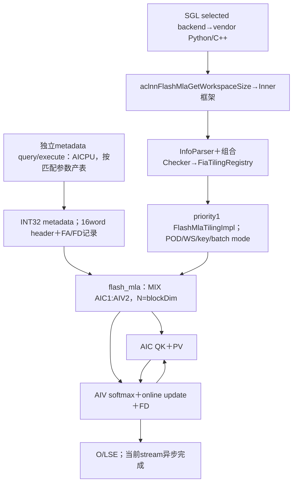
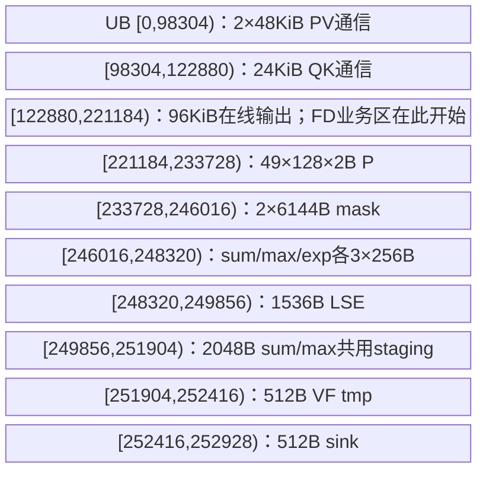
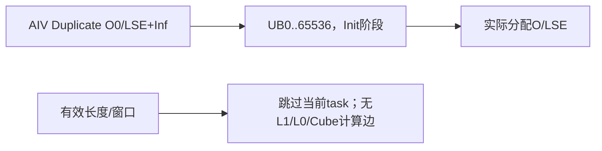
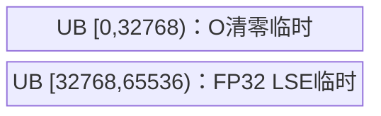

# FlashMla 非量化分页共享 KV 950 ACLNN 算子知识

## 算子速览

| 项目 | 内容 |
|---|---|
| 实际入口 | `aclnnFlashMlaGetWorkspaceSize/aclnnFlashMla`；SGL selected `cann_ops_transformers_cann920` 后端，固定 e7da 的非量化公开接口 |
| 计算语义 | 分页读K的576通道做QK，K前512通道同时为V；右对齐mask0/3/4、可选每头sink、online softmax与跨S2分片FD归并 |
| 输入输出 | FP16/BF16；Q BSND/BNSD/TND；KV PA_BBND/PA_BNBD/PA_NZ、KV头1；O与Q同dtype、DV512；LSE FP32 |
| 执行类型 | 一个 `flash_mla` MIX_CV launch，`KERNEL_TYPE_MIX_AIC_1_2`；AIC两次矩阵乘与两个AIV的Vector/RegBase softmax、更新、FD；配套AICPU metadata为独立前驱接口 |
| Kernel 路线 | R-001～R-048逐dtype×Q/O布局×KV布局×HasMask列出；R-049保留有效长度为零/窗口空的无矩阵乘终点 |
| 核心资源 | M96、S2tile112、QK576、V512；FA UB252928B，FD复用后高水211712B，L1519168B，L0A/B各65536B，L0C262144B；workspace按Host公式并区分实际user基址 |
| 来源闭包 | source_closed：SGL profile→vendor Python/C++→公开pair→生成Inner框架边界→Host/POD→MIX entry→Cube/Vector/FD及当前公共specialization；metadata按实际字段生产/消费贯通，不等同完整AICPU工程验收 |
| 验证状态 | 已完成静态源码闭包分析；本次知识提取未执行安装、编译、真机、数值、图或性能测试。draft不构成安全复用或设备正确性承诺 |

## 接口与语义

### 计算语义

令每请求有效长度为q_b、k_b，Query头h∈[0,G)，分页取得K_b[j,0:576]，V_b[j]=K_b[j,0:512]。对允许集合J，s_j=FP32(α·Q·Kᵀ)，Z=Σ_J exp(s_j)+[sink]exp(sink_h)，O=Σ_J exp(s_j)V_j/Z，LSE=log Z。sink不乘α、不增加value。mode0取全部有效KV；mode3取j≤k_b−q_b+i；mode4取闭区间i+k_b−q_b−win_left≤j≤i+k_b−q_b+win_right，-1侧不限制，再与[0,k_b)相交。

实际实现按112列块递推：m'=max(m,blockmax)，p=exp(score−m')；sum用cast前FP32的p，PV输入是SAT+CAST_ROUND到Q的16位dtype的p；u'=exp(m−m')u+PV(p,K[:512])。每个本地S2分片在本地末块做u/sum，若跨核切S2则写已归一化片输出及FP32(sum,max)，FD用ρ_t=sum_t exp(max_t−max*) / Σ_t sum_t exp(max_t−max*)加权各片O。不是直接求和片输出。sink仅首个有效分片在FA prologue注入一次，FD采用`SinkInjectStage::AT_FA_PROLOGUE`，不再注入。

正常FA末输出用`Cast(...CAST_ROUND)`；FD末BF16用CAST_RINT、FP16用CAST_ROUND。完全无有效KV/窗口空行的公开约定为O=0、开启LSE时+Inf；预清零、skip、sentinel修正分别记录，不能把任意NaN输入或伪造调度解释为已保证此约定。

### 输入、输出与属性

| 参数 | shape/layout | dtype | 约束、默认值与语义 |
|---|---|---|---|
| q | [B,S,G,576] BSND、[B,G,S,576] BNSD、[T,G,576] TND | FP16/BF16 | G∈[1,128]；0<B<65536；物理维非零；OpDef AutoContiguous |
| k_cache | [P,H,1,576] PA_BBND、[P,1,H,576] PA_BNBD、[P,1,36,H,16] PA_NZ | 同q | 共享KV，KV头1；SGL文档列H128，实际固定e7文档/Host接受H=16、32…1024；三布局均须真实匹配 |
| block_table | [B,L] | INT32 | 逻辑页→物理页；每行L>0并覆盖ceil(k_b/H)；有效页号由调用者保证；Host不读取设备表内容 |
| cache_seqlens | [B] | INT32 | 实际必传且非空，0≤k_b≤L*H并有实际物理存储；主Host只验shape/type，metadata CPU另验非负 |
| cu_seqlens_q | [B+1] | INT32 | TND必传，首0、非递减、末T；非TND禁止有效非空cuQ；存储基址始终cuQ[b] |
| seqused_q | [B] 或None | INT32 | 有值取q_b，否则TND取cu差、非TND取S；必须≤所属存储容量；无有效cuQ/usedQ时主Host要求max_seqlen_q=S |
| sinks | [G]、None或[0] | FP32 | 可选每头logit；公开pair把rank1长度0归nullptr；不把None与全0sink等同 |
| attn_mask | [2048,2048] | INT8 | mode0必须None；mode3/4必传标准压缩上三角模板；不是任意展开mask |
| metadata | [M] | INT32/ND | Python签名和Doc称可选，实际MetadataChecker要求非空且Device无fallback直接解引用；由同e7配套接口按同设备/资源/配置生成 |
| head_dim_v | scalar | int64入口 | 仅512；QK总维576含64个已计算RoPE通道；本算子不做RoPE或压缩 |
| softmax_scale | scalar | C double→GE float→FP32 | 默认1，不自动1/√576；没有来源证明主Host有限/正值检查；非有限数值另属数值域 |
| mask_mode / win_left / win_right | scalars | int64入口 | 0/3/4；窗口[-1,INT32_MAX]，mode0/3必须(-1,-1) |
| max_seqlen_q/kv | scalars | int64 | ≥−1；无cuQ/usedQ时Q必须S；其余长度与metadata配置仍须一致，默认不自动读取最大值 |
| layout_out | BSND/BNSD/TND/NTD | string | BSND/BNSD跟随Q；TND可TND或NTD；共12个Q/KV/O布局三元组 |
| return_softmax_lse | scalar | bool Python/int64 ACLNN | 0/1；两输出tuple恒定；关时真实C++ LSE为FP32[0] |
| attn_out / softmax_lse | O为Q布局改DV512，TND另可[G,T,512]；LSE TND[G,T]、其他[B,G,S] | O同q/LSE FP32 | C++在Q DeviceGuard内新分配，输入只读，均不原地 |

接口签名、调度producer容量及环境层复用[既有Flash MLA API](../../../../apis/sgl_kernel_npu/sgl_flash_mla_and_metadata.md)。该API给出metadata生成入口，本文闭合其被主核消费的具体字段。两个入口有各自executor/workspace，不能拿主executor执行metadata。

### 入口与版本

SGL `auto`注册仅ARCH35，先要求detect_cann_version()==9.2.0，再跳`cann_ops_transformers_cann920`；显式后端同ARCH35但自身不重复版本检查，不能据此声称其它CANN版本兼容。Python实际从包内`_third_party.sgl_ops_transformer.ops`导入，profile明确固定e7da；SGL文档链接37c98旧API说明不是实际bundle版本。独立torch_native参考不属于本selected CANN源码任务，不把其Torch核心调用伪装本Device闭包。

vendor Python注册`torch.ops.cann_ops_transformer.flash_mla`并经OpBuilder加载C++。C++→`ACLNN_CMD(aclnnFlashMla,...)`动态解析本公开pair；pair转生成的`aclnnInnerFlashMlaGetWorkspaceSize/aclnnInnerFlashMla`。生成bridge、运行时加载、AutoContiguous/ViewCopy、调度提交为框架边界；自有Host到Device均在e7固定集合。它不是V3/V4 Prolog、SparseFlashMla或FlashAttentionScore的别名，不替换其已有卡。

## Host/Launcher 执行流程

### 参数校验与前处理

1. SGL registry做架构/实现选择，auto做严格版本检查。vendor Python归一None布局为BSND/PA_BBND/BSND、None α为1；metadata存在且能由usedQ或cuQ确定B时，要求其numel≥align4096(16*((C+V)*B+1))。无这些长度时Python不据Q shape补同一容量检查。
2. C++按layout读Q维度、在Q设备分配O和LSE。metadata存在时另有numel≥C+V的较弱检查；不能代替完整header/section容量。rank/shape非法输入可能先在adapter取size时失败。Fake main始终构造完整LSE shape，未按False置[0]，与真实C++关闭输出不同，不能称图模式已验证。
3. 公开WS pair把[0]sink转空，LSE关闭时创建FP32[0]描述符placeholder，inner query返回后销毁；LSE开却nullptr立即返回错误。执行pair原样转Inner。不能将placeholder的Host描述符释放误解为释放运行中输出数据。
4. OpDef：q、blockTable、长度、sink、mask、metadata及输出AutoContiguous；k_cache IgnoreContiguous。复制/回写具体executor节点由生成框架安排，未知时不发明独立Device body、workspace字节或额外stream。
5. `TilingFlashMla`→InfoParser：查平台必须DAV3510且C/V非0；取shape/desc/attrs，物理Q/K/O任何0维即失败；先解析12个合法布局，再stride、轴、mask/长度标志。TND B=cuQ.numel−1、S1=T，非TND B/S由Q；S2=L*H；Dnope512/R64/Nkv1/G1…128。
6. 组合Checker按Common→ActualSeqLen→PagedAttention→Mask→Sinks→Metadata→LSE各阶段运行；任意失败结束，不回退torch_native。主Host不读取设备长度、页表或metadata内容。H16对齐≤1024、表B一致、mask存在性与窗口、Q/K/O dtype/shape一致、LSE形状均在当前检查链；无cu/used时maxQ=S是实际guard。
7. view k_cache：Host检查首个非连续轴，BBND只允许0，BNBD/NZ允许0/1；singleton轴跳过规范stride比较。旧opbase InputIsView=false时不获取stride，Device采用连续默认，不能把这个放行解释为一般非连续支持。正stride、地址覆盖、无overlap及整数可表示仍是调用前提，Host漏检不形成扩张合同。

### 参数、Workspace 与生命周期

记C/V为Host读取的AIC/AIV资源，r=V/C整数除法，N=`CalcTschBlockDim(C*r,C,C*r)`返回blockDim，m=48r。标准MIX1:2消费要求r=2、实际launch的AIC/2AIV及metadata C/V一致；源码只排除C/V为0，没有显式r==2检查。保留N与C的符号区别，不把任意部署都假定N=C。

```text
A = N * 2 * m * 512                  # accumOut，FP32元素
E = N * 2 * m * 8                    # 一份sum或max，FP32元素
W_tiling = Wlib + 4*A + 8*E          # Host实际GetLibApiWorkSpaceSize()，不是无条件常数
user[0,4A)          = accumOut
user[4A,4(A+E))     = FD sum
user[4(A+E),4(A+2E))= FD max
```

A/E先按uint64计算，保存POD为uint32；公式和切片要求乘法不溢出且A/E可表示。每个片slot号w来自metadata，O偏移`w*96*512` float，sum/max偏移`w*96*8` float；每core最多头/尾2个跨S2片，实际调度需满足w与片长落入A/E。Host tiling workspace之外，generated executor可能还管理AutoContiguous等框架buffer；返回pair workspaceSize不能无证等同此W_tiling。

Device入口调用`GetUserWorkspace(workspace)`。固定a63d/3510非CPU实现忽略实参，依赖框架注入的GetSysWorkSpacePtr：若有效`ENABLE_CV_COMM_VIA_SSBUF!=0 && __MIX_CORE_AIC_RATION__!=1`，user为该基址本身；否则加SDK RESERVED_WORKSPACE=16MiB。Flash CMake在ascend950条件下为Ascend950PR_9599请求该SSBUF宏；实际编译分支与预处理宏必须一致，不能机械把user写成实参+16MiB。Wlib由Host API实际返回，SDK保留常量是另一事实。

输入/长度/页表/metadata及其框架连续副本、O/LSE、主workspace由调用者或executor保持到当前stream完成；C++返回Tensor不等于Device已同步。metadata是独立producer拥有的正式输出，在同stream先产后消费；跨stream必须显式完成依赖。query失败不执行execute；execute错误由ACLNN框架传播，源码没有“失败仍产有效O”的恢复路线。

### 启动图与失败传播



唯一3510模板priority1、IsCapable恒true，失败直接GRAPH_FAILED；无下一可用tiling。注册表只对GRAPH_PARAM_INVALID继续，普通失败不应重试另一实现。未知编译模板key不在选择列表，无源码fallback body，框架拒绝/无对应binary是外部终点。

## Route 与参数设计

### 分核与资源计算

Host `SplitPolicy`取sOuterFactor48，配置固定(96,112,576,512)；不按shape选其它tile。Host发布所有资源核，task由metadata的每section/core起止三维游标决定；logical axes为(b*Nkv、ceil(G*q_b/96)、ceil(k_b/112))。TND基址用cuQ[b]、有效长度usedQ优先，BNSD内部M次序G→S，其余S→G。分片内m≤96、n≤112；两个AIV分别处理ceil(m/2)与余下行，第二侧start=ceil(m/2)。

QK的K循环为96+112+128+112+128=576，L0A Q第一96通道常驻，后续片交替18KiB/42KiB区域；PV两次N256，K按64+尾块。最后M/N逻辑有效范围不超过96/112，LoadData按16粒度，Fixpipe M按偶数、N按8对齐，真实O拷出只提交有效行。物理补齐不新增逻辑key/head/query。

metadata AICPU `Prepare→BalanceSchedule(SectionStreamK)→CheckMetadataCapacity→GenMetadata`，m96/n112、fdOn=true、fdTolerance10、fdLeastBlock3；G*maxQ≤192时l2Byte0，否则96MiB控制section策略。sectionNum∈[1,B*Nkv]；本算子Nkv1。按每section保存FA范围及FD归并任务；无任务的记录清0。该调度计算是独立CPU接口，本文只提取主算子必需的字段生产消费与当前调度参数，不把Host生成值检查当主核自身检查。


### Route 选择

下表逐个列出实际dtype编译变体与模板key组合；dtype由OpDef/编译ORIG_DTYPE_Q选择，不编码进这四个key实参。48项互斥，没有shape优先级竞争；共同前置检查失败直接停止。所有typed Route内部均保留普通FA、分S2写workspace＋AIV FD、sink开关、LSE开关、有效长度及最后tile分支，不能把同数学的调度分支遗漏。

| 顺序 | Route | Key/模板 | 精确选择条件与优先级 | 不适用去向 |
|---:|---|---|---|---|
| 1 | R-001 FP16/BSND→BSND/PA_BBND/no mask | `GET_TPL_TILING_KEY(0,1,0,0)` | Q/K/O=FP16、BSND→BSND、PA_BBND、mode=0；config0；有效tile | 相应其它tuple；非法组合Host失败 |
| 2 | R-002 FP16/BSND→BSND/PA_BBND/mask | `GET_TPL_TILING_KEY(0,1,1,0)` | Q/K/O=FP16、BSND→BSND、PA_BBND、mode∈{3,4}；config0；有效tile | 相应其它tuple；非法组合Host失败 |
| 3 | R-003 FP16/BSND→BSND/PA_BNBD/no mask | `GET_TPL_TILING_KEY(0,2,0,0)` | Q/K/O=FP16、BSND→BSND、PA_BNBD、mode=0；config0；有效tile | 相应其它tuple；非法组合Host失败 |
| 4 | R-004 FP16/BSND→BSND/PA_BNBD/mask | `GET_TPL_TILING_KEY(0,2,1,0)` | Q/K/O=FP16、BSND→BSND、PA_BNBD、mode∈{3,4}；config0；有效tile | 相应其它tuple；非法组合Host失败 |
| 5 | R-005 FP16/BSND→BSND/PA_NZ/no mask | `GET_TPL_TILING_KEY(0,3,0,0)` | Q/K/O=FP16、BSND→BSND、PA_NZ、mode=0；config0；有效tile | 相应其它tuple；非法组合Host失败 |
| 6 | R-006 FP16/BSND→BSND/PA_NZ/mask | `GET_TPL_TILING_KEY(0,3,1,0)` | Q/K/O=FP16、BSND→BSND、PA_NZ、mode∈{3,4}；config0；有效tile | 相应其它tuple；非法组合Host失败 |
| 7 | R-007 FP16/BNSD→BNSD/PA_BBND/no mask | `GET_TPL_TILING_KEY(1,1,0,0)` | Q/K/O=FP16、BNSD→BNSD、PA_BBND、mode=0；config0；有效tile | 相应其它tuple；非法组合Host失败 |
| 8 | R-008 FP16/BNSD→BNSD/PA_BBND/mask | `GET_TPL_TILING_KEY(1,1,1,0)` | Q/K/O=FP16、BNSD→BNSD、PA_BBND、mode∈{3,4}；config0；有效tile | 相应其它tuple；非法组合Host失败 |
| 9 | R-009 FP16/BNSD→BNSD/PA_BNBD/no mask | `GET_TPL_TILING_KEY(1,2,0,0)` | Q/K/O=FP16、BNSD→BNSD、PA_BNBD、mode=0；config0；有效tile | 相应其它tuple；非法组合Host失败 |
| 10 | R-010 FP16/BNSD→BNSD/PA_BNBD/mask | `GET_TPL_TILING_KEY(1,2,1,0)` | Q/K/O=FP16、BNSD→BNSD、PA_BNBD、mode∈{3,4}；config0；有效tile | 相应其它tuple；非法组合Host失败 |
| 11 | R-011 FP16/BNSD→BNSD/PA_NZ/no mask | `GET_TPL_TILING_KEY(1,3,0,0)` | Q/K/O=FP16、BNSD→BNSD、PA_NZ、mode=0；config0；有效tile | 相应其它tuple；非法组合Host失败 |
| 12 | R-012 FP16/BNSD→BNSD/PA_NZ/mask | `GET_TPL_TILING_KEY(1,3,1,0)` | Q/K/O=FP16、BNSD→BNSD、PA_NZ、mode∈{3,4}；config0；有效tile | 相应其它tuple；非法组合Host失败 |
| 13 | R-013 FP16/TND→TND/PA_BBND/no mask | `GET_TPL_TILING_KEY(2,1,0,0)` | Q/K/O=FP16、TND→TND、PA_BBND、mode=0；config0；有效tile | 相应其它tuple；非法组合Host失败 |
| 14 | R-014 FP16/TND→TND/PA_BBND/mask | `GET_TPL_TILING_KEY(2,1,1,0)` | Q/K/O=FP16、TND→TND、PA_BBND、mode∈{3,4}；config0；有效tile | 相应其它tuple；非法组合Host失败 |
| 15 | R-015 FP16/TND→TND/PA_BNBD/no mask | `GET_TPL_TILING_KEY(2,2,0,0)` | Q/K/O=FP16、TND→TND、PA_BNBD、mode=0；config0；有效tile | 相应其它tuple；非法组合Host失败 |
| 16 | R-016 FP16/TND→TND/PA_BNBD/mask | `GET_TPL_TILING_KEY(2,2,1,0)` | Q/K/O=FP16、TND→TND、PA_BNBD、mode∈{3,4}；config0；有效tile | 相应其它tuple；非法组合Host失败 |
| 17 | R-017 FP16/TND→TND/PA_NZ/no mask | `GET_TPL_TILING_KEY(2,3,0,0)` | Q/K/O=FP16、TND→TND、PA_NZ、mode=0；config0；有效tile | 相应其它tuple；非法组合Host失败 |
| 18 | R-018 FP16/TND→TND/PA_NZ/mask | `GET_TPL_TILING_KEY(2,3,1,0)` | Q/K/O=FP16、TND→TND、PA_NZ、mode∈{3,4}；config0；有效tile | 相应其它tuple；非法组合Host失败 |
| 19 | R-019 FP16/TND→NTD/PA_BBND/no mask | `GET_TPL_TILING_KEY(4,1,0,0)` | Q/K/O=FP16、TND→NTD、PA_BBND、mode=0；config0；有效tile | 相应其它tuple；非法组合Host失败 |
| 20 | R-020 FP16/TND→NTD/PA_BBND/mask | `GET_TPL_TILING_KEY(4,1,1,0)` | Q/K/O=FP16、TND→NTD、PA_BBND、mode∈{3,4}；config0；有效tile | 相应其它tuple；非法组合Host失败 |
| 21 | R-021 FP16/TND→NTD/PA_BNBD/no mask | `GET_TPL_TILING_KEY(4,2,0,0)` | Q/K/O=FP16、TND→NTD、PA_BNBD、mode=0；config0；有效tile | 相应其它tuple；非法组合Host失败 |
| 22 | R-022 FP16/TND→NTD/PA_BNBD/mask | `GET_TPL_TILING_KEY(4,2,1,0)` | Q/K/O=FP16、TND→NTD、PA_BNBD、mode∈{3,4}；config0；有效tile | 相应其它tuple；非法组合Host失败 |
| 23 | R-023 FP16/TND→NTD/PA_NZ/no mask | `GET_TPL_TILING_KEY(4,3,0,0)` | Q/K/O=FP16、TND→NTD、PA_NZ、mode=0；config0；有效tile | 相应其它tuple；非法组合Host失败 |
| 24 | R-024 FP16/TND→NTD/PA_NZ/mask | `GET_TPL_TILING_KEY(4,3,1,0)` | Q/K/O=FP16、TND→NTD、PA_NZ、mode∈{3,4}；config0；有效tile | 相应其它tuple；非法组合Host失败 |
| 25 | R-025 BF16/BSND→BSND/PA_BBND/no mask | `GET_TPL_TILING_KEY(0,1,0,0)` | Q/K/O=BF16、BSND→BSND、PA_BBND、mode=0；config0；有效tile | 相应其它tuple；非法组合Host失败 |
| 26 | R-026 BF16/BSND→BSND/PA_BBND/mask | `GET_TPL_TILING_KEY(0,1,1,0)` | Q/K/O=BF16、BSND→BSND、PA_BBND、mode∈{3,4}；config0；有效tile | 相应其它tuple；非法组合Host失败 |
| 27 | R-027 BF16/BSND→BSND/PA_BNBD/no mask | `GET_TPL_TILING_KEY(0,2,0,0)` | Q/K/O=BF16、BSND→BSND、PA_BNBD、mode=0；config0；有效tile | 相应其它tuple；非法组合Host失败 |
| 28 | R-028 BF16/BSND→BSND/PA_BNBD/mask | `GET_TPL_TILING_KEY(0,2,1,0)` | Q/K/O=BF16、BSND→BSND、PA_BNBD、mode∈{3,4}；config0；有效tile | 相应其它tuple；非法组合Host失败 |
| 29 | R-029 BF16/BSND→BSND/PA_NZ/no mask | `GET_TPL_TILING_KEY(0,3,0,0)` | Q/K/O=BF16、BSND→BSND、PA_NZ、mode=0；config0；有效tile | 相应其它tuple；非法组合Host失败 |
| 30 | R-030 BF16/BSND→BSND/PA_NZ/mask | `GET_TPL_TILING_KEY(0,3,1,0)` | Q/K/O=BF16、BSND→BSND、PA_NZ、mode∈{3,4}；config0；有效tile | 相应其它tuple；非法组合Host失败 |
| 31 | R-031 BF16/BNSD→BNSD/PA_BBND/no mask | `GET_TPL_TILING_KEY(1,1,0,0)` | Q/K/O=BF16、BNSD→BNSD、PA_BBND、mode=0；config0；有效tile | 相应其它tuple；非法组合Host失败 |
| 32 | R-032 BF16/BNSD→BNSD/PA_BBND/mask | `GET_TPL_TILING_KEY(1,1,1,0)` | Q/K/O=BF16、BNSD→BNSD、PA_BBND、mode∈{3,4}；config0；有效tile | 相应其它tuple；非法组合Host失败 |
| 33 | R-033 BF16/BNSD→BNSD/PA_BNBD/no mask | `GET_TPL_TILING_KEY(1,2,0,0)` | Q/K/O=BF16、BNSD→BNSD、PA_BNBD、mode=0；config0；有效tile | 相应其它tuple；非法组合Host失败 |
| 34 | R-034 BF16/BNSD→BNSD/PA_BNBD/mask | `GET_TPL_TILING_KEY(1,2,1,0)` | Q/K/O=BF16、BNSD→BNSD、PA_BNBD、mode∈{3,4}；config0；有效tile | 相应其它tuple；非法组合Host失败 |
| 35 | R-035 BF16/BNSD→BNSD/PA_NZ/no mask | `GET_TPL_TILING_KEY(1,3,0,0)` | Q/K/O=BF16、BNSD→BNSD、PA_NZ、mode=0；config0；有效tile | 相应其它tuple；非法组合Host失败 |
| 36 | R-036 BF16/BNSD→BNSD/PA_NZ/mask | `GET_TPL_TILING_KEY(1,3,1,0)` | Q/K/O=BF16、BNSD→BNSD、PA_NZ、mode∈{3,4}；config0；有效tile | 相应其它tuple；非法组合Host失败 |
| 37 | R-037 BF16/TND→TND/PA_BBND/no mask | `GET_TPL_TILING_KEY(2,1,0,0)` | Q/K/O=BF16、TND→TND、PA_BBND、mode=0；config0；有效tile | 相应其它tuple；非法组合Host失败 |
| 38 | R-038 BF16/TND→TND/PA_BBND/mask | `GET_TPL_TILING_KEY(2,1,1,0)` | Q/K/O=BF16、TND→TND、PA_BBND、mode∈{3,4}；config0；有效tile | 相应其它tuple；非法组合Host失败 |
| 39 | R-039 BF16/TND→TND/PA_BNBD/no mask | `GET_TPL_TILING_KEY(2,2,0,0)` | Q/K/O=BF16、TND→TND、PA_BNBD、mode=0；config0；有效tile | 相应其它tuple；非法组合Host失败 |
| 40 | R-040 BF16/TND→TND/PA_BNBD/mask | `GET_TPL_TILING_KEY(2,2,1,0)` | Q/K/O=BF16、TND→TND、PA_BNBD、mode∈{3,4}；config0；有效tile | 相应其它tuple；非法组合Host失败 |
| 41 | R-041 BF16/TND→TND/PA_NZ/no mask | `GET_TPL_TILING_KEY(2,3,0,0)` | Q/K/O=BF16、TND→TND、PA_NZ、mode=0；config0；有效tile | 相应其它tuple；非法组合Host失败 |
| 42 | R-042 BF16/TND→TND/PA_NZ/mask | `GET_TPL_TILING_KEY(2,3,1,0)` | Q/K/O=BF16、TND→TND、PA_NZ、mode∈{3,4}；config0；有效tile | 相应其它tuple；非法组合Host失败 |
| 43 | R-043 BF16/TND→NTD/PA_BBND/no mask | `GET_TPL_TILING_KEY(4,1,0,0)` | Q/K/O=BF16、TND→NTD、PA_BBND、mode=0；config0；有效tile | 相应其它tuple；非法组合Host失败 |
| 44 | R-044 BF16/TND→NTD/PA_BBND/mask | `GET_TPL_TILING_KEY(4,1,1,0)` | Q/K/O=BF16、TND→NTD、PA_BBND、mode∈{3,4}；config0；有效tile | 相应其它tuple；非法组合Host失败 |
| 45 | R-045 BF16/TND→NTD/PA_BNBD/no mask | `GET_TPL_TILING_KEY(4,2,0,0)` | Q/K/O=BF16、TND→NTD、PA_BNBD、mode=0；config0；有效tile | 相应其它tuple；非法组合Host失败 |
| 46 | R-046 BF16/TND→NTD/PA_BNBD/mask | `GET_TPL_TILING_KEY(4,2,1,0)` | Q/K/O=BF16、TND→NTD、PA_BNBD、mode∈{3,4}；config0；有效tile | 相应其它tuple；非法组合Host失败 |
| 47 | R-047 BF16/TND→NTD/PA_NZ/no mask | `GET_TPL_TILING_KEY(4,3,0,0)` | Q/K/O=BF16、TND→NTD、PA_NZ、mode=0；config0；有效tile | 相应其它tuple；非法组合Host失败 |
| 48 | R-048 BF16/TND→NTD/PA_NZ/mask | `GET_TPL_TILING_KEY(4,3,1,0)` | Q/K/O=BF16、TND→NTD、PA_NZ、mode∈{3,4}；config0；有效tile | 相应其它tuple；非法组合Host失败 |
| 49 | R-049 有效空/跳过 | 任一以上key内taskDealMode | q_b=0或k_b=0，或当前窗口无可计算tile；物理维仍非0 | 非空tile走对应R-001～048；伪造metadata无安全fallback |

```text
selected CANN + DAV3510 + common/layout/length/page/mask/metadata/LSE checks
  -> dtype FP16/BF16
  -> io {0=BSND,1=BNSD,2=TND,4=TND_NTD}
  -> kv {1=PA_BBND,2=PA_BNBD,3=PA_NZ}
  -> mask=(mode!=0), config=0 -> R-001..R-048
  -> within metadata task: effective zero / outside window -> R-049
  -> else FA(QK->softmax->PV->update)
       -> no S2 split: final O/LSE
       -> S2 split: FP32 normalized O + sum/max workspace
          -> section header FD enabled: AIV SyncAll -> weighted FD -> SyncAll
```

### 模板/实现执行矩阵

令 `F(T,QL,OL,H,K)` 精确表示 `FlashMlaType<T,float,T,FLASH_MLA_LAYOUT::QL,FLASH_MLA_LAYOUT::OL,static_cast<S1TemplateType>(96),static_cast<S2TemplateType>(112),DTemplateType::Aligned576,DTemplateType::Aligned512,H,K>`；这仅是下表的文字缩写，不是新增入口。Kernel组合为 `FlashAttentionNoQuantMlaKernel<FlashMlaNoQuantMlaBlockCube<F>,FlashMlaNoQuantMlaBlockVec<F>,FlashMlaBlockVecFlashDecodeMla<F>>`；AIC/AIV分别将另一侧类型替换为源文件Dummy，编译期FLASH_DECODE恒true。

| Route | key/selector | dtype/shape/platform 完整命中条件 | 执行族与 kernel 节点 | 实际模板/body | 内存与同步特征 | tail/fallback |
|---|---|---|---|---|---|---|
| R-001 | `GET_TPL_TILING_KEY(0,1,0,0)`、FP16 | 950、[B,S,G,576]→[B,S,G,512]、[P,H,1,576]、G1…128/H16对齐≤1024，mode0 | 单MIX_CV；AIC QK/PV＋AIV softmax/update/FD | `F(half,BSH,BSH,false,1)`；ProcessVec1/2、FlashDecode | L1519168B/L0A,B64KiB/L0C256KiB/UB252928B；mode4 CV flags；FD用AIV屏障 | m≤96,n≤112；n≤64/64<n≤112 VF；空域R-049，无其它tilefallback |
| R-002 | `GET_TPL_TILING_KEY(0,1,1,0)`、FP16 | 950、[B,S,G,576]→[B,S,G,512]、[P,H,1,576]、G1…128/H16对齐≤1024，mode3/4 | 单MIX_CV；AIC QK/PV＋AIV softmax/update/FD | `F(half,BSH,BSH,true,1)`；ProcessVec1/2、FlashDecode | L1519168B/L0A,B64KiB/L0C256KiB/UB252928B；mode4 CV flags；FD用AIV屏障 | m≤96,n≤112；n≤64/64<n≤112 VF；空域R-049，无其它tilefallback |
| R-003 | `GET_TPL_TILING_KEY(0,2,0,0)`、FP16 | 950、[B,S,G,576]→[B,S,G,512]、[P,1,H,576]、G1…128/H16对齐≤1024，mode0 | 单MIX_CV；AIC QK/PV＋AIV softmax/update/FD | `F(half,BSH,BSH,false,2)`；ProcessVec1/2、FlashDecode | L1519168B/L0A,B64KiB/L0C256KiB/UB252928B；mode4 CV flags；FD用AIV屏障 | m≤96,n≤112；n≤64/64<n≤112 VF；空域R-049，无其它tilefallback |
| R-004 | `GET_TPL_TILING_KEY(0,2,1,0)`、FP16 | 950、[B,S,G,576]→[B,S,G,512]、[P,1,H,576]、G1…128/H16对齐≤1024，mode3/4 | 单MIX_CV；AIC QK/PV＋AIV softmax/update/FD | `F(half,BSH,BSH,true,2)`；ProcessVec1/2、FlashDecode | L1519168B/L0A,B64KiB/L0C256KiB/UB252928B；mode4 CV flags；FD用AIV屏障 | m≤96,n≤112；n≤64/64<n≤112 VF；空域R-049，无其它tilefallback |
| R-005 | `GET_TPL_TILING_KEY(0,3,0,0)`、FP16 | 950、[B,S,G,576]→[B,S,G,512]、[P,1,36,H,16]、G1…128/H16对齐≤1024，mode0 | 单MIX_CV；AIC QK/PV＋AIV softmax/update/FD | `F(half,BSH,BSH,false,3)`；ProcessVec1/2、FlashDecode | L1519168B/L0A,B64KiB/L0C256KiB/UB252928B；mode4 CV flags；FD用AIV屏障 | m≤96,n≤112；n≤64/64<n≤112 VF；空域R-049，无其它tilefallback |
| R-006 | `GET_TPL_TILING_KEY(0,3,1,0)`、FP16 | 950、[B,S,G,576]→[B,S,G,512]、[P,1,36,H,16]、G1…128/H16对齐≤1024，mode3/4 | 单MIX_CV；AIC QK/PV＋AIV softmax/update/FD | `F(half,BSH,BSH,true,3)`；ProcessVec1/2、FlashDecode | L1519168B/L0A,B64KiB/L0C256KiB/UB252928B；mode4 CV flags；FD用AIV屏障 | m≤96,n≤112；n≤64/64<n≤112 VF；空域R-049，无其它tilefallback |
| R-007 | `GET_TPL_TILING_KEY(1,1,0,0)`、FP16 | 950、[B,G,S,576]→[B,G,S,512]、[P,H,1,576]、G1…128/H16对齐≤1024，mode0 | 单MIX_CV；AIC QK/PV＋AIV softmax/update/FD | `F(half,BNSD,BNSD,false,1)`；ProcessVec1/2、FlashDecode | L1519168B/L0A,B64KiB/L0C256KiB/UB252928B；mode4 CV flags；FD用AIV屏障 | m≤96,n≤112；n≤64/64<n≤112 VF；空域R-049，无其它tilefallback |
| R-008 | `GET_TPL_TILING_KEY(1,1,1,0)`、FP16 | 950、[B,G,S,576]→[B,G,S,512]、[P,H,1,576]、G1…128/H16对齐≤1024，mode3/4 | 单MIX_CV；AIC QK/PV＋AIV softmax/update/FD | `F(half,BNSD,BNSD,true,1)`；ProcessVec1/2、FlashDecode | L1519168B/L0A,B64KiB/L0C256KiB/UB252928B；mode4 CV flags；FD用AIV屏障 | m≤96,n≤112；n≤64/64<n≤112 VF；空域R-049，无其它tilefallback |
| R-009 | `GET_TPL_TILING_KEY(1,2,0,0)`、FP16 | 950、[B,G,S,576]→[B,G,S,512]、[P,1,H,576]、G1…128/H16对齐≤1024，mode0 | 单MIX_CV；AIC QK/PV＋AIV softmax/update/FD | `F(half,BNSD,BNSD,false,2)`；ProcessVec1/2、FlashDecode | L1519168B/L0A,B64KiB/L0C256KiB/UB252928B；mode4 CV flags；FD用AIV屏障 | m≤96,n≤112；n≤64/64<n≤112 VF；空域R-049，无其它tilefallback |
| R-010 | `GET_TPL_TILING_KEY(1,2,1,0)`、FP16 | 950、[B,G,S,576]→[B,G,S,512]、[P,1,H,576]、G1…128/H16对齐≤1024，mode3/4 | 单MIX_CV；AIC QK/PV＋AIV softmax/update/FD | `F(half,BNSD,BNSD,true,2)`；ProcessVec1/2、FlashDecode | L1519168B/L0A,B64KiB/L0C256KiB/UB252928B；mode4 CV flags；FD用AIV屏障 | m≤96,n≤112；n≤64/64<n≤112 VF；空域R-049，无其它tilefallback |
| R-011 | `GET_TPL_TILING_KEY(1,3,0,0)`、FP16 | 950、[B,G,S,576]→[B,G,S,512]、[P,1,36,H,16]、G1…128/H16对齐≤1024，mode0 | 单MIX_CV；AIC QK/PV＋AIV softmax/update/FD | `F(half,BNSD,BNSD,false,3)`；ProcessVec1/2、FlashDecode | L1519168B/L0A,B64KiB/L0C256KiB/UB252928B；mode4 CV flags；FD用AIV屏障 | m≤96,n≤112；n≤64/64<n≤112 VF；空域R-049，无其它tilefallback |
| R-012 | `GET_TPL_TILING_KEY(1,3,1,0)`、FP16 | 950、[B,G,S,576]→[B,G,S,512]、[P,1,36,H,16]、G1…128/H16对齐≤1024，mode3/4 | 单MIX_CV；AIC QK/PV＋AIV softmax/update/FD | `F(half,BNSD,BNSD,true,3)`；ProcessVec1/2、FlashDecode | L1519168B/L0A,B64KiB/L0C256KiB/UB252928B；mode4 CV flags；FD用AIV屏障 | m≤96,n≤112；n≤64/64<n≤112 VF；空域R-049，无其它tilefallback |
| R-013 | `GET_TPL_TILING_KEY(2,1,0,0)`、FP16 | 950、[T,G,576]→[T,G,512]、[P,H,1,576]、G1…128/H16对齐≤1024，mode0 | 单MIX_CV；AIC QK/PV＋AIV softmax/update/FD | `F(half,TND,TND,false,1)`；ProcessVec1/2、FlashDecode | L1519168B/L0A,B64KiB/L0C256KiB/UB252928B；mode4 CV flags；FD用AIV屏障 | m≤96,n≤112；n≤64/64<n≤112 VF；空域R-049，无其它tilefallback |
| R-014 | `GET_TPL_TILING_KEY(2,1,1,0)`、FP16 | 950、[T,G,576]→[T,G,512]、[P,H,1,576]、G1…128/H16对齐≤1024，mode3/4 | 单MIX_CV；AIC QK/PV＋AIV softmax/update/FD | `F(half,TND,TND,true,1)`；ProcessVec1/2、FlashDecode | L1519168B/L0A,B64KiB/L0C256KiB/UB252928B；mode4 CV flags；FD用AIV屏障 | m≤96,n≤112；n≤64/64<n≤112 VF；空域R-049，无其它tilefallback |
| R-015 | `GET_TPL_TILING_KEY(2,2,0,0)`、FP16 | 950、[T,G,576]→[T,G,512]、[P,1,H,576]、G1…128/H16对齐≤1024，mode0 | 单MIX_CV；AIC QK/PV＋AIV softmax/update/FD | `F(half,TND,TND,false,2)`；ProcessVec1/2、FlashDecode | L1519168B/L0A,B64KiB/L0C256KiB/UB252928B；mode4 CV flags；FD用AIV屏障 | m≤96,n≤112；n≤64/64<n≤112 VF；空域R-049，无其它tilefallback |
| R-016 | `GET_TPL_TILING_KEY(2,2,1,0)`、FP16 | 950、[T,G,576]→[T,G,512]、[P,1,H,576]、G1…128/H16对齐≤1024，mode3/4 | 单MIX_CV；AIC QK/PV＋AIV softmax/update/FD | `F(half,TND,TND,true,2)`；ProcessVec1/2、FlashDecode | L1519168B/L0A,B64KiB/L0C256KiB/UB252928B；mode4 CV flags；FD用AIV屏障 | m≤96,n≤112；n≤64/64<n≤112 VF；空域R-049，无其它tilefallback |
| R-017 | `GET_TPL_TILING_KEY(2,3,0,0)`、FP16 | 950、[T,G,576]→[T,G,512]、[P,1,36,H,16]、G1…128/H16对齐≤1024，mode0 | 单MIX_CV；AIC QK/PV＋AIV softmax/update/FD | `F(half,TND,TND,false,3)`；ProcessVec1/2、FlashDecode | L1519168B/L0A,B64KiB/L0C256KiB/UB252928B；mode4 CV flags；FD用AIV屏障 | m≤96,n≤112；n≤64/64<n≤112 VF；空域R-049，无其它tilefallback |
| R-018 | `GET_TPL_TILING_KEY(2,3,1,0)`、FP16 | 950、[T,G,576]→[T,G,512]、[P,1,36,H,16]、G1…128/H16对齐≤1024，mode3/4 | 单MIX_CV；AIC QK/PV＋AIV softmax/update/FD | `F(half,TND,TND,true,3)`；ProcessVec1/2、FlashDecode | L1519168B/L0A,B64KiB/L0C256KiB/UB252928B；mode4 CV flags；FD用AIV屏障 | m≤96,n≤112；n≤64/64<n≤112 VF；空域R-049，无其它tilefallback |
| R-019 | `GET_TPL_TILING_KEY(4,1,0,0)`、FP16 | 950、[T,G,576]→[G,T,512]、[P,H,1,576]、G1…128/H16对齐≤1024，mode0 | 单MIX_CV；AIC QK/PV＋AIV softmax/update/FD | `F(half,TND,NTD,false,1)`；ProcessVec1/2、FlashDecode | L1519168B/L0A,B64KiB/L0C256KiB/UB252928B；mode4 CV flags；FD用AIV屏障 | m≤96,n≤112；n≤64/64<n≤112 VF；空域R-049，无其它tilefallback |
| R-020 | `GET_TPL_TILING_KEY(4,1,1,0)`、FP16 | 950、[T,G,576]→[G,T,512]、[P,H,1,576]、G1…128/H16对齐≤1024，mode3/4 | 单MIX_CV；AIC QK/PV＋AIV softmax/update/FD | `F(half,TND,NTD,true,1)`；ProcessVec1/2、FlashDecode | L1519168B/L0A,B64KiB/L0C256KiB/UB252928B；mode4 CV flags；FD用AIV屏障 | m≤96,n≤112；n≤64/64<n≤112 VF；空域R-049，无其它tilefallback |
| R-021 | `GET_TPL_TILING_KEY(4,2,0,0)`、FP16 | 950、[T,G,576]→[G,T,512]、[P,1,H,576]、G1…128/H16对齐≤1024，mode0 | 单MIX_CV；AIC QK/PV＋AIV softmax/update/FD | `F(half,TND,NTD,false,2)`；ProcessVec1/2、FlashDecode | L1519168B/L0A,B64KiB/L0C256KiB/UB252928B；mode4 CV flags；FD用AIV屏障 | m≤96,n≤112；n≤64/64<n≤112 VF；空域R-049，无其它tilefallback |
| R-022 | `GET_TPL_TILING_KEY(4,2,1,0)`、FP16 | 950、[T,G,576]→[G,T,512]、[P,1,H,576]、G1…128/H16对齐≤1024，mode3/4 | 单MIX_CV；AIC QK/PV＋AIV softmax/update/FD | `F(half,TND,NTD,true,2)`；ProcessVec1/2、FlashDecode | L1519168B/L0A,B64KiB/L0C256KiB/UB252928B；mode4 CV flags；FD用AIV屏障 | m≤96,n≤112；n≤64/64<n≤112 VF；空域R-049，无其它tilefallback |
| R-023 | `GET_TPL_TILING_KEY(4,3,0,0)`、FP16 | 950、[T,G,576]→[G,T,512]、[P,1,36,H,16]、G1…128/H16对齐≤1024，mode0 | 单MIX_CV；AIC QK/PV＋AIV softmax/update/FD | `F(half,TND,NTD,false,3)`；ProcessVec1/2、FlashDecode | L1519168B/L0A,B64KiB/L0C256KiB/UB252928B；mode4 CV flags；FD用AIV屏障 | m≤96,n≤112；n≤64/64<n≤112 VF；空域R-049，无其它tilefallback |
| R-024 | `GET_TPL_TILING_KEY(4,3,1,0)`、FP16 | 950、[T,G,576]→[G,T,512]、[P,1,36,H,16]、G1…128/H16对齐≤1024，mode3/4 | 单MIX_CV；AIC QK/PV＋AIV softmax/update/FD | `F(half,TND,NTD,true,3)`；ProcessVec1/2、FlashDecode | L1519168B/L0A,B64KiB/L0C256KiB/UB252928B；mode4 CV flags；FD用AIV屏障 | m≤96,n≤112；n≤64/64<n≤112 VF；空域R-049，无其它tilefallback |
| R-025 | `GET_TPL_TILING_KEY(0,1,0,0)`、BF16 | 950、[B,S,G,576]→[B,S,G,512]、[P,H,1,576]、G1…128/H16对齐≤1024，mode0 | 单MIX_CV；AIC QK/PV＋AIV softmax/update/FD | `F(bfloat16_t,BSH,BSH,false,1)`；ProcessVec1/2、FlashDecode | L1519168B/L0A,B64KiB/L0C256KiB/UB252928B；mode4 CV flags；FD用AIV屏障 | m≤96,n≤112；n≤64/64<n≤112 VF；空域R-049，无其它tilefallback |
| R-026 | `GET_TPL_TILING_KEY(0,1,1,0)`、BF16 | 950、[B,S,G,576]→[B,S,G,512]、[P,H,1,576]、G1…128/H16对齐≤1024，mode3/4 | 单MIX_CV；AIC QK/PV＋AIV softmax/update/FD | `F(bfloat16_t,BSH,BSH,true,1)`；ProcessVec1/2、FlashDecode | L1519168B/L0A,B64KiB/L0C256KiB/UB252928B；mode4 CV flags；FD用AIV屏障 | m≤96,n≤112；n≤64/64<n≤112 VF；空域R-049，无其它tilefallback |
| R-027 | `GET_TPL_TILING_KEY(0,2,0,0)`、BF16 | 950、[B,S,G,576]→[B,S,G,512]、[P,1,H,576]、G1…128/H16对齐≤1024，mode0 | 单MIX_CV；AIC QK/PV＋AIV softmax/update/FD | `F(bfloat16_t,BSH,BSH,false,2)`；ProcessVec1/2、FlashDecode | L1519168B/L0A,B64KiB/L0C256KiB/UB252928B；mode4 CV flags；FD用AIV屏障 | m≤96,n≤112；n≤64/64<n≤112 VF；空域R-049，无其它tilefallback |
| R-028 | `GET_TPL_TILING_KEY(0,2,1,0)`、BF16 | 950、[B,S,G,576]→[B,S,G,512]、[P,1,H,576]、G1…128/H16对齐≤1024，mode3/4 | 单MIX_CV；AIC QK/PV＋AIV softmax/update/FD | `F(bfloat16_t,BSH,BSH,true,2)`；ProcessVec1/2、FlashDecode | L1519168B/L0A,B64KiB/L0C256KiB/UB252928B；mode4 CV flags；FD用AIV屏障 | m≤96,n≤112；n≤64/64<n≤112 VF；空域R-049，无其它tilefallback |
| R-029 | `GET_TPL_TILING_KEY(0,3,0,0)`、BF16 | 950、[B,S,G,576]→[B,S,G,512]、[P,1,36,H,16]、G1…128/H16对齐≤1024，mode0 | 单MIX_CV；AIC QK/PV＋AIV softmax/update/FD | `F(bfloat16_t,BSH,BSH,false,3)`；ProcessVec1/2、FlashDecode | L1519168B/L0A,B64KiB/L0C256KiB/UB252928B；mode4 CV flags；FD用AIV屏障 | m≤96,n≤112；n≤64/64<n≤112 VF；空域R-049，无其它tilefallback |
| R-030 | `GET_TPL_TILING_KEY(0,3,1,0)`、BF16 | 950、[B,S,G,576]→[B,S,G,512]、[P,1,36,H,16]、G1…128/H16对齐≤1024，mode3/4 | 单MIX_CV；AIC QK/PV＋AIV softmax/update/FD | `F(bfloat16_t,BSH,BSH,true,3)`；ProcessVec1/2、FlashDecode | L1519168B/L0A,B64KiB/L0C256KiB/UB252928B；mode4 CV flags；FD用AIV屏障 | m≤96,n≤112；n≤64/64<n≤112 VF；空域R-049，无其它tilefallback |
| R-031 | `GET_TPL_TILING_KEY(1,1,0,0)`、BF16 | 950、[B,G,S,576]→[B,G,S,512]、[P,H,1,576]、G1…128/H16对齐≤1024，mode0 | 单MIX_CV；AIC QK/PV＋AIV softmax/update/FD | `F(bfloat16_t,BNSD,BNSD,false,1)`；ProcessVec1/2、FlashDecode | L1519168B/L0A,B64KiB/L0C256KiB/UB252928B；mode4 CV flags；FD用AIV屏障 | m≤96,n≤112；n≤64/64<n≤112 VF；空域R-049，无其它tilefallback |
| R-032 | `GET_TPL_TILING_KEY(1,1,1,0)`、BF16 | 950、[B,G,S,576]→[B,G,S,512]、[P,H,1,576]、G1…128/H16对齐≤1024，mode3/4 | 单MIX_CV；AIC QK/PV＋AIV softmax/update/FD | `F(bfloat16_t,BNSD,BNSD,true,1)`；ProcessVec1/2、FlashDecode | L1519168B/L0A,B64KiB/L0C256KiB/UB252928B；mode4 CV flags；FD用AIV屏障 | m≤96,n≤112；n≤64/64<n≤112 VF；空域R-049，无其它tilefallback |
| R-033 | `GET_TPL_TILING_KEY(1,2,0,0)`、BF16 | 950、[B,G,S,576]→[B,G,S,512]、[P,1,H,576]、G1…128/H16对齐≤1024，mode0 | 单MIX_CV；AIC QK/PV＋AIV softmax/update/FD | `F(bfloat16_t,BNSD,BNSD,false,2)`；ProcessVec1/2、FlashDecode | L1519168B/L0A,B64KiB/L0C256KiB/UB252928B；mode4 CV flags；FD用AIV屏障 | m≤96,n≤112；n≤64/64<n≤112 VF；空域R-049，无其它tilefallback |
| R-034 | `GET_TPL_TILING_KEY(1,2,1,0)`、BF16 | 950、[B,G,S,576]→[B,G,S,512]、[P,1,H,576]、G1…128/H16对齐≤1024，mode3/4 | 单MIX_CV；AIC QK/PV＋AIV softmax/update/FD | `F(bfloat16_t,BNSD,BNSD,true,2)`；ProcessVec1/2、FlashDecode | L1519168B/L0A,B64KiB/L0C256KiB/UB252928B；mode4 CV flags；FD用AIV屏障 | m≤96,n≤112；n≤64/64<n≤112 VF；空域R-049，无其它tilefallback |
| R-035 | `GET_TPL_TILING_KEY(1,3,0,0)`、BF16 | 950、[B,G,S,576]→[B,G,S,512]、[P,1,36,H,16]、G1…128/H16对齐≤1024，mode0 | 单MIX_CV；AIC QK/PV＋AIV softmax/update/FD | `F(bfloat16_t,BNSD,BNSD,false,3)`；ProcessVec1/2、FlashDecode | L1519168B/L0A,B64KiB/L0C256KiB/UB252928B；mode4 CV flags；FD用AIV屏障 | m≤96,n≤112；n≤64/64<n≤112 VF；空域R-049，无其它tilefallback |
| R-036 | `GET_TPL_TILING_KEY(1,3,1,0)`、BF16 | 950、[B,G,S,576]→[B,G,S,512]、[P,1,36,H,16]、G1…128/H16对齐≤1024，mode3/4 | 单MIX_CV；AIC QK/PV＋AIV softmax/update/FD | `F(bfloat16_t,BNSD,BNSD,true,3)`；ProcessVec1/2、FlashDecode | L1519168B/L0A,B64KiB/L0C256KiB/UB252928B；mode4 CV flags；FD用AIV屏障 | m≤96,n≤112；n≤64/64<n≤112 VF；空域R-049，无其它tilefallback |
| R-037 | `GET_TPL_TILING_KEY(2,1,0,0)`、BF16 | 950、[T,G,576]→[T,G,512]、[P,H,1,576]、G1…128/H16对齐≤1024，mode0 | 单MIX_CV；AIC QK/PV＋AIV softmax/update/FD | `F(bfloat16_t,TND,TND,false,1)`；ProcessVec1/2、FlashDecode | L1519168B/L0A,B64KiB/L0C256KiB/UB252928B；mode4 CV flags；FD用AIV屏障 | m≤96,n≤112；n≤64/64<n≤112 VF；空域R-049，无其它tilefallback |
| R-038 | `GET_TPL_TILING_KEY(2,1,1,0)`、BF16 | 950、[T,G,576]→[T,G,512]、[P,H,1,576]、G1…128/H16对齐≤1024，mode3/4 | 单MIX_CV；AIC QK/PV＋AIV softmax/update/FD | `F(bfloat16_t,TND,TND,true,1)`；ProcessVec1/2、FlashDecode | L1519168B/L0A,B64KiB/L0C256KiB/UB252928B；mode4 CV flags；FD用AIV屏障 | m≤96,n≤112；n≤64/64<n≤112 VF；空域R-049，无其它tilefallback |
| R-039 | `GET_TPL_TILING_KEY(2,2,0,0)`、BF16 | 950、[T,G,576]→[T,G,512]、[P,1,H,576]、G1…128/H16对齐≤1024，mode0 | 单MIX_CV；AIC QK/PV＋AIV softmax/update/FD | `F(bfloat16_t,TND,TND,false,2)`；ProcessVec1/2、FlashDecode | L1519168B/L0A,B64KiB/L0C256KiB/UB252928B；mode4 CV flags；FD用AIV屏障 | m≤96,n≤112；n≤64/64<n≤112 VF；空域R-049，无其它tilefallback |
| R-040 | `GET_TPL_TILING_KEY(2,2,1,0)`、BF16 | 950、[T,G,576]→[T,G,512]、[P,1,H,576]、G1…128/H16对齐≤1024，mode3/4 | 单MIX_CV；AIC QK/PV＋AIV softmax/update/FD | `F(bfloat16_t,TND,TND,true,2)`；ProcessVec1/2、FlashDecode | L1519168B/L0A,B64KiB/L0C256KiB/UB252928B；mode4 CV flags；FD用AIV屏障 | m≤96,n≤112；n≤64/64<n≤112 VF；空域R-049，无其它tilefallback |
| R-041 | `GET_TPL_TILING_KEY(2,3,0,0)`、BF16 | 950、[T,G,576]→[T,G,512]、[P,1,36,H,16]、G1…128/H16对齐≤1024，mode0 | 单MIX_CV；AIC QK/PV＋AIV softmax/update/FD | `F(bfloat16_t,TND,TND,false,3)`；ProcessVec1/2、FlashDecode | L1519168B/L0A,B64KiB/L0C256KiB/UB252928B；mode4 CV flags；FD用AIV屏障 | m≤96,n≤112；n≤64/64<n≤112 VF；空域R-049，无其它tilefallback |
| R-042 | `GET_TPL_TILING_KEY(2,3,1,0)`、BF16 | 950、[T,G,576]→[T,G,512]、[P,1,36,H,16]、G1…128/H16对齐≤1024，mode3/4 | 单MIX_CV；AIC QK/PV＋AIV softmax/update/FD | `F(bfloat16_t,TND,TND,true,3)`；ProcessVec1/2、FlashDecode | L1519168B/L0A,B64KiB/L0C256KiB/UB252928B；mode4 CV flags；FD用AIV屏障 | m≤96,n≤112；n≤64/64<n≤112 VF；空域R-049，无其它tilefallback |
| R-043 | `GET_TPL_TILING_KEY(4,1,0,0)`、BF16 | 950、[T,G,576]→[G,T,512]、[P,H,1,576]、G1…128/H16对齐≤1024，mode0 | 单MIX_CV；AIC QK/PV＋AIV softmax/update/FD | `F(bfloat16_t,TND,NTD,false,1)`；ProcessVec1/2、FlashDecode | L1519168B/L0A,B64KiB/L0C256KiB/UB252928B；mode4 CV flags；FD用AIV屏障 | m≤96,n≤112；n≤64/64<n≤112 VF；空域R-049，无其它tilefallback |
| R-044 | `GET_TPL_TILING_KEY(4,1,1,0)`、BF16 | 950、[T,G,576]→[G,T,512]、[P,H,1,576]、G1…128/H16对齐≤1024，mode3/4 | 单MIX_CV；AIC QK/PV＋AIV softmax/update/FD | `F(bfloat16_t,TND,NTD,true,1)`；ProcessVec1/2、FlashDecode | L1519168B/L0A,B64KiB/L0C256KiB/UB252928B；mode4 CV flags；FD用AIV屏障 | m≤96,n≤112；n≤64/64<n≤112 VF；空域R-049，无其它tilefallback |
| R-045 | `GET_TPL_TILING_KEY(4,2,0,0)`、BF16 | 950、[T,G,576]→[G,T,512]、[P,1,H,576]、G1…128/H16对齐≤1024，mode0 | 单MIX_CV；AIC QK/PV＋AIV softmax/update/FD | `F(bfloat16_t,TND,NTD,false,2)`；ProcessVec1/2、FlashDecode | L1519168B/L0A,B64KiB/L0C256KiB/UB252928B；mode4 CV flags；FD用AIV屏障 | m≤96,n≤112；n≤64/64<n≤112 VF；空域R-049，无其它tilefallback |
| R-046 | `GET_TPL_TILING_KEY(4,2,1,0)`、BF16 | 950、[T,G,576]→[G,T,512]、[P,1,H,576]、G1…128/H16对齐≤1024，mode3/4 | 单MIX_CV；AIC QK/PV＋AIV softmax/update/FD | `F(bfloat16_t,TND,NTD,true,2)`；ProcessVec1/2、FlashDecode | L1519168B/L0A,B64KiB/L0C256KiB/UB252928B；mode4 CV flags；FD用AIV屏障 | m≤96,n≤112；n≤64/64<n≤112 VF；空域R-049，无其它tilefallback |
| R-047 | `GET_TPL_TILING_KEY(4,3,0,0)`、BF16 | 950、[T,G,576]→[G,T,512]、[P,1,36,H,16]、G1…128/H16对齐≤1024，mode0 | 单MIX_CV；AIC QK/PV＋AIV softmax/update/FD | `F(bfloat16_t,TND,NTD,false,3)`；ProcessVec1/2、FlashDecode | L1519168B/L0A,B64KiB/L0C256KiB/UB252928B；mode4 CV flags；FD用AIV屏障 | m≤96,n≤112；n≤64/64<n≤112 VF；空域R-049，无其它tilefallback |
| R-048 | `GET_TPL_TILING_KEY(4,3,1,0)`、BF16 | 950、[T,G,576]→[G,T,512]、[P,1,36,H,16]、G1…128/H16对齐≤1024，mode3/4 | 单MIX_CV；AIC QK/PV＋AIV softmax/update/FD | `F(bfloat16_t,TND,NTD,true,3)`；ProcessVec1/2、FlashDecode | L1519168B/L0A,B64KiB/L0C256KiB/UB252928B；mode4 CV flags；FD用AIV屏障 | m≤96,n≤112；n≤64/64<n≤112 VF；空域R-049，无其它tilefallback |
| R-049 | 当前typed key内DEAL_ZERO/SKIP_ZERO | q_b或k_b0/窗口空；非物理空tensor | launch仍MIX，当前task不执行Cube/softmax | GetTaskDealMode→UpdateAxisInfo；ClearOutput | 预清O0/LSE+Inf；不产生该task的FD片 | 未预清/伪造记录不能借该分支补安全性 |

### 隐藏性能 Guard

| Guard | Host/Tiling 条件 | Device/资源原因 | 影响 Route | 不满足时去向 | 源码符号 |
|---|---|---|---|---|---|
| 固定维与M/N | Dnope512/R64/DV512、G1…128，config0 | L1/QK分K常量；M96/N112 | R-001～048 | Host失败，无自适应tile | CommonChecker、UpdateTilingKeyConfig、InitBuffers |
| PAGE | H∈[16,1024]且H%16=0，三种PA | CopyKvGmToL1按页边界拆搬运，NZ d0=16 | R-001～048 | PagedAttentionChecker失败 | PagedAttentionChecker::CheckSinglePara、InitKVBuffer |
| UB/L1/L0容量 | Host查询后日志记录，未按容量择小tile | Device static_assert UB≤248KiB/L1≤512KiB，L0C两128KiB | R-001～048 | 没有容量不足fallback；需部署匹配 | SetPlatMemoryInfo、InitBuffers |
| MIX资源 | C,V>0；r=V/C，N=CalcTschBlockDim | 当前M96配2AIV，每侧≤48行；header C/V和任务索引一致 | 全部 | 未见r==2/metadata资源一致性主Host检查；为真实部署前提 | CalcNumBlocks、InitConstInfo |
| 小任务L2 | G*S1≤128 | K/V流式读设置CACHE_MODE_DISABLE，减少填充 | R-001～048 | >128保留默认cache | FillBaseTilingData、InitCubeInput |
| VF长度 | 当前n≤64，或64<n≤112 | 对应64/128 RegBase softmax body；EQ128、256分支当前不可达 | R-001～048 | 其它n不是当前tile可达fallback | ProcessSoftmax |
| FD表容量 | metadata行数d≤8、parts=P，需32*d*P≤6144 | 每份sum/max复制d*8 float，6KiB槽 | 带FD的R-001～048 | 主Host不验证Device表；只接受匹配producer记录，不能外推任意表 | CopyLseIn、FlashDecode |
| FD至少两片且mLen>0 | producer只记录curKvSplitPart>1的完成任务，GetFDSectionInfo以mLen>0启用 | Device无条件预取2份；mLen0经fdCoreEnable=false不进入FlashDecode循环 | FD子路线 | 不是用户可自行手填表的放宽合同 | IsNeedRecordFDInfo、FlashDecode |
| view跨度 | 首非连续维限BBND0、BNBD/NZ0/1 | Host保存u64，InitKVBuffer实参u32发生窄化 | 三KV Route | stride>U32且有非零页访问时须单独分析；无高位guard | CheckTensorContiguous、InitKVBuffer |
| metadata非空/一致 | rank1/INT32/ND/numel>0 | Init直接读0/1/4/5并算FA/FD基址 | 全部 | 主Host失败或对畸形内容无保证；没有自动生成fallback | MetadataChecker、Kernel::Init |

### POD/ABI

`FlashMlaTilingData`只含`baseTiling`，后者依次含Base/Mask/Page/Workspace/Empty。源码使用普通C++结构与整体赋值，没有packed或固定offsetof静态断言。以下偏移是自然对齐uint32/float=4、uint64=8、uint8=1的标准布局推导；其Base sizeof72/align8、Mask24/align4、Page8、WS8、Empty1，外层sizeof120/align8。它不是本次编译测得ABI；实际工具链必须与Host/Device布局一致，不可按字段和113B紧凑拼接。

| 结构 | 字段 | 类型/位宽 | ABI 布局 | 单位 | Host/launcher producer | Device consumer | 边界 |
|---|---|---|---|---|---|---|---|
| FlashMlaBase | bSize | u32 | outer+0B | 请求 | FillBase: faInfo.bSize | InitConstInfo bSize | 0<B<65536 |
| FlashMlaBase | t1Size | u32 | outer+4B | token存储 | FillBase: qTSize | InitConstInfo t1Size/输出TND | int64→u32需可表示 |
| FlashMlaBase | n2Size | u32 | outer+8B | KV头 | FillBase: n2Size | InitConstInfo n2Size/BN2分解 | 固定1 |
| FlashMlaBase | gSize | u32 | outer+12B | Query头/组 | FillBase: gSize | 分M、layout/parser/sink | 1…128 |
| FlashMlaBase | s1Size | u32 | outer+16B | Q物理序列轴 | FillBase: s1Size | Q parser默认长度、GM stride | TND取总T；有效长度另读 |
| FlashMlaBase | s2Size | u32 | outer+20B | KV最大存储长度 | FillBase: s2Size=L*H | KV parser fallback/constInfo | 乘法与u32可表示 |
| FlashMlaBase | dSize | u32 | outer+24B | 通道 | FillBase: qkNopeHeadDim | InitConstInfo/QK维 | 512，不是576 |
| FlashMlaBase | dSizeV | u32 | outer+28B | 通道 | FillBase: vHeadDim | PV/FD/O | 512 |
| FlashMlaBase | dSizeRope | u32 | outer+32B | 通道 | FillBase: ropeHeadDim | QK拼接宽 | 64 |
| FlashMlaBase | actualSeqLengthsQSize | u32 | outer+36B | INT32元素 | FillBase: cuSeqLenQFlag?cuSeqlensQSize:0 | InitQ/cuQ parser | usedQ为独立GM指针，不借此计数 |
| FlashMlaBase | actualSeqLengthsKVSize | u32 | outer+40B | INT32元素 | FillBase: cacheSeqlensFlag?cacheSeqlensSize:0 | InitKv BY_BATCH parser | 合法域B |
| FlashMlaBase | scaleValue | float32 | outer+44B | logit乘数 | FillBase: softmaxScale | ProcessSoftmax | C double归GE float |
| FlashMlaBase | isSoftMaxLseEnable | u8 | outer+48B | bool | FillBase: softmaxLseFlag | FA/FD LSE写出 | 0/1 |
| FlashMlaBase | l2CacheOffFlag | u8 | outer+49B | bool | FillBase: G*S1<=128 | InitCubeInput K/V cachemode | 不是数值路线 |
| FlashMlaBase | coreNum | u32 | outer+52B | launch AIC块 | FillBase: numBlocks | Process aicIdx<coreNum | N与metadata C一致性前提 |
| FlashMlaBase.keyStrides | bnStride | u64 | outer+56B | KV元素stride | hasViewStride时keyBnStride；否则memset0 | InitConstInfo→InitKVBuffer(u32) | 0选连续默认；超u32可能丢高位 |
| FlashMlaBase.keyStrides | n2Stride | u64 | outer+64B | KV元素stride | hasViewStride时keyN2Stride；否则0 | 同上 | Nkv=1使n2Idx0，不据此单独判越界 |
| FlashMlaMask | sparseMode | u8 | outer+72B | mode | ComputeTilingData: maskMode | GetWindow/AttenMaskCopyIn/InvalidRows | 0/3/4 |
| FlashMlaMask | winLeft | i32 | outer+76B | token窗口 | mode0/3 INTMAX；mode4 -1→INTMAX | InitConstInfo/窗口clip | 值[-1,INTMAX]先Host检查 |
| FlashMlaMask | winRight | i32 | outer+80B | token窗口 | mode3=0；mode0 INTMAX；mode4归一 | 同上 | 右对齐 |
| FlashMlaMask | attenMaskBatch | u32 | outer+84B | batch数 | HasMask时1；否则0 | InitConstInfo maskInfo | 无mask不消费 |
| FlashMlaMask | attenMaskS1Size | u32 | outer+88B | mask行 | HasMask时mask.shape[0] | AttenMaskCopyIn | 2048 |
| FlashMlaMask | attenMaskS2Size | u32 | outer+92B | mask列 | HasMask时mask.shape[1] | AttenMaskCopyIn | 2048 |
| FlashMlaPage | blockSize | u32 | outer+96B | token/页 | FillBase: blockSize | PA OffsetCalculator/CopyKv | 16对齐[16,1024] |
| FlashMlaPage | maxBlockNumPerBatch | u32 | outer+100B | 页表行容量 | FillBase: blockTable.shape[1] | table偏移 b*L+j/H | L>0且k_b覆盖 |
| FlashMlaWorkspace | accumOutSize | u32 | outer+104B | FP32元素 | CalcWorkspaceSize: uint32(A) | Vec InitGlobalTensor切sum基址 | 保存窄化需A≤U32MAX |
| FlashMlaWorkspace | logSumExpSize | u32 | outer+108B | FP32元素/份 | CalcWorkspaceSize: uint32(E) | Vec InitGlobalTensor切max基址 | 保存窄化需E≤U32MAX |
| FlashMlaEmpty | needInit | u8 | outer+112B | bool | CheckNeedInitOutput | Vec ClearOutput | 合法cacheSeqlens非空时true |

metadata为INT32 GM数组，不是以上120B tiling。记section数Sct，FA `fa(s,c,k)=16+(s*C+c)*16+k`，FD `fd(s,v,k)=16+Sct*C*16+(s*V+v)*16+k`；均为word索引，字节×4。producer先清16+Sct*(C+V)*16个word，4096word对齐尾不保证初始化。

| 结构 | 字段 | 类型/位宽 | ABI 布局 | 单位 | Host/launcher producer | Device consumer | 边界 |
|---|---|---|---|---|---|---|---|
| metadata header | sectionNum | u32/32bit存于INT32 | word0 | 个 | GenMetadata: splitRes.sectionNum | Init sectionNum/section loop | 1…B；真实容量按Sct |
| metadata header | enableFD | u32/32bit存于INT32 | word1 | bool | GenMetadata: any_of(sectionFdResult,usedVecNum>0) | Init enableFlashDecode | 有FD任务才运行归并 |
| metadata header | mBase | u32/32bit存于INT32 | word2 | 行 | GenMetadata:96 | 当前主Device不读取 | 不是可自定义tile |
| metadata header | nBase | u32/32bit存于INT32 | word3 | 列 | GenMetadata:112 | 当前主Device不读取 | 同上 |
| metadata header | aicNum | u32/32bit存于INT32 | word4 | AIC个数 | GenMetadata:资源C | FA基址/section stride | 必须匹配当前device/launch |
| metadata header | aivNum | u32/32bit存于INT32 | word5 | AIV个数 | GenMetadata:资源V | FD基址/section stride | 标准V=2C |
| metadata header | outLayout | u32/32bit存于INT32 | word6 | enum | GenMetadata: BN2_S1G_S2 | 当前主Device不读取 | 不能据未读混用producer |
| metadata FA | bN2Start | u32/32bit存于INT32 | fa(s,core,0) | 请求×KV头 | GenMetadata: bn2Start=前core end/前section末end | GetFASectionInfo | 与lexicographic游标匹配 |
| metadata FA | gS1OStart | u32/32bit存于INT32 | fa(s,core,1) | M块 | GenMetadata: mStart=前core mEnd/前section末mEnd | GetFASectionInfo | 块宽96 |
| metadata FA | s2OStart | u32/32bit存于INT32 | fa(s,core,2) | S2块 | GenMetadata: s2Start=前core s2End/前section末s2End | GetFASectionInfo | 块宽112 |
| metadata FA | bN2End | u32/32bit存于INT32 | fa(s,core,3) | 请求×KV头 | GenMetadata: faRes.bNEnd[aicIdx] | GetFASectionInfo | 实际ShouldDispatchTask边界 |
| metadata FA | gS1OEnd | u32/32bit存于INT32 | fa(s,core,4) | M块 | GenMetadata: faRes.mEnd[aicIdx] | GetFASectionInfo | 同上 |
| metadata FA | s2OEnd | u32/32bit存于INT32 | fa(s,core,5) | S2块 | GenMetadata: faRes.s2End[aicIdx] | GetFASectionInfo | 同上 |
| metadata FA | firstFdWorkspaceSlot | u32/32bit存于INT32 | fa(s,core,6) | slot | GenMetadata: faRes.firstFdDataWorkspaceIdx[aicIdx] | GetFASectionInfo/CalcParams | 每slot96*512 float和96*8 float |
| metadata FD | bN2Idx | u32/32bit存于INT32 | fd(s,core,0) | 请求×KV头 | GenMetadata: fdRes，对应taskIdx[aivIdx] | GetFDSectionInfo→fdBN2Idx | core有效记录 |
| metadata FD | mIdx | u32/32bit存于INT32 | fd(s,core,1) | M块 | GenMetadata: fdRes，对应taskIdx[aivIdx] | fdMIdx→gS1Idx=mIdx*96 | 不是row索引 |
| metadata FD | workspaceIdx | u32/32bit存于INT32 | fd(s,core,2) | 首slot | GenMetadata: fdRes，对应taskIdx[aivIdx] | fdWorkspaceIdx | 连续P份已写 |
| metadata FD | workspaceNum | u32/32bit存于INT32 | fd(s,core,3) | parts | GenMetadata: fdRes，对应taskIdx[aivIdx] | fdS2SplitNum | P≥2且buf容量前提 |
| metadata FD | mStart | u32/32bit存于INT32 | fd(s,core,4) | 块内row | GenMetadata: fdRes，对应taskIdx[aivIdx] | fd.mStart | 0≤start<96 |
| metadata FD | mLen | u32/32bit存于INT32 | fd(s,core,5) | row数 | GenMetadata: fdRes，对应taskIdx[aivIdx] | fd.mLen→8行切块 | >0且start+len≤当前M |
| metadata header | reserved7 | u32 | word7 | 保留 | GenMetadata清0 | 当前主核不读 | 不能承诺padding外其它内容 |
| metadata header | reserved8 | u32 | word8 | 保留 | GenMetadata清0 | 当前主核不读 | 不能承诺padding外其它内容 |
| metadata header | reserved9 | u32 | word9 | 保留 | GenMetadata清0 | 当前主核不读 | 不能承诺padding外其它内容 |
| metadata header | reserved10 | u32 | word10 | 保留 | GenMetadata清0 | 当前主核不读 | 不能承诺padding外其它内容 |
| metadata header | reserved11 | u32 | word11 | 保留 | GenMetadata清0 | 当前主核不读 | 不能承诺padding外其它内容 |
| metadata header | reserved12 | u32 | word12 | 保留 | GenMetadata清0 | 当前主核不读 | 不能承诺padding外其它内容 |
| metadata header | reserved13 | u32 | word13 | 保留 | GenMetadata清0 | 当前主核不读 | 不能承诺padding外其它内容 |
| metadata header | reserved14 | u32 | word14 | 保留 | GenMetadata清0 | 当前主核不读 | 不能承诺padding外其它内容 |
| metadata header | reserved15 | u32 | word15 | 保留 | GenMetadata清0 | 当前主核不读 | 不能承诺padding外其它内容 |
| metadata FA | reserved7 | u32 | fa(s,c,7) | 保留 | GenMetadata清0 | 当前主核不读 | inactive整record0 |
| metadata FA | reserved8 | u32 | fa(s,c,8) | 保留 | GenMetadata清0 | 当前主核不读 | inactive整record0 |
| metadata FA | reserved9 | u32 | fa(s,c,9) | 保留 | GenMetadata清0 | 当前主核不读 | inactive整record0 |
| metadata FA | reserved10 | u32 | fa(s,c,10) | 保留 | GenMetadata清0 | 当前主核不读 | inactive整record0 |
| metadata FA | reserved11 | u32 | fa(s,c,11) | 保留 | GenMetadata清0 | 当前主核不读 | inactive整record0 |
| metadata FA | reserved12 | u32 | fa(s,c,12) | 保留 | GenMetadata清0 | 当前主核不读 | inactive整record0 |
| metadata FA | reserved13 | u32 | fa(s,c,13) | 保留 | GenMetadata清0 | 当前主核不读 | inactive整record0 |
| metadata FA | reserved14 | u32 | fa(s,c,14) | 保留 | GenMetadata清0 | 当前主核不读 | inactive整record0 |
| metadata FA | reserved15 | u32 | fa(s,c,15) | 保留 | GenMetadata清0 | 当前主核不读 | inactive整record0 |
| metadata FD | reserved6 | u32 | fd(s,v,6) | 保留 | GenMetadata清0 | 当前主核不读 | GetFDSectionInfo以mLen>0启用 |
| metadata FD | reserved7 | u32 | fd(s,v,7) | 保留 | GenMetadata清0 | 当前主核不读 | 首字段之外由record内容判有效 |
| metadata FD | reserved8 | u32 | fd(s,v,8) | 保留 | GenMetadata清0 | 当前主核不读 | 首字段之外由record内容判有效 |
| metadata FD | reserved9 | u32 | fd(s,v,9) | 保留 | GenMetadata清0 | 当前主核不读 | 首字段之外由record内容判有效 |
| metadata FD | reserved10 | u32 | fd(s,v,10) | 保留 | GenMetadata清0 | 当前主核不读 | 首字段之外由record内容判有效 |
| metadata FD | reserved11 | u32 | fd(s,v,11) | 保留 | GenMetadata清0 | 当前主核不读 | 首字段之外由record内容判有效 |
| metadata FD | reserved12 | u32 | fd(s,v,12) | 保留 | GenMetadata清0 | 当前主核不读 | 首字段之外由record内容判有效 |
| metadata FD | reserved13 | u32 | fd(s,v,13) | 保留 | GenMetadata清0 | 当前主核不读 | 首字段之外由record内容判有效 |
| metadata FD | reserved14 | u32 | fd(s,v,14) | 保留 | GenMetadata清0 | 当前主核不读 | 首字段之外由record内容判有效 |
| metadata FD | reserved15 | u32 | fd(s,v,15) | 保留 | GenMetadata清0 | 当前主核不读 | 首字段之外由record内容判有效 |

### Route 源码闭包

| Route | Key/selector | Host/Tiling producer | POD/参数 | Kernel entry/router | Kernel body/直接依赖 | 构建接线 |
|---|---|---|---|---|---|---|
| R-001 | FP16/`GET_TPL_TILING_KEY(0,1,0,0)` | flash_mla_tiling_arch35.cpp::FlashMlaTilingImpl，priority1/DAV3510 | FlashMlaTilingData/base+mask+page+WS+empty；metadata FA/FD字段 | flash_mla.cpp::flash_mla<0,1,false,0>→F(half,BSH,BSH,false,1) | flash_mla_kernel.h→block_cube/vec/vec_flashdecode；当前PA/Query/Out copy、sink/mask与VF64/128 | OpDef AddConfig(ascend950)；op_host/CMakeLists ACLNN/tiling/kernel自动接线 |
| R-002 | FP16/`GET_TPL_TILING_KEY(0,1,1,0)` | flash_mla_tiling_arch35.cpp::FlashMlaTilingImpl，priority1/DAV3510 | FlashMlaTilingData/base+mask+page+WS+empty；metadata FA/FD字段 | flash_mla.cpp::flash_mla<0,1,true,0>→F(half,BSH,BSH,true,1) | flash_mla_kernel.h→block_cube/vec/vec_flashdecode；当前PA/Query/Out copy、sink/mask与VF64/128 | OpDef AddConfig(ascend950)；op_host/CMakeLists ACLNN/tiling/kernel自动接线 |
| R-003 | FP16/`GET_TPL_TILING_KEY(0,2,0,0)` | flash_mla_tiling_arch35.cpp::FlashMlaTilingImpl，priority1/DAV3510 | FlashMlaTilingData/base+mask+page+WS+empty；metadata FA/FD字段 | flash_mla.cpp::flash_mla<0,2,false,0>→F(half,BSH,BSH,false,2) | flash_mla_kernel.h→block_cube/vec/vec_flashdecode；当前PA/Query/Out copy、sink/mask与VF64/128 | OpDef AddConfig(ascend950)；op_host/CMakeLists ACLNN/tiling/kernel自动接线 |
| R-004 | FP16/`GET_TPL_TILING_KEY(0,2,1,0)` | flash_mla_tiling_arch35.cpp::FlashMlaTilingImpl，priority1/DAV3510 | FlashMlaTilingData/base+mask+page+WS+empty；metadata FA/FD字段 | flash_mla.cpp::flash_mla<0,2,true,0>→F(half,BSH,BSH,true,2) | flash_mla_kernel.h→block_cube/vec/vec_flashdecode；当前PA/Query/Out copy、sink/mask与VF64/128 | OpDef AddConfig(ascend950)；op_host/CMakeLists ACLNN/tiling/kernel自动接线 |
| R-005 | FP16/`GET_TPL_TILING_KEY(0,3,0,0)` | flash_mla_tiling_arch35.cpp::FlashMlaTilingImpl，priority1/DAV3510 | FlashMlaTilingData/base+mask+page+WS+empty；metadata FA/FD字段 | flash_mla.cpp::flash_mla<0,3,false,0>→F(half,BSH,BSH,false,3) | flash_mla_kernel.h→block_cube/vec/vec_flashdecode；当前PA/Query/Out copy、sink/mask与VF64/128 | OpDef AddConfig(ascend950)；op_host/CMakeLists ACLNN/tiling/kernel自动接线 |
| R-006 | FP16/`GET_TPL_TILING_KEY(0,3,1,0)` | flash_mla_tiling_arch35.cpp::FlashMlaTilingImpl，priority1/DAV3510 | FlashMlaTilingData/base+mask+page+WS+empty；metadata FA/FD字段 | flash_mla.cpp::flash_mla<0,3,true,0>→F(half,BSH,BSH,true,3) | flash_mla_kernel.h→block_cube/vec/vec_flashdecode；当前PA/Query/Out copy、sink/mask与VF64/128 | OpDef AddConfig(ascend950)；op_host/CMakeLists ACLNN/tiling/kernel自动接线 |
| R-007 | FP16/`GET_TPL_TILING_KEY(1,1,0,0)` | flash_mla_tiling_arch35.cpp::FlashMlaTilingImpl，priority1/DAV3510 | FlashMlaTilingData/base+mask+page+WS+empty；metadata FA/FD字段 | flash_mla.cpp::flash_mla<1,1,false,0>→F(half,BNSD,BNSD,false,1) | flash_mla_kernel.h→block_cube/vec/vec_flashdecode；当前PA/Query/Out copy、sink/mask与VF64/128 | OpDef AddConfig(ascend950)；op_host/CMakeLists ACLNN/tiling/kernel自动接线 |
| R-008 | FP16/`GET_TPL_TILING_KEY(1,1,1,0)` | flash_mla_tiling_arch35.cpp::FlashMlaTilingImpl，priority1/DAV3510 | FlashMlaTilingData/base+mask+page+WS+empty；metadata FA/FD字段 | flash_mla.cpp::flash_mla<1,1,true,0>→F(half,BNSD,BNSD,true,1) | flash_mla_kernel.h→block_cube/vec/vec_flashdecode；当前PA/Query/Out copy、sink/mask与VF64/128 | OpDef AddConfig(ascend950)；op_host/CMakeLists ACLNN/tiling/kernel自动接线 |
| R-009 | FP16/`GET_TPL_TILING_KEY(1,2,0,0)` | flash_mla_tiling_arch35.cpp::FlashMlaTilingImpl，priority1/DAV3510 | FlashMlaTilingData/base+mask+page+WS+empty；metadata FA/FD字段 | flash_mla.cpp::flash_mla<1,2,false,0>→F(half,BNSD,BNSD,false,2) | flash_mla_kernel.h→block_cube/vec/vec_flashdecode；当前PA/Query/Out copy、sink/mask与VF64/128 | OpDef AddConfig(ascend950)；op_host/CMakeLists ACLNN/tiling/kernel自动接线 |
| R-010 | FP16/`GET_TPL_TILING_KEY(1,2,1,0)` | flash_mla_tiling_arch35.cpp::FlashMlaTilingImpl，priority1/DAV3510 | FlashMlaTilingData/base+mask+page+WS+empty；metadata FA/FD字段 | flash_mla.cpp::flash_mla<1,2,true,0>→F(half,BNSD,BNSD,true,2) | flash_mla_kernel.h→block_cube/vec/vec_flashdecode；当前PA/Query/Out copy、sink/mask与VF64/128 | OpDef AddConfig(ascend950)；op_host/CMakeLists ACLNN/tiling/kernel自动接线 |
| R-011 | FP16/`GET_TPL_TILING_KEY(1,3,0,0)` | flash_mla_tiling_arch35.cpp::FlashMlaTilingImpl，priority1/DAV3510 | FlashMlaTilingData/base+mask+page+WS+empty；metadata FA/FD字段 | flash_mla.cpp::flash_mla<1,3,false,0>→F(half,BNSD,BNSD,false,3) | flash_mla_kernel.h→block_cube/vec/vec_flashdecode；当前PA/Query/Out copy、sink/mask与VF64/128 | OpDef AddConfig(ascend950)；op_host/CMakeLists ACLNN/tiling/kernel自动接线 |
| R-012 | FP16/`GET_TPL_TILING_KEY(1,3,1,0)` | flash_mla_tiling_arch35.cpp::FlashMlaTilingImpl，priority1/DAV3510 | FlashMlaTilingData/base+mask+page+WS+empty；metadata FA/FD字段 | flash_mla.cpp::flash_mla<1,3,true,0>→F(half,BNSD,BNSD,true,3) | flash_mla_kernel.h→block_cube/vec/vec_flashdecode；当前PA/Query/Out copy、sink/mask与VF64/128 | OpDef AddConfig(ascend950)；op_host/CMakeLists ACLNN/tiling/kernel自动接线 |
| R-013 | FP16/`GET_TPL_TILING_KEY(2,1,0,0)` | flash_mla_tiling_arch35.cpp::FlashMlaTilingImpl，priority1/DAV3510 | FlashMlaTilingData/base+mask+page+WS+empty；metadata FA/FD字段 | flash_mla.cpp::flash_mla<2,1,false,0>→F(half,TND,TND,false,1) | flash_mla_kernel.h→block_cube/vec/vec_flashdecode；当前PA/Query/Out copy、sink/mask与VF64/128 | OpDef AddConfig(ascend950)；op_host/CMakeLists ACLNN/tiling/kernel自动接线 |
| R-014 | FP16/`GET_TPL_TILING_KEY(2,1,1,0)` | flash_mla_tiling_arch35.cpp::FlashMlaTilingImpl，priority1/DAV3510 | FlashMlaTilingData/base+mask+page+WS+empty；metadata FA/FD字段 | flash_mla.cpp::flash_mla<2,1,true,0>→F(half,TND,TND,true,1) | flash_mla_kernel.h→block_cube/vec/vec_flashdecode；当前PA/Query/Out copy、sink/mask与VF64/128 | OpDef AddConfig(ascend950)；op_host/CMakeLists ACLNN/tiling/kernel自动接线 |
| R-015 | FP16/`GET_TPL_TILING_KEY(2,2,0,0)` | flash_mla_tiling_arch35.cpp::FlashMlaTilingImpl，priority1/DAV3510 | FlashMlaTilingData/base+mask+page+WS+empty；metadata FA/FD字段 | flash_mla.cpp::flash_mla<2,2,false,0>→F(half,TND,TND,false,2) | flash_mla_kernel.h→block_cube/vec/vec_flashdecode；当前PA/Query/Out copy、sink/mask与VF64/128 | OpDef AddConfig(ascend950)；op_host/CMakeLists ACLNN/tiling/kernel自动接线 |
| R-016 | FP16/`GET_TPL_TILING_KEY(2,2,1,0)` | flash_mla_tiling_arch35.cpp::FlashMlaTilingImpl，priority1/DAV3510 | FlashMlaTilingData/base+mask+page+WS+empty；metadata FA/FD字段 | flash_mla.cpp::flash_mla<2,2,true,0>→F(half,TND,TND,true,2) | flash_mla_kernel.h→block_cube/vec/vec_flashdecode；当前PA/Query/Out copy、sink/mask与VF64/128 | OpDef AddConfig(ascend950)；op_host/CMakeLists ACLNN/tiling/kernel自动接线 |
| R-017 | FP16/`GET_TPL_TILING_KEY(2,3,0,0)` | flash_mla_tiling_arch35.cpp::FlashMlaTilingImpl，priority1/DAV3510 | FlashMlaTilingData/base+mask+page+WS+empty；metadata FA/FD字段 | flash_mla.cpp::flash_mla<2,3,false,0>→F(half,TND,TND,false,3) | flash_mla_kernel.h→block_cube/vec/vec_flashdecode；当前PA/Query/Out copy、sink/mask与VF64/128 | OpDef AddConfig(ascend950)；op_host/CMakeLists ACLNN/tiling/kernel自动接线 |
| R-018 | FP16/`GET_TPL_TILING_KEY(2,3,1,0)` | flash_mla_tiling_arch35.cpp::FlashMlaTilingImpl，priority1/DAV3510 | FlashMlaTilingData/base+mask+page+WS+empty；metadata FA/FD字段 | flash_mla.cpp::flash_mla<2,3,true,0>→F(half,TND,TND,true,3) | flash_mla_kernel.h→block_cube/vec/vec_flashdecode；当前PA/Query/Out copy、sink/mask与VF64/128 | OpDef AddConfig(ascend950)；op_host/CMakeLists ACLNN/tiling/kernel自动接线 |
| R-019 | FP16/`GET_TPL_TILING_KEY(4,1,0,0)` | flash_mla_tiling_arch35.cpp::FlashMlaTilingImpl，priority1/DAV3510 | FlashMlaTilingData/base+mask+page+WS+empty；metadata FA/FD字段 | flash_mla.cpp::flash_mla<4,1,false,0>→F(half,TND,NTD,false,1) | flash_mla_kernel.h→block_cube/vec/vec_flashdecode；当前PA/Query/Out copy、sink/mask与VF64/128 | OpDef AddConfig(ascend950)；op_host/CMakeLists ACLNN/tiling/kernel自动接线 |
| R-020 | FP16/`GET_TPL_TILING_KEY(4,1,1,0)` | flash_mla_tiling_arch35.cpp::FlashMlaTilingImpl，priority1/DAV3510 | FlashMlaTilingData/base+mask+page+WS+empty；metadata FA/FD字段 | flash_mla.cpp::flash_mla<4,1,true,0>→F(half,TND,NTD,true,1) | flash_mla_kernel.h→block_cube/vec/vec_flashdecode；当前PA/Query/Out copy、sink/mask与VF64/128 | OpDef AddConfig(ascend950)；op_host/CMakeLists ACLNN/tiling/kernel自动接线 |
| R-021 | FP16/`GET_TPL_TILING_KEY(4,2,0,0)` | flash_mla_tiling_arch35.cpp::FlashMlaTilingImpl，priority1/DAV3510 | FlashMlaTilingData/base+mask+page+WS+empty；metadata FA/FD字段 | flash_mla.cpp::flash_mla<4,2,false,0>→F(half,TND,NTD,false,2) | flash_mla_kernel.h→block_cube/vec/vec_flashdecode；当前PA/Query/Out copy、sink/mask与VF64/128 | OpDef AddConfig(ascend950)；op_host/CMakeLists ACLNN/tiling/kernel自动接线 |
| R-022 | FP16/`GET_TPL_TILING_KEY(4,2,1,0)` | flash_mla_tiling_arch35.cpp::FlashMlaTilingImpl，priority1/DAV3510 | FlashMlaTilingData/base+mask+page+WS+empty；metadata FA/FD字段 | flash_mla.cpp::flash_mla<4,2,true,0>→F(half,TND,NTD,true,2) | flash_mla_kernel.h→block_cube/vec/vec_flashdecode；当前PA/Query/Out copy、sink/mask与VF64/128 | OpDef AddConfig(ascend950)；op_host/CMakeLists ACLNN/tiling/kernel自动接线 |
| R-023 | FP16/`GET_TPL_TILING_KEY(4,3,0,0)` | flash_mla_tiling_arch35.cpp::FlashMlaTilingImpl，priority1/DAV3510 | FlashMlaTilingData/base+mask+page+WS+empty；metadata FA/FD字段 | flash_mla.cpp::flash_mla<4,3,false,0>→F(half,TND,NTD,false,3) | flash_mla_kernel.h→block_cube/vec/vec_flashdecode；当前PA/Query/Out copy、sink/mask与VF64/128 | OpDef AddConfig(ascend950)；op_host/CMakeLists ACLNN/tiling/kernel自动接线 |
| R-024 | FP16/`GET_TPL_TILING_KEY(4,3,1,0)` | flash_mla_tiling_arch35.cpp::FlashMlaTilingImpl，priority1/DAV3510 | FlashMlaTilingData/base+mask+page+WS+empty；metadata FA/FD字段 | flash_mla.cpp::flash_mla<4,3,true,0>→F(half,TND,NTD,true,3) | flash_mla_kernel.h→block_cube/vec/vec_flashdecode；当前PA/Query/Out copy、sink/mask与VF64/128 | OpDef AddConfig(ascend950)；op_host/CMakeLists ACLNN/tiling/kernel自动接线 |
| R-025 | BF16/`GET_TPL_TILING_KEY(0,1,0,0)` | flash_mla_tiling_arch35.cpp::FlashMlaTilingImpl，priority1/DAV3510 | FlashMlaTilingData/base+mask+page+WS+empty；metadata FA/FD字段 | flash_mla.cpp::flash_mla<0,1,false,0>→F(bfloat16_t,BSH,BSH,false,1) | flash_mla_kernel.h→block_cube/vec/vec_flashdecode；当前PA/Query/Out copy、sink/mask与VF64/128 | OpDef AddConfig(ascend950)；op_host/CMakeLists ACLNN/tiling/kernel自动接线 |
| R-026 | BF16/`GET_TPL_TILING_KEY(0,1,1,0)` | flash_mla_tiling_arch35.cpp::FlashMlaTilingImpl，priority1/DAV3510 | FlashMlaTilingData/base+mask+page+WS+empty；metadata FA/FD字段 | flash_mla.cpp::flash_mla<0,1,true,0>→F(bfloat16_t,BSH,BSH,true,1) | flash_mla_kernel.h→block_cube/vec/vec_flashdecode；当前PA/Query/Out copy、sink/mask与VF64/128 | OpDef AddConfig(ascend950)；op_host/CMakeLists ACLNN/tiling/kernel自动接线 |
| R-027 | BF16/`GET_TPL_TILING_KEY(0,2,0,0)` | flash_mla_tiling_arch35.cpp::FlashMlaTilingImpl，priority1/DAV3510 | FlashMlaTilingData/base+mask+page+WS+empty；metadata FA/FD字段 | flash_mla.cpp::flash_mla<0,2,false,0>→F(bfloat16_t,BSH,BSH,false,2) | flash_mla_kernel.h→block_cube/vec/vec_flashdecode；当前PA/Query/Out copy、sink/mask与VF64/128 | OpDef AddConfig(ascend950)；op_host/CMakeLists ACLNN/tiling/kernel自动接线 |
| R-028 | BF16/`GET_TPL_TILING_KEY(0,2,1,0)` | flash_mla_tiling_arch35.cpp::FlashMlaTilingImpl，priority1/DAV3510 | FlashMlaTilingData/base+mask+page+WS+empty；metadata FA/FD字段 | flash_mla.cpp::flash_mla<0,2,true,0>→F(bfloat16_t,BSH,BSH,true,2) | flash_mla_kernel.h→block_cube/vec/vec_flashdecode；当前PA/Query/Out copy、sink/mask与VF64/128 | OpDef AddConfig(ascend950)；op_host/CMakeLists ACLNN/tiling/kernel自动接线 |
| R-029 | BF16/`GET_TPL_TILING_KEY(0,3,0,0)` | flash_mla_tiling_arch35.cpp::FlashMlaTilingImpl，priority1/DAV3510 | FlashMlaTilingData/base+mask+page+WS+empty；metadata FA/FD字段 | flash_mla.cpp::flash_mla<0,3,false,0>→F(bfloat16_t,BSH,BSH,false,3) | flash_mla_kernel.h→block_cube/vec/vec_flashdecode；当前PA/Query/Out copy、sink/mask与VF64/128 | OpDef AddConfig(ascend950)；op_host/CMakeLists ACLNN/tiling/kernel自动接线 |
| R-030 | BF16/`GET_TPL_TILING_KEY(0,3,1,0)` | flash_mla_tiling_arch35.cpp::FlashMlaTilingImpl，priority1/DAV3510 | FlashMlaTilingData/base+mask+page+WS+empty；metadata FA/FD字段 | flash_mla.cpp::flash_mla<0,3,true,0>→F(bfloat16_t,BSH,BSH,true,3) | flash_mla_kernel.h→block_cube/vec/vec_flashdecode；当前PA/Query/Out copy、sink/mask与VF64/128 | OpDef AddConfig(ascend950)；op_host/CMakeLists ACLNN/tiling/kernel自动接线 |
| R-031 | BF16/`GET_TPL_TILING_KEY(1,1,0,0)` | flash_mla_tiling_arch35.cpp::FlashMlaTilingImpl，priority1/DAV3510 | FlashMlaTilingData/base+mask+page+WS+empty；metadata FA/FD字段 | flash_mla.cpp::flash_mla<1,1,false,0>→F(bfloat16_t,BNSD,BNSD,false,1) | flash_mla_kernel.h→block_cube/vec/vec_flashdecode；当前PA/Query/Out copy、sink/mask与VF64/128 | OpDef AddConfig(ascend950)；op_host/CMakeLists ACLNN/tiling/kernel自动接线 |
| R-032 | BF16/`GET_TPL_TILING_KEY(1,1,1,0)` | flash_mla_tiling_arch35.cpp::FlashMlaTilingImpl，priority1/DAV3510 | FlashMlaTilingData/base+mask+page+WS+empty；metadata FA/FD字段 | flash_mla.cpp::flash_mla<1,1,true,0>→F(bfloat16_t,BNSD,BNSD,true,1) | flash_mla_kernel.h→block_cube/vec/vec_flashdecode；当前PA/Query/Out copy、sink/mask与VF64/128 | OpDef AddConfig(ascend950)；op_host/CMakeLists ACLNN/tiling/kernel自动接线 |
| R-033 | BF16/`GET_TPL_TILING_KEY(1,2,0,0)` | flash_mla_tiling_arch35.cpp::FlashMlaTilingImpl，priority1/DAV3510 | FlashMlaTilingData/base+mask+page+WS+empty；metadata FA/FD字段 | flash_mla.cpp::flash_mla<1,2,false,0>→F(bfloat16_t,BNSD,BNSD,false,2) | flash_mla_kernel.h→block_cube/vec/vec_flashdecode；当前PA/Query/Out copy、sink/mask与VF64/128 | OpDef AddConfig(ascend950)；op_host/CMakeLists ACLNN/tiling/kernel自动接线 |
| R-034 | BF16/`GET_TPL_TILING_KEY(1,2,1,0)` | flash_mla_tiling_arch35.cpp::FlashMlaTilingImpl，priority1/DAV3510 | FlashMlaTilingData/base+mask+page+WS+empty；metadata FA/FD字段 | flash_mla.cpp::flash_mla<1,2,true,0>→F(bfloat16_t,BNSD,BNSD,true,2) | flash_mla_kernel.h→block_cube/vec/vec_flashdecode；当前PA/Query/Out copy、sink/mask与VF64/128 | OpDef AddConfig(ascend950)；op_host/CMakeLists ACLNN/tiling/kernel自动接线 |
| R-035 | BF16/`GET_TPL_TILING_KEY(1,3,0,0)` | flash_mla_tiling_arch35.cpp::FlashMlaTilingImpl，priority1/DAV3510 | FlashMlaTilingData/base+mask+page+WS+empty；metadata FA/FD字段 | flash_mla.cpp::flash_mla<1,3,false,0>→F(bfloat16_t,BNSD,BNSD,false,3) | flash_mla_kernel.h→block_cube/vec/vec_flashdecode；当前PA/Query/Out copy、sink/mask与VF64/128 | OpDef AddConfig(ascend950)；op_host/CMakeLists ACLNN/tiling/kernel自动接线 |
| R-036 | BF16/`GET_TPL_TILING_KEY(1,3,1,0)` | flash_mla_tiling_arch35.cpp::FlashMlaTilingImpl，priority1/DAV3510 | FlashMlaTilingData/base+mask+page+WS+empty；metadata FA/FD字段 | flash_mla.cpp::flash_mla<1,3,true,0>→F(bfloat16_t,BNSD,BNSD,true,3) | flash_mla_kernel.h→block_cube/vec/vec_flashdecode；当前PA/Query/Out copy、sink/mask与VF64/128 | OpDef AddConfig(ascend950)；op_host/CMakeLists ACLNN/tiling/kernel自动接线 |
| R-037 | BF16/`GET_TPL_TILING_KEY(2,1,0,0)` | flash_mla_tiling_arch35.cpp::FlashMlaTilingImpl，priority1/DAV3510 | FlashMlaTilingData/base+mask+page+WS+empty；metadata FA/FD字段 | flash_mla.cpp::flash_mla<2,1,false,0>→F(bfloat16_t,TND,TND,false,1) | flash_mla_kernel.h→block_cube/vec/vec_flashdecode；当前PA/Query/Out copy、sink/mask与VF64/128 | OpDef AddConfig(ascend950)；op_host/CMakeLists ACLNN/tiling/kernel自动接线 |
| R-038 | BF16/`GET_TPL_TILING_KEY(2,1,1,0)` | flash_mla_tiling_arch35.cpp::FlashMlaTilingImpl，priority1/DAV3510 | FlashMlaTilingData/base+mask+page+WS+empty；metadata FA/FD字段 | flash_mla.cpp::flash_mla<2,1,true,0>→F(bfloat16_t,TND,TND,true,1) | flash_mla_kernel.h→block_cube/vec/vec_flashdecode；当前PA/Query/Out copy、sink/mask与VF64/128 | OpDef AddConfig(ascend950)；op_host/CMakeLists ACLNN/tiling/kernel自动接线 |
| R-039 | BF16/`GET_TPL_TILING_KEY(2,2,0,0)` | flash_mla_tiling_arch35.cpp::FlashMlaTilingImpl，priority1/DAV3510 | FlashMlaTilingData/base+mask+page+WS+empty；metadata FA/FD字段 | flash_mla.cpp::flash_mla<2,2,false,0>→F(bfloat16_t,TND,TND,false,2) | flash_mla_kernel.h→block_cube/vec/vec_flashdecode；当前PA/Query/Out copy、sink/mask与VF64/128 | OpDef AddConfig(ascend950)；op_host/CMakeLists ACLNN/tiling/kernel自动接线 |
| R-040 | BF16/`GET_TPL_TILING_KEY(2,2,1,0)` | flash_mla_tiling_arch35.cpp::FlashMlaTilingImpl，priority1/DAV3510 | FlashMlaTilingData/base+mask+page+WS+empty；metadata FA/FD字段 | flash_mla.cpp::flash_mla<2,2,true,0>→F(bfloat16_t,TND,TND,true,2) | flash_mla_kernel.h→block_cube/vec/vec_flashdecode；当前PA/Query/Out copy、sink/mask与VF64/128 | OpDef AddConfig(ascend950)；op_host/CMakeLists ACLNN/tiling/kernel自动接线 |
| R-041 | BF16/`GET_TPL_TILING_KEY(2,3,0,0)` | flash_mla_tiling_arch35.cpp::FlashMlaTilingImpl，priority1/DAV3510 | FlashMlaTilingData/base+mask+page+WS+empty；metadata FA/FD字段 | flash_mla.cpp::flash_mla<2,3,false,0>→F(bfloat16_t,TND,TND,false,3) | flash_mla_kernel.h→block_cube/vec/vec_flashdecode；当前PA/Query/Out copy、sink/mask与VF64/128 | OpDef AddConfig(ascend950)；op_host/CMakeLists ACLNN/tiling/kernel自动接线 |
| R-042 | BF16/`GET_TPL_TILING_KEY(2,3,1,0)` | flash_mla_tiling_arch35.cpp::FlashMlaTilingImpl，priority1/DAV3510 | FlashMlaTilingData/base+mask+page+WS+empty；metadata FA/FD字段 | flash_mla.cpp::flash_mla<2,3,true,0>→F(bfloat16_t,TND,TND,true,3) | flash_mla_kernel.h→block_cube/vec/vec_flashdecode；当前PA/Query/Out copy、sink/mask与VF64/128 | OpDef AddConfig(ascend950)；op_host/CMakeLists ACLNN/tiling/kernel自动接线 |
| R-043 | BF16/`GET_TPL_TILING_KEY(4,1,0,0)` | flash_mla_tiling_arch35.cpp::FlashMlaTilingImpl，priority1/DAV3510 | FlashMlaTilingData/base+mask+page+WS+empty；metadata FA/FD字段 | flash_mla.cpp::flash_mla<4,1,false,0>→F(bfloat16_t,TND,NTD,false,1) | flash_mla_kernel.h→block_cube/vec/vec_flashdecode；当前PA/Query/Out copy、sink/mask与VF64/128 | OpDef AddConfig(ascend950)；op_host/CMakeLists ACLNN/tiling/kernel自动接线 |
| R-044 | BF16/`GET_TPL_TILING_KEY(4,1,1,0)` | flash_mla_tiling_arch35.cpp::FlashMlaTilingImpl，priority1/DAV3510 | FlashMlaTilingData/base+mask+page+WS+empty；metadata FA/FD字段 | flash_mla.cpp::flash_mla<4,1,true,0>→F(bfloat16_t,TND,NTD,true,1) | flash_mla_kernel.h→block_cube/vec/vec_flashdecode；当前PA/Query/Out copy、sink/mask与VF64/128 | OpDef AddConfig(ascend950)；op_host/CMakeLists ACLNN/tiling/kernel自动接线 |
| R-045 | BF16/`GET_TPL_TILING_KEY(4,2,0,0)` | flash_mla_tiling_arch35.cpp::FlashMlaTilingImpl，priority1/DAV3510 | FlashMlaTilingData/base+mask+page+WS+empty；metadata FA/FD字段 | flash_mla.cpp::flash_mla<4,2,false,0>→F(bfloat16_t,TND,NTD,false,2) | flash_mla_kernel.h→block_cube/vec/vec_flashdecode；当前PA/Query/Out copy、sink/mask与VF64/128 | OpDef AddConfig(ascend950)；op_host/CMakeLists ACLNN/tiling/kernel自动接线 |
| R-046 | BF16/`GET_TPL_TILING_KEY(4,2,1,0)` | flash_mla_tiling_arch35.cpp::FlashMlaTilingImpl，priority1/DAV3510 | FlashMlaTilingData/base+mask+page+WS+empty；metadata FA/FD字段 | flash_mla.cpp::flash_mla<4,2,true,0>→F(bfloat16_t,TND,NTD,true,2) | flash_mla_kernel.h→block_cube/vec/vec_flashdecode；当前PA/Query/Out copy、sink/mask与VF64/128 | OpDef AddConfig(ascend950)；op_host/CMakeLists ACLNN/tiling/kernel自动接线 |
| R-047 | BF16/`GET_TPL_TILING_KEY(4,3,0,0)` | flash_mla_tiling_arch35.cpp::FlashMlaTilingImpl，priority1/DAV3510 | FlashMlaTilingData/base+mask+page+WS+empty；metadata FA/FD字段 | flash_mla.cpp::flash_mla<4,3,false,0>→F(bfloat16_t,TND,NTD,false,3) | flash_mla_kernel.h→block_cube/vec/vec_flashdecode；当前PA/Query/Out copy、sink/mask与VF64/128 | OpDef AddConfig(ascend950)；op_host/CMakeLists ACLNN/tiling/kernel自动接线 |
| R-048 | BF16/`GET_TPL_TILING_KEY(4,3,1,0)` | flash_mla_tiling_arch35.cpp::FlashMlaTilingImpl，priority1/DAV3510 | FlashMlaTilingData/base+mask+page+WS+empty；metadata FA/FD字段 | flash_mla.cpp::flash_mla<4,3,true,0>→F(bfloat16_t,TND,NTD,true,3) | flash_mla_kernel.h→block_cube/vec/vec_flashdecode；当前PA/Query/Out copy、sink/mask与VF64/128 | OpDef AddConfig(ascend950)；op_host/CMakeLists ACLNN/tiling/kernel自动接线 |
| R-049 | 对应typed key/DEAL_ZERO或SKIP_ZERO | 同上，没有空tensorHost特化 | needInit、有效长度、FA游标 | GetTaskDealMode→UpdateAxisInfo | Init::ClearOutput＋FlashAttention skip；无该task QK/PV/FD | 同一MIX binary |

## Kernel 实现

### 公共执行流程

entry先由GET_TILING_DATA_MEMBER将常量字节数组复制成局部POD，GetUserWorkspace，InitSocState清原子/Mask状态，构造AIC实Cube＋Dummy Vec或AIV DummyCube＋实Vec/FD。Init读metadata头和分区，InitConstInfo建Q/KV parser及输出/global slices；ClearOutput先使用低64KiB CV UB预清O/LSE，随后AIV SyncAll，才建立FA静态UB视图和初始CV反堵flag。

固定SDK的3510 GetBlockIdx在AIV返回raw get_block_idx()*get_subblockdim()+get_subblockid()，AIC返回raw get_block_idx()；GetSubBlockNum在AIV为get_subblockdim()，SubBlockIdx为get_subblockid()。本kernel用AIVflatIdx/子块数得所属AIC、余数/子块号选择半M；不得把raw blockIdx直接当全部AIV记录号。标准MIX1:2下sub0/sub1对应两片行。

每section FA游标范围来自7word record，4个RunInfo环保存两级流水：先QK和softmax，再延后一次PV与update，避免RunInfo覆盖。AIC QK使用L1驻Q和3路KV/P，FP32 L0C Fixpipe直达两个AIV的UB；AIV softmax得P并写回对应L1 KV槽的后96×112区，AIC再用P×V。AIV在线累计u与sum/max；同一M最后块普通任务cast提交O/LSE，跨S2任务提交FP32归一化片O和广播8float的sum/max到workspace。

`FlashDecode`只有AIV执行：InitFD视图复用122880B以上业务UB，AIV SyncAll保证本section所有AIV的workspace写完，按FD record每次≤8行读P份sum/max和片O，FP32算加权系数并累加，cast提交最终O/LSE，再AIV SyncAll。AIC不参加此默认SyncAll，可以推进下一section，但其FIX只能写低122880B的CV区，FD不碰该区；下一FA等待P链路阻止过早覆盖业务区。不能把这两个SyncAll写成AIC/AIV全核栅栏。

跨族交接固定mode4：QK flag0/16、PV两半flag2/18和3/19在FIX→V后反向V→FIX；P三槽flag5/6/7及+16在MTE3→MTE1。AIV零行也发布反堵；AIC尾部drain以上BMM1/BMM2六flag，AIV UnInitCrossCoreSync及Alloc/FreeEventID为空函数。Mutex以固定ID的GetBuf/RlsBuf串联PIPE，不能描述成动态事件分配。entry结束PIPE_ALL局部流水屏障不等于Host完成stream。

以下公共管线完整定义R-001…R-048相同的FA/FD节点、地址参数化、循环、各层字节账、同步与owner。各Route仍逐一保留其精确typed实例及差异，不合并dtype/mask/layout选择；R-049保持独立完整终点。表中的InputT只能取half或bfloat16_t，地址参数io/kv取下表真实枚举，不能理解成任意未实例化模板。


**公共地址、布局及实际差异**

以下为连续逻辑元素坐标；stride0在进入Cube时存在u64→u32边界，地址数学式限定无窄化/溢出的域。j为请求内逻辑KV位置，page=block_table[b*L+j/H]，Q通道d∈[0,576)、输出dv∈[0,512)。Q/O是框架连续视图或其已准备副本，PA_NZ必须按物理轴解释。

| io | Q→O shape | Qaddr(io)元素 | Oaddr(io)元素 | LSE元素地址 | parser/GM模板与行序 |
|---|---|---|---|---|---|
| 0 | [B,S,G,576]→[B,S,G,512] | ((b*S+i)*G+h)*576+d | ((b*S+i)*G+h)*512+dv | (b*G+h)*S+i | BSH；GM_Q_BSNGD/GM_OUT_BSNGD；S1G |
| 1 | [B,G,S,576]→[B,G,S,512] | ((b*G+h)*S+i)*576+d | ((b*G+h)*S+i)*512+dv | (b*G+h)*S+i | BNSD；GM_Q_BNGSD/GM_OUT_BNGSD；GS1 |
| 2 | [T,G,576]→[T,G,512] | ((cuQ[b]+i)*G+h)*576+d | ((cuQ[b]+i)*G+h)*512+dv | h*T+cuQ[b]+i | TND；GM_Q_TNGD/GM_OUT_TNGD；S1G |
| 4 | [T,G,576]→[G,T,512] | ((cuQ[b]+i)*G+h)*576+d | (h*T+cuQ[b]+i)*512+dv | h*T+cuQ[b]+i | Q TND/O NTD；GM_Q_TNGD/GM_OUT_NGTD；S1G |

BSND/TND的M序列按S1G把相邻token/头合并，BNSD按GS1把头/序列合并；不只改变最外层batch偏移。TND→NTD只改变输出scatter映射，输入仍按S1G。CopyAttenOutUbToGm的SafeStrideCopy对超过u32 dstStride的情况采用逐行fallback，不能删成任意一个连续DMA。

| kv | physical KV shape | KVaddr(kv)元素 | 当前copy specialization | 不可抹平的搬运差异 |
|---|---|---|---|---|
| 1 PA_BBND | [P,H,1,576] | page*bnStride+(j%H)*576+d | CopyKvGmToL1<InputT,PA_BnBsND> | 按页H拆ND到NZ copy，跨页重新查页表 |
| 2 PA_BNBD | [P,1,H,576] | page*bnStride+(j%H)*576+d | CopyKvGmToL1<InputT,PA_BnNBsD> | Nkv1时数值偏移相同，模板layout/stride解释仍独立 |
| 3 PA_NZ | [P,1,36,H,16] | page*bnStride+(d/16)*H*16+(j%H)*16+d%16 | CopyKvGmToL1<InputT,PA_NZ> | 按16通道NZ块及页边界copy，不能按线性576通道直接搬 |

| 独立选择 | 实际控制 | 共同资源保持 | 精度或tail差异 |
|---|---|---|---|
| HasMask=false，mode0 | 不读attn_mask、不应用VF mask，窗口为有效KV全集 | 固定UbLayout仍包含两mask槽 | 仍需有效q/k及m/n tail；不是允许任意mask输入 |
| HasMask=true，mode3/4 | AttenMaskCopyIn构造压缩上/下窗口片，返回useMask后选ProcessSoftmax<true/false> | mask槽2×6144B | mode3右下因果，mode4带左右窗口；有限−FLTMAX、RowInvalid/InvalidMaskRows保留 |
| FP16 | InputT=half，Q/K/P/O16bit | 全部byte资源同BF16 | P SAT+ROUND；FA O ROUND；FD O ROUND |
| BF16 | InputT=bfloat16_t | 同FP16字节，但值域不等价 | P SAT+ROUND；FA O ROUND；FD O RINT |
| 当前n≤64或64<n≤112 | ProcessVec1Vf选择GT_0_AND_LTE_64或GT_64_AND_LTE_128；A32 padding | FP32 tmp与P NZ固定上限 | 有效n参与reduce/mask，补齐列不新增候选；EQ_128/GT_128分支不假装为N112的可达n |
| 每AIV行尾 | ceil(m/2)与余数、row copy tail | FA CV固定槽 | 零行仍发反堵；完全mask与空长度按R049/invalid-row处理 |

**公共Device 数据流**

**公共函数级调用链**

```text
flash_mla<io,kv,HasMask,0>
 -> FlashAttentionNoQuantMlaKernel::Init -> InitConstInfo / SeqLensTool::InitQ/InitKv / ClearOutput
 -> Process -> section loop -> GetFASectionInfo -> FlashAttention -> ExecuteTask
   -> ComputeMm1 -> PreloadMte2 / IterateBmm1 -> CopyQueryGmToL1<InputT,GM_Q[io]> / CopyKvGmToL1<InputT,GM_KV[kv]>
      -> Mm1MatmulK / Mmad / FixpipeMm1
   -> ComputeVec1 -> ProcessVec1 -> ResetSoftmaxBuffer / ProcessVec1Nd / ProcessSoftmax
      -> ProcessVec1Vf<FP32,InputT,...,APPLY_MASK,...> -> VF64或VF128_update -> UB P→L1
   -> ComputeMm2 -> IterateBmm2 -> Mm2LoadL0A/B -> Mmad -> FixpipeMm2PartialN
   -> ComputeVec2 -> ProcessVec2 -> MlaStreamUpdate -> CopyOutAttentionOut / SoftmaxDataCopyOut
 -> GetFDSectionInfo -> (AIV SyncAll) -> FlashDecode -> CopyLseIn / ComputeScaleValue / CopyAccumOutIn
   -> ReduceFinalRes_VF -> CopyFinalResOut -> CopyAttenOutUbToGm<InputT,GM_OUT[io],ORDER[io]>
 -> AIV SyncAll / Cube UnInitCrossCoreSync / entry PipeBarrier_ALL
```

**公共源码等价伪码**

```text
# 伪码；地址均先按元素算，再乘dtype字节，metadata决定task范围
for section in [0,sectionNum):
  read FA lexicographic endpoints; ring RunInfo[4]
  for tile in assigned(BN2, M96, S2_112), then drain delayed task:
    parse q_b/k_b; clip window; zero/skip -> R-049
    m=min(96,G*q_b-M*96); n=min(112,k_b-S2*112)
    AIVrows=[ceil(m/2),m-ceil(m/2)]; vecMbase=[0,ceil(m/2)]
    Qaddr=Qaddr(io,b,i,h,d); Kpage=block_table[b*L+j/H]
    Kaddr=KVaddr(kv,page,j,d)
    AIC: preload next KV; resident Q; QK K=96,112,128,112,128 -> FP32 Fixpipe UB
    AIV: waitQK; 按HasMask/useMask选择mask或无maskVF; online max/sum; sink only first FD fragment
         cast P to InputT; UB NZ(stride49) -> L1 ring; publish P-ready/return QK slot
    AIC: wait P; P*V K64+tail, two N256; FP32 FIX each half -> AIV
    AIV: wait each half; u=first?PV:exp(oldmax-newmax)*u+PV; last local S2 -> u/=sum
         if S2split: write normalized FP32 O and sum/max workspace
         else cast InputT -> Oaddr=Oaddr(io,b,i,h,dv); optional LSE
  if headerFD: AIV SyncAll; read FD task if mLen>0
     for rows<=8: read parts>=2; weights=exp(max-max*)*sum / total
       preload first2 O; ping-pong later O; FP32 weighted reduce; cast/write O and LSE
     AIV SyncAll
```

**公共内存与数据搬运**

**公共资源与搬运表**

| 层级/缓冲区 | offset/地址公式 | extent/容量公式 | dtype/layout | producer | consumer | owner/lifetime | 对齐/复用 |
|---|---|---|---|---|---|---|---|
| GM Q/KV | Q:Qaddr(io)；KV:KVaddr(kv)，逐layout公式见上表 | 每tile有效m*576/n*576元素；实际copy按页/16块拆分，存储总extent见接口shape | InputT/GM_Q[io]、GM_KV[kv] | 输入及页表owner | CopyQuery/KvGmToL1 | executor完成前只读存活；框架连续副本同样 | 不把逻辑页号当连续物理页 |
| GM O/LSE | O:Oaddr(io)；LSE见逐layout地址表 | O有效row*512*2B；LSE有效row*4B | InputT/FP32 | VecFA或FD | 调用者后续stream | C++新分配，不alias输入 | SafeStrideCopy用每行fallback处理超u32 dstStride |
| workspace | O0,sum4A,max4(A+E) | 4A+8E B，加Host Wlib | 全FP32；O ND、sum/max8float广播 | FA split末块 | FD CopyAccumOutIn/CopyLseIn | frameworkuser片至stream结束 | slot*96*512或slot*96*8，不能视为byte |
| L1 | Q0；KV/P=110592+(loop%3)*136192 | 110592+3*136192=519168B | InputT NZ；P在槽+112*512*2B | MTE2 Q/KV、AIV MTE3 P | AIC MTE1 | launch固定视图，无TQue分配 | P覆盖已用QK的RoPE区，V512区保留 |
| L0A/L0B/L0C | A0/42KiB共享；B两32KiB；C两128KiB | 65536/65536/262144B | InputT/InputT/FP32 | MTE1→M | Mmad→FIX | static LocalTensor，Mutex轮转 | Q第一96通道驻A0；P后复用42KiB区域 |
| UB FA | mm2@0,mm1@98304,vec2@122880,P@221184,mask@233728 | 252928B；下图全部子区计费 | FP32 QK/PV/update；InputT P；uint8 mask | AIC FIX/MTE2/V | V/MTE3 | 每AIV独立UB，FA阶段 | HasMask=false不读mask；true按useMask选择APPLY_MASK；两种均保留固定mask区计费 |
| UB FD | 122880起 | 5*6144+3*16384+8192+3*256=88832B，末211712 | FP32 sum/max/ρ/片O；InputT输出 | MTE2/V | V/MTE3 | 当前section FD | 复用FA业务区，不覆写低CV区 |
| Reg | VF寄存器/MaskReg | FP32每VL64；16bit每VL128；实际分配数固定仓无编译报告 | FP32 exp/reduce、InputTcast、mask | Reg::Load/算术 | Store/Reduce | 单VF调用 | tail mask只约束指定指令，不能缩小未mask Load物理宽度 |

**公共分层内存布局**




**公共字节账、交接边与复用顺序**

```text
Wtiling=Wlib+4*A+8*E; A=2*N*(48*r)*512; E=2*N*(48*r)*8
L1=96*576*2 + 3*112*(512+96)*2 = 519168 <= 524288
L0A=65536; L0B=2*32768=65536; L0C=2*131072=262144
UB_FA=98304+24576+98304+12544+12288+2304+1536+2048+512+512=252928 <= 248*1024
UB_FD_high=122880+88832=211712; peak=max(252928,211712)=252928, 不是两者求和
QK有效DMA payload m*576*2+n*576*2；重复Q按M首S2一次，KV按task实际预取
FA→FD每片有效O bytes=rows*512*4，sum/max各rows*8*4；FD需求32*rows*parts<=6144
```

| 边/复用子区 | producer | offset/extent | dtype/layout | consumer | ordering/sync | owner/lifetime | 安全条件 |
|---|---|---|---|---|---|---|---|
| QK→softmax | FixpipeMm1 | UB98304，48*128*4B | FP32 row major | ProcessVec1 | flags0与16；V读后反堵 | 本AIC两AIV对应UB | m/n有效，偶数M/8列物理对齐不扩大逻辑范围 |
| P→PV及RoPE复用 | ProcessVec1Nd DataCopy | L1环槽+112*512*2，96*112*2B，AIV按vecMbase*16 NZ偏移 | InputT/NZ | Mm2LoadL0A | QK已读完；MTE3 set flags5+loop%3及16，MTE1 wait | 同一3槽L1 owner | 不得覆盖仍在QK使用的KV；环槽Mutex4/5/6 |
| PV→update | FixpipeMm2PartialN | UB0/49152，各48*256*4B | FP32 | ProcessVec2/MlaStreamUpdate | flags2/3及+16，每半V反堵 | 两块通信槽 | 两N256先后消费；最后S2才归一化 |
| FA→FD | Bmm2ResForFDCopyOut、BroadCastAndCopyOut | slot*96*512与slot*96*8元素 | FP32 O,sum,max | FD | section AIV SyncAll；跨stream另需完成依赖 | workspace至FD及stream结束 | 匹配metadata；mLen/P/slot不越容量 |
| FA业务UB→FD | VecFA全部输出完成 | [122880,211712)在原FA业务区内 | FP32/InputT | VecFd InitBuffers/FlashDecode | 进入FD的AIV SyncAll＋退出SyncAll | 每AIV自身UB | AIC可能并行下一section，只能触达低CV区 |
| shared sum/max staging | BroadCastAndCopyOut | 2048B单槽 | FP32广播8 | GM sum/max | 同Mutex5的V→MTE3串联 | 同FA调用 | 不能把sum/max记成两个同时存活2KiB槽 |

**公共同步、精度与尾块**

**公共同步与数值边界表**

| 阶段 | primitive/机制 | producer | consumer/等待点 | 保护对象 | 精度/尾块 |
|---|---|---|---|---|---|
| L1/L0本核 | Mutex Lock/Unlock固定ID：Q2、KV4/5/6、L0B9/10、L0C0/1 | MTE2/MTE1/M | MTE1/M/FIX GetBuf | 静态槽读写 | Mmad QK FP32累加576；PV两256、K64+tail |
| QK/P/PV跨族 | CrossCoreSet/Wait mode4，0/2/3/5..7及sub1+16 | FIX/V/MTE3 | V/FIX/MTE1 | CV UB和L1P | 两AIV行数ceil(m/2)/余数，零行仍发反堵 |
| softmax | Reg VF64/128_update＋PIPE_V | FP32 QK | P cast/online sum/max | 3槽sum/max/exp | HasMask=false不读mask；true按useMask选择APPLY_MASK；两种均保留固定mask区计费；SAT+ROUND P，FP32 sum在cast前 |
| sink | ResetSoftmaxBuffer / SinkCopyInS1G / MaskInvalidSinkRows | sinkGM、firstFDpart | softmax初值 | max/sum | 只首分片注入，避免FD重复；不是零value行参与QK |
| update/输出 | MlaStreamUpdate<first,last>；Mutex vec2/输出 | PV半块FP32 | finalcast/MTE3 | 单96KiB输出区 | FA FP16/BF16 ROUND；FD FP16 ROUND、BF16 RINT；O只写有效行/512 |
| FD归并 | AIV SyncAll、MTE2↔V Mutex9/10、11/12、13/14 | FA workspace/FD VF | FD后续copy/下section | 多AIV GM片＋FD双缓冲 | 每次≤8行，parts≥2预取；ρ以sum*exp重新归一 |
| 结束 | AIC drain0/16/2/18/3/19＋entry PIPE_ALL | AIV反堵及本核pipe | 同launch结束 | 防槽未消费 | 不替代Host stream同步；非法输入没有来源支持的数值恢复 |

### Route R-001：FP16 BSND→BSND PA_BBND 无 mask

#### 适用条件

950；Q/K/O=FP16，Q/O=[B,S,G,576]→[B,S,G,512]，KV=[P,H,1,576]；QK576/V512、KV头1、G1…128、页H16对齐且≤1024；mode=0，其余公共输入与metadata约束全部成立。HasMask=false；sink/returnLSE/FD开关不是其它逻辑算子。

##### 选择证据

| 层级 | 文件 | 符号 | 源码谓词/参数 | 结果/下一跳 |
|---|---|---|---|---|
| Tiling | op_host/arch35/flash_mla_tiling_arch35.cpp | UpdateTilingKeyInfo/GenTilingKey | io=0,kv=1,mask=0,config0 | `GET_TPL_TILING_KEY(0,1,0,0)` |
| entry | op_kernel/flash_mla.cpp | flash_mla<0,1,false,0> | ORIG_DTYPE_Q=DT_FLOAT16；Q=BSH/O=BSH | F(half,BSH,BSH,false,1)→Kernel::Process |

#### Device 数据流

##### 函数级调用链

```text
flash_mla<0,1,false,0> -> 公共Init/Process及FA QK/V1/PV/V2 -> 条件FD -> 结束握手
-> ComputeMm1 -> PreloadMte2 / IterateBmm1 -> CopyQueryGmToL1<half,BSNGD> / CopyKvGmToL1<half,PA_BnBsND>
-> ProcessVec1Vf<FP32,half,...,false,...> -> VF64或VF128_update -> UB P→L1
-> ReduceFinalRes_VF -> CopyFinalResOut -> CopyAttenOutUbToGm<half,BSNGD,S1G>
```

##### 源码等价伪码

```text
# 伪码；公共section/RunInfo/FA/FD完整循环的实参，不是另一套简化算法
InputT=half; io=0; kv=1; HasMask=false; QK576/PV512/M96/N112
Qbase=((b*S+i)*G+h)*576+d; KVaddr=page*bnStride+(j%H)*576+d; Oaddr=((b*S+i)*G+h)*512+dv; LSE=(b*G+h)*S+i
mode0；ProcessSoftmax<false>，不读mask; P SAT+ROUND，FA O ROUND，FD O ROUND；循环/同步/空任务按公共管线/R-049
```

#### 内存与数据搬运

##### 资源与搬运表

| 层级/缓冲区 | offset/地址公式 | extent/容量公式 | dtype/layout | producer | consumer | owner/lifetime | 对齐/复用 |
|---|---|---|---|---|---|---|---|
| GM Q/KV/O/LSE | 上述逐元素公式 | 输入m*576*2+n*576*2；O row*512*2；LSE row*4B | half/FP32；GM_Q_BSNGD/PA_BnBsND/GM_OUT_BSNGD | 输入owner、VecFA/FD输出 | Cube/后续stream | 只读输入、新O/LSE，不alias；stream完成前保留 | 页边界/16通道块拆copy；输出SafeStrideCopy真实fallback |
| WS/L1/L0/UB/Reg | [公共完整资源表](#公共执行流程)逐slice实例化 | 全部公共byte公式原样适用，无额外分配 | half及FP32/mask uint8 | 公共逐阶段producer | 公共逐阶段consumer | 公共全launch/section/pipe生命周期 | S1G行序；PA_BBND寻址，不省去固定mask槽 |

##### 分层内存布局

[公共MIX图与UB布局](#公共执行流程)原样适用；GM端点为Q GM_Q_BSNGD→L1、KV PA_BnBsND→L1、Vector/FD→O GM_OUT_BSNGD。PA与IO仅按本tuple的真实copy分支实例化，不重排FA/FD交接。

##### 字节账、交接边与复用顺序

公共Wlib+4A+8E、各层/UB逐子区字节、mode4边/槽覆盖顺序保持；本Route输入/输出有效量见上表。S1G与PA_BBND物理tail仍按真实地址拆分，所有式子限定无整数溢出/窄化。

#### 同步、精度与尾块

##### 同步与数值边界表

| 阶段 | primitive/机制 | producer | consumer/等待点 | 保护对象 | 精度/尾块 |
|---|---|---|---|---|---|
| softmax/输出 | ProcessVec1Vf、MlaStreamUpdate、末Cast | FP32 QK/PV/online状态 | P与O提交 | 公共sum/max/exp、P与vec2槽 | mode0；ProcessSoftmax<false>，不读mask；P SAT+ROUND，FA O ROUND，FD O ROUND |
| 共用同步及tail | 公共Mutex、mode4 flags、AIV SyncAll与drain | 公共完整producer | 公共完整wait点 | 公共逐边bytes/owner | S1G行序；零行反堵；有效m/n与A32分离；FD≤8行且32*rows*parts≤6144 |

#### 关键实现

##### 符号证据表

| 阶段 | 文件 | 符号/模板实例 | 实现事实 |
|---|---|---|---|
| Kernel entry/router | attention/flash_mla/op_kernel/flash_mla.cpp | flash_mla<0,1,false,0> | half、Q=BSH、O=BSH、M96/N112/D576/DV512 |

### Route R-002：FP16 BSND→BSND PA_BBND 有 mask

#### 适用条件

950；Q/K/O=FP16，Q/O=[B,S,G,576]→[B,S,G,512]，KV=[P,H,1,576]；QK576/V512、KV头1、G1…128、页H16对齐且≤1024；mode∈{3,4}，其余公共输入与metadata约束全部成立。HasMask=true；sink/returnLSE/FD开关不是其它逻辑算子。

##### 选择证据

| 层级 | 文件 | 符号 | 源码谓词/参数 | 结果/下一跳 |
|---|---|---|---|---|
| Tiling | op_host/arch35/flash_mla_tiling_arch35.cpp | UpdateTilingKeyInfo/GenTilingKey | io=0,kv=1,mask=1,config0 | `GET_TPL_TILING_KEY(0,1,1,0)` |
| entry | op_kernel/flash_mla.cpp | flash_mla<0,1,true,0> | ORIG_DTYPE_Q=DT_FLOAT16；Q=BSH/O=BSH | F(half,BSH,BSH,true,1)→Kernel::Process |

#### Device 数据流

##### 函数级调用链

```text
flash_mla<0,1,true,0> -> 公共Init/Process及FA QK/V1/PV/V2 -> 条件FD -> 结束握手
-> ComputeMm1 -> PreloadMte2 / IterateBmm1 -> CopyQueryGmToL1<half,BSNGD> / CopyKvGmToL1<half,PA_BnBsND>
-> ProcessVec1Vf<FP32,half,...,APPLY_MASK=useMask,...> -> VF64或VF128_update -> UB P→L1
-> ReduceFinalRes_VF -> CopyFinalResOut -> CopyAttenOutUbToGm<half,BSNGD,S1G>
```

##### 源码等价伪码

```text
# 伪码；公共section/RunInfo/FA/FD完整循环的实参，不是另一套简化算法
InputT=half; io=0; kv=1; HasMask=true; QK576/PV512/M96/N112
Qbase=((b*S+i)*G+h)*576+d; KVaddr=page*bnStride+(j%H)*576+d; Oaddr=((b*S+i)*G+h)*512+dv; LSE=(b*G+h)*S+i
mode3/4；AttenMaskCopyIn→useMask→ProcessSoftmax<true/false>；有限−FLTMAX及invalid-row修正; P SAT+ROUND，FA O ROUND，FD O ROUND；循环/同步/空任务按公共管线/R-049
```

#### 内存与数据搬运

##### 资源与搬运表

| 层级/缓冲区 | offset/地址公式 | extent/容量公式 | dtype/layout | producer | consumer | owner/lifetime | 对齐/复用 |
|---|---|---|---|---|---|---|---|
| GM Q/KV/O/LSE | 上述逐元素公式 | 输入m*576*2+n*576*2；O row*512*2；LSE row*4B | half/FP32；GM_Q_BSNGD/PA_BnBsND/GM_OUT_BSNGD | 输入owner、VecFA/FD输出 | Cube/后续stream | 只读输入、新O/LSE，不alias；stream完成前保留 | 页边界/16通道块拆copy；输出SafeStrideCopy真实fallback |
| WS/L1/L0/UB/Reg | [公共完整资源表](#公共执行流程)逐slice实例化 | 全部公共byte公式原样适用，无额外分配 | half及FP32/mask uint8 | 公共逐阶段producer | 公共逐阶段consumer | 公共全launch/section/pipe生命周期 | S1G行序；PA_BBND寻址，不省去固定mask槽 |

##### 分层内存布局

[公共MIX图与UB布局](#公共执行流程)原样适用；GM端点为Q GM_Q_BSNGD→L1、KV PA_BnBsND→L1、Vector/FD→O GM_OUT_BSNGD。PA与IO仅按本tuple的真实copy分支实例化，不重排FA/FD交接。

##### 字节账、交接边与复用顺序

公共Wlib+4A+8E、各层/UB逐子区字节、mode4边/槽覆盖顺序保持；本Route输入/输出有效量见上表。S1G与PA_BBND物理tail仍按真实地址拆分，所有式子限定无整数溢出/窄化。

#### 同步、精度与尾块

##### 同步与数值边界表

| 阶段 | primitive/机制 | producer | consumer/等待点 | 保护对象 | 精度/尾块 |
|---|---|---|---|---|---|
| softmax/输出 | ProcessVec1Vf、MlaStreamUpdate、末Cast | FP32 QK/PV/online状态 | P与O提交 | 公共sum/max/exp、P与vec2槽 | mode3/4；AttenMaskCopyIn→useMask→ProcessSoftmax<true/false>；有限−FLTMAX及invalid-row修正；P SAT+ROUND，FA O ROUND，FD O ROUND |
| 共用同步及tail | 公共Mutex、mode4 flags、AIV SyncAll与drain | 公共完整producer | 公共完整wait点 | 公共逐边bytes/owner | S1G行序；零行反堵；有效m/n与A32分离；FD≤8行且32*rows*parts≤6144 |

#### 关键实现

##### 符号证据表

| 阶段 | 文件 | 符号/模板实例 | 实现事实 |
|---|---|---|---|
| Kernel entry/router | attention/flash_mla/op_kernel/flash_mla.cpp | flash_mla<0,1,true,0> | half、Q=BSH、O=BSH、M96/N112/D576/DV512 |

### Route R-003：FP16 BSND→BSND PA_BNBD 无 mask

#### 适用条件

950；Q/K/O=FP16，Q/O=[B,S,G,576]→[B,S,G,512]，KV=[P,1,H,576]；QK576/V512、KV头1、G1…128、页H16对齐且≤1024；mode=0，其余公共输入与metadata约束全部成立。HasMask=false；sink/returnLSE/FD开关不是其它逻辑算子。

##### 选择证据

| 层级 | 文件 | 符号 | 源码谓词/参数 | 结果/下一跳 |
|---|---|---|---|---|
| Tiling | op_host/arch35/flash_mla_tiling_arch35.cpp | UpdateTilingKeyInfo/GenTilingKey | io=0,kv=2,mask=0,config0 | `GET_TPL_TILING_KEY(0,2,0,0)` |
| entry | op_kernel/flash_mla.cpp | flash_mla<0,2,false,0> | ORIG_DTYPE_Q=DT_FLOAT16；Q=BSH/O=BSH | F(half,BSH,BSH,false,2)→Kernel::Process |

#### Device 数据流

##### 函数级调用链

```text
flash_mla<0,2,false,0> -> 公共Init/Process及FA QK/V1/PV/V2 -> 条件FD -> 结束握手
-> ComputeMm1 -> PreloadMte2 / IterateBmm1 -> CopyQueryGmToL1<half,BSNGD> / CopyKvGmToL1<half,PA_BnNBsD>
-> ProcessVec1Vf<FP32,half,...,false,...> -> VF64或VF128_update -> UB P→L1
-> ReduceFinalRes_VF -> CopyFinalResOut -> CopyAttenOutUbToGm<half,BSNGD,S1G>
```

##### 源码等价伪码

```text
# 伪码；公共section/RunInfo/FA/FD完整循环的实参，不是另一套简化算法
InputT=half; io=0; kv=2; HasMask=false; QK576/PV512/M96/N112
Qbase=((b*S+i)*G+h)*576+d; KVaddr=page*bnStride+(j%H)*576+d; Oaddr=((b*S+i)*G+h)*512+dv; LSE=(b*G+h)*S+i
mode0；ProcessSoftmax<false>，不读mask; P SAT+ROUND，FA O ROUND，FD O ROUND；循环/同步/空任务按公共管线/R-049
```

#### 内存与数据搬运

##### 资源与搬运表

| 层级/缓冲区 | offset/地址公式 | extent/容量公式 | dtype/layout | producer | consumer | owner/lifetime | 对齐/复用 |
|---|---|---|---|---|---|---|---|
| GM Q/KV/O/LSE | 上述逐元素公式 | 输入m*576*2+n*576*2；O row*512*2；LSE row*4B | half/FP32；GM_Q_BSNGD/PA_BnNBsD/GM_OUT_BSNGD | 输入owner、VecFA/FD输出 | Cube/后续stream | 只读输入、新O/LSE，不alias；stream完成前保留 | 页边界/16通道块拆copy；输出SafeStrideCopy真实fallback |
| WS/L1/L0/UB/Reg | [公共完整资源表](#公共执行流程)逐slice实例化 | 全部公共byte公式原样适用，无额外分配 | half及FP32/mask uint8 | 公共逐阶段producer | 公共逐阶段consumer | 公共全launch/section/pipe生命周期 | S1G行序；PA_BNBD寻址，不省去固定mask槽 |

##### 分层内存布局

[公共MIX图与UB布局](#公共执行流程)原样适用；GM端点为Q GM_Q_BSNGD→L1、KV PA_BnNBsD→L1、Vector/FD→O GM_OUT_BSNGD。PA与IO仅按本tuple的真实copy分支实例化，不重排FA/FD交接。

##### 字节账、交接边与复用顺序

公共Wlib+4A+8E、各层/UB逐子区字节、mode4边/槽覆盖顺序保持；本Route输入/输出有效量见上表。S1G与PA_BNBD物理tail仍按真实地址拆分，所有式子限定无整数溢出/窄化。

#### 同步、精度与尾块

##### 同步与数值边界表

| 阶段 | primitive/机制 | producer | consumer/等待点 | 保护对象 | 精度/尾块 |
|---|---|---|---|---|---|
| softmax/输出 | ProcessVec1Vf、MlaStreamUpdate、末Cast | FP32 QK/PV/online状态 | P与O提交 | 公共sum/max/exp、P与vec2槽 | mode0；ProcessSoftmax<false>，不读mask；P SAT+ROUND，FA O ROUND，FD O ROUND |
| 共用同步及tail | 公共Mutex、mode4 flags、AIV SyncAll与drain | 公共完整producer | 公共完整wait点 | 公共逐边bytes/owner | S1G行序；零行反堵；有效m/n与A32分离；FD≤8行且32*rows*parts≤6144 |

#### 关键实现

##### 符号证据表

| 阶段 | 文件 | 符号/模板实例 | 实现事实 |
|---|---|---|---|
| Kernel entry/router | attention/flash_mla/op_kernel/flash_mla.cpp | flash_mla<0,2,false,0> | half、Q=BSH、O=BSH、M96/N112/D576/DV512 |

### Route R-004：FP16 BSND→BSND PA_BNBD 有 mask

#### 适用条件

950；Q/K/O=FP16，Q/O=[B,S,G,576]→[B,S,G,512]，KV=[P,1,H,576]；QK576/V512、KV头1、G1…128、页H16对齐且≤1024；mode∈{3,4}，其余公共输入与metadata约束全部成立。HasMask=true；sink/returnLSE/FD开关不是其它逻辑算子。

##### 选择证据

| 层级 | 文件 | 符号 | 源码谓词/参数 | 结果/下一跳 |
|---|---|---|---|---|
| Tiling | op_host/arch35/flash_mla_tiling_arch35.cpp | UpdateTilingKeyInfo/GenTilingKey | io=0,kv=2,mask=1,config0 | `GET_TPL_TILING_KEY(0,2,1,0)` |
| entry | op_kernel/flash_mla.cpp | flash_mla<0,2,true,0> | ORIG_DTYPE_Q=DT_FLOAT16；Q=BSH/O=BSH | F(half,BSH,BSH,true,2)→Kernel::Process |

#### Device 数据流

##### 函数级调用链

```text
flash_mla<0,2,true,0> -> 公共Init/Process及FA QK/V1/PV/V2 -> 条件FD -> 结束握手
-> ComputeMm1 -> PreloadMte2 / IterateBmm1 -> CopyQueryGmToL1<half,BSNGD> / CopyKvGmToL1<half,PA_BnNBsD>
-> ProcessVec1Vf<FP32,half,...,APPLY_MASK=useMask,...> -> VF64或VF128_update -> UB P→L1
-> ReduceFinalRes_VF -> CopyFinalResOut -> CopyAttenOutUbToGm<half,BSNGD,S1G>
```

##### 源码等价伪码

```text
# 伪码；公共section/RunInfo/FA/FD完整循环的实参，不是另一套简化算法
InputT=half; io=0; kv=2; HasMask=true; QK576/PV512/M96/N112
Qbase=((b*S+i)*G+h)*576+d; KVaddr=page*bnStride+(j%H)*576+d; Oaddr=((b*S+i)*G+h)*512+dv; LSE=(b*G+h)*S+i
mode3/4；AttenMaskCopyIn→useMask→ProcessSoftmax<true/false>；有限−FLTMAX及invalid-row修正; P SAT+ROUND，FA O ROUND，FD O ROUND；循环/同步/空任务按公共管线/R-049
```

#### 内存与数据搬运

##### 资源与搬运表

| 层级/缓冲区 | offset/地址公式 | extent/容量公式 | dtype/layout | producer | consumer | owner/lifetime | 对齐/复用 |
|---|---|---|---|---|---|---|---|
| GM Q/KV/O/LSE | 上述逐元素公式 | 输入m*576*2+n*576*2；O row*512*2；LSE row*4B | half/FP32；GM_Q_BSNGD/PA_BnNBsD/GM_OUT_BSNGD | 输入owner、VecFA/FD输出 | Cube/后续stream | 只读输入、新O/LSE，不alias；stream完成前保留 | 页边界/16通道块拆copy；输出SafeStrideCopy真实fallback |
| WS/L1/L0/UB/Reg | [公共完整资源表](#公共执行流程)逐slice实例化 | 全部公共byte公式原样适用，无额外分配 | half及FP32/mask uint8 | 公共逐阶段producer | 公共逐阶段consumer | 公共全launch/section/pipe生命周期 | S1G行序；PA_BNBD寻址，不省去固定mask槽 |

##### 分层内存布局

[公共MIX图与UB布局](#公共执行流程)原样适用；GM端点为Q GM_Q_BSNGD→L1、KV PA_BnNBsD→L1、Vector/FD→O GM_OUT_BSNGD。PA与IO仅按本tuple的真实copy分支实例化，不重排FA/FD交接。

##### 字节账、交接边与复用顺序

公共Wlib+4A+8E、各层/UB逐子区字节、mode4边/槽覆盖顺序保持；本Route输入/输出有效量见上表。S1G与PA_BNBD物理tail仍按真实地址拆分，所有式子限定无整数溢出/窄化。

#### 同步、精度与尾块

##### 同步与数值边界表

| 阶段 | primitive/机制 | producer | consumer/等待点 | 保护对象 | 精度/尾块 |
|---|---|---|---|---|---|
| softmax/输出 | ProcessVec1Vf、MlaStreamUpdate、末Cast | FP32 QK/PV/online状态 | P与O提交 | 公共sum/max/exp、P与vec2槽 | mode3/4；AttenMaskCopyIn→useMask→ProcessSoftmax<true/false>；有限−FLTMAX及invalid-row修正；P SAT+ROUND，FA O ROUND，FD O ROUND |
| 共用同步及tail | 公共Mutex、mode4 flags、AIV SyncAll与drain | 公共完整producer | 公共完整wait点 | 公共逐边bytes/owner | S1G行序；零行反堵；有效m/n与A32分离；FD≤8行且32*rows*parts≤6144 |

#### 关键实现

##### 符号证据表

| 阶段 | 文件 | 符号/模板实例 | 实现事实 |
|---|---|---|---|
| Kernel entry/router | attention/flash_mla/op_kernel/flash_mla.cpp | flash_mla<0,2,true,0> | half、Q=BSH、O=BSH、M96/N112/D576/DV512 |

### Route R-005：FP16 BSND→BSND PA_NZ 无 mask

#### 适用条件

950；Q/K/O=FP16，Q/O=[B,S,G,576]→[B,S,G,512]，KV=[P,1,36,H,16]；QK576/V512、KV头1、G1…128、页H16对齐且≤1024；mode=0，其余公共输入与metadata约束全部成立。HasMask=false；sink/returnLSE/FD开关不是其它逻辑算子。

##### 选择证据

| 层级 | 文件 | 符号 | 源码谓词/参数 | 结果/下一跳 |
|---|---|---|---|---|
| Tiling | op_host/arch35/flash_mla_tiling_arch35.cpp | UpdateTilingKeyInfo/GenTilingKey | io=0,kv=3,mask=0,config0 | `GET_TPL_TILING_KEY(0,3,0,0)` |
| entry | op_kernel/flash_mla.cpp | flash_mla<0,3,false,0> | ORIG_DTYPE_Q=DT_FLOAT16；Q=BSH/O=BSH | F(half,BSH,BSH,false,3)→Kernel::Process |

#### Device 数据流

##### 函数级调用链

```text
flash_mla<0,3,false,0> -> 公共Init/Process及FA QK/V1/PV/V2 -> 条件FD -> 结束握手
-> ComputeMm1 -> PreloadMte2 / IterateBmm1 -> CopyQueryGmToL1<half,BSNGD> / CopyKvGmToL1<half,PA_NZ>
-> ProcessVec1Vf<FP32,half,...,false,...> -> VF64或VF128_update -> UB P→L1
-> ReduceFinalRes_VF -> CopyFinalResOut -> CopyAttenOutUbToGm<half,BSNGD,S1G>
```

##### 源码等价伪码

```text
# 伪码；公共section/RunInfo/FA/FD完整循环的实参，不是另一套简化算法
InputT=half; io=0; kv=3; HasMask=false; QK576/PV512/M96/N112
Qbase=((b*S+i)*G+h)*576+d; KVaddr=page*bnStride+(d/16)*H*16+(j%H)*16+d%16; Oaddr=((b*S+i)*G+h)*512+dv; LSE=(b*G+h)*S+i
mode0；ProcessSoftmax<false>，不读mask; P SAT+ROUND，FA O ROUND，FD O ROUND；循环/同步/空任务按公共管线/R-049
```

#### 内存与数据搬运

##### 资源与搬运表

| 层级/缓冲区 | offset/地址公式 | extent/容量公式 | dtype/layout | producer | consumer | owner/lifetime | 对齐/复用 |
|---|---|---|---|---|---|---|---|
| GM Q/KV/O/LSE | 上述逐元素公式 | 输入m*576*2+n*576*2；O row*512*2；LSE row*4B | half/FP32；GM_Q_BSNGD/PA_NZ/GM_OUT_BSNGD | 输入owner、VecFA/FD输出 | Cube/后续stream | 只读输入、新O/LSE，不alias；stream完成前保留 | 页边界/16通道块拆copy；输出SafeStrideCopy真实fallback |
| WS/L1/L0/UB/Reg | [公共完整资源表](#公共执行流程)逐slice实例化 | 全部公共byte公式原样适用，无额外分配 | half及FP32/mask uint8 | 公共逐阶段producer | 公共逐阶段consumer | 公共全launch/section/pipe生命周期 | S1G行序；PA_NZ寻址，不省去固定mask槽 |

##### 分层内存布局

[公共MIX图与UB布局](#公共执行流程)原样适用；GM端点为Q GM_Q_BSNGD→L1、KV PA_NZ→L1、Vector/FD→O GM_OUT_BSNGD。PA与IO仅按本tuple的真实copy分支实例化，不重排FA/FD交接。

##### 字节账、交接边与复用顺序

公共Wlib+4A+8E、各层/UB逐子区字节、mode4边/槽覆盖顺序保持；本Route输入/输出有效量见上表。S1G与PA_NZ物理tail仍按真实地址拆分，所有式子限定无整数溢出/窄化。

#### 同步、精度与尾块

##### 同步与数值边界表

| 阶段 | primitive/机制 | producer | consumer/等待点 | 保护对象 | 精度/尾块 |
|---|---|---|---|---|---|
| softmax/输出 | ProcessVec1Vf、MlaStreamUpdate、末Cast | FP32 QK/PV/online状态 | P与O提交 | 公共sum/max/exp、P与vec2槽 | mode0；ProcessSoftmax<false>，不读mask；P SAT+ROUND，FA O ROUND，FD O ROUND |
| 共用同步及tail | 公共Mutex、mode4 flags、AIV SyncAll与drain | 公共完整producer | 公共完整wait点 | 公共逐边bytes/owner | S1G行序；零行反堵；有效m/n与A32分离；FD≤8行且32*rows*parts≤6144 |

#### 关键实现

##### 符号证据表

| 阶段 | 文件 | 符号/模板实例 | 实现事实 |
|---|---|---|---|
| Kernel entry/router | attention/flash_mla/op_kernel/flash_mla.cpp | flash_mla<0,3,false,0> | half、Q=BSH、O=BSH、M96/N112/D576/DV512 |

### Route R-006：FP16 BSND→BSND PA_NZ 有 mask

#### 适用条件

950；Q/K/O=FP16，Q/O=[B,S,G,576]→[B,S,G,512]，KV=[P,1,36,H,16]；QK576/V512、KV头1、G1…128、页H16对齐且≤1024；mode∈{3,4}，其余公共输入与metadata约束全部成立。HasMask=true；sink/returnLSE/FD开关不是其它逻辑算子。

##### 选择证据

| 层级 | 文件 | 符号 | 源码谓词/参数 | 结果/下一跳 |
|---|---|---|---|---|
| Tiling | op_host/arch35/flash_mla_tiling_arch35.cpp | UpdateTilingKeyInfo/GenTilingKey | io=0,kv=3,mask=1,config0 | `GET_TPL_TILING_KEY(0,3,1,0)` |
| entry | op_kernel/flash_mla.cpp | flash_mla<0,3,true,0> | ORIG_DTYPE_Q=DT_FLOAT16；Q=BSH/O=BSH | F(half,BSH,BSH,true,3)→Kernel::Process |

#### Device 数据流

##### 函数级调用链

```text
flash_mla<0,3,true,0> -> 公共Init/Process及FA QK/V1/PV/V2 -> 条件FD -> 结束握手
-> ComputeMm1 -> PreloadMte2 / IterateBmm1 -> CopyQueryGmToL1<half,BSNGD> / CopyKvGmToL1<half,PA_NZ>
-> ProcessVec1Vf<FP32,half,...,APPLY_MASK=useMask,...> -> VF64或VF128_update -> UB P→L1
-> ReduceFinalRes_VF -> CopyFinalResOut -> CopyAttenOutUbToGm<half,BSNGD,S1G>
```

##### 源码等价伪码

```text
# 伪码；公共section/RunInfo/FA/FD完整循环的实参，不是另一套简化算法
InputT=half; io=0; kv=3; HasMask=true; QK576/PV512/M96/N112
Qbase=((b*S+i)*G+h)*576+d; KVaddr=page*bnStride+(d/16)*H*16+(j%H)*16+d%16; Oaddr=((b*S+i)*G+h)*512+dv; LSE=(b*G+h)*S+i
mode3/4；AttenMaskCopyIn→useMask→ProcessSoftmax<true/false>；有限−FLTMAX及invalid-row修正; P SAT+ROUND，FA O ROUND，FD O ROUND；循环/同步/空任务按公共管线/R-049
```

#### 内存与数据搬运

##### 资源与搬运表

| 层级/缓冲区 | offset/地址公式 | extent/容量公式 | dtype/layout | producer | consumer | owner/lifetime | 对齐/复用 |
|---|---|---|---|---|---|---|---|
| GM Q/KV/O/LSE | 上述逐元素公式 | 输入m*576*2+n*576*2；O row*512*2；LSE row*4B | half/FP32；GM_Q_BSNGD/PA_NZ/GM_OUT_BSNGD | 输入owner、VecFA/FD输出 | Cube/后续stream | 只读输入、新O/LSE，不alias；stream完成前保留 | 页边界/16通道块拆copy；输出SafeStrideCopy真实fallback |
| WS/L1/L0/UB/Reg | [公共完整资源表](#公共执行流程)逐slice实例化 | 全部公共byte公式原样适用，无额外分配 | half及FP32/mask uint8 | 公共逐阶段producer | 公共逐阶段consumer | 公共全launch/section/pipe生命周期 | S1G行序；PA_NZ寻址，不省去固定mask槽 |

##### 分层内存布局

[公共MIX图与UB布局](#公共执行流程)原样适用；GM端点为Q GM_Q_BSNGD→L1、KV PA_NZ→L1、Vector/FD→O GM_OUT_BSNGD。PA与IO仅按本tuple的真实copy分支实例化，不重排FA/FD交接。

##### 字节账、交接边与复用顺序

公共Wlib+4A+8E、各层/UB逐子区字节、mode4边/槽覆盖顺序保持；本Route输入/输出有效量见上表。S1G与PA_NZ物理tail仍按真实地址拆分，所有式子限定无整数溢出/窄化。

#### 同步、精度与尾块

##### 同步与数值边界表

| 阶段 | primitive/机制 | producer | consumer/等待点 | 保护对象 | 精度/尾块 |
|---|---|---|---|---|---|
| softmax/输出 | ProcessVec1Vf、MlaStreamUpdate、末Cast | FP32 QK/PV/online状态 | P与O提交 | 公共sum/max/exp、P与vec2槽 | mode3/4；AttenMaskCopyIn→useMask→ProcessSoftmax<true/false>；有限−FLTMAX及invalid-row修正；P SAT+ROUND，FA O ROUND，FD O ROUND |
| 共用同步及tail | 公共Mutex、mode4 flags、AIV SyncAll与drain | 公共完整producer | 公共完整wait点 | 公共逐边bytes/owner | S1G行序；零行反堵；有效m/n与A32分离；FD≤8行且32*rows*parts≤6144 |

#### 关键实现

##### 符号证据表

| 阶段 | 文件 | 符号/模板实例 | 实现事实 |
|---|---|---|---|
| Kernel entry/router | attention/flash_mla/op_kernel/flash_mla.cpp | flash_mla<0,3,true,0> | half、Q=BSH、O=BSH、M96/N112/D576/DV512 |

### Route R-007：FP16 BNSD→BNSD PA_BBND 无 mask

#### 适用条件

950；Q/K/O=FP16，Q/O=[B,G,S,576]→[B,G,S,512]，KV=[P,H,1,576]；QK576/V512、KV头1、G1…128、页H16对齐且≤1024；mode=0，其余公共输入与metadata约束全部成立。HasMask=false；sink/returnLSE/FD开关不是其它逻辑算子。

##### 选择证据

| 层级 | 文件 | 符号 | 源码谓词/参数 | 结果/下一跳 |
|---|---|---|---|---|
| Tiling | op_host/arch35/flash_mla_tiling_arch35.cpp | UpdateTilingKeyInfo/GenTilingKey | io=1,kv=1,mask=0,config0 | `GET_TPL_TILING_KEY(1,1,0,0)` |
| entry | op_kernel/flash_mla.cpp | flash_mla<1,1,false,0> | ORIG_DTYPE_Q=DT_FLOAT16；Q=BNSD/O=BNSD | F(half,BNSD,BNSD,false,1)→Kernel::Process |

#### Device 数据流

##### 函数级调用链

```text
flash_mla<1,1,false,0> -> 公共Init/Process及FA QK/V1/PV/V2 -> 条件FD -> 结束握手
-> ComputeMm1 -> PreloadMte2 / IterateBmm1 -> CopyQueryGmToL1<half,BNGSD> / CopyKvGmToL1<half,PA_BnBsND>
-> ProcessVec1Vf<FP32,half,...,false,...> -> VF64或VF128_update -> UB P→L1
-> ReduceFinalRes_VF -> CopyFinalResOut -> CopyAttenOutUbToGm<half,BNGSD,GS1>
```

##### 源码等价伪码

```text
# 伪码；公共section/RunInfo/FA/FD完整循环的实参，不是另一套简化算法
InputT=half; io=1; kv=1; HasMask=false; QK576/PV512/M96/N112
Qbase=((b*G+h)*S+i)*576+d; KVaddr=page*bnStride+(j%H)*576+d; Oaddr=((b*G+h)*S+i)*512+dv; LSE=(b*G+h)*S+i
mode0；ProcessSoftmax<false>，不读mask; P SAT+ROUND，FA O ROUND，FD O ROUND；循环/同步/空任务按公共管线/R-049
```

#### 内存与数据搬运

##### 资源与搬运表

| 层级/缓冲区 | offset/地址公式 | extent/容量公式 | dtype/layout | producer | consumer | owner/lifetime | 对齐/复用 |
|---|---|---|---|---|---|---|---|
| GM Q/KV/O/LSE | 上述逐元素公式 | 输入m*576*2+n*576*2；O row*512*2；LSE row*4B | half/FP32；GM_Q_BNGSD/PA_BnBsND/GM_OUT_BNGSD | 输入owner、VecFA/FD输出 | Cube/后续stream | 只读输入、新O/LSE，不alias；stream完成前保留 | 页边界/16通道块拆copy；输出SafeStrideCopy真实fallback |
| WS/L1/L0/UB/Reg | [公共完整资源表](#公共执行流程)逐slice实例化 | 全部公共byte公式原样适用，无额外分配 | half及FP32/mask uint8 | 公共逐阶段producer | 公共逐阶段consumer | 公共全launch/section/pipe生命周期 | GS1行序；PA_BBND寻址，不省去固定mask槽 |

##### 分层内存布局

[公共MIX图与UB布局](#公共执行流程)原样适用；GM端点为Q GM_Q_BNGSD→L1、KV PA_BnBsND→L1、Vector/FD→O GM_OUT_BNGSD。PA与IO仅按本tuple的真实copy分支实例化，不重排FA/FD交接。

##### 字节账、交接边与复用顺序

公共Wlib+4A+8E、各层/UB逐子区字节、mode4边/槽覆盖顺序保持；本Route输入/输出有效量见上表。GS1与PA_BBND物理tail仍按真实地址拆分，所有式子限定无整数溢出/窄化。

#### 同步、精度与尾块

##### 同步与数值边界表

| 阶段 | primitive/机制 | producer | consumer/等待点 | 保护对象 | 精度/尾块 |
|---|---|---|---|---|---|
| softmax/输出 | ProcessVec1Vf、MlaStreamUpdate、末Cast | FP32 QK/PV/online状态 | P与O提交 | 公共sum/max/exp、P与vec2槽 | mode0；ProcessSoftmax<false>，不读mask；P SAT+ROUND，FA O ROUND，FD O ROUND |
| 共用同步及tail | 公共Mutex、mode4 flags、AIV SyncAll与drain | 公共完整producer | 公共完整wait点 | 公共逐边bytes/owner | GS1行序；零行反堵；有效m/n与A32分离；FD≤8行且32*rows*parts≤6144 |

#### 关键实现

##### 符号证据表

| 阶段 | 文件 | 符号/模板实例 | 实现事实 |
|---|---|---|---|
| Kernel entry/router | attention/flash_mla/op_kernel/flash_mla.cpp | flash_mla<1,1,false,0> | half、Q=BNSD、O=BNSD、M96/N112/D576/DV512 |

### Route R-008：FP16 BNSD→BNSD PA_BBND 有 mask

#### 适用条件

950；Q/K/O=FP16，Q/O=[B,G,S,576]→[B,G,S,512]，KV=[P,H,1,576]；QK576/V512、KV头1、G1…128、页H16对齐且≤1024；mode∈{3,4}，其余公共输入与metadata约束全部成立。HasMask=true；sink/returnLSE/FD开关不是其它逻辑算子。

##### 选择证据

| 层级 | 文件 | 符号 | 源码谓词/参数 | 结果/下一跳 |
|---|---|---|---|---|
| Tiling | op_host/arch35/flash_mla_tiling_arch35.cpp | UpdateTilingKeyInfo/GenTilingKey | io=1,kv=1,mask=1,config0 | `GET_TPL_TILING_KEY(1,1,1,0)` |
| entry | op_kernel/flash_mla.cpp | flash_mla<1,1,true,0> | ORIG_DTYPE_Q=DT_FLOAT16；Q=BNSD/O=BNSD | F(half,BNSD,BNSD,true,1)→Kernel::Process |

#### Device 数据流

##### 函数级调用链

```text
flash_mla<1,1,true,0> -> 公共Init/Process及FA QK/V1/PV/V2 -> 条件FD -> 结束握手
-> ComputeMm1 -> PreloadMte2 / IterateBmm1 -> CopyQueryGmToL1<half,BNGSD> / CopyKvGmToL1<half,PA_BnBsND>
-> ProcessVec1Vf<FP32,half,...,APPLY_MASK=useMask,...> -> VF64或VF128_update -> UB P→L1
-> ReduceFinalRes_VF -> CopyFinalResOut -> CopyAttenOutUbToGm<half,BNGSD,GS1>
```

##### 源码等价伪码

```text
# 伪码；公共section/RunInfo/FA/FD完整循环的实参，不是另一套简化算法
InputT=half; io=1; kv=1; HasMask=true; QK576/PV512/M96/N112
Qbase=((b*G+h)*S+i)*576+d; KVaddr=page*bnStride+(j%H)*576+d; Oaddr=((b*G+h)*S+i)*512+dv; LSE=(b*G+h)*S+i
mode3/4；AttenMaskCopyIn→useMask→ProcessSoftmax<true/false>；有限−FLTMAX及invalid-row修正; P SAT+ROUND，FA O ROUND，FD O ROUND；循环/同步/空任务按公共管线/R-049
```

#### 内存与数据搬运

##### 资源与搬运表

| 层级/缓冲区 | offset/地址公式 | extent/容量公式 | dtype/layout | producer | consumer | owner/lifetime | 对齐/复用 |
|---|---|---|---|---|---|---|---|
| GM Q/KV/O/LSE | 上述逐元素公式 | 输入m*576*2+n*576*2；O row*512*2；LSE row*4B | half/FP32；GM_Q_BNGSD/PA_BnBsND/GM_OUT_BNGSD | 输入owner、VecFA/FD输出 | Cube/后续stream | 只读输入、新O/LSE，不alias；stream完成前保留 | 页边界/16通道块拆copy；输出SafeStrideCopy真实fallback |
| WS/L1/L0/UB/Reg | [公共完整资源表](#公共执行流程)逐slice实例化 | 全部公共byte公式原样适用，无额外分配 | half及FP32/mask uint8 | 公共逐阶段producer | 公共逐阶段consumer | 公共全launch/section/pipe生命周期 | GS1行序；PA_BBND寻址，不省去固定mask槽 |

##### 分层内存布局

[公共MIX图与UB布局](#公共执行流程)原样适用；GM端点为Q GM_Q_BNGSD→L1、KV PA_BnBsND→L1、Vector/FD→O GM_OUT_BNGSD。PA与IO仅按本tuple的真实copy分支实例化，不重排FA/FD交接。

##### 字节账、交接边与复用顺序

公共Wlib+4A+8E、各层/UB逐子区字节、mode4边/槽覆盖顺序保持；本Route输入/输出有效量见上表。GS1与PA_BBND物理tail仍按真实地址拆分，所有式子限定无整数溢出/窄化。

#### 同步、精度与尾块

##### 同步与数值边界表

| 阶段 | primitive/机制 | producer | consumer/等待点 | 保护对象 | 精度/尾块 |
|---|---|---|---|---|---|
| softmax/输出 | ProcessVec1Vf、MlaStreamUpdate、末Cast | FP32 QK/PV/online状态 | P与O提交 | 公共sum/max/exp、P与vec2槽 | mode3/4；AttenMaskCopyIn→useMask→ProcessSoftmax<true/false>；有限−FLTMAX及invalid-row修正；P SAT+ROUND，FA O ROUND，FD O ROUND |
| 共用同步及tail | 公共Mutex、mode4 flags、AIV SyncAll与drain | 公共完整producer | 公共完整wait点 | 公共逐边bytes/owner | GS1行序；零行反堵；有效m/n与A32分离；FD≤8行且32*rows*parts≤6144 |

#### 关键实现

##### 符号证据表

| 阶段 | 文件 | 符号/模板实例 | 实现事实 |
|---|---|---|---|
| Kernel entry/router | attention/flash_mla/op_kernel/flash_mla.cpp | flash_mla<1,1,true,0> | half、Q=BNSD、O=BNSD、M96/N112/D576/DV512 |

### Route R-009：FP16 BNSD→BNSD PA_BNBD 无 mask

#### 适用条件

950；Q/K/O=FP16，Q/O=[B,G,S,576]→[B,G,S,512]，KV=[P,1,H,576]；QK576/V512、KV头1、G1…128、页H16对齐且≤1024；mode=0，其余公共输入与metadata约束全部成立。HasMask=false；sink/returnLSE/FD开关不是其它逻辑算子。

##### 选择证据

| 层级 | 文件 | 符号 | 源码谓词/参数 | 结果/下一跳 |
|---|---|---|---|---|
| Tiling | op_host/arch35/flash_mla_tiling_arch35.cpp | UpdateTilingKeyInfo/GenTilingKey | io=1,kv=2,mask=0,config0 | `GET_TPL_TILING_KEY(1,2,0,0)` |
| entry | op_kernel/flash_mla.cpp | flash_mla<1,2,false,0> | ORIG_DTYPE_Q=DT_FLOAT16；Q=BNSD/O=BNSD | F(half,BNSD,BNSD,false,2)→Kernel::Process |

#### Device 数据流

##### 函数级调用链

```text
flash_mla<1,2,false,0> -> 公共Init/Process及FA QK/V1/PV/V2 -> 条件FD -> 结束握手
-> ComputeMm1 -> PreloadMte2 / IterateBmm1 -> CopyQueryGmToL1<half,BNGSD> / CopyKvGmToL1<half,PA_BnNBsD>
-> ProcessVec1Vf<FP32,half,...,false,...> -> VF64或VF128_update -> UB P→L1
-> ReduceFinalRes_VF -> CopyFinalResOut -> CopyAttenOutUbToGm<half,BNGSD,GS1>
```

##### 源码等价伪码

```text
# 伪码；公共section/RunInfo/FA/FD完整循环的实参，不是另一套简化算法
InputT=half; io=1; kv=2; HasMask=false; QK576/PV512/M96/N112
Qbase=((b*G+h)*S+i)*576+d; KVaddr=page*bnStride+(j%H)*576+d; Oaddr=((b*G+h)*S+i)*512+dv; LSE=(b*G+h)*S+i
mode0；ProcessSoftmax<false>，不读mask; P SAT+ROUND，FA O ROUND，FD O ROUND；循环/同步/空任务按公共管线/R-049
```

#### 内存与数据搬运

##### 资源与搬运表

| 层级/缓冲区 | offset/地址公式 | extent/容量公式 | dtype/layout | producer | consumer | owner/lifetime | 对齐/复用 |
|---|---|---|---|---|---|---|---|
| GM Q/KV/O/LSE | 上述逐元素公式 | 输入m*576*2+n*576*2；O row*512*2；LSE row*4B | half/FP32；GM_Q_BNGSD/PA_BnNBsD/GM_OUT_BNGSD | 输入owner、VecFA/FD输出 | Cube/后续stream | 只读输入、新O/LSE，不alias；stream完成前保留 | 页边界/16通道块拆copy；输出SafeStrideCopy真实fallback |
| WS/L1/L0/UB/Reg | [公共完整资源表](#公共执行流程)逐slice实例化 | 全部公共byte公式原样适用，无额外分配 | half及FP32/mask uint8 | 公共逐阶段producer | 公共逐阶段consumer | 公共全launch/section/pipe生命周期 | GS1行序；PA_BNBD寻址，不省去固定mask槽 |

##### 分层内存布局

[公共MIX图与UB布局](#公共执行流程)原样适用；GM端点为Q GM_Q_BNGSD→L1、KV PA_BnNBsD→L1、Vector/FD→O GM_OUT_BNGSD。PA与IO仅按本tuple的真实copy分支实例化，不重排FA/FD交接。

##### 字节账、交接边与复用顺序

公共Wlib+4A+8E、各层/UB逐子区字节、mode4边/槽覆盖顺序保持；本Route输入/输出有效量见上表。GS1与PA_BNBD物理tail仍按真实地址拆分，所有式子限定无整数溢出/窄化。

#### 同步、精度与尾块

##### 同步与数值边界表

| 阶段 | primitive/机制 | producer | consumer/等待点 | 保护对象 | 精度/尾块 |
|---|---|---|---|---|---|
| softmax/输出 | ProcessVec1Vf、MlaStreamUpdate、末Cast | FP32 QK/PV/online状态 | P与O提交 | 公共sum/max/exp、P与vec2槽 | mode0；ProcessSoftmax<false>，不读mask；P SAT+ROUND，FA O ROUND，FD O ROUND |
| 共用同步及tail | 公共Mutex、mode4 flags、AIV SyncAll与drain | 公共完整producer | 公共完整wait点 | 公共逐边bytes/owner | GS1行序；零行反堵；有效m/n与A32分离；FD≤8行且32*rows*parts≤6144 |

#### 关键实现

##### 符号证据表

| 阶段 | 文件 | 符号/模板实例 | 实现事实 |
|---|---|---|---|
| Kernel entry/router | attention/flash_mla/op_kernel/flash_mla.cpp | flash_mla<1,2,false,0> | half、Q=BNSD、O=BNSD、M96/N112/D576/DV512 |

### Route R-010：FP16 BNSD→BNSD PA_BNBD 有 mask

#### 适用条件

950；Q/K/O=FP16，Q/O=[B,G,S,576]→[B,G,S,512]，KV=[P,1,H,576]；QK576/V512、KV头1、G1…128、页H16对齐且≤1024；mode∈{3,4}，其余公共输入与metadata约束全部成立。HasMask=true；sink/returnLSE/FD开关不是其它逻辑算子。

##### 选择证据

| 层级 | 文件 | 符号 | 源码谓词/参数 | 结果/下一跳 |
|---|---|---|---|---|
| Tiling | op_host/arch35/flash_mla_tiling_arch35.cpp | UpdateTilingKeyInfo/GenTilingKey | io=1,kv=2,mask=1,config0 | `GET_TPL_TILING_KEY(1,2,1,0)` |
| entry | op_kernel/flash_mla.cpp | flash_mla<1,2,true,0> | ORIG_DTYPE_Q=DT_FLOAT16；Q=BNSD/O=BNSD | F(half,BNSD,BNSD,true,2)→Kernel::Process |

#### Device 数据流

##### 函数级调用链

```text
flash_mla<1,2,true,0> -> 公共Init/Process及FA QK/V1/PV/V2 -> 条件FD -> 结束握手
-> ComputeMm1 -> PreloadMte2 / IterateBmm1 -> CopyQueryGmToL1<half,BNGSD> / CopyKvGmToL1<half,PA_BnNBsD>
-> ProcessVec1Vf<FP32,half,...,APPLY_MASK=useMask,...> -> VF64或VF128_update -> UB P→L1
-> ReduceFinalRes_VF -> CopyFinalResOut -> CopyAttenOutUbToGm<half,BNGSD,GS1>
```

##### 源码等价伪码

```text
# 伪码；公共section/RunInfo/FA/FD完整循环的实参，不是另一套简化算法
InputT=half; io=1; kv=2; HasMask=true; QK576/PV512/M96/N112
Qbase=((b*G+h)*S+i)*576+d; KVaddr=page*bnStride+(j%H)*576+d; Oaddr=((b*G+h)*S+i)*512+dv; LSE=(b*G+h)*S+i
mode3/4；AttenMaskCopyIn→useMask→ProcessSoftmax<true/false>；有限−FLTMAX及invalid-row修正; P SAT+ROUND，FA O ROUND，FD O ROUND；循环/同步/空任务按公共管线/R-049
```

#### 内存与数据搬运

##### 资源与搬运表

| 层级/缓冲区 | offset/地址公式 | extent/容量公式 | dtype/layout | producer | consumer | owner/lifetime | 对齐/复用 |
|---|---|---|---|---|---|---|---|
| GM Q/KV/O/LSE | 上述逐元素公式 | 输入m*576*2+n*576*2；O row*512*2；LSE row*4B | half/FP32；GM_Q_BNGSD/PA_BnNBsD/GM_OUT_BNGSD | 输入owner、VecFA/FD输出 | Cube/后续stream | 只读输入、新O/LSE，不alias；stream完成前保留 | 页边界/16通道块拆copy；输出SafeStrideCopy真实fallback |
| WS/L1/L0/UB/Reg | [公共完整资源表](#公共执行流程)逐slice实例化 | 全部公共byte公式原样适用，无额外分配 | half及FP32/mask uint8 | 公共逐阶段producer | 公共逐阶段consumer | 公共全launch/section/pipe生命周期 | GS1行序；PA_BNBD寻址，不省去固定mask槽 |

##### 分层内存布局

[公共MIX图与UB布局](#公共执行流程)原样适用；GM端点为Q GM_Q_BNGSD→L1、KV PA_BnNBsD→L1、Vector/FD→O GM_OUT_BNGSD。PA与IO仅按本tuple的真实copy分支实例化，不重排FA/FD交接。

##### 字节账、交接边与复用顺序

公共Wlib+4A+8E、各层/UB逐子区字节、mode4边/槽覆盖顺序保持；本Route输入/输出有效量见上表。GS1与PA_BNBD物理tail仍按真实地址拆分，所有式子限定无整数溢出/窄化。

#### 同步、精度与尾块

##### 同步与数值边界表

| 阶段 | primitive/机制 | producer | consumer/等待点 | 保护对象 | 精度/尾块 |
|---|---|---|---|---|---|
| softmax/输出 | ProcessVec1Vf、MlaStreamUpdate、末Cast | FP32 QK/PV/online状态 | P与O提交 | 公共sum/max/exp、P与vec2槽 | mode3/4；AttenMaskCopyIn→useMask→ProcessSoftmax<true/false>；有限−FLTMAX及invalid-row修正；P SAT+ROUND，FA O ROUND，FD O ROUND |
| 共用同步及tail | 公共Mutex、mode4 flags、AIV SyncAll与drain | 公共完整producer | 公共完整wait点 | 公共逐边bytes/owner | GS1行序；零行反堵；有效m/n与A32分离；FD≤8行且32*rows*parts≤6144 |

#### 关键实现

##### 符号证据表

| 阶段 | 文件 | 符号/模板实例 | 实现事实 |
|---|---|---|---|
| Kernel entry/router | attention/flash_mla/op_kernel/flash_mla.cpp | flash_mla<1,2,true,0> | half、Q=BNSD、O=BNSD、M96/N112/D576/DV512 |

### Route R-011：FP16 BNSD→BNSD PA_NZ 无 mask

#### 适用条件

950；Q/K/O=FP16，Q/O=[B,G,S,576]→[B,G,S,512]，KV=[P,1,36,H,16]；QK576/V512、KV头1、G1…128、页H16对齐且≤1024；mode=0，其余公共输入与metadata约束全部成立。HasMask=false；sink/returnLSE/FD开关不是其它逻辑算子。

##### 选择证据

| 层级 | 文件 | 符号 | 源码谓词/参数 | 结果/下一跳 |
|---|---|---|---|---|
| Tiling | op_host/arch35/flash_mla_tiling_arch35.cpp | UpdateTilingKeyInfo/GenTilingKey | io=1,kv=3,mask=0,config0 | `GET_TPL_TILING_KEY(1,3,0,0)` |
| entry | op_kernel/flash_mla.cpp | flash_mla<1,3,false,0> | ORIG_DTYPE_Q=DT_FLOAT16；Q=BNSD/O=BNSD | F(half,BNSD,BNSD,false,3)→Kernel::Process |

#### Device 数据流

##### 函数级调用链

```text
flash_mla<1,3,false,0> -> 公共Init/Process及FA QK/V1/PV/V2 -> 条件FD -> 结束握手
-> ComputeMm1 -> PreloadMte2 / IterateBmm1 -> CopyQueryGmToL1<half,BNGSD> / CopyKvGmToL1<half,PA_NZ>
-> ProcessVec1Vf<FP32,half,...,false,...> -> VF64或VF128_update -> UB P→L1
-> ReduceFinalRes_VF -> CopyFinalResOut -> CopyAttenOutUbToGm<half,BNGSD,GS1>
```

##### 源码等价伪码

```text
# 伪码；公共section/RunInfo/FA/FD完整循环的实参，不是另一套简化算法
InputT=half; io=1; kv=3; HasMask=false; QK576/PV512/M96/N112
Qbase=((b*G+h)*S+i)*576+d; KVaddr=page*bnStride+(d/16)*H*16+(j%H)*16+d%16; Oaddr=((b*G+h)*S+i)*512+dv; LSE=(b*G+h)*S+i
mode0；ProcessSoftmax<false>，不读mask; P SAT+ROUND，FA O ROUND，FD O ROUND；循环/同步/空任务按公共管线/R-049
```

#### 内存与数据搬运

##### 资源与搬运表

| 层级/缓冲区 | offset/地址公式 | extent/容量公式 | dtype/layout | producer | consumer | owner/lifetime | 对齐/复用 |
|---|---|---|---|---|---|---|---|
| GM Q/KV/O/LSE | 上述逐元素公式 | 输入m*576*2+n*576*2；O row*512*2；LSE row*4B | half/FP32；GM_Q_BNGSD/PA_NZ/GM_OUT_BNGSD | 输入owner、VecFA/FD输出 | Cube/后续stream | 只读输入、新O/LSE，不alias；stream完成前保留 | 页边界/16通道块拆copy；输出SafeStrideCopy真实fallback |
| WS/L1/L0/UB/Reg | [公共完整资源表](#公共执行流程)逐slice实例化 | 全部公共byte公式原样适用，无额外分配 | half及FP32/mask uint8 | 公共逐阶段producer | 公共逐阶段consumer | 公共全launch/section/pipe生命周期 | GS1行序；PA_NZ寻址，不省去固定mask槽 |

##### 分层内存布局

[公共MIX图与UB布局](#公共执行流程)原样适用；GM端点为Q GM_Q_BNGSD→L1、KV PA_NZ→L1、Vector/FD→O GM_OUT_BNGSD。PA与IO仅按本tuple的真实copy分支实例化，不重排FA/FD交接。

##### 字节账、交接边与复用顺序

公共Wlib+4A+8E、各层/UB逐子区字节、mode4边/槽覆盖顺序保持；本Route输入/输出有效量见上表。GS1与PA_NZ物理tail仍按真实地址拆分，所有式子限定无整数溢出/窄化。

#### 同步、精度与尾块

##### 同步与数值边界表

| 阶段 | primitive/机制 | producer | consumer/等待点 | 保护对象 | 精度/尾块 |
|---|---|---|---|---|---|
| softmax/输出 | ProcessVec1Vf、MlaStreamUpdate、末Cast | FP32 QK/PV/online状态 | P与O提交 | 公共sum/max/exp、P与vec2槽 | mode0；ProcessSoftmax<false>，不读mask；P SAT+ROUND，FA O ROUND，FD O ROUND |
| 共用同步及tail | 公共Mutex、mode4 flags、AIV SyncAll与drain | 公共完整producer | 公共完整wait点 | 公共逐边bytes/owner | GS1行序；零行反堵；有效m/n与A32分离；FD≤8行且32*rows*parts≤6144 |

#### 关键实现

##### 符号证据表

| 阶段 | 文件 | 符号/模板实例 | 实现事实 |
|---|---|---|---|
| Kernel entry/router | attention/flash_mla/op_kernel/flash_mla.cpp | flash_mla<1,3,false,0> | half、Q=BNSD、O=BNSD、M96/N112/D576/DV512 |

### Route R-012：FP16 BNSD→BNSD PA_NZ 有 mask

#### 适用条件

950；Q/K/O=FP16，Q/O=[B,G,S,576]→[B,G,S,512]，KV=[P,1,36,H,16]；QK576/V512、KV头1、G1…128、页H16对齐且≤1024；mode∈{3,4}，其余公共输入与metadata约束全部成立。HasMask=true；sink/returnLSE/FD开关不是其它逻辑算子。

##### 选择证据

| 层级 | 文件 | 符号 | 源码谓词/参数 | 结果/下一跳 |
|---|---|---|---|---|
| Tiling | op_host/arch35/flash_mla_tiling_arch35.cpp | UpdateTilingKeyInfo/GenTilingKey | io=1,kv=3,mask=1,config0 | `GET_TPL_TILING_KEY(1,3,1,0)` |
| entry | op_kernel/flash_mla.cpp | flash_mla<1,3,true,0> | ORIG_DTYPE_Q=DT_FLOAT16；Q=BNSD/O=BNSD | F(half,BNSD,BNSD,true,3)→Kernel::Process |

#### Device 数据流

##### 函数级调用链

```text
flash_mla<1,3,true,0> -> 公共Init/Process及FA QK/V1/PV/V2 -> 条件FD -> 结束握手
-> ComputeMm1 -> PreloadMte2 / IterateBmm1 -> CopyQueryGmToL1<half,BNGSD> / CopyKvGmToL1<half,PA_NZ>
-> ProcessVec1Vf<FP32,half,...,APPLY_MASK=useMask,...> -> VF64或VF128_update -> UB P→L1
-> ReduceFinalRes_VF -> CopyFinalResOut -> CopyAttenOutUbToGm<half,BNGSD,GS1>
```

##### 源码等价伪码

```text
# 伪码；公共section/RunInfo/FA/FD完整循环的实参，不是另一套简化算法
InputT=half; io=1; kv=3; HasMask=true; QK576/PV512/M96/N112
Qbase=((b*G+h)*S+i)*576+d; KVaddr=page*bnStride+(d/16)*H*16+(j%H)*16+d%16; Oaddr=((b*G+h)*S+i)*512+dv; LSE=(b*G+h)*S+i
mode3/4；AttenMaskCopyIn→useMask→ProcessSoftmax<true/false>；有限−FLTMAX及invalid-row修正; P SAT+ROUND，FA O ROUND，FD O ROUND；循环/同步/空任务按公共管线/R-049
```

#### 内存与数据搬运

##### 资源与搬运表

| 层级/缓冲区 | offset/地址公式 | extent/容量公式 | dtype/layout | producer | consumer | owner/lifetime | 对齐/复用 |
|---|---|---|---|---|---|---|---|
| GM Q/KV/O/LSE | 上述逐元素公式 | 输入m*576*2+n*576*2；O row*512*2；LSE row*4B | half/FP32；GM_Q_BNGSD/PA_NZ/GM_OUT_BNGSD | 输入owner、VecFA/FD输出 | Cube/后续stream | 只读输入、新O/LSE，不alias；stream完成前保留 | 页边界/16通道块拆copy；输出SafeStrideCopy真实fallback |
| WS/L1/L0/UB/Reg | [公共完整资源表](#公共执行流程)逐slice实例化 | 全部公共byte公式原样适用，无额外分配 | half及FP32/mask uint8 | 公共逐阶段producer | 公共逐阶段consumer | 公共全launch/section/pipe生命周期 | GS1行序；PA_NZ寻址，不省去固定mask槽 |

##### 分层内存布局

[公共MIX图与UB布局](#公共执行流程)原样适用；GM端点为Q GM_Q_BNGSD→L1、KV PA_NZ→L1、Vector/FD→O GM_OUT_BNGSD。PA与IO仅按本tuple的真实copy分支实例化，不重排FA/FD交接。

##### 字节账、交接边与复用顺序

公共Wlib+4A+8E、各层/UB逐子区字节、mode4边/槽覆盖顺序保持；本Route输入/输出有效量见上表。GS1与PA_NZ物理tail仍按真实地址拆分，所有式子限定无整数溢出/窄化。

#### 同步、精度与尾块

##### 同步与数值边界表

| 阶段 | primitive/机制 | producer | consumer/等待点 | 保护对象 | 精度/尾块 |
|---|---|---|---|---|---|
| softmax/输出 | ProcessVec1Vf、MlaStreamUpdate、末Cast | FP32 QK/PV/online状态 | P与O提交 | 公共sum/max/exp、P与vec2槽 | mode3/4；AttenMaskCopyIn→useMask→ProcessSoftmax<true/false>；有限−FLTMAX及invalid-row修正；P SAT+ROUND，FA O ROUND，FD O ROUND |
| 共用同步及tail | 公共Mutex、mode4 flags、AIV SyncAll与drain | 公共完整producer | 公共完整wait点 | 公共逐边bytes/owner | GS1行序；零行反堵；有效m/n与A32分离；FD≤8行且32*rows*parts≤6144 |

#### 关键实现

##### 符号证据表

| 阶段 | 文件 | 符号/模板实例 | 实现事实 |
|---|---|---|---|
| Kernel entry/router | attention/flash_mla/op_kernel/flash_mla.cpp | flash_mla<1,3,true,0> | half、Q=BNSD、O=BNSD、M96/N112/D576/DV512 |

### Route R-013：FP16 TND→TND PA_BBND 无 mask

#### 适用条件

950；Q/K/O=FP16，Q/O=[T,G,576]→[T,G,512]，KV=[P,H,1,576]；QK576/V512、KV头1、G1…128、页H16对齐且≤1024；mode=0，其余公共输入与metadata约束全部成立。HasMask=false；sink/returnLSE/FD开关不是其它逻辑算子。

##### 选择证据

| 层级 | 文件 | 符号 | 源码谓词/参数 | 结果/下一跳 |
|---|---|---|---|---|
| Tiling | op_host/arch35/flash_mla_tiling_arch35.cpp | UpdateTilingKeyInfo/GenTilingKey | io=2,kv=1,mask=0,config0 | `GET_TPL_TILING_KEY(2,1,0,0)` |
| entry | op_kernel/flash_mla.cpp | flash_mla<2,1,false,0> | ORIG_DTYPE_Q=DT_FLOAT16；Q=TND/O=TND | F(half,TND,TND,false,1)→Kernel::Process |

#### Device 数据流

##### 函数级调用链

```text
flash_mla<2,1,false,0> -> 公共Init/Process及FA QK/V1/PV/V2 -> 条件FD -> 结束握手
-> ComputeMm1 -> PreloadMte2 / IterateBmm1 -> CopyQueryGmToL1<half,TNGD> / CopyKvGmToL1<half,PA_BnBsND>
-> ProcessVec1Vf<FP32,half,...,false,...> -> VF64或VF128_update -> UB P→L1
-> ReduceFinalRes_VF -> CopyFinalResOut -> CopyAttenOutUbToGm<half,TNGD,S1G>
```

##### 源码等价伪码

```text
# 伪码；公共section/RunInfo/FA/FD完整循环的实参，不是另一套简化算法
InputT=half; io=2; kv=1; HasMask=false; QK576/PV512/M96/N112
Qbase=((cuQ[b]+i)*G+h)*576+d; KVaddr=page*bnStride+(j%H)*576+d; Oaddr=((cuQ[b]+i)*G+h)*512+dv; LSE=h*T+cuQ[b]+i
mode0；ProcessSoftmax<false>，不读mask; P SAT+ROUND，FA O ROUND，FD O ROUND；循环/同步/空任务按公共管线/R-049
```

#### 内存与数据搬运

##### 资源与搬运表

| 层级/缓冲区 | offset/地址公式 | extent/容量公式 | dtype/layout | producer | consumer | owner/lifetime | 对齐/复用 |
|---|---|---|---|---|---|---|---|
| GM Q/KV/O/LSE | 上述逐元素公式 | 输入m*576*2+n*576*2；O row*512*2；LSE row*4B | half/FP32；GM_Q_TNGD/PA_BnBsND/GM_OUT_TNGD | 输入owner、VecFA/FD输出 | Cube/后续stream | 只读输入、新O/LSE，不alias；stream完成前保留 | 页边界/16通道块拆copy；输出SafeStrideCopy真实fallback |
| WS/L1/L0/UB/Reg | [公共完整资源表](#公共执行流程)逐slice实例化 | 全部公共byte公式原样适用，无额外分配 | half及FP32/mask uint8 | 公共逐阶段producer | 公共逐阶段consumer | 公共全launch/section/pipe生命周期 | S1G行序；PA_BBND寻址，不省去固定mask槽 |

##### 分层内存布局

[公共MIX图与UB布局](#公共执行流程)原样适用；GM端点为Q GM_Q_TNGD→L1、KV PA_BnBsND→L1、Vector/FD→O GM_OUT_TNGD。PA与IO仅按本tuple的真实copy分支实例化，不重排FA/FD交接。

##### 字节账、交接边与复用顺序

公共Wlib+4A+8E、各层/UB逐子区字节、mode4边/槽覆盖顺序保持；本Route输入/输出有效量见上表。S1G与PA_BBND物理tail仍按真实地址拆分，所有式子限定无整数溢出/窄化。

#### 同步、精度与尾块

##### 同步与数值边界表

| 阶段 | primitive/机制 | producer | consumer/等待点 | 保护对象 | 精度/尾块 |
|---|---|---|---|---|---|
| softmax/输出 | ProcessVec1Vf、MlaStreamUpdate、末Cast | FP32 QK/PV/online状态 | P与O提交 | 公共sum/max/exp、P与vec2槽 | mode0；ProcessSoftmax<false>，不读mask；P SAT+ROUND，FA O ROUND，FD O ROUND |
| 共用同步及tail | 公共Mutex、mode4 flags、AIV SyncAll与drain | 公共完整producer | 公共完整wait点 | 公共逐边bytes/owner | S1G行序；零行反堵；有效m/n与A32分离；FD≤8行且32*rows*parts≤6144 |

#### 关键实现

##### 符号证据表

| 阶段 | 文件 | 符号/模板实例 | 实现事实 |
|---|---|---|---|
| Kernel entry/router | attention/flash_mla/op_kernel/flash_mla.cpp | flash_mla<2,1,false,0> | half、Q=TND、O=TND、M96/N112/D576/DV512 |

### Route R-014：FP16 TND→TND PA_BBND 有 mask

#### 适用条件

950；Q/K/O=FP16，Q/O=[T,G,576]→[T,G,512]，KV=[P,H,1,576]；QK576/V512、KV头1、G1…128、页H16对齐且≤1024；mode∈{3,4}，其余公共输入与metadata约束全部成立。HasMask=true；sink/returnLSE/FD开关不是其它逻辑算子。

##### 选择证据

| 层级 | 文件 | 符号 | 源码谓词/参数 | 结果/下一跳 |
|---|---|---|---|---|
| Tiling | op_host/arch35/flash_mla_tiling_arch35.cpp | UpdateTilingKeyInfo/GenTilingKey | io=2,kv=1,mask=1,config0 | `GET_TPL_TILING_KEY(2,1,1,0)` |
| entry | op_kernel/flash_mla.cpp | flash_mla<2,1,true,0> | ORIG_DTYPE_Q=DT_FLOAT16；Q=TND/O=TND | F(half,TND,TND,true,1)→Kernel::Process |

#### Device 数据流

##### 函数级调用链

```text
flash_mla<2,1,true,0> -> 公共Init/Process及FA QK/V1/PV/V2 -> 条件FD -> 结束握手
-> ComputeMm1 -> PreloadMte2 / IterateBmm1 -> CopyQueryGmToL1<half,TNGD> / CopyKvGmToL1<half,PA_BnBsND>
-> ProcessVec1Vf<FP32,half,...,APPLY_MASK=useMask,...> -> VF64或VF128_update -> UB P→L1
-> ReduceFinalRes_VF -> CopyFinalResOut -> CopyAttenOutUbToGm<half,TNGD,S1G>
```

##### 源码等价伪码

```text
# 伪码；公共section/RunInfo/FA/FD完整循环的实参，不是另一套简化算法
InputT=half; io=2; kv=1; HasMask=true; QK576/PV512/M96/N112
Qbase=((cuQ[b]+i)*G+h)*576+d; KVaddr=page*bnStride+(j%H)*576+d; Oaddr=((cuQ[b]+i)*G+h)*512+dv; LSE=h*T+cuQ[b]+i
mode3/4；AttenMaskCopyIn→useMask→ProcessSoftmax<true/false>；有限−FLTMAX及invalid-row修正; P SAT+ROUND，FA O ROUND，FD O ROUND；循环/同步/空任务按公共管线/R-049
```

#### 内存与数据搬运

##### 资源与搬运表

| 层级/缓冲区 | offset/地址公式 | extent/容量公式 | dtype/layout | producer | consumer | owner/lifetime | 对齐/复用 |
|---|---|---|---|---|---|---|---|
| GM Q/KV/O/LSE | 上述逐元素公式 | 输入m*576*2+n*576*2；O row*512*2；LSE row*4B | half/FP32；GM_Q_TNGD/PA_BnBsND/GM_OUT_TNGD | 输入owner、VecFA/FD输出 | Cube/后续stream | 只读输入、新O/LSE，不alias；stream完成前保留 | 页边界/16通道块拆copy；输出SafeStrideCopy真实fallback |
| WS/L1/L0/UB/Reg | [公共完整资源表](#公共执行流程)逐slice实例化 | 全部公共byte公式原样适用，无额外分配 | half及FP32/mask uint8 | 公共逐阶段producer | 公共逐阶段consumer | 公共全launch/section/pipe生命周期 | S1G行序；PA_BBND寻址，不省去固定mask槽 |

##### 分层内存布局

[公共MIX图与UB布局](#公共执行流程)原样适用；GM端点为Q GM_Q_TNGD→L1、KV PA_BnBsND→L1、Vector/FD→O GM_OUT_TNGD。PA与IO仅按本tuple的真实copy分支实例化，不重排FA/FD交接。

##### 字节账、交接边与复用顺序

公共Wlib+4A+8E、各层/UB逐子区字节、mode4边/槽覆盖顺序保持；本Route输入/输出有效量见上表。S1G与PA_BBND物理tail仍按真实地址拆分，所有式子限定无整数溢出/窄化。

#### 同步、精度与尾块

##### 同步与数值边界表

| 阶段 | primitive/机制 | producer | consumer/等待点 | 保护对象 | 精度/尾块 |
|---|---|---|---|---|---|
| softmax/输出 | ProcessVec1Vf、MlaStreamUpdate、末Cast | FP32 QK/PV/online状态 | P与O提交 | 公共sum/max/exp、P与vec2槽 | mode3/4；AttenMaskCopyIn→useMask→ProcessSoftmax<true/false>；有限−FLTMAX及invalid-row修正；P SAT+ROUND，FA O ROUND，FD O ROUND |
| 共用同步及tail | 公共Mutex、mode4 flags、AIV SyncAll与drain | 公共完整producer | 公共完整wait点 | 公共逐边bytes/owner | S1G行序；零行反堵；有效m/n与A32分离；FD≤8行且32*rows*parts≤6144 |

#### 关键实现

##### 符号证据表

| 阶段 | 文件 | 符号/模板实例 | 实现事实 |
|---|---|---|---|
| Kernel entry/router | attention/flash_mla/op_kernel/flash_mla.cpp | flash_mla<2,1,true,0> | half、Q=TND、O=TND、M96/N112/D576/DV512 |

### Route R-015：FP16 TND→TND PA_BNBD 无 mask

#### 适用条件

950；Q/K/O=FP16，Q/O=[T,G,576]→[T,G,512]，KV=[P,1,H,576]；QK576/V512、KV头1、G1…128、页H16对齐且≤1024；mode=0，其余公共输入与metadata约束全部成立。HasMask=false；sink/returnLSE/FD开关不是其它逻辑算子。

##### 选择证据

| 层级 | 文件 | 符号 | 源码谓词/参数 | 结果/下一跳 |
|---|---|---|---|---|
| Tiling | op_host/arch35/flash_mla_tiling_arch35.cpp | UpdateTilingKeyInfo/GenTilingKey | io=2,kv=2,mask=0,config0 | `GET_TPL_TILING_KEY(2,2,0,0)` |
| entry | op_kernel/flash_mla.cpp | flash_mla<2,2,false,0> | ORIG_DTYPE_Q=DT_FLOAT16；Q=TND/O=TND | F(half,TND,TND,false,2)→Kernel::Process |

#### Device 数据流

##### 函数级调用链

```text
flash_mla<2,2,false,0> -> 公共Init/Process及FA QK/V1/PV/V2 -> 条件FD -> 结束握手
-> ComputeMm1 -> PreloadMte2 / IterateBmm1 -> CopyQueryGmToL1<half,TNGD> / CopyKvGmToL1<half,PA_BnNBsD>
-> ProcessVec1Vf<FP32,half,...,false,...> -> VF64或VF128_update -> UB P→L1
-> ReduceFinalRes_VF -> CopyFinalResOut -> CopyAttenOutUbToGm<half,TNGD,S1G>
```

##### 源码等价伪码

```text
# 伪码；公共section/RunInfo/FA/FD完整循环的实参，不是另一套简化算法
InputT=half; io=2; kv=2; HasMask=false; QK576/PV512/M96/N112
Qbase=((cuQ[b]+i)*G+h)*576+d; KVaddr=page*bnStride+(j%H)*576+d; Oaddr=((cuQ[b]+i)*G+h)*512+dv; LSE=h*T+cuQ[b]+i
mode0；ProcessSoftmax<false>，不读mask; P SAT+ROUND，FA O ROUND，FD O ROUND；循环/同步/空任务按公共管线/R-049
```

#### 内存与数据搬运

##### 资源与搬运表

| 层级/缓冲区 | offset/地址公式 | extent/容量公式 | dtype/layout | producer | consumer | owner/lifetime | 对齐/复用 |
|---|---|---|---|---|---|---|---|
| GM Q/KV/O/LSE | 上述逐元素公式 | 输入m*576*2+n*576*2；O row*512*2；LSE row*4B | half/FP32；GM_Q_TNGD/PA_BnNBsD/GM_OUT_TNGD | 输入owner、VecFA/FD输出 | Cube/后续stream | 只读输入、新O/LSE，不alias；stream完成前保留 | 页边界/16通道块拆copy；输出SafeStrideCopy真实fallback |
| WS/L1/L0/UB/Reg | [公共完整资源表](#公共执行流程)逐slice实例化 | 全部公共byte公式原样适用，无额外分配 | half及FP32/mask uint8 | 公共逐阶段producer | 公共逐阶段consumer | 公共全launch/section/pipe生命周期 | S1G行序；PA_BNBD寻址，不省去固定mask槽 |

##### 分层内存布局

[公共MIX图与UB布局](#公共执行流程)原样适用；GM端点为Q GM_Q_TNGD→L1、KV PA_BnNBsD→L1、Vector/FD→O GM_OUT_TNGD。PA与IO仅按本tuple的真实copy分支实例化，不重排FA/FD交接。

##### 字节账、交接边与复用顺序

公共Wlib+4A+8E、各层/UB逐子区字节、mode4边/槽覆盖顺序保持；本Route输入/输出有效量见上表。S1G与PA_BNBD物理tail仍按真实地址拆分，所有式子限定无整数溢出/窄化。

#### 同步、精度与尾块

##### 同步与数值边界表

| 阶段 | primitive/机制 | producer | consumer/等待点 | 保护对象 | 精度/尾块 |
|---|---|---|---|---|---|
| softmax/输出 | ProcessVec1Vf、MlaStreamUpdate、末Cast | FP32 QK/PV/online状态 | P与O提交 | 公共sum/max/exp、P与vec2槽 | mode0；ProcessSoftmax<false>，不读mask；P SAT+ROUND，FA O ROUND，FD O ROUND |
| 共用同步及tail | 公共Mutex、mode4 flags、AIV SyncAll与drain | 公共完整producer | 公共完整wait点 | 公共逐边bytes/owner | S1G行序；零行反堵；有效m/n与A32分离；FD≤8行且32*rows*parts≤6144 |

#### 关键实现

##### 符号证据表

| 阶段 | 文件 | 符号/模板实例 | 实现事实 |
|---|---|---|---|
| Kernel entry/router | attention/flash_mla/op_kernel/flash_mla.cpp | flash_mla<2,2,false,0> | half、Q=TND、O=TND、M96/N112/D576/DV512 |

### Route R-016：FP16 TND→TND PA_BNBD 有 mask

#### 适用条件

950；Q/K/O=FP16，Q/O=[T,G,576]→[T,G,512]，KV=[P,1,H,576]；QK576/V512、KV头1、G1…128、页H16对齐且≤1024；mode∈{3,4}，其余公共输入与metadata约束全部成立。HasMask=true；sink/returnLSE/FD开关不是其它逻辑算子。

##### 选择证据

| 层级 | 文件 | 符号 | 源码谓词/参数 | 结果/下一跳 |
|---|---|---|---|---|
| Tiling | op_host/arch35/flash_mla_tiling_arch35.cpp | UpdateTilingKeyInfo/GenTilingKey | io=2,kv=2,mask=1,config0 | `GET_TPL_TILING_KEY(2,2,1,0)` |
| entry | op_kernel/flash_mla.cpp | flash_mla<2,2,true,0> | ORIG_DTYPE_Q=DT_FLOAT16；Q=TND/O=TND | F(half,TND,TND,true,2)→Kernel::Process |

#### Device 数据流

##### 函数级调用链

```text
flash_mla<2,2,true,0> -> 公共Init/Process及FA QK/V1/PV/V2 -> 条件FD -> 结束握手
-> ComputeMm1 -> PreloadMte2 / IterateBmm1 -> CopyQueryGmToL1<half,TNGD> / CopyKvGmToL1<half,PA_BnNBsD>
-> ProcessVec1Vf<FP32,half,...,APPLY_MASK=useMask,...> -> VF64或VF128_update -> UB P→L1
-> ReduceFinalRes_VF -> CopyFinalResOut -> CopyAttenOutUbToGm<half,TNGD,S1G>
```

##### 源码等价伪码

```text
# 伪码；公共section/RunInfo/FA/FD完整循环的实参，不是另一套简化算法
InputT=half; io=2; kv=2; HasMask=true; QK576/PV512/M96/N112
Qbase=((cuQ[b]+i)*G+h)*576+d; KVaddr=page*bnStride+(j%H)*576+d; Oaddr=((cuQ[b]+i)*G+h)*512+dv; LSE=h*T+cuQ[b]+i
mode3/4；AttenMaskCopyIn→useMask→ProcessSoftmax<true/false>；有限−FLTMAX及invalid-row修正; P SAT+ROUND，FA O ROUND，FD O ROUND；循环/同步/空任务按公共管线/R-049
```

#### 内存与数据搬运

##### 资源与搬运表

| 层级/缓冲区 | offset/地址公式 | extent/容量公式 | dtype/layout | producer | consumer | owner/lifetime | 对齐/复用 |
|---|---|---|---|---|---|---|---|
| GM Q/KV/O/LSE | 上述逐元素公式 | 输入m*576*2+n*576*2；O row*512*2；LSE row*4B | half/FP32；GM_Q_TNGD/PA_BnNBsD/GM_OUT_TNGD | 输入owner、VecFA/FD输出 | Cube/后续stream | 只读输入、新O/LSE，不alias；stream完成前保留 | 页边界/16通道块拆copy；输出SafeStrideCopy真实fallback |
| WS/L1/L0/UB/Reg | [公共完整资源表](#公共执行流程)逐slice实例化 | 全部公共byte公式原样适用，无额外分配 | half及FP32/mask uint8 | 公共逐阶段producer | 公共逐阶段consumer | 公共全launch/section/pipe生命周期 | S1G行序；PA_BNBD寻址，不省去固定mask槽 |

##### 分层内存布局

[公共MIX图与UB布局](#公共执行流程)原样适用；GM端点为Q GM_Q_TNGD→L1、KV PA_BnNBsD→L1、Vector/FD→O GM_OUT_TNGD。PA与IO仅按本tuple的真实copy分支实例化，不重排FA/FD交接。

##### 字节账、交接边与复用顺序

公共Wlib+4A+8E、各层/UB逐子区字节、mode4边/槽覆盖顺序保持；本Route输入/输出有效量见上表。S1G与PA_BNBD物理tail仍按真实地址拆分，所有式子限定无整数溢出/窄化。

#### 同步、精度与尾块

##### 同步与数值边界表

| 阶段 | primitive/机制 | producer | consumer/等待点 | 保护对象 | 精度/尾块 |
|---|---|---|---|---|---|
| softmax/输出 | ProcessVec1Vf、MlaStreamUpdate、末Cast | FP32 QK/PV/online状态 | P与O提交 | 公共sum/max/exp、P与vec2槽 | mode3/4；AttenMaskCopyIn→useMask→ProcessSoftmax<true/false>；有限−FLTMAX及invalid-row修正；P SAT+ROUND，FA O ROUND，FD O ROUND |
| 共用同步及tail | 公共Mutex、mode4 flags、AIV SyncAll与drain | 公共完整producer | 公共完整wait点 | 公共逐边bytes/owner | S1G行序；零行反堵；有效m/n与A32分离；FD≤8行且32*rows*parts≤6144 |

#### 关键实现

##### 符号证据表

| 阶段 | 文件 | 符号/模板实例 | 实现事实 |
|---|---|---|---|
| Kernel entry/router | attention/flash_mla/op_kernel/flash_mla.cpp | flash_mla<2,2,true,0> | half、Q=TND、O=TND、M96/N112/D576/DV512 |

### Route R-017：FP16 TND→TND PA_NZ 无 mask

#### 适用条件

950；Q/K/O=FP16，Q/O=[T,G,576]→[T,G,512]，KV=[P,1,36,H,16]；QK576/V512、KV头1、G1…128、页H16对齐且≤1024；mode=0，其余公共输入与metadata约束全部成立。HasMask=false；sink/returnLSE/FD开关不是其它逻辑算子。

##### 选择证据

| 层级 | 文件 | 符号 | 源码谓词/参数 | 结果/下一跳 |
|---|---|---|---|---|
| Tiling | op_host/arch35/flash_mla_tiling_arch35.cpp | UpdateTilingKeyInfo/GenTilingKey | io=2,kv=3,mask=0,config0 | `GET_TPL_TILING_KEY(2,3,0,0)` |
| entry | op_kernel/flash_mla.cpp | flash_mla<2,3,false,0> | ORIG_DTYPE_Q=DT_FLOAT16；Q=TND/O=TND | F(half,TND,TND,false,3)→Kernel::Process |

#### Device 数据流

##### 函数级调用链

```text
flash_mla<2,3,false,0> -> 公共Init/Process及FA QK/V1/PV/V2 -> 条件FD -> 结束握手
-> ComputeMm1 -> PreloadMte2 / IterateBmm1 -> CopyQueryGmToL1<half,TNGD> / CopyKvGmToL1<half,PA_NZ>
-> ProcessVec1Vf<FP32,half,...,false,...> -> VF64或VF128_update -> UB P→L1
-> ReduceFinalRes_VF -> CopyFinalResOut -> CopyAttenOutUbToGm<half,TNGD,S1G>
```

##### 源码等价伪码

```text
# 伪码；公共section/RunInfo/FA/FD完整循环的实参，不是另一套简化算法
InputT=half; io=2; kv=3; HasMask=false; QK576/PV512/M96/N112
Qbase=((cuQ[b]+i)*G+h)*576+d; KVaddr=page*bnStride+(d/16)*H*16+(j%H)*16+d%16; Oaddr=((cuQ[b]+i)*G+h)*512+dv; LSE=h*T+cuQ[b]+i
mode0；ProcessSoftmax<false>，不读mask; P SAT+ROUND，FA O ROUND，FD O ROUND；循环/同步/空任务按公共管线/R-049
```

#### 内存与数据搬运

##### 资源与搬运表

| 层级/缓冲区 | offset/地址公式 | extent/容量公式 | dtype/layout | producer | consumer | owner/lifetime | 对齐/复用 |
|---|---|---|---|---|---|---|---|
| GM Q/KV/O/LSE | 上述逐元素公式 | 输入m*576*2+n*576*2；O row*512*2；LSE row*4B | half/FP32；GM_Q_TNGD/PA_NZ/GM_OUT_TNGD | 输入owner、VecFA/FD输出 | Cube/后续stream | 只读输入、新O/LSE，不alias；stream完成前保留 | 页边界/16通道块拆copy；输出SafeStrideCopy真实fallback |
| WS/L1/L0/UB/Reg | [公共完整资源表](#公共执行流程)逐slice实例化 | 全部公共byte公式原样适用，无额外分配 | half及FP32/mask uint8 | 公共逐阶段producer | 公共逐阶段consumer | 公共全launch/section/pipe生命周期 | S1G行序；PA_NZ寻址，不省去固定mask槽 |

##### 分层内存布局

[公共MIX图与UB布局](#公共执行流程)原样适用；GM端点为Q GM_Q_TNGD→L1、KV PA_NZ→L1、Vector/FD→O GM_OUT_TNGD。PA与IO仅按本tuple的真实copy分支实例化，不重排FA/FD交接。

##### 字节账、交接边与复用顺序

公共Wlib+4A+8E、各层/UB逐子区字节、mode4边/槽覆盖顺序保持；本Route输入/输出有效量见上表。S1G与PA_NZ物理tail仍按真实地址拆分，所有式子限定无整数溢出/窄化。

#### 同步、精度与尾块

##### 同步与数值边界表

| 阶段 | primitive/机制 | producer | consumer/等待点 | 保护对象 | 精度/尾块 |
|---|---|---|---|---|---|
| softmax/输出 | ProcessVec1Vf、MlaStreamUpdate、末Cast | FP32 QK/PV/online状态 | P与O提交 | 公共sum/max/exp、P与vec2槽 | mode0；ProcessSoftmax<false>，不读mask；P SAT+ROUND，FA O ROUND，FD O ROUND |
| 共用同步及tail | 公共Mutex、mode4 flags、AIV SyncAll与drain | 公共完整producer | 公共完整wait点 | 公共逐边bytes/owner | S1G行序；零行反堵；有效m/n与A32分离；FD≤8行且32*rows*parts≤6144 |

#### 关键实现

##### 符号证据表

| 阶段 | 文件 | 符号/模板实例 | 实现事实 |
|---|---|---|---|
| Kernel entry/router | attention/flash_mla/op_kernel/flash_mla.cpp | flash_mla<2,3,false,0> | half、Q=TND、O=TND、M96/N112/D576/DV512 |

### Route R-018：FP16 TND→TND PA_NZ 有 mask

#### 适用条件

950；Q/K/O=FP16，Q/O=[T,G,576]→[T,G,512]，KV=[P,1,36,H,16]；QK576/V512、KV头1、G1…128、页H16对齐且≤1024；mode∈{3,4}，其余公共输入与metadata约束全部成立。HasMask=true；sink/returnLSE/FD开关不是其它逻辑算子。

##### 选择证据

| 层级 | 文件 | 符号 | 源码谓词/参数 | 结果/下一跳 |
|---|---|---|---|---|
| Tiling | op_host/arch35/flash_mla_tiling_arch35.cpp | UpdateTilingKeyInfo/GenTilingKey | io=2,kv=3,mask=1,config0 | `GET_TPL_TILING_KEY(2,3,1,0)` |
| entry | op_kernel/flash_mla.cpp | flash_mla<2,3,true,0> | ORIG_DTYPE_Q=DT_FLOAT16；Q=TND/O=TND | F(half,TND,TND,true,3)→Kernel::Process |

#### Device 数据流

##### 函数级调用链

```text
flash_mla<2,3,true,0> -> 公共Init/Process及FA QK/V1/PV/V2 -> 条件FD -> 结束握手
-> ComputeMm1 -> PreloadMte2 / IterateBmm1 -> CopyQueryGmToL1<half,TNGD> / CopyKvGmToL1<half,PA_NZ>
-> ProcessVec1Vf<FP32,half,...,APPLY_MASK=useMask,...> -> VF64或VF128_update -> UB P→L1
-> ReduceFinalRes_VF -> CopyFinalResOut -> CopyAttenOutUbToGm<half,TNGD,S1G>
```

##### 源码等价伪码

```text
# 伪码；公共section/RunInfo/FA/FD完整循环的实参，不是另一套简化算法
InputT=half; io=2; kv=3; HasMask=true; QK576/PV512/M96/N112
Qbase=((cuQ[b]+i)*G+h)*576+d; KVaddr=page*bnStride+(d/16)*H*16+(j%H)*16+d%16; Oaddr=((cuQ[b]+i)*G+h)*512+dv; LSE=h*T+cuQ[b]+i
mode3/4；AttenMaskCopyIn→useMask→ProcessSoftmax<true/false>；有限−FLTMAX及invalid-row修正; P SAT+ROUND，FA O ROUND，FD O ROUND；循环/同步/空任务按公共管线/R-049
```

#### 内存与数据搬运

##### 资源与搬运表

| 层级/缓冲区 | offset/地址公式 | extent/容量公式 | dtype/layout | producer | consumer | owner/lifetime | 对齐/复用 |
|---|---|---|---|---|---|---|---|
| GM Q/KV/O/LSE | 上述逐元素公式 | 输入m*576*2+n*576*2；O row*512*2；LSE row*4B | half/FP32；GM_Q_TNGD/PA_NZ/GM_OUT_TNGD | 输入owner、VecFA/FD输出 | Cube/后续stream | 只读输入、新O/LSE，不alias；stream完成前保留 | 页边界/16通道块拆copy；输出SafeStrideCopy真实fallback |
| WS/L1/L0/UB/Reg | [公共完整资源表](#公共执行流程)逐slice实例化 | 全部公共byte公式原样适用，无额外分配 | half及FP32/mask uint8 | 公共逐阶段producer | 公共逐阶段consumer | 公共全launch/section/pipe生命周期 | S1G行序；PA_NZ寻址，不省去固定mask槽 |

##### 分层内存布局

[公共MIX图与UB布局](#公共执行流程)原样适用；GM端点为Q GM_Q_TNGD→L1、KV PA_NZ→L1、Vector/FD→O GM_OUT_TNGD。PA与IO仅按本tuple的真实copy分支实例化，不重排FA/FD交接。

##### 字节账、交接边与复用顺序

公共Wlib+4A+8E、各层/UB逐子区字节、mode4边/槽覆盖顺序保持；本Route输入/输出有效量见上表。S1G与PA_NZ物理tail仍按真实地址拆分，所有式子限定无整数溢出/窄化。

#### 同步、精度与尾块

##### 同步与数值边界表

| 阶段 | primitive/机制 | producer | consumer/等待点 | 保护对象 | 精度/尾块 |
|---|---|---|---|---|---|
| softmax/输出 | ProcessVec1Vf、MlaStreamUpdate、末Cast | FP32 QK/PV/online状态 | P与O提交 | 公共sum/max/exp、P与vec2槽 | mode3/4；AttenMaskCopyIn→useMask→ProcessSoftmax<true/false>；有限−FLTMAX及invalid-row修正；P SAT+ROUND，FA O ROUND，FD O ROUND |
| 共用同步及tail | 公共Mutex、mode4 flags、AIV SyncAll与drain | 公共完整producer | 公共完整wait点 | 公共逐边bytes/owner | S1G行序；零行反堵；有效m/n与A32分离；FD≤8行且32*rows*parts≤6144 |

#### 关键实现

##### 符号证据表

| 阶段 | 文件 | 符号/模板实例 | 实现事实 |
|---|---|---|---|
| Kernel entry/router | attention/flash_mla/op_kernel/flash_mla.cpp | flash_mla<2,3,true,0> | half、Q=TND、O=TND、M96/N112/D576/DV512 |

### Route R-019：FP16 TND→NTD PA_BBND 无 mask

#### 适用条件

950；Q/K/O=FP16，Q/O=[T,G,576]→[G,T,512]，KV=[P,H,1,576]；QK576/V512、KV头1、G1…128、页H16对齐且≤1024；mode=0，其余公共输入与metadata约束全部成立。HasMask=false；sink/returnLSE/FD开关不是其它逻辑算子。

##### 选择证据

| 层级 | 文件 | 符号 | 源码谓词/参数 | 结果/下一跳 |
|---|---|---|---|---|
| Tiling | op_host/arch35/flash_mla_tiling_arch35.cpp | UpdateTilingKeyInfo/GenTilingKey | io=4,kv=1,mask=0,config0 | `GET_TPL_TILING_KEY(4,1,0,0)` |
| entry | op_kernel/flash_mla.cpp | flash_mla<4,1,false,0> | ORIG_DTYPE_Q=DT_FLOAT16；Q=TND/O=NTD | F(half,TND,NTD,false,1)→Kernel::Process |

#### Device 数据流

##### 函数级调用链

```text
flash_mla<4,1,false,0> -> 公共Init/Process及FA QK/V1/PV/V2 -> 条件FD -> 结束握手
-> ComputeMm1 -> PreloadMte2 / IterateBmm1 -> CopyQueryGmToL1<half,TNGD> / CopyKvGmToL1<half,PA_BnBsND>
-> ProcessVec1Vf<FP32,half,...,false,...> -> VF64或VF128_update -> UB P→L1
-> ReduceFinalRes_VF -> CopyFinalResOut -> CopyAttenOutUbToGm<half,NGTD,S1G>
```

##### 源码等价伪码

```text
# 伪码；公共section/RunInfo/FA/FD完整循环的实参，不是另一套简化算法
InputT=half; io=4; kv=1; HasMask=false; QK576/PV512/M96/N112
Qbase=((cuQ[b]+i)*G+h)*576+d; KVaddr=page*bnStride+(j%H)*576+d; Oaddr=(h*T+cuQ[b]+i)*512+dv; LSE=h*T+cuQ[b]+i
mode0；ProcessSoftmax<false>，不读mask; P SAT+ROUND，FA O ROUND，FD O ROUND；循环/同步/空任务按公共管线/R-049
```

#### 内存与数据搬运

##### 资源与搬运表

| 层级/缓冲区 | offset/地址公式 | extent/容量公式 | dtype/layout | producer | consumer | owner/lifetime | 对齐/复用 |
|---|---|---|---|---|---|---|---|
| GM Q/KV/O/LSE | 上述逐元素公式 | 输入m*576*2+n*576*2；O row*512*2；LSE row*4B | half/FP32；GM_Q_TNGD/PA_BnBsND/GM_OUT_NGTD | 输入owner、VecFA/FD输出 | Cube/后续stream | 只读输入、新O/LSE，不alias；stream完成前保留 | 页边界/16通道块拆copy；输出SafeStrideCopy真实fallback |
| WS/L1/L0/UB/Reg | [公共完整资源表](#公共执行流程)逐slice实例化 | 全部公共byte公式原样适用，无额外分配 | half及FP32/mask uint8 | 公共逐阶段producer | 公共逐阶段consumer | 公共全launch/section/pipe生命周期 | S1G行序；PA_BBND寻址，不省去固定mask槽 |

##### 分层内存布局

[公共MIX图与UB布局](#公共执行流程)原样适用；GM端点为Q GM_Q_TNGD→L1、KV PA_BnBsND→L1、Vector/FD→O GM_OUT_NGTD。PA与IO仅按本tuple的真实copy分支实例化，不重排FA/FD交接。

##### 字节账、交接边与复用顺序

公共Wlib+4A+8E、各层/UB逐子区字节、mode4边/槽覆盖顺序保持；本Route输入/输出有效量见上表。S1G与PA_BBND物理tail仍按真实地址拆分，所有式子限定无整数溢出/窄化。

#### 同步、精度与尾块

##### 同步与数值边界表

| 阶段 | primitive/机制 | producer | consumer/等待点 | 保护对象 | 精度/尾块 |
|---|---|---|---|---|---|
| softmax/输出 | ProcessVec1Vf、MlaStreamUpdate、末Cast | FP32 QK/PV/online状态 | P与O提交 | 公共sum/max/exp、P与vec2槽 | mode0；ProcessSoftmax<false>，不读mask；P SAT+ROUND，FA O ROUND，FD O ROUND |
| 共用同步及tail | 公共Mutex、mode4 flags、AIV SyncAll与drain | 公共完整producer | 公共完整wait点 | 公共逐边bytes/owner | S1G行序；零行反堵；有效m/n与A32分离；FD≤8行且32*rows*parts≤6144 |

#### 关键实现

##### 符号证据表

| 阶段 | 文件 | 符号/模板实例 | 实现事实 |
|---|---|---|---|
| Kernel entry/router | attention/flash_mla/op_kernel/flash_mla.cpp | flash_mla<4,1,false,0> | half、Q=TND、O=NTD、M96/N112/D576/DV512 |

### Route R-020：FP16 TND→NTD PA_BBND 有 mask

#### 适用条件

950；Q/K/O=FP16，Q/O=[T,G,576]→[G,T,512]，KV=[P,H,1,576]；QK576/V512、KV头1、G1…128、页H16对齐且≤1024；mode∈{3,4}，其余公共输入与metadata约束全部成立。HasMask=true；sink/returnLSE/FD开关不是其它逻辑算子。

##### 选择证据

| 层级 | 文件 | 符号 | 源码谓词/参数 | 结果/下一跳 |
|---|---|---|---|---|
| Tiling | op_host/arch35/flash_mla_tiling_arch35.cpp | UpdateTilingKeyInfo/GenTilingKey | io=4,kv=1,mask=1,config0 | `GET_TPL_TILING_KEY(4,1,1,0)` |
| entry | op_kernel/flash_mla.cpp | flash_mla<4,1,true,0> | ORIG_DTYPE_Q=DT_FLOAT16；Q=TND/O=NTD | F(half,TND,NTD,true,1)→Kernel::Process |

#### Device 数据流

##### 函数级调用链

```text
flash_mla<4,1,true,0> -> 公共Init/Process及FA QK/V1/PV/V2 -> 条件FD -> 结束握手
-> ComputeMm1 -> PreloadMte2 / IterateBmm1 -> CopyQueryGmToL1<half,TNGD> / CopyKvGmToL1<half,PA_BnBsND>
-> ProcessVec1Vf<FP32,half,...,APPLY_MASK=useMask,...> -> VF64或VF128_update -> UB P→L1
-> ReduceFinalRes_VF -> CopyFinalResOut -> CopyAttenOutUbToGm<half,NGTD,S1G>
```

##### 源码等价伪码

```text
# 伪码；公共section/RunInfo/FA/FD完整循环的实参，不是另一套简化算法
InputT=half; io=4; kv=1; HasMask=true; QK576/PV512/M96/N112
Qbase=((cuQ[b]+i)*G+h)*576+d; KVaddr=page*bnStride+(j%H)*576+d; Oaddr=(h*T+cuQ[b]+i)*512+dv; LSE=h*T+cuQ[b]+i
mode3/4；AttenMaskCopyIn→useMask→ProcessSoftmax<true/false>；有限−FLTMAX及invalid-row修正; P SAT+ROUND，FA O ROUND，FD O ROUND；循环/同步/空任务按公共管线/R-049
```

#### 内存与数据搬运

##### 资源与搬运表

| 层级/缓冲区 | offset/地址公式 | extent/容量公式 | dtype/layout | producer | consumer | owner/lifetime | 对齐/复用 |
|---|---|---|---|---|---|---|---|
| GM Q/KV/O/LSE | 上述逐元素公式 | 输入m*576*2+n*576*2；O row*512*2；LSE row*4B | half/FP32；GM_Q_TNGD/PA_BnBsND/GM_OUT_NGTD | 输入owner、VecFA/FD输出 | Cube/后续stream | 只读输入、新O/LSE，不alias；stream完成前保留 | 页边界/16通道块拆copy；输出SafeStrideCopy真实fallback |
| WS/L1/L0/UB/Reg | [公共完整资源表](#公共执行流程)逐slice实例化 | 全部公共byte公式原样适用，无额外分配 | half及FP32/mask uint8 | 公共逐阶段producer | 公共逐阶段consumer | 公共全launch/section/pipe生命周期 | S1G行序；PA_BBND寻址，不省去固定mask槽 |

##### 分层内存布局

[公共MIX图与UB布局](#公共执行流程)原样适用；GM端点为Q GM_Q_TNGD→L1、KV PA_BnBsND→L1、Vector/FD→O GM_OUT_NGTD。PA与IO仅按本tuple的真实copy分支实例化，不重排FA/FD交接。

##### 字节账、交接边与复用顺序

公共Wlib+4A+8E、各层/UB逐子区字节、mode4边/槽覆盖顺序保持；本Route输入/输出有效量见上表。S1G与PA_BBND物理tail仍按真实地址拆分，所有式子限定无整数溢出/窄化。

#### 同步、精度与尾块

##### 同步与数值边界表

| 阶段 | primitive/机制 | producer | consumer/等待点 | 保护对象 | 精度/尾块 |
|---|---|---|---|---|---|
| softmax/输出 | ProcessVec1Vf、MlaStreamUpdate、末Cast | FP32 QK/PV/online状态 | P与O提交 | 公共sum/max/exp、P与vec2槽 | mode3/4；AttenMaskCopyIn→useMask→ProcessSoftmax<true/false>；有限−FLTMAX及invalid-row修正；P SAT+ROUND，FA O ROUND，FD O ROUND |
| 共用同步及tail | 公共Mutex、mode4 flags、AIV SyncAll与drain | 公共完整producer | 公共完整wait点 | 公共逐边bytes/owner | S1G行序；零行反堵；有效m/n与A32分离；FD≤8行且32*rows*parts≤6144 |

#### 关键实现

##### 符号证据表

| 阶段 | 文件 | 符号/模板实例 | 实现事实 |
|---|---|---|---|
| Kernel entry/router | attention/flash_mla/op_kernel/flash_mla.cpp | flash_mla<4,1,true,0> | half、Q=TND、O=NTD、M96/N112/D576/DV512 |

### Route R-021：FP16 TND→NTD PA_BNBD 无 mask

#### 适用条件

950；Q/K/O=FP16，Q/O=[T,G,576]→[G,T,512]，KV=[P,1,H,576]；QK576/V512、KV头1、G1…128、页H16对齐且≤1024；mode=0，其余公共输入与metadata约束全部成立。HasMask=false；sink/returnLSE/FD开关不是其它逻辑算子。

##### 选择证据

| 层级 | 文件 | 符号 | 源码谓词/参数 | 结果/下一跳 |
|---|---|---|---|---|
| Tiling | op_host/arch35/flash_mla_tiling_arch35.cpp | UpdateTilingKeyInfo/GenTilingKey | io=4,kv=2,mask=0,config0 | `GET_TPL_TILING_KEY(4,2,0,0)` |
| entry | op_kernel/flash_mla.cpp | flash_mla<4,2,false,0> | ORIG_DTYPE_Q=DT_FLOAT16；Q=TND/O=NTD | F(half,TND,NTD,false,2)→Kernel::Process |

#### Device 数据流

##### 函数级调用链

```text
flash_mla<4,2,false,0> -> 公共Init/Process及FA QK/V1/PV/V2 -> 条件FD -> 结束握手
-> ComputeMm1 -> PreloadMte2 / IterateBmm1 -> CopyQueryGmToL1<half,TNGD> / CopyKvGmToL1<half,PA_BnNBsD>
-> ProcessVec1Vf<FP32,half,...,false,...> -> VF64或VF128_update -> UB P→L1
-> ReduceFinalRes_VF -> CopyFinalResOut -> CopyAttenOutUbToGm<half,NGTD,S1G>
```

##### 源码等价伪码

```text
# 伪码；公共section/RunInfo/FA/FD完整循环的实参，不是另一套简化算法
InputT=half; io=4; kv=2; HasMask=false; QK576/PV512/M96/N112
Qbase=((cuQ[b]+i)*G+h)*576+d; KVaddr=page*bnStride+(j%H)*576+d; Oaddr=(h*T+cuQ[b]+i)*512+dv; LSE=h*T+cuQ[b]+i
mode0；ProcessSoftmax<false>，不读mask; P SAT+ROUND，FA O ROUND，FD O ROUND；循环/同步/空任务按公共管线/R-049
```

#### 内存与数据搬运

##### 资源与搬运表

| 层级/缓冲区 | offset/地址公式 | extent/容量公式 | dtype/layout | producer | consumer | owner/lifetime | 对齐/复用 |
|---|---|---|---|---|---|---|---|
| GM Q/KV/O/LSE | 上述逐元素公式 | 输入m*576*2+n*576*2；O row*512*2；LSE row*4B | half/FP32；GM_Q_TNGD/PA_BnNBsD/GM_OUT_NGTD | 输入owner、VecFA/FD输出 | Cube/后续stream | 只读输入、新O/LSE，不alias；stream完成前保留 | 页边界/16通道块拆copy；输出SafeStrideCopy真实fallback |
| WS/L1/L0/UB/Reg | [公共完整资源表](#公共执行流程)逐slice实例化 | 全部公共byte公式原样适用，无额外分配 | half及FP32/mask uint8 | 公共逐阶段producer | 公共逐阶段consumer | 公共全launch/section/pipe生命周期 | S1G行序；PA_BNBD寻址，不省去固定mask槽 |

##### 分层内存布局

[公共MIX图与UB布局](#公共执行流程)原样适用；GM端点为Q GM_Q_TNGD→L1、KV PA_BnNBsD→L1、Vector/FD→O GM_OUT_NGTD。PA与IO仅按本tuple的真实copy分支实例化，不重排FA/FD交接。

##### 字节账、交接边与复用顺序

公共Wlib+4A+8E、各层/UB逐子区字节、mode4边/槽覆盖顺序保持；本Route输入/输出有效量见上表。S1G与PA_BNBD物理tail仍按真实地址拆分，所有式子限定无整数溢出/窄化。

#### 同步、精度与尾块

##### 同步与数值边界表

| 阶段 | primitive/机制 | producer | consumer/等待点 | 保护对象 | 精度/尾块 |
|---|---|---|---|---|---|
| softmax/输出 | ProcessVec1Vf、MlaStreamUpdate、末Cast | FP32 QK/PV/online状态 | P与O提交 | 公共sum/max/exp、P与vec2槽 | mode0；ProcessSoftmax<false>，不读mask；P SAT+ROUND，FA O ROUND，FD O ROUND |
| 共用同步及tail | 公共Mutex、mode4 flags、AIV SyncAll与drain | 公共完整producer | 公共完整wait点 | 公共逐边bytes/owner | S1G行序；零行反堵；有效m/n与A32分离；FD≤8行且32*rows*parts≤6144 |

#### 关键实现

##### 符号证据表

| 阶段 | 文件 | 符号/模板实例 | 实现事实 |
|---|---|---|---|
| Kernel entry/router | attention/flash_mla/op_kernel/flash_mla.cpp | flash_mla<4,2,false,0> | half、Q=TND、O=NTD、M96/N112/D576/DV512 |

### Route R-022：FP16 TND→NTD PA_BNBD 有 mask

#### 适用条件

950；Q/K/O=FP16，Q/O=[T,G,576]→[G,T,512]，KV=[P,1,H,576]；QK576/V512、KV头1、G1…128、页H16对齐且≤1024；mode∈{3,4}，其余公共输入与metadata约束全部成立。HasMask=true；sink/returnLSE/FD开关不是其它逻辑算子。

##### 选择证据

| 层级 | 文件 | 符号 | 源码谓词/参数 | 结果/下一跳 |
|---|---|---|---|---|
| Tiling | op_host/arch35/flash_mla_tiling_arch35.cpp | UpdateTilingKeyInfo/GenTilingKey | io=4,kv=2,mask=1,config0 | `GET_TPL_TILING_KEY(4,2,1,0)` |
| entry | op_kernel/flash_mla.cpp | flash_mla<4,2,true,0> | ORIG_DTYPE_Q=DT_FLOAT16；Q=TND/O=NTD | F(half,TND,NTD,true,2)→Kernel::Process |

#### Device 数据流

##### 函数级调用链

```text
flash_mla<4,2,true,0> -> 公共Init/Process及FA QK/V1/PV/V2 -> 条件FD -> 结束握手
-> ComputeMm1 -> PreloadMte2 / IterateBmm1 -> CopyQueryGmToL1<half,TNGD> / CopyKvGmToL1<half,PA_BnNBsD>
-> ProcessVec1Vf<FP32,half,...,APPLY_MASK=useMask,...> -> VF64或VF128_update -> UB P→L1
-> ReduceFinalRes_VF -> CopyFinalResOut -> CopyAttenOutUbToGm<half,NGTD,S1G>
```

##### 源码等价伪码

```text
# 伪码；公共section/RunInfo/FA/FD完整循环的实参，不是另一套简化算法
InputT=half; io=4; kv=2; HasMask=true; QK576/PV512/M96/N112
Qbase=((cuQ[b]+i)*G+h)*576+d; KVaddr=page*bnStride+(j%H)*576+d; Oaddr=(h*T+cuQ[b]+i)*512+dv; LSE=h*T+cuQ[b]+i
mode3/4；AttenMaskCopyIn→useMask→ProcessSoftmax<true/false>；有限−FLTMAX及invalid-row修正; P SAT+ROUND，FA O ROUND，FD O ROUND；循环/同步/空任务按公共管线/R-049
```

#### 内存与数据搬运

##### 资源与搬运表

| 层级/缓冲区 | offset/地址公式 | extent/容量公式 | dtype/layout | producer | consumer | owner/lifetime | 对齐/复用 |
|---|---|---|---|---|---|---|---|
| GM Q/KV/O/LSE | 上述逐元素公式 | 输入m*576*2+n*576*2；O row*512*2；LSE row*4B | half/FP32；GM_Q_TNGD/PA_BnNBsD/GM_OUT_NGTD | 输入owner、VecFA/FD输出 | Cube/后续stream | 只读输入、新O/LSE，不alias；stream完成前保留 | 页边界/16通道块拆copy；输出SafeStrideCopy真实fallback |
| WS/L1/L0/UB/Reg | [公共完整资源表](#公共执行流程)逐slice实例化 | 全部公共byte公式原样适用，无额外分配 | half及FP32/mask uint8 | 公共逐阶段producer | 公共逐阶段consumer | 公共全launch/section/pipe生命周期 | S1G行序；PA_BNBD寻址，不省去固定mask槽 |

##### 分层内存布局

[公共MIX图与UB布局](#公共执行流程)原样适用；GM端点为Q GM_Q_TNGD→L1、KV PA_BnNBsD→L1、Vector/FD→O GM_OUT_NGTD。PA与IO仅按本tuple的真实copy分支实例化，不重排FA/FD交接。

##### 字节账、交接边与复用顺序

公共Wlib+4A+8E、各层/UB逐子区字节、mode4边/槽覆盖顺序保持；本Route输入/输出有效量见上表。S1G与PA_BNBD物理tail仍按真实地址拆分，所有式子限定无整数溢出/窄化。

#### 同步、精度与尾块

##### 同步与数值边界表

| 阶段 | primitive/机制 | producer | consumer/等待点 | 保护对象 | 精度/尾块 |
|---|---|---|---|---|---|
| softmax/输出 | ProcessVec1Vf、MlaStreamUpdate、末Cast | FP32 QK/PV/online状态 | P与O提交 | 公共sum/max/exp、P与vec2槽 | mode3/4；AttenMaskCopyIn→useMask→ProcessSoftmax<true/false>；有限−FLTMAX及invalid-row修正；P SAT+ROUND，FA O ROUND，FD O ROUND |
| 共用同步及tail | 公共Mutex、mode4 flags、AIV SyncAll与drain | 公共完整producer | 公共完整wait点 | 公共逐边bytes/owner | S1G行序；零行反堵；有效m/n与A32分离；FD≤8行且32*rows*parts≤6144 |

#### 关键实现

##### 符号证据表

| 阶段 | 文件 | 符号/模板实例 | 实现事实 |
|---|---|---|---|
| Kernel entry/router | attention/flash_mla/op_kernel/flash_mla.cpp | flash_mla<4,2,true,0> | half、Q=TND、O=NTD、M96/N112/D576/DV512 |

### Route R-023：FP16 TND→NTD PA_NZ 无 mask

#### 适用条件

950；Q/K/O=FP16，Q/O=[T,G,576]→[G,T,512]，KV=[P,1,36,H,16]；QK576/V512、KV头1、G1…128、页H16对齐且≤1024；mode=0，其余公共输入与metadata约束全部成立。HasMask=false；sink/returnLSE/FD开关不是其它逻辑算子。

##### 选择证据

| 层级 | 文件 | 符号 | 源码谓词/参数 | 结果/下一跳 |
|---|---|---|---|---|
| Tiling | op_host/arch35/flash_mla_tiling_arch35.cpp | UpdateTilingKeyInfo/GenTilingKey | io=4,kv=3,mask=0,config0 | `GET_TPL_TILING_KEY(4,3,0,0)` |
| entry | op_kernel/flash_mla.cpp | flash_mla<4,3,false,0> | ORIG_DTYPE_Q=DT_FLOAT16；Q=TND/O=NTD | F(half,TND,NTD,false,3)→Kernel::Process |

#### Device 数据流

##### 函数级调用链

```text
flash_mla<4,3,false,0> -> 公共Init/Process及FA QK/V1/PV/V2 -> 条件FD -> 结束握手
-> ComputeMm1 -> PreloadMte2 / IterateBmm1 -> CopyQueryGmToL1<half,TNGD> / CopyKvGmToL1<half,PA_NZ>
-> ProcessVec1Vf<FP32,half,...,false,...> -> VF64或VF128_update -> UB P→L1
-> ReduceFinalRes_VF -> CopyFinalResOut -> CopyAttenOutUbToGm<half,NGTD,S1G>
```

##### 源码等价伪码

```text
# 伪码；公共section/RunInfo/FA/FD完整循环的实参，不是另一套简化算法
InputT=half; io=4; kv=3; HasMask=false; QK576/PV512/M96/N112
Qbase=((cuQ[b]+i)*G+h)*576+d; KVaddr=page*bnStride+(d/16)*H*16+(j%H)*16+d%16; Oaddr=(h*T+cuQ[b]+i)*512+dv; LSE=h*T+cuQ[b]+i
mode0；ProcessSoftmax<false>，不读mask; P SAT+ROUND，FA O ROUND，FD O ROUND；循环/同步/空任务按公共管线/R-049
```

#### 内存与数据搬运

##### 资源与搬运表

| 层级/缓冲区 | offset/地址公式 | extent/容量公式 | dtype/layout | producer | consumer | owner/lifetime | 对齐/复用 |
|---|---|---|---|---|---|---|---|
| GM Q/KV/O/LSE | 上述逐元素公式 | 输入m*576*2+n*576*2；O row*512*2；LSE row*4B | half/FP32；GM_Q_TNGD/PA_NZ/GM_OUT_NGTD | 输入owner、VecFA/FD输出 | Cube/后续stream | 只读输入、新O/LSE，不alias；stream完成前保留 | 页边界/16通道块拆copy；输出SafeStrideCopy真实fallback |
| WS/L1/L0/UB/Reg | [公共完整资源表](#公共执行流程)逐slice实例化 | 全部公共byte公式原样适用，无额外分配 | half及FP32/mask uint8 | 公共逐阶段producer | 公共逐阶段consumer | 公共全launch/section/pipe生命周期 | S1G行序；PA_NZ寻址，不省去固定mask槽 |

##### 分层内存布局

[公共MIX图与UB布局](#公共执行流程)原样适用；GM端点为Q GM_Q_TNGD→L1、KV PA_NZ→L1、Vector/FD→O GM_OUT_NGTD。PA与IO仅按本tuple的真实copy分支实例化，不重排FA/FD交接。

##### 字节账、交接边与复用顺序

公共Wlib+4A+8E、各层/UB逐子区字节、mode4边/槽覆盖顺序保持；本Route输入/输出有效量见上表。S1G与PA_NZ物理tail仍按真实地址拆分，所有式子限定无整数溢出/窄化。

#### 同步、精度与尾块

##### 同步与数值边界表

| 阶段 | primitive/机制 | producer | consumer/等待点 | 保护对象 | 精度/尾块 |
|---|---|---|---|---|---|
| softmax/输出 | ProcessVec1Vf、MlaStreamUpdate、末Cast | FP32 QK/PV/online状态 | P与O提交 | 公共sum/max/exp、P与vec2槽 | mode0；ProcessSoftmax<false>，不读mask；P SAT+ROUND，FA O ROUND，FD O ROUND |
| 共用同步及tail | 公共Mutex、mode4 flags、AIV SyncAll与drain | 公共完整producer | 公共完整wait点 | 公共逐边bytes/owner | S1G行序；零行反堵；有效m/n与A32分离；FD≤8行且32*rows*parts≤6144 |

#### 关键实现

##### 符号证据表

| 阶段 | 文件 | 符号/模板实例 | 实现事实 |
|---|---|---|---|
| Kernel entry/router | attention/flash_mla/op_kernel/flash_mla.cpp | flash_mla<4,3,false,0> | half、Q=TND、O=NTD、M96/N112/D576/DV512 |

### Route R-024：FP16 TND→NTD PA_NZ 有 mask

#### 适用条件

950；Q/K/O=FP16，Q/O=[T,G,576]→[G,T,512]，KV=[P,1,36,H,16]；QK576/V512、KV头1、G1…128、页H16对齐且≤1024；mode∈{3,4}，其余公共输入与metadata约束全部成立。HasMask=true；sink/returnLSE/FD开关不是其它逻辑算子。

##### 选择证据

| 层级 | 文件 | 符号 | 源码谓词/参数 | 结果/下一跳 |
|---|---|---|---|---|
| Tiling | op_host/arch35/flash_mla_tiling_arch35.cpp | UpdateTilingKeyInfo/GenTilingKey | io=4,kv=3,mask=1,config0 | `GET_TPL_TILING_KEY(4,3,1,0)` |
| entry | op_kernel/flash_mla.cpp | flash_mla<4,3,true,0> | ORIG_DTYPE_Q=DT_FLOAT16；Q=TND/O=NTD | F(half,TND,NTD,true,3)→Kernel::Process |

#### Device 数据流

##### 函数级调用链

```text
flash_mla<4,3,true,0> -> 公共Init/Process及FA QK/V1/PV/V2 -> 条件FD -> 结束握手
-> ComputeMm1 -> PreloadMte2 / IterateBmm1 -> CopyQueryGmToL1<half,TNGD> / CopyKvGmToL1<half,PA_NZ>
-> ProcessVec1Vf<FP32,half,...,APPLY_MASK=useMask,...> -> VF64或VF128_update -> UB P→L1
-> ReduceFinalRes_VF -> CopyFinalResOut -> CopyAttenOutUbToGm<half,NGTD,S1G>
```

##### 源码等价伪码

```text
# 伪码；公共section/RunInfo/FA/FD完整循环的实参，不是另一套简化算法
InputT=half; io=4; kv=3; HasMask=true; QK576/PV512/M96/N112
Qbase=((cuQ[b]+i)*G+h)*576+d; KVaddr=page*bnStride+(d/16)*H*16+(j%H)*16+d%16; Oaddr=(h*T+cuQ[b]+i)*512+dv; LSE=h*T+cuQ[b]+i
mode3/4；AttenMaskCopyIn→useMask→ProcessSoftmax<true/false>；有限−FLTMAX及invalid-row修正; P SAT+ROUND，FA O ROUND，FD O ROUND；循环/同步/空任务按公共管线/R-049
```

#### 内存与数据搬运

##### 资源与搬运表

| 层级/缓冲区 | offset/地址公式 | extent/容量公式 | dtype/layout | producer | consumer | owner/lifetime | 对齐/复用 |
|---|---|---|---|---|---|---|---|
| GM Q/KV/O/LSE | 上述逐元素公式 | 输入m*576*2+n*576*2；O row*512*2；LSE row*4B | half/FP32；GM_Q_TNGD/PA_NZ/GM_OUT_NGTD | 输入owner、VecFA/FD输出 | Cube/后续stream | 只读输入、新O/LSE，不alias；stream完成前保留 | 页边界/16通道块拆copy；输出SafeStrideCopy真实fallback |
| WS/L1/L0/UB/Reg | [公共完整资源表](#公共执行流程)逐slice实例化 | 全部公共byte公式原样适用，无额外分配 | half及FP32/mask uint8 | 公共逐阶段producer | 公共逐阶段consumer | 公共全launch/section/pipe生命周期 | S1G行序；PA_NZ寻址，不省去固定mask槽 |

##### 分层内存布局

[公共MIX图与UB布局](#公共执行流程)原样适用；GM端点为Q GM_Q_TNGD→L1、KV PA_NZ→L1、Vector/FD→O GM_OUT_NGTD。PA与IO仅按本tuple的真实copy分支实例化，不重排FA/FD交接。

##### 字节账、交接边与复用顺序

公共Wlib+4A+8E、各层/UB逐子区字节、mode4边/槽覆盖顺序保持；本Route输入/输出有效量见上表。S1G与PA_NZ物理tail仍按真实地址拆分，所有式子限定无整数溢出/窄化。

#### 同步、精度与尾块

##### 同步与数值边界表

| 阶段 | primitive/机制 | producer | consumer/等待点 | 保护对象 | 精度/尾块 |
|---|---|---|---|---|---|
| softmax/输出 | ProcessVec1Vf、MlaStreamUpdate、末Cast | FP32 QK/PV/online状态 | P与O提交 | 公共sum/max/exp、P与vec2槽 | mode3/4；AttenMaskCopyIn→useMask→ProcessSoftmax<true/false>；有限−FLTMAX及invalid-row修正；P SAT+ROUND，FA O ROUND，FD O ROUND |
| 共用同步及tail | 公共Mutex、mode4 flags、AIV SyncAll与drain | 公共完整producer | 公共完整wait点 | 公共逐边bytes/owner | S1G行序；零行反堵；有效m/n与A32分离；FD≤8行且32*rows*parts≤6144 |

#### 关键实现

##### 符号证据表

| 阶段 | 文件 | 符号/模板实例 | 实现事实 |
|---|---|---|---|
| Kernel entry/router | attention/flash_mla/op_kernel/flash_mla.cpp | flash_mla<4,3,true,0> | half、Q=TND、O=NTD、M96/N112/D576/DV512 |

### Route R-025：BF16 BSND→BSND PA_BBND 无 mask

#### 适用条件

950；Q/K/O=BF16，Q/O=[B,S,G,576]→[B,S,G,512]，KV=[P,H,1,576]；QK576/V512、KV头1、G1…128、页H16对齐且≤1024；mode=0，其余公共输入与metadata约束全部成立。HasMask=false；sink/returnLSE/FD开关不是其它逻辑算子。

##### 选择证据

| 层级 | 文件 | 符号 | 源码谓词/参数 | 结果/下一跳 |
|---|---|---|---|---|
| Tiling | op_host/arch35/flash_mla_tiling_arch35.cpp | UpdateTilingKeyInfo/GenTilingKey | io=0,kv=1,mask=0,config0 | `GET_TPL_TILING_KEY(0,1,0,0)` |
| entry | op_kernel/flash_mla.cpp | flash_mla<0,1,false,0> | ORIG_DTYPE_Q=DT_BF16；Q=BSH/O=BSH | F(bfloat16_t,BSH,BSH,false,1)→Kernel::Process |

#### Device 数据流

##### 函数级调用链

```text
flash_mla<0,1,false,0> -> 公共Init/Process及FA QK/V1/PV/V2 -> 条件FD -> 结束握手
-> ComputeMm1 -> PreloadMte2 / IterateBmm1 -> CopyQueryGmToL1<bfloat16_t,BSNGD> / CopyKvGmToL1<bfloat16_t,PA_BnBsND>
-> ProcessVec1Vf<FP32,bfloat16_t,...,false,...> -> VF64或VF128_update -> UB P→L1
-> ReduceFinalRes_VF -> CopyFinalResOut -> CopyAttenOutUbToGm<bfloat16_t,BSNGD,S1G>
```

##### 源码等价伪码

```text
# 伪码；公共section/RunInfo/FA/FD完整循环的实参，不是另一套简化算法
InputT=bfloat16_t; io=0; kv=1; HasMask=false; QK576/PV512/M96/N112
Qbase=((b*S+i)*G+h)*576+d; KVaddr=page*bnStride+(j%H)*576+d; Oaddr=((b*S+i)*G+h)*512+dv; LSE=(b*G+h)*S+i
mode0；ProcessSoftmax<false>，不读mask; P SAT+ROUND，FA O ROUND，FD O RINT；循环/同步/空任务按公共管线/R-049
```

#### 内存与数据搬运

##### 资源与搬运表

| 层级/缓冲区 | offset/地址公式 | extent/容量公式 | dtype/layout | producer | consumer | owner/lifetime | 对齐/复用 |
|---|---|---|---|---|---|---|---|
| GM Q/KV/O/LSE | 上述逐元素公式 | 输入m*576*2+n*576*2；O row*512*2；LSE row*4B | bfloat16_t/FP32；GM_Q_BSNGD/PA_BnBsND/GM_OUT_BSNGD | 输入owner、VecFA/FD输出 | Cube/后续stream | 只读输入、新O/LSE，不alias；stream完成前保留 | 页边界/16通道块拆copy；输出SafeStrideCopy真实fallback |
| WS/L1/L0/UB/Reg | [公共完整资源表](#公共执行流程)逐slice实例化 | 全部公共byte公式原样适用，无额外分配 | bfloat16_t及FP32/mask uint8 | 公共逐阶段producer | 公共逐阶段consumer | 公共全launch/section/pipe生命周期 | S1G行序；PA_BBND寻址，不省去固定mask槽 |

##### 分层内存布局

[公共MIX图与UB布局](#公共执行流程)原样适用；GM端点为Q GM_Q_BSNGD→L1、KV PA_BnBsND→L1、Vector/FD→O GM_OUT_BSNGD。PA与IO仅按本tuple的真实copy分支实例化，不重排FA/FD交接。

##### 字节账、交接边与复用顺序

公共Wlib+4A+8E、各层/UB逐子区字节、mode4边/槽覆盖顺序保持；本Route输入/输出有效量见上表。S1G与PA_BBND物理tail仍按真实地址拆分，所有式子限定无整数溢出/窄化。

#### 同步、精度与尾块

##### 同步与数值边界表

| 阶段 | primitive/机制 | producer | consumer/等待点 | 保护对象 | 精度/尾块 |
|---|---|---|---|---|---|
| softmax/输出 | ProcessVec1Vf、MlaStreamUpdate、末Cast | FP32 QK/PV/online状态 | P与O提交 | 公共sum/max/exp、P与vec2槽 | mode0；ProcessSoftmax<false>，不读mask；P SAT+ROUND，FA O ROUND，FD O RINT |
| 共用同步及tail | 公共Mutex、mode4 flags、AIV SyncAll与drain | 公共完整producer | 公共完整wait点 | 公共逐边bytes/owner | S1G行序；零行反堵；有效m/n与A32分离；FD≤8行且32*rows*parts≤6144 |

#### 关键实现

##### 符号证据表

| 阶段 | 文件 | 符号/模板实例 | 实现事实 |
|---|---|---|---|
| Kernel entry/router | attention/flash_mla/op_kernel/flash_mla.cpp | flash_mla<0,1,false,0> | bfloat16_t、Q=BSH、O=BSH、M96/N112/D576/DV512 |

### Route R-026：BF16 BSND→BSND PA_BBND 有 mask

#### 适用条件

950；Q/K/O=BF16，Q/O=[B,S,G,576]→[B,S,G,512]，KV=[P,H,1,576]；QK576/V512、KV头1、G1…128、页H16对齐且≤1024；mode∈{3,4}，其余公共输入与metadata约束全部成立。HasMask=true；sink/returnLSE/FD开关不是其它逻辑算子。

##### 选择证据

| 层级 | 文件 | 符号 | 源码谓词/参数 | 结果/下一跳 |
|---|---|---|---|---|
| Tiling | op_host/arch35/flash_mla_tiling_arch35.cpp | UpdateTilingKeyInfo/GenTilingKey | io=0,kv=1,mask=1,config0 | `GET_TPL_TILING_KEY(0,1,1,0)` |
| entry | op_kernel/flash_mla.cpp | flash_mla<0,1,true,0> | ORIG_DTYPE_Q=DT_BF16；Q=BSH/O=BSH | F(bfloat16_t,BSH,BSH,true,1)→Kernel::Process |

#### Device 数据流

##### 函数级调用链

```text
flash_mla<0,1,true,0> -> 公共Init/Process及FA QK/V1/PV/V2 -> 条件FD -> 结束握手
-> ComputeMm1 -> PreloadMte2 / IterateBmm1 -> CopyQueryGmToL1<bfloat16_t,BSNGD> / CopyKvGmToL1<bfloat16_t,PA_BnBsND>
-> ProcessVec1Vf<FP32,bfloat16_t,...,APPLY_MASK=useMask,...> -> VF64或VF128_update -> UB P→L1
-> ReduceFinalRes_VF -> CopyFinalResOut -> CopyAttenOutUbToGm<bfloat16_t,BSNGD,S1G>
```

##### 源码等价伪码

```text
# 伪码；公共section/RunInfo/FA/FD完整循环的实参，不是另一套简化算法
InputT=bfloat16_t; io=0; kv=1; HasMask=true; QK576/PV512/M96/N112
Qbase=((b*S+i)*G+h)*576+d; KVaddr=page*bnStride+(j%H)*576+d; Oaddr=((b*S+i)*G+h)*512+dv; LSE=(b*G+h)*S+i
mode3/4；AttenMaskCopyIn→useMask→ProcessSoftmax<true/false>；有限−FLTMAX及invalid-row修正; P SAT+ROUND，FA O ROUND，FD O RINT；循环/同步/空任务按公共管线/R-049
```

#### 内存与数据搬运

##### 资源与搬运表

| 层级/缓冲区 | offset/地址公式 | extent/容量公式 | dtype/layout | producer | consumer | owner/lifetime | 对齐/复用 |
|---|---|---|---|---|---|---|---|
| GM Q/KV/O/LSE | 上述逐元素公式 | 输入m*576*2+n*576*2；O row*512*2；LSE row*4B | bfloat16_t/FP32；GM_Q_BSNGD/PA_BnBsND/GM_OUT_BSNGD | 输入owner、VecFA/FD输出 | Cube/后续stream | 只读输入、新O/LSE，不alias；stream完成前保留 | 页边界/16通道块拆copy；输出SafeStrideCopy真实fallback |
| WS/L1/L0/UB/Reg | [公共完整资源表](#公共执行流程)逐slice实例化 | 全部公共byte公式原样适用，无额外分配 | bfloat16_t及FP32/mask uint8 | 公共逐阶段producer | 公共逐阶段consumer | 公共全launch/section/pipe生命周期 | S1G行序；PA_BBND寻址，不省去固定mask槽 |

##### 分层内存布局

[公共MIX图与UB布局](#公共执行流程)原样适用；GM端点为Q GM_Q_BSNGD→L1、KV PA_BnBsND→L1、Vector/FD→O GM_OUT_BSNGD。PA与IO仅按本tuple的真实copy分支实例化，不重排FA/FD交接。

##### 字节账、交接边与复用顺序

公共Wlib+4A+8E、各层/UB逐子区字节、mode4边/槽覆盖顺序保持；本Route输入/输出有效量见上表。S1G与PA_BBND物理tail仍按真实地址拆分，所有式子限定无整数溢出/窄化。

#### 同步、精度与尾块

##### 同步与数值边界表

| 阶段 | primitive/机制 | producer | consumer/等待点 | 保护对象 | 精度/尾块 |
|---|---|---|---|---|---|
| softmax/输出 | ProcessVec1Vf、MlaStreamUpdate、末Cast | FP32 QK/PV/online状态 | P与O提交 | 公共sum/max/exp、P与vec2槽 | mode3/4；AttenMaskCopyIn→useMask→ProcessSoftmax<true/false>；有限−FLTMAX及invalid-row修正；P SAT+ROUND，FA O ROUND，FD O RINT |
| 共用同步及tail | 公共Mutex、mode4 flags、AIV SyncAll与drain | 公共完整producer | 公共完整wait点 | 公共逐边bytes/owner | S1G行序；零行反堵；有效m/n与A32分离；FD≤8行且32*rows*parts≤6144 |

#### 关键实现

##### 符号证据表

| 阶段 | 文件 | 符号/模板实例 | 实现事实 |
|---|---|---|---|
| Kernel entry/router | attention/flash_mla/op_kernel/flash_mla.cpp | flash_mla<0,1,true,0> | bfloat16_t、Q=BSH、O=BSH、M96/N112/D576/DV512 |

### Route R-027：BF16 BSND→BSND PA_BNBD 无 mask

#### 适用条件

950；Q/K/O=BF16，Q/O=[B,S,G,576]→[B,S,G,512]，KV=[P,1,H,576]；QK576/V512、KV头1、G1…128、页H16对齐且≤1024；mode=0，其余公共输入与metadata约束全部成立。HasMask=false；sink/returnLSE/FD开关不是其它逻辑算子。

##### 选择证据

| 层级 | 文件 | 符号 | 源码谓词/参数 | 结果/下一跳 |
|---|---|---|---|---|
| Tiling | op_host/arch35/flash_mla_tiling_arch35.cpp | UpdateTilingKeyInfo/GenTilingKey | io=0,kv=2,mask=0,config0 | `GET_TPL_TILING_KEY(0,2,0,0)` |
| entry | op_kernel/flash_mla.cpp | flash_mla<0,2,false,0> | ORIG_DTYPE_Q=DT_BF16；Q=BSH/O=BSH | F(bfloat16_t,BSH,BSH,false,2)→Kernel::Process |

#### Device 数据流

##### 函数级调用链

```text
flash_mla<0,2,false,0> -> 公共Init/Process及FA QK/V1/PV/V2 -> 条件FD -> 结束握手
-> ComputeMm1 -> PreloadMte2 / IterateBmm1 -> CopyQueryGmToL1<bfloat16_t,BSNGD> / CopyKvGmToL1<bfloat16_t,PA_BnNBsD>
-> ProcessVec1Vf<FP32,bfloat16_t,...,false,...> -> VF64或VF128_update -> UB P→L1
-> ReduceFinalRes_VF -> CopyFinalResOut -> CopyAttenOutUbToGm<bfloat16_t,BSNGD,S1G>
```

##### 源码等价伪码

```text
# 伪码；公共section/RunInfo/FA/FD完整循环的实参，不是另一套简化算法
InputT=bfloat16_t; io=0; kv=2; HasMask=false; QK576/PV512/M96/N112
Qbase=((b*S+i)*G+h)*576+d; KVaddr=page*bnStride+(j%H)*576+d; Oaddr=((b*S+i)*G+h)*512+dv; LSE=(b*G+h)*S+i
mode0；ProcessSoftmax<false>，不读mask; P SAT+ROUND，FA O ROUND，FD O RINT；循环/同步/空任务按公共管线/R-049
```

#### 内存与数据搬运

##### 资源与搬运表

| 层级/缓冲区 | offset/地址公式 | extent/容量公式 | dtype/layout | producer | consumer | owner/lifetime | 对齐/复用 |
|---|---|---|---|---|---|---|---|
| GM Q/KV/O/LSE | 上述逐元素公式 | 输入m*576*2+n*576*2；O row*512*2；LSE row*4B | bfloat16_t/FP32；GM_Q_BSNGD/PA_BnNBsD/GM_OUT_BSNGD | 输入owner、VecFA/FD输出 | Cube/后续stream | 只读输入、新O/LSE，不alias；stream完成前保留 | 页边界/16通道块拆copy；输出SafeStrideCopy真实fallback |
| WS/L1/L0/UB/Reg | [公共完整资源表](#公共执行流程)逐slice实例化 | 全部公共byte公式原样适用，无额外分配 | bfloat16_t及FP32/mask uint8 | 公共逐阶段producer | 公共逐阶段consumer | 公共全launch/section/pipe生命周期 | S1G行序；PA_BNBD寻址，不省去固定mask槽 |

##### 分层内存布局

[公共MIX图与UB布局](#公共执行流程)原样适用；GM端点为Q GM_Q_BSNGD→L1、KV PA_BnNBsD→L1、Vector/FD→O GM_OUT_BSNGD。PA与IO仅按本tuple的真实copy分支实例化，不重排FA/FD交接。

##### 字节账、交接边与复用顺序

公共Wlib+4A+8E、各层/UB逐子区字节、mode4边/槽覆盖顺序保持；本Route输入/输出有效量见上表。S1G与PA_BNBD物理tail仍按真实地址拆分，所有式子限定无整数溢出/窄化。

#### 同步、精度与尾块

##### 同步与数值边界表

| 阶段 | primitive/机制 | producer | consumer/等待点 | 保护对象 | 精度/尾块 |
|---|---|---|---|---|---|
| softmax/输出 | ProcessVec1Vf、MlaStreamUpdate、末Cast | FP32 QK/PV/online状态 | P与O提交 | 公共sum/max/exp、P与vec2槽 | mode0；ProcessSoftmax<false>，不读mask；P SAT+ROUND，FA O ROUND，FD O RINT |
| 共用同步及tail | 公共Mutex、mode4 flags、AIV SyncAll与drain | 公共完整producer | 公共完整wait点 | 公共逐边bytes/owner | S1G行序；零行反堵；有效m/n与A32分离；FD≤8行且32*rows*parts≤6144 |

#### 关键实现

##### 符号证据表

| 阶段 | 文件 | 符号/模板实例 | 实现事实 |
|---|---|---|---|
| Kernel entry/router | attention/flash_mla/op_kernel/flash_mla.cpp | flash_mla<0,2,false,0> | bfloat16_t、Q=BSH、O=BSH、M96/N112/D576/DV512 |

### Route R-028：BF16 BSND→BSND PA_BNBD 有 mask

#### 适用条件

950；Q/K/O=BF16，Q/O=[B,S,G,576]→[B,S,G,512]，KV=[P,1,H,576]；QK576/V512、KV头1、G1…128、页H16对齐且≤1024；mode∈{3,4}，其余公共输入与metadata约束全部成立。HasMask=true；sink/returnLSE/FD开关不是其它逻辑算子。

##### 选择证据

| 层级 | 文件 | 符号 | 源码谓词/参数 | 结果/下一跳 |
|---|---|---|---|---|
| Tiling | op_host/arch35/flash_mla_tiling_arch35.cpp | UpdateTilingKeyInfo/GenTilingKey | io=0,kv=2,mask=1,config0 | `GET_TPL_TILING_KEY(0,2,1,0)` |
| entry | op_kernel/flash_mla.cpp | flash_mla<0,2,true,0> | ORIG_DTYPE_Q=DT_BF16；Q=BSH/O=BSH | F(bfloat16_t,BSH,BSH,true,2)→Kernel::Process |

#### Device 数据流

##### 函数级调用链

```text
flash_mla<0,2,true,0> -> 公共Init/Process及FA QK/V1/PV/V2 -> 条件FD -> 结束握手
-> ComputeMm1 -> PreloadMte2 / IterateBmm1 -> CopyQueryGmToL1<bfloat16_t,BSNGD> / CopyKvGmToL1<bfloat16_t,PA_BnNBsD>
-> ProcessVec1Vf<FP32,bfloat16_t,...,APPLY_MASK=useMask,...> -> VF64或VF128_update -> UB P→L1
-> ReduceFinalRes_VF -> CopyFinalResOut -> CopyAttenOutUbToGm<bfloat16_t,BSNGD,S1G>
```

##### 源码等价伪码

```text
# 伪码；公共section/RunInfo/FA/FD完整循环的实参，不是另一套简化算法
InputT=bfloat16_t; io=0; kv=2; HasMask=true; QK576/PV512/M96/N112
Qbase=((b*S+i)*G+h)*576+d; KVaddr=page*bnStride+(j%H)*576+d; Oaddr=((b*S+i)*G+h)*512+dv; LSE=(b*G+h)*S+i
mode3/4；AttenMaskCopyIn→useMask→ProcessSoftmax<true/false>；有限−FLTMAX及invalid-row修正; P SAT+ROUND，FA O ROUND，FD O RINT；循环/同步/空任务按公共管线/R-049
```

#### 内存与数据搬运

##### 资源与搬运表

| 层级/缓冲区 | offset/地址公式 | extent/容量公式 | dtype/layout | producer | consumer | owner/lifetime | 对齐/复用 |
|---|---|---|---|---|---|---|---|
| GM Q/KV/O/LSE | 上述逐元素公式 | 输入m*576*2+n*576*2；O row*512*2；LSE row*4B | bfloat16_t/FP32；GM_Q_BSNGD/PA_BnNBsD/GM_OUT_BSNGD | 输入owner、VecFA/FD输出 | Cube/后续stream | 只读输入、新O/LSE，不alias；stream完成前保留 | 页边界/16通道块拆copy；输出SafeStrideCopy真实fallback |
| WS/L1/L0/UB/Reg | [公共完整资源表](#公共执行流程)逐slice实例化 | 全部公共byte公式原样适用，无额外分配 | bfloat16_t及FP32/mask uint8 | 公共逐阶段producer | 公共逐阶段consumer | 公共全launch/section/pipe生命周期 | S1G行序；PA_BNBD寻址，不省去固定mask槽 |

##### 分层内存布局

[公共MIX图与UB布局](#公共执行流程)原样适用；GM端点为Q GM_Q_BSNGD→L1、KV PA_BnNBsD→L1、Vector/FD→O GM_OUT_BSNGD。PA与IO仅按本tuple的真实copy分支实例化，不重排FA/FD交接。

##### 字节账、交接边与复用顺序

公共Wlib+4A+8E、各层/UB逐子区字节、mode4边/槽覆盖顺序保持；本Route输入/输出有效量见上表。S1G与PA_BNBD物理tail仍按真实地址拆分，所有式子限定无整数溢出/窄化。

#### 同步、精度与尾块

##### 同步与数值边界表

| 阶段 | primitive/机制 | producer | consumer/等待点 | 保护对象 | 精度/尾块 |
|---|---|---|---|---|---|
| softmax/输出 | ProcessVec1Vf、MlaStreamUpdate、末Cast | FP32 QK/PV/online状态 | P与O提交 | 公共sum/max/exp、P与vec2槽 | mode3/4；AttenMaskCopyIn→useMask→ProcessSoftmax<true/false>；有限−FLTMAX及invalid-row修正；P SAT+ROUND，FA O ROUND，FD O RINT |
| 共用同步及tail | 公共Mutex、mode4 flags、AIV SyncAll与drain | 公共完整producer | 公共完整wait点 | 公共逐边bytes/owner | S1G行序；零行反堵；有效m/n与A32分离；FD≤8行且32*rows*parts≤6144 |

#### 关键实现

##### 符号证据表

| 阶段 | 文件 | 符号/模板实例 | 实现事实 |
|---|---|---|---|
| Kernel entry/router | attention/flash_mla/op_kernel/flash_mla.cpp | flash_mla<0,2,true,0> | bfloat16_t、Q=BSH、O=BSH、M96/N112/D576/DV512 |

### Route R-029：BF16 BSND→BSND PA_NZ 无 mask

#### 适用条件

950；Q/K/O=BF16，Q/O=[B,S,G,576]→[B,S,G,512]，KV=[P,1,36,H,16]；QK576/V512、KV头1、G1…128、页H16对齐且≤1024；mode=0，其余公共输入与metadata约束全部成立。HasMask=false；sink/returnLSE/FD开关不是其它逻辑算子。

##### 选择证据

| 层级 | 文件 | 符号 | 源码谓词/参数 | 结果/下一跳 |
|---|---|---|---|---|
| Tiling | op_host/arch35/flash_mla_tiling_arch35.cpp | UpdateTilingKeyInfo/GenTilingKey | io=0,kv=3,mask=0,config0 | `GET_TPL_TILING_KEY(0,3,0,0)` |
| entry | op_kernel/flash_mla.cpp | flash_mla<0,3,false,0> | ORIG_DTYPE_Q=DT_BF16；Q=BSH/O=BSH | F(bfloat16_t,BSH,BSH,false,3)→Kernel::Process |

#### Device 数据流

##### 函数级调用链

```text
flash_mla<0,3,false,0> -> 公共Init/Process及FA QK/V1/PV/V2 -> 条件FD -> 结束握手
-> ComputeMm1 -> PreloadMte2 / IterateBmm1 -> CopyQueryGmToL1<bfloat16_t,BSNGD> / CopyKvGmToL1<bfloat16_t,PA_NZ>
-> ProcessVec1Vf<FP32,bfloat16_t,...,false,...> -> VF64或VF128_update -> UB P→L1
-> ReduceFinalRes_VF -> CopyFinalResOut -> CopyAttenOutUbToGm<bfloat16_t,BSNGD,S1G>
```

##### 源码等价伪码

```text
# 伪码；公共section/RunInfo/FA/FD完整循环的实参，不是另一套简化算法
InputT=bfloat16_t; io=0; kv=3; HasMask=false; QK576/PV512/M96/N112
Qbase=((b*S+i)*G+h)*576+d; KVaddr=page*bnStride+(d/16)*H*16+(j%H)*16+d%16; Oaddr=((b*S+i)*G+h)*512+dv; LSE=(b*G+h)*S+i
mode0；ProcessSoftmax<false>，不读mask; P SAT+ROUND，FA O ROUND，FD O RINT；循环/同步/空任务按公共管线/R-049
```

#### 内存与数据搬运

##### 资源与搬运表

| 层级/缓冲区 | offset/地址公式 | extent/容量公式 | dtype/layout | producer | consumer | owner/lifetime | 对齐/复用 |
|---|---|---|---|---|---|---|---|
| GM Q/KV/O/LSE | 上述逐元素公式 | 输入m*576*2+n*576*2；O row*512*2；LSE row*4B | bfloat16_t/FP32；GM_Q_BSNGD/PA_NZ/GM_OUT_BSNGD | 输入owner、VecFA/FD输出 | Cube/后续stream | 只读输入、新O/LSE，不alias；stream完成前保留 | 页边界/16通道块拆copy；输出SafeStrideCopy真实fallback |
| WS/L1/L0/UB/Reg | [公共完整资源表](#公共执行流程)逐slice实例化 | 全部公共byte公式原样适用，无额外分配 | bfloat16_t及FP32/mask uint8 | 公共逐阶段producer | 公共逐阶段consumer | 公共全launch/section/pipe生命周期 | S1G行序；PA_NZ寻址，不省去固定mask槽 |

##### 分层内存布局

[公共MIX图与UB布局](#公共执行流程)原样适用；GM端点为Q GM_Q_BSNGD→L1、KV PA_NZ→L1、Vector/FD→O GM_OUT_BSNGD。PA与IO仅按本tuple的真实copy分支实例化，不重排FA/FD交接。

##### 字节账、交接边与复用顺序

公共Wlib+4A+8E、各层/UB逐子区字节、mode4边/槽覆盖顺序保持；本Route输入/输出有效量见上表。S1G与PA_NZ物理tail仍按真实地址拆分，所有式子限定无整数溢出/窄化。

#### 同步、精度与尾块

##### 同步与数值边界表

| 阶段 | primitive/机制 | producer | consumer/等待点 | 保护对象 | 精度/尾块 |
|---|---|---|---|---|---|
| softmax/输出 | ProcessVec1Vf、MlaStreamUpdate、末Cast | FP32 QK/PV/online状态 | P与O提交 | 公共sum/max/exp、P与vec2槽 | mode0；ProcessSoftmax<false>，不读mask；P SAT+ROUND，FA O ROUND，FD O RINT |
| 共用同步及tail | 公共Mutex、mode4 flags、AIV SyncAll与drain | 公共完整producer | 公共完整wait点 | 公共逐边bytes/owner | S1G行序；零行反堵；有效m/n与A32分离；FD≤8行且32*rows*parts≤6144 |

#### 关键实现

##### 符号证据表

| 阶段 | 文件 | 符号/模板实例 | 实现事实 |
|---|---|---|---|
| Kernel entry/router | attention/flash_mla/op_kernel/flash_mla.cpp | flash_mla<0,3,false,0> | bfloat16_t、Q=BSH、O=BSH、M96/N112/D576/DV512 |

### Route R-030：BF16 BSND→BSND PA_NZ 有 mask

#### 适用条件

950；Q/K/O=BF16，Q/O=[B,S,G,576]→[B,S,G,512]，KV=[P,1,36,H,16]；QK576/V512、KV头1、G1…128、页H16对齐且≤1024；mode∈{3,4}，其余公共输入与metadata约束全部成立。HasMask=true；sink/returnLSE/FD开关不是其它逻辑算子。

##### 选择证据

| 层级 | 文件 | 符号 | 源码谓词/参数 | 结果/下一跳 |
|---|---|---|---|---|
| Tiling | op_host/arch35/flash_mla_tiling_arch35.cpp | UpdateTilingKeyInfo/GenTilingKey | io=0,kv=3,mask=1,config0 | `GET_TPL_TILING_KEY(0,3,1,0)` |
| entry | op_kernel/flash_mla.cpp | flash_mla<0,3,true,0> | ORIG_DTYPE_Q=DT_BF16；Q=BSH/O=BSH | F(bfloat16_t,BSH,BSH,true,3)→Kernel::Process |

#### Device 数据流

##### 函数级调用链

```text
flash_mla<0,3,true,0> -> 公共Init/Process及FA QK/V1/PV/V2 -> 条件FD -> 结束握手
-> ComputeMm1 -> PreloadMte2 / IterateBmm1 -> CopyQueryGmToL1<bfloat16_t,BSNGD> / CopyKvGmToL1<bfloat16_t,PA_NZ>
-> ProcessVec1Vf<FP32,bfloat16_t,...,APPLY_MASK=useMask,...> -> VF64或VF128_update -> UB P→L1
-> ReduceFinalRes_VF -> CopyFinalResOut -> CopyAttenOutUbToGm<bfloat16_t,BSNGD,S1G>
```

##### 源码等价伪码

```text
# 伪码；公共section/RunInfo/FA/FD完整循环的实参，不是另一套简化算法
InputT=bfloat16_t; io=0; kv=3; HasMask=true; QK576/PV512/M96/N112
Qbase=((b*S+i)*G+h)*576+d; KVaddr=page*bnStride+(d/16)*H*16+(j%H)*16+d%16; Oaddr=((b*S+i)*G+h)*512+dv; LSE=(b*G+h)*S+i
mode3/4；AttenMaskCopyIn→useMask→ProcessSoftmax<true/false>；有限−FLTMAX及invalid-row修正; P SAT+ROUND，FA O ROUND，FD O RINT；循环/同步/空任务按公共管线/R-049
```

#### 内存与数据搬运

##### 资源与搬运表

| 层级/缓冲区 | offset/地址公式 | extent/容量公式 | dtype/layout | producer | consumer | owner/lifetime | 对齐/复用 |
|---|---|---|---|---|---|---|---|
| GM Q/KV/O/LSE | 上述逐元素公式 | 输入m*576*2+n*576*2；O row*512*2；LSE row*4B | bfloat16_t/FP32；GM_Q_BSNGD/PA_NZ/GM_OUT_BSNGD | 输入owner、VecFA/FD输出 | Cube/后续stream | 只读输入、新O/LSE，不alias；stream完成前保留 | 页边界/16通道块拆copy；输出SafeStrideCopy真实fallback |
| WS/L1/L0/UB/Reg | [公共完整资源表](#公共执行流程)逐slice实例化 | 全部公共byte公式原样适用，无额外分配 | bfloat16_t及FP32/mask uint8 | 公共逐阶段producer | 公共逐阶段consumer | 公共全launch/section/pipe生命周期 | S1G行序；PA_NZ寻址，不省去固定mask槽 |

##### 分层内存布局

[公共MIX图与UB布局](#公共执行流程)原样适用；GM端点为Q GM_Q_BSNGD→L1、KV PA_NZ→L1、Vector/FD→O GM_OUT_BSNGD。PA与IO仅按本tuple的真实copy分支实例化，不重排FA/FD交接。

##### 字节账、交接边与复用顺序

公共Wlib+4A+8E、各层/UB逐子区字节、mode4边/槽覆盖顺序保持；本Route输入/输出有效量见上表。S1G与PA_NZ物理tail仍按真实地址拆分，所有式子限定无整数溢出/窄化。

#### 同步、精度与尾块

##### 同步与数值边界表

| 阶段 | primitive/机制 | producer | consumer/等待点 | 保护对象 | 精度/尾块 |
|---|---|---|---|---|---|
| softmax/输出 | ProcessVec1Vf、MlaStreamUpdate、末Cast | FP32 QK/PV/online状态 | P与O提交 | 公共sum/max/exp、P与vec2槽 | mode3/4；AttenMaskCopyIn→useMask→ProcessSoftmax<true/false>；有限−FLTMAX及invalid-row修正；P SAT+ROUND，FA O ROUND，FD O RINT |
| 共用同步及tail | 公共Mutex、mode4 flags、AIV SyncAll与drain | 公共完整producer | 公共完整wait点 | 公共逐边bytes/owner | S1G行序；零行反堵；有效m/n与A32分离；FD≤8行且32*rows*parts≤6144 |

#### 关键实现

##### 符号证据表

| 阶段 | 文件 | 符号/模板实例 | 实现事实 |
|---|---|---|---|
| Kernel entry/router | attention/flash_mla/op_kernel/flash_mla.cpp | flash_mla<0,3,true,0> | bfloat16_t、Q=BSH、O=BSH、M96/N112/D576/DV512 |

### Route R-031：BF16 BNSD→BNSD PA_BBND 无 mask

#### 适用条件

950；Q/K/O=BF16，Q/O=[B,G,S,576]→[B,G,S,512]，KV=[P,H,1,576]；QK576/V512、KV头1、G1…128、页H16对齐且≤1024；mode=0，其余公共输入与metadata约束全部成立。HasMask=false；sink/returnLSE/FD开关不是其它逻辑算子。

##### 选择证据

| 层级 | 文件 | 符号 | 源码谓词/参数 | 结果/下一跳 |
|---|---|---|---|---|
| Tiling | op_host/arch35/flash_mla_tiling_arch35.cpp | UpdateTilingKeyInfo/GenTilingKey | io=1,kv=1,mask=0,config0 | `GET_TPL_TILING_KEY(1,1,0,0)` |
| entry | op_kernel/flash_mla.cpp | flash_mla<1,1,false,0> | ORIG_DTYPE_Q=DT_BF16；Q=BNSD/O=BNSD | F(bfloat16_t,BNSD,BNSD,false,1)→Kernel::Process |

#### Device 数据流

##### 函数级调用链

```text
flash_mla<1,1,false,0> -> 公共Init/Process及FA QK/V1/PV/V2 -> 条件FD -> 结束握手
-> ComputeMm1 -> PreloadMte2 / IterateBmm1 -> CopyQueryGmToL1<bfloat16_t,BNGSD> / CopyKvGmToL1<bfloat16_t,PA_BnBsND>
-> ProcessVec1Vf<FP32,bfloat16_t,...,false,...> -> VF64或VF128_update -> UB P→L1
-> ReduceFinalRes_VF -> CopyFinalResOut -> CopyAttenOutUbToGm<bfloat16_t,BNGSD,GS1>
```

##### 源码等价伪码

```text
# 伪码；公共section/RunInfo/FA/FD完整循环的实参，不是另一套简化算法
InputT=bfloat16_t; io=1; kv=1; HasMask=false; QK576/PV512/M96/N112
Qbase=((b*G+h)*S+i)*576+d; KVaddr=page*bnStride+(j%H)*576+d; Oaddr=((b*G+h)*S+i)*512+dv; LSE=(b*G+h)*S+i
mode0；ProcessSoftmax<false>，不读mask; P SAT+ROUND，FA O ROUND，FD O RINT；循环/同步/空任务按公共管线/R-049
```

#### 内存与数据搬运

##### 资源与搬运表

| 层级/缓冲区 | offset/地址公式 | extent/容量公式 | dtype/layout | producer | consumer | owner/lifetime | 对齐/复用 |
|---|---|---|---|---|---|---|---|
| GM Q/KV/O/LSE | 上述逐元素公式 | 输入m*576*2+n*576*2；O row*512*2；LSE row*4B | bfloat16_t/FP32；GM_Q_BNGSD/PA_BnBsND/GM_OUT_BNGSD | 输入owner、VecFA/FD输出 | Cube/后续stream | 只读输入、新O/LSE，不alias；stream完成前保留 | 页边界/16通道块拆copy；输出SafeStrideCopy真实fallback |
| WS/L1/L0/UB/Reg | [公共完整资源表](#公共执行流程)逐slice实例化 | 全部公共byte公式原样适用，无额外分配 | bfloat16_t及FP32/mask uint8 | 公共逐阶段producer | 公共逐阶段consumer | 公共全launch/section/pipe生命周期 | GS1行序；PA_BBND寻址，不省去固定mask槽 |

##### 分层内存布局

[公共MIX图与UB布局](#公共执行流程)原样适用；GM端点为Q GM_Q_BNGSD→L1、KV PA_BnBsND→L1、Vector/FD→O GM_OUT_BNGSD。PA与IO仅按本tuple的真实copy分支实例化，不重排FA/FD交接。

##### 字节账、交接边与复用顺序

公共Wlib+4A+8E、各层/UB逐子区字节、mode4边/槽覆盖顺序保持；本Route输入/输出有效量见上表。GS1与PA_BBND物理tail仍按真实地址拆分，所有式子限定无整数溢出/窄化。

#### 同步、精度与尾块

##### 同步与数值边界表

| 阶段 | primitive/机制 | producer | consumer/等待点 | 保护对象 | 精度/尾块 |
|---|---|---|---|---|---|
| softmax/输出 | ProcessVec1Vf、MlaStreamUpdate、末Cast | FP32 QK/PV/online状态 | P与O提交 | 公共sum/max/exp、P与vec2槽 | mode0；ProcessSoftmax<false>，不读mask；P SAT+ROUND，FA O ROUND，FD O RINT |
| 共用同步及tail | 公共Mutex、mode4 flags、AIV SyncAll与drain | 公共完整producer | 公共完整wait点 | 公共逐边bytes/owner | GS1行序；零行反堵；有效m/n与A32分离；FD≤8行且32*rows*parts≤6144 |

#### 关键实现

##### 符号证据表

| 阶段 | 文件 | 符号/模板实例 | 实现事实 |
|---|---|---|---|
| Kernel entry/router | attention/flash_mla/op_kernel/flash_mla.cpp | flash_mla<1,1,false,0> | bfloat16_t、Q=BNSD、O=BNSD、M96/N112/D576/DV512 |

### Route R-032：BF16 BNSD→BNSD PA_BBND 有 mask

#### 适用条件

950；Q/K/O=BF16，Q/O=[B,G,S,576]→[B,G,S,512]，KV=[P,H,1,576]；QK576/V512、KV头1、G1…128、页H16对齐且≤1024；mode∈{3,4}，其余公共输入与metadata约束全部成立。HasMask=true；sink/returnLSE/FD开关不是其它逻辑算子。

##### 选择证据

| 层级 | 文件 | 符号 | 源码谓词/参数 | 结果/下一跳 |
|---|---|---|---|---|
| Tiling | op_host/arch35/flash_mla_tiling_arch35.cpp | UpdateTilingKeyInfo/GenTilingKey | io=1,kv=1,mask=1,config0 | `GET_TPL_TILING_KEY(1,1,1,0)` |
| entry | op_kernel/flash_mla.cpp | flash_mla<1,1,true,0> | ORIG_DTYPE_Q=DT_BF16；Q=BNSD/O=BNSD | F(bfloat16_t,BNSD,BNSD,true,1)→Kernel::Process |

#### Device 数据流

##### 函数级调用链

```text
flash_mla<1,1,true,0> -> 公共Init/Process及FA QK/V1/PV/V2 -> 条件FD -> 结束握手
-> ComputeMm1 -> PreloadMte2 / IterateBmm1 -> CopyQueryGmToL1<bfloat16_t,BNGSD> / CopyKvGmToL1<bfloat16_t,PA_BnBsND>
-> ProcessVec1Vf<FP32,bfloat16_t,...,APPLY_MASK=useMask,...> -> VF64或VF128_update -> UB P→L1
-> ReduceFinalRes_VF -> CopyFinalResOut -> CopyAttenOutUbToGm<bfloat16_t,BNGSD,GS1>
```

##### 源码等价伪码

```text
# 伪码；公共section/RunInfo/FA/FD完整循环的实参，不是另一套简化算法
InputT=bfloat16_t; io=1; kv=1; HasMask=true; QK576/PV512/M96/N112
Qbase=((b*G+h)*S+i)*576+d; KVaddr=page*bnStride+(j%H)*576+d; Oaddr=((b*G+h)*S+i)*512+dv; LSE=(b*G+h)*S+i
mode3/4；AttenMaskCopyIn→useMask→ProcessSoftmax<true/false>；有限−FLTMAX及invalid-row修正; P SAT+ROUND，FA O ROUND，FD O RINT；循环/同步/空任务按公共管线/R-049
```

#### 内存与数据搬运

##### 资源与搬运表

| 层级/缓冲区 | offset/地址公式 | extent/容量公式 | dtype/layout | producer | consumer | owner/lifetime | 对齐/复用 |
|---|---|---|---|---|---|---|---|
| GM Q/KV/O/LSE | 上述逐元素公式 | 输入m*576*2+n*576*2；O row*512*2；LSE row*4B | bfloat16_t/FP32；GM_Q_BNGSD/PA_BnBsND/GM_OUT_BNGSD | 输入owner、VecFA/FD输出 | Cube/后续stream | 只读输入、新O/LSE，不alias；stream完成前保留 | 页边界/16通道块拆copy；输出SafeStrideCopy真实fallback |
| WS/L1/L0/UB/Reg | [公共完整资源表](#公共执行流程)逐slice实例化 | 全部公共byte公式原样适用，无额外分配 | bfloat16_t及FP32/mask uint8 | 公共逐阶段producer | 公共逐阶段consumer | 公共全launch/section/pipe生命周期 | GS1行序；PA_BBND寻址，不省去固定mask槽 |

##### 分层内存布局

[公共MIX图与UB布局](#公共执行流程)原样适用；GM端点为Q GM_Q_BNGSD→L1、KV PA_BnBsND→L1、Vector/FD→O GM_OUT_BNGSD。PA与IO仅按本tuple的真实copy分支实例化，不重排FA/FD交接。

##### 字节账、交接边与复用顺序

公共Wlib+4A+8E、各层/UB逐子区字节、mode4边/槽覆盖顺序保持；本Route输入/输出有效量见上表。GS1与PA_BBND物理tail仍按真实地址拆分，所有式子限定无整数溢出/窄化。

#### 同步、精度与尾块

##### 同步与数值边界表

| 阶段 | primitive/机制 | producer | consumer/等待点 | 保护对象 | 精度/尾块 |
|---|---|---|---|---|---|
| softmax/输出 | ProcessVec1Vf、MlaStreamUpdate、末Cast | FP32 QK/PV/online状态 | P与O提交 | 公共sum/max/exp、P与vec2槽 | mode3/4；AttenMaskCopyIn→useMask→ProcessSoftmax<true/false>；有限−FLTMAX及invalid-row修正；P SAT+ROUND，FA O ROUND，FD O RINT |
| 共用同步及tail | 公共Mutex、mode4 flags、AIV SyncAll与drain | 公共完整producer | 公共完整wait点 | 公共逐边bytes/owner | GS1行序；零行反堵；有效m/n与A32分离；FD≤8行且32*rows*parts≤6144 |

#### 关键实现

##### 符号证据表

| 阶段 | 文件 | 符号/模板实例 | 实现事实 |
|---|---|---|---|
| Kernel entry/router | attention/flash_mla/op_kernel/flash_mla.cpp | flash_mla<1,1,true,0> | bfloat16_t、Q=BNSD、O=BNSD、M96/N112/D576/DV512 |

### Route R-033：BF16 BNSD→BNSD PA_BNBD 无 mask

#### 适用条件

950；Q/K/O=BF16，Q/O=[B,G,S,576]→[B,G,S,512]，KV=[P,1,H,576]；QK576/V512、KV头1、G1…128、页H16对齐且≤1024；mode=0，其余公共输入与metadata约束全部成立。HasMask=false；sink/returnLSE/FD开关不是其它逻辑算子。

##### 选择证据

| 层级 | 文件 | 符号 | 源码谓词/参数 | 结果/下一跳 |
|---|---|---|---|---|
| Tiling | op_host/arch35/flash_mla_tiling_arch35.cpp | UpdateTilingKeyInfo/GenTilingKey | io=1,kv=2,mask=0,config0 | `GET_TPL_TILING_KEY(1,2,0,0)` |
| entry | op_kernel/flash_mla.cpp | flash_mla<1,2,false,0> | ORIG_DTYPE_Q=DT_BF16；Q=BNSD/O=BNSD | F(bfloat16_t,BNSD,BNSD,false,2)→Kernel::Process |

#### Device 数据流

##### 函数级调用链

```text
flash_mla<1,2,false,0> -> 公共Init/Process及FA QK/V1/PV/V2 -> 条件FD -> 结束握手
-> ComputeMm1 -> PreloadMte2 / IterateBmm1 -> CopyQueryGmToL1<bfloat16_t,BNGSD> / CopyKvGmToL1<bfloat16_t,PA_BnNBsD>
-> ProcessVec1Vf<FP32,bfloat16_t,...,false,...> -> VF64或VF128_update -> UB P→L1
-> ReduceFinalRes_VF -> CopyFinalResOut -> CopyAttenOutUbToGm<bfloat16_t,BNGSD,GS1>
```

##### 源码等价伪码

```text
# 伪码；公共section/RunInfo/FA/FD完整循环的实参，不是另一套简化算法
InputT=bfloat16_t; io=1; kv=2; HasMask=false; QK576/PV512/M96/N112
Qbase=((b*G+h)*S+i)*576+d; KVaddr=page*bnStride+(j%H)*576+d; Oaddr=((b*G+h)*S+i)*512+dv; LSE=(b*G+h)*S+i
mode0；ProcessSoftmax<false>，不读mask; P SAT+ROUND，FA O ROUND，FD O RINT；循环/同步/空任务按公共管线/R-049
```

#### 内存与数据搬运

##### 资源与搬运表

| 层级/缓冲区 | offset/地址公式 | extent/容量公式 | dtype/layout | producer | consumer | owner/lifetime | 对齐/复用 |
|---|---|---|---|---|---|---|---|
| GM Q/KV/O/LSE | 上述逐元素公式 | 输入m*576*2+n*576*2；O row*512*2；LSE row*4B | bfloat16_t/FP32；GM_Q_BNGSD/PA_BnNBsD/GM_OUT_BNGSD | 输入owner、VecFA/FD输出 | Cube/后续stream | 只读输入、新O/LSE，不alias；stream完成前保留 | 页边界/16通道块拆copy；输出SafeStrideCopy真实fallback |
| WS/L1/L0/UB/Reg | [公共完整资源表](#公共执行流程)逐slice实例化 | 全部公共byte公式原样适用，无额外分配 | bfloat16_t及FP32/mask uint8 | 公共逐阶段producer | 公共逐阶段consumer | 公共全launch/section/pipe生命周期 | GS1行序；PA_BNBD寻址，不省去固定mask槽 |

##### 分层内存布局

[公共MIX图与UB布局](#公共执行流程)原样适用；GM端点为Q GM_Q_BNGSD→L1、KV PA_BnNBsD→L1、Vector/FD→O GM_OUT_BNGSD。PA与IO仅按本tuple的真实copy分支实例化，不重排FA/FD交接。

##### 字节账、交接边与复用顺序

公共Wlib+4A+8E、各层/UB逐子区字节、mode4边/槽覆盖顺序保持；本Route输入/输出有效量见上表。GS1与PA_BNBD物理tail仍按真实地址拆分，所有式子限定无整数溢出/窄化。

#### 同步、精度与尾块

##### 同步与数值边界表

| 阶段 | primitive/机制 | producer | consumer/等待点 | 保护对象 | 精度/尾块 |
|---|---|---|---|---|---|
| softmax/输出 | ProcessVec1Vf、MlaStreamUpdate、末Cast | FP32 QK/PV/online状态 | P与O提交 | 公共sum/max/exp、P与vec2槽 | mode0；ProcessSoftmax<false>，不读mask；P SAT+ROUND，FA O ROUND，FD O RINT |
| 共用同步及tail | 公共Mutex、mode4 flags、AIV SyncAll与drain | 公共完整producer | 公共完整wait点 | 公共逐边bytes/owner | GS1行序；零行反堵；有效m/n与A32分离；FD≤8行且32*rows*parts≤6144 |

#### 关键实现

##### 符号证据表

| 阶段 | 文件 | 符号/模板实例 | 实现事实 |
|---|---|---|---|
| Kernel entry/router | attention/flash_mla/op_kernel/flash_mla.cpp | flash_mla<1,2,false,0> | bfloat16_t、Q=BNSD、O=BNSD、M96/N112/D576/DV512 |

### Route R-034：BF16 BNSD→BNSD PA_BNBD 有 mask

#### 适用条件

950；Q/K/O=BF16，Q/O=[B,G,S,576]→[B,G,S,512]，KV=[P,1,H,576]；QK576/V512、KV头1、G1…128、页H16对齐且≤1024；mode∈{3,4}，其余公共输入与metadata约束全部成立。HasMask=true；sink/returnLSE/FD开关不是其它逻辑算子。

##### 选择证据

| 层级 | 文件 | 符号 | 源码谓词/参数 | 结果/下一跳 |
|---|---|---|---|---|
| Tiling | op_host/arch35/flash_mla_tiling_arch35.cpp | UpdateTilingKeyInfo/GenTilingKey | io=1,kv=2,mask=1,config0 | `GET_TPL_TILING_KEY(1,2,1,0)` |
| entry | op_kernel/flash_mla.cpp | flash_mla<1,2,true,0> | ORIG_DTYPE_Q=DT_BF16；Q=BNSD/O=BNSD | F(bfloat16_t,BNSD,BNSD,true,2)→Kernel::Process |

#### Device 数据流

##### 函数级调用链

```text
flash_mla<1,2,true,0> -> 公共Init/Process及FA QK/V1/PV/V2 -> 条件FD -> 结束握手
-> ComputeMm1 -> PreloadMte2 / IterateBmm1 -> CopyQueryGmToL1<bfloat16_t,BNGSD> / CopyKvGmToL1<bfloat16_t,PA_BnNBsD>
-> ProcessVec1Vf<FP32,bfloat16_t,...,APPLY_MASK=useMask,...> -> VF64或VF128_update -> UB P→L1
-> ReduceFinalRes_VF -> CopyFinalResOut -> CopyAttenOutUbToGm<bfloat16_t,BNGSD,GS1>
```

##### 源码等价伪码

```text
# 伪码；公共section/RunInfo/FA/FD完整循环的实参，不是另一套简化算法
InputT=bfloat16_t; io=1; kv=2; HasMask=true; QK576/PV512/M96/N112
Qbase=((b*G+h)*S+i)*576+d; KVaddr=page*bnStride+(j%H)*576+d; Oaddr=((b*G+h)*S+i)*512+dv; LSE=(b*G+h)*S+i
mode3/4；AttenMaskCopyIn→useMask→ProcessSoftmax<true/false>；有限−FLTMAX及invalid-row修正; P SAT+ROUND，FA O ROUND，FD O RINT；循环/同步/空任务按公共管线/R-049
```

#### 内存与数据搬运

##### 资源与搬运表

| 层级/缓冲区 | offset/地址公式 | extent/容量公式 | dtype/layout | producer | consumer | owner/lifetime | 对齐/复用 |
|---|---|---|---|---|---|---|---|
| GM Q/KV/O/LSE | 上述逐元素公式 | 输入m*576*2+n*576*2；O row*512*2；LSE row*4B | bfloat16_t/FP32；GM_Q_BNGSD/PA_BnNBsD/GM_OUT_BNGSD | 输入owner、VecFA/FD输出 | Cube/后续stream | 只读输入、新O/LSE，不alias；stream完成前保留 | 页边界/16通道块拆copy；输出SafeStrideCopy真实fallback |
| WS/L1/L0/UB/Reg | [公共完整资源表](#公共执行流程)逐slice实例化 | 全部公共byte公式原样适用，无额外分配 | bfloat16_t及FP32/mask uint8 | 公共逐阶段producer | 公共逐阶段consumer | 公共全launch/section/pipe生命周期 | GS1行序；PA_BNBD寻址，不省去固定mask槽 |

##### 分层内存布局

[公共MIX图与UB布局](#公共执行流程)原样适用；GM端点为Q GM_Q_BNGSD→L1、KV PA_BnNBsD→L1、Vector/FD→O GM_OUT_BNGSD。PA与IO仅按本tuple的真实copy分支实例化，不重排FA/FD交接。

##### 字节账、交接边与复用顺序

公共Wlib+4A+8E、各层/UB逐子区字节、mode4边/槽覆盖顺序保持；本Route输入/输出有效量见上表。GS1与PA_BNBD物理tail仍按真实地址拆分，所有式子限定无整数溢出/窄化。

#### 同步、精度与尾块

##### 同步与数值边界表

| 阶段 | primitive/机制 | producer | consumer/等待点 | 保护对象 | 精度/尾块 |
|---|---|---|---|---|---|
| softmax/输出 | ProcessVec1Vf、MlaStreamUpdate、末Cast | FP32 QK/PV/online状态 | P与O提交 | 公共sum/max/exp、P与vec2槽 | mode3/4；AttenMaskCopyIn→useMask→ProcessSoftmax<true/false>；有限−FLTMAX及invalid-row修正；P SAT+ROUND，FA O ROUND，FD O RINT |
| 共用同步及tail | 公共Mutex、mode4 flags、AIV SyncAll与drain | 公共完整producer | 公共完整wait点 | 公共逐边bytes/owner | GS1行序；零行反堵；有效m/n与A32分离；FD≤8行且32*rows*parts≤6144 |

#### 关键实现

##### 符号证据表

| 阶段 | 文件 | 符号/模板实例 | 实现事实 |
|---|---|---|---|
| Kernel entry/router | attention/flash_mla/op_kernel/flash_mla.cpp | flash_mla<1,2,true,0> | bfloat16_t、Q=BNSD、O=BNSD、M96/N112/D576/DV512 |

### Route R-035：BF16 BNSD→BNSD PA_NZ 无 mask

#### 适用条件

950；Q/K/O=BF16，Q/O=[B,G,S,576]→[B,G,S,512]，KV=[P,1,36,H,16]；QK576/V512、KV头1、G1…128、页H16对齐且≤1024；mode=0，其余公共输入与metadata约束全部成立。HasMask=false；sink/returnLSE/FD开关不是其它逻辑算子。

##### 选择证据

| 层级 | 文件 | 符号 | 源码谓词/参数 | 结果/下一跳 |
|---|---|---|---|---|
| Tiling | op_host/arch35/flash_mla_tiling_arch35.cpp | UpdateTilingKeyInfo/GenTilingKey | io=1,kv=3,mask=0,config0 | `GET_TPL_TILING_KEY(1,3,0,0)` |
| entry | op_kernel/flash_mla.cpp | flash_mla<1,3,false,0> | ORIG_DTYPE_Q=DT_BF16；Q=BNSD/O=BNSD | F(bfloat16_t,BNSD,BNSD,false,3)→Kernel::Process |

#### Device 数据流

##### 函数级调用链

```text
flash_mla<1,3,false,0> -> 公共Init/Process及FA QK/V1/PV/V2 -> 条件FD -> 结束握手
-> ComputeMm1 -> PreloadMte2 / IterateBmm1 -> CopyQueryGmToL1<bfloat16_t,BNGSD> / CopyKvGmToL1<bfloat16_t,PA_NZ>
-> ProcessVec1Vf<FP32,bfloat16_t,...,false,...> -> VF64或VF128_update -> UB P→L1
-> ReduceFinalRes_VF -> CopyFinalResOut -> CopyAttenOutUbToGm<bfloat16_t,BNGSD,GS1>
```

##### 源码等价伪码

```text
# 伪码；公共section/RunInfo/FA/FD完整循环的实参，不是另一套简化算法
InputT=bfloat16_t; io=1; kv=3; HasMask=false; QK576/PV512/M96/N112
Qbase=((b*G+h)*S+i)*576+d; KVaddr=page*bnStride+(d/16)*H*16+(j%H)*16+d%16; Oaddr=((b*G+h)*S+i)*512+dv; LSE=(b*G+h)*S+i
mode0；ProcessSoftmax<false>，不读mask; P SAT+ROUND，FA O ROUND，FD O RINT；循环/同步/空任务按公共管线/R-049
```

#### 内存与数据搬运

##### 资源与搬运表

| 层级/缓冲区 | offset/地址公式 | extent/容量公式 | dtype/layout | producer | consumer | owner/lifetime | 对齐/复用 |
|---|---|---|---|---|---|---|---|
| GM Q/KV/O/LSE | 上述逐元素公式 | 输入m*576*2+n*576*2；O row*512*2；LSE row*4B | bfloat16_t/FP32；GM_Q_BNGSD/PA_NZ/GM_OUT_BNGSD | 输入owner、VecFA/FD输出 | Cube/后续stream | 只读输入、新O/LSE，不alias；stream完成前保留 | 页边界/16通道块拆copy；输出SafeStrideCopy真实fallback |
| WS/L1/L0/UB/Reg | [公共完整资源表](#公共执行流程)逐slice实例化 | 全部公共byte公式原样适用，无额外分配 | bfloat16_t及FP32/mask uint8 | 公共逐阶段producer | 公共逐阶段consumer | 公共全launch/section/pipe生命周期 | GS1行序；PA_NZ寻址，不省去固定mask槽 |

##### 分层内存布局

[公共MIX图与UB布局](#公共执行流程)原样适用；GM端点为Q GM_Q_BNGSD→L1、KV PA_NZ→L1、Vector/FD→O GM_OUT_BNGSD。PA与IO仅按本tuple的真实copy分支实例化，不重排FA/FD交接。

##### 字节账、交接边与复用顺序

公共Wlib+4A+8E、各层/UB逐子区字节、mode4边/槽覆盖顺序保持；本Route输入/输出有效量见上表。GS1与PA_NZ物理tail仍按真实地址拆分，所有式子限定无整数溢出/窄化。

#### 同步、精度与尾块

##### 同步与数值边界表

| 阶段 | primitive/机制 | producer | consumer/等待点 | 保护对象 | 精度/尾块 |
|---|---|---|---|---|---|
| softmax/输出 | ProcessVec1Vf、MlaStreamUpdate、末Cast | FP32 QK/PV/online状态 | P与O提交 | 公共sum/max/exp、P与vec2槽 | mode0；ProcessSoftmax<false>，不读mask；P SAT+ROUND，FA O ROUND，FD O RINT |
| 共用同步及tail | 公共Mutex、mode4 flags、AIV SyncAll与drain | 公共完整producer | 公共完整wait点 | 公共逐边bytes/owner | GS1行序；零行反堵；有效m/n与A32分离；FD≤8行且32*rows*parts≤6144 |

#### 关键实现

##### 符号证据表

| 阶段 | 文件 | 符号/模板实例 | 实现事实 |
|---|---|---|---|
| Kernel entry/router | attention/flash_mla/op_kernel/flash_mla.cpp | flash_mla<1,3,false,0> | bfloat16_t、Q=BNSD、O=BNSD、M96/N112/D576/DV512 |

### Route R-036：BF16 BNSD→BNSD PA_NZ 有 mask

#### 适用条件

950；Q/K/O=BF16，Q/O=[B,G,S,576]→[B,G,S,512]，KV=[P,1,36,H,16]；QK576/V512、KV头1、G1…128、页H16对齐且≤1024；mode∈{3,4}，其余公共输入与metadata约束全部成立。HasMask=true；sink/returnLSE/FD开关不是其它逻辑算子。

##### 选择证据

| 层级 | 文件 | 符号 | 源码谓词/参数 | 结果/下一跳 |
|---|---|---|---|---|
| Tiling | op_host/arch35/flash_mla_tiling_arch35.cpp | UpdateTilingKeyInfo/GenTilingKey | io=1,kv=3,mask=1,config0 | `GET_TPL_TILING_KEY(1,3,1,0)` |
| entry | op_kernel/flash_mla.cpp | flash_mla<1,3,true,0> | ORIG_DTYPE_Q=DT_BF16；Q=BNSD/O=BNSD | F(bfloat16_t,BNSD,BNSD,true,3)→Kernel::Process |

#### Device 数据流

##### 函数级调用链

```text
flash_mla<1,3,true,0> -> 公共Init/Process及FA QK/V1/PV/V2 -> 条件FD -> 结束握手
-> ComputeMm1 -> PreloadMte2 / IterateBmm1 -> CopyQueryGmToL1<bfloat16_t,BNGSD> / CopyKvGmToL1<bfloat16_t,PA_NZ>
-> ProcessVec1Vf<FP32,bfloat16_t,...,APPLY_MASK=useMask,...> -> VF64或VF128_update -> UB P→L1
-> ReduceFinalRes_VF -> CopyFinalResOut -> CopyAttenOutUbToGm<bfloat16_t,BNGSD,GS1>
```

##### 源码等价伪码

```text
# 伪码；公共section/RunInfo/FA/FD完整循环的实参，不是另一套简化算法
InputT=bfloat16_t; io=1; kv=3; HasMask=true; QK576/PV512/M96/N112
Qbase=((b*G+h)*S+i)*576+d; KVaddr=page*bnStride+(d/16)*H*16+(j%H)*16+d%16; Oaddr=((b*G+h)*S+i)*512+dv; LSE=(b*G+h)*S+i
mode3/4；AttenMaskCopyIn→useMask→ProcessSoftmax<true/false>；有限−FLTMAX及invalid-row修正; P SAT+ROUND，FA O ROUND，FD O RINT；循环/同步/空任务按公共管线/R-049
```

#### 内存与数据搬运

##### 资源与搬运表

| 层级/缓冲区 | offset/地址公式 | extent/容量公式 | dtype/layout | producer | consumer | owner/lifetime | 对齐/复用 |
|---|---|---|---|---|---|---|---|
| GM Q/KV/O/LSE | 上述逐元素公式 | 输入m*576*2+n*576*2；O row*512*2；LSE row*4B | bfloat16_t/FP32；GM_Q_BNGSD/PA_NZ/GM_OUT_BNGSD | 输入owner、VecFA/FD输出 | Cube/后续stream | 只读输入、新O/LSE，不alias；stream完成前保留 | 页边界/16通道块拆copy；输出SafeStrideCopy真实fallback |
| WS/L1/L0/UB/Reg | [公共完整资源表](#公共执行流程)逐slice实例化 | 全部公共byte公式原样适用，无额外分配 | bfloat16_t及FP32/mask uint8 | 公共逐阶段producer | 公共逐阶段consumer | 公共全launch/section/pipe生命周期 | GS1行序；PA_NZ寻址，不省去固定mask槽 |

##### 分层内存布局

[公共MIX图与UB布局](#公共执行流程)原样适用；GM端点为Q GM_Q_BNGSD→L1、KV PA_NZ→L1、Vector/FD→O GM_OUT_BNGSD。PA与IO仅按本tuple的真实copy分支实例化，不重排FA/FD交接。

##### 字节账、交接边与复用顺序

公共Wlib+4A+8E、各层/UB逐子区字节、mode4边/槽覆盖顺序保持；本Route输入/输出有效量见上表。GS1与PA_NZ物理tail仍按真实地址拆分，所有式子限定无整数溢出/窄化。

#### 同步、精度与尾块

##### 同步与数值边界表

| 阶段 | primitive/机制 | producer | consumer/等待点 | 保护对象 | 精度/尾块 |
|---|---|---|---|---|---|
| softmax/输出 | ProcessVec1Vf、MlaStreamUpdate、末Cast | FP32 QK/PV/online状态 | P与O提交 | 公共sum/max/exp、P与vec2槽 | mode3/4；AttenMaskCopyIn→useMask→ProcessSoftmax<true/false>；有限−FLTMAX及invalid-row修正；P SAT+ROUND，FA O ROUND，FD O RINT |
| 共用同步及tail | 公共Mutex、mode4 flags、AIV SyncAll与drain | 公共完整producer | 公共完整wait点 | 公共逐边bytes/owner | GS1行序；零行反堵；有效m/n与A32分离；FD≤8行且32*rows*parts≤6144 |

#### 关键实现

##### 符号证据表

| 阶段 | 文件 | 符号/模板实例 | 实现事实 |
|---|---|---|---|
| Kernel entry/router | attention/flash_mla/op_kernel/flash_mla.cpp | flash_mla<1,3,true,0> | bfloat16_t、Q=BNSD、O=BNSD、M96/N112/D576/DV512 |

### Route R-037：BF16 TND→TND PA_BBND 无 mask

#### 适用条件

950；Q/K/O=BF16，Q/O=[T,G,576]→[T,G,512]，KV=[P,H,1,576]；QK576/V512、KV头1、G1…128、页H16对齐且≤1024；mode=0，其余公共输入与metadata约束全部成立。HasMask=false；sink/returnLSE/FD开关不是其它逻辑算子。

##### 选择证据

| 层级 | 文件 | 符号 | 源码谓词/参数 | 结果/下一跳 |
|---|---|---|---|---|
| Tiling | op_host/arch35/flash_mla_tiling_arch35.cpp | UpdateTilingKeyInfo/GenTilingKey | io=2,kv=1,mask=0,config0 | `GET_TPL_TILING_KEY(2,1,0,0)` |
| entry | op_kernel/flash_mla.cpp | flash_mla<2,1,false,0> | ORIG_DTYPE_Q=DT_BF16；Q=TND/O=TND | F(bfloat16_t,TND,TND,false,1)→Kernel::Process |

#### Device 数据流

##### 函数级调用链

```text
flash_mla<2,1,false,0> -> 公共Init/Process及FA QK/V1/PV/V2 -> 条件FD -> 结束握手
-> ComputeMm1 -> PreloadMte2 / IterateBmm1 -> CopyQueryGmToL1<bfloat16_t,TNGD> / CopyKvGmToL1<bfloat16_t,PA_BnBsND>
-> ProcessVec1Vf<FP32,bfloat16_t,...,false,...> -> VF64或VF128_update -> UB P→L1
-> ReduceFinalRes_VF -> CopyFinalResOut -> CopyAttenOutUbToGm<bfloat16_t,TNGD,S1G>
```

##### 源码等价伪码

```text
# 伪码；公共section/RunInfo/FA/FD完整循环的实参，不是另一套简化算法
InputT=bfloat16_t; io=2; kv=1; HasMask=false; QK576/PV512/M96/N112
Qbase=((cuQ[b]+i)*G+h)*576+d; KVaddr=page*bnStride+(j%H)*576+d; Oaddr=((cuQ[b]+i)*G+h)*512+dv; LSE=h*T+cuQ[b]+i
mode0；ProcessSoftmax<false>，不读mask; P SAT+ROUND，FA O ROUND，FD O RINT；循环/同步/空任务按公共管线/R-049
```

#### 内存与数据搬运

##### 资源与搬运表

| 层级/缓冲区 | offset/地址公式 | extent/容量公式 | dtype/layout | producer | consumer | owner/lifetime | 对齐/复用 |
|---|---|---|---|---|---|---|---|
| GM Q/KV/O/LSE | 上述逐元素公式 | 输入m*576*2+n*576*2；O row*512*2；LSE row*4B | bfloat16_t/FP32；GM_Q_TNGD/PA_BnBsND/GM_OUT_TNGD | 输入owner、VecFA/FD输出 | Cube/后续stream | 只读输入、新O/LSE，不alias；stream完成前保留 | 页边界/16通道块拆copy；输出SafeStrideCopy真实fallback |
| WS/L1/L0/UB/Reg | [公共完整资源表](#公共执行流程)逐slice实例化 | 全部公共byte公式原样适用，无额外分配 | bfloat16_t及FP32/mask uint8 | 公共逐阶段producer | 公共逐阶段consumer | 公共全launch/section/pipe生命周期 | S1G行序；PA_BBND寻址，不省去固定mask槽 |

##### 分层内存布局

[公共MIX图与UB布局](#公共执行流程)原样适用；GM端点为Q GM_Q_TNGD→L1、KV PA_BnBsND→L1、Vector/FD→O GM_OUT_TNGD。PA与IO仅按本tuple的真实copy分支实例化，不重排FA/FD交接。

##### 字节账、交接边与复用顺序

公共Wlib+4A+8E、各层/UB逐子区字节、mode4边/槽覆盖顺序保持；本Route输入/输出有效量见上表。S1G与PA_BBND物理tail仍按真实地址拆分，所有式子限定无整数溢出/窄化。

#### 同步、精度与尾块

##### 同步与数值边界表

| 阶段 | primitive/机制 | producer | consumer/等待点 | 保护对象 | 精度/尾块 |
|---|---|---|---|---|---|
| softmax/输出 | ProcessVec1Vf、MlaStreamUpdate、末Cast | FP32 QK/PV/online状态 | P与O提交 | 公共sum/max/exp、P与vec2槽 | mode0；ProcessSoftmax<false>，不读mask；P SAT+ROUND，FA O ROUND，FD O RINT |
| 共用同步及tail | 公共Mutex、mode4 flags、AIV SyncAll与drain | 公共完整producer | 公共完整wait点 | 公共逐边bytes/owner | S1G行序；零行反堵；有效m/n与A32分离；FD≤8行且32*rows*parts≤6144 |

#### 关键实现

##### 符号证据表

| 阶段 | 文件 | 符号/模板实例 | 实现事实 |
|---|---|---|---|
| Kernel entry/router | attention/flash_mla/op_kernel/flash_mla.cpp | flash_mla<2,1,false,0> | bfloat16_t、Q=TND、O=TND、M96/N112/D576/DV512 |

### Route R-038：BF16 TND→TND PA_BBND 有 mask

#### 适用条件

950；Q/K/O=BF16，Q/O=[T,G,576]→[T,G,512]，KV=[P,H,1,576]；QK576/V512、KV头1、G1…128、页H16对齐且≤1024；mode∈{3,4}，其余公共输入与metadata约束全部成立。HasMask=true；sink/returnLSE/FD开关不是其它逻辑算子。

##### 选择证据

| 层级 | 文件 | 符号 | 源码谓词/参数 | 结果/下一跳 |
|---|---|---|---|---|
| Tiling | op_host/arch35/flash_mla_tiling_arch35.cpp | UpdateTilingKeyInfo/GenTilingKey | io=2,kv=1,mask=1,config0 | `GET_TPL_TILING_KEY(2,1,1,0)` |
| entry | op_kernel/flash_mla.cpp | flash_mla<2,1,true,0> | ORIG_DTYPE_Q=DT_BF16；Q=TND/O=TND | F(bfloat16_t,TND,TND,true,1)→Kernel::Process |

#### Device 数据流

##### 函数级调用链

```text
flash_mla<2,1,true,0> -> 公共Init/Process及FA QK/V1/PV/V2 -> 条件FD -> 结束握手
-> ComputeMm1 -> PreloadMte2 / IterateBmm1 -> CopyQueryGmToL1<bfloat16_t,TNGD> / CopyKvGmToL1<bfloat16_t,PA_BnBsND>
-> ProcessVec1Vf<FP32,bfloat16_t,...,APPLY_MASK=useMask,...> -> VF64或VF128_update -> UB P→L1
-> ReduceFinalRes_VF -> CopyFinalResOut -> CopyAttenOutUbToGm<bfloat16_t,TNGD,S1G>
```

##### 源码等价伪码

```text
# 伪码；公共section/RunInfo/FA/FD完整循环的实参，不是另一套简化算法
InputT=bfloat16_t; io=2; kv=1; HasMask=true; QK576/PV512/M96/N112
Qbase=((cuQ[b]+i)*G+h)*576+d; KVaddr=page*bnStride+(j%H)*576+d; Oaddr=((cuQ[b]+i)*G+h)*512+dv; LSE=h*T+cuQ[b]+i
mode3/4；AttenMaskCopyIn→useMask→ProcessSoftmax<true/false>；有限−FLTMAX及invalid-row修正; P SAT+ROUND，FA O ROUND，FD O RINT；循环/同步/空任务按公共管线/R-049
```

#### 内存与数据搬运

##### 资源与搬运表

| 层级/缓冲区 | offset/地址公式 | extent/容量公式 | dtype/layout | producer | consumer | owner/lifetime | 对齐/复用 |
|---|---|---|---|---|---|---|---|
| GM Q/KV/O/LSE | 上述逐元素公式 | 输入m*576*2+n*576*2；O row*512*2；LSE row*4B | bfloat16_t/FP32；GM_Q_TNGD/PA_BnBsND/GM_OUT_TNGD | 输入owner、VecFA/FD输出 | Cube/后续stream | 只读输入、新O/LSE，不alias；stream完成前保留 | 页边界/16通道块拆copy；输出SafeStrideCopy真实fallback |
| WS/L1/L0/UB/Reg | [公共完整资源表](#公共执行流程)逐slice实例化 | 全部公共byte公式原样适用，无额外分配 | bfloat16_t及FP32/mask uint8 | 公共逐阶段producer | 公共逐阶段consumer | 公共全launch/section/pipe生命周期 | S1G行序；PA_BBND寻址，不省去固定mask槽 |

##### 分层内存布局

[公共MIX图与UB布局](#公共执行流程)原样适用；GM端点为Q GM_Q_TNGD→L1、KV PA_BnBsND→L1、Vector/FD→O GM_OUT_TNGD。PA与IO仅按本tuple的真实copy分支实例化，不重排FA/FD交接。

##### 字节账、交接边与复用顺序

公共Wlib+4A+8E、各层/UB逐子区字节、mode4边/槽覆盖顺序保持；本Route输入/输出有效量见上表。S1G与PA_BBND物理tail仍按真实地址拆分，所有式子限定无整数溢出/窄化。

#### 同步、精度与尾块

##### 同步与数值边界表

| 阶段 | primitive/机制 | producer | consumer/等待点 | 保护对象 | 精度/尾块 |
|---|---|---|---|---|---|
| softmax/输出 | ProcessVec1Vf、MlaStreamUpdate、末Cast | FP32 QK/PV/online状态 | P与O提交 | 公共sum/max/exp、P与vec2槽 | mode3/4；AttenMaskCopyIn→useMask→ProcessSoftmax<true/false>；有限−FLTMAX及invalid-row修正；P SAT+ROUND，FA O ROUND，FD O RINT |
| 共用同步及tail | 公共Mutex、mode4 flags、AIV SyncAll与drain | 公共完整producer | 公共完整wait点 | 公共逐边bytes/owner | S1G行序；零行反堵；有效m/n与A32分离；FD≤8行且32*rows*parts≤6144 |

#### 关键实现

##### 符号证据表

| 阶段 | 文件 | 符号/模板实例 | 实现事实 |
|---|---|---|---|
| Kernel entry/router | attention/flash_mla/op_kernel/flash_mla.cpp | flash_mla<2,1,true,0> | bfloat16_t、Q=TND、O=TND、M96/N112/D576/DV512 |

### Route R-039：BF16 TND→TND PA_BNBD 无 mask

#### 适用条件

950；Q/K/O=BF16，Q/O=[T,G,576]→[T,G,512]，KV=[P,1,H,576]；QK576/V512、KV头1、G1…128、页H16对齐且≤1024；mode=0，其余公共输入与metadata约束全部成立。HasMask=false；sink/returnLSE/FD开关不是其它逻辑算子。

##### 选择证据

| 层级 | 文件 | 符号 | 源码谓词/参数 | 结果/下一跳 |
|---|---|---|---|---|
| Tiling | op_host/arch35/flash_mla_tiling_arch35.cpp | UpdateTilingKeyInfo/GenTilingKey | io=2,kv=2,mask=0,config0 | `GET_TPL_TILING_KEY(2,2,0,0)` |
| entry | op_kernel/flash_mla.cpp | flash_mla<2,2,false,0> | ORIG_DTYPE_Q=DT_BF16；Q=TND/O=TND | F(bfloat16_t,TND,TND,false,2)→Kernel::Process |

#### Device 数据流

##### 函数级调用链

```text
flash_mla<2,2,false,0> -> 公共Init/Process及FA QK/V1/PV/V2 -> 条件FD -> 结束握手
-> ComputeMm1 -> PreloadMte2 / IterateBmm1 -> CopyQueryGmToL1<bfloat16_t,TNGD> / CopyKvGmToL1<bfloat16_t,PA_BnNBsD>
-> ProcessVec1Vf<FP32,bfloat16_t,...,false,...> -> VF64或VF128_update -> UB P→L1
-> ReduceFinalRes_VF -> CopyFinalResOut -> CopyAttenOutUbToGm<bfloat16_t,TNGD,S1G>
```

##### 源码等价伪码

```text
# 伪码；公共section/RunInfo/FA/FD完整循环的实参，不是另一套简化算法
InputT=bfloat16_t; io=2; kv=2; HasMask=false; QK576/PV512/M96/N112
Qbase=((cuQ[b]+i)*G+h)*576+d; KVaddr=page*bnStride+(j%H)*576+d; Oaddr=((cuQ[b]+i)*G+h)*512+dv; LSE=h*T+cuQ[b]+i
mode0；ProcessSoftmax<false>，不读mask; P SAT+ROUND，FA O ROUND，FD O RINT；循环/同步/空任务按公共管线/R-049
```

#### 内存与数据搬运

##### 资源与搬运表

| 层级/缓冲区 | offset/地址公式 | extent/容量公式 | dtype/layout | producer | consumer | owner/lifetime | 对齐/复用 |
|---|---|---|---|---|---|---|---|
| GM Q/KV/O/LSE | 上述逐元素公式 | 输入m*576*2+n*576*2；O row*512*2；LSE row*4B | bfloat16_t/FP32；GM_Q_TNGD/PA_BnNBsD/GM_OUT_TNGD | 输入owner、VecFA/FD输出 | Cube/后续stream | 只读输入、新O/LSE，不alias；stream完成前保留 | 页边界/16通道块拆copy；输出SafeStrideCopy真实fallback |
| WS/L1/L0/UB/Reg | [公共完整资源表](#公共执行流程)逐slice实例化 | 全部公共byte公式原样适用，无额外分配 | bfloat16_t及FP32/mask uint8 | 公共逐阶段producer | 公共逐阶段consumer | 公共全launch/section/pipe生命周期 | S1G行序；PA_BNBD寻址，不省去固定mask槽 |

##### 分层内存布局

[公共MIX图与UB布局](#公共执行流程)原样适用；GM端点为Q GM_Q_TNGD→L1、KV PA_BnNBsD→L1、Vector/FD→O GM_OUT_TNGD。PA与IO仅按本tuple的真实copy分支实例化，不重排FA/FD交接。

##### 字节账、交接边与复用顺序

公共Wlib+4A+8E、各层/UB逐子区字节、mode4边/槽覆盖顺序保持；本Route输入/输出有效量见上表。S1G与PA_BNBD物理tail仍按真实地址拆分，所有式子限定无整数溢出/窄化。

#### 同步、精度与尾块

##### 同步与数值边界表

| 阶段 | primitive/机制 | producer | consumer/等待点 | 保护对象 | 精度/尾块 |
|---|---|---|---|---|---|
| softmax/输出 | ProcessVec1Vf、MlaStreamUpdate、末Cast | FP32 QK/PV/online状态 | P与O提交 | 公共sum/max/exp、P与vec2槽 | mode0；ProcessSoftmax<false>，不读mask；P SAT+ROUND，FA O ROUND，FD O RINT |
| 共用同步及tail | 公共Mutex、mode4 flags、AIV SyncAll与drain | 公共完整producer | 公共完整wait点 | 公共逐边bytes/owner | S1G行序；零行反堵；有效m/n与A32分离；FD≤8行且32*rows*parts≤6144 |

#### 关键实现

##### 符号证据表

| 阶段 | 文件 | 符号/模板实例 | 实现事实 |
|---|---|---|---|
| Kernel entry/router | attention/flash_mla/op_kernel/flash_mla.cpp | flash_mla<2,2,false,0> | bfloat16_t、Q=TND、O=TND、M96/N112/D576/DV512 |

### Route R-040：BF16 TND→TND PA_BNBD 有 mask

#### 适用条件

950；Q/K/O=BF16，Q/O=[T,G,576]→[T,G,512]，KV=[P,1,H,576]；QK576/V512、KV头1、G1…128、页H16对齐且≤1024；mode∈{3,4}，其余公共输入与metadata约束全部成立。HasMask=true；sink/returnLSE/FD开关不是其它逻辑算子。

##### 选择证据

| 层级 | 文件 | 符号 | 源码谓词/参数 | 结果/下一跳 |
|---|---|---|---|---|
| Tiling | op_host/arch35/flash_mla_tiling_arch35.cpp | UpdateTilingKeyInfo/GenTilingKey | io=2,kv=2,mask=1,config0 | `GET_TPL_TILING_KEY(2,2,1,0)` |
| entry | op_kernel/flash_mla.cpp | flash_mla<2,2,true,0> | ORIG_DTYPE_Q=DT_BF16；Q=TND/O=TND | F(bfloat16_t,TND,TND,true,2)→Kernel::Process |

#### Device 数据流

##### 函数级调用链

```text
flash_mla<2,2,true,0> -> 公共Init/Process及FA QK/V1/PV/V2 -> 条件FD -> 结束握手
-> ComputeMm1 -> PreloadMte2 / IterateBmm1 -> CopyQueryGmToL1<bfloat16_t,TNGD> / CopyKvGmToL1<bfloat16_t,PA_BnNBsD>
-> ProcessVec1Vf<FP32,bfloat16_t,...,APPLY_MASK=useMask,...> -> VF64或VF128_update -> UB P→L1
-> ReduceFinalRes_VF -> CopyFinalResOut -> CopyAttenOutUbToGm<bfloat16_t,TNGD,S1G>
```

##### 源码等价伪码

```text
# 伪码；公共section/RunInfo/FA/FD完整循环的实参，不是另一套简化算法
InputT=bfloat16_t; io=2; kv=2; HasMask=true; QK576/PV512/M96/N112
Qbase=((cuQ[b]+i)*G+h)*576+d; KVaddr=page*bnStride+(j%H)*576+d; Oaddr=((cuQ[b]+i)*G+h)*512+dv; LSE=h*T+cuQ[b]+i
mode3/4；AttenMaskCopyIn→useMask→ProcessSoftmax<true/false>；有限−FLTMAX及invalid-row修正; P SAT+ROUND，FA O ROUND，FD O RINT；循环/同步/空任务按公共管线/R-049
```

#### 内存与数据搬运

##### 资源与搬运表

| 层级/缓冲区 | offset/地址公式 | extent/容量公式 | dtype/layout | producer | consumer | owner/lifetime | 对齐/复用 |
|---|---|---|---|---|---|---|---|
| GM Q/KV/O/LSE | 上述逐元素公式 | 输入m*576*2+n*576*2；O row*512*2；LSE row*4B | bfloat16_t/FP32；GM_Q_TNGD/PA_BnNBsD/GM_OUT_TNGD | 输入owner、VecFA/FD输出 | Cube/后续stream | 只读输入、新O/LSE，不alias；stream完成前保留 | 页边界/16通道块拆copy；输出SafeStrideCopy真实fallback |
| WS/L1/L0/UB/Reg | [公共完整资源表](#公共执行流程)逐slice实例化 | 全部公共byte公式原样适用，无额外分配 | bfloat16_t及FP32/mask uint8 | 公共逐阶段producer | 公共逐阶段consumer | 公共全launch/section/pipe生命周期 | S1G行序；PA_BNBD寻址，不省去固定mask槽 |

##### 分层内存布局

[公共MIX图与UB布局](#公共执行流程)原样适用；GM端点为Q GM_Q_TNGD→L1、KV PA_BnNBsD→L1、Vector/FD→O GM_OUT_TNGD。PA与IO仅按本tuple的真实copy分支实例化，不重排FA/FD交接。

##### 字节账、交接边与复用顺序

公共Wlib+4A+8E、各层/UB逐子区字节、mode4边/槽覆盖顺序保持；本Route输入/输出有效量见上表。S1G与PA_BNBD物理tail仍按真实地址拆分，所有式子限定无整数溢出/窄化。

#### 同步、精度与尾块

##### 同步与数值边界表

| 阶段 | primitive/机制 | producer | consumer/等待点 | 保护对象 | 精度/尾块 |
|---|---|---|---|---|---|
| softmax/输出 | ProcessVec1Vf、MlaStreamUpdate、末Cast | FP32 QK/PV/online状态 | P与O提交 | 公共sum/max/exp、P与vec2槽 | mode3/4；AttenMaskCopyIn→useMask→ProcessSoftmax<true/false>；有限−FLTMAX及invalid-row修正；P SAT+ROUND，FA O ROUND，FD O RINT |
| 共用同步及tail | 公共Mutex、mode4 flags、AIV SyncAll与drain | 公共完整producer | 公共完整wait点 | 公共逐边bytes/owner | S1G行序；零行反堵；有效m/n与A32分离；FD≤8行且32*rows*parts≤6144 |

#### 关键实现

##### 符号证据表

| 阶段 | 文件 | 符号/模板实例 | 实现事实 |
|---|---|---|---|
| Kernel entry/router | attention/flash_mla/op_kernel/flash_mla.cpp | flash_mla<2,2,true,0> | bfloat16_t、Q=TND、O=TND、M96/N112/D576/DV512 |

### Route R-041：BF16 TND→TND PA_NZ 无 mask

#### 适用条件

950；Q/K/O=BF16，Q/O=[T,G,576]→[T,G,512]，KV=[P,1,36,H,16]；QK576/V512、KV头1、G1…128、页H16对齐且≤1024；mode=0，其余公共输入与metadata约束全部成立。HasMask=false；sink/returnLSE/FD开关不是其它逻辑算子。

##### 选择证据

| 层级 | 文件 | 符号 | 源码谓词/参数 | 结果/下一跳 |
|---|---|---|---|---|
| Tiling | op_host/arch35/flash_mla_tiling_arch35.cpp | UpdateTilingKeyInfo/GenTilingKey | io=2,kv=3,mask=0,config0 | `GET_TPL_TILING_KEY(2,3,0,0)` |
| entry | op_kernel/flash_mla.cpp | flash_mla<2,3,false,0> | ORIG_DTYPE_Q=DT_BF16；Q=TND/O=TND | F(bfloat16_t,TND,TND,false,3)→Kernel::Process |

#### Device 数据流

##### 函数级调用链

```text
flash_mla<2,3,false,0> -> 公共Init/Process及FA QK/V1/PV/V2 -> 条件FD -> 结束握手
-> ComputeMm1 -> PreloadMte2 / IterateBmm1 -> CopyQueryGmToL1<bfloat16_t,TNGD> / CopyKvGmToL1<bfloat16_t,PA_NZ>
-> ProcessVec1Vf<FP32,bfloat16_t,...,false,...> -> VF64或VF128_update -> UB P→L1
-> ReduceFinalRes_VF -> CopyFinalResOut -> CopyAttenOutUbToGm<bfloat16_t,TNGD,S1G>
```

##### 源码等价伪码

```text
# 伪码；公共section/RunInfo/FA/FD完整循环的实参，不是另一套简化算法
InputT=bfloat16_t; io=2; kv=3; HasMask=false; QK576/PV512/M96/N112
Qbase=((cuQ[b]+i)*G+h)*576+d; KVaddr=page*bnStride+(d/16)*H*16+(j%H)*16+d%16; Oaddr=((cuQ[b]+i)*G+h)*512+dv; LSE=h*T+cuQ[b]+i
mode0；ProcessSoftmax<false>，不读mask; P SAT+ROUND，FA O ROUND，FD O RINT；循环/同步/空任务按公共管线/R-049
```

#### 内存与数据搬运

##### 资源与搬运表

| 层级/缓冲区 | offset/地址公式 | extent/容量公式 | dtype/layout | producer | consumer | owner/lifetime | 对齐/复用 |
|---|---|---|---|---|---|---|---|
| GM Q/KV/O/LSE | 上述逐元素公式 | 输入m*576*2+n*576*2；O row*512*2；LSE row*4B | bfloat16_t/FP32；GM_Q_TNGD/PA_NZ/GM_OUT_TNGD | 输入owner、VecFA/FD输出 | Cube/后续stream | 只读输入、新O/LSE，不alias；stream完成前保留 | 页边界/16通道块拆copy；输出SafeStrideCopy真实fallback |
| WS/L1/L0/UB/Reg | [公共完整资源表](#公共执行流程)逐slice实例化 | 全部公共byte公式原样适用，无额外分配 | bfloat16_t及FP32/mask uint8 | 公共逐阶段producer | 公共逐阶段consumer | 公共全launch/section/pipe生命周期 | S1G行序；PA_NZ寻址，不省去固定mask槽 |

##### 分层内存布局

[公共MIX图与UB布局](#公共执行流程)原样适用；GM端点为Q GM_Q_TNGD→L1、KV PA_NZ→L1、Vector/FD→O GM_OUT_TNGD。PA与IO仅按本tuple的真实copy分支实例化，不重排FA/FD交接。

##### 字节账、交接边与复用顺序

公共Wlib+4A+8E、各层/UB逐子区字节、mode4边/槽覆盖顺序保持；本Route输入/输出有效量见上表。S1G与PA_NZ物理tail仍按真实地址拆分，所有式子限定无整数溢出/窄化。

#### 同步、精度与尾块

##### 同步与数值边界表

| 阶段 | primitive/机制 | producer | consumer/等待点 | 保护对象 | 精度/尾块 |
|---|---|---|---|---|---|
| softmax/输出 | ProcessVec1Vf、MlaStreamUpdate、末Cast | FP32 QK/PV/online状态 | P与O提交 | 公共sum/max/exp、P与vec2槽 | mode0；ProcessSoftmax<false>，不读mask；P SAT+ROUND，FA O ROUND，FD O RINT |
| 共用同步及tail | 公共Mutex、mode4 flags、AIV SyncAll与drain | 公共完整producer | 公共完整wait点 | 公共逐边bytes/owner | S1G行序；零行反堵；有效m/n与A32分离；FD≤8行且32*rows*parts≤6144 |

#### 关键实现

##### 符号证据表

| 阶段 | 文件 | 符号/模板实例 | 实现事实 |
|---|---|---|---|
| Kernel entry/router | attention/flash_mla/op_kernel/flash_mla.cpp | flash_mla<2,3,false,0> | bfloat16_t、Q=TND、O=TND、M96/N112/D576/DV512 |

### Route R-042：BF16 TND→TND PA_NZ 有 mask

#### 适用条件

950；Q/K/O=BF16，Q/O=[T,G,576]→[T,G,512]，KV=[P,1,36,H,16]；QK576/V512、KV头1、G1…128、页H16对齐且≤1024；mode∈{3,4}，其余公共输入与metadata约束全部成立。HasMask=true；sink/returnLSE/FD开关不是其它逻辑算子。

##### 选择证据

| 层级 | 文件 | 符号 | 源码谓词/参数 | 结果/下一跳 |
|---|---|---|---|---|
| Tiling | op_host/arch35/flash_mla_tiling_arch35.cpp | UpdateTilingKeyInfo/GenTilingKey | io=2,kv=3,mask=1,config0 | `GET_TPL_TILING_KEY(2,3,1,0)` |
| entry | op_kernel/flash_mla.cpp | flash_mla<2,3,true,0> | ORIG_DTYPE_Q=DT_BF16；Q=TND/O=TND | F(bfloat16_t,TND,TND,true,3)→Kernel::Process |

#### Device 数据流

##### 函数级调用链

```text
flash_mla<2,3,true,0> -> 公共Init/Process及FA QK/V1/PV/V2 -> 条件FD -> 结束握手
-> ComputeMm1 -> PreloadMte2 / IterateBmm1 -> CopyQueryGmToL1<bfloat16_t,TNGD> / CopyKvGmToL1<bfloat16_t,PA_NZ>
-> ProcessVec1Vf<FP32,bfloat16_t,...,APPLY_MASK=useMask,...> -> VF64或VF128_update -> UB P→L1
-> ReduceFinalRes_VF -> CopyFinalResOut -> CopyAttenOutUbToGm<bfloat16_t,TNGD,S1G>
```

##### 源码等价伪码

```text
# 伪码；公共section/RunInfo/FA/FD完整循环的实参，不是另一套简化算法
InputT=bfloat16_t; io=2; kv=3; HasMask=true; QK576/PV512/M96/N112
Qbase=((cuQ[b]+i)*G+h)*576+d; KVaddr=page*bnStride+(d/16)*H*16+(j%H)*16+d%16; Oaddr=((cuQ[b]+i)*G+h)*512+dv; LSE=h*T+cuQ[b]+i
mode3/4；AttenMaskCopyIn→useMask→ProcessSoftmax<true/false>；有限−FLTMAX及invalid-row修正; P SAT+ROUND，FA O ROUND，FD O RINT；循环/同步/空任务按公共管线/R-049
```

#### 内存与数据搬运

##### 资源与搬运表

| 层级/缓冲区 | offset/地址公式 | extent/容量公式 | dtype/layout | producer | consumer | owner/lifetime | 对齐/复用 |
|---|---|---|---|---|---|---|---|
| GM Q/KV/O/LSE | 上述逐元素公式 | 输入m*576*2+n*576*2；O row*512*2；LSE row*4B | bfloat16_t/FP32；GM_Q_TNGD/PA_NZ/GM_OUT_TNGD | 输入owner、VecFA/FD输出 | Cube/后续stream | 只读输入、新O/LSE，不alias；stream完成前保留 | 页边界/16通道块拆copy；输出SafeStrideCopy真实fallback |
| WS/L1/L0/UB/Reg | [公共完整资源表](#公共执行流程)逐slice实例化 | 全部公共byte公式原样适用，无额外分配 | bfloat16_t及FP32/mask uint8 | 公共逐阶段producer | 公共逐阶段consumer | 公共全launch/section/pipe生命周期 | S1G行序；PA_NZ寻址，不省去固定mask槽 |

##### 分层内存布局

[公共MIX图与UB布局](#公共执行流程)原样适用；GM端点为Q GM_Q_TNGD→L1、KV PA_NZ→L1、Vector/FD→O GM_OUT_TNGD。PA与IO仅按本tuple的真实copy分支实例化，不重排FA/FD交接。

##### 字节账、交接边与复用顺序

公共Wlib+4A+8E、各层/UB逐子区字节、mode4边/槽覆盖顺序保持；本Route输入/输出有效量见上表。S1G与PA_NZ物理tail仍按真实地址拆分，所有式子限定无整数溢出/窄化。

#### 同步、精度与尾块

##### 同步与数值边界表

| 阶段 | primitive/机制 | producer | consumer/等待点 | 保护对象 | 精度/尾块 |
|---|---|---|---|---|---|
| softmax/输出 | ProcessVec1Vf、MlaStreamUpdate、末Cast | FP32 QK/PV/online状态 | P与O提交 | 公共sum/max/exp、P与vec2槽 | mode3/4；AttenMaskCopyIn→useMask→ProcessSoftmax<true/false>；有限−FLTMAX及invalid-row修正；P SAT+ROUND，FA O ROUND，FD O RINT |
| 共用同步及tail | 公共Mutex、mode4 flags、AIV SyncAll与drain | 公共完整producer | 公共完整wait点 | 公共逐边bytes/owner | S1G行序；零行反堵；有效m/n与A32分离；FD≤8行且32*rows*parts≤6144 |

#### 关键实现

##### 符号证据表

| 阶段 | 文件 | 符号/模板实例 | 实现事实 |
|---|---|---|---|
| Kernel entry/router | attention/flash_mla/op_kernel/flash_mla.cpp | flash_mla<2,3,true,0> | bfloat16_t、Q=TND、O=TND、M96/N112/D576/DV512 |

### Route R-043：BF16 TND→NTD PA_BBND 无 mask

#### 适用条件

950；Q/K/O=BF16，Q/O=[T,G,576]→[G,T,512]，KV=[P,H,1,576]；QK576/V512、KV头1、G1…128、页H16对齐且≤1024；mode=0，其余公共输入与metadata约束全部成立。HasMask=false；sink/returnLSE/FD开关不是其它逻辑算子。

##### 选择证据

| 层级 | 文件 | 符号 | 源码谓词/参数 | 结果/下一跳 |
|---|---|---|---|---|
| Tiling | op_host/arch35/flash_mla_tiling_arch35.cpp | UpdateTilingKeyInfo/GenTilingKey | io=4,kv=1,mask=0,config0 | `GET_TPL_TILING_KEY(4,1,0,0)` |
| entry | op_kernel/flash_mla.cpp | flash_mla<4,1,false,0> | ORIG_DTYPE_Q=DT_BF16；Q=TND/O=NTD | F(bfloat16_t,TND,NTD,false,1)→Kernel::Process |

#### Device 数据流

##### 函数级调用链

```text
flash_mla<4,1,false,0> -> 公共Init/Process及FA QK/V1/PV/V2 -> 条件FD -> 结束握手
-> ComputeMm1 -> PreloadMte2 / IterateBmm1 -> CopyQueryGmToL1<bfloat16_t,TNGD> / CopyKvGmToL1<bfloat16_t,PA_BnBsND>
-> ProcessVec1Vf<FP32,bfloat16_t,...,false,...> -> VF64或VF128_update -> UB P→L1
-> ReduceFinalRes_VF -> CopyFinalResOut -> CopyAttenOutUbToGm<bfloat16_t,NGTD,S1G>
```

##### 源码等价伪码

```text
# 伪码；公共section/RunInfo/FA/FD完整循环的实参，不是另一套简化算法
InputT=bfloat16_t; io=4; kv=1; HasMask=false; QK576/PV512/M96/N112
Qbase=((cuQ[b]+i)*G+h)*576+d; KVaddr=page*bnStride+(j%H)*576+d; Oaddr=(h*T+cuQ[b]+i)*512+dv; LSE=h*T+cuQ[b]+i
mode0；ProcessSoftmax<false>，不读mask; P SAT+ROUND，FA O ROUND，FD O RINT；循环/同步/空任务按公共管线/R-049
```

#### 内存与数据搬运

##### 资源与搬运表

| 层级/缓冲区 | offset/地址公式 | extent/容量公式 | dtype/layout | producer | consumer | owner/lifetime | 对齐/复用 |
|---|---|---|---|---|---|---|---|
| GM Q/KV/O/LSE | 上述逐元素公式 | 输入m*576*2+n*576*2；O row*512*2；LSE row*4B | bfloat16_t/FP32；GM_Q_TNGD/PA_BnBsND/GM_OUT_NGTD | 输入owner、VecFA/FD输出 | Cube/后续stream | 只读输入、新O/LSE，不alias；stream完成前保留 | 页边界/16通道块拆copy；输出SafeStrideCopy真实fallback |
| WS/L1/L0/UB/Reg | [公共完整资源表](#公共执行流程)逐slice实例化 | 全部公共byte公式原样适用，无额外分配 | bfloat16_t及FP32/mask uint8 | 公共逐阶段producer | 公共逐阶段consumer | 公共全launch/section/pipe生命周期 | S1G行序；PA_BBND寻址，不省去固定mask槽 |

##### 分层内存布局

[公共MIX图与UB布局](#公共执行流程)原样适用；GM端点为Q GM_Q_TNGD→L1、KV PA_BnBsND→L1、Vector/FD→O GM_OUT_NGTD。PA与IO仅按本tuple的真实copy分支实例化，不重排FA/FD交接。

##### 字节账、交接边与复用顺序

公共Wlib+4A+8E、各层/UB逐子区字节、mode4边/槽覆盖顺序保持；本Route输入/输出有效量见上表。S1G与PA_BBND物理tail仍按真实地址拆分，所有式子限定无整数溢出/窄化。

#### 同步、精度与尾块

##### 同步与数值边界表

| 阶段 | primitive/机制 | producer | consumer/等待点 | 保护对象 | 精度/尾块 |
|---|---|---|---|---|---|
| softmax/输出 | ProcessVec1Vf、MlaStreamUpdate、末Cast | FP32 QK/PV/online状态 | P与O提交 | 公共sum/max/exp、P与vec2槽 | mode0；ProcessSoftmax<false>，不读mask；P SAT+ROUND，FA O ROUND，FD O RINT |
| 共用同步及tail | 公共Mutex、mode4 flags、AIV SyncAll与drain | 公共完整producer | 公共完整wait点 | 公共逐边bytes/owner | S1G行序；零行反堵；有效m/n与A32分离；FD≤8行且32*rows*parts≤6144 |

#### 关键实现

##### 符号证据表

| 阶段 | 文件 | 符号/模板实例 | 实现事实 |
|---|---|---|---|
| Kernel entry/router | attention/flash_mla/op_kernel/flash_mla.cpp | flash_mla<4,1,false,0> | bfloat16_t、Q=TND、O=NTD、M96/N112/D576/DV512 |

### Route R-044：BF16 TND→NTD PA_BBND 有 mask

#### 适用条件

950；Q/K/O=BF16，Q/O=[T,G,576]→[G,T,512]，KV=[P,H,1,576]；QK576/V512、KV头1、G1…128、页H16对齐且≤1024；mode∈{3,4}，其余公共输入与metadata约束全部成立。HasMask=true；sink/returnLSE/FD开关不是其它逻辑算子。

##### 选择证据

| 层级 | 文件 | 符号 | 源码谓词/参数 | 结果/下一跳 |
|---|---|---|---|---|
| Tiling | op_host/arch35/flash_mla_tiling_arch35.cpp | UpdateTilingKeyInfo/GenTilingKey | io=4,kv=1,mask=1,config0 | `GET_TPL_TILING_KEY(4,1,1,0)` |
| entry | op_kernel/flash_mla.cpp | flash_mla<4,1,true,0> | ORIG_DTYPE_Q=DT_BF16；Q=TND/O=NTD | F(bfloat16_t,TND,NTD,true,1)→Kernel::Process |

#### Device 数据流

##### 函数级调用链

```text
flash_mla<4,1,true,0> -> 公共Init/Process及FA QK/V1/PV/V2 -> 条件FD -> 结束握手
-> ComputeMm1 -> PreloadMte2 / IterateBmm1 -> CopyQueryGmToL1<bfloat16_t,TNGD> / CopyKvGmToL1<bfloat16_t,PA_BnBsND>
-> ProcessVec1Vf<FP32,bfloat16_t,...,APPLY_MASK=useMask,...> -> VF64或VF128_update -> UB P→L1
-> ReduceFinalRes_VF -> CopyFinalResOut -> CopyAttenOutUbToGm<bfloat16_t,NGTD,S1G>
```

##### 源码等价伪码

```text
# 伪码；公共section/RunInfo/FA/FD完整循环的实参，不是另一套简化算法
InputT=bfloat16_t; io=4; kv=1; HasMask=true; QK576/PV512/M96/N112
Qbase=((cuQ[b]+i)*G+h)*576+d; KVaddr=page*bnStride+(j%H)*576+d; Oaddr=(h*T+cuQ[b]+i)*512+dv; LSE=h*T+cuQ[b]+i
mode3/4；AttenMaskCopyIn→useMask→ProcessSoftmax<true/false>；有限−FLTMAX及invalid-row修正; P SAT+ROUND，FA O ROUND，FD O RINT；循环/同步/空任务按公共管线/R-049
```

#### 内存与数据搬运

##### 资源与搬运表

| 层级/缓冲区 | offset/地址公式 | extent/容量公式 | dtype/layout | producer | consumer | owner/lifetime | 对齐/复用 |
|---|---|---|---|---|---|---|---|
| GM Q/KV/O/LSE | 上述逐元素公式 | 输入m*576*2+n*576*2；O row*512*2；LSE row*4B | bfloat16_t/FP32；GM_Q_TNGD/PA_BnBsND/GM_OUT_NGTD | 输入owner、VecFA/FD输出 | Cube/后续stream | 只读输入、新O/LSE，不alias；stream完成前保留 | 页边界/16通道块拆copy；输出SafeStrideCopy真实fallback |
| WS/L1/L0/UB/Reg | [公共完整资源表](#公共执行流程)逐slice实例化 | 全部公共byte公式原样适用，无额外分配 | bfloat16_t及FP32/mask uint8 | 公共逐阶段producer | 公共逐阶段consumer | 公共全launch/section/pipe生命周期 | S1G行序；PA_BBND寻址，不省去固定mask槽 |

##### 分层内存布局

[公共MIX图与UB布局](#公共执行流程)原样适用；GM端点为Q GM_Q_TNGD→L1、KV PA_BnBsND→L1、Vector/FD→O GM_OUT_NGTD。PA与IO仅按本tuple的真实copy分支实例化，不重排FA/FD交接。

##### 字节账、交接边与复用顺序

公共Wlib+4A+8E、各层/UB逐子区字节、mode4边/槽覆盖顺序保持；本Route输入/输出有效量见上表。S1G与PA_BBND物理tail仍按真实地址拆分，所有式子限定无整数溢出/窄化。

#### 同步、精度与尾块

##### 同步与数值边界表

| 阶段 | primitive/机制 | producer | consumer/等待点 | 保护对象 | 精度/尾块 |
|---|---|---|---|---|---|
| softmax/输出 | ProcessVec1Vf、MlaStreamUpdate、末Cast | FP32 QK/PV/online状态 | P与O提交 | 公共sum/max/exp、P与vec2槽 | mode3/4；AttenMaskCopyIn→useMask→ProcessSoftmax<true/false>；有限−FLTMAX及invalid-row修正；P SAT+ROUND，FA O ROUND，FD O RINT |
| 共用同步及tail | 公共Mutex、mode4 flags、AIV SyncAll与drain | 公共完整producer | 公共完整wait点 | 公共逐边bytes/owner | S1G行序；零行反堵；有效m/n与A32分离；FD≤8行且32*rows*parts≤6144 |

#### 关键实现

##### 符号证据表

| 阶段 | 文件 | 符号/模板实例 | 实现事实 |
|---|---|---|---|
| Kernel entry/router | attention/flash_mla/op_kernel/flash_mla.cpp | flash_mla<4,1,true,0> | bfloat16_t、Q=TND、O=NTD、M96/N112/D576/DV512 |

### Route R-045：BF16 TND→NTD PA_BNBD 无 mask

#### 适用条件

950；Q/K/O=BF16，Q/O=[T,G,576]→[G,T,512]，KV=[P,1,H,576]；QK576/V512、KV头1、G1…128、页H16对齐且≤1024；mode=0，其余公共输入与metadata约束全部成立。HasMask=false；sink/returnLSE/FD开关不是其它逻辑算子。

##### 选择证据

| 层级 | 文件 | 符号 | 源码谓词/参数 | 结果/下一跳 |
|---|---|---|---|---|
| Tiling | op_host/arch35/flash_mla_tiling_arch35.cpp | UpdateTilingKeyInfo/GenTilingKey | io=4,kv=2,mask=0,config0 | `GET_TPL_TILING_KEY(4,2,0,0)` |
| entry | op_kernel/flash_mla.cpp | flash_mla<4,2,false,0> | ORIG_DTYPE_Q=DT_BF16；Q=TND/O=NTD | F(bfloat16_t,TND,NTD,false,2)→Kernel::Process |

#### Device 数据流

##### 函数级调用链

```text
flash_mla<4,2,false,0> -> 公共Init/Process及FA QK/V1/PV/V2 -> 条件FD -> 结束握手
-> ComputeMm1 -> PreloadMte2 / IterateBmm1 -> CopyQueryGmToL1<bfloat16_t,TNGD> / CopyKvGmToL1<bfloat16_t,PA_BnNBsD>
-> ProcessVec1Vf<FP32,bfloat16_t,...,false,...> -> VF64或VF128_update -> UB P→L1
-> ReduceFinalRes_VF -> CopyFinalResOut -> CopyAttenOutUbToGm<bfloat16_t,NGTD,S1G>
```

##### 源码等价伪码

```text
# 伪码；公共section/RunInfo/FA/FD完整循环的实参，不是另一套简化算法
InputT=bfloat16_t; io=4; kv=2; HasMask=false; QK576/PV512/M96/N112
Qbase=((cuQ[b]+i)*G+h)*576+d; KVaddr=page*bnStride+(j%H)*576+d; Oaddr=(h*T+cuQ[b]+i)*512+dv; LSE=h*T+cuQ[b]+i
mode0；ProcessSoftmax<false>，不读mask; P SAT+ROUND，FA O ROUND，FD O RINT；循环/同步/空任务按公共管线/R-049
```

#### 内存与数据搬运

##### 资源与搬运表

| 层级/缓冲区 | offset/地址公式 | extent/容量公式 | dtype/layout | producer | consumer | owner/lifetime | 对齐/复用 |
|---|---|---|---|---|---|---|---|
| GM Q/KV/O/LSE | 上述逐元素公式 | 输入m*576*2+n*576*2；O row*512*2；LSE row*4B | bfloat16_t/FP32；GM_Q_TNGD/PA_BnNBsD/GM_OUT_NGTD | 输入owner、VecFA/FD输出 | Cube/后续stream | 只读输入、新O/LSE，不alias；stream完成前保留 | 页边界/16通道块拆copy；输出SafeStrideCopy真实fallback |
| WS/L1/L0/UB/Reg | [公共完整资源表](#公共执行流程)逐slice实例化 | 全部公共byte公式原样适用，无额外分配 | bfloat16_t及FP32/mask uint8 | 公共逐阶段producer | 公共逐阶段consumer | 公共全launch/section/pipe生命周期 | S1G行序；PA_BNBD寻址，不省去固定mask槽 |

##### 分层内存布局

[公共MIX图与UB布局](#公共执行流程)原样适用；GM端点为Q GM_Q_TNGD→L1、KV PA_BnNBsD→L1、Vector/FD→O GM_OUT_NGTD。PA与IO仅按本tuple的真实copy分支实例化，不重排FA/FD交接。

##### 字节账、交接边与复用顺序

公共Wlib+4A+8E、各层/UB逐子区字节、mode4边/槽覆盖顺序保持；本Route输入/输出有效量见上表。S1G与PA_BNBD物理tail仍按真实地址拆分，所有式子限定无整数溢出/窄化。

#### 同步、精度与尾块

##### 同步与数值边界表

| 阶段 | primitive/机制 | producer | consumer/等待点 | 保护对象 | 精度/尾块 |
|---|---|---|---|---|---|
| softmax/输出 | ProcessVec1Vf、MlaStreamUpdate、末Cast | FP32 QK/PV/online状态 | P与O提交 | 公共sum/max/exp、P与vec2槽 | mode0；ProcessSoftmax<false>，不读mask；P SAT+ROUND，FA O ROUND，FD O RINT |
| 共用同步及tail | 公共Mutex、mode4 flags、AIV SyncAll与drain | 公共完整producer | 公共完整wait点 | 公共逐边bytes/owner | S1G行序；零行反堵；有效m/n与A32分离；FD≤8行且32*rows*parts≤6144 |

#### 关键实现

##### 符号证据表

| 阶段 | 文件 | 符号/模板实例 | 实现事实 |
|---|---|---|---|
| Kernel entry/router | attention/flash_mla/op_kernel/flash_mla.cpp | flash_mla<4,2,false,0> | bfloat16_t、Q=TND、O=NTD、M96/N112/D576/DV512 |

### Route R-046：BF16 TND→NTD PA_BNBD 有 mask

#### 适用条件

950；Q/K/O=BF16，Q/O=[T,G,576]→[G,T,512]，KV=[P,1,H,576]；QK576/V512、KV头1、G1…128、页H16对齐且≤1024；mode∈{3,4}，其余公共输入与metadata约束全部成立。HasMask=true；sink/returnLSE/FD开关不是其它逻辑算子。

##### 选择证据

| 层级 | 文件 | 符号 | 源码谓词/参数 | 结果/下一跳 |
|---|---|---|---|---|
| Tiling | op_host/arch35/flash_mla_tiling_arch35.cpp | UpdateTilingKeyInfo/GenTilingKey | io=4,kv=2,mask=1,config0 | `GET_TPL_TILING_KEY(4,2,1,0)` |
| entry | op_kernel/flash_mla.cpp | flash_mla<4,2,true,0> | ORIG_DTYPE_Q=DT_BF16；Q=TND/O=NTD | F(bfloat16_t,TND,NTD,true,2)→Kernel::Process |

#### Device 数据流

##### 函数级调用链

```text
flash_mla<4,2,true,0> -> 公共Init/Process及FA QK/V1/PV/V2 -> 条件FD -> 结束握手
-> ComputeMm1 -> PreloadMte2 / IterateBmm1 -> CopyQueryGmToL1<bfloat16_t,TNGD> / CopyKvGmToL1<bfloat16_t,PA_BnNBsD>
-> ProcessVec1Vf<FP32,bfloat16_t,...,APPLY_MASK=useMask,...> -> VF64或VF128_update -> UB P→L1
-> ReduceFinalRes_VF -> CopyFinalResOut -> CopyAttenOutUbToGm<bfloat16_t,NGTD,S1G>
```

##### 源码等价伪码

```text
# 伪码；公共section/RunInfo/FA/FD完整循环的实参，不是另一套简化算法
InputT=bfloat16_t; io=4; kv=2; HasMask=true; QK576/PV512/M96/N112
Qbase=((cuQ[b]+i)*G+h)*576+d; KVaddr=page*bnStride+(j%H)*576+d; Oaddr=(h*T+cuQ[b]+i)*512+dv; LSE=h*T+cuQ[b]+i
mode3/4；AttenMaskCopyIn→useMask→ProcessSoftmax<true/false>；有限−FLTMAX及invalid-row修正; P SAT+ROUND，FA O ROUND，FD O RINT；循环/同步/空任务按公共管线/R-049
```

#### 内存与数据搬运

##### 资源与搬运表

| 层级/缓冲区 | offset/地址公式 | extent/容量公式 | dtype/layout | producer | consumer | owner/lifetime | 对齐/复用 |
|---|---|---|---|---|---|---|---|
| GM Q/KV/O/LSE | 上述逐元素公式 | 输入m*576*2+n*576*2；O row*512*2；LSE row*4B | bfloat16_t/FP32；GM_Q_TNGD/PA_BnNBsD/GM_OUT_NGTD | 输入owner、VecFA/FD输出 | Cube/后续stream | 只读输入、新O/LSE，不alias；stream完成前保留 | 页边界/16通道块拆copy；输出SafeStrideCopy真实fallback |
| WS/L1/L0/UB/Reg | [公共完整资源表](#公共执行流程)逐slice实例化 | 全部公共byte公式原样适用，无额外分配 | bfloat16_t及FP32/mask uint8 | 公共逐阶段producer | 公共逐阶段consumer | 公共全launch/section/pipe生命周期 | S1G行序；PA_BNBD寻址，不省去固定mask槽 |

##### 分层内存布局

[公共MIX图与UB布局](#公共执行流程)原样适用；GM端点为Q GM_Q_TNGD→L1、KV PA_BnNBsD→L1、Vector/FD→O GM_OUT_NGTD。PA与IO仅按本tuple的真实copy分支实例化，不重排FA/FD交接。

##### 字节账、交接边与复用顺序

公共Wlib+4A+8E、各层/UB逐子区字节、mode4边/槽覆盖顺序保持；本Route输入/输出有效量见上表。S1G与PA_BNBD物理tail仍按真实地址拆分，所有式子限定无整数溢出/窄化。

#### 同步、精度与尾块

##### 同步与数值边界表

| 阶段 | primitive/机制 | producer | consumer/等待点 | 保护对象 | 精度/尾块 |
|---|---|---|---|---|---|
| softmax/输出 | ProcessVec1Vf、MlaStreamUpdate、末Cast | FP32 QK/PV/online状态 | P与O提交 | 公共sum/max/exp、P与vec2槽 | mode3/4；AttenMaskCopyIn→useMask→ProcessSoftmax<true/false>；有限−FLTMAX及invalid-row修正；P SAT+ROUND，FA O ROUND，FD O RINT |
| 共用同步及tail | 公共Mutex、mode4 flags、AIV SyncAll与drain | 公共完整producer | 公共完整wait点 | 公共逐边bytes/owner | S1G行序；零行反堵；有效m/n与A32分离；FD≤8行且32*rows*parts≤6144 |

#### 关键实现

##### 符号证据表

| 阶段 | 文件 | 符号/模板实例 | 实现事实 |
|---|---|---|---|
| Kernel entry/router | attention/flash_mla/op_kernel/flash_mla.cpp | flash_mla<4,2,true,0> | bfloat16_t、Q=TND、O=NTD、M96/N112/D576/DV512 |

### Route R-047：BF16 TND→NTD PA_NZ 无 mask

#### 适用条件

950；Q/K/O=BF16，Q/O=[T,G,576]→[G,T,512]，KV=[P,1,36,H,16]；QK576/V512、KV头1、G1…128、页H16对齐且≤1024；mode=0，其余公共输入与metadata约束全部成立。HasMask=false；sink/returnLSE/FD开关不是其它逻辑算子。

##### 选择证据

| 层级 | 文件 | 符号 | 源码谓词/参数 | 结果/下一跳 |
|---|---|---|---|---|
| Tiling | op_host/arch35/flash_mla_tiling_arch35.cpp | UpdateTilingKeyInfo/GenTilingKey | io=4,kv=3,mask=0,config0 | `GET_TPL_TILING_KEY(4,3,0,0)` |
| entry | op_kernel/flash_mla.cpp | flash_mla<4,3,false,0> | ORIG_DTYPE_Q=DT_BF16；Q=TND/O=NTD | F(bfloat16_t,TND,NTD,false,3)→Kernel::Process |

#### Device 数据流

##### 函数级调用链

```text
flash_mla<4,3,false,0> -> 公共Init/Process及FA QK/V1/PV/V2 -> 条件FD -> 结束握手
-> ComputeMm1 -> PreloadMte2 / IterateBmm1 -> CopyQueryGmToL1<bfloat16_t,TNGD> / CopyKvGmToL1<bfloat16_t,PA_NZ>
-> ProcessVec1Vf<FP32,bfloat16_t,...,false,...> -> VF64或VF128_update -> UB P→L1
-> ReduceFinalRes_VF -> CopyFinalResOut -> CopyAttenOutUbToGm<bfloat16_t,NGTD,S1G>
```

##### 源码等价伪码

```text
# 伪码；公共section/RunInfo/FA/FD完整循环的实参，不是另一套简化算法
InputT=bfloat16_t; io=4; kv=3; HasMask=false; QK576/PV512/M96/N112
Qbase=((cuQ[b]+i)*G+h)*576+d; KVaddr=page*bnStride+(d/16)*H*16+(j%H)*16+d%16; Oaddr=(h*T+cuQ[b]+i)*512+dv; LSE=h*T+cuQ[b]+i
mode0；ProcessSoftmax<false>，不读mask; P SAT+ROUND，FA O ROUND，FD O RINT；循环/同步/空任务按公共管线/R-049
```

#### 内存与数据搬运

##### 资源与搬运表

| 层级/缓冲区 | offset/地址公式 | extent/容量公式 | dtype/layout | producer | consumer | owner/lifetime | 对齐/复用 |
|---|---|---|---|---|---|---|---|
| GM Q/KV/O/LSE | 上述逐元素公式 | 输入m*576*2+n*576*2；O row*512*2；LSE row*4B | bfloat16_t/FP32；GM_Q_TNGD/PA_NZ/GM_OUT_NGTD | 输入owner、VecFA/FD输出 | Cube/后续stream | 只读输入、新O/LSE，不alias；stream完成前保留 | 页边界/16通道块拆copy；输出SafeStrideCopy真实fallback |
| WS/L1/L0/UB/Reg | [公共完整资源表](#公共执行流程)逐slice实例化 | 全部公共byte公式原样适用，无额外分配 | bfloat16_t及FP32/mask uint8 | 公共逐阶段producer | 公共逐阶段consumer | 公共全launch/section/pipe生命周期 | S1G行序；PA_NZ寻址，不省去固定mask槽 |

##### 分层内存布局

[公共MIX图与UB布局](#公共执行流程)原样适用；GM端点为Q GM_Q_TNGD→L1、KV PA_NZ→L1、Vector/FD→O GM_OUT_NGTD。PA与IO仅按本tuple的真实copy分支实例化，不重排FA/FD交接。

##### 字节账、交接边与复用顺序

公共Wlib+4A+8E、各层/UB逐子区字节、mode4边/槽覆盖顺序保持；本Route输入/输出有效量见上表。S1G与PA_NZ物理tail仍按真实地址拆分，所有式子限定无整数溢出/窄化。

#### 同步、精度与尾块

##### 同步与数值边界表

| 阶段 | primitive/机制 | producer | consumer/等待点 | 保护对象 | 精度/尾块 |
|---|---|---|---|---|---|
| softmax/输出 | ProcessVec1Vf、MlaStreamUpdate、末Cast | FP32 QK/PV/online状态 | P与O提交 | 公共sum/max/exp、P与vec2槽 | mode0；ProcessSoftmax<false>，不读mask；P SAT+ROUND，FA O ROUND，FD O RINT |
| 共用同步及tail | 公共Mutex、mode4 flags、AIV SyncAll与drain | 公共完整producer | 公共完整wait点 | 公共逐边bytes/owner | S1G行序；零行反堵；有效m/n与A32分离；FD≤8行且32*rows*parts≤6144 |

#### 关键实现

##### 符号证据表

| 阶段 | 文件 | 符号/模板实例 | 实现事实 |
|---|---|---|---|
| Kernel entry/router | attention/flash_mla/op_kernel/flash_mla.cpp | flash_mla<4,3,false,0> | bfloat16_t、Q=TND、O=NTD、M96/N112/D576/DV512 |

### Route R-048：BF16 TND→NTD PA_NZ 有 mask

#### 适用条件

950；Q/K/O=BF16，Q/O=[T,G,576]→[G,T,512]，KV=[P,1,36,H,16]；QK576/V512、KV头1、G1…128、页H16对齐且≤1024；mode∈{3,4}，其余公共输入与metadata约束全部成立。HasMask=true；sink/returnLSE/FD开关不是其它逻辑算子。

##### 选择证据

| 层级 | 文件 | 符号 | 源码谓词/参数 | 结果/下一跳 |
|---|---|---|---|---|
| Tiling | op_host/arch35/flash_mla_tiling_arch35.cpp | UpdateTilingKeyInfo/GenTilingKey | io=4,kv=3,mask=1,config0 | `GET_TPL_TILING_KEY(4,3,1,0)` |
| entry | op_kernel/flash_mla.cpp | flash_mla<4,3,true,0> | ORIG_DTYPE_Q=DT_BF16；Q=TND/O=NTD | F(bfloat16_t,TND,NTD,true,3)→Kernel::Process |

#### Device 数据流

##### 函数级调用链

```text
flash_mla<4,3,true,0> -> 公共Init/Process及FA QK/V1/PV/V2 -> 条件FD -> 结束握手
-> ComputeMm1 -> PreloadMte2 / IterateBmm1 -> CopyQueryGmToL1<bfloat16_t,TNGD> / CopyKvGmToL1<bfloat16_t,PA_NZ>
-> ProcessVec1Vf<FP32,bfloat16_t,...,APPLY_MASK=useMask,...> -> VF64或VF128_update -> UB P→L1
-> ReduceFinalRes_VF -> CopyFinalResOut -> CopyAttenOutUbToGm<bfloat16_t,NGTD,S1G>
```

##### 源码等价伪码

```text
# 伪码；公共section/RunInfo/FA/FD完整循环的实参，不是另一套简化算法
InputT=bfloat16_t; io=4; kv=3; HasMask=true; QK576/PV512/M96/N112
Qbase=((cuQ[b]+i)*G+h)*576+d; KVaddr=page*bnStride+(d/16)*H*16+(j%H)*16+d%16; Oaddr=(h*T+cuQ[b]+i)*512+dv; LSE=h*T+cuQ[b]+i
mode3/4；AttenMaskCopyIn→useMask→ProcessSoftmax<true/false>；有限−FLTMAX及invalid-row修正; P SAT+ROUND，FA O ROUND，FD O RINT；循环/同步/空任务按公共管线/R-049
```

#### 内存与数据搬运

##### 资源与搬运表

| 层级/缓冲区 | offset/地址公式 | extent/容量公式 | dtype/layout | producer | consumer | owner/lifetime | 对齐/复用 |
|---|---|---|---|---|---|---|---|
| GM Q/KV/O/LSE | 上述逐元素公式 | 输入m*576*2+n*576*2；O row*512*2；LSE row*4B | bfloat16_t/FP32；GM_Q_TNGD/PA_NZ/GM_OUT_NGTD | 输入owner、VecFA/FD输出 | Cube/后续stream | 只读输入、新O/LSE，不alias；stream完成前保留 | 页边界/16通道块拆copy；输出SafeStrideCopy真实fallback |
| WS/L1/L0/UB/Reg | [公共完整资源表](#公共执行流程)逐slice实例化 | 全部公共byte公式原样适用，无额外分配 | bfloat16_t及FP32/mask uint8 | 公共逐阶段producer | 公共逐阶段consumer | 公共全launch/section/pipe生命周期 | S1G行序；PA_NZ寻址，不省去固定mask槽 |

##### 分层内存布局

[公共MIX图与UB布局](#公共执行流程)原样适用；GM端点为Q GM_Q_TNGD→L1、KV PA_NZ→L1、Vector/FD→O GM_OUT_NGTD。PA与IO仅按本tuple的真实copy分支实例化，不重排FA/FD交接。

##### 字节账、交接边与复用顺序

公共Wlib+4A+8E、各层/UB逐子区字节、mode4边/槽覆盖顺序保持；本Route输入/输出有效量见上表。S1G与PA_NZ物理tail仍按真实地址拆分，所有式子限定无整数溢出/窄化。

#### 同步、精度与尾块

##### 同步与数值边界表

| 阶段 | primitive/机制 | producer | consumer/等待点 | 保护对象 | 精度/尾块 |
|---|---|---|---|---|---|
| softmax/输出 | ProcessVec1Vf、MlaStreamUpdate、末Cast | FP32 QK/PV/online状态 | P与O提交 | 公共sum/max/exp、P与vec2槽 | mode3/4；AttenMaskCopyIn→useMask→ProcessSoftmax<true/false>；有限−FLTMAX及invalid-row修正；P SAT+ROUND，FA O ROUND，FD O RINT |
| 共用同步及tail | 公共Mutex、mode4 flags、AIV SyncAll与drain | 公共完整producer | 公共完整wait点 | 公共逐边bytes/owner | S1G行序；零行反堵；有效m/n与A32分离；FD≤8行且32*rows*parts≤6144 |

#### 关键实现

##### 符号证据表

| 阶段 | 文件 | 符号/模板实例 | 实现事实 |
|---|---|---|---|
| Kernel entry/router | attention/flash_mla/op_kernel/flash_mla.cpp | flash_mla<4,3,true,0> | bfloat16_t、Q=TND、O=NTD、M96/N112/D576/DV512 |

### Route R-049：有效空长度与窗口跳过

#### 适用条件

任一R-001～048的合法物理非空输入，经设备长度解析得到q_b=0或k_b=0，或当前M/S2 tile在允许窗口外。它是相同数学的运行时空域；Host已经拒绝物理shape含0维的Q/K/O，没有独立空tensor ACLNN路线。

##### 选择证据

| 层级 | 文件 | 符号 | 源码谓词/参数 | 结果/下一跳 |
|---|---|---|---|---|
| Host | op_host/arch35/flash_mla_tiling_arch35.cpp | CheckNeedInitOutput | seqUsedQFlag或cacheSeqlensFlag为真 | needInit1；合法cacheSeqlens保证进入 |
| Init | op_kernel/arch35/flash_mla_block_vec.h | ClearOutput | needInit且本AIV承担线性输出区间 | 预写O0/LSE+Inf，AIV SyncAll |
| Device | op_kernel/arch35/flash_mla_kernel.h | GetTaskDealMode | 有效Q/K为0：m/s2首位置DEAL_ZERO，否则SKIP_ZERO；窗口外SKIP/对应mode | UpdateAxisInfo而非ExecuteTask |

#### Device 数据流

##### 函数级调用链

```text
Kernel::Init -> VecFA::ClearOutput -> InitOutput<float/outputType,...> -> AIV SyncAll
Kernel::Process -> FlashAttention -> GetTaskDealMode -> UpdateAxisInfo
  -> 不为该task调用ComputeMm1/Vec1/Mm2/Vec2
  -> 其它非空task仍按原typed Route；section级FD/SyncAll仍按全局header执行
```

##### 源码等价伪码

```text
# 伪码
Init: split entire physical O/LSE among AIVs; DataCopy zero / +Inf; synchronize AIV
for assigned cursor:
  q_b=QParser.length(b); k_b=KVParser.length(b)
  if q_b==0 or k_b==0:
     mode=(gS1Cur==0 and s2Cur==0)?DEAL_ZERO:SKIP_ZERO
  else derive clipped S2 interval; decide compute or skip
  if skip/zero: advance axes; do not fabricate zero-score matrix multiply or FD partial
  else: corresponding typed FA task
```

#### 内存与数据搬运

##### 资源与搬运表

| 层级/缓冲区 | offset/地址公式 | extent/容量公式 | dtype/layout | producer | consumer | owner/lifetime | 对齐/复用 |
|---|---|---|---|---|---|---|---|
| O GM | InitOutput分核线性base | 总O元素*2B | FP16/BF16 | AIV预清0 | 调用者 | executor至stream完成 | 只在合法分配extent内 |
| LSE GM | 仅isLSEEnable | 总LSE元素*4B | FP32 | 3e99常量转+Inf | 调用者 | 同上 | 关闭不写[0]placeholder |
| UB clear | O@0、LSE@32768 | 各32768B，总65536B | outputType/FP32 | Duplicate | DataCopy至GM | Init阶段后释放逻辑使用 | 后续CV slots覆盖同一UB，不计额外FA峰值 |
| L1/L0/Reg/WS | launch仍建立相同typed视图 | 当前空task没有QK/PV/片输出流量 | N/A计算 | N/A | N/A | 其它task正常使用 | 不因空分支把整launch资源计0 |

##### 分层内存布局





##### 字节账、交接边与复用顺序

```text
clearUB=32768+32768=65536 B <= FA_UB252928B
Wtiling仍为Wlib+4A+8E；空task没有额外workspace slice
clearGM nominal payload=2*numel(O)+[LSE]*4*numel(LSE)
```

| 边/复用子区 | producer | offset/extent | dtype/layout | consumer | ordering/sync | owner/lifetime | 安全条件 |
|---|---|---|---|---|---|---|---|
| clear→FA CV区 | ClearOutput MTE3 | UB0..65536 | O dtype/FP32 | 后续FIX mm2 | InitOutput内部Mutex＋结束AIV SyncAll，后续CV反堵 | 单launch UB | preclear发生于首FA之前；不能在FA中随意重新清零 |
| 空task输出 | 预清O/LSE | 真实物理输出extent | 0/+Inf | 后续stream | 常规stream完成 | 输出owner | 没有有效task覆盖则保留预清值；不声称伪造metadata安全 |

#### 同步、精度与尾块

##### 同步与数值边界表

| 阶段 | primitive/机制 | producer | consumer/等待点 | 保护对象 | 精度/尾块 |
|---|---|---|---|---|---|
| 预清 | InitOutput固定Mutex，AIV SyncAll | V→MTE3 | 所有AIV Init结束 | O/LSE与临时UB | 末不足32KiB只写有效extent；LSE+Inf |
| skip | GetTaskDealMode/UpdateAxisInfo | 有效长度parser | scheduler游标 | 不计算任务 | 不发明exp(−Inf)或0/0作为空域实现 |
| section | 原MIX握手/FD全AIV屏障 | 其它真实task | 原Route | 全launch保持协议 | 该空task不产片O；主核不检查任意手工表一致性 |

#### 关键实现

##### 符号证据表

| 阶段 | 文件 | 符号/模板实例 | 实现事实 |
|---|---|---|---|
| Host/Tiling producer | attention/flash_mla/op_host/arch35/flash_mla_tiling_arch35.cpp | CheckNeedInitOutput | 合法cacheSeqlens使needInit=true |
| Kernel entry/router | attention/flash_mla/op_kernel/arch35/flash_mla_kernel.h | Init/GetTaskDealMode/UpdateAxisInfo | 预清与跳过是不同阶段，zero task并非当场写出 |
| Device body/helper | attention/flash_mla/op_kernel/arch35/flash_mla_block_vec.h | ClearOutput | O0、LSE+Inf，32KiB双区 |
| Device依赖 | attention/common/op_kernel/init_output.h | InitOutput | 分核线性清空、有效tail、Mutex copy |

## 算子特定优化

### Trick T-001：驻留Q与三路KV/P环配合双向QK握手

#### 触发与源码依据

- 适用 Route：R-001～R-048；R-049不为当前task生成相应计算。
- 触发条件：M96/N112且当前typed Route；同一M的第一/最后S2决定Q锁持有范围。
- Golden 来源：[连续源码 L359–L400](https://gitcode.com/cann/ops-transformer/blob/e7da18105f08b06e01ef0fff78f439098d483746/attention/flash_mla/op_kernel/arch35/flash_mla_block_cube.h#L359-L400)

**官方源码（固定 Commit 连续逐字摘录）**：

```cpp
    __aicore__ inline void IterateBmm1(FlashMlaRunInfoX& runInfo)
    {
        uint32_t mm1ResUbBufId = runInfo.loop % UB_MM1_RES_BUFCNT;
        uint32_t kvpL1BufId = runInfo.loop % L1_KVP_BUFCNT;
        uint32_t c1v1CrossCoreSyncIdx = CROSSCORE_BMM1_0 + mm1ResUbBufId;
        LocalTensor<MM_T> mm1ResUbTensor =
            ubMm1ResBuffers_[mm1ResUbBufId * UB_MM1_RES_BUF_BYTES].template ReinterpretCast<MM_T>();

        CrossCoreWaitFlag<CROSS_CORE_SYNC_MODE, PIPE_FIX>(c1v1CrossCoreSyncIdx);
        CrossCoreWaitFlag<CROSS_CORE_SYNC_MODE, PIPE_FIX>(c1v1CrossCoreSyncIdx + AIV_SYNC_OFFSET);

        LocalTensor<Q_T> qL1Tensor = l1QBuffers_.template ReinterpretCast<Q_T>();
        if (unlikely(runInfo.isFirstS2Loop)) {
            Mutex::Lock<PIPE_MTE2>(Q_L1_BUFFER_ID0);
            CopyQueryAndRopeTile(qL1Tensor, runInfo);
            Mutex::Unlock<PIPE_MTE2>(Q_L1_BUFFER_ID0);
            Mutex::Lock<PIPE_MTE1>(Q_L1_BUFFER_ID0);
        }

        LocalTensor<KV_T> kvpL1Tensor = l1KvpBuffers_[kvpL1BufId * L1_KVP_BUF_BYTES].template ReinterpretCast<KV_T>();
        Mutex::Lock<PIPE_MTE1>(KV_L1_BUFFER_ID0 + kvpL1BufId);
        {
            const uint32_t l0cMutexId = L0C_BUFFER_ID0 + l0cBufId_;
            Mutex::Lock<PIPE_M>(l0cMutexId);
            LocalTensor<MM_T> l0CSubTensor = l0CBuffers_[l0cBufId_ * L0C_BUF_BYTES].template ReinterpretCast<MM_T>();

            Mm1MatmulK(qL1Tensor, kvpL1Tensor, l0CSubTensor, (uint32_t)runInfo.actMSize,
                       (uint32_t)runInfo.actSingleLoopS2Size, runInfo.isFirstS2Loop);

            Mutex::Unlock<PIPE_M>(l0cMutexId);
            Mutex::Lock<PIPE_FIX>(l0cMutexId);
            FixpipeMm1(mm1ResUbTensor, l0CSubTensor, runInfo);
            Mutex::Unlock<PIPE_FIX>(l0cMutexId);
            l0cBufId_ = (l0cBufId_ + 1) % L0C_BUFCNT;
        }

        if (unlikely(runInfo.isLastS2Loop)) {
            Mutex::Unlock<PIPE_MTE1>(Q_L1_BUFFER_ID0);
        }

        CrossCoreSetFlag<CROSS_CORE_SYNC_MODE, PIPE_FIX>(c1v1CrossCoreSyncIdx);
        CrossCoreSetFlag<CROSS_CORE_SYNC_MODE, PIPE_FIX>(c1v1CrossCoreSyncIdx + AIV_SYNC_OFFSET);
```

#### 机制与设计原因

Q仅首S2由MTE2加载，Q的MTE1锁一直持有到本地末S2；KV按loop%3预取。QK前同时等待两个AIV归还flag0/16，FIX完成再发布同号，保护共享UB而不是凭调用顺序假定AIV已读完。96×576×2B驻Q换取跨S2重用；L1总519168B留5120B余量。

#### 迁移边界

- 适用：当前950非量化同数学的48个typed组合，按上面触发条件选择。
- 前提：只有当前576维、相同M与页表/序列映射可重用驻Q；M/b/head变更必须加载新Q；三槽必须与PRELOAD2和P消费顺序共同保留。
- 失效：不满足当前布局/资源/metadata协议时没有来源支持的通用fallback，必须重新设计相应Host与Device。
- 未验证：本次知识提取未执行安装、编译、真机、数值、图或性能测试。

#### 错误做法

固定源码以isFirstS2Loop/isLastS2Loop控制Q锁；删除首块加载或中间覆盖Q会改变后续QK输入，不能只移除锁继续声称同实现。

### Trick T-002：P复用KV的RoPE区，NZ行stride49

#### 触发与源码依据

- 适用 Route：R-001～R-048；R-049不为当前task生成相应计算。
- 触发条件：全部typed Route；HasMask=true时还按useMask动态选择真/假mask VF，tile整体有效时可不读mask。
- Golden 来源：[连续源码 L481–L521](https://gitcode.com/cann/ops-transformer/blob/e7da18105f08b06e01ef0fff78f439098d483746/attention/flash_mla/op_kernel/arch35/flash_mla_block_vec.h#L481-L521)

**官方源码（固定 Commit 连续逐字摘录）**：

```cpp
    __aicore__ inline void ProcessVec1Nd(LocalTensor<INPUT_T>& pL1Tensor, LocalTensor<T>& mm1ResUbTensor,
                                         FlashMlaRunInfoX runInfo, bool useMask)
    {
        LocalTensor<uint8_t> attenMaskUb;
        const uint32_t maskBufId = runInfo.loop % DB;
        if constexpr (hasAtten) {
            attenMaskUb = ubMaskBuffers_[maskBufId * UB_MASK_BUF_BYTES];
            if (useMask) {
                Mutex::Lock<PIPE_V>(UB_IN_MASK_EVENT0 + maskBufId);
            }
        }

        Mutex::Lock<PIPE_V>(UB_OUT_VEC1_RES_EVENT0);
        LocalTensor<INPUT_T> stage1CastTensor = ubVec1ResBuffers_.template ReinterpretCast<INPUT_T>();
        if constexpr (hasAtten) {
            if (useMask) {
                ProcessSoftmax<true>(stage1CastTensor, mm1ResUbTensor, attenMaskUb, runInfo);
            } else {
                ProcessSoftmax<false>(stage1CastTensor, mm1ResUbTensor, attenMaskUb, runInfo);
            }
        } else {
            ProcessSoftmax<false>(stage1CastTensor, mm1ResUbTensor, attenMaskUb, runInfo);
        }
        Mutex::Unlock<PIPE_V>(UB_OUT_VEC1_RES_EVENT0);
        if constexpr (hasAtten) {
            if (useMask) {
                Mutex::Unlock<PIPE_V>(UB_IN_MASK_EVENT0 + maskBufId);
            }
        }

        Mutex::Lock<PIPE_MTE3>(UB_OUT_VEC1_RES_EVENT0);

        if (likely(runInfo.actVecMSize != 0)) {
            DataCopy(pL1Tensor[s2BaseSize * dVBaseSize +
                               runInfo.vecMbaseIdx * (AttentionCommon::BYTE_BLOCK / sizeof(INPUT_T))],
                     stage1CastTensor,
                     {s2BaseSize / 16, (uint16_t)runInfo.actVecMSize, (uint16_t)(vec1Srcstride - runInfo.actVecMSize),
                      (uint16_t)(mBaseSize - runInfo.actVecMSize)});
        }
        Mutex::Unlock<PIPE_MTE3>(UB_OUT_VEC1_RES_EVENT0);
    }
```

#### 机制与设计原因

QK已完成对完整576通道读取，后续PV只需要前512通道；AIV将96×112的P写进同槽512通道后的剩余区，P不再独占额外L1。UB P采用49行NZ源stride，MTE3拷贝通过srcStride=(49-actVecMSize)、dstStride=(96-actVecMSize)拼接两个AIV，避免把padding算有效行。

#### 迁移边界

- 适用：当前950非量化同数学的48个typed组合，按上面触发条件选择。
- 前提：必须保持576=512+64、槽608=512+96、P的M96/N112、NZ块16，以及MTE3→MTE1的P-ready flag；其它headDim/row块不可直接复用偏移。
- 失效：不满足当前布局/资源/metadata协议时没有来源支持的通用fallback，必须重新设计相应Host与Device。
- 未验证：本次知识提取未执行安装、编译、真机、数值、图或性能测试。

#### 错误做法

若把KV rope尾当作永久保留数据或把P移到槽首，会破坏后续PV的V或P输入；固定源码显式从s2Base*dVBase开始写P。

### Trick T-003：两次N256的流式输出更新

#### 触发与源码依据

- 适用 Route：R-001～R-048；R-049不为当前task生成相应计算。
- 触发条件：每个有效FA tile；first/last本地S2组合四种模板实例真实可达。
- Golden 来源：[连续源码 L539–L576](https://gitcode.com/cann/ops-transformer/blob/e7da18105f08b06e01ef0fff78f439098d483746/attention/flash_mla/op_kernel/arch35/flash_mla_block_vec.h#L539-L576)

**官方源码（固定 Commit 连续逐字摘录）**：

```cpp
    __aicore__ inline void ProcessVec2(FlashMlaRunInfoX runInfo)
    {
        auto dst = ubVec2Res_.template ReinterpretCast<T>();
        auto exp = softmaxExpBuf_[(runInfo.loop % UB_SOFTMAX_BUFCNT) * (UB_SOFTMAX_BUF_BYTES / sizeof(float))];
        auto sum = softmaxSumBuf_[(runInfo.mloop % UB_SOFTMAX_BUFCNT) * (UB_SOFTMAX_BUF_BYTES / sizeof(float))];
        Mutex::Lock<PIPE_V>(UB_OUT_VEC2_RES_EVENT0);
        for (uint32_t n = 0; n < 2; ++n) {
            auto cur = ubMm2ResBuffers_[(n & 1U) * UB_MM2_RES_BUF_BYTES].template ReinterpretCast<T>();
            CrossCoreWaitFlag<CROSS_CORE_SYNC_MODE, PIPE_V>(CROSSCORE_BMM2_0 + (n & 1U));
            if (runInfo.actVecMSize != 0) {
                if (runInfo.isFirstS2Loop) {
                    if (runInfo.isLastS2Loop) {
                        MlaStreamUpdate<true, true>(
                            (__ubuf__ float*)dst.GetPhyAddr() + n * 256U, (__ubuf__ float*)cur.GetPhyAddr(),
                            (__ubuf__ float*)exp.GetPhyAddr(), (__ubuf__ float*)sum.GetPhyAddr(), runInfo.actVecMSize);
                    } else {
                        MlaStreamUpdate<true, false>(
                            (__ubuf__ float*)dst.GetPhyAddr() + n * 256U, (__ubuf__ float*)cur.GetPhyAddr(),
                            (__ubuf__ float*)exp.GetPhyAddr(), (__ubuf__ float*)sum.GetPhyAddr(), runInfo.actVecMSize);
                    }
                } else {
                    if (runInfo.isLastS2Loop) {
                        MlaStreamUpdate<false, true>(
                            (__ubuf__ float*)dst.GetPhyAddr() + n * 256U, (__ubuf__ float*)cur.GetPhyAddr(),
                            (__ubuf__ float*)exp.GetPhyAddr(), (__ubuf__ float*)sum.GetPhyAddr(), runInfo.actVecMSize);
                    } else {
                        MlaStreamUpdate<false, false>(
                            (__ubuf__ float*)dst.GetPhyAddr() + n * 256U, (__ubuf__ float*)cur.GetPhyAddr(),
                            (__ubuf__ float*)exp.GetPhyAddr(), (__ubuf__ float*)sum.GetPhyAddr(), runInfo.actVecMSize);
                    }
                }
            }
            CrossCoreSetFlag<CROSS_CORE_SYNC_MODE, PIPE_V>(CROSSCORE_BMM2_0 + (n & 1U));
        }
        Mutex::Unlock<PIPE_V>(UB_OUT_VEC2_RES_EVENT0);
        if (runInfo.isLastS2Loop && runInfo.actVecMSize != 0) {
            CopyOutAttentionOut(runInfo, dst, 0, runInfo.actVecMSize);
        }
```

#### 机制与设计原因

PV512通道拆成两个256半块，AIV逐半等待flag2/3并原地更新单96KiB FP32 u。首块不读旧u，中块按exp(oldmax-newmax)重标，末块除sum；该融合避免另存每个S2的完整PV。sum在P量化到16bit前累积，不能将代数重排成低精度sum。

#### 迁移边界

- 适用：当前950非量化同数学的48个typed组合，按上面触发条件选择。
- 前提：维度512、每侧≤48行、FP32累加及sum/max三槽必须一致；S2split的本地末块仍先归一化再由FD加权，不能把workspace片O当未归一化分子。
- 失效：不满足当前布局/资源/metadata协议时没有来源支持的通用fallback，必须重新设计相应Host与Device。
- 未验证：本次知识提取未执行安装、编译、真机、数值、图或性能测试。

#### 错误做法

固定代码只在isLastS2Loop调用CopyOutAttentionOut；提前逐S2向最终O提交会丢失在线重标和后续累积。

### Trick T-004：固定CV通信偏移与单槽业务区字节复用

#### 触发与源码依据

- 适用 Route：R-001～R-048；R-049不为当前task生成相应计算。
- 触发条件：全部typed Route，包含无mask仍保留相同UbLayout。
- Golden 来源：[连续源码 L728–L750](https://gitcode.com/cann/ops-transformer/blob/e7da18105f08b06e01ef0fff78f439098d483746/attention/flash_mla/op_kernel/arch35/flash_mla_block_vec.h#L728-L750)

**官方源码（固定 Commit 连续逐字摘录）**：

```cpp
    __aicore__ inline void InitBuffers()
    {
        /*--------------------------------------------L1--------------------------------------------*/
        l1PBuffers_ = LocalTensor<uint8_t>(TPosition::A1, L1_Q_PREFIX_BYTES, L1_P_BUFCNT * L1_P_BUF_BYTES);

        /*--------------------------------------------UB--------------------------------------------*/
        struct UbLayout {
            uint8_t mm2ResBuffers[UB_MM2_RES_BUFCNT]
                                 [UB_MM2_RES_BUF_BYTES]; // 2*48K=96K @0，CV通信BUF（与 cube 同一偏移）
            uint8_t mm1ResBuffers[UB_MM1_RES_BUFCNT][UB_MM1_RES_BUF_BYTES]; // 1*24K=24K @96K，CV通信BUF
            uint8_t vec2Res[UB_VEC2_RES_BUF_BYTES];                         // 96K @120K，vec2/输出BUF（单槽）
            uint8_t vec1Res[UB_VEC1_RES_BUF_BYTES];                 // 12.25K @216K，stage1/softmax结果（单槽）
            uint8_t maskBuffers[UB_MASK_BUFCNT][UB_MASK_BUF_BYTES]; // 2*6144B=12 KiB，MASK 输入双槽
            uint8_t softmaxSumBuf[UB_SOFTMAX_BUFCNT][UB_SOFTMAX_BUF_BYTES]; // 3*256B，sum 常驻缓冲
            uint8_t softmaxMaxBuf[UB_SOFTMAX_BUFCNT][UB_SOFTMAX_BUF_BYTES]; // 3*256B，max 常驻缓冲
            uint8_t softmaxExpBuf[UB_SOFTMAX_BUFCNT][UB_SOFTMAX_BUF_BYTES]; // 3*256B，exp 常驻缓冲
            uint8_t lseOutBuf[UB_LSE_OUT_BUF_BYTES];                        // 1.5K，LSE输出
            uint8_t sumBrdcstBuf[UB_BRDCST_BUF_BYTES];                      // 2K，FD sum/max staging
            // FD max/sum 共用 2K staging，并使用同一个 V/MTE3 Mutex。
            uint8_t tmpBuf[UB_TMP_BUF_BYTES]; // 0.5K，softmax 中间结果缓存
            uint8_t sinkTmp[512U];            // Preserve the fixed Cube communication buffer offsets.
        };
        static_assert(sizeof(UbLayout) <= 248 * 1024, "UB buffer too large");
```

#### 机制与设计原因

mm2和mm1固定在UB前120KiB，Cube与Vector通过相同偏移直连；业务区随后布置vec2、49×128 P、mask和3槽softmax。sum/max共用2KiB staging并由同Mutex串行，不是各2KiB同时存活。sizeof≤248KiB为编译时布局约束，Host容量查询没有自动缩tile。

#### 迁移边界

- 适用：当前950非量化同数学的48个typed组合，按上面触发条件选择。
- 前提：必须联动Cube/Vec/FD三处偏移与flag，不可仅按UB总量变小就调整第一块。252928B还需匹配实际SDK3510可用UB；本次无编译占用报告。
- 失效：不满足当前布局/资源/metadata协议时没有来源支持的通用fallback，必须重新设计相应Host与Device。
- 未验证：本次知识提取未执行安装、编译、真机、数值、图或性能测试。

#### 错误做法

固定源码明确两个CV通信BUF相同偏移；只改Vector端UbLayout顺序会使FIX写入另一业务对象。

### Trick T-005：FD避开CV区并复用FA业务UB

#### 触发与源码依据

- 适用 Route：R-001～R-048；R-049不为当前task生成相应计算。
- 触发条件：section header启用FD，所有AIV必须参与相同次数的前后SyncAll，即使当前mLen0。
- Golden 来源：[连续源码 L149–L185](https://gitcode.com/cann/ops-transformer/blob/e7da18105f08b06e01ef0fff78f439098d483746/attention/flash_mla/op_kernel/arch35/flash_mla_block_vec_flashdecode.h#L149-L185)

**官方源码（固定 Commit 连续逐字摘录）**：

```cpp
    __aicore__ inline void InitBuffers()
    {
        if ASCEND_IS_AIV {
            // 跳过 bmm1/bmm2 CV 区后放置 FD 业务区，空间上避免跨 section 时 AIC 的 FA 写 mm2Res 与 FD 使用冲突。
            constexpr uint32_t BASE = UB_FD_BASE_OFFSET;
            constexpr uint32_t STRIDE_6K = BUFFER_SIZE_BYTE_4K + BUFFER_SIZE_BYTE_2K; // 6144
            fdSumBuf1_ = LocalTensor<uint8_t>(TPosition::VECIN, BASE, STRIDE_6K).template ReinterpretCast<T>();
            fdSumBuf2_ =
                LocalTensor<uint8_t>(TPosition::VECIN, BASE + STRIDE_6K, STRIDE_6K).template ReinterpretCast<T>();
            fdMaxBuf1_ =
                LocalTensor<uint8_t>(TPosition::VECIN, BASE + 2U * STRIDE_6K, STRIDE_6K).template ReinterpretCast<T>();
            fdMaxBuf2_ =
                LocalTensor<uint8_t>(TPosition::VECIN, BASE + 3U * STRIDE_6K, STRIDE_6K).template ReinterpretCast<T>();
            fdLseExpBuf_ =
                LocalTensor<uint8_t>(TPosition::VECIN, BASE + 4U * STRIDE_6K, STRIDE_6K).template ReinterpretCast<T>();
            constexpr uint32_t LSE_SUM_MAX_BYTES = BASE + 5U * STRIDE_6K;
            fdMm2ResBuf1_ = LocalTensor<uint8_t>(TPosition::VECIN, LSE_SUM_MAX_BYTES, BUFFER_SIZE_BYTE_16K)
                                .template ReinterpretCast<T>();
            fdMm2ResBuf2_ =
                LocalTensor<uint8_t>(TPosition::VECIN, LSE_SUM_MAX_BYTES + BUFFER_SIZE_BYTE_16K, BUFFER_SIZE_BYTE_16K)
                    .template ReinterpretCast<T>();
            fdReduceBuf_ = LocalTensor<uint8_t>(TPosition::VECIN, LSE_SUM_MAX_BYTES + 2U * BUFFER_SIZE_BYTE_16K,
                                                BUFFER_SIZE_BYTE_16K)
                               .template ReinterpretCast<T>();
            fdOutputBuf_ = LocalTensor<uint8_t>(TPosition::VECIN, LSE_SUM_MAX_BYTES + 3U * BUFFER_SIZE_BYTE_16K,
                                                BUFFER_SIZE_BYTE_8K)
                               .template ReinterpretCast<OUTPUT_T>();
            constexpr uint32_t LSE_SUM_MAX_MM2_BYTES =
                LSE_SUM_MAX_BYTES + 3U * BUFFER_SIZE_BYTE_16K + BUFFER_SIZE_BYTE_8K;
            fdLseMaxUbBuf1_ = LocalTensor<uint8_t>(TPosition::VECIN, LSE_SUM_MAX_MM2_BYTES, BUFFER_SIZE_BYTE_256B)
                                  .template ReinterpretCast<T>();
            fdLseMaxUbBuf2_ = LocalTensor<uint8_t>(TPosition::VECIN, LSE_SUM_MAX_MM2_BYTES + BUFFER_SIZE_BYTE_256B,
                                                   BUFFER_SIZE_BYTE_256B)
                                  .template ReinterpretCast<T>();
            fdLseUbBuf_ = LocalTensor<uint8_t>(TPosition::VECIN, LSE_SUM_MAX_MM2_BYTES + 2U * BUFFER_SIZE_BYTE_256B,
                                               BUFFER_SIZE_BYTE_256B)
                              .template ReinterpretCast<T>();
```

#### 机制与设计原因

FD从VecFa::GetFdBaseOffset()=122880开始，五个6KiB LSE/权重槽、三个16KiB部分结果/累加槽、8KiB输出及3×256B LSE槽只到211712。FD期间AIC可以继续下一section写低120KiB通信区；分区避开跨阶段空间冲突。FA/FD峰值取max252928B，不能把两种视图相加。

#### 迁移边界

- 适用：当前950非量化同数学的48个typed组合，按上面触发条件选择。
- 前提：FD sum/max容量按真实rows*parts算，32*d*P≤6144；d≤8并不单独证明任意P安全。FD task至少2片且片workspace已生产，metadata和资源必须匹配。
- 失效：不满足当前布局/资源/metadata协议时没有来源支持的通用fallback，必须重新设计相应Host与Device。
- 未验证：本次知识提取未执行安装、编译、真机、数值、图或性能测试。

#### 错误做法

将FD业务区移回UB0会与下一section FIX mm2Res重叠；固定源码注释与BASE参数明确排除该放置。

### Trick T-006：同section跨核片输出先完成再FD加权

#### 触发与源码依据

- 适用 Route：R-001～R-048；section全AIV包含R-049所在核。
- 触发条件：headerFD=true，所有AIV（含无FD任务）走相同两次默认SyncAll。
- Golden 来源：[连续源码 L579–L591](https://gitcode.com/cann/ops-transformer/blob/e7da18105f08b06e01ef0fff78f439098d483746/attention/flash_mla/op_kernel/arch35/flash_mla_kernel.h#L579-L591)

**官方源码（固定 Commit 连续逐字摘录）**：

```cpp
    __aicore__ inline void FlashDecode(uint32_t sectionIdx)
    {
        // 所有 AIV 必须执行相同次数的 SyncAll，包括没有 FD 任务的核。
        if (!enableFlashDecode_) {
            return;
        }
        GetFDSectionInfo(sectionIdx);
        vecFdBlock_.template InitBuffers<VecFaBlockType::GetFdBaseOffset()>();
        AscendC::ICachePreLoad(2);
        AscendC::SyncAll();
        vecFdBlock_.FlashDecode(fdParams_);
        AscendC::SyncAll();
    }
```

#### 机制与设计原因

第一道AIV屏障保证FA归一化片O/sum/max全部提交，FD读取这些GM片；第二道AIV屏障保证同一section所有FD完结再AIV推进。InitBuffers只建立LocalTensor视图，不能替代内存同步。默认true的SDK SyncAll为AIV集合；AIC安全依靠空间隔离及P握手，不能伪称全MIX barrier。

#### 迁移边界

- 适用：当前950非量化同数学的48个typed组合，按上面触发条件选择。
- 前提：metadata header和section数必须全核一致，不能按fdCoreEnable包住屏障；跨stream metadata/main还需stream或显式event先后。
- 失效：不满足当前布局/资源/metadata协议时没有来源支持的通用fallback，必须重新设计相应Host与Device。
- 未验证：本次知识提取未执行安装、编译、真机、数值、图或性能测试。

#### 错误做法

源码注释要求无FD任务核也同步；将SyncAll放到mLen>0分支会破坏参与者一致性。

## 模板与实现对比

| 对比维度 | R-001～R-048 | R-049 | 设计选择依据 |
|---|---|---|---|
| 命中条件/优先级 | 2dtype×4IO×3KV×2HasMask，互斥tuple | 同tuple内有效空/窗口跳过 | Host布局/类型检查→key；Device taskDealMode |
| 执行族/节点图 | 一个MIX AIC1:AIV2，QK/softmax/PV/update，必要时FD | 整体仍MIX，当前task只有预清/游标跳过 | 不把空task单独伪造Cube或launch |
| M/N/K、tile 与 scheduler | M96/N112、K576、DV512；metadata section StreamK，FD每批≤8行 | 不计算当前tile | 配置0固定，没有其它shape tile |
| workspace/L1/L0/UB | Wlib+4A+8E，L1519168、A/B64KiB、C256KiB、UB252928B | 同launch分配；preclear使用低65536B | 空task不等于整个launch无资源 |
| AIC/AIV 或 kernel 交接 | mode4 flags，P写回L1，FD读GM | 当前task不产P/PV，原section协议继续 | 零行也发反堵，FD屏障全AIV参与 |
| 同步、精度与 tail | FP32 QK/PV/online与FD；P16bit ROUND；FA O ROUND，FD BF16 RINT | O0/LSE+Inf由预清保留 | 物理对齐与有效范围分离 |
| fallback/失败边界 | 主Host失败停止；无已闭合其它tilefallback | 仅合法有效空，不接纳物理空/畸形表 | 无运行或安全性背书 |

FP16/BF16字节资源相同，但cast模式和可表示值域不同；BSND/TND按S1G合并M、BNSD按GS1，TND输出NTD改变GM写地址而不改Q输入的S1G行序；PA_BBND/BNBD/NZ只改变页内寻址/搬运，不能把NZ物理轴当线性576通道。mask3/4共用HasMask=true binary，AttenMaskCopyIn在当前tile不需mask时可选择ProcessSoftmax<false>，否则<true>。sink开关、LSE开关、FA/FD只是本数学内的运行时子路线。

## 平台差异

| 项目 | A2 | A3 | Ascend 950 |
|---|---|---|---|
| 支持状态 | 当前SGL/e7 FlashMla公开Doc不支持 | 当前SGL/e7 FlashMla公开Doc不支持 | 公开声明支持；本次仅静态源码分析，draft未测试 |
| Host/Launcher | 该950tiling不注册 | 同左 | DAV3510单priority1，AddConfig ascend950，SGL ARCH35 |
| Kernel/资源 | 不外推950实现 | 不外推950实现 | MIX_AIC_1_2、L1519168B/L0C256KiB/UB252928B；a63d同步/用户workspace分支 |

CANN9.2来自SGL profile的固定bundle e7及该依赖version.cmake；SDKa63d为本轮固定官方9.2源码证据，未安装/编译，不保证任意名为9.2的二进制wheel、opbase、SDK宏或固件具有同一实现。SGL Doc所链旧37c98不能替换当前e7源码；QFA dff的version9.1冲突也不属于本条证据。

## 限制与失败边界

- metadata的可选Python/Doc签名与实际主Host必传冲突已保留；主核直接解析头，不会自动调用metadata producer。形状/正容量检查不验证所有记录内容，需相同长度、window、layout、资源C/V及版本生产。对齐尾未初始化不等于当前主核必定读取尾。
- BSND/BNSD无有效cuQ/usedQ时max_seqlen_q必须等于物理S，这是主Host精确guard；不能以metadata producer能推导长度替代。INT32内容在Device按uint32解析，负数/非单调/无效页号不在合法输入合同，不能以未见主Host内容检查放宽。
- SGL页H128是该层公开表述；实际e7 Doc/Host16对齐[16,1024]已完整纳入源码路线。设备页表需覆盖有效k_b且页号实际存在，主Host不检查每个设备值。
- Host view stride保存u64，但Cube::InitKVBuffer的bnStride/n2Stride参数为u32，在进入OffsetCalculator前窄化。若bnStride>UINT32_MAX且访问非零物理page，寻址高位可能丢失；这是静态条件风险，不是已运行故障。Nkv固定1，不能仅因n2Stride大就推断实际错误访问。没有来源支持任意负stride/重叠view。
- FP32 sink临时成员仅512B，SinkGapDirectVF含未mask的normal Load：例如G128、q_b≥2且合并行起点96、48行时headOff16/headLen32，第二次FP32 VL64读取成员内起点80，即[80,144)float到576B，跨出512B成员64B；这仍落在当前248KiB物理UB尾部余量内，headB对应未被选择的lane，不据此宣称整个UB越界或数值/真机故障。保留该实际读取和padding依赖，不能将输出mask误当读取缩短。
- Host workspace A/E为uint64计算再保存u32，shape/stride/窗口等还有整数转换；以上字节公式只在乘法和保存未溢出/窄化域成立。metadata FD每次rows≤8而sum/max槽6KiB，还需32*rows*parts≤6144；不能只以parts>24断言任何任务越界，因为实际rows可能更小。匹配scheduler/当前资源仍是必要前提，未把该必要不等式夸成已证明所有部署缺陷。
- 固定SDK用户workspace依赖注入SysWorkspace和SSBUF有效宏；Host实际Wlib不与RESERVED_WORKSPACE常数无条件相等。当前CMake请求宏不构成已安装binary选项证明，未验证混用编译选项或固件时的行为。
- vendor Fake关闭LSE仍生成完整shape，真实C++关闭LSE为[0]；这是可见适配合同差异，未推断具体编译图故障。本文没有将torch_native参考闭合为CANN Device，也未将生成executor/contiguous/view-copy内部实现虚构进本源码集合。
- 完全mask/有效空的O0/LSE+Inf由具体预清/skip/invalid-row路线建立；任意NaN/Inf数据、非法metadata、未完成producer、别名输入输出均不能借draft宣称正确。未安装、编译、真机、数值或性能测试，也不推荐无条件直接安全复用。

## 源码索引

### 链路索引

| 链路阶段 | 文件 | 关键符号 | 支撑内容 |
|---|---|---|---|
| 公开入口/合同 | SGL `docs/api/zh/operators/attention/flash_mla.md` | `SGL FlashMla公开接口/平台` | 该repo唯一primary；公开合同 |
| Device/SDK | SGL `python/sgl_kernel_npu/sgl_kernel_npu/operators/attention/flash_mla.py` | `flash_mla、Fake注册与Python adapter` | 固定实现链的当前可达参数/地址/搬运/同步或构建 |
| 接入与版本 | SGL `third_party/profiles/cann-9.2.0/ops_transformer.json` | `固定repo/revision=e7da181...` | 固定实现链的当前可达参数/地址/搬运/同步或构建 |
| Device/SDK | SGL `python/sgl_kernel_npu/README.md` | `CANN9.2接入背景/公开部署表` | 版本/公开平台与接入支持证据 |
| 公开入口/合同 | CANN `attention/flash_mla/docs/torchapi_flash_mla.md` | `flash_mla公开dtype/layout/page/window合同` | 该repo唯一primary；公开合同 |
| 接入与版本 | CANN `attention/flash_mla/op_api/aclnn_flash_mla.cpp` | `aclnnFlashMlaGetWorkspaceSize/aclnnFlashMla` | 固定实现链的当前可达参数/地址/搬运/同步或构建 |
| Host/tiling | CANN `attention/flash_mla/op_host/flash_mla_def.cpp` | `FlashMla OpDef、AICore AddConfig` | 固定实现链的当前可达参数/地址/搬运/同步或构建 |
| Host/tiling | CANN `attention/flash_mla/op_host/flash_mla_infershape.cpp` | `InferShape/InferDataType` | 固定实现链的当前可达参数/地址/搬运/同步或构建 |
| Host/tiling | CANN `attention/flash_mla/op_host/flash_mla_tiling.cpp` | `TilingFlashMla` | 固定实现链的当前可达参数/地址/搬运/同步或构建 |
| Host/tiling | CANN `attention/flash_mla/op_host/flash_mla_tiling_info_parser.cpp` | `FlashMlaInfoParser::Parse/ParseKeyStrideInfo` | 固定实现链的当前可达参数/地址/搬运/同步或构建 |
| Host/tiling | CANN `attention/flash_mla/op_host/flash_mla_tiling_utils.h` | `布局/shape比较与对齐工具` | 固定实现链的当前可达参数/地址/搬运/同步或构建 |
| Host/tiling | CANN `attention/flash_mla/op_host/flash_mla_tiling_info_parser.h` | `FlashMlaInfoParser` | 固定实现链的当前可达参数/地址/搬运/同步或构建 |
| Host/tiling | CANN `attention/flash_mla/op_host/flash_mla_tiling_info.h` | `FlashMlaParaInfo/FlashMlaTilingInfo/MaskMode` | 固定实现链的当前可达参数/地址/搬运/同步或构建 |
| Host/tiling | CANN `attention/flash_mla/op_host/flash_mla_tiling_common.h` | `FlashMlaTilingKeyInfo/平台与调度常量` | 固定实现链的当前可达参数/地址/搬运/同步或构建 |
| Host/tiling | CANN `attention/flash_mla/op_host/arch35/flash_mla_tiling_arch35.cpp` | `FlashMlaTilingImpl::DoOpTiling/GenTilingKey/FillBaseTilingData/CalcWorkspaceSize` | 固定实现链的当前可达参数/地址/搬运/同步或构建 |
| Host/tiling | CANN `attention/flash_mla/op_host/arch35/flash_mla_tiling_arch35.h` | `FlashMlaTilingImpl` | 固定实现链的当前可达参数/地址/搬运/同步或构建 |
| Host/tiling | CANN `attention/flash_mla/op_host/checkers/common_checker.cpp` | `CommonChecker::CheckSinglePara/CheckMultiPara` | 固定实现链的当前可达参数/地址/搬运/同步或构建 |
| Host/tiling | CANN `attention/flash_mla/op_host/checkers/base_checker.cpp` | `BaseChecker` | 固定实现链的当前可达参数/地址/搬运/同步或构建 |
| Host/tiling | CANN `attention/flash_mla/op_host/checkers/flash_mla_checker.cpp` | `FlashMlaChecker组合检查链` | 固定实现链的当前可达参数/地址/搬运/同步或构建 |
| Host/tiling | CANN `attention/flash_mla/op_host/checkers/seq_len_checker.cpp` | `ActualSeqLenChecker` | 固定实现链的当前可达参数/地址/搬运/同步或构建 |
| Host/tiling | CANN `attention/flash_mla/op_host/checkers/mask_checker.cpp` | `MaskChecker` | 固定实现链的当前可达参数/地址/搬运/同步或构建 |
| Host/tiling | CANN `attention/flash_mla/op_host/checkers/paged_attention_checker.cpp` | `PagedAttentionChecker` | 固定实现链的当前可达参数/地址/搬运/同步或构建 |
| Host/tiling | CANN `attention/flash_mla/op_host/checkers/metadata_checker.cpp` | `MetadataChecker` | 固定实现链的当前可达参数/地址/搬运/同步或构建 |
| Host/tiling | CANN `attention/flash_mla/op_host/checkers/sinks_checker.cpp` | `SinksChecker` | 固定实现链的当前可达参数/地址/搬运/同步或构建 |
| Host/tiling | CANN `attention/flash_mla/op_host/checkers/softmax_lse_checker.cpp` | `SoftmaxLseChecker` | 固定实现链的当前可达参数/地址/搬运/同步或构建 |
| 构建接线 | CANN `attention/flash_mla/op_host/CMakeLists.txt` | `ACLNN/tiling构建接线与ascend950编译选项（按路径）` | 固定实现链的当前可达参数/地址/搬运/同步或构建 |
| 构建接线 | CANN `attention/flash_mla/CMakeLists.txt` | `ACLNN/tiling构建接线与ascend950编译选项（按路径）` | 固定实现链的当前可达参数/地址/搬运/同步或构建 |
| Python/C++ bridge | CANN `attention/flash_mla/torch_extension/flash_mla.py` | `flash_mla、Fake注册与Python adapter` | 固定实现链的当前可达参数/地址/搬运/同步或构建 |
| Python/C++ bridge | CANN `attention/flash_mla/torch_extension/csrc/flash_mla.cpp` | `flash_mla模板entry或C++ torch namespace bridge（按路径）` | 固定实现链的当前可达参数/地址/搬运/同步或构建 |
| Device/SDK | CANN `attention/flash_mla/op_kernel/flash_mla.cpp` | `flash_mla模板entry或C++ torch namespace bridge（按路径）` | 固定实现链的当前可达参数/地址/搬运/同步或构建 |
| Device/SDK | CANN `attention/flash_mla/op_kernel/flash_mla_shared.h` | `MLA_*、HEAD/FA/FD_METADATA_STRIDE` | 固定实现链的当前可达参数/地址/搬运/同步或构建 |
| Device主体/依赖 | CANN `attention/flash_mla/op_kernel/arch35/flash_mla_kernel.h` | `FlashAttentionNoQuantMlaKernel::Init/Process/ExecuteTask/FlashDecode` | 固定实现链的当前可达参数/地址/搬运/同步或构建 |
| Device主体/依赖 | CANN `attention/flash_mla/op_kernel/arch35/flash_mla_block_cube.h` | `FlashMlaNoQuantMlaBlockCube::InitBuffers/IterateBmm1/2` | 固定实现链的当前可达参数/地址/搬运/同步或构建 |
| Device主体/依赖 | CANN `attention/flash_mla/op_kernel/arch35/flash_mla_block_vec.h` | `FlashMlaNoQuantMlaBlockVec::ProcessVec1/2/ClearOutput` | 固定实现链的当前可达参数/地址/搬运/同步或构建 |
| Device主体/依赖 | CANN `attention/flash_mla/op_kernel/arch35/flash_mla_block_vec_flashdecode.h` | `FlashMlaBlockVecFlashDecodeMla::FlashDecode/ComputeScaleValue/CopyFinalResOut` | 固定实现链的当前可达参数/地址/搬运/同步或构建 |
| Device主体/依赖 | CANN `attention/flash_mla/op_kernel/arch35/flash_mla_public_define_arch35.h` | `ConstInfo_t/FlashMlaRunInfoX/FlashMlaFdParamsX` | 固定实现链的当前可达参数/地址/搬运/同步或构建 |
| Device主体/依赖 | CANN `attention/flash_mla/op_kernel/arch35/flash_mla_tiling_data.h` | `FlashMlaTilingData及各逐字段结构` | 固定实现链的当前可达参数/地址/搬运/同步或构建 |
| Device主体/依赖 | CANN `attention/flash_mla/op_kernel/arch35/flash_mla_template_tiling_key.h` | `ASCENDC_TPL_ARGS_DECL/SEL` | 固定实现链的当前可达参数/地址/搬运/同步或构建 |
| Device/SDK | CANN `attention/flash_mla/op_kernel/utils/flash_mla_type.h` | `FlashMlaType/GetQueryGmFormat/GetKVGmFormat/FlashMlaSeqLensTool` | 固定实现链的当前可达参数/地址/搬运/同步或构建 |
| Device主体/依赖 | CANN `attention/flash_mla/op_kernel/utils/flash_mla_memory_copy_arch35.h` | `DataCopySoftmaxLse*Arch35` | 固定实现链的当前可达参数/地址/搬运/同步或构建 |
| Device/SDK | CANN `attention/flash_mla/op_kernel/utils/flash_mla_common_def.h` | `InOutLayoutType_*/KvLayoutType_*/ConfigValue` | 固定实现链的当前可达参数/地址/搬运/同步或构建 |
| Device/SDK | CANN `attention/flash_mla/op_kernel/utils/flash_mla_attenmask_gs1.h` | `MaskInfo/AttentionmaskCopyIn/IsSkipAttentionmask/MergeMask` | 固定实现链的当前可达参数/地址/搬运/同步或构建 |
| Device/SDK | CANN `attention/flash_mla/op_kernel/utils/flash_mla_attn_sink_gs1.h` | `SinkCopyInGS1/S1G、SinkExpandMaxVf/SinkGapDirectVF` | 固定实现链的当前可达参数/地址/搬运/同步或构建 |
| Host/tiling | CANN `attention/common/op_host/fia_tiling_base.h` | `FiaTilingBase` | 固定实现链的当前可达参数/地址/搬运/同步或构建 |
| Host/tiling | CANN `attention/common/op_host/fia_tiling_templates_registry.h` | `FiaTilingRegistry/REGISTER_TILING_TEMPLATE_FIA` | 固定实现链的当前可达参数/地址/搬运/同步或构建 |
| Host/tiling | CANN `attention/common/op_host/fia_tiling_schedule_recorder.h` | `FiaScheduleModeRecorder/SetScheduleMode` | 固定实现链的当前可达参数/地址/搬运/同步或构建 |
| Device/SDK | CANN `attention/common/op_kernel/memcopy/parser.h` | `ActualSeqLensParser` | 固定实现链的当前可达参数/地址/搬运/同步或构建 |
| Device/SDK | CANN `attention/common/op_kernel/memcopy/offset_calculator_v2.h` | `OffsetCalculator及PA/Query/Out specialization` | 固定实现链的当前可达参数/地址/搬运/同步或构建 |
| Device/SDK | CANN `attention/common/op_kernel/memcopy/gm_layout.h` | `GmFormat/GmLayoutParams/MakeLayout` | 固定实现链的当前可达参数/地址/搬运/同步或构建 |
| Device/SDK | CANN `attention/common/op_kernel/memcopy/fa_gm_tensor.h` | `FaGmTensor` | 固定实现链的当前可达参数/地址/搬运/同步或构建 |
| Device/SDK | CANN `attention/common/op_kernel/memcopy/fa_l1_tensor.h` | `FaL1Tensor` | 固定实现链的当前可达参数/地址/搬运/同步或构建 |
| Device/SDK | CANN `attention/common/op_kernel/memcopy/fa_ub_tensor.h` | `FaUbTensor` | 固定实现链的当前可达参数/地址/搬运/同步或构建 |
| Device/SDK | CANN `attention/common/op_kernel/memcopy/gm_coord.h` | `GmCoordGs1Merge` | 固定实现链的当前可达参数/地址/搬运/同步或构建 |
| Device/SDK | CANN `attention/common/op_kernel/memcopy/attn_copy_gm_to_l1.h` | `CopyQueryGmToL1/CopyKvGmToL1及当前ND2NZ/PA拷贝` | 固定实现链的当前可达参数/地址/搬运/同步或构建 |
| Device/SDK | CANN `attention/common/op_kernel/memcopy/copy_ub_to_gm.h` | `CopyAttenOutUbToGm/SafeStrideCopy` | 固定实现链的当前可达参数/地址/搬运/同步或构建 |
| Device/SDK | CANN `attention/common/op_kernel/vector_common.h` | `GetSafeActToken/InvalidRows/InvalidMaskRows` | 固定实现链的当前可达参数/地址/搬运/同步或构建 |
| Device/SDK | CANN `attention/common/op_kernel/init_output.h` | `InitOutput` | 固定实现链的当前可达参数/地址/搬运/同步或构建 |
| Device主体/依赖 | CANN `attention/common/op_kernel/arch35/vf/vf_mul_sel_softmaxflashv2_cast_nz.h` | `ProcessVec1Vf/UpdateExpSum*` | 固定实现链的当前可达参数/地址/搬运/同步或构建 |
| Device主体/依赖 | CANN `attention/common/op_kernel/arch35/vf/vf_basic_block_unaligned64_update.h` | `ProcessVec1UpdateImpl64` | 固定实现链的当前可达参数/地址/搬运/同步或构建 |
| Device主体/依赖 | CANN `attention/common/op_kernel/arch35/vf/vf_basic_block_unaligned128_update.h` | `ProcessVec1UpdateGeneralImpl128` | 固定实现链的当前可达参数/地址/搬运/同步或构建 |
| Device主体/依赖 | CANN `attention/common/op_kernel/arch35/vf/vf_basic_block_utils.h` | `CastTraits` | 固定实现链的当前可达参数/地址/搬运/同步或构建 |
| Device主体/依赖 | CANN `attention/common/op_kernel/arch35/vf/vf_flashupdate_new.h` | `ComputeLse/RowInvalid` | 固定实现链的当前可达参数/地址/搬运/同步或构建 |
| Device主体/依赖 | CANN `attention/common/op_kernel/arch35/vf/vf_flash_decode_arch35.h` | `ComputeScaleValue_VF_FD/ComputeScaleValue_8_FD/ReduceFinalRes_VF` | 固定实现链的当前可达参数/地址/搬运/同步或构建 |
| Device/SDK | CANN `attention/common/op_kernel/load_balance/section_stream_k/section_stream_k.h` | `SectionStreamK::Compute` | 固定实现链的当前可达参数/地址/搬运/同步或构建 |
| Device/SDK | CANN `attention/common/op_kernel/load_balance/section_stream_k/section_stream_k_def.h` | `SectionStreamKParam/SectionStreamKResult` | 固定实现链的当前可达参数/地址/搬运/同步或构建 |
| Device/SDK | CANN `attention/common/op_kernel/load_balance/section_stream_k/section_stream_k_impl.h` | `SectionStreamKImpl::IsNeedRecordFDInfo/RecordFDInfo/ScheduleFd` | 固定实现链的当前可达参数/地址/搬运/同步或构建 |
| Host/tiling | CANN `attention/flash_mla_metadata/op_host/op_api/aclnn_flash_mla_metadata.cpp` | `aclnnFlashMlaMetadataGetWorkspaceSize/aclnnFlashMlaMetadata` | 固定实现链的当前可达参数/地址/搬运/同步或构建 |
| Host/tiling | CANN `attention/flash_mla_metadata/op_host/op_api/l0_flash_mla_metadata.cpp` | `FlashMlaMetadata L0/AICPU桥` | 固定实现链的当前可达参数/地址/搬运/同步或构建 |
| metadata producer | CANN `attention/flash_mla_metadata/op_kernel_aicpu/flash_mla_metadata_aicpu.cpp` | `FlashMlaMetadataCpuKernel::Compute/Prepare/GenMetadata/CheckMetadataCapacity` | 固定实现链的当前可达参数/地址/搬运/同步或构建 |
| metadata producer | CANN `attention/flash_mla_metadata/op_kernel_aicpu/flash_mla_metadata_aicpu.h` | `FlashMlaMetadataCpuKernel/ParamId` | 固定实现链的当前可达参数/地址/搬运/同步或构建 |
| metadata producer | CANN `attention/flash_mla_metadata/op_kernel_aicpu/flash_mla_metadata.h` | `FaMetadata/Clear/SetHeadMetadata/SetFaMetadata/SetFdMetadata` | 固定实现链的当前可达参数/地址/搬运/同步或构建 |
| Python/C++ bridge | CANN `torch_extension/cann_ops_transformer/common/aclnn_common.h` | `ACLNN_CMD/动态pair解析与当前stream` | 固定实现链的当前可达参数/地址/搬运/同步或构建 |
| 构建接线 | CANN `version.cmake` | `version=9.2.0` | 版本/公开平台与接入支持证据 |
| 构建接线 | CANN `cmake/func.cmake` | `add_ops_compile_options` | 固定实现链的当前可达参数/地址/搬运/同步或构建 |
| Device主体/依赖 | CANN `attention/common/op_kernel/arch35/util_regbase.h` | `S1TemplateType/S2TemplateType/DTemplateType` | 固定实现链的当前可达参数/地址/搬运/同步或构建 |
| 公开入口/合同 | SDK `include/basic_api/kernel_operator_block_sync_intf.h` | `CrossCoreSetFlag/CrossCoreWaitFlag/SyncAll` | 该repo唯一primary；公开合同 |
| Device主体/依赖 | SDK `impl/basic_api/kernel_operator_block_sync_intf_impl.h` | `上述接口到当前arch的转发` | 固定实现链的当前可达参数/地址/搬运/同步或构建 |
| Device/SDK | SDK `impl/basic_api/dav_3510/kernel_operator_sync_impl.h` | `3510 CrossCore及SyncAllImpl` | 固定实现链的当前可达参数/地址/搬运/同步或构建 |
| Device/SDK | SDK `include/basic_api/kernel_common.h` | `Mutex::Lock/Unlock` | 固定实现链的当前可达参数/地址/搬运/同步或构建 |
| Device/SDK | SDK `impl/basic_api/utils/kernel_utils_constants.h` | `3510 UB/L0/L1/RESERVED_WORKSPACE常量` | 固定实现链的当前可达参数/地址/搬运/同步或构建 |
| Device/SDK | SDK `impl/basic_api/dav_3510/kernel_operator_common_impl.h` | `GetUserWorkspace` | 固定实现链的当前可达参数/地址/搬运/同步或构建 |
| Device/SDK | SDK `include/basic_api/kernel_operator_sys_var_intf.h` | `GetBlockIdx/GetSubBlockIdx/GetSubBlockNum` | 固定实现链的当前可达参数/地址/搬运/同步或构建 |
| Device/SDK | SDK `impl/basic_api/kernel_operator_sys_var_intf_impl.h` | `sysvar接口arch转发` | 固定实现链的当前可达参数/地址/搬运/同步或构建 |
| Device/SDK | SDK `impl/basic_api/dav_3510/kernel_operator_sys_var_impl.h` | `3510 GetBlockIdxImpl/GetSubBlock*Impl` | 固定实现链的当前可达参数/地址/搬运/同步或构建 |

### 实现复用检查

| 检查项 | 可复用事实 | 不得改变的约束 | 源码符号 |
|---|---|---|---|
| ABI/POD | tiling普通C++自然对齐布局；metadata16word头＋16word FA/FD | 逐字段位宽、顺序、word/byte单位；主核所读0/1/4/5与记录布局；需匹配producer | FlashMlaTilingData/FaMetadata/Init |
| 调用顺序 | 独立metadata producer→主query/execute，同stream或显式依赖 | executor不能互换；输入/表/WS/输出保持到stream完成 | ACLNN pair、Kernel::Init/Process |
| workspace/内存 | Wlib+4A+8E，user基址按实际SDK分支；固定CV区与FD业务区复用 | slot96行、sum/max8float，A/E可表示，L1三槽P覆盖时机 | CalcWorkspaceSize/GetUserWorkspace/InitBuffers |
| 同步 | mode4双AIV旗标，固定Mutex，FD两次默认AIV SyncAll | AIC不参加默认true屏障；无任务AIV也参加；不删反堵/尾drain | CrossCoreSet/Wait、FlashDecode、UnInitCrossCoreSync |
| 精度与尾块 | FP32 online/FD，P16bit，first/last特殊化，有效m/n和输出copy | n112仅VF64/128_update，不能据源码其它分支外推256；sink只FA首片 | ProcessSoftmax/MlaStreamUpdate/ComputeScaleValue_VF_FD |
| 失败边界 | Host错误不fallback、物理零维拒绝、有效零/窗口空走skip | source_closed仅来源闭包；未运行、view窄化/读取padding/Fake差异仍需复验 | Checker/GetTaskDealMode/InitKVBuffer/SinkGapDirectVF |

继续复用[Flash MLA 与 metadata API](../../../../apis/sgl_kernel_npu/sgl_flash_mla_and_metadata.md)的公开调用与producer合同；本卡补实际e7 Host/Device，不另造metadata Operator。稀疏集合注意力及MLA Prolog属于其它数学/入口，不能仅凭名称相近替换。
