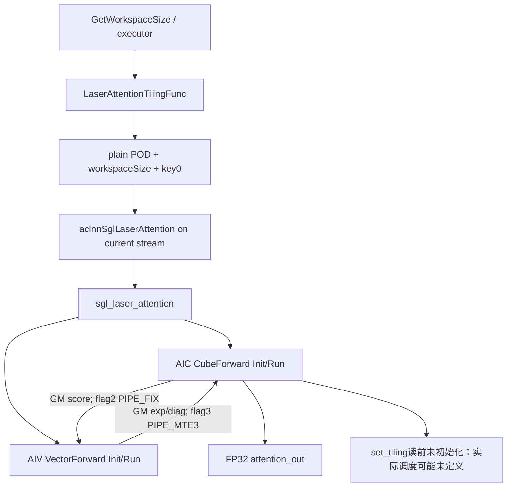
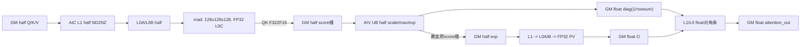
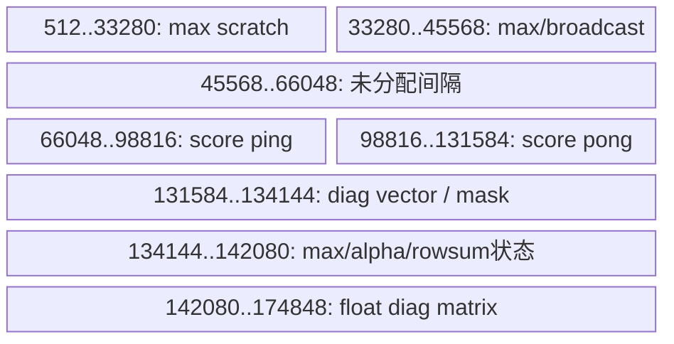
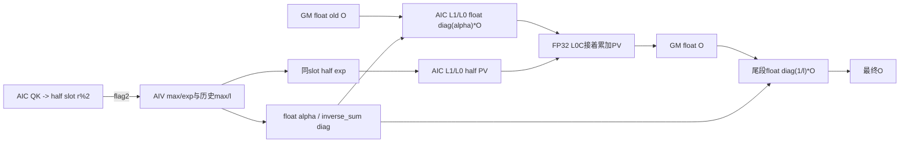
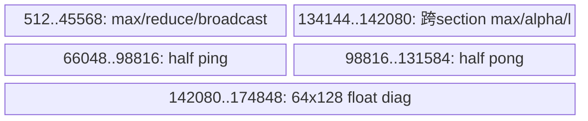

# LaserAttention A2/A3 ACLNN 算子知识

## 算子速览

| 项目 | 内容 |
|---|---|
| 实际入口 | 公开 ACLNN `aclnnSglLaserAttentionGetWorkspaceSize / aclnnSglLaserAttention`；Torch `npu::la` |
| 计算语义 | 默认窗口的稠密、非因果 `softmax(scale·QKᵀ)V`；源码实际经过 FP16 分数、FP16 指数与 FP32 输出，不能视为全流程 FP32 |
| 输入输出 | FP16 BNSD；Q=[B,Nq,S,128]，K/V=[B,Nkv,S,128]；S 为正的256倍数，Nq/Nkv为整数；输出FP32，另一个辅助输出未写入 |
| 执行类型 | 单一entry中的 MIX_CV：`__DAV_C220_CUBE__` 编译AIC body，`__DAV_C220_VEC__` 编译AIV body；AIV按subblock 0/1分担128行块 |
| Kernel 路线 | R-001：符号化Z=1；R-002：符号化Z≥2；初始化未定义行为是二者之前的真实边界 |
| 核心资源 | user workspace为8MiB·C加未消费的rowSum尾区；L1地址高水位512KiB、L0A/B各64KiB、L0C128KiB；AIV UB地址高水位174848B |
| 来源闭包 | `source_closed`：OpDef→生成ACLNN桥→Tiling/POD→单entry→Cube/Vector及两套寻址body均可追溯；该标签不证明实现正确或内存安全 |
| 静态缺陷 | `AddressMappingForwardOnline::set_tiling` 在赋值前读取未初始化的 `ky_ / blockNumPerCore_`。不能确定guard结果、Z、后续调度及完成状态。本卡保留draft，不构成可安全复用的实现保证 |
| 验证状态 | 已完成上述源码追溯；本次知识提取未执行编译、真机、数值或性能测试。 |

## 接口与语义

### 计算语义

对每个b、query head n，GQA取KV head `g=floor(n/(Nq/Nkv))`。默认 `pre_tokens=2147483647` 时，Host写 `windowLen=0`、`isTriangle=false`、`sparseMode=0`，目标运算为：

```text
X = scale_value * Q[b,n] @ K[b,g]^T
P = softmax(X, row)
O[b,n] = P @ V[b,g]
```

实际数据路径是FP16 Q/K进入Cube，FP32 L0C累加后用 `F322F16` 写回GM；AIV将scale转换成half后作缩放、最大值归约、减最大值、exp，指数仍以half写回原score槽；PV用half乘数、FP32累加。跨列分段时，保留最大值与rowsum，使用 `alpha=half(exp(m_prev-m_new))+2^-24`，rowsum以float累积；Cube通过float对角矩阵乘法修正已有O，尾段再乘 `diag(1/rowsum)`。这是源码的混合精度及带微小修正的online实现，不保证与理想实数公式完全相同。

非默认pre_tokens经Host原样转为windowLen，AIV在tail section额外以-60000改写末尾score块；它不是一个完整公开的滑窗注意力实现。`windowLen≥128` 覆盖最后一个128列块，`tailLen=(256-windowLen)%128` 非零时还使用反向mask覆盖前一块的一部分。负值、超过范围的值及负余数没有完整guard；只记录源码行为，不补造合法窗口域。mask/alibi/drop参数没有进入稠密算式。

### 输入、输出与属性

| 参数 | shape/layout | dtype | 约束、默认值与语义 |
|---|---|---|---|
| query | [B,Nq,S,D]，BNSD/ND | FP16 | 本卡仅覆盖公开FP16；文档D=128、S为256倍数，Host没有执行这些关键检查 |
| key | [B,Nkv,S,D] | FP16 | 与Q同设备；GQA要求正Nkv且Nq整除Nkv，源码只检查key head>0而未验证整除 |
| value | 与key相同 | FP16 | K/V轴长和head数须一致；Host仅分别读序列长 |
| atten_mask | 可选 | FP16 | adapter连续化并传入，公开稠密路径不应用它 |
| alibi_mask | 可选 | FP16 | 接口兼容占位，Device不消费 |
| drop_mask | 可选 | uint8 | 接口兼容占位，Device不消费；keep_prob应为1 |
| scale_value | scalar | float | Python默认1，Tiling float，Vector再转half |
| head_num | scalar | int | Python默认2，需等于Nq；OpDef为required，Tiling按int32读取 |
| input_layout | scalar | string | 公开支持BNSD；Tiling没有读取该属性来改变寻址 |
| keep_prob | scalar | float | 默认1；Tiling不写入共享POD中的对应字段，Device无dropout |
| pre_tokens | scalar | int | 默认2147483647映射windowLen=0；其他值产生上述tail覆盖 |
| next_tokens | scalar | int | 默认1；Tiling和Device均不消费它 |
| is_highPrecision | scalar | bool | POD记录；entry实际固定 `SetHighPrecision(true)`，不是动态精度路线 |
| softmax_log_max_sum | [B,Nq,S] | FP32 | adapter只分配，所有body未写入，内容未定义 |
| attention_out | 与Q相同 | FP32 | 由Cube最终输出；前述静态缺陷使成功完成和正确结果无法保证 |

接口层说明可参见[LaserAttention API](../../../../apis/sgl_kernel_npu/sgl_laser_attention.md)。

### 入口与版本

本卡固定同一40位提交，只分析 `aclnnSglLaserAttention*`。`csrc/attention/laser_attention` 是独立CANN框架版本，legacy `csrc/attentions/csrc/ops/laser_attention` 提供计算体的复用来源，不是另一个数学算子；native改变OpDef名称、共享plain POD和system/user workspace边界。

ACLNN声明、executor/inner bridge由 `sgl_generate_cann_interfaces` 的 `npu_op_code_gen` 根据OpDef生成；这些生成桥和CANN primitive内部作为明确的框架边界。算子自己的Host、调度、全部实际body不以框架边界跳过。CANN9.1.0来自固定README/CI范围，仅为提取版本证据，不表示本次运行过此SDK。公开说明仅支持arch22 FP16；OpDef中BF16列和Host key1属于已知声明/实现冲突，不并入本卡FP16覆盖。

## Host/Launcher 执行流程

### 参数校验与前处理

`torch_adapter.cpp::la` 顺序为：检查Q为4维和NPU张量→检查K/V及存在的可选mask同设备→DeviceGuard→所有输入连续化→分配两个FP32输出→从本扩展随包 `libcust_opapi.so` 解析两阶段ACLNN→创建ND描述符→查询workspace/executor→检查查询状态和workspace≤INT64_MAX→分配byte workspace→取得当前NPU stream并record_stream→RunOpApi调用执行入口。

`op_api_symbol` 用dladdr定位扩展，再以 `RTLD_NOW|RTLD_LOCAL` 加载随包库，库handle保留；缺符号/加载失败TORCH_CHECK。`tensor_descriptor` 使用tensor尺寸、stride、data_ptr和零storageOffset创建ACL tensor，shared_ptr析构销毁描述符。adapter保持连续工作张量与描述符至launch closure销毁。

Host `Tiling4LaserAttention` 检查context、输入数≥3、Q/K/V shape、scale/head_num/pre_tokens/highPrecision属性指针及key head>0，读Q第0/2/3维与各自S，写POD后调用DoTiling。外层 `LaserAttentionTilingFunc` 忽略这个调用的返回值，随后继续读取platform及POD、算workspace、复制POD、设key，最后才CheckTiling。CheckTiling仅拒绝B/head_num/S1/S2/Sv恰为0，以及 `sparseMode==1 && windowLen%256!=0`；本入口sparseMode恒0。不能把这些检查扩大为完整形状、溢出或资源验证。

### 参数、Workspace 与生命周期

记平台AIC数A，`Y=coreNumPerGroup`，`F=floor(A/Y)`，`C=F·Y`，实际launch block数 `H=(A==25?24:A)`。系统workspace为 `Wsys=GetLibApiWorkSpaceSize()`；entry先SetSysWorkspace，再GetUserWorkspace。Host总字节数：

```text
Wtotal = Wsys + C*128*128*32*2*4
              + C*256*128*8*2*4*2
              + B*Nq*S*4
       = Wsys + C*8MiB + B*Nq*S*4
user[0 : C*2MiB)                     : rowmax对角矩阵池，float
user[C*2MiB : C*4MiB)               : rowsum逆数对角矩阵池，float
user[C*4MiB : C*8MiB)               : score/exp池，half，2个轮次槽
user[C*8MiB : C*8MiB+B*Nq*S*4)      : Host预留rowSum尾区；此entry没有绑定消费者
```

输入输出、workspace由ATen拥有；record_stream使异步使用纳入分配器生命周期。closure捕获Tensor、描述符、layout字符串、executor与aclStream。executor创建与执行/释放细节处于生成ACLNN框架，不从仓内代码推断独立destroy接口或捕获完成时刻。直接ACLNN调用方必须按两阶段workspace/executor协议维持tensor/内存到stream完成。

### 启动图与失败传播



单entry没有第二个Host launch；Cube中QK、PV、对角乘不是独立Host kernels。API查询或执行非ACL_SUCCESS由TORCH_CHECK传播；没有参考实现重试。raw tiling容量不足、platform/input缺失由Host GRAPH_FAILED返回；但内部Tiling4返回值被忽略，部分失败可能继续走到后续判断。Device没有状态回传来报告寻址成员未初始化、非法shape或scratch越界；不得用ACL_SUCCESS解释这些问题已经排除。

## Route 与参数设计

### 分核与资源计算

DoTiling先取col_size=S2；仅当sparseMode==1才改为windowLen，本入口恒dense，因此：

```text
S2 <= 4096                    : Y=1
4096 < S2 <= 8192             : Y=2
8192 < S2 <= 16384            : Y=4
S2 > 16384 && A==20           : Y=4
S2 > 16384 && A!=20           : Y=8
F=floor(A/Y), C=Y*F; H=(A==25?24:A)
```

Cube固定 `address.set_tiling(C,core_id,64,2)`：每轮最多64个128×128基本块，ky=2、kx=32。Vector独立使用 `get_block_num()=H`、相同block_per_core=64、ky=2及subblockid。令 `R1=S1/128,R2=S2/128,L=B*Nq*R1`，**仅在初始化guard通过且各字段确实赋值时**：

```text
Zc = ceil( ceil(L/(2*C)) * 2*R2 / 64 )
Zv = ceil( ceil(L/(2*H)) * 2*R2 / 64 )
q(r,c).outer = floor(r*32/R2)*(C*2*R2)
q(r,c).inner = c*2*R2
q(r,c).col   = (r*32)%R2
start_block = outer+inner+col
```

AIC和AIV用各自C/H的同式寻址；C=H是两侧轮次数/地址一致的必要条件，代码没有检查。A==25且Y==1时C=25、H=24，正是未闭合为正确调度的静态风险。

每核末轮基本块数按该核总任务截断，保持ky=2；跨Q行、head、batch切section。GQA K/V地址为 `(b*Nkv+floor(n/(Nq/Nkv)))*S2*128 + ic*16384`，Q/O地址为 `(b*Nq+n)*S1*128 + ir*16384`。非256倍数Q长度不能由此形成完整两行块尾部，代码没有标量tail fallback。

### Route 选择

表中Z仅表示源码后续分支的符号条件。读取未初始化成员发生在分支选择之前；不能从合法shape推定一定进入任一正常路线。

| 顺序 | Route | Key/模板 | 精确选择条件与优先级 | 不适用去向 |
|---:|---|---|---|---|
| 1 | 初始化未定义行为边界 | key0；AddressMappingForwardOnline | 空CubeForward构造后，address.init未写ky_/blockNumPerCore_；set_tiling先读取二者 | guard读取未定义，是否return及Z均不能确定；没有安全fallback |
| 2 | R-001 单轮 | key0；CubeForward<half,false,half>、VectorForward<half,false,half> | 本卡A2/A3 FP16；初始化完成后的 `Zc==1`，AIV独立按Zv循环 | Zc!=1进R-002源码else；C/H不一致无纠正 |
| 3 | R-002 双轮预取 | 同上 | 初始化完成后的 `Zc!=1`；有效预期域为Zc≥2 | Zc≤0并非受支持empty路线；else仍执行两轮准备，不能声称安全no-op |

```text
公开arch22 + FP16
 -> adapter/query/Host或检查失败：返回错误
 -> CubeForward::Init
    -> address.init
    -> set_tiling读取未初始化ky_、blockNumPerCore_：未定义行为边界
    -> 若源码中后续赋值确已执行，则保留以下条件分析
       Zc==1 : R-001
       Zc!=1 : R-002的else代码；Zc<=0不具合法执行保证
AIV独立生成Zv；所有轮次都wait flag2并set flag3，即使该核无有效section
```

### 模板/实现执行矩阵

| Route | key/selector | dtype/shape/platform 完整命中条件 | 执行族与 kernel 节点 | 实际模板/body | 内存与同步特征 | tail/fallback |
|---|---|---|---|---|---|---|
| R-001 | key0、Zc==1 | A2/A3、Q/K/V FP16；公开BNSD、等S、D128、S%256=0；正head和整除GQA；并需面对前述初始化缺陷 | 单entry AIC_CUBE+AIV_VECTOR | CubeForward<half,false,half>::Run第一分支；VectorForward<half,false,half>::Run | 一个score轮次槽；flag2→AIV→flag3→PV/diag | 无任务核仍握手；S/D非法没有fallback |
| R-002 | key0、Zc!=1 | 同R-001的接口域；预期Zc≥2；不能忽略Zc≤0落else事实 | 同entry、同两族 | CubeForward::Run else，QK预取2轮、PV/QK穿插、排空2轮；同Vector body | 两个score/diag轮次槽，复用轮次差2；跨section保留max/sum并Cube修正旧O | 每核有效任务短于全局Z时跳计算但继续握手；未定义Z不等于可证明排空 |

Y的五个Host选择条件已逐项保留；它们只改变POD数值和C，未选择其它Device specialization。`windowLen==0` 和非零tail覆盖是同body内的属性分支，已在语义、伪码和同步边界中列出；不提升为新的正确滑窗算子承诺。

### 隐藏性能 Guard

| Guard | Host/Tiling 条件 | Device/资源原因 | 影响 Route | 不满足时去向 | 源码符号 |
|---|---|---|---|---|---|
| 128/256固定块 | Host未检查D128或S%256 | QK/PV的mad固定128³，寻址ky2 | 全部 | 可能错误地址/漏算；文档记载S<128握手死锁，无fallback | cube1_base_matmul、set_tiling |
| scheduler初始化 | 没有合法producer先赋两个被guard读取的成员 | set_tiling先读this->ky_/blockNumPerCore_ | 全部 | 未定义行为，不预测取值 | AddressMappingForwardOnline::set_tiling |
| 核数一致 | C=Y*floor(A/Y)，H=(A==25?24:A)，无相等检查 | AIC用C、AIV用H，决定slot/round | 全部 | 两族可能地址/握手不一致；无fallback | CubeForward::Init、VectorForward::Init |
| section容量 | Host未检查 | forward_addr[MAX_SWITCH_TIME=8]；Vector FORWARD_SECTION_INFO各数组8项，nomask每段写2项 | 全部 | src_len>4时Vector有越界风险；不是已有运行失败结论 | forward_addrMapping_pre、addrMapping_nomask |
| Vector小批行 | Run推导rowPerTime后又固定为4 | 4*128*Kx<=16384，故Kx<=32；与64/ky2吻合 | 全部 | 不可把最初自适应rowPerTime当最终值 | VectorForward::Run |
| UB容量 | Host不查询/验证实际UB使用 | raw UB区间最高174848B，无TQue自动分配 | 全部 | 无显式资源fallback | allocate_ubuf_for_short_seq_attn_score |
| L1/L0容量 | Host不验证固定静态地址 | L1到512KiB、L0A/B64KiB、L0C128KiB | 全部 | 无容量回退，不能泛化到其它硬件 | CubeForward字段 |
| GQA/属性 | 仅keyDim>0与headNum!=0，不检查正值/整除/属性匹配 | nG、G、K/Vhead地址依赖整除 | 全部 | Init可能提前return后Run仍继续，或地址错误 | Tiling4LaserAttention、CubeForward::Init |
| 窗口 | sparseMode恒0，窗口256整除检查不会触发 | nonzero window会覆盖score尾部，负余数参与mask构造 | 全部 | 不保证与稠密/合法滑窗一致 | process_line_phase_one_for_short_seq_max |

### POD/ABI

`SglLaserAttentionTilingData` 全量以memcpy复制，Host/Device读取同一plain struct。固定源码没有static_assert或ABI实测；下表offset/size是按int32/float 4B对齐、bool 1B的常规C++布局推导：整体sizeof=80、alignof=4，非编译验证结果。不得把推导替代目标工具链ABI核对。共享POD之外的内部地址对象也有实际状态缺口，紧随其后列出。

| 结构 | 字段 | 类型/位宽 | ABI 布局 | 单位 | Host/launcher producer | Device consumer | 边界 |
|---|---|---|---|---|---|---|---|
| SglLaserAttentionTilingData | batchSize | int32/32 | offset0,size4 | batch | Tiling4：Q.dim0 | entry b→两侧address.init | shape int64窄化未检查 |
| 同上 | headNum | int32/32 | offset4,size4 | query head | Tiling4：head_num属性 | entry n→两侧寻址 | 未校验等于Q.dim1 |
| 同上 | seqSize | int32/32 | offset8,size4 | token | Tiling4：Q.dim2 | Host workspace rowSum尾区 | Device不用独立seqSize |
| 同上 | headDim | int32/32 | offset12,size4 | 元素 | Tiling4：Q.dim3 | entry d→CubeForward::Init | address.init实际传常量128 |
| 同上 | coreNumPerGroup | int32/32 | offset16,size4 | AIC/group | DoTiling按S2选择Y | entry y→Cube/Vector Init | Y必须非0；部分Init return后Run照常调用 |
| 同上 | coreGroupNum | int32/32 | offset20,size4 | group | DoTiling：floor(A/Y) | entry f、C=y*f | 与实际block数可能不等 |
| 同上 | qSeqLength | int32/32 | offset24,size4 | token | Tiling4：Q.dim2 | 两侧S1寻址 | CheckTiling仅拒0 |
| 同上 | kSeqLength | int32/32 | offset28,size4 | token | Tiling4：K.dim2 | 两侧S2寻址及Y选择 | 与V等长未验证 |
| 同上 | vSeqLength | int32/32 | offset32,size4 | token | Tiling4：V.dim2 | CheckTiling | Device未用该值改变V寻址 |
| 同上 | maskSeqLength | int32/32 | offset36,size4 | token | Tiling4恒0 | Vector Init、mask步幅 | qk_triangle恒false，稠密不读mask |
| 同上 | scale | float/32 | offset40,size4 | 无量纲 | Tiling4：scale_value | Vector SCALE→half vmuls | scale窄化为half |
| 同上 | keep_prob | float/32 | offset44,size4 | 概率占位 | tilingData{}初始化为0，无后续setter | 无 | 不代表执行dropout概率0 |
| 同上 | pre_tokens | int32/32 | offset48,size4 | token占位 | {}为0，无setter | 无 | 真正属性转换至windowLen |
| 同上 | next_tokens | int32/32 | offset52,size4 | token占位 | {}为0，无setter | 无 | 属性未被算法消费 |
| 同上 | isTriangle | bool/8 | offset56,size1，之后3B padding | 标志 | Tiling4恒false | entry→Cube/Vector qk_triangle | triangle body不可达 |
| 同上 | attenType | int32/32 | offset60,size4 | 枚举 | Q/Khead不同为1，否则0 | 无独立读取 | GQA由headGroupSize实现 |
| 同上 | sparseMode | int32/32 | offset64,size4 | 枚举 | Tiling4恒0 | DoTiling、Cube address | 不能把稀疏模板存在当可达 |
| 同上 | headGroupSize | int32/32 | offset68,size4 | queryhead/KVhead | Q.dim1==K.dim1为1，否则整数除法 | Cube nG，G=N/nG | 未验证余数/0 |
| 同上 | windowLen | int32/32 | offset72,size4 | token | pre_tokens==INT_MAX?0:pre_tokens | Vector tail覆盖；V_num=windowLen/128 | sparseMode仍0，不形成公开稀疏闭包 |
| 同上 | isHighPrecision | bool/8 | offset76,size1，尾padding3B | 标志 | Tiling4：对应属性 | entry未用其值控制实现 | entry固定SetHighPrecision(true) |
| AddressMappingForwardOnline | ky_ | int64/64 | 内部对象，无共享launch ABI；无sizeof断言 | 基本块行数 | set_tiling首次赋参数2，但在此之前已读取同成员 | guard、kx/round推导 | 读前未初始化；不能标默认0 |
| 同上 | blockNumPerCore_ | int64/64 | 同上 | 基本块/轮 | set_tiling首次赋参数64，同样晚于guard | guard、round/slot计算 | 读前未初始化 |
| 同上 | totalRounds_ | int64/64 | 同上 | 轮 | 仅set_tiling通过guard后的公式 | CubeForward::Run中的Z | guard提前return时无确定producer |
| ForWardAddrOnline | b | int32/32 | 普通局部scratch；未编译测布局 | batch索引 | forward_addrMapping_pre由start_block除法 | rectangular映射 | 局部数组容量8 |
| 同上 | n | int32/32 | 同上 | head索引 | start_block在batch内除法 | Q及GQA K/V地址 | 下游head数须正 |
| 同上 | iR | int32/32 | 同上 | Q块行 | outer_row/core_id映射及跨head修正 | Q/O起始位置 | 每行块128token |
| 同上 | iC | int32/32 | 同上 | KV块列 | (round*32)%R2 | K/V起始位置、head/tail section | R2非0 |
| 同上 | kx | int32/32 | 同上 | KV块数 | remain/ky，再按行边界切分 | QK/PV循环 | 有效≤32 |
| 同上 | ky | int32/32 | 同上 | Q块数 | 参数2 | 两个128行块 | 无奇数块fallback |
| 同上 | k | int32/32 | 同上 | 基本块数 | kx*ky | remain减少/slot推进 | 数组溢出未检查 |

`ForWardAddrOnline` 是内部scratch，不是另一个Host POD。`PhyAddrForwardCube1Online / PhyAddrForwardCube2Online` 每段包含left/right/out三GM指针、kx/ky/k/lineStride、lowerLeft/upperRight/onStartSection/onEndSection；上述rectangular映射逐项赋值，后三个标志分别false、false、ic==0、ic+Kx>=R2-1。它们在同一个Device调用栈传递，不跨Host ABI。Vector `FORWARD_SECTION_INFO` 的sectionBlockNums/sectionBlockOffset/rowmaxOffset/diagOffset/isHeadSection/isTailSection均8项，nomask按2i与2i+1写入；processLineNum=64、maskNum=0、sparseFlag/isTriangle=false、attentionScoreOffset=(r%2)*H*64*16384。未使用的通用字段不据此声称有消费者。

### Route 源码闭包

| Route | Key/selector | Host/Tiling producer | POD/参数 | Kernel entry/router | Kernel body/直接依赖 | 构建接线 |
|---|---|---|---|---|---|---|
| R-001 | key0、Zc==1 | LaserAttentionTilingFunc、Tiling4、DoTiling | SglLaserAttentionTilingData及静态64/2 | sgl_laser_attention | CubeForward、VectorForward、两个AddressMapping头、matmul_const/address_const | 独立laser_attention CMake→sgl_cann_tiling、sgl_cann_kernels，arch2201 |
| R-002 | key0、Zc!=1 | 同上；没有独立新Host producer | 同POD、2个round槽 | 同entry | CubeForward::Run else及相同计算helper；Vector逐轮消费 | 同上；没有其它kernel补齐非法路线 |

## Kernel 实现

### 公共执行流程

entry读取POD，剥离系统workspace后划分rowmax_diag、rowsum_diag、score。AIC构造 `CubeForward<half,false,half>`；AIV构造 `VectorForward<half,false,half>`，统一使用上述矩阵地址布局。Cube编译分支直接调用低层 `copy_gm_to_cbuf_multi_nd2nz_b16 / load_cbuf_to_ca / load_cbuf_to_cb / mad / copy_matrix_cc_to_gm`，没有调用通用Matmul模板；实际specialization就是128³ half/float矩阵体及float对角乘，不能套用其它Matmul的tile或scheduler说明。

Cube address.init只写B/N/S/D/GQA和triangle/sparse/window，未写ky_/blockNumPerCore_。空构造后的set_tiling先读它们，因此以下两条Route均只是**在源码继续执行并完成初始化时的条件化分析**。本卡没有将未确定的Device运行轨迹伪装为必然调度，也没有补写缺失赋值。

### Route R-001：单轮握手与输出

#### 适用条件

##### 选择证据

| 层级 | 文件 | 符号 | 源码谓词/参数 | 结果/下一跳 |
|---|---|---|---|---|
| API | docs/api/en/operators/attention/laser_attention.md | ascendc backend | arch22、FP16、D128、S%256==0 | 本卡接口范围，非运行验证 |
| Host | op_host/laser_attention_tiling.cpp | DoTiling | 按S2得到Y/F，key0 | POD、C、H |
| 初始化 | op_kernel/AddressMappingForwardOnline.h | set_tiling | 先读未初始化成员；若继续才写64/2和Zc | 未定义行为边界 |
| AIC | op_kernel/CubeForward.h | Run | Zc==1 | QK→flag2→wait3→PV/对角乘 |
| AIV | op_kernel/VectorForward.h | Run | r<Zv；无任务则sectionNum=0 | 每轮wait2/set3仍执行 |

#### Device 数据流

##### 函数级调用链

```text
sgl_laser_attention
  AIC -> CubeForward<half,false,half>::Init -> address.init -> set_tiling
      -> Run -> PresetFlag
      -> addrMapping_cube1 -> forward_addrMapping_pre -> rectangular_cube1
      -> cube1_matmul_op -> cube1_base_matmul -> mad -> F322F16到GM
      -> flag2(PIPE_FIX) -> wait3
      -> addrMapping_cube2 -> rectangular_cube2
      -> cube2_matmul_op -> 128^3 PV
      -> onEndSection: diag_matmul -> matmul_fp32 -> FP32 O
      -> ClearFlag
  AIV -> VectorForward<half,false,half>::Init -> address.start
      -> Run -> wait2 -> get_section_info/nomask
      -> attention_score_short_double_line_one
      -> max -> exp -> process_calc_sum
      -> 尾段form_diagmat(1/rowsum) -> set3(PIPE_MTE3)
```

##### 源码等价伪码

```text
伪码；不是对未定义初始化的修复，也不保证实际到达：
AIC先PresetFlag(MTE1->MTE2 ids0..3, M->MTE1 ids0..3)
if Zc==1:
  若本核is_running(0): 求各段QK，FP32 L0C->half score slot0
  set flag2 via PIPE_FIX; wait flag3
  若本核is_running(0):
    各段PV；onStartSection置L0C初值0
    onEndSection时：从GM读float O，左乘float逆rowsum对角矩阵，写回O
AIV每轮:
  wait flag2；无任务仅跳section，仍set flag3
  每个section拆成每次4行，GM->UB搬Kx个128列块
  scale转half后vmuls
  if tail && windowLen!=0: 按源码覆盖尾部score，不保证公开稠密语义
  将尾列padding为-65504求max、padding为0求sum
  half score减max、exp，half指数覆盖回同GM score槽
  half rowsum -> float；尾段构造float diag(1/rowsum)写GM
  PIPE_MTE3 set flag3
AIC最终ClearFlag等待释放8个管线token
```

#### 内存与数据搬运

##### 资源与搬运表

| 层级/缓冲区 | offset/地址公式 | extent/容量公式 | dtype/layout | producer | consumer | owner/lifetime | 对齐/复用 |
|---|---|---|---|---|---|---|---|
| GM Q/K/V | Q按[b,n,ir]，KV按[b,g,ic]，每块16384元素 | 各输入shape*2B | half ND | 调用方 | Cube QK/PV | 调用方/ATen直到stream完成 | D128，拷贝ND2NZ |
| GM score槽 | user+4MiB*C+2*((r%2)*C*64+c*64+段内块偏移)*16384 | 每核每槽2MiB，双槽合4MiB*C | half，128²块序 | Cube QK | AIV max/exp、Cube PV | workspace；该轮握手周期 | 同slot由分数原地变exp |
| GM max对角池 | user+4*(c*2*16384*8*2+(p*8+i)*2*16384+v*8192) | 每核每轮/段2个128²float；池2MiB*C | float ND对角 | AIV form_diagmat | Cube diag_matmul | workspace | p=r%2；单轮头段不读旧O修正 |
| GM sum对角池 | 在上式前加2MiB*C | 池2MiB*C | float diag(1/l) | AIV尾段 | Cube尾段 | workspace | 两个AIV各写64行 |
| L1 Q/P ping,pong | 0、64KiB | 各64KiB | half NZ | MTE2 ND2NZ | MTE1→L0A | AIC局部 | QK/PV串行共享 |
| L1 K/V ping,pong | 128、192KiB | 各64KiB槽；单次有效32KiB | half NZ | MTE2 | MTE1→L0B | AIC局部 | 与Q/P各自ping-pong |
| L1 float diag/O | 256/320/384/448KiB | 各64KiB | float NZ | matmul_fp32 MTE2 | float L0A/B | AIC局部 | 阶段分离，最高512KiB |
| L0A | 0/32KiB | half双缓冲64KiB；float阶段同地址64KiB | half/float fractal | load_cbuf_to_ca | mad | AIC局部 | MTE1/M token保护 |
| L0B | 0/32KiB | 同上64KiB | half/float fractal | load_cbuf_to_cb及transpose | mad | AIC局部 | PV的V转置搬运，QK K不转置load |
| L0C | 0/64KiB | 2*128²*4=128KiB | float | mad | Fixpipe/后续PV累加 | AIC局部 | 两个Q块行分别占槽 |
| UB score | 66048+ping*32768 | 2*32768=65536B | half，4行×≤32块 | GM→MTE2 | Vector | AIV局部轮次 | PIPE_MTE3/MTE2防提前覆盖 |
| UB归约/diag | 见下方逐区字节账 | 地址高水位174848B | half/float | Vector/Scalar | Vector与MTE3 | AIV局部 | 直接指针，无TQue自动生命周期 |
| 寄存器/局部scratch | ForWardAddrOnline[8]、src[16]、section数组[8] | 源码数组界，不推断寄存器物理字节 | 指针/整数/标志 | 寻址函数 | Cube/Vector body | Device调用栈 | 容量缺少Hostguard；不是安全边界 |

score地址中的2表示half字节数；对角公式中的4表示float字节数。i是address预处理后的段索引，v为AIV subblock0/1。不同typed指针的元素偏移必须分别乘其dtype字节，不能混算。

##### 分层内存布局





##### 字节账、交接边与复用顺序

```text
Wsys = 平台GetLibApiWorkSpaceSize；本次未测值
Wuser = 2MiB*C(maxdiag)+2MiB*C(sumdiag)+4MiB*C(score双槽)+4*B*Nq*S
L1_high_water = 512KiB
L0A = 64KiB; L0B = 64KiB; L0C = 128KiB

UB raw区间（起点,字节数）：
cacl_rowmax                  (512,32768)
vbrcb_rowmax                 (33280,2048)
final_rowmax                 (35328,4096)
record_rowmax_float          (39424,4096)
cur_vbrcb_float              (43520,2048)
score_pingpong              (66048,65536)
diag_vector_float           (131584,512)
tri_mask_pingpong            (132096,2048)  # dense不读mask，地址仍保留
maxJ_half                    (134144,512)
lastMaxJ_half                (134656,4096)
exp_delta_half               (138752,512)
exp_delta_float              (139264,1024)
lJ_half                      (140288,256)
lJ_float                     (140544,512)
lastLJ                       (141056,1024) # 声明float指针，按源码字节增量列示
diag_matrix_float            (142080,32768)
UB_high_water = 174848B，含512B前缀和内部间隔；
Host未检查 UB_high_water <= 平台UB，因此不声称该不等式已经成立。
allocate_ubuf_for_norm另描述512..140800区间，但Run不使用这些norm缓冲，
与score阶段地址重叠，不能再累加成一份实际同时分配。
```

| 边/复用子区 | producer | offset/extent | dtype/layout | consumer | ordering/sync | owner/lifetime | 安全条件 |
|---|---|---|---|---|---|---|---|
| QK→AIV | cube1_base_matmul | score.slot0、段k*16384half | half块序 | max/exp | PIPE_FIX ffts_cross_core_sync mode2 flag2；AIV wait_flag_dev(2) | 单workspace轮次 | 不能用CPU launch顺序替代此信号 |
| AIV→PV | exp_and_rowsum | 相同score.slot0被覆盖 | half exp | cube2_matmul_op | AIV PIPE_MTE3 flag3，AIC wait_flag_dev(3) | 同槽 | AIC完成读取前不得覆盖 |
| inverse sum→最终O | form_diagmat | 每段两个128²float，AIV各64行 | float ND diag | diag_matmul | 与exp一起在flag3前MTE3完成 | workspace | 未确定的初始化/轮次数不会被该协议修复 |
| L1 ping-pong | MTE2装Q/K/P/V | 0/64/128/192KiB槽 | half NZ | MTE1/M | MTE1↔MTE2 ids0..3；M↔MTE1 ids0..3 | AIC | 等token才复用槽 |
| L0C→GM | mad/Fixpipe | 两个64KiB L0C槽 | float或F322F16 | GM消费者 | UnitFlagMode3，PIPE_FIX跨核边 | AIC局部→GM | FP16 QK有显式舍入，不保全FP32分数 |

#### 同步、精度与尾块

##### 同步与数值边界表

| 阶段 | primitive/机制 | producer | consumer/等待点 | 保护对象 | 精度/尾块 |
|---|---|---|---|---|---|
| L1输入 | copy_gm_to_cbuf_multi_nd2nz_b16 | GM Q/K | MTE2→MTE1 ids | Q/K双缓冲 | Q一次256×128half，K128×128half |
| QK | mad + copy_matrix_cc_to_gm F322F16 | FP32 L0C | AIV wait2 | score slot | 固定128³，无Dtail |
| UB载入 | copy_gm_to_ubuf、MTE2→V id0/1 | score GM | vmuls/max | 每次4行score | nBurst=Kx，burst_len=128*4/16=32个32B块；srcStride=(16384-512)/16=992 |
| softmax | vmax/vcmax→vsub→vexp→vcadd | half score | half exp、half sum | row scratch | padding max=-65504/sum=0，rowPerTime强制4 |
| 写回exp | V→MTE3、MTE3→MTE2 id0/1 | Vector | 下次UB加载、Cube wait3 | score双缓冲 | 写回同GM块序，目标stride992 |
| 归一化 | vconv_f162f32、vdiv、form_diagmat | half rowsum | Cube float mad | rowsum对角矩阵 | inverse float；对角矩阵由两AIV各64行构造 |
| 无任务尾核 | is_running=false | 跳计算 | 仍两侧握手 | 全局轮次 | 不是Host empty kernel；实际Z未定时不保证匹配 |
| 输出辅助tensor | 无写入primitive | N/A | 调用方 | softmax_log_max_sum | 值未定义，不可作LSE使用 |

#### 关键实现

##### 符号证据表

| 阶段 | 文件 | 符号/模板实例 | 实现事实 |
|---|---|---|---|
| Host/Tiling producer | op_host/laser_attention_tiling.cpp | DoTiling、LaserAttentionTilingFunc | Y/C/H、workspace、key0 |
| Kernel entry/router | op_kernel/laser_attention.cpp | sgl_laser_attention | 半精度两个编译族、用户workspace边界 |
| Device body/helper | op_kernel/CubeForward.h | Run Z==1、cube1_base_matmul、cube2_matmul_op、matmul_fp32 | 一次QK/softmax/PV协议及float归一化 |
| Device body/helper | op_kernel/VectorForward.h | attention_score_short_double_line_one、form_diagmat | 每AIV64行、4行微块及对角矩阵 |
| Device body/helper | op_kernel/AddressMappingForwardOnline.h | set_tiling、rectangular_cube1/2 | 未初始化guard、Q/K/V/O和slot地址 |
| Device body/helper | op_kernel/AddressMappingVectorForwardOnline.h | addrMapping_nomask | 每个Cube段展开两个Vector section |

### Route R-002：双轮预取与跨段状态更新

#### 适用条件

##### 选择证据

| 层级 | 文件 | 符号 | 源码谓词/参数 | 结果/下一跳 |
|---|---|---|---|---|
| Host | op_host/laser_attention_tiling.cpp | DoTiling | 与R-001相同Y选择 | 不是额外Host kernel |
| 初始化 | op_kernel/AddressMappingForwardOnline.h | set_tiling | 同一读前未初始化边界 | 不能由shape保证Z |
| AIC | op_kernel/CubeForward.h | Run else | Zc!=1，预期域Zc≥2 | 预取0/1轮、主循环2..Z-1、排空2轮 |
| AIV | op_kernel/VectorForward.h | Run | r<Zv；非head section | 保留max/lJ并生成alpha diag |

#### Device 数据流

##### 函数级调用链

```text
同一个sgl_laser_attention entry
  AIC Run:
    QK(round0), 发flag2；QK(round1)
    对r=2..Z-1: wait3 -> 发flag2 -> PV(r-2) -> QK(r)
    排空r=Z-2,Z-1；ClearFlag
  AIV每r:
    wait2 -> section score/max/exp
    若不是head：max=max(old,new)，alpha=half(exp(old-new))+2^-24
    half指数覆盖score；updateRowsum(float alpha*old_l+new_l)
    若非tail：backupMaxandSum；若tail：生成inverse_sum diag
    非head时生成alpha diag；MTE3发flag3
  AIC PV:
    非head先diag_matmul(O,alpha,false)将修正旧O装入L0C
    当前exp*V以cmatrixInitVal=false累加到已有L0C
    尾section再diag_matmul(O,inverse_sum,true)写回最终O
```

##### 源码等价伪码

```text
伪码；前提是已越过未定义初始化边界且Zc>=2：
for r in [0,1]:
  若is_running(r): QK到slot(r%2)
  仅r==0时发flag2
for r=2..Zc-1:
  wait flag3; 发flag2
  若is_running(r-2): 消费exp/diag slot((r-2)%2)，PV并修正O
  若is_running(r): QK复用同奇偶slot(r%2)
排空两轮：
  wait flag3；仅第一排空轮再发flag2
  消费Zc-2和Zc-1的exp/diag

Vector每个64行section仍按4行微块计算：
  非head先合并old/new max，生成alpha half，并加2^-24
  以new max计算当前exp，写回GM
  new_l=float(half_reduce_sum(exp)) + float(alpha)*old_l
  非tail备份max/l，供下一个同Q行section
  非head按16行一步生成float alpha对角矩阵
  tail生成64行inverse_sum对角矩阵
两AIV各处理128行中的64行；同flag协议保护双轮槽。
```

`Zc≤0` 也满足源码else，却仍进入两轮准备及按Z-2/Z-1寻址的排空逻辑；该分支不能解释为空输入安全路径。正常非零shape及正确初始化可以推导正Z，但该推导不能覆盖未初始化对象。

#### 内存与数据搬运

##### 资源与搬运表

| 层级/缓冲区 | offset/地址公式 | extent/容量公式 | dtype/layout | producer | consumer | owner/lifetime | 对齐/复用 |
|---|---|---|---|---|---|---|---|
| GM score双轮槽 | user+4MiB*C + half_bytes*((r%2)*C*64+c*64+段内块)*16384 | 4MiB*C | half score→half exp | QK/AIV | AIV/PV | workspace全launch | 与R-001同物理布局，但r与r+2复用 |
| GM alpha diag | user + float_bytes*(c*524288+(p*8+i)*32768+v*8192) | maxdiag池2MiB*C | float 128²ND | AIV非head form_diagmat | AIC diag_matmul(copy_out=false) | 当前round，2个奇偶槽 | AIV写完且AIC消费后才覆盖 |
| GM inverse diag | alpha池地址+2MiB*C | sumdiag池2MiB*C | float | AIV tail | AIC最终归一化 | tail section | 非tail不读inverse |
| GM O | [b,n,ir*128:ir*128+256,128] | 2*128²*4B/段 | float ND | PV/diag_matmul | 后续同Q行的diag/PV | 输出tensor | onStartSection初始L0C清0；后续装旧O，无额外原子实现 |
| L1 Q/P与K/V | 0/64/128/192KiB | 256KiB地址跨度 | half NZ | MTE2 | MTE1/M | AIC局部 | QK/PV阶段重用 |
| L1 alpha/O | 256/320/384/448KiB | 256KiB地址跨度 | float NZ | matmul_fp32加载 | L0A/B | AIC局部 | 与half区不重叠 |
| L0A/B | 各0..64KiB | half ping-pong或float整矩阵 | half/float | MTE1 | mad | AIC局部 | PIPE_MTE1/M及event7保护阶段切换 |
| L0C | 0/64KiB | 128KiB | float | alpha*oldO、PV | Fixpipe | AIC局部 | 两Q行分别持有累加结果 |
| UB score/归约 | R-001列明的全部区间 | 同高水位174848B | half/float | AIV | AIV/MTE3 | AIV局部 | 不因双轮增加另一整份UB |
| UB历史状态 | lastMaxJ@134656、lastLJ@141056、alpha@138752/139264 | 4096/1024/512/1024B | half max/alpha，float lJ | backupMaxandSum/updateRowsum | 非head section | 对应Q行section链 | 用sectionLoop%2选择历史子区 |
| 寄存器/局部scratch | 同R-001 src/section数组 | 同容量边界 | 指针/整数 | 寻址 | 主循环/排空 | Device局部 | section超界无guard |

##### 分层内存布局





##### 字节账、交接边与复用顺序

```text
Wtotal = Wsys + 8MiB*C + 4*B*Nq*S
Wmaxdiag/Wsumdiag = 各2MiB*C，含2轮*8段*2个128²float/core
Wscore = 2轮*64个128²half/core*C = 4MiB*C
L1_high_water=512KiB；L0A/B=各64KiB；L0C=128KiB
UB_high_water=174848B，逐区与R-001相同；不重复计算同一raw地址
不存在Host验证的UB_total<=可用UB不等式，也无workspace乘法溢出检查。
```

| 边/复用子区 | producer | offset/extent | dtype/layout | consumer | ordering/sync | owner/lifetime | 安全条件 |
|---|---|---|---|---|---|---|---|
| score r→r+2 | QK(r)→AIV(r) | score[r%2] | half score/exp | PV(r)后QK(r+2) | 主循环先wait3、PV(r)、再QK(r+2)；内部PIPE_M/FIX token | workspace同奇偶槽 | 仅在正确Z及两侧寻址一致时构成预期防覆盖协议 |
| alpha→旧O修正 | form_diagmat | maxdiag[p,i]，每Q块128²float | float | matmul_fp32(copy_out=false) | AIV PIPE_MTE3 flag3；AIC wait3，diag_matmul额外PIPE_M/PIPE_FIX→MTE2 event7 | 单轮diag | 不能绕过float对角搬运而把旧O当已自动缩放 |
| L0C修正→PV | matmul_fp32 | 两L0C槽 | float accumulator | PV的mad(cmatrixInitVal=false) | M↔MTE1 event7及各ping-pong事件 | 同段 | onStartSection才使用初始清零 |
| 历史rowsum | backupMaxandSum | lastLJ及lastMaxJ子区 | float/half | updateRowsum/非head max | PIPE_V barrier及V↔S事件 | 相邻同Q行section | head/tail标志来自地址映射，非全局第一个/最后一个round |
| inverse→最终输出 | form_diagmat inverse | sumdiag[p,i] | float | 尾段diag_matmul(copy_out=true) | 同flag3+event7 | tail section | 无写辅助LSE的额外步骤 |

#### 同步、精度与尾块

##### 同步与数值边界表

| 阶段 | primitive/机制 | producer | consumer/等待点 | 保护对象 | 精度/尾块 |
|---|---|---|---|---|---|
| 两轮预取 | 首轮PIPE_FIX flag2，第二轮不立即再次发flag2 | AIC QK0/QK1 | AIV按轮wait2 | score奇偶槽 | 第二个ready信号在主循环或排空前发送 |
| 主循环 | wait3→发2→PV(r-2)→QK(r) | AIC/AIV | 对方wait_flag_dev | 两轮workspace | 不能把r与r-2视为独立无依赖 |
| alpha | half vsub/vexp/vadds(2^-24)再转float | AIV max状态 | Cube float diag乘 | 旧O归一化基准 | 不是精确实数alpha；微小修正可改变结果 |
| rowsum | half归约→float alpha*old_l+new_l | AIV | inverse diag | lJ历史状态 | half归约损失不会被FP32输出恢复 |
| float diag | GM→L1 b32→L0A/L0B→mad | alpha/inverse/O | L0C/PV/Fixpipe | 对角矩阵/旧O | 不声明未显式配置的HF32/IEEE精度模式 |
| 排空 | 两次wait3；仅第一次再发2 | AIC最后两轮 | AIV最后轮 | 未完成score/PV | Zc≤0不是有效排空条件 |
| 尾段 | 地址切分后Kx为有效块数、padding到归约用2幂 | 两侧映射 | Vector/Cube | 每核有效task | 128块内S/D尾部不支持；section数组界必须另核对 |

#### 关键实现

##### 符号证据表

| 阶段 | 文件 | 符号/模板实例 | 实现事实 |
|---|---|---|---|
| Host/Tiling producer | op_host/laser_attention_tiling.cpp | DoTiling | Y不改变固定128³ body |
| Kernel entry/router | op_kernel/laser_attention.cpp | CubeForward<half,false,half>、VectorForward<half,false,half> | 固定FP16实例；无BF16兜底 |
| Device body/helper | op_kernel/CubeForward.h | Run else、cube2_matmul_op、diag_matmul、matmul_fp32 | 双轮流水线、旧O缩放和尾段归一化 |
| Device body/helper | op_kernel/VectorForward.h | process_line_phase_one_for_short_seq_max、updateRowsum、backupMaxandSum | online max/sum和alpha修正 |
| Device body/helper | op_kernel/AddressMappingForwardOnline.h | rectangular_cube1/2 | r%2槽、GQA、head/tail |
| Device body/helper | op_kernel/AddressMappingVectorForwardOnline.h | addrMapping_nomask | 两AIV相应半行块及diagOffset |

## 算子特定优化

### Trick T-001：双轮score槽穿插QK与PV

#### 触发与源码依据

- 适用 Route：R-002。
- 触发条件：初始化继续执行并得到Zc≥2；同一entry、固定64块/轮、ky2；两族轮次数和slot映射须一致。
- Golden 来源：[CubeForward::Run连续主循环](https://github.com/sgl-project/sgl-kernel-npu/blob/dda6d36b0cdb4081e102d14c0a2fb276fc416e69/csrc/attention/laser_attention/op_kernel/CubeForward.h#L667-L690)。

**官方源码（固定 Commit 连续逐字摘录）**：

```cpp
            if (is_syn) {
                wait_flag_dev(AIV2AICFLAGID);
                mode = 2;  // inner-group aic/aiv sync
                sync_config = 1 | (mode << 4) | (AIC2AIVFLAGID << 8);
                ffts_cross_core_sync(PIPE_FIX, sync_config);
            }

            if (address.is_running(roundId - 2)) {
                Address::PhyAddrForwardCube2Online<WORKSPACE_TYPE, TYPE, float> src[16];
                int64_t src_len = 0;
                address.addrMapping_cube2(gm_S, gm_V, gm_O, src, src_len, roundId - 2);
                cube2_matmul_op(src, src_len, 1, roundId - 2);
            }

            if (address.is_running(roundId)) {
                Address::PhyAddrForwardCube1Online<TYPE, TYPE, WORKSPACE_TYPE> src[16];
                int64_t src_len = 0;
                address.addrMapping_cube1(gm_Q, gm_K, gm_S, src, src_len, roundId);
                cube1_matmul_op(src, src_len);
            }
        }

        /**** (cube2 + cube3) * 2 ****/
        for (int64_t roundId = 0; roundId < 2; roundId++) {
```

#### 机制与设计原因

主循环用r-2消费exp槽，再复用相同r%2槽生产新QK，GM只保存两轮score而不物化完整S×S分数；AIC→AIV依赖使用PIPE_FIX flag2，AIV→AIC使用PIPE_MTE3 flag3。64个128²half为单槽每核2MiB，奇偶索引由两个寻址模块生成。代码结构表达了重叠意图，未测吞吐收益。

#### 迁移边界

- 适用：同样能按两轮奇偶槽组织的QK/softmax/PV任务图。
- 前提：先修复或验证初始化问题，并独立核对C/H、section上界、两个ready信号与排空。
- 失效：Zc==1走R-001；未定义Z和Zc≤0不能套用此流水线保证。
- 未验证：本次知识提取未执行编译、真机、数值或性能测试。

#### 错误做法

把r%2相同解释为可提前覆盖会漏掉PV(r-2)依赖；固定源码实际将PV放在QK(r)之前。不能把该次序存在进一步解释为所有输入已经内存安全。

### Trick T-002：用float对角乘复用Cube完成online缩放和最终除法

#### 触发与源码依据

- 适用 Route：R-001尾段、R-002非head及尾段。
- 触发条件：源码地址映射给出 `onStartSection=false` 或 `onEndSection=true`；FP16乘数/FP32 O，D128和ky2。
- Golden 来源：[PV尾段对角归一化](https://github.com/sgl-project/sgl-kernel-npu/blob/dda6d36b0cdb4081e102d14c0a2fb276fc416e69/csrc/attention/laser_attention/op_kernel/CubeForward.h#L343-L347)。

**官方源码（固定 Commit 连续逐字摘录）**：

```cpp
        }
        if (src[idx].onEndSection) {
            diag_matmul(src[idx].out, curr_rowsum, src[idx].ky, true);
        }
        last_idx = src_len - 1;
```

#### 机制与设计原因

AIV将每行alpha或inverse_sum放到float128×128对角矩阵，AIC的 `diag_matmul` 按两Q块行调用128³ float `matmul_fp32`。非head先把 `diag(alpha)·oldO` 留在L0C，随后half PV用不清零累加；尾段再将 `diag(1/l)·O` 写回GM。这替代独立Vector输出归一化kernel，但引入对角GM池、float L1/L0工作量；不能无依据声称比其它实现更快。

#### 迁移边界

- 适用：固定128维输出、Cube可执行所用float矩阵primitive的同类online注意力。
- 前提：两AIV写满所消费64行子区、MTE3完成后Cube读取、L1/L0固定地址容量成立。
- 失效：D不同、ky不同、非对角scratch未初始化或head/tail标志错误，不能直接沿用。
- 未验证：本次知识提取未执行编译、真机、数值或性能测试。

#### 错误做法

将 `copy_out=false` 当成“不计算”会丢掉旧O的L0C预置；固定body仍执行mad，仅不将此阶段单独写回GM。

### Trick T-003：FP32累加与FP16中间物化的明确取舍

#### 触发与源码依据

- 适用 Route：R-001、R-002。
- 触发条件：唯一实际实例 `CubeForward<half,false,half>`；QK每个128³ tile。
- Golden 来源：[QK写回类型参数](https://github.com/sgl-project/sgl-kernel-npu/blob/dda6d36b0cdb4081e102d14c0a2fb276fc416e69/csrc/attention/laser_attention/op_kernel/CubeForward.h#L585-L602)。

**官方源码（固定 Commit 连续逐字摘录）**：

```cpp

            auto out_offset = (m_offset / 128) * out_put_matrix_line_strid + n_offset;
            auto trans_dtype = IF_BF16 ? F322BF16 : F322F16;
            if (!l0_skip_flag) {
                copy_matrix_cc_to_gm(gm_out + out_offset,  // m_offset * n_ + n_offset
                                     l0_c,
                                     0,        // sid
                                     n0_,      // NSize  结果矩阵的列
                                     m0_,      // MSize  结果矩阵的行
                                     n_,       // dstStride_dst_D  结果大矩阵的列
                                     m0_,      // srcStride
                                     3,        // UnitFlagMode
                                     F322F16,  // QuantPRE  F322F16
                                     0,        // ReLUPRE
                                     false,    // channelSplit
                                     true      // NZ2ND_EN
                );
            }
```

#### 机制与设计原因

QK的L0C为float，写GM时显式F322F16；Vector和PV都读取half workspace，最终PV/对角乘输出float。这样score槽按2B而非4B元素配置，但整个softmax精度受half缩放/exp/归约限制。不能照文档概述把该路径改写成Q/K/V全程转FP32。

#### 迁移边界

- 适用：允许相同混合精度误差和原始块布局的分析或复用。
- 前提：保留F322F16、Vector half、FP16_SMALL_NUM以及最终float累加的准确位置。
- 失效：要求全FP32 softmax或不同误差界时，不能以float输出类型充当证明。
- 未验证：本次知识提取未执行编译、真机、数值或性能测试。

#### 错误做法

“FP32输出意味着全流程FP32”与连续源码中的F322F16冲突；这条反例由固定源码直接支持。

## 模板与实现对比

| 对比维度 | R-001 单轮 | R-002 双轮预取 | 设计选择依据 |
|---|---|---|---|
| 命中条件/优先级 | Zc==1 | Zc!=1，预期Zc≥2 | 都在有缺陷的set_tiling之后 |
| 执行族/节点图 | 单entry AIC/AIV | 同entry AIC/AIV | 不是多个Host kernel |
| M/N/K、tile 与 scheduler | 固定128³、64块/轮、ky2 | 相同tile，预取2轮并流水消费 | CubeForward::Run两分支 |
| workspace/L1/L0/UB | Host仍分配双槽；单轮实际用slot0 | 两slot交替 | 每核8MiB user主池；L1/L0/UB同上 |
| AIC/AIV 或 kernel 交接 | 发2→wait3→PV | 预取0/1，主循环wait3→发2→PV→QK，尾排空 | 源码显式ffts flag |
| 同步、精度与 tail | half score/exp、float输出 | 同时保留alpha/max/l历史 | 非head/尾段float对角乘 |
| fallback/失败边界 | 无非法shape fallback | Zc≤0也落else但不安全 | 未定义初始化、C/H、数组上界均未被修复 |

## 平台差异

| 项目 | A2 | A3 | Ascend 950 |
|---|---|---|---|
| 支持状态 | 公开arch22原生FP16；本卡draft含缺陷 | 同左 | 公开原生不支持，不纳入本卡 |
| Host/Launcher | arch2201映射ascend910b | arch2201映射ascend910_93 | 没有该native target |
| Kernel/资源 | 共同C220 Cube/Vector源；Y依AIC数/S2 | 同源，无额外安全保证 | 不从参考torch_native支持推导native覆盖 |

## 限制与失败边界

- `source_closed` 只表示源码角色、参数和body可追溯。`ky_/blockNumPerCore_` 读前未初始化意味着实际执行存在C++未定义行为；本卡不预测其数值、是否提前return、是否一定死锁或输出何值。
- 完整源码不等于正确实现：Host忽略Tiling4失败，未完整检查正维、属性/shape匹配、GQA整除、S/D固定块、scratch section容量、C/H一致、UB/L1/L0容量和workspace溢出。
- `softmax_log_max_sum` 完全未写入。其未定义内容独立于调度bug，不得当LSE或正确性观测值。
- mask/alibi/drop是接口占位；默认窗口才对应公开稠密语义。非默认windowLen的末尾score覆盖不构成已验证滑窗实现。
- BF16的OpDef/Host key1与唯一half Kernel不匹配，公开文档已经说明启动失败；本卡明确只覆盖FP16，不以新增模板修复来源。
- 部分CompileInfo资源字段、norm UB描述、triangle/sparse寻址、BF16模板分支存在于通用源但未由本FP16稠密入口形成活动路线；不把其存在当执行证据。
- 生成ACLNN/executor和CANN intrinsic内部是框架边界；算子实际选择的float/half、tile、workspace、同步和错误终点已在本文展开。
- 本次知识提取未执行编译、真机、数值或性能测试；没有verified事件，也没有安全复用、性能收益或数值正确性结论。

## 源码索引

### 链路索引

下面每行仅对应一个固定文件；路径均相对固定源码仓。各文件已列于Frontmatter sources。

| 链路阶段 | 文件 | 关键符号 | 支撑内容 |
|---|---|---|---|
| 入口声明/约束 | docs/api/en/operators/attention/laser_attention.md | Hardware support、ascendc backend | FP16、S/D硬边界、未写辅助输出 |
| 入口实现 | csrc/attention/laser_attention/torch_adapter.cpp | la | 两阶段ACLNN、连续化、stream及owner |
| 框架适配 | csrc/aclnn_torch_adapter/aclnn_runtime.h | op_api_symbol、tensor_descriptor | 随包库解析、描述符生命周期 |
| OpDef | csrc/attention/laser_attention/op_host/laser_attention_def.cpp | SglLaserAttention | 生成ACLNN接口及参数顺序 |
| 输出推导 | csrc/attention/laser_attention/op_host/laser_attention_infer.cpp | LaserAttentionInferShape/InferDtype | 两FP32输出shape |
| Host/Tiling | csrc/attention/laser_attention/op_host/laser_attention_tiling.cpp | Tiling4、DoTiling、LaserAttentionTilingFunc | 字段producer、Y、workspace、key、失败检查 |
| POD | csrc/attention/laser_attention/op_kernel/laser_attention_tiling_data.h | SglLaserAttentionTilingData | 全字段plain布局 |
| Kernel entry | csrc/attention/laser_attention/op_kernel/laser_attention.cpp | sgl_laser_attention | 两编译族和用户workspace基址 |
| AIC body | csrc/attention/laser_attention/op_kernel/CubeForward.h | CubeForward、cube1/2、diag_matmul | L1/L0、mad、双轮流水线 |
| AIV body | csrc/attention/laser_attention/op_kernel/VectorForward.h | VectorForward、max/exp/sum、form_diagmat | raw UB、精度、事件、对角生成 |
| AIC地址 | csrc/attention/laser_attention/op_kernel/AddressMappingForwardOnline.h | init、set_tiling、rectangular_cube1/2 | 初始化缺陷、slot/shape映射 |
| AIV地址 | csrc/attention/laser_attention/op_kernel/AddressMappingVectorForwardOnline.h | start、addrMapping_nomask | 独立轮次、两个section/段 |
| 常量/局部状态 | csrc/attention/laser_attention/op_kernel/address_const.h | ForWardAddrOnline、FORWARD_SECTION_INFO | 数组上界及内部字段 |
| 计算常量 | csrc/attention/laser_attention/op_kernel/matmul_const.h | flag IDs、128/64/8常量 | 事件、tile、轮次scratch常量 |
| 算子构建接线 | csrc/attention/laser_attention/CMakeLists.txt | sgl_register_operator | 唯一native源、2201、手动同步选项 |
| 构建入口 | csrc/CMakeLists.txt | CODEGEN/TILING/KERNEL stages | 生成接口→tiling→kernel的接线 |
| 生成/构建实现 | csrc/cmake/cann_ops.cmake | sgl_generate_cann_interfaces、sgl_add_cann_kernels | SDK生成ACLNN及单源kernel映射 |
| 平台映射 | csrc/cmake/architectures.json | 2201 | 两个计算单元 |
| 版本证据 | README.md | CANN and CI coverage | 9.1.0范围，不表示本次执行 |
| 平台公开说明 | python/sgl_kernel_npu/README.md | arch-version mapping | arch22映射A2/A3 |
| CI版本证据 | .github/workflows/pr-test-kernels.yml | cann_version | 固定9.1.0矩阵 |

### 实现复用检查

| 检查项 | 可复用事实 | 不得改变的约束 | 源码符号 |
|---|---|---|---|
| ABI/POD | 同plain POD由Host memcpy、Device读取 | 字段顺序/位宽/对齐；80B是静态布局推导，未编译实测 | SglLaserAttentionTilingData |
| 调用顺序 | 单entry两编译族、QK→AIV→PV/diag | 初始化缺陷必须保留为风险，不能在分析中偷偷补赋值 | Init、set_tiling、Run |
| workspace/内存 | score奇偶槽、max/sum对角池及静态L1/L0/UB | dtype字节、2轮、8段、64块、ky2及owner；没有自动容量证明 | Init/addrMapping、allocate_ubuf |
| 同步 | PIPE_FIX flag2、PIPE_MTE3 flag3、局部管线token | 无任务核仍握手、主循环先消费旧槽再产新槽、正确排空 | Run、PresetFlag/ClearFlag |
| 精度与尾块 | FP32 QK累加→FP16物化→FP16 exp→FP32 PV/diag | F322F16和alpha的2^-24修正；D128、S%256；辅助tensor不写 | cube1_base_matmul、Vector helpers |
| 失败边界 | API/Tiling错误与Device静态缺陷不同 | 不以ACL_SUCCESS或源码闭包标签代替安全/数值验证 | adapter TORCH_CHECK、CheckTiling |
