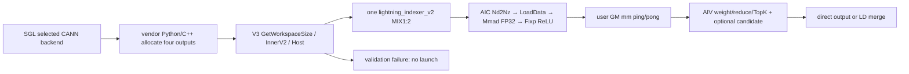
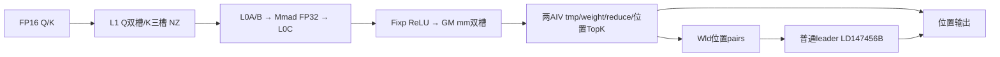
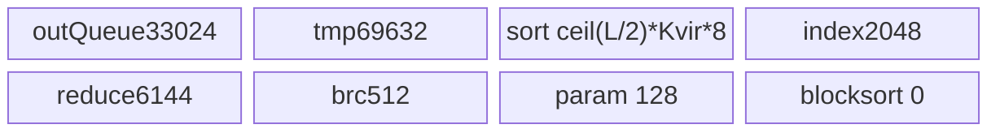
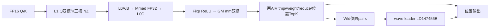
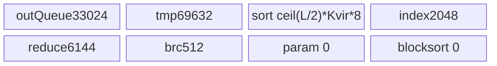
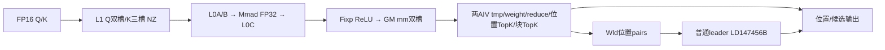
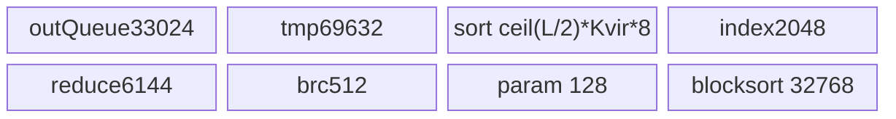
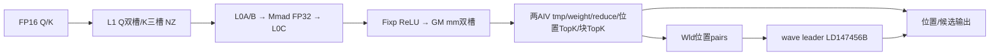
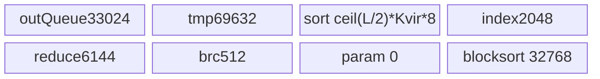

# LightningIndexer V3 候选块源 A3 ACLNN 算子知识

## 算子速览

| 项目 | 内容 |
|---|---|
| 实际入口 | aclnnLightningIndexerV3GetWorkspaceSize / aclnnLightningIndexerV3；公开V3，内部仍为LightningIndexerV2 |
| 计算语义 | FP32累加QK，Fixp ReLU后乘FP32头权重并求和，位置TopK；可选并行块amax/强制最新块/块TopK |
| 输入输出 | Q/K同FP16或BF16、D128，Q头G1..64、K一头；BSND/BSND、TND/TND或Q两布局/PA；位置int32、可选FP32分数、可选int32块号，length恒空 |
| 执行类型 | 单lightning_indexer_v2，MIX_CV、KERNEL_TYPE_MIX_AIC_1_2；AIC_CUBE Mmad/Fixp → GM双缓冲 → 两AIV_VECTOR归约排序；零任务只有AIV清理 |
| Kernel 路线 | R-001..R-048逐8个dtype/layout key×6种候选/TopK/调度选择；R-049零有效任务。各路线内部保留行尾、波次分片和直接写/LD写分支 |
| 核心资源 | L1=327680B、L0A/B各65536B、L0C=131072B/AIC；UB主阶段最高177024B/AIV，LD重置阶段147456B；Host Wlib+3147776×物理AIC核数 |
| 来源闭包 | source_closed：固定SGL→厂商Python/C++→V3/InnerV2→Host/POD→arch22 Cube/Vector/helper/build；SDK9.2 primitive及框架生成桥边界明确 |
| 静态限制 | BatchInvariant可能对候选source做S2分片，但LD仅写位置结果，某些行的块输出未提交；普通零任务TND off清理量为0；分页stride0与可选cuK求值风险。draft不表示可安全直接复用 |
| 验证状态 | 已完成源码闭包检查；本次知识提取未执行编译、真机、数值或性能测试。 |

## 接口与语义

### 计算语义

令压缩后Key位置为j，Q有效行i、头h，D=128、G=N1/N2=N1、N2=1。基础分数
s(i,j)=Σ[h=0..G−1] w(i,h)×ReLU(Σ[d=0..127] q(i,h,d)×k(j,0,d))。
Cube以B16输入、FP32 L0C累加，Fixp启用reluPre=1，再在AIV按16头分组乘w、跨组累加并树形归约，不能把ReLU移到加权求和之后。w可为负值。位置选择按分数降序，非有效位置为(−inf,−1)，values仅rv=1时提交；相等分数、NaN、±inf的排序/数学行为依固定SDK primitive，不额外保证稳定同分顺序或任意非有限输入等价性。

r=cmpRatio。Key有效原始长度Korig=(压缩长度×r)+residual，mask0每行可见压缩长度floor(Korig/r)；mask3第i行可见长度floor((Korig−Qvalid+i+1)/r)。负/零可见域按实际清理分支处理。候选块宽s∈{2,4,8,16,32,64}，块j覆盖压缩位置[js,(j+1)s)。对每行先取块内amax，尾块无效位置−inf，最新可见位置所在块分数注入+inf，再选C个块号；不足C补−1。块号是batch内相对块号，无output offset，消费按集合，不依赖槽位顺序。可见块数≤C时无需分数，直接输出[0,nblocks)+−1补齐。位置与块的累加器独立，候选输出不替代位置TopK；但下述BatchInvariant分片缺口阻止宣称该预期合同在所有可达参数上均被实现。

### 输入、输出与属性

| 参数 | shape/layout | dtype | 约束、默认值与语义 |
|---|---|---|---|
| q | [B,Sq,G,128] BSND / [Tq,G,128] TND | FP16/BF16 | 同device、连续、物理非空、G1..64 |
| k | [B,Sk,1,128] / [Tk,1,128] / [P,page,1,128] PA_BBND | 同q | 非PA与Q同名；PA page16..1024且16倍数，仅0轴可非连续。A3实际Cube地址未消费keyStride0，见限制 |
| w | q.shape去掉末维 | FP32 | 连续、同device，位置头权重 |
| cuSeqlensQ | int32 [B+1] | int32 | TND必须，差分得Qvalid；BSND可选，以元素b+1直接作为该batch长度，非差分 |
| cuSeqlensK / sequsedK | [B+1] / [B] | int32 | TND用前缀差；PA必须usedK+blockTable；BSND可选usedK，cuK被拒。长度、前缀及索引值合法性是调用方合同 |
| cmpResidualK | [B] | int32 | r≠1且mask3时必须；值0≤residual<r；其它组合Host要求不提供，SGL仅显式检查必要性 |
| blockTable | [B,maxPages] | int32 | PA必须；页号/长度覆盖必须落在真实K storage，Host不读回值证明 |
| metadata | None或numel2048 | int32 | Dense A3 Host接受并检查numel；arch22不消费内容，无需为本路线启动metadata AICPU。不能移用Sparse强制None合同 |
| sequsedQ / outputIdxOffset / maxSeqlenQ | None / None / −1 | — | SGL A3入口拒绝其它值；本卡不声称这些公开形参在A3生效 |
| topk | 标量K | int64 API，Host/POD有窄化 | off：1..2048及3072/4096/5120/6144/7168/8192；on≤2048 |
| maskMode / cmpRatio / returnValue | 标量 | int64 API | mask0/3；SGL r为1..128的2次幂，vendor Host仅1..128；rv0/1，默认0 |
| candidateTopkBlocks / candidateBlockSize | C / s | int64 API→int32/u32 POD | C=−1关闭或64..2048的64倍数；s2..64的2次幂，off也校验s；SGL None走旧V2、显式−1走V3 |
| sparseIndices | [B,Sq,1,K] / [Tq,1,K] | int32 | 新分配，预期无效−1，实际零任务/分片边界见限制 |
| sparseValues | rv1与indices同shape，rv0 [0] | FP32 | 预期无效−inf，rv0不能据空占位读值 |
| candidateBlockIndices | on [B,Sq,1,C]/[Tq,1,C]；off [0] | int32 | on必须真实输出Tensor；off nullptr由V3 holder占位。未初始化empty不是−1初始化 |
| candidateBlockLength | 恒[0] | int32 | 预留，Device不绑定、不消费、不写；可nullptr占位 |

### 入口与版本

本卡冻结SGL dda6、其cann-9.2.0 profile精确固定ops-transformer e7da、version.cmake=9.2.0，以及官方asc-devkit a63d9.2源码；不是将common的9.1沿用到此项，也不保证其它同版本二进制与该树逐字一致。公开V3产品表支持A2/A3、明确950不支持；本卡仅A3。SGL auto/cann_ops_transformers_cann920只注册ARCH22、运行时检查CANN字符串9.2.0，显式torch_native属于另一实现，不进入该选定后端闭包。

SGL lightning_indexer_v2 名称不决定ACLNN版本：candidate_topk_blocks=None→厂商default→LightningIndexer→aclnnLightningIndexerV2，两返回；任意非None含−1→candidate overload→LightningIndexerCandidateMode→本V3 pair，四返回。V2兼容层固定C=−1/s=8、创建两个空int32描述符，V3转发实际属性及候选输出；都调用同aclnnInnerLightningIndexerV2，kernel名称仍lightning_indexer_v2。V3是本平台最新公开候选扩展，未把V2旧签名改名。接入合同复用[已有API](../../../../apis/sgl_kernel_npu/sgl_lightning_indexer_v2_candidates.md)，消费者实现见[独立SparseLI卡](sgl_sparse_lightning_indexer.md)。

## Host/Launcher 执行流程

### 参数校验与前处理

SGL validate_lightning_indexer_inputs先检查rank、Q/K同B16、W FP32、D128、K一头、G1..64、非空、同device、Q/W连续、PA例外stride、topk集合、mask/r/rv、保留形参、TND前缀存在和分页必要参数。候选非None另查C/s与topk≤2048；可选索引/metadata dtype/device及压缩因果residual必要性随后检查，不读回设备值。registry按选定实现加载隔离vendor，失败抛异常，不自动转torch_native。

厂商Python overload/JIT builder→C++：拒q/k空、各shape维≤0、非法rv/C/s；按Q布局和K头构造四输出（empty、无初始化），字符串持有到同步GetWorkspaceSize调用返回。ACLNN_CMD选当前NPU stream，创建ACL描述符，先WS再执行，任一步失败通过TORCH_CHECK传播。ApplyDeterministicConfig按框架确定性配置设executor；Host GetDeterministicLevel()==3写batchInvariant=1，否则0。未声称默认运行一定为3，也不能忽略该可达分支。

V3手写WS函数依次检查q/k/w/indices/values/workspaceSize/executor非空，以及C≠−1时candidate indices非空；记录的日志错误码与实际return ge::GRAPH_FAILED必须区别，不能将公开文档错误码表当逐分支返回值证明。可选空候选描述符由holder创建，WS转发InnerV2；holder在该函数返回时销毁其自建descriptor，dummy addr来自构造函数局部标量、shape0不应发生数据访问。描述符复制/执行器持有协议属于生成框架边界，不能将局部标量当真实候选GM。

A3 TilingForLightningIndexerV2→LIV2InfoParser::ParseAndCheck，按顺序GetOpName/GetNpuInfo/GetOpParaInfo/required、dtype/layout/optional、rank/N1/N2/G、B/S1/D/S2、shape match/CheckKeyContiguous、GenerateInfo，再DoTiling。GetNpuInfo查C/V非零、platform/raw tiling；G≤64、D128/N2=1；非PA Q/K同名，PA必要blockTable/usedK、TND必要cuQ/cuK；KBSND禁止cuK，非PA禁止blockTable，residual只在r≠1/mask3接收。metadata非空须numel2048。A3不进入arch35 checker/metadata快核；编译存在不等于可达。

### 参数、Workspace 与生命周期

以物理平台C=AIC、V=AIV，N=CalcTschBlockDim(V,C,V)，同SDK实作转CalcTschNumBlocks；其有效正常MIX比例V=2C时N=C，异常输入返回/计算可能不同，Host未在返回后补N>0 guard。Device GetBlockNum()为N；AIC id=i，AscendC::GetBlockIdx AIV=2i+subblock，因此aiCoreIdx=AIVid/2。勿把raw get_block_idx与扁平化GetBlockIdx混淆。

Host申请单片workspace：
```text
W_host = Wlib + C*(2*512*512*4 + 2*8*2*8192*4 + 2*8*16*8)
       = Wlib + C*3147776 bytes
SDK DAV_2201 Wlib = 16*1024*1024 bytes。
entry GetUserWorkspace(raw) = KFC系统base + RESERVED_WORKSPACE（SDK常量16MiB）。
这两个16MiB来自不同API/常量；不能仅因相等把Host额外申请量与系统可写容量混为一物。
L = on?4:(K>2048?floor(8192/K)*2:8); A=align16(L*G)
Wmm  = N*2*A*512*4
Wld  = N*L*2*2*2048*4
Wpar = N*L*2*16*8
user slices: mm@0, ld@Wmm, param@Wmm+Wld; Device实际extent=Wmm+Wld+Wpar。
```
Wld Device仍按2048，不按Host8192reserve；on/L变小也不改变Host固定上界。上述覆盖需N≤C、G≤64、L≤8、算术无溢出/字段窄化、系统保留base合同成立；不要把Host总量直接当任意N都足够。mm每AIC私有两slot，AIV同组共享；ld/param每AIC按L行、头尾、value/index或16×int64参数。metadata不占核心计算workspace。输入、output、workspace、executor和stream必须保持到实际设备消费完成；C++ at::Tensor输出持有内存，宏在命令回调内分配byte workspace、运行后释放描述符/临时参数，异步保活依torch_npu allocator/OpCommand框架，不证明调用返回时设备已完成。裸ACLNN调用方自行持有workspace/executor及所有Tensor到stream完成。

### 启动图与失败传播



entry参数顺序q,k,w,cuQ,cuK,usedQ,usedK,residual,table,offset,metadata,indices,values,candidate indices,candidate length,workspace,tiling。GET_TILING_DATA/GET_TILING_DATA_MEMBER及模板key解析是生成边界；A3编译默认arch22。KERNEL_TASK_TYPE_DEFAULT KERNEL_TYPE_MIX_AIC_1_2，仅一个核心数值launch，无先行metadata算子、无独立Torch数学。unknown dtype/layout/key不进入正式实例；Host拒绝路径返回GRAPH_FAILED，无其它计算fallback。blockDim=N、scheduleMode=1。执行状态从InnerV2返回给V3，再宏检查；设备中的静态缺陷不等于Host已经返回错误，也没有源码保证自动回滚输出。

## Route 与参数设计

### 分核与资源计算

定义K=topk、Cblk=candidateTopkBlocks、s=candidateBlockSize、L/A同上、Kvir=K>2048?K:2048。每query组L行，M=L×G≤512；S2 tile512、D128，actual列n≤512，GM mm stride=align32(n)个FP32元素，**不是align32字节**。AIC每tile再切K-L1的256列、L0的128×128×128；两个Query-L1 slot，每个256×128×B16；三个Key-L1 slot同尺寸。Q组M>256时两段Q-L1分别装入；其后S2复用两个slot。L0双槽A/B各128×128×B16，C各128×128×FP32。

普通分核：TotalTasks逐batch/Query组计数；off且K≤2048按实际S2 tile数，candidate source或K>2048按每完整Q组1任务。mask3先按右因果组末可见长度求tile数。每核Task数按商余均衡，used=min(N,T)，SplitCore记录b/q/S2 inclusive起止。小K允许一组横跨核，首段S2Start0且未到行尾者为LD leader；其它两模式noS2Split故整组归一核。有效任务数0直接R-049；无任务核不进ProcessMain，但仍有公共初始化/普通ProcessDecode AIV收尾。

BatchInvariant：跳过普通SplitCore，所有N核用同LogicalTaskCursor扫描正Q/K Query组，BuildNextTaskWave只装完整task partition组。对nS2≤8或K>2048，p=1；其它 p=min(max(1,N/ceil(Qvalid/L)), max(1,nS2/4))。每task按商余连续分S2，partition0为leader，累计coreStart不超过N；wave.hasMerge在任何p>1时全wave置true。**p选择未检查candidate source**。普通noS2Split约束不能外推此分支。每task首S2重置Cube slot编号和Vector TopK状态，mm1ResLoop跨wave连续，避免重置局部loop后错误覆盖GM ping/pong。无任务wave进入R-049，非空波次完成后另ProcessZeroLengthOutput。

UB逐InitBuffer（全部32B倍数，按实际深度1计）：
```text
outQueue  = max(2048*2*2*4, 256+16*512*4) = 33024 B，单slot，阶段互斥复用
tmp       = (16*512+512)*2*4 = 69632 B，两34816B CopyIn ping/pong
index     = 512*4 = 2048 B
reduce    = 512*3*4 = 6144 B
broadcast = 16*8*4 = 512 B
sort      = ceil(L/2)*Kvir*2*4
param     = batchInvariant?0:16*8 = 128 B
blocksort = candidate on?ceil(4/2)*2048*2*4:0 = on?32768:0
UB_main   = 111360 + sort + param + blocksort
off small / on ordinary = 177024 B；同BatchInvariant = 176896 B。
off K=3072/4096/5120/6144/7168/8192普通分别160640/177024/152448/160640/168832/177024 B；
BI分别减128 B。
UB_LD = 2*2048*4*4 + 2*2048*4*4 + 2048*4 + 2048*4 = 147456 B，Reset后重建，非相加。
L1 = Q(2*256*128*2)+K(3*256*128*2)=327680 B
L0A=L0B=2*128*128*2=65536 B；L0C=2*128*128*4=131072 B
```
Host没有按上述UB/L1/L0需求比较平台容量或缩tile回退；容量是复用必要条件，不是实测满足。寄存器保存scalar loop/offset/排序参数，无固定byte容量由源码可得；本路线无SIMT/dynamicUB/NDDMA/通信，均N/A。

### Route 选择

| 顺序 | Route | Key/模板 | 精确选择条件与优先级 | 不适用去向 |
|---:|---|---|---|---|
| 1 | R-001 FP16 BSND/BSND off、小TopK、普通分核 | (1,1,3,0,0,0,0) | A3共同合同、该dtype/layout、candidateTopkBlocks=-1、topk≤2048、batchInvariant=0、正有效任务 | 同key其它POD模式；零任务R-049；非法Host拒绝 |
| 2 | R-002 FP16 BSND/BSND off、小TopK、BatchInvariant波次 | (1,1,3,0,0,0,0) | A3共同合同、该dtype/layout、candidateTopkBlocks=-1、topk≤2048、batchInvariant=1、正有效任务 | 同key其它POD模式；零任务R-049；非法Host拒绝 |
| 3 | R-003 FP16 BSND/BSND off、大TopK、普通整行分核 | (1,1,3,0,0,0,0) | A3共同合同、该dtype/layout、candidateTopkBlocks=-1、topk∈{3072,4096,5120,6144,7168,8192}、batchInvariant=0、正有效任务 | 同key其它POD模式；零任务R-049；非法Host拒绝 |
| 4 | R-004 FP16 BSND/BSND off、大TopK、BatchInvariant整行波次 | (1,1,3,0,0,0,0) | A3共同合同、该dtype/layout、candidateTopkBlocks=-1、topk∈{3072,4096,5120,6144,7168,8192}、batchInvariant=1、正有效任务 | 同key其它POD模式；零任务R-049；非法Host拒绝 |
| 5 | R-005 FP16 BSND/BSND 候选source、普通整行分核 | (1,1,3,0,0,0,0) | A3共同合同、该dtype/layout、candidateTopkBlocks∈{64,128,…,2048}、topk≤2048、batchInvariant=0、正有效任务 | 同key其它POD模式；零任务R-049；非法Host拒绝 |
| 6 | R-006 FP16 BSND/BSND 候选source、BatchInvariant波次 | (1,1,3,0,0,0,0) | A3共同合同、该dtype/layout、candidateTopkBlocks∈{64,128,…,2048}、topk≤2048、batchInvariant=1、正有效任务 | 同key其它POD模式；零任务R-049；非法Host拒绝 |
| 7 | R-007 FP16 TND/TND off、小TopK、普通分核 | (1,1,3,0,1,1,0) | A3共同合同、该dtype/layout、candidateTopkBlocks=-1、topk≤2048、batchInvariant=0、正有效任务 | 同key其它POD模式；零任务R-049；非法Host拒绝 |
| 8 | R-008 FP16 TND/TND off、小TopK、BatchInvariant波次 | (1,1,3,0,1,1,0) | A3共同合同、该dtype/layout、candidateTopkBlocks=-1、topk≤2048、batchInvariant=1、正有效任务 | 同key其它POD模式；零任务R-049；非法Host拒绝 |
| 9 | R-009 FP16 TND/TND off、大TopK、普通整行分核 | (1,1,3,0,1,1,0) | A3共同合同、该dtype/layout、candidateTopkBlocks=-1、topk∈{3072,4096,5120,6144,7168,8192}、batchInvariant=0、正有效任务 | 同key其它POD模式；零任务R-049；非法Host拒绝 |
| 10 | R-010 FP16 TND/TND off、大TopK、BatchInvariant整行波次 | (1,1,3,0,1,1,0) | A3共同合同、该dtype/layout、candidateTopkBlocks=-1、topk∈{3072,4096,5120,6144,7168,8192}、batchInvariant=1、正有效任务 | 同key其它POD模式；零任务R-049；非法Host拒绝 |
| 11 | R-011 FP16 TND/TND 候选source、普通整行分核 | (1,1,3,0,1,1,0) | A3共同合同、该dtype/layout、candidateTopkBlocks∈{64,128,…,2048}、topk≤2048、batchInvariant=0、正有效任务 | 同key其它POD模式；零任务R-049；非法Host拒绝 |
| 12 | R-012 FP16 TND/TND 候选source、BatchInvariant波次 | (1,1,3,0,1,1,0) | A3共同合同、该dtype/layout、candidateTopkBlocks∈{64,128,…,2048}、topk≤2048、batchInvariant=1、正有效任务 | 同key其它POD模式；零任务R-049；非法Host拒绝 |
| 13 | R-013 FP16 BSND/PA_BBND off、小TopK、普通分核 | (1,1,3,1,0,2,0) | A3共同合同、该dtype/layout、candidateTopkBlocks=-1、topk≤2048、batchInvariant=0、正有效任务 | 同key其它POD模式；零任务R-049；非法Host拒绝 |
| 14 | R-014 FP16 BSND/PA_BBND off、小TopK、BatchInvariant波次 | (1,1,3,1,0,2,0) | A3共同合同、该dtype/layout、candidateTopkBlocks=-1、topk≤2048、batchInvariant=1、正有效任务 | 同key其它POD模式；零任务R-049；非法Host拒绝 |
| 15 | R-015 FP16 BSND/PA_BBND off、大TopK、普通整行分核 | (1,1,3,1,0,2,0) | A3共同合同、该dtype/layout、candidateTopkBlocks=-1、topk∈{3072,4096,5120,6144,7168,8192}、batchInvariant=0、正有效任务 | 同key其它POD模式；零任务R-049；非法Host拒绝 |
| 16 | R-016 FP16 BSND/PA_BBND off、大TopK、BatchInvariant整行波次 | (1,1,3,1,0,2,0) | A3共同合同、该dtype/layout、candidateTopkBlocks=-1、topk∈{3072,4096,5120,6144,7168,8192}、batchInvariant=1、正有效任务 | 同key其它POD模式；零任务R-049；非法Host拒绝 |
| 17 | R-017 FP16 BSND/PA_BBND 候选source、普通整行分核 | (1,1,3,1,0,2,0) | A3共同合同、该dtype/layout、candidateTopkBlocks∈{64,128,…,2048}、topk≤2048、batchInvariant=0、正有效任务 | 同key其它POD模式；零任务R-049；非法Host拒绝 |
| 18 | R-018 FP16 BSND/PA_BBND 候选source、BatchInvariant波次 | (1,1,3,1,0,2,0) | A3共同合同、该dtype/layout、candidateTopkBlocks∈{64,128,…,2048}、topk≤2048、batchInvariant=1、正有效任务 | 同key其它POD模式；零任务R-049；非法Host拒绝 |
| 19 | R-019 FP16 TND/PA_BBND off、小TopK、普通分核 | (1,1,3,1,1,2,0) | A3共同合同、该dtype/layout、candidateTopkBlocks=-1、topk≤2048、batchInvariant=0、正有效任务 | 同key其它POD模式；零任务R-049；非法Host拒绝 |
| 20 | R-020 FP16 TND/PA_BBND off、小TopK、BatchInvariant波次 | (1,1,3,1,1,2,0) | A3共同合同、该dtype/layout、candidateTopkBlocks=-1、topk≤2048、batchInvariant=1、正有效任务 | 同key其它POD模式；零任务R-049；非法Host拒绝 |
| 21 | R-021 FP16 TND/PA_BBND off、大TopK、普通整行分核 | (1,1,3,1,1,2,0) | A3共同合同、该dtype/layout、candidateTopkBlocks=-1、topk∈{3072,4096,5120,6144,7168,8192}、batchInvariant=0、正有效任务 | 同key其它POD模式；零任务R-049；非法Host拒绝 |
| 22 | R-022 FP16 TND/PA_BBND off、大TopK、BatchInvariant整行波次 | (1,1,3,1,1,2,0) | A3共同合同、该dtype/layout、candidateTopkBlocks=-1、topk∈{3072,4096,5120,6144,7168,8192}、batchInvariant=1、正有效任务 | 同key其它POD模式；零任务R-049；非法Host拒绝 |
| 23 | R-023 FP16 TND/PA_BBND 候选source、普通整行分核 | (1,1,3,1,1,2,0) | A3共同合同、该dtype/layout、candidateTopkBlocks∈{64,128,…,2048}、topk≤2048、batchInvariant=0、正有效任务 | 同key其它POD模式；零任务R-049；非法Host拒绝 |
| 24 | R-024 FP16 TND/PA_BBND 候选source、BatchInvariant波次 | (1,1,3,1,1,2,0) | A3共同合同、该dtype/layout、candidateTopkBlocks∈{64,128,…,2048}、topk≤2048、batchInvariant=1、正有效任务 | 同key其它POD模式；零任务R-049；非法Host拒绝 |
| 25 | R-025 BF16 BSND/BSND off、小TopK、普通分核 | (27,27,3,0,0,0,0) | A3共同合同、该dtype/layout、candidateTopkBlocks=-1、topk≤2048、batchInvariant=0、正有效任务 | 同key其它POD模式；零任务R-049；非法Host拒绝 |
| 26 | R-026 BF16 BSND/BSND off、小TopK、BatchInvariant波次 | (27,27,3,0,0,0,0) | A3共同合同、该dtype/layout、candidateTopkBlocks=-1、topk≤2048、batchInvariant=1、正有效任务 | 同key其它POD模式；零任务R-049；非法Host拒绝 |
| 27 | R-027 BF16 BSND/BSND off、大TopK、普通整行分核 | (27,27,3,0,0,0,0) | A3共同合同、该dtype/layout、candidateTopkBlocks=-1、topk∈{3072,4096,5120,6144,7168,8192}、batchInvariant=0、正有效任务 | 同key其它POD模式；零任务R-049；非法Host拒绝 |
| 28 | R-028 BF16 BSND/BSND off、大TopK、BatchInvariant整行波次 | (27,27,3,0,0,0,0) | A3共同合同、该dtype/layout、candidateTopkBlocks=-1、topk∈{3072,4096,5120,6144,7168,8192}、batchInvariant=1、正有效任务 | 同key其它POD模式；零任务R-049；非法Host拒绝 |
| 29 | R-029 BF16 BSND/BSND 候选source、普通整行分核 | (27,27,3,0,0,0,0) | A3共同合同、该dtype/layout、candidateTopkBlocks∈{64,128,…,2048}、topk≤2048、batchInvariant=0、正有效任务 | 同key其它POD模式；零任务R-049；非法Host拒绝 |
| 30 | R-030 BF16 BSND/BSND 候选source、BatchInvariant波次 | (27,27,3,0,0,0,0) | A3共同合同、该dtype/layout、candidateTopkBlocks∈{64,128,…,2048}、topk≤2048、batchInvariant=1、正有效任务 | 同key其它POD模式；零任务R-049；非法Host拒绝 |
| 31 | R-031 BF16 TND/TND off、小TopK、普通分核 | (27,27,3,0,1,1,0) | A3共同合同、该dtype/layout、candidateTopkBlocks=-1、topk≤2048、batchInvariant=0、正有效任务 | 同key其它POD模式；零任务R-049；非法Host拒绝 |
| 32 | R-032 BF16 TND/TND off、小TopK、BatchInvariant波次 | (27,27,3,0,1,1,0) | A3共同合同、该dtype/layout、candidateTopkBlocks=-1、topk≤2048、batchInvariant=1、正有效任务 | 同key其它POD模式；零任务R-049；非法Host拒绝 |
| 33 | R-033 BF16 TND/TND off、大TopK、普通整行分核 | (27,27,3,0,1,1,0) | A3共同合同、该dtype/layout、candidateTopkBlocks=-1、topk∈{3072,4096,5120,6144,7168,8192}、batchInvariant=0、正有效任务 | 同key其它POD模式；零任务R-049；非法Host拒绝 |
| 34 | R-034 BF16 TND/TND off、大TopK、BatchInvariant整行波次 | (27,27,3,0,1,1,0) | A3共同合同、该dtype/layout、candidateTopkBlocks=-1、topk∈{3072,4096,5120,6144,7168,8192}、batchInvariant=1、正有效任务 | 同key其它POD模式；零任务R-049；非法Host拒绝 |
| 35 | R-035 BF16 TND/TND 候选source、普通整行分核 | (27,27,3,0,1,1,0) | A3共同合同、该dtype/layout、candidateTopkBlocks∈{64,128,…,2048}、topk≤2048、batchInvariant=0、正有效任务 | 同key其它POD模式；零任务R-049；非法Host拒绝 |
| 36 | R-036 BF16 TND/TND 候选source、BatchInvariant波次 | (27,27,3,0,1,1,0) | A3共同合同、该dtype/layout、candidateTopkBlocks∈{64,128,…,2048}、topk≤2048、batchInvariant=1、正有效任务 | 同key其它POD模式；零任务R-049；非法Host拒绝 |
| 37 | R-037 BF16 BSND/PA_BBND off、小TopK、普通分核 | (27,27,3,1,0,2,0) | A3共同合同、该dtype/layout、candidateTopkBlocks=-1、topk≤2048、batchInvariant=0、正有效任务 | 同key其它POD模式；零任务R-049；非法Host拒绝 |
| 38 | R-038 BF16 BSND/PA_BBND off、小TopK、BatchInvariant波次 | (27,27,3,1,0,2,0) | A3共同合同、该dtype/layout、candidateTopkBlocks=-1、topk≤2048、batchInvariant=1、正有效任务 | 同key其它POD模式；零任务R-049；非法Host拒绝 |
| 39 | R-039 BF16 BSND/PA_BBND off、大TopK、普通整行分核 | (27,27,3,1,0,2,0) | A3共同合同、该dtype/layout、candidateTopkBlocks=-1、topk∈{3072,4096,5120,6144,7168,8192}、batchInvariant=0、正有效任务 | 同key其它POD模式；零任务R-049；非法Host拒绝 |
| 40 | R-040 BF16 BSND/PA_BBND off、大TopK、BatchInvariant整行波次 | (27,27,3,1,0,2,0) | A3共同合同、该dtype/layout、candidateTopkBlocks=-1、topk∈{3072,4096,5120,6144,7168,8192}、batchInvariant=1、正有效任务 | 同key其它POD模式；零任务R-049；非法Host拒绝 |
| 41 | R-041 BF16 BSND/PA_BBND 候选source、普通整行分核 | (27,27,3,1,0,2,0) | A3共同合同、该dtype/layout、candidateTopkBlocks∈{64,128,…,2048}、topk≤2048、batchInvariant=0、正有效任务 | 同key其它POD模式；零任务R-049；非法Host拒绝 |
| 42 | R-042 BF16 BSND/PA_BBND 候选source、BatchInvariant波次 | (27,27,3,1,0,2,0) | A3共同合同、该dtype/layout、candidateTopkBlocks∈{64,128,…,2048}、topk≤2048、batchInvariant=1、正有效任务 | 同key其它POD模式；零任务R-049；非法Host拒绝 |
| 43 | R-043 BF16 TND/PA_BBND off、小TopK、普通分核 | (27,27,3,1,1,2,0) | A3共同合同、该dtype/layout、candidateTopkBlocks=-1、topk≤2048、batchInvariant=0、正有效任务 | 同key其它POD模式；零任务R-049；非法Host拒绝 |
| 44 | R-044 BF16 TND/PA_BBND off、小TopK、BatchInvariant波次 | (27,27,3,1,1,2,0) | A3共同合同、该dtype/layout、candidateTopkBlocks=-1、topk≤2048、batchInvariant=1、正有效任务 | 同key其它POD模式；零任务R-049；非法Host拒绝 |
| 45 | R-045 BF16 TND/PA_BBND off、大TopK、普通整行分核 | (27,27,3,1,1,2,0) | A3共同合同、该dtype/layout、candidateTopkBlocks=-1、topk∈{3072,4096,5120,6144,7168,8192}、batchInvariant=0、正有效任务 | 同key其它POD模式；零任务R-049；非法Host拒绝 |
| 46 | R-046 BF16 TND/PA_BBND off、大TopK、BatchInvariant整行波次 | (27,27,3,1,1,2,0) | A3共同合同、该dtype/layout、candidateTopkBlocks=-1、topk∈{3072,4096,5120,6144,7168,8192}、batchInvariant=1、正有效任务 | 同key其它POD模式；零任务R-049；非法Host拒绝 |
| 47 | R-047 BF16 TND/PA_BBND 候选source、普通整行分核 | (27,27,3,1,1,2,0) | A3共同合同、该dtype/layout、candidateTopkBlocks∈{64,128,…,2048}、topk≤2048、batchInvariant=0、正有效任务 | 同key其它POD模式；零任务R-049；非法Host拒绝 |
| 48 | R-048 BF16 TND/PA_BBND 候选source、BatchInvariant波次 | (27,27,3,1,1,2,0) | A3共同合同、该dtype/layout、candidateTopkBlocks∈{64,128,…,2048}、topk≤2048、batchInvariant=1、正有效任务 | 同key其它POD模式；零任务R-049；非法Host拒绝 |
| 49 | R-049 非空输入零有效任务 | 以上8key、6种模式 | 普通usedCoreNum=0或BI无first wave | AIV清理后返回，无Cube数学 |

```text
public V3 -> Validate -> A3 arch22
dtype/layout产生8个key，W_FLAG恒0
C=-1: topk<=2048 → L8；topk>2048 → L=floor(8192/K)*2
C>0: K<=2048 → L4、candidate source
各模式: batchInvariant=(deterministicLevel==3)
  false -> SplitCore -> T0 R049 else ordinary main+decode
  true  -> wave cursor -> empty R049 else fixed partitions+optional LD+zero length clean
```

### 模板/实现执行矩阵

下表不合并调度或精度不同的Route；mask0/3、rv0/1、p1/多partition、行尾为同一实际body内的运行时子分支，均在下文保留。Tpl末true为当前实例参数，W_T始终FP32，不把模板声明允许W_FLAG1当Host可达。

| Route | key/selector | dtype/shape/platform 完整命中条件 | 执行族与 kernel 节点 | 实际模板/body | 内存与同步特征 | tail/fallback |
|---|---|---|---|---|---|---|
| R-001 | (1,1,3,0,0,0,0) | A3 FP16 BSND/BSND、candidateTopkBlocks=-1、topk≤2048、batchInvariant=0、G1..64/D128/N2=1 | 单MIX AIC1/AIV2 | LightningIndexerV2Kernel<LIV2Type<half,half,int32_t,float,uint32_t,false,LI_V2_LAYOUT::BSND,LI_V2_LAYOUT::BSND,true>> | L=8；UB=177024B；普通flag0双向、AIV末尾Reset/SyncAll | 位置TopK；无自动Torch fallback |
| R-002 | (1,1,3,0,0,0,0) | A3 FP16 BSND/BSND、candidateTopkBlocks=-1、topk≤2048、batchInvariant=1、G1..64/D128/N2=1 | 单MIX AIC1/AIV2 | LightningIndexerV2Kernel<LIV2Type<half,half,int32_t,float,uint32_t,false,LI_V2_LAYOUT::BSND,LI_V2_LAYOUT::BSND,true>> | L=8；UB=176896B；波次SyncAll及flag5释放 | 位置TopK；无自动Torch fallback |
| R-003 | (1,1,3,0,0,0,0) | A3 FP16 BSND/BSND、candidateTopkBlocks=-1、topk∈{3072,4096,5120,6144,7168,8192}、batchInvariant=0、G1..64/D128/N2=1 | 单MIX AIC1/AIV2 | LightningIndexerV2Kernel<LIV2Type<half,half,int32_t,float,uint32_t,false,LI_V2_LAYOUT::BSND,LI_V2_LAYOUT::BSND,true>> | L=floor(8192/topk)×2；UB=111488+ceil(L/2)×topk×8B；普通flag0双向、AIV末尾Reset/SyncAll | 位置TopK；无自动Torch fallback |
| R-004 | (1,1,3,0,0,0,0) | A3 FP16 BSND/BSND、candidateTopkBlocks=-1、topk∈{3072,4096,5120,6144,7168,8192}、batchInvariant=1、G1..64/D128/N2=1 | 单MIX AIC1/AIV2 | LightningIndexerV2Kernel<LIV2Type<half,half,int32_t,float,uint32_t,false,LI_V2_LAYOUT::BSND,LI_V2_LAYOUT::BSND,true>> | L=floor(8192/topk)×2；UB=111360+ceil(L/2)×topk×8B；波次SyncAll及flag5释放 | 位置TopK；无自动Torch fallback |
| R-005 | (1,1,3,0,0,0,0) | A3 FP16 BSND/BSND、candidateTopkBlocks∈{64,128,…,2048}、topk≤2048、batchInvariant=0、G1..64/D128/N2=1 | 单MIX AIC1/AIV2 | LightningIndexerV2Kernel<LIV2Type<half,half,int32_t,float,uint32_t,false,LI_V2_LAYOUT::BSND,LI_V2_LAYOUT::BSND,true>> | L=4；UB=177024B；普通flag0双向、AIV末尾Reset/SyncAll | 块amax/全选；BI分片输出缺口见正文；无自动Torch fallback |
| R-006 | (1,1,3,0,0,0,0) | A3 FP16 BSND/BSND、candidateTopkBlocks∈{64,128,…,2048}、topk≤2048、batchInvariant=1、G1..64/D128/N2=1 | 单MIX AIC1/AIV2 | LightningIndexerV2Kernel<LIV2Type<half,half,int32_t,float,uint32_t,false,LI_V2_LAYOUT::BSND,LI_V2_LAYOUT::BSND,true>> | L=4；UB=176896B；波次SyncAll及flag5释放 | 块amax/全选；BI分片输出缺口见正文；无自动Torch fallback |
| R-007 | (1,1,3,0,1,1,0) | A3 FP16 TND/TND、candidateTopkBlocks=-1、topk≤2048、batchInvariant=0、G1..64/D128/N2=1 | 单MIX AIC1/AIV2 | LightningIndexerV2Kernel<LIV2Type<half,half,int32_t,float,uint32_t,false,LI_V2_LAYOUT::TND,LI_V2_LAYOUT::TND,true>> | L=8；UB=177024B；普通flag0双向、AIV末尾Reset/SyncAll | 位置TopK；无自动Torch fallback |
| R-008 | (1,1,3,0,1,1,0) | A3 FP16 TND/TND、candidateTopkBlocks=-1、topk≤2048、batchInvariant=1、G1..64/D128/N2=1 | 单MIX AIC1/AIV2 | LightningIndexerV2Kernel<LIV2Type<half,half,int32_t,float,uint32_t,false,LI_V2_LAYOUT::TND,LI_V2_LAYOUT::TND,true>> | L=8；UB=176896B；波次SyncAll及flag5释放 | 位置TopK；无自动Torch fallback |
| R-009 | (1,1,3,0,1,1,0) | A3 FP16 TND/TND、candidateTopkBlocks=-1、topk∈{3072,4096,5120,6144,7168,8192}、batchInvariant=0、G1..64/D128/N2=1 | 单MIX AIC1/AIV2 | LightningIndexerV2Kernel<LIV2Type<half,half,int32_t,float,uint32_t,false,LI_V2_LAYOUT::TND,LI_V2_LAYOUT::TND,true>> | L=floor(8192/topk)×2；UB=111488+ceil(L/2)×topk×8B；普通flag0双向、AIV末尾Reset/SyncAll | 位置TopK；无自动Torch fallback |
| R-010 | (1,1,3,0,1,1,0) | A3 FP16 TND/TND、candidateTopkBlocks=-1、topk∈{3072,4096,5120,6144,7168,8192}、batchInvariant=1、G1..64/D128/N2=1 | 单MIX AIC1/AIV2 | LightningIndexerV2Kernel<LIV2Type<half,half,int32_t,float,uint32_t,false,LI_V2_LAYOUT::TND,LI_V2_LAYOUT::TND,true>> | L=floor(8192/topk)×2；UB=111360+ceil(L/2)×topk×8B；波次SyncAll及flag5释放 | 位置TopK；无自动Torch fallback |
| R-011 | (1,1,3,0,1,1,0) | A3 FP16 TND/TND、candidateTopkBlocks∈{64,128,…,2048}、topk≤2048、batchInvariant=0、G1..64/D128/N2=1 | 单MIX AIC1/AIV2 | LightningIndexerV2Kernel<LIV2Type<half,half,int32_t,float,uint32_t,false,LI_V2_LAYOUT::TND,LI_V2_LAYOUT::TND,true>> | L=4；UB=177024B；普通flag0双向、AIV末尾Reset/SyncAll | 块amax/全选；BI分片输出缺口见正文；无自动Torch fallback |
| R-012 | (1,1,3,0,1,1,0) | A3 FP16 TND/TND、candidateTopkBlocks∈{64,128,…,2048}、topk≤2048、batchInvariant=1、G1..64/D128/N2=1 | 单MIX AIC1/AIV2 | LightningIndexerV2Kernel<LIV2Type<half,half,int32_t,float,uint32_t,false,LI_V2_LAYOUT::TND,LI_V2_LAYOUT::TND,true>> | L=4；UB=176896B；波次SyncAll及flag5释放 | 块amax/全选；BI分片输出缺口见正文；无自动Torch fallback |
| R-013 | (1,1,3,1,0,2,0) | A3 FP16 BSND/PA_BBND、candidateTopkBlocks=-1、topk≤2048、batchInvariant=0、G1..64/D128/N2=1 | 单MIX AIC1/AIV2 | LightningIndexerV2Kernel<LIV2Type<half,half,int32_t,float,uint32_t,true,LI_V2_LAYOUT::BSND,LI_V2_LAYOUT::PA_BBND,true>> | L=8；UB=177024B；普通flag0双向、AIV末尾Reset/SyncAll | 位置TopK；无自动Torch fallback |
| R-014 | (1,1,3,1,0,2,0) | A3 FP16 BSND/PA_BBND、candidateTopkBlocks=-1、topk≤2048、batchInvariant=1、G1..64/D128/N2=1 | 单MIX AIC1/AIV2 | LightningIndexerV2Kernel<LIV2Type<half,half,int32_t,float,uint32_t,true,LI_V2_LAYOUT::BSND,LI_V2_LAYOUT::PA_BBND,true>> | L=8；UB=176896B；波次SyncAll及flag5释放 | 位置TopK；无自动Torch fallback |
| R-015 | (1,1,3,1,0,2,0) | A3 FP16 BSND/PA_BBND、candidateTopkBlocks=-1、topk∈{3072,4096,5120,6144,7168,8192}、batchInvariant=0、G1..64/D128/N2=1 | 单MIX AIC1/AIV2 | LightningIndexerV2Kernel<LIV2Type<half,half,int32_t,float,uint32_t,true,LI_V2_LAYOUT::BSND,LI_V2_LAYOUT::PA_BBND,true>> | L=floor(8192/topk)×2；UB=111488+ceil(L/2)×topk×8B；普通flag0双向、AIV末尾Reset/SyncAll | 位置TopK；无自动Torch fallback |
| R-016 | (1,1,3,1,0,2,0) | A3 FP16 BSND/PA_BBND、candidateTopkBlocks=-1、topk∈{3072,4096,5120,6144,7168,8192}、batchInvariant=1、G1..64/D128/N2=1 | 单MIX AIC1/AIV2 | LightningIndexerV2Kernel<LIV2Type<half,half,int32_t,float,uint32_t,true,LI_V2_LAYOUT::BSND,LI_V2_LAYOUT::PA_BBND,true>> | L=floor(8192/topk)×2；UB=111360+ceil(L/2)×topk×8B；波次SyncAll及flag5释放 | 位置TopK；无自动Torch fallback |
| R-017 | (1,1,3,1,0,2,0) | A3 FP16 BSND/PA_BBND、candidateTopkBlocks∈{64,128,…,2048}、topk≤2048、batchInvariant=0、G1..64/D128/N2=1 | 单MIX AIC1/AIV2 | LightningIndexerV2Kernel<LIV2Type<half,half,int32_t,float,uint32_t,true,LI_V2_LAYOUT::BSND,LI_V2_LAYOUT::PA_BBND,true>> | L=4；UB=177024B；普通flag0双向、AIV末尾Reset/SyncAll | 块amax/全选；BI分片输出缺口见正文；无自动Torch fallback |
| R-018 | (1,1,3,1,0,2,0) | A3 FP16 BSND/PA_BBND、candidateTopkBlocks∈{64,128,…,2048}、topk≤2048、batchInvariant=1、G1..64/D128/N2=1 | 单MIX AIC1/AIV2 | LightningIndexerV2Kernel<LIV2Type<half,half,int32_t,float,uint32_t,true,LI_V2_LAYOUT::BSND,LI_V2_LAYOUT::PA_BBND,true>> | L=4；UB=176896B；波次SyncAll及flag5释放 | 块amax/全选；BI分片输出缺口见正文；无自动Torch fallback |
| R-019 | (1,1,3,1,1,2,0) | A3 FP16 TND/PA_BBND、candidateTopkBlocks=-1、topk≤2048、batchInvariant=0、G1..64/D128/N2=1 | 单MIX AIC1/AIV2 | LightningIndexerV2Kernel<LIV2Type<half,half,int32_t,float,uint32_t,true,LI_V2_LAYOUT::TND,LI_V2_LAYOUT::PA_BBND,true>> | L=8；UB=177024B；普通flag0双向、AIV末尾Reset/SyncAll | 位置TopK；无自动Torch fallback |
| R-020 | (1,1,3,1,1,2,0) | A3 FP16 TND/PA_BBND、candidateTopkBlocks=-1、topk≤2048、batchInvariant=1、G1..64/D128/N2=1 | 单MIX AIC1/AIV2 | LightningIndexerV2Kernel<LIV2Type<half,half,int32_t,float,uint32_t,true,LI_V2_LAYOUT::TND,LI_V2_LAYOUT::PA_BBND,true>> | L=8；UB=176896B；波次SyncAll及flag5释放 | 位置TopK；无自动Torch fallback |
| R-021 | (1,1,3,1,1,2,0) | A3 FP16 TND/PA_BBND、candidateTopkBlocks=-1、topk∈{3072,4096,5120,6144,7168,8192}、batchInvariant=0、G1..64/D128/N2=1 | 单MIX AIC1/AIV2 | LightningIndexerV2Kernel<LIV2Type<half,half,int32_t,float,uint32_t,true,LI_V2_LAYOUT::TND,LI_V2_LAYOUT::PA_BBND,true>> | L=floor(8192/topk)×2；UB=111488+ceil(L/2)×topk×8B；普通flag0双向、AIV末尾Reset/SyncAll | 位置TopK；无自动Torch fallback |
| R-022 | (1,1,3,1,1,2,0) | A3 FP16 TND/PA_BBND、candidateTopkBlocks=-1、topk∈{3072,4096,5120,6144,7168,8192}、batchInvariant=1、G1..64/D128/N2=1 | 单MIX AIC1/AIV2 | LightningIndexerV2Kernel<LIV2Type<half,half,int32_t,float,uint32_t,true,LI_V2_LAYOUT::TND,LI_V2_LAYOUT::PA_BBND,true>> | L=floor(8192/topk)×2；UB=111360+ceil(L/2)×topk×8B；波次SyncAll及flag5释放 | 位置TopK；无自动Torch fallback |
| R-023 | (1,1,3,1,1,2,0) | A3 FP16 TND/PA_BBND、candidateTopkBlocks∈{64,128,…,2048}、topk≤2048、batchInvariant=0、G1..64/D128/N2=1 | 单MIX AIC1/AIV2 | LightningIndexerV2Kernel<LIV2Type<half,half,int32_t,float,uint32_t,true,LI_V2_LAYOUT::TND,LI_V2_LAYOUT::PA_BBND,true>> | L=4；UB=177024B；普通flag0双向、AIV末尾Reset/SyncAll | 块amax/全选；BI分片输出缺口见正文；无自动Torch fallback |
| R-024 | (1,1,3,1,1,2,0) | A3 FP16 TND/PA_BBND、candidateTopkBlocks∈{64,128,…,2048}、topk≤2048、batchInvariant=1、G1..64/D128/N2=1 | 单MIX AIC1/AIV2 | LightningIndexerV2Kernel<LIV2Type<half,half,int32_t,float,uint32_t,true,LI_V2_LAYOUT::TND,LI_V2_LAYOUT::PA_BBND,true>> | L=4；UB=176896B；波次SyncAll及flag5释放 | 块amax/全选；BI分片输出缺口见正文；无自动Torch fallback |
| R-025 | (27,27,3,0,0,0,0) | A3 BF16 BSND/BSND、candidateTopkBlocks=-1、topk≤2048、batchInvariant=0、G1..64/D128/N2=1 | 单MIX AIC1/AIV2 | LightningIndexerV2Kernel<LIV2Type<bfloat16_t,bfloat16_t,int32_t,float,uint32_t,false,LI_V2_LAYOUT::BSND,LI_V2_LAYOUT::BSND,true>> | L=8；UB=177024B；普通flag0双向、AIV末尾Reset/SyncAll | 位置TopK；无自动Torch fallback |
| R-026 | (27,27,3,0,0,0,0) | A3 BF16 BSND/BSND、candidateTopkBlocks=-1、topk≤2048、batchInvariant=1、G1..64/D128/N2=1 | 单MIX AIC1/AIV2 | LightningIndexerV2Kernel<LIV2Type<bfloat16_t,bfloat16_t,int32_t,float,uint32_t,false,LI_V2_LAYOUT::BSND,LI_V2_LAYOUT::BSND,true>> | L=8；UB=176896B；波次SyncAll及flag5释放 | 位置TopK；无自动Torch fallback |
| R-027 | (27,27,3,0,0,0,0) | A3 BF16 BSND/BSND、candidateTopkBlocks=-1、topk∈{3072,4096,5120,6144,7168,8192}、batchInvariant=0、G1..64/D128/N2=1 | 单MIX AIC1/AIV2 | LightningIndexerV2Kernel<LIV2Type<bfloat16_t,bfloat16_t,int32_t,float,uint32_t,false,LI_V2_LAYOUT::BSND,LI_V2_LAYOUT::BSND,true>> | L=floor(8192/topk)×2；UB=111488+ceil(L/2)×topk×8B；普通flag0双向、AIV末尾Reset/SyncAll | 位置TopK；无自动Torch fallback |
| R-028 | (27,27,3,0,0,0,0) | A3 BF16 BSND/BSND、candidateTopkBlocks=-1、topk∈{3072,4096,5120,6144,7168,8192}、batchInvariant=1、G1..64/D128/N2=1 | 单MIX AIC1/AIV2 | LightningIndexerV2Kernel<LIV2Type<bfloat16_t,bfloat16_t,int32_t,float,uint32_t,false,LI_V2_LAYOUT::BSND,LI_V2_LAYOUT::BSND,true>> | L=floor(8192/topk)×2；UB=111360+ceil(L/2)×topk×8B；波次SyncAll及flag5释放 | 位置TopK；无自动Torch fallback |
| R-029 | (27,27,3,0,0,0,0) | A3 BF16 BSND/BSND、candidateTopkBlocks∈{64,128,…,2048}、topk≤2048、batchInvariant=0、G1..64/D128/N2=1 | 单MIX AIC1/AIV2 | LightningIndexerV2Kernel<LIV2Type<bfloat16_t,bfloat16_t,int32_t,float,uint32_t,false,LI_V2_LAYOUT::BSND,LI_V2_LAYOUT::BSND,true>> | L=4；UB=177024B；普通flag0双向、AIV末尾Reset/SyncAll | 块amax/全选；BI分片输出缺口见正文；无自动Torch fallback |
| R-030 | (27,27,3,0,0,0,0) | A3 BF16 BSND/BSND、candidateTopkBlocks∈{64,128,…,2048}、topk≤2048、batchInvariant=1、G1..64/D128/N2=1 | 单MIX AIC1/AIV2 | LightningIndexerV2Kernel<LIV2Type<bfloat16_t,bfloat16_t,int32_t,float,uint32_t,false,LI_V2_LAYOUT::BSND,LI_V2_LAYOUT::BSND,true>> | L=4；UB=176896B；波次SyncAll及flag5释放 | 块amax/全选；BI分片输出缺口见正文；无自动Torch fallback |
| R-031 | (27,27,3,0,1,1,0) | A3 BF16 TND/TND、candidateTopkBlocks=-1、topk≤2048、batchInvariant=0、G1..64/D128/N2=1 | 单MIX AIC1/AIV2 | LightningIndexerV2Kernel<LIV2Type<bfloat16_t,bfloat16_t,int32_t,float,uint32_t,false,LI_V2_LAYOUT::TND,LI_V2_LAYOUT::TND,true>> | L=8；UB=177024B；普通flag0双向、AIV末尾Reset/SyncAll | 位置TopK；无自动Torch fallback |
| R-032 | (27,27,3,0,1,1,0) | A3 BF16 TND/TND、candidateTopkBlocks=-1、topk≤2048、batchInvariant=1、G1..64/D128/N2=1 | 单MIX AIC1/AIV2 | LightningIndexerV2Kernel<LIV2Type<bfloat16_t,bfloat16_t,int32_t,float,uint32_t,false,LI_V2_LAYOUT::TND,LI_V2_LAYOUT::TND,true>> | L=8；UB=176896B；波次SyncAll及flag5释放 | 位置TopK；无自动Torch fallback |
| R-033 | (27,27,3,0,1,1,0) | A3 BF16 TND/TND、candidateTopkBlocks=-1、topk∈{3072,4096,5120,6144,7168,8192}、batchInvariant=0、G1..64/D128/N2=1 | 单MIX AIC1/AIV2 | LightningIndexerV2Kernel<LIV2Type<bfloat16_t,bfloat16_t,int32_t,float,uint32_t,false,LI_V2_LAYOUT::TND,LI_V2_LAYOUT::TND,true>> | L=floor(8192/topk)×2；UB=111488+ceil(L/2)×topk×8B；普通flag0双向、AIV末尾Reset/SyncAll | 位置TopK；无自动Torch fallback |
| R-034 | (27,27,3,0,1,1,0) | A3 BF16 TND/TND、candidateTopkBlocks=-1、topk∈{3072,4096,5120,6144,7168,8192}、batchInvariant=1、G1..64/D128/N2=1 | 单MIX AIC1/AIV2 | LightningIndexerV2Kernel<LIV2Type<bfloat16_t,bfloat16_t,int32_t,float,uint32_t,false,LI_V2_LAYOUT::TND,LI_V2_LAYOUT::TND,true>> | L=floor(8192/topk)×2；UB=111360+ceil(L/2)×topk×8B；波次SyncAll及flag5释放 | 位置TopK；无自动Torch fallback |
| R-035 | (27,27,3,0,1,1,0) | A3 BF16 TND/TND、candidateTopkBlocks∈{64,128,…,2048}、topk≤2048、batchInvariant=0、G1..64/D128/N2=1 | 单MIX AIC1/AIV2 | LightningIndexerV2Kernel<LIV2Type<bfloat16_t,bfloat16_t,int32_t,float,uint32_t,false,LI_V2_LAYOUT::TND,LI_V2_LAYOUT::TND,true>> | L=4；UB=177024B；普通flag0双向、AIV末尾Reset/SyncAll | 块amax/全选；BI分片输出缺口见正文；无自动Torch fallback |
| R-036 | (27,27,3,0,1,1,0) | A3 BF16 TND/TND、candidateTopkBlocks∈{64,128,…,2048}、topk≤2048、batchInvariant=1、G1..64/D128/N2=1 | 单MIX AIC1/AIV2 | LightningIndexerV2Kernel<LIV2Type<bfloat16_t,bfloat16_t,int32_t,float,uint32_t,false,LI_V2_LAYOUT::TND,LI_V2_LAYOUT::TND,true>> | L=4；UB=176896B；波次SyncAll及flag5释放 | 块amax/全选；BI分片输出缺口见正文；无自动Torch fallback |
| R-037 | (27,27,3,1,0,2,0) | A3 BF16 BSND/PA_BBND、candidateTopkBlocks=-1、topk≤2048、batchInvariant=0、G1..64/D128/N2=1 | 单MIX AIC1/AIV2 | LightningIndexerV2Kernel<LIV2Type<bfloat16_t,bfloat16_t,int32_t,float,uint32_t,true,LI_V2_LAYOUT::BSND,LI_V2_LAYOUT::PA_BBND,true>> | L=8；UB=177024B；普通flag0双向、AIV末尾Reset/SyncAll | 位置TopK；无自动Torch fallback |
| R-038 | (27,27,3,1,0,2,0) | A3 BF16 BSND/PA_BBND、candidateTopkBlocks=-1、topk≤2048、batchInvariant=1、G1..64/D128/N2=1 | 单MIX AIC1/AIV2 | LightningIndexerV2Kernel<LIV2Type<bfloat16_t,bfloat16_t,int32_t,float,uint32_t,true,LI_V2_LAYOUT::BSND,LI_V2_LAYOUT::PA_BBND,true>> | L=8；UB=176896B；波次SyncAll及flag5释放 | 位置TopK；无自动Torch fallback |
| R-039 | (27,27,3,1,0,2,0) | A3 BF16 BSND/PA_BBND、candidateTopkBlocks=-1、topk∈{3072,4096,5120,6144,7168,8192}、batchInvariant=0、G1..64/D128/N2=1 | 单MIX AIC1/AIV2 | LightningIndexerV2Kernel<LIV2Type<bfloat16_t,bfloat16_t,int32_t,float,uint32_t,true,LI_V2_LAYOUT::BSND,LI_V2_LAYOUT::PA_BBND,true>> | L=floor(8192/topk)×2；UB=111488+ceil(L/2)×topk×8B；普通flag0双向、AIV末尾Reset/SyncAll | 位置TopK；无自动Torch fallback |
| R-040 | (27,27,3,1,0,2,0) | A3 BF16 BSND/PA_BBND、candidateTopkBlocks=-1、topk∈{3072,4096,5120,6144,7168,8192}、batchInvariant=1、G1..64/D128/N2=1 | 单MIX AIC1/AIV2 | LightningIndexerV2Kernel<LIV2Type<bfloat16_t,bfloat16_t,int32_t,float,uint32_t,true,LI_V2_LAYOUT::BSND,LI_V2_LAYOUT::PA_BBND,true>> | L=floor(8192/topk)×2；UB=111360+ceil(L/2)×topk×8B；波次SyncAll及flag5释放 | 位置TopK；无自动Torch fallback |
| R-041 | (27,27,3,1,0,2,0) | A3 BF16 BSND/PA_BBND、candidateTopkBlocks∈{64,128,…,2048}、topk≤2048、batchInvariant=0、G1..64/D128/N2=1 | 单MIX AIC1/AIV2 | LightningIndexerV2Kernel<LIV2Type<bfloat16_t,bfloat16_t,int32_t,float,uint32_t,true,LI_V2_LAYOUT::BSND,LI_V2_LAYOUT::PA_BBND,true>> | L=4；UB=177024B；普通flag0双向、AIV末尾Reset/SyncAll | 块amax/全选；BI分片输出缺口见正文；无自动Torch fallback |
| R-042 | (27,27,3,1,0,2,0) | A3 BF16 BSND/PA_BBND、candidateTopkBlocks∈{64,128,…,2048}、topk≤2048、batchInvariant=1、G1..64/D128/N2=1 | 单MIX AIC1/AIV2 | LightningIndexerV2Kernel<LIV2Type<bfloat16_t,bfloat16_t,int32_t,float,uint32_t,true,LI_V2_LAYOUT::BSND,LI_V2_LAYOUT::PA_BBND,true>> | L=4；UB=176896B；波次SyncAll及flag5释放 | 块amax/全选；BI分片输出缺口见正文；无自动Torch fallback |
| R-043 | (27,27,3,1,1,2,0) | A3 BF16 TND/PA_BBND、candidateTopkBlocks=-1、topk≤2048、batchInvariant=0、G1..64/D128/N2=1 | 单MIX AIC1/AIV2 | LightningIndexerV2Kernel<LIV2Type<bfloat16_t,bfloat16_t,int32_t,float,uint32_t,true,LI_V2_LAYOUT::TND,LI_V2_LAYOUT::PA_BBND,true>> | L=8；UB=177024B；普通flag0双向、AIV末尾Reset/SyncAll | 位置TopK；无自动Torch fallback |
| R-044 | (27,27,3,1,1,2,0) | A3 BF16 TND/PA_BBND、candidateTopkBlocks=-1、topk≤2048、batchInvariant=1、G1..64/D128/N2=1 | 单MIX AIC1/AIV2 | LightningIndexerV2Kernel<LIV2Type<bfloat16_t,bfloat16_t,int32_t,float,uint32_t,true,LI_V2_LAYOUT::TND,LI_V2_LAYOUT::PA_BBND,true>> | L=8；UB=176896B；波次SyncAll及flag5释放 | 位置TopK；无自动Torch fallback |
| R-045 | (27,27,3,1,1,2,0) | A3 BF16 TND/PA_BBND、candidateTopkBlocks=-1、topk∈{3072,4096,5120,6144,7168,8192}、batchInvariant=0、G1..64/D128/N2=1 | 单MIX AIC1/AIV2 | LightningIndexerV2Kernel<LIV2Type<bfloat16_t,bfloat16_t,int32_t,float,uint32_t,true,LI_V2_LAYOUT::TND,LI_V2_LAYOUT::PA_BBND,true>> | L=floor(8192/topk)×2；UB=111488+ceil(L/2)×topk×8B；普通flag0双向、AIV末尾Reset/SyncAll | 位置TopK；无自动Torch fallback |
| R-046 | (27,27,3,1,1,2,0) | A3 BF16 TND/PA_BBND、candidateTopkBlocks=-1、topk∈{3072,4096,5120,6144,7168,8192}、batchInvariant=1、G1..64/D128/N2=1 | 单MIX AIC1/AIV2 | LightningIndexerV2Kernel<LIV2Type<bfloat16_t,bfloat16_t,int32_t,float,uint32_t,true,LI_V2_LAYOUT::TND,LI_V2_LAYOUT::PA_BBND,true>> | L=floor(8192/topk)×2；UB=111360+ceil(L/2)×topk×8B；波次SyncAll及flag5释放 | 位置TopK；无自动Torch fallback |
| R-047 | (27,27,3,1,1,2,0) | A3 BF16 TND/PA_BBND、candidateTopkBlocks∈{64,128,…,2048}、topk≤2048、batchInvariant=0、G1..64/D128/N2=1 | 单MIX AIC1/AIV2 | LightningIndexerV2Kernel<LIV2Type<bfloat16_t,bfloat16_t,int32_t,float,uint32_t,true,LI_V2_LAYOUT::TND,LI_V2_LAYOUT::PA_BBND,true>> | L=4；UB=177024B；普通flag0双向、AIV末尾Reset/SyncAll | 块amax/全选；BI分片输出缺口见正文；无自动Torch fallback |
| R-048 | (27,27,3,1,1,2,0) | A3 BF16 TND/PA_BBND、candidateTopkBlocks∈{64,128,…,2048}、topk≤2048、batchInvariant=1、G1..64/D128/N2=1 | 单MIX AIC1/AIV2 | LightningIndexerV2Kernel<LIV2Type<bfloat16_t,bfloat16_t,int32_t,float,uint32_t,true,LI_V2_LAYOUT::TND,LI_V2_LAYOUT::PA_BBND,true>> | L=4；UB=176896B；波次SyncAll及flag5释放 | 块amax/全选；BI分片输出缺口见正文；无自动Torch fallback |
| R-049 | 任意上述key/空有效域 | 物理q/k仍非空 | 同一MIX entry仅AIV InitGlobalMemory | ProcessInvalid | Init已分配所选模式L1/L0/UB；无LD重建 | index−1/rv1−inf；TND off普通清理量0静态差异 |

### 隐藏性能 Guard

| Guard | Host/Tiling 条件 | Device/资源原因 | 影响 Route | 不满足时去向 | 源码符号 |
|---|---|---|---|---|---|
| 公共维度 | G≤64、D128、N2=1、布局同名或PA | M≤512、固定L1/L0和GM percore上界 | 全部 | SGL/Host拒绝；负数/设备长度值不全查 | validate_lightning_indexer_inputs/GetGSize/GetHeadDim |
| candidate | C=−1或64倍数且≤2048，s2..64的2次幂，on K≤2048 | blockacc固定2048 pairs/每AIV最多两行，scratch≤8256 float | source | 校验失败；不进入off fallback | GetAndCheckAttrParaInfo/InitBuffers/ProcessCandBlockTopk |
| large TopK | K>2048必须1024倍数且≤8192 | L随K减小、sort≤64KiB，MergeSort分段三路旧累加器+一路新tile | off large | Host拒绝 | InitTilingData/MergeSort |
| decode coarse sort | 非candidate、K≤2048、actS1Size≤4 | sort后半视图可缓存两行×4×512pairs，四tile才精归并 | off small | 其它走SortAll+MergeSort | SortedBasicBlock_/ProcessVec |
| candidate scratch | 编译断言1024+10×256+2×2048=7680float≤8256float | scratch取outQueue，避免在飞MTE2的tmpBuf | source | static_assert；无动态fallback | CAND_SCRATCH_WORST_FLOATS |
| BatchInvariant p | K>2048或nS2≤8返回1；否则上述p公式 | LD仅能保留2048位置pairs；固定wave消除metadata轮询 | BI | p1直接写；source未加noSplit guard形成静态缺口 | GetS2PartitionNum/ProcessLD |
| 容量 | Host不比较UB/L1/L0实需 | UB最高177024B、L1/L0账如上 | 全部 | 无缩tile路线；SDKdebug检查不等Host保护 | InitBuffers |
| 分页stride | CheckKeyContiguous允许PA仅0轴非连续，保存keyStride0 | arch22 KeyNd2NzForPA仍用page*128计算页首 | PA | 非标准stride可能地址不同，无自动修正 | CheckKeyContiguous/KeyNd2NzForPA |
| 数值宽度 | Hostshape/stride→u32、candidate i64→i32、Device长度u32/行偏移i32、DMA u16 | 值/乘积必须在保存域；前缀非负单调且合法 | 全部 | 未见逐乘积溢出guard，不推定超大输入实际结果 | GenerateInfo/Init/ProcessVec |

### POD/ABI

LIV2TilingData由注册宏生成并SaveToBuffer，Device GET_TILING_DATA反序列化。下面逐字段以声明序号标识；uint32/int32宽4B、int64宽8B，**生成宏的真实sizeof/alignof/offsetof与padding不在本固定源码集合，不能按下表序号猜偏移**。21字段名义payload=18×4+3×8=96B，不是可手工打包复制的ABI大小；使用GetDataSize/生成契约。所有inactive未写字段都注明，不把它们当默认0。

| 结构 | 字段 | 类型/位宽 | ABI 布局 | 单位 | Host/launcher producer | Device consumer | 边界 |
|---|---|---|---|---|---|---|---|
| LIV2TilingData | bSize | uint32/32 | 声明1；生成offset/align边界 | batch | GetBatchSize：BSND B或cuQ.numel−1 | InitTilingData.batchSize / 分核遍历 | 长度Tensor值另由caller保证 |
| LIV2TilingData | n2Size | uint32/32 | 声明2；生成offset/align边界 | head | DoTiling未set | arch22不用，const K_HEAD_NUM=1 | inactive不能声称已初始化 |
| LIV2TilingData | gSize | uint32/32 | 声明3；生成offset/align边界 | heads/group | GetGSize=n1/n2 | qHeadNum/gSize、M=L×G | Host≤64，SGL1..64 |
| LIV2TilingData | s1Size | uint32/32 | 声明4；生成offset/align边界 | query行 | GetS1Size BSND dim1；TND仅candidate on写dim0，off保留0 | qSeqSize / BSND默认长度 / ProcessInvalid | TND正任务仍读cuQ，不等所有TND失效 |
| LIV2TilingData | s2Size | uint32/32 | 声明5；生成offset/align边界 | 压缩Key位置 | GetS2Size BSND dim1/TND dim0/PA maxPages×page | kSeqSize、默认K长度 | 乘积/窄化须无溢出 |
| LIV2TilingData | topk | uint32/32 | 声明6；生成offset/align边界 | 位置数 | GenerateInfo/DoTiling.topk | sparseCount、Kvir、L与写回长度 | on≤2048；off集合 |
| LIV2TilingData | maxSeqlenQ | uint32/32 | 声明7；生成offset/align边界 | query行 | DoTiling未set | arch22未消费 | SGL要求−1；不得猜保存值 |
| LIV2TilingData | usedCoreNum | uint32/32 | 声明8；生成offset/align边界 | MIX组 | CalcTschBlockDim(V,C,V) | Init.usedCoreNum；普通SplitCore可缩到任务数 | 需要有效N>0；GetBlockNum用于workspace |
| LIV2TilingData | blockSize | uint32/32 | 声明9；生成offset/align边界 | PA每页token | GetS2SizeForPageAttention由K dim1 | kCacheBlockSize→PA页号/页内地址 | 非PA不消费 |
| LIV2TilingData | maxBlockNumPerBatch | uint32/32 | 声明10；生成offset/align边界 | 页表列数 | PA blockTable dim1 | PA table[b*maxPages+logicalPage] | 非PA不消费；长度覆盖是caller合同 |
| LIV2TilingData | maskMode | uint32/32 | 声明11；生成offset/align边界 | 枚举 | GetAndCheckAttrParaInfo | attenMaskFlag=(==3)、因果tile和逐行可见域 | 0/3 |
| LIV2TilingData | preTokens | int64/64 | 声明12；生成offset/align边界 | token | Info默认/GenerateInfo再set | Init复制到constInfo，但arch22实际mask公式不读该值 | 不将其当新增窗口参数 |
| LIV2TilingData | nextTokens | int64/64 | 声明13；生成offset/align边界 | token | Info默认/GenerateInfo再set | 同上 | 同上 |
| LIV2TilingData | cmpRatio | int64/64 | 声明14；生成offset/align边界 | 倍数 | GetAttrPointer<int64_t>→set | constInfo::cmpRatio保存为int64_t，参与长度/除法；具体32位转换仅以对应运算/调用为准 | SGL2次幂1..128，Host非零范围 |
| LIV2TilingData | batchSupperFlag | uint32/32 | 声明15；生成offset/align边界 | 调度标记 | Info parser→set | arch22 Init读取但主体不以其分支 | 无独立Host可达fast route |
| LIV2TilingData | keyStride0 | uint32/32 | 声明16；生成offset/align边界 | K元素stride | CheckKeyContiguous保存stride0，无PA为0 | arch22未用以形成PA页首 | 允许stride与实际地址存在静态差异 |
| LIV2TilingData | returnValue | uint32/32 | 声明17；生成offset/align边界 | 布尔 | attr→set | CopyOut/CleanInvalid/ProcessInvalid/LD | 0/1；rv0values[0] |
| LIV2TilingData | candidateTopkBlocks | int32/32 | 声明18；生成offset/align边界 | 块数/−1哨兵 | i64 attr→i32 GenerateInfo/set | Init mode SOURCE1或OFF3、block TopK/输出extent | C合法值保护；裸API转换不得外推无穷域 |
| LIV2TilingData | candidateBlockSize | uint32/32 | 声明19；生成offset/align边界 | 压缩位置/块 | i64 attr→u32 GenerateInfo/set | amax折叠/相对块号/全选 | 2..64的2次幂，off也查 |
| LIV2TilingData | batchInvariant | uint32/32 | 声明20；生成offset/align边界 | 布尔 | GetDeterministicLevel()==3?1:0 | Init、Process、wave、param不分配、state reset | 不是候选开关，未编码进key |
| LIV2TilingData | fastPathCandidate | uint32/32 | 声明21；生成offset/align边界 | 布尔 | LiV2CanUseFastMetadata仅DAV3510，A3写0 | A3 entry不检查arch35 fast kernel | A3 inactive，不能引入未选arch35 body |

### Route 源码闭包

| Route | Key/selector | Host/Tiling producer | POD/参数 | Kernel entry/router | Kernel body/直接依赖 | 构建接线 |
|---|---|---|---|---|---|---|
| R-001 | (1,1,3,0,0,0,0)、candidateTopkBlocks=-1、topk≤2048、batchInvariant=0 | op_host/lightning_indexer_v2_tiling.cpp ParseAndCheck/DoTiling | LIV2TilingData全部21字段审计；L=8 | op_kernel/lightning_indexer_v2.cpp INVOKE_LI_CANDIDATE_OP_IMPL | arch22 kernel / service_cube / service_vector / vector helper | op_host CMake aclnn_inner+手写V3；模板keyheader；OpDef ascend910_93 |
| R-002 | (1,1,3,0,0,0,0)、candidateTopkBlocks=-1、topk≤2048、batchInvariant=1 | op_host/lightning_indexer_v2_tiling.cpp ParseAndCheck/DoTiling | LIV2TilingData全部21字段审计；L=8 | op_kernel/lightning_indexer_v2.cpp INVOKE_LI_CANDIDATE_OP_IMPL | arch22 kernel / service_cube / service_vector / vector helper | op_host CMake aclnn_inner+手写V3；模板keyheader；OpDef ascend910_93 |
| R-003 | (1,1,3,0,0,0,0)、candidateTopkBlocks=-1、topk∈{3072,4096,5120,6144,7168,8192}、batchInvariant=0 | op_host/lightning_indexer_v2_tiling.cpp ParseAndCheck/DoTiling | LIV2TilingData全部21字段审计；L=floor(8192/topk)×2 | op_kernel/lightning_indexer_v2.cpp INVOKE_LI_CANDIDATE_OP_IMPL | arch22 kernel / service_cube / service_vector / vector helper | op_host CMake aclnn_inner+手写V3；模板keyheader；OpDef ascend910_93 |
| R-004 | (1,1,3,0,0,0,0)、candidateTopkBlocks=-1、topk∈{3072,4096,5120,6144,7168,8192}、batchInvariant=1 | op_host/lightning_indexer_v2_tiling.cpp ParseAndCheck/DoTiling | LIV2TilingData全部21字段审计；L=floor(8192/topk)×2 | op_kernel/lightning_indexer_v2.cpp INVOKE_LI_CANDIDATE_OP_IMPL | arch22 kernel / service_cube / service_vector / vector helper | op_host CMake aclnn_inner+手写V3；模板keyheader；OpDef ascend910_93 |
| R-005 | (1,1,3,0,0,0,0)、candidateTopkBlocks∈{64,128,…,2048}、topk≤2048、batchInvariant=0 | op_host/lightning_indexer_v2_tiling.cpp ParseAndCheck/DoTiling | LIV2TilingData全部21字段审计；L=4 | op_kernel/lightning_indexer_v2.cpp INVOKE_LI_CANDIDATE_OP_IMPL | arch22 kernel / service_cube / service_vector / vector helper | op_host CMake aclnn_inner+手写V3；模板keyheader；OpDef ascend910_93 |
| R-006 | (1,1,3,0,0,0,0)、candidateTopkBlocks∈{64,128,…,2048}、topk≤2048、batchInvariant=1 | op_host/lightning_indexer_v2_tiling.cpp ParseAndCheck/DoTiling | LIV2TilingData全部21字段审计；L=4 | op_kernel/lightning_indexer_v2.cpp INVOKE_LI_CANDIDATE_OP_IMPL | arch22 kernel / service_cube / service_vector / vector helper | op_host CMake aclnn_inner+手写V3；模板keyheader；OpDef ascend910_93 |
| R-007 | (1,1,3,0,1,1,0)、candidateTopkBlocks=-1、topk≤2048、batchInvariant=0 | op_host/lightning_indexer_v2_tiling.cpp ParseAndCheck/DoTiling | LIV2TilingData全部21字段审计；L=8 | op_kernel/lightning_indexer_v2.cpp INVOKE_LI_CANDIDATE_OP_IMPL | arch22 kernel / service_cube / service_vector / vector helper | op_host CMake aclnn_inner+手写V3；模板keyheader；OpDef ascend910_93 |
| R-008 | (1,1,3,0,1,1,0)、candidateTopkBlocks=-1、topk≤2048、batchInvariant=1 | op_host/lightning_indexer_v2_tiling.cpp ParseAndCheck/DoTiling | LIV2TilingData全部21字段审计；L=8 | op_kernel/lightning_indexer_v2.cpp INVOKE_LI_CANDIDATE_OP_IMPL | arch22 kernel / service_cube / service_vector / vector helper | op_host CMake aclnn_inner+手写V3；模板keyheader；OpDef ascend910_93 |
| R-009 | (1,1,3,0,1,1,0)、candidateTopkBlocks=-1、topk∈{3072,4096,5120,6144,7168,8192}、batchInvariant=0 | op_host/lightning_indexer_v2_tiling.cpp ParseAndCheck/DoTiling | LIV2TilingData全部21字段审计；L=floor(8192/topk)×2 | op_kernel/lightning_indexer_v2.cpp INVOKE_LI_CANDIDATE_OP_IMPL | arch22 kernel / service_cube / service_vector / vector helper | op_host CMake aclnn_inner+手写V3；模板keyheader；OpDef ascend910_93 |
| R-010 | (1,1,3,0,1,1,0)、candidateTopkBlocks=-1、topk∈{3072,4096,5120,6144,7168,8192}、batchInvariant=1 | op_host/lightning_indexer_v2_tiling.cpp ParseAndCheck/DoTiling | LIV2TilingData全部21字段审计；L=floor(8192/topk)×2 | op_kernel/lightning_indexer_v2.cpp INVOKE_LI_CANDIDATE_OP_IMPL | arch22 kernel / service_cube / service_vector / vector helper | op_host CMake aclnn_inner+手写V3；模板keyheader；OpDef ascend910_93 |
| R-011 | (1,1,3,0,1,1,0)、candidateTopkBlocks∈{64,128,…,2048}、topk≤2048、batchInvariant=0 | op_host/lightning_indexer_v2_tiling.cpp ParseAndCheck/DoTiling | LIV2TilingData全部21字段审计；L=4 | op_kernel/lightning_indexer_v2.cpp INVOKE_LI_CANDIDATE_OP_IMPL | arch22 kernel / service_cube / service_vector / vector helper | op_host CMake aclnn_inner+手写V3；模板keyheader；OpDef ascend910_93 |
| R-012 | (1,1,3,0,1,1,0)、candidateTopkBlocks∈{64,128,…,2048}、topk≤2048、batchInvariant=1 | op_host/lightning_indexer_v2_tiling.cpp ParseAndCheck/DoTiling | LIV2TilingData全部21字段审计；L=4 | op_kernel/lightning_indexer_v2.cpp INVOKE_LI_CANDIDATE_OP_IMPL | arch22 kernel / service_cube / service_vector / vector helper | op_host CMake aclnn_inner+手写V3；模板keyheader；OpDef ascend910_93 |
| R-013 | (1,1,3,1,0,2,0)、candidateTopkBlocks=-1、topk≤2048、batchInvariant=0 | op_host/lightning_indexer_v2_tiling.cpp ParseAndCheck/DoTiling | LIV2TilingData全部21字段审计；L=8 | op_kernel/lightning_indexer_v2.cpp INVOKE_LI_CANDIDATE_OP_IMPL | arch22 kernel / service_cube / service_vector / vector helper | op_host CMake aclnn_inner+手写V3；模板keyheader；OpDef ascend910_93 |
| R-014 | (1,1,3,1,0,2,0)、candidateTopkBlocks=-1、topk≤2048、batchInvariant=1 | op_host/lightning_indexer_v2_tiling.cpp ParseAndCheck/DoTiling | LIV2TilingData全部21字段审计；L=8 | op_kernel/lightning_indexer_v2.cpp INVOKE_LI_CANDIDATE_OP_IMPL | arch22 kernel / service_cube / service_vector / vector helper | op_host CMake aclnn_inner+手写V3；模板keyheader；OpDef ascend910_93 |
| R-015 | (1,1,3,1,0,2,0)、candidateTopkBlocks=-1、topk∈{3072,4096,5120,6144,7168,8192}、batchInvariant=0 | op_host/lightning_indexer_v2_tiling.cpp ParseAndCheck/DoTiling | LIV2TilingData全部21字段审计；L=floor(8192/topk)×2 | op_kernel/lightning_indexer_v2.cpp INVOKE_LI_CANDIDATE_OP_IMPL | arch22 kernel / service_cube / service_vector / vector helper | op_host CMake aclnn_inner+手写V3；模板keyheader；OpDef ascend910_93 |
| R-016 | (1,1,3,1,0,2,0)、candidateTopkBlocks=-1、topk∈{3072,4096,5120,6144,7168,8192}、batchInvariant=1 | op_host/lightning_indexer_v2_tiling.cpp ParseAndCheck/DoTiling | LIV2TilingData全部21字段审计；L=floor(8192/topk)×2 | op_kernel/lightning_indexer_v2.cpp INVOKE_LI_CANDIDATE_OP_IMPL | arch22 kernel / service_cube / service_vector / vector helper | op_host CMake aclnn_inner+手写V3；模板keyheader；OpDef ascend910_93 |
| R-017 | (1,1,3,1,0,2,0)、candidateTopkBlocks∈{64,128,…,2048}、topk≤2048、batchInvariant=0 | op_host/lightning_indexer_v2_tiling.cpp ParseAndCheck/DoTiling | LIV2TilingData全部21字段审计；L=4 | op_kernel/lightning_indexer_v2.cpp INVOKE_LI_CANDIDATE_OP_IMPL | arch22 kernel / service_cube / service_vector / vector helper | op_host CMake aclnn_inner+手写V3；模板keyheader；OpDef ascend910_93 |
| R-018 | (1,1,3,1,0,2,0)、candidateTopkBlocks∈{64,128,…,2048}、topk≤2048、batchInvariant=1 | op_host/lightning_indexer_v2_tiling.cpp ParseAndCheck/DoTiling | LIV2TilingData全部21字段审计；L=4 | op_kernel/lightning_indexer_v2.cpp INVOKE_LI_CANDIDATE_OP_IMPL | arch22 kernel / service_cube / service_vector / vector helper | op_host CMake aclnn_inner+手写V3；模板keyheader；OpDef ascend910_93 |
| R-019 | (1,1,3,1,1,2,0)、candidateTopkBlocks=-1、topk≤2048、batchInvariant=0 | op_host/lightning_indexer_v2_tiling.cpp ParseAndCheck/DoTiling | LIV2TilingData全部21字段审计；L=8 | op_kernel/lightning_indexer_v2.cpp INVOKE_LI_CANDIDATE_OP_IMPL | arch22 kernel / service_cube / service_vector / vector helper | op_host CMake aclnn_inner+手写V3；模板keyheader；OpDef ascend910_93 |
| R-020 | (1,1,3,1,1,2,0)、candidateTopkBlocks=-1、topk≤2048、batchInvariant=1 | op_host/lightning_indexer_v2_tiling.cpp ParseAndCheck/DoTiling | LIV2TilingData全部21字段审计；L=8 | op_kernel/lightning_indexer_v2.cpp INVOKE_LI_CANDIDATE_OP_IMPL | arch22 kernel / service_cube / service_vector / vector helper | op_host CMake aclnn_inner+手写V3；模板keyheader；OpDef ascend910_93 |
| R-021 | (1,1,3,1,1,2,0)、candidateTopkBlocks=-1、topk∈{3072,4096,5120,6144,7168,8192}、batchInvariant=0 | op_host/lightning_indexer_v2_tiling.cpp ParseAndCheck/DoTiling | LIV2TilingData全部21字段审计；L=floor(8192/topk)×2 | op_kernel/lightning_indexer_v2.cpp INVOKE_LI_CANDIDATE_OP_IMPL | arch22 kernel / service_cube / service_vector / vector helper | op_host CMake aclnn_inner+手写V3；模板keyheader；OpDef ascend910_93 |
| R-022 | (1,1,3,1,1,2,0)、candidateTopkBlocks=-1、topk∈{3072,4096,5120,6144,7168,8192}、batchInvariant=1 | op_host/lightning_indexer_v2_tiling.cpp ParseAndCheck/DoTiling | LIV2TilingData全部21字段审计；L=floor(8192/topk)×2 | op_kernel/lightning_indexer_v2.cpp INVOKE_LI_CANDIDATE_OP_IMPL | arch22 kernel / service_cube / service_vector / vector helper | op_host CMake aclnn_inner+手写V3；模板keyheader；OpDef ascend910_93 |
| R-023 | (1,1,3,1,1,2,0)、candidateTopkBlocks∈{64,128,…,2048}、topk≤2048、batchInvariant=0 | op_host/lightning_indexer_v2_tiling.cpp ParseAndCheck/DoTiling | LIV2TilingData全部21字段审计；L=4 | op_kernel/lightning_indexer_v2.cpp INVOKE_LI_CANDIDATE_OP_IMPL | arch22 kernel / service_cube / service_vector / vector helper | op_host CMake aclnn_inner+手写V3；模板keyheader；OpDef ascend910_93 |
| R-024 | (1,1,3,1,1,2,0)、candidateTopkBlocks∈{64,128,…,2048}、topk≤2048、batchInvariant=1 | op_host/lightning_indexer_v2_tiling.cpp ParseAndCheck/DoTiling | LIV2TilingData全部21字段审计；L=4 | op_kernel/lightning_indexer_v2.cpp INVOKE_LI_CANDIDATE_OP_IMPL | arch22 kernel / service_cube / service_vector / vector helper | op_host CMake aclnn_inner+手写V3；模板keyheader；OpDef ascend910_93 |
| R-025 | (27,27,3,0,0,0,0)、candidateTopkBlocks=-1、topk≤2048、batchInvariant=0 | op_host/lightning_indexer_v2_tiling.cpp ParseAndCheck/DoTiling | LIV2TilingData全部21字段审计；L=8 | op_kernel/lightning_indexer_v2.cpp INVOKE_LI_CANDIDATE_OP_IMPL | arch22 kernel / service_cube / service_vector / vector helper | op_host CMake aclnn_inner+手写V3；模板keyheader；OpDef ascend910_93 |
| R-026 | (27,27,3,0,0,0,0)、candidateTopkBlocks=-1、topk≤2048、batchInvariant=1 | op_host/lightning_indexer_v2_tiling.cpp ParseAndCheck/DoTiling | LIV2TilingData全部21字段审计；L=8 | op_kernel/lightning_indexer_v2.cpp INVOKE_LI_CANDIDATE_OP_IMPL | arch22 kernel / service_cube / service_vector / vector helper | op_host CMake aclnn_inner+手写V3；模板keyheader；OpDef ascend910_93 |
| R-027 | (27,27,3,0,0,0,0)、candidateTopkBlocks=-1、topk∈{3072,4096,5120,6144,7168,8192}、batchInvariant=0 | op_host/lightning_indexer_v2_tiling.cpp ParseAndCheck/DoTiling | LIV2TilingData全部21字段审计；L=floor(8192/topk)×2 | op_kernel/lightning_indexer_v2.cpp INVOKE_LI_CANDIDATE_OP_IMPL | arch22 kernel / service_cube / service_vector / vector helper | op_host CMake aclnn_inner+手写V3；模板keyheader；OpDef ascend910_93 |
| R-028 | (27,27,3,0,0,0,0)、candidateTopkBlocks=-1、topk∈{3072,4096,5120,6144,7168,8192}、batchInvariant=1 | op_host/lightning_indexer_v2_tiling.cpp ParseAndCheck/DoTiling | LIV2TilingData全部21字段审计；L=floor(8192/topk)×2 | op_kernel/lightning_indexer_v2.cpp INVOKE_LI_CANDIDATE_OP_IMPL | arch22 kernel / service_cube / service_vector / vector helper | op_host CMake aclnn_inner+手写V3；模板keyheader；OpDef ascend910_93 |
| R-029 | (27,27,3,0,0,0,0)、candidateTopkBlocks∈{64,128,…,2048}、topk≤2048、batchInvariant=0 | op_host/lightning_indexer_v2_tiling.cpp ParseAndCheck/DoTiling | LIV2TilingData全部21字段审计；L=4 | op_kernel/lightning_indexer_v2.cpp INVOKE_LI_CANDIDATE_OP_IMPL | arch22 kernel / service_cube / service_vector / vector helper | op_host CMake aclnn_inner+手写V3；模板keyheader；OpDef ascend910_93 |
| R-030 | (27,27,3,0,0,0,0)、candidateTopkBlocks∈{64,128,…,2048}、topk≤2048、batchInvariant=1 | op_host/lightning_indexer_v2_tiling.cpp ParseAndCheck/DoTiling | LIV2TilingData全部21字段审计；L=4 | op_kernel/lightning_indexer_v2.cpp INVOKE_LI_CANDIDATE_OP_IMPL | arch22 kernel / service_cube / service_vector / vector helper | op_host CMake aclnn_inner+手写V3；模板keyheader；OpDef ascend910_93 |
| R-031 | (27,27,3,0,1,1,0)、candidateTopkBlocks=-1、topk≤2048、batchInvariant=0 | op_host/lightning_indexer_v2_tiling.cpp ParseAndCheck/DoTiling | LIV2TilingData全部21字段审计；L=8 | op_kernel/lightning_indexer_v2.cpp INVOKE_LI_CANDIDATE_OP_IMPL | arch22 kernel / service_cube / service_vector / vector helper | op_host CMake aclnn_inner+手写V3；模板keyheader；OpDef ascend910_93 |
| R-032 | (27,27,3,0,1,1,0)、candidateTopkBlocks=-1、topk≤2048、batchInvariant=1 | op_host/lightning_indexer_v2_tiling.cpp ParseAndCheck/DoTiling | LIV2TilingData全部21字段审计；L=8 | op_kernel/lightning_indexer_v2.cpp INVOKE_LI_CANDIDATE_OP_IMPL | arch22 kernel / service_cube / service_vector / vector helper | op_host CMake aclnn_inner+手写V3；模板keyheader；OpDef ascend910_93 |
| R-033 | (27,27,3,0,1,1,0)、candidateTopkBlocks=-1、topk∈{3072,4096,5120,6144,7168,8192}、batchInvariant=0 | op_host/lightning_indexer_v2_tiling.cpp ParseAndCheck/DoTiling | LIV2TilingData全部21字段审计；L=floor(8192/topk)×2 | op_kernel/lightning_indexer_v2.cpp INVOKE_LI_CANDIDATE_OP_IMPL | arch22 kernel / service_cube / service_vector / vector helper | op_host CMake aclnn_inner+手写V3；模板keyheader；OpDef ascend910_93 |
| R-034 | (27,27,3,0,1,1,0)、candidateTopkBlocks=-1、topk∈{3072,4096,5120,6144,7168,8192}、batchInvariant=1 | op_host/lightning_indexer_v2_tiling.cpp ParseAndCheck/DoTiling | LIV2TilingData全部21字段审计；L=floor(8192/topk)×2 | op_kernel/lightning_indexer_v2.cpp INVOKE_LI_CANDIDATE_OP_IMPL | arch22 kernel / service_cube / service_vector / vector helper | op_host CMake aclnn_inner+手写V3；模板keyheader；OpDef ascend910_93 |
| R-035 | (27,27,3,0,1,1,0)、candidateTopkBlocks∈{64,128,…,2048}、topk≤2048、batchInvariant=0 | op_host/lightning_indexer_v2_tiling.cpp ParseAndCheck/DoTiling | LIV2TilingData全部21字段审计；L=4 | op_kernel/lightning_indexer_v2.cpp INVOKE_LI_CANDIDATE_OP_IMPL | arch22 kernel / service_cube / service_vector / vector helper | op_host CMake aclnn_inner+手写V3；模板keyheader；OpDef ascend910_93 |
| R-036 | (27,27,3,0,1,1,0)、candidateTopkBlocks∈{64,128,…,2048}、topk≤2048、batchInvariant=1 | op_host/lightning_indexer_v2_tiling.cpp ParseAndCheck/DoTiling | LIV2TilingData全部21字段审计；L=4 | op_kernel/lightning_indexer_v2.cpp INVOKE_LI_CANDIDATE_OP_IMPL | arch22 kernel / service_cube / service_vector / vector helper | op_host CMake aclnn_inner+手写V3；模板keyheader；OpDef ascend910_93 |
| R-037 | (27,27,3,1,0,2,0)、candidateTopkBlocks=-1、topk≤2048、batchInvariant=0 | op_host/lightning_indexer_v2_tiling.cpp ParseAndCheck/DoTiling | LIV2TilingData全部21字段审计；L=8 | op_kernel/lightning_indexer_v2.cpp INVOKE_LI_CANDIDATE_OP_IMPL | arch22 kernel / service_cube / service_vector / vector helper | op_host CMake aclnn_inner+手写V3；模板keyheader；OpDef ascend910_93 |
| R-038 | (27,27,3,1,0,2,0)、candidateTopkBlocks=-1、topk≤2048、batchInvariant=1 | op_host/lightning_indexer_v2_tiling.cpp ParseAndCheck/DoTiling | LIV2TilingData全部21字段审计；L=8 | op_kernel/lightning_indexer_v2.cpp INVOKE_LI_CANDIDATE_OP_IMPL | arch22 kernel / service_cube / service_vector / vector helper | op_host CMake aclnn_inner+手写V3；模板keyheader；OpDef ascend910_93 |
| R-039 | (27,27,3,1,0,2,0)、candidateTopkBlocks=-1、topk∈{3072,4096,5120,6144,7168,8192}、batchInvariant=0 | op_host/lightning_indexer_v2_tiling.cpp ParseAndCheck/DoTiling | LIV2TilingData全部21字段审计；L=floor(8192/topk)×2 | op_kernel/lightning_indexer_v2.cpp INVOKE_LI_CANDIDATE_OP_IMPL | arch22 kernel / service_cube / service_vector / vector helper | op_host CMake aclnn_inner+手写V3；模板keyheader；OpDef ascend910_93 |
| R-040 | (27,27,3,1,0,2,0)、candidateTopkBlocks=-1、topk∈{3072,4096,5120,6144,7168,8192}、batchInvariant=1 | op_host/lightning_indexer_v2_tiling.cpp ParseAndCheck/DoTiling | LIV2TilingData全部21字段审计；L=floor(8192/topk)×2 | op_kernel/lightning_indexer_v2.cpp INVOKE_LI_CANDIDATE_OP_IMPL | arch22 kernel / service_cube / service_vector / vector helper | op_host CMake aclnn_inner+手写V3；模板keyheader；OpDef ascend910_93 |
| R-041 | (27,27,3,1,0,2,0)、candidateTopkBlocks∈{64,128,…,2048}、topk≤2048、batchInvariant=0 | op_host/lightning_indexer_v2_tiling.cpp ParseAndCheck/DoTiling | LIV2TilingData全部21字段审计；L=4 | op_kernel/lightning_indexer_v2.cpp INVOKE_LI_CANDIDATE_OP_IMPL | arch22 kernel / service_cube / service_vector / vector helper | op_host CMake aclnn_inner+手写V3；模板keyheader；OpDef ascend910_93 |
| R-042 | (27,27,3,1,0,2,0)、candidateTopkBlocks∈{64,128,…,2048}、topk≤2048、batchInvariant=1 | op_host/lightning_indexer_v2_tiling.cpp ParseAndCheck/DoTiling | LIV2TilingData全部21字段审计；L=4 | op_kernel/lightning_indexer_v2.cpp INVOKE_LI_CANDIDATE_OP_IMPL | arch22 kernel / service_cube / service_vector / vector helper | op_host CMake aclnn_inner+手写V3；模板keyheader；OpDef ascend910_93 |
| R-043 | (27,27,3,1,1,2,0)、candidateTopkBlocks=-1、topk≤2048、batchInvariant=0 | op_host/lightning_indexer_v2_tiling.cpp ParseAndCheck/DoTiling | LIV2TilingData全部21字段审计；L=8 | op_kernel/lightning_indexer_v2.cpp INVOKE_LI_CANDIDATE_OP_IMPL | arch22 kernel / service_cube / service_vector / vector helper | op_host CMake aclnn_inner+手写V3；模板keyheader；OpDef ascend910_93 |
| R-044 | (27,27,3,1,1,2,0)、candidateTopkBlocks=-1、topk≤2048、batchInvariant=1 | op_host/lightning_indexer_v2_tiling.cpp ParseAndCheck/DoTiling | LIV2TilingData全部21字段审计；L=8 | op_kernel/lightning_indexer_v2.cpp INVOKE_LI_CANDIDATE_OP_IMPL | arch22 kernel / service_cube / service_vector / vector helper | op_host CMake aclnn_inner+手写V3；模板keyheader；OpDef ascend910_93 |
| R-045 | (27,27,3,1,1,2,0)、candidateTopkBlocks=-1、topk∈{3072,4096,5120,6144,7168,8192}、batchInvariant=0 | op_host/lightning_indexer_v2_tiling.cpp ParseAndCheck/DoTiling | LIV2TilingData全部21字段审计；L=floor(8192/topk)×2 | op_kernel/lightning_indexer_v2.cpp INVOKE_LI_CANDIDATE_OP_IMPL | arch22 kernel / service_cube / service_vector / vector helper | op_host CMake aclnn_inner+手写V3；模板keyheader；OpDef ascend910_93 |
| R-046 | (27,27,3,1,1,2,0)、candidateTopkBlocks=-1、topk∈{3072,4096,5120,6144,7168,8192}、batchInvariant=1 | op_host/lightning_indexer_v2_tiling.cpp ParseAndCheck/DoTiling | LIV2TilingData全部21字段审计；L=floor(8192/topk)×2 | op_kernel/lightning_indexer_v2.cpp INVOKE_LI_CANDIDATE_OP_IMPL | arch22 kernel / service_cube / service_vector / vector helper | op_host CMake aclnn_inner+手写V3；模板keyheader；OpDef ascend910_93 |
| R-047 | (27,27,3,1,1,2,0)、candidateTopkBlocks∈{64,128,…,2048}、topk≤2048、batchInvariant=0 | op_host/lightning_indexer_v2_tiling.cpp ParseAndCheck/DoTiling | LIV2TilingData全部21字段审计；L=4 | op_kernel/lightning_indexer_v2.cpp INVOKE_LI_CANDIDATE_OP_IMPL | arch22 kernel / service_cube / service_vector / vector helper | op_host CMake aclnn_inner+手写V3；模板keyheader；OpDef ascend910_93 |
| R-048 | (27,27,3,1,1,2,0)、candidateTopkBlocks∈{64,128,…,2048}、topk≤2048、batchInvariant=1 | op_host/lightning_indexer_v2_tiling.cpp ParseAndCheck/DoTiling | LIV2TilingData全部21字段审计；L=4 | op_kernel/lightning_indexer_v2.cpp INVOKE_LI_CANDIDATE_OP_IMPL | arch22 kernel / service_cube / service_vector / vector helper | op_host CMake aclnn_inner+手写V3；模板keyheader；OpDef ascend910_93 |
| R-049 | task total0 | 相同Host，Device SplitCore或wave判空 | 同POD及所选L | 同entry ProcessInvalid | kernel_arch22/InitGlobalMemory primitive | 同构建，纯AIV不是另一launch |

## Kernel 实现

### 公共执行流程

entry先KERNEL_TASK_TYPE_DEFAULT MIX1:2、获取POD及user workspace；按ORIG_DTYPE_Q选择half/bfloat16_t，PAGE/QL/KL来自key，W_FLAG0，但W_T固定float。Init分别绑定GM，AIC table/key/query/mm，AIV weights/index/value/可选candidate；usedQ、outputIdxOffset、metadata、candidate length不被arch22主体使用。InitBuffers在Process判空之前完成。ConstInfo.syncC1V1/syncV1C1为默认0，未赋成类中另列常量4/5；普通实际双向flag都用0、mode2，方向由PIPE和对端区分；**BatchInvariant释放额外显式使用SYNC_V1_C1_FLAG=5**，不能把未用4写成Cube完成flag。

每个ProcessBaseBlock：
AIC等待V→C0槽位许可→ComputeMm1→CrossCoreSetFlag<mode2,PIPE_FIX>(0)；
两AIV Wait C→V0→ProcessVec→CrossCoreSetFlag<mode2,PIPE_MTE2>(0)。
AIV先预置两次V→C0以允许两slot；普通以gloop%2、BI以跨task/wave连续mm1ResLoop%2选GM mm slot。AIC收尾再wait两token，局部event drain保证L1/L0使用阶段结束。跨族边是在GM mm片，不是L0C直接共享，也没有单独Kernel间边。

Cube：K按256搬L1、按128搬L0B；Q M按256搬L1/128搬L0A，首S2首Kchunk加载，其后复用。ND→NZ参数nValue=当前有效M/N、dValue128、dstNzC0Stride按16；PA每次受页尾及128子块边界截断，页首实际表值×page×1×128。LoadData3D Q mExtension=align16(Mtail),k128、padding末255；Key LoadData2D repeat=ceil(Ntail/16)×8，ifTranspose=false，实际Mmad形成QKᵀ。Mmad(m=align16(Mtail),n=Ntail,k128,cmatrixInitVal=true,unitFlag3)，每块独立非跨K累加；小于10个16×16块额外PIPE_M。Fixp NZ2ND/noquant/FP32/ReLU、mSize align16(M),nSize N、dstStride align32(n)、srcStride align16(M)、unitFlag3。

Vector：两subblock将实际Q行分ceil/2与floor/2；每行G沿16，CopyIn mm的blockCount=procG、blockLen=align32(n)×4、dstStride=(512−align32(n))/8个32B block；weights一段procG×4。tmp两34816B按outerG%2；V_MTE2手工0/1及MTE2_V0/1保护，额外TMPUB事件2在large排序借tmp前后保护。DoScale用Brcb展开每权重8float，首次组写reduceCache、后续组乘后Add到相同16行槽，DoReduce对min(16,G)树形归约；超16头先分组累加再树归约，不等于任意顺序精确实数求和。

score域512以−inf初始化，有效cuS2Len覆盖，idx填−1再由常量0..511加tilebase；source并行块管线只用outQueue scratch，不能覆盖在飞tmp。位置排序：source/large/actS1>4走SortAll+MergeSort；off小Q≤4走4×512缓存粗排，到第4tile/行末/核末精归并。MergeSort的3072界内两路，否则旧TopK按1024段分三路再加新tile为四路；回拷用int32 Adds+0保持(−1)位型。遗留MrgBasicBlock/SparseTopK部分UB→UB DataCopy路径仍存在，其V barrier不能被本卡增补为未见的跨MTE fence。

直接写条件blockS2StartIdx_=0 && isS2End：Extract将pair拆值/索引，K≤4096一次提交，K>4096分两半；rv1另写values。source在该处才写候选或全选；其它部分行在核末/行末将位置Top2048pairs写Wld头/尾，普通另写16int64参数。参数0needFd、1可见S2、2S2start、3S2end、4isEnd、5bN2、6Q行、7S1ProcNum、8输出offset，9..15未见赋值但仍随128B DMA搬出，ProcessLD仅消费实际字段，不赋造完整有效元数据。

普通ProcessDecode仅AIV Reset重建LD147456B、ICachePreLoad(2)、SyncAll()；isLD leader才ProcessLD，所有启动组仍参与AIV同步。普通LD扫描leader尾部参数得行范围，再取后继核头部，从needFd==1且未到isS2End链归并；每4list MrgSort保留2048，余2/3list按validBit，Extract输出K≤2048和可选value，MTE2_V/V_MTE3/MTE3_V等保护workspace→UB→GM。不消费candidate accumulator。BI以固定p/S1范围/out offset调用同ProcessLD，不读轮询param。

BI每wave hasMerge=false时保持buffer/事件，无Reset；hasMerge=true时所有AIV SyncAll，leader free手工events→Reset/InitLD→ProcessLD(p,rows,offset)，全AIV再SyncAll，leader Reset/Init主UB/AllocEvents；全AIV补两V→C0并set flag5，AIC wait0两次再wait5后才进下一wave。此Reset只替换leader UB，非leader保留主UB。BI结束ProcessZeroLengthOutput补零Q/K batch，各行CleanInvalidOutput也写source候选−1。普通有DealActSeqLenIsZero仅当其bN2遍历覆盖该batch；不能凭函数存在推所有被SplitCore跳过的batch必清理。R-049的TND off普通边界单列。


### Route R-001：FP16 BSND/BSND off、小TopK、普通分核

#### 适用条件

##### 选择证据

| 层级 | 文件 | 符号 | 源码谓词/参数 | 结果/下一跳 |
|---|---|---|---|---|
| Host | op_host/lightning_indexer_v2_tiling.cpp | ParseAndCheck/DoTiling | A3共同合同、FP16、BSND/BSND、candidateTopkBlocks=-1、topk≤2048、batchInvariant=0 | key (1,1,3,0,0,0,0)；正任务本Route，空任务R-049 |
| router | op_kernel/lightning_indexer_v2.cpp / template_tiling_key.h | INVOKE_LI_CANDIDATE_OP_IMPL | LIV2Type<half,half,int32_t,float,uint32_t,false,LI_V2_LAYOUT::BSND,LI_V2_LAYOUT::BSND,true> | LightningIndexerV2Kernel实例；单MIX1:2 |
| Device selector | arch22/lightning_indexer_v2_kernel_arch22.h | InitTilingData/Process | GetDeterministicLevel()!=3→batchInvariant0→SplitCore/ProcessMain；L=8 | 当前调度；无核心外部fallback |

#### Device 数据流

##### 函数级调用链

```text
lightning_indexer_v2 -> Init -> InitTilingData/InitActualSeqLen/InitBuffers -> Process
 -> SplitCore -> ProcessMain
 -> CalcRunInfo/ProcessBaseBlock
 -> AIC ComputeMm1 -> KeyNd2Nz/QueryNd2Nz -> LoadQueryToL0a/LoadKeyToL0b -> Mmad/ Fixp
 -> AIV ProcessVec -> CopyIn/DoScale/DoReduce -> SortAll/MergeSort或缓存精归并
 -> direct CopyOut / ProcessDecode leader ProcessLD
```

##### 源码等价伪码

```text
# 以下是保持地址/顺序的伪码，不是替换实现
L=8; A=align16(L*G); Kvir=2048; UB_main=177024 bytes
Qprefix=b*Sq；Qvalid=cuQ存在?cuQ[b+1]:Sq
Kprefix=b*Sk；Kvalid=usedK存在?usedK[b]:Sk
Qelem=(Qprefix*G+qgroup*L*G)*128
Welem=Qprefix*G+row*G; Oelem=(Qprefix+row)*K
T=逐batch/querygroup按S2 tile数计数；used=min(N,T)
SplitCore按商余得到inclusive(b,qgroup,S2)范围；无任务核不进主循环。
每个被遍历b：零长度走DealActSeqLenIsZero，非零依次处理qgroup和S2。
gloop核内连续，跨组不重置；分片起点/行末控制Wld头尾及直接写。
所有AIV主阶段后Reset->InitLD->ICachePreLoad(2)->SyncAll()
isLD leader扫描参数并ProcessLD；每4list归并保留2048，最后写K及rv1值。
for each assigned (b,qgroup,S2tile):
  AIC wait V->C0; page/contiguous K -> three-slot L1; first-S2 Q -> two-slot L1
  LoadData -> L0A/B; Mmad m16/nTail/k128 FP32 -> L0C; Fixp ReLU/NZ2ND
  write mm@core*2*A*512*4 + (mm1ResLoop%2)*A*512*4; signal C->V0 PIPE_FIX
  AIV wait C->V0; splitQrows ceil/floor by subblock
  Gstep16: DMA mm/weights into tmp ping/pong; multiply weights; grouped sum; tree reduce
  score[0:512]=-inf; idx=-1; overwrite visible columns with score/global logical j
  actS1Size>4走SortAll+MergeSort，否则缓存4×512pairs再MrgBasicBlock/SparseTopK精排
  if startS2==0 && isS2End(row): Extract/CopyOut position K
  else if rowEnd || coreLoopEnd: publish position Top2048 pairs to Wld and 16int64 Wpar
  signal V->C0 PIPE_MTE2 only after ProcessVec; per-group slot handshake prevents mm overwrite
```

输出提交依实际有效长度与遍历，不把empty分配当已填−1；全零有效任务转R-049。

#### 内存与数据搬运

##### 资源与搬运表

| 层级/缓冲区 | offset/地址公式 | extent/容量公式 | dtype/layout | producer | consumer | owner/lifetime | 对齐/复用 |
|---|---|---|---|---|---|---|---|
| GM输入/输出 | Qprefix/Kprefix或PA表地址；Oelem×4 | Q/K实际storage；每行K×4 | FP16 ND / FP32 w/value / int32 index | 调用方/厂商empty | MTE2/CopyOut | Tensor owner到stream完成 | Q/W连续；PA非连续边界见限制 |
| user mm | i*2*A*512*4+slot*A*512*4 | N*2*A*512*4 | FP32 ND、row stride=align32(n) | AIC Fixp | 同组2AIV CopyIn | executor workspace | 2slot，flag0双向；Mpad只读有效G行 |
| Wld/Wpar | Wmm / Wmm+Wld | N*L*32768 / N*L*256 B | FP32 pairs / int64 metadata | ProcessVec / 普通Init | ProcessLD | 同workspace | 允许S2跨核，Wld头/尾位置pairs和Wpar参数交给普通LD leader；末尾所有AIV Reset/SyncAll |
| L1 | Q2×256×128×2；K3×256×128×2 | 131072+196608=327680 B | FP16 NZ | Nd2Nz | MTE1 LoadData | 每AIC TPipe | Q5/6、K2/3/4 event保护 |
| L0A/B/C | 各slot按128×128元素 | A/B各65536、C131072 B | FP16/FP16/FP32 | LoadData/Mmad | Mmad/Fixp | 每AIC TPipe | 双槽、M_MTE1 3/4 |
| 主UB/LD UB | 111360+ceil(L/2)*Kvir*8+param+blocksort | 主=177024B；Reset后LD147456B | FP32/int32视图 | TPipe | Vector/helper | 每AIV独立 | outQueue阶段互斥，tmp两34816B；Reset非相加 |
| 寄存器/其它族 | scalar loop/offset/reduce状态 | 精确寄存器字节固定仓不可见；SIMT/NDDMA/通信N/A | scalar | 编译器 | 本body | 调用活跃期 | 无额外动态UB |

##### 分层内存布局





##### 字节账、交接边与复用顺序

```text
W_host=Wlib+C*3147776; user extent=N*(2*A*512*4+L*32768+L*256)
A=align16((8)*G); L1=327680; L0A/B=65536 each; L0C=131072
UB_main=177024; UB_LD=147456 after Reset; peak=max(main,LD)
必要UB_available>=peak，L1/L0容量不低于上述账；Host未做资源比较guard。
```

| 边/复用子区 | producer | offset/extent | dtype/layout | consumer | ordering/sync | owner/lifetime | 安全条件 |
|---|---|---|---|---|---|---|---|
| mm跨族 | Fixp | core两slot，每slotA*512*4，validM/n写回 | FP32 ND | 两AIV | C→V0 PIPE_FIX；V→C0 PIPE_MTE2；初始两permit | userWS到任务完成 | 同组id=i/2、mm1ResLoop连续，不用raw AIV id当i |
| Vector到LD | ProcessVec | 每核L行×头尾×2048pairs×8 | FP32 value/index位型 | ProcessLD | 普通全AIV SyncAll，param needFd链 | userWS，LD后可复用 | 只分片行；leader按行范围合并 |
| UB阶段替换 | FreeEventID/Reset | 主177024B与LD147456B重用pool | TBuf/TQue | InitLD/Init主阶段 | 主循环event drain→AIV Reset→SyncAll | 当前AIV TPipe | 旧指针不再被消费；不把V barrier替代MTE fence |

#### 同步、精度与尾块

##### 同步与数值边界表

| 阶段 | primitive/机制 | producer | consumer/等待点 | 保护对象 | 精度/尾块 |
|---|---|---|---|---|---|
| Cube流水 | MTE1_MTE2 K2/3/4、Q5/6；MTE2_MTE1=2；MTE1_M=2；M_MTE1=3/4 | GM/NZ/LoadData | LoadData/Mmad/Fixp | L1/L0槽 | FP16→FP32，D128，M16对齐、N128子块可尾，Fixp先ReLU |
| CV交接 | mode2双向flag0；末尾双token drain | PIPE_FIX / PIPE_MTE2 | 对端Wait | GM mm双槽 | 同步字段默认0，不能用类中闲置4代替；slot随gloop%2 |
| Vector流水 | V_MTE2 0/1/2、MTE2_V0/1、PIPE_V、TQue En/DeQue | mm/w DMA | weight/reduce/sort/Extract | tmp/outQueue/sort | FP32乘/加/树归约；score−inf/idx−1；rv1额外value写 |
| 分片/输出 | 普通Reset/SyncAll/LD param；遍历零长清理 | 部分TopK | LD/GM输出 | Wld及输出 | K>4096两段写回；K≤2048 LD才可归并；无任务R-049 |

#### 关键实现

##### 符号证据表

| 阶段 | 文件 | 符号/模板实例 | 实现事实 |
|---|---|---|---|
| Host/Tiling producer | op_host/lightning_indexer_v2_tiling.cpp | DoTiling/GenerateInfo | (1,1,3,0,0,0,0)、candidateTopkBlocks=-1、topk≤2048、batchInvariant=0，schedule1 |
| Kernel entry/router | op_kernel/lightning_indexer_v2.cpp | LightningIndexerV2Kernel<LIV2Type<half,half,int32_t,float,uint32_t,false,LI_V2_LAYOUT::BSND,LI_V2_LAYOUT::BSND,true>> | A3候选输出形参存在，MIX1:2 |
| Device调度 | op_kernel/arch22/lightning_indexer_v2_kernel_arch22.h | SplitCore/ProcessMain/ProcessDecode | L=8、当前分核/收尾边；gloop跨组连续 |
| Cube body | op_kernel/arch22/lightning_indexer_v2_service_cube_arch22.h | KeyNd2Nz/QueryNd2Nz/ComputeL0c/Fixp | QK点积、FP32 ReLU、GM slot |
| Vector body | op_kernel/arch22/lightning_indexer_v2_service_vector_arch22.h | ProcessVec/ProcessLD | actS1Size>4走SortAll+MergeSort，否则缓存4×512pairs再MrgBasicBlock/SparseTopK精排；直接输出/部分位置WS分支 |
| Vector helper | op_kernel/arch22/lightning_indexer_v2_vector.h | DoScale/DoReduce/SortAll/MergeSort/VecCopyI32BitExact | 分组16、树归约、排序位型复制；遗留DataCopy边界不补造fence |

### Route R-002：FP16 BSND/BSND off、小TopK、BatchInvariant波次

#### 适用条件

##### 选择证据

| 层级 | 文件 | 符号 | 源码谓词/参数 | 结果/下一跳 |
|---|---|---|---|---|
| Host | op_host/lightning_indexer_v2_tiling.cpp | ParseAndCheck/DoTiling | A3共同合同、FP16、BSND/BSND、candidateTopkBlocks=-1、topk≤2048、batchInvariant=1 | key (1,1,3,0,0,0,0)；正任务本Route，空任务R-049 |
| router | op_kernel/lightning_indexer_v2.cpp / template_tiling_key.h | INVOKE_LI_CANDIDATE_OP_IMPL | LIV2Type<half,half,int32_t,float,uint32_t,false,LI_V2_LAYOUT::BSND,LI_V2_LAYOUT::BSND,true> | LightningIndexerV2Kernel实例；单MIX1:2 |
| Device selector | arch22/lightning_indexer_v2_kernel_arch22.h | InitTilingData/Process | GetDeterministicLevel()==3→batchInvariant1→ProcessBatchInvariant/BuildNextTaskWave；L=8 | 当前调度；无核心外部fallback |

#### Device 数据流

##### 函数级调用链

```text
lightning_indexer_v2 -> Init -> InitTilingData/InitActualSeqLen/InitBuffers -> Process
 -> ProcessBatchInvariant/BuildNextTaskWave -> ProcessTaskPartition
 -> CalcRunInfo/ProcessBaseBlock
 -> AIC ComputeMm1 -> KeyNd2Nz/QueryNd2Nz -> LoadQueryToL0a/LoadKeyToL0b -> Mmad/ Fixp
 -> AIV ProcessVec -> CopyIn/DoScale/DoReduce -> SortAll/MergeSort或缓存精归并
 -> direct CopyOut / wave leader ProcessLD / ProcessZeroLengthOutput
```

##### 源码等价伪码

```text
# 以下是保持地址/顺序的伪码，不是替换实现
L=8; A=align16(L*G); Kvir=2048; UB_main=176896 bytes
Qprefix=b*Sq；Qvalid=cuQ存在?cuQ[b+1]:Sq
Kprefix=b*Sk；Kvalid=usedK存在?usedK[b]:Sk
Qelem=(Qprefix*G+qgroup*L*G)*128
Welem=Qprefix*G+row*G; Oelem=(Qprefix+row)*K
cursor扫描有效(b,qgroup); p=nS2<=8?1:min(max(1,N/ceil(Qvalid/L)),max(1,nS2/4));
BuildNextTaskWave将每task的p连续核作为一组，按商余切S2，部分核本wave可未分配。
逐partition：loop本task从0；mm1ResLoop保持跨wave连续；首S2重置Cube slot/Vector累加器。
if wave.hasMerge:
  所有AIV SyncAll；leader Reset->LD buffers->ProcessLD(p,S1rows,outOffset)
  所有AIV SyncAll；leader Reset->主buffers/AllocEvents
  所有AIV补两flag0并set flag5；AIC wait0×2然后wait5
波次结束drain，最后ProcessZeroLengthOutput。
for each assigned (b,qgroup,S2tile):
  AIC wait V->C0; page/contiguous K -> three-slot L1; first-S2 Q -> two-slot L1
  LoadData -> L0A/B; Mmad m16/nTail/k128 FP32 -> L0C; Fixp ReLU/NZ2ND
  write mm@core*2*A*512*4 + (mm1ResLoop%2)*A*512*4; signal C->V0 PIPE_FIX
  AIV wait C->V0; splitQrows ceil/floor by subblock
  Gstep16: DMA mm/weights into tmp ping/pong; multiply weights; grouped sum; tree reduce
  score[0:512]=-inf; idx=-1; overwrite visible columns with score/global logical j
  actS1Size>4走SortAll+MergeSort，否则缓存4×512pairs再MrgBasicBlock/SparseTopK精排
  if startS2==0 && isS2End(row): Extract/CopyOut position K
  else if rowEnd || coreLoopEnd: publish position Top2048 pairs to Wld without Wpar
  signal V->C0 PIPE_MTE2 only after ProcessVec; per-group slot handshake prevents mm overwrite
```

输出提交依实际有效长度与遍历，不把empty分配当已填−1；全零有效任务转R-049。

#### 内存与数据搬运

##### 资源与搬运表

| 层级/缓冲区 | offset/地址公式 | extent/容量公式 | dtype/layout | producer | consumer | owner/lifetime | 对齐/复用 |
|---|---|---|---|---|---|---|---|
| GM输入/输出 | Qprefix/Kprefix或PA表地址；Oelem×4 | Q/K实际storage；每行K×4 | FP16 ND / FP32 w/value / int32 index | 调用方/厂商empty | MTE2/CopyOut | Tensor owner到stream完成 | Q/W连续；PA非连续边界见限制 |
| user mm | i*2*A*512*4+slot*A*512*4 | N*2*A*512*4 | FP32 ND、row stride=align32(n) | AIC Fixp | 同组2AIV CopyIn | executor workspace | 2slot，flag0双向；Mpad只读有效G行 |
| Wld/Wpar | Wmm / Wmm+Wld | N*L*32768 / N*L*256 B | FP32 pairs / int64 metadata | ProcessVec / 普通Init | ProcessLD | 同workspace | task p>1时写Wld位置pairs，leader固定p归并；Wpar不初始化/不消费 |
| L1 | Q2×256×128×2；K3×256×128×2 | 131072+196608=327680 B | FP16 NZ | Nd2Nz | MTE1 LoadData | 每AIC TPipe | Q5/6、K2/3/4 event保护 |
| L0A/B/C | 各slot按128×128元素 | A/B各65536、C131072 B | FP16/FP16/FP32 | LoadData/Mmad | Mmad/Fixp | 每AIC TPipe | 双槽、M_MTE1 3/4 |
| 主UB/LD UB | 111360+ceil(L/2)*Kvir*8+param+blocksort | 主=176896B；Reset后LD147456B | FP32/int32视图 | TPipe | Vector/helper | 每AIV独立 | outQueue阶段互斥，tmp两34816B；Reset非相加 |
| 寄存器/其它族 | scalar loop/offset/reduce状态 | 精确寄存器字节固定仓不可见；SIMT/NDDMA/通信N/A | scalar | 编译器 | 本body | 调用活跃期 | 无额外动态UB |

##### 分层内存布局





##### 字节账、交接边与复用顺序

```text
W_host=Wlib+C*3147776; user extent=N*(2*A*512*4+L*32768+L*256)
A=align16((8)*G); L1=327680; L0A/B=65536 each; L0C=131072
UB_main=176896; UB_LD=147456 after Reset; peak=max(main,LD)
必要UB_available>=peak，L1/L0容量不低于上述账；Host未做资源比较guard。
```

| 边/复用子区 | producer | offset/extent | dtype/layout | consumer | ordering/sync | owner/lifetime | 安全条件 |
|---|---|---|---|---|---|---|---|
| mm跨族 | Fixp | core两slot，每slotA*512*4，validM/n写回 | FP32 ND | 两AIV | C→V0 PIPE_FIX；V→C0 PIPE_MTE2；初始两permit | userWS到任务完成 | 同组id=i/2、mm1ResLoop连续，不用raw AIV id当i |
| Vector到LD | ProcessVec | 每核L行×头尾×2048pairs×8 | FP32 value/index位型 | ProcessLD | wave全AIV SyncAll，固定p | userWS，LD后可复用 | 只分片行；leader按行范围合并 |
| UB阶段替换 | FreeEventID/Reset | 主176896B与LD147456B重用pool | TBuf/TQue | InitLD/Init主阶段 | merge两SyncAll+flag5再放行Cube | 当前AIV TPipe | 旧指针不再被消费；不把V barrier替代MTE fence |

#### 同步、精度与尾块

##### 同步与数值边界表

| 阶段 | primitive/机制 | producer | consumer/等待点 | 保护对象 | 精度/尾块 |
|---|---|---|---|---|---|
| Cube流水 | MTE1_MTE2 K2/3/4、Q5/6；MTE2_MTE1=2；MTE1_M=2；M_MTE1=3/4 | GM/NZ/LoadData | LoadData/Mmad/Fixp | L1/L0槽 | FP16→FP32，D128，M16对齐、N128子块可尾，Fixp先ReLU |
| CV交接 | mode2双向flag0；merge后额外flag5释放 | PIPE_FIX / PIPE_MTE2 | 对端Wait | GM mm双槽 | 同步字段默认0，不能用类中闲置4代替；slot随mm1ResLoop%2 |
| Vector流水 | V_MTE2 0/1/2、MTE2_V0/1、PIPE_V、TQue En/DeQue | mm/w DMA | weight/reduce/sort/Extract | tmp/outQueue/sort | FP32乘/加/树归约；score−inf/idx−1；rv1额外value写 |
| 分片/输出 | wave SyncAll/LD固定p、末尾零长补清 | 部分TopK | LD/GM输出 | Wld及输出 | K>4096两段写回；K≤2048 LD才可归并；无任务R-049 |

#### 关键实现

##### 符号证据表

| 阶段 | 文件 | 符号/模板实例 | 实现事实 |
|---|---|---|---|
| Host/Tiling producer | op_host/lightning_indexer_v2_tiling.cpp | DoTiling/GenerateInfo | (1,1,3,0,0,0,0)、candidateTopkBlocks=-1、topk≤2048、batchInvariant=1，schedule1 |
| Kernel entry/router | op_kernel/lightning_indexer_v2.cpp | LightningIndexerV2Kernel<LIV2Type<half,half,int32_t,float,uint32_t,false,LI_V2_LAYOUT::BSND,LI_V2_LAYOUT::BSND,true>> | A3候选输出形参存在，MIX1:2 |
| Device调度 | op_kernel/arch22/lightning_indexer_v2_kernel_arch22.h | BuildNextTaskWave/ProcessBatchInvariant | L=8、当前分核/收尾边；mm1ResLoop跨wave连续 |
| Cube body | op_kernel/arch22/lightning_indexer_v2_service_cube_arch22.h | KeyNd2Nz/QueryNd2Nz/ComputeL0c/Fixp | QK点积、FP32 ReLU、GM slot |
| Vector body | op_kernel/arch22/lightning_indexer_v2_service_vector_arch22.h | ProcessVec/ProcessLD | actS1Size>4走SortAll+MergeSort，否则缓存4×512pairs再MrgBasicBlock/SparseTopK精排；直接输出/部分位置WS分支 |
| Vector helper | op_kernel/arch22/lightning_indexer_v2_vector.h | DoScale/DoReduce/SortAll/MergeSort/VecCopyI32BitExact | 分组16、树归约、排序位型复制；遗留DataCopy边界不补造fence |

### Route R-003：FP16 BSND/BSND off、大TopK、普通整行分核

#### 适用条件

##### 选择证据

| 层级 | 文件 | 符号 | 源码谓词/参数 | 结果/下一跳 |
|---|---|---|---|---|
| Host | op_host/lightning_indexer_v2_tiling.cpp | ParseAndCheck/DoTiling | A3共同合同、FP16、BSND/BSND、candidateTopkBlocks=-1、topk∈{3072,4096,5120,6144,7168,8192}、batchInvariant=0 | key (1,1,3,0,0,0,0)；正任务本Route，空任务R-049 |
| router | op_kernel/lightning_indexer_v2.cpp / template_tiling_key.h | INVOKE_LI_CANDIDATE_OP_IMPL | LIV2Type<half,half,int32_t,float,uint32_t,false,LI_V2_LAYOUT::BSND,LI_V2_LAYOUT::BSND,true> | LightningIndexerV2Kernel实例；单MIX1:2 |
| Device selector | arch22/lightning_indexer_v2_kernel_arch22.h | InitTilingData/Process | GetDeterministicLevel()!=3→batchInvariant0→SplitCore/ProcessMain；L=floor(8192/topk)×2 | 当前调度；无核心外部fallback |

#### Device 数据流

##### 函数级调用链

```text
lightning_indexer_v2 -> Init -> InitTilingData/InitActualSeqLen/InitBuffers -> Process
 -> SplitCore -> ProcessMain
 -> CalcRunInfo/ProcessBaseBlock
 -> AIC ComputeMm1 -> KeyNd2Nz/QueryNd2Nz -> LoadQueryToL0a/LoadKeyToL0b -> Mmad/ Fixp
 -> AIV ProcessVec -> CopyIn/DoScale/DoReduce -> SortAll/MergeSort或缓存精归并
 -> direct CopyOut / ProcessDecode leader ProcessLD
```

##### 源码等价伪码

```text
# 以下是保持地址/顺序的伪码，不是替换实现
L=floor(8192/topk)×2; A=align16(L*G); Kvir=K; UB_main=111488+ceil(L/2)×topk×8 bytes
Qprefix=b*Sq；Qvalid=cuQ存在?cuQ[b+1]:Sq
Kprefix=b*Sk；Kvalid=usedK存在?usedK[b]:Sk
Qelem=(Qprefix*G+qgroup*L*G)*128
Welem=Qprefix*G+row*G; Oelem=(Qprefix+row)*K
T=逐batch/querygroup按整组1任务计数；used=min(N,T)
SplitCore按商余得到inclusive(b,qgroup,S2)范围；无任务核不进主循环。
每个被遍历b：零长度走DealActSeqLenIsZero，非零依次处理qgroup和S2。
gloop核内连续，跨组不重置；分片起点/行末控制Wld头尾及直接写。
所有AIV主阶段后Reset->InitLD->ICachePreLoad(2)->SyncAll()
noS2Split使isLD通常不成立，无位置LD数学，但上述Reset/同步保留。
for each assigned (b,qgroup,S2tile):
  AIC wait V->C0; page/contiguous K -> three-slot L1; first-S2 Q -> two-slot L1
  LoadData -> L0A/B; Mmad m16/nTail/k128 FP32 -> L0C; Fixp ReLU/NZ2ND
  write mm@core*2*A*512*4 + (mm1ResLoop%2)*A*512*4; signal C->V0 PIPE_FIX
  AIV wait C->V0; splitQrows ceil/floor by subblock
  Gstep16: DMA mm/weights into tmp ping/pong; multiply weights; grouped sum; tree reduce
  score[0:512]=-inf; idx=-1; overwrite visible columns with score/global logical j
  SortAll+MergeSort；K<=3072两路合并，K>3072旧K分三段再加新tile，tmpBuf借作大归并scratch
  if startS2==0 && isS2End(row): Extract/CopyOut position K
  else if rowEnd || coreLoopEnd: publish position Top2048 pairs to Wld and 16int64 Wpar
  signal V->C0 PIPE_MTE2 only after ProcessVec; per-group slot handshake prevents mm overwrite
```

输出提交依实际有效长度与遍历，不把empty分配当已填−1；全零有效任务转R-049。

#### 内存与数据搬运

##### 资源与搬运表

| 层级/缓冲区 | offset/地址公式 | extent/容量公式 | dtype/layout | producer | consumer | owner/lifetime | 对齐/复用 |
|---|---|---|---|---|---|---|---|
| GM输入/输出 | Qprefix/Kprefix或PA表地址；Oelem×4 | Q/K实际storage；每行K×4 | FP16 ND / FP32 w/value / int32 index | 调用方/厂商empty | MTE2/CopyOut | Tensor owner到stream完成 | Q/W连续；PA非连续边界见限制 |
| user mm | i*2*A*512*4+slot*A*512*4 | N*2*A*512*4 | FP32 ND、row stride=align32(n) | AIC Fixp | 同组2AIV CopyIn | executor workspace | 2slot，flag0双向；Mpad只读有效G行 |
| Wld/Wpar | Wmm / Wmm+Wld | N*L*32768 / N*L*256 B | FP32 pairs / int64 metadata | ProcessVec / 普通Init | ProcessLD | 同workspace | noS2Split整组一核，正常不写LD值；Wpar仍初始化，AIV末尾仍Reset/InitLD/SyncAll |
| L1 | Q2×256×128×2；K3×256×128×2 | 131072+196608=327680 B | FP16 NZ | Nd2Nz | MTE1 LoadData | 每AIC TPipe | Q5/6、K2/3/4 event保护 |
| L0A/B/C | 各slot按128×128元素 | A/B各65536、C131072 B | FP16/FP16/FP32 | LoadData/Mmad | Mmad/Fixp | 每AIC TPipe | 双槽、M_MTE1 3/4 |
| 主UB/LD UB | 111360+ceil(L/2)*Kvir*8+param+blocksort | 主=111488+ceil(L/2)×topk×8B；Reset后LD147456B | FP32/int32视图 | TPipe | Vector/helper | 每AIV独立 | outQueue阶段互斥，tmp两34816B；Reset非相加 |
| 寄存器/其它族 | scalar loop/offset/reduce状态 | 精确寄存器字节固定仓不可见；SIMT/NDDMA/通信N/A | scalar | 编译器 | 本body | 调用活跃期 | 无额外动态UB |

##### 分层内存布局


##### 字节账、交接边与复用顺序

```text
W_host=Wlib+C*3147776; user extent=N*(2*A*512*4+L*32768+L*256)
A=align16((floor(8192/topk)×2)*G); L1=327680; L0A/B=65536 each; L0C=131072
UB_main=111488+ceil(L/2)×topk×8; UB_LD=147456 after Reset; peak=max(main,LD)
必要UB_available>=peak，L1/L0容量不低于上述账；Host未做资源比较guard。
```

| 边/复用子区 | producer | offset/extent | dtype/layout | consumer | ordering/sync | owner/lifetime | 安全条件 |
|---|---|---|---|---|---|---|---|
| mm跨族 | Fixp | core两slot，每slotA*512*4，validM/n写回 | FP32 ND | 两AIV | C→V0 PIPE_FIX；V→C0 PIPE_MTE2；初始两permit | userWS到任务完成 | 同组id=i/2、mm1ResLoop连续，不用raw AIV id当i |
| Vector到LD | ProcessVec | 每核L行×头尾×2048pairs×8 | FP32 value/index位型 | ProcessLD | 普通全AIV SyncAll，param needFd链 | userWS，LD后可复用 | 整行直接写，不因reserve有此数学边 |
| UB阶段替换 | FreeEventID/Reset | 主111488+ceil(L/2)×topk×8B与LD147456B重用pool | TBuf/TQue | InitLD/Init主阶段 | 主循环event drain→AIV Reset→SyncAll | 当前AIV TPipe | 旧指针不再被消费；不把V barrier替代MTE fence |

#### 同步、精度与尾块

##### 同步与数值边界表

| 阶段 | primitive/机制 | producer | consumer/等待点 | 保护对象 | 精度/尾块 |
|---|---|---|---|---|---|
| Cube流水 | MTE1_MTE2 K2/3/4、Q5/6；MTE2_MTE1=2；MTE1_M=2；M_MTE1=3/4 | GM/NZ/LoadData | LoadData/Mmad/Fixp | L1/L0槽 | FP16→FP32，D128，M16对齐、N128子块可尾，Fixp先ReLU |
| CV交接 | mode2双向flag0；末尾双token drain | PIPE_FIX / PIPE_MTE2 | 对端Wait | GM mm双槽 | 同步字段默认0，不能用类中闲置4代替；slot随gloop%2 |
| Vector流水 | V_MTE2 0/1/2、MTE2_V0/1、PIPE_V、TQue En/DeQue | mm/w DMA | weight/reduce/sort/Extract | tmp/outQueue/sort | FP32乘/加/树归约；score−inf/idx−1；rv1额外value写 |
| 分片/输出 | 普通Reset/SyncAll/LD param；遍历零长清理 | 部分TopK | LD/GM输出 | Wld及输出 | K>4096两段写回；K≤2048 LD才可归并；无任务R-049 |

#### 关键实现

##### 符号证据表

| 阶段 | 文件 | 符号/模板实例 | 实现事实 |
|---|---|---|---|
| Host/Tiling producer | op_host/lightning_indexer_v2_tiling.cpp | DoTiling/GenerateInfo | (1,1,3,0,0,0,0)、candidateTopkBlocks=-1、topk∈{3072,4096,5120,6144,7168,8192}、batchInvariant=0，schedule1 |
| Kernel entry/router | op_kernel/lightning_indexer_v2.cpp | LightningIndexerV2Kernel<LIV2Type<half,half,int32_t,float,uint32_t,false,LI_V2_LAYOUT::BSND,LI_V2_LAYOUT::BSND,true>> | A3候选输出形参存在，MIX1:2 |
| Device调度 | op_kernel/arch22/lightning_indexer_v2_kernel_arch22.h | SplitCore/ProcessMain/ProcessDecode | L=floor(8192/topk)×2、当前分核/收尾边；gloop跨组连续 |
| Cube body | op_kernel/arch22/lightning_indexer_v2_service_cube_arch22.h | KeyNd2Nz/QueryNd2Nz/ComputeL0c/Fixp | QK点积、FP32 ReLU、GM slot |
| Vector body | op_kernel/arch22/lightning_indexer_v2_service_vector_arch22.h | ProcessVec/ProcessLD | SortAll+MergeSort；K<=3072两路合并，K>3072旧K分三段再加新tile，tmpBuf借作大归并scratch；直接输出/部分位置WS分支 |
| Vector helper | op_kernel/arch22/lightning_indexer_v2_vector.h | DoScale/DoReduce/SortAll/MergeSort/VecCopyI32BitExact | 分组16、树归约、排序位型复制；遗留DataCopy边界不补造fence |

### Route R-004：FP16 BSND/BSND off、大TopK、BatchInvariant整行波次

#### 适用条件

##### 选择证据

| 层级 | 文件 | 符号 | 源码谓词/参数 | 结果/下一跳 |
|---|---|---|---|---|
| Host | op_host/lightning_indexer_v2_tiling.cpp | ParseAndCheck/DoTiling | A3共同合同、FP16、BSND/BSND、candidateTopkBlocks=-1、topk∈{3072,4096,5120,6144,7168,8192}、batchInvariant=1 | key (1,1,3,0,0,0,0)；正任务本Route，空任务R-049 |
| router | op_kernel/lightning_indexer_v2.cpp / template_tiling_key.h | INVOKE_LI_CANDIDATE_OP_IMPL | LIV2Type<half,half,int32_t,float,uint32_t,false,LI_V2_LAYOUT::BSND,LI_V2_LAYOUT::BSND,true> | LightningIndexerV2Kernel实例；单MIX1:2 |
| Device selector | arch22/lightning_indexer_v2_kernel_arch22.h | InitTilingData/Process | GetDeterministicLevel()==3→batchInvariant1→ProcessBatchInvariant/BuildNextTaskWave；L=floor(8192/topk)×2 | 当前调度；无核心外部fallback |

#### Device 数据流

##### 函数级调用链

```text
lightning_indexer_v2 -> Init -> InitTilingData/InitActualSeqLen/InitBuffers -> Process
 -> ProcessBatchInvariant/BuildNextTaskWave -> ProcessTaskPartition
 -> CalcRunInfo/ProcessBaseBlock
 -> AIC ComputeMm1 -> KeyNd2Nz/QueryNd2Nz -> LoadQueryToL0a/LoadKeyToL0b -> Mmad/ Fixp
 -> AIV ProcessVec -> CopyIn/DoScale/DoReduce -> SortAll/MergeSort或缓存精归并
 -> direct CopyOut / wave leader ProcessLD / ProcessZeroLengthOutput
```

##### 源码等价伪码

```text
# 以下是保持地址/顺序的伪码，不是替换实现
L=floor(8192/topk)×2; A=align16(L*G); Kvir=K; UB_main=111360+ceil(L/2)×topk×8 bytes
Qprefix=b*Sq；Qvalid=cuQ存在?cuQ[b+1]:Sq
Kprefix=b*Sk；Kvalid=usedK存在?usedK[b]:Sk
Qelem=(Qprefix*G+qgroup*L*G)*128
Welem=Qprefix*G+row*G; Oelem=(Qprefix+row)*K
cursor扫描有效(b,qgroup); p=1;
BuildNextTaskWave将每task的p连续核作为一组，按商余切S2，部分核本wave可未分配。
逐partition：loop本task从0；mm1ResLoop保持跨wave连续；首S2重置Cube slot/Vector累加器。
if wave.hasMerge:
  所有AIV SyncAll；leader Reset->LD buffers->ProcessLD(p,S1rows,outOffset)
  所有AIV SyncAll；leader Reset->主buffers/AllocEvents
  所有AIV补两flag0并set flag5；AIC wait0×2然后wait5
波次结束drain，最后ProcessZeroLengthOutput。
for each assigned (b,qgroup,S2tile):
  AIC wait V->C0; page/contiguous K -> three-slot L1; first-S2 Q -> two-slot L1
  LoadData -> L0A/B; Mmad m16/nTail/k128 FP32 -> L0C; Fixp ReLU/NZ2ND
  write mm@core*2*A*512*4 + (mm1ResLoop%2)*A*512*4; signal C->V0 PIPE_FIX
  AIV wait C->V0; splitQrows ceil/floor by subblock
  Gstep16: DMA mm/weights into tmp ping/pong; multiply weights; grouped sum; tree reduce
  score[0:512]=-inf; idx=-1; overwrite visible columns with score/global logical j
  SortAll+MergeSort；K<=3072两路合并，K>3072旧K分三段再加新tile，tmpBuf借作大归并scratch
  if startS2==0 && isS2End(row): Extract/CopyOut position K
  else if rowEnd || coreLoopEnd: publish position Top2048 pairs to Wld without Wpar
  signal V->C0 PIPE_MTE2 only after ProcessVec; per-group slot handshake prevents mm overwrite
```

输出提交依实际有效长度与遍历，不把empty分配当已填−1；全零有效任务转R-049。

#### 内存与数据搬运

##### 资源与搬运表

| 层级/缓冲区 | offset/地址公式 | extent/容量公式 | dtype/layout | producer | consumer | owner/lifetime | 对齐/复用 |
|---|---|---|---|---|---|---|---|
| GM输入/输出 | Qprefix/Kprefix或PA表地址；Oelem×4 | Q/K实际storage；每行K×4 | FP16 ND / FP32 w/value / int32 index | 调用方/厂商empty | MTE2/CopyOut | Tensor owner到stream完成 | Q/W连续；PA非连续边界见限制 |
| user mm | i*2*A*512*4+slot*A*512*4 | N*2*A*512*4 | FP32 ND、row stride=align32(n) | AIC Fixp | 同组2AIV CopyIn | executor workspace | 2slot，flag0双向；Mpad只读有效G行 |
| Wld/Wpar | Wmm / Wmm+Wld | N*L*32768 / N*L*256 B | FP32 pairs / int64 metadata | ProcessVec / 普通Init | ProcessLD | 同workspace | 每task p1，不使用LD值/参数，但初始化仍预留Wld/Wpar；wave无merge不Reset |
| L1 | Q2×256×128×2；K3×256×128×2 | 131072+196608=327680 B | FP16 NZ | Nd2Nz | MTE1 LoadData | 每AIC TPipe | Q5/6、K2/3/4 event保护 |
| L0A/B/C | 各slot按128×128元素 | A/B各65536、C131072 B | FP16/FP16/FP32 | LoadData/Mmad | Mmad/Fixp | 每AIC TPipe | 双槽、M_MTE1 3/4 |
| 主UB/LD UB | 111360+ceil(L/2)*Kvir*8+param+blocksort | 主=111360+ceil(L/2)×topk×8B；Reset后LD147456B | FP32/int32视图 | TPipe | Vector/helper | 每AIV独立 | outQueue阶段互斥，tmp两34816B；Reset非相加 |
| 寄存器/其它族 | scalar loop/offset/reduce状态 | 精确寄存器字节固定仓不可见；SIMT/NDDMA/通信N/A | scalar | 编译器 | 本body | 调用活跃期 | 无额外动态UB |

##### 分层内存布局


##### 字节账、交接边与复用顺序

```text
W_host=Wlib+C*3147776; user extent=N*(2*A*512*4+L*32768+L*256)
A=align16((floor(8192/topk)×2)*G); L1=327680; L0A/B=65536 each; L0C=131072
UB_main=111360+ceil(L/2)×topk×8; UB_LD=147456 after Reset; peak=max(main,LD)
必要UB_available>=peak，L1/L0容量不低于上述账；Host未做资源比较guard。
```

| 边/复用子区 | producer | offset/extent | dtype/layout | consumer | ordering/sync | owner/lifetime | 安全条件 |
|---|---|---|---|---|---|---|---|
| mm跨族 | Fixp | core两slot，每slotA*512*4，validM/n写回 | FP32 ND | 两AIV | C→V0 PIPE_FIX；V→C0 PIPE_MTE2；初始两permit | userWS到任务完成 | 同组id=i/2、mm1ResLoop连续，不用raw AIV id当i |
| Vector到LD | ProcessVec | 每核L行×头尾×2048pairs×8 | FP32 value/index位型 | ProcessLD | wave全AIV SyncAll，固定p | userWS，LD后可复用 | 整行直接写，不因reserve有此数学边 |
| UB阶段替换 | FreeEventID/Reset | 主111360+ceil(L/2)×topk×8B与LD147456B重用pool | TBuf/TQue | InitLD/Init主阶段 | merge两SyncAll+flag5再放行Cube | 当前AIV TPipe | 旧指针不再被消费；不把V barrier替代MTE fence |

#### 同步、精度与尾块

##### 同步与数值边界表

| 阶段 | primitive/机制 | producer | consumer/等待点 | 保护对象 | 精度/尾块 |
|---|---|---|---|---|---|
| Cube流水 | MTE1_MTE2 K2/3/4、Q5/6；MTE2_MTE1=2；MTE1_M=2；M_MTE1=3/4 | GM/NZ/LoadData | LoadData/Mmad/Fixp | L1/L0槽 | FP16→FP32，D128，M16对齐、N128子块可尾，Fixp先ReLU |
| CV交接 | mode2双向flag0；merge后额外flag5释放 | PIPE_FIX / PIPE_MTE2 | 对端Wait | GM mm双槽 | 同步字段默认0，不能用类中闲置4代替；slot随mm1ResLoop%2 |
| Vector流水 | V_MTE2 0/1/2、MTE2_V0/1、PIPE_V、TQue En/DeQue | mm/w DMA | weight/reduce/sort/Extract | tmp/outQueue/sort | FP32乘/加/树归约；score−inf/idx−1；rv1额外value写 |
| 分片/输出 | wave SyncAll/LD固定p、末尾零长补清 | 部分TopK | LD/GM输出 | Wld及输出 | K>4096两段写回；K≤2048 LD才可归并；无任务R-049 |

#### 关键实现

##### 符号证据表

| 阶段 | 文件 | 符号/模板实例 | 实现事实 |
|---|---|---|---|
| Host/Tiling producer | op_host/lightning_indexer_v2_tiling.cpp | DoTiling/GenerateInfo | (1,1,3,0,0,0,0)、candidateTopkBlocks=-1、topk∈{3072,4096,5120,6144,7168,8192}、batchInvariant=1，schedule1 |
| Kernel entry/router | op_kernel/lightning_indexer_v2.cpp | LightningIndexerV2Kernel<LIV2Type<half,half,int32_t,float,uint32_t,false,LI_V2_LAYOUT::BSND,LI_V2_LAYOUT::BSND,true>> | A3候选输出形参存在，MIX1:2 |
| Device调度 | op_kernel/arch22/lightning_indexer_v2_kernel_arch22.h | BuildNextTaskWave/ProcessBatchInvariant | L=floor(8192/topk)×2、当前分核/收尾边；mm1ResLoop跨wave连续 |
| Cube body | op_kernel/arch22/lightning_indexer_v2_service_cube_arch22.h | KeyNd2Nz/QueryNd2Nz/ComputeL0c/Fixp | QK点积、FP32 ReLU、GM slot |
| Vector body | op_kernel/arch22/lightning_indexer_v2_service_vector_arch22.h | ProcessVec/ProcessLD | SortAll+MergeSort；K<=3072两路合并，K>3072旧K分三段再加新tile，tmpBuf借作大归并scratch；直接输出/部分位置WS分支 |
| Vector helper | op_kernel/arch22/lightning_indexer_v2_vector.h | DoScale/DoReduce/SortAll/MergeSort/VecCopyI32BitExact | 分组16、树归约、排序位型复制；遗留DataCopy边界不补造fence |

### Route R-005：FP16 BSND/BSND 候选source、普通整行分核

#### 适用条件

##### 选择证据

| 层级 | 文件 | 符号 | 源码谓词/参数 | 结果/下一跳 |
|---|---|---|---|---|
| Host | op_host/lightning_indexer_v2_tiling.cpp | ParseAndCheck/DoTiling | A3共同合同、FP16、BSND/BSND、candidateTopkBlocks∈{64,128,…,2048}、topk≤2048、batchInvariant=0 | key (1,1,3,0,0,0,0)；正任务本Route，空任务R-049 |
| router | op_kernel/lightning_indexer_v2.cpp / template_tiling_key.h | INVOKE_LI_CANDIDATE_OP_IMPL | LIV2Type<half,half,int32_t,float,uint32_t,false,LI_V2_LAYOUT::BSND,LI_V2_LAYOUT::BSND,true> | LightningIndexerV2Kernel实例；单MIX1:2 |
| Device selector | arch22/lightning_indexer_v2_kernel_arch22.h | InitTilingData/Process | GetDeterministicLevel()!=3→batchInvariant0→SplitCore/ProcessMain；L=4 | 当前调度；无核心外部fallback |

#### Device 数据流

##### 函数级调用链

```text
lightning_indexer_v2 -> Init -> InitTilingData/InitActualSeqLen/InitBuffers -> Process
 -> SplitCore -> ProcessMain
 -> CalcRunInfo/ProcessBaseBlock
 -> AIC ComputeMm1 -> KeyNd2Nz/QueryNd2Nz -> LoadQueryToL0a/LoadKeyToL0b -> Mmad/ Fixp
 -> AIV ProcessVec -> CopyIn/DoScale/DoReduce -> ProcessCandBlockTopk/CopyOutCandTopkIndexFullSel + SortAll/MergeSort或缓存精归并
 -> direct CopyOut / ProcessDecode leader ProcessLD
```

##### 源码等价伪码

```text
# 以下是保持地址/顺序的伪码，不是替换实现
L=4; A=align16(L*G); Kvir=2048; UB_main=177024 bytes
Qprefix=b*Sq；Qvalid=cuQ存在?cuQ[b+1]:Sq
Kprefix=b*Sk；Kvalid=usedK存在?usedK[b]:Sk
Qelem=(Qprefix*G+qgroup*L*G)*128
Welem=Qprefix*G+row*G; Oelem=(Qprefix+row)*K; Belem=(Qprefix+row)*C
T=逐batch/querygroup按整组1任务计数；used=min(N,T)
SplitCore按商余得到inclusive(b,qgroup,S2)范围；无任务核不进主循环。
每个被遍历b：零长度走DealActSeqLenIsZero，非零依次处理qgroup和S2。
gloop核内连续，跨组不重置；分片起点/行末控制Wld头尾及直接写。
所有AIV主阶段后Reset->InitLD->ICachePreLoad(2)->SyncAll()
noS2Split使isLD通常不成立，无位置LD数学，但上述Reset/同步保留。
for each assigned (b,qgroup,S2tile):
  AIC wait V->C0; page/contiguous K -> three-slot L1; first-S2 Q -> two-slot L1
  LoadData -> L0A/B; Mmad m16/nTail/k128 FP32 -> L0C; Fixp ReLU/NZ2ND
  write mm@core*2*A*512*4 + (mm1ResLoop%2)*A*512*4; signal C->V0 PIPE_FIX
  AIV wait C->V0; splitQrows ceil/floor by subblock
  Gstep16: DMA mm/weights into tmp ping/pong; multiply weights; grouped sum; tree reduce
  score[0:512]=-inf; idx=-1; overwrite visible columns with score/global logical j
  source强制SortAll+MergeSort，位置与块独立；块数≤C走FullSel，否则amax/pad/pin/块归并
  if startS2==0 && isS2End(row): Extract/CopyOut position K and candidate C
  else if rowEnd || coreLoopEnd: publish position Top2048 pairs to Wld and 16int64 Wpar
  signal V->C0 PIPE_MTE2 only after ProcessVec; per-group slot handshake prevents mm overwrite
```

输出提交依实际有效长度与遍历，不把empty分配当已填−1；全零有效任务转R-049。

#### 内存与数据搬运

##### 资源与搬运表

| 层级/缓冲区 | offset/地址公式 | extent/容量公式 | dtype/layout | producer | consumer | owner/lifetime | 对齐/复用 |
|---|---|---|---|---|---|---|---|
| GM输入/输出 | Qprefix/Kprefix或PA表地址；Oelem×4、Belem×4 | Q/K实际storage；每行K×4、C×4 | FP16 ND / FP32 w/value / int32 index | 调用方/厂商empty | MTE2/CopyOut | Tensor owner到stream完成 | Q/W连续；PA非连续边界见限制 |
| user mm | i*2*A*512*4+slot*A*512*4 | N*2*A*512*4 | FP32 ND、row stride=align32(n) | AIC Fixp | 同组2AIV CopyIn | executor workspace | 2slot，flag0双向；Mpad只读有效G行 |
| Wld/Wpar | Wmm / Wmm+Wld | N*L*32768 / N*L*256 B | FP32 pairs / int64 metadata | ProcessVec / 普通Init | ProcessLD | 同workspace | noS2Split整组一核，正常不写LD值；Wpar仍初始化，AIV末尾仍Reset/InitLD/SyncAll |
| L1 | Q2×256×128×2；K3×256×128×2 | 131072+196608=327680 B | FP16 NZ | Nd2Nz | MTE1 LoadData | 每AIC TPipe | Q5/6、K2/3/4 event保护 |
| L0A/B/C | 各slot按128×128元素 | A/B各65536、C131072 B | FP16/FP16/FP32 | LoadData/Mmad | Mmad/Fixp | 每AIC TPipe | 双槽、M_MTE1 3/4 |
| 主UB/LD UB | 111360+ceil(L/2)*Kvir*8+param+blocksort | 主=177024B；Reset后LD147456B | FP32/int32视图 | TPipe | Vector/helper | 每AIV独立 | outQueue阶段互斥，tmp两34816B；Reset非相加 |
| 寄存器/其它族 | scalar loop/offset/reduce状态 | 精确寄存器字节固定仓不可见；SIMT/NDDMA/通信N/A | scalar | 编译器 | 本body | 调用活跃期 | 无额外动态UB |

##### 分层内存布局





##### 字节账、交接边与复用顺序

```text
W_host=Wlib+C*3147776; user extent=N*(2*A*512*4+L*32768+L*256)
A=align16((4)*G); L1=327680; L0A/B=65536 each; L0C=131072
UB_main=177024; UB_LD=147456 after Reset; peak=max(main,LD)
必要UB_available>=peak，L1/L0容量不低于上述账；Host未做资源比较guard。
```

| 边/复用子区 | producer | offset/extent | dtype/layout | consumer | ordering/sync | owner/lifetime | 安全条件 |
|---|---|---|---|---|---|---|---|
| mm跨族 | Fixp | core两slot，每slotA*512*4，validM/n写回 | FP32 ND | 两AIV | C→V0 PIPE_FIX；V→C0 PIPE_MTE2；初始两permit | userWS到任务完成 | 同组id=i/2、mm1ResLoop连续，不用raw AIV id当i |
| Vector到LD | ProcessVec | 每核L行×头尾×2048pairs×8 | FP32 value/index位型 | ProcessLD | 普通全AIV SyncAll，param needFd链 | userWS，LD后可复用 | 整行直接写，不因reserve有此数学边 |
| UB阶段替换 | FreeEventID/Reset | 主177024B与LD147456B重用pool | TBuf/TQue | InitLD/Init主阶段 | 主循环event drain→AIV Reset→SyncAll | 当前AIV TPipe | 旧指针不再被消费；不把V barrier替代MTE fence |

#### 同步、精度与尾块

##### 同步与数值边界表

| 阶段 | primitive/机制 | producer | consumer/等待点 | 保护对象 | 精度/尾块 |
|---|---|---|---|---|---|
| Cube流水 | MTE1_MTE2 K2/3/4、Q5/6；MTE2_MTE1=2；MTE1_M=2；M_MTE1=3/4 | GM/NZ/LoadData | LoadData/Mmad/Fixp | L1/L0槽 | FP16→FP32，D128，M16对齐、N128子块可尾，Fixp先ReLU |
| CV交接 | mode2双向flag0；末尾双token drain | PIPE_FIX / PIPE_MTE2 | 对端Wait | GM mm双槽 | 同步字段默认0，不能用类中闲置4代替；slot随gloop%2 |
| Vector流水 | V_MTE2 0/1/2、MTE2_V0/1、PIPE_V、TQue En/DeQue | mm/w DMA | weight/reduce/sort/Extract | tmp/outQueue/sort | FP32乘/加/树归约；score−inf/idx−1；rv1额外value写 |
| 分片/输出 | 普通Reset/SyncAll/LD param；遍历零长清理 | 部分TopK | LD/GM输出 | Wld及输出 | source块amax/pin/FullSel；C不足补−1；无任务R-049 |

#### 关键实现

##### 符号证据表

| 阶段 | 文件 | 符号/模板实例 | 实现事实 |
|---|---|---|---|
| Host/Tiling producer | op_host/lightning_indexer_v2_tiling.cpp | DoTiling/GenerateInfo | (1,1,3,0,0,0,0)、candidateTopkBlocks∈{64,128,…,2048}、topk≤2048、batchInvariant=0，schedule1 |
| Kernel entry/router | op_kernel/lightning_indexer_v2.cpp | LightningIndexerV2Kernel<LIV2Type<half,half,int32_t,float,uint32_t,false,LI_V2_LAYOUT::BSND,LI_V2_LAYOUT::BSND,true>> | A3候选输出形参存在，MIX1:2 |
| Device调度 | op_kernel/arch22/lightning_indexer_v2_kernel_arch22.h | SplitCore/ProcessMain/ProcessDecode | L=4、当前分核/收尾边；gloop跨组连续 |
| Cube body | op_kernel/arch22/lightning_indexer_v2_service_cube_arch22.h | KeyNd2Nz/QueryNd2Nz/ComputeL0c/Fixp | QK点积、FP32 ReLU、GM slot |
| Vector body | op_kernel/arch22/lightning_indexer_v2_service_vector_arch22.h | ProcessVec/ProcessCandBlockTopk/CopyOutCandTopkIndex/ProcessLD | source强制SortAll+MergeSort，位置与块独立；块数≤C走FullSel，否则amax/pad/pin/块归并；直接输出/部分位置WS分支 |
| Vector helper | op_kernel/arch22/lightning_indexer_v2_vector.h | DoScale/DoReduce/SortAll/MergeSort/VecCopyI32BitExact | 分组16、树归约、排序位型复制；遗留DataCopy边界不补造fence |

### Route R-006：FP16 BSND/BSND 候选source、BatchInvariant波次

#### 适用条件

##### 选择证据

| 层级 | 文件 | 符号 | 源码谓词/参数 | 结果/下一跳 |
|---|---|---|---|---|
| Host | op_host/lightning_indexer_v2_tiling.cpp | ParseAndCheck/DoTiling | A3共同合同、FP16、BSND/BSND、candidateTopkBlocks∈{64,128,…,2048}、topk≤2048、batchInvariant=1 | key (1,1,3,0,0,0,0)；正任务本Route，空任务R-049 |
| router | op_kernel/lightning_indexer_v2.cpp / template_tiling_key.h | INVOKE_LI_CANDIDATE_OP_IMPL | LIV2Type<half,half,int32_t,float,uint32_t,false,LI_V2_LAYOUT::BSND,LI_V2_LAYOUT::BSND,true> | LightningIndexerV2Kernel实例；单MIX1:2 |
| Device selector | arch22/lightning_indexer_v2_kernel_arch22.h | InitTilingData/Process | GetDeterministicLevel()==3→batchInvariant1→ProcessBatchInvariant/BuildNextTaskWave；L=4 | 当前调度；无核心外部fallback |

#### Device 数据流

##### 函数级调用链

```text
lightning_indexer_v2 -> Init -> InitTilingData/InitActualSeqLen/InitBuffers -> Process
 -> ProcessBatchInvariant/BuildNextTaskWave -> ProcessTaskPartition
 -> CalcRunInfo/ProcessBaseBlock
 -> AIC ComputeMm1 -> KeyNd2Nz/QueryNd2Nz -> LoadQueryToL0a/LoadKeyToL0b -> Mmad/ Fixp
 -> AIV ProcessVec -> CopyIn/DoScale/DoReduce -> ProcessCandBlockTopk/CopyOutCandTopkIndexFullSel + SortAll/MergeSort或缓存精归并
 -> direct CopyOut / wave leader ProcessLD / ProcessZeroLengthOutput
```

##### 源码等价伪码

```text
# 以下是保持地址/顺序的伪码，不是替换实现
L=4; A=align16(L*G); Kvir=2048; UB_main=176896 bytes
Qprefix=b*Sq；Qvalid=cuQ存在?cuQ[b+1]:Sq
Kprefix=b*Sk；Kvalid=usedK存在?usedK[b]:Sk
Qelem=(Qprefix*G+qgroup*L*G)*128
Welem=Qprefix*G+row*G; Oelem=(Qprefix+row)*K; Belem=(Qprefix+row)*C
cursor扫描有效(b,qgroup); p=nS2<=8?1:min(max(1,N/ceil(Qvalid/L)),max(1,nS2/4));
BuildNextTaskWave将每task的p连续核作为一组，按商余切S2，部分核本wave可未分配。
逐partition：loop本task从0；mm1ResLoop保持跨wave连续；首S2重置Cube slot/Vector累加器。
if wave.hasMerge:
  所有AIV SyncAll；leader Reset->LD buffers->ProcessLD(p,S1rows,outOffset)
  所有AIV SyncAll；leader Reset->主buffers/AllocEvents
  所有AIV补两flag0并set flag5；AIC wait0×2然后wait5
波次结束drain，最后ProcessZeroLengthOutput。
for each assigned (b,qgroup,S2tile):
  AIC wait V->C0; page/contiguous K -> three-slot L1; first-S2 Q -> two-slot L1
  LoadData -> L0A/B; Mmad m16/nTail/k128 FP32 -> L0C; Fixp ReLU/NZ2ND
  write mm@core*2*A*512*4 + (mm1ResLoop%2)*A*512*4; signal C->V0 PIPE_FIX
  AIV wait C->V0; splitQrows ceil/floor by subblock
  Gstep16: DMA mm/weights into tmp ping/pong; multiply weights; grouped sum; tree reduce
  score[0:512]=-inf; idx=-1; overwrite visible columns with score/global logical j
  source强制SortAll+MergeSort，位置与块独立；块数≤C走FullSel，否则amax/pad/pin/块归并
  if startS2==0 && isS2End(row): Extract/CopyOut position K and candidate C
  else if rowEnd || coreLoopEnd: publish position Top2048 pairs to Wld without Wpar
  signal V->C0 PIPE_MTE2 only after ProcessVec; per-group slot handshake prevents mm overwrite
```

p选择没有candidate guard。若p>1且某行可见域跨过partition0末尾，则没有分片同时满足start0与该行isS2End，candidate只存在各核UB、没有Wld候选边，LD仅写位置输出，块输出未提交。其预期集合合同不能作为此域实现保证。

#### 内存与数据搬运

##### 资源与搬运表

| 层级/缓冲区 | offset/地址公式 | extent/容量公式 | dtype/layout | producer | consumer | owner/lifetime | 对齐/复用 |
|---|---|---|---|---|---|---|---|
| GM输入/输出 | Qprefix/Kprefix或PA表地址；Oelem×4、Belem×4 | Q/K实际storage；每行K×4、C×4 | FP16 ND / FP32 w/value / int32 index | 调用方/厂商empty | MTE2/CopyOut | Tensor owner到stream完成 | Q/W连续；PA非连续边界见限制 |
| user mm | i*2*A*512*4+slot*A*512*4 | N*2*A*512*4 | FP32 ND、row stride=align32(n) | AIC Fixp | 同组2AIV CopyIn | executor workspace | 2slot，flag0双向；Mpad只读有效G行 |
| Wld/Wpar | Wmm / Wmm+Wld | N*L*32768 / N*L*256 B | FP32 pairs / int64 metadata | ProcessVec / 普通Init | ProcessLD | 同workspace | task p>1时写Wld位置pairs，leader固定p归并；Wpar不初始化/不消费 |
| L1 | Q2×256×128×2；K3×256×128×2 | 131072+196608=327680 B | FP16 NZ | Nd2Nz | MTE1 LoadData | 每AIC TPipe | Q5/6、K2/3/4 event保护 |
| L0A/B/C | 各slot按128×128元素 | A/B各65536、C131072 B | FP16/FP16/FP32 | LoadData/Mmad | Mmad/Fixp | 每AIC TPipe | 双槽、M_MTE1 3/4 |
| 主UB/LD UB | 111360+ceil(L/2)*Kvir*8+param+blocksort | 主=176896B；Reset后LD147456B | FP32/int32视图 | TPipe | Vector/helper | 每AIV独立 | outQueue阶段互斥，tmp两34816B；Reset非相加 |
| 寄存器/其它族 | scalar loop/offset/reduce状态 | 精确寄存器字节固定仓不可见；SIMT/NDDMA/通信N/A | scalar | 编译器 | 本body | 调用活跃期 | 无额外动态UB |

##### 分层内存布局





##### 字节账、交接边与复用顺序

```text
W_host=Wlib+C*3147776; user extent=N*(2*A*512*4+L*32768+L*256)
A=align16((4)*G); L1=327680; L0A/B=65536 each; L0C=131072
UB_main=176896; UB_LD=147456 after Reset; peak=max(main,LD)
必要UB_available>=peak，L1/L0容量不低于上述账；Host未做资源比较guard。
```

| 边/复用子区 | producer | offset/extent | dtype/layout | consumer | ordering/sync | owner/lifetime | 安全条件 |
|---|---|---|---|---|---|---|---|
| mm跨族 | Fixp | core两slot，每slotA*512*4，validM/n写回 | FP32 ND | 两AIV | C→V0 PIPE_FIX；V→C0 PIPE_MTE2；初始两permit | userWS到任务完成 | 同组id=i/2、mm1ResLoop连续，不用raw AIV id当i |
| Vector到LD | ProcessVec | 每核L行×头尾×2048pairs×8 | FP32 value/index位型 | ProcessLD | wave全AIV SyncAll，固定p | userWS，LD后可复用 | 仅p>1时；候选无此边 |
| UB阶段替换 | FreeEventID/Reset | 主176896B与LD147456B重用pool | TBuf/TQue | InitLD/Init主阶段 | merge两SyncAll+flag5再放行Cube | 当前AIV TPipe | 旧指针不再被消费；不把V barrier替代MTE fence |

#### 同步、精度与尾块

##### 同步与数值边界表

| 阶段 | primitive/机制 | producer | consumer/等待点 | 保护对象 | 精度/尾块 |
|---|---|---|---|---|---|
| Cube流水 | MTE1_MTE2 K2/3/4、Q5/6；MTE2_MTE1=2；MTE1_M=2；M_MTE1=3/4 | GM/NZ/LoadData | LoadData/Mmad/Fixp | L1/L0槽 | FP16→FP32，D128，M16对齐、N128子块可尾，Fixp先ReLU |
| CV交接 | mode2双向flag0；merge后额外flag5释放 | PIPE_FIX / PIPE_MTE2 | 对端Wait | GM mm双槽 | 同步字段默认0，不能用类中闲置4代替；slot随mm1ResLoop%2 |
| Vector流水 | V_MTE2 0/1/2、MTE2_V0/1、PIPE_V、TQue En/DeQue | mm/w DMA | weight/reduce/sort/Extract | tmp/outQueue/sort | FP32乘/加/树归约；score−inf/idx−1；rv1额外value写 |
| 分片/输出 | wave SyncAll/LD固定p、末尾零长补清 | 部分TopK | LD/GM输出 | Wld及输出 | 候选未在LD归并，分片漏写条件保留；无任务R-049 |

#### 关键实现

##### 符号证据表

| 阶段 | 文件 | 符号/模板实例 | 实现事实 |
|---|---|---|---|
| Host/Tiling producer | op_host/lightning_indexer_v2_tiling.cpp | DoTiling/GenerateInfo | (1,1,3,0,0,0,0)、candidateTopkBlocks∈{64,128,…,2048}、topk≤2048、batchInvariant=1，schedule1 |
| Kernel entry/router | op_kernel/lightning_indexer_v2.cpp | LightningIndexerV2Kernel<LIV2Type<half,half,int32_t,float,uint32_t,false,LI_V2_LAYOUT::BSND,LI_V2_LAYOUT::BSND,true>> | A3候选输出形参存在，MIX1:2 |
| Device调度 | op_kernel/arch22/lightning_indexer_v2_kernel_arch22.h | BuildNextTaskWave/ProcessBatchInvariant | L=4、当前分核/收尾边；mm1ResLoop跨wave连续 |
| Cube body | op_kernel/arch22/lightning_indexer_v2_service_cube_arch22.h | KeyNd2Nz/QueryNd2Nz/ComputeL0c/Fixp | QK点积、FP32 ReLU、GM slot |
| Vector body | op_kernel/arch22/lightning_indexer_v2_service_vector_arch22.h | ProcessVec/ProcessCandBlockTopk/CopyOutCandTopkIndex/ProcessLD | source强制SortAll+MergeSort，位置与块独立；块数≤C走FullSel，否则amax/pad/pin/块归并；直接输出/部分位置WS分支 |
| Vector helper | op_kernel/arch22/lightning_indexer_v2_vector.h | DoScale/DoReduce/SortAll/MergeSort/VecCopyI32BitExact | 分组16、树归约、排序位型复制；遗留DataCopy边界不补造fence |

### Route R-007：FP16 TND/TND off、小TopK、普通分核

#### 适用条件

##### 选择证据

| 层级 | 文件 | 符号 | 源码谓词/参数 | 结果/下一跳 |
|---|---|---|---|---|
| Host | op_host/lightning_indexer_v2_tiling.cpp | ParseAndCheck/DoTiling | A3共同合同、FP16、TND/TND、candidateTopkBlocks=-1、topk≤2048、batchInvariant=0 | key (1,1,3,0,1,1,0)；正任务本Route，空任务R-049 |
| router | op_kernel/lightning_indexer_v2.cpp / template_tiling_key.h | INVOKE_LI_CANDIDATE_OP_IMPL | LIV2Type<half,half,int32_t,float,uint32_t,false,LI_V2_LAYOUT::TND,LI_V2_LAYOUT::TND,true> | LightningIndexerV2Kernel实例；单MIX1:2 |
| Device selector | arch22/lightning_indexer_v2_kernel_arch22.h | InitTilingData/Process | GetDeterministicLevel()!=3→batchInvariant0→SplitCore/ProcessMain；L=8 | 当前调度；无核心外部fallback |

#### Device 数据流

##### 函数级调用链

```text
lightning_indexer_v2 -> Init -> InitTilingData/InitActualSeqLen/InitBuffers -> Process
 -> SplitCore -> ProcessMain
 -> CalcRunInfo/ProcessBaseBlock
 -> AIC ComputeMm1 -> KeyNd2Nz/QueryNd2Nz -> LoadQueryToL0a/LoadKeyToL0b -> Mmad/ Fixp
 -> AIV ProcessVec -> CopyIn/DoScale/DoReduce -> SortAll/MergeSort或缓存精归并
 -> direct CopyOut / ProcessDecode leader ProcessLD
```

##### 源码等价伪码

```text
# 以下是保持地址/顺序的伪码，不是替换实现
L=8; A=align16(L*G); Kvir=2048; UB_main=177024 bytes
Qprefix=(b==0?0:cuQ[b])；Qvalid=cuQ[b+1]−cuQ[b]
Kprefix=(b==0?0:cuK[b])；Kvalid=cuK[b+1]−cuK[b]
Qelem=(Qprefix*G+qgroup*L*G)*128
Welem=Qprefix*G+row*G; Oelem=(Qprefix+row)*K
T=逐batch/querygroup按S2 tile数计数；used=min(N,T)
SplitCore按商余得到inclusive(b,qgroup,S2)范围；无任务核不进主循环。
每个被遍历b：零长度走DealActSeqLenIsZero，非零依次处理qgroup和S2。
gloop核内连续，跨组不重置；分片起点/行末控制Wld头尾及直接写。
所有AIV主阶段后Reset->InitLD->ICachePreLoad(2)->SyncAll()
isLD leader扫描参数并ProcessLD；每4list归并保留2048，最后写K及rv1值。
for each assigned (b,qgroup,S2tile):
  AIC wait V->C0; page/contiguous K -> three-slot L1; first-S2 Q -> two-slot L1
  LoadData -> L0A/B; Mmad m16/nTail/k128 FP32 -> L0C; Fixp ReLU/NZ2ND
  write mm@core*2*A*512*4 + (mm1ResLoop%2)*A*512*4; signal C->V0 PIPE_FIX
  AIV wait C->V0; splitQrows ceil/floor by subblock
  Gstep16: DMA mm/weights into tmp ping/pong; multiply weights; grouped sum; tree reduce
  score[0:512]=-inf; idx=-1; overwrite visible columns with score/global logical j
  actS1Size>4走SortAll+MergeSort，否则缓存4×512pairs再MrgBasicBlock/SparseTopK精排
  if startS2==0 && isS2End(row): Extract/CopyOut position K
  else if rowEnd || coreLoopEnd: publish position Top2048 pairs to Wld and 16int64 Wpar
  signal V->C0 PIPE_MTE2 only after ProcessVec; per-group slot handshake prevents mm overwrite
```

输出提交依实际有效长度与遍历，不把empty分配当已填−1；全零有效任务转R-049。

#### 内存与数据搬运

##### 资源与搬运表

| 层级/缓冲区 | offset/地址公式 | extent/容量公式 | dtype/layout | producer | consumer | owner/lifetime | 对齐/复用 |
|---|---|---|---|---|---|---|---|
| GM输入/输出 | Qprefix/Kprefix或PA表地址；Oelem×4 | Q/K实际storage；每行K×4 | FP16 ND / FP32 w/value / int32 index | 调用方/厂商empty | MTE2/CopyOut | Tensor owner到stream完成 | Q/W连续；PA非连续边界见限制 |
| user mm | i*2*A*512*4+slot*A*512*4 | N*2*A*512*4 | FP32 ND、row stride=align32(n) | AIC Fixp | 同组2AIV CopyIn | executor workspace | 2slot，flag0双向；Mpad只读有效G行 |
| Wld/Wpar | Wmm / Wmm+Wld | N*L*32768 / N*L*256 B | FP32 pairs / int64 metadata | ProcessVec / 普通Init | ProcessLD | 同workspace | 允许S2跨核，Wld头/尾位置pairs和Wpar参数交给普通LD leader；末尾所有AIV Reset/SyncAll |
| L1 | Q2×256×128×2；K3×256×128×2 | 131072+196608=327680 B | FP16 NZ | Nd2Nz | MTE1 LoadData | 每AIC TPipe | Q5/6、K2/3/4 event保护 |
| L0A/B/C | 各slot按128×128元素 | A/B各65536、C131072 B | FP16/FP16/FP32 | LoadData/Mmad | Mmad/Fixp | 每AIC TPipe | 双槽、M_MTE1 3/4 |
| 主UB/LD UB | 111360+ceil(L/2)*Kvir*8+param+blocksort | 主=177024B；Reset后LD147456B | FP32/int32视图 | TPipe | Vector/helper | 每AIV独立 | outQueue阶段互斥，tmp两34816B；Reset非相加 |
| 寄存器/其它族 | scalar loop/offset/reduce状态 | 精确寄存器字节固定仓不可见；SIMT/NDDMA/通信N/A | scalar | 编译器 | 本body | 调用活跃期 | 无额外动态UB |

##### 分层内存布局


##### 字节账、交接边与复用顺序

```text
W_host=Wlib+C*3147776; user extent=N*(2*A*512*4+L*32768+L*256)
A=align16((8)*G); L1=327680; L0A/B=65536 each; L0C=131072
UB_main=177024; UB_LD=147456 after Reset; peak=max(main,LD)
必要UB_available>=peak，L1/L0容量不低于上述账；Host未做资源比较guard。
```

| 边/复用子区 | producer | offset/extent | dtype/layout | consumer | ordering/sync | owner/lifetime | 安全条件 |
|---|---|---|---|---|---|---|---|
| mm跨族 | Fixp | core两slot，每slotA*512*4，validM/n写回 | FP32 ND | 两AIV | C→V0 PIPE_FIX；V→C0 PIPE_MTE2；初始两permit | userWS到任务完成 | 同组id=i/2、mm1ResLoop连续，不用raw AIV id当i |
| Vector到LD | ProcessVec | 每核L行×头尾×2048pairs×8 | FP32 value/index位型 | ProcessLD | 普通全AIV SyncAll，param needFd链 | userWS，LD后可复用 | 只分片行；leader按行范围合并 |
| UB阶段替换 | FreeEventID/Reset | 主177024B与LD147456B重用pool | TBuf/TQue | InitLD/Init主阶段 | 主循环event drain→AIV Reset→SyncAll | 当前AIV TPipe | 旧指针不再被消费；不把V barrier替代MTE fence |

#### 同步、精度与尾块

##### 同步与数值边界表

| 阶段 | primitive/机制 | producer | consumer/等待点 | 保护对象 | 精度/尾块 |
|---|---|---|---|---|---|
| Cube流水 | MTE1_MTE2 K2/3/4、Q5/6；MTE2_MTE1=2；MTE1_M=2；M_MTE1=3/4 | GM/NZ/LoadData | LoadData/Mmad/Fixp | L1/L0槽 | FP16→FP32，D128，M16对齐、N128子块可尾，Fixp先ReLU |
| CV交接 | mode2双向flag0；末尾双token drain | PIPE_FIX / PIPE_MTE2 | 对端Wait | GM mm双槽 | 同步字段默认0，不能用类中闲置4代替；slot随gloop%2 |
| Vector流水 | V_MTE2 0/1/2、MTE2_V0/1、PIPE_V、TQue En/DeQue | mm/w DMA | weight/reduce/sort/Extract | tmp/outQueue/sort | FP32乘/加/树归约；score−inf/idx−1；rv1额外value写 |
| 分片/输出 | 普通Reset/SyncAll/LD param；遍历零长清理 | 部分TopK | LD/GM输出 | Wld及输出 | K>4096两段写回；K≤2048 LD才可归并；无任务R-049 |

#### 关键实现

##### 符号证据表

| 阶段 | 文件 | 符号/模板实例 | 实现事实 |
|---|---|---|---|
| Host/Tiling producer | op_host/lightning_indexer_v2_tiling.cpp | DoTiling/GenerateInfo | (1,1,3,0,1,1,0)、candidateTopkBlocks=-1、topk≤2048、batchInvariant=0，schedule1 |
| Kernel entry/router | op_kernel/lightning_indexer_v2.cpp | LightningIndexerV2Kernel<LIV2Type<half,half,int32_t,float,uint32_t,false,LI_V2_LAYOUT::TND,LI_V2_LAYOUT::TND,true>> | A3候选输出形参存在，MIX1:2 |
| Device调度 | op_kernel/arch22/lightning_indexer_v2_kernel_arch22.h | SplitCore/ProcessMain/ProcessDecode | L=8、当前分核/收尾边；gloop跨组连续 |
| Cube body | op_kernel/arch22/lightning_indexer_v2_service_cube_arch22.h | KeyNd2Nz/QueryNd2Nz/ComputeL0c/Fixp | QK点积、FP32 ReLU、GM slot |
| Vector body | op_kernel/arch22/lightning_indexer_v2_service_vector_arch22.h | ProcessVec/ProcessLD | actS1Size>4走SortAll+MergeSort，否则缓存4×512pairs再MrgBasicBlock/SparseTopK精排；直接输出/部分位置WS分支 |
| Vector helper | op_kernel/arch22/lightning_indexer_v2_vector.h | DoScale/DoReduce/SortAll/MergeSort/VecCopyI32BitExact | 分组16、树归约、排序位型复制；遗留DataCopy边界不补造fence |

### Route R-008：FP16 TND/TND off、小TopK、BatchInvariant波次

#### 适用条件

##### 选择证据

| 层级 | 文件 | 符号 | 源码谓词/参数 | 结果/下一跳 |
|---|---|---|---|---|
| Host | op_host/lightning_indexer_v2_tiling.cpp | ParseAndCheck/DoTiling | A3共同合同、FP16、TND/TND、candidateTopkBlocks=-1、topk≤2048、batchInvariant=1 | key (1,1,3,0,1,1,0)；正任务本Route，空任务R-049 |
| router | op_kernel/lightning_indexer_v2.cpp / template_tiling_key.h | INVOKE_LI_CANDIDATE_OP_IMPL | LIV2Type<half,half,int32_t,float,uint32_t,false,LI_V2_LAYOUT::TND,LI_V2_LAYOUT::TND,true> | LightningIndexerV2Kernel实例；单MIX1:2 |
| Device selector | arch22/lightning_indexer_v2_kernel_arch22.h | InitTilingData/Process | GetDeterministicLevel()==3→batchInvariant1→ProcessBatchInvariant/BuildNextTaskWave；L=8 | 当前调度；无核心外部fallback |

#### Device 数据流

##### 函数级调用链

```text
lightning_indexer_v2 -> Init -> InitTilingData/InitActualSeqLen/InitBuffers -> Process
 -> ProcessBatchInvariant/BuildNextTaskWave -> ProcessTaskPartition
 -> CalcRunInfo/ProcessBaseBlock
 -> AIC ComputeMm1 -> KeyNd2Nz/QueryNd2Nz -> LoadQueryToL0a/LoadKeyToL0b -> Mmad/ Fixp
 -> AIV ProcessVec -> CopyIn/DoScale/DoReduce -> SortAll/MergeSort或缓存精归并
 -> direct CopyOut / wave leader ProcessLD / ProcessZeroLengthOutput
```

##### 源码等价伪码

```text
# 以下是保持地址/顺序的伪码，不是替换实现
L=8; A=align16(L*G); Kvir=2048; UB_main=176896 bytes
Qprefix=(b==0?0:cuQ[b])；Qvalid=cuQ[b+1]−cuQ[b]
Kprefix=(b==0?0:cuK[b])；Kvalid=cuK[b+1]−cuK[b]
Qelem=(Qprefix*G+qgroup*L*G)*128
Welem=Qprefix*G+row*G; Oelem=(Qprefix+row)*K
cursor扫描有效(b,qgroup); p=nS2<=8?1:min(max(1,N/ceil(Qvalid/L)),max(1,nS2/4));
BuildNextTaskWave将每task的p连续核作为一组，按商余切S2，部分核本wave可未分配。
逐partition：loop本task从0；mm1ResLoop保持跨wave连续；首S2重置Cube slot/Vector累加器。
if wave.hasMerge:
  所有AIV SyncAll；leader Reset->LD buffers->ProcessLD(p,S1rows,outOffset)
  所有AIV SyncAll；leader Reset->主buffers/AllocEvents
  所有AIV补两flag0并set flag5；AIC wait0×2然后wait5
波次结束drain，最后ProcessZeroLengthOutput。
for each assigned (b,qgroup,S2tile):
  AIC wait V->C0; page/contiguous K -> three-slot L1; first-S2 Q -> two-slot L1
  LoadData -> L0A/B; Mmad m16/nTail/k128 FP32 -> L0C; Fixp ReLU/NZ2ND
  write mm@core*2*A*512*4 + (mm1ResLoop%2)*A*512*4; signal C->V0 PIPE_FIX
  AIV wait C->V0; splitQrows ceil/floor by subblock
  Gstep16: DMA mm/weights into tmp ping/pong; multiply weights; grouped sum; tree reduce
  score[0:512]=-inf; idx=-1; overwrite visible columns with score/global logical j
  actS1Size>4走SortAll+MergeSort，否则缓存4×512pairs再MrgBasicBlock/SparseTopK精排
  if startS2==0 && isS2End(row): Extract/CopyOut position K
  else if rowEnd || coreLoopEnd: publish position Top2048 pairs to Wld without Wpar
  signal V->C0 PIPE_MTE2 only after ProcessVec; per-group slot handshake prevents mm overwrite
```

输出提交依实际有效长度与遍历，不把empty分配当已填−1；全零有效任务转R-049。

#### 内存与数据搬运

##### 资源与搬运表

| 层级/缓冲区 | offset/地址公式 | extent/容量公式 | dtype/layout | producer | consumer | owner/lifetime | 对齐/复用 |
|---|---|---|---|---|---|---|---|
| GM输入/输出 | Qprefix/Kprefix或PA表地址；Oelem×4 | Q/K实际storage；每行K×4 | FP16 ND / FP32 w/value / int32 index | 调用方/厂商empty | MTE2/CopyOut | Tensor owner到stream完成 | Q/W连续；PA非连续边界见限制 |
| user mm | i*2*A*512*4+slot*A*512*4 | N*2*A*512*4 | FP32 ND、row stride=align32(n) | AIC Fixp | 同组2AIV CopyIn | executor workspace | 2slot，flag0双向；Mpad只读有效G行 |
| Wld/Wpar | Wmm / Wmm+Wld | N*L*32768 / N*L*256 B | FP32 pairs / int64 metadata | ProcessVec / 普通Init | ProcessLD | 同workspace | task p>1时写Wld位置pairs，leader固定p归并；Wpar不初始化/不消费 |
| L1 | Q2×256×128×2；K3×256×128×2 | 131072+196608=327680 B | FP16 NZ | Nd2Nz | MTE1 LoadData | 每AIC TPipe | Q5/6、K2/3/4 event保护 |
| L0A/B/C | 各slot按128×128元素 | A/B各65536、C131072 B | FP16/FP16/FP32 | LoadData/Mmad | Mmad/Fixp | 每AIC TPipe | 双槽、M_MTE1 3/4 |
| 主UB/LD UB | 111360+ceil(L/2)*Kvir*8+param+blocksort | 主=176896B；Reset后LD147456B | FP32/int32视图 | TPipe | Vector/helper | 每AIV独立 | outQueue阶段互斥，tmp两34816B；Reset非相加 |
| 寄存器/其它族 | scalar loop/offset/reduce状态 | 精确寄存器字节固定仓不可见；SIMT/NDDMA/通信N/A | scalar | 编译器 | 本body | 调用活跃期 | 无额外动态UB |

##### 分层内存布局


##### 字节账、交接边与复用顺序

```text
W_host=Wlib+C*3147776; user extent=N*(2*A*512*4+L*32768+L*256)
A=align16((8)*G); L1=327680; L0A/B=65536 each; L0C=131072
UB_main=176896; UB_LD=147456 after Reset; peak=max(main,LD)
必要UB_available>=peak，L1/L0容量不低于上述账；Host未做资源比较guard。
```

| 边/复用子区 | producer | offset/extent | dtype/layout | consumer | ordering/sync | owner/lifetime | 安全条件 |
|---|---|---|---|---|---|---|---|
| mm跨族 | Fixp | core两slot，每slotA*512*4，validM/n写回 | FP32 ND | 两AIV | C→V0 PIPE_FIX；V→C0 PIPE_MTE2；初始两permit | userWS到任务完成 | 同组id=i/2、mm1ResLoop连续，不用raw AIV id当i |
| Vector到LD | ProcessVec | 每核L行×头尾×2048pairs×8 | FP32 value/index位型 | ProcessLD | wave全AIV SyncAll，固定p | userWS，LD后可复用 | 只分片行；leader按行范围合并 |
| UB阶段替换 | FreeEventID/Reset | 主176896B与LD147456B重用pool | TBuf/TQue | InitLD/Init主阶段 | merge两SyncAll+flag5再放行Cube | 当前AIV TPipe | 旧指针不再被消费；不把V barrier替代MTE fence |

#### 同步、精度与尾块

##### 同步与数值边界表

| 阶段 | primitive/机制 | producer | consumer/等待点 | 保护对象 | 精度/尾块 |
|---|---|---|---|---|---|
| Cube流水 | MTE1_MTE2 K2/3/4、Q5/6；MTE2_MTE1=2；MTE1_M=2；M_MTE1=3/4 | GM/NZ/LoadData | LoadData/Mmad/Fixp | L1/L0槽 | FP16→FP32，D128，M16对齐、N128子块可尾，Fixp先ReLU |
| CV交接 | mode2双向flag0；merge后额外flag5释放 | PIPE_FIX / PIPE_MTE2 | 对端Wait | GM mm双槽 | 同步字段默认0，不能用类中闲置4代替；slot随mm1ResLoop%2 |
| Vector流水 | V_MTE2 0/1/2、MTE2_V0/1、PIPE_V、TQue En/DeQue | mm/w DMA | weight/reduce/sort/Extract | tmp/outQueue/sort | FP32乘/加/树归约；score−inf/idx−1；rv1额外value写 |
| 分片/输出 | wave SyncAll/LD固定p、末尾零长补清 | 部分TopK | LD/GM输出 | Wld及输出 | K>4096两段写回；K≤2048 LD才可归并；无任务R-049 |

#### 关键实现

##### 符号证据表

| 阶段 | 文件 | 符号/模板实例 | 实现事实 |
|---|---|---|---|
| Host/Tiling producer | op_host/lightning_indexer_v2_tiling.cpp | DoTiling/GenerateInfo | (1,1,3,0,1,1,0)、candidateTopkBlocks=-1、topk≤2048、batchInvariant=1，schedule1 |
| Kernel entry/router | op_kernel/lightning_indexer_v2.cpp | LightningIndexerV2Kernel<LIV2Type<half,half,int32_t,float,uint32_t,false,LI_V2_LAYOUT::TND,LI_V2_LAYOUT::TND,true>> | A3候选输出形参存在，MIX1:2 |
| Device调度 | op_kernel/arch22/lightning_indexer_v2_kernel_arch22.h | BuildNextTaskWave/ProcessBatchInvariant | L=8、当前分核/收尾边；mm1ResLoop跨wave连续 |
| Cube body | op_kernel/arch22/lightning_indexer_v2_service_cube_arch22.h | KeyNd2Nz/QueryNd2Nz/ComputeL0c/Fixp | QK点积、FP32 ReLU、GM slot |
| Vector body | op_kernel/arch22/lightning_indexer_v2_service_vector_arch22.h | ProcessVec/ProcessLD | actS1Size>4走SortAll+MergeSort，否则缓存4×512pairs再MrgBasicBlock/SparseTopK精排；直接输出/部分位置WS分支 |
| Vector helper | op_kernel/arch22/lightning_indexer_v2_vector.h | DoScale/DoReduce/SortAll/MergeSort/VecCopyI32BitExact | 分组16、树归约、排序位型复制；遗留DataCopy边界不补造fence |

### Route R-009：FP16 TND/TND off、大TopK、普通整行分核

#### 适用条件

##### 选择证据

| 层级 | 文件 | 符号 | 源码谓词/参数 | 结果/下一跳 |
|---|---|---|---|---|
| Host | op_host/lightning_indexer_v2_tiling.cpp | ParseAndCheck/DoTiling | A3共同合同、FP16、TND/TND、candidateTopkBlocks=-1、topk∈{3072,4096,5120,6144,7168,8192}、batchInvariant=0 | key (1,1,3,0,1,1,0)；正任务本Route，空任务R-049 |
| router | op_kernel/lightning_indexer_v2.cpp / template_tiling_key.h | INVOKE_LI_CANDIDATE_OP_IMPL | LIV2Type<half,half,int32_t,float,uint32_t,false,LI_V2_LAYOUT::TND,LI_V2_LAYOUT::TND,true> | LightningIndexerV2Kernel实例；单MIX1:2 |
| Device selector | arch22/lightning_indexer_v2_kernel_arch22.h | InitTilingData/Process | GetDeterministicLevel()!=3→batchInvariant0→SplitCore/ProcessMain；L=floor(8192/topk)×2 | 当前调度；无核心外部fallback |

#### Device 数据流

##### 函数级调用链

```text
lightning_indexer_v2 -> Init -> InitTilingData/InitActualSeqLen/InitBuffers -> Process
 -> SplitCore -> ProcessMain
 -> CalcRunInfo/ProcessBaseBlock
 -> AIC ComputeMm1 -> KeyNd2Nz/QueryNd2Nz -> LoadQueryToL0a/LoadKeyToL0b -> Mmad/ Fixp
 -> AIV ProcessVec -> CopyIn/DoScale/DoReduce -> SortAll/MergeSort或缓存精归并
 -> direct CopyOut / ProcessDecode leader ProcessLD
```

##### 源码等价伪码

```text
# 以下是保持地址/顺序的伪码，不是替换实现
L=floor(8192/topk)×2; A=align16(L*G); Kvir=K; UB_main=111488+ceil(L/2)×topk×8 bytes
Qprefix=(b==0?0:cuQ[b])；Qvalid=cuQ[b+1]−cuQ[b]
Kprefix=(b==0?0:cuK[b])；Kvalid=cuK[b+1]−cuK[b]
Qelem=(Qprefix*G+qgroup*L*G)*128
Welem=Qprefix*G+row*G; Oelem=(Qprefix+row)*K
T=逐batch/querygroup按整组1任务计数；used=min(N,T)
SplitCore按商余得到inclusive(b,qgroup,S2)范围；无任务核不进主循环。
每个被遍历b：零长度走DealActSeqLenIsZero，非零依次处理qgroup和S2。
gloop核内连续，跨组不重置；分片起点/行末控制Wld头尾及直接写。
所有AIV主阶段后Reset->InitLD->ICachePreLoad(2)->SyncAll()
noS2Split使isLD通常不成立，无位置LD数学，但上述Reset/同步保留。
for each assigned (b,qgroup,S2tile):
  AIC wait V->C0; page/contiguous K -> three-slot L1; first-S2 Q -> two-slot L1
  LoadData -> L0A/B; Mmad m16/nTail/k128 FP32 -> L0C; Fixp ReLU/NZ2ND
  write mm@core*2*A*512*4 + (mm1ResLoop%2)*A*512*4; signal C->V0 PIPE_FIX
  AIV wait C->V0; splitQrows ceil/floor by subblock
  Gstep16: DMA mm/weights into tmp ping/pong; multiply weights; grouped sum; tree reduce
  score[0:512]=-inf; idx=-1; overwrite visible columns with score/global logical j
  SortAll+MergeSort；K<=3072两路合并，K>3072旧K分三段再加新tile，tmpBuf借作大归并scratch
  if startS2==0 && isS2End(row): Extract/CopyOut position K
  else if rowEnd || coreLoopEnd: publish position Top2048 pairs to Wld and 16int64 Wpar
  signal V->C0 PIPE_MTE2 only after ProcessVec; per-group slot handshake prevents mm overwrite
```

输出提交依实际有效长度与遍历，不把empty分配当已填−1；全零有效任务转R-049。

#### 内存与数据搬运

##### 资源与搬运表

| 层级/缓冲区 | offset/地址公式 | extent/容量公式 | dtype/layout | producer | consumer | owner/lifetime | 对齐/复用 |
|---|---|---|---|---|---|---|---|
| GM输入/输出 | Qprefix/Kprefix或PA表地址；Oelem×4 | Q/K实际storage；每行K×4 | FP16 ND / FP32 w/value / int32 index | 调用方/厂商empty | MTE2/CopyOut | Tensor owner到stream完成 | Q/W连续；PA非连续边界见限制 |
| user mm | i*2*A*512*4+slot*A*512*4 | N*2*A*512*4 | FP32 ND、row stride=align32(n) | AIC Fixp | 同组2AIV CopyIn | executor workspace | 2slot，flag0双向；Mpad只读有效G行 |
| Wld/Wpar | Wmm / Wmm+Wld | N*L*32768 / N*L*256 B | FP32 pairs / int64 metadata | ProcessVec / 普通Init | ProcessLD | 同workspace | noS2Split整组一核，正常不写LD值；Wpar仍初始化，AIV末尾仍Reset/InitLD/SyncAll |
| L1 | Q2×256×128×2；K3×256×128×2 | 131072+196608=327680 B | FP16 NZ | Nd2Nz | MTE1 LoadData | 每AIC TPipe | Q5/6、K2/3/4 event保护 |
| L0A/B/C | 各slot按128×128元素 | A/B各65536、C131072 B | FP16/FP16/FP32 | LoadData/Mmad | Mmad/Fixp | 每AIC TPipe | 双槽、M_MTE1 3/4 |
| 主UB/LD UB | 111360+ceil(L/2)*Kvir*8+param+blocksort | 主=111488+ceil(L/2)×topk×8B；Reset后LD147456B | FP32/int32视图 | TPipe | Vector/helper | 每AIV独立 | outQueue阶段互斥，tmp两34816B；Reset非相加 |
| 寄存器/其它族 | scalar loop/offset/reduce状态 | 精确寄存器字节固定仓不可见；SIMT/NDDMA/通信N/A | scalar | 编译器 | 本body | 调用活跃期 | 无额外动态UB |

##### 分层内存布局


##### 字节账、交接边与复用顺序

```text
W_host=Wlib+C*3147776; user extent=N*(2*A*512*4+L*32768+L*256)
A=align16((floor(8192/topk)×2)*G); L1=327680; L0A/B=65536 each; L0C=131072
UB_main=111488+ceil(L/2)×topk×8; UB_LD=147456 after Reset; peak=max(main,LD)
必要UB_available>=peak，L1/L0容量不低于上述账；Host未做资源比较guard。
```

| 边/复用子区 | producer | offset/extent | dtype/layout | consumer | ordering/sync | owner/lifetime | 安全条件 |
|---|---|---|---|---|---|---|---|
| mm跨族 | Fixp | core两slot，每slotA*512*4，validM/n写回 | FP32 ND | 两AIV | C→V0 PIPE_FIX；V→C0 PIPE_MTE2；初始两permit | userWS到任务完成 | 同组id=i/2、mm1ResLoop连续，不用raw AIV id当i |
| Vector到LD | ProcessVec | 每核L行×头尾×2048pairs×8 | FP32 value/index位型 | ProcessLD | 普通全AIV SyncAll，param needFd链 | userWS，LD后可复用 | 整行直接写，不因reserve有此数学边 |
| UB阶段替换 | FreeEventID/Reset | 主111488+ceil(L/2)×topk×8B与LD147456B重用pool | TBuf/TQue | InitLD/Init主阶段 | 主循环event drain→AIV Reset→SyncAll | 当前AIV TPipe | 旧指针不再被消费；不把V barrier替代MTE fence |

#### 同步、精度与尾块

##### 同步与数值边界表

| 阶段 | primitive/机制 | producer | consumer/等待点 | 保护对象 | 精度/尾块 |
|---|---|---|---|---|---|
| Cube流水 | MTE1_MTE2 K2/3/4、Q5/6；MTE2_MTE1=2；MTE1_M=2；M_MTE1=3/4 | GM/NZ/LoadData | LoadData/Mmad/Fixp | L1/L0槽 | FP16→FP32，D128，M16对齐、N128子块可尾，Fixp先ReLU |
| CV交接 | mode2双向flag0；末尾双token drain | PIPE_FIX / PIPE_MTE2 | 对端Wait | GM mm双槽 | 同步字段默认0，不能用类中闲置4代替；slot随gloop%2 |
| Vector流水 | V_MTE2 0/1/2、MTE2_V0/1、PIPE_V、TQue En/DeQue | mm/w DMA | weight/reduce/sort/Extract | tmp/outQueue/sort | FP32乘/加/树归约；score−inf/idx−1；rv1额外value写 |
| 分片/输出 | 普通Reset/SyncAll/LD param；遍历零长清理 | 部分TopK | LD/GM输出 | Wld及输出 | K>4096两段写回；K≤2048 LD才可归并；无任务R-049 |

#### 关键实现

##### 符号证据表

| 阶段 | 文件 | 符号/模板实例 | 实现事实 |
|---|---|---|---|
| Host/Tiling producer | op_host/lightning_indexer_v2_tiling.cpp | DoTiling/GenerateInfo | (1,1,3,0,1,1,0)、candidateTopkBlocks=-1、topk∈{3072,4096,5120,6144,7168,8192}、batchInvariant=0，schedule1 |
| Kernel entry/router | op_kernel/lightning_indexer_v2.cpp | LightningIndexerV2Kernel<LIV2Type<half,half,int32_t,float,uint32_t,false,LI_V2_LAYOUT::TND,LI_V2_LAYOUT::TND,true>> | A3候选输出形参存在，MIX1:2 |
| Device调度 | op_kernel/arch22/lightning_indexer_v2_kernel_arch22.h | SplitCore/ProcessMain/ProcessDecode | L=floor(8192/topk)×2、当前分核/收尾边；gloop跨组连续 |
| Cube body | op_kernel/arch22/lightning_indexer_v2_service_cube_arch22.h | KeyNd2Nz/QueryNd2Nz/ComputeL0c/Fixp | QK点积、FP32 ReLU、GM slot |
| Vector body | op_kernel/arch22/lightning_indexer_v2_service_vector_arch22.h | ProcessVec/ProcessLD | SortAll+MergeSort；K<=3072两路合并，K>3072旧K分三段再加新tile，tmpBuf借作大归并scratch；直接输出/部分位置WS分支 |
| Vector helper | op_kernel/arch22/lightning_indexer_v2_vector.h | DoScale/DoReduce/SortAll/MergeSort/VecCopyI32BitExact | 分组16、树归约、排序位型复制；遗留DataCopy边界不补造fence |

### Route R-010：FP16 TND/TND off、大TopK、BatchInvariant整行波次

#### 适用条件

##### 选择证据

| 层级 | 文件 | 符号 | 源码谓词/参数 | 结果/下一跳 |
|---|---|---|---|---|
| Host | op_host/lightning_indexer_v2_tiling.cpp | ParseAndCheck/DoTiling | A3共同合同、FP16、TND/TND、candidateTopkBlocks=-1、topk∈{3072,4096,5120,6144,7168,8192}、batchInvariant=1 | key (1,1,3,0,1,1,0)；正任务本Route，空任务R-049 |
| router | op_kernel/lightning_indexer_v2.cpp / template_tiling_key.h | INVOKE_LI_CANDIDATE_OP_IMPL | LIV2Type<half,half,int32_t,float,uint32_t,false,LI_V2_LAYOUT::TND,LI_V2_LAYOUT::TND,true> | LightningIndexerV2Kernel实例；单MIX1:2 |
| Device selector | arch22/lightning_indexer_v2_kernel_arch22.h | InitTilingData/Process | GetDeterministicLevel()==3→batchInvariant1→ProcessBatchInvariant/BuildNextTaskWave；L=floor(8192/topk)×2 | 当前调度；无核心外部fallback |

#### Device 数据流

##### 函数级调用链

```text
lightning_indexer_v2 -> Init -> InitTilingData/InitActualSeqLen/InitBuffers -> Process
 -> ProcessBatchInvariant/BuildNextTaskWave -> ProcessTaskPartition
 -> CalcRunInfo/ProcessBaseBlock
 -> AIC ComputeMm1 -> KeyNd2Nz/QueryNd2Nz -> LoadQueryToL0a/LoadKeyToL0b -> Mmad/ Fixp
 -> AIV ProcessVec -> CopyIn/DoScale/DoReduce -> SortAll/MergeSort或缓存精归并
 -> direct CopyOut / wave leader ProcessLD / ProcessZeroLengthOutput
```

##### 源码等价伪码

```text
# 以下是保持地址/顺序的伪码，不是替换实现
L=floor(8192/topk)×2; A=align16(L*G); Kvir=K; UB_main=111360+ceil(L/2)×topk×8 bytes
Qprefix=(b==0?0:cuQ[b])；Qvalid=cuQ[b+1]−cuQ[b]
Kprefix=(b==0?0:cuK[b])；Kvalid=cuK[b+1]−cuK[b]
Qelem=(Qprefix*G+qgroup*L*G)*128
Welem=Qprefix*G+row*G; Oelem=(Qprefix+row)*K
cursor扫描有效(b,qgroup); p=1;
BuildNextTaskWave将每task的p连续核作为一组，按商余切S2，部分核本wave可未分配。
逐partition：loop本task从0；mm1ResLoop保持跨wave连续；首S2重置Cube slot/Vector累加器。
if wave.hasMerge:
  所有AIV SyncAll；leader Reset->LD buffers->ProcessLD(p,S1rows,outOffset)
  所有AIV SyncAll；leader Reset->主buffers/AllocEvents
  所有AIV补两flag0并set flag5；AIC wait0×2然后wait5
波次结束drain，最后ProcessZeroLengthOutput。
for each assigned (b,qgroup,S2tile):
  AIC wait V->C0; page/contiguous K -> three-slot L1; first-S2 Q -> two-slot L1
  LoadData -> L0A/B; Mmad m16/nTail/k128 FP32 -> L0C; Fixp ReLU/NZ2ND
  write mm@core*2*A*512*4 + (mm1ResLoop%2)*A*512*4; signal C->V0 PIPE_FIX
  AIV wait C->V0; splitQrows ceil/floor by subblock
  Gstep16: DMA mm/weights into tmp ping/pong; multiply weights; grouped sum; tree reduce
  score[0:512]=-inf; idx=-1; overwrite visible columns with score/global logical j
  SortAll+MergeSort；K<=3072两路合并，K>3072旧K分三段再加新tile，tmpBuf借作大归并scratch
  if startS2==0 && isS2End(row): Extract/CopyOut position K
  else if rowEnd || coreLoopEnd: publish position Top2048 pairs to Wld without Wpar
  signal V->C0 PIPE_MTE2 only after ProcessVec; per-group slot handshake prevents mm overwrite
```

输出提交依实际有效长度与遍历，不把empty分配当已填−1；全零有效任务转R-049。

#### 内存与数据搬运

##### 资源与搬运表

| 层级/缓冲区 | offset/地址公式 | extent/容量公式 | dtype/layout | producer | consumer | owner/lifetime | 对齐/复用 |
|---|---|---|---|---|---|---|---|
| GM输入/输出 | Qprefix/Kprefix或PA表地址；Oelem×4 | Q/K实际storage；每行K×4 | FP16 ND / FP32 w/value / int32 index | 调用方/厂商empty | MTE2/CopyOut | Tensor owner到stream完成 | Q/W连续；PA非连续边界见限制 |
| user mm | i*2*A*512*4+slot*A*512*4 | N*2*A*512*4 | FP32 ND、row stride=align32(n) | AIC Fixp | 同组2AIV CopyIn | executor workspace | 2slot，flag0双向；Mpad只读有效G行 |
| Wld/Wpar | Wmm / Wmm+Wld | N*L*32768 / N*L*256 B | FP32 pairs / int64 metadata | ProcessVec / 普通Init | ProcessLD | 同workspace | 每task p1，不使用LD值/参数，但初始化仍预留Wld/Wpar；wave无merge不Reset |
| L1 | Q2×256×128×2；K3×256×128×2 | 131072+196608=327680 B | FP16 NZ | Nd2Nz | MTE1 LoadData | 每AIC TPipe | Q5/6、K2/3/4 event保护 |
| L0A/B/C | 各slot按128×128元素 | A/B各65536、C131072 B | FP16/FP16/FP32 | LoadData/Mmad | Mmad/Fixp | 每AIC TPipe | 双槽、M_MTE1 3/4 |
| 主UB/LD UB | 111360+ceil(L/2)*Kvir*8+param+blocksort | 主=111360+ceil(L/2)×topk×8B；Reset后LD147456B | FP32/int32视图 | TPipe | Vector/helper | 每AIV独立 | outQueue阶段互斥，tmp两34816B；Reset非相加 |
| 寄存器/其它族 | scalar loop/offset/reduce状态 | 精确寄存器字节固定仓不可见；SIMT/NDDMA/通信N/A | scalar | 编译器 | 本body | 调用活跃期 | 无额外动态UB |

##### 分层内存布局


```mermaid
block-beta
  columns 4
  out["outQueue33024"] tmp["tmp69632"] sort["sort ceil(L/2)*Kvir*8"] index["index2048"]
  reduce["reduce6144"] brc["brc512"] par["param 0"] cand["blocksort 0"]
```

##### 字节账、交接边与复用顺序

```text
W_host=Wlib+C*3147776; user extent=N*(2*A*512*4+L*32768+L*256)
A=align16((floor(8192/topk)×2)*G); L1=327680; L0A/B=65536 each; L0C=131072
UB_main=111360+ceil(L/2)×topk×8; UB_LD=147456 after Reset; peak=max(main,LD)
必要UB_available>=peak，L1/L0容量不低于上述账；Host未做资源比较guard。
```

| 边/复用子区 | producer | offset/extent | dtype/layout | consumer | ordering/sync | owner/lifetime | 安全条件 |
|---|---|---|---|---|---|---|---|
| mm跨族 | Fixp | core两slot，每slotA*512*4，validM/n写回 | FP32 ND | 两AIV | C→V0 PIPE_FIX；V→C0 PIPE_MTE2；初始两permit | userWS到任务完成 | 同组id=i/2、mm1ResLoop连续，不用raw AIV id当i |
| Vector到LD | ProcessVec | 每核L行×头尾×2048pairs×8 | FP32 value/index位型 | ProcessLD | wave全AIV SyncAll，固定p | userWS，LD后可复用 | 整行直接写，不因reserve有此数学边 |
| UB阶段替换 | FreeEventID/Reset | 主111360+ceil(L/2)×topk×8B与LD147456B重用pool | TBuf/TQue | InitLD/Init主阶段 | merge两SyncAll+flag5再放行Cube | 当前AIV TPipe | 旧指针不再被消费；不把V barrier替代MTE fence |

#### 同步、精度与尾块

##### 同步与数值边界表

| 阶段 | primitive/机制 | producer | consumer/等待点 | 保护对象 | 精度/尾块 |
|---|---|---|---|---|---|
| Cube流水 | MTE1_MTE2 K2/3/4、Q5/6；MTE2_MTE1=2；MTE1_M=2；M_MTE1=3/4 | GM/NZ/LoadData | LoadData/Mmad/Fixp | L1/L0槽 | FP16→FP32，D128，M16对齐、N128子块可尾，Fixp先ReLU |
| CV交接 | mode2双向flag0；merge后额外flag5释放 | PIPE_FIX / PIPE_MTE2 | 对端Wait | GM mm双槽 | 同步字段默认0，不能用类中闲置4代替；slot随mm1ResLoop%2 |
| Vector流水 | V_MTE2 0/1/2、MTE2_V0/1、PIPE_V、TQue En/DeQue | mm/w DMA | weight/reduce/sort/Extract | tmp/outQueue/sort | FP32乘/加/树归约；score−inf/idx−1；rv1额外value写 |
| 分片/输出 | wave SyncAll/LD固定p、末尾零长补清 | 部分TopK | LD/GM输出 | Wld及输出 | K>4096两段写回；K≤2048 LD才可归并；无任务R-049 |

#### 关键实现

##### 符号证据表

| 阶段 | 文件 | 符号/模板实例 | 实现事实 |
|---|---|---|---|
| Host/Tiling producer | op_host/lightning_indexer_v2_tiling.cpp | DoTiling/GenerateInfo | (1,1,3,0,1,1,0)、candidateTopkBlocks=-1、topk∈{3072,4096,5120,6144,7168,8192}、batchInvariant=1，schedule1 |
| Kernel entry/router | op_kernel/lightning_indexer_v2.cpp | LightningIndexerV2Kernel<LIV2Type<half,half,int32_t,float,uint32_t,false,LI_V2_LAYOUT::TND,LI_V2_LAYOUT::TND,true>> | A3候选输出形参存在，MIX1:2 |
| Device调度 | op_kernel/arch22/lightning_indexer_v2_kernel_arch22.h | BuildNextTaskWave/ProcessBatchInvariant | L=floor(8192/topk)×2、当前分核/收尾边；mm1ResLoop跨wave连续 |
| Cube body | op_kernel/arch22/lightning_indexer_v2_service_cube_arch22.h | KeyNd2Nz/QueryNd2Nz/ComputeL0c/Fixp | QK点积、FP32 ReLU、GM slot |
| Vector body | op_kernel/arch22/lightning_indexer_v2_service_vector_arch22.h | ProcessVec/ProcessLD | SortAll+MergeSort；K<=3072两路合并，K>3072旧K分三段再加新tile，tmpBuf借作大归并scratch；直接输出/部分位置WS分支 |
| Vector helper | op_kernel/arch22/lightning_indexer_v2_vector.h | DoScale/DoReduce/SortAll/MergeSort/VecCopyI32BitExact | 分组16、树归约、排序位型复制；遗留DataCopy边界不补造fence |

### Route R-011：FP16 TND/TND 候选source、普通整行分核

#### 适用条件

##### 选择证据

| 层级 | 文件 | 符号 | 源码谓词/参数 | 结果/下一跳 |
|---|---|---|---|---|
| Host | op_host/lightning_indexer_v2_tiling.cpp | ParseAndCheck/DoTiling | A3共同合同、FP16、TND/TND、candidateTopkBlocks∈{64,128,…,2048}、topk≤2048、batchInvariant=0 | key (1,1,3,0,1,1,0)；正任务本Route，空任务R-049 |
| router | op_kernel/lightning_indexer_v2.cpp / template_tiling_key.h | INVOKE_LI_CANDIDATE_OP_IMPL | LIV2Type<half,half,int32_t,float,uint32_t,false,LI_V2_LAYOUT::TND,LI_V2_LAYOUT::TND,true> | LightningIndexerV2Kernel实例；单MIX1:2 |
| Device selector | arch22/lightning_indexer_v2_kernel_arch22.h | InitTilingData/Process | GetDeterministicLevel()!=3→batchInvariant0→SplitCore/ProcessMain；L=4 | 当前调度；无核心外部fallback |

#### Device 数据流

##### 函数级调用链

```text
lightning_indexer_v2 -> Init -> InitTilingData/InitActualSeqLen/InitBuffers -> Process
 -> SplitCore -> ProcessMain
 -> CalcRunInfo/ProcessBaseBlock
 -> AIC ComputeMm1 -> KeyNd2Nz/QueryNd2Nz -> LoadQueryToL0a/LoadKeyToL0b -> Mmad/ Fixp
 -> AIV ProcessVec -> CopyIn/DoScale/DoReduce -> ProcessCandBlockTopk/CopyOutCandTopkIndexFullSel + SortAll/MergeSort或缓存精归并
 -> direct CopyOut / ProcessDecode leader ProcessLD
```

##### 源码等价伪码

```text
# 以下是保持地址/顺序的伪码，不是替换实现
L=4; A=align16(L*G); Kvir=2048; UB_main=177024 bytes
Qprefix=(b==0?0:cuQ[b])；Qvalid=cuQ[b+1]−cuQ[b]
Kprefix=(b==0?0:cuK[b])；Kvalid=cuK[b+1]−cuK[b]
Qelem=(Qprefix*G+qgroup*L*G)*128
Welem=Qprefix*G+row*G; Oelem=(Qprefix+row)*K; Belem=(Qprefix+row)*C
T=逐batch/querygroup按整组1任务计数；used=min(N,T)
SplitCore按商余得到inclusive(b,qgroup,S2)范围；无任务核不进主循环。
每个被遍历b：零长度走DealActSeqLenIsZero，非零依次处理qgroup和S2。
gloop核内连续，跨组不重置；分片起点/行末控制Wld头尾及直接写。
所有AIV主阶段后Reset->InitLD->ICachePreLoad(2)->SyncAll()
noS2Split使isLD通常不成立，无位置LD数学，但上述Reset/同步保留。
for each assigned (b,qgroup,S2tile):
  AIC wait V->C0; page/contiguous K -> three-slot L1; first-S2 Q -> two-slot L1
  LoadData -> L0A/B; Mmad m16/nTail/k128 FP32 -> L0C; Fixp ReLU/NZ2ND
  write mm@core*2*A*512*4 + (mm1ResLoop%2)*A*512*4; signal C->V0 PIPE_FIX
  AIV wait C->V0; splitQrows ceil/floor by subblock
  Gstep16: DMA mm/weights into tmp ping/pong; multiply weights; grouped sum; tree reduce
  score[0:512]=-inf; idx=-1; overwrite visible columns with score/global logical j
  source强制SortAll+MergeSort，位置与块独立；块数≤C走FullSel，否则amax/pad/pin/块归并
  if startS2==0 && isS2End(row): Extract/CopyOut position K and candidate C
  else if rowEnd || coreLoopEnd: publish position Top2048 pairs to Wld and 16int64 Wpar
  signal V->C0 PIPE_MTE2 only after ProcessVec; per-group slot handshake prevents mm overwrite
```

输出提交依实际有效长度与遍历，不把empty分配当已填−1；全零有效任务转R-049。

#### 内存与数据搬运

##### 资源与搬运表

| 层级/缓冲区 | offset/地址公式 | extent/容量公式 | dtype/layout | producer | consumer | owner/lifetime | 对齐/复用 |
|---|---|---|---|---|---|---|---|
| GM输入/输出 | Qprefix/Kprefix或PA表地址；Oelem×4、Belem×4 | Q/K实际storage；每行K×4、C×4 | FP16 ND / FP32 w/value / int32 index | 调用方/厂商empty | MTE2/CopyOut | Tensor owner到stream完成 | Q/W连续；PA非连续边界见限制 |
| user mm | i*2*A*512*4+slot*A*512*4 | N*2*A*512*4 | FP32 ND、row stride=align32(n) | AIC Fixp | 同组2AIV CopyIn | executor workspace | 2slot，flag0双向；Mpad只读有效G行 |
| Wld/Wpar | Wmm / Wmm+Wld | N*L*32768 / N*L*256 B | FP32 pairs / int64 metadata | ProcessVec / 普通Init | ProcessLD | 同workspace | noS2Split整组一核，正常不写LD值；Wpar仍初始化，AIV末尾仍Reset/InitLD/SyncAll |
| L1 | Q2×256×128×2；K3×256×128×2 | 131072+196608=327680 B | FP16 NZ | Nd2Nz | MTE1 LoadData | 每AIC TPipe | Q5/6、K2/3/4 event保护 |
| L0A/B/C | 各slot按128×128元素 | A/B各65536、C131072 B | FP16/FP16/FP32 | LoadData/Mmad | Mmad/Fixp | 每AIC TPipe | 双槽、M_MTE1 3/4 |
| 主UB/LD UB | 111360+ceil(L/2)*Kvir*8+param+blocksort | 主=177024B；Reset后LD147456B | FP32/int32视图 | TPipe | Vector/helper | 每AIV独立 | outQueue阶段互斥，tmp两34816B；Reset非相加 |
| 寄存器/其它族 | scalar loop/offset/reduce状态 | 精确寄存器字节固定仓不可见；SIMT/NDDMA/通信N/A | scalar | 编译器 | 本body | 调用活跃期 | 无额外动态UB |

##### 分层内存布局

```mermaid
flowchart LR
  G["FP16 Q/K"] --> L["L1 Q双槽/K三槽 NZ"]
  L --> A["L0A/B → Mmad FP32 → L0C"]
  A --> W["Fixp ReLU → GM mm双槽"]
  W --> U["两AIV tmp/weight/reduce/位置TopK/块TopK"]
  U --> O["位置/候选输出"]
  U --> D["Wld位置pairs"]
  D --> V["普通leader LD147456B"]
  V --> O
```

```mermaid
block-beta
  columns 4
  out["outQueue33024"] tmp["tmp69632"] sort["sort ceil(L/2)*Kvir*8"] index["index2048"]
  reduce["reduce6144"] brc["brc512"] par["param 128"] cand["blocksort 32768"]
```

##### 字节账、交接边与复用顺序

```text
W_host=Wlib+C*3147776; user extent=N*(2*A*512*4+L*32768+L*256)
A=align16((4)*G); L1=327680; L0A/B=65536 each; L0C=131072
UB_main=177024; UB_LD=147456 after Reset; peak=max(main,LD)
必要UB_available>=peak，L1/L0容量不低于上述账；Host未做资源比较guard。
```

| 边/复用子区 | producer | offset/extent | dtype/layout | consumer | ordering/sync | owner/lifetime | 安全条件 |
|---|---|---|---|---|---|---|---|
| mm跨族 | Fixp | core两slot，每slotA*512*4，validM/n写回 | FP32 ND | 两AIV | C→V0 PIPE_FIX；V→C0 PIPE_MTE2；初始两permit | userWS到任务完成 | 同组id=i/2、mm1ResLoop连续，不用raw AIV id当i |
| Vector到LD | ProcessVec | 每核L行×头尾×2048pairs×8 | FP32 value/index位型 | ProcessLD | 普通全AIV SyncAll，param needFd链 | userWS，LD后可复用 | 整行直接写，不因reserve有此数学边 |
| UB阶段替换 | FreeEventID/Reset | 主177024B与LD147456B重用pool | TBuf/TQue | InitLD/Init主阶段 | 主循环event drain→AIV Reset→SyncAll | 当前AIV TPipe | 旧指针不再被消费；不把V barrier替代MTE fence |

#### 同步、精度与尾块

##### 同步与数值边界表

| 阶段 | primitive/机制 | producer | consumer/等待点 | 保护对象 | 精度/尾块 |
|---|---|---|---|---|---|
| Cube流水 | MTE1_MTE2 K2/3/4、Q5/6；MTE2_MTE1=2；MTE1_M=2；M_MTE1=3/4 | GM/NZ/LoadData | LoadData/Mmad/Fixp | L1/L0槽 | FP16→FP32，D128，M16对齐、N128子块可尾，Fixp先ReLU |
| CV交接 | mode2双向flag0；末尾双token drain | PIPE_FIX / PIPE_MTE2 | 对端Wait | GM mm双槽 | 同步字段默认0，不能用类中闲置4代替；slot随gloop%2 |
| Vector流水 | V_MTE2 0/1/2、MTE2_V0/1、PIPE_V、TQue En/DeQue | mm/w DMA | weight/reduce/sort/Extract | tmp/outQueue/sort | FP32乘/加/树归约；score−inf/idx−1；rv1额外value写 |
| 分片/输出 | 普通Reset/SyncAll/LD param；遍历零长清理 | 部分TopK | LD/GM输出 | Wld及输出 | source块amax/pin/FullSel；C不足补−1；无任务R-049 |

#### 关键实现

##### 符号证据表

| 阶段 | 文件 | 符号/模板实例 | 实现事实 |
|---|---|---|---|
| Host/Tiling producer | op_host/lightning_indexer_v2_tiling.cpp | DoTiling/GenerateInfo | (1,1,3,0,1,1,0)、candidateTopkBlocks∈{64,128,…,2048}、topk≤2048、batchInvariant=0，schedule1 |
| Kernel entry/router | op_kernel/lightning_indexer_v2.cpp | LightningIndexerV2Kernel<LIV2Type<half,half,int32_t,float,uint32_t,false,LI_V2_LAYOUT::TND,LI_V2_LAYOUT::TND,true>> | A3候选输出形参存在，MIX1:2 |
| Device调度 | op_kernel/arch22/lightning_indexer_v2_kernel_arch22.h | SplitCore/ProcessMain/ProcessDecode | L=4、当前分核/收尾边；gloop跨组连续 |
| Cube body | op_kernel/arch22/lightning_indexer_v2_service_cube_arch22.h | KeyNd2Nz/QueryNd2Nz/ComputeL0c/Fixp | QK点积、FP32 ReLU、GM slot |
| Vector body | op_kernel/arch22/lightning_indexer_v2_service_vector_arch22.h | ProcessVec/ProcessCandBlockTopk/CopyOutCandTopkIndex/ProcessLD | source强制SortAll+MergeSort，位置与块独立；块数≤C走FullSel，否则amax/pad/pin/块归并；直接输出/部分位置WS分支 |
| Vector helper | op_kernel/arch22/lightning_indexer_v2_vector.h | DoScale/DoReduce/SortAll/MergeSort/VecCopyI32BitExact | 分组16、树归约、排序位型复制；遗留DataCopy边界不补造fence |

### Route R-012：FP16 TND/TND 候选source、BatchInvariant波次

#### 适用条件

##### 选择证据

| 层级 | 文件 | 符号 | 源码谓词/参数 | 结果/下一跳 |
|---|---|---|---|---|
| Host | op_host/lightning_indexer_v2_tiling.cpp | ParseAndCheck/DoTiling | A3共同合同、FP16、TND/TND、candidateTopkBlocks∈{64,128,…,2048}、topk≤2048、batchInvariant=1 | key (1,1,3,0,1,1,0)；正任务本Route，空任务R-049 |
| router | op_kernel/lightning_indexer_v2.cpp / template_tiling_key.h | INVOKE_LI_CANDIDATE_OP_IMPL | LIV2Type<half,half,int32_t,float,uint32_t,false,LI_V2_LAYOUT::TND,LI_V2_LAYOUT::TND,true> | LightningIndexerV2Kernel实例；单MIX1:2 |
| Device selector | arch22/lightning_indexer_v2_kernel_arch22.h | InitTilingData/Process | GetDeterministicLevel()==3→batchInvariant1→ProcessBatchInvariant/BuildNextTaskWave；L=4 | 当前调度；无核心外部fallback |

#### Device 数据流

##### 函数级调用链

```text
lightning_indexer_v2 -> Init -> InitTilingData/InitActualSeqLen/InitBuffers -> Process
 -> ProcessBatchInvariant/BuildNextTaskWave -> ProcessTaskPartition
 -> CalcRunInfo/ProcessBaseBlock
 -> AIC ComputeMm1 -> KeyNd2Nz/QueryNd2Nz -> LoadQueryToL0a/LoadKeyToL0b -> Mmad/ Fixp
 -> AIV ProcessVec -> CopyIn/DoScale/DoReduce -> ProcessCandBlockTopk/CopyOutCandTopkIndexFullSel + SortAll/MergeSort或缓存精归并
 -> direct CopyOut / wave leader ProcessLD / ProcessZeroLengthOutput
```

##### 源码等价伪码

```text
# 以下是保持地址/顺序的伪码，不是替换实现
L=4; A=align16(L*G); Kvir=2048; UB_main=176896 bytes
Qprefix=(b==0?0:cuQ[b])；Qvalid=cuQ[b+1]−cuQ[b]
Kprefix=(b==0?0:cuK[b])；Kvalid=cuK[b+1]−cuK[b]
Qelem=(Qprefix*G+qgroup*L*G)*128
Welem=Qprefix*G+row*G; Oelem=(Qprefix+row)*K; Belem=(Qprefix+row)*C
cursor扫描有效(b,qgroup); p=nS2<=8?1:min(max(1,N/ceil(Qvalid/L)),max(1,nS2/4));
BuildNextTaskWave将每task的p连续核作为一组，按商余切S2，部分核本wave可未分配。
逐partition：loop本task从0；mm1ResLoop保持跨wave连续；首S2重置Cube slot/Vector累加器。
if wave.hasMerge:
  所有AIV SyncAll；leader Reset->LD buffers->ProcessLD(p,S1rows,outOffset)
  所有AIV SyncAll；leader Reset->主buffers/AllocEvents
  所有AIV补两flag0并set flag5；AIC wait0×2然后wait5
波次结束drain，最后ProcessZeroLengthOutput。
for each assigned (b,qgroup,S2tile):
  AIC wait V->C0; page/contiguous K -> three-slot L1; first-S2 Q -> two-slot L1
  LoadData -> L0A/B; Mmad m16/nTail/k128 FP32 -> L0C; Fixp ReLU/NZ2ND
  write mm@core*2*A*512*4 + (mm1ResLoop%2)*A*512*4; signal C->V0 PIPE_FIX
  AIV wait C->V0; splitQrows ceil/floor by subblock
  Gstep16: DMA mm/weights into tmp ping/pong; multiply weights; grouped sum; tree reduce
  score[0:512]=-inf; idx=-1; overwrite visible columns with score/global logical j
  source强制SortAll+MergeSort，位置与块独立；块数≤C走FullSel，否则amax/pad/pin/块归并
  if startS2==0 && isS2End(row): Extract/CopyOut position K and candidate C
  else if rowEnd || coreLoopEnd: publish position Top2048 pairs to Wld without Wpar
  signal V->C0 PIPE_MTE2 only after ProcessVec; per-group slot handshake prevents mm overwrite
```

p选择没有candidate guard。若p>1且某行可见域跨过partition0末尾，则没有分片同时满足start0与该行isS2End，candidate只存在各核UB、没有Wld候选边，LD仅写位置输出，块输出未提交。其预期集合合同不能作为此域实现保证。

#### 内存与数据搬运

##### 资源与搬运表

| 层级/缓冲区 | offset/地址公式 | extent/容量公式 | dtype/layout | producer | consumer | owner/lifetime | 对齐/复用 |
|---|---|---|---|---|---|---|---|
| GM输入/输出 | Qprefix/Kprefix或PA表地址；Oelem×4、Belem×4 | Q/K实际storage；每行K×4、C×4 | FP16 ND / FP32 w/value / int32 index | 调用方/厂商empty | MTE2/CopyOut | Tensor owner到stream完成 | Q/W连续；PA非连续边界见限制 |
| user mm | i*2*A*512*4+slot*A*512*4 | N*2*A*512*4 | FP32 ND、row stride=align32(n) | AIC Fixp | 同组2AIV CopyIn | executor workspace | 2slot，flag0双向；Mpad只读有效G行 |
| Wld/Wpar | Wmm / Wmm+Wld | N*L*32768 / N*L*256 B | FP32 pairs / int64 metadata | ProcessVec / 普通Init | ProcessLD | 同workspace | task p>1时写Wld位置pairs，leader固定p归并；Wpar不初始化/不消费 |
| L1 | Q2×256×128×2；K3×256×128×2 | 131072+196608=327680 B | FP16 NZ | Nd2Nz | MTE1 LoadData | 每AIC TPipe | Q5/6、K2/3/4 event保护 |
| L0A/B/C | 各slot按128×128元素 | A/B各65536、C131072 B | FP16/FP16/FP32 | LoadData/Mmad | Mmad/Fixp | 每AIC TPipe | 双槽、M_MTE1 3/4 |
| 主UB/LD UB | 111360+ceil(L/2)*Kvir*8+param+blocksort | 主=176896B；Reset后LD147456B | FP32/int32视图 | TPipe | Vector/helper | 每AIV独立 | outQueue阶段互斥，tmp两34816B；Reset非相加 |
| 寄存器/其它族 | scalar loop/offset/reduce状态 | 精确寄存器字节固定仓不可见；SIMT/NDDMA/通信N/A | scalar | 编译器 | 本body | 调用活跃期 | 无额外动态UB |

##### 分层内存布局

```mermaid
flowchart LR
  G["FP16 Q/K"] --> L["L1 Q双槽/K三槽 NZ"]
  L --> A["L0A/B → Mmad FP32 → L0C"]
  A --> W["Fixp ReLU → GM mm双槽"]
  W --> U["两AIV tmp/weight/reduce/位置TopK/块TopK"]
  U --> O["位置/候选输出"]
  U --> D["Wld位置pairs"]
  D --> V["wave leader LD147456B"]
  V --> O
```

```mermaid
block-beta
  columns 4
  out["outQueue33024"] tmp["tmp69632"] sort["sort ceil(L/2)*Kvir*8"] index["index2048"]
  reduce["reduce6144"] brc["brc512"] par["param 0"] cand["blocksort 32768"]
```

##### 字节账、交接边与复用顺序

```text
W_host=Wlib+C*3147776; user extent=N*(2*A*512*4+L*32768+L*256)
A=align16((4)*G); L1=327680; L0A/B=65536 each; L0C=131072
UB_main=176896; UB_LD=147456 after Reset; peak=max(main,LD)
必要UB_available>=peak，L1/L0容量不低于上述账；Host未做资源比较guard。
```

| 边/复用子区 | producer | offset/extent | dtype/layout | consumer | ordering/sync | owner/lifetime | 安全条件 |
|---|---|---|---|---|---|---|---|
| mm跨族 | Fixp | core两slot，每slotA*512*4，validM/n写回 | FP32 ND | 两AIV | C→V0 PIPE_FIX；V→C0 PIPE_MTE2；初始两permit | userWS到任务完成 | 同组id=i/2、mm1ResLoop连续，不用raw AIV id当i |
| Vector到LD | ProcessVec | 每核L行×头尾×2048pairs×8 | FP32 value/index位型 | ProcessLD | wave全AIV SyncAll，固定p | userWS，LD后可复用 | 仅p>1时；候选无此边 |
| UB阶段替换 | FreeEventID/Reset | 主176896B与LD147456B重用pool | TBuf/TQue | InitLD/Init主阶段 | merge两SyncAll+flag5再放行Cube | 当前AIV TPipe | 旧指针不再被消费；不把V barrier替代MTE fence |

#### 同步、精度与尾块

##### 同步与数值边界表

| 阶段 | primitive/机制 | producer | consumer/等待点 | 保护对象 | 精度/尾块 |
|---|---|---|---|---|---|
| Cube流水 | MTE1_MTE2 K2/3/4、Q5/6；MTE2_MTE1=2；MTE1_M=2；M_MTE1=3/4 | GM/NZ/LoadData | LoadData/Mmad/Fixp | L1/L0槽 | FP16→FP32，D128，M16对齐、N128子块可尾，Fixp先ReLU |
| CV交接 | mode2双向flag0；merge后额外flag5释放 | PIPE_FIX / PIPE_MTE2 | 对端Wait | GM mm双槽 | 同步字段默认0，不能用类中闲置4代替；slot随mm1ResLoop%2 |
| Vector流水 | V_MTE2 0/1/2、MTE2_V0/1、PIPE_V、TQue En/DeQue | mm/w DMA | weight/reduce/sort/Extract | tmp/outQueue/sort | FP32乘/加/树归约；score−inf/idx−1；rv1额外value写 |
| 分片/输出 | wave SyncAll/LD固定p、末尾零长补清 | 部分TopK | LD/GM输出 | Wld及输出 | 候选未在LD归并，分片漏写条件保留；无任务R-049 |

#### 关键实现

##### 符号证据表

| 阶段 | 文件 | 符号/模板实例 | 实现事实 |
|---|---|---|---|
| Host/Tiling producer | op_host/lightning_indexer_v2_tiling.cpp | DoTiling/GenerateInfo | (1,1,3,0,1,1,0)、candidateTopkBlocks∈{64,128,…,2048}、topk≤2048、batchInvariant=1，schedule1 |
| Kernel entry/router | op_kernel/lightning_indexer_v2.cpp | LightningIndexerV2Kernel<LIV2Type<half,half,int32_t,float,uint32_t,false,LI_V2_LAYOUT::TND,LI_V2_LAYOUT::TND,true>> | A3候选输出形参存在，MIX1:2 |
| Device调度 | op_kernel/arch22/lightning_indexer_v2_kernel_arch22.h | BuildNextTaskWave/ProcessBatchInvariant | L=4、当前分核/收尾边；mm1ResLoop跨wave连续 |
| Cube body | op_kernel/arch22/lightning_indexer_v2_service_cube_arch22.h | KeyNd2Nz/QueryNd2Nz/ComputeL0c/Fixp | QK点积、FP32 ReLU、GM slot |
| Vector body | op_kernel/arch22/lightning_indexer_v2_service_vector_arch22.h | ProcessVec/ProcessCandBlockTopk/CopyOutCandTopkIndex/ProcessLD | source强制SortAll+MergeSort，位置与块独立；块数≤C走FullSel，否则amax/pad/pin/块归并；直接输出/部分位置WS分支 |
| Vector helper | op_kernel/arch22/lightning_indexer_v2_vector.h | DoScale/DoReduce/SortAll/MergeSort/VecCopyI32BitExact | 分组16、树归约、排序位型复制；遗留DataCopy边界不补造fence |

### Route R-013：FP16 BSND/PA_BBND off、小TopK、普通分核

#### 适用条件

##### 选择证据

| 层级 | 文件 | 符号 | 源码谓词/参数 | 结果/下一跳 |
|---|---|---|---|---|
| Host | op_host/lightning_indexer_v2_tiling.cpp | ParseAndCheck/DoTiling | A3共同合同、FP16、BSND/PA_BBND、candidateTopkBlocks=-1、topk≤2048、batchInvariant=0 | key (1,1,3,1,0,2,0)；正任务本Route，空任务R-049 |
| router | op_kernel/lightning_indexer_v2.cpp / template_tiling_key.h | INVOKE_LI_CANDIDATE_OP_IMPL | LIV2Type<half,half,int32_t,float,uint32_t,true,LI_V2_LAYOUT::BSND,LI_V2_LAYOUT::PA_BBND,true> | LightningIndexerV2Kernel实例；单MIX1:2 |
| Device selector | arch22/lightning_indexer_v2_kernel_arch22.h | InitTilingData/Process | GetDeterministicLevel()!=3→batchInvariant0→SplitCore/ProcessMain；L=8 | 当前调度；无核心外部fallback |

#### Device 数据流

##### 函数级调用链

```text
lightning_indexer_v2 -> Init -> InitTilingData/InitActualSeqLen/InitBuffers -> Process
 -> SplitCore -> ProcessMain
 -> CalcRunInfo/ProcessBaseBlock
 -> AIC ComputeMm1 -> KeyNd2NzForPA/QueryNd2Nz -> LoadQueryToL0a/LoadKeyToL0b -> Mmad/ Fixp
 -> AIV ProcessVec -> CopyIn/DoScale/DoReduce -> SortAll/MergeSort或缓存精归并
 -> direct CopyOut / ProcessDecode leader ProcessLD
```

##### 源码等价伪码

```text
# 以下是保持地址/顺序的伪码，不是替换实现
L=8; A=align16(L*G); Kvir=2048; UB_main=177024 bytes
Qprefix=b*Sq；Qvalid=cuQ存在?cuQ[b+1]:Sq
按table[b*maxPages+floor(j/page)]选物理页；实际地址=pageId*page*128+(j%page)*128
Qelem=(Qprefix*G+qgroup*L*G)*128
Welem=Qprefix*G+row*G; Oelem=(Qprefix+row)*K
T=逐batch/querygroup按S2 tile数计数；used=min(N,T)
SplitCore按商余得到inclusive(b,qgroup,S2)范围；无任务核不进主循环。
每个被遍历b：零长度走DealActSeqLenIsZero，非零依次处理qgroup和S2。
gloop核内连续，跨组不重置；分片起点/行末控制Wld头尾及直接写。
所有AIV主阶段后Reset->InitLD->ICachePreLoad(2)->SyncAll()
isLD leader扫描参数并ProcessLD；每4list归并保留2048，最后写K及rv1值。
for each assigned (b,qgroup,S2tile):
  AIC wait V->C0; page/contiguous K -> three-slot L1; first-S2 Q -> two-slot L1
  LoadData -> L0A/B; Mmad m16/nTail/k128 FP32 -> L0C; Fixp ReLU/NZ2ND
  write mm@core*2*A*512*4 + (mm1ResLoop%2)*A*512*4; signal C->V0 PIPE_FIX
  AIV wait C->V0; splitQrows ceil/floor by subblock
  Gstep16: DMA mm/weights into tmp ping/pong; multiply weights; grouped sum; tree reduce
  score[0:512]=-inf; idx=-1; overwrite visible columns with score/global logical j
  actS1Size>4走SortAll+MergeSort，否则缓存4×512pairs再MrgBasicBlock/SparseTopK精排
  if startS2==0 && isS2End(row): Extract/CopyOut position K
  else if rowEnd || coreLoopEnd: publish position Top2048 pairs to Wld and 16int64 Wpar
  signal V->C0 PIPE_MTE2 only after ProcessVec; per-group slot handshake prevents mm overwrite
```

PA页首没有使用keyStride0；若真实stride0≠page*128，按常规storage语义可能访问错误页起点；TND/PA且b>0还会求值未绑定可选cuK前缀，虽后续PA地址不用该offset，不能删去这一表达式的静态边界。

#### 内存与数据搬运

##### 资源与搬运表

| 层级/缓冲区 | offset/地址公式 | extent/容量公式 | dtype/layout | producer | consumer | owner/lifetime | 对齐/复用 |
|---|---|---|---|---|---|---|---|
| GM输入/输出 | Qprefix/Kprefix或PA表地址；Oelem×4 | Q/K实际storage；每行K×4 | FP16 ND / FP32 w/value / int32 index | 调用方/厂商empty | MTE2/CopyOut | Tensor owner到stream完成 | Q/W连续；PA非连续边界见限制 |
| user mm | i*2*A*512*4+slot*A*512*4 | N*2*A*512*4 | FP32 ND、row stride=align32(n) | AIC Fixp | 同组2AIV CopyIn | executor workspace | 2slot，flag0双向；Mpad只读有效G行 |
| Wld/Wpar | Wmm / Wmm+Wld | N*L*32768 / N*L*256 B | FP32 pairs / int64 metadata | ProcessVec / 普通Init | ProcessLD | 同workspace | 允许S2跨核，Wld头/尾位置pairs和Wpar参数交给普通LD leader；末尾所有AIV Reset/SyncAll |
| L1 | Q2×256×128×2；K3×256×128×2 | 131072+196608=327680 B | FP16 NZ | Nd2Nz | MTE1 LoadData | 每AIC TPipe | Q5/6、K2/3/4 event保护 |
| L0A/B/C | 各slot按128×128元素 | A/B各65536、C131072 B | FP16/FP16/FP32 | LoadData/Mmad | Mmad/Fixp | 每AIC TPipe | 双槽、M_MTE1 3/4 |
| 主UB/LD UB | 111360+ceil(L/2)*Kvir*8+param+blocksort | 主=177024B；Reset后LD147456B | FP32/int32视图 | TPipe | Vector/helper | 每AIV独立 | outQueue阶段互斥，tmp两34816B；Reset非相加 |
| 寄存器/其它族 | scalar loop/offset/reduce状态 | 精确寄存器字节固定仓不可见；SIMT/NDDMA/通信N/A | scalar | 编译器 | 本body | 调用活跃期 | 无额外动态UB |

##### 分层内存布局

```mermaid
flowchart LR
  G["FP16 Q/K PA页表"] --> L["L1 Q双槽/K三槽 NZ"]
  L --> A["L0A/B → Mmad FP32 → L0C"]
  A --> W["Fixp ReLU → GM mm双槽"]
  W --> U["两AIV tmp/weight/reduce/位置TopK"]
  U --> O["位置输出"]
  U --> D["Wld位置pairs"]
  D --> V["普通leader LD147456B"]
  V --> O
```

```mermaid
block-beta
  columns 4
  out["outQueue33024"] tmp["tmp69632"] sort["sort ceil(L/2)*Kvir*8"] index["index2048"]
  reduce["reduce6144"] brc["brc512"] par["param 128"] cand["blocksort 0"]
```

##### 字节账、交接边与复用顺序

```text
W_host=Wlib+C*3147776; user extent=N*(2*A*512*4+L*32768+L*256)
A=align16((8)*G); L1=327680; L0A/B=65536 each; L0C=131072
UB_main=177024; UB_LD=147456 after Reset; peak=max(main,LD)
必要UB_available>=peak，L1/L0容量不低于上述账；Host未做资源比较guard。
```

| 边/复用子区 | producer | offset/extent | dtype/layout | consumer | ordering/sync | owner/lifetime | 安全条件 |
|---|---|---|---|---|---|---|---|
| mm跨族 | Fixp | core两slot，每slotA*512*4，validM/n写回 | FP32 ND | 两AIV | C→V0 PIPE_FIX；V→C0 PIPE_MTE2；初始两permit | userWS到任务完成 | 同组id=i/2、mm1ResLoop连续，不用raw AIV id当i |
| Vector到LD | ProcessVec | 每核L行×头尾×2048pairs×8 | FP32 value/index位型 | ProcessLD | 普通全AIV SyncAll，param needFd链 | userWS，LD后可复用 | 只分片行；leader按行范围合并 |
| UB阶段替换 | FreeEventID/Reset | 主177024B与LD147456B重用pool | TBuf/TQue | InitLD/Init主阶段 | 主循环event drain→AIV Reset→SyncAll | 当前AIV TPipe | 旧指针不再被消费；不把V barrier替代MTE fence |

#### 同步、精度与尾块

##### 同步与数值边界表

| 阶段 | primitive/机制 | producer | consumer/等待点 | 保护对象 | 精度/尾块 |
|---|---|---|---|---|---|
| Cube流水 | MTE1_MTE2 K2/3/4、Q5/6；MTE2_MTE1=2；MTE1_M=2；M_MTE1=3/4 | GM/NZ/LoadData | LoadData/Mmad/Fixp | L1/L0槽 | FP16→FP32，D128，M16对齐、N128子块可尾，Fixp先ReLU |
| CV交接 | mode2双向flag0；末尾双token drain | PIPE_FIX / PIPE_MTE2 | 对端Wait | GM mm双槽 | 同步字段默认0，不能用类中闲置4代替；slot随gloop%2 |
| Vector流水 | V_MTE2 0/1/2、MTE2_V0/1、PIPE_V、TQue En/DeQue | mm/w DMA | weight/reduce/sort/Extract | tmp/outQueue/sort | FP32乘/加/树归约；score−inf/idx−1；rv1额外value写 |
| 分片/输出 | 普通Reset/SyncAll/LD param；遍历零长清理 | 部分TopK | LD/GM输出 | Wld及输出 | K>4096两段写回；K≤2048 LD才可归并；无任务R-049 |

#### 关键实现

##### 符号证据表

| 阶段 | 文件 | 符号/模板实例 | 实现事实 |
|---|---|---|---|
| Host/Tiling producer | op_host/lightning_indexer_v2_tiling.cpp | DoTiling/GenerateInfo | (1,1,3,1,0,2,0)、candidateTopkBlocks=-1、topk≤2048、batchInvariant=0，schedule1 |
| Kernel entry/router | op_kernel/lightning_indexer_v2.cpp | LightningIndexerV2Kernel<LIV2Type<half,half,int32_t,float,uint32_t,true,LI_V2_LAYOUT::BSND,LI_V2_LAYOUT::PA_BBND,true>> | A3候选输出形参存在，MIX1:2 |
| Device调度 | op_kernel/arch22/lightning_indexer_v2_kernel_arch22.h | SplitCore/ProcessMain/ProcessDecode | L=8、当前分核/收尾边；gloop跨组连续 |
| Cube body | op_kernel/arch22/lightning_indexer_v2_service_cube_arch22.h | KeyNd2NzForPA/QueryNd2Nz/ComputeL0c/Fixp | QK点积、FP32 ReLU、GM slot |
| Vector body | op_kernel/arch22/lightning_indexer_v2_service_vector_arch22.h | ProcessVec/ProcessLD | actS1Size>4走SortAll+MergeSort，否则缓存4×512pairs再MrgBasicBlock/SparseTopK精排；直接输出/部分位置WS分支 |
| Vector helper | op_kernel/arch22/lightning_indexer_v2_vector.h | DoScale/DoReduce/SortAll/MergeSort/VecCopyI32BitExact | 分组16、树归约、排序位型复制；遗留DataCopy边界不补造fence |

### Route R-014：FP16 BSND/PA_BBND off、小TopK、BatchInvariant波次

#### 适用条件

##### 选择证据

| 层级 | 文件 | 符号 | 源码谓词/参数 | 结果/下一跳 |
|---|---|---|---|---|
| Host | op_host/lightning_indexer_v2_tiling.cpp | ParseAndCheck/DoTiling | A3共同合同、FP16、BSND/PA_BBND、candidateTopkBlocks=-1、topk≤2048、batchInvariant=1 | key (1,1,3,1,0,2,0)；正任务本Route，空任务R-049 |
| router | op_kernel/lightning_indexer_v2.cpp / template_tiling_key.h | INVOKE_LI_CANDIDATE_OP_IMPL | LIV2Type<half,half,int32_t,float,uint32_t,true,LI_V2_LAYOUT::BSND,LI_V2_LAYOUT::PA_BBND,true> | LightningIndexerV2Kernel实例；单MIX1:2 |
| Device selector | arch22/lightning_indexer_v2_kernel_arch22.h | InitTilingData/Process | GetDeterministicLevel()==3→batchInvariant1→ProcessBatchInvariant/BuildNextTaskWave；L=8 | 当前调度；无核心外部fallback |

#### Device 数据流

##### 函数级调用链

```text
lightning_indexer_v2 -> Init -> InitTilingData/InitActualSeqLen/InitBuffers -> Process
 -> ProcessBatchInvariant/BuildNextTaskWave -> ProcessTaskPartition
 -> CalcRunInfo/ProcessBaseBlock
 -> AIC ComputeMm1 -> KeyNd2NzForPA/QueryNd2Nz -> LoadQueryToL0a/LoadKeyToL0b -> Mmad/ Fixp
 -> AIV ProcessVec -> CopyIn/DoScale/DoReduce -> SortAll/MergeSort或缓存精归并
 -> direct CopyOut / wave leader ProcessLD / ProcessZeroLengthOutput
```

##### 源码等价伪码

```text
# 以下是保持地址/顺序的伪码，不是替换实现
L=8; A=align16(L*G); Kvir=2048; UB_main=176896 bytes
Qprefix=b*Sq；Qvalid=cuQ存在?cuQ[b+1]:Sq
按table[b*maxPages+floor(j/page)]选物理页；实际地址=pageId*page*128+(j%page)*128
Qelem=(Qprefix*G+qgroup*L*G)*128
Welem=Qprefix*G+row*G; Oelem=(Qprefix+row)*K
cursor扫描有效(b,qgroup); p=nS2<=8?1:min(max(1,N/ceil(Qvalid/L)),max(1,nS2/4));
BuildNextTaskWave将每task的p连续核作为一组，按商余切S2，部分核本wave可未分配。
逐partition：loop本task从0；mm1ResLoop保持跨wave连续；首S2重置Cube slot/Vector累加器。
if wave.hasMerge:
  所有AIV SyncAll；leader Reset->LD buffers->ProcessLD(p,S1rows,outOffset)
  所有AIV SyncAll；leader Reset->主buffers/AllocEvents
  所有AIV补两flag0并set flag5；AIC wait0×2然后wait5
波次结束drain，最后ProcessZeroLengthOutput。
for each assigned (b,qgroup,S2tile):
  AIC wait V->C0; page/contiguous K -> three-slot L1; first-S2 Q -> two-slot L1
  LoadData -> L0A/B; Mmad m16/nTail/k128 FP32 -> L0C; Fixp ReLU/NZ2ND
  write mm@core*2*A*512*4 + (mm1ResLoop%2)*A*512*4; signal C->V0 PIPE_FIX
  AIV wait C->V0; splitQrows ceil/floor by subblock
  Gstep16: DMA mm/weights into tmp ping/pong; multiply weights; grouped sum; tree reduce
  score[0:512]=-inf; idx=-1; overwrite visible columns with score/global logical j
  actS1Size>4走SortAll+MergeSort，否则缓存4×512pairs再MrgBasicBlock/SparseTopK精排
  if startS2==0 && isS2End(row): Extract/CopyOut position K
  else if rowEnd || coreLoopEnd: publish position Top2048 pairs to Wld without Wpar
  signal V->C0 PIPE_MTE2 only after ProcessVec; per-group slot handshake prevents mm overwrite
```

PA页首没有使用keyStride0；若真实stride0≠page*128，按常规storage语义可能访问错误页起点；TND/PA且b>0还会求值未绑定可选cuK前缀，虽后续PA地址不用该offset，不能删去这一表达式的静态边界。

#### 内存与数据搬运

##### 资源与搬运表

| 层级/缓冲区 | offset/地址公式 | extent/容量公式 | dtype/layout | producer | consumer | owner/lifetime | 对齐/复用 |
|---|---|---|---|---|---|---|---|
| GM输入/输出 | Qprefix/Kprefix或PA表地址；Oelem×4 | Q/K实际storage；每行K×4 | FP16 ND / FP32 w/value / int32 index | 调用方/厂商empty | MTE2/CopyOut | Tensor owner到stream完成 | Q/W连续；PA非连续边界见限制 |
| user mm | i*2*A*512*4+slot*A*512*4 | N*2*A*512*4 | FP32 ND、row stride=align32(n) | AIC Fixp | 同组2AIV CopyIn | executor workspace | 2slot，flag0双向；Mpad只读有效G行 |
| Wld/Wpar | Wmm / Wmm+Wld | N*L*32768 / N*L*256 B | FP32 pairs / int64 metadata | ProcessVec / 普通Init | ProcessLD | 同workspace | task p>1时写Wld位置pairs，leader固定p归并；Wpar不初始化/不消费 |
| L1 | Q2×256×128×2；K3×256×128×2 | 131072+196608=327680 B | FP16 NZ | Nd2Nz | MTE1 LoadData | 每AIC TPipe | Q5/6、K2/3/4 event保护 |
| L0A/B/C | 各slot按128×128元素 | A/B各65536、C131072 B | FP16/FP16/FP32 | LoadData/Mmad | Mmad/Fixp | 每AIC TPipe | 双槽、M_MTE1 3/4 |
| 主UB/LD UB | 111360+ceil(L/2)*Kvir*8+param+blocksort | 主=176896B；Reset后LD147456B | FP32/int32视图 | TPipe | Vector/helper | 每AIV独立 | outQueue阶段互斥，tmp两34816B；Reset非相加 |
| 寄存器/其它族 | scalar loop/offset/reduce状态 | 精确寄存器字节固定仓不可见；SIMT/NDDMA/通信N/A | scalar | 编译器 | 本body | 调用活跃期 | 无额外动态UB |

##### 分层内存布局

```mermaid
flowchart LR
  G["FP16 Q/K PA页表"] --> L["L1 Q双槽/K三槽 NZ"]
  L --> A["L0A/B → Mmad FP32 → L0C"]
  A --> W["Fixp ReLU → GM mm双槽"]
  W --> U["两AIV tmp/weight/reduce/位置TopK"]
  U --> O["位置输出"]
  U --> D["Wld位置pairs"]
  D --> V["wave leader LD147456B"]
  V --> O
```

```mermaid
block-beta
  columns 4
  out["outQueue33024"] tmp["tmp69632"] sort["sort ceil(L/2)*Kvir*8"] index["index2048"]
  reduce["reduce6144"] brc["brc512"] par["param 0"] cand["blocksort 0"]
```

##### 字节账、交接边与复用顺序

```text
W_host=Wlib+C*3147776; user extent=N*(2*A*512*4+L*32768+L*256)
A=align16((8)*G); L1=327680; L0A/B=65536 each; L0C=131072
UB_main=176896; UB_LD=147456 after Reset; peak=max(main,LD)
必要UB_available>=peak，L1/L0容量不低于上述账；Host未做资源比较guard。
```

| 边/复用子区 | producer | offset/extent | dtype/layout | consumer | ordering/sync | owner/lifetime | 安全条件 |
|---|---|---|---|---|---|---|---|
| mm跨族 | Fixp | core两slot，每slotA*512*4，validM/n写回 | FP32 ND | 两AIV | C→V0 PIPE_FIX；V→C0 PIPE_MTE2；初始两permit | userWS到任务完成 | 同组id=i/2、mm1ResLoop连续，不用raw AIV id当i |
| Vector到LD | ProcessVec | 每核L行×头尾×2048pairs×8 | FP32 value/index位型 | ProcessLD | wave全AIV SyncAll，固定p | userWS，LD后可复用 | 只分片行；leader按行范围合并 |
| UB阶段替换 | FreeEventID/Reset | 主176896B与LD147456B重用pool | TBuf/TQue | InitLD/Init主阶段 | merge两SyncAll+flag5再放行Cube | 当前AIV TPipe | 旧指针不再被消费；不把V barrier替代MTE fence |

#### 同步、精度与尾块

##### 同步与数值边界表

| 阶段 | primitive/机制 | producer | consumer/等待点 | 保护对象 | 精度/尾块 |
|---|---|---|---|---|---|
| Cube流水 | MTE1_MTE2 K2/3/4、Q5/6；MTE2_MTE1=2；MTE1_M=2；M_MTE1=3/4 | GM/NZ/LoadData | LoadData/Mmad/Fixp | L1/L0槽 | FP16→FP32，D128，M16对齐、N128子块可尾，Fixp先ReLU |
| CV交接 | mode2双向flag0；merge后额外flag5释放 | PIPE_FIX / PIPE_MTE2 | 对端Wait | GM mm双槽 | 同步字段默认0，不能用类中闲置4代替；slot随mm1ResLoop%2 |
| Vector流水 | V_MTE2 0/1/2、MTE2_V0/1、PIPE_V、TQue En/DeQue | mm/w DMA | weight/reduce/sort/Extract | tmp/outQueue/sort | FP32乘/加/树归约；score−inf/idx−1；rv1额外value写 |
| 分片/输出 | wave SyncAll/LD固定p、末尾零长补清 | 部分TopK | LD/GM输出 | Wld及输出 | K>4096两段写回；K≤2048 LD才可归并；无任务R-049 |

#### 关键实现

##### 符号证据表

| 阶段 | 文件 | 符号/模板实例 | 实现事实 |
|---|---|---|---|
| Host/Tiling producer | op_host/lightning_indexer_v2_tiling.cpp | DoTiling/GenerateInfo | (1,1,3,1,0,2,0)、candidateTopkBlocks=-1、topk≤2048、batchInvariant=1，schedule1 |
| Kernel entry/router | op_kernel/lightning_indexer_v2.cpp | LightningIndexerV2Kernel<LIV2Type<half,half,int32_t,float,uint32_t,true,LI_V2_LAYOUT::BSND,LI_V2_LAYOUT::PA_BBND,true>> | A3候选输出形参存在，MIX1:2 |
| Device调度 | op_kernel/arch22/lightning_indexer_v2_kernel_arch22.h | BuildNextTaskWave/ProcessBatchInvariant | L=8、当前分核/收尾边；mm1ResLoop跨wave连续 |
| Cube body | op_kernel/arch22/lightning_indexer_v2_service_cube_arch22.h | KeyNd2NzForPA/QueryNd2Nz/ComputeL0c/Fixp | QK点积、FP32 ReLU、GM slot |
| Vector body | op_kernel/arch22/lightning_indexer_v2_service_vector_arch22.h | ProcessVec/ProcessLD | actS1Size>4走SortAll+MergeSort，否则缓存4×512pairs再MrgBasicBlock/SparseTopK精排；直接输出/部分位置WS分支 |
| Vector helper | op_kernel/arch22/lightning_indexer_v2_vector.h | DoScale/DoReduce/SortAll/MergeSort/VecCopyI32BitExact | 分组16、树归约、排序位型复制；遗留DataCopy边界不补造fence |

### Route R-015：FP16 BSND/PA_BBND off、大TopK、普通整行分核

#### 适用条件

##### 选择证据

| 层级 | 文件 | 符号 | 源码谓词/参数 | 结果/下一跳 |
|---|---|---|---|---|
| Host | op_host/lightning_indexer_v2_tiling.cpp | ParseAndCheck/DoTiling | A3共同合同、FP16、BSND/PA_BBND、candidateTopkBlocks=-1、topk∈{3072,4096,5120,6144,7168,8192}、batchInvariant=0 | key (1,1,3,1,0,2,0)；正任务本Route，空任务R-049 |
| router | op_kernel/lightning_indexer_v2.cpp / template_tiling_key.h | INVOKE_LI_CANDIDATE_OP_IMPL | LIV2Type<half,half,int32_t,float,uint32_t,true,LI_V2_LAYOUT::BSND,LI_V2_LAYOUT::PA_BBND,true> | LightningIndexerV2Kernel实例；单MIX1:2 |
| Device selector | arch22/lightning_indexer_v2_kernel_arch22.h | InitTilingData/Process | GetDeterministicLevel()!=3→batchInvariant0→SplitCore/ProcessMain；L=floor(8192/topk)×2 | 当前调度；无核心外部fallback |

#### Device 数据流

##### 函数级调用链

```text
lightning_indexer_v2 -> Init -> InitTilingData/InitActualSeqLen/InitBuffers -> Process
 -> SplitCore -> ProcessMain
 -> CalcRunInfo/ProcessBaseBlock
 -> AIC ComputeMm1 -> KeyNd2NzForPA/QueryNd2Nz -> LoadQueryToL0a/LoadKeyToL0b -> Mmad/ Fixp
 -> AIV ProcessVec -> CopyIn/DoScale/DoReduce -> SortAll/MergeSort或缓存精归并
 -> direct CopyOut / ProcessDecode leader ProcessLD
```

##### 源码等价伪码

```text
# 以下是保持地址/顺序的伪码，不是替换实现
L=floor(8192/topk)×2; A=align16(L*G); Kvir=K; UB_main=111488+ceil(L/2)×topk×8 bytes
Qprefix=b*Sq；Qvalid=cuQ存在?cuQ[b+1]:Sq
按table[b*maxPages+floor(j/page)]选物理页；实际地址=pageId*page*128+(j%page)*128
Qelem=(Qprefix*G+qgroup*L*G)*128
Welem=Qprefix*G+row*G; Oelem=(Qprefix+row)*K
T=逐batch/querygroup按整组1任务计数；used=min(N,T)
SplitCore按商余得到inclusive(b,qgroup,S2)范围；无任务核不进主循环。
每个被遍历b：零长度走DealActSeqLenIsZero，非零依次处理qgroup和S2。
gloop核内连续，跨组不重置；分片起点/行末控制Wld头尾及直接写。
所有AIV主阶段后Reset->InitLD->ICachePreLoad(2)->SyncAll()
noS2Split使isLD通常不成立，无位置LD数学，但上述Reset/同步保留。
for each assigned (b,qgroup,S2tile):
  AIC wait V->C0; page/contiguous K -> three-slot L1; first-S2 Q -> two-slot L1
  LoadData -> L0A/B; Mmad m16/nTail/k128 FP32 -> L0C; Fixp ReLU/NZ2ND
  write mm@core*2*A*512*4 + (mm1ResLoop%2)*A*512*4; signal C->V0 PIPE_FIX
  AIV wait C->V0; splitQrows ceil/floor by subblock
  Gstep16: DMA mm/weights into tmp ping/pong; multiply weights; grouped sum; tree reduce
  score[0:512]=-inf; idx=-1; overwrite visible columns with score/global logical j
  SortAll+MergeSort；K<=3072两路合并，K>3072旧K分三段再加新tile，tmpBuf借作大归并scratch
  if startS2==0 && isS2End(row): Extract/CopyOut position K
  else if rowEnd || coreLoopEnd: publish position Top2048 pairs to Wld and 16int64 Wpar
  signal V->C0 PIPE_MTE2 only after ProcessVec; per-group slot handshake prevents mm overwrite
```

PA页首没有使用keyStride0；若真实stride0≠page*128，按常规storage语义可能访问错误页起点；TND/PA且b>0还会求值未绑定可选cuK前缀，虽后续PA地址不用该offset，不能删去这一表达式的静态边界。

#### 内存与数据搬运

##### 资源与搬运表

| 层级/缓冲区 | offset/地址公式 | extent/容量公式 | dtype/layout | producer | consumer | owner/lifetime | 对齐/复用 |
|---|---|---|---|---|---|---|---|
| GM输入/输出 | Qprefix/Kprefix或PA表地址；Oelem×4 | Q/K实际storage；每行K×4 | FP16 ND / FP32 w/value / int32 index | 调用方/厂商empty | MTE2/CopyOut | Tensor owner到stream完成 | Q/W连续；PA非连续边界见限制 |
| user mm | i*2*A*512*4+slot*A*512*4 | N*2*A*512*4 | FP32 ND、row stride=align32(n) | AIC Fixp | 同组2AIV CopyIn | executor workspace | 2slot，flag0双向；Mpad只读有效G行 |
| Wld/Wpar | Wmm / Wmm+Wld | N*L*32768 / N*L*256 B | FP32 pairs / int64 metadata | ProcessVec / 普通Init | ProcessLD | 同workspace | noS2Split整组一核，正常不写LD值；Wpar仍初始化，AIV末尾仍Reset/InitLD/SyncAll |
| L1 | Q2×256×128×2；K3×256×128×2 | 131072+196608=327680 B | FP16 NZ | Nd2Nz | MTE1 LoadData | 每AIC TPipe | Q5/6、K2/3/4 event保护 |
| L0A/B/C | 各slot按128×128元素 | A/B各65536、C131072 B | FP16/FP16/FP32 | LoadData/Mmad | Mmad/Fixp | 每AIC TPipe | 双槽、M_MTE1 3/4 |
| 主UB/LD UB | 111360+ceil(L/2)*Kvir*8+param+blocksort | 主=111488+ceil(L/2)×topk×8B；Reset后LD147456B | FP32/int32视图 | TPipe | Vector/helper | 每AIV独立 | outQueue阶段互斥，tmp两34816B；Reset非相加 |
| 寄存器/其它族 | scalar loop/offset/reduce状态 | 精确寄存器字节固定仓不可见；SIMT/NDDMA/通信N/A | scalar | 编译器 | 本body | 调用活跃期 | 无额外动态UB |

##### 分层内存布局

```mermaid
flowchart LR
  G["FP16 Q/K PA页表"] --> L["L1 Q双槽/K三槽 NZ"]
  L --> A["L0A/B → Mmad FP32 → L0C"]
  A --> W["Fixp ReLU → GM mm双槽"]
  W --> U["两AIV tmp/weight/reduce/位置TopK"]
  U --> O["位置输出"]
  U --> D["Wld位置pairs"]
  D --> V["普通leader LD147456B"]
  V --> O
```

```mermaid
block-beta
  columns 4
  out["outQueue33024"] tmp["tmp69632"] sort["sort ceil(L/2)*Kvir*8"] index["index2048"]
  reduce["reduce6144"] brc["brc512"] par["param 128"] cand["blocksort 0"]
```

##### 字节账、交接边与复用顺序

```text
W_host=Wlib+C*3147776; user extent=N*(2*A*512*4+L*32768+L*256)
A=align16((floor(8192/topk)×2)*G); L1=327680; L0A/B=65536 each; L0C=131072
UB_main=111488+ceil(L/2)×topk×8; UB_LD=147456 after Reset; peak=max(main,LD)
必要UB_available>=peak，L1/L0容量不低于上述账；Host未做资源比较guard。
```

| 边/复用子区 | producer | offset/extent | dtype/layout | consumer | ordering/sync | owner/lifetime | 安全条件 |
|---|---|---|---|---|---|---|---|
| mm跨族 | Fixp | core两slot，每slotA*512*4，validM/n写回 | FP32 ND | 两AIV | C→V0 PIPE_FIX；V→C0 PIPE_MTE2；初始两permit | userWS到任务完成 | 同组id=i/2、mm1ResLoop连续，不用raw AIV id当i |
| Vector到LD | ProcessVec | 每核L行×头尾×2048pairs×8 | FP32 value/index位型 | ProcessLD | 普通全AIV SyncAll，param needFd链 | userWS，LD后可复用 | 整行直接写，不因reserve有此数学边 |
| UB阶段替换 | FreeEventID/Reset | 主111488+ceil(L/2)×topk×8B与LD147456B重用pool | TBuf/TQue | InitLD/Init主阶段 | 主循环event drain→AIV Reset→SyncAll | 当前AIV TPipe | 旧指针不再被消费；不把V barrier替代MTE fence |

#### 同步、精度与尾块

##### 同步与数值边界表

| 阶段 | primitive/机制 | producer | consumer/等待点 | 保护对象 | 精度/尾块 |
|---|---|---|---|---|---|
| Cube流水 | MTE1_MTE2 K2/3/4、Q5/6；MTE2_MTE1=2；MTE1_M=2；M_MTE1=3/4 | GM/NZ/LoadData | LoadData/Mmad/Fixp | L1/L0槽 | FP16→FP32，D128，M16对齐、N128子块可尾，Fixp先ReLU |
| CV交接 | mode2双向flag0；末尾双token drain | PIPE_FIX / PIPE_MTE2 | 对端Wait | GM mm双槽 | 同步字段默认0，不能用类中闲置4代替；slot随gloop%2 |
| Vector流水 | V_MTE2 0/1/2、MTE2_V0/1、PIPE_V、TQue En/DeQue | mm/w DMA | weight/reduce/sort/Extract | tmp/outQueue/sort | FP32乘/加/树归约；score−inf/idx−1；rv1额外value写 |
| 分片/输出 | 普通Reset/SyncAll/LD param；遍历零长清理 | 部分TopK | LD/GM输出 | Wld及输出 | K>4096两段写回；K≤2048 LD才可归并；无任务R-049 |

#### 关键实现

##### 符号证据表

| 阶段 | 文件 | 符号/模板实例 | 实现事实 |
|---|---|---|---|
| Host/Tiling producer | op_host/lightning_indexer_v2_tiling.cpp | DoTiling/GenerateInfo | (1,1,3,1,0,2,0)、candidateTopkBlocks=-1、topk∈{3072,4096,5120,6144,7168,8192}、batchInvariant=0，schedule1 |
| Kernel entry/router | op_kernel/lightning_indexer_v2.cpp | LightningIndexerV2Kernel<LIV2Type<half,half,int32_t,float,uint32_t,true,LI_V2_LAYOUT::BSND,LI_V2_LAYOUT::PA_BBND,true>> | A3候选输出形参存在，MIX1:2 |
| Device调度 | op_kernel/arch22/lightning_indexer_v2_kernel_arch22.h | SplitCore/ProcessMain/ProcessDecode | L=floor(8192/topk)×2、当前分核/收尾边；gloop跨组连续 |
| Cube body | op_kernel/arch22/lightning_indexer_v2_service_cube_arch22.h | KeyNd2NzForPA/QueryNd2Nz/ComputeL0c/Fixp | QK点积、FP32 ReLU、GM slot |
| Vector body | op_kernel/arch22/lightning_indexer_v2_service_vector_arch22.h | ProcessVec/ProcessLD | SortAll+MergeSort；K<=3072两路合并，K>3072旧K分三段再加新tile，tmpBuf借作大归并scratch；直接输出/部分位置WS分支 |
| Vector helper | op_kernel/arch22/lightning_indexer_v2_vector.h | DoScale/DoReduce/SortAll/MergeSort/VecCopyI32BitExact | 分组16、树归约、排序位型复制；遗留DataCopy边界不补造fence |

### Route R-016：FP16 BSND/PA_BBND off、大TopK、BatchInvariant整行波次

#### 适用条件

##### 选择证据

| 层级 | 文件 | 符号 | 源码谓词/参数 | 结果/下一跳 |
|---|---|---|---|---|
| Host | op_host/lightning_indexer_v2_tiling.cpp | ParseAndCheck/DoTiling | A3共同合同、FP16、BSND/PA_BBND、candidateTopkBlocks=-1、topk∈{3072,4096,5120,6144,7168,8192}、batchInvariant=1 | key (1,1,3,1,0,2,0)；正任务本Route，空任务R-049 |
| router | op_kernel/lightning_indexer_v2.cpp / template_tiling_key.h | INVOKE_LI_CANDIDATE_OP_IMPL | LIV2Type<half,half,int32_t,float,uint32_t,true,LI_V2_LAYOUT::BSND,LI_V2_LAYOUT::PA_BBND,true> | LightningIndexerV2Kernel实例；单MIX1:2 |
| Device selector | arch22/lightning_indexer_v2_kernel_arch22.h | InitTilingData/Process | GetDeterministicLevel()==3→batchInvariant1→ProcessBatchInvariant/BuildNextTaskWave；L=floor(8192/topk)×2 | 当前调度；无核心外部fallback |

#### Device 数据流

##### 函数级调用链

```text
lightning_indexer_v2 -> Init -> InitTilingData/InitActualSeqLen/InitBuffers -> Process
 -> ProcessBatchInvariant/BuildNextTaskWave -> ProcessTaskPartition
 -> CalcRunInfo/ProcessBaseBlock
 -> AIC ComputeMm1 -> KeyNd2NzForPA/QueryNd2Nz -> LoadQueryToL0a/LoadKeyToL0b -> Mmad/ Fixp
 -> AIV ProcessVec -> CopyIn/DoScale/DoReduce -> SortAll/MergeSort或缓存精归并
 -> direct CopyOut / wave leader ProcessLD / ProcessZeroLengthOutput
```

##### 源码等价伪码

```text
# 以下是保持地址/顺序的伪码，不是替换实现
L=floor(8192/topk)×2; A=align16(L*G); Kvir=K; UB_main=111360+ceil(L/2)×topk×8 bytes
Qprefix=b*Sq；Qvalid=cuQ存在?cuQ[b+1]:Sq
按table[b*maxPages+floor(j/page)]选物理页；实际地址=pageId*page*128+(j%page)*128
Qelem=(Qprefix*G+qgroup*L*G)*128
Welem=Qprefix*G+row*G; Oelem=(Qprefix+row)*K
cursor扫描有效(b,qgroup); p=1;
BuildNextTaskWave将每task的p连续核作为一组，按商余切S2，部分核本wave可未分配。
逐partition：loop本task从0；mm1ResLoop保持跨wave连续；首S2重置Cube slot/Vector累加器。
if wave.hasMerge:
  所有AIV SyncAll；leader Reset->LD buffers->ProcessLD(p,S1rows,outOffset)
  所有AIV SyncAll；leader Reset->主buffers/AllocEvents
  所有AIV补两flag0并set flag5；AIC wait0×2然后wait5
波次结束drain，最后ProcessZeroLengthOutput。
for each assigned (b,qgroup,S2tile):
  AIC wait V->C0; page/contiguous K -> three-slot L1; first-S2 Q -> two-slot L1
  LoadData -> L0A/B; Mmad m16/nTail/k128 FP32 -> L0C; Fixp ReLU/NZ2ND
  write mm@core*2*A*512*4 + (mm1ResLoop%2)*A*512*4; signal C->V0 PIPE_FIX
  AIV wait C->V0; splitQrows ceil/floor by subblock
  Gstep16: DMA mm/weights into tmp ping/pong; multiply weights; grouped sum; tree reduce
  score[0:512]=-inf; idx=-1; overwrite visible columns with score/global logical j
  SortAll+MergeSort；K<=3072两路合并，K>3072旧K分三段再加新tile，tmpBuf借作大归并scratch
  if startS2==0 && isS2End(row): Extract/CopyOut position K
  else if rowEnd || coreLoopEnd: publish position Top2048 pairs to Wld without Wpar
  signal V->C0 PIPE_MTE2 only after ProcessVec; per-group slot handshake prevents mm overwrite
```

PA页首没有使用keyStride0；若真实stride0≠page*128，按常规storage语义可能访问错误页起点；TND/PA且b>0还会求值未绑定可选cuK前缀，虽后续PA地址不用该offset，不能删去这一表达式的静态边界。

#### 内存与数据搬运

##### 资源与搬运表

| 层级/缓冲区 | offset/地址公式 | extent/容量公式 | dtype/layout | producer | consumer | owner/lifetime | 对齐/复用 |
|---|---|---|---|---|---|---|---|
| GM输入/输出 | Qprefix/Kprefix或PA表地址；Oelem×4 | Q/K实际storage；每行K×4 | FP16 ND / FP32 w/value / int32 index | 调用方/厂商empty | MTE2/CopyOut | Tensor owner到stream完成 | Q/W连续；PA非连续边界见限制 |
| user mm | i*2*A*512*4+slot*A*512*4 | N*2*A*512*4 | FP32 ND、row stride=align32(n) | AIC Fixp | 同组2AIV CopyIn | executor workspace | 2slot，flag0双向；Mpad只读有效G行 |
| Wld/Wpar | Wmm / Wmm+Wld | N*L*32768 / N*L*256 B | FP32 pairs / int64 metadata | ProcessVec / 普通Init | ProcessLD | 同workspace | 每task p1，不使用LD值/参数，但初始化仍预留Wld/Wpar；wave无merge不Reset |
| L1 | Q2×256×128×2；K3×256×128×2 | 131072+196608=327680 B | FP16 NZ | Nd2Nz | MTE1 LoadData | 每AIC TPipe | Q5/6、K2/3/4 event保护 |
| L0A/B/C | 各slot按128×128元素 | A/B各65536、C131072 B | FP16/FP16/FP32 | LoadData/Mmad | Mmad/Fixp | 每AIC TPipe | 双槽、M_MTE1 3/4 |
| 主UB/LD UB | 111360+ceil(L/2)*Kvir*8+param+blocksort | 主=111360+ceil(L/2)×topk×8B；Reset后LD147456B | FP32/int32视图 | TPipe | Vector/helper | 每AIV独立 | outQueue阶段互斥，tmp两34816B；Reset非相加 |
| 寄存器/其它族 | scalar loop/offset/reduce状态 | 精确寄存器字节固定仓不可见；SIMT/NDDMA/通信N/A | scalar | 编译器 | 本body | 调用活跃期 | 无额外动态UB |

##### 分层内存布局

```mermaid
flowchart LR
  G["FP16 Q/K PA页表"] --> L["L1 Q双槽/K三槽 NZ"]
  L --> A["L0A/B → Mmad FP32 → L0C"]
  A --> W["Fixp ReLU → GM mm双槽"]
  W --> U["两AIV tmp/weight/reduce/位置TopK"]
  U --> O["位置输出"]
  U --> D["Wld位置pairs"]
  D --> V["wave leader LD147456B"]
  V --> O
```

```mermaid
block-beta
  columns 4
  out["outQueue33024"] tmp["tmp69632"] sort["sort ceil(L/2)*Kvir*8"] index["index2048"]
  reduce["reduce6144"] brc["brc512"] par["param 0"] cand["blocksort 0"]
```

##### 字节账、交接边与复用顺序

```text
W_host=Wlib+C*3147776; user extent=N*(2*A*512*4+L*32768+L*256)
A=align16((floor(8192/topk)×2)*G); L1=327680; L0A/B=65536 each; L0C=131072
UB_main=111360+ceil(L/2)×topk×8; UB_LD=147456 after Reset; peak=max(main,LD)
必要UB_available>=peak，L1/L0容量不低于上述账；Host未做资源比较guard。
```

| 边/复用子区 | producer | offset/extent | dtype/layout | consumer | ordering/sync | owner/lifetime | 安全条件 |
|---|---|---|---|---|---|---|---|
| mm跨族 | Fixp | core两slot，每slotA*512*4，validM/n写回 | FP32 ND | 两AIV | C→V0 PIPE_FIX；V→C0 PIPE_MTE2；初始两permit | userWS到任务完成 | 同组id=i/2、mm1ResLoop连续，不用raw AIV id当i |
| Vector到LD | ProcessVec | 每核L行×头尾×2048pairs×8 | FP32 value/index位型 | ProcessLD | wave全AIV SyncAll，固定p | userWS，LD后可复用 | 整行直接写，不因reserve有此数学边 |
| UB阶段替换 | FreeEventID/Reset | 主111360+ceil(L/2)×topk×8B与LD147456B重用pool | TBuf/TQue | InitLD/Init主阶段 | merge两SyncAll+flag5再放行Cube | 当前AIV TPipe | 旧指针不再被消费；不把V barrier替代MTE fence |

#### 同步、精度与尾块

##### 同步与数值边界表

| 阶段 | primitive/机制 | producer | consumer/等待点 | 保护对象 | 精度/尾块 |
|---|---|---|---|---|---|
| Cube流水 | MTE1_MTE2 K2/3/4、Q5/6；MTE2_MTE1=2；MTE1_M=2；M_MTE1=3/4 | GM/NZ/LoadData | LoadData/Mmad/Fixp | L1/L0槽 | FP16→FP32，D128，M16对齐、N128子块可尾，Fixp先ReLU |
| CV交接 | mode2双向flag0；merge后额外flag5释放 | PIPE_FIX / PIPE_MTE2 | 对端Wait | GM mm双槽 | 同步字段默认0，不能用类中闲置4代替；slot随mm1ResLoop%2 |
| Vector流水 | V_MTE2 0/1/2、MTE2_V0/1、PIPE_V、TQue En/DeQue | mm/w DMA | weight/reduce/sort/Extract | tmp/outQueue/sort | FP32乘/加/树归约；score−inf/idx−1；rv1额外value写 |
| 分片/输出 | wave SyncAll/LD固定p、末尾零长补清 | 部分TopK | LD/GM输出 | Wld及输出 | K>4096两段写回；K≤2048 LD才可归并；无任务R-049 |

#### 关键实现

##### 符号证据表

| 阶段 | 文件 | 符号/模板实例 | 实现事实 |
|---|---|---|---|
| Host/Tiling producer | op_host/lightning_indexer_v2_tiling.cpp | DoTiling/GenerateInfo | (1,1,3,1,0,2,0)、candidateTopkBlocks=-1、topk∈{3072,4096,5120,6144,7168,8192}、batchInvariant=1，schedule1 |
| Kernel entry/router | op_kernel/lightning_indexer_v2.cpp | LightningIndexerV2Kernel<LIV2Type<half,half,int32_t,float,uint32_t,true,LI_V2_LAYOUT::BSND,LI_V2_LAYOUT::PA_BBND,true>> | A3候选输出形参存在，MIX1:2 |
| Device调度 | op_kernel/arch22/lightning_indexer_v2_kernel_arch22.h | BuildNextTaskWave/ProcessBatchInvariant | L=floor(8192/topk)×2、当前分核/收尾边；mm1ResLoop跨wave连续 |
| Cube body | op_kernel/arch22/lightning_indexer_v2_service_cube_arch22.h | KeyNd2NzForPA/QueryNd2Nz/ComputeL0c/Fixp | QK点积、FP32 ReLU、GM slot |
| Vector body | op_kernel/arch22/lightning_indexer_v2_service_vector_arch22.h | ProcessVec/ProcessLD | SortAll+MergeSort；K<=3072两路合并，K>3072旧K分三段再加新tile，tmpBuf借作大归并scratch；直接输出/部分位置WS分支 |
| Vector helper | op_kernel/arch22/lightning_indexer_v2_vector.h | DoScale/DoReduce/SortAll/MergeSort/VecCopyI32BitExact | 分组16、树归约、排序位型复制；遗留DataCopy边界不补造fence |

### Route R-017：FP16 BSND/PA_BBND 候选source、普通整行分核

#### 适用条件

##### 选择证据

| 层级 | 文件 | 符号 | 源码谓词/参数 | 结果/下一跳 |
|---|---|---|---|---|
| Host | op_host/lightning_indexer_v2_tiling.cpp | ParseAndCheck/DoTiling | A3共同合同、FP16、BSND/PA_BBND、candidateTopkBlocks∈{64,128,…,2048}、topk≤2048、batchInvariant=0 | key (1,1,3,1,0,2,0)；正任务本Route，空任务R-049 |
| router | op_kernel/lightning_indexer_v2.cpp / template_tiling_key.h | INVOKE_LI_CANDIDATE_OP_IMPL | LIV2Type<half,half,int32_t,float,uint32_t,true,LI_V2_LAYOUT::BSND,LI_V2_LAYOUT::PA_BBND,true> | LightningIndexerV2Kernel实例；单MIX1:2 |
| Device selector | arch22/lightning_indexer_v2_kernel_arch22.h | InitTilingData/Process | GetDeterministicLevel()!=3→batchInvariant0→SplitCore/ProcessMain；L=4 | 当前调度；无核心外部fallback |

#### Device 数据流

##### 函数级调用链

```text
lightning_indexer_v2 -> Init -> InitTilingData/InitActualSeqLen/InitBuffers -> Process
 -> SplitCore -> ProcessMain
 -> CalcRunInfo/ProcessBaseBlock
 -> AIC ComputeMm1 -> KeyNd2NzForPA/QueryNd2Nz -> LoadQueryToL0a/LoadKeyToL0b -> Mmad/ Fixp
 -> AIV ProcessVec -> CopyIn/DoScale/DoReduce -> ProcessCandBlockTopk/CopyOutCandTopkIndexFullSel + SortAll/MergeSort或缓存精归并
 -> direct CopyOut / ProcessDecode leader ProcessLD
```

##### 源码等价伪码

```text
# 以下是保持地址/顺序的伪码，不是替换实现
L=4; A=align16(L*G); Kvir=2048; UB_main=177024 bytes
Qprefix=b*Sq；Qvalid=cuQ存在?cuQ[b+1]:Sq
按table[b*maxPages+floor(j/page)]选物理页；实际地址=pageId*page*128+(j%page)*128
Qelem=(Qprefix*G+qgroup*L*G)*128
Welem=Qprefix*G+row*G; Oelem=(Qprefix+row)*K; Belem=(Qprefix+row)*C
T=逐batch/querygroup按整组1任务计数；used=min(N,T)
SplitCore按商余得到inclusive(b,qgroup,S2)范围；无任务核不进主循环。
每个被遍历b：零长度走DealActSeqLenIsZero，非零依次处理qgroup和S2。
gloop核内连续，跨组不重置；分片起点/行末控制Wld头尾及直接写。
所有AIV主阶段后Reset->InitLD->ICachePreLoad(2)->SyncAll()
noS2Split使isLD通常不成立，无位置LD数学，但上述Reset/同步保留。
for each assigned (b,qgroup,S2tile):
  AIC wait V->C0; page/contiguous K -> three-slot L1; first-S2 Q -> two-slot L1
  LoadData -> L0A/B; Mmad m16/nTail/k128 FP32 -> L0C; Fixp ReLU/NZ2ND
  write mm@core*2*A*512*4 + (mm1ResLoop%2)*A*512*4; signal C->V0 PIPE_FIX
  AIV wait C->V0; splitQrows ceil/floor by subblock
  Gstep16: DMA mm/weights into tmp ping/pong; multiply weights; grouped sum; tree reduce
  score[0:512]=-inf; idx=-1; overwrite visible columns with score/global logical j
  source强制SortAll+MergeSort，位置与块独立；块数≤C走FullSel，否则amax/pad/pin/块归并
  if startS2==0 && isS2End(row): Extract/CopyOut position K and candidate C
  else if rowEnd || coreLoopEnd: publish position Top2048 pairs to Wld and 16int64 Wpar
  signal V->C0 PIPE_MTE2 only after ProcessVec; per-group slot handshake prevents mm overwrite
```

PA页首没有使用keyStride0；若真实stride0≠page*128，按常规storage语义可能访问错误页起点；TND/PA且b>0还会求值未绑定可选cuK前缀，虽后续PA地址不用该offset，不能删去这一表达式的静态边界。

#### 内存与数据搬运

##### 资源与搬运表

| 层级/缓冲区 | offset/地址公式 | extent/容量公式 | dtype/layout | producer | consumer | owner/lifetime | 对齐/复用 |
|---|---|---|---|---|---|---|---|
| GM输入/输出 | Qprefix/Kprefix或PA表地址；Oelem×4、Belem×4 | Q/K实际storage；每行K×4、C×4 | FP16 ND / FP32 w/value / int32 index | 调用方/厂商empty | MTE2/CopyOut | Tensor owner到stream完成 | Q/W连续；PA非连续边界见限制 |
| user mm | i*2*A*512*4+slot*A*512*4 | N*2*A*512*4 | FP32 ND、row stride=align32(n) | AIC Fixp | 同组2AIV CopyIn | executor workspace | 2slot，flag0双向；Mpad只读有效G行 |
| Wld/Wpar | Wmm / Wmm+Wld | N*L*32768 / N*L*256 B | FP32 pairs / int64 metadata | ProcessVec / 普通Init | ProcessLD | 同workspace | noS2Split整组一核，正常不写LD值；Wpar仍初始化，AIV末尾仍Reset/InitLD/SyncAll |
| L1 | Q2×256×128×2；K3×256×128×2 | 131072+196608=327680 B | FP16 NZ | Nd2Nz | MTE1 LoadData | 每AIC TPipe | Q5/6、K2/3/4 event保护 |
| L0A/B/C | 各slot按128×128元素 | A/B各65536、C131072 B | FP16/FP16/FP32 | LoadData/Mmad | Mmad/Fixp | 每AIC TPipe | 双槽、M_MTE1 3/4 |
| 主UB/LD UB | 111360+ceil(L/2)*Kvir*8+param+blocksort | 主=177024B；Reset后LD147456B | FP32/int32视图 | TPipe | Vector/helper | 每AIV独立 | outQueue阶段互斥，tmp两34816B；Reset非相加 |
| 寄存器/其它族 | scalar loop/offset/reduce状态 | 精确寄存器字节固定仓不可见；SIMT/NDDMA/通信N/A | scalar | 编译器 | 本body | 调用活跃期 | 无额外动态UB |

##### 分层内存布局

```mermaid
flowchart LR
  G["FP16 Q/K PA页表"] --> L["L1 Q双槽/K三槽 NZ"]
  L --> A["L0A/B → Mmad FP32 → L0C"]
  A --> W["Fixp ReLU → GM mm双槽"]
  W --> U["两AIV tmp/weight/reduce/位置TopK/块TopK"]
  U --> O["位置/候选输出"]
  U --> D["Wld位置pairs"]
  D --> V["普通leader LD147456B"]
  V --> O
```

```mermaid
block-beta
  columns 4
  out["outQueue33024"] tmp["tmp69632"] sort["sort ceil(L/2)*Kvir*8"] index["index2048"]
  reduce["reduce6144"] brc["brc512"] par["param 128"] cand["blocksort 32768"]
```

##### 字节账、交接边与复用顺序

```text
W_host=Wlib+C*3147776; user extent=N*(2*A*512*4+L*32768+L*256)
A=align16((4)*G); L1=327680; L0A/B=65536 each; L0C=131072
UB_main=177024; UB_LD=147456 after Reset; peak=max(main,LD)
必要UB_available>=peak，L1/L0容量不低于上述账；Host未做资源比较guard。
```

| 边/复用子区 | producer | offset/extent | dtype/layout | consumer | ordering/sync | owner/lifetime | 安全条件 |
|---|---|---|---|---|---|---|---|
| mm跨族 | Fixp | core两slot，每slotA*512*4，validM/n写回 | FP32 ND | 两AIV | C→V0 PIPE_FIX；V→C0 PIPE_MTE2；初始两permit | userWS到任务完成 | 同组id=i/2、mm1ResLoop连续，不用raw AIV id当i |
| Vector到LD | ProcessVec | 每核L行×头尾×2048pairs×8 | FP32 value/index位型 | ProcessLD | 普通全AIV SyncAll，param needFd链 | userWS，LD后可复用 | 整行直接写，不因reserve有此数学边 |
| UB阶段替换 | FreeEventID/Reset | 主177024B与LD147456B重用pool | TBuf/TQue | InitLD/Init主阶段 | 主循环event drain→AIV Reset→SyncAll | 当前AIV TPipe | 旧指针不再被消费；不把V barrier替代MTE fence |

#### 同步、精度与尾块

##### 同步与数值边界表

| 阶段 | primitive/机制 | producer | consumer/等待点 | 保护对象 | 精度/尾块 |
|---|---|---|---|---|---|
| Cube流水 | MTE1_MTE2 K2/3/4、Q5/6；MTE2_MTE1=2；MTE1_M=2；M_MTE1=3/4 | GM/NZ/LoadData | LoadData/Mmad/Fixp | L1/L0槽 | FP16→FP32，D128，M16对齐、N128子块可尾，Fixp先ReLU |
| CV交接 | mode2双向flag0；末尾双token drain | PIPE_FIX / PIPE_MTE2 | 对端Wait | GM mm双槽 | 同步字段默认0，不能用类中闲置4代替；slot随gloop%2 |
| Vector流水 | V_MTE2 0/1/2、MTE2_V0/1、PIPE_V、TQue En/DeQue | mm/w DMA | weight/reduce/sort/Extract | tmp/outQueue/sort | FP32乘/加/树归约；score−inf/idx−1；rv1额外value写 |
| 分片/输出 | 普通Reset/SyncAll/LD param；遍历零长清理 | 部分TopK | LD/GM输出 | Wld及输出 | source块amax/pin/FullSel；C不足补−1；无任务R-049 |

#### 关键实现

##### 符号证据表

| 阶段 | 文件 | 符号/模板实例 | 实现事实 |
|---|---|---|---|
| Host/Tiling producer | op_host/lightning_indexer_v2_tiling.cpp | DoTiling/GenerateInfo | (1,1,3,1,0,2,0)、candidateTopkBlocks∈{64,128,…,2048}、topk≤2048、batchInvariant=0，schedule1 |
| Kernel entry/router | op_kernel/lightning_indexer_v2.cpp | LightningIndexerV2Kernel<LIV2Type<half,half,int32_t,float,uint32_t,true,LI_V2_LAYOUT::BSND,LI_V2_LAYOUT::PA_BBND,true>> | A3候选输出形参存在，MIX1:2 |
| Device调度 | op_kernel/arch22/lightning_indexer_v2_kernel_arch22.h | SplitCore/ProcessMain/ProcessDecode | L=4、当前分核/收尾边；gloop跨组连续 |
| Cube body | op_kernel/arch22/lightning_indexer_v2_service_cube_arch22.h | KeyNd2NzForPA/QueryNd2Nz/ComputeL0c/Fixp | QK点积、FP32 ReLU、GM slot |
| Vector body | op_kernel/arch22/lightning_indexer_v2_service_vector_arch22.h | ProcessVec/ProcessCandBlockTopk/CopyOutCandTopkIndex/ProcessLD | source强制SortAll+MergeSort，位置与块独立；块数≤C走FullSel，否则amax/pad/pin/块归并；直接输出/部分位置WS分支 |
| Vector helper | op_kernel/arch22/lightning_indexer_v2_vector.h | DoScale/DoReduce/SortAll/MergeSort/VecCopyI32BitExact | 分组16、树归约、排序位型复制；遗留DataCopy边界不补造fence |

### Route R-018：FP16 BSND/PA_BBND 候选source、BatchInvariant波次

#### 适用条件

##### 选择证据

| 层级 | 文件 | 符号 | 源码谓词/参数 | 结果/下一跳 |
|---|---|---|---|---|
| Host | op_host/lightning_indexer_v2_tiling.cpp | ParseAndCheck/DoTiling | A3共同合同、FP16、BSND/PA_BBND、candidateTopkBlocks∈{64,128,…,2048}、topk≤2048、batchInvariant=1 | key (1,1,3,1,0,2,0)；正任务本Route，空任务R-049 |
| router | op_kernel/lightning_indexer_v2.cpp / template_tiling_key.h | INVOKE_LI_CANDIDATE_OP_IMPL | LIV2Type<half,half,int32_t,float,uint32_t,true,LI_V2_LAYOUT::BSND,LI_V2_LAYOUT::PA_BBND,true> | LightningIndexerV2Kernel实例；单MIX1:2 |
| Device selector | arch22/lightning_indexer_v2_kernel_arch22.h | InitTilingData/Process | GetDeterministicLevel()==3→batchInvariant1→ProcessBatchInvariant/BuildNextTaskWave；L=4 | 当前调度；无核心外部fallback |

#### Device 数据流

##### 函数级调用链

```text
lightning_indexer_v2 -> Init -> InitTilingData/InitActualSeqLen/InitBuffers -> Process
 -> ProcessBatchInvariant/BuildNextTaskWave -> ProcessTaskPartition
 -> CalcRunInfo/ProcessBaseBlock
 -> AIC ComputeMm1 -> KeyNd2NzForPA/QueryNd2Nz -> LoadQueryToL0a/LoadKeyToL0b -> Mmad/ Fixp
 -> AIV ProcessVec -> CopyIn/DoScale/DoReduce -> ProcessCandBlockTopk/CopyOutCandTopkIndexFullSel + SortAll/MergeSort或缓存精归并
 -> direct CopyOut / wave leader ProcessLD / ProcessZeroLengthOutput
```

##### 源码等价伪码

```text
# 以下是保持地址/顺序的伪码，不是替换实现
L=4; A=align16(L*G); Kvir=2048; UB_main=176896 bytes
Qprefix=b*Sq；Qvalid=cuQ存在?cuQ[b+1]:Sq
按table[b*maxPages+floor(j/page)]选物理页；实际地址=pageId*page*128+(j%page)*128
Qelem=(Qprefix*G+qgroup*L*G)*128
Welem=Qprefix*G+row*G; Oelem=(Qprefix+row)*K; Belem=(Qprefix+row)*C
cursor扫描有效(b,qgroup); p=nS2<=8?1:min(max(1,N/ceil(Qvalid/L)),max(1,nS2/4));
BuildNextTaskWave将每task的p连续核作为一组，按商余切S2，部分核本wave可未分配。
逐partition：loop本task从0；mm1ResLoop保持跨wave连续；首S2重置Cube slot/Vector累加器。
if wave.hasMerge:
  所有AIV SyncAll；leader Reset->LD buffers->ProcessLD(p,S1rows,outOffset)
  所有AIV SyncAll；leader Reset->主buffers/AllocEvents
  所有AIV补两flag0并set flag5；AIC wait0×2然后wait5
波次结束drain，最后ProcessZeroLengthOutput。
for each assigned (b,qgroup,S2tile):
  AIC wait V->C0; page/contiguous K -> three-slot L1; first-S2 Q -> two-slot L1
  LoadData -> L0A/B; Mmad m16/nTail/k128 FP32 -> L0C; Fixp ReLU/NZ2ND
  write mm@core*2*A*512*4 + (mm1ResLoop%2)*A*512*4; signal C->V0 PIPE_FIX
  AIV wait C->V0; splitQrows ceil/floor by subblock
  Gstep16: DMA mm/weights into tmp ping/pong; multiply weights; grouped sum; tree reduce
  score[0:512]=-inf; idx=-1; overwrite visible columns with score/global logical j
  source强制SortAll+MergeSort，位置与块独立；块数≤C走FullSel，否则amax/pad/pin/块归并
  if startS2==0 && isS2End(row): Extract/CopyOut position K and candidate C
  else if rowEnd || coreLoopEnd: publish position Top2048 pairs to Wld without Wpar
  signal V->C0 PIPE_MTE2 only after ProcessVec; per-group slot handshake prevents mm overwrite
```

p选择没有candidate guard。若p>1且某行可见域跨过partition0末尾，则没有分片同时满足start0与该行isS2End，candidate只存在各核UB、没有Wld候选边，LD仅写位置输出，块输出未提交。其预期集合合同不能作为此域实现保证。

#### 内存与数据搬运

##### 资源与搬运表

| 层级/缓冲区 | offset/地址公式 | extent/容量公式 | dtype/layout | producer | consumer | owner/lifetime | 对齐/复用 |
|---|---|---|---|---|---|---|---|
| GM输入/输出 | Qprefix/Kprefix或PA表地址；Oelem×4、Belem×4 | Q/K实际storage；每行K×4、C×4 | FP16 ND / FP32 w/value / int32 index | 调用方/厂商empty | MTE2/CopyOut | Tensor owner到stream完成 | Q/W连续；PA非连续边界见限制 |
| user mm | i*2*A*512*4+slot*A*512*4 | N*2*A*512*4 | FP32 ND、row stride=align32(n) | AIC Fixp | 同组2AIV CopyIn | executor workspace | 2slot，flag0双向；Mpad只读有效G行 |
| Wld/Wpar | Wmm / Wmm+Wld | N*L*32768 / N*L*256 B | FP32 pairs / int64 metadata | ProcessVec / 普通Init | ProcessLD | 同workspace | task p>1时写Wld位置pairs，leader固定p归并；Wpar不初始化/不消费 |
| L1 | Q2×256×128×2；K3×256×128×2 | 131072+196608=327680 B | FP16 NZ | Nd2Nz | MTE1 LoadData | 每AIC TPipe | Q5/6、K2/3/4 event保护 |
| L0A/B/C | 各slot按128×128元素 | A/B各65536、C131072 B | FP16/FP16/FP32 | LoadData/Mmad | Mmad/Fixp | 每AIC TPipe | 双槽、M_MTE1 3/4 |
| 主UB/LD UB | 111360+ceil(L/2)*Kvir*8+param+blocksort | 主=176896B；Reset后LD147456B | FP32/int32视图 | TPipe | Vector/helper | 每AIV独立 | outQueue阶段互斥，tmp两34816B；Reset非相加 |
| 寄存器/其它族 | scalar loop/offset/reduce状态 | 精确寄存器字节固定仓不可见；SIMT/NDDMA/通信N/A | scalar | 编译器 | 本body | 调用活跃期 | 无额外动态UB |

##### 分层内存布局

```mermaid
flowchart LR
  G["FP16 Q/K PA页表"] --> L["L1 Q双槽/K三槽 NZ"]
  L --> A["L0A/B → Mmad FP32 → L0C"]
  A --> W["Fixp ReLU → GM mm双槽"]
  W --> U["两AIV tmp/weight/reduce/位置TopK/块TopK"]
  U --> O["位置/候选输出"]
  U --> D["Wld位置pairs"]
  D --> V["wave leader LD147456B"]
  V --> O
```

```mermaid
block-beta
  columns 4
  out["outQueue33024"] tmp["tmp69632"] sort["sort ceil(L/2)*Kvir*8"] index["index2048"]
  reduce["reduce6144"] brc["brc512"] par["param 0"] cand["blocksort 32768"]
```

##### 字节账、交接边与复用顺序

```text
W_host=Wlib+C*3147776; user extent=N*(2*A*512*4+L*32768+L*256)
A=align16((4)*G); L1=327680; L0A/B=65536 each; L0C=131072
UB_main=176896; UB_LD=147456 after Reset; peak=max(main,LD)
必要UB_available>=peak，L1/L0容量不低于上述账；Host未做资源比较guard。
```

| 边/复用子区 | producer | offset/extent | dtype/layout | consumer | ordering/sync | owner/lifetime | 安全条件 |
|---|---|---|---|---|---|---|---|
| mm跨族 | Fixp | core两slot，每slotA*512*4，validM/n写回 | FP32 ND | 两AIV | C→V0 PIPE_FIX；V→C0 PIPE_MTE2；初始两permit | userWS到任务完成 | 同组id=i/2、mm1ResLoop连续，不用raw AIV id当i |
| Vector到LD | ProcessVec | 每核L行×头尾×2048pairs×8 | FP32 value/index位型 | ProcessLD | wave全AIV SyncAll，固定p | userWS，LD后可复用 | 仅p>1时；候选无此边 |
| UB阶段替换 | FreeEventID/Reset | 主176896B与LD147456B重用pool | TBuf/TQue | InitLD/Init主阶段 | merge两SyncAll+flag5再放行Cube | 当前AIV TPipe | 旧指针不再被消费；不把V barrier替代MTE fence |

#### 同步、精度与尾块

##### 同步与数值边界表

| 阶段 | primitive/机制 | producer | consumer/等待点 | 保护对象 | 精度/尾块 |
|---|---|---|---|---|---|
| Cube流水 | MTE1_MTE2 K2/3/4、Q5/6；MTE2_MTE1=2；MTE1_M=2；M_MTE1=3/4 | GM/NZ/LoadData | LoadData/Mmad/Fixp | L1/L0槽 | FP16→FP32，D128，M16对齐、N128子块可尾，Fixp先ReLU |
| CV交接 | mode2双向flag0；merge后额外flag5释放 | PIPE_FIX / PIPE_MTE2 | 对端Wait | GM mm双槽 | 同步字段默认0，不能用类中闲置4代替；slot随mm1ResLoop%2 |
| Vector流水 | V_MTE2 0/1/2、MTE2_V0/1、PIPE_V、TQue En/DeQue | mm/w DMA | weight/reduce/sort/Extract | tmp/outQueue/sort | FP32乘/加/树归约；score−inf/idx−1；rv1额外value写 |
| 分片/输出 | wave SyncAll/LD固定p、末尾零长补清 | 部分TopK | LD/GM输出 | Wld及输出 | 候选未在LD归并，分片漏写条件保留；无任务R-049 |

#### 关键实现

##### 符号证据表

| 阶段 | 文件 | 符号/模板实例 | 实现事实 |
|---|---|---|---|
| Host/Tiling producer | op_host/lightning_indexer_v2_tiling.cpp | DoTiling/GenerateInfo | (1,1,3,1,0,2,0)、candidateTopkBlocks∈{64,128,…,2048}、topk≤2048、batchInvariant=1，schedule1 |
| Kernel entry/router | op_kernel/lightning_indexer_v2.cpp | LightningIndexerV2Kernel<LIV2Type<half,half,int32_t,float,uint32_t,true,LI_V2_LAYOUT::BSND,LI_V2_LAYOUT::PA_BBND,true>> | A3候选输出形参存在，MIX1:2 |
| Device调度 | op_kernel/arch22/lightning_indexer_v2_kernel_arch22.h | BuildNextTaskWave/ProcessBatchInvariant | L=4、当前分核/收尾边；mm1ResLoop跨wave连续 |
| Cube body | op_kernel/arch22/lightning_indexer_v2_service_cube_arch22.h | KeyNd2NzForPA/QueryNd2Nz/ComputeL0c/Fixp | QK点积、FP32 ReLU、GM slot |
| Vector body | op_kernel/arch22/lightning_indexer_v2_service_vector_arch22.h | ProcessVec/ProcessCandBlockTopk/CopyOutCandTopkIndex/ProcessLD | source强制SortAll+MergeSort，位置与块独立；块数≤C走FullSel，否则amax/pad/pin/块归并；直接输出/部分位置WS分支 |
| Vector helper | op_kernel/arch22/lightning_indexer_v2_vector.h | DoScale/DoReduce/SortAll/MergeSort/VecCopyI32BitExact | 分组16、树归约、排序位型复制；遗留DataCopy边界不补造fence |

### Route R-019：FP16 TND/PA_BBND off、小TopK、普通分核

#### 适用条件

##### 选择证据

| 层级 | 文件 | 符号 | 源码谓词/参数 | 结果/下一跳 |
|---|---|---|---|---|
| Host | op_host/lightning_indexer_v2_tiling.cpp | ParseAndCheck/DoTiling | A3共同合同、FP16、TND/PA_BBND、candidateTopkBlocks=-1、topk≤2048、batchInvariant=0 | key (1,1,3,1,1,2,0)；正任务本Route，空任务R-049 |
| router | op_kernel/lightning_indexer_v2.cpp / template_tiling_key.h | INVOKE_LI_CANDIDATE_OP_IMPL | LIV2Type<half,half,int32_t,float,uint32_t,true,LI_V2_LAYOUT::TND,LI_V2_LAYOUT::PA_BBND,true> | LightningIndexerV2Kernel实例；单MIX1:2 |
| Device selector | arch22/lightning_indexer_v2_kernel_arch22.h | InitTilingData/Process | GetDeterministicLevel()!=3→batchInvariant0→SplitCore/ProcessMain；L=8 | 当前调度；无核心外部fallback |

#### Device 数据流

##### 函数级调用链

```text
lightning_indexer_v2 -> Init -> InitTilingData/InitActualSeqLen/InitBuffers -> Process
 -> SplitCore -> ProcessMain
 -> CalcRunInfo/ProcessBaseBlock
 -> AIC ComputeMm1 -> KeyNd2NzForPA/QueryNd2Nz -> LoadQueryToL0a/LoadKeyToL0b -> Mmad/ Fixp
 -> AIV ProcessVec -> CopyIn/DoScale/DoReduce -> SortAll/MergeSort或缓存精归并
 -> direct CopyOut / ProcessDecode leader ProcessLD
```

##### 源码等价伪码

```text
# 以下是保持地址/顺序的伪码，不是替换实现
L=8; A=align16(L*G); Kvir=2048; UB_main=177024 bytes
Qprefix=(b==0?0:cuQ[b])；Qvalid=cuQ[b+1]−cuQ[b]
按table[b*maxPages+floor(j/page)]选物理页；实际地址=pageId*page*128+(j%page)*128
Qelem=(Qprefix*G+qgroup*L*G)*128
Welem=Qprefix*G+row*G; Oelem=(Qprefix+row)*K
T=逐batch/querygroup按S2 tile数计数；used=min(N,T)
SplitCore按商余得到inclusive(b,qgroup,S2)范围；无任务核不进主循环。
每个被遍历b：零长度走DealActSeqLenIsZero，非零依次处理qgroup和S2。
gloop核内连续，跨组不重置；分片起点/行末控制Wld头尾及直接写。
所有AIV主阶段后Reset->InitLD->ICachePreLoad(2)->SyncAll()
isLD leader扫描参数并ProcessLD；每4list归并保留2048，最后写K及rv1值。
for each assigned (b,qgroup,S2tile):
  AIC wait V->C0; page/contiguous K -> three-slot L1; first-S2 Q -> two-slot L1
  LoadData -> L0A/B; Mmad m16/nTail/k128 FP32 -> L0C; Fixp ReLU/NZ2ND
  write mm@core*2*A*512*4 + (mm1ResLoop%2)*A*512*4; signal C->V0 PIPE_FIX
  AIV wait C->V0; splitQrows ceil/floor by subblock
  Gstep16: DMA mm/weights into tmp ping/pong; multiply weights; grouped sum; tree reduce
  score[0:512]=-inf; idx=-1; overwrite visible columns with score/global logical j
  actS1Size>4走SortAll+MergeSort，否则缓存4×512pairs再MrgBasicBlock/SparseTopK精排
  if startS2==0 && isS2End(row): Extract/CopyOut position K
  else if rowEnd || coreLoopEnd: publish position Top2048 pairs to Wld and 16int64 Wpar
  signal V->C0 PIPE_MTE2 only after ProcessVec; per-group slot handshake prevents mm overwrite
```

PA页首没有使用keyStride0；若真实stride0≠page*128，按常规storage语义可能访问错误页起点；TND/PA且b>0还会求值未绑定可选cuK前缀，虽后续PA地址不用该offset，不能删去这一表达式的静态边界。

#### 内存与数据搬运

##### 资源与搬运表

| 层级/缓冲区 | offset/地址公式 | extent/容量公式 | dtype/layout | producer | consumer | owner/lifetime | 对齐/复用 |
|---|---|---|---|---|---|---|---|
| GM输入/输出 | Qprefix/Kprefix或PA表地址；Oelem×4 | Q/K实际storage；每行K×4 | FP16 ND / FP32 w/value / int32 index | 调用方/厂商empty | MTE2/CopyOut | Tensor owner到stream完成 | Q/W连续；PA非连续边界见限制 |
| user mm | i*2*A*512*4+slot*A*512*4 | N*2*A*512*4 | FP32 ND、row stride=align32(n) | AIC Fixp | 同组2AIV CopyIn | executor workspace | 2slot，flag0双向；Mpad只读有效G行 |
| Wld/Wpar | Wmm / Wmm+Wld | N*L*32768 / N*L*256 B | FP32 pairs / int64 metadata | ProcessVec / 普通Init | ProcessLD | 同workspace | 允许S2跨核，Wld头/尾位置pairs和Wpar参数交给普通LD leader；末尾所有AIV Reset/SyncAll |
| L1 | Q2×256×128×2；K3×256×128×2 | 131072+196608=327680 B | FP16 NZ | Nd2Nz | MTE1 LoadData | 每AIC TPipe | Q5/6、K2/3/4 event保护 |
| L0A/B/C | 各slot按128×128元素 | A/B各65536、C131072 B | FP16/FP16/FP32 | LoadData/Mmad | Mmad/Fixp | 每AIC TPipe | 双槽、M_MTE1 3/4 |
| 主UB/LD UB | 111360+ceil(L/2)*Kvir*8+param+blocksort | 主=177024B；Reset后LD147456B | FP32/int32视图 | TPipe | Vector/helper | 每AIV独立 | outQueue阶段互斥，tmp两34816B；Reset非相加 |
| 寄存器/其它族 | scalar loop/offset/reduce状态 | 精确寄存器字节固定仓不可见；SIMT/NDDMA/通信N/A | scalar | 编译器 | 本body | 调用活跃期 | 无额外动态UB |

##### 分层内存布局

```mermaid
flowchart LR
  G["FP16 Q/K PA页表"] --> L["L1 Q双槽/K三槽 NZ"]
  L --> A["L0A/B → Mmad FP32 → L0C"]
  A --> W["Fixp ReLU → GM mm双槽"]
  W --> U["两AIV tmp/weight/reduce/位置TopK"]
  U --> O["位置输出"]
  U --> D["Wld位置pairs"]
  D --> V["普通leader LD147456B"]
  V --> O
```

```mermaid
block-beta
  columns 4
  out["outQueue33024"] tmp["tmp69632"] sort["sort ceil(L/2)*Kvir*8"] index["index2048"]
  reduce["reduce6144"] brc["brc512"] par["param 128"] cand["blocksort 0"]
```

##### 字节账、交接边与复用顺序

```text
W_host=Wlib+C*3147776; user extent=N*(2*A*512*4+L*32768+L*256)
A=align16((8)*G); L1=327680; L0A/B=65536 each; L0C=131072
UB_main=177024; UB_LD=147456 after Reset; peak=max(main,LD)
必要UB_available>=peak，L1/L0容量不低于上述账；Host未做资源比较guard。
```

| 边/复用子区 | producer | offset/extent | dtype/layout | consumer | ordering/sync | owner/lifetime | 安全条件 |
|---|---|---|---|---|---|---|---|
| mm跨族 | Fixp | core两slot，每slotA*512*4，validM/n写回 | FP32 ND | 两AIV | C→V0 PIPE_FIX；V→C0 PIPE_MTE2；初始两permit | userWS到任务完成 | 同组id=i/2、mm1ResLoop连续，不用raw AIV id当i |
| Vector到LD | ProcessVec | 每核L行×头尾×2048pairs×8 | FP32 value/index位型 | ProcessLD | 普通全AIV SyncAll，param needFd链 | userWS，LD后可复用 | 只分片行；leader按行范围合并 |
| UB阶段替换 | FreeEventID/Reset | 主177024B与LD147456B重用pool | TBuf/TQue | InitLD/Init主阶段 | 主循环event drain→AIV Reset→SyncAll | 当前AIV TPipe | 旧指针不再被消费；不把V barrier替代MTE fence |

#### 同步、精度与尾块

##### 同步与数值边界表

| 阶段 | primitive/机制 | producer | consumer/等待点 | 保护对象 | 精度/尾块 |
|---|---|---|---|---|---|
| Cube流水 | MTE1_MTE2 K2/3/4、Q5/6；MTE2_MTE1=2；MTE1_M=2；M_MTE1=3/4 | GM/NZ/LoadData | LoadData/Mmad/Fixp | L1/L0槽 | FP16→FP32，D128，M16对齐、N128子块可尾，Fixp先ReLU |
| CV交接 | mode2双向flag0；末尾双token drain | PIPE_FIX / PIPE_MTE2 | 对端Wait | GM mm双槽 | 同步字段默认0，不能用类中闲置4代替；slot随gloop%2 |
| Vector流水 | V_MTE2 0/1/2、MTE2_V0/1、PIPE_V、TQue En/DeQue | mm/w DMA | weight/reduce/sort/Extract | tmp/outQueue/sort | FP32乘/加/树归约；score−inf/idx−1；rv1额外value写 |
| 分片/输出 | 普通Reset/SyncAll/LD param；遍历零长清理 | 部分TopK | LD/GM输出 | Wld及输出 | K>4096两段写回；K≤2048 LD才可归并；无任务R-049 |

#### 关键实现

##### 符号证据表

| 阶段 | 文件 | 符号/模板实例 | 实现事实 |
|---|---|---|---|
| Host/Tiling producer | op_host/lightning_indexer_v2_tiling.cpp | DoTiling/GenerateInfo | (1,1,3,1,1,2,0)、candidateTopkBlocks=-1、topk≤2048、batchInvariant=0，schedule1 |
| Kernel entry/router | op_kernel/lightning_indexer_v2.cpp | LightningIndexerV2Kernel<LIV2Type<half,half,int32_t,float,uint32_t,true,LI_V2_LAYOUT::TND,LI_V2_LAYOUT::PA_BBND,true>> | A3候选输出形参存在，MIX1:2 |
| Device调度 | op_kernel/arch22/lightning_indexer_v2_kernel_arch22.h | SplitCore/ProcessMain/ProcessDecode | L=8、当前分核/收尾边；gloop跨组连续 |
| Cube body | op_kernel/arch22/lightning_indexer_v2_service_cube_arch22.h | KeyNd2NzForPA/QueryNd2Nz/ComputeL0c/Fixp | QK点积、FP32 ReLU、GM slot |
| Vector body | op_kernel/arch22/lightning_indexer_v2_service_vector_arch22.h | ProcessVec/ProcessLD | actS1Size>4走SortAll+MergeSort，否则缓存4×512pairs再MrgBasicBlock/SparseTopK精排；直接输出/部分位置WS分支 |
| Vector helper | op_kernel/arch22/lightning_indexer_v2_vector.h | DoScale/DoReduce/SortAll/MergeSort/VecCopyI32BitExact | 分组16、树归约、排序位型复制；遗留DataCopy边界不补造fence |

### Route R-020：FP16 TND/PA_BBND off、小TopK、BatchInvariant波次

#### 适用条件

##### 选择证据

| 层级 | 文件 | 符号 | 源码谓词/参数 | 结果/下一跳 |
|---|---|---|---|---|
| Host | op_host/lightning_indexer_v2_tiling.cpp | ParseAndCheck/DoTiling | A3共同合同、FP16、TND/PA_BBND、candidateTopkBlocks=-1、topk≤2048、batchInvariant=1 | key (1,1,3,1,1,2,0)；正任务本Route，空任务R-049 |
| router | op_kernel/lightning_indexer_v2.cpp / template_tiling_key.h | INVOKE_LI_CANDIDATE_OP_IMPL | LIV2Type<half,half,int32_t,float,uint32_t,true,LI_V2_LAYOUT::TND,LI_V2_LAYOUT::PA_BBND,true> | LightningIndexerV2Kernel实例；单MIX1:2 |
| Device selector | arch22/lightning_indexer_v2_kernel_arch22.h | InitTilingData/Process | GetDeterministicLevel()==3→batchInvariant1→ProcessBatchInvariant/BuildNextTaskWave；L=8 | 当前调度；无核心外部fallback |

#### Device 数据流

##### 函数级调用链

```text
lightning_indexer_v2 -> Init -> InitTilingData/InitActualSeqLen/InitBuffers -> Process
 -> ProcessBatchInvariant/BuildNextTaskWave -> ProcessTaskPartition
 -> CalcRunInfo/ProcessBaseBlock
 -> AIC ComputeMm1 -> KeyNd2NzForPA/QueryNd2Nz -> LoadQueryToL0a/LoadKeyToL0b -> Mmad/ Fixp
 -> AIV ProcessVec -> CopyIn/DoScale/DoReduce -> SortAll/MergeSort或缓存精归并
 -> direct CopyOut / wave leader ProcessLD / ProcessZeroLengthOutput
```

##### 源码等价伪码

```text
# 以下是保持地址/顺序的伪码，不是替换实现
L=8; A=align16(L*G); Kvir=2048; UB_main=176896 bytes
Qprefix=(b==0?0:cuQ[b])；Qvalid=cuQ[b+1]−cuQ[b]
按table[b*maxPages+floor(j/page)]选物理页；实际地址=pageId*page*128+(j%page)*128
Qelem=(Qprefix*G+qgroup*L*G)*128
Welem=Qprefix*G+row*G; Oelem=(Qprefix+row)*K
cursor扫描有效(b,qgroup); p=nS2<=8?1:min(max(1,N/ceil(Qvalid/L)),max(1,nS2/4));
BuildNextTaskWave将每task的p连续核作为一组，按商余切S2，部分核本wave可未分配。
逐partition：loop本task从0；mm1ResLoop保持跨wave连续；首S2重置Cube slot/Vector累加器。
if wave.hasMerge:
  所有AIV SyncAll；leader Reset->LD buffers->ProcessLD(p,S1rows,outOffset)
  所有AIV SyncAll；leader Reset->主buffers/AllocEvents
  所有AIV补两flag0并set flag5；AIC wait0×2然后wait5
波次结束drain，最后ProcessZeroLengthOutput。
for each assigned (b,qgroup,S2tile):
  AIC wait V->C0; page/contiguous K -> three-slot L1; first-S2 Q -> two-slot L1
  LoadData -> L0A/B; Mmad m16/nTail/k128 FP32 -> L0C; Fixp ReLU/NZ2ND
  write mm@core*2*A*512*4 + (mm1ResLoop%2)*A*512*4; signal C->V0 PIPE_FIX
  AIV wait C->V0; splitQrows ceil/floor by subblock
  Gstep16: DMA mm/weights into tmp ping/pong; multiply weights; grouped sum; tree reduce
  score[0:512]=-inf; idx=-1; overwrite visible columns with score/global logical j
  actS1Size>4走SortAll+MergeSort，否则缓存4×512pairs再MrgBasicBlock/SparseTopK精排
  if startS2==0 && isS2End(row): Extract/CopyOut position K
  else if rowEnd || coreLoopEnd: publish position Top2048 pairs to Wld without Wpar
  signal V->C0 PIPE_MTE2 only after ProcessVec; per-group slot handshake prevents mm overwrite
```

PA页首没有使用keyStride0；若真实stride0≠page*128，按常规storage语义可能访问错误页起点；TND/PA且b>0还会求值未绑定可选cuK前缀，虽后续PA地址不用该offset，不能删去这一表达式的静态边界。

#### 内存与数据搬运

##### 资源与搬运表

| 层级/缓冲区 | offset/地址公式 | extent/容量公式 | dtype/layout | producer | consumer | owner/lifetime | 对齐/复用 |
|---|---|---|---|---|---|---|---|
| GM输入/输出 | Qprefix/Kprefix或PA表地址；Oelem×4 | Q/K实际storage；每行K×4 | FP16 ND / FP32 w/value / int32 index | 调用方/厂商empty | MTE2/CopyOut | Tensor owner到stream完成 | Q/W连续；PA非连续边界见限制 |
| user mm | i*2*A*512*4+slot*A*512*4 | N*2*A*512*4 | FP32 ND、row stride=align32(n) | AIC Fixp | 同组2AIV CopyIn | executor workspace | 2slot，flag0双向；Mpad只读有效G行 |
| Wld/Wpar | Wmm / Wmm+Wld | N*L*32768 / N*L*256 B | FP32 pairs / int64 metadata | ProcessVec / 普通Init | ProcessLD | 同workspace | task p>1时写Wld位置pairs，leader固定p归并；Wpar不初始化/不消费 |
| L1 | Q2×256×128×2；K3×256×128×2 | 131072+196608=327680 B | FP16 NZ | Nd2Nz | MTE1 LoadData | 每AIC TPipe | Q5/6、K2/3/4 event保护 |
| L0A/B/C | 各slot按128×128元素 | A/B各65536、C131072 B | FP16/FP16/FP32 | LoadData/Mmad | Mmad/Fixp | 每AIC TPipe | 双槽、M_MTE1 3/4 |
| 主UB/LD UB | 111360+ceil(L/2)*Kvir*8+param+blocksort | 主=176896B；Reset后LD147456B | FP32/int32视图 | TPipe | Vector/helper | 每AIV独立 | outQueue阶段互斥，tmp两34816B；Reset非相加 |
| 寄存器/其它族 | scalar loop/offset/reduce状态 | 精确寄存器字节固定仓不可见；SIMT/NDDMA/通信N/A | scalar | 编译器 | 本body | 调用活跃期 | 无额外动态UB |

##### 分层内存布局

```mermaid
flowchart LR
  G["FP16 Q/K PA页表"] --> L["L1 Q双槽/K三槽 NZ"]
  L --> A["L0A/B → Mmad FP32 → L0C"]
  A --> W["Fixp ReLU → GM mm双槽"]
  W --> U["两AIV tmp/weight/reduce/位置TopK"]
  U --> O["位置输出"]
  U --> D["Wld位置pairs"]
  D --> V["wave leader LD147456B"]
  V --> O
```

```mermaid
block-beta
  columns 4
  out["outQueue33024"] tmp["tmp69632"] sort["sort ceil(L/2)*Kvir*8"] index["index2048"]
  reduce["reduce6144"] brc["brc512"] par["param 0"] cand["blocksort 0"]
```

##### 字节账、交接边与复用顺序

```text
W_host=Wlib+C*3147776; user extent=N*(2*A*512*4+L*32768+L*256)
A=align16((8)*G); L1=327680; L0A/B=65536 each; L0C=131072
UB_main=176896; UB_LD=147456 after Reset; peak=max(main,LD)
必要UB_available>=peak，L1/L0容量不低于上述账；Host未做资源比较guard。
```

| 边/复用子区 | producer | offset/extent | dtype/layout | consumer | ordering/sync | owner/lifetime | 安全条件 |
|---|---|---|---|---|---|---|---|
| mm跨族 | Fixp | core两slot，每slotA*512*4，validM/n写回 | FP32 ND | 两AIV | C→V0 PIPE_FIX；V→C0 PIPE_MTE2；初始两permit | userWS到任务完成 | 同组id=i/2、mm1ResLoop连续，不用raw AIV id当i |
| Vector到LD | ProcessVec | 每核L行×头尾×2048pairs×8 | FP32 value/index位型 | ProcessLD | wave全AIV SyncAll，固定p | userWS，LD后可复用 | 只分片行；leader按行范围合并 |
| UB阶段替换 | FreeEventID/Reset | 主176896B与LD147456B重用pool | TBuf/TQue | InitLD/Init主阶段 | merge两SyncAll+flag5再放行Cube | 当前AIV TPipe | 旧指针不再被消费；不把V barrier替代MTE fence |

#### 同步、精度与尾块

##### 同步与数值边界表

| 阶段 | primitive/机制 | producer | consumer/等待点 | 保护对象 | 精度/尾块 |
|---|---|---|---|---|---|
| Cube流水 | MTE1_MTE2 K2/3/4、Q5/6；MTE2_MTE1=2；MTE1_M=2；M_MTE1=3/4 | GM/NZ/LoadData | LoadData/Mmad/Fixp | L1/L0槽 | FP16→FP32，D128，M16对齐、N128子块可尾，Fixp先ReLU |
| CV交接 | mode2双向flag0；merge后额外flag5释放 | PIPE_FIX / PIPE_MTE2 | 对端Wait | GM mm双槽 | 同步字段默认0，不能用类中闲置4代替；slot随mm1ResLoop%2 |
| Vector流水 | V_MTE2 0/1/2、MTE2_V0/1、PIPE_V、TQue En/DeQue | mm/w DMA | weight/reduce/sort/Extract | tmp/outQueue/sort | FP32乘/加/树归约；score−inf/idx−1；rv1额外value写 |
| 分片/输出 | wave SyncAll/LD固定p、末尾零长补清 | 部分TopK | LD/GM输出 | Wld及输出 | K>4096两段写回；K≤2048 LD才可归并；无任务R-049 |

#### 关键实现

##### 符号证据表

| 阶段 | 文件 | 符号/模板实例 | 实现事实 |
|---|---|---|---|
| Host/Tiling producer | op_host/lightning_indexer_v2_tiling.cpp | DoTiling/GenerateInfo | (1,1,3,1,1,2,0)、candidateTopkBlocks=-1、topk≤2048、batchInvariant=1，schedule1 |
| Kernel entry/router | op_kernel/lightning_indexer_v2.cpp | LightningIndexerV2Kernel<LIV2Type<half,half,int32_t,float,uint32_t,true,LI_V2_LAYOUT::TND,LI_V2_LAYOUT::PA_BBND,true>> | A3候选输出形参存在，MIX1:2 |
| Device调度 | op_kernel/arch22/lightning_indexer_v2_kernel_arch22.h | BuildNextTaskWave/ProcessBatchInvariant | L=8、当前分核/收尾边；mm1ResLoop跨wave连续 |
| Cube body | op_kernel/arch22/lightning_indexer_v2_service_cube_arch22.h | KeyNd2NzForPA/QueryNd2Nz/ComputeL0c/Fixp | QK点积、FP32 ReLU、GM slot |
| Vector body | op_kernel/arch22/lightning_indexer_v2_service_vector_arch22.h | ProcessVec/ProcessLD | actS1Size>4走SortAll+MergeSort，否则缓存4×512pairs再MrgBasicBlock/SparseTopK精排；直接输出/部分位置WS分支 |
| Vector helper | op_kernel/arch22/lightning_indexer_v2_vector.h | DoScale/DoReduce/SortAll/MergeSort/VecCopyI32BitExact | 分组16、树归约、排序位型复制；遗留DataCopy边界不补造fence |

### Route R-021：FP16 TND/PA_BBND off、大TopK、普通整行分核

#### 适用条件

##### 选择证据

| 层级 | 文件 | 符号 | 源码谓词/参数 | 结果/下一跳 |
|---|---|---|---|---|
| Host | op_host/lightning_indexer_v2_tiling.cpp | ParseAndCheck/DoTiling | A3共同合同、FP16、TND/PA_BBND、candidateTopkBlocks=-1、topk∈{3072,4096,5120,6144,7168,8192}、batchInvariant=0 | key (1,1,3,1,1,2,0)；正任务本Route，空任务R-049 |
| router | op_kernel/lightning_indexer_v2.cpp / template_tiling_key.h | INVOKE_LI_CANDIDATE_OP_IMPL | LIV2Type<half,half,int32_t,float,uint32_t,true,LI_V2_LAYOUT::TND,LI_V2_LAYOUT::PA_BBND,true> | LightningIndexerV2Kernel实例；单MIX1:2 |
| Device selector | arch22/lightning_indexer_v2_kernel_arch22.h | InitTilingData/Process | GetDeterministicLevel()!=3→batchInvariant0→SplitCore/ProcessMain；L=floor(8192/topk)×2 | 当前调度；无核心外部fallback |

#### Device 数据流

##### 函数级调用链

```text
lightning_indexer_v2 -> Init -> InitTilingData/InitActualSeqLen/InitBuffers -> Process
 -> SplitCore -> ProcessMain
 -> CalcRunInfo/ProcessBaseBlock
 -> AIC ComputeMm1 -> KeyNd2NzForPA/QueryNd2Nz -> LoadQueryToL0a/LoadKeyToL0b -> Mmad/ Fixp
 -> AIV ProcessVec -> CopyIn/DoScale/DoReduce -> SortAll/MergeSort或缓存精归并
 -> direct CopyOut / ProcessDecode leader ProcessLD
```

##### 源码等价伪码

```text
# 以下是保持地址/顺序的伪码，不是替换实现
L=floor(8192/topk)×2; A=align16(L*G); Kvir=K; UB_main=111488+ceil(L/2)×topk×8 bytes
Qprefix=(b==0?0:cuQ[b])；Qvalid=cuQ[b+1]−cuQ[b]
按table[b*maxPages+floor(j/page)]选物理页；实际地址=pageId*page*128+(j%page)*128
Qelem=(Qprefix*G+qgroup*L*G)*128
Welem=Qprefix*G+row*G; Oelem=(Qprefix+row)*K
T=逐batch/querygroup按整组1任务计数；used=min(N,T)
SplitCore按商余得到inclusive(b,qgroup,S2)范围；无任务核不进主循环。
每个被遍历b：零长度走DealActSeqLenIsZero，非零依次处理qgroup和S2。
gloop核内连续，跨组不重置；分片起点/行末控制Wld头尾及直接写。
所有AIV主阶段后Reset->InitLD->ICachePreLoad(2)->SyncAll()
noS2Split使isLD通常不成立，无位置LD数学，但上述Reset/同步保留。
for each assigned (b,qgroup,S2tile):
  AIC wait V->C0; page/contiguous K -> three-slot L1; first-S2 Q -> two-slot L1
  LoadData -> L0A/B; Mmad m16/nTail/k128 FP32 -> L0C; Fixp ReLU/NZ2ND
  write mm@core*2*A*512*4 + (mm1ResLoop%2)*A*512*4; signal C->V0 PIPE_FIX
  AIV wait C->V0; splitQrows ceil/floor by subblock
  Gstep16: DMA mm/weights into tmp ping/pong; multiply weights; grouped sum; tree reduce
  score[0:512]=-inf; idx=-1; overwrite visible columns with score/global logical j
  SortAll+MergeSort；K<=3072两路合并，K>3072旧K分三段再加新tile，tmpBuf借作大归并scratch
  if startS2==0 && isS2End(row): Extract/CopyOut position K
  else if rowEnd || coreLoopEnd: publish position Top2048 pairs to Wld and 16int64 Wpar
  signal V->C0 PIPE_MTE2 only after ProcessVec; per-group slot handshake prevents mm overwrite
```

PA页首没有使用keyStride0；若真实stride0≠page*128，按常规storage语义可能访问错误页起点；TND/PA且b>0还会求值未绑定可选cuK前缀，虽后续PA地址不用该offset，不能删去这一表达式的静态边界。

#### 内存与数据搬运

##### 资源与搬运表

| 层级/缓冲区 | offset/地址公式 | extent/容量公式 | dtype/layout | producer | consumer | owner/lifetime | 对齐/复用 |
|---|---|---|---|---|---|---|---|
| GM输入/输出 | Qprefix/Kprefix或PA表地址；Oelem×4 | Q/K实际storage；每行K×4 | FP16 ND / FP32 w/value / int32 index | 调用方/厂商empty | MTE2/CopyOut | Tensor owner到stream完成 | Q/W连续；PA非连续边界见限制 |
| user mm | i*2*A*512*4+slot*A*512*4 | N*2*A*512*4 | FP32 ND、row stride=align32(n) | AIC Fixp | 同组2AIV CopyIn | executor workspace | 2slot，flag0双向；Mpad只读有效G行 |
| Wld/Wpar | Wmm / Wmm+Wld | N*L*32768 / N*L*256 B | FP32 pairs / int64 metadata | ProcessVec / 普通Init | ProcessLD | 同workspace | noS2Split整组一核，正常不写LD值；Wpar仍初始化，AIV末尾仍Reset/InitLD/SyncAll |
| L1 | Q2×256×128×2；K3×256×128×2 | 131072+196608=327680 B | FP16 NZ | Nd2Nz | MTE1 LoadData | 每AIC TPipe | Q5/6、K2/3/4 event保护 |
| L0A/B/C | 各slot按128×128元素 | A/B各65536、C131072 B | FP16/FP16/FP32 | LoadData/Mmad | Mmad/Fixp | 每AIC TPipe | 双槽、M_MTE1 3/4 |
| 主UB/LD UB | 111360+ceil(L/2)*Kvir*8+param+blocksort | 主=111488+ceil(L/2)×topk×8B；Reset后LD147456B | FP32/int32视图 | TPipe | Vector/helper | 每AIV独立 | outQueue阶段互斥，tmp两34816B；Reset非相加 |
| 寄存器/其它族 | scalar loop/offset/reduce状态 | 精确寄存器字节固定仓不可见；SIMT/NDDMA/通信N/A | scalar | 编译器 | 本body | 调用活跃期 | 无额外动态UB |

##### 分层内存布局

```mermaid
flowchart LR
  G["FP16 Q/K PA页表"] --> L["L1 Q双槽/K三槽 NZ"]
  L --> A["L0A/B → Mmad FP32 → L0C"]
  A --> W["Fixp ReLU → GM mm双槽"]
  W --> U["两AIV tmp/weight/reduce/位置TopK"]
  U --> O["位置输出"]
  U --> D["Wld位置pairs"]
  D --> V["普通leader LD147456B"]
  V --> O
```

```mermaid
block-beta
  columns 4
  out["outQueue33024"] tmp["tmp69632"] sort["sort ceil(L/2)*Kvir*8"] index["index2048"]
  reduce["reduce6144"] brc["brc512"] par["param 128"] cand["blocksort 0"]
```

##### 字节账、交接边与复用顺序

```text
W_host=Wlib+C*3147776; user extent=N*(2*A*512*4+L*32768+L*256)
A=align16((floor(8192/topk)×2)*G); L1=327680; L0A/B=65536 each; L0C=131072
UB_main=111488+ceil(L/2)×topk×8; UB_LD=147456 after Reset; peak=max(main,LD)
必要UB_available>=peak，L1/L0容量不低于上述账；Host未做资源比较guard。
```

| 边/复用子区 | producer | offset/extent | dtype/layout | consumer | ordering/sync | owner/lifetime | 安全条件 |
|---|---|---|---|---|---|---|---|
| mm跨族 | Fixp | core两slot，每slotA*512*4，validM/n写回 | FP32 ND | 两AIV | C→V0 PIPE_FIX；V→C0 PIPE_MTE2；初始两permit | userWS到任务完成 | 同组id=i/2、mm1ResLoop连续，不用raw AIV id当i |
| Vector到LD | ProcessVec | 每核L行×头尾×2048pairs×8 | FP32 value/index位型 | ProcessLD | 普通全AIV SyncAll，param needFd链 | userWS，LD后可复用 | 整行直接写，不因reserve有此数学边 |
| UB阶段替换 | FreeEventID/Reset | 主111488+ceil(L/2)×topk×8B与LD147456B重用pool | TBuf/TQue | InitLD/Init主阶段 | 主循环event drain→AIV Reset→SyncAll | 当前AIV TPipe | 旧指针不再被消费；不把V barrier替代MTE fence |

#### 同步、精度与尾块

##### 同步与数值边界表

| 阶段 | primitive/机制 | producer | consumer/等待点 | 保护对象 | 精度/尾块 |
|---|---|---|---|---|---|
| Cube流水 | MTE1_MTE2 K2/3/4、Q5/6；MTE2_MTE1=2；MTE1_M=2；M_MTE1=3/4 | GM/NZ/LoadData | LoadData/Mmad/Fixp | L1/L0槽 | FP16→FP32，D128，M16对齐、N128子块可尾，Fixp先ReLU |
| CV交接 | mode2双向flag0；末尾双token drain | PIPE_FIX / PIPE_MTE2 | 对端Wait | GM mm双槽 | 同步字段默认0，不能用类中闲置4代替；slot随gloop%2 |
| Vector流水 | V_MTE2 0/1/2、MTE2_V0/1、PIPE_V、TQue En/DeQue | mm/w DMA | weight/reduce/sort/Extract | tmp/outQueue/sort | FP32乘/加/树归约；score−inf/idx−1；rv1额外value写 |
| 分片/输出 | 普通Reset/SyncAll/LD param；遍历零长清理 | 部分TopK | LD/GM输出 | Wld及输出 | K>4096两段写回；K≤2048 LD才可归并；无任务R-049 |

#### 关键实现

##### 符号证据表

| 阶段 | 文件 | 符号/模板实例 | 实现事实 |
|---|---|---|---|
| Host/Tiling producer | op_host/lightning_indexer_v2_tiling.cpp | DoTiling/GenerateInfo | (1,1,3,1,1,2,0)、candidateTopkBlocks=-1、topk∈{3072,4096,5120,6144,7168,8192}、batchInvariant=0，schedule1 |
| Kernel entry/router | op_kernel/lightning_indexer_v2.cpp | LightningIndexerV2Kernel<LIV2Type<half,half,int32_t,float,uint32_t,true,LI_V2_LAYOUT::TND,LI_V2_LAYOUT::PA_BBND,true>> | A3候选输出形参存在，MIX1:2 |
| Device调度 | op_kernel/arch22/lightning_indexer_v2_kernel_arch22.h | SplitCore/ProcessMain/ProcessDecode | L=floor(8192/topk)×2、当前分核/收尾边；gloop跨组连续 |
| Cube body | op_kernel/arch22/lightning_indexer_v2_service_cube_arch22.h | KeyNd2NzForPA/QueryNd2Nz/ComputeL0c/Fixp | QK点积、FP32 ReLU、GM slot |
| Vector body | op_kernel/arch22/lightning_indexer_v2_service_vector_arch22.h | ProcessVec/ProcessLD | SortAll+MergeSort；K<=3072两路合并，K>3072旧K分三段再加新tile，tmpBuf借作大归并scratch；直接输出/部分位置WS分支 |
| Vector helper | op_kernel/arch22/lightning_indexer_v2_vector.h | DoScale/DoReduce/SortAll/MergeSort/VecCopyI32BitExact | 分组16、树归约、排序位型复制；遗留DataCopy边界不补造fence |

### Route R-022：FP16 TND/PA_BBND off、大TopK、BatchInvariant整行波次

#### 适用条件

##### 选择证据

| 层级 | 文件 | 符号 | 源码谓词/参数 | 结果/下一跳 |
|---|---|---|---|---|
| Host | op_host/lightning_indexer_v2_tiling.cpp | ParseAndCheck/DoTiling | A3共同合同、FP16、TND/PA_BBND、candidateTopkBlocks=-1、topk∈{3072,4096,5120,6144,7168,8192}、batchInvariant=1 | key (1,1,3,1,1,2,0)；正任务本Route，空任务R-049 |
| router | op_kernel/lightning_indexer_v2.cpp / template_tiling_key.h | INVOKE_LI_CANDIDATE_OP_IMPL | LIV2Type<half,half,int32_t,float,uint32_t,true,LI_V2_LAYOUT::TND,LI_V2_LAYOUT::PA_BBND,true> | LightningIndexerV2Kernel实例；单MIX1:2 |
| Device selector | arch22/lightning_indexer_v2_kernel_arch22.h | InitTilingData/Process | GetDeterministicLevel()==3→batchInvariant1→ProcessBatchInvariant/BuildNextTaskWave；L=floor(8192/topk)×2 | 当前调度；无核心外部fallback |

#### Device 数据流

##### 函数级调用链

```text
lightning_indexer_v2 -> Init -> InitTilingData/InitActualSeqLen/InitBuffers -> Process
 -> ProcessBatchInvariant/BuildNextTaskWave -> ProcessTaskPartition
 -> CalcRunInfo/ProcessBaseBlock
 -> AIC ComputeMm1 -> KeyNd2NzForPA/QueryNd2Nz -> LoadQueryToL0a/LoadKeyToL0b -> Mmad/ Fixp
 -> AIV ProcessVec -> CopyIn/DoScale/DoReduce -> SortAll/MergeSort或缓存精归并
 -> direct CopyOut / wave leader ProcessLD / ProcessZeroLengthOutput
```

##### 源码等价伪码

```text
# 以下是保持地址/顺序的伪码，不是替换实现
L=floor(8192/topk)×2; A=align16(L*G); Kvir=K; UB_main=111360+ceil(L/2)×topk×8 bytes
Qprefix=(b==0?0:cuQ[b])；Qvalid=cuQ[b+1]−cuQ[b]
按table[b*maxPages+floor(j/page)]选物理页；实际地址=pageId*page*128+(j%page)*128
Qelem=(Qprefix*G+qgroup*L*G)*128
Welem=Qprefix*G+row*G; Oelem=(Qprefix+row)*K
cursor扫描有效(b,qgroup); p=1;
BuildNextTaskWave将每task的p连续核作为一组，按商余切S2，部分核本wave可未分配。
逐partition：loop本task从0；mm1ResLoop保持跨wave连续；首S2重置Cube slot/Vector累加器。
if wave.hasMerge:
  所有AIV SyncAll；leader Reset->LD buffers->ProcessLD(p,S1rows,outOffset)
  所有AIV SyncAll；leader Reset->主buffers/AllocEvents
  所有AIV补两flag0并set flag5；AIC wait0×2然后wait5
波次结束drain，最后ProcessZeroLengthOutput。
for each assigned (b,qgroup,S2tile):
  AIC wait V->C0; page/contiguous K -> three-slot L1; first-S2 Q -> two-slot L1
  LoadData -> L0A/B; Mmad m16/nTail/k128 FP32 -> L0C; Fixp ReLU/NZ2ND
  write mm@core*2*A*512*4 + (mm1ResLoop%2)*A*512*4; signal C->V0 PIPE_FIX
  AIV wait C->V0; splitQrows ceil/floor by subblock
  Gstep16: DMA mm/weights into tmp ping/pong; multiply weights; grouped sum; tree reduce
  score[0:512]=-inf; idx=-1; overwrite visible columns with score/global logical j
  SortAll+MergeSort；K<=3072两路合并，K>3072旧K分三段再加新tile，tmpBuf借作大归并scratch
  if startS2==0 && isS2End(row): Extract/CopyOut position K
  else if rowEnd || coreLoopEnd: publish position Top2048 pairs to Wld without Wpar
  signal V->C0 PIPE_MTE2 only after ProcessVec; per-group slot handshake prevents mm overwrite
```

PA页首没有使用keyStride0；若真实stride0≠page*128，按常规storage语义可能访问错误页起点；TND/PA且b>0还会求值未绑定可选cuK前缀，虽后续PA地址不用该offset，不能删去这一表达式的静态边界。

#### 内存与数据搬运

##### 资源与搬运表

| 层级/缓冲区 | offset/地址公式 | extent/容量公式 | dtype/layout | producer | consumer | owner/lifetime | 对齐/复用 |
|---|---|---|---|---|---|---|---|
| GM输入/输出 | Qprefix/Kprefix或PA表地址；Oelem×4 | Q/K实际storage；每行K×4 | FP16 ND / FP32 w/value / int32 index | 调用方/厂商empty | MTE2/CopyOut | Tensor owner到stream完成 | Q/W连续；PA非连续边界见限制 |
| user mm | i*2*A*512*4+slot*A*512*4 | N*2*A*512*4 | FP32 ND、row stride=align32(n) | AIC Fixp | 同组2AIV CopyIn | executor workspace | 2slot，flag0双向；Mpad只读有效G行 |
| Wld/Wpar | Wmm / Wmm+Wld | N*L*32768 / N*L*256 B | FP32 pairs / int64 metadata | ProcessVec / 普通Init | ProcessLD | 同workspace | 每task p1，不使用LD值/参数，但初始化仍预留Wld/Wpar；wave无merge不Reset |
| L1 | Q2×256×128×2；K3×256×128×2 | 131072+196608=327680 B | FP16 NZ | Nd2Nz | MTE1 LoadData | 每AIC TPipe | Q5/6、K2/3/4 event保护 |
| L0A/B/C | 各slot按128×128元素 | A/B各65536、C131072 B | FP16/FP16/FP32 | LoadData/Mmad | Mmad/Fixp | 每AIC TPipe | 双槽、M_MTE1 3/4 |
| 主UB/LD UB | 111360+ceil(L/2)*Kvir*8+param+blocksort | 主=111360+ceil(L/2)×topk×8B；Reset后LD147456B | FP32/int32视图 | TPipe | Vector/helper | 每AIV独立 | outQueue阶段互斥，tmp两34816B；Reset非相加 |
| 寄存器/其它族 | scalar loop/offset/reduce状态 | 精确寄存器字节固定仓不可见；SIMT/NDDMA/通信N/A | scalar | 编译器 | 本body | 调用活跃期 | 无额外动态UB |

##### 分层内存布局

```mermaid
flowchart LR
  G["FP16 Q/K PA页表"] --> L["L1 Q双槽/K三槽 NZ"]
  L --> A["L0A/B → Mmad FP32 → L0C"]
  A --> W["Fixp ReLU → GM mm双槽"]
  W --> U["两AIV tmp/weight/reduce/位置TopK"]
  U --> O["位置输出"]
  U --> D["Wld位置pairs"]
  D --> V["wave leader LD147456B"]
  V --> O
```

```mermaid
block-beta
  columns 4
  out["outQueue33024"] tmp["tmp69632"] sort["sort ceil(L/2)*Kvir*8"] index["index2048"]
  reduce["reduce6144"] brc["brc512"] par["param 0"] cand["blocksort 0"]
```

##### 字节账、交接边与复用顺序

```text
W_host=Wlib+C*3147776; user extent=N*(2*A*512*4+L*32768+L*256)
A=align16((floor(8192/topk)×2)*G); L1=327680; L0A/B=65536 each; L0C=131072
UB_main=111360+ceil(L/2)×topk×8; UB_LD=147456 after Reset; peak=max(main,LD)
必要UB_available>=peak，L1/L0容量不低于上述账；Host未做资源比较guard。
```

| 边/复用子区 | producer | offset/extent | dtype/layout | consumer | ordering/sync | owner/lifetime | 安全条件 |
|---|---|---|---|---|---|---|---|
| mm跨族 | Fixp | core两slot，每slotA*512*4，validM/n写回 | FP32 ND | 两AIV | C→V0 PIPE_FIX；V→C0 PIPE_MTE2；初始两permit | userWS到任务完成 | 同组id=i/2、mm1ResLoop连续，不用raw AIV id当i |
| Vector到LD | ProcessVec | 每核L行×头尾×2048pairs×8 | FP32 value/index位型 | ProcessLD | wave全AIV SyncAll，固定p | userWS，LD后可复用 | 整行直接写，不因reserve有此数学边 |
| UB阶段替换 | FreeEventID/Reset | 主111360+ceil(L/2)×topk×8B与LD147456B重用pool | TBuf/TQue | InitLD/Init主阶段 | merge两SyncAll+flag5再放行Cube | 当前AIV TPipe | 旧指针不再被消费；不把V barrier替代MTE fence |

#### 同步、精度与尾块

##### 同步与数值边界表

| 阶段 | primitive/机制 | producer | consumer/等待点 | 保护对象 | 精度/尾块 |
|---|---|---|---|---|---|
| Cube流水 | MTE1_MTE2 K2/3/4、Q5/6；MTE2_MTE1=2；MTE1_M=2；M_MTE1=3/4 | GM/NZ/LoadData | LoadData/Mmad/Fixp | L1/L0槽 | FP16→FP32，D128，M16对齐、N128子块可尾，Fixp先ReLU |
| CV交接 | mode2双向flag0；merge后额外flag5释放 | PIPE_FIX / PIPE_MTE2 | 对端Wait | GM mm双槽 | 同步字段默认0，不能用类中闲置4代替；slot随mm1ResLoop%2 |
| Vector流水 | V_MTE2 0/1/2、MTE2_V0/1、PIPE_V、TQue En/DeQue | mm/w DMA | weight/reduce/sort/Extract | tmp/outQueue/sort | FP32乘/加/树归约；score−inf/idx−1；rv1额外value写 |
| 分片/输出 | wave SyncAll/LD固定p、末尾零长补清 | 部分TopK | LD/GM输出 | Wld及输出 | K>4096两段写回；K≤2048 LD才可归并；无任务R-049 |

#### 关键实现

##### 符号证据表

| 阶段 | 文件 | 符号/模板实例 | 实现事实 |
|---|---|---|---|
| Host/Tiling producer | op_host/lightning_indexer_v2_tiling.cpp | DoTiling/GenerateInfo | (1,1,3,1,1,2,0)、candidateTopkBlocks=-1、topk∈{3072,4096,5120,6144,7168,8192}、batchInvariant=1，schedule1 |
| Kernel entry/router | op_kernel/lightning_indexer_v2.cpp | LightningIndexerV2Kernel<LIV2Type<half,half,int32_t,float,uint32_t,true,LI_V2_LAYOUT::TND,LI_V2_LAYOUT::PA_BBND,true>> | A3候选输出形参存在，MIX1:2 |
| Device调度 | op_kernel/arch22/lightning_indexer_v2_kernel_arch22.h | BuildNextTaskWave/ProcessBatchInvariant | L=floor(8192/topk)×2、当前分核/收尾边；mm1ResLoop跨wave连续 |
| Cube body | op_kernel/arch22/lightning_indexer_v2_service_cube_arch22.h | KeyNd2NzForPA/QueryNd2Nz/ComputeL0c/Fixp | QK点积、FP32 ReLU、GM slot |
| Vector body | op_kernel/arch22/lightning_indexer_v2_service_vector_arch22.h | ProcessVec/ProcessLD | SortAll+MergeSort；K<=3072两路合并，K>3072旧K分三段再加新tile，tmpBuf借作大归并scratch；直接输出/部分位置WS分支 |
| Vector helper | op_kernel/arch22/lightning_indexer_v2_vector.h | DoScale/DoReduce/SortAll/MergeSort/VecCopyI32BitExact | 分组16、树归约、排序位型复制；遗留DataCopy边界不补造fence |

### Route R-023：FP16 TND/PA_BBND 候选source、普通整行分核

#### 适用条件

##### 选择证据

| 层级 | 文件 | 符号 | 源码谓词/参数 | 结果/下一跳 |
|---|---|---|---|---|
| Host | op_host/lightning_indexer_v2_tiling.cpp | ParseAndCheck/DoTiling | A3共同合同、FP16、TND/PA_BBND、candidateTopkBlocks∈{64,128,…,2048}、topk≤2048、batchInvariant=0 | key (1,1,3,1,1,2,0)；正任务本Route，空任务R-049 |
| router | op_kernel/lightning_indexer_v2.cpp / template_tiling_key.h | INVOKE_LI_CANDIDATE_OP_IMPL | LIV2Type<half,half,int32_t,float,uint32_t,true,LI_V2_LAYOUT::TND,LI_V2_LAYOUT::PA_BBND,true> | LightningIndexerV2Kernel实例；单MIX1:2 |
| Device selector | arch22/lightning_indexer_v2_kernel_arch22.h | InitTilingData/Process | GetDeterministicLevel()!=3→batchInvariant0→SplitCore/ProcessMain；L=4 | 当前调度；无核心外部fallback |

#### Device 数据流

##### 函数级调用链

```text
lightning_indexer_v2 -> Init -> InitTilingData/InitActualSeqLen/InitBuffers -> Process
 -> SplitCore -> ProcessMain
 -> CalcRunInfo/ProcessBaseBlock
 -> AIC ComputeMm1 -> KeyNd2NzForPA/QueryNd2Nz -> LoadQueryToL0a/LoadKeyToL0b -> Mmad/ Fixp
 -> AIV ProcessVec -> CopyIn/DoScale/DoReduce -> ProcessCandBlockTopk/CopyOutCandTopkIndexFullSel + SortAll/MergeSort或缓存精归并
 -> direct CopyOut / ProcessDecode leader ProcessLD
```

##### 源码等价伪码

```text
# 以下是保持地址/顺序的伪码，不是替换实现
L=4; A=align16(L*G); Kvir=2048; UB_main=177024 bytes
Qprefix=(b==0?0:cuQ[b])；Qvalid=cuQ[b+1]−cuQ[b]
按table[b*maxPages+floor(j/page)]选物理页；实际地址=pageId*page*128+(j%page)*128
Qelem=(Qprefix*G+qgroup*L*G)*128
Welem=Qprefix*G+row*G; Oelem=(Qprefix+row)*K; Belem=(Qprefix+row)*C
T=逐batch/querygroup按整组1任务计数；used=min(N,T)
SplitCore按商余得到inclusive(b,qgroup,S2)范围；无任务核不进主循环。
每个被遍历b：零长度走DealActSeqLenIsZero，非零依次处理qgroup和S2。
gloop核内连续，跨组不重置；分片起点/行末控制Wld头尾及直接写。
所有AIV主阶段后Reset->InitLD->ICachePreLoad(2)->SyncAll()
noS2Split使isLD通常不成立，无位置LD数学，但上述Reset/同步保留。
for each assigned (b,qgroup,S2tile):
  AIC wait V->C0; page/contiguous K -> three-slot L1; first-S2 Q -> two-slot L1
  LoadData -> L0A/B; Mmad m16/nTail/k128 FP32 -> L0C; Fixp ReLU/NZ2ND
  write mm@core*2*A*512*4 + (mm1ResLoop%2)*A*512*4; signal C->V0 PIPE_FIX
  AIV wait C->V0; splitQrows ceil/floor by subblock
  Gstep16: DMA mm/weights into tmp ping/pong; multiply weights; grouped sum; tree reduce
  score[0:512]=-inf; idx=-1; overwrite visible columns with score/global logical j
  source强制SortAll+MergeSort，位置与块独立；块数≤C走FullSel，否则amax/pad/pin/块归并
  if startS2==0 && isS2End(row): Extract/CopyOut position K and candidate C
  else if rowEnd || coreLoopEnd: publish position Top2048 pairs to Wld and 16int64 Wpar
  signal V->C0 PIPE_MTE2 only after ProcessVec; per-group slot handshake prevents mm overwrite
```

PA页首没有使用keyStride0；若真实stride0≠page*128，按常规storage语义可能访问错误页起点；TND/PA且b>0还会求值未绑定可选cuK前缀，虽后续PA地址不用该offset，不能删去这一表达式的静态边界。

#### 内存与数据搬运

##### 资源与搬运表

| 层级/缓冲区 | offset/地址公式 | extent/容量公式 | dtype/layout | producer | consumer | owner/lifetime | 对齐/复用 |
|---|---|---|---|---|---|---|---|
| GM输入/输出 | Qprefix/Kprefix或PA表地址；Oelem×4、Belem×4 | Q/K实际storage；每行K×4、C×4 | FP16 ND / FP32 w/value / int32 index | 调用方/厂商empty | MTE2/CopyOut | Tensor owner到stream完成 | Q/W连续；PA非连续边界见限制 |
| user mm | i*2*A*512*4+slot*A*512*4 | N*2*A*512*4 | FP32 ND、row stride=align32(n) | AIC Fixp | 同组2AIV CopyIn | executor workspace | 2slot，flag0双向；Mpad只读有效G行 |
| Wld/Wpar | Wmm / Wmm+Wld | N*L*32768 / N*L*256 B | FP32 pairs / int64 metadata | ProcessVec / 普通Init | ProcessLD | 同workspace | noS2Split整组一核，正常不写LD值；Wpar仍初始化，AIV末尾仍Reset/InitLD/SyncAll |
| L1 | Q2×256×128×2；K3×256×128×2 | 131072+196608=327680 B | FP16 NZ | Nd2Nz | MTE1 LoadData | 每AIC TPipe | Q5/6、K2/3/4 event保护 |
| L0A/B/C | 各slot按128×128元素 | A/B各65536、C131072 B | FP16/FP16/FP32 | LoadData/Mmad | Mmad/Fixp | 每AIC TPipe | 双槽、M_MTE1 3/4 |
| 主UB/LD UB | 111360+ceil(L/2)*Kvir*8+param+blocksort | 主=177024B；Reset后LD147456B | FP32/int32视图 | TPipe | Vector/helper | 每AIV独立 | outQueue阶段互斥，tmp两34816B；Reset非相加 |
| 寄存器/其它族 | scalar loop/offset/reduce状态 | 精确寄存器字节固定仓不可见；SIMT/NDDMA/通信N/A | scalar | 编译器 | 本body | 调用活跃期 | 无额外动态UB |

##### 分层内存布局

```mermaid
flowchart LR
  G["FP16 Q/K PA页表"] --> L["L1 Q双槽/K三槽 NZ"]
  L --> A["L0A/B → Mmad FP32 → L0C"]
  A --> W["Fixp ReLU → GM mm双槽"]
  W --> U["两AIV tmp/weight/reduce/位置TopK/块TopK"]
  U --> O["位置/候选输出"]
  U --> D["Wld位置pairs"]
  D --> V["普通leader LD147456B"]
  V --> O
```

```mermaid
block-beta
  columns 4
  out["outQueue33024"] tmp["tmp69632"] sort["sort ceil(L/2)*Kvir*8"] index["index2048"]
  reduce["reduce6144"] brc["brc512"] par["param 128"] cand["blocksort 32768"]
```

##### 字节账、交接边与复用顺序

```text
W_host=Wlib+C*3147776; user extent=N*(2*A*512*4+L*32768+L*256)
A=align16((4)*G); L1=327680; L0A/B=65536 each; L0C=131072
UB_main=177024; UB_LD=147456 after Reset; peak=max(main,LD)
必要UB_available>=peak，L1/L0容量不低于上述账；Host未做资源比较guard。
```

| 边/复用子区 | producer | offset/extent | dtype/layout | consumer | ordering/sync | owner/lifetime | 安全条件 |
|---|---|---|---|---|---|---|---|
| mm跨族 | Fixp | core两slot，每slotA*512*4，validM/n写回 | FP32 ND | 两AIV | C→V0 PIPE_FIX；V→C0 PIPE_MTE2；初始两permit | userWS到任务完成 | 同组id=i/2、mm1ResLoop连续，不用raw AIV id当i |
| Vector到LD | ProcessVec | 每核L行×头尾×2048pairs×8 | FP32 value/index位型 | ProcessLD | 普通全AIV SyncAll，param needFd链 | userWS，LD后可复用 | 整行直接写，不因reserve有此数学边 |
| UB阶段替换 | FreeEventID/Reset | 主177024B与LD147456B重用pool | TBuf/TQue | InitLD/Init主阶段 | 主循环event drain→AIV Reset→SyncAll | 当前AIV TPipe | 旧指针不再被消费；不把V barrier替代MTE fence |

#### 同步、精度与尾块

##### 同步与数值边界表

| 阶段 | primitive/机制 | producer | consumer/等待点 | 保护对象 | 精度/尾块 |
|---|---|---|---|---|---|
| Cube流水 | MTE1_MTE2 K2/3/4、Q5/6；MTE2_MTE1=2；MTE1_M=2；M_MTE1=3/4 | GM/NZ/LoadData | LoadData/Mmad/Fixp | L1/L0槽 | FP16→FP32，D128，M16对齐、N128子块可尾，Fixp先ReLU |
| CV交接 | mode2双向flag0；末尾双token drain | PIPE_FIX / PIPE_MTE2 | 对端Wait | GM mm双槽 | 同步字段默认0，不能用类中闲置4代替；slot随gloop%2 |
| Vector流水 | V_MTE2 0/1/2、MTE2_V0/1、PIPE_V、TQue En/DeQue | mm/w DMA | weight/reduce/sort/Extract | tmp/outQueue/sort | FP32乘/加/树归约；score−inf/idx−1；rv1额外value写 |
| 分片/输出 | 普通Reset/SyncAll/LD param；遍历零长清理 | 部分TopK | LD/GM输出 | Wld及输出 | source块amax/pin/FullSel；C不足补−1；无任务R-049 |

#### 关键实现

##### 符号证据表

| 阶段 | 文件 | 符号/模板实例 | 实现事实 |
|---|---|---|---|
| Host/Tiling producer | op_host/lightning_indexer_v2_tiling.cpp | DoTiling/GenerateInfo | (1,1,3,1,1,2,0)、candidateTopkBlocks∈{64,128,…,2048}、topk≤2048、batchInvariant=0，schedule1 |
| Kernel entry/router | op_kernel/lightning_indexer_v2.cpp | LightningIndexerV2Kernel<LIV2Type<half,half,int32_t,float,uint32_t,true,LI_V2_LAYOUT::TND,LI_V2_LAYOUT::PA_BBND,true>> | A3候选输出形参存在，MIX1:2 |
| Device调度 | op_kernel/arch22/lightning_indexer_v2_kernel_arch22.h | SplitCore/ProcessMain/ProcessDecode | L=4、当前分核/收尾边；gloop跨组连续 |
| Cube body | op_kernel/arch22/lightning_indexer_v2_service_cube_arch22.h | KeyNd2NzForPA/QueryNd2Nz/ComputeL0c/Fixp | QK点积、FP32 ReLU、GM slot |
| Vector body | op_kernel/arch22/lightning_indexer_v2_service_vector_arch22.h | ProcessVec/ProcessCandBlockTopk/CopyOutCandTopkIndex/ProcessLD | source强制SortAll+MergeSort，位置与块独立；块数≤C走FullSel，否则amax/pad/pin/块归并；直接输出/部分位置WS分支 |
| Vector helper | op_kernel/arch22/lightning_indexer_v2_vector.h | DoScale/DoReduce/SortAll/MergeSort/VecCopyI32BitExact | 分组16、树归约、排序位型复制；遗留DataCopy边界不补造fence |

### Route R-024：FP16 TND/PA_BBND 候选source、BatchInvariant波次

#### 适用条件

##### 选择证据

| 层级 | 文件 | 符号 | 源码谓词/参数 | 结果/下一跳 |
|---|---|---|---|---|
| Host | op_host/lightning_indexer_v2_tiling.cpp | ParseAndCheck/DoTiling | A3共同合同、FP16、TND/PA_BBND、candidateTopkBlocks∈{64,128,…,2048}、topk≤2048、batchInvariant=1 | key (1,1,3,1,1,2,0)；正任务本Route，空任务R-049 |
| router | op_kernel/lightning_indexer_v2.cpp / template_tiling_key.h | INVOKE_LI_CANDIDATE_OP_IMPL | LIV2Type<half,half,int32_t,float,uint32_t,true,LI_V2_LAYOUT::TND,LI_V2_LAYOUT::PA_BBND,true> | LightningIndexerV2Kernel实例；单MIX1:2 |
| Device selector | arch22/lightning_indexer_v2_kernel_arch22.h | InitTilingData/Process | GetDeterministicLevel()==3→batchInvariant1→ProcessBatchInvariant/BuildNextTaskWave；L=4 | 当前调度；无核心外部fallback |

#### Device 数据流

##### 函数级调用链

```text
lightning_indexer_v2 -> Init -> InitTilingData/InitActualSeqLen/InitBuffers -> Process
 -> ProcessBatchInvariant/BuildNextTaskWave -> ProcessTaskPartition
 -> CalcRunInfo/ProcessBaseBlock
 -> AIC ComputeMm1 -> KeyNd2NzForPA/QueryNd2Nz -> LoadQueryToL0a/LoadKeyToL0b -> Mmad/ Fixp
 -> AIV ProcessVec -> CopyIn/DoScale/DoReduce -> ProcessCandBlockTopk/CopyOutCandTopkIndexFullSel + SortAll/MergeSort或缓存精归并
 -> direct CopyOut / wave leader ProcessLD / ProcessZeroLengthOutput
```

##### 源码等价伪码

```text
# 以下是保持地址/顺序的伪码，不是替换实现
L=4; A=align16(L*G); Kvir=2048; UB_main=176896 bytes
Qprefix=(b==0?0:cuQ[b])；Qvalid=cuQ[b+1]−cuQ[b]
按table[b*maxPages+floor(j/page)]选物理页；实际地址=pageId*page*128+(j%page)*128
Qelem=(Qprefix*G+qgroup*L*G)*128
Welem=Qprefix*G+row*G; Oelem=(Qprefix+row)*K; Belem=(Qprefix+row)*C
cursor扫描有效(b,qgroup); p=nS2<=8?1:min(max(1,N/ceil(Qvalid/L)),max(1,nS2/4));
BuildNextTaskWave将每task的p连续核作为一组，按商余切S2，部分核本wave可未分配。
逐partition：loop本task从0；mm1ResLoop保持跨wave连续；首S2重置Cube slot/Vector累加器。
if wave.hasMerge:
  所有AIV SyncAll；leader Reset->LD buffers->ProcessLD(p,S1rows,outOffset)
  所有AIV SyncAll；leader Reset->主buffers/AllocEvents
  所有AIV补两flag0并set flag5；AIC wait0×2然后wait5
波次结束drain，最后ProcessZeroLengthOutput。
for each assigned (b,qgroup,S2tile):
  AIC wait V->C0; page/contiguous K -> three-slot L1; first-S2 Q -> two-slot L1
  LoadData -> L0A/B; Mmad m16/nTail/k128 FP32 -> L0C; Fixp ReLU/NZ2ND
  write mm@core*2*A*512*4 + (mm1ResLoop%2)*A*512*4; signal C->V0 PIPE_FIX
  AIV wait C->V0; splitQrows ceil/floor by subblock
  Gstep16: DMA mm/weights into tmp ping/pong; multiply weights; grouped sum; tree reduce
  score[0:512]=-inf; idx=-1; overwrite visible columns with score/global logical j
  source强制SortAll+MergeSort，位置与块独立；块数≤C走FullSel，否则amax/pad/pin/块归并
  if startS2==0 && isS2End(row): Extract/CopyOut position K and candidate C
  else if rowEnd || coreLoopEnd: publish position Top2048 pairs to Wld without Wpar
  signal V->C0 PIPE_MTE2 only after ProcessVec; per-group slot handshake prevents mm overwrite
```

p选择没有candidate guard。若p>1且某行可见域跨过partition0末尾，则没有分片同时满足start0与该行isS2End，candidate只存在各核UB、没有Wld候选边，LD仅写位置输出，块输出未提交。其预期集合合同不能作为此域实现保证。

#### 内存与数据搬运

##### 资源与搬运表

| 层级/缓冲区 | offset/地址公式 | extent/容量公式 | dtype/layout | producer | consumer | owner/lifetime | 对齐/复用 |
|---|---|---|---|---|---|---|---|
| GM输入/输出 | Qprefix/Kprefix或PA表地址；Oelem×4、Belem×4 | Q/K实际storage；每行K×4、C×4 | FP16 ND / FP32 w/value / int32 index | 调用方/厂商empty | MTE2/CopyOut | Tensor owner到stream完成 | Q/W连续；PA非连续边界见限制 |
| user mm | i*2*A*512*4+slot*A*512*4 | N*2*A*512*4 | FP32 ND、row stride=align32(n) | AIC Fixp | 同组2AIV CopyIn | executor workspace | 2slot，flag0双向；Mpad只读有效G行 |
| Wld/Wpar | Wmm / Wmm+Wld | N*L*32768 / N*L*256 B | FP32 pairs / int64 metadata | ProcessVec / 普通Init | ProcessLD | 同workspace | task p>1时写Wld位置pairs，leader固定p归并；Wpar不初始化/不消费 |
| L1 | Q2×256×128×2；K3×256×128×2 | 131072+196608=327680 B | FP16 NZ | Nd2Nz | MTE1 LoadData | 每AIC TPipe | Q5/6、K2/3/4 event保护 |
| L0A/B/C | 各slot按128×128元素 | A/B各65536、C131072 B | FP16/FP16/FP32 | LoadData/Mmad | Mmad/Fixp | 每AIC TPipe | 双槽、M_MTE1 3/4 |
| 主UB/LD UB | 111360+ceil(L/2)*Kvir*8+param+blocksort | 主=176896B；Reset后LD147456B | FP32/int32视图 | TPipe | Vector/helper | 每AIV独立 | outQueue阶段互斥，tmp两34816B；Reset非相加 |
| 寄存器/其它族 | scalar loop/offset/reduce状态 | 精确寄存器字节固定仓不可见；SIMT/NDDMA/通信N/A | scalar | 编译器 | 本body | 调用活跃期 | 无额外动态UB |

##### 分层内存布局

```mermaid
flowchart LR
  G["FP16 Q/K PA页表"] --> L["L1 Q双槽/K三槽 NZ"]
  L --> A["L0A/B → Mmad FP32 → L0C"]
  A --> W["Fixp ReLU → GM mm双槽"]
  W --> U["两AIV tmp/weight/reduce/位置TopK/块TopK"]
  U --> O["位置/候选输出"]
  U --> D["Wld位置pairs"]
  D --> V["wave leader LD147456B"]
  V --> O
```

```mermaid
block-beta
  columns 4
  out["outQueue33024"] tmp["tmp69632"] sort["sort ceil(L/2)*Kvir*8"] index["index2048"]
  reduce["reduce6144"] brc["brc512"] par["param 0"] cand["blocksort 32768"]
```

##### 字节账、交接边与复用顺序

```text
W_host=Wlib+C*3147776; user extent=N*(2*A*512*4+L*32768+L*256)
A=align16((4)*G); L1=327680; L0A/B=65536 each; L0C=131072
UB_main=176896; UB_LD=147456 after Reset; peak=max(main,LD)
必要UB_available>=peak，L1/L0容量不低于上述账；Host未做资源比较guard。
```

| 边/复用子区 | producer | offset/extent | dtype/layout | consumer | ordering/sync | owner/lifetime | 安全条件 |
|---|---|---|---|---|---|---|---|
| mm跨族 | Fixp | core两slot，每slotA*512*4，validM/n写回 | FP32 ND | 两AIV | C→V0 PIPE_FIX；V→C0 PIPE_MTE2；初始两permit | userWS到任务完成 | 同组id=i/2、mm1ResLoop连续，不用raw AIV id当i |
| Vector到LD | ProcessVec | 每核L行×头尾×2048pairs×8 | FP32 value/index位型 | ProcessLD | wave全AIV SyncAll，固定p | userWS，LD后可复用 | 仅p>1时；候选无此边 |
| UB阶段替换 | FreeEventID/Reset | 主176896B与LD147456B重用pool | TBuf/TQue | InitLD/Init主阶段 | merge两SyncAll+flag5再放行Cube | 当前AIV TPipe | 旧指针不再被消费；不把V barrier替代MTE fence |

#### 同步、精度与尾块

##### 同步与数值边界表

| 阶段 | primitive/机制 | producer | consumer/等待点 | 保护对象 | 精度/尾块 |
|---|---|---|---|---|---|
| Cube流水 | MTE1_MTE2 K2/3/4、Q5/6；MTE2_MTE1=2；MTE1_M=2；M_MTE1=3/4 | GM/NZ/LoadData | LoadData/Mmad/Fixp | L1/L0槽 | FP16→FP32，D128，M16对齐、N128子块可尾，Fixp先ReLU |
| CV交接 | mode2双向flag0；merge后额外flag5释放 | PIPE_FIX / PIPE_MTE2 | 对端Wait | GM mm双槽 | 同步字段默认0，不能用类中闲置4代替；slot随mm1ResLoop%2 |
| Vector流水 | V_MTE2 0/1/2、MTE2_V0/1、PIPE_V、TQue En/DeQue | mm/w DMA | weight/reduce/sort/Extract | tmp/outQueue/sort | FP32乘/加/树归约；score−inf/idx−1；rv1额外value写 |
| 分片/输出 | wave SyncAll/LD固定p、末尾零长补清 | 部分TopK | LD/GM输出 | Wld及输出 | 候选未在LD归并，分片漏写条件保留；无任务R-049 |

#### 关键实现

##### 符号证据表

| 阶段 | 文件 | 符号/模板实例 | 实现事实 |
|---|---|---|---|
| Host/Tiling producer | op_host/lightning_indexer_v2_tiling.cpp | DoTiling/GenerateInfo | (1,1,3,1,1,2,0)、candidateTopkBlocks∈{64,128,…,2048}、topk≤2048、batchInvariant=1，schedule1 |
| Kernel entry/router | op_kernel/lightning_indexer_v2.cpp | LightningIndexerV2Kernel<LIV2Type<half,half,int32_t,float,uint32_t,true,LI_V2_LAYOUT::TND,LI_V2_LAYOUT::PA_BBND,true>> | A3候选输出形参存在，MIX1:2 |
| Device调度 | op_kernel/arch22/lightning_indexer_v2_kernel_arch22.h | BuildNextTaskWave/ProcessBatchInvariant | L=4、当前分核/收尾边；mm1ResLoop跨wave连续 |
| Cube body | op_kernel/arch22/lightning_indexer_v2_service_cube_arch22.h | KeyNd2NzForPA/QueryNd2Nz/ComputeL0c/Fixp | QK点积、FP32 ReLU、GM slot |
| Vector body | op_kernel/arch22/lightning_indexer_v2_service_vector_arch22.h | ProcessVec/ProcessCandBlockTopk/CopyOutCandTopkIndex/ProcessLD | source强制SortAll+MergeSort，位置与块独立；块数≤C走FullSel，否则amax/pad/pin/块归并；直接输出/部分位置WS分支 |
| Vector helper | op_kernel/arch22/lightning_indexer_v2_vector.h | DoScale/DoReduce/SortAll/MergeSort/VecCopyI32BitExact | 分组16、树归约、排序位型复制；遗留DataCopy边界不补造fence |

### Route R-025：BF16 BSND/BSND off、小TopK、普通分核

#### 适用条件

##### 选择证据

| 层级 | 文件 | 符号 | 源码谓词/参数 | 结果/下一跳 |
|---|---|---|---|---|
| Host | op_host/lightning_indexer_v2_tiling.cpp | ParseAndCheck/DoTiling | A3共同合同、BF16、BSND/BSND、candidateTopkBlocks=-1、topk≤2048、batchInvariant=0 | key (27,27,3,0,0,0,0)；正任务本Route，空任务R-049 |
| router | op_kernel/lightning_indexer_v2.cpp / template_tiling_key.h | INVOKE_LI_CANDIDATE_OP_IMPL | LIV2Type<bfloat16_t,bfloat16_t,int32_t,float,uint32_t,false,LI_V2_LAYOUT::BSND,LI_V2_LAYOUT::BSND,true> | LightningIndexerV2Kernel实例；单MIX1:2 |
| Device selector | arch22/lightning_indexer_v2_kernel_arch22.h | InitTilingData/Process | GetDeterministicLevel()!=3→batchInvariant0→SplitCore/ProcessMain；L=8 | 当前调度；无核心外部fallback |

#### Device 数据流

##### 函数级调用链

```text
lightning_indexer_v2 -> Init -> InitTilingData/InitActualSeqLen/InitBuffers -> Process
 -> SplitCore -> ProcessMain
 -> CalcRunInfo/ProcessBaseBlock
 -> AIC ComputeMm1 -> KeyNd2Nz/QueryNd2Nz -> LoadQueryToL0a/LoadKeyToL0b -> Mmad/ Fixp
 -> AIV ProcessVec -> CopyIn/DoScale/DoReduce -> SortAll/MergeSort或缓存精归并
 -> direct CopyOut / ProcessDecode leader ProcessLD
```

##### 源码等价伪码

```text
# 以下是保持地址/顺序的伪码，不是替换实现
L=8; A=align16(L*G); Kvir=2048; UB_main=177024 bytes
Qprefix=b*Sq；Qvalid=cuQ存在?cuQ[b+1]:Sq
Kprefix=b*Sk；Kvalid=usedK存在?usedK[b]:Sk
Qelem=(Qprefix*G+qgroup*L*G)*128
Welem=Qprefix*G+row*G; Oelem=(Qprefix+row)*K
T=逐batch/querygroup按S2 tile数计数；used=min(N,T)
SplitCore按商余得到inclusive(b,qgroup,S2)范围；无任务核不进主循环。
每个被遍历b：零长度走DealActSeqLenIsZero，非零依次处理qgroup和S2。
gloop核内连续，跨组不重置；分片起点/行末控制Wld头尾及直接写。
所有AIV主阶段后Reset->InitLD->ICachePreLoad(2)->SyncAll()
isLD leader扫描参数并ProcessLD；每4list归并保留2048，最后写K及rv1值。
for each assigned (b,qgroup,S2tile):
  AIC wait V->C0; page/contiguous K -> three-slot L1; first-S2 Q -> two-slot L1
  LoadData -> L0A/B; Mmad m16/nTail/k128 FP32 -> L0C; Fixp ReLU/NZ2ND
  write mm@core*2*A*512*4 + (mm1ResLoop%2)*A*512*4; signal C->V0 PIPE_FIX
  AIV wait C->V0; splitQrows ceil/floor by subblock
  Gstep16: DMA mm/weights into tmp ping/pong; multiply weights; grouped sum; tree reduce
  score[0:512]=-inf; idx=-1; overwrite visible columns with score/global logical j
  actS1Size>4走SortAll+MergeSort，否则缓存4×512pairs再MrgBasicBlock/SparseTopK精排
  if startS2==0 && isS2End(row): Extract/CopyOut position K
  else if rowEnd || coreLoopEnd: publish position Top2048 pairs to Wld and 16int64 Wpar
  signal V->C0 PIPE_MTE2 only after ProcessVec; per-group slot handshake prevents mm overwrite
```

输出提交依实际有效长度与遍历，不把empty分配当已填−1；全零有效任务转R-049。

#### 内存与数据搬运

##### 资源与搬运表

| 层级/缓冲区 | offset/地址公式 | extent/容量公式 | dtype/layout | producer | consumer | owner/lifetime | 对齐/复用 |
|---|---|---|---|---|---|---|---|
| GM输入/输出 | Qprefix/Kprefix或PA表地址；Oelem×4 | Q/K实际storage；每行K×4 | BF16 ND / FP32 w/value / int32 index | 调用方/厂商empty | MTE2/CopyOut | Tensor owner到stream完成 | Q/W连续；PA非连续边界见限制 |
| user mm | i*2*A*512*4+slot*A*512*4 | N*2*A*512*4 | FP32 ND、row stride=align32(n) | AIC Fixp | 同组2AIV CopyIn | executor workspace | 2slot，flag0双向；Mpad只读有效G行 |
| Wld/Wpar | Wmm / Wmm+Wld | N*L*32768 / N*L*256 B | FP32 pairs / int64 metadata | ProcessVec / 普通Init | ProcessLD | 同workspace | 允许S2跨核，Wld头/尾位置pairs和Wpar参数交给普通LD leader；末尾所有AIV Reset/SyncAll |
| L1 | Q2×256×128×2；K3×256×128×2 | 131072+196608=327680 B | BF16 NZ | Nd2Nz | MTE1 LoadData | 每AIC TPipe | Q5/6、K2/3/4 event保护 |
| L0A/B/C | 各slot按128×128元素 | A/B各65536、C131072 B | BF16/BF16/FP32 | LoadData/Mmad | Mmad/Fixp | 每AIC TPipe | 双槽、M_MTE1 3/4 |
| 主UB/LD UB | 111360+ceil(L/2)*Kvir*8+param+blocksort | 主=177024B；Reset后LD147456B | FP32/int32视图 | TPipe | Vector/helper | 每AIV独立 | outQueue阶段互斥，tmp两34816B；Reset非相加 |
| 寄存器/其它族 | scalar loop/offset/reduce状态 | 精确寄存器字节固定仓不可见；SIMT/NDDMA/通信N/A | scalar | 编译器 | 本body | 调用活跃期 | 无额外动态UB |

##### 分层内存布局

```mermaid
flowchart LR
  G["BF16 Q/K"] --> L["L1 Q双槽/K三槽 NZ"]
  L --> A["L0A/B → Mmad FP32 → L0C"]
  A --> W["Fixp ReLU → GM mm双槽"]
  W --> U["两AIV tmp/weight/reduce/位置TopK"]
  U --> O["位置输出"]
  U --> D["Wld位置pairs"]
  D --> V["普通leader LD147456B"]
  V --> O
```

```mermaid
block-beta
  columns 4
  out["outQueue33024"] tmp["tmp69632"] sort["sort ceil(L/2)*Kvir*8"] index["index2048"]
  reduce["reduce6144"] brc["brc512"] par["param 128"] cand["blocksort 0"]
```

##### 字节账、交接边与复用顺序

```text
W_host=Wlib+C*3147776; user extent=N*(2*A*512*4+L*32768+L*256)
A=align16((8)*G); L1=327680; L0A/B=65536 each; L0C=131072
UB_main=177024; UB_LD=147456 after Reset; peak=max(main,LD)
必要UB_available>=peak，L1/L0容量不低于上述账；Host未做资源比较guard。
```

| 边/复用子区 | producer | offset/extent | dtype/layout | consumer | ordering/sync | owner/lifetime | 安全条件 |
|---|---|---|---|---|---|---|---|
| mm跨族 | Fixp | core两slot，每slotA*512*4，validM/n写回 | FP32 ND | 两AIV | C→V0 PIPE_FIX；V→C0 PIPE_MTE2；初始两permit | userWS到任务完成 | 同组id=i/2、mm1ResLoop连续，不用raw AIV id当i |
| Vector到LD | ProcessVec | 每核L行×头尾×2048pairs×8 | FP32 value/index位型 | ProcessLD | 普通全AIV SyncAll，param needFd链 | userWS，LD后可复用 | 只分片行；leader按行范围合并 |
| UB阶段替换 | FreeEventID/Reset | 主177024B与LD147456B重用pool | TBuf/TQue | InitLD/Init主阶段 | 主循环event drain→AIV Reset→SyncAll | 当前AIV TPipe | 旧指针不再被消费；不把V barrier替代MTE fence |

#### 同步、精度与尾块

##### 同步与数值边界表

| 阶段 | primitive/机制 | producer | consumer/等待点 | 保护对象 | 精度/尾块 |
|---|---|---|---|---|---|
| Cube流水 | MTE1_MTE2 K2/3/4、Q5/6；MTE2_MTE1=2；MTE1_M=2；M_MTE1=3/4 | GM/NZ/LoadData | LoadData/Mmad/Fixp | L1/L0槽 | BF16→FP32，D128，M16对齐、N128子块可尾，Fixp先ReLU |
| CV交接 | mode2双向flag0；末尾双token drain | PIPE_FIX / PIPE_MTE2 | 对端Wait | GM mm双槽 | 同步字段默认0，不能用类中闲置4代替；slot随gloop%2 |
| Vector流水 | V_MTE2 0/1/2、MTE2_V0/1、PIPE_V、TQue En/DeQue | mm/w DMA | weight/reduce/sort/Extract | tmp/outQueue/sort | FP32乘/加/树归约；score−inf/idx−1；rv1额外value写 |
| 分片/输出 | 普通Reset/SyncAll/LD param；遍历零长清理 | 部分TopK | LD/GM输出 | Wld及输出 | K>4096两段写回；K≤2048 LD才可归并；无任务R-049 |

#### 关键实现

##### 符号证据表

| 阶段 | 文件 | 符号/模板实例 | 实现事实 |
|---|---|---|---|
| Host/Tiling producer | op_host/lightning_indexer_v2_tiling.cpp | DoTiling/GenerateInfo | (27,27,3,0,0,0,0)、candidateTopkBlocks=-1、topk≤2048、batchInvariant=0，schedule1 |
| Kernel entry/router | op_kernel/lightning_indexer_v2.cpp | LightningIndexerV2Kernel<LIV2Type<bfloat16_t,bfloat16_t,int32_t,float,uint32_t,false,LI_V2_LAYOUT::BSND,LI_V2_LAYOUT::BSND,true>> | A3候选输出形参存在，MIX1:2 |
| Device调度 | op_kernel/arch22/lightning_indexer_v2_kernel_arch22.h | SplitCore/ProcessMain/ProcessDecode | L=8、当前分核/收尾边；gloop跨组连续 |
| Cube body | op_kernel/arch22/lightning_indexer_v2_service_cube_arch22.h | KeyNd2Nz/QueryNd2Nz/ComputeL0c/Fixp | QK点积、FP32 ReLU、GM slot |
| Vector body | op_kernel/arch22/lightning_indexer_v2_service_vector_arch22.h | ProcessVec/ProcessLD | actS1Size>4走SortAll+MergeSort，否则缓存4×512pairs再MrgBasicBlock/SparseTopK精排；直接输出/部分位置WS分支 |
| Vector helper | op_kernel/arch22/lightning_indexer_v2_vector.h | DoScale/DoReduce/SortAll/MergeSort/VecCopyI32BitExact | 分组16、树归约、排序位型复制；遗留DataCopy边界不补造fence |

### Route R-026：BF16 BSND/BSND off、小TopK、BatchInvariant波次

#### 适用条件

##### 选择证据

| 层级 | 文件 | 符号 | 源码谓词/参数 | 结果/下一跳 |
|---|---|---|---|---|
| Host | op_host/lightning_indexer_v2_tiling.cpp | ParseAndCheck/DoTiling | A3共同合同、BF16、BSND/BSND、candidateTopkBlocks=-1、topk≤2048、batchInvariant=1 | key (27,27,3,0,0,0,0)；正任务本Route，空任务R-049 |
| router | op_kernel/lightning_indexer_v2.cpp / template_tiling_key.h | INVOKE_LI_CANDIDATE_OP_IMPL | LIV2Type<bfloat16_t,bfloat16_t,int32_t,float,uint32_t,false,LI_V2_LAYOUT::BSND,LI_V2_LAYOUT::BSND,true> | LightningIndexerV2Kernel实例；单MIX1:2 |
| Device selector | arch22/lightning_indexer_v2_kernel_arch22.h | InitTilingData/Process | GetDeterministicLevel()==3→batchInvariant1→ProcessBatchInvariant/BuildNextTaskWave；L=8 | 当前调度；无核心外部fallback |

#### Device 数据流

##### 函数级调用链

```text
lightning_indexer_v2 -> Init -> InitTilingData/InitActualSeqLen/InitBuffers -> Process
 -> ProcessBatchInvariant/BuildNextTaskWave -> ProcessTaskPartition
 -> CalcRunInfo/ProcessBaseBlock
 -> AIC ComputeMm1 -> KeyNd2Nz/QueryNd2Nz -> LoadQueryToL0a/LoadKeyToL0b -> Mmad/ Fixp
 -> AIV ProcessVec -> CopyIn/DoScale/DoReduce -> SortAll/MergeSort或缓存精归并
 -> direct CopyOut / wave leader ProcessLD / ProcessZeroLengthOutput
```

##### 源码等价伪码

```text
# 以下是保持地址/顺序的伪码，不是替换实现
L=8; A=align16(L*G); Kvir=2048; UB_main=176896 bytes
Qprefix=b*Sq；Qvalid=cuQ存在?cuQ[b+1]:Sq
Kprefix=b*Sk；Kvalid=usedK存在?usedK[b]:Sk
Qelem=(Qprefix*G+qgroup*L*G)*128
Welem=Qprefix*G+row*G; Oelem=(Qprefix+row)*K
cursor扫描有效(b,qgroup); p=nS2<=8?1:min(max(1,N/ceil(Qvalid/L)),max(1,nS2/4));
BuildNextTaskWave将每task的p连续核作为一组，按商余切S2，部分核本wave可未分配。
逐partition：loop本task从0；mm1ResLoop保持跨wave连续；首S2重置Cube slot/Vector累加器。
if wave.hasMerge:
  所有AIV SyncAll；leader Reset->LD buffers->ProcessLD(p,S1rows,outOffset)
  所有AIV SyncAll；leader Reset->主buffers/AllocEvents
  所有AIV补两flag0并set flag5；AIC wait0×2然后wait5
波次结束drain，最后ProcessZeroLengthOutput。
for each assigned (b,qgroup,S2tile):
  AIC wait V->C0; page/contiguous K -> three-slot L1; first-S2 Q -> two-slot L1
  LoadData -> L0A/B; Mmad m16/nTail/k128 FP32 -> L0C; Fixp ReLU/NZ2ND
  write mm@core*2*A*512*4 + (mm1ResLoop%2)*A*512*4; signal C->V0 PIPE_FIX
  AIV wait C->V0; splitQrows ceil/floor by subblock
  Gstep16: DMA mm/weights into tmp ping/pong; multiply weights; grouped sum; tree reduce
  score[0:512]=-inf; idx=-1; overwrite visible columns with score/global logical j
  actS1Size>4走SortAll+MergeSort，否则缓存4×512pairs再MrgBasicBlock/SparseTopK精排
  if startS2==0 && isS2End(row): Extract/CopyOut position K
  else if rowEnd || coreLoopEnd: publish position Top2048 pairs to Wld without Wpar
  signal V->C0 PIPE_MTE2 only after ProcessVec; per-group slot handshake prevents mm overwrite
```

输出提交依实际有效长度与遍历，不把empty分配当已填−1；全零有效任务转R-049。

#### 内存与数据搬运

##### 资源与搬运表

| 层级/缓冲区 | offset/地址公式 | extent/容量公式 | dtype/layout | producer | consumer | owner/lifetime | 对齐/复用 |
|---|---|---|---|---|---|---|---|
| GM输入/输出 | Qprefix/Kprefix或PA表地址；Oelem×4 | Q/K实际storage；每行K×4 | BF16 ND / FP32 w/value / int32 index | 调用方/厂商empty | MTE2/CopyOut | Tensor owner到stream完成 | Q/W连续；PA非连续边界见限制 |
| user mm | i*2*A*512*4+slot*A*512*4 | N*2*A*512*4 | FP32 ND、row stride=align32(n) | AIC Fixp | 同组2AIV CopyIn | executor workspace | 2slot，flag0双向；Mpad只读有效G行 |
| Wld/Wpar | Wmm / Wmm+Wld | N*L*32768 / N*L*256 B | FP32 pairs / int64 metadata | ProcessVec / 普通Init | ProcessLD | 同workspace | task p>1时写Wld位置pairs，leader固定p归并；Wpar不初始化/不消费 |
| L1 | Q2×256×128×2；K3×256×128×2 | 131072+196608=327680 B | BF16 NZ | Nd2Nz | MTE1 LoadData | 每AIC TPipe | Q5/6、K2/3/4 event保护 |
| L0A/B/C | 各slot按128×128元素 | A/B各65536、C131072 B | BF16/BF16/FP32 | LoadData/Mmad | Mmad/Fixp | 每AIC TPipe | 双槽、M_MTE1 3/4 |
| 主UB/LD UB | 111360+ceil(L/2)*Kvir*8+param+blocksort | 主=176896B；Reset后LD147456B | FP32/int32视图 | TPipe | Vector/helper | 每AIV独立 | outQueue阶段互斥，tmp两34816B；Reset非相加 |
| 寄存器/其它族 | scalar loop/offset/reduce状态 | 精确寄存器字节固定仓不可见；SIMT/NDDMA/通信N/A | scalar | 编译器 | 本body | 调用活跃期 | 无额外动态UB |

##### 分层内存布局

```mermaid
flowchart LR
  G["BF16 Q/K"] --> L["L1 Q双槽/K三槽 NZ"]
  L --> A["L0A/B → Mmad FP32 → L0C"]
  A --> W["Fixp ReLU → GM mm双槽"]
  W --> U["两AIV tmp/weight/reduce/位置TopK"]
  U --> O["位置输出"]
  U --> D["Wld位置pairs"]
  D --> V["wave leader LD147456B"]
  V --> O
```

```mermaid
block-beta
  columns 4
  out["outQueue33024"] tmp["tmp69632"] sort["sort ceil(L/2)*Kvir*8"] index["index2048"]
  reduce["reduce6144"] brc["brc512"] par["param 0"] cand["blocksort 0"]
```

##### 字节账、交接边与复用顺序

```text
W_host=Wlib+C*3147776; user extent=N*(2*A*512*4+L*32768+L*256)
A=align16((8)*G); L1=327680; L0A/B=65536 each; L0C=131072
UB_main=176896; UB_LD=147456 after Reset; peak=max(main,LD)
必要UB_available>=peak，L1/L0容量不低于上述账；Host未做资源比较guard。
```

| 边/复用子区 | producer | offset/extent | dtype/layout | consumer | ordering/sync | owner/lifetime | 安全条件 |
|---|---|---|---|---|---|---|---|
| mm跨族 | Fixp | core两slot，每slotA*512*4，validM/n写回 | FP32 ND | 两AIV | C→V0 PIPE_FIX；V→C0 PIPE_MTE2；初始两permit | userWS到任务完成 | 同组id=i/2、mm1ResLoop连续，不用raw AIV id当i |
| Vector到LD | ProcessVec | 每核L行×头尾×2048pairs×8 | FP32 value/index位型 | ProcessLD | wave全AIV SyncAll，固定p | userWS，LD后可复用 | 只分片行；leader按行范围合并 |
| UB阶段替换 | FreeEventID/Reset | 主176896B与LD147456B重用pool | TBuf/TQue | InitLD/Init主阶段 | merge两SyncAll+flag5再放行Cube | 当前AIV TPipe | 旧指针不再被消费；不把V barrier替代MTE fence |

#### 同步、精度与尾块

##### 同步与数值边界表

| 阶段 | primitive/机制 | producer | consumer/等待点 | 保护对象 | 精度/尾块 |
|---|---|---|---|---|---|
| Cube流水 | MTE1_MTE2 K2/3/4、Q5/6；MTE2_MTE1=2；MTE1_M=2；M_MTE1=3/4 | GM/NZ/LoadData | LoadData/Mmad/Fixp | L1/L0槽 | BF16→FP32，D128，M16对齐、N128子块可尾，Fixp先ReLU |
| CV交接 | mode2双向flag0；merge后额外flag5释放 | PIPE_FIX / PIPE_MTE2 | 对端Wait | GM mm双槽 | 同步字段默认0，不能用类中闲置4代替；slot随mm1ResLoop%2 |
| Vector流水 | V_MTE2 0/1/2、MTE2_V0/1、PIPE_V、TQue En/DeQue | mm/w DMA | weight/reduce/sort/Extract | tmp/outQueue/sort | FP32乘/加/树归约；score−inf/idx−1；rv1额外value写 |
| 分片/输出 | wave SyncAll/LD固定p、末尾零长补清 | 部分TopK | LD/GM输出 | Wld及输出 | K>4096两段写回；K≤2048 LD才可归并；无任务R-049 |

#### 关键实现

##### 符号证据表

| 阶段 | 文件 | 符号/模板实例 | 实现事实 |
|---|---|---|---|
| Host/Tiling producer | op_host/lightning_indexer_v2_tiling.cpp | DoTiling/GenerateInfo | (27,27,3,0,0,0,0)、candidateTopkBlocks=-1、topk≤2048、batchInvariant=1，schedule1 |
| Kernel entry/router | op_kernel/lightning_indexer_v2.cpp | LightningIndexerV2Kernel<LIV2Type<bfloat16_t,bfloat16_t,int32_t,float,uint32_t,false,LI_V2_LAYOUT::BSND,LI_V2_LAYOUT::BSND,true>> | A3候选输出形参存在，MIX1:2 |
| Device调度 | op_kernel/arch22/lightning_indexer_v2_kernel_arch22.h | BuildNextTaskWave/ProcessBatchInvariant | L=8、当前分核/收尾边；mm1ResLoop跨wave连续 |
| Cube body | op_kernel/arch22/lightning_indexer_v2_service_cube_arch22.h | KeyNd2Nz/QueryNd2Nz/ComputeL0c/Fixp | QK点积、FP32 ReLU、GM slot |
| Vector body | op_kernel/arch22/lightning_indexer_v2_service_vector_arch22.h | ProcessVec/ProcessLD | actS1Size>4走SortAll+MergeSort，否则缓存4×512pairs再MrgBasicBlock/SparseTopK精排；直接输出/部分位置WS分支 |
| Vector helper | op_kernel/arch22/lightning_indexer_v2_vector.h | DoScale/DoReduce/SortAll/MergeSort/VecCopyI32BitExact | 分组16、树归约、排序位型复制；遗留DataCopy边界不补造fence |

### Route R-027：BF16 BSND/BSND off、大TopK、普通整行分核

#### 适用条件

##### 选择证据

| 层级 | 文件 | 符号 | 源码谓词/参数 | 结果/下一跳 |
|---|---|---|---|---|
| Host | op_host/lightning_indexer_v2_tiling.cpp | ParseAndCheck/DoTiling | A3共同合同、BF16、BSND/BSND、candidateTopkBlocks=-1、topk∈{3072,4096,5120,6144,7168,8192}、batchInvariant=0 | key (27,27,3,0,0,0,0)；正任务本Route，空任务R-049 |
| router | op_kernel/lightning_indexer_v2.cpp / template_tiling_key.h | INVOKE_LI_CANDIDATE_OP_IMPL | LIV2Type<bfloat16_t,bfloat16_t,int32_t,float,uint32_t,false,LI_V2_LAYOUT::BSND,LI_V2_LAYOUT::BSND,true> | LightningIndexerV2Kernel实例；单MIX1:2 |
| Device selector | arch22/lightning_indexer_v2_kernel_arch22.h | InitTilingData/Process | GetDeterministicLevel()!=3→batchInvariant0→SplitCore/ProcessMain；L=floor(8192/topk)×2 | 当前调度；无核心外部fallback |

#### Device 数据流

##### 函数级调用链

```text
lightning_indexer_v2 -> Init -> InitTilingData/InitActualSeqLen/InitBuffers -> Process
 -> SplitCore -> ProcessMain
 -> CalcRunInfo/ProcessBaseBlock
 -> AIC ComputeMm1 -> KeyNd2Nz/QueryNd2Nz -> LoadQueryToL0a/LoadKeyToL0b -> Mmad/ Fixp
 -> AIV ProcessVec -> CopyIn/DoScale/DoReduce -> SortAll/MergeSort或缓存精归并
 -> direct CopyOut / ProcessDecode leader ProcessLD
```

##### 源码等价伪码

```text
# 以下是保持地址/顺序的伪码，不是替换实现
L=floor(8192/topk)×2; A=align16(L*G); Kvir=K; UB_main=111488+ceil(L/2)×topk×8 bytes
Qprefix=b*Sq；Qvalid=cuQ存在?cuQ[b+1]:Sq
Kprefix=b*Sk；Kvalid=usedK存在?usedK[b]:Sk
Qelem=(Qprefix*G+qgroup*L*G)*128
Welem=Qprefix*G+row*G; Oelem=(Qprefix+row)*K
T=逐batch/querygroup按整组1任务计数；used=min(N,T)
SplitCore按商余得到inclusive(b,qgroup,S2)范围；无任务核不进主循环。
每个被遍历b：零长度走DealActSeqLenIsZero，非零依次处理qgroup和S2。
gloop核内连续，跨组不重置；分片起点/行末控制Wld头尾及直接写。
所有AIV主阶段后Reset->InitLD->ICachePreLoad(2)->SyncAll()
noS2Split使isLD通常不成立，无位置LD数学，但上述Reset/同步保留。
for each assigned (b,qgroup,S2tile):
  AIC wait V->C0; page/contiguous K -> three-slot L1; first-S2 Q -> two-slot L1
  LoadData -> L0A/B; Mmad m16/nTail/k128 FP32 -> L0C; Fixp ReLU/NZ2ND
  write mm@core*2*A*512*4 + (mm1ResLoop%2)*A*512*4; signal C->V0 PIPE_FIX
  AIV wait C->V0; splitQrows ceil/floor by subblock
  Gstep16: DMA mm/weights into tmp ping/pong; multiply weights; grouped sum; tree reduce
  score[0:512]=-inf; idx=-1; overwrite visible columns with score/global logical j
  SortAll+MergeSort；K<=3072两路合并，K>3072旧K分三段再加新tile，tmpBuf借作大归并scratch
  if startS2==0 && isS2End(row): Extract/CopyOut position K
  else if rowEnd || coreLoopEnd: publish position Top2048 pairs to Wld and 16int64 Wpar
  signal V->C0 PIPE_MTE2 only after ProcessVec; per-group slot handshake prevents mm overwrite
```

输出提交依实际有效长度与遍历，不把empty分配当已填−1；全零有效任务转R-049。

#### 内存与数据搬运

##### 资源与搬运表

| 层级/缓冲区 | offset/地址公式 | extent/容量公式 | dtype/layout | producer | consumer | owner/lifetime | 对齐/复用 |
|---|---|---|---|---|---|---|---|
| GM输入/输出 | Qprefix/Kprefix或PA表地址；Oelem×4 | Q/K实际storage；每行K×4 | BF16 ND / FP32 w/value / int32 index | 调用方/厂商empty | MTE2/CopyOut | Tensor owner到stream完成 | Q/W连续；PA非连续边界见限制 |
| user mm | i*2*A*512*4+slot*A*512*4 | N*2*A*512*4 | FP32 ND、row stride=align32(n) | AIC Fixp | 同组2AIV CopyIn | executor workspace | 2slot，flag0双向；Mpad只读有效G行 |
| Wld/Wpar | Wmm / Wmm+Wld | N*L*32768 / N*L*256 B | FP32 pairs / int64 metadata | ProcessVec / 普通Init | ProcessLD | 同workspace | noS2Split整组一核，正常不写LD值；Wpar仍初始化，AIV末尾仍Reset/InitLD/SyncAll |
| L1 | Q2×256×128×2；K3×256×128×2 | 131072+196608=327680 B | BF16 NZ | Nd2Nz | MTE1 LoadData | 每AIC TPipe | Q5/6、K2/3/4 event保护 |
| L0A/B/C | 各slot按128×128元素 | A/B各65536、C131072 B | BF16/BF16/FP32 | LoadData/Mmad | Mmad/Fixp | 每AIC TPipe | 双槽、M_MTE1 3/4 |
| 主UB/LD UB | 111360+ceil(L/2)*Kvir*8+param+blocksort | 主=111488+ceil(L/2)×topk×8B；Reset后LD147456B | FP32/int32视图 | TPipe | Vector/helper | 每AIV独立 | outQueue阶段互斥，tmp两34816B；Reset非相加 |
| 寄存器/其它族 | scalar loop/offset/reduce状态 | 精确寄存器字节固定仓不可见；SIMT/NDDMA/通信N/A | scalar | 编译器 | 本body | 调用活跃期 | 无额外动态UB |

##### 分层内存布局

```mermaid
flowchart LR
  G["BF16 Q/K"] --> L["L1 Q双槽/K三槽 NZ"]
  L --> A["L0A/B → Mmad FP32 → L0C"]
  A --> W["Fixp ReLU → GM mm双槽"]
  W --> U["两AIV tmp/weight/reduce/位置TopK"]
  U --> O["位置输出"]
  U --> D["Wld位置pairs"]
  D --> V["普通leader LD147456B"]
  V --> O
```

```mermaid
block-beta
  columns 4
  out["outQueue33024"] tmp["tmp69632"] sort["sort ceil(L/2)*Kvir*8"] index["index2048"]
  reduce["reduce6144"] brc["brc512"] par["param 128"] cand["blocksort 0"]
```

##### 字节账、交接边与复用顺序

```text
W_host=Wlib+C*3147776; user extent=N*(2*A*512*4+L*32768+L*256)
A=align16((floor(8192/topk)×2)*G); L1=327680; L0A/B=65536 each; L0C=131072
UB_main=111488+ceil(L/2)×topk×8; UB_LD=147456 after Reset; peak=max(main,LD)
必要UB_available>=peak，L1/L0容量不低于上述账；Host未做资源比较guard。
```

| 边/复用子区 | producer | offset/extent | dtype/layout | consumer | ordering/sync | owner/lifetime | 安全条件 |
|---|---|---|---|---|---|---|---|
| mm跨族 | Fixp | core两slot，每slotA*512*4，validM/n写回 | FP32 ND | 两AIV | C→V0 PIPE_FIX；V→C0 PIPE_MTE2；初始两permit | userWS到任务完成 | 同组id=i/2、mm1ResLoop连续，不用raw AIV id当i |
| Vector到LD | ProcessVec | 每核L行×头尾×2048pairs×8 | FP32 value/index位型 | ProcessLD | 普通全AIV SyncAll，param needFd链 | userWS，LD后可复用 | 整行直接写，不因reserve有此数学边 |
| UB阶段替换 | FreeEventID/Reset | 主111488+ceil(L/2)×topk×8B与LD147456B重用pool | TBuf/TQue | InitLD/Init主阶段 | 主循环event drain→AIV Reset→SyncAll | 当前AIV TPipe | 旧指针不再被消费；不把V barrier替代MTE fence |

#### 同步、精度与尾块

##### 同步与数值边界表

| 阶段 | primitive/机制 | producer | consumer/等待点 | 保护对象 | 精度/尾块 |
|---|---|---|---|---|---|
| Cube流水 | MTE1_MTE2 K2/3/4、Q5/6；MTE2_MTE1=2；MTE1_M=2；M_MTE1=3/4 | GM/NZ/LoadData | LoadData/Mmad/Fixp | L1/L0槽 | BF16→FP32，D128，M16对齐、N128子块可尾，Fixp先ReLU |
| CV交接 | mode2双向flag0；末尾双token drain | PIPE_FIX / PIPE_MTE2 | 对端Wait | GM mm双槽 | 同步字段默认0，不能用类中闲置4代替；slot随gloop%2 |
| Vector流水 | V_MTE2 0/1/2、MTE2_V0/1、PIPE_V、TQue En/DeQue | mm/w DMA | weight/reduce/sort/Extract | tmp/outQueue/sort | FP32乘/加/树归约；score−inf/idx−1；rv1额外value写 |
| 分片/输出 | 普通Reset/SyncAll/LD param；遍历零长清理 | 部分TopK | LD/GM输出 | Wld及输出 | K>4096两段写回；K≤2048 LD才可归并；无任务R-049 |

#### 关键实现

##### 符号证据表

| 阶段 | 文件 | 符号/模板实例 | 实现事实 |
|---|---|---|---|
| Host/Tiling producer | op_host/lightning_indexer_v2_tiling.cpp | DoTiling/GenerateInfo | (27,27,3,0,0,0,0)、candidateTopkBlocks=-1、topk∈{3072,4096,5120,6144,7168,8192}、batchInvariant=0，schedule1 |
| Kernel entry/router | op_kernel/lightning_indexer_v2.cpp | LightningIndexerV2Kernel<LIV2Type<bfloat16_t,bfloat16_t,int32_t,float,uint32_t,false,LI_V2_LAYOUT::BSND,LI_V2_LAYOUT::BSND,true>> | A3候选输出形参存在，MIX1:2 |
| Device调度 | op_kernel/arch22/lightning_indexer_v2_kernel_arch22.h | SplitCore/ProcessMain/ProcessDecode | L=floor(8192/topk)×2、当前分核/收尾边；gloop跨组连续 |
| Cube body | op_kernel/arch22/lightning_indexer_v2_service_cube_arch22.h | KeyNd2Nz/QueryNd2Nz/ComputeL0c/Fixp | QK点积、FP32 ReLU、GM slot |
| Vector body | op_kernel/arch22/lightning_indexer_v2_service_vector_arch22.h | ProcessVec/ProcessLD | SortAll+MergeSort；K<=3072两路合并，K>3072旧K分三段再加新tile，tmpBuf借作大归并scratch；直接输出/部分位置WS分支 |
| Vector helper | op_kernel/arch22/lightning_indexer_v2_vector.h | DoScale/DoReduce/SortAll/MergeSort/VecCopyI32BitExact | 分组16、树归约、排序位型复制；遗留DataCopy边界不补造fence |

### Route R-028：BF16 BSND/BSND off、大TopK、BatchInvariant整行波次

#### 适用条件

##### 选择证据

| 层级 | 文件 | 符号 | 源码谓词/参数 | 结果/下一跳 |
|---|---|---|---|---|
| Host | op_host/lightning_indexer_v2_tiling.cpp | ParseAndCheck/DoTiling | A3共同合同、BF16、BSND/BSND、candidateTopkBlocks=-1、topk∈{3072,4096,5120,6144,7168,8192}、batchInvariant=1 | key (27,27,3,0,0,0,0)；正任务本Route，空任务R-049 |
| router | op_kernel/lightning_indexer_v2.cpp / template_tiling_key.h | INVOKE_LI_CANDIDATE_OP_IMPL | LIV2Type<bfloat16_t,bfloat16_t,int32_t,float,uint32_t,false,LI_V2_LAYOUT::BSND,LI_V2_LAYOUT::BSND,true> | LightningIndexerV2Kernel实例；单MIX1:2 |
| Device selector | arch22/lightning_indexer_v2_kernel_arch22.h | InitTilingData/Process | GetDeterministicLevel()==3→batchInvariant1→ProcessBatchInvariant/BuildNextTaskWave；L=floor(8192/topk)×2 | 当前调度；无核心外部fallback |

#### Device 数据流

##### 函数级调用链

```text
lightning_indexer_v2 -> Init -> InitTilingData/InitActualSeqLen/InitBuffers -> Process
 -> ProcessBatchInvariant/BuildNextTaskWave -> ProcessTaskPartition
 -> CalcRunInfo/ProcessBaseBlock
 -> AIC ComputeMm1 -> KeyNd2Nz/QueryNd2Nz -> LoadQueryToL0a/LoadKeyToL0b -> Mmad/ Fixp
 -> AIV ProcessVec -> CopyIn/DoScale/DoReduce -> SortAll/MergeSort或缓存精归并
 -> direct CopyOut / wave leader ProcessLD / ProcessZeroLengthOutput
```

##### 源码等价伪码

```text
# 以下是保持地址/顺序的伪码，不是替换实现
L=floor(8192/topk)×2; A=align16(L*G); Kvir=K; UB_main=111360+ceil(L/2)×topk×8 bytes
Qprefix=b*Sq；Qvalid=cuQ存在?cuQ[b+1]:Sq
Kprefix=b*Sk；Kvalid=usedK存在?usedK[b]:Sk
Qelem=(Qprefix*G+qgroup*L*G)*128
Welem=Qprefix*G+row*G; Oelem=(Qprefix+row)*K
cursor扫描有效(b,qgroup); p=1;
BuildNextTaskWave将每task的p连续核作为一组，按商余切S2，部分核本wave可未分配。
逐partition：loop本task从0；mm1ResLoop保持跨wave连续；首S2重置Cube slot/Vector累加器。
if wave.hasMerge:
  所有AIV SyncAll；leader Reset->LD buffers->ProcessLD(p,S1rows,outOffset)
  所有AIV SyncAll；leader Reset->主buffers/AllocEvents
  所有AIV补两flag0并set flag5；AIC wait0×2然后wait5
波次结束drain，最后ProcessZeroLengthOutput。
for each assigned (b,qgroup,S2tile):
  AIC wait V->C0; page/contiguous K -> three-slot L1; first-S2 Q -> two-slot L1
  LoadData -> L0A/B; Mmad m16/nTail/k128 FP32 -> L0C; Fixp ReLU/NZ2ND
  write mm@core*2*A*512*4 + (mm1ResLoop%2)*A*512*4; signal C->V0 PIPE_FIX
  AIV wait C->V0; splitQrows ceil/floor by subblock
  Gstep16: DMA mm/weights into tmp ping/pong; multiply weights; grouped sum; tree reduce
  score[0:512]=-inf; idx=-1; overwrite visible columns with score/global logical j
  SortAll+MergeSort；K<=3072两路合并，K>3072旧K分三段再加新tile，tmpBuf借作大归并scratch
  if startS2==0 && isS2End(row): Extract/CopyOut position K
  else if rowEnd || coreLoopEnd: publish position Top2048 pairs to Wld without Wpar
  signal V->C0 PIPE_MTE2 only after ProcessVec; per-group slot handshake prevents mm overwrite
```

输出提交依实际有效长度与遍历，不把empty分配当已填−1；全零有效任务转R-049。

#### 内存与数据搬运

##### 资源与搬运表

| 层级/缓冲区 | offset/地址公式 | extent/容量公式 | dtype/layout | producer | consumer | owner/lifetime | 对齐/复用 |
|---|---|---|---|---|---|---|---|
| GM输入/输出 | Qprefix/Kprefix或PA表地址；Oelem×4 | Q/K实际storage；每行K×4 | BF16 ND / FP32 w/value / int32 index | 调用方/厂商empty | MTE2/CopyOut | Tensor owner到stream完成 | Q/W连续；PA非连续边界见限制 |
| user mm | i*2*A*512*4+slot*A*512*4 | N*2*A*512*4 | FP32 ND、row stride=align32(n) | AIC Fixp | 同组2AIV CopyIn | executor workspace | 2slot，flag0双向；Mpad只读有效G行 |
| Wld/Wpar | Wmm / Wmm+Wld | N*L*32768 / N*L*256 B | FP32 pairs / int64 metadata | ProcessVec / 普通Init | ProcessLD | 同workspace | 每task p1，不使用LD值/参数，但初始化仍预留Wld/Wpar；wave无merge不Reset |
| L1 | Q2×256×128×2；K3×256×128×2 | 131072+196608=327680 B | BF16 NZ | Nd2Nz | MTE1 LoadData | 每AIC TPipe | Q5/6、K2/3/4 event保护 |
| L0A/B/C | 各slot按128×128元素 | A/B各65536、C131072 B | BF16/BF16/FP32 | LoadData/Mmad | Mmad/Fixp | 每AIC TPipe | 双槽、M_MTE1 3/4 |
| 主UB/LD UB | 111360+ceil(L/2)*Kvir*8+param+blocksort | 主=111360+ceil(L/2)×topk×8B；Reset后LD147456B | FP32/int32视图 | TPipe | Vector/helper | 每AIV独立 | outQueue阶段互斥，tmp两34816B；Reset非相加 |
| 寄存器/其它族 | scalar loop/offset/reduce状态 | 精确寄存器字节固定仓不可见；SIMT/NDDMA/通信N/A | scalar | 编译器 | 本body | 调用活跃期 | 无额外动态UB |

##### 分层内存布局

```mermaid
flowchart LR
  G["BF16 Q/K"] --> L["L1 Q双槽/K三槽 NZ"]
  L --> A["L0A/B → Mmad FP32 → L0C"]
  A --> W["Fixp ReLU → GM mm双槽"]
  W --> U["两AIV tmp/weight/reduce/位置TopK"]
  U --> O["位置输出"]
  U --> D["Wld位置pairs"]
  D --> V["wave leader LD147456B"]
  V --> O
```

```mermaid
block-beta
  columns 4
  out["outQueue33024"] tmp["tmp69632"] sort["sort ceil(L/2)*Kvir*8"] index["index2048"]
  reduce["reduce6144"] brc["brc512"] par["param 0"] cand["blocksort 0"]
```

##### 字节账、交接边与复用顺序

```text
W_host=Wlib+C*3147776; user extent=N*(2*A*512*4+L*32768+L*256)
A=align16((floor(8192/topk)×2)*G); L1=327680; L0A/B=65536 each; L0C=131072
UB_main=111360+ceil(L/2)×topk×8; UB_LD=147456 after Reset; peak=max(main,LD)
必要UB_available>=peak，L1/L0容量不低于上述账；Host未做资源比较guard。
```

| 边/复用子区 | producer | offset/extent | dtype/layout | consumer | ordering/sync | owner/lifetime | 安全条件 |
|---|---|---|---|---|---|---|---|
| mm跨族 | Fixp | core两slot，每slotA*512*4，validM/n写回 | FP32 ND | 两AIV | C→V0 PIPE_FIX；V→C0 PIPE_MTE2；初始两permit | userWS到任务完成 | 同组id=i/2、mm1ResLoop连续，不用raw AIV id当i |
| Vector到LD | ProcessVec | 每核L行×头尾×2048pairs×8 | FP32 value/index位型 | ProcessLD | wave全AIV SyncAll，固定p | userWS，LD后可复用 | 整行直接写，不因reserve有此数学边 |
| UB阶段替换 | FreeEventID/Reset | 主111360+ceil(L/2)×topk×8B与LD147456B重用pool | TBuf/TQue | InitLD/Init主阶段 | merge两SyncAll+flag5再放行Cube | 当前AIV TPipe | 旧指针不再被消费；不把V barrier替代MTE fence |

#### 同步、精度与尾块

##### 同步与数值边界表

| 阶段 | primitive/机制 | producer | consumer/等待点 | 保护对象 | 精度/尾块 |
|---|---|---|---|---|---|
| Cube流水 | MTE1_MTE2 K2/3/4、Q5/6；MTE2_MTE1=2；MTE1_M=2；M_MTE1=3/4 | GM/NZ/LoadData | LoadData/Mmad/Fixp | L1/L0槽 | BF16→FP32，D128，M16对齐、N128子块可尾，Fixp先ReLU |
| CV交接 | mode2双向flag0；merge后额外flag5释放 | PIPE_FIX / PIPE_MTE2 | 对端Wait | GM mm双槽 | 同步字段默认0，不能用类中闲置4代替；slot随mm1ResLoop%2 |
| Vector流水 | V_MTE2 0/1/2、MTE2_V0/1、PIPE_V、TQue En/DeQue | mm/w DMA | weight/reduce/sort/Extract | tmp/outQueue/sort | FP32乘/加/树归约；score−inf/idx−1；rv1额外value写 |
| 分片/输出 | wave SyncAll/LD固定p、末尾零长补清 | 部分TopK | LD/GM输出 | Wld及输出 | K>4096两段写回；K≤2048 LD才可归并；无任务R-049 |

#### 关键实现

##### 符号证据表

| 阶段 | 文件 | 符号/模板实例 | 实现事实 |
|---|---|---|---|
| Host/Tiling producer | op_host/lightning_indexer_v2_tiling.cpp | DoTiling/GenerateInfo | (27,27,3,0,0,0,0)、candidateTopkBlocks=-1、topk∈{3072,4096,5120,6144,7168,8192}、batchInvariant=1，schedule1 |
| Kernel entry/router | op_kernel/lightning_indexer_v2.cpp | LightningIndexerV2Kernel<LIV2Type<bfloat16_t,bfloat16_t,int32_t,float,uint32_t,false,LI_V2_LAYOUT::BSND,LI_V2_LAYOUT::BSND,true>> | A3候选输出形参存在，MIX1:2 |
| Device调度 | op_kernel/arch22/lightning_indexer_v2_kernel_arch22.h | BuildNextTaskWave/ProcessBatchInvariant | L=floor(8192/topk)×2、当前分核/收尾边；mm1ResLoop跨wave连续 |
| Cube body | op_kernel/arch22/lightning_indexer_v2_service_cube_arch22.h | KeyNd2Nz/QueryNd2Nz/ComputeL0c/Fixp | QK点积、FP32 ReLU、GM slot |
| Vector body | op_kernel/arch22/lightning_indexer_v2_service_vector_arch22.h | ProcessVec/ProcessLD | SortAll+MergeSort；K<=3072两路合并，K>3072旧K分三段再加新tile，tmpBuf借作大归并scratch；直接输出/部分位置WS分支 |
| Vector helper | op_kernel/arch22/lightning_indexer_v2_vector.h | DoScale/DoReduce/SortAll/MergeSort/VecCopyI32BitExact | 分组16、树归约、排序位型复制；遗留DataCopy边界不补造fence |

### Route R-029：BF16 BSND/BSND 候选source、普通整行分核

#### 适用条件

##### 选择证据

| 层级 | 文件 | 符号 | 源码谓词/参数 | 结果/下一跳 |
|---|---|---|---|---|
| Host | op_host/lightning_indexer_v2_tiling.cpp | ParseAndCheck/DoTiling | A3共同合同、BF16、BSND/BSND、candidateTopkBlocks∈{64,128,…,2048}、topk≤2048、batchInvariant=0 | key (27,27,3,0,0,0,0)；正任务本Route，空任务R-049 |
| router | op_kernel/lightning_indexer_v2.cpp / template_tiling_key.h | INVOKE_LI_CANDIDATE_OP_IMPL | LIV2Type<bfloat16_t,bfloat16_t,int32_t,float,uint32_t,false,LI_V2_LAYOUT::BSND,LI_V2_LAYOUT::BSND,true> | LightningIndexerV2Kernel实例；单MIX1:2 |
| Device selector | arch22/lightning_indexer_v2_kernel_arch22.h | InitTilingData/Process | GetDeterministicLevel()!=3→batchInvariant0→SplitCore/ProcessMain；L=4 | 当前调度；无核心外部fallback |

#### Device 数据流

##### 函数级调用链

```text
lightning_indexer_v2 -> Init -> InitTilingData/InitActualSeqLen/InitBuffers -> Process
 -> SplitCore -> ProcessMain
 -> CalcRunInfo/ProcessBaseBlock
 -> AIC ComputeMm1 -> KeyNd2Nz/QueryNd2Nz -> LoadQueryToL0a/LoadKeyToL0b -> Mmad/ Fixp
 -> AIV ProcessVec -> CopyIn/DoScale/DoReduce -> ProcessCandBlockTopk/CopyOutCandTopkIndexFullSel + SortAll/MergeSort或缓存精归并
 -> direct CopyOut / ProcessDecode leader ProcessLD
```

##### 源码等价伪码

```text
# 以下是保持地址/顺序的伪码，不是替换实现
L=4; A=align16(L*G); Kvir=2048; UB_main=177024 bytes
Qprefix=b*Sq；Qvalid=cuQ存在?cuQ[b+1]:Sq
Kprefix=b*Sk；Kvalid=usedK存在?usedK[b]:Sk
Qelem=(Qprefix*G+qgroup*L*G)*128
Welem=Qprefix*G+row*G; Oelem=(Qprefix+row)*K; Belem=(Qprefix+row)*C
T=逐batch/querygroup按整组1任务计数；used=min(N,T)
SplitCore按商余得到inclusive(b,qgroup,S2)范围；无任务核不进主循环。
每个被遍历b：零长度走DealActSeqLenIsZero，非零依次处理qgroup和S2。
gloop核内连续，跨组不重置；分片起点/行末控制Wld头尾及直接写。
所有AIV主阶段后Reset->InitLD->ICachePreLoad(2)->SyncAll()
noS2Split使isLD通常不成立，无位置LD数学，但上述Reset/同步保留。
for each assigned (b,qgroup,S2tile):
  AIC wait V->C0; page/contiguous K -> three-slot L1; first-S2 Q -> two-slot L1
  LoadData -> L0A/B; Mmad m16/nTail/k128 FP32 -> L0C; Fixp ReLU/NZ2ND
  write mm@core*2*A*512*4 + (mm1ResLoop%2)*A*512*4; signal C->V0 PIPE_FIX
  AIV wait C->V0; splitQrows ceil/floor by subblock
  Gstep16: DMA mm/weights into tmp ping/pong; multiply weights; grouped sum; tree reduce
  score[0:512]=-inf; idx=-1; overwrite visible columns with score/global logical j
  source强制SortAll+MergeSort，位置与块独立；块数≤C走FullSel，否则amax/pad/pin/块归并
  if startS2==0 && isS2End(row): Extract/CopyOut position K and candidate C
  else if rowEnd || coreLoopEnd: publish position Top2048 pairs to Wld and 16int64 Wpar
  signal V->C0 PIPE_MTE2 only after ProcessVec; per-group slot handshake prevents mm overwrite
```

输出提交依实际有效长度与遍历，不把empty分配当已填−1；全零有效任务转R-049。

#### 内存与数据搬运

##### 资源与搬运表

| 层级/缓冲区 | offset/地址公式 | extent/容量公式 | dtype/layout | producer | consumer | owner/lifetime | 对齐/复用 |
|---|---|---|---|---|---|---|---|
| GM输入/输出 | Qprefix/Kprefix或PA表地址；Oelem×4、Belem×4 | Q/K实际storage；每行K×4、C×4 | BF16 ND / FP32 w/value / int32 index | 调用方/厂商empty | MTE2/CopyOut | Tensor owner到stream完成 | Q/W连续；PA非连续边界见限制 |
| user mm | i*2*A*512*4+slot*A*512*4 | N*2*A*512*4 | FP32 ND、row stride=align32(n) | AIC Fixp | 同组2AIV CopyIn | executor workspace | 2slot，flag0双向；Mpad只读有效G行 |
| Wld/Wpar | Wmm / Wmm+Wld | N*L*32768 / N*L*256 B | FP32 pairs / int64 metadata | ProcessVec / 普通Init | ProcessLD | 同workspace | noS2Split整组一核，正常不写LD值；Wpar仍初始化，AIV末尾仍Reset/InitLD/SyncAll |
| L1 | Q2×256×128×2；K3×256×128×2 | 131072+196608=327680 B | BF16 NZ | Nd2Nz | MTE1 LoadData | 每AIC TPipe | Q5/6、K2/3/4 event保护 |
| L0A/B/C | 各slot按128×128元素 | A/B各65536、C131072 B | BF16/BF16/FP32 | LoadData/Mmad | Mmad/Fixp | 每AIC TPipe | 双槽、M_MTE1 3/4 |
| 主UB/LD UB | 111360+ceil(L/2)*Kvir*8+param+blocksort | 主=177024B；Reset后LD147456B | FP32/int32视图 | TPipe | Vector/helper | 每AIV独立 | outQueue阶段互斥，tmp两34816B；Reset非相加 |
| 寄存器/其它族 | scalar loop/offset/reduce状态 | 精确寄存器字节固定仓不可见；SIMT/NDDMA/通信N/A | scalar | 编译器 | 本body | 调用活跃期 | 无额外动态UB |

##### 分层内存布局

```mermaid
flowchart LR
  G["BF16 Q/K"] --> L["L1 Q双槽/K三槽 NZ"]
  L --> A["L0A/B → Mmad FP32 → L0C"]
  A --> W["Fixp ReLU → GM mm双槽"]
  W --> U["两AIV tmp/weight/reduce/位置TopK/块TopK"]
  U --> O["位置/候选输出"]
  U --> D["Wld位置pairs"]
  D --> V["普通leader LD147456B"]
  V --> O
```

```mermaid
block-beta
  columns 4
  out["outQueue33024"] tmp["tmp69632"] sort["sort ceil(L/2)*Kvir*8"] index["index2048"]
  reduce["reduce6144"] brc["brc512"] par["param 128"] cand["blocksort 32768"]
```

##### 字节账、交接边与复用顺序

```text
W_host=Wlib+C*3147776; user extent=N*(2*A*512*4+L*32768+L*256)
A=align16((4)*G); L1=327680; L0A/B=65536 each; L0C=131072
UB_main=177024; UB_LD=147456 after Reset; peak=max(main,LD)
必要UB_available>=peak，L1/L0容量不低于上述账；Host未做资源比较guard。
```

| 边/复用子区 | producer | offset/extent | dtype/layout | consumer | ordering/sync | owner/lifetime | 安全条件 |
|---|---|---|---|---|---|---|---|
| mm跨族 | Fixp | core两slot，每slotA*512*4，validM/n写回 | FP32 ND | 两AIV | C→V0 PIPE_FIX；V→C0 PIPE_MTE2；初始两permit | userWS到任务完成 | 同组id=i/2、mm1ResLoop连续，不用raw AIV id当i |
| Vector到LD | ProcessVec | 每核L行×头尾×2048pairs×8 | FP32 value/index位型 | ProcessLD | 普通全AIV SyncAll，param needFd链 | userWS，LD后可复用 | 整行直接写，不因reserve有此数学边 |
| UB阶段替换 | FreeEventID/Reset | 主177024B与LD147456B重用pool | TBuf/TQue | InitLD/Init主阶段 | 主循环event drain→AIV Reset→SyncAll | 当前AIV TPipe | 旧指针不再被消费；不把V barrier替代MTE fence |

#### 同步、精度与尾块

##### 同步与数值边界表

| 阶段 | primitive/机制 | producer | consumer/等待点 | 保护对象 | 精度/尾块 |
|---|---|---|---|---|---|
| Cube流水 | MTE1_MTE2 K2/3/4、Q5/6；MTE2_MTE1=2；MTE1_M=2；M_MTE1=3/4 | GM/NZ/LoadData | LoadData/Mmad/Fixp | L1/L0槽 | BF16→FP32，D128，M16对齐、N128子块可尾，Fixp先ReLU |
| CV交接 | mode2双向flag0；末尾双token drain | PIPE_FIX / PIPE_MTE2 | 对端Wait | GM mm双槽 | 同步字段默认0，不能用类中闲置4代替；slot随gloop%2 |
| Vector流水 | V_MTE2 0/1/2、MTE2_V0/1、PIPE_V、TQue En/DeQue | mm/w DMA | weight/reduce/sort/Extract | tmp/outQueue/sort | FP32乘/加/树归约；score−inf/idx−1；rv1额外value写 |
| 分片/输出 | 普通Reset/SyncAll/LD param；遍历零长清理 | 部分TopK | LD/GM输出 | Wld及输出 | source块amax/pin/FullSel；C不足补−1；无任务R-049 |

#### 关键实现

##### 符号证据表

| 阶段 | 文件 | 符号/模板实例 | 实现事实 |
|---|---|---|---|
| Host/Tiling producer | op_host/lightning_indexer_v2_tiling.cpp | DoTiling/GenerateInfo | (27,27,3,0,0,0,0)、candidateTopkBlocks∈{64,128,…,2048}、topk≤2048、batchInvariant=0，schedule1 |
| Kernel entry/router | op_kernel/lightning_indexer_v2.cpp | LightningIndexerV2Kernel<LIV2Type<bfloat16_t,bfloat16_t,int32_t,float,uint32_t,false,LI_V2_LAYOUT::BSND,LI_V2_LAYOUT::BSND,true>> | A3候选输出形参存在，MIX1:2 |
| Device调度 | op_kernel/arch22/lightning_indexer_v2_kernel_arch22.h | SplitCore/ProcessMain/ProcessDecode | L=4、当前分核/收尾边；gloop跨组连续 |
| Cube body | op_kernel/arch22/lightning_indexer_v2_service_cube_arch22.h | KeyNd2Nz/QueryNd2Nz/ComputeL0c/Fixp | QK点积、FP32 ReLU、GM slot |
| Vector body | op_kernel/arch22/lightning_indexer_v2_service_vector_arch22.h | ProcessVec/ProcessCandBlockTopk/CopyOutCandTopkIndex/ProcessLD | source强制SortAll+MergeSort，位置与块独立；块数≤C走FullSel，否则amax/pad/pin/块归并；直接输出/部分位置WS分支 |
| Vector helper | op_kernel/arch22/lightning_indexer_v2_vector.h | DoScale/DoReduce/SortAll/MergeSort/VecCopyI32BitExact | 分组16、树归约、排序位型复制；遗留DataCopy边界不补造fence |

### Route R-030：BF16 BSND/BSND 候选source、BatchInvariant波次

#### 适用条件

##### 选择证据

| 层级 | 文件 | 符号 | 源码谓词/参数 | 结果/下一跳 |
|---|---|---|---|---|
| Host | op_host/lightning_indexer_v2_tiling.cpp | ParseAndCheck/DoTiling | A3共同合同、BF16、BSND/BSND、candidateTopkBlocks∈{64,128,…,2048}、topk≤2048、batchInvariant=1 | key (27,27,3,0,0,0,0)；正任务本Route，空任务R-049 |
| router | op_kernel/lightning_indexer_v2.cpp / template_tiling_key.h | INVOKE_LI_CANDIDATE_OP_IMPL | LIV2Type<bfloat16_t,bfloat16_t,int32_t,float,uint32_t,false,LI_V2_LAYOUT::BSND,LI_V2_LAYOUT::BSND,true> | LightningIndexerV2Kernel实例；单MIX1:2 |
| Device selector | arch22/lightning_indexer_v2_kernel_arch22.h | InitTilingData/Process | GetDeterministicLevel()==3→batchInvariant1→ProcessBatchInvariant/BuildNextTaskWave；L=4 | 当前调度；无核心外部fallback |

#### Device 数据流

##### 函数级调用链

```text
lightning_indexer_v2 -> Init -> InitTilingData/InitActualSeqLen/InitBuffers -> Process
 -> ProcessBatchInvariant/BuildNextTaskWave -> ProcessTaskPartition
 -> CalcRunInfo/ProcessBaseBlock
 -> AIC ComputeMm1 -> KeyNd2Nz/QueryNd2Nz -> LoadQueryToL0a/LoadKeyToL0b -> Mmad/ Fixp
 -> AIV ProcessVec -> CopyIn/DoScale/DoReduce -> ProcessCandBlockTopk/CopyOutCandTopkIndexFullSel + SortAll/MergeSort或缓存精归并
 -> direct CopyOut / wave leader ProcessLD / ProcessZeroLengthOutput
```

##### 源码等价伪码

```text
# 以下是保持地址/顺序的伪码，不是替换实现
L=4; A=align16(L*G); Kvir=2048; UB_main=176896 bytes
Qprefix=b*Sq；Qvalid=cuQ存在?cuQ[b+1]:Sq
Kprefix=b*Sk；Kvalid=usedK存在?usedK[b]:Sk
Qelem=(Qprefix*G+qgroup*L*G)*128
Welem=Qprefix*G+row*G; Oelem=(Qprefix+row)*K; Belem=(Qprefix+row)*C
cursor扫描有效(b,qgroup); p=nS2<=8?1:min(max(1,N/ceil(Qvalid/L)),max(1,nS2/4));
BuildNextTaskWave将每task的p连续核作为一组，按商余切S2，部分核本wave可未分配。
逐partition：loop本task从0；mm1ResLoop保持跨wave连续；首S2重置Cube slot/Vector累加器。
if wave.hasMerge:
  所有AIV SyncAll；leader Reset->LD buffers->ProcessLD(p,S1rows,outOffset)
  所有AIV SyncAll；leader Reset->主buffers/AllocEvents
  所有AIV补两flag0并set flag5；AIC wait0×2然后wait5
波次结束drain，最后ProcessZeroLengthOutput。
for each assigned (b,qgroup,S2tile):
  AIC wait V->C0; page/contiguous K -> three-slot L1; first-S2 Q -> two-slot L1
  LoadData -> L0A/B; Mmad m16/nTail/k128 FP32 -> L0C; Fixp ReLU/NZ2ND
  write mm@core*2*A*512*4 + (mm1ResLoop%2)*A*512*4; signal C->V0 PIPE_FIX
  AIV wait C->V0; splitQrows ceil/floor by subblock
  Gstep16: DMA mm/weights into tmp ping/pong; multiply weights; grouped sum; tree reduce
  score[0:512]=-inf; idx=-1; overwrite visible columns with score/global logical j
  source强制SortAll+MergeSort，位置与块独立；块数≤C走FullSel，否则amax/pad/pin/块归并
  if startS2==0 && isS2End(row): Extract/CopyOut position K and candidate C
  else if rowEnd || coreLoopEnd: publish position Top2048 pairs to Wld without Wpar
  signal V->C0 PIPE_MTE2 only after ProcessVec; per-group slot handshake prevents mm overwrite
```

p选择没有candidate guard。若p>1且某行可见域跨过partition0末尾，则没有分片同时满足start0与该行isS2End，candidate只存在各核UB、没有Wld候选边，LD仅写位置输出，块输出未提交。其预期集合合同不能作为此域实现保证。

#### 内存与数据搬运

##### 资源与搬运表

| 层级/缓冲区 | offset/地址公式 | extent/容量公式 | dtype/layout | producer | consumer | owner/lifetime | 对齐/复用 |
|---|---|---|---|---|---|---|---|
| GM输入/输出 | Qprefix/Kprefix或PA表地址；Oelem×4、Belem×4 | Q/K实际storage；每行K×4、C×4 | BF16 ND / FP32 w/value / int32 index | 调用方/厂商empty | MTE2/CopyOut | Tensor owner到stream完成 | Q/W连续；PA非连续边界见限制 |
| user mm | i*2*A*512*4+slot*A*512*4 | N*2*A*512*4 | FP32 ND、row stride=align32(n) | AIC Fixp | 同组2AIV CopyIn | executor workspace | 2slot，flag0双向；Mpad只读有效G行 |
| Wld/Wpar | Wmm / Wmm+Wld | N*L*32768 / N*L*256 B | FP32 pairs / int64 metadata | ProcessVec / 普通Init | ProcessLD | 同workspace | task p>1时写Wld位置pairs，leader固定p归并；Wpar不初始化/不消费 |
| L1 | Q2×256×128×2；K3×256×128×2 | 131072+196608=327680 B | BF16 NZ | Nd2Nz | MTE1 LoadData | 每AIC TPipe | Q5/6、K2/3/4 event保护 |
| L0A/B/C | 各slot按128×128元素 | A/B各65536、C131072 B | BF16/BF16/FP32 | LoadData/Mmad | Mmad/Fixp | 每AIC TPipe | 双槽、M_MTE1 3/4 |
| 主UB/LD UB | 111360+ceil(L/2)*Kvir*8+param+blocksort | 主=176896B；Reset后LD147456B | FP32/int32视图 | TPipe | Vector/helper | 每AIV独立 | outQueue阶段互斥，tmp两34816B；Reset非相加 |
| 寄存器/其它族 | scalar loop/offset/reduce状态 | 精确寄存器字节固定仓不可见；SIMT/NDDMA/通信N/A | scalar | 编译器 | 本body | 调用活跃期 | 无额外动态UB |

##### 分层内存布局

```mermaid
flowchart LR
  G["BF16 Q/K"] --> L["L1 Q双槽/K三槽 NZ"]
  L --> A["L0A/B → Mmad FP32 → L0C"]
  A --> W["Fixp ReLU → GM mm双槽"]
  W --> U["两AIV tmp/weight/reduce/位置TopK/块TopK"]
  U --> O["位置/候选输出"]
  U --> D["Wld位置pairs"]
  D --> V["wave leader LD147456B"]
  V --> O
```

```mermaid
block-beta
  columns 4
  out["outQueue33024"] tmp["tmp69632"] sort["sort ceil(L/2)*Kvir*8"] index["index2048"]
  reduce["reduce6144"] brc["brc512"] par["param 0"] cand["blocksort 32768"]
```

##### 字节账、交接边与复用顺序

```text
W_host=Wlib+C*3147776; user extent=N*(2*A*512*4+L*32768+L*256)
A=align16((4)*G); L1=327680; L0A/B=65536 each; L0C=131072
UB_main=176896; UB_LD=147456 after Reset; peak=max(main,LD)
必要UB_available>=peak，L1/L0容量不低于上述账；Host未做资源比较guard。
```

| 边/复用子区 | producer | offset/extent | dtype/layout | consumer | ordering/sync | owner/lifetime | 安全条件 |
|---|---|---|---|---|---|---|---|
| mm跨族 | Fixp | core两slot，每slotA*512*4，validM/n写回 | FP32 ND | 两AIV | C→V0 PIPE_FIX；V→C0 PIPE_MTE2；初始两permit | userWS到任务完成 | 同组id=i/2、mm1ResLoop连续，不用raw AIV id当i |
| Vector到LD | ProcessVec | 每核L行×头尾×2048pairs×8 | FP32 value/index位型 | ProcessLD | wave全AIV SyncAll，固定p | userWS，LD后可复用 | 仅p>1时；候选无此边 |
| UB阶段替换 | FreeEventID/Reset | 主176896B与LD147456B重用pool | TBuf/TQue | InitLD/Init主阶段 | merge两SyncAll+flag5再放行Cube | 当前AIV TPipe | 旧指针不再被消费；不把V barrier替代MTE fence |

#### 同步、精度与尾块

##### 同步与数值边界表

| 阶段 | primitive/机制 | producer | consumer/等待点 | 保护对象 | 精度/尾块 |
|---|---|---|---|---|---|
| Cube流水 | MTE1_MTE2 K2/3/4、Q5/6；MTE2_MTE1=2；MTE1_M=2；M_MTE1=3/4 | GM/NZ/LoadData | LoadData/Mmad/Fixp | L1/L0槽 | BF16→FP32，D128，M16对齐、N128子块可尾，Fixp先ReLU |
| CV交接 | mode2双向flag0；merge后额外flag5释放 | PIPE_FIX / PIPE_MTE2 | 对端Wait | GM mm双槽 | 同步字段默认0，不能用类中闲置4代替；slot随mm1ResLoop%2 |
| Vector流水 | V_MTE2 0/1/2、MTE2_V0/1、PIPE_V、TQue En/DeQue | mm/w DMA | weight/reduce/sort/Extract | tmp/outQueue/sort | FP32乘/加/树归约；score−inf/idx−1；rv1额外value写 |
| 分片/输出 | wave SyncAll/LD固定p、末尾零长补清 | 部分TopK | LD/GM输出 | Wld及输出 | 候选未在LD归并，分片漏写条件保留；无任务R-049 |

#### 关键实现

##### 符号证据表

| 阶段 | 文件 | 符号/模板实例 | 实现事实 |
|---|---|---|---|
| Host/Tiling producer | op_host/lightning_indexer_v2_tiling.cpp | DoTiling/GenerateInfo | (27,27,3,0,0,0,0)、candidateTopkBlocks∈{64,128,…,2048}、topk≤2048、batchInvariant=1，schedule1 |
| Kernel entry/router | op_kernel/lightning_indexer_v2.cpp | LightningIndexerV2Kernel<LIV2Type<bfloat16_t,bfloat16_t,int32_t,float,uint32_t,false,LI_V2_LAYOUT::BSND,LI_V2_LAYOUT::BSND,true>> | A3候选输出形参存在，MIX1:2 |
| Device调度 | op_kernel/arch22/lightning_indexer_v2_kernel_arch22.h | BuildNextTaskWave/ProcessBatchInvariant | L=4、当前分核/收尾边；mm1ResLoop跨wave连续 |
| Cube body | op_kernel/arch22/lightning_indexer_v2_service_cube_arch22.h | KeyNd2Nz/QueryNd2Nz/ComputeL0c/Fixp | QK点积、FP32 ReLU、GM slot |
| Vector body | op_kernel/arch22/lightning_indexer_v2_service_vector_arch22.h | ProcessVec/ProcessCandBlockTopk/CopyOutCandTopkIndex/ProcessLD | source强制SortAll+MergeSort，位置与块独立；块数≤C走FullSel，否则amax/pad/pin/块归并；直接输出/部分位置WS分支 |
| Vector helper | op_kernel/arch22/lightning_indexer_v2_vector.h | DoScale/DoReduce/SortAll/MergeSort/VecCopyI32BitExact | 分组16、树归约、排序位型复制；遗留DataCopy边界不补造fence |

### Route R-031：BF16 TND/TND off、小TopK、普通分核

#### 适用条件

##### 选择证据

| 层级 | 文件 | 符号 | 源码谓词/参数 | 结果/下一跳 |
|---|---|---|---|---|
| Host | op_host/lightning_indexer_v2_tiling.cpp | ParseAndCheck/DoTiling | A3共同合同、BF16、TND/TND、candidateTopkBlocks=-1、topk≤2048、batchInvariant=0 | key (27,27,3,0,1,1,0)；正任务本Route，空任务R-049 |
| router | op_kernel/lightning_indexer_v2.cpp / template_tiling_key.h | INVOKE_LI_CANDIDATE_OP_IMPL | LIV2Type<bfloat16_t,bfloat16_t,int32_t,float,uint32_t,false,LI_V2_LAYOUT::TND,LI_V2_LAYOUT::TND,true> | LightningIndexerV2Kernel实例；单MIX1:2 |
| Device selector | arch22/lightning_indexer_v2_kernel_arch22.h | InitTilingData/Process | GetDeterministicLevel()!=3→batchInvariant0→SplitCore/ProcessMain；L=8 | 当前调度；无核心外部fallback |

#### Device 数据流

##### 函数级调用链

```text
lightning_indexer_v2 -> Init -> InitTilingData/InitActualSeqLen/InitBuffers -> Process
 -> SplitCore -> ProcessMain
 -> CalcRunInfo/ProcessBaseBlock
 -> AIC ComputeMm1 -> KeyNd2Nz/QueryNd2Nz -> LoadQueryToL0a/LoadKeyToL0b -> Mmad/ Fixp
 -> AIV ProcessVec -> CopyIn/DoScale/DoReduce -> SortAll/MergeSort或缓存精归并
 -> direct CopyOut / ProcessDecode leader ProcessLD
```

##### 源码等价伪码

```text
# 以下是保持地址/顺序的伪码，不是替换实现
L=8; A=align16(L*G); Kvir=2048; UB_main=177024 bytes
Qprefix=(b==0?0:cuQ[b])；Qvalid=cuQ[b+1]−cuQ[b]
Kprefix=(b==0?0:cuK[b])；Kvalid=cuK[b+1]−cuK[b]
Qelem=(Qprefix*G+qgroup*L*G)*128
Welem=Qprefix*G+row*G; Oelem=(Qprefix+row)*K
T=逐batch/querygroup按S2 tile数计数；used=min(N,T)
SplitCore按商余得到inclusive(b,qgroup,S2)范围；无任务核不进主循环。
每个被遍历b：零长度走DealActSeqLenIsZero，非零依次处理qgroup和S2。
gloop核内连续，跨组不重置；分片起点/行末控制Wld头尾及直接写。
所有AIV主阶段后Reset->InitLD->ICachePreLoad(2)->SyncAll()
isLD leader扫描参数并ProcessLD；每4list归并保留2048，最后写K及rv1值。
for each assigned (b,qgroup,S2tile):
  AIC wait V->C0; page/contiguous K -> three-slot L1; first-S2 Q -> two-slot L1
  LoadData -> L0A/B; Mmad m16/nTail/k128 FP32 -> L0C; Fixp ReLU/NZ2ND
  write mm@core*2*A*512*4 + (mm1ResLoop%2)*A*512*4; signal C->V0 PIPE_FIX
  AIV wait C->V0; splitQrows ceil/floor by subblock
  Gstep16: DMA mm/weights into tmp ping/pong; multiply weights; grouped sum; tree reduce
  score[0:512]=-inf; idx=-1; overwrite visible columns with score/global logical j
  actS1Size>4走SortAll+MergeSort，否则缓存4×512pairs再MrgBasicBlock/SparseTopK精排
  if startS2==0 && isS2End(row): Extract/CopyOut position K
  else if rowEnd || coreLoopEnd: publish position Top2048 pairs to Wld and 16int64 Wpar
  signal V->C0 PIPE_MTE2 only after ProcessVec; per-group slot handshake prevents mm overwrite
```

输出提交依实际有效长度与遍历，不把empty分配当已填−1；全零有效任务转R-049。

#### 内存与数据搬运

##### 资源与搬运表

| 层级/缓冲区 | offset/地址公式 | extent/容量公式 | dtype/layout | producer | consumer | owner/lifetime | 对齐/复用 |
|---|---|---|---|---|---|---|---|
| GM输入/输出 | Qprefix/Kprefix或PA表地址；Oelem×4 | Q/K实际storage；每行K×4 | BF16 ND / FP32 w/value / int32 index | 调用方/厂商empty | MTE2/CopyOut | Tensor owner到stream完成 | Q/W连续；PA非连续边界见限制 |
| user mm | i*2*A*512*4+slot*A*512*4 | N*2*A*512*4 | FP32 ND、row stride=align32(n) | AIC Fixp | 同组2AIV CopyIn | executor workspace | 2slot，flag0双向；Mpad只读有效G行 |
| Wld/Wpar | Wmm / Wmm+Wld | N*L*32768 / N*L*256 B | FP32 pairs / int64 metadata | ProcessVec / 普通Init | ProcessLD | 同workspace | 允许S2跨核，Wld头/尾位置pairs和Wpar参数交给普通LD leader；末尾所有AIV Reset/SyncAll |
| L1 | Q2×256×128×2；K3×256×128×2 | 131072+196608=327680 B | BF16 NZ | Nd2Nz | MTE1 LoadData | 每AIC TPipe | Q5/6、K2/3/4 event保护 |
| L0A/B/C | 各slot按128×128元素 | A/B各65536、C131072 B | BF16/BF16/FP32 | LoadData/Mmad | Mmad/Fixp | 每AIC TPipe | 双槽、M_MTE1 3/4 |
| 主UB/LD UB | 111360+ceil(L/2)*Kvir*8+param+blocksort | 主=177024B；Reset后LD147456B | FP32/int32视图 | TPipe | Vector/helper | 每AIV独立 | outQueue阶段互斥，tmp两34816B；Reset非相加 |
| 寄存器/其它族 | scalar loop/offset/reduce状态 | 精确寄存器字节固定仓不可见；SIMT/NDDMA/通信N/A | scalar | 编译器 | 本body | 调用活跃期 | 无额外动态UB |

##### 分层内存布局

```mermaid
flowchart LR
  G["BF16 Q/K"] --> L["L1 Q双槽/K三槽 NZ"]
  L --> A["L0A/B → Mmad FP32 → L0C"]
  A --> W["Fixp ReLU → GM mm双槽"]
  W --> U["两AIV tmp/weight/reduce/位置TopK"]
  U --> O["位置输出"]
  U --> D["Wld位置pairs"]
  D --> V["普通leader LD147456B"]
  V --> O
```

```mermaid
block-beta
  columns 4
  out["outQueue33024"] tmp["tmp69632"] sort["sort ceil(L/2)*Kvir*8"] index["index2048"]
  reduce["reduce6144"] brc["brc512"] par["param 128"] cand["blocksort 0"]
```

##### 字节账、交接边与复用顺序

```text
W_host=Wlib+C*3147776; user extent=N*(2*A*512*4+L*32768+L*256)
A=align16((8)*G); L1=327680; L0A/B=65536 each; L0C=131072
UB_main=177024; UB_LD=147456 after Reset; peak=max(main,LD)
必要UB_available>=peak，L1/L0容量不低于上述账；Host未做资源比较guard。
```

| 边/复用子区 | producer | offset/extent | dtype/layout | consumer | ordering/sync | owner/lifetime | 安全条件 |
|---|---|---|---|---|---|---|---|
| mm跨族 | Fixp | core两slot，每slotA*512*4，validM/n写回 | FP32 ND | 两AIV | C→V0 PIPE_FIX；V→C0 PIPE_MTE2；初始两permit | userWS到任务完成 | 同组id=i/2、mm1ResLoop连续，不用raw AIV id当i |
| Vector到LD | ProcessVec | 每核L行×头尾×2048pairs×8 | FP32 value/index位型 | ProcessLD | 普通全AIV SyncAll，param needFd链 | userWS，LD后可复用 | 只分片行；leader按行范围合并 |
| UB阶段替换 | FreeEventID/Reset | 主177024B与LD147456B重用pool | TBuf/TQue | InitLD/Init主阶段 | 主循环event drain→AIV Reset→SyncAll | 当前AIV TPipe | 旧指针不再被消费；不把V barrier替代MTE fence |

#### 同步、精度与尾块

##### 同步与数值边界表

| 阶段 | primitive/机制 | producer | consumer/等待点 | 保护对象 | 精度/尾块 |
|---|---|---|---|---|---|
| Cube流水 | MTE1_MTE2 K2/3/4、Q5/6；MTE2_MTE1=2；MTE1_M=2；M_MTE1=3/4 | GM/NZ/LoadData | LoadData/Mmad/Fixp | L1/L0槽 | BF16→FP32，D128，M16对齐、N128子块可尾，Fixp先ReLU |
| CV交接 | mode2双向flag0；末尾双token drain | PIPE_FIX / PIPE_MTE2 | 对端Wait | GM mm双槽 | 同步字段默认0，不能用类中闲置4代替；slot随gloop%2 |
| Vector流水 | V_MTE2 0/1/2、MTE2_V0/1、PIPE_V、TQue En/DeQue | mm/w DMA | weight/reduce/sort/Extract | tmp/outQueue/sort | FP32乘/加/树归约；score−inf/idx−1；rv1额外value写 |
| 分片/输出 | 普通Reset/SyncAll/LD param；遍历零长清理 | 部分TopK | LD/GM输出 | Wld及输出 | K>4096两段写回；K≤2048 LD才可归并；无任务R-049 |

#### 关键实现

##### 符号证据表

| 阶段 | 文件 | 符号/模板实例 | 实现事实 |
|---|---|---|---|
| Host/Tiling producer | op_host/lightning_indexer_v2_tiling.cpp | DoTiling/GenerateInfo | (27,27,3,0,1,1,0)、candidateTopkBlocks=-1、topk≤2048、batchInvariant=0，schedule1 |
| Kernel entry/router | op_kernel/lightning_indexer_v2.cpp | LightningIndexerV2Kernel<LIV2Type<bfloat16_t,bfloat16_t,int32_t,float,uint32_t,false,LI_V2_LAYOUT::TND,LI_V2_LAYOUT::TND,true>> | A3候选输出形参存在，MIX1:2 |
| Device调度 | op_kernel/arch22/lightning_indexer_v2_kernel_arch22.h | SplitCore/ProcessMain/ProcessDecode | L=8、当前分核/收尾边；gloop跨组连续 |
| Cube body | op_kernel/arch22/lightning_indexer_v2_service_cube_arch22.h | KeyNd2Nz/QueryNd2Nz/ComputeL0c/Fixp | QK点积、FP32 ReLU、GM slot |
| Vector body | op_kernel/arch22/lightning_indexer_v2_service_vector_arch22.h | ProcessVec/ProcessLD | actS1Size>4走SortAll+MergeSort，否则缓存4×512pairs再MrgBasicBlock/SparseTopK精排；直接输出/部分位置WS分支 |
| Vector helper | op_kernel/arch22/lightning_indexer_v2_vector.h | DoScale/DoReduce/SortAll/MergeSort/VecCopyI32BitExact | 分组16、树归约、排序位型复制；遗留DataCopy边界不补造fence |

### Route R-032：BF16 TND/TND off、小TopK、BatchInvariant波次

#### 适用条件

##### 选择证据

| 层级 | 文件 | 符号 | 源码谓词/参数 | 结果/下一跳 |
|---|---|---|---|---|
| Host | op_host/lightning_indexer_v2_tiling.cpp | ParseAndCheck/DoTiling | A3共同合同、BF16、TND/TND、candidateTopkBlocks=-1、topk≤2048、batchInvariant=1 | key (27,27,3,0,1,1,0)；正任务本Route，空任务R-049 |
| router | op_kernel/lightning_indexer_v2.cpp / template_tiling_key.h | INVOKE_LI_CANDIDATE_OP_IMPL | LIV2Type<bfloat16_t,bfloat16_t,int32_t,float,uint32_t,false,LI_V2_LAYOUT::TND,LI_V2_LAYOUT::TND,true> | LightningIndexerV2Kernel实例；单MIX1:2 |
| Device selector | arch22/lightning_indexer_v2_kernel_arch22.h | InitTilingData/Process | GetDeterministicLevel()==3→batchInvariant1→ProcessBatchInvariant/BuildNextTaskWave；L=8 | 当前调度；无核心外部fallback |

#### Device 数据流

##### 函数级调用链

```text
lightning_indexer_v2 -> Init -> InitTilingData/InitActualSeqLen/InitBuffers -> Process
 -> ProcessBatchInvariant/BuildNextTaskWave -> ProcessTaskPartition
 -> CalcRunInfo/ProcessBaseBlock
 -> AIC ComputeMm1 -> KeyNd2Nz/QueryNd2Nz -> LoadQueryToL0a/LoadKeyToL0b -> Mmad/ Fixp
 -> AIV ProcessVec -> CopyIn/DoScale/DoReduce -> SortAll/MergeSort或缓存精归并
 -> direct CopyOut / wave leader ProcessLD / ProcessZeroLengthOutput
```

##### 源码等价伪码

```text
# 以下是保持地址/顺序的伪码，不是替换实现
L=8; A=align16(L*G); Kvir=2048; UB_main=176896 bytes
Qprefix=(b==0?0:cuQ[b])；Qvalid=cuQ[b+1]−cuQ[b]
Kprefix=(b==0?0:cuK[b])；Kvalid=cuK[b+1]−cuK[b]
Qelem=(Qprefix*G+qgroup*L*G)*128
Welem=Qprefix*G+row*G; Oelem=(Qprefix+row)*K
cursor扫描有效(b,qgroup); p=nS2<=8?1:min(max(1,N/ceil(Qvalid/L)),max(1,nS2/4));
BuildNextTaskWave将每task的p连续核作为一组，按商余切S2，部分核本wave可未分配。
逐partition：loop本task从0；mm1ResLoop保持跨wave连续；首S2重置Cube slot/Vector累加器。
if wave.hasMerge:
  所有AIV SyncAll；leader Reset->LD buffers->ProcessLD(p,S1rows,outOffset)
  所有AIV SyncAll；leader Reset->主buffers/AllocEvents
  所有AIV补两flag0并set flag5；AIC wait0×2然后wait5
波次结束drain，最后ProcessZeroLengthOutput。
for each assigned (b,qgroup,S2tile):
  AIC wait V->C0; page/contiguous K -> three-slot L1; first-S2 Q -> two-slot L1
  LoadData -> L0A/B; Mmad m16/nTail/k128 FP32 -> L0C; Fixp ReLU/NZ2ND
  write mm@core*2*A*512*4 + (mm1ResLoop%2)*A*512*4; signal C->V0 PIPE_FIX
  AIV wait C->V0; splitQrows ceil/floor by subblock
  Gstep16: DMA mm/weights into tmp ping/pong; multiply weights; grouped sum; tree reduce
  score[0:512]=-inf; idx=-1; overwrite visible columns with score/global logical j
  actS1Size>4走SortAll+MergeSort，否则缓存4×512pairs再MrgBasicBlock/SparseTopK精排
  if startS2==0 && isS2End(row): Extract/CopyOut position K
  else if rowEnd || coreLoopEnd: publish position Top2048 pairs to Wld without Wpar
  signal V->C0 PIPE_MTE2 only after ProcessVec; per-group slot handshake prevents mm overwrite
```

输出提交依实际有效长度与遍历，不把empty分配当已填−1；全零有效任务转R-049。

#### 内存与数据搬运

##### 资源与搬运表

| 层级/缓冲区 | offset/地址公式 | extent/容量公式 | dtype/layout | producer | consumer | owner/lifetime | 对齐/复用 |
|---|---|---|---|---|---|---|---|
| GM输入/输出 | Qprefix/Kprefix或PA表地址；Oelem×4 | Q/K实际storage；每行K×4 | BF16 ND / FP32 w/value / int32 index | 调用方/厂商empty | MTE2/CopyOut | Tensor owner到stream完成 | Q/W连续；PA非连续边界见限制 |
| user mm | i*2*A*512*4+slot*A*512*4 | N*2*A*512*4 | FP32 ND、row stride=align32(n) | AIC Fixp | 同组2AIV CopyIn | executor workspace | 2slot，flag0双向；Mpad只读有效G行 |
| Wld/Wpar | Wmm / Wmm+Wld | N*L*32768 / N*L*256 B | FP32 pairs / int64 metadata | ProcessVec / 普通Init | ProcessLD | 同workspace | task p>1时写Wld位置pairs，leader固定p归并；Wpar不初始化/不消费 |
| L1 | Q2×256×128×2；K3×256×128×2 | 131072+196608=327680 B | BF16 NZ | Nd2Nz | MTE1 LoadData | 每AIC TPipe | Q5/6、K2/3/4 event保护 |
| L0A/B/C | 各slot按128×128元素 | A/B各65536、C131072 B | BF16/BF16/FP32 | LoadData/Mmad | Mmad/Fixp | 每AIC TPipe | 双槽、M_MTE1 3/4 |
| 主UB/LD UB | 111360+ceil(L/2)*Kvir*8+param+blocksort | 主=176896B；Reset后LD147456B | FP32/int32视图 | TPipe | Vector/helper | 每AIV独立 | outQueue阶段互斥，tmp两34816B；Reset非相加 |
| 寄存器/其它族 | scalar loop/offset/reduce状态 | 精确寄存器字节固定仓不可见；SIMT/NDDMA/通信N/A | scalar | 编译器 | 本body | 调用活跃期 | 无额外动态UB |

##### 分层内存布局

```mermaid
flowchart LR
  G["BF16 Q/K"] --> L["L1 Q双槽/K三槽 NZ"]
  L --> A["L0A/B → Mmad FP32 → L0C"]
  A --> W["Fixp ReLU → GM mm双槽"]
  W --> U["两AIV tmp/weight/reduce/位置TopK"]
  U --> O["位置输出"]
  U --> D["Wld位置pairs"]
  D --> V["wave leader LD147456B"]
  V --> O
```

```mermaid
block-beta
  columns 4
  out["outQueue33024"] tmp["tmp69632"] sort["sort ceil(L/2)*Kvir*8"] index["index2048"]
  reduce["reduce6144"] brc["brc512"] par["param 0"] cand["blocksort 0"]
```

##### 字节账、交接边与复用顺序

```text
W_host=Wlib+C*3147776; user extent=N*(2*A*512*4+L*32768+L*256)
A=align16((8)*G); L1=327680; L0A/B=65536 each; L0C=131072
UB_main=176896; UB_LD=147456 after Reset; peak=max(main,LD)
必要UB_available>=peak，L1/L0容量不低于上述账；Host未做资源比较guard。
```

| 边/复用子区 | producer | offset/extent | dtype/layout | consumer | ordering/sync | owner/lifetime | 安全条件 |
|---|---|---|---|---|---|---|---|
| mm跨族 | Fixp | core两slot，每slotA*512*4，validM/n写回 | FP32 ND | 两AIV | C→V0 PIPE_FIX；V→C0 PIPE_MTE2；初始两permit | userWS到任务完成 | 同组id=i/2、mm1ResLoop连续，不用raw AIV id当i |
| Vector到LD | ProcessVec | 每核L行×头尾×2048pairs×8 | FP32 value/index位型 | ProcessLD | wave全AIV SyncAll，固定p | userWS，LD后可复用 | 只分片行；leader按行范围合并 |
| UB阶段替换 | FreeEventID/Reset | 主176896B与LD147456B重用pool | TBuf/TQue | InitLD/Init主阶段 | merge两SyncAll+flag5再放行Cube | 当前AIV TPipe | 旧指针不再被消费；不把V barrier替代MTE fence |

#### 同步、精度与尾块

##### 同步与数值边界表

| 阶段 | primitive/机制 | producer | consumer/等待点 | 保护对象 | 精度/尾块 |
|---|---|---|---|---|---|
| Cube流水 | MTE1_MTE2 K2/3/4、Q5/6；MTE2_MTE1=2；MTE1_M=2；M_MTE1=3/4 | GM/NZ/LoadData | LoadData/Mmad/Fixp | L1/L0槽 | BF16→FP32，D128，M16对齐、N128子块可尾，Fixp先ReLU |
| CV交接 | mode2双向flag0；merge后额外flag5释放 | PIPE_FIX / PIPE_MTE2 | 对端Wait | GM mm双槽 | 同步字段默认0，不能用类中闲置4代替；slot随mm1ResLoop%2 |
| Vector流水 | V_MTE2 0/1/2、MTE2_V0/1、PIPE_V、TQue En/DeQue | mm/w DMA | weight/reduce/sort/Extract | tmp/outQueue/sort | FP32乘/加/树归约；score−inf/idx−1；rv1额外value写 |
| 分片/输出 | wave SyncAll/LD固定p、末尾零长补清 | 部分TopK | LD/GM输出 | Wld及输出 | K>4096两段写回；K≤2048 LD才可归并；无任务R-049 |

#### 关键实现

##### 符号证据表

| 阶段 | 文件 | 符号/模板实例 | 实现事实 |
|---|---|---|---|
| Host/Tiling producer | op_host/lightning_indexer_v2_tiling.cpp | DoTiling/GenerateInfo | (27,27,3,0,1,1,0)、candidateTopkBlocks=-1、topk≤2048、batchInvariant=1，schedule1 |
| Kernel entry/router | op_kernel/lightning_indexer_v2.cpp | LightningIndexerV2Kernel<LIV2Type<bfloat16_t,bfloat16_t,int32_t,float,uint32_t,false,LI_V2_LAYOUT::TND,LI_V2_LAYOUT::TND,true>> | A3候选输出形参存在，MIX1:2 |
| Device调度 | op_kernel/arch22/lightning_indexer_v2_kernel_arch22.h | BuildNextTaskWave/ProcessBatchInvariant | L=8、当前分核/收尾边；mm1ResLoop跨wave连续 |
| Cube body | op_kernel/arch22/lightning_indexer_v2_service_cube_arch22.h | KeyNd2Nz/QueryNd2Nz/ComputeL0c/Fixp | QK点积、FP32 ReLU、GM slot |
| Vector body | op_kernel/arch22/lightning_indexer_v2_service_vector_arch22.h | ProcessVec/ProcessLD | actS1Size>4走SortAll+MergeSort，否则缓存4×512pairs再MrgBasicBlock/SparseTopK精排；直接输出/部分位置WS分支 |
| Vector helper | op_kernel/arch22/lightning_indexer_v2_vector.h | DoScale/DoReduce/SortAll/MergeSort/VecCopyI32BitExact | 分组16、树归约、排序位型复制；遗留DataCopy边界不补造fence |

### Route R-033：BF16 TND/TND off、大TopK、普通整行分核

#### 适用条件

##### 选择证据

| 层级 | 文件 | 符号 | 源码谓词/参数 | 结果/下一跳 |
|---|---|---|---|---|
| Host | op_host/lightning_indexer_v2_tiling.cpp | ParseAndCheck/DoTiling | A3共同合同、BF16、TND/TND、candidateTopkBlocks=-1、topk∈{3072,4096,5120,6144,7168,8192}、batchInvariant=0 | key (27,27,3,0,1,1,0)；正任务本Route，空任务R-049 |
| router | op_kernel/lightning_indexer_v2.cpp / template_tiling_key.h | INVOKE_LI_CANDIDATE_OP_IMPL | LIV2Type<bfloat16_t,bfloat16_t,int32_t,float,uint32_t,false,LI_V2_LAYOUT::TND,LI_V2_LAYOUT::TND,true> | LightningIndexerV2Kernel实例；单MIX1:2 |
| Device selector | arch22/lightning_indexer_v2_kernel_arch22.h | InitTilingData/Process | GetDeterministicLevel()!=3→batchInvariant0→SplitCore/ProcessMain；L=floor(8192/topk)×2 | 当前调度；无核心外部fallback |

#### Device 数据流

##### 函数级调用链

```text
lightning_indexer_v2 -> Init -> InitTilingData/InitActualSeqLen/InitBuffers -> Process
 -> SplitCore -> ProcessMain
 -> CalcRunInfo/ProcessBaseBlock
 -> AIC ComputeMm1 -> KeyNd2Nz/QueryNd2Nz -> LoadQueryToL0a/LoadKeyToL0b -> Mmad/ Fixp
 -> AIV ProcessVec -> CopyIn/DoScale/DoReduce -> SortAll/MergeSort或缓存精归并
 -> direct CopyOut / ProcessDecode leader ProcessLD
```

##### 源码等价伪码

```text
# 以下是保持地址/顺序的伪码，不是替换实现
L=floor(8192/topk)×2; A=align16(L*G); Kvir=K; UB_main=111488+ceil(L/2)×topk×8 bytes
Qprefix=(b==0?0:cuQ[b])；Qvalid=cuQ[b+1]−cuQ[b]
Kprefix=(b==0?0:cuK[b])；Kvalid=cuK[b+1]−cuK[b]
Qelem=(Qprefix*G+qgroup*L*G)*128
Welem=Qprefix*G+row*G; Oelem=(Qprefix+row)*K
T=逐batch/querygroup按整组1任务计数；used=min(N,T)
SplitCore按商余得到inclusive(b,qgroup,S2)范围；无任务核不进主循环。
每个被遍历b：零长度走DealActSeqLenIsZero，非零依次处理qgroup和S2。
gloop核内连续，跨组不重置；分片起点/行末控制Wld头尾及直接写。
所有AIV主阶段后Reset->InitLD->ICachePreLoad(2)->SyncAll()
noS2Split使isLD通常不成立，无位置LD数学，但上述Reset/同步保留。
for each assigned (b,qgroup,S2tile):
  AIC wait V->C0; page/contiguous K -> three-slot L1; first-S2 Q -> two-slot L1
  LoadData -> L0A/B; Mmad m16/nTail/k128 FP32 -> L0C; Fixp ReLU/NZ2ND
  write mm@core*2*A*512*4 + (mm1ResLoop%2)*A*512*4; signal C->V0 PIPE_FIX
  AIV wait C->V0; splitQrows ceil/floor by subblock
  Gstep16: DMA mm/weights into tmp ping/pong; multiply weights; grouped sum; tree reduce
  score[0:512]=-inf; idx=-1; overwrite visible columns with score/global logical j
  SortAll+MergeSort；K<=3072两路合并，K>3072旧K分三段再加新tile，tmpBuf借作大归并scratch
  if startS2==0 && isS2End(row): Extract/CopyOut position K
  else if rowEnd || coreLoopEnd: publish position Top2048 pairs to Wld and 16int64 Wpar
  signal V->C0 PIPE_MTE2 only after ProcessVec; per-group slot handshake prevents mm overwrite
```

输出提交依实际有效长度与遍历，不把empty分配当已填−1；全零有效任务转R-049。

#### 内存与数据搬运

##### 资源与搬运表

| 层级/缓冲区 | offset/地址公式 | extent/容量公式 | dtype/layout | producer | consumer | owner/lifetime | 对齐/复用 |
|---|---|---|---|---|---|---|---|
| GM输入/输出 | Qprefix/Kprefix或PA表地址；Oelem×4 | Q/K实际storage；每行K×4 | BF16 ND / FP32 w/value / int32 index | 调用方/厂商empty | MTE2/CopyOut | Tensor owner到stream完成 | Q/W连续；PA非连续边界见限制 |
| user mm | i*2*A*512*4+slot*A*512*4 | N*2*A*512*4 | FP32 ND、row stride=align32(n) | AIC Fixp | 同组2AIV CopyIn | executor workspace | 2slot，flag0双向；Mpad只读有效G行 |
| Wld/Wpar | Wmm / Wmm+Wld | N*L*32768 / N*L*256 B | FP32 pairs / int64 metadata | ProcessVec / 普通Init | ProcessLD | 同workspace | noS2Split整组一核，正常不写LD值；Wpar仍初始化，AIV末尾仍Reset/InitLD/SyncAll |
| L1 | Q2×256×128×2；K3×256×128×2 | 131072+196608=327680 B | BF16 NZ | Nd2Nz | MTE1 LoadData | 每AIC TPipe | Q5/6、K2/3/4 event保护 |
| L0A/B/C | 各slot按128×128元素 | A/B各65536、C131072 B | BF16/BF16/FP32 | LoadData/Mmad | Mmad/Fixp | 每AIC TPipe | 双槽、M_MTE1 3/4 |
| 主UB/LD UB | 111360+ceil(L/2)*Kvir*8+param+blocksort | 主=111488+ceil(L/2)×topk×8B；Reset后LD147456B | FP32/int32视图 | TPipe | Vector/helper | 每AIV独立 | outQueue阶段互斥，tmp两34816B；Reset非相加 |
| 寄存器/其它族 | scalar loop/offset/reduce状态 | 精确寄存器字节固定仓不可见；SIMT/NDDMA/通信N/A | scalar | 编译器 | 本body | 调用活跃期 | 无额外动态UB |

##### 分层内存布局

```mermaid
flowchart LR
  G["BF16 Q/K"] --> L["L1 Q双槽/K三槽 NZ"]
  L --> A["L0A/B → Mmad FP32 → L0C"]
  A --> W["Fixp ReLU → GM mm双槽"]
  W --> U["两AIV tmp/weight/reduce/位置TopK"]
  U --> O["位置输出"]
  U --> D["Wld位置pairs"]
  D --> V["普通leader LD147456B"]
  V --> O
```

```mermaid
block-beta
  columns 4
  out["outQueue33024"] tmp["tmp69632"] sort["sort ceil(L/2)*Kvir*8"] index["index2048"]
  reduce["reduce6144"] brc["brc512"] par["param 128"] cand["blocksort 0"]
```

##### 字节账、交接边与复用顺序

```text
W_host=Wlib+C*3147776; user extent=N*(2*A*512*4+L*32768+L*256)
A=align16((floor(8192/topk)×2)*G); L1=327680; L0A/B=65536 each; L0C=131072
UB_main=111488+ceil(L/2)×topk×8; UB_LD=147456 after Reset; peak=max(main,LD)
必要UB_available>=peak，L1/L0容量不低于上述账；Host未做资源比较guard。
```

| 边/复用子区 | producer | offset/extent | dtype/layout | consumer | ordering/sync | owner/lifetime | 安全条件 |
|---|---|---|---|---|---|---|---|
| mm跨族 | Fixp | core两slot，每slotA*512*4，validM/n写回 | FP32 ND | 两AIV | C→V0 PIPE_FIX；V→C0 PIPE_MTE2；初始两permit | userWS到任务完成 | 同组id=i/2、mm1ResLoop连续，不用raw AIV id当i |
| Vector到LD | ProcessVec | 每核L行×头尾×2048pairs×8 | FP32 value/index位型 | ProcessLD | 普通全AIV SyncAll，param needFd链 | userWS，LD后可复用 | 整行直接写，不因reserve有此数学边 |
| UB阶段替换 | FreeEventID/Reset | 主111488+ceil(L/2)×topk×8B与LD147456B重用pool | TBuf/TQue | InitLD/Init主阶段 | 主循环event drain→AIV Reset→SyncAll | 当前AIV TPipe | 旧指针不再被消费；不把V barrier替代MTE fence |

#### 同步、精度与尾块

##### 同步与数值边界表

| 阶段 | primitive/机制 | producer | consumer/等待点 | 保护对象 | 精度/尾块 |
|---|---|---|---|---|---|
| Cube流水 | MTE1_MTE2 K2/3/4、Q5/6；MTE2_MTE1=2；MTE1_M=2；M_MTE1=3/4 | GM/NZ/LoadData | LoadData/Mmad/Fixp | L1/L0槽 | BF16→FP32，D128，M16对齐、N128子块可尾，Fixp先ReLU |
| CV交接 | mode2双向flag0；末尾双token drain | PIPE_FIX / PIPE_MTE2 | 对端Wait | GM mm双槽 | 同步字段默认0，不能用类中闲置4代替；slot随gloop%2 |
| Vector流水 | V_MTE2 0/1/2、MTE2_V0/1、PIPE_V、TQue En/DeQue | mm/w DMA | weight/reduce/sort/Extract | tmp/outQueue/sort | FP32乘/加/树归约；score−inf/idx−1；rv1额外value写 |
| 分片/输出 | 普通Reset/SyncAll/LD param；遍历零长清理 | 部分TopK | LD/GM输出 | Wld及输出 | K>4096两段写回；K≤2048 LD才可归并；无任务R-049 |

#### 关键实现

##### 符号证据表

| 阶段 | 文件 | 符号/模板实例 | 实现事实 |
|---|---|---|---|
| Host/Tiling producer | op_host/lightning_indexer_v2_tiling.cpp | DoTiling/GenerateInfo | (27,27,3,0,1,1,0)、candidateTopkBlocks=-1、topk∈{3072,4096,5120,6144,7168,8192}、batchInvariant=0，schedule1 |
| Kernel entry/router | op_kernel/lightning_indexer_v2.cpp | LightningIndexerV2Kernel<LIV2Type<bfloat16_t,bfloat16_t,int32_t,float,uint32_t,false,LI_V2_LAYOUT::TND,LI_V2_LAYOUT::TND,true>> | A3候选输出形参存在，MIX1:2 |
| Device调度 | op_kernel/arch22/lightning_indexer_v2_kernel_arch22.h | SplitCore/ProcessMain/ProcessDecode | L=floor(8192/topk)×2、当前分核/收尾边；gloop跨组连续 |
| Cube body | op_kernel/arch22/lightning_indexer_v2_service_cube_arch22.h | KeyNd2Nz/QueryNd2Nz/ComputeL0c/Fixp | QK点积、FP32 ReLU、GM slot |
| Vector body | op_kernel/arch22/lightning_indexer_v2_service_vector_arch22.h | ProcessVec/ProcessLD | SortAll+MergeSort；K<=3072两路合并，K>3072旧K分三段再加新tile，tmpBuf借作大归并scratch；直接输出/部分位置WS分支 |
| Vector helper | op_kernel/arch22/lightning_indexer_v2_vector.h | DoScale/DoReduce/SortAll/MergeSort/VecCopyI32BitExact | 分组16、树归约、排序位型复制；遗留DataCopy边界不补造fence |

### Route R-034：BF16 TND/TND off、大TopK、BatchInvariant整行波次

#### 适用条件

##### 选择证据

| 层级 | 文件 | 符号 | 源码谓词/参数 | 结果/下一跳 |
|---|---|---|---|---|
| Host | op_host/lightning_indexer_v2_tiling.cpp | ParseAndCheck/DoTiling | A3共同合同、BF16、TND/TND、candidateTopkBlocks=-1、topk∈{3072,4096,5120,6144,7168,8192}、batchInvariant=1 | key (27,27,3,0,1,1,0)；正任务本Route，空任务R-049 |
| router | op_kernel/lightning_indexer_v2.cpp / template_tiling_key.h | INVOKE_LI_CANDIDATE_OP_IMPL | LIV2Type<bfloat16_t,bfloat16_t,int32_t,float,uint32_t,false,LI_V2_LAYOUT::TND,LI_V2_LAYOUT::TND,true> | LightningIndexerV2Kernel实例；单MIX1:2 |
| Device selector | arch22/lightning_indexer_v2_kernel_arch22.h | InitTilingData/Process | GetDeterministicLevel()==3→batchInvariant1→ProcessBatchInvariant/BuildNextTaskWave；L=floor(8192/topk)×2 | 当前调度；无核心外部fallback |

#### Device 数据流

##### 函数级调用链

```text
lightning_indexer_v2 -> Init -> InitTilingData/InitActualSeqLen/InitBuffers -> Process
 -> ProcessBatchInvariant/BuildNextTaskWave -> ProcessTaskPartition
 -> CalcRunInfo/ProcessBaseBlock
 -> AIC ComputeMm1 -> KeyNd2Nz/QueryNd2Nz -> LoadQueryToL0a/LoadKeyToL0b -> Mmad/ Fixp
 -> AIV ProcessVec -> CopyIn/DoScale/DoReduce -> SortAll/MergeSort或缓存精归并
 -> direct CopyOut / wave leader ProcessLD / ProcessZeroLengthOutput
```

##### 源码等价伪码

```text
# 以下是保持地址/顺序的伪码，不是替换实现
L=floor(8192/topk)×2; A=align16(L*G); Kvir=K; UB_main=111360+ceil(L/2)×topk×8 bytes
Qprefix=(b==0?0:cuQ[b])；Qvalid=cuQ[b+1]−cuQ[b]
Kprefix=(b==0?0:cuK[b])；Kvalid=cuK[b+1]−cuK[b]
Qelem=(Qprefix*G+qgroup*L*G)*128
Welem=Qprefix*G+row*G; Oelem=(Qprefix+row)*K
cursor扫描有效(b,qgroup); p=1;
BuildNextTaskWave将每task的p连续核作为一组，按商余切S2，部分核本wave可未分配。
逐partition：loop本task从0；mm1ResLoop保持跨wave连续；首S2重置Cube slot/Vector累加器。
if wave.hasMerge:
  所有AIV SyncAll；leader Reset->LD buffers->ProcessLD(p,S1rows,outOffset)
  所有AIV SyncAll；leader Reset->主buffers/AllocEvents
  所有AIV补两flag0并set flag5；AIC wait0×2然后wait5
波次结束drain，最后ProcessZeroLengthOutput。
for each assigned (b,qgroup,S2tile):
  AIC wait V->C0; page/contiguous K -> three-slot L1; first-S2 Q -> two-slot L1
  LoadData -> L0A/B; Mmad m16/nTail/k128 FP32 -> L0C; Fixp ReLU/NZ2ND
  write mm@core*2*A*512*4 + (mm1ResLoop%2)*A*512*4; signal C->V0 PIPE_FIX
  AIV wait C->V0; splitQrows ceil/floor by subblock
  Gstep16: DMA mm/weights into tmp ping/pong; multiply weights; grouped sum; tree reduce
  score[0:512]=-inf; idx=-1; overwrite visible columns with score/global logical j
  SortAll+MergeSort；K<=3072两路合并，K>3072旧K分三段再加新tile，tmpBuf借作大归并scratch
  if startS2==0 && isS2End(row): Extract/CopyOut position K
  else if rowEnd || coreLoopEnd: publish position Top2048 pairs to Wld without Wpar
  signal V->C0 PIPE_MTE2 only after ProcessVec; per-group slot handshake prevents mm overwrite
```

输出提交依实际有效长度与遍历，不把empty分配当已填−1；全零有效任务转R-049。

#### 内存与数据搬运

##### 资源与搬运表

| 层级/缓冲区 | offset/地址公式 | extent/容量公式 | dtype/layout | producer | consumer | owner/lifetime | 对齐/复用 |
|---|---|---|---|---|---|---|---|
| GM输入/输出 | Qprefix/Kprefix或PA表地址；Oelem×4 | Q/K实际storage；每行K×4 | BF16 ND / FP32 w/value / int32 index | 调用方/厂商empty | MTE2/CopyOut | Tensor owner到stream完成 | Q/W连续；PA非连续边界见限制 |
| user mm | i*2*A*512*4+slot*A*512*4 | N*2*A*512*4 | FP32 ND、row stride=align32(n) | AIC Fixp | 同组2AIV CopyIn | executor workspace | 2slot，flag0双向；Mpad只读有效G行 |
| Wld/Wpar | Wmm / Wmm+Wld | N*L*32768 / N*L*256 B | FP32 pairs / int64 metadata | ProcessVec / 普通Init | ProcessLD | 同workspace | 每task p1，不使用LD值/参数，但初始化仍预留Wld/Wpar；wave无merge不Reset |
| L1 | Q2×256×128×2；K3×256×128×2 | 131072+196608=327680 B | BF16 NZ | Nd2Nz | MTE1 LoadData | 每AIC TPipe | Q5/6、K2/3/4 event保护 |
| L0A/B/C | 各slot按128×128元素 | A/B各65536、C131072 B | BF16/BF16/FP32 | LoadData/Mmad | Mmad/Fixp | 每AIC TPipe | 双槽、M_MTE1 3/4 |
| 主UB/LD UB | 111360+ceil(L/2)*Kvir*8+param+blocksort | 主=111360+ceil(L/2)×topk×8B；Reset后LD147456B | FP32/int32视图 | TPipe | Vector/helper | 每AIV独立 | outQueue阶段互斥，tmp两34816B；Reset非相加 |
| 寄存器/其它族 | scalar loop/offset/reduce状态 | 精确寄存器字节固定仓不可见；SIMT/NDDMA/通信N/A | scalar | 编译器 | 本body | 调用活跃期 | 无额外动态UB |

##### 分层内存布局

```mermaid
flowchart LR
  G["BF16 Q/K"] --> L["L1 Q双槽/K三槽 NZ"]
  L --> A["L0A/B → Mmad FP32 → L0C"]
  A --> W["Fixp ReLU → GM mm双槽"]
  W --> U["两AIV tmp/weight/reduce/位置TopK"]
  U --> O["位置输出"]
  U --> D["Wld位置pairs"]
  D --> V["wave leader LD147456B"]
  V --> O
```

```mermaid
block-beta
  columns 4
  out["outQueue33024"] tmp["tmp69632"] sort["sort ceil(L/2)*Kvir*8"] index["index2048"]
  reduce["reduce6144"] brc["brc512"] par["param 0"] cand["blocksort 0"]
```

##### 字节账、交接边与复用顺序

```text
W_host=Wlib+C*3147776; user extent=N*(2*A*512*4+L*32768+L*256)
A=align16((floor(8192/topk)×2)*G); L1=327680; L0A/B=65536 each; L0C=131072
UB_main=111360+ceil(L/2)×topk×8; UB_LD=147456 after Reset; peak=max(main,LD)
必要UB_available>=peak，L1/L0容量不低于上述账；Host未做资源比较guard。
```

| 边/复用子区 | producer | offset/extent | dtype/layout | consumer | ordering/sync | owner/lifetime | 安全条件 |
|---|---|---|---|---|---|---|---|
| mm跨族 | Fixp | core两slot，每slotA*512*4，validM/n写回 | FP32 ND | 两AIV | C→V0 PIPE_FIX；V→C0 PIPE_MTE2；初始两permit | userWS到任务完成 | 同组id=i/2、mm1ResLoop连续，不用raw AIV id当i |
| Vector到LD | ProcessVec | 每核L行×头尾×2048pairs×8 | FP32 value/index位型 | ProcessLD | wave全AIV SyncAll，固定p | userWS，LD后可复用 | 整行直接写，不因reserve有此数学边 |
| UB阶段替换 | FreeEventID/Reset | 主111360+ceil(L/2)×topk×8B与LD147456B重用pool | TBuf/TQue | InitLD/Init主阶段 | merge两SyncAll+flag5再放行Cube | 当前AIV TPipe | 旧指针不再被消费；不把V barrier替代MTE fence |

#### 同步、精度与尾块

##### 同步与数值边界表

| 阶段 | primitive/机制 | producer | consumer/等待点 | 保护对象 | 精度/尾块 |
|---|---|---|---|---|---|
| Cube流水 | MTE1_MTE2 K2/3/4、Q5/6；MTE2_MTE1=2；MTE1_M=2；M_MTE1=3/4 | GM/NZ/LoadData | LoadData/Mmad/Fixp | L1/L0槽 | BF16→FP32，D128，M16对齐、N128子块可尾，Fixp先ReLU |
| CV交接 | mode2双向flag0；merge后额外flag5释放 | PIPE_FIX / PIPE_MTE2 | 对端Wait | GM mm双槽 | 同步字段默认0，不能用类中闲置4代替；slot随mm1ResLoop%2 |
| Vector流水 | V_MTE2 0/1/2、MTE2_V0/1、PIPE_V、TQue En/DeQue | mm/w DMA | weight/reduce/sort/Extract | tmp/outQueue/sort | FP32乘/加/树归约；score−inf/idx−1；rv1额外value写 |
| 分片/输出 | wave SyncAll/LD固定p、末尾零长补清 | 部分TopK | LD/GM输出 | Wld及输出 | K>4096两段写回；K≤2048 LD才可归并；无任务R-049 |

#### 关键实现

##### 符号证据表

| 阶段 | 文件 | 符号/模板实例 | 实现事实 |
|---|---|---|---|
| Host/Tiling producer | op_host/lightning_indexer_v2_tiling.cpp | DoTiling/GenerateInfo | (27,27,3,0,1,1,0)、candidateTopkBlocks=-1、topk∈{3072,4096,5120,6144,7168,8192}、batchInvariant=1，schedule1 |
| Kernel entry/router | op_kernel/lightning_indexer_v2.cpp | LightningIndexerV2Kernel<LIV2Type<bfloat16_t,bfloat16_t,int32_t,float,uint32_t,false,LI_V2_LAYOUT::TND,LI_V2_LAYOUT::TND,true>> | A3候选输出形参存在，MIX1:2 |
| Device调度 | op_kernel/arch22/lightning_indexer_v2_kernel_arch22.h | BuildNextTaskWave/ProcessBatchInvariant | L=floor(8192/topk)×2、当前分核/收尾边；mm1ResLoop跨wave连续 |
| Cube body | op_kernel/arch22/lightning_indexer_v2_service_cube_arch22.h | KeyNd2Nz/QueryNd2Nz/ComputeL0c/Fixp | QK点积、FP32 ReLU、GM slot |
| Vector body | op_kernel/arch22/lightning_indexer_v2_service_vector_arch22.h | ProcessVec/ProcessLD | SortAll+MergeSort；K<=3072两路合并，K>3072旧K分三段再加新tile，tmpBuf借作大归并scratch；直接输出/部分位置WS分支 |
| Vector helper | op_kernel/arch22/lightning_indexer_v2_vector.h | DoScale/DoReduce/SortAll/MergeSort/VecCopyI32BitExact | 分组16、树归约、排序位型复制；遗留DataCopy边界不补造fence |

### Route R-035：BF16 TND/TND 候选source、普通整行分核

#### 适用条件

##### 选择证据

| 层级 | 文件 | 符号 | 源码谓词/参数 | 结果/下一跳 |
|---|---|---|---|---|
| Host | op_host/lightning_indexer_v2_tiling.cpp | ParseAndCheck/DoTiling | A3共同合同、BF16、TND/TND、candidateTopkBlocks∈{64,128,…,2048}、topk≤2048、batchInvariant=0 | key (27,27,3,0,1,1,0)；正任务本Route，空任务R-049 |
| router | op_kernel/lightning_indexer_v2.cpp / template_tiling_key.h | INVOKE_LI_CANDIDATE_OP_IMPL | LIV2Type<bfloat16_t,bfloat16_t,int32_t,float,uint32_t,false,LI_V2_LAYOUT::TND,LI_V2_LAYOUT::TND,true> | LightningIndexerV2Kernel实例；单MIX1:2 |
| Device selector | arch22/lightning_indexer_v2_kernel_arch22.h | InitTilingData/Process | GetDeterministicLevel()!=3→batchInvariant0→SplitCore/ProcessMain；L=4 | 当前调度；无核心外部fallback |

#### Device 数据流

##### 函数级调用链

```text
lightning_indexer_v2 -> Init -> InitTilingData/InitActualSeqLen/InitBuffers -> Process
 -> SplitCore -> ProcessMain
 -> CalcRunInfo/ProcessBaseBlock
 -> AIC ComputeMm1 -> KeyNd2Nz/QueryNd2Nz -> LoadQueryToL0a/LoadKeyToL0b -> Mmad/ Fixp
 -> AIV ProcessVec -> CopyIn/DoScale/DoReduce -> ProcessCandBlockTopk/CopyOutCandTopkIndexFullSel + SortAll/MergeSort或缓存精归并
 -> direct CopyOut / ProcessDecode leader ProcessLD
```

##### 源码等价伪码

```text
# 以下是保持地址/顺序的伪码，不是替换实现
L=4; A=align16(L*G); Kvir=2048; UB_main=177024 bytes
Qprefix=(b==0?0:cuQ[b])；Qvalid=cuQ[b+1]−cuQ[b]
Kprefix=(b==0?0:cuK[b])；Kvalid=cuK[b+1]−cuK[b]
Qelem=(Qprefix*G+qgroup*L*G)*128
Welem=Qprefix*G+row*G; Oelem=(Qprefix+row)*K; Belem=(Qprefix+row)*C
T=逐batch/querygroup按整组1任务计数；used=min(N,T)
SplitCore按商余得到inclusive(b,qgroup,S2)范围；无任务核不进主循环。
每个被遍历b：零长度走DealActSeqLenIsZero，非零依次处理qgroup和S2。
gloop核内连续，跨组不重置；分片起点/行末控制Wld头尾及直接写。
所有AIV主阶段后Reset->InitLD->ICachePreLoad(2)->SyncAll()
noS2Split使isLD通常不成立，无位置LD数学，但上述Reset/同步保留。
for each assigned (b,qgroup,S2tile):
  AIC wait V->C0; page/contiguous K -> three-slot L1; first-S2 Q -> two-slot L1
  LoadData -> L0A/B; Mmad m16/nTail/k128 FP32 -> L0C; Fixp ReLU/NZ2ND
  write mm@core*2*A*512*4 + (mm1ResLoop%2)*A*512*4; signal C->V0 PIPE_FIX
  AIV wait C->V0; splitQrows ceil/floor by subblock
  Gstep16: DMA mm/weights into tmp ping/pong; multiply weights; grouped sum; tree reduce
  score[0:512]=-inf; idx=-1; overwrite visible columns with score/global logical j
  source强制SortAll+MergeSort，位置与块独立；块数≤C走FullSel，否则amax/pad/pin/块归并
  if startS2==0 && isS2End(row): Extract/CopyOut position K and candidate C
  else if rowEnd || coreLoopEnd: publish position Top2048 pairs to Wld and 16int64 Wpar
  signal V->C0 PIPE_MTE2 only after ProcessVec; per-group slot handshake prevents mm overwrite
```

输出提交依实际有效长度与遍历，不把empty分配当已填−1；全零有效任务转R-049。

#### 内存与数据搬运

##### 资源与搬运表

| 层级/缓冲区 | offset/地址公式 | extent/容量公式 | dtype/layout | producer | consumer | owner/lifetime | 对齐/复用 |
|---|---|---|---|---|---|---|---|
| GM输入/输出 | Qprefix/Kprefix或PA表地址；Oelem×4、Belem×4 | Q/K实际storage；每行K×4、C×4 | BF16 ND / FP32 w/value / int32 index | 调用方/厂商empty | MTE2/CopyOut | Tensor owner到stream完成 | Q/W连续；PA非连续边界见限制 |
| user mm | i*2*A*512*4+slot*A*512*4 | N*2*A*512*4 | FP32 ND、row stride=align32(n) | AIC Fixp | 同组2AIV CopyIn | executor workspace | 2slot，flag0双向；Mpad只读有效G行 |
| Wld/Wpar | Wmm / Wmm+Wld | N*L*32768 / N*L*256 B | FP32 pairs / int64 metadata | ProcessVec / 普通Init | ProcessLD | 同workspace | noS2Split整组一核，正常不写LD值；Wpar仍初始化，AIV末尾仍Reset/InitLD/SyncAll |
| L1 | Q2×256×128×2；K3×256×128×2 | 131072+196608=327680 B | BF16 NZ | Nd2Nz | MTE1 LoadData | 每AIC TPipe | Q5/6、K2/3/4 event保护 |
| L0A/B/C | 各slot按128×128元素 | A/B各65536、C131072 B | BF16/BF16/FP32 | LoadData/Mmad | Mmad/Fixp | 每AIC TPipe | 双槽、M_MTE1 3/4 |
| 主UB/LD UB | 111360+ceil(L/2)*Kvir*8+param+blocksort | 主=177024B；Reset后LD147456B | FP32/int32视图 | TPipe | Vector/helper | 每AIV独立 | outQueue阶段互斥，tmp两34816B；Reset非相加 |
| 寄存器/其它族 | scalar loop/offset/reduce状态 | 精确寄存器字节固定仓不可见；SIMT/NDDMA/通信N/A | scalar | 编译器 | 本body | 调用活跃期 | 无额外动态UB |

##### 分层内存布局

```mermaid
flowchart LR
  G["BF16 Q/K"] --> L["L1 Q双槽/K三槽 NZ"]
  L --> A["L0A/B → Mmad FP32 → L0C"]
  A --> W["Fixp ReLU → GM mm双槽"]
  W --> U["两AIV tmp/weight/reduce/位置TopK/块TopK"]
  U --> O["位置/候选输出"]
  U --> D["Wld位置pairs"]
  D --> V["普通leader LD147456B"]
  V --> O
```

```mermaid
block-beta
  columns 4
  out["outQueue33024"] tmp["tmp69632"] sort["sort ceil(L/2)*Kvir*8"] index["index2048"]
  reduce["reduce6144"] brc["brc512"] par["param 128"] cand["blocksort 32768"]
```

##### 字节账、交接边与复用顺序

```text
W_host=Wlib+C*3147776; user extent=N*(2*A*512*4+L*32768+L*256)
A=align16((4)*G); L1=327680; L0A/B=65536 each; L0C=131072
UB_main=177024; UB_LD=147456 after Reset; peak=max(main,LD)
必要UB_available>=peak，L1/L0容量不低于上述账；Host未做资源比较guard。
```

| 边/复用子区 | producer | offset/extent | dtype/layout | consumer | ordering/sync | owner/lifetime | 安全条件 |
|---|---|---|---|---|---|---|---|
| mm跨族 | Fixp | core两slot，每slotA*512*4，validM/n写回 | FP32 ND | 两AIV | C→V0 PIPE_FIX；V→C0 PIPE_MTE2；初始两permit | userWS到任务完成 | 同组id=i/2、mm1ResLoop连续，不用raw AIV id当i |
| Vector到LD | ProcessVec | 每核L行×头尾×2048pairs×8 | FP32 value/index位型 | ProcessLD | 普通全AIV SyncAll，param needFd链 | userWS，LD后可复用 | 整行直接写，不因reserve有此数学边 |
| UB阶段替换 | FreeEventID/Reset | 主177024B与LD147456B重用pool | TBuf/TQue | InitLD/Init主阶段 | 主循环event drain→AIV Reset→SyncAll | 当前AIV TPipe | 旧指针不再被消费；不把V barrier替代MTE fence |

#### 同步、精度与尾块

##### 同步与数值边界表

| 阶段 | primitive/机制 | producer | consumer/等待点 | 保护对象 | 精度/尾块 |
|---|---|---|---|---|---|
| Cube流水 | MTE1_MTE2 K2/3/4、Q5/6；MTE2_MTE1=2；MTE1_M=2；M_MTE1=3/4 | GM/NZ/LoadData | LoadData/Mmad/Fixp | L1/L0槽 | BF16→FP32，D128，M16对齐、N128子块可尾，Fixp先ReLU |
| CV交接 | mode2双向flag0；末尾双token drain | PIPE_FIX / PIPE_MTE2 | 对端Wait | GM mm双槽 | 同步字段默认0，不能用类中闲置4代替；slot随gloop%2 |
| Vector流水 | V_MTE2 0/1/2、MTE2_V0/1、PIPE_V、TQue En/DeQue | mm/w DMA | weight/reduce/sort/Extract | tmp/outQueue/sort | FP32乘/加/树归约；score−inf/idx−1；rv1额外value写 |
| 分片/输出 | 普通Reset/SyncAll/LD param；遍历零长清理 | 部分TopK | LD/GM输出 | Wld及输出 | source块amax/pin/FullSel；C不足补−1；无任务R-049 |

#### 关键实现

##### 符号证据表

| 阶段 | 文件 | 符号/模板实例 | 实现事实 |
|---|---|---|---|
| Host/Tiling producer | op_host/lightning_indexer_v2_tiling.cpp | DoTiling/GenerateInfo | (27,27,3,0,1,1,0)、candidateTopkBlocks∈{64,128,…,2048}、topk≤2048、batchInvariant=0，schedule1 |
| Kernel entry/router | op_kernel/lightning_indexer_v2.cpp | LightningIndexerV2Kernel<LIV2Type<bfloat16_t,bfloat16_t,int32_t,float,uint32_t,false,LI_V2_LAYOUT::TND,LI_V2_LAYOUT::TND,true>> | A3候选输出形参存在，MIX1:2 |
| Device调度 | op_kernel/arch22/lightning_indexer_v2_kernel_arch22.h | SplitCore/ProcessMain/ProcessDecode | L=4、当前分核/收尾边；gloop跨组连续 |
| Cube body | op_kernel/arch22/lightning_indexer_v2_service_cube_arch22.h | KeyNd2Nz/QueryNd2Nz/ComputeL0c/Fixp | QK点积、FP32 ReLU、GM slot |
| Vector body | op_kernel/arch22/lightning_indexer_v2_service_vector_arch22.h | ProcessVec/ProcessCandBlockTopk/CopyOutCandTopkIndex/ProcessLD | source强制SortAll+MergeSort，位置与块独立；块数≤C走FullSel，否则amax/pad/pin/块归并；直接输出/部分位置WS分支 |
| Vector helper | op_kernel/arch22/lightning_indexer_v2_vector.h | DoScale/DoReduce/SortAll/MergeSort/VecCopyI32BitExact | 分组16、树归约、排序位型复制；遗留DataCopy边界不补造fence |

### Route R-036：BF16 TND/TND 候选source、BatchInvariant波次

#### 适用条件

##### 选择证据

| 层级 | 文件 | 符号 | 源码谓词/参数 | 结果/下一跳 |
|---|---|---|---|---|
| Host | op_host/lightning_indexer_v2_tiling.cpp | ParseAndCheck/DoTiling | A3共同合同、BF16、TND/TND、candidateTopkBlocks∈{64,128,…,2048}、topk≤2048、batchInvariant=1 | key (27,27,3,0,1,1,0)；正任务本Route，空任务R-049 |
| router | op_kernel/lightning_indexer_v2.cpp / template_tiling_key.h | INVOKE_LI_CANDIDATE_OP_IMPL | LIV2Type<bfloat16_t,bfloat16_t,int32_t,float,uint32_t,false,LI_V2_LAYOUT::TND,LI_V2_LAYOUT::TND,true> | LightningIndexerV2Kernel实例；单MIX1:2 |
| Device selector | arch22/lightning_indexer_v2_kernel_arch22.h | InitTilingData/Process | GetDeterministicLevel()==3→batchInvariant1→ProcessBatchInvariant/BuildNextTaskWave；L=4 | 当前调度；无核心外部fallback |

#### Device 数据流

##### 函数级调用链

```text
lightning_indexer_v2 -> Init -> InitTilingData/InitActualSeqLen/InitBuffers -> Process
 -> ProcessBatchInvariant/BuildNextTaskWave -> ProcessTaskPartition
 -> CalcRunInfo/ProcessBaseBlock
 -> AIC ComputeMm1 -> KeyNd2Nz/QueryNd2Nz -> LoadQueryToL0a/LoadKeyToL0b -> Mmad/ Fixp
 -> AIV ProcessVec -> CopyIn/DoScale/DoReduce -> ProcessCandBlockTopk/CopyOutCandTopkIndexFullSel + SortAll/MergeSort或缓存精归并
 -> direct CopyOut / wave leader ProcessLD / ProcessZeroLengthOutput
```

##### 源码等价伪码

```text
# 以下是保持地址/顺序的伪码，不是替换实现
L=4; A=align16(L*G); Kvir=2048; UB_main=176896 bytes
Qprefix=(b==0?0:cuQ[b])；Qvalid=cuQ[b+1]−cuQ[b]
Kprefix=(b==0?0:cuK[b])；Kvalid=cuK[b+1]−cuK[b]
Qelem=(Qprefix*G+qgroup*L*G)*128
Welem=Qprefix*G+row*G; Oelem=(Qprefix+row)*K; Belem=(Qprefix+row)*C
cursor扫描有效(b,qgroup); p=nS2<=8?1:min(max(1,N/ceil(Qvalid/L)),max(1,nS2/4));
BuildNextTaskWave将每task的p连续核作为一组，按商余切S2，部分核本wave可未分配。
逐partition：loop本task从0；mm1ResLoop保持跨wave连续；首S2重置Cube slot/Vector累加器。
if wave.hasMerge:
  所有AIV SyncAll；leader Reset->LD buffers->ProcessLD(p,S1rows,outOffset)
  所有AIV SyncAll；leader Reset->主buffers/AllocEvents
  所有AIV补两flag0并set flag5；AIC wait0×2然后wait5
波次结束drain，最后ProcessZeroLengthOutput。
for each assigned (b,qgroup,S2tile):
  AIC wait V->C0; page/contiguous K -> three-slot L1; first-S2 Q -> two-slot L1
  LoadData -> L0A/B; Mmad m16/nTail/k128 FP32 -> L0C; Fixp ReLU/NZ2ND
  write mm@core*2*A*512*4 + (mm1ResLoop%2)*A*512*4; signal C->V0 PIPE_FIX
  AIV wait C->V0; splitQrows ceil/floor by subblock
  Gstep16: DMA mm/weights into tmp ping/pong; multiply weights; grouped sum; tree reduce
  score[0:512]=-inf; idx=-1; overwrite visible columns with score/global logical j
  source强制SortAll+MergeSort，位置与块独立；块数≤C走FullSel，否则amax/pad/pin/块归并
  if startS2==0 && isS2End(row): Extract/CopyOut position K and candidate C
  else if rowEnd || coreLoopEnd: publish position Top2048 pairs to Wld without Wpar
  signal V->C0 PIPE_MTE2 only after ProcessVec; per-group slot handshake prevents mm overwrite
```

p选择没有candidate guard。若p>1且某行可见域跨过partition0末尾，则没有分片同时满足start0与该行isS2End，candidate只存在各核UB、没有Wld候选边，LD仅写位置输出，块输出未提交。其预期集合合同不能作为此域实现保证。

#### 内存与数据搬运

##### 资源与搬运表

| 层级/缓冲区 | offset/地址公式 | extent/容量公式 | dtype/layout | producer | consumer | owner/lifetime | 对齐/复用 |
|---|---|---|---|---|---|---|---|
| GM输入/输出 | Qprefix/Kprefix或PA表地址；Oelem×4、Belem×4 | Q/K实际storage；每行K×4、C×4 | BF16 ND / FP32 w/value / int32 index | 调用方/厂商empty | MTE2/CopyOut | Tensor owner到stream完成 | Q/W连续；PA非连续边界见限制 |
| user mm | i*2*A*512*4+slot*A*512*4 | N*2*A*512*4 | FP32 ND、row stride=align32(n) | AIC Fixp | 同组2AIV CopyIn | executor workspace | 2slot，flag0双向；Mpad只读有效G行 |
| Wld/Wpar | Wmm / Wmm+Wld | N*L*32768 / N*L*256 B | FP32 pairs / int64 metadata | ProcessVec / 普通Init | ProcessLD | 同workspace | task p>1时写Wld位置pairs，leader固定p归并；Wpar不初始化/不消费 |
| L1 | Q2×256×128×2；K3×256×128×2 | 131072+196608=327680 B | BF16 NZ | Nd2Nz | MTE1 LoadData | 每AIC TPipe | Q5/6、K2/3/4 event保护 |
| L0A/B/C | 各slot按128×128元素 | A/B各65536、C131072 B | BF16/BF16/FP32 | LoadData/Mmad | Mmad/Fixp | 每AIC TPipe | 双槽、M_MTE1 3/4 |
| 主UB/LD UB | 111360+ceil(L/2)*Kvir*8+param+blocksort | 主=176896B；Reset后LD147456B | FP32/int32视图 | TPipe | Vector/helper | 每AIV独立 | outQueue阶段互斥，tmp两34816B；Reset非相加 |
| 寄存器/其它族 | scalar loop/offset/reduce状态 | 精确寄存器字节固定仓不可见；SIMT/NDDMA/通信N/A | scalar | 编译器 | 本body | 调用活跃期 | 无额外动态UB |

##### 分层内存布局

```mermaid
flowchart LR
  G["BF16 Q/K"] --> L["L1 Q双槽/K三槽 NZ"]
  L --> A["L0A/B → Mmad FP32 → L0C"]
  A --> W["Fixp ReLU → GM mm双槽"]
  W --> U["两AIV tmp/weight/reduce/位置TopK/块TopK"]
  U --> O["位置/候选输出"]
  U --> D["Wld位置pairs"]
  D --> V["wave leader LD147456B"]
  V --> O
```

```mermaid
block-beta
  columns 4
  out["outQueue33024"] tmp["tmp69632"] sort["sort ceil(L/2)*Kvir*8"] index["index2048"]
  reduce["reduce6144"] brc["brc512"] par["param 0"] cand["blocksort 32768"]
```

##### 字节账、交接边与复用顺序

```text
W_host=Wlib+C*3147776; user extent=N*(2*A*512*4+L*32768+L*256)
A=align16((4)*G); L1=327680; L0A/B=65536 each; L0C=131072
UB_main=176896; UB_LD=147456 after Reset; peak=max(main,LD)
必要UB_available>=peak，L1/L0容量不低于上述账；Host未做资源比较guard。
```

| 边/复用子区 | producer | offset/extent | dtype/layout | consumer | ordering/sync | owner/lifetime | 安全条件 |
|---|---|---|---|---|---|---|---|
| mm跨族 | Fixp | core两slot，每slotA*512*4，validM/n写回 | FP32 ND | 两AIV | C→V0 PIPE_FIX；V→C0 PIPE_MTE2；初始两permit | userWS到任务完成 | 同组id=i/2、mm1ResLoop连续，不用raw AIV id当i |
| Vector到LD | ProcessVec | 每核L行×头尾×2048pairs×8 | FP32 value/index位型 | ProcessLD | wave全AIV SyncAll，固定p | userWS，LD后可复用 | 仅p>1时；候选无此边 |
| UB阶段替换 | FreeEventID/Reset | 主176896B与LD147456B重用pool | TBuf/TQue | InitLD/Init主阶段 | merge两SyncAll+flag5再放行Cube | 当前AIV TPipe | 旧指针不再被消费；不把V barrier替代MTE fence |

#### 同步、精度与尾块

##### 同步与数值边界表

| 阶段 | primitive/机制 | producer | consumer/等待点 | 保护对象 | 精度/尾块 |
|---|---|---|---|---|---|
| Cube流水 | MTE1_MTE2 K2/3/4、Q5/6；MTE2_MTE1=2；MTE1_M=2；M_MTE1=3/4 | GM/NZ/LoadData | LoadData/Mmad/Fixp | L1/L0槽 | BF16→FP32，D128，M16对齐、N128子块可尾，Fixp先ReLU |
| CV交接 | mode2双向flag0；merge后额外flag5释放 | PIPE_FIX / PIPE_MTE2 | 对端Wait | GM mm双槽 | 同步字段默认0，不能用类中闲置4代替；slot随mm1ResLoop%2 |
| Vector流水 | V_MTE2 0/1/2、MTE2_V0/1、PIPE_V、TQue En/DeQue | mm/w DMA | weight/reduce/sort/Extract | tmp/outQueue/sort | FP32乘/加/树归约；score−inf/idx−1；rv1额外value写 |
| 分片/输出 | wave SyncAll/LD固定p、末尾零长补清 | 部分TopK | LD/GM输出 | Wld及输出 | 候选未在LD归并，分片漏写条件保留；无任务R-049 |

#### 关键实现

##### 符号证据表

| 阶段 | 文件 | 符号/模板实例 | 实现事实 |
|---|---|---|---|
| Host/Tiling producer | op_host/lightning_indexer_v2_tiling.cpp | DoTiling/GenerateInfo | (27,27,3,0,1,1,0)、candidateTopkBlocks∈{64,128,…,2048}、topk≤2048、batchInvariant=1，schedule1 |
| Kernel entry/router | op_kernel/lightning_indexer_v2.cpp | LightningIndexerV2Kernel<LIV2Type<bfloat16_t,bfloat16_t,int32_t,float,uint32_t,false,LI_V2_LAYOUT::TND,LI_V2_LAYOUT::TND,true>> | A3候选输出形参存在，MIX1:2 |
| Device调度 | op_kernel/arch22/lightning_indexer_v2_kernel_arch22.h | BuildNextTaskWave/ProcessBatchInvariant | L=4、当前分核/收尾边；mm1ResLoop跨wave连续 |
| Cube body | op_kernel/arch22/lightning_indexer_v2_service_cube_arch22.h | KeyNd2Nz/QueryNd2Nz/ComputeL0c/Fixp | QK点积、FP32 ReLU、GM slot |
| Vector body | op_kernel/arch22/lightning_indexer_v2_service_vector_arch22.h | ProcessVec/ProcessCandBlockTopk/CopyOutCandTopkIndex/ProcessLD | source强制SortAll+MergeSort，位置与块独立；块数≤C走FullSel，否则amax/pad/pin/块归并；直接输出/部分位置WS分支 |
| Vector helper | op_kernel/arch22/lightning_indexer_v2_vector.h | DoScale/DoReduce/SortAll/MergeSort/VecCopyI32BitExact | 分组16、树归约、排序位型复制；遗留DataCopy边界不补造fence |

### Route R-037：BF16 BSND/PA_BBND off、小TopK、普通分核

#### 适用条件

##### 选择证据

| 层级 | 文件 | 符号 | 源码谓词/参数 | 结果/下一跳 |
|---|---|---|---|---|
| Host | op_host/lightning_indexer_v2_tiling.cpp | ParseAndCheck/DoTiling | A3共同合同、BF16、BSND/PA_BBND、candidateTopkBlocks=-1、topk≤2048、batchInvariant=0 | key (27,27,3,1,0,2,0)；正任务本Route，空任务R-049 |
| router | op_kernel/lightning_indexer_v2.cpp / template_tiling_key.h | INVOKE_LI_CANDIDATE_OP_IMPL | LIV2Type<bfloat16_t,bfloat16_t,int32_t,float,uint32_t,true,LI_V2_LAYOUT::BSND,LI_V2_LAYOUT::PA_BBND,true> | LightningIndexerV2Kernel实例；单MIX1:2 |
| Device selector | arch22/lightning_indexer_v2_kernel_arch22.h | InitTilingData/Process | GetDeterministicLevel()!=3→batchInvariant0→SplitCore/ProcessMain；L=8 | 当前调度；无核心外部fallback |

#### Device 数据流

##### 函数级调用链

```text
lightning_indexer_v2 -> Init -> InitTilingData/InitActualSeqLen/InitBuffers -> Process
 -> SplitCore -> ProcessMain
 -> CalcRunInfo/ProcessBaseBlock
 -> AIC ComputeMm1 -> KeyNd2NzForPA/QueryNd2Nz -> LoadQueryToL0a/LoadKeyToL0b -> Mmad/ Fixp
 -> AIV ProcessVec -> CopyIn/DoScale/DoReduce -> SortAll/MergeSort或缓存精归并
 -> direct CopyOut / ProcessDecode leader ProcessLD
```

##### 源码等价伪码

```text
# 以下是保持地址/顺序的伪码，不是替换实现
L=8; A=align16(L*G); Kvir=2048; UB_main=177024 bytes
Qprefix=b*Sq；Qvalid=cuQ存在?cuQ[b+1]:Sq
按table[b*maxPages+floor(j/page)]选物理页；实际地址=pageId*page*128+(j%page)*128
Qelem=(Qprefix*G+qgroup*L*G)*128
Welem=Qprefix*G+row*G; Oelem=(Qprefix+row)*K
T=逐batch/querygroup按S2 tile数计数；used=min(N,T)
SplitCore按商余得到inclusive(b,qgroup,S2)范围；无任务核不进主循环。
每个被遍历b：零长度走DealActSeqLenIsZero，非零依次处理qgroup和S2。
gloop核内连续，跨组不重置；分片起点/行末控制Wld头尾及直接写。
所有AIV主阶段后Reset->InitLD->ICachePreLoad(2)->SyncAll()
isLD leader扫描参数并ProcessLD；每4list归并保留2048，最后写K及rv1值。
for each assigned (b,qgroup,S2tile):
  AIC wait V->C0; page/contiguous K -> three-slot L1; first-S2 Q -> two-slot L1
  LoadData -> L0A/B; Mmad m16/nTail/k128 FP32 -> L0C; Fixp ReLU/NZ2ND
  write mm@core*2*A*512*4 + (mm1ResLoop%2)*A*512*4; signal C->V0 PIPE_FIX
  AIV wait C->V0; splitQrows ceil/floor by subblock
  Gstep16: DMA mm/weights into tmp ping/pong; multiply weights; grouped sum; tree reduce
  score[0:512]=-inf; idx=-1; overwrite visible columns with score/global logical j
  actS1Size>4走SortAll+MergeSort，否则缓存4×512pairs再MrgBasicBlock/SparseTopK精排
  if startS2==0 && isS2End(row): Extract/CopyOut position K
  else if rowEnd || coreLoopEnd: publish position Top2048 pairs to Wld and 16int64 Wpar
  signal V->C0 PIPE_MTE2 only after ProcessVec; per-group slot handshake prevents mm overwrite
```

PA页首没有使用keyStride0；若真实stride0≠page*128，按常规storage语义可能访问错误页起点；TND/PA且b>0还会求值未绑定可选cuK前缀，虽后续PA地址不用该offset，不能删去这一表达式的静态边界。

#### 内存与数据搬运

##### 资源与搬运表

| 层级/缓冲区 | offset/地址公式 | extent/容量公式 | dtype/layout | producer | consumer | owner/lifetime | 对齐/复用 |
|---|---|---|---|---|---|---|---|
| GM输入/输出 | Qprefix/Kprefix或PA表地址；Oelem×4 | Q/K实际storage；每行K×4 | BF16 ND / FP32 w/value / int32 index | 调用方/厂商empty | MTE2/CopyOut | Tensor owner到stream完成 | Q/W连续；PA非连续边界见限制 |
| user mm | i*2*A*512*4+slot*A*512*4 | N*2*A*512*4 | FP32 ND、row stride=align32(n) | AIC Fixp | 同组2AIV CopyIn | executor workspace | 2slot，flag0双向；Mpad只读有效G行 |
| Wld/Wpar | Wmm / Wmm+Wld | N*L*32768 / N*L*256 B | FP32 pairs / int64 metadata | ProcessVec / 普通Init | ProcessLD | 同workspace | 允许S2跨核，Wld头/尾位置pairs和Wpar参数交给普通LD leader；末尾所有AIV Reset/SyncAll |
| L1 | Q2×256×128×2；K3×256×128×2 | 131072+196608=327680 B | BF16 NZ | Nd2Nz | MTE1 LoadData | 每AIC TPipe | Q5/6、K2/3/4 event保护 |
| L0A/B/C | 各slot按128×128元素 | A/B各65536、C131072 B | BF16/BF16/FP32 | LoadData/Mmad | Mmad/Fixp | 每AIC TPipe | 双槽、M_MTE1 3/4 |
| 主UB/LD UB | 111360+ceil(L/2)*Kvir*8+param+blocksort | 主=177024B；Reset后LD147456B | FP32/int32视图 | TPipe | Vector/helper | 每AIV独立 | outQueue阶段互斥，tmp两34816B；Reset非相加 |
| 寄存器/其它族 | scalar loop/offset/reduce状态 | 精确寄存器字节固定仓不可见；SIMT/NDDMA/通信N/A | scalar | 编译器 | 本body | 调用活跃期 | 无额外动态UB |

##### 分层内存布局

```mermaid
flowchart LR
  G["BF16 Q/K PA页表"] --> L["L1 Q双槽/K三槽 NZ"]
  L --> A["L0A/B → Mmad FP32 → L0C"]
  A --> W["Fixp ReLU → GM mm双槽"]
  W --> U["两AIV tmp/weight/reduce/位置TopK"]
  U --> O["位置输出"]
  U --> D["Wld位置pairs"]
  D --> V["普通leader LD147456B"]
  V --> O
```

```mermaid
block-beta
  columns 4
  out["outQueue33024"] tmp["tmp69632"] sort["sort ceil(L/2)*Kvir*8"] index["index2048"]
  reduce["reduce6144"] brc["brc512"] par["param 128"] cand["blocksort 0"]
```

##### 字节账、交接边与复用顺序

```text
W_host=Wlib+C*3147776; user extent=N*(2*A*512*4+L*32768+L*256)
A=align16((8)*G); L1=327680; L0A/B=65536 each; L0C=131072
UB_main=177024; UB_LD=147456 after Reset; peak=max(main,LD)
必要UB_available>=peak，L1/L0容量不低于上述账；Host未做资源比较guard。
```

| 边/复用子区 | producer | offset/extent | dtype/layout | consumer | ordering/sync | owner/lifetime | 安全条件 |
|---|---|---|---|---|---|---|---|
| mm跨族 | Fixp | core两slot，每slotA*512*4，validM/n写回 | FP32 ND | 两AIV | C→V0 PIPE_FIX；V→C0 PIPE_MTE2；初始两permit | userWS到任务完成 | 同组id=i/2、mm1ResLoop连续，不用raw AIV id当i |
| Vector到LD | ProcessVec | 每核L行×头尾×2048pairs×8 | FP32 value/index位型 | ProcessLD | 普通全AIV SyncAll，param needFd链 | userWS，LD后可复用 | 只分片行；leader按行范围合并 |
| UB阶段替换 | FreeEventID/Reset | 主177024B与LD147456B重用pool | TBuf/TQue | InitLD/Init主阶段 | 主循环event drain→AIV Reset→SyncAll | 当前AIV TPipe | 旧指针不再被消费；不把V barrier替代MTE fence |

#### 同步、精度与尾块

##### 同步与数值边界表

| 阶段 | primitive/机制 | producer | consumer/等待点 | 保护对象 | 精度/尾块 |
|---|---|---|---|---|---|
| Cube流水 | MTE1_MTE2 K2/3/4、Q5/6；MTE2_MTE1=2；MTE1_M=2；M_MTE1=3/4 | GM/NZ/LoadData | LoadData/Mmad/Fixp | L1/L0槽 | BF16→FP32，D128，M16对齐、N128子块可尾，Fixp先ReLU |
| CV交接 | mode2双向flag0；末尾双token drain | PIPE_FIX / PIPE_MTE2 | 对端Wait | GM mm双槽 | 同步字段默认0，不能用类中闲置4代替；slot随gloop%2 |
| Vector流水 | V_MTE2 0/1/2、MTE2_V0/1、PIPE_V、TQue En/DeQue | mm/w DMA | weight/reduce/sort/Extract | tmp/outQueue/sort | FP32乘/加/树归约；score−inf/idx−1；rv1额外value写 |
| 分片/输出 | 普通Reset/SyncAll/LD param；遍历零长清理 | 部分TopK | LD/GM输出 | Wld及输出 | K>4096两段写回；K≤2048 LD才可归并；无任务R-049 |

#### 关键实现

##### 符号证据表

| 阶段 | 文件 | 符号/模板实例 | 实现事实 |
|---|---|---|---|
| Host/Tiling producer | op_host/lightning_indexer_v2_tiling.cpp | DoTiling/GenerateInfo | (27,27,3,1,0,2,0)、candidateTopkBlocks=-1、topk≤2048、batchInvariant=0，schedule1 |
| Kernel entry/router | op_kernel/lightning_indexer_v2.cpp | LightningIndexerV2Kernel<LIV2Type<bfloat16_t,bfloat16_t,int32_t,float,uint32_t,true,LI_V2_LAYOUT::BSND,LI_V2_LAYOUT::PA_BBND,true>> | A3候选输出形参存在，MIX1:2 |
| Device调度 | op_kernel/arch22/lightning_indexer_v2_kernel_arch22.h | SplitCore/ProcessMain/ProcessDecode | L=8、当前分核/收尾边；gloop跨组连续 |
| Cube body | op_kernel/arch22/lightning_indexer_v2_service_cube_arch22.h | KeyNd2NzForPA/QueryNd2Nz/ComputeL0c/Fixp | QK点积、FP32 ReLU、GM slot |
| Vector body | op_kernel/arch22/lightning_indexer_v2_service_vector_arch22.h | ProcessVec/ProcessLD | actS1Size>4走SortAll+MergeSort，否则缓存4×512pairs再MrgBasicBlock/SparseTopK精排；直接输出/部分位置WS分支 |
| Vector helper | op_kernel/arch22/lightning_indexer_v2_vector.h | DoScale/DoReduce/SortAll/MergeSort/VecCopyI32BitExact | 分组16、树归约、排序位型复制；遗留DataCopy边界不补造fence |

### Route R-038：BF16 BSND/PA_BBND off、小TopK、BatchInvariant波次

#### 适用条件

##### 选择证据

| 层级 | 文件 | 符号 | 源码谓词/参数 | 结果/下一跳 |
|---|---|---|---|---|
| Host | op_host/lightning_indexer_v2_tiling.cpp | ParseAndCheck/DoTiling | A3共同合同、BF16、BSND/PA_BBND、candidateTopkBlocks=-1、topk≤2048、batchInvariant=1 | key (27,27,3,1,0,2,0)；正任务本Route，空任务R-049 |
| router | op_kernel/lightning_indexer_v2.cpp / template_tiling_key.h | INVOKE_LI_CANDIDATE_OP_IMPL | LIV2Type<bfloat16_t,bfloat16_t,int32_t,float,uint32_t,true,LI_V2_LAYOUT::BSND,LI_V2_LAYOUT::PA_BBND,true> | LightningIndexerV2Kernel实例；单MIX1:2 |
| Device selector | arch22/lightning_indexer_v2_kernel_arch22.h | InitTilingData/Process | GetDeterministicLevel()==3→batchInvariant1→ProcessBatchInvariant/BuildNextTaskWave；L=8 | 当前调度；无核心外部fallback |

#### Device 数据流

##### 函数级调用链

```text
lightning_indexer_v2 -> Init -> InitTilingData/InitActualSeqLen/InitBuffers -> Process
 -> ProcessBatchInvariant/BuildNextTaskWave -> ProcessTaskPartition
 -> CalcRunInfo/ProcessBaseBlock
 -> AIC ComputeMm1 -> KeyNd2NzForPA/QueryNd2Nz -> LoadQueryToL0a/LoadKeyToL0b -> Mmad/ Fixp
 -> AIV ProcessVec -> CopyIn/DoScale/DoReduce -> SortAll/MergeSort或缓存精归并
 -> direct CopyOut / wave leader ProcessLD / ProcessZeroLengthOutput
```

##### 源码等价伪码

```text
# 以下是保持地址/顺序的伪码，不是替换实现
L=8; A=align16(L*G); Kvir=2048; UB_main=176896 bytes
Qprefix=b*Sq；Qvalid=cuQ存在?cuQ[b+1]:Sq
按table[b*maxPages+floor(j/page)]选物理页；实际地址=pageId*page*128+(j%page)*128
Qelem=(Qprefix*G+qgroup*L*G)*128
Welem=Qprefix*G+row*G; Oelem=(Qprefix+row)*K
cursor扫描有效(b,qgroup); p=nS2<=8?1:min(max(1,N/ceil(Qvalid/L)),max(1,nS2/4));
BuildNextTaskWave将每task的p连续核作为一组，按商余切S2，部分核本wave可未分配。
逐partition：loop本task从0；mm1ResLoop保持跨wave连续；首S2重置Cube slot/Vector累加器。
if wave.hasMerge:
  所有AIV SyncAll；leader Reset->LD buffers->ProcessLD(p,S1rows,outOffset)
  所有AIV SyncAll；leader Reset->主buffers/AllocEvents
  所有AIV补两flag0并set flag5；AIC wait0×2然后wait5
波次结束drain，最后ProcessZeroLengthOutput。
for each assigned (b,qgroup,S2tile):
  AIC wait V->C0; page/contiguous K -> three-slot L1; first-S2 Q -> two-slot L1
  LoadData -> L0A/B; Mmad m16/nTail/k128 FP32 -> L0C; Fixp ReLU/NZ2ND
  write mm@core*2*A*512*4 + (mm1ResLoop%2)*A*512*4; signal C->V0 PIPE_FIX
  AIV wait C->V0; splitQrows ceil/floor by subblock
  Gstep16: DMA mm/weights into tmp ping/pong; multiply weights; grouped sum; tree reduce
  score[0:512]=-inf; idx=-1; overwrite visible columns with score/global logical j
  actS1Size>4走SortAll+MergeSort，否则缓存4×512pairs再MrgBasicBlock/SparseTopK精排
  if startS2==0 && isS2End(row): Extract/CopyOut position K
  else if rowEnd || coreLoopEnd: publish position Top2048 pairs to Wld without Wpar
  signal V->C0 PIPE_MTE2 only after ProcessVec; per-group slot handshake prevents mm overwrite
```

PA页首没有使用keyStride0；若真实stride0≠page*128，按常规storage语义可能访问错误页起点；TND/PA且b>0还会求值未绑定可选cuK前缀，虽后续PA地址不用该offset，不能删去这一表达式的静态边界。

#### 内存与数据搬运

##### 资源与搬运表

| 层级/缓冲区 | offset/地址公式 | extent/容量公式 | dtype/layout | producer | consumer | owner/lifetime | 对齐/复用 |
|---|---|---|---|---|---|---|---|
| GM输入/输出 | Qprefix/Kprefix或PA表地址；Oelem×4 | Q/K实际storage；每行K×4 | BF16 ND / FP32 w/value / int32 index | 调用方/厂商empty | MTE2/CopyOut | Tensor owner到stream完成 | Q/W连续；PA非连续边界见限制 |
| user mm | i*2*A*512*4+slot*A*512*4 | N*2*A*512*4 | FP32 ND、row stride=align32(n) | AIC Fixp | 同组2AIV CopyIn | executor workspace | 2slot，flag0双向；Mpad只读有效G行 |
| Wld/Wpar | Wmm / Wmm+Wld | N*L*32768 / N*L*256 B | FP32 pairs / int64 metadata | ProcessVec / 普通Init | ProcessLD | 同workspace | task p>1时写Wld位置pairs，leader固定p归并；Wpar不初始化/不消费 |
| L1 | Q2×256×128×2；K3×256×128×2 | 131072+196608=327680 B | BF16 NZ | Nd2Nz | MTE1 LoadData | 每AIC TPipe | Q5/6、K2/3/4 event保护 |
| L0A/B/C | 各slot按128×128元素 | A/B各65536、C131072 B | BF16/BF16/FP32 | LoadData/Mmad | Mmad/Fixp | 每AIC TPipe | 双槽、M_MTE1 3/4 |
| 主UB/LD UB | 111360+ceil(L/2)*Kvir*8+param+blocksort | 主=176896B；Reset后LD147456B | FP32/int32视图 | TPipe | Vector/helper | 每AIV独立 | outQueue阶段互斥，tmp两34816B；Reset非相加 |
| 寄存器/其它族 | scalar loop/offset/reduce状态 | 精确寄存器字节固定仓不可见；SIMT/NDDMA/通信N/A | scalar | 编译器 | 本body | 调用活跃期 | 无额外动态UB |

##### 分层内存布局

```mermaid
flowchart LR
  G["BF16 Q/K PA页表"] --> L["L1 Q双槽/K三槽 NZ"]
  L --> A["L0A/B → Mmad FP32 → L0C"]
  A --> W["Fixp ReLU → GM mm双槽"]
  W --> U["两AIV tmp/weight/reduce/位置TopK"]
  U --> O["位置输出"]
  U --> D["Wld位置pairs"]
  D --> V["wave leader LD147456B"]
  V --> O
```

```mermaid
block-beta
  columns 4
  out["outQueue33024"] tmp["tmp69632"] sort["sort ceil(L/2)*Kvir*8"] index["index2048"]
  reduce["reduce6144"] brc["brc512"] par["param 0"] cand["blocksort 0"]
```

##### 字节账、交接边与复用顺序

```text
W_host=Wlib+C*3147776; user extent=N*(2*A*512*4+L*32768+L*256)
A=align16((8)*G); L1=327680; L0A/B=65536 each; L0C=131072
UB_main=176896; UB_LD=147456 after Reset; peak=max(main,LD)
必要UB_available>=peak，L1/L0容量不低于上述账；Host未做资源比较guard。
```

| 边/复用子区 | producer | offset/extent | dtype/layout | consumer | ordering/sync | owner/lifetime | 安全条件 |
|---|---|---|---|---|---|---|---|
| mm跨族 | Fixp | core两slot，每slotA*512*4，validM/n写回 | FP32 ND | 两AIV | C→V0 PIPE_FIX；V→C0 PIPE_MTE2；初始两permit | userWS到任务完成 | 同组id=i/2、mm1ResLoop连续，不用raw AIV id当i |
| Vector到LD | ProcessVec | 每核L行×头尾×2048pairs×8 | FP32 value/index位型 | ProcessLD | wave全AIV SyncAll，固定p | userWS，LD后可复用 | 只分片行；leader按行范围合并 |
| UB阶段替换 | FreeEventID/Reset | 主176896B与LD147456B重用pool | TBuf/TQue | InitLD/Init主阶段 | merge两SyncAll+flag5再放行Cube | 当前AIV TPipe | 旧指针不再被消费；不把V barrier替代MTE fence |

#### 同步、精度与尾块

##### 同步与数值边界表

| 阶段 | primitive/机制 | producer | consumer/等待点 | 保护对象 | 精度/尾块 |
|---|---|---|---|---|---|
| Cube流水 | MTE1_MTE2 K2/3/4、Q5/6；MTE2_MTE1=2；MTE1_M=2；M_MTE1=3/4 | GM/NZ/LoadData | LoadData/Mmad/Fixp | L1/L0槽 | BF16→FP32，D128，M16对齐、N128子块可尾，Fixp先ReLU |
| CV交接 | mode2双向flag0；merge后额外flag5释放 | PIPE_FIX / PIPE_MTE2 | 对端Wait | GM mm双槽 | 同步字段默认0，不能用类中闲置4代替；slot随mm1ResLoop%2 |
| Vector流水 | V_MTE2 0/1/2、MTE2_V0/1、PIPE_V、TQue En/DeQue | mm/w DMA | weight/reduce/sort/Extract | tmp/outQueue/sort | FP32乘/加/树归约；score−inf/idx−1；rv1额外value写 |
| 分片/输出 | wave SyncAll/LD固定p、末尾零长补清 | 部分TopK | LD/GM输出 | Wld及输出 | K>4096两段写回；K≤2048 LD才可归并；无任务R-049 |

#### 关键实现

##### 符号证据表

| 阶段 | 文件 | 符号/模板实例 | 实现事实 |
|---|---|---|---|
| Host/Tiling producer | op_host/lightning_indexer_v2_tiling.cpp | DoTiling/GenerateInfo | (27,27,3,1,0,2,0)、candidateTopkBlocks=-1、topk≤2048、batchInvariant=1，schedule1 |
| Kernel entry/router | op_kernel/lightning_indexer_v2.cpp | LightningIndexerV2Kernel<LIV2Type<bfloat16_t,bfloat16_t,int32_t,float,uint32_t,true,LI_V2_LAYOUT::BSND,LI_V2_LAYOUT::PA_BBND,true>> | A3候选输出形参存在，MIX1:2 |
| Device调度 | op_kernel/arch22/lightning_indexer_v2_kernel_arch22.h | BuildNextTaskWave/ProcessBatchInvariant | L=8、当前分核/收尾边；mm1ResLoop跨wave连续 |
| Cube body | op_kernel/arch22/lightning_indexer_v2_service_cube_arch22.h | KeyNd2NzForPA/QueryNd2Nz/ComputeL0c/Fixp | QK点积、FP32 ReLU、GM slot |
| Vector body | op_kernel/arch22/lightning_indexer_v2_service_vector_arch22.h | ProcessVec/ProcessLD | actS1Size>4走SortAll+MergeSort，否则缓存4×512pairs再MrgBasicBlock/SparseTopK精排；直接输出/部分位置WS分支 |
| Vector helper | op_kernel/arch22/lightning_indexer_v2_vector.h | DoScale/DoReduce/SortAll/MergeSort/VecCopyI32BitExact | 分组16、树归约、排序位型复制；遗留DataCopy边界不补造fence |

### Route R-039：BF16 BSND/PA_BBND off、大TopK、普通整行分核

#### 适用条件

##### 选择证据

| 层级 | 文件 | 符号 | 源码谓词/参数 | 结果/下一跳 |
|---|---|---|---|---|
| Host | op_host/lightning_indexer_v2_tiling.cpp | ParseAndCheck/DoTiling | A3共同合同、BF16、BSND/PA_BBND、candidateTopkBlocks=-1、topk∈{3072,4096,5120,6144,7168,8192}、batchInvariant=0 | key (27,27,3,1,0,2,0)；正任务本Route，空任务R-049 |
| router | op_kernel/lightning_indexer_v2.cpp / template_tiling_key.h | INVOKE_LI_CANDIDATE_OP_IMPL | LIV2Type<bfloat16_t,bfloat16_t,int32_t,float,uint32_t,true,LI_V2_LAYOUT::BSND,LI_V2_LAYOUT::PA_BBND,true> | LightningIndexerV2Kernel实例；单MIX1:2 |
| Device selector | arch22/lightning_indexer_v2_kernel_arch22.h | InitTilingData/Process | GetDeterministicLevel()!=3→batchInvariant0→SplitCore/ProcessMain；L=floor(8192/topk)×2 | 当前调度；无核心外部fallback |

#### Device 数据流

##### 函数级调用链

```text
lightning_indexer_v2 -> Init -> InitTilingData/InitActualSeqLen/InitBuffers -> Process
 -> SplitCore -> ProcessMain
 -> CalcRunInfo/ProcessBaseBlock
 -> AIC ComputeMm1 -> KeyNd2NzForPA/QueryNd2Nz -> LoadQueryToL0a/LoadKeyToL0b -> Mmad/ Fixp
 -> AIV ProcessVec -> CopyIn/DoScale/DoReduce -> SortAll/MergeSort或缓存精归并
 -> direct CopyOut / ProcessDecode leader ProcessLD
```

##### 源码等价伪码

```text
# 以下是保持地址/顺序的伪码，不是替换实现
L=floor(8192/topk)×2; A=align16(L*G); Kvir=K; UB_main=111488+ceil(L/2)×topk×8 bytes
Qprefix=b*Sq；Qvalid=cuQ存在?cuQ[b+1]:Sq
按table[b*maxPages+floor(j/page)]选物理页；实际地址=pageId*page*128+(j%page)*128
Qelem=(Qprefix*G+qgroup*L*G)*128
Welem=Qprefix*G+row*G; Oelem=(Qprefix+row)*K
T=逐batch/querygroup按整组1任务计数；used=min(N,T)
SplitCore按商余得到inclusive(b,qgroup,S2)范围；无任务核不进主循环。
每个被遍历b：零长度走DealActSeqLenIsZero，非零依次处理qgroup和S2。
gloop核内连续，跨组不重置；分片起点/行末控制Wld头尾及直接写。
所有AIV主阶段后Reset->InitLD->ICachePreLoad(2)->SyncAll()
noS2Split使isLD通常不成立，无位置LD数学，但上述Reset/同步保留。
for each assigned (b,qgroup,S2tile):
  AIC wait V->C0; page/contiguous K -> three-slot L1; first-S2 Q -> two-slot L1
  LoadData -> L0A/B; Mmad m16/nTail/k128 FP32 -> L0C; Fixp ReLU/NZ2ND
  write mm@core*2*A*512*4 + (mm1ResLoop%2)*A*512*4; signal C->V0 PIPE_FIX
  AIV wait C->V0; splitQrows ceil/floor by subblock
  Gstep16: DMA mm/weights into tmp ping/pong; multiply weights; grouped sum; tree reduce
  score[0:512]=-inf; idx=-1; overwrite visible columns with score/global logical j
  SortAll+MergeSort；K<=3072两路合并，K>3072旧K分三段再加新tile，tmpBuf借作大归并scratch
  if startS2==0 && isS2End(row): Extract/CopyOut position K
  else if rowEnd || coreLoopEnd: publish position Top2048 pairs to Wld and 16int64 Wpar
  signal V->C0 PIPE_MTE2 only after ProcessVec; per-group slot handshake prevents mm overwrite
```

PA页首没有使用keyStride0；若真实stride0≠page*128，按常规storage语义可能访问错误页起点；TND/PA且b>0还会求值未绑定可选cuK前缀，虽后续PA地址不用该offset，不能删去这一表达式的静态边界。

#### 内存与数据搬运

##### 资源与搬运表

| 层级/缓冲区 | offset/地址公式 | extent/容量公式 | dtype/layout | producer | consumer | owner/lifetime | 对齐/复用 |
|---|---|---|---|---|---|---|---|
| GM输入/输出 | Qprefix/Kprefix或PA表地址；Oelem×4 | Q/K实际storage；每行K×4 | BF16 ND / FP32 w/value / int32 index | 调用方/厂商empty | MTE2/CopyOut | Tensor owner到stream完成 | Q/W连续；PA非连续边界见限制 |
| user mm | i*2*A*512*4+slot*A*512*4 | N*2*A*512*4 | FP32 ND、row stride=align32(n) | AIC Fixp | 同组2AIV CopyIn | executor workspace | 2slot，flag0双向；Mpad只读有效G行 |
| Wld/Wpar | Wmm / Wmm+Wld | N*L*32768 / N*L*256 B | FP32 pairs / int64 metadata | ProcessVec / 普通Init | ProcessLD | 同workspace | noS2Split整组一核，正常不写LD值；Wpar仍初始化，AIV末尾仍Reset/InitLD/SyncAll |
| L1 | Q2×256×128×2；K3×256×128×2 | 131072+196608=327680 B | BF16 NZ | Nd2Nz | MTE1 LoadData | 每AIC TPipe | Q5/6、K2/3/4 event保护 |
| L0A/B/C | 各slot按128×128元素 | A/B各65536、C131072 B | BF16/BF16/FP32 | LoadData/Mmad | Mmad/Fixp | 每AIC TPipe | 双槽、M_MTE1 3/4 |
| 主UB/LD UB | 111360+ceil(L/2)*Kvir*8+param+blocksort | 主=111488+ceil(L/2)×topk×8B；Reset后LD147456B | FP32/int32视图 | TPipe | Vector/helper | 每AIV独立 | outQueue阶段互斥，tmp两34816B；Reset非相加 |
| 寄存器/其它族 | scalar loop/offset/reduce状态 | 精确寄存器字节固定仓不可见；SIMT/NDDMA/通信N/A | scalar | 编译器 | 本body | 调用活跃期 | 无额外动态UB |

##### 分层内存布局

```mermaid
flowchart LR
  G["BF16 Q/K PA页表"] --> L["L1 Q双槽/K三槽 NZ"]
  L --> A["L0A/B → Mmad FP32 → L0C"]
  A --> W["Fixp ReLU → GM mm双槽"]
  W --> U["两AIV tmp/weight/reduce/位置TopK"]
  U --> O["位置输出"]
  U --> D["Wld位置pairs"]
  D --> V["普通leader LD147456B"]
  V --> O
```

```mermaid
block-beta
  columns 4
  out["outQueue33024"] tmp["tmp69632"] sort["sort ceil(L/2)*Kvir*8"] index["index2048"]
  reduce["reduce6144"] brc["brc512"] par["param 128"] cand["blocksort 0"]
```

##### 字节账、交接边与复用顺序

```text
W_host=Wlib+C*3147776; user extent=N*(2*A*512*4+L*32768+L*256)
A=align16((floor(8192/topk)×2)*G); L1=327680; L0A/B=65536 each; L0C=131072
UB_main=111488+ceil(L/2)×topk×8; UB_LD=147456 after Reset; peak=max(main,LD)
必要UB_available>=peak，L1/L0容量不低于上述账；Host未做资源比较guard。
```

| 边/复用子区 | producer | offset/extent | dtype/layout | consumer | ordering/sync | owner/lifetime | 安全条件 |
|---|---|---|---|---|---|---|---|
| mm跨族 | Fixp | core两slot，每slotA*512*4，validM/n写回 | FP32 ND | 两AIV | C→V0 PIPE_FIX；V→C0 PIPE_MTE2；初始两permit | userWS到任务完成 | 同组id=i/2、mm1ResLoop连续，不用raw AIV id当i |
| Vector到LD | ProcessVec | 每核L行×头尾×2048pairs×8 | FP32 value/index位型 | ProcessLD | 普通全AIV SyncAll，param needFd链 | userWS，LD后可复用 | 整行直接写，不因reserve有此数学边 |
| UB阶段替换 | FreeEventID/Reset | 主111488+ceil(L/2)×topk×8B与LD147456B重用pool | TBuf/TQue | InitLD/Init主阶段 | 主循环event drain→AIV Reset→SyncAll | 当前AIV TPipe | 旧指针不再被消费；不把V barrier替代MTE fence |

#### 同步、精度与尾块

##### 同步与数值边界表

| 阶段 | primitive/机制 | producer | consumer/等待点 | 保护对象 | 精度/尾块 |
|---|---|---|---|---|---|
| Cube流水 | MTE1_MTE2 K2/3/4、Q5/6；MTE2_MTE1=2；MTE1_M=2；M_MTE1=3/4 | GM/NZ/LoadData | LoadData/Mmad/Fixp | L1/L0槽 | BF16→FP32，D128，M16对齐、N128子块可尾，Fixp先ReLU |
| CV交接 | mode2双向flag0；末尾双token drain | PIPE_FIX / PIPE_MTE2 | 对端Wait | GM mm双槽 | 同步字段默认0，不能用类中闲置4代替；slot随gloop%2 |
| Vector流水 | V_MTE2 0/1/2、MTE2_V0/1、PIPE_V、TQue En/DeQue | mm/w DMA | weight/reduce/sort/Extract | tmp/outQueue/sort | FP32乘/加/树归约；score−inf/idx−1；rv1额外value写 |
| 分片/输出 | 普通Reset/SyncAll/LD param；遍历零长清理 | 部分TopK | LD/GM输出 | Wld及输出 | K>4096两段写回；K≤2048 LD才可归并；无任务R-049 |

#### 关键实现

##### 符号证据表

| 阶段 | 文件 | 符号/模板实例 | 实现事实 |
|---|---|---|---|
| Host/Tiling producer | op_host/lightning_indexer_v2_tiling.cpp | DoTiling/GenerateInfo | (27,27,3,1,0,2,0)、candidateTopkBlocks=-1、topk∈{3072,4096,5120,6144,7168,8192}、batchInvariant=0，schedule1 |
| Kernel entry/router | op_kernel/lightning_indexer_v2.cpp | LightningIndexerV2Kernel<LIV2Type<bfloat16_t,bfloat16_t,int32_t,float,uint32_t,true,LI_V2_LAYOUT::BSND,LI_V2_LAYOUT::PA_BBND,true>> | A3候选输出形参存在，MIX1:2 |
| Device调度 | op_kernel/arch22/lightning_indexer_v2_kernel_arch22.h | SplitCore/ProcessMain/ProcessDecode | L=floor(8192/topk)×2、当前分核/收尾边；gloop跨组连续 |
| Cube body | op_kernel/arch22/lightning_indexer_v2_service_cube_arch22.h | KeyNd2NzForPA/QueryNd2Nz/ComputeL0c/Fixp | QK点积、FP32 ReLU、GM slot |
| Vector body | op_kernel/arch22/lightning_indexer_v2_service_vector_arch22.h | ProcessVec/ProcessLD | SortAll+MergeSort；K<=3072两路合并，K>3072旧K分三段再加新tile，tmpBuf借作大归并scratch；直接输出/部分位置WS分支 |
| Vector helper | op_kernel/arch22/lightning_indexer_v2_vector.h | DoScale/DoReduce/SortAll/MergeSort/VecCopyI32BitExact | 分组16、树归约、排序位型复制；遗留DataCopy边界不补造fence |

### Route R-040：BF16 BSND/PA_BBND off、大TopK、BatchInvariant整行波次

#### 适用条件

##### 选择证据

| 层级 | 文件 | 符号 | 源码谓词/参数 | 结果/下一跳 |
|---|---|---|---|---|
| Host | op_host/lightning_indexer_v2_tiling.cpp | ParseAndCheck/DoTiling | A3共同合同、BF16、BSND/PA_BBND、candidateTopkBlocks=-1、topk∈{3072,4096,5120,6144,7168,8192}、batchInvariant=1 | key (27,27,3,1,0,2,0)；正任务本Route，空任务R-049 |
| router | op_kernel/lightning_indexer_v2.cpp / template_tiling_key.h | INVOKE_LI_CANDIDATE_OP_IMPL | LIV2Type<bfloat16_t,bfloat16_t,int32_t,float,uint32_t,true,LI_V2_LAYOUT::BSND,LI_V2_LAYOUT::PA_BBND,true> | LightningIndexerV2Kernel实例；单MIX1:2 |
| Device selector | arch22/lightning_indexer_v2_kernel_arch22.h | InitTilingData/Process | GetDeterministicLevel()==3→batchInvariant1→ProcessBatchInvariant/BuildNextTaskWave；L=floor(8192/topk)×2 | 当前调度；无核心外部fallback |

#### Device 数据流

##### 函数级调用链

```text
lightning_indexer_v2 -> Init -> InitTilingData/InitActualSeqLen/InitBuffers -> Process
 -> ProcessBatchInvariant/BuildNextTaskWave -> ProcessTaskPartition
 -> CalcRunInfo/ProcessBaseBlock
 -> AIC ComputeMm1 -> KeyNd2NzForPA/QueryNd2Nz -> LoadQueryToL0a/LoadKeyToL0b -> Mmad/ Fixp
 -> AIV ProcessVec -> CopyIn/DoScale/DoReduce -> SortAll/MergeSort或缓存精归并
 -> direct CopyOut / wave leader ProcessLD / ProcessZeroLengthOutput
```

##### 源码等价伪码

```text
# 以下是保持地址/顺序的伪码，不是替换实现
L=floor(8192/topk)×2; A=align16(L*G); Kvir=K; UB_main=111360+ceil(L/2)×topk×8 bytes
Qprefix=b*Sq；Qvalid=cuQ存在?cuQ[b+1]:Sq
按table[b*maxPages+floor(j/page)]选物理页；实际地址=pageId*page*128+(j%page)*128
Qelem=(Qprefix*G+qgroup*L*G)*128
Welem=Qprefix*G+row*G; Oelem=(Qprefix+row)*K
cursor扫描有效(b,qgroup); p=1;
BuildNextTaskWave将每task的p连续核作为一组，按商余切S2，部分核本wave可未分配。
逐partition：loop本task从0；mm1ResLoop保持跨wave连续；首S2重置Cube slot/Vector累加器。
if wave.hasMerge:
  所有AIV SyncAll；leader Reset->LD buffers->ProcessLD(p,S1rows,outOffset)
  所有AIV SyncAll；leader Reset->主buffers/AllocEvents
  所有AIV补两flag0并set flag5；AIC wait0×2然后wait5
波次结束drain，最后ProcessZeroLengthOutput。
for each assigned (b,qgroup,S2tile):
  AIC wait V->C0; page/contiguous K -> three-slot L1; first-S2 Q -> two-slot L1
  LoadData -> L0A/B; Mmad m16/nTail/k128 FP32 -> L0C; Fixp ReLU/NZ2ND
  write mm@core*2*A*512*4 + (mm1ResLoop%2)*A*512*4; signal C->V0 PIPE_FIX
  AIV wait C->V0; splitQrows ceil/floor by subblock
  Gstep16: DMA mm/weights into tmp ping/pong; multiply weights; grouped sum; tree reduce
  score[0:512]=-inf; idx=-1; overwrite visible columns with score/global logical j
  SortAll+MergeSort；K<=3072两路合并，K>3072旧K分三段再加新tile，tmpBuf借作大归并scratch
  if startS2==0 && isS2End(row): Extract/CopyOut position K
  else if rowEnd || coreLoopEnd: publish position Top2048 pairs to Wld without Wpar
  signal V->C0 PIPE_MTE2 only after ProcessVec; per-group slot handshake prevents mm overwrite
```

PA页首没有使用keyStride0；若真实stride0≠page*128，按常规storage语义可能访问错误页起点；TND/PA且b>0还会求值未绑定可选cuK前缀，虽后续PA地址不用该offset，不能删去这一表达式的静态边界。

#### 内存与数据搬运

##### 资源与搬运表

| 层级/缓冲区 | offset/地址公式 | extent/容量公式 | dtype/layout | producer | consumer | owner/lifetime | 对齐/复用 |
|---|---|---|---|---|---|---|---|
| GM输入/输出 | Qprefix/Kprefix或PA表地址；Oelem×4 | Q/K实际storage；每行K×4 | BF16 ND / FP32 w/value / int32 index | 调用方/厂商empty | MTE2/CopyOut | Tensor owner到stream完成 | Q/W连续；PA非连续边界见限制 |
| user mm | i*2*A*512*4+slot*A*512*4 | N*2*A*512*4 | FP32 ND、row stride=align32(n) | AIC Fixp | 同组2AIV CopyIn | executor workspace | 2slot，flag0双向；Mpad只读有效G行 |
| Wld/Wpar | Wmm / Wmm+Wld | N*L*32768 / N*L*256 B | FP32 pairs / int64 metadata | ProcessVec / 普通Init | ProcessLD | 同workspace | 每task p1，不使用LD值/参数，但初始化仍预留Wld/Wpar；wave无merge不Reset |
| L1 | Q2×256×128×2；K3×256×128×2 | 131072+196608=327680 B | BF16 NZ | Nd2Nz | MTE1 LoadData | 每AIC TPipe | Q5/6、K2/3/4 event保护 |
| L0A/B/C | 各slot按128×128元素 | A/B各65536、C131072 B | BF16/BF16/FP32 | LoadData/Mmad | Mmad/Fixp | 每AIC TPipe | 双槽、M_MTE1 3/4 |
| 主UB/LD UB | 111360+ceil(L/2)*Kvir*8+param+blocksort | 主=111360+ceil(L/2)×topk×8B；Reset后LD147456B | FP32/int32视图 | TPipe | Vector/helper | 每AIV独立 | outQueue阶段互斥，tmp两34816B；Reset非相加 |
| 寄存器/其它族 | scalar loop/offset/reduce状态 | 精确寄存器字节固定仓不可见；SIMT/NDDMA/通信N/A | scalar | 编译器 | 本body | 调用活跃期 | 无额外动态UB |

##### 分层内存布局

```mermaid
flowchart LR
  G["BF16 Q/K PA页表"] --> L["L1 Q双槽/K三槽 NZ"]
  L --> A["L0A/B → Mmad FP32 → L0C"]
  A --> W["Fixp ReLU → GM mm双槽"]
  W --> U["两AIV tmp/weight/reduce/位置TopK"]
  U --> O["位置输出"]
  U --> D["Wld位置pairs"]
  D --> V["wave leader LD147456B"]
  V --> O
```

```mermaid
block-beta
  columns 4
  out["outQueue33024"] tmp["tmp69632"] sort["sort ceil(L/2)*Kvir*8"] index["index2048"]
  reduce["reduce6144"] brc["brc512"] par["param 0"] cand["blocksort 0"]
```

##### 字节账、交接边与复用顺序

```text
W_host=Wlib+C*3147776; user extent=N*(2*A*512*4+L*32768+L*256)
A=align16((floor(8192/topk)×2)*G); L1=327680; L0A/B=65536 each; L0C=131072
UB_main=111360+ceil(L/2)×topk×8; UB_LD=147456 after Reset; peak=max(main,LD)
必要UB_available>=peak，L1/L0容量不低于上述账；Host未做资源比较guard。
```

| 边/复用子区 | producer | offset/extent | dtype/layout | consumer | ordering/sync | owner/lifetime | 安全条件 |
|---|---|---|---|---|---|---|---|
| mm跨族 | Fixp | core两slot，每slotA*512*4，validM/n写回 | FP32 ND | 两AIV | C→V0 PIPE_FIX；V→C0 PIPE_MTE2；初始两permit | userWS到任务完成 | 同组id=i/2、mm1ResLoop连续，不用raw AIV id当i |
| Vector到LD | ProcessVec | 每核L行×头尾×2048pairs×8 | FP32 value/index位型 | ProcessLD | wave全AIV SyncAll，固定p | userWS，LD后可复用 | 整行直接写，不因reserve有此数学边 |
| UB阶段替换 | FreeEventID/Reset | 主111360+ceil(L/2)×topk×8B与LD147456B重用pool | TBuf/TQue | InitLD/Init主阶段 | merge两SyncAll+flag5再放行Cube | 当前AIV TPipe | 旧指针不再被消费；不把V barrier替代MTE fence |

#### 同步、精度与尾块

##### 同步与数值边界表

| 阶段 | primitive/机制 | producer | consumer/等待点 | 保护对象 | 精度/尾块 |
|---|---|---|---|---|---|
| Cube流水 | MTE1_MTE2 K2/3/4、Q5/6；MTE2_MTE1=2；MTE1_M=2；M_MTE1=3/4 | GM/NZ/LoadData | LoadData/Mmad/Fixp | L1/L0槽 | BF16→FP32，D128，M16对齐、N128子块可尾，Fixp先ReLU |
| CV交接 | mode2双向flag0；merge后额外flag5释放 | PIPE_FIX / PIPE_MTE2 | 对端Wait | GM mm双槽 | 同步字段默认0，不能用类中闲置4代替；slot随mm1ResLoop%2 |
| Vector流水 | V_MTE2 0/1/2、MTE2_V0/1、PIPE_V、TQue En/DeQue | mm/w DMA | weight/reduce/sort/Extract | tmp/outQueue/sort | FP32乘/加/树归约；score−inf/idx−1；rv1额外value写 |
| 分片/输出 | wave SyncAll/LD固定p、末尾零长补清 | 部分TopK | LD/GM输出 | Wld及输出 | K>4096两段写回；K≤2048 LD才可归并；无任务R-049 |

#### 关键实现

##### 符号证据表

| 阶段 | 文件 | 符号/模板实例 | 实现事实 |
|---|---|---|---|
| Host/Tiling producer | op_host/lightning_indexer_v2_tiling.cpp | DoTiling/GenerateInfo | (27,27,3,1,0,2,0)、candidateTopkBlocks=-1、topk∈{3072,4096,5120,6144,7168,8192}、batchInvariant=1，schedule1 |
| Kernel entry/router | op_kernel/lightning_indexer_v2.cpp | LightningIndexerV2Kernel<LIV2Type<bfloat16_t,bfloat16_t,int32_t,float,uint32_t,true,LI_V2_LAYOUT::BSND,LI_V2_LAYOUT::PA_BBND,true>> | A3候选输出形参存在，MIX1:2 |
| Device调度 | op_kernel/arch22/lightning_indexer_v2_kernel_arch22.h | BuildNextTaskWave/ProcessBatchInvariant | L=floor(8192/topk)×2、当前分核/收尾边；mm1ResLoop跨wave连续 |
| Cube body | op_kernel/arch22/lightning_indexer_v2_service_cube_arch22.h | KeyNd2NzForPA/QueryNd2Nz/ComputeL0c/Fixp | QK点积、FP32 ReLU、GM slot |
| Vector body | op_kernel/arch22/lightning_indexer_v2_service_vector_arch22.h | ProcessVec/ProcessLD | SortAll+MergeSort；K<=3072两路合并，K>3072旧K分三段再加新tile，tmpBuf借作大归并scratch；直接输出/部分位置WS分支 |
| Vector helper | op_kernel/arch22/lightning_indexer_v2_vector.h | DoScale/DoReduce/SortAll/MergeSort/VecCopyI32BitExact | 分组16、树归约、排序位型复制；遗留DataCopy边界不补造fence |

### Route R-041：BF16 BSND/PA_BBND 候选source、普通整行分核

#### 适用条件

##### 选择证据

| 层级 | 文件 | 符号 | 源码谓词/参数 | 结果/下一跳 |
|---|---|---|---|---|
| Host | op_host/lightning_indexer_v2_tiling.cpp | ParseAndCheck/DoTiling | A3共同合同、BF16、BSND/PA_BBND、candidateTopkBlocks∈{64,128,…,2048}、topk≤2048、batchInvariant=0 | key (27,27,3,1,0,2,0)；正任务本Route，空任务R-049 |
| router | op_kernel/lightning_indexer_v2.cpp / template_tiling_key.h | INVOKE_LI_CANDIDATE_OP_IMPL | LIV2Type<bfloat16_t,bfloat16_t,int32_t,float,uint32_t,true,LI_V2_LAYOUT::BSND,LI_V2_LAYOUT::PA_BBND,true> | LightningIndexerV2Kernel实例；单MIX1:2 |
| Device selector | arch22/lightning_indexer_v2_kernel_arch22.h | InitTilingData/Process | GetDeterministicLevel()!=3→batchInvariant0→SplitCore/ProcessMain；L=4 | 当前调度；无核心外部fallback |

#### Device 数据流

##### 函数级调用链

```text
lightning_indexer_v2 -> Init -> InitTilingData/InitActualSeqLen/InitBuffers -> Process
 -> SplitCore -> ProcessMain
 -> CalcRunInfo/ProcessBaseBlock
 -> AIC ComputeMm1 -> KeyNd2NzForPA/QueryNd2Nz -> LoadQueryToL0a/LoadKeyToL0b -> Mmad/ Fixp
 -> AIV ProcessVec -> CopyIn/DoScale/DoReduce -> ProcessCandBlockTopk/CopyOutCandTopkIndexFullSel + SortAll/MergeSort或缓存精归并
 -> direct CopyOut / ProcessDecode leader ProcessLD
```

##### 源码等价伪码

```text
# 以下是保持地址/顺序的伪码，不是替换实现
L=4; A=align16(L*G); Kvir=2048; UB_main=177024 bytes
Qprefix=b*Sq；Qvalid=cuQ存在?cuQ[b+1]:Sq
按table[b*maxPages+floor(j/page)]选物理页；实际地址=pageId*page*128+(j%page)*128
Qelem=(Qprefix*G+qgroup*L*G)*128
Welem=Qprefix*G+row*G; Oelem=(Qprefix+row)*K; Belem=(Qprefix+row)*C
T=逐batch/querygroup按整组1任务计数；used=min(N,T)
SplitCore按商余得到inclusive(b,qgroup,S2)范围；无任务核不进主循环。
每个被遍历b：零长度走DealActSeqLenIsZero，非零依次处理qgroup和S2。
gloop核内连续，跨组不重置；分片起点/行末控制Wld头尾及直接写。
所有AIV主阶段后Reset->InitLD->ICachePreLoad(2)->SyncAll()
noS2Split使isLD通常不成立，无位置LD数学，但上述Reset/同步保留。
for each assigned (b,qgroup,S2tile):
  AIC wait V->C0; page/contiguous K -> three-slot L1; first-S2 Q -> two-slot L1
  LoadData -> L0A/B; Mmad m16/nTail/k128 FP32 -> L0C; Fixp ReLU/NZ2ND
  write mm@core*2*A*512*4 + (mm1ResLoop%2)*A*512*4; signal C->V0 PIPE_FIX
  AIV wait C->V0; splitQrows ceil/floor by subblock
  Gstep16: DMA mm/weights into tmp ping/pong; multiply weights; grouped sum; tree reduce
  score[0:512]=-inf; idx=-1; overwrite visible columns with score/global logical j
  source强制SortAll+MergeSort，位置与块独立；块数≤C走FullSel，否则amax/pad/pin/块归并
  if startS2==0 && isS2End(row): Extract/CopyOut position K and candidate C
  else if rowEnd || coreLoopEnd: publish position Top2048 pairs to Wld and 16int64 Wpar
  signal V->C0 PIPE_MTE2 only after ProcessVec; per-group slot handshake prevents mm overwrite
```

PA页首没有使用keyStride0；若真实stride0≠page*128，按常规storage语义可能访问错误页起点；TND/PA且b>0还会求值未绑定可选cuK前缀，虽后续PA地址不用该offset，不能删去这一表达式的静态边界。

#### 内存与数据搬运

##### 资源与搬运表

| 层级/缓冲区 | offset/地址公式 | extent/容量公式 | dtype/layout | producer | consumer | owner/lifetime | 对齐/复用 |
|---|---|---|---|---|---|---|---|
| GM输入/输出 | Qprefix/Kprefix或PA表地址；Oelem×4、Belem×4 | Q/K实际storage；每行K×4、C×4 | BF16 ND / FP32 w/value / int32 index | 调用方/厂商empty | MTE2/CopyOut | Tensor owner到stream完成 | Q/W连续；PA非连续边界见限制 |
| user mm | i*2*A*512*4+slot*A*512*4 | N*2*A*512*4 | FP32 ND、row stride=align32(n) | AIC Fixp | 同组2AIV CopyIn | executor workspace | 2slot，flag0双向；Mpad只读有效G行 |
| Wld/Wpar | Wmm / Wmm+Wld | N*L*32768 / N*L*256 B | FP32 pairs / int64 metadata | ProcessVec / 普通Init | ProcessLD | 同workspace | noS2Split整组一核，正常不写LD值；Wpar仍初始化，AIV末尾仍Reset/InitLD/SyncAll |
| L1 | Q2×256×128×2；K3×256×128×2 | 131072+196608=327680 B | BF16 NZ | Nd2Nz | MTE1 LoadData | 每AIC TPipe | Q5/6、K2/3/4 event保护 |
| L0A/B/C | 各slot按128×128元素 | A/B各65536、C131072 B | BF16/BF16/FP32 | LoadData/Mmad | Mmad/Fixp | 每AIC TPipe | 双槽、M_MTE1 3/4 |
| 主UB/LD UB | 111360+ceil(L/2)*Kvir*8+param+blocksort | 主=177024B；Reset后LD147456B | FP32/int32视图 | TPipe | Vector/helper | 每AIV独立 | outQueue阶段互斥，tmp两34816B；Reset非相加 |
| 寄存器/其它族 | scalar loop/offset/reduce状态 | 精确寄存器字节固定仓不可见；SIMT/NDDMA/通信N/A | scalar | 编译器 | 本body | 调用活跃期 | 无额外动态UB |

##### 分层内存布局

```mermaid
flowchart LR
  G["BF16 Q/K PA页表"] --> L["L1 Q双槽/K三槽 NZ"]
  L --> A["L0A/B → Mmad FP32 → L0C"]
  A --> W["Fixp ReLU → GM mm双槽"]
  W --> U["两AIV tmp/weight/reduce/位置TopK/块TopK"]
  U --> O["位置/候选输出"]
  U --> D["Wld位置pairs"]
  D --> V["普通leader LD147456B"]
  V --> O
```

```mermaid
block-beta
  columns 4
  out["outQueue33024"] tmp["tmp69632"] sort["sort ceil(L/2)*Kvir*8"] index["index2048"]
  reduce["reduce6144"] brc["brc512"] par["param 128"] cand["blocksort 32768"]
```

##### 字节账、交接边与复用顺序

```text
W_host=Wlib+C*3147776; user extent=N*(2*A*512*4+L*32768+L*256)
A=align16((4)*G); L1=327680; L0A/B=65536 each; L0C=131072
UB_main=177024; UB_LD=147456 after Reset; peak=max(main,LD)
必要UB_available>=peak，L1/L0容量不低于上述账；Host未做资源比较guard。
```

| 边/复用子区 | producer | offset/extent | dtype/layout | consumer | ordering/sync | owner/lifetime | 安全条件 |
|---|---|---|---|---|---|---|---|
| mm跨族 | Fixp | core两slot，每slotA*512*4，validM/n写回 | FP32 ND | 两AIV | C→V0 PIPE_FIX；V→C0 PIPE_MTE2；初始两permit | userWS到任务完成 | 同组id=i/2、mm1ResLoop连续，不用raw AIV id当i |
| Vector到LD | ProcessVec | 每核L行×头尾×2048pairs×8 | FP32 value/index位型 | ProcessLD | 普通全AIV SyncAll，param needFd链 | userWS，LD后可复用 | 整行直接写，不因reserve有此数学边 |
| UB阶段替换 | FreeEventID/Reset | 主177024B与LD147456B重用pool | TBuf/TQue | InitLD/Init主阶段 | 主循环event drain→AIV Reset→SyncAll | 当前AIV TPipe | 旧指针不再被消费；不把V barrier替代MTE fence |

#### 同步、精度与尾块

##### 同步与数值边界表

| 阶段 | primitive/机制 | producer | consumer/等待点 | 保护对象 | 精度/尾块 |
|---|---|---|---|---|---|
| Cube流水 | MTE1_MTE2 K2/3/4、Q5/6；MTE2_MTE1=2；MTE1_M=2；M_MTE1=3/4 | GM/NZ/LoadData | LoadData/Mmad/Fixp | L1/L0槽 | BF16→FP32，D128，M16对齐、N128子块可尾，Fixp先ReLU |
| CV交接 | mode2双向flag0；末尾双token drain | PIPE_FIX / PIPE_MTE2 | 对端Wait | GM mm双槽 | 同步字段默认0，不能用类中闲置4代替；slot随gloop%2 |
| Vector流水 | V_MTE2 0/1/2、MTE2_V0/1、PIPE_V、TQue En/DeQue | mm/w DMA | weight/reduce/sort/Extract | tmp/outQueue/sort | FP32乘/加/树归约；score−inf/idx−1；rv1额外value写 |
| 分片/输出 | 普通Reset/SyncAll/LD param；遍历零长清理 | 部分TopK | LD/GM输出 | Wld及输出 | source块amax/pin/FullSel；C不足补−1；无任务R-049 |

#### 关键实现

##### 符号证据表

| 阶段 | 文件 | 符号/模板实例 | 实现事实 |
|---|---|---|---|
| Host/Tiling producer | op_host/lightning_indexer_v2_tiling.cpp | DoTiling/GenerateInfo | (27,27,3,1,0,2,0)、candidateTopkBlocks∈{64,128,…,2048}、topk≤2048、batchInvariant=0，schedule1 |
| Kernel entry/router | op_kernel/lightning_indexer_v2.cpp | LightningIndexerV2Kernel<LIV2Type<bfloat16_t,bfloat16_t,int32_t,float,uint32_t,true,LI_V2_LAYOUT::BSND,LI_V2_LAYOUT::PA_BBND,true>> | A3候选输出形参存在，MIX1:2 |
| Device调度 | op_kernel/arch22/lightning_indexer_v2_kernel_arch22.h | SplitCore/ProcessMain/ProcessDecode | L=4、当前分核/收尾边；gloop跨组连续 |
| Cube body | op_kernel/arch22/lightning_indexer_v2_service_cube_arch22.h | KeyNd2NzForPA/QueryNd2Nz/ComputeL0c/Fixp | QK点积、FP32 ReLU、GM slot |
| Vector body | op_kernel/arch22/lightning_indexer_v2_service_vector_arch22.h | ProcessVec/ProcessCandBlockTopk/CopyOutCandTopkIndex/ProcessLD | source强制SortAll+MergeSort，位置与块独立；块数≤C走FullSel，否则amax/pad/pin/块归并；直接输出/部分位置WS分支 |
| Vector helper | op_kernel/arch22/lightning_indexer_v2_vector.h | DoScale/DoReduce/SortAll/MergeSort/VecCopyI32BitExact | 分组16、树归约、排序位型复制；遗留DataCopy边界不补造fence |

### Route R-042：BF16 BSND/PA_BBND 候选source、BatchInvariant波次

#### 适用条件

##### 选择证据

| 层级 | 文件 | 符号 | 源码谓词/参数 | 结果/下一跳 |
|---|---|---|---|---|
| Host | op_host/lightning_indexer_v2_tiling.cpp | ParseAndCheck/DoTiling | A3共同合同、BF16、BSND/PA_BBND、candidateTopkBlocks∈{64,128,…,2048}、topk≤2048、batchInvariant=1 | key (27,27,3,1,0,2,0)；正任务本Route，空任务R-049 |
| router | op_kernel/lightning_indexer_v2.cpp / template_tiling_key.h | INVOKE_LI_CANDIDATE_OP_IMPL | LIV2Type<bfloat16_t,bfloat16_t,int32_t,float,uint32_t,true,LI_V2_LAYOUT::BSND,LI_V2_LAYOUT::PA_BBND,true> | LightningIndexerV2Kernel实例；单MIX1:2 |
| Device selector | arch22/lightning_indexer_v2_kernel_arch22.h | InitTilingData/Process | GetDeterministicLevel()==3→batchInvariant1→ProcessBatchInvariant/BuildNextTaskWave；L=4 | 当前调度；无核心外部fallback |

#### Device 数据流

##### 函数级调用链

```text
lightning_indexer_v2 -> Init -> InitTilingData/InitActualSeqLen/InitBuffers -> Process
 -> ProcessBatchInvariant/BuildNextTaskWave -> ProcessTaskPartition
 -> CalcRunInfo/ProcessBaseBlock
 -> AIC ComputeMm1 -> KeyNd2NzForPA/QueryNd2Nz -> LoadQueryToL0a/LoadKeyToL0b -> Mmad/ Fixp
 -> AIV ProcessVec -> CopyIn/DoScale/DoReduce -> ProcessCandBlockTopk/CopyOutCandTopkIndexFullSel + SortAll/MergeSort或缓存精归并
 -> direct CopyOut / wave leader ProcessLD / ProcessZeroLengthOutput
```

##### 源码等价伪码

```text
# 以下是保持地址/顺序的伪码，不是替换实现
L=4; A=align16(L*G); Kvir=2048; UB_main=176896 bytes
Qprefix=b*Sq；Qvalid=cuQ存在?cuQ[b+1]:Sq
按table[b*maxPages+floor(j/page)]选物理页；实际地址=pageId*page*128+(j%page)*128
Qelem=(Qprefix*G+qgroup*L*G)*128
Welem=Qprefix*G+row*G; Oelem=(Qprefix+row)*K; Belem=(Qprefix+row)*C
cursor扫描有效(b,qgroup); p=nS2<=8?1:min(max(1,N/ceil(Qvalid/L)),max(1,nS2/4));
BuildNextTaskWave将每task的p连续核作为一组，按商余切S2，部分核本wave可未分配。
逐partition：loop本task从0；mm1ResLoop保持跨wave连续；首S2重置Cube slot/Vector累加器。
if wave.hasMerge:
  所有AIV SyncAll；leader Reset->LD buffers->ProcessLD(p,S1rows,outOffset)
  所有AIV SyncAll；leader Reset->主buffers/AllocEvents
  所有AIV补两flag0并set flag5；AIC wait0×2然后wait5
波次结束drain，最后ProcessZeroLengthOutput。
for each assigned (b,qgroup,S2tile):
  AIC wait V->C0; page/contiguous K -> three-slot L1; first-S2 Q -> two-slot L1
  LoadData -> L0A/B; Mmad m16/nTail/k128 FP32 -> L0C; Fixp ReLU/NZ2ND
  write mm@core*2*A*512*4 + (mm1ResLoop%2)*A*512*4; signal C->V0 PIPE_FIX
  AIV wait C->V0; splitQrows ceil/floor by subblock
  Gstep16: DMA mm/weights into tmp ping/pong; multiply weights; grouped sum; tree reduce
  score[0:512]=-inf; idx=-1; overwrite visible columns with score/global logical j
  source强制SortAll+MergeSort，位置与块独立；块数≤C走FullSel，否则amax/pad/pin/块归并
  if startS2==0 && isS2End(row): Extract/CopyOut position K and candidate C
  else if rowEnd || coreLoopEnd: publish position Top2048 pairs to Wld without Wpar
  signal V->C0 PIPE_MTE2 only after ProcessVec; per-group slot handshake prevents mm overwrite
```

p选择没有candidate guard。若p>1且某行可见域跨过partition0末尾，则没有分片同时满足start0与该行isS2End，candidate只存在各核UB、没有Wld候选边，LD仅写位置输出，块输出未提交。其预期集合合同不能作为此域实现保证。

#### 内存与数据搬运

##### 资源与搬运表

| 层级/缓冲区 | offset/地址公式 | extent/容量公式 | dtype/layout | producer | consumer | owner/lifetime | 对齐/复用 |
|---|---|---|---|---|---|---|---|
| GM输入/输出 | Qprefix/Kprefix或PA表地址；Oelem×4、Belem×4 | Q/K实际storage；每行K×4、C×4 | BF16 ND / FP32 w/value / int32 index | 调用方/厂商empty | MTE2/CopyOut | Tensor owner到stream完成 | Q/W连续；PA非连续边界见限制 |
| user mm | i*2*A*512*4+slot*A*512*4 | N*2*A*512*4 | FP32 ND、row stride=align32(n) | AIC Fixp | 同组2AIV CopyIn | executor workspace | 2slot，flag0双向；Mpad只读有效G行 |
| Wld/Wpar | Wmm / Wmm+Wld | N*L*32768 / N*L*256 B | FP32 pairs / int64 metadata | ProcessVec / 普通Init | ProcessLD | 同workspace | task p>1时写Wld位置pairs，leader固定p归并；Wpar不初始化/不消费 |
| L1 | Q2×256×128×2；K3×256×128×2 | 131072+196608=327680 B | BF16 NZ | Nd2Nz | MTE1 LoadData | 每AIC TPipe | Q5/6、K2/3/4 event保护 |
| L0A/B/C | 各slot按128×128元素 | A/B各65536、C131072 B | BF16/BF16/FP32 | LoadData/Mmad | Mmad/Fixp | 每AIC TPipe | 双槽、M_MTE1 3/4 |
| 主UB/LD UB | 111360+ceil(L/2)*Kvir*8+param+blocksort | 主=176896B；Reset后LD147456B | FP32/int32视图 | TPipe | Vector/helper | 每AIV独立 | outQueue阶段互斥，tmp两34816B；Reset非相加 |
| 寄存器/其它族 | scalar loop/offset/reduce状态 | 精确寄存器字节固定仓不可见；SIMT/NDDMA/通信N/A | scalar | 编译器 | 本body | 调用活跃期 | 无额外动态UB |

##### 分层内存布局

```mermaid
flowchart LR
  G["BF16 Q/K PA页表"] --> L["L1 Q双槽/K三槽 NZ"]
  L --> A["L0A/B → Mmad FP32 → L0C"]
  A --> W["Fixp ReLU → GM mm双槽"]
  W --> U["两AIV tmp/weight/reduce/位置TopK/块TopK"]
  U --> O["位置/候选输出"]
  U --> D["Wld位置pairs"]
  D --> V["wave leader LD147456B"]
  V --> O
```

```mermaid
block-beta
  columns 4
  out["outQueue33024"] tmp["tmp69632"] sort["sort ceil(L/2)*Kvir*8"] index["index2048"]
  reduce["reduce6144"] brc["brc512"] par["param 0"] cand["blocksort 32768"]
```

##### 字节账、交接边与复用顺序

```text
W_host=Wlib+C*3147776; user extent=N*(2*A*512*4+L*32768+L*256)
A=align16((4)*G); L1=327680; L0A/B=65536 each; L0C=131072
UB_main=176896; UB_LD=147456 after Reset; peak=max(main,LD)
必要UB_available>=peak，L1/L0容量不低于上述账；Host未做资源比较guard。
```

| 边/复用子区 | producer | offset/extent | dtype/layout | consumer | ordering/sync | owner/lifetime | 安全条件 |
|---|---|---|---|---|---|---|---|
| mm跨族 | Fixp | core两slot，每slotA*512*4，validM/n写回 | FP32 ND | 两AIV | C→V0 PIPE_FIX；V→C0 PIPE_MTE2；初始两permit | userWS到任务完成 | 同组id=i/2、mm1ResLoop连续，不用raw AIV id当i |
| Vector到LD | ProcessVec | 每核L行×头尾×2048pairs×8 | FP32 value/index位型 | ProcessLD | wave全AIV SyncAll，固定p | userWS，LD后可复用 | 仅p>1时；候选无此边 |
| UB阶段替换 | FreeEventID/Reset | 主176896B与LD147456B重用pool | TBuf/TQue | InitLD/Init主阶段 | merge两SyncAll+flag5再放行Cube | 当前AIV TPipe | 旧指针不再被消费；不把V barrier替代MTE fence |

#### 同步、精度与尾块

##### 同步与数值边界表

| 阶段 | primitive/机制 | producer | consumer/等待点 | 保护对象 | 精度/尾块 |
|---|---|---|---|---|---|
| Cube流水 | MTE1_MTE2 K2/3/4、Q5/6；MTE2_MTE1=2；MTE1_M=2；M_MTE1=3/4 | GM/NZ/LoadData | LoadData/Mmad/Fixp | L1/L0槽 | BF16→FP32，D128，M16对齐、N128子块可尾，Fixp先ReLU |
| CV交接 | mode2双向flag0；merge后额外flag5释放 | PIPE_FIX / PIPE_MTE2 | 对端Wait | GM mm双槽 | 同步字段默认0，不能用类中闲置4代替；slot随mm1ResLoop%2 |
| Vector流水 | V_MTE2 0/1/2、MTE2_V0/1、PIPE_V、TQue En/DeQue | mm/w DMA | weight/reduce/sort/Extract | tmp/outQueue/sort | FP32乘/加/树归约；score−inf/idx−1；rv1额外value写 |
| 分片/输出 | wave SyncAll/LD固定p、末尾零长补清 | 部分TopK | LD/GM输出 | Wld及输出 | 候选未在LD归并，分片漏写条件保留；无任务R-049 |

#### 关键实现

##### 符号证据表

| 阶段 | 文件 | 符号/模板实例 | 实现事实 |
|---|---|---|---|
| Host/Tiling producer | op_host/lightning_indexer_v2_tiling.cpp | DoTiling/GenerateInfo | (27,27,3,1,0,2,0)、candidateTopkBlocks∈{64,128,…,2048}、topk≤2048、batchInvariant=1，schedule1 |
| Kernel entry/router | op_kernel/lightning_indexer_v2.cpp | LightningIndexerV2Kernel<LIV2Type<bfloat16_t,bfloat16_t,int32_t,float,uint32_t,true,LI_V2_LAYOUT::BSND,LI_V2_LAYOUT::PA_BBND,true>> | A3候选输出形参存在，MIX1:2 |
| Device调度 | op_kernel/arch22/lightning_indexer_v2_kernel_arch22.h | BuildNextTaskWave/ProcessBatchInvariant | L=4、当前分核/收尾边；mm1ResLoop跨wave连续 |
| Cube body | op_kernel/arch22/lightning_indexer_v2_service_cube_arch22.h | KeyNd2NzForPA/QueryNd2Nz/ComputeL0c/Fixp | QK点积、FP32 ReLU、GM slot |
| Vector body | op_kernel/arch22/lightning_indexer_v2_service_vector_arch22.h | ProcessVec/ProcessCandBlockTopk/CopyOutCandTopkIndex/ProcessLD | source强制SortAll+MergeSort，位置与块独立；块数≤C走FullSel，否则amax/pad/pin/块归并；直接输出/部分位置WS分支 |
| Vector helper | op_kernel/arch22/lightning_indexer_v2_vector.h | DoScale/DoReduce/SortAll/MergeSort/VecCopyI32BitExact | 分组16、树归约、排序位型复制；遗留DataCopy边界不补造fence |

### Route R-043：BF16 TND/PA_BBND off、小TopK、普通分核

#### 适用条件

##### 选择证据

| 层级 | 文件 | 符号 | 源码谓词/参数 | 结果/下一跳 |
|---|---|---|---|---|
| Host | op_host/lightning_indexer_v2_tiling.cpp | ParseAndCheck/DoTiling | A3共同合同、BF16、TND/PA_BBND、candidateTopkBlocks=-1、topk≤2048、batchInvariant=0 | key (27,27,3,1,1,2,0)；正任务本Route，空任务R-049 |
| router | op_kernel/lightning_indexer_v2.cpp / template_tiling_key.h | INVOKE_LI_CANDIDATE_OP_IMPL | LIV2Type<bfloat16_t,bfloat16_t,int32_t,float,uint32_t,true,LI_V2_LAYOUT::TND,LI_V2_LAYOUT::PA_BBND,true> | LightningIndexerV2Kernel实例；单MIX1:2 |
| Device selector | arch22/lightning_indexer_v2_kernel_arch22.h | InitTilingData/Process | GetDeterministicLevel()!=3→batchInvariant0→SplitCore/ProcessMain；L=8 | 当前调度；无核心外部fallback |

#### Device 数据流

##### 函数级调用链

```text
lightning_indexer_v2 -> Init -> InitTilingData/InitActualSeqLen/InitBuffers -> Process
 -> SplitCore -> ProcessMain
 -> CalcRunInfo/ProcessBaseBlock
 -> AIC ComputeMm1 -> KeyNd2NzForPA/QueryNd2Nz -> LoadQueryToL0a/LoadKeyToL0b -> Mmad/ Fixp
 -> AIV ProcessVec -> CopyIn/DoScale/DoReduce -> SortAll/MergeSort或缓存精归并
 -> direct CopyOut / ProcessDecode leader ProcessLD
```

##### 源码等价伪码

```text
# 以下是保持地址/顺序的伪码，不是替换实现
L=8; A=align16(L*G); Kvir=2048; UB_main=177024 bytes
Qprefix=(b==0?0:cuQ[b])；Qvalid=cuQ[b+1]−cuQ[b]
按table[b*maxPages+floor(j/page)]选物理页；实际地址=pageId*page*128+(j%page)*128
Qelem=(Qprefix*G+qgroup*L*G)*128
Welem=Qprefix*G+row*G; Oelem=(Qprefix+row)*K
T=逐batch/querygroup按S2 tile数计数；used=min(N,T)
SplitCore按商余得到inclusive(b,qgroup,S2)范围；无任务核不进主循环。
每个被遍历b：零长度走DealActSeqLenIsZero，非零依次处理qgroup和S2。
gloop核内连续，跨组不重置；分片起点/行末控制Wld头尾及直接写。
所有AIV主阶段后Reset->InitLD->ICachePreLoad(2)->SyncAll()
isLD leader扫描参数并ProcessLD；每4list归并保留2048，最后写K及rv1值。
for each assigned (b,qgroup,S2tile):
  AIC wait V->C0; page/contiguous K -> three-slot L1; first-S2 Q -> two-slot L1
  LoadData -> L0A/B; Mmad m16/nTail/k128 FP32 -> L0C; Fixp ReLU/NZ2ND
  write mm@core*2*A*512*4 + (mm1ResLoop%2)*A*512*4; signal C->V0 PIPE_FIX
  AIV wait C->V0; splitQrows ceil/floor by subblock
  Gstep16: DMA mm/weights into tmp ping/pong; multiply weights; grouped sum; tree reduce
  score[0:512]=-inf; idx=-1; overwrite visible columns with score/global logical j
  actS1Size>4走SortAll+MergeSort，否则缓存4×512pairs再MrgBasicBlock/SparseTopK精排
  if startS2==0 && isS2End(row): Extract/CopyOut position K
  else if rowEnd || coreLoopEnd: publish position Top2048 pairs to Wld and 16int64 Wpar
  signal V->C0 PIPE_MTE2 only after ProcessVec; per-group slot handshake prevents mm overwrite
```

PA页首没有使用keyStride0；若真实stride0≠page*128，按常规storage语义可能访问错误页起点；TND/PA且b>0还会求值未绑定可选cuK前缀，虽后续PA地址不用该offset，不能删去这一表达式的静态边界。

#### 内存与数据搬运

##### 资源与搬运表

| 层级/缓冲区 | offset/地址公式 | extent/容量公式 | dtype/layout | producer | consumer | owner/lifetime | 对齐/复用 |
|---|---|---|---|---|---|---|---|
| GM输入/输出 | Qprefix/Kprefix或PA表地址；Oelem×4 | Q/K实际storage；每行K×4 | BF16 ND / FP32 w/value / int32 index | 调用方/厂商empty | MTE2/CopyOut | Tensor owner到stream完成 | Q/W连续；PA非连续边界见限制 |
| user mm | i*2*A*512*4+slot*A*512*4 | N*2*A*512*4 | FP32 ND、row stride=align32(n) | AIC Fixp | 同组2AIV CopyIn | executor workspace | 2slot，flag0双向；Mpad只读有效G行 |
| Wld/Wpar | Wmm / Wmm+Wld | N*L*32768 / N*L*256 B | FP32 pairs / int64 metadata | ProcessVec / 普通Init | ProcessLD | 同workspace | 允许S2跨核，Wld头/尾位置pairs和Wpar参数交给普通LD leader；末尾所有AIV Reset/SyncAll |
| L1 | Q2×256×128×2；K3×256×128×2 | 131072+196608=327680 B | BF16 NZ | Nd2Nz | MTE1 LoadData | 每AIC TPipe | Q5/6、K2/3/4 event保护 |
| L0A/B/C | 各slot按128×128元素 | A/B各65536、C131072 B | BF16/BF16/FP32 | LoadData/Mmad | Mmad/Fixp | 每AIC TPipe | 双槽、M_MTE1 3/4 |
| 主UB/LD UB | 111360+ceil(L/2)*Kvir*8+param+blocksort | 主=177024B；Reset后LD147456B | FP32/int32视图 | TPipe | Vector/helper | 每AIV独立 | outQueue阶段互斥，tmp两34816B；Reset非相加 |
| 寄存器/其它族 | scalar loop/offset/reduce状态 | 精确寄存器字节固定仓不可见；SIMT/NDDMA/通信N/A | scalar | 编译器 | 本body | 调用活跃期 | 无额外动态UB |

##### 分层内存布局

```mermaid
flowchart LR
  G["BF16 Q/K PA页表"] --> L["L1 Q双槽/K三槽 NZ"]
  L --> A["L0A/B → Mmad FP32 → L0C"]
  A --> W["Fixp ReLU → GM mm双槽"]
  W --> U["两AIV tmp/weight/reduce/位置TopK"]
  U --> O["位置输出"]
  U --> D["Wld位置pairs"]
  D --> V["普通leader LD147456B"]
  V --> O
```

```mermaid
block-beta
  columns 4
  out["outQueue33024"] tmp["tmp69632"] sort["sort ceil(L/2)*Kvir*8"] index["index2048"]
  reduce["reduce6144"] brc["brc512"] par["param 128"] cand["blocksort 0"]
```

##### 字节账、交接边与复用顺序

```text
W_host=Wlib+C*3147776; user extent=N*(2*A*512*4+L*32768+L*256)
A=align16((8)*G); L1=327680; L0A/B=65536 each; L0C=131072
UB_main=177024; UB_LD=147456 after Reset; peak=max(main,LD)
必要UB_available>=peak，L1/L0容量不低于上述账；Host未做资源比较guard。
```

| 边/复用子区 | producer | offset/extent | dtype/layout | consumer | ordering/sync | owner/lifetime | 安全条件 |
|---|---|---|---|---|---|---|---|
| mm跨族 | Fixp | core两slot，每slotA*512*4，validM/n写回 | FP32 ND | 两AIV | C→V0 PIPE_FIX；V→C0 PIPE_MTE2；初始两permit | userWS到任务完成 | 同组id=i/2、mm1ResLoop连续，不用raw AIV id当i |
| Vector到LD | ProcessVec | 每核L行×头尾×2048pairs×8 | FP32 value/index位型 | ProcessLD | 普通全AIV SyncAll，param needFd链 | userWS，LD后可复用 | 只分片行；leader按行范围合并 |
| UB阶段替换 | FreeEventID/Reset | 主177024B与LD147456B重用pool | TBuf/TQue | InitLD/Init主阶段 | 主循环event drain→AIV Reset→SyncAll | 当前AIV TPipe | 旧指针不再被消费；不把V barrier替代MTE fence |

#### 同步、精度与尾块

##### 同步与数值边界表

| 阶段 | primitive/机制 | producer | consumer/等待点 | 保护对象 | 精度/尾块 |
|---|---|---|---|---|---|
| Cube流水 | MTE1_MTE2 K2/3/4、Q5/6；MTE2_MTE1=2；MTE1_M=2；M_MTE1=3/4 | GM/NZ/LoadData | LoadData/Mmad/Fixp | L1/L0槽 | BF16→FP32，D128，M16对齐、N128子块可尾，Fixp先ReLU |
| CV交接 | mode2双向flag0；末尾双token drain | PIPE_FIX / PIPE_MTE2 | 对端Wait | GM mm双槽 | 同步字段默认0，不能用类中闲置4代替；slot随gloop%2 |
| Vector流水 | V_MTE2 0/1/2、MTE2_V0/1、PIPE_V、TQue En/DeQue | mm/w DMA | weight/reduce/sort/Extract | tmp/outQueue/sort | FP32乘/加/树归约；score−inf/idx−1；rv1额外value写 |
| 分片/输出 | 普通Reset/SyncAll/LD param；遍历零长清理 | 部分TopK | LD/GM输出 | Wld及输出 | K>4096两段写回；K≤2048 LD才可归并；无任务R-049 |

#### 关键实现

##### 符号证据表

| 阶段 | 文件 | 符号/模板实例 | 实现事实 |
|---|---|---|---|
| Host/Tiling producer | op_host/lightning_indexer_v2_tiling.cpp | DoTiling/GenerateInfo | (27,27,3,1,1,2,0)、candidateTopkBlocks=-1、topk≤2048、batchInvariant=0，schedule1 |
| Kernel entry/router | op_kernel/lightning_indexer_v2.cpp | LightningIndexerV2Kernel<LIV2Type<bfloat16_t,bfloat16_t,int32_t,float,uint32_t,true,LI_V2_LAYOUT::TND,LI_V2_LAYOUT::PA_BBND,true>> | A3候选输出形参存在，MIX1:2 |
| Device调度 | op_kernel/arch22/lightning_indexer_v2_kernel_arch22.h | SplitCore/ProcessMain/ProcessDecode | L=8、当前分核/收尾边；gloop跨组连续 |
| Cube body | op_kernel/arch22/lightning_indexer_v2_service_cube_arch22.h | KeyNd2NzForPA/QueryNd2Nz/ComputeL0c/Fixp | QK点积、FP32 ReLU、GM slot |
| Vector body | op_kernel/arch22/lightning_indexer_v2_service_vector_arch22.h | ProcessVec/ProcessLD | actS1Size>4走SortAll+MergeSort，否则缓存4×512pairs再MrgBasicBlock/SparseTopK精排；直接输出/部分位置WS分支 |
| Vector helper | op_kernel/arch22/lightning_indexer_v2_vector.h | DoScale/DoReduce/SortAll/MergeSort/VecCopyI32BitExact | 分组16、树归约、排序位型复制；遗留DataCopy边界不补造fence |

### Route R-044：BF16 TND/PA_BBND off、小TopK、BatchInvariant波次

#### 适用条件

##### 选择证据

| 层级 | 文件 | 符号 | 源码谓词/参数 | 结果/下一跳 |
|---|---|---|---|---|
| Host | op_host/lightning_indexer_v2_tiling.cpp | ParseAndCheck/DoTiling | A3共同合同、BF16、TND/PA_BBND、candidateTopkBlocks=-1、topk≤2048、batchInvariant=1 | key (27,27,3,1,1,2,0)；正任务本Route，空任务R-049 |
| router | op_kernel/lightning_indexer_v2.cpp / template_tiling_key.h | INVOKE_LI_CANDIDATE_OP_IMPL | LIV2Type<bfloat16_t,bfloat16_t,int32_t,float,uint32_t,true,LI_V2_LAYOUT::TND,LI_V2_LAYOUT::PA_BBND,true> | LightningIndexerV2Kernel实例；单MIX1:2 |
| Device selector | arch22/lightning_indexer_v2_kernel_arch22.h | InitTilingData/Process | GetDeterministicLevel()==3→batchInvariant1→ProcessBatchInvariant/BuildNextTaskWave；L=8 | 当前调度；无核心外部fallback |

#### Device 数据流

##### 函数级调用链

```text
lightning_indexer_v2 -> Init -> InitTilingData/InitActualSeqLen/InitBuffers -> Process
 -> ProcessBatchInvariant/BuildNextTaskWave -> ProcessTaskPartition
 -> CalcRunInfo/ProcessBaseBlock
 -> AIC ComputeMm1 -> KeyNd2NzForPA/QueryNd2Nz -> LoadQueryToL0a/LoadKeyToL0b -> Mmad/ Fixp
 -> AIV ProcessVec -> CopyIn/DoScale/DoReduce -> SortAll/MergeSort或缓存精归并
 -> direct CopyOut / wave leader ProcessLD / ProcessZeroLengthOutput
```

##### 源码等价伪码

```text
# 以下是保持地址/顺序的伪码，不是替换实现
L=8; A=align16(L*G); Kvir=2048; UB_main=176896 bytes
Qprefix=(b==0?0:cuQ[b])；Qvalid=cuQ[b+1]−cuQ[b]
按table[b*maxPages+floor(j/page)]选物理页；实际地址=pageId*page*128+(j%page)*128
Qelem=(Qprefix*G+qgroup*L*G)*128
Welem=Qprefix*G+row*G; Oelem=(Qprefix+row)*K
cursor扫描有效(b,qgroup); p=nS2<=8?1:min(max(1,N/ceil(Qvalid/L)),max(1,nS2/4));
BuildNextTaskWave将每task的p连续核作为一组，按商余切S2，部分核本wave可未分配。
逐partition：loop本task从0；mm1ResLoop保持跨wave连续；首S2重置Cube slot/Vector累加器。
if wave.hasMerge:
  所有AIV SyncAll；leader Reset->LD buffers->ProcessLD(p,S1rows,outOffset)
  所有AIV SyncAll；leader Reset->主buffers/AllocEvents
  所有AIV补两flag0并set flag5；AIC wait0×2然后wait5
波次结束drain，最后ProcessZeroLengthOutput。
for each assigned (b,qgroup,S2tile):
  AIC wait V->C0; page/contiguous K -> three-slot L1; first-S2 Q -> two-slot L1
  LoadData -> L0A/B; Mmad m16/nTail/k128 FP32 -> L0C; Fixp ReLU/NZ2ND
  write mm@core*2*A*512*4 + (mm1ResLoop%2)*A*512*4; signal C->V0 PIPE_FIX
  AIV wait C->V0; splitQrows ceil/floor by subblock
  Gstep16: DMA mm/weights into tmp ping/pong; multiply weights; grouped sum; tree reduce
  score[0:512]=-inf; idx=-1; overwrite visible columns with score/global logical j
  actS1Size>4走SortAll+MergeSort，否则缓存4×512pairs再MrgBasicBlock/SparseTopK精排
  if startS2==0 && isS2End(row): Extract/CopyOut position K
  else if rowEnd || coreLoopEnd: publish position Top2048 pairs to Wld without Wpar
  signal V->C0 PIPE_MTE2 only after ProcessVec; per-group slot handshake prevents mm overwrite
```

PA页首没有使用keyStride0；若真实stride0≠page*128，按常规storage语义可能访问错误页起点；TND/PA且b>0还会求值未绑定可选cuK前缀，虽后续PA地址不用该offset，不能删去这一表达式的静态边界。

#### 内存与数据搬运

##### 资源与搬运表

| 层级/缓冲区 | offset/地址公式 | extent/容量公式 | dtype/layout | producer | consumer | owner/lifetime | 对齐/复用 |
|---|---|---|---|---|---|---|---|
| GM输入/输出 | Qprefix/Kprefix或PA表地址；Oelem×4 | Q/K实际storage；每行K×4 | BF16 ND / FP32 w/value / int32 index | 调用方/厂商empty | MTE2/CopyOut | Tensor owner到stream完成 | Q/W连续；PA非连续边界见限制 |
| user mm | i*2*A*512*4+slot*A*512*4 | N*2*A*512*4 | FP32 ND、row stride=align32(n) | AIC Fixp | 同组2AIV CopyIn | executor workspace | 2slot，flag0双向；Mpad只读有效G行 |
| Wld/Wpar | Wmm / Wmm+Wld | N*L*32768 / N*L*256 B | FP32 pairs / int64 metadata | ProcessVec / 普通Init | ProcessLD | 同workspace | task p>1时写Wld位置pairs，leader固定p归并；Wpar不初始化/不消费 |
| L1 | Q2×256×128×2；K3×256×128×2 | 131072+196608=327680 B | BF16 NZ | Nd2Nz | MTE1 LoadData | 每AIC TPipe | Q5/6、K2/3/4 event保护 |
| L0A/B/C | 各slot按128×128元素 | A/B各65536、C131072 B | BF16/BF16/FP32 | LoadData/Mmad | Mmad/Fixp | 每AIC TPipe | 双槽、M_MTE1 3/4 |
| 主UB/LD UB | 111360+ceil(L/2)*Kvir*8+param+blocksort | 主=176896B；Reset后LD147456B | FP32/int32视图 | TPipe | Vector/helper | 每AIV独立 | outQueue阶段互斥，tmp两34816B；Reset非相加 |
| 寄存器/其它族 | scalar loop/offset/reduce状态 | 精确寄存器字节固定仓不可见；SIMT/NDDMA/通信N/A | scalar | 编译器 | 本body | 调用活跃期 | 无额外动态UB |

##### 分层内存布局

```mermaid
flowchart LR
  G["BF16 Q/K PA页表"] --> L["L1 Q双槽/K三槽 NZ"]
  L --> A["L0A/B → Mmad FP32 → L0C"]
  A --> W["Fixp ReLU → GM mm双槽"]
  W --> U["两AIV tmp/weight/reduce/位置TopK"]
  U --> O["位置输出"]
  U --> D["Wld位置pairs"]
  D --> V["wave leader LD147456B"]
  V --> O
```

```mermaid
block-beta
  columns 4
  out["outQueue33024"] tmp["tmp69632"] sort["sort ceil(L/2)*Kvir*8"] index["index2048"]
  reduce["reduce6144"] brc["brc512"] par["param 0"] cand["blocksort 0"]
```

##### 字节账、交接边与复用顺序

```text
W_host=Wlib+C*3147776; user extent=N*(2*A*512*4+L*32768+L*256)
A=align16((8)*G); L1=327680; L0A/B=65536 each; L0C=131072
UB_main=176896; UB_LD=147456 after Reset; peak=max(main,LD)
必要UB_available>=peak，L1/L0容量不低于上述账；Host未做资源比较guard。
```

| 边/复用子区 | producer | offset/extent | dtype/layout | consumer | ordering/sync | owner/lifetime | 安全条件 |
|---|---|---|---|---|---|---|---|
| mm跨族 | Fixp | core两slot，每slotA*512*4，validM/n写回 | FP32 ND | 两AIV | C→V0 PIPE_FIX；V→C0 PIPE_MTE2；初始两permit | userWS到任务完成 | 同组id=i/2、mm1ResLoop连续，不用raw AIV id当i |
| Vector到LD | ProcessVec | 每核L行×头尾×2048pairs×8 | FP32 value/index位型 | ProcessLD | wave全AIV SyncAll，固定p | userWS，LD后可复用 | 只分片行；leader按行范围合并 |
| UB阶段替换 | FreeEventID/Reset | 主176896B与LD147456B重用pool | TBuf/TQue | InitLD/Init主阶段 | merge两SyncAll+flag5再放行Cube | 当前AIV TPipe | 旧指针不再被消费；不把V barrier替代MTE fence |

#### 同步、精度与尾块

##### 同步与数值边界表

| 阶段 | primitive/机制 | producer | consumer/等待点 | 保护对象 | 精度/尾块 |
|---|---|---|---|---|---|
| Cube流水 | MTE1_MTE2 K2/3/4、Q5/6；MTE2_MTE1=2；MTE1_M=2；M_MTE1=3/4 | GM/NZ/LoadData | LoadData/Mmad/Fixp | L1/L0槽 | BF16→FP32，D128，M16对齐、N128子块可尾，Fixp先ReLU |
| CV交接 | mode2双向flag0；merge后额外flag5释放 | PIPE_FIX / PIPE_MTE2 | 对端Wait | GM mm双槽 | 同步字段默认0，不能用类中闲置4代替；slot随mm1ResLoop%2 |
| Vector流水 | V_MTE2 0/1/2、MTE2_V0/1、PIPE_V、TQue En/DeQue | mm/w DMA | weight/reduce/sort/Extract | tmp/outQueue/sort | FP32乘/加/树归约；score−inf/idx−1；rv1额外value写 |
| 分片/输出 | wave SyncAll/LD固定p、末尾零长补清 | 部分TopK | LD/GM输出 | Wld及输出 | K>4096两段写回；K≤2048 LD才可归并；无任务R-049 |

#### 关键实现

##### 符号证据表

| 阶段 | 文件 | 符号/模板实例 | 实现事实 |
|---|---|---|---|
| Host/Tiling producer | op_host/lightning_indexer_v2_tiling.cpp | DoTiling/GenerateInfo | (27,27,3,1,1,2,0)、candidateTopkBlocks=-1、topk≤2048、batchInvariant=1，schedule1 |
| Kernel entry/router | op_kernel/lightning_indexer_v2.cpp | LightningIndexerV2Kernel<LIV2Type<bfloat16_t,bfloat16_t,int32_t,float,uint32_t,true,LI_V2_LAYOUT::TND,LI_V2_LAYOUT::PA_BBND,true>> | A3候选输出形参存在，MIX1:2 |
| Device调度 | op_kernel/arch22/lightning_indexer_v2_kernel_arch22.h | BuildNextTaskWave/ProcessBatchInvariant | L=8、当前分核/收尾边；mm1ResLoop跨wave连续 |
| Cube body | op_kernel/arch22/lightning_indexer_v2_service_cube_arch22.h | KeyNd2NzForPA/QueryNd2Nz/ComputeL0c/Fixp | QK点积、FP32 ReLU、GM slot |
| Vector body | op_kernel/arch22/lightning_indexer_v2_service_vector_arch22.h | ProcessVec/ProcessLD | actS1Size>4走SortAll+MergeSort，否则缓存4×512pairs再MrgBasicBlock/SparseTopK精排；直接输出/部分位置WS分支 |
| Vector helper | op_kernel/arch22/lightning_indexer_v2_vector.h | DoScale/DoReduce/SortAll/MergeSort/VecCopyI32BitExact | 分组16、树归约、排序位型复制；遗留DataCopy边界不补造fence |

### Route R-045：BF16 TND/PA_BBND off、大TopK、普通整行分核

#### 适用条件

##### 选择证据

| 层级 | 文件 | 符号 | 源码谓词/参数 | 结果/下一跳 |
|---|---|---|---|---|
| Host | op_host/lightning_indexer_v2_tiling.cpp | ParseAndCheck/DoTiling | A3共同合同、BF16、TND/PA_BBND、candidateTopkBlocks=-1、topk∈{3072,4096,5120,6144,7168,8192}、batchInvariant=0 | key (27,27,3,1,1,2,0)；正任务本Route，空任务R-049 |
| router | op_kernel/lightning_indexer_v2.cpp / template_tiling_key.h | INVOKE_LI_CANDIDATE_OP_IMPL | LIV2Type<bfloat16_t,bfloat16_t,int32_t,float,uint32_t,true,LI_V2_LAYOUT::TND,LI_V2_LAYOUT::PA_BBND,true> | LightningIndexerV2Kernel实例；单MIX1:2 |
| Device selector | arch22/lightning_indexer_v2_kernel_arch22.h | InitTilingData/Process | GetDeterministicLevel()!=3→batchInvariant0→SplitCore/ProcessMain；L=floor(8192/topk)×2 | 当前调度；无核心外部fallback |

#### Device 数据流

##### 函数级调用链

```text
lightning_indexer_v2 -> Init -> InitTilingData/InitActualSeqLen/InitBuffers -> Process
 -> SplitCore -> ProcessMain
 -> CalcRunInfo/ProcessBaseBlock
 -> AIC ComputeMm1 -> KeyNd2NzForPA/QueryNd2Nz -> LoadQueryToL0a/LoadKeyToL0b -> Mmad/ Fixp
 -> AIV ProcessVec -> CopyIn/DoScale/DoReduce -> SortAll/MergeSort或缓存精归并
 -> direct CopyOut / ProcessDecode leader ProcessLD
```

##### 源码等价伪码

```text
# 以下是保持地址/顺序的伪码，不是替换实现
L=floor(8192/topk)×2; A=align16(L*G); Kvir=K; UB_main=111488+ceil(L/2)×topk×8 bytes
Qprefix=(b==0?0:cuQ[b])；Qvalid=cuQ[b+1]−cuQ[b]
按table[b*maxPages+floor(j/page)]选物理页；实际地址=pageId*page*128+(j%page)*128
Qelem=(Qprefix*G+qgroup*L*G)*128
Welem=Qprefix*G+row*G; Oelem=(Qprefix+row)*K
T=逐batch/querygroup按整组1任务计数；used=min(N,T)
SplitCore按商余得到inclusive(b,qgroup,S2)范围；无任务核不进主循环。
每个被遍历b：零长度走DealActSeqLenIsZero，非零依次处理qgroup和S2。
gloop核内连续，跨组不重置；分片起点/行末控制Wld头尾及直接写。
所有AIV主阶段后Reset->InitLD->ICachePreLoad(2)->SyncAll()
noS2Split使isLD通常不成立，无位置LD数学，但上述Reset/同步保留。
for each assigned (b,qgroup,S2tile):
  AIC wait V->C0; page/contiguous K -> three-slot L1; first-S2 Q -> two-slot L1
  LoadData -> L0A/B; Mmad m16/nTail/k128 FP32 -> L0C; Fixp ReLU/NZ2ND
  write mm@core*2*A*512*4 + (mm1ResLoop%2)*A*512*4; signal C->V0 PIPE_FIX
  AIV wait C->V0; splitQrows ceil/floor by subblock
  Gstep16: DMA mm/weights into tmp ping/pong; multiply weights; grouped sum; tree reduce
  score[0:512]=-inf; idx=-1; overwrite visible columns with score/global logical j
  SortAll+MergeSort；K<=3072两路合并，K>3072旧K分三段再加新tile，tmpBuf借作大归并scratch
  if startS2==0 && isS2End(row): Extract/CopyOut position K
  else if rowEnd || coreLoopEnd: publish position Top2048 pairs to Wld and 16int64 Wpar
  signal V->C0 PIPE_MTE2 only after ProcessVec; per-group slot handshake prevents mm overwrite
```

PA页首没有使用keyStride0；若真实stride0≠page*128，按常规storage语义可能访问错误页起点；TND/PA且b>0还会求值未绑定可选cuK前缀，虽后续PA地址不用该offset，不能删去这一表达式的静态边界。

#### 内存与数据搬运

##### 资源与搬运表

| 层级/缓冲区 | offset/地址公式 | extent/容量公式 | dtype/layout | producer | consumer | owner/lifetime | 对齐/复用 |
|---|---|---|---|---|---|---|---|
| GM输入/输出 | Qprefix/Kprefix或PA表地址；Oelem×4 | Q/K实际storage；每行K×4 | BF16 ND / FP32 w/value / int32 index | 调用方/厂商empty | MTE2/CopyOut | Tensor owner到stream完成 | Q/W连续；PA非连续边界见限制 |
| user mm | i*2*A*512*4+slot*A*512*4 | N*2*A*512*4 | FP32 ND、row stride=align32(n) | AIC Fixp | 同组2AIV CopyIn | executor workspace | 2slot，flag0双向；Mpad只读有效G行 |
| Wld/Wpar | Wmm / Wmm+Wld | N*L*32768 / N*L*256 B | FP32 pairs / int64 metadata | ProcessVec / 普通Init | ProcessLD | 同workspace | noS2Split整组一核，正常不写LD值；Wpar仍初始化，AIV末尾仍Reset/InitLD/SyncAll |
| L1 | Q2×256×128×2；K3×256×128×2 | 131072+196608=327680 B | BF16 NZ | Nd2Nz | MTE1 LoadData | 每AIC TPipe | Q5/6、K2/3/4 event保护 |
| L0A/B/C | 各slot按128×128元素 | A/B各65536、C131072 B | BF16/BF16/FP32 | LoadData/Mmad | Mmad/Fixp | 每AIC TPipe | 双槽、M_MTE1 3/4 |
| 主UB/LD UB | 111360+ceil(L/2)*Kvir*8+param+blocksort | 主=111488+ceil(L/2)×topk×8B；Reset后LD147456B | FP32/int32视图 | TPipe | Vector/helper | 每AIV独立 | outQueue阶段互斥，tmp两34816B；Reset非相加 |
| 寄存器/其它族 | scalar loop/offset/reduce状态 | 精确寄存器字节固定仓不可见；SIMT/NDDMA/通信N/A | scalar | 编译器 | 本body | 调用活跃期 | 无额外动态UB |

##### 分层内存布局

```mermaid
flowchart LR
  G["BF16 Q/K PA页表"] --> L["L1 Q双槽/K三槽 NZ"]
  L --> A["L0A/B → Mmad FP32 → L0C"]
  A --> W["Fixp ReLU → GM mm双槽"]
  W --> U["两AIV tmp/weight/reduce/位置TopK"]
  U --> O["位置输出"]
  U --> D["Wld位置pairs"]
  D --> V["普通leader LD147456B"]
  V --> O
```

```mermaid
block-beta
  columns 4
  out["outQueue33024"] tmp["tmp69632"] sort["sort ceil(L/2)*Kvir*8"] index["index2048"]
  reduce["reduce6144"] brc["brc512"] par["param 128"] cand["blocksort 0"]
```

##### 字节账、交接边与复用顺序

```text
W_host=Wlib+C*3147776; user extent=N*(2*A*512*4+L*32768+L*256)
A=align16((floor(8192/topk)×2)*G); L1=327680; L0A/B=65536 each; L0C=131072
UB_main=111488+ceil(L/2)×topk×8; UB_LD=147456 after Reset; peak=max(main,LD)
必要UB_available>=peak，L1/L0容量不低于上述账；Host未做资源比较guard。
```

| 边/复用子区 | producer | offset/extent | dtype/layout | consumer | ordering/sync | owner/lifetime | 安全条件 |
|---|---|---|---|---|---|---|---|
| mm跨族 | Fixp | core两slot，每slotA*512*4，validM/n写回 | FP32 ND | 两AIV | C→V0 PIPE_FIX；V→C0 PIPE_MTE2；初始两permit | userWS到任务完成 | 同组id=i/2、mm1ResLoop连续，不用raw AIV id当i |
| Vector到LD | ProcessVec | 每核L行×头尾×2048pairs×8 | FP32 value/index位型 | ProcessLD | 普通全AIV SyncAll，param needFd链 | userWS，LD后可复用 | 整行直接写，不因reserve有此数学边 |
| UB阶段替换 | FreeEventID/Reset | 主111488+ceil(L/2)×topk×8B与LD147456B重用pool | TBuf/TQue | InitLD/Init主阶段 | 主循环event drain→AIV Reset→SyncAll | 当前AIV TPipe | 旧指针不再被消费；不把V barrier替代MTE fence |

#### 同步、精度与尾块

##### 同步与数值边界表

| 阶段 | primitive/机制 | producer | consumer/等待点 | 保护对象 | 精度/尾块 |
|---|---|---|---|---|---|
| Cube流水 | MTE1_MTE2 K2/3/4、Q5/6；MTE2_MTE1=2；MTE1_M=2；M_MTE1=3/4 | GM/NZ/LoadData | LoadData/Mmad/Fixp | L1/L0槽 | BF16→FP32，D128，M16对齐、N128子块可尾，Fixp先ReLU |
| CV交接 | mode2双向flag0；末尾双token drain | PIPE_FIX / PIPE_MTE2 | 对端Wait | GM mm双槽 | 同步字段默认0，不能用类中闲置4代替；slot随gloop%2 |
| Vector流水 | V_MTE2 0/1/2、MTE2_V0/1、PIPE_V、TQue En/DeQue | mm/w DMA | weight/reduce/sort/Extract | tmp/outQueue/sort | FP32乘/加/树归约；score−inf/idx−1；rv1额外value写 |
| 分片/输出 | 普通Reset/SyncAll/LD param；遍历零长清理 | 部分TopK | LD/GM输出 | Wld及输出 | K>4096两段写回；K≤2048 LD才可归并；无任务R-049 |

#### 关键实现

##### 符号证据表

| 阶段 | 文件 | 符号/模板实例 | 实现事实 |
|---|---|---|---|
| Host/Tiling producer | op_host/lightning_indexer_v2_tiling.cpp | DoTiling/GenerateInfo | (27,27,3,1,1,2,0)、candidateTopkBlocks=-1、topk∈{3072,4096,5120,6144,7168,8192}、batchInvariant=0，schedule1 |
| Kernel entry/router | op_kernel/lightning_indexer_v2.cpp | LightningIndexerV2Kernel<LIV2Type<bfloat16_t,bfloat16_t,int32_t,float,uint32_t,true,LI_V2_LAYOUT::TND,LI_V2_LAYOUT::PA_BBND,true>> | A3候选输出形参存在，MIX1:2 |
| Device调度 | op_kernel/arch22/lightning_indexer_v2_kernel_arch22.h | SplitCore/ProcessMain/ProcessDecode | L=floor(8192/topk)×2、当前分核/收尾边；gloop跨组连续 |
| Cube body | op_kernel/arch22/lightning_indexer_v2_service_cube_arch22.h | KeyNd2NzForPA/QueryNd2Nz/ComputeL0c/Fixp | QK点积、FP32 ReLU、GM slot |
| Vector body | op_kernel/arch22/lightning_indexer_v2_service_vector_arch22.h | ProcessVec/ProcessLD | SortAll+MergeSort；K<=3072两路合并，K>3072旧K分三段再加新tile，tmpBuf借作大归并scratch；直接输出/部分位置WS分支 |
| Vector helper | op_kernel/arch22/lightning_indexer_v2_vector.h | DoScale/DoReduce/SortAll/MergeSort/VecCopyI32BitExact | 分组16、树归约、排序位型复制；遗留DataCopy边界不补造fence |

### Route R-046：BF16 TND/PA_BBND off、大TopK、BatchInvariant整行波次

#### 适用条件

##### 选择证据

| 层级 | 文件 | 符号 | 源码谓词/参数 | 结果/下一跳 |
|---|---|---|---|---|
| Host | op_host/lightning_indexer_v2_tiling.cpp | ParseAndCheck/DoTiling | A3共同合同、BF16、TND/PA_BBND、candidateTopkBlocks=-1、topk∈{3072,4096,5120,6144,7168,8192}、batchInvariant=1 | key (27,27,3,1,1,2,0)；正任务本Route，空任务R-049 |
| router | op_kernel/lightning_indexer_v2.cpp / template_tiling_key.h | INVOKE_LI_CANDIDATE_OP_IMPL | LIV2Type<bfloat16_t,bfloat16_t,int32_t,float,uint32_t,true,LI_V2_LAYOUT::TND,LI_V2_LAYOUT::PA_BBND,true> | LightningIndexerV2Kernel实例；单MIX1:2 |
| Device selector | arch22/lightning_indexer_v2_kernel_arch22.h | InitTilingData/Process | GetDeterministicLevel()==3→batchInvariant1→ProcessBatchInvariant/BuildNextTaskWave；L=floor(8192/topk)×2 | 当前调度；无核心外部fallback |

#### Device 数据流

##### 函数级调用链

```text
lightning_indexer_v2 -> Init -> InitTilingData/InitActualSeqLen/InitBuffers -> Process
 -> ProcessBatchInvariant/BuildNextTaskWave -> ProcessTaskPartition
 -> CalcRunInfo/ProcessBaseBlock
 -> AIC ComputeMm1 -> KeyNd2NzForPA/QueryNd2Nz -> LoadQueryToL0a/LoadKeyToL0b -> Mmad/ Fixp
 -> AIV ProcessVec -> CopyIn/DoScale/DoReduce -> SortAll/MergeSort或缓存精归并
 -> direct CopyOut / wave leader ProcessLD / ProcessZeroLengthOutput
```

##### 源码等价伪码

```text
# 以下是保持地址/顺序的伪码，不是替换实现
L=floor(8192/topk)×2; A=align16(L*G); Kvir=K; UB_main=111360+ceil(L/2)×topk×8 bytes
Qprefix=(b==0?0:cuQ[b])；Qvalid=cuQ[b+1]−cuQ[b]
按table[b*maxPages+floor(j/page)]选物理页；实际地址=pageId*page*128+(j%page)*128
Qelem=(Qprefix*G+qgroup*L*G)*128
Welem=Qprefix*G+row*G; Oelem=(Qprefix+row)*K
cursor扫描有效(b,qgroup); p=1;
BuildNextTaskWave将每task的p连续核作为一组，按商余切S2，部分核本wave可未分配。
逐partition：loop本task从0；mm1ResLoop保持跨wave连续；首S2重置Cube slot/Vector累加器。
if wave.hasMerge:
  所有AIV SyncAll；leader Reset->LD buffers->ProcessLD(p,S1rows,outOffset)
  所有AIV SyncAll；leader Reset->主buffers/AllocEvents
  所有AIV补两flag0并set flag5；AIC wait0×2然后wait5
波次结束drain，最后ProcessZeroLengthOutput。
for each assigned (b,qgroup,S2tile):
  AIC wait V->C0; page/contiguous K -> three-slot L1; first-S2 Q -> two-slot L1
  LoadData -> L0A/B; Mmad m16/nTail/k128 FP32 -> L0C; Fixp ReLU/NZ2ND
  write mm@core*2*A*512*4 + (mm1ResLoop%2)*A*512*4; signal C->V0 PIPE_FIX
  AIV wait C->V0; splitQrows ceil/floor by subblock
  Gstep16: DMA mm/weights into tmp ping/pong; multiply weights; grouped sum; tree reduce
  score[0:512]=-inf; idx=-1; overwrite visible columns with score/global logical j
  SortAll+MergeSort；K<=3072两路合并，K>3072旧K分三段再加新tile，tmpBuf借作大归并scratch
  if startS2==0 && isS2End(row): Extract/CopyOut position K
  else if rowEnd || coreLoopEnd: publish position Top2048 pairs to Wld without Wpar
  signal V->C0 PIPE_MTE2 only after ProcessVec; per-group slot handshake prevents mm overwrite
```

PA页首没有使用keyStride0；若真实stride0≠page*128，按常规storage语义可能访问错误页起点；TND/PA且b>0还会求值未绑定可选cuK前缀，虽后续PA地址不用该offset，不能删去这一表达式的静态边界。

#### 内存与数据搬运

##### 资源与搬运表

| 层级/缓冲区 | offset/地址公式 | extent/容量公式 | dtype/layout | producer | consumer | owner/lifetime | 对齐/复用 |
|---|---|---|---|---|---|---|---|
| GM输入/输出 | Qprefix/Kprefix或PA表地址；Oelem×4 | Q/K实际storage；每行K×4 | BF16 ND / FP32 w/value / int32 index | 调用方/厂商empty | MTE2/CopyOut | Tensor owner到stream完成 | Q/W连续；PA非连续边界见限制 |
| user mm | i*2*A*512*4+slot*A*512*4 | N*2*A*512*4 | FP32 ND、row stride=align32(n) | AIC Fixp | 同组2AIV CopyIn | executor workspace | 2slot，flag0双向；Mpad只读有效G行 |
| Wld/Wpar | Wmm / Wmm+Wld | N*L*32768 / N*L*256 B | FP32 pairs / int64 metadata | ProcessVec / 普通Init | ProcessLD | 同workspace | 每task p1，不使用LD值/参数，但初始化仍预留Wld/Wpar；wave无merge不Reset |
| L1 | Q2×256×128×2；K3×256×128×2 | 131072+196608=327680 B | BF16 NZ | Nd2Nz | MTE1 LoadData | 每AIC TPipe | Q5/6、K2/3/4 event保护 |
| L0A/B/C | 各slot按128×128元素 | A/B各65536、C131072 B | BF16/BF16/FP32 | LoadData/Mmad | Mmad/Fixp | 每AIC TPipe | 双槽、M_MTE1 3/4 |
| 主UB/LD UB | 111360+ceil(L/2)*Kvir*8+param+blocksort | 主=111360+ceil(L/2)×topk×8B；Reset后LD147456B | FP32/int32视图 | TPipe | Vector/helper | 每AIV独立 | outQueue阶段互斥，tmp两34816B；Reset非相加 |
| 寄存器/其它族 | scalar loop/offset/reduce状态 | 精确寄存器字节固定仓不可见；SIMT/NDDMA/通信N/A | scalar | 编译器 | 本body | 调用活跃期 | 无额外动态UB |

##### 分层内存布局

```mermaid
flowchart LR
  G["BF16 Q/K PA页表"] --> L["L1 Q双槽/K三槽 NZ"]
  L --> A["L0A/B → Mmad FP32 → L0C"]
  A --> W["Fixp ReLU → GM mm双槽"]
  W --> U["两AIV tmp/weight/reduce/位置TopK"]
  U --> O["位置输出"]
  U --> D["Wld位置pairs"]
  D --> V["wave leader LD147456B"]
  V --> O
```

```mermaid
block-beta
  columns 4
  out["outQueue33024"] tmp["tmp69632"] sort["sort ceil(L/2)*Kvir*8"] index["index2048"]
  reduce["reduce6144"] brc["brc512"] par["param 0"] cand["blocksort 0"]
```

##### 字节账、交接边与复用顺序

```text
W_host=Wlib+C*3147776; user extent=N*(2*A*512*4+L*32768+L*256)
A=align16((floor(8192/topk)×2)*G); L1=327680; L0A/B=65536 each; L0C=131072
UB_main=111360+ceil(L/2)×topk×8; UB_LD=147456 after Reset; peak=max(main,LD)
必要UB_available>=peak，L1/L0容量不低于上述账；Host未做资源比较guard。
```

| 边/复用子区 | producer | offset/extent | dtype/layout | consumer | ordering/sync | owner/lifetime | 安全条件 |
|---|---|---|---|---|---|---|---|
| mm跨族 | Fixp | core两slot，每slotA*512*4，validM/n写回 | FP32 ND | 两AIV | C→V0 PIPE_FIX；V→C0 PIPE_MTE2；初始两permit | userWS到任务完成 | 同组id=i/2、mm1ResLoop连续，不用raw AIV id当i |
| Vector到LD | ProcessVec | 每核L行×头尾×2048pairs×8 | FP32 value/index位型 | ProcessLD | wave全AIV SyncAll，固定p | userWS，LD后可复用 | 整行直接写，不因reserve有此数学边 |
| UB阶段替换 | FreeEventID/Reset | 主111360+ceil(L/2)×topk×8B与LD147456B重用pool | TBuf/TQue | InitLD/Init主阶段 | merge两SyncAll+flag5再放行Cube | 当前AIV TPipe | 旧指针不再被消费；不把V barrier替代MTE fence |

#### 同步、精度与尾块

##### 同步与数值边界表

| 阶段 | primitive/机制 | producer | consumer/等待点 | 保护对象 | 精度/尾块 |
|---|---|---|---|---|---|
| Cube流水 | MTE1_MTE2 K2/3/4、Q5/6；MTE2_MTE1=2；MTE1_M=2；M_MTE1=3/4 | GM/NZ/LoadData | LoadData/Mmad/Fixp | L1/L0槽 | BF16→FP32，D128，M16对齐、N128子块可尾，Fixp先ReLU |
| CV交接 | mode2双向flag0；merge后额外flag5释放 | PIPE_FIX / PIPE_MTE2 | 对端Wait | GM mm双槽 | 同步字段默认0，不能用类中闲置4代替；slot随mm1ResLoop%2 |
| Vector流水 | V_MTE2 0/1/2、MTE2_V0/1、PIPE_V、TQue En/DeQue | mm/w DMA | weight/reduce/sort/Extract | tmp/outQueue/sort | FP32乘/加/树归约；score−inf/idx−1；rv1额外value写 |
| 分片/输出 | wave SyncAll/LD固定p、末尾零长补清 | 部分TopK | LD/GM输出 | Wld及输出 | K>4096两段写回；K≤2048 LD才可归并；无任务R-049 |

#### 关键实现

##### 符号证据表

| 阶段 | 文件 | 符号/模板实例 | 实现事实 |
|---|---|---|---|
| Host/Tiling producer | op_host/lightning_indexer_v2_tiling.cpp | DoTiling/GenerateInfo | (27,27,3,1,1,2,0)、candidateTopkBlocks=-1、topk∈{3072,4096,5120,6144,7168,8192}、batchInvariant=1，schedule1 |
| Kernel entry/router | op_kernel/lightning_indexer_v2.cpp | LightningIndexerV2Kernel<LIV2Type<bfloat16_t,bfloat16_t,int32_t,float,uint32_t,true,LI_V2_LAYOUT::TND,LI_V2_LAYOUT::PA_BBND,true>> | A3候选输出形参存在，MIX1:2 |
| Device调度 | op_kernel/arch22/lightning_indexer_v2_kernel_arch22.h | BuildNextTaskWave/ProcessBatchInvariant | L=floor(8192/topk)×2、当前分核/收尾边；mm1ResLoop跨wave连续 |
| Cube body | op_kernel/arch22/lightning_indexer_v2_service_cube_arch22.h | KeyNd2NzForPA/QueryNd2Nz/ComputeL0c/Fixp | QK点积、FP32 ReLU、GM slot |
| Vector body | op_kernel/arch22/lightning_indexer_v2_service_vector_arch22.h | ProcessVec/ProcessLD | SortAll+MergeSort；K<=3072两路合并，K>3072旧K分三段再加新tile，tmpBuf借作大归并scratch；直接输出/部分位置WS分支 |
| Vector helper | op_kernel/arch22/lightning_indexer_v2_vector.h | DoScale/DoReduce/SortAll/MergeSort/VecCopyI32BitExact | 分组16、树归约、排序位型复制；遗留DataCopy边界不补造fence |

### Route R-047：BF16 TND/PA_BBND 候选source、普通整行分核

#### 适用条件

##### 选择证据

| 层级 | 文件 | 符号 | 源码谓词/参数 | 结果/下一跳 |
|---|---|---|---|---|
| Host | op_host/lightning_indexer_v2_tiling.cpp | ParseAndCheck/DoTiling | A3共同合同、BF16、TND/PA_BBND、candidateTopkBlocks∈{64,128,…,2048}、topk≤2048、batchInvariant=0 | key (27,27,3,1,1,2,0)；正任务本Route，空任务R-049 |
| router | op_kernel/lightning_indexer_v2.cpp / template_tiling_key.h | INVOKE_LI_CANDIDATE_OP_IMPL | LIV2Type<bfloat16_t,bfloat16_t,int32_t,float,uint32_t,true,LI_V2_LAYOUT::TND,LI_V2_LAYOUT::PA_BBND,true> | LightningIndexerV2Kernel实例；单MIX1:2 |
| Device selector | arch22/lightning_indexer_v2_kernel_arch22.h | InitTilingData/Process | GetDeterministicLevel()!=3→batchInvariant0→SplitCore/ProcessMain；L=4 | 当前调度；无核心外部fallback |

#### Device 数据流

##### 函数级调用链

```text
lightning_indexer_v2 -> Init -> InitTilingData/InitActualSeqLen/InitBuffers -> Process
 -> SplitCore -> ProcessMain
 -> CalcRunInfo/ProcessBaseBlock
 -> AIC ComputeMm1 -> KeyNd2NzForPA/QueryNd2Nz -> LoadQueryToL0a/LoadKeyToL0b -> Mmad/ Fixp
 -> AIV ProcessVec -> CopyIn/DoScale/DoReduce -> ProcessCandBlockTopk/CopyOutCandTopkIndexFullSel + SortAll/MergeSort或缓存精归并
 -> direct CopyOut / ProcessDecode leader ProcessLD
```

##### 源码等价伪码

```text
# 以下是保持地址/顺序的伪码，不是替换实现
L=4; A=align16(L*G); Kvir=2048; UB_main=177024 bytes
Qprefix=(b==0?0:cuQ[b])；Qvalid=cuQ[b+1]−cuQ[b]
按table[b*maxPages+floor(j/page)]选物理页；实际地址=pageId*page*128+(j%page)*128
Qelem=(Qprefix*G+qgroup*L*G)*128
Welem=Qprefix*G+row*G; Oelem=(Qprefix+row)*K; Belem=(Qprefix+row)*C
T=逐batch/querygroup按整组1任务计数；used=min(N,T)
SplitCore按商余得到inclusive(b,qgroup,S2)范围；无任务核不进主循环。
每个被遍历b：零长度走DealActSeqLenIsZero，非零依次处理qgroup和S2。
gloop核内连续，跨组不重置；分片起点/行末控制Wld头尾及直接写。
所有AIV主阶段后Reset->InitLD->ICachePreLoad(2)->SyncAll()
noS2Split使isLD通常不成立，无位置LD数学，但上述Reset/同步保留。
for each assigned (b,qgroup,S2tile):
  AIC wait V->C0; page/contiguous K -> three-slot L1; first-S2 Q -> two-slot L1
  LoadData -> L0A/B; Mmad m16/nTail/k128 FP32 -> L0C; Fixp ReLU/NZ2ND
  write mm@core*2*A*512*4 + (mm1ResLoop%2)*A*512*4; signal C->V0 PIPE_FIX
  AIV wait C->V0; splitQrows ceil/floor by subblock
  Gstep16: DMA mm/weights into tmp ping/pong; multiply weights; grouped sum; tree reduce
  score[0:512]=-inf; idx=-1; overwrite visible columns with score/global logical j
  source强制SortAll+MergeSort，位置与块独立；块数≤C走FullSel，否则amax/pad/pin/块归并
  if startS2==0 && isS2End(row): Extract/CopyOut position K and candidate C
  else if rowEnd || coreLoopEnd: publish position Top2048 pairs to Wld and 16int64 Wpar
  signal V->C0 PIPE_MTE2 only after ProcessVec; per-group slot handshake prevents mm overwrite
```

PA页首没有使用keyStride0；若真实stride0≠page*128，按常规storage语义可能访问错误页起点；TND/PA且b>0还会求值未绑定可选cuK前缀，虽后续PA地址不用该offset，不能删去这一表达式的静态边界。

#### 内存与数据搬运

##### 资源与搬运表

| 层级/缓冲区 | offset/地址公式 | extent/容量公式 | dtype/layout | producer | consumer | owner/lifetime | 对齐/复用 |
|---|---|---|---|---|---|---|---|
| GM输入/输出 | Qprefix/Kprefix或PA表地址；Oelem×4、Belem×4 | Q/K实际storage；每行K×4、C×4 | BF16 ND / FP32 w/value / int32 index | 调用方/厂商empty | MTE2/CopyOut | Tensor owner到stream完成 | Q/W连续；PA非连续边界见限制 |
| user mm | i*2*A*512*4+slot*A*512*4 | N*2*A*512*4 | FP32 ND、row stride=align32(n) | AIC Fixp | 同组2AIV CopyIn | executor workspace | 2slot，flag0双向；Mpad只读有效G行 |
| Wld/Wpar | Wmm / Wmm+Wld | N*L*32768 / N*L*256 B | FP32 pairs / int64 metadata | ProcessVec / 普通Init | ProcessLD | 同workspace | noS2Split整组一核，正常不写LD值；Wpar仍初始化，AIV末尾仍Reset/InitLD/SyncAll |
| L1 | Q2×256×128×2；K3×256×128×2 | 131072+196608=327680 B | BF16 NZ | Nd2Nz | MTE1 LoadData | 每AIC TPipe | Q5/6、K2/3/4 event保护 |
| L0A/B/C | 各slot按128×128元素 | A/B各65536、C131072 B | BF16/BF16/FP32 | LoadData/Mmad | Mmad/Fixp | 每AIC TPipe | 双槽、M_MTE1 3/4 |
| 主UB/LD UB | 111360+ceil(L/2)*Kvir*8+param+blocksort | 主=177024B；Reset后LD147456B | FP32/int32视图 | TPipe | Vector/helper | 每AIV独立 | outQueue阶段互斥，tmp两34816B；Reset非相加 |
| 寄存器/其它族 | scalar loop/offset/reduce状态 | 精确寄存器字节固定仓不可见；SIMT/NDDMA/通信N/A | scalar | 编译器 | 本body | 调用活跃期 | 无额外动态UB |

##### 分层内存布局

```mermaid
flowchart LR
  G["BF16 Q/K PA页表"] --> L["L1 Q双槽/K三槽 NZ"]
  L --> A["L0A/B → Mmad FP32 → L0C"]
  A --> W["Fixp ReLU → GM mm双槽"]
  W --> U["两AIV tmp/weight/reduce/位置TopK/块TopK"]
  U --> O["位置/候选输出"]
  U --> D["Wld位置pairs"]
  D --> V["普通leader LD147456B"]
  V --> O
```

```mermaid
block-beta
  columns 4
  out["outQueue33024"] tmp["tmp69632"] sort["sort ceil(L/2)*Kvir*8"] index["index2048"]
  reduce["reduce6144"] brc["brc512"] par["param 128"] cand["blocksort 32768"]
```

##### 字节账、交接边与复用顺序

```text
W_host=Wlib+C*3147776; user extent=N*(2*A*512*4+L*32768+L*256)
A=align16((4)*G); L1=327680; L0A/B=65536 each; L0C=131072
UB_main=177024; UB_LD=147456 after Reset; peak=max(main,LD)
必要UB_available>=peak，L1/L0容量不低于上述账；Host未做资源比较guard。
```

| 边/复用子区 | producer | offset/extent | dtype/layout | consumer | ordering/sync | owner/lifetime | 安全条件 |
|---|---|---|---|---|---|---|---|
| mm跨族 | Fixp | core两slot，每slotA*512*4，validM/n写回 | FP32 ND | 两AIV | C→V0 PIPE_FIX；V→C0 PIPE_MTE2；初始两permit | userWS到任务完成 | 同组id=i/2、mm1ResLoop连续，不用raw AIV id当i |
| Vector到LD | ProcessVec | 每核L行×头尾×2048pairs×8 | FP32 value/index位型 | ProcessLD | 普通全AIV SyncAll，param needFd链 | userWS，LD后可复用 | 整行直接写，不因reserve有此数学边 |
| UB阶段替换 | FreeEventID/Reset | 主177024B与LD147456B重用pool | TBuf/TQue | InitLD/Init主阶段 | 主循环event drain→AIV Reset→SyncAll | 当前AIV TPipe | 旧指针不再被消费；不把V barrier替代MTE fence |

#### 同步、精度与尾块

##### 同步与数值边界表

| 阶段 | primitive/机制 | producer | consumer/等待点 | 保护对象 | 精度/尾块 |
|---|---|---|---|---|---|
| Cube流水 | MTE1_MTE2 K2/3/4、Q5/6；MTE2_MTE1=2；MTE1_M=2；M_MTE1=3/4 | GM/NZ/LoadData | LoadData/Mmad/Fixp | L1/L0槽 | BF16→FP32，D128，M16对齐、N128子块可尾，Fixp先ReLU |
| CV交接 | mode2双向flag0；末尾双token drain | PIPE_FIX / PIPE_MTE2 | 对端Wait | GM mm双槽 | 同步字段默认0，不能用类中闲置4代替；slot随gloop%2 |
| Vector流水 | V_MTE2 0/1/2、MTE2_V0/1、PIPE_V、TQue En/DeQue | mm/w DMA | weight/reduce/sort/Extract | tmp/outQueue/sort | FP32乘/加/树归约；score−inf/idx−1；rv1额外value写 |
| 分片/输出 | 普通Reset/SyncAll/LD param；遍历零长清理 | 部分TopK | LD/GM输出 | Wld及输出 | source块amax/pin/FullSel；C不足补−1；无任务R-049 |

#### 关键实现

##### 符号证据表

| 阶段 | 文件 | 符号/模板实例 | 实现事实 |
|---|---|---|---|
| Host/Tiling producer | op_host/lightning_indexer_v2_tiling.cpp | DoTiling/GenerateInfo | (27,27,3,1,1,2,0)、candidateTopkBlocks∈{64,128,…,2048}、topk≤2048、batchInvariant=0，schedule1 |
| Kernel entry/router | op_kernel/lightning_indexer_v2.cpp | LightningIndexerV2Kernel<LIV2Type<bfloat16_t,bfloat16_t,int32_t,float,uint32_t,true,LI_V2_LAYOUT::TND,LI_V2_LAYOUT::PA_BBND,true>> | A3候选输出形参存在，MIX1:2 |
| Device调度 | op_kernel/arch22/lightning_indexer_v2_kernel_arch22.h | SplitCore/ProcessMain/ProcessDecode | L=4、当前分核/收尾边；gloop跨组连续 |
| Cube body | op_kernel/arch22/lightning_indexer_v2_service_cube_arch22.h | KeyNd2NzForPA/QueryNd2Nz/ComputeL0c/Fixp | QK点积、FP32 ReLU、GM slot |
| Vector body | op_kernel/arch22/lightning_indexer_v2_service_vector_arch22.h | ProcessVec/ProcessCandBlockTopk/CopyOutCandTopkIndex/ProcessLD | source强制SortAll+MergeSort，位置与块独立；块数≤C走FullSel，否则amax/pad/pin/块归并；直接输出/部分位置WS分支 |
| Vector helper | op_kernel/arch22/lightning_indexer_v2_vector.h | DoScale/DoReduce/SortAll/MergeSort/VecCopyI32BitExact | 分组16、树归约、排序位型复制；遗留DataCopy边界不补造fence |

### Route R-048：BF16 TND/PA_BBND 候选source、BatchInvariant波次

#### 适用条件

##### 选择证据

| 层级 | 文件 | 符号 | 源码谓词/参数 | 结果/下一跳 |
|---|---|---|---|---|
| Host | op_host/lightning_indexer_v2_tiling.cpp | ParseAndCheck/DoTiling | A3共同合同、BF16、TND/PA_BBND、candidateTopkBlocks∈{64,128,…,2048}、topk≤2048、batchInvariant=1 | key (27,27,3,1,1,2,0)；正任务本Route，空任务R-049 |
| router | op_kernel/lightning_indexer_v2.cpp / template_tiling_key.h | INVOKE_LI_CANDIDATE_OP_IMPL | LIV2Type<bfloat16_t,bfloat16_t,int32_t,float,uint32_t,true,LI_V2_LAYOUT::TND,LI_V2_LAYOUT::PA_BBND,true> | LightningIndexerV2Kernel实例；单MIX1:2 |
| Device selector | arch22/lightning_indexer_v2_kernel_arch22.h | InitTilingData/Process | GetDeterministicLevel()==3→batchInvariant1→ProcessBatchInvariant/BuildNextTaskWave；L=4 | 当前调度；无核心外部fallback |

#### Device 数据流

##### 函数级调用链

```text
lightning_indexer_v2 -> Init -> InitTilingData/InitActualSeqLen/InitBuffers -> Process
 -> ProcessBatchInvariant/BuildNextTaskWave -> ProcessTaskPartition
 -> CalcRunInfo/ProcessBaseBlock
 -> AIC ComputeMm1 -> KeyNd2NzForPA/QueryNd2Nz -> LoadQueryToL0a/LoadKeyToL0b -> Mmad/ Fixp
 -> AIV ProcessVec -> CopyIn/DoScale/DoReduce -> ProcessCandBlockTopk/CopyOutCandTopkIndexFullSel + SortAll/MergeSort或缓存精归并
 -> direct CopyOut / wave leader ProcessLD / ProcessZeroLengthOutput
```

##### 源码等价伪码

```text
# 以下是保持地址/顺序的伪码，不是替换实现
L=4; A=align16(L*G); Kvir=2048; UB_main=176896 bytes
Qprefix=(b==0?0:cuQ[b])；Qvalid=cuQ[b+1]−cuQ[b]
按table[b*maxPages+floor(j/page)]选物理页；实际地址=pageId*page*128+(j%page)*128
Qelem=(Qprefix*G+qgroup*L*G)*128
Welem=Qprefix*G+row*G; Oelem=(Qprefix+row)*K; Belem=(Qprefix+row)*C
cursor扫描有效(b,qgroup); p=nS2<=8?1:min(max(1,N/ceil(Qvalid/L)),max(1,nS2/4));
BuildNextTaskWave将每task的p连续核作为一组，按商余切S2，部分核本wave可未分配。
逐partition：loop本task从0；mm1ResLoop保持跨wave连续；首S2重置Cube slot/Vector累加器。
if wave.hasMerge:
  所有AIV SyncAll；leader Reset->LD buffers->ProcessLD(p,S1rows,outOffset)
  所有AIV SyncAll；leader Reset->主buffers/AllocEvents
  所有AIV补两flag0并set flag5；AIC wait0×2然后wait5
波次结束drain，最后ProcessZeroLengthOutput。
for each assigned (b,qgroup,S2tile):
  AIC wait V->C0; page/contiguous K -> three-slot L1; first-S2 Q -> two-slot L1
  LoadData -> L0A/B; Mmad m16/nTail/k128 FP32 -> L0C; Fixp ReLU/NZ2ND
  write mm@core*2*A*512*4 + (mm1ResLoop%2)*A*512*4; signal C->V0 PIPE_FIX
  AIV wait C->V0; splitQrows ceil/floor by subblock
  Gstep16: DMA mm/weights into tmp ping/pong; multiply weights; grouped sum; tree reduce
  score[0:512]=-inf; idx=-1; overwrite visible columns with score/global logical j
  source强制SortAll+MergeSort，位置与块独立；块数≤C走FullSel，否则amax/pad/pin/块归并
  if startS2==0 && isS2End(row): Extract/CopyOut position K and candidate C
  else if rowEnd || coreLoopEnd: publish position Top2048 pairs to Wld without Wpar
  signal V->C0 PIPE_MTE2 only after ProcessVec; per-group slot handshake prevents mm overwrite
```

p选择没有candidate guard。若p>1且某行可见域跨过partition0末尾，则没有分片同时满足start0与该行isS2End，candidate只存在各核UB、没有Wld候选边，LD仅写位置输出，块输出未提交。其预期集合合同不能作为此域实现保证。

#### 内存与数据搬运

##### 资源与搬运表

| 层级/缓冲区 | offset/地址公式 | extent/容量公式 | dtype/layout | producer | consumer | owner/lifetime | 对齐/复用 |
|---|---|---|---|---|---|---|---|
| GM输入/输出 | Qprefix/Kprefix或PA表地址；Oelem×4、Belem×4 | Q/K实际storage；每行K×4、C×4 | BF16 ND / FP32 w/value / int32 index | 调用方/厂商empty | MTE2/CopyOut | Tensor owner到stream完成 | Q/W连续；PA非连续边界见限制 |
| user mm | i*2*A*512*4+slot*A*512*4 | N*2*A*512*4 | FP32 ND、row stride=align32(n) | AIC Fixp | 同组2AIV CopyIn | executor workspace | 2slot，flag0双向；Mpad只读有效G行 |
| Wld/Wpar | Wmm / Wmm+Wld | N*L*32768 / N*L*256 B | FP32 pairs / int64 metadata | ProcessVec / 普通Init | ProcessLD | 同workspace | task p>1时写Wld位置pairs，leader固定p归并；Wpar不初始化/不消费 |
| L1 | Q2×256×128×2；K3×256×128×2 | 131072+196608=327680 B | BF16 NZ | Nd2Nz | MTE1 LoadData | 每AIC TPipe | Q5/6、K2/3/4 event保护 |
| L0A/B/C | 各slot按128×128元素 | A/B各65536、C131072 B | BF16/BF16/FP32 | LoadData/Mmad | Mmad/Fixp | 每AIC TPipe | 双槽、M_MTE1 3/4 |
| 主UB/LD UB | 111360+ceil(L/2)*Kvir*8+param+blocksort | 主=176896B；Reset后LD147456B | FP32/int32视图 | TPipe | Vector/helper | 每AIV独立 | outQueue阶段互斥，tmp两34816B；Reset非相加 |
| 寄存器/其它族 | scalar loop/offset/reduce状态 | 精确寄存器字节固定仓不可见；SIMT/NDDMA/通信N/A | scalar | 编译器 | 本body | 调用活跃期 | 无额外动态UB |

##### 分层内存布局

```mermaid
flowchart LR
  G["BF16 Q/K PA页表"] --> L["L1 Q双槽/K三槽 NZ"]
  L --> A["L0A/B → Mmad FP32 → L0C"]
  A --> W["Fixp ReLU → GM mm双槽"]
  W --> U["两AIV tmp/weight/reduce/位置TopK/块TopK"]
  U --> O["位置/候选输出"]
  U --> D["Wld位置pairs"]
  D --> V["wave leader LD147456B"]
  V --> O
```

```mermaid
block-beta
  columns 4
  out["outQueue33024"] tmp["tmp69632"] sort["sort ceil(L/2)*Kvir*8"] index["index2048"]
  reduce["reduce6144"] brc["brc512"] par["param 0"] cand["blocksort 32768"]
```

##### 字节账、交接边与复用顺序

```text
W_host=Wlib+C*3147776; user extent=N*(2*A*512*4+L*32768+L*256)
A=align16((4)*G); L1=327680; L0A/B=65536 each; L0C=131072
UB_main=176896; UB_LD=147456 after Reset; peak=max(main,LD)
必要UB_available>=peak，L1/L0容量不低于上述账；Host未做资源比较guard。
```

| 边/复用子区 | producer | offset/extent | dtype/layout | consumer | ordering/sync | owner/lifetime | 安全条件 |
|---|---|---|---|---|---|---|---|
| mm跨族 | Fixp | core两slot，每slotA*512*4，validM/n写回 | FP32 ND | 两AIV | C→V0 PIPE_FIX；V→C0 PIPE_MTE2；初始两permit | userWS到任务完成 | 同组id=i/2、mm1ResLoop连续，不用raw AIV id当i |
| Vector到LD | ProcessVec | 每核L行×头尾×2048pairs×8 | FP32 value/index位型 | ProcessLD | wave全AIV SyncAll，固定p | userWS，LD后可复用 | 仅p>1时；候选无此边 |
| UB阶段替换 | FreeEventID/Reset | 主176896B与LD147456B重用pool | TBuf/TQue | InitLD/Init主阶段 | merge两SyncAll+flag5再放行Cube | 当前AIV TPipe | 旧指针不再被消费；不把V barrier替代MTE fence |

#### 同步、精度与尾块

##### 同步与数值边界表

| 阶段 | primitive/机制 | producer | consumer/等待点 | 保护对象 | 精度/尾块 |
|---|---|---|---|---|---|
| Cube流水 | MTE1_MTE2 K2/3/4、Q5/6；MTE2_MTE1=2；MTE1_M=2；M_MTE1=3/4 | GM/NZ/LoadData | LoadData/Mmad/Fixp | L1/L0槽 | BF16→FP32，D128，M16对齐、N128子块可尾，Fixp先ReLU |
| CV交接 | mode2双向flag0；merge后额外flag5释放 | PIPE_FIX / PIPE_MTE2 | 对端Wait | GM mm双槽 | 同步字段默认0，不能用类中闲置4代替；slot随mm1ResLoop%2 |
| Vector流水 | V_MTE2 0/1/2、MTE2_V0/1、PIPE_V、TQue En/DeQue | mm/w DMA | weight/reduce/sort/Extract | tmp/outQueue/sort | FP32乘/加/树归约；score−inf/idx−1；rv1额外value写 |
| 分片/输出 | wave SyncAll/LD固定p、末尾零长补清 | 部分TopK | LD/GM输出 | Wld及输出 | 候选未在LD归并，分片漏写条件保留；无任务R-049 |

#### 关键实现

##### 符号证据表

| 阶段 | 文件 | 符号/模板实例 | 实现事实 |
|---|---|---|---|
| Host/Tiling producer | op_host/lightning_indexer_v2_tiling.cpp | DoTiling/GenerateInfo | (27,27,3,1,1,2,0)、candidateTopkBlocks∈{64,128,…,2048}、topk≤2048、batchInvariant=1，schedule1 |
| Kernel entry/router | op_kernel/lightning_indexer_v2.cpp | LightningIndexerV2Kernel<LIV2Type<bfloat16_t,bfloat16_t,int32_t,float,uint32_t,true,LI_V2_LAYOUT::TND,LI_V2_LAYOUT::PA_BBND,true>> | A3候选输出形参存在，MIX1:2 |
| Device调度 | op_kernel/arch22/lightning_indexer_v2_kernel_arch22.h | BuildNextTaskWave/ProcessBatchInvariant | L=4、当前分核/收尾边；mm1ResLoop跨wave连续 |
| Cube body | op_kernel/arch22/lightning_indexer_v2_service_cube_arch22.h | KeyNd2NzForPA/QueryNd2Nz/ComputeL0c/Fixp | QK点积、FP32 ReLU、GM slot |
| Vector body | op_kernel/arch22/lightning_indexer_v2_service_vector_arch22.h | ProcessVec/ProcessCandBlockTopk/CopyOutCandTopkIndex/ProcessLD | source强制SortAll+MergeSort，位置与块独立；块数≤C走FullSel，否则amax/pad/pin/块归并；直接输出/部分位置WS分支 |
| Vector helper | op_kernel/arch22/lightning_indexer_v2_vector.h | DoScale/DoReduce/SortAll/MergeSort/VecCopyI32BitExact | 分组16、树归约、排序位型复制；遗留DataCopy边界不补造fence |

### Route R-049：物理非空输入的零有效任务

#### 适用条件

##### 选择证据

| 层级 | 文件 | 符号 | 源码谓词/参数 | 结果/下一跳 |
|---|---|---|---|---|
| Host | op_host/lightning_indexer_v2_tiling.cpp | ParseAndCheck | q/k物理非空合法；有效长度是Device Tensor值 | 仍有上述8key之一、L及候选模式 |
| Device | op_kernel/arch22/lightning_indexer_v2_kernel_arch22.h | Process / ProcessBatchInvariant | 普通usedCoreNum==0；或BI BuildNextTaskWave返回false | ProcessInvalid后return；无ProcessDecode/LD、无Mmad |

#### Device 数据流

##### 函数级调用链

```text
lightning_indexer_v2 -> Init（已经InitBuffers/普通param初始化）
 -> Process -> used0或BI首wave空
 -> ProcessInvalid（仅AIV）-> InitGlobalMemory indices / rv1 values / source candidate
 -> return（无Cube数学、无LD phase）
```

##### 源码等价伪码

```text
Vlaunch=2*GetBlockNum(); aiv=GetBlockIdx()
totalQ=Qlayout==TND?qSeqSize:B*qSeqSize
if batchInvariant && TND && actualLenQDims>0: totalQ=cuQ[B]
n=totalQ*1*K
chunk=align128(ceil(n/Vlaunch)); base=aiv*chunk; deal=min(chunk,n-base)
if base<n: InitGlobalMemory(index[base],deal,-1);
           if rv1: MTE3_V Set/Wait; InitGlobalMemory(value_bits[base],deal,0xff800000)
if source:
  candN=(TND?qSeqSize:B*qSeqSize)*1*C
  用同align128分片填candidate -1；candidate length无写
```

TND off时Host GetS1Size保留qSeqSize=0：普通模式即使物理Tq>0、cuQ[B]>0而所有Kvalid=0，n仍0，indices/values未被该路径初始化。BI用cuQ[B]修正位置清理量；source Host另写qSeqSize=Tq故候选清理全物理Tq。上述结论以属性/长度转换无溢出、合法前缀成立为前提，是静态提交域分析，不是已运行错误复现。

#### 内存与数据搬运

##### 资源与搬运表

| 层级/缓冲区 | offset/地址公式 | extent/容量公式 | dtype/layout | producer | consumer | owner/lifetime | 对齐/复用 |
|---|---|---|---|---|---|---|---|
| GM outputs | base×4，source candBase×4 | 各自deal×4 | int32−1 / FP32−inf位型 | InitGlobalMemory | 调用方 | Tensor到stream完成 | align128元素=512B（GM_ALIGN_BYTES/sizeof(int32_t)=512/4）；末核deal实际tail |
| GM输入 | cuQ[B]仅BI TND位置域；shape仅Host | B+1 int32前缀 | uint32读取 | 调用方 | ProcessInvalid | 前缀须合法 | 不访问Q/K数值，不意味无需Q/K分配 |
| userWS | 同mm/ld/param划分 | N*(2*A*512*4+L*32768+L*256) | 原布局 | Init | 普通param初始化 | executor | 无Mmad/Fixp/LD数值写 |
| L1/L0 | Init照常分配 | L1 327680B；L0A/B65536各；L0C131072 | B16/FP32 | TPipe | 无数学consumer | 每AIC pipe | 不能因空任务删除初始化资源要求 |
| UB | 各模式同InitBuffers | off small/source普通177024B、BI176896B；大K按UB表 | FP32/int32 | TPipe | param初始化/填充primitive | 每AIV pipe | 无InitLD；peak不加147456B |
| 其它族/寄存器 | N/A；少量scalar状态 | 精确寄存器byte不可见 | scalar | 编译器 | 本body | 活跃期 | 无SIMT/通信/NDDMA |

##### 分层内存布局

```mermaid
flowchart LR
  I["Init分配L1/L0/UB及workspace切片"] --> E["有效任务0"]
  E --> A["AIV计算实际清理域"]
  A --> O["GM index−1 / rv1−inf / source candidate−1"]
  E --> C["AIC无Mmad；无LD阶段"]
```

```mermaid
block-beta
  columns 3
  out["outQueue33024"] tmp["tmp69632"] sort["sort按L/Kvir"]
  misc["index2048/reduce6144/brc512"] param["普通128 / BI0"] cand["source32768 / off0"]
```

##### 字节账、交接边与复用顺序

```text
Host总量仍Wlib+C*3147776；Device user切片同当前L/G。
初始化主UB 111360+ceil(L/2)*Kvir*8+(BI?0:128)+(source?32768:0)。
实际输出名义写量4*n*(1+rv)+4*candN，若计算域为0则不发生对应写回。
无Cube→AIV数值边；不能把零任务清理与普通Reset/LD收尾相加。
```

| 边/复用子区 | producer | offset/extent | dtype/layout | consumer | ordering/sync | owner/lifetime | 安全条件 |
|---|---|---|---|---|---|---|---|
| 清理输出 | 各AIV InitGlobalMemory | align128分片、尾deal | index/int32值位型 | 后续stream消费者 | 同stream提交；rv1两次填充间显式MTE3_V | 输出owner | 非负合法长度、Vlaunch>0、乘积无溢出 |
| 主UB/param初始化 | InitBuffers | 普通param每核L*256B | int64 param | 本路径不读LD | Init内TQue/HardEvent | 当前pipe | BI不分param；未知padding不作为结果 |

#### 同步、精度与尾块

##### 同步与数值边界表

| 阶段 | primitive/机制 | producer | consumer/等待点 | 保护对象 | 精度/尾块 |
|---|---|---|---|---|---|
| 清理 | InitGlobalMemory、rv1 MTE3_V | AIV | 后续stream | 输出分片 | indices/candidate−1，value 0xff800000；实际填充是primitive边界 |
| 无数学 | 不进入Mmad/ProcessDecode/ProcessLD | N/A | N/A | 无跨族中间量 | 主资源已分配；不虚构SyncAll |
| 清理范围 | ProcessInvalid分支 | qSeqSize或cuQ[B] | n/candN | TND输出界 | off普通qSeqSize0静态漏写；BI实际前缀不得大于Tq |

#### 关键实现

##### 符号证据表

| 阶段 | 文件 | 符号/模板实例 | 实现事实 |
|---|---|---|---|
| Host/Tiling producer | op_host/lightning_indexer_v2_tiling.cpp | GetS1Size | TND仅source写dim0，off保留0 |
| Kernel entry/router | op_kernel/lightning_indexer_v2.cpp | lightning_indexer_v2 | 同8key、同MIX entry，未新增清理Kernel |
| Device body | op_kernel/arch22/lightning_indexer_v2_kernel_arch22.h | Process/ProcessBatchInvariant/ProcessInvalid | 判空终点、位置域BI修正、候选域独立 |
| 公共helper | op_kernel/arch22/lightning_indexer_v2_service_vector_arch22.h | InitBuffers | 判空之前主UB和普通param初始化 |

## 算子特定优化

### Trick T-001：Query-L1跨S2复用

#### 触发与源码依据

- 适用 Route 与触发条件：R-001..R-048；每query组首S2首256列Kchunk加载Q，后续S2复用。
- Golden 来源：[连续源码 attention/lightning_indexer_v2/op_kernel/arch22/lightning_indexer_v2_service_cube_arch22.h:174–190](https://gitcode.com/cann/ops-transformer/blob/e7da18105f08b06e01ef0fff78f439098d483746/attention/lightning_indexer_v2/op_kernel/arch22/lightning_indexer_v2_service_cube_arch22.h#L174-L190)。

**官方源码（固定 Commit 连续逐字摘录）**：

```cpp
            uint64_t s1gL1RealSize =
                s1gGmOffset + M_BASIC_BLOCK > s1gProcessSize ? s1gProcessSize - s1gGmOffset : M_BASIC_BLOCK;
            if (runInfo.isFirstS2InnerLoop && s2GmOffset == 0) {
                queryL1Mte2BufIdx_++;
                queryL1Mte1BufIdx_ = queryL1Mte2BufIdx_;
                WaitFlag<HardEvent::MTE1_MTE2>(QUERY_MTE1_MTE2_EVENT + queryL1Mte2BufIdx_ % QUERY_BUF_NUM);
                QueryNd2Nz(s1gL1RealSize, s1gGmOffset, runInfo);
                SetFlag<HardEvent::MTE2_MTE1>(MTE2_MTE1_EVENT);
                WaitFlag<HardEvent::MTE2_MTE1>(MTE2_MTE1_EVENT);
            } else {
                queryL1Mte1BufIdx_ =
                    queryL1Mte2BufIdx_ - (CeilDiv(s1gProcessSize, M_BASIC_BLOCK) - 1 - (s1gGmOffset > 0));
            }
            for (uint64_t s2L1Offset = 0; s2L1Offset < s2L1RealSize; s2L1Offset += S2_BASIC_BLOCK_L0) {
                uint64_t s2L0RealSize =
                    s2L1Offset + S2_BASIC_BLOCK_L0 > s2L1RealSize ? s2L1RealSize - s2L1Offset : S2_BASIC_BLOCK_L0;
                for (uint64_t s1gL1Offset = 0; s1gL1Offset < s1gL1RealSize; s1gL1Offset += M_BASIC_BLOCK_L0) {
```

#### 机制与设计原因

M至多512，分两256行Q-L1 slot，Key独立三slot；减少重复Q搬运，MTE1_MTE2 Q5/6释放在最后S2而非每tile，LoadData仍按128行取L0。

#### 迁移边界

D128、G≤64、L≤8、L1至少320KiB；不同query组须重新加载，分片也以本partition首S2装Q。 本次知识提取未执行编译、真机、数值或性能测试。

#### 错误做法

把Query加载条件改成只在全局s2Idx==0，会让非零S2分片没有自己的Q。

### Trick T-002：候选用L4置换UB而非增加主预算

#### 触发与源码依据

- 适用 Route 与触发条件：source模式C>0、K≤2048；off大K按K收缩L。
- Golden 来源：[连续源码 attention/lightning_indexer_v2/op_kernel/arch22/lightning_indexer_v2_kernel_arch22.h:242–255](https://gitcode.com/cann/ops-transformer/blob/e7da18105f08b06e01ef0fff78f439098d483746/attention/lightning_indexer_v2/op_kernel/arch22/lightning_indexer_v2_kernel_arch22.h#L242-L255)。

**官方源码（固定 Commit 连续逐字摘录）**：

```cpp

    // candidate (two-level topk)：candidateTopkBlocks == -1 为 off（缺省行为）；on 时为 source 模式。
    // host 已校验 on ⇒ topk ≤ 2048（isSparseCountOver2K 必为 false，无组合冲突）。
    bool candidateOn = (tilingData->candidateTopkBlocks != CANDIDATE_TOPK_BLOCKS_OFF);
    constInfo.candidateMode = candidateOn ? CANDIDATE_MODE_SOURCE : CANDIDATE_MODE_OFF;
    constInfo.candidateTopkBlocks = candidateOn ? static_cast<uint32_t>(tilingData->candidateTopkBlocks) : 0U;
    constInfo.candidateBlockSize = tilingData->candidateBlockSize;

    // D5: candidate on 时强制 s1BaseSize=4（块级累加器 32KB 置换 sortOutBuf 减半的 32KB，UB 总量不变）
    constInfo.s1BaseSize =
        candidateOn ? 4 : (constInfo.isSparseCountOver2K ? SPARSE_COUNT_8K / constInfo.sparseCount * 2 : 8);
    constInfo.mBaseSize = constInfo.s1BaseSize * constInfo.gSize;
    constInfo.mBaseSizeAlign = LIV2Common::Align(constInfo.mBaseSize, ConstInfo::BLOCK_CUBE);
}
```

#### 机制与设计原因

source把位置sort从L8的64KiB降到L4的32KiB，再加32KiB块累加器；主UB峰值与off small相同。source也不绑定越界的SortedBasicBlock_缓存视图，强制SortAll+MergeSort。

#### 迁移边界

不能保留L8后再加块acc；BI另省128B param；候选与largeK组合Host拒绝。 本次知识提取未执行编译、真机、数值或性能测试。

#### 错误做法

将candidate=−1与None在Python返回协议上等同会改变调用pair/输出数，不能据Device off相同删除V3路径。

### Trick T-003：BatchInvariant波次固定分片

#### 触发与源码依据

- 适用 Route 与触发条件：BI=1；小K且nS2>8才可能p>1。
- Golden 来源：[连续源码 attention/lightning_indexer_v2/op_kernel/arch22/lightning_indexer_v2_kernel_arch22.h:512–526](https://gitcode.com/cann/ops-transformer/blob/e7da18105f08b06e01ef0fff78f439098d483746/attention/lightning_indexer_v2/op_kernel/arch22/lightning_indexer_v2_kernel_arch22.h#L512-L526)。

**官方源码（固定 Commit 连续逐字摘录）**：

```cpp
__aicore__ inline uint32_t LightningIndexerV2Kernel<LIT>::GetS2PartitionNum(uint32_t actS1Size, uint32_t s2BlockNum)
{
    // 原LD流程的单路候选集固定为BASE_TOPK；两个最小partition不足以摊薄LD和同步开销。
    if (constInfo.isSparseCountOver2K || s2BlockNum <= 2 * S2_BLOCKS_PER_PARTITION) {
        return 1;
    }

    uint32_t s1TaskNum = CeilDiv(actS1Size, constInfo.s1BaseSize);
    uint32_t maxS2PartitionNum = Max(1U, usedCoreNum / s1TaskNum);
    uint32_t s2PartitionNum = Max(1U, s2BlockNum / S2_BLOCKS_PER_PARTITION);
    return Min(maxS2PartitionNum, s2PartitionNum);
}

template <typename LIT>
__aicore__ inline bool LightningIndexerV2Kernel<LIT>::BuildNextTaskWave(LogicalTaskCursor& cursor,
```

#### 机制与设计原因

task与partition组按固定wave装核，leader用显式p/rows/out offset归并，免普通GM param轮询；每partition保持连续S2、每次至少约4tile。

#### 迁移边界

该函数没有SOURCE guard。source p>1时仅位置结果有归并，不能将普通noS2Split保证套用BI。K>2048 p1避免2048容量LD截断大TopK。 本次知识提取未执行编译、真机、数值或性能测试。

#### 错误做法

忽略candidate条件缺失会错误承诺分片candidate完整输出；本卡保留该源码缺陷。

### Trick T-004：波次归并后显式放行Cube

#### 触发与源码依据

- 适用 Route 与触发条件：BI wave.hasMerge=true，包括存在p>1的source可达波次。
- Golden 来源：[连续源码 attention/lightning_indexer_v2/op_kernel/arch22/lightning_indexer_v2_kernel_arch22.h:950–984](https://gitcode.com/cann/ops-transformer/blob/e7da18105f08b06e01ef0fff78f439098d483746/attention/lightning_indexer_v2/op_kernel/arch22/lightning_indexer_v2_kernel_arch22.h#L950-L984)。

**官方源码（固定 Commit 连续逐字摘录）**：

```cpp
        ProcessTaskPartition(waveInfo);
        if (!waveInfo.hasMerge) {
            continue;
        }

        if ASCEND_IS_AIV {
            if (waveInfo.isMergeLeader) {
                vectorService.FreeEventID();
            }
            SyncAll();
            if (waveInfo.isMergeLeader) {
                vectorService.InitLDBuffers(pipe);
                ICachePreLoad(LD_PREFETCH_LEN);
                // BatchInvariant wave的partition拓扑固定，直接传给LD，避免从可复用workspace反推链路。
                uint32_t taskS1Start = waveInfo.gS1Idx * constInfo.s1BaseSize;
                uint32_t taskS1ProcNum = Min(constInfo.s1BaseSize, tempLoopInfo.actS1Size - taskS1Start);
                uint64_t taskOutOffset = indiceOutCoreOffset + taskS1Start * constInfo.sparseCount;
                vectorService.ProcessLD(waveInfo.partitionNum, taskS1ProcNum, taskOutOffset);
            }
            SyncAll();
            if (waveInfo.isMergeLeader) {
                pipe->Reset();
                vectorService.InitBuffers(pipe);
                vectorService.AllocEventID();
            }
            CrossCoreSetFlag<LIV2Common::ConstInfo::FIA_SYNC_MODE2, PIPE_MTE2>(constInfo.syncV1C1);
            CrossCoreSetFlag<LIV2Common::ConstInfo::FIA_SYNC_MODE2, PIPE_MTE2>(constInfo.syncV1C1);
            // Release AIC only after every partial TopK merge and buffer reset is complete.
            CrossCoreSetFlag<LIV2Common::ConstInfo::FIA_SYNC_MODE2, PIPE_MTE2>(SYNC_V1_C1_FLAG);
        } else {
            CrossCoreWaitFlag(constInfo.syncV1C1);
            CrossCoreWaitFlag(constInfo.syncV1C1);
            CrossCoreWaitFlag(SYNC_V1_C1_FLAG);
        }
    } while (BuildNextTaskWave(cursor, waveInfo));
```

#### 机制与设计原因

所有AIV先同步后leader复用UB做LD，第二次同步后重建主UB；mode2 flag5作为AIV重建完成信号，AIC先清空两slot许可再等flag5，阻止下一wave提前覆盖。

#### 迁移边界

leader FreeEventID、Reset和重分配顺序不可删；无merge波次不走此重建，mm1ResLoop仍跨wave连续。 本次知识提取未执行编译、真机、数值或性能测试。

#### 错误做法

仅依赖Host同一stream不能替代单Kernel内部这一跨族release。

### Trick T-005：排序回拷保留索引位型

#### 触发与源码依据

- 适用 Route 与触发条件：SortAll/MergeSort/MergeSortVecCopy回拷、FP32 value与int32 idx交错pairs。
- Golden 来源：[连续源码 attention/lightning_indexer_v2/op_kernel/arch22/lightning_indexer_v2_vector.h:189–195](https://gitcode.com/cann/ops-transformer/blob/e7da18105f08b06e01ef0fff78f439098d483746/attention/lightning_indexer_v2/op_kernel/arch22/lightning_indexer_v2_vector.h#L189-L195)。

**官方源码（固定 Commit 连续逐字摘录）**：

```cpp
__aicore__ inline void VecCopyI32BitExact(const LocalTensor<float>& dst, const LocalTensor<float>& src, int32_t copyNum)
{
    LocalTensor<int32_t> dstI = dst.template ReinterpretCast<int32_t>();
    LocalTensor<int32_t> srcI = src.template ReinterpretCast<int32_t>();
    AscendC::Adds(dstI, srcI, 0, static_cast<uint64_t>(copyNum));
    AscendC::PipeBarrier<PIPE_V>();
}
```

#### 机制与设计原因

将同UB视作int32，count-based Adds(+0)在V管道逐位复制，再PIPE_V；避免用FP32加0把0xffffffff索引的NaN位型规范化，也避免这些回拷引入MTE时序。

#### 迁移边界

仅说明这几个helper；MrgBasicBlock/SparseTopK旧路径仍有DataCopy，未给它们伪造新fence。硬件整数vector操作合同为SDK primitive边界。 本次知识提取未执行编译、真机、数值或性能测试。

#### 错误做法

对整对pair做FP32 Adds(+0)可能改写索引位型，不能用数学浮点恒等式代替字节复制。

### Trick T-006：候选scratch避开在飞CopyIn

#### 触发与源码依据

- 适用 Route 与触发条件：source块数>C时ProcessCandBlockTopk，s最小2、C最大2048。
- Golden 来源：[连续源码 attention/lightning_indexer_v2/op_kernel/arch22/lightning_indexer_v2_service_vector_arch22.h:341–355](https://gitcode.com/cann/ops-transformer/blob/e7da18105f08b06e01ef0fff78f439098d483746/attention/lightning_indexer_v2/op_kernel/arch22/lightning_indexer_v2_service_vector_arch22.h#L341-L355)。

**官方源码（固定 Commit 连续逐字摘录）**：

```cpp
    // ---- scratch 偏移地图（outQueue_ 窗口 ≥8256 floats）----
    // 固定区 [0,1024)：treePing[0,256) treePong[256,512) gatherEven[512,768) gatherOdd[768,1024)
    // 动态区 P=1024 起（blockNumPad 对齐）：blkPairs[scores|idx] + idxScr/thrI/offI/tI/pRaw/pNeg 各
    // blockNumPad + blkSortTmp(2*(candidateTopkBlocks+blockNumPad))；
    // 最坏 bs=2/candBlocks=2048：1024 + 8*256 + 2*(2048+256) = 7680 ≤ 8256 ✓
    // scratch 尾偏移须随 outQueue_ 尺寸变化复审计，由下述编译期断言保障：
    // 尾偏移 = 1024 + 10*blockNumPad + 2*candidateTopkBlocks，blockNumPad 在 bs=2 取最大 256
    constexpr int32_t CAND_SCRATCH_BLK_PAD_MAX = 256;   // s2BaseSize(512) / candidate_block_size 最小值(2)
    constexpr int32_t CAND_SCRATCH_TOPK_BLK_MAX = 2048; // host 硬校验上界（CANDIDATE_TOPK_BLOCKS_FIX）
    constexpr int32_t CAND_SCRATCH_WORST_FLOATS = 1024 + 10 * CAND_SCRATCH_BLK_PAD_MAX + 2 * CAND_SCRATCH_TOPK_BLK_MAX;
    // 与 InitBuffers outNeedBufSize 同源：max(BASE_TOPK*2*2*4B, 256B + groupInner(16)*s2Base(512)*4B)/4B
    constexpr int32_t OUT_QUEUE_CAPACITY_FLOATS = (256 + 16 * 512 * 4) / 4;
    static_assert(CAND_SCRATCH_WORST_FLOATS <= OUT_QUEUE_CAPACITY_FLOATS,
                  "cand block-level scratch worst case exceeds outQueue single-slot capacity");
    LocalTensor<float> candScratch = outQueue_.AllocTensor<float>();
```

#### 机制与设计原因

outQueue窗口8256float，tree/gather固定1024float加动态pair/idx/pad/pin/sort，worst=7680float，编译断言覆盖；tmpBuf是MTE2双缓冲目标，块排序不借用它。

#### 迁移边界

scratch与位置排序/outValue的outQueue分配串行；每次Free后才下一阶段Alloc。不能把两个Alloc结果视作独立容量。 本次知识提取未执行编译、真机、数值或性能测试。

#### 错误做法

将scratch搬到tmpBuf而只加PIPE_V，无法保护下一G组或tile的在飞MTE2写。

### Trick T-007：块amax的两类折叠树

#### 触发与源码依据

- 适用 Route 与触发条件：source、可见块数>C、s2/4/8/16/32/64。
- Golden 来源：[连续源码 attention/lightning_indexer_v2/op_kernel/arch22/lightning_indexer_v2_service_vector_arch22.h:375–399](https://gitcode.com/cann/ops-transformer/blob/e7da18105f08b06e01ef0fff78f439098d483746/attention/lightning_indexer_v2/op_kernel/arch22/lightning_indexer_v2_service_vector_arch22.h#L375-L399)。

**官方源码（固定 Commit 连续逐字摘录）**：

```cpp
    }
    int32_t curSrcLen = (blockSize >= 8) ? (blkLen / 8) : blkLen;
    LocalTensor<float> prev;
    if (blockSize >= 8) {
        // BlockReduceMax：每 32B 块（8 fp32）出 1 个 max，紧凑输出 [0, blkLen/8)
        BlockReduceMax(treePing, sortScoreUb, CeilDiv(blkLen, 64), 64, 1, 1, 8);
        PipeBarrier<PIPE_V>();
        prev = treePing;
    } else {
        prev = sortScoreUb; // 只读源
    }
    for (int32_t r = 0; r < rounds; r++) {
        LocalTensor<float> dst = ((r % 2) == 0) ? treePing : treePong;
        // bs>=8 且 rounds>=1 时首轮 dst 与 prev 同为 treePing：两路 GatherMask 先完成全量读
        // （V 管道内有序 + PipeBarrier），其后 Max 再写 [0, curSrcLen/2) 无冲突
        GatherMaskDeinterleave(gatherEven, prev, curSrcLen, true);
        GatherMaskDeinterleave(gatherOdd, prev, curSrcLen, false);
        Max(dst, gatherEven, gatherOdd, curSrcLen / 2);
        PipeBarrier<PIPE_V>();
        prev = dst;
        curSrcLen /= 2;
    }
    // amax 结果拷入 blkPairs 值半区（count=blockNumPad，[blockNum, blockNumPad) stale 由 pad 链归一）
    for (int32_t off = 0; off < blockNumPad; off += 64) {
        Adds(blkPairs[off], prev[off], 0.0f, 64);
```

#### 机制与设计原因

s≥8先BlockReduceMax每8FP32一组，再log2(s/8)次偶奇GatherMask+Max；s<8直接log2(s)次树。Gather先读两路再Max，允许treePing首轮同源目的；scorepad用整数位型归一−inf，pin用+inf位型。

#### 迁移边界

有效行score已形成；blockNumPad=max(512/s,64)以64lane操作；真实tail idx−1。不能把尾部stale当合法候选。 本次知识提取未执行编译、真机、数值或性能测试。

#### 错误做法

将s2/4也交给固定8:1 BlockReduceMax会更改块语义，源码显式分支。

### Trick T-008：候选全选跳过块排序

#### 触发与源码依据

- 适用 Route 与触发条件：source每行ceil(visible/s)≤C；该数不随S2 tile改变。
- Golden 来源：[连续源码 attention/lightning_indexer_v2/op_kernel/arch22/lightning_indexer_v2_service_vector_arch22.h:688–705](https://gitcode.com/cann/ops-transformer/blob/e7da18105f08b06e01ef0fff78f439098d483746/attention/lightning_indexer_v2/op_kernel/arch22/lightning_indexer_v2_service_vector_arch22.h#L688-L705)。

**官方源码（固定 Commit 连续逐字摘录）**：

```cpp
            PipeBarrier<PIPE_V>();
            Duplicate(sortScoreUb.template ReinterpretCast<int32_t>(), LIServiceVec::NEG_INF, cuS2LenVecAlign);
            PipeBarrier<PIPE_V>();
            Adds(sortScoreUb, reduceOutInner, 0.0f, cuS2Len);
            PipeBarrier<PIPE_V>();
            LocalTensor<int32_t> sortIndiceUbInt = sortIndiceUb.template ReinterpretCast<int32_t>();
            // 无效数据索引填充为-1
            if (cuS2LenVecAlign != cuS2Len) {
                Duplicate(sortIndiceUbInt, -1, cuS2LenVecAlign);
                PipeBarrier<PIPE_V>();
            }
            Adds(sortIndiceUbInt, globalTopkIndice_, static_cast<int32_t>(cuBaseS2Idx), cuS2Len);
            PipeBarrier<PIPE_V>();
            // candidate (two-level topk) source：块化 amax + pin + 块级排序/归并
            // （score 行已成形、idx 已填充；块级计算不得影响位置级结果——两套独立累加器）
            // 全选快速路径（按行判定，tile 间稳定——cuRealAcSeq 不随 tile 变化）：
            // 可达块数 ≤ K 时输出与 score 无关（全选集合必含 pin 块，-1 槽数 = K − N），
            // 整行跳过块级 amax/排序/归并流水，行末直出。
```

#### 机制与设计原因

整行无需amax/Sort/Merge，行末由CopyOutCandTopkIndexFullSel生成0..N块并补−1。序无合同，集合已包含最新块，故无需pin计算。

#### 迁移边界

仍需完整位置TopK；只有行完整直接写条件成立才提交候选。BI分片缺口不会被该shortcut自动修复。 本次知识提取未执行编译、真机、数值或性能测试。

#### 错误做法

从全选优化推断candidate可跨任意forward/KV位置域复用，固定源码没有此保证。

### Trick T-009：短Q的四tile缓存粗排

#### 触发与源码依据

- 适用 Route 与触发条件：off、K≤2048、actS1Size≤4；source/large一律不进。
- Golden 来源：[连续源码 attention/lightning_indexer_v2/op_kernel/arch22/lightning_indexer_v2_service_vector_arch22.h:716–756](https://gitcode.com/cann/ops-transformer/blob/e7da18105f08b06e01ef0fff78f439098d483746/attention/lightning_indexer_v2/op_kernel/arch22/lightning_indexer_v2_service_vector_arch22.h#L716-L756)。

**官方源码（固定 Commit 连续逐字摘录）**：

```cpp
            // candidate 恒走 SortAll+MergeSort（s1Base=4 下 SortedBasicBlock_ 视图越界，缓存粗排禁用）
            if (info.actS1Size > 4 || constInfo_.isSparseCountOver2K ||
                constInfo_.candidateMode == CANDIDATE_MODE_SOURCE) {
                // info.actS1Size > 4 则单个vector核内处理的 s1>2，缓存方案无法处理
                LIServiceVec::SortAll(reduceOutBuff, tmpSortBuf,
                                      cuS2LenVecAlign); //  cuS2LenVecAlign <= s2BaseSize_, fill -inf
                PipeBarrier<PIPE_V>();
                LocalTensor<float> UbTmpSort = constInfo_.isSparseCountOver2K ? tmpUb_ : tmpSortBuf;
                LIServiceVec::MergeSort(globalTopkUb_[innerS1Idx * virTopK * 2], virTopK, reduceOutBuff,
                                        cuS2LenVecAlign, UbTmpSort);
            } else {
                int64_t globalTopkUbCacheIdx = (info.s2Idx - blockS2StartIdx_) % 4;

                Sort<float, true>(
                    SortedBasicBlock_[innerS1Idx * BASE_TOPK * 2 + globalTopkUbCacheIdx * s2BaseSize_ * 2],
                    reduceOutBuff, sortIndiceUbInt.template ReinterpretCast<uint32_t>(), tmpSortBuf,
                    cuS2LenVecAlign / 32);
                AscendC::PipeBarrier<PIPE_V>();
                // 缓存4块512或者S2结束, 需要进行精排
                if (globalTopkUbCacheIdx == 3 || isS2End || info.isAllLoopEnd) {
                    LocalTensor<float> tt = SortedBasicBlock_[innerS1Idx * BASE_TOPK * 2];

                    // 前4块直接精排覆盖到globalTopkUb_
                    if (info.s2Idx - blockS2StartIdx_ < 4) {
                        MrgBasicBlock(globalTopkUb_[innerS1Idx * BASE_TOPK * 2], tt,
                                      static_cast<int64_t>(globalTopkUbCacheIdx + 1), s2BaseSize_);
                    } else { // 后面缓存在 SortedBasicBlock_, 先精排, 再merge到globalTopkUb_
                        if (globalTopkUbCacheIdx > 0) {
                            MrgBasicBlock(tmpSortBuf, tt, static_cast<int64_t>(globalTopkUbCacheIdx + 1), s2BaseSize_);
                            PipeBarrier<PIPE_V>();
                            DataCopy(SortedBasicBlock_[innerS1Idx * BASE_TOPK * 2], tmpSortBuf,
                                     (globalTopkUbCacheIdx + 1) * s2BaseSize_ * 2);
                        }
                        PipeBarrier<PIPE_V>();
                        SparseTopK(globalTopkUb_[innerS1Idx * BASE_TOPK * 2],
                                   SortedBasicBlock_[innerS1Idx * BASE_TOPK * 2], tmpSortBuf, BASE_TOPK,
                                   s2BaseSize_ * (globalTopkUbCacheIdx + 1));
                    }
                }
            }
            if (constInfo_.isSparseCountOver2K) {
```

#### 机制与设计原因

每AIV最多两行，位置sortbuf后半缓存4×512pairs；每4tile/行末/核末精归并，而非每tile合并2048。首4tile直接覆盖前半，后续先精排缓存再SparseTopK。

#### 迁移边界

SortedBasicBlock_在source L4视图不绑定；不能把小Q条件删掉推广到任意L行；legacy helper部分MTE回拷按现状记录。 本次知识提取未执行编译、真机、数值或性能测试。

#### 错误做法

source沿该路径会使用并未绑定的缓存视图；源码通过候选强制SortAll分支避免。

## 模板与实现对比

| 对比维度 | off小K普通 | off大K普通 | source普通 | BatchInvariant | 设计选择依据 |
|---|---|---|---|---|---|
| 命中条件/优先级 | C−1/K≤2048/BI0 | C−1/K>2048/BI0 | C>0/K≤2048/BI0 | 同三类/BI1 | 8typed key不编码BI/C，POD改变运行时调度 |
| 执行族/节点图 | 单MIX，分片可LD | 单MIX，整query组 | 单MIX，双级TopK | 单MIX波次，p>1时LD | 所有核心节点自有，零任务纯AIV仍同卡 |
| M/N/K、tile 与 scheduler | L8/M=8G，S2 512 | L4或2，Kvir=K | L4，Kvir2048 | p公式、task组装wave | Cube128×128×128、L1 256，D128不变 |
| workspace/L1/L0/UB | 主177024B | 主随K152448..177024B | 主177024B | 主各减128B；leader暂换LD147456B | Host固定上界，Device按L/A切片，非相加 |
| AIC/AIV 或 kernel 交接 | flag0双向，普通param LD | flag0；末尾仍Reset/SyncAll | flag0；完整组才写candidate | merge两SyncAll+flag5释放；mm loop跨wave | 同一launch内GM双槽，不能用stream替代 |
| 同步、精度与 tail | shortQ缓存4tile、LD2048 | 普通Sort/Merge、大K分段写 | amax/pin/FullSel；整数复制 | 显式每task状态reset、固定p LD | BF/FP类型分别实例化；FP32 w/acc |
| fallback/失败边界 | TND off零任务清理量0 | 同 | 全组选取有效；PA地址边界 | source多partition缺candidate提交 | 没有以Torch fallback掩盖静态缺陷 |

## 平台差异

| 项目 | A2 | A3 | Ascend 950 |
|---|---|---|---|
| 支持状态 | V3公开表支持，但本卡不纳入A2实现域 | 本卡唯一平台；SGL ARCH22+CANN9.2选定后端 | V3公开表明确不支持；不因arch35存在off body创建950卡 |
| Host/Launcher | 未在本卡承诺A2部署行为 | ascend910_93 OpDef、legacy ParseAndCheck、schedule1、N CalcTsch | candidate非−1 Host显式拒绝；V2旧接口另有平台合同 |
| Kernel/资源 | 本卡未生产A2卡 | arch22 MIX1:2，完整Cube/Vector/LD、BI | arch35 fast/metadata body不在A3可达闭包，不能借其metadata消费推A3也消费 |

## 限制与失败边界

- source_closed表示已读固定入口到所有实际可达自有body/helper，不代表运行正确或可安全直接复用。status=draft保留下列源可见风险，未安装/编译/运行任何上游；固定SDK tag源码不证明全部同名二进制实现一致。
- **候选与BI分片**：GetS2PartitionNum遗漏candidate SOURCE noSplit条件。以合法低Q/长K使p>1，若一行可见压缩K跨partition0的末尾，则start0与isS2End不在同一分片成立，ProcessVec只把位置pairs交Wld，ProcessLD不读/写candidate，后者为厂商empty未初始化输出；不是已观测的数值故障、没有自动repair/fallback。不能只推荐普通whole-task正确意图而省略该公开可达路径。
- **TND off全零有效任务**：Host s1Size0保留；普通ProcessInvalid以qSeqSize0决定位置清理量，物理输出可非空却无写回；BI另取cuQ[B]修正。普通ProcessMain在其实际bN2Start..End遍历内会调用DealActSeqLenIsZero，不能声称其总不清理；同样不能把该局部遍历当所有未分配batch覆盖证明。
- **PA实际地址**：Host/SGL允许0轴非连续并保存keyStride0，arch22 KeyNd2NzForPA却以page×128作为物理页stride，未读取该字段。只有实际stride0=page×128等价时该地址公式与常规storage布局一致，其他值不宣称安全。TND/PA、b>0、cuK为空的合法调用还会在CalcRunInfo首S2求值actualSeqLengthsGm.GetValue(b)；该GlobalTensor未绑定，虽计算出的非PAoffset不被PA取数使用，源码仍有外部求值/优化边界；不推断编译器必消除或真机必崩。
- q/k物理空及非法dtype/layout/topk/C/s等由SGL/Host明确拒绝，不存在空输入返回空的自动fallback。设备前缀/usedK/residual/pageTable值不全读回校验；需非负单调、真实storage覆盖、residual<r、所有字段及乘积不溢出/窄化。Host int64形参到int32/u32及Device uint32长度/int32行索引/u16 DMA转换界限必须保留，不把数学无界公式当机器保存值。
- Main UB最高177024B、L1/L0实需与Host workspace reserve分开；Host无按这些需求容量比较与缩tilefallback。CalcTsch返回N>0、正常MIX组id/stride及N≤C是覆盖论证前提；系统KFC保留16MiB与GetLibApiWorkSpaceSize16MiB来源不同，不外推异常部署。
- 位置输出预期−inf/−1；source候选−1，length恒空。不要混用Sparse消费者无效value=0的约定。metadata A3仅numel检查不消费，不能据本卡宣称metadata AICPU内部工程已完整验收，也不泛化到950 fast path。
- 默认确定性公开合同与level3波次选择不同；同分稳定顺序、非有限分数、任意int32位域运算/primitive内部优化属于固定SDK契约边界。SortAll/主MergeSort已用V复制，不自动证明遗留缓存排序的所有UB DataCopy回拷都有完整跨MTE fence；未虚构同步。
- generated InnerV2、AutoContiguous/ViewCopy、OpCommand/allocator、AscendC Mmad/Sort/DataCopy/InitGlobalMemory的库内部属于明确框架/primitive边界；当前实例tile/参数/字节/调用顺序/同步/tail已展开，未把它们误当缺失核心外部数学算子。

## 源码索引

### 链路索引

| 链路阶段 | 文件 | 关键符号 | 支撑内容 |
|---|---|---|---|
| SGL primary | [docs/api/zh/operators/indexer/lightning_indexer_v2.md](https://github.com/sgl-project/sgl-kernel-npu/blob/dda6d36b0cdb4081e102d14c0a2fb276fc416e69/docs/api/zh/operators/indexer/lightning_indexer_v2.md) | 公开接口/支持/语义 | 当前调用闭包及正文对应参数/边界 |
| SGL implementation | [python/sgl_kernel_npu/sgl_kernel_npu/operators/indexer/lightning_indexer_v2.py](https://github.com/sgl-project/sgl-kernel-npu/blob/dda6d36b0cdb4081e102d14c0a2fb276fc416e69/python/sgl_kernel_npu/sgl_kernel_npu/operators/indexer/lightning_indexer_v2.py) | 入口/注册/参数类型/固定源码依赖 | 当前调用闭包及正文对应参数/边界 |
| SGL implementation | [python/sgl_kernel_npu/sgl_kernel_npu/operators/indexer/indexer_utils.py](https://github.com/sgl-project/sgl-kernel-npu/blob/dda6d36b0cdb4081e102d14c0a2fb276fc416e69/python/sgl_kernel_npu/sgl_kernel_npu/operators/indexer/indexer_utils.py) | SGL输入与候选范围校验 | 当前调用闭包及正文对应参数/边界 |
| SGL implementation | [python/sgl_kernel_npu/sgl_kernel_npu/operators/utils/registry.py](https://github.com/sgl-project/sgl-kernel-npu/blob/dda6d36b0cdb4081e102d14c0a2fb276fc416e69/python/sgl_kernel_npu/sgl_kernel_npu/operators/utils/registry.py) | 后端/平台/版本选择 | 当前调用闭包及正文对应参数/边界 |
| SGL implementation | [python/sgl_kernel_npu/sgl_kernel_npu/operators/utils/cann.py](https://github.com/sgl-project/sgl-kernel-npu/blob/dda6d36b0cdb4081e102d14c0a2fb276fc416e69/python/sgl_kernel_npu/sgl_kernel_npu/operators/utils/cann.py) | 后端/平台/版本选择 | 当前调用闭包及正文对应参数/边界 |
| SGL implementation | [python/sgl_kernel_npu/sgl_kernel_npu/operators/utils/generation.py](https://github.com/sgl-project/sgl-kernel-npu/blob/dda6d36b0cdb4081e102d14c0a2fb276fc416e69/python/sgl_kernel_npu/sgl_kernel_npu/operators/utils/generation.py) | 后端/平台/版本选择 | 当前调用闭包及正文对应参数/边界 |
| SGL supporting | [third_party/profiles/cann-9.2.0/ops_transformer.json](https://github.com/sgl-project/sgl-kernel-npu/blob/dda6d36b0cdb4081e102d14c0a2fb276fc416e69/third_party/profiles/cann-9.2.0/ops_transformer.json) | SGL固定e7依赖 | 当前调用闭包及正文对应参数/边界 |
| SGL implementation | [third_party/ops_transformer/build.py](https://github.com/sgl-project/sgl-kernel-npu/blob/dda6d36b0cdb4081e102d14c0a2fb276fc416e69/third_party/ops_transformer/build.py) | vendor复制/JIT sources与链接 | 当前调用闭包及正文对应参数/边界 |
| CANN primary | [attention/lightning_indexer_v2/docs/aclnnLightningIndexerV3.md](https://gitcode.com/cann/ops-transformer/blob/e7da18105f08b06e01ef0fff78f439098d483746/attention/lightning_indexer_v2/docs/aclnnLightningIndexerV3.md) | 公开接口/支持/语义 | 当前调用闭包及正文对应参数/边界 |
| CANN supporting | [attention/lightning_indexer_v2/docs/aclnnLightningIndexerV2.md](https://gitcode.com/cann/ops-transformer/blob/e7da18105f08b06e01ef0fff78f439098d483746/attention/lightning_indexer_v2/docs/aclnnLightningIndexerV2.md) | 公开接口/支持/语义 | 当前调用闭包及正文对应参数/边界 |
| CANN implementation | [attention/lightning_indexer_v2/torch_extension/lightning_indexer.py](https://gitcode.com/cann/ops-transformer/blob/e7da18105f08b06e01ef0fff78f439098d483746/attention/lightning_indexer_v2/torch_extension/lightning_indexer.py) | 入口/注册/参数类型/固定源码依赖 | 当前调用闭包及正文对应参数/边界 |
| CANN implementation | [attention/lightning_indexer_v2/torch_extension/csrc/lightning_indexer.cpp](https://gitcode.com/cann/ops-transformer/blob/e7da18105f08b06e01ef0fff78f439098d483746/attention/lightning_indexer_v2/torch_extension/csrc/lightning_indexer.cpp) | 入口/注册/参数类型/固定源码依赖 | 当前调用闭包及正文对应参数/边界 |
| CANN header | [attention/lightning_indexer_v2/op_host/op_api/aclnn_lightning_indexer_v3.h](https://gitcode.com/cann/ops-transformer/blob/e7da18105f08b06e01ef0fff78f439098d483746/attention/lightning_indexer_v2/op_host/op_api/aclnn_lightning_indexer_v3.h) | 公开V2/V3与InnerV2转发 | 当前调用闭包及正文对应参数/边界 |
| CANN implementation | [attention/lightning_indexer_v2/op_host/op_api/aclnn_lightning_indexer_v3.cpp](https://gitcode.com/cann/ops-transformer/blob/e7da18105f08b06e01ef0fff78f439098d483746/attention/lightning_indexer_v2/op_host/op_api/aclnn_lightning_indexer_v3.cpp) | 公开V2/V3与InnerV2转发 | 当前调用闭包及正文对应参数/边界 |
| CANN header | [attention/lightning_indexer_v2/op_host/op_api/aclnn_lightning_indexer_v2.h](https://gitcode.com/cann/ops-transformer/blob/e7da18105f08b06e01ef0fff78f439098d483746/attention/lightning_indexer_v2/op_host/op_api/aclnn_lightning_indexer_v2.h) | 公开V2/V3与InnerV2转发 | 当前调用闭包及正文对应参数/边界 |
| CANN implementation | [attention/lightning_indexer_v2/op_host/op_api/aclnn_lightning_indexer_v2.cpp](https://gitcode.com/cann/ops-transformer/blob/e7da18105f08b06e01ef0fff78f439098d483746/attention/lightning_indexer_v2/op_host/op_api/aclnn_lightning_indexer_v2.cpp) | 公开V2/V3与InnerV2转发 | 当前调用闭包及正文对应参数/边界 |
| CANN implementation | [attention/lightning_indexer_v2/op_host/lightning_indexer_v2_def.cpp](https://gitcode.com/cann/ops-transformer/blob/e7da18105f08b06e01ef0fff78f439098d483746/attention/lightning_indexer_v2/op_host/lightning_indexer_v2_def.cpp) | 入口/注册/参数类型/固定源码依赖 | 当前调用闭包及正文对应参数/边界 |
| CANN implementation | [attention/lightning_indexer_v2/op_host/lightning_indexer_v2_infershape.cpp](https://gitcode.com/cann/ops-transformer/blob/e7da18105f08b06e01ef0fff78f439098d483746/attention/lightning_indexer_v2/op_host/lightning_indexer_v2_infershape.cpp) | 入口/注册/参数类型/固定源码依赖 | 当前调用闭包及正文对应参数/边界 |
| CANN header | [attention/lightning_indexer_v2/op_host/lightning_indexer_v2_tiling.h](https://gitcode.com/cann/ops-transformer/blob/e7da18105f08b06e01ef0fff78f439098d483746/attention/lightning_indexer_v2/op_host/lightning_indexer_v2_tiling.h) | LIV2TilingData字段 | 当前调用闭包及正文对应参数/边界 |
| CANN implementation | [attention/lightning_indexer_v2/op_host/lightning_indexer_v2_tiling.cpp](https://gitcode.com/cann/ops-transformer/blob/e7da18105f08b06e01ef0fff78f439098d483746/attention/lightning_indexer_v2/op_host/lightning_indexer_v2_tiling.cpp) | ParseAndCheck/DoTiling | 当前调用闭包及正文对应参数/边界 |
| CANN header | [attention/lightning_indexer_v2/op_kernel/lightning_indexer_v2_template_tiling_key.h](https://gitcode.com/cann/ops-transformer/blob/e7da18105f08b06e01ef0fff78f439098d483746/attention/lightning_indexer_v2/op_kernel/lightning_indexer_v2_template_tiling_key.h) | 8个template key | 当前调用闭包及正文对应参数/边界 |
| CANN implementation | [attention/lightning_indexer_v2/op_kernel/lightning_indexer_v2.cpp](https://gitcode.com/cann/ops-transformer/blob/e7da18105f08b06e01ef0fff78f439098d483746/attention/lightning_indexer_v2/op_kernel/lightning_indexer_v2.cpp) | 入口/注册/参数类型/固定源码依赖 | 当前调用闭包及正文对应参数/边界 |
| CANN header | [attention/lightning_indexer_v2/op_kernel/arch22/lightning_indexer_v2_common_arch22.h](https://gitcode.com/cann/ops-transformer/blob/e7da18105f08b06e01ef0fff78f439098d483746/attention/lightning_indexer_v2/op_kernel/arch22/lightning_indexer_v2_common_arch22.h) | 入口/注册/参数类型/固定源码依赖 | 当前调用闭包及正文对应参数/边界 |
| CANN implementation | [attention/lightning_indexer_v2/op_kernel/arch22/lightning_indexer_v2_kernel_arch22.h](https://gitcode.com/cann/ops-transformer/blob/e7da18105f08b06e01ef0fff78f439098d483746/attention/lightning_indexer_v2/op_kernel/arch22/lightning_indexer_v2_kernel_arch22.h) | SplitCore/BuildNextTaskWave/Process/ProcessInvalid | 当前调用闭包及正文对应参数/边界 |
| CANN implementation | [attention/lightning_indexer_v2/op_kernel/arch22/lightning_indexer_v2_service_cube_arch22.h](https://gitcode.com/cann/ops-transformer/blob/e7da18105f08b06e01ef0fff78f439098d483746/attention/lightning_indexer_v2/op_kernel/arch22/lightning_indexer_v2_service_cube_arch22.h) | ComputeMm1/Nd2Nz/LoadData/Mmad/Fixp | 当前调用闭包及正文对应参数/边界 |
| CANN implementation | [attention/lightning_indexer_v2/op_kernel/arch22/lightning_indexer_v2_service_vector_arch22.h](https://gitcode.com/cann/ops-transformer/blob/e7da18105f08b06e01ef0fff78f439098d483746/attention/lightning_indexer_v2/op_kernel/arch22/lightning_indexer_v2_service_vector_arch22.h) | InitBuffers/ProcessVec/candidate/ProcessLD | 当前调用闭包及正文对应参数/边界 |
| CANN implementation | [attention/lightning_indexer_v2/op_kernel/arch22/lightning_indexer_v2_vector.h](https://gitcode.com/cann/ops-transformer/blob/e7da18105f08b06e01ef0fff78f439098d483746/attention/lightning_indexer_v2/op_kernel/arch22/lightning_indexer_v2_vector.h) | DoScale/DoReduce/Sort/Merge/VecCopy | 当前调用闭包及正文对应参数/边界 |
| CANN implementation | [attention/lightning_indexer_v2/CMakeLists.txt](https://gitcode.com/cann/ops-transformer/blob/e7da18105f08b06e01ef0fff78f439098d483746/attention/lightning_indexer_v2/CMakeLists.txt) | 当前OpDef/InnerV2/编译构建 | 当前调用闭包及正文对应参数/边界 |
| CANN implementation | [attention/lightning_indexer_v2/op_host/CMakeLists.txt](https://gitcode.com/cann/ops-transformer/blob/e7da18105f08b06e01ef0fff78f439098d483746/attention/lightning_indexer_v2/op_host/CMakeLists.txt) | 当前OpDef/InnerV2/编译构建 | 当前调用闭包及正文对应参数/边界 |
| CANN implementation | [torch_extension/cann_ops_transformer/op_builder/builder.py](https://gitcode.com/cann/ops-transformer/blob/e7da18105f08b06e01ef0fff78f439098d483746/torch_extension/cann_ops_transformer/op_builder/builder.py) | vendor复制/JIT sources与链接 | 当前调用闭包及正文对应参数/边界 |
| CANN implementation | [torch_extension/cann_ops_transformer/common/aclnn_common.h](https://gitcode.com/cann/ops-transformer/blob/e7da18105f08b06e01ef0fff78f439098d483746/torch_extension/cann_ops_transformer/common/aclnn_common.h) | ACLNN_CMD/ApplyDeterministicConfig/stream/owner | 当前调用闭包及正文对应参数/边界 |
| CANN implementation | [torch_extension/cann_ops_transformer/utils/arg_check.py](https://gitcode.com/cann/ops-transformer/blob/e7da18105f08b06e01ef0fff78f439098d483746/torch_extension/cann_ops_transformer/utils/arg_check.py) | 入口/注册/参数类型/固定源码依赖 | 当前调用闭包及正文对应参数/边界 |
| CANN implementation | [cmake/obj_func.cmake](https://gitcode.com/cann/ops-transformer/blob/e7da18105f08b06e01ef0fff78f439098d483746/cmake/obj_func.cmake) | 当前OpDef/InnerV2/编译构建 | 当前调用闭包及正文对应参数/边界 |
| CANN implementation | [cmake/func.cmake](https://gitcode.com/cann/ops-transformer/blob/e7da18105f08b06e01ef0fff78f439098d483746/cmake/func.cmake) | 当前OpDef/InnerV2/编译构建 | 当前调用闭包及正文对应参数/边界 |
| CANN implementation | [cmake/opbuild.cmake](https://gitcode.com/cann/ops-transformer/blob/e7da18105f08b06e01ef0fff78f439098d483746/cmake/opbuild.cmake) | 当前OpDef/InnerV2/编译构建 | 当前调用闭包及正文对应参数/边界 |
| CANN implementation | [CMakeLists.txt](https://gitcode.com/cann/ops-transformer/blob/e7da18105f08b06e01ef0fff78f439098d483746/CMakeLists.txt) | 当前OpDef/InnerV2/编译构建 | 当前调用闭包及正文对应参数/边界 |
| CANN supporting | [version.cmake](https://gitcode.com/cann/ops-transformer/blob/e7da18105f08b06e01ef0fff78f439098d483746/version.cmake) | 固定版本9.2.0 | 当前调用闭包及正文对应参数/边界 |
| SDK9.2 primary | [include/basic_api/kernel_tpipe.h](https://gitcode.com/cann/asc-devkit/blob/a63d5261c7c8077a0081e867f43a0e884fec066b/include/basic_api/kernel_tpipe.h) | TPipe/InitBuffer/Reset/lifetime | 当前调用闭包及正文对应参数/边界 |
| SDK9.2 implementation | [impl/basic_api/kernel_tpipe_impl.h](https://gitcode.com/cann/asc-devkit/blob/a63d5261c7c8077a0081e867f43a0e884fec066b/impl/basic_api/kernel_tpipe_impl.h) | TPipe/InitBuffer/Reset/lifetime | 当前调用闭包及正文对应参数/边界 |
| SDK9.2 implementation | [impl/basic_api/kernel_tensor_impl.h](https://gitcode.com/cann/asc-devkit/blob/a63d5261c7c8077a0081e867f43a0e884fec066b/impl/basic_api/kernel_tensor_impl.h) | 入口/注册/参数类型/固定源码依赖 | 当前调用闭包及正文对应参数/边界 |
| SDK9.2 implementation | [impl/basic_api/kernel_operator_sys_var_intf_impl.h](https://gitcode.com/cann/asc-devkit/blob/a63d5261c7c8077a0081e867f43a0e884fec066b/impl/basic_api/kernel_operator_sys_var_intf_impl.h) | MIX GetBlockIdx/GetBlockNum | 当前调用闭包及正文对应参数/边界 |
| SDK9.2 implementation | [impl/basic_api/dav_c220/kernel_operator_sys_var_impl.h](https://gitcode.com/cann/asc-devkit/blob/a63d5261c7c8077a0081e867f43a0e884fec066b/impl/basic_api/dav_c220/kernel_operator_sys_var_impl.h) | MIX GetBlockIdx/GetBlockNum | 当前调用闭包及正文对应参数/边界 |
| SDK9.2 header | [include/basic_api/kernel_operator_block_sync_intf.h](https://gitcode.com/cann/asc-devkit/blob/a63d5261c7c8077a0081e867f43a0e884fec066b/include/basic_api/kernel_operator_block_sync_intf.h) | CrossCore/SyncAll/HardEvent | 当前调用闭包及正文对应参数/边界 |
| SDK9.2 implementation | [impl/basic_api/kernel_operator_block_sync_intf_impl.h](https://gitcode.com/cann/asc-devkit/blob/a63d5261c7c8077a0081e867f43a0e884fec066b/impl/basic_api/kernel_operator_block_sync_intf_impl.h) | CrossCore/SyncAll/HardEvent | 当前调用闭包及正文对应参数/边界 |
| SDK9.2 implementation | [impl/basic_api/dav_c220/kernel_operator_sync_impl.h](https://gitcode.com/cann/asc-devkit/blob/a63d5261c7c8077a0081e867f43a0e884fec066b/impl/basic_api/dav_c220/kernel_operator_sync_impl.h) | CrossCore/SyncAll/HardEvent | 当前调用闭包及正文对应参数/边界 |
| SDK9.2 implementation | [impl/basic_api/dav_c220/kernel_operator_common_impl.h](https://gitcode.com/cann/asc-devkit/blob/a63d5261c7c8077a0081e867f43a0e884fec066b/impl/basic_api/dav_c220/kernel_operator_common_impl.h) | GetUserWorkspace/KFC保留边界 | 当前调用闭包及正文对应参数/边界 |
| SDK9.2 header | [impl/basic_api/utils/kernel_utils_constants.h](https://gitcode.com/cann/asc-devkit/blob/a63d5261c7c8077a0081e867f43a0e884fec066b/impl/basic_api/utils/kernel_utils_constants.h) | 入口/注册/参数类型/固定源码依赖 | 当前调用闭包及正文对应参数/边界 |
| SDK9.2 header | [include/utils/tiling/platform/platform_ascendc.h](https://gitcode.com/cann/asc-devkit/blob/a63d5261c7c8077a0081e867f43a0e884fec066b/include/utils/tiling/platform/platform_ascendc.h) | CalcTsch/Host Wlib | 当前调用闭包及正文对应参数/边界 |
| SDK9.2 implementation | [impl/utils/tiling/platform/platform_ascendc.cpp](https://gitcode.com/cann/asc-devkit/blob/a63d5261c7c8077a0081e867f43a0e884fec066b/impl/utils/tiling/platform/platform_ascendc.cpp) | CalcTsch/Host Wlib | 当前调用闭包及正文对应参数/边界 |

### 实现复用检查

| 检查项 | 可复用事实 | 不得改变的约束 | 源码符号 |
|---|---|---|---|
| ABI/POD | V3与V2共享21字段InnerV2，C/BI在POD不在key | generated offsets、inactive n2/maxQ、类型/单位与窄化域 | LIV2TilingData/GenerateInfo |
| 调用顺序 | WS后执行，单MIX内QK→ReLU→weight/reduce→两级TopK | 不改成Torch主数学、不把V2 None改成V3 off返回协议 | V3/LightningIndexerCandidateMode/ProcessBaseBlock |
| workspace/内存 | Host上界、Device动态L/A分片、L1/L0/UB逐项账 | N/物理C/有效task区别、KFC保留、Tensor与workspace跨完成保活 | Init/GetUserWorkspace/InitBuffers |
| 同步 | 双flag0两slot、普通LD全AIVSyncAll、BI flag5重建释放 | mm1ResLoop跨wave、leader Reset仅在正确阶段，V barrier不替代MTE fence | ProcessMain/ProcessBatchInvariant/VecCopyI32BitExact |
| 精度与尾块 | B16→FP32/ReLU→FP32头权重/归约、位置/块独立 | mask压缩域、512tile、G16、128Cube、无效−inf/−1、rv0空 | ComputeL0c/Fixp/ProcessVec |
| 失败边界 | 可达source BI分片/零任务TND/PA地址静态风险如实保留 | 未修上游，不能从source_closed得运行安全或收益结论 | GetS2PartitionNum/ProcessInvalid/KeyNd2NzForPA |
