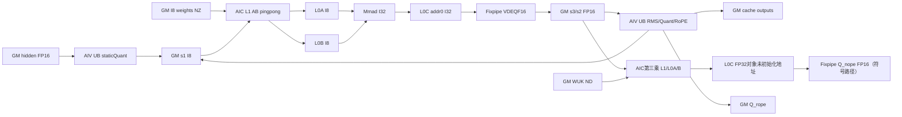
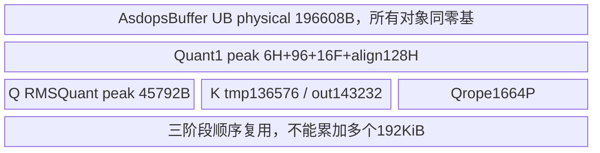
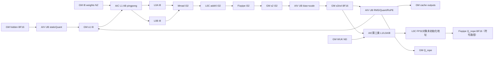
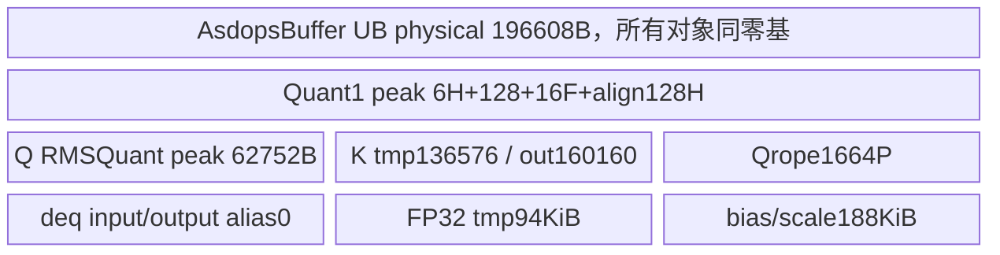

# SGL MLA预处理浮点KV缓存 A2/A3 ACLNN 算子知识

## 算子速览

| 项目 | 内容 |
|---|---|
| 实际入口 | 公开 `aclnnSglMlaPreprocessGetWorkspaceSize/aclnnSglMlaPreprocess`；kernel commit dda6d36b0cdb4081e102d14c0a2fb276fc416e69 |
| 计算语义 | qmode0静态非对称INT8前处理/两次INT8投影及反量化、Q/RMSNorm/吸收第三乘、半旋转RoPE，写浮点合并ND/分离ND/分离NZ缓存；不是attention softmax |
| 输入输出 | hidden[N,H] FP16/BF16；两权重INT8物理NZ；wuk[heads,128,512]浮点ND；四个caller输出，公开FP16 cache1、BF16 cache0/1/3；FP16 cache0仅文档冲突边界；INT8缓存mode2独立 |
| 执行类型 | 单个AICORE entry内AIC_CUBE与AIV_VECTOR的MIX_CV任务图；owned entry无显式KERNEL_TASK_TYPE_DEFAULT编码宏，不编造编码 |
| Kernel 路线 | R-001 FP16 cache0仅冲突边界；R-002 FP16 cache1；R-003/4/5 BF16 cache0/1/3；R-006为qmode1/2/3无匹配失败终点 |
| 核心资源 | 全地址零基AsdopsBuffer：L1 512KiB，L0A/B各64KiB，L0C128KiB，UB192KiB；各对象别名复用而非累加分配。FP163W、BF164W+8N user workspace |
| 来源闭包 | source_closed：pair/OpDef/Host→逐字段POD与handoff→5个目标router body→device_prims specialization与SDK9.1当前tensor/同步/参数声明→active CMake均可读；generated ACLNN与硬件intrinsic明确边界 |
| 验证状态 | 已完成源码闭包检查；本次知识提取未执行编译、真机、数值或性能测试。**draft：AIC构造时sub_block_idx未初始化读取，第三乘l0c_buf无地址producer；下述后续流程仅为到达相应语句时的源码符号化分析，不表示正常输入均安全执行。** |

## 接口与语义

### 计算语义

记N=tokens，H=hidden宽，A=heads，Dnope512、Drope64、Rquery1536、latent576。量化Q0为FP32计算hidden/quant_scale0+quant_offset0，再按源码先cast FP16、clamp[-128,127]、INT8取整；**第一Quant没有使用传入gamma0/beta0**，不能凭API参数名补成第一RMSNorm。INT8矩阵Q0[N,H]与权重WDQKV逻辑[2112,H]转置相乘，INT32累加。FP16用INT32 bias进BT、Fixpipe VDEQF16反量化；BF16先把INT32 C写GM，AIV加INT32 bias后转FP32乘FP32 descale，再cast BF16，即数学表达式为(acc+bias)*descale，不能写成scale后加未缩放bias。

得到L[N,2112]分成latent前576、query后1536。query做FP32 RMSNorm(eps1e−6，avg_factor源码常数0.000651041666)乘gamma1加beta1，再除quant_scale1、加INT8 offset1，castFP16→clamp→INT8；第二INT8乘权重WUQ逻辑[A*192,1536]，得到[N,A,192]，每head前128为Q_nope，后64为Q_rope。第三乘每head做[N,128]·WUK[128,512]，FP32累加后Fixpipe转输入dtype，cache0写Q[N,A,576]每行前512，cache1/3写Q0[N,A,512]。

Q_rope与latent后64按half-rotation：[-后32,前32]配sin并与原vector*cos相加；FP32计算后cast目标。latent前512另做FP32 RMSNorm乘gamma2，无beta，cache0与rope拼576，cache1/3分512/64。slot=-1跳过该token的两种cache写，不跳过独立Q计算；其它负值或过大slot未验证，重复合法slot无冲突消解，不能承诺确定写入顺序。

本文专属语义是qmode0、浮点cache0/1/3。qmode1/2/3虽有Host和若干未实例化模板代码，但entry六个case全为qmode0，因此无per-token/native no-quant支持；不使用template存在替代router可达性。cache2涉及INT8 Q_nope/K_nope输出，属于独立摄入范围，不混为本卡数学结果。

### 输入、输出与属性

| 参数 | shape/layout | dtype | 约束、默认值与语义 |
|---|---|---|---|
| hidden_state | [N,H] ND | FP16/BF16 | N1..1024；公开H2048..8192，但当前Host只H>0，无范围/对齐guard，Device搬运有H/16、H/32和32元素K对齐 |
| gamma0 | 文档[H] | 输入dtype | 传入并建立GM view，但当前第一Quant不读取值 |
| beta0 | 文档[H] | 输入dtype | 同上，不能宣称第一norm已执行 |
| wdqkv | 逻辑[2112,H]、物理FRACTAL_NZ | INT8 | adapter rank2/4、rawpointer；Host不核对完整形状；必须实际NZ存储，ND descriptor并不自动TransData |
| descale0 | [2112] | FP16为INT64 packed scale，BF16为FP32 | FP16 reinterpret uint64用于FB/Fixpipe，不作普通int64数值乘；BF16 AIV读FP32 |
| gamma1 | [1536] | 输入dtype | query RMSNorm乘因子 |
| beta1 | [1536] | 输入dtype | query RMSNorm后加，WITH_BETA=true |
| wuq | 逻辑[A*192,1536]、物理NZ | INT8 | adapter rank2/4，body transB=true |
| descale1 | [A*192] | 同descale0规则 | 第二乘反量化 |
| gamma2 | [512] | 输入dtype | latent NoPE RMSNorm因子 |
| cos | [N,64] | 输入dtype | Q与K同表，按head复制；half旋转 |
| sin | [N,64] | 输入dtype | 同上 |
| wuk | [A,128,512] ND | 输入dtype | adapter rank3、A>0、末512；未检查中间轴必须128；Host只取首维A |
| kv_cache | cache0逻辑末576；cache1末512；cache3物理[Nblocks,32,128,16] | 输入dtype | 传入供dtype/shape推导；Device实际写cache_out0指针，不自动别名或拷贝input cache |
| kv_cache_rope | cache1 ND末64；cache3 NZ[Nblocks,4,128,16] | 输入dtype | entry未将此指针传入计算对象，实际写cache_out1；cache0此输出unused |
| slotmapping | [N] | INT32 | adapter精确长度N；Host不验证值，Device只跳-1 |
| quant_scale0 | 至少32B可读的scalar加载域 | 输入dtype | 公共逻辑[1]，Device搬1个32B block，再取第0值做倒数；不验证非零/有限 |
| quant_offset0 | 同32B scalar加载域 | INT8 | 逻辑[1]，Device搬32B，第0值 |
| bias0 | [2112] | INT32 | FP16 BT注入，BF16 AIV加后scale |
| quant_scale1 | scalar/32B加载 | 输入dtype | 第二次量化倒数 |
| quant_offset1 | scalar/32B加载 | INT8 | 第二次量化偏移 |
| bias1 | [A*192] | INT32 | 第二乘bias |
| ctkv_scale | 可省略 | 输入dtype可选 | 本浮点cache不消费；mode2需要，不把nullptr GM view当有实际读取 |
| q_nope_scale | 可省略 | 输入dtype可选 | 本卡不执行EinSumQuant，Init仍建立view和几何；无scale值消费 |
| cache_mode | scalar | int64 | 公开FP16仅krope_ctkv1；BF16 kvcache0/krope_ctkv1/nzcache3；FP16 cache0仅Host可达文档冲突边界；Python默认1 |
| quant_mode | scalar | int64 | 本卡固定0 per_tensor_quant_asymm；Python默认0，C++None和OpDef默认1会到失败key；raw Host接受0..3不表示Device支持 |
| q_out0 | [N,A,576] cache0；[N,A,512] cache1/3 | 输入dtype | caller-owned，真实写入，不分配新tensor |
| kv_cache_out0 | 与kv_cache形状一致 | 输入dtype | caller决定是否与input cache同storage；Device不验证别名 |
| q_out1 | Infer恒[N,A,64] | 输入dtype | cache1/3写Qrope；cache0不写，不应读取为已初始化结果 |
| kv_cache_out1 | 同kv_cache_rope形状 | 输入dtype | cache1/3写；cache0不写 |

### 入口与版本

[同源MLA API](../../../../apis/sgl_kernel_npu/sgl_mla_preprocess.md)已全文读取，本文新增完整native实现；[模型集成Guide](../../../../guides/integration/sglang_ascend/sglang_ascend_attn_mla_preprocess.md)属于不同sglang固定源码、不同MLAPO/MLAProlog模式选择，不把其model mode数字当本entry quant_mode。

公开硬件表arch22 ascendc Supported、arch35 Not supported，Python_ARCH22、CMake SUPPORTED_ARCHS2201、architectures.json映射ascend910b/ascend910_93给出A2/A3支持链。**公开EN usage称FP16只krope_ctkv，而当前adapter/Host/entry另有FP16 cache0；R-001只记录源码可达及冲突，不把其称为文档已保证组合。** README/CI为任务CANN9.1.0依据；SDK当前读取固定v9.1.0 e5451c7feba11f9e259f4fbc19c4bf82f8c0496c，不用其它版本填补。body来自当前attention/mla_preprocess，公用实现来自utils/kernel/device_prims；legacy csrc/mla_preprocess未进入当前target，没有额外legacy kernel launch。

## Host/Launcher 执行流程

### 参数校验与前处理

Pythonauto/ascendc只ARCH22，原样传显式默认qmode0字符串。C++先检查hidden NPU、所有非optional tensors同设备；ParseCacheMode字符串→0/1/2/3，ParseQuantMode仅两字符串→0/1；None默认quant1。接着hiddenFP16/BF16、rank2，权重rank2/4、wuk rank3、两cache rank4、slotI32 rank1、N域与slot长度、wuk A>0/末512。FP16限制cache≤1、descaleINT64；BF16 descaleFP32；依cacheMode核cache和4输出dtype，mode2另需两非空scale。本卡cache0/1/3可省略scale。**没有contiguous转换或连续性检查；optional scale未参加前面的同设备循环，常规非optional及outputs才检查同NPU。**

建立24input/4output ACL ND描述符；weights强制以ACL_INT8描述，但adapter没有检查原Tensor scalar_type真的INT8；offset/bias也指定INT8/INT32描述，没有逐项真实dtype检查。不假设CANN framework弥补手造rawpointer错误。文档要求format_cast(29)准备NZ存储，但adapter无实际TransData/View操作，body按NZ地址读取。

Host检查context/platform、hidden/wuk rank、N1..1024/H>0/A>0、hidden dtype、attrs0..3、FP16 cache0/1和cache2 KV INT8；未检查完整weights/gamma/cos/sin/cache/outputs shape/slot值/stride。按平台查询AIC/AIV、UB/L1/L2/L0A/B/C，只拒核数0，之后Tiling。outer raw容量<sizeof POD失败；memcpy原POD、outer key0、SetBlockDim(AIC数)。

### 参数、Workspace 与生命周期

令W=N*max(H,2*A*192,2*2112,4*max(A*192,2112))字节（本浮点cache0/1/3）。来源顺序：s1factor=H（cache2才额外max(A*512*2)，本卡无）；workSizeS2=2A192；S3=2*2112；S4=4*max(A192,2112)；取max再乘N。FP16 qmode0 user=3W，BF16 qmode0 user=4W+8N；s1..s5 offsets=0,W,2W,3W,4W。FP16只传s1/s2/s3，s4/s5地址虽entry计算但不解引用；s4=3W是allocation末地址，s5=4W不可当可用片。BF16 s5预留2N FP32用于qmode1 per-token，但本qmode0不读写其数值，仍分配；不把dormant区域当缺失节点。

query/execute两阶段、失败TORCH_CHECK；workspaceSize≤INT64_MAX后at::empty Byte分配，未清零。所有caller inputs/outputs/optional scales/workspace record_stream在当前NPU stream，lambda捕获tensor和descriptor集合及executor/stream，queued执行期间保持owner。返回4个引用，未替换caller tensor。input cache和output cache是否同tensor由caller保证；代码只写output cache，不复制未触槽。CANN executor与codegen inner bridge为框架边界，无本仓手动Destroy或额外中间alloc节点。总query=libapi+user，entry GetUserWorkspace剥系统前缀。

### 启动图与失败传播

单entry `sgl_mla_preprocess`，Host blockDim=C=AIC核数，源码用__DAV_C220_CUBE__/VEC__及ASCEND_IS_AIC/AIV分支，SDK2201 GetBlockIdx令AIC为c、AIV为c*taskRation+sub（通常MIX的taskRation由框架决定；body按2做映射）。没有独立MM1/MM2/MM3 launch；各阶段是同launch任务图。entry PRELOAD(2)、SetAtomicnone/SetMasknorm，Cube SetPadding0/SetNdpara(1,0,0)。同一GM POD先GET，再字段逐项复制到local POD，**省略字段保留struct默认，不等价于全结构复制**。

```text
Python/Torch -> descriptors -> GetWorkspaceSize
 -> Infer + TilingSglMlaPreprocess
    validate -> mm1/mm2/mm3 tile -> vector geometry -> W/offsets/key
    raw memcpy(sizeof MlaTilingData), outerKey0, blockDim=C
 -> at::empty workspace + stream owners -> execute -> single entry
    recognized 5 float keys -> MLAOperation::Init + AIC ProcessCube / AIV ProcessVector
    qmode1/2/3 -> default break, no computation/no fallback
Host query failure -> no execute；execute status failure -> TORCH_CHECK
AIC constructor uninitialized sub_block_idx or MM3 uninitialized l0c_buf:
  visible static risk endpoint；do not invent a value or guaranteed subsequent schedule
```

FP16 AIV Quant→全AIV mode0 flag1 barrier→mode2 flag2唤AIC MM1；MM1后全AIC mode0 flag4 barrier→mode2 flag3给AIV RMSQuant2；AIV第二quant→全AIV flag5 barrier→mode2 flag6启动MM2，同时K/cache；MM2后全AIC flag9发出，MM3首次等flag9并发mode2 flag8让AIV读Qrope。BF16每个INT32 tile AIC FIX发布flag7，AIV等待、反量化并按5计数回flag8，AIC每5tile wait8限计数；全AIV flag4/5/9确保跨阶段workspace释放，mode2 flag2/6/3分别起MM1/MM2/MM3。精确顺序和字节边见各Route。

## Route 与参数设计

### 分核与资源计算

原始三乘：(batch1,M=N,K=H,Nout2112,transAfalse/transBtrue,enDequanttrue)、(1,N,1536,A*192,false,true,true)、(batchA,N,128,512,false,false,false)。FP16 deqOnTheFly=false，BF16true。Host在16、32、64、128、256、512的候选M0/N0上按主副轴遍历；M0*N0*4>平台L0C容量跳过，前两INT8乘N0>256跳过。roundBase真实式是pow(2,ceil(log(ceilDiv(minAxis,16))))*16，`log`未指定底2，不改写成log2。GetCost=1/(aCoef*N0)+1/(bCoef*M0)，若M/N工作集* K*2超过L2则coef5，transA M0%256或非transB N0%256再乘2。cost严格降低才UpdateTileSize；单Mloop且transB/余核负载<3/4时用L0C128KiB常量重新拆N0，要求strict小于容量。最终blockDim=min(batch*mLoop*nLoop,C)，coreLoop为tile总数。

Swizzle依i=1..blockDim尝试Zn/Nz代价与count；Device direction由实际模板或省略handoff默认0决定，而不是盲取Host swizzleDirect。L1 AB budget为FP16 INT8乘524288−2048bias−4096scale=518144B、BF16 INT8乘524288B、第三乘524288B。k0Max=floor((budget/2)/((M0+N0)*inBytes))，INT8按32或512向下对齐，浮点按16或256，再>512按512对齐；Kloop=ceil(K/k0)。Host没有另选full-load：enLoadAllAmat/enShuffleK成员默认false且无置true producer；对应Device true分支不是本任务可达Route。

AIV rows：rowWork=ceil(N/V)，needCore=ceil(N/rowWork)，最后活跃核处理N−(needCore−1)*rowWork，其余0。Qrope另按N*A个heads在V核均分，P=floor(platformUB/(64*(3*(4+2)+2*4)+512*2))=floor(UB/2688)，每核处理nlCoreRun或尾数，以P分loop；Host写lCoreRun=nlCoreRun而非算出的lCoreRun，真实尾循环仍用lastCoreLoopTime/lastCoreLoopNLast。第三乘A输入行stride=(128+64)*A，C行stride=(512+(cache0?64:0))*A。

### Route 选择

| 顺序 | Route | Key/模板 | 精确选择条件与优先级 | 不适用去向 |
|---:|---|---|---|---|
| 1 | R-001 FP16 合并ND文档冲突终点 | key0；MLAPO_FP16::MLAOperation<0,NZ,NZ,ND> | 仅记录Host可达、公开文档冲突；不纳入公开支持域；实现qmode0/FP16/cache0 | 其它cache/dtype对应下一key；FP16 cache>1先Host失败 |
| 2 | R-002 FP16 分离ND缓存 | key1；MLAPO_FP16::MLAOperation<1,NZ,NZ,ND> | A2/A3、qmode0、hidden=FP16、cacheMode1，公共Host合法域 | 其它cache/dtype对应下一key；FP16 cache>1先Host失败 |
| 3 | R-003 BF16 合并ND缓存 | key256；MLAPO_BF16::MLAOperation<__bf16,0,NZ,NZ,ND,QuantMode::PER_TENSOR_ASYMM_QUANT> | A2/A3、qmode0、hidden=BF16、cacheMode0，公共Host合法域 | 其它cache/dtype对应下一key；FP16 cache>1先Host失败 |
| 4 | R-004 BF16 分离ND缓存 | key257；MLAPO_BF16::MLAOperation<__bf16,1,NZ,NZ,ND,QuantMode::PER_TENSOR_ASYMM_QUANT> | A2/A3、qmode0、hidden=BF16、cacheMode1，公共Host合法域 | 其它cache/dtype对应下一key；FP16 cache>1先Host失败 |
| 5 | R-005 BF16 分离NZ缓存 | key259；MLAPO_BF16::MLAOperation<__bf16,3,NZ,NZ,ND,QuantMode::PER_TENSOR_ASYMM_QUANT> | A2/A3、qmode0、hidden=BF16、cacheMode3，公共Host合法域 | 其它cache/dtype对应下一key；FP16 cache>1先Host失败 |
| 6 | R-006 无匹配qmode | 同cache/dtype域，qmode1/2/3 | Host接收0..3，key额外OR(qmode<<3)，没有相应entry case | default break，无输出writer；不是per-token fallback |

```text
hidden dtype FP16/BF16 else fail
N1..1024,H>0,heads>0 + rank/basic descriptors else fail
cache in0..3,qmode in0..3 else fail
FP16 cache>1 -> Host fail
qmode0:
 FP16 cm0->0,cm1->1
 BF16 cm0->256,cm1->257,cm3->259
 BF16 cm2->258：独立INT8 cache语义，不在本卡
qmode1/2/3 + 本卡5种dtype/cache组合 -> key OR8/16/24 -> default break
```

### 模板/实现执行矩阵

| Route | key/selector | dtype/shape/platform 完整命中条件 | 执行族与 kernel 节点 | 实际模板/body | 内存与同步特征 | tail/fallback |
|---|---|---|---|---|---|---|
| R-001 | 0,qmode0,cache0 | 仅Host可达文档冲突，不列公开支持；N1..1024,H>0,A>0；hiddenFP16；weights物理NZ，wukND，dtype/shape见接口；packed int64 scale | 单entry AIC MM1/MM2/MM3，AIV Quant/RMSQuant/Knorm+RoPE/Qrope | MLAPO_FP16::MLAOperation；W8A8<false,true,true,0或1,ND,NZ>；EinSum<ND,false,0,64,64> | 3W，阶段flag1/4/5/9和2/3/6/8；所有AsdopsBuffer同层地址0别名 | M/N/K实际尾、slot-1跳cache；ND cache；无后端fallback |
| R-002 | 1,qmode0,cache1 | A2/A3；N1..1024,H>0,A>0；hiddenFP16；weights物理NZ，wukND，dtype/shape见接口；packed int64 scale | 单entry AIC MM1/MM2/MM3，AIV Quant/RMSQuant/Knorm+RoPE/Qrope | MLAPO_FP16::MLAOperation；W8A8<false,true,true,0或1,ND,NZ>；EinSum<ND,false,0,64,0> | 3W，阶段flag1/4/5/9和2/3/6/8；所有AsdopsBuffer同层地址0别名 | M/N/K实际尾、slot-1跳cache；ND cache；无后端fallback |
| R-003 | 256,qmode0,cache0 | A2/A3；N1..1024,H>0,A>0；hiddenBF16；weights物理NZ，wukND，dtype/shape见接口；FP32 scale | 单entry AIC MM1/MM2/MM3，AIV Quant/RMSQuant/Knorm+RoPE/Qrope/deq1/deq2 | MLAPO_BF16::MLAOperation；W8A8Aic<false,0,ND,NZ>+Aiv<__bf16,false,qmode0>；EinSum<__bf16,__bf16,ND,false,0,64,64> | 4W+8N，tile flag7/8、阶段flag1/4/5/9→2/6/3；所有AsdopsBuffer同层地址0别名 | M/N/K实际尾、slot-1跳cache；ND cache；无后端fallback |
| R-004 | 257,qmode0,cache1 | A2/A3；N1..1024,H>0,A>0；hiddenBF16；weights物理NZ，wukND，dtype/shape见接口；FP32 scale | 单entry AIC MM1/MM2/MM3，AIV Quant/RMSQuant/Knorm+RoPE/Qrope/deq1/deq2 | MLAPO_BF16::MLAOperation；W8A8Aic<false,0,ND,NZ>+Aiv<__bf16,false,qmode0>；EinSum<__bf16,__bf16,ND,false,0,64,0> | 4W+8N，tile flag7/8、阶段flag1/4/5/9→2/6/3；所有AsdopsBuffer同层地址0别名 | M/N/K实际尾、slot-1跳cache；ND cache；无后端fallback |
| R-005 | 259,qmode0,cache3 | A2/A3；N1..1024,H>0,A>0；hiddenBF16；weights物理NZ，wukND，dtype/shape见接口；FP32 scale | 单entry AIC MM1/MM2/MM3，AIV Quant/RMSQuant/Knorm+RoPE/Qrope/deq1/deq2 | MLAPO_BF16::MLAOperation；W8A8Aic<false,0,ND,NZ>+Aiv<__bf16,false,qmode0>；EinSum<__bf16,__bf16,ND,false,0,64,0> | 4W+8N，tile flag7/8、阶段flag1/4/5/9→2/6/3；所有AsdopsBuffer同层地址0别名 | M/N/K实际尾、slot-1跳cache；固定NZ block128/C016；无后端fallback |
| R-006 | qmode1/2/3的15个key | Host公共guard通过；本卡5dtype/cache组合 | entry无计算节点 | switch default break | Host已分配workspace，Device不InitBuffers | entry不写outputs，不能视为有效结果 |

### 隐藏性能 Guard

| Guard | Host/Tiling 条件 | Device/资源原因 | 影响 Route | 不满足时去向 | 源码符号 |
|---|---|---|---|---|---|
| 平台 | CMake2201、公开arch22；Host只核数>0 | AIC/AIV c220 body | 1..5 | 未编译/Host失败；不加950 | CMake/TilingSglMlaPreprocess |
| cache/dtype | FP16 cache≤1；BF16 cache0/1/3本语义 | 只有5case/模板 | 1..5 | FP16>1失败，BF16cache2独立语义 | Host/entry |
| qmode | Host0..3；entry只0 | 未匹配key不调用body | 全部 | R-006默认返回，无perToken结果 | SetTilingKey/switch |
| M0*N0 | 候选*4≤平台L0C；优化重拆strict<128KiB | INT32/FP32单C tile | 1..5 | 候选skip；无候选k0=0等没有显式fallback | GetTileSize/UpdateTileSize |
| k0 | half L1/(M0+N0)/inBytes后按32/16/256/512向下 | L1/AB双buffer与L0分K | 1..5 | 无k0==0保护，不能推普遍安全 | ComputeK0ForABpingpong |
| H/weights alignment | 公共H2048..8192但owned仅H>0，未检查H%32/NZ真实格式 | Quant搬运H/16、H/32；INT8 Kround32、weightsNZ | 全部 | 无自动补pad/TransData；未满足真实地址前提不安全 | Quant::Launch/GetOffsetB |
| UB | Rope按平台UB/2688；其它按固定192KiB零基buffer/常数196352 | 多对象别名/阶段peak | 全部 | 非法大H/A可能越extent；无完整Host guard | ProcessVector/AsdopsBuffer |
| slot | Host仅形状、dtype、长度；Device仅-1 continue | output地址slot*D或NZ128散写 | 全部 | 其它非法值/重复slot无fallback/atomic | RmsNormAndRopeConvergence1 |
| scalar块读取 | 逻辑[1]，搬32B且做倒数 | quantScale/offset及gamma/deq | 全部 | 无size/非零/finite guard | Quant/RmsNormQuant |
| NZ block | mode3写死128/C016，不从cache shape推 | NoPE32blocks/RoPE4blocks散写 | R-005 | 不满足文档128无fallback；adapter只rank4 | cache NZ branch |
| 未初始化 | AIC sub_block_idx宏外读取；MM3 l0c_buf未赋地址 | C++/LocalTensor默认未初始化 | 1..5 | 可达静态未定义状态终点，后续只作符号分析 | MLAOperation ctor/PpMatmulEinSum::Init |

### POD/ABI

Host `MlaTilingData tilingData;`与Device local POD的字段均有声明默认值；嵌套Pp字段也逐个0初始化。Host memcpy全结构，Device逐字段handoff只复制源码列出的字段。固定源无sizeof/alignof/offsetof数值断言或编译报告；下表A布局是uint32=4/align4、uint64=8/align8、自然对齐下的静态候选：Pp size68/align4；Mla size416/align8，不能代替工具链实际sizeof。A偏移为推导而非运行验证；raw容量与拷贝都使用实际sizeof，必须同头同ABI。

| 结构 | 字段 | 类型/位宽 | ABI 布局 | 单位 | Host/launcher producer | Device consumer | 边界 |
|---|---|---|---|---|---|---|---|
| MlaTilingData | tilingKey | uint32_t/32 | A offset0；见自然ABI前提 | selector | SetTilingKey: (isBF16<<8)|cache|(qmode<<3) | entry copy→switch | 仅6个qmode0case，本卡4支持+1文档冲突；outer CANN key0独立 |
| MlaTilingData | userWorkspaceSize | uint64_t/64 | A offset8；见自然ABI前提 | bytes | SetMlapoWorkSpace: FP16 3W/BF16 4W+8N | Host query；entry不复制，local默认0且body不读 | 与libapi只加一次 |
| MlaTilingData | s1Offset | uint64_t/64 | A offset16；见自然ABI前提 | bytes | SetMlapoWorkSpace: 0*W | entry copy→userWorkspace+offset→Init s1 | stage alias，见资源/边 |
| MlaTilingData | s2Offset | uint64_t/64 | A offset24；见自然ABI前提 | bytes | SetMlapoWorkSpace: 1*W | entry copy→userWorkspace+offset→Init s2 | stage alias，见资源/边 |
| MlaTilingData | s3Offset | uint64_t/64 | A offset32；见自然ABI前提 | bytes | SetMlapoWorkSpace: 2*W | entry copy→userWorkspace+offset→Init s3 | stage alias，见资源/边 |
| MlaTilingData | s4Offset | uint64_t/64 | A offset40；见自然ABI前提 | bytes | SetMlapoWorkSpace: 3*W | entry copy→userWorkspace+offset→Init s4 | FP16不传入/不解引用；BF16s4活动，s5 qmode0值inactive |
| MlaTilingData | s5Offset | uint64_t/64 | A offset48；见自然ABI前提 | bytes | SetMlapoWorkSpace: 4*W | entry copy→userWorkspace+offset→Init s5 | FP16不传入/不解引用；BF16s4活动，s5 qmode0值inactive |
| MlaTilingData | numCore | uint32_t/32 | A offset56；见自然ABI前提 | AIC cores | Init: platform.coreNumAic | entry复制；计算body未直接读取 | 不能代替mm*.blockDim或rmsNumCore1 |
| MlaTilingData | n | uint32_t/32 | A offset60；见自然ABI前提 | tokens | Init: opParam.N | entry复制→MLAOperation.num_row/Quant.rows | N1..1024 |
| MlaTilingData | perTaskNum | uint32_t/32 | A offset64；见自然ABI前提 | task | 无Host赋值，声明默认0 | entry复制→splitN，splitN无后继消费者 | dormant，不能补分核producer |
| MlaTilingData | resTaskNum | uint32_t/32 | A offset68；见自然ABI前提 | task | 无Host赋值，默认0 | entry复制；body未消费 | dormant |
| MlaTilingData | mm1 | PpMatmulTilingData | A offset72；见自然ABI前提 | aggregate | Init/GetTilingData(mm1) | entry逐字段copy；FP16 W8A8、BF16 Aic/Aiv | A:68B/align4 |
| MlaTilingData | mm2 | PpMatmulTilingData | A offset140；见自然ABI前提 | aggregate | Init/GetTilingData(mm2) | entry逐字段copy；FP16 W8A8、BF16 Aic/Aiv | A:68B/align4 |
| MlaTilingData | mm3 | PpMatmulTilingData | A offset208；见自然ABI前提 | aggregate | Init/GetTilingData(mm3) | entry逐字段copy→PpMatmulEinSum | A:68B/align4 |
| MlaTilingData | rmsNumCore1 | uint32_t/32 | A offset276；见自然ABI前提 | AIV cores | RmsNormQuantTiling: platform.coreNumAiv | entry复制→MLAOperation.num_core_，rows partition | 第二字段不新增另一分核方案 |
| MlaTilingData | rmsNumCol1 | uint32_t/32 | A offset280；见自然ABI前提 | elements | RmsNormQuantTiling: H | entry复制→num_col_1/2→Quant/RmsNormQuant | 第一量化无norm |
| MlaTilingData | rmsNumRow1 | uint32_t/32 | A offset284；见自然ABI前提 | rows | RmsNormQuantTiling: N | entry遗漏→local0；helper用mlaParams.n | 无活动值消费者 |
| MlaTilingData | rmsQuantMin1 | uint32_t/32 | A offset288；见自然ABI前提 | unsigned bit pattern | RmsNormQuantTiling: -CONST_128→u32 | entry遗漏→local0；helper本地quantMin=-128 | 不将u32解释成有符号数值保证 |
| MlaTilingData | rmsNumCore2 | uint32_t/32 | A offset292；见自然ABI前提 | AIV cores | RmsNormQuantTiling: platform.coreNumAiv | entry复制，但MLAOperation按rmsNumCore1分两段 | 第二字段不新增另一分核方案 |
| MlaTilingData | rmsNumCol2 | uint32_t/32 | A offset296；见自然ABI前提 | elements | RmsNormQuantTiling: 2112 | entry复制→num_col_1/2→Quant/RmsNormQuant | stride576，实际query1536 |
| MlaTilingData | rmsNumRow2 | uint32_t/32 | A offset300；见自然ABI前提 | rows | RmsNormQuantTiling: N | entry遗漏→local0；helper用mlaParams.n | 无活动值消费者 |
| MlaTilingData | rmsQuantMin2 | uint32_t/32 | A offset304；见自然ABI前提 | unsigned bit pattern | RmsNormQuantTiling: -CONST_128→u32 | entry遗漏→local0；helper本地quantMin=-128 | 不将u32解释成有符号数值保证 |
| MlaTilingData | hiddenSizeQ | uint32_t/32 | A offset308；见自然ABI前提 | elements | RopeConcatTiling:64*A | entry复制→RopeInit字段读取（后续地址主要headDim/headNum） | P=UB/2688；无P==0保护，N*A用u32 |
| MlaTilingData | headNumQ | uint32_t/32 | A offset312；见自然ABI前提 | heads | RopeConcatTiling:A | entry复制→RopeFp16 head分组/cos复制 | P=UB/2688；无P==0保护，N*A用u32 |
| MlaTilingData | headDim | uint32_t/32 | A offset316；见自然ABI前提 | elements | RopeConcatTiling:64 | entry复制→Qrope half32、搬运/分配 | P=UB/2688；无P==0保护，N*A用u32 |
| MlaTilingData | concatSize | uint32_t/32 | A offset320；见自然ABI前提 | elements | RopeConcatTiling:512 | entry复制→Q0合并输出stride576 | P=UB/2688；无P==0保护，N*A用u32 |
| MlaTilingData | rotaryCoeff | uint32_t/32 | A offset324；见自然ABI前提 | halves | RopeConcatTiling:2 | entry复制→rotateStride=headDim/2 | P=UB/2688；无P==0保护，N*A用u32 |
| MlaTilingData | ntokens | uint32_t/32 | A offset328；见自然ABI前提 | tokens | RopeConcatTiling:N | entry复制→RopeInit保存，head几何由Host其余字段 | P=UB/2688；无P==0保护，N*A用u32 |
| MlaTilingData | realCore | uint32_t/32 | A offset332；见自然ABI前提 | AIV cores | RopeConcatTiling:ceil(N*A/ceil(N*A/V)) | entry复制→Rope Process blockIdx>=realCore早退 | P=UB/2688；无P==0保护，N*A用u32 |
| MlaTilingData | nlCoreRun | uint32_t/32 | A offset336；见自然ABI前提 | heads/core | RopeConcatTiling:ceil(N*A/realCore) | entry复制→Rope core起始head | P=UB/2688；无P==0保护，N*A用u32 |
| MlaTilingData | lCoreRun | uint32_t/32 | A offset340；见自然ABI前提 | heads/core | RopeConcatTiling:源码赋nlCoreRun（不是计算的lCoreRun） | entry复制→RopeInit保存；实际尾循环用last*字段 | P=UB/2688；无P==0保护，N*A用u32 |
| MlaTilingData | maxNPerLoopForUb | uint32_t/32 | A offset344；见自然ABI前提 | heads/UBtile | RopeConcatTiling:floor(platformUB/2688) | entry复制→Rope数据buffer尺寸/loop | P=UB/2688；无P==0保护，N*A用u32 |
| MlaTilingData | preCoreLoopTime | uint32_t/32 | A offset348；见自然ABI前提 | loops | RopeConcatTiling:ceil(nlCoreRun/P) | entry复制→非最后core rope loops | P=UB/2688；无P==0保护，N*A用u32 |
| MlaTilingData | preCoreLoopNLast | uint32_t/32 | A offset352；见自然ABI前提 | heads | RopeConcatTiling:nlCoreRun−(preLoops−1)*P | entry复制→非最后core最后loopN | P=UB/2688；无P==0保护，N*A用u32 |
| MlaTilingData | lastCoreLoopTime | uint32_t/32 | A offset356；见自然ABI前提 | loops | RopeConcatTiling:ceil(actualLastCoreHeads/P) | entry复制→最后core rope loops | P=UB/2688；无P==0保护，N*A用u32 |
| MlaTilingData | lastCoreLoopNLast | uint32_t/32 | A offset360；见自然ABI前提 | heads | RopeConcatTiling:actualLastCoreHeads−(lastLoops−1)*P | entry复制→最后core最后loopN | P=UB/2688；无P==0保护，N*A用u32 |
| MlaTilingData | esqFrontCore | uint32_t/32 | A offset364；见自然ABI前提 | counts | EinSumQuantTiling:N%V | entry复制→EinSumQuant::Init front核数 | 浮点cache不调用EinSumQuant::Process，Init几何仍执行；不当perToken支持 |
| MlaTilingData | esqTailCore | uint32_t/32 | A offset368；见自然ABI前提 | counts | EinSumQuantTiling:V−N%V | entry复制→entry复制但EinSumQuant不直接读 | 浮点cache不调用EinSumQuant::Process，Init几何仍执行；不当perToken支持 |
| MlaTilingData | esqFrontCoreBatch | uint32_t/32 | A offset372；见自然ABI前提 | counts | EinSumQuantTiling:ceil(N/V) | entry复制→EinSumQuant::Init batchNum | 浮点cache不调用EinSumQuant::Process，Init几何仍执行；不当perToken支持 |
| MlaTilingData | esqTailCoreBatch | uint32_t/32 | A offset376；见自然ABI前提 | counts | EinSumQuantTiling:floor(N/V) | entry复制→EinSumQuant::Init batchNum | 浮点cache不调用EinSumQuant::Process，Init几何仍执行；不当perToken支持 |
| MlaTilingData | esqHeadNum | uint32_t/32 | A offset380；见自然ABI前提 | counts | EinSumQuantTiling:A | entry复制→EinSumQuant::Init 几何 | 浮点cache不调用EinSumQuant::Process，Init几何仍执行；不当perToken支持 |
| MlaTilingData | esqColNum | uint32_t/32 | A offset384；见自然ABI前提 | counts | EinSumQuantTiling:512 | entry复制→EinSumQuant::Init col | 浮点cache不调用EinSumQuant::Process，Init几何仍执行；不当perToken支持 |
| MlaTilingData | esqUbHeadLoop | uint32_t/32 | A offset388；见自然ABI前提 | counts | EinSumQuantTiling:floor(A/headPerLoop) | entry复制→EinSumQuant::Init ubHeadLoop | 浮点cache不调用EinSumQuant::Process，Init几何仍执行；不当perToken支持 |
| MlaTilingData | esqHeadPerLoop | uint32_t/32 | A offset392；见自然ABI前提 | counts | EinSumQuantTiling:见EinSumQuantTiling dtype公式 | entry复制→EinSumQuant::Init headPerLoop和buffer尺寸 | 浮点cache不调用EinSumQuant::Process，Init几何仍执行；不当perToken支持 |
| MlaTilingData | esqHeadTail | uint32_t/32 | A offset396；见自然ABI前提 | counts | EinSumQuantTiling:A%headPerLoop | entry复制→EinSumQuant::Init headTail | 浮点cache不调用EinSumQuant::Process，Init几何仍执行；不当perToken支持 |
| MlaTilingData | esqColLoop | uint32_t/32 | A offset400；见自然ABI前提 | counts | EinSumQuantTiling:512/(BF16?64:128) | entry复制→EinSumQuant::Init colLoop | 浮点cache不调用EinSumQuant::Process，Init几何仍执行；不当perToken支持 |
| MlaTilingData | esqColTail | uint32_t/32 | A offset404；见自然ABI前提 | counts | EinSumQuantTiling:512%repeatMask=0 | entry复制→EinSumQuant::Init colTail | 浮点cache不调用EinSumQuant::Process，Init几何仍执行；不当perToken支持 |
| MlaTilingData | hiddenStateDim | uint32_t/32 | A offset408；见自然ABI前提 | elements | Init: uint32(hiddenDim)，声明默认7168被覆盖 | entry复制→Quant/UB布局/第一乘K | Host仅H>0，cast上界/对齐未guard |
| PpMatmulTilingData mm1 | numBatch | uint32_t/32 | A内部offset0；whole72 | batch | GetTilingData(mm1): 1 | loops的batchIdx/GM batch offset | 结构size68/align4；INT8输入/INT32累加；BF16反量化另在AIV |
| PpMatmulTilingData mm1 | m | uint32_t/32 | A内部offset4；whole76 | elements | GetTilingData(mm1): N | m tail、行stride | 结构size68/align4；INT8输入/INT32累加；BF16反量化另在AIV |
| PpMatmulTilingData mm1 | k | uint32_t/32 | A内部offset8；whole80 | elements | GetTilingData(mm1): H | Kloops/offset、INT8round32或浮点round16 | 结构size68/align4；INT8输入/INT32累加；BF16反量化另在AIV |
| PpMatmulTilingData mm1 | n | uint32_t/32 | A内部offset12；whole84 | elements | GetTilingData(mm1): 2112 | Nloops、output stride | 结构size68/align4；INT8输入/INT32累加；BF16反量化另在AIV |
| PpMatmulTilingData mm1 | m0 | uint32_t/32 | A内部offset16；whole88 | elements | GetTilingData(mm1): tile search | Mtile actual/round | 结构size68/align4；INT8输入/INT32累加；BF16反量化另在AIV |
| PpMatmulTilingData mm1 | k0 | uint32_t/32 | A内部offset20；whole92 | elements | GetTilingData(mm1): FP16 budget518144/BF16 524288半容量公式 | K_L1分块 | 结构size68/align4；INT8输入/INT32累加；BF16反量化另在AIV |
| PpMatmulTilingData mm1 | n0 | uint32_t/32 | A内部offset24；whole96 | elements | GetTilingData(mm1): tile search≤256 | Ntile actual/round | 结构size68/align4；INT8输入/INT32累加；BF16反量化另在AIV |
| PpMatmulTilingData mm1 | mLoop | uint32_t/32 | A内部offset28；whole100 | loops | GetTilingData(mm1): ceil(N/m0) | mLoop/tdim.m | 结构size68/align4；INT8输入/INT32累加；BF16反量化另在AIV |
| PpMatmulTilingData mm1 | kLoop | uint32_t/32 | A内部offset32；whole104 | loops | GetTilingData(mm1): ceil(H/k0) | K_L1 loops | 结构size68/align4；INT8输入/INT32累加；BF16反量化另在AIV |
| PpMatmulTilingData mm1 | nLoop | uint32_t/32 | A内部offset36；whole108 | loops | GetTilingData(mm1): ceil(2112/n0) | nLoop/tdim.n | 结构size68/align4；INT8输入/INT32累加；BF16反量化另在AIV |
| PpMatmulTilingData mm1 | coreLoop | uint32_t/32 | A内部offset40；whole112 | tiles | GetTilingData(mm1): mLoop*nLoop | for loop_idx=core_idx;+=activeCore | 结构size68/align4；INT8输入/INT32累加；BF16反量化另在AIV |
| PpMatmulTilingData mm1 | swizzleCount | uint32_t/32 | A内部offset44；whole116 | tile count | GetTilingData(mm1): Swizzle selected count | Zn/Nz block index permutation | 结构size68/align4；INT8输入/INT32累加；BF16反量化另在AIV |
| PpMatmulTilingData mm1 | swizzleDirect | uint32_t/32 | A内部offset48；whole120 | enum | GetTilingData(mm1): Swizzle member last assigned | entry对三份均不复制，local默认0；FP16MM2模板方向1，其它方向0 | 结构size68/align4；handoff遗漏不据Host值推Device方向 |
| PpMatmulTilingData mm1 | enShuffleK | uint32_t/32 | A内部offset52；whole124 | bool/u32 | GetTilingData(mm1): 默认false/0 | 当前不shuffleK；entrycopy但无true producer | 结构size68/align4；无true Host路由 |
| PpMatmulTilingData mm1 | blockDim | uint32_t/32 | A内部offset56；whole128 | AIC cores | GetTilingData(mm1): min(coreLoop,C) | 当前activeCore数，未用核仍参加阶段wait | 结构size68/align4；INT8输入/INT32累加；BF16反量化另在AIV |
| PpMatmulTilingData mm1 | enLoadAllAmat | uint32_t/32 | A内部offset60；whole132 | bool/u32 | GetTilingData(mm1): 默认false/0 | mm1/mm2 entrycopy后False分块；mm3遗漏且EinSum不读 | 结构size68/align4；无true Host路由 |
| PpMatmulTilingData mm1 | b0matPingPongBufferLen | uint32_t/32 | A内部offset64；whole136 | bytes/int8 elements | GetTilingData(mm1): 默认262144 | mm1/mm2 entrycopy后B相邻pingpong距离；mm3遗漏→0且EinSum固定131072半精度元素 | 结构size68/align4；INT8输入/INT32累加；BF16反量化另在AIV |
| PpMatmulTilingData mm2 | numBatch | uint32_t/32 | A内部offset0；whole140 | batch | GetTilingData(mm2): 1 | loops的batchIdx/GM batch offset | 结构size68/align4；INT8输入/INT32累加；BF16反量化另在AIV |
| PpMatmulTilingData mm2 | m | uint32_t/32 | A内部offset4；whole144 | elements | GetTilingData(mm2): N | m tail、行stride | 结构size68/align4；INT8输入/INT32累加；BF16反量化另在AIV |
| PpMatmulTilingData mm2 | k | uint32_t/32 | A内部offset8；whole148 | elements | GetTilingData(mm2): 1536 | Kloops/offset、INT8round32或浮点round16 | 结构size68/align4；INT8输入/INT32累加；BF16反量化另在AIV |
| PpMatmulTilingData mm2 | n | uint32_t/32 | A内部offset12；whole152 | elements | GetTilingData(mm2): A*192 | Nloops、output stride | 结构size68/align4；INT8输入/INT32累加；BF16反量化另在AIV |
| PpMatmulTilingData mm2 | m0 | uint32_t/32 | A内部offset16；whole156 | elements | GetTilingData(mm2): tile search | Mtile actual/round | 结构size68/align4；INT8输入/INT32累加；BF16反量化另在AIV |
| PpMatmulTilingData mm2 | k0 | uint32_t/32 | A内部offset20；whole160 | elements | GetTilingData(mm2): 同mm1 | K_L1分块 | 结构size68/align4；INT8输入/INT32累加；BF16反量化另在AIV |
| PpMatmulTilingData mm2 | n0 | uint32_t/32 | A内部offset24；whole164 | elements | GetTilingData(mm2): tile search≤256 | Ntile actual/round | 结构size68/align4；INT8输入/INT32累加；BF16反量化另在AIV |
| PpMatmulTilingData mm2 | mLoop | uint32_t/32 | A内部offset28；whole168 | loops | GetTilingData(mm2): ceil(N/m0) | mLoop/tdim.m | 结构size68/align4；INT8输入/INT32累加；BF16反量化另在AIV |
| PpMatmulTilingData mm2 | kLoop | uint32_t/32 | A内部offset32；whole172 | loops | GetTilingData(mm2): ceil(1536/k0) | K_L1 loops | 结构size68/align4；INT8输入/INT32累加；BF16反量化另在AIV |
| PpMatmulTilingData mm2 | nLoop | uint32_t/32 | A内部offset36；whole176 | loops | GetTilingData(mm2): ceil(A*192/n0) | nLoop/tdim.n | 结构size68/align4；INT8输入/INT32累加；BF16反量化另在AIV |
| PpMatmulTilingData mm2 | coreLoop | uint32_t/32 | A内部offset40；whole180 | tiles | GetTilingData(mm2): mLoop*nLoop | for loop_idx=core_idx;+=activeCore | 结构size68/align4；INT8输入/INT32累加；BF16反量化另在AIV |
| PpMatmulTilingData mm2 | swizzleCount | uint32_t/32 | A内部offset44；whole184 | tile count | GetTilingData(mm2): Swizzle selected count | Zn/Nz block index permutation | 结构size68/align4；INT8输入/INT32累加；BF16反量化另在AIV |
| PpMatmulTilingData mm2 | swizzleDirect | uint32_t/32 | A内部offset48；whole188 | enum | GetTilingData(mm2): Swizzle member last assigned | entry对三份均不复制，local默认0；FP16MM2模板方向1，其它方向0 | 结构size68/align4；handoff遗漏不据Host值推Device方向 |
| PpMatmulTilingData mm2 | enShuffleK | uint32_t/32 | A内部offset52；whole192 | bool/u32 | GetTilingData(mm2): 默认false/0 | 当前不shuffleK；entrycopy但无true producer | 结构size68/align4；无true Host路由 |
| PpMatmulTilingData mm2 | blockDim | uint32_t/32 | A内部offset56；whole196 | AIC cores | GetTilingData(mm2): min(coreLoop,C) | 当前activeCore数，未用核仍参加阶段wait | 结构size68/align4；INT8输入/INT32累加；BF16反量化另在AIV |
| PpMatmulTilingData mm2 | enLoadAllAmat | uint32_t/32 | A内部offset60；whole200 | bool/u32 | GetTilingData(mm2): 默认false/0 | mm1/mm2 entrycopy后False分块；mm3遗漏且EinSum不读 | 结构size68/align4；无true Host路由 |
| PpMatmulTilingData mm2 | b0matPingPongBufferLen | uint32_t/32 | A内部offset64；whole204 | bytes/int8 elements | GetTilingData(mm2): 默认262144 | mm1/mm2 entrycopy后B相邻pingpong距离；mm3遗漏→0且EinSum固定131072半精度元素 | 结构size68/align4；INT8输入/INT32累加；BF16反量化另在AIV |
| PpMatmulTilingData mm3 | numBatch | uint32_t/32 | A内部offset0；whole208 | batch | GetTilingData(mm3): A | loops的batchIdx/GM batch offset | 结构size68/align4；EinSum当前浮点输入/FP32累加 |
| PpMatmulTilingData mm3 | m | uint32_t/32 | A内部offset4；whole212 | elements | GetTilingData(mm3): N | m tail、行stride | 结构size68/align4；EinSum当前浮点输入/FP32累加 |
| PpMatmulTilingData mm3 | k | uint32_t/32 | A内部offset8；whole216 | elements | GetTilingData(mm3): 128 | Kloops/offset、INT8round32或浮点round16 | 结构size68/align4；EinSum当前浮点输入/FP32累加 |
| PpMatmulTilingData mm3 | n | uint32_t/32 | A内部offset12；whole220 | elements | GetTilingData(mm3): 512 | Nloops、output stride | 结构size68/align4；EinSum当前浮点输入/FP32累加 |
| PpMatmulTilingData mm3 | m0 | uint32_t/32 | A内部offset16；whole224 | elements | GetTilingData(mm3): tile search | Mtile actual/round | 结构size68/align4；EinSum当前浮点输入/FP32累加 |
| PpMatmulTilingData mm3 | k0 | uint32_t/32 | A内部offset20；whole228 | elements | GetTilingData(mm3): 524288半容量、input2B | K_L1分块 | 结构size68/align4；EinSum当前浮点输入/FP32累加 |
| PpMatmulTilingData mm3 | n0 | uint32_t/32 | A内部offset24；whole232 | elements | GetTilingData(mm3): tile search≤512 | Ntile actual/round | 结构size68/align4；EinSum当前浮点输入/FP32累加 |
| PpMatmulTilingData mm3 | mLoop | uint32_t/32 | A内部offset28；whole236 | loops | GetTilingData(mm3): ceil(N/m0) | mLoop/tdim.m | 结构size68/align4；EinSum当前浮点输入/FP32累加 |
| PpMatmulTilingData mm3 | kLoop | uint32_t/32 | A内部offset32；whole240 | loops | GetTilingData(mm3): ceil(128/k0) | K_L1 loops | 结构size68/align4；EinSum当前浮点输入/FP32累加 |
| PpMatmulTilingData mm3 | nLoop | uint32_t/32 | A内部offset36；whole244 | loops | GetTilingData(mm3): ceil(512/n0) | nLoop/tdim.n | 结构size68/align4；EinSum当前浮点输入/FP32累加 |
| PpMatmulTilingData mm3 | coreLoop | uint32_t/32 | A内部offset40；whole248 | tiles | GetTilingData(mm3): A*mLoop*nLoop | for loop_idx=core_idx;+=activeCore | 结构size68/align4；EinSum当前浮点输入/FP32累加 |
| PpMatmulTilingData mm3 | swizzleCount | uint32_t/32 | A内部offset44；whole252 | tile count | GetTilingData(mm3): Swizzle selected count | Zn/Nz block index permutation | 结构size68/align4；EinSum当前浮点输入/FP32累加 |
| PpMatmulTilingData mm3 | swizzleDirect | uint32_t/32 | A内部offset48；whole256 | enum | GetTilingData(mm3): Swizzle member last assigned | entry对三份均不复制，local默认0；FP16MM2模板方向1，其它方向0 | 结构size68/align4；handoff遗漏不据Host值推Device方向 |
| PpMatmulTilingData mm3 | enShuffleK | uint32_t/32 | A内部offset52；whole260 | bool/u32 | GetTilingData(mm3): 默认false/0 | 当前不shuffleK；entrycopy但无true producer | 结构size68/align4；无true Host路由 |
| PpMatmulTilingData mm3 | blockDim | uint32_t/32 | A内部offset56；whole264 | AIC cores | GetTilingData(mm3): min(coreLoop,C) | 当前activeCore数，未用核仍参加阶段wait | 结构size68/align4；EinSum当前浮点输入/FP32累加 |
| PpMatmulTilingData mm3 | enLoadAllAmat | uint32_t/32 | A内部offset60；whole268 | bool/u32 | GetTilingData(mm3): 默认false/0 | mm1/mm2 entrycopy后False分块；mm3遗漏且EinSum不读 | 结构size68/align4；无true Host路由 |
| PpMatmulTilingData mm3 | b0matPingPongBufferLen | uint32_t/32 | A内部offset64；whole272 | bytes/int8 elements | GetTilingData(mm3): 默认262144 | mm1/mm2 entrycopy后B相邻pingpong距离；mm3遗漏→0且EinSum固定131072半精度元素 | 结构size68/align4；EinSum当前浮点输入/FP32累加 |

Device内部MatCoord、scalar fields和LocalTensor不是Host ABI。AsdopsBuffer各层LocalTensor<uint8_t>从地址0初始化，再以字节offset ReinterpretCast；多个对象同层同offset是真实别名，不是各自新申请192KiB UB/L1。SDK `LocalTensor() {}`及其 `TBuffAddr address_`没有默认成员初值，不能把未初始化第三乘l0c_buf当零基C0张量。全量结构的padding不携带语义；保留同头sizeof拷贝。

### Route 源码闭包

| Route | Key/selector | Host/Tiling producer | POD/参数 | Kernel entry/router | Kernel body/直接依赖 | 构建接线 |
|---|---|---|---|---|---|---|
| R-001 | 0, qmode0/cache0 | op_host/mla_preprocess_tiling.cpp::TilingSglMlaPreprocess/Init/GetTilingData | MlaTilingData及3×Pp；FP16的W与stride | op_kernel/mla_preprocess.cpp→MLAPO_FP16::MLAOperation<0,NZ,NZ,ND> | op_kernel/mla_preprocess_mix_fp16.hpp全部当前方法；utils/kernel/device_prims 当前迭代器/mmad/内存/同步；SDK tensor/struct/sync固定源 | CMakeLists.txt AICORE/2201，KERNEL_INCLUDE ../../utils/kernel；cann_ops codegen映射当前entry |
| R-002 | 1, qmode0/cache1 | op_host/mla_preprocess_tiling.cpp::TilingSglMlaPreprocess/Init/GetTilingData | MlaTilingData及3×Pp；FP16的W与stride | op_kernel/mla_preprocess.cpp→MLAPO_FP16::MLAOperation<1,NZ,NZ,ND> | op_kernel/mla_preprocess_mix_fp16.hpp全部当前方法；utils/kernel/device_prims 当前迭代器/mmad/内存/同步；SDK tensor/struct/sync固定源 | CMakeLists.txt AICORE/2201，KERNEL_INCLUDE ../../utils/kernel；cann_ops codegen映射当前entry |
| R-003 | 256, qmode0/cache0 | op_host/mla_preprocess_tiling.cpp::TilingSglMlaPreprocess/Init/GetTilingData | MlaTilingData及3×Pp；BF16的W与stride | op_kernel/mla_preprocess.cpp→MLAPO_BF16::MLAOperation<__bf16,0,NZ,NZ,ND,qmode0> | op_kernel/mla_preprocess_mix_bf16.hpp全部当前方法；utils/kernel/device_prims 当前迭代器/mmad/内存/同步；SDK tensor/struct/sync固定源 | CMakeLists.txt AICORE/2201，KERNEL_INCLUDE ../../utils/kernel；cann_ops codegen映射当前entry |
| R-004 | 257, qmode0/cache1 | op_host/mla_preprocess_tiling.cpp::TilingSglMlaPreprocess/Init/GetTilingData | MlaTilingData及3×Pp；BF16的W与stride | op_kernel/mla_preprocess.cpp→MLAPO_BF16::MLAOperation<__bf16,1,NZ,NZ,ND,qmode0> | op_kernel/mla_preprocess_mix_bf16.hpp全部当前方法；utils/kernel/device_prims 当前迭代器/mmad/内存/同步；SDK tensor/struct/sync固定源 | CMakeLists.txt AICORE/2201，KERNEL_INCLUDE ../../utils/kernel；cann_ops codegen映射当前entry |
| R-005 | 259, qmode0/cache3 | op_host/mla_preprocess_tiling.cpp::TilingSglMlaPreprocess/Init/GetTilingData | MlaTilingData及3×Pp；BF16的W与stride | op_kernel/mla_preprocess.cpp→MLAPO_BF16::MLAOperation<__bf16,3,NZ,NZ,ND,qmode0> | op_kernel/mla_preprocess_mix_bf16.hpp全部当前方法；utils/kernel/device_prims 当前迭代器/mmad/内存/同步；SDK tensor/struct/sync固定源 | CMakeLists.txt AICORE/2201，KERNEL_INCLUDE ../../utils/kernel；cann_ops codegen映射当前entry |
| R-006 | 15个未匹配qmode key | 同Host生成额外qmode bits | 同POD预算与handoff | entry switch default break | 未调用Device计算对象，无缺失body | 同target，无其它qmode binary替代 |

## Kernel 实现

### 公共执行流程

entry顺序为预取/原子与mask状态设置→GET_TILING_DATA→local POD逐字段赋值→s1..s5 user地址→switch构造实际类型→Init→按AIC/AIV调用相应Process。只有这条单entry图；公用iterator是本kernel repo可读的真实specialization，硬件DataCopy/LoadData/Mmad/Fixpipe内部为CANN9.1 primitive边界。SDK MmadParams六实参准确为m/n/k/unitFlag/cmatrixSource/cmatrixInitVal，Fixpipe n/m/stride/quantPre由owned iterator写入；不把通用Matmul include等同使用Matmul高层scheduler。

所有以下body都受AIC构造的sub_block_idx未初始化风险及MM3 l0c_buf缺地址风险限制：不会推定风险处读到0或确定继续。只对条件执行到相应方法的语句说明其loops、offset、资源和同步。R-001为公开文档冲突边界，全文实现证据不升级其支持；其余四条qmode0为公开浮点cache支持子域，仍为draft无运行保证。

### Route R-001：FP16 cache0 合并ND缓存（公开文档冲突边界）

#### 适用条件

**不纳入公开支持域**。EN usage只允许FP16 krope_ctkv；这里保留raw/adapter/Host可生成key0、entry有body的已知冲突终点，以下仅为源码符号化body证据，不能作为公开可用组合。 N1..1024、H>0、A>0；物理INT8 NZ WDQKV/WUQ、ND WUK[A,128,512]、数据布局/精度/所有caller输出满足接口约定。descaleINT64 packed Fixpipe scale；cache/outputFP16。 ND缓存；cache0写入端口见下表。 qmode1/2/3不进入此body，走R-006。

##### 选择证据

| 层级 | 文件 | 符号 | 源码谓词/参数 | 结果/下一跳 |
|---|---|---|---|---|
| 公开/入口 | docs/api/en/operators/attention/mla_preprocess.md；torch_adapter.cpp | ParseCacheMode/ParseQuantMode | 文档FP16仅1与实现cache0冲突；实现字符串kvcache→0；per_tensor_quant_asymm→0；hiddenFP16 | 仅记录实现可达边界 |
| Host | op_host/mla_preprocess_tiling.cpp | TilingSglMlaPreprocess/MlaPreprocessTiling::Init | cache=0,qmode0,isBf16=false；rank/N/H/A基本guard | 3个MM POD、RMS/Rope/ESQ几何、3W user |
| POD/router | op_kernel/mla_preprocess.cpp | SetTilingKey→switch case | (isBF16<<8) OR 0 OR (0<<3) | key0，MLAPO_FP16::MLAOperation<0,DataFormat::NZ,DataFormat::NZ,DataFormat::ND> |
| body | op_kernel/mla_preprocess_mix_fp16.hpp | MLAOperation::Init/ProcessCube/ProcessVector | weights NZ/NZ/ND，splitGapC64，splitGapA64 | 同一entry AIC/AIV任务图；静态风险处不保证继续 |

#### Device 数据流

##### 函数级调用链

```text
sgl_mla_preprocess -> case 0 -> MLAPO_FP16::MLAOperation<0,DataFormat::NZ,DataFormat::NZ,DataFormat::ND>
  ctor: AIC sub_block_idx未赋值却宏外读 -> 静态风险终点
  Init:
    GM views + row partition + Quant1.Init/RmsNormQuant2.Init/RopeFp16.RopeInit
    W8a8<false,true,true,0,ND,NZ> MM1.Init/PreloadDoubleWeight；MM2方向1.Init
    EinSum<ND,false,0,64,64>.Init
       -> l1A/l1B/l0A/l0B addresses；l0c_buf没有赋值 -> 后续Mad/Fixpipe静态风险
  AIV ProcessVector:
    Quant1.Launch -> static Q0 FP32->FP16->I8 -> s1
    RmsNormQuant2.Launch(s3[:,576:],gamma1,beta1) -> I8 s1
    RmsNormAndRopeConvergence1 -> latent512 RMSNorm(gamma2)+Krope64 -> cache ports
    RopeFp16.Process -> Qrope64 -> q_out0每576行末64
    EinSumQuant.Init exists but Process not called (cache!=2)
  AIC ProcessCube:
    MM1.Process -> biasBT+packed descale Fixpipe FP16 s3
    MM2.PreloadDoubleWeight / Process -> biasBT+descale Fixpipe FP16 s2
    EinSum.Process(FP16 s2 NoPE128, WUK) -> FP32 acc -> Fixpipe FP16 q_out0
```

##### 源码等价伪码

```text
// 符号化伪码；未初始化变量/LocalTensor地址没有确定值，不能据此推定后续必执行。
entry localPOD = 声明默认值; copy only listed fields; user slices s1..s5
construct MLAOperation: block=GetBlockIdx; sub assigned only VECTOR macro
vectorBlock=(block/2)*2+sub   // AIC有未初始化读取风险
if reaches Init:
 AIV: rowWork=ceil(N/V); last活跃核rows截断；Gamma0/Beta0不参与第一Quant
 AIC: preload MM1 first2 K weight blocks in L1
 AIV Q0: copy H lowprec -> FP32; y=x/scale0+offset0
         FP32->FP16 CAST_NONE; clamp[-128,127]; I8 RINT(__CCE_AICORE__220)
         write s1[row*H], all-AIV flag1 barrier, mode2 start2
 AIC MM1: tileIdx=core; tileIdx<coreLoop; tileIdx+=mm1.blockDim
   Zn(direction0) -> mTile,nTile; m/n tail; K tiles k0, Kparts L0 capacity
   ND quantA + NZ weight -> L1 -> L0A/B -> I8*I8 INT32
   firstK biasBT, Fixpipe VDEQF16 packedScale -> FP16 s3
 all-AIC flag4 barrier -> mode2 flag3 to AIV
 AIV Qnorm: read s3[row*2112+576 : +2112]
    fp32 rms(mean squares via 1/1536 +1e-6), *gamma1 +beta1
    /scale1+offset1 -> FP16 -> clamp -> I8 s1[row*1536]
 all-AIV flag5 barrier -> mode2 flag6 starts MM2
 AIC MM2: same I8 tile loop, Fixpipe FP16 s2; K=1536,Nout=A*192
 AIV Kcache (can overlap MM2):
   slot=slotmapping[row]; slot==-1 -> continue cache only
   read first576 of s3 row; normalize512 FP32*gamma2
   Krope64: q*cos + rotateHalf(q)*sin; castFP16
   write576 contiguous to cacheOut0[slot*576]; cacheOut1 unused
 all-AIC flag9; MM3 firsttask wait9 -> mode2 flag8 permits Qrope
 AIC MM3: for tileIdx=core; +=activeMM3cores:
   batch=head; Qinput rowstride=192*A, head offset=head*192
   WUK head[N? actually128,512] ND, no transB
   L1 pingpong + L0A/B pingpong; FP32 Mad accumulator l0c_buf (address无producer)
   Fixpipe FP16 -> qOut0 rowstride=576*A, head offset=head*576
 AIV Qrope: flat headIndex=row*A+h
   input s2[headIndex*192+128]; broadcast cos/sin[row,64]
   split32 rotateHalf, FP32 mul/add, CAST_RINT -> qOut0[headIndex*576+512]
 drain all local events; no EINSUMQUANT/INT8 output stage for this cache
```

Zn公式：inBatch=tileIdx%(mLoop*nLoop)，tileBlock=inBatch/(swizzleCount*nLoop)，inner=inBatch%(swizzleCount*nLoop)，nRow=最后tileBlock?mLoop−swizzleCount*tileBlock:swizzleCount；mIdx=tileBlock*swizzleCount+inner%nRow，nIdx=inner/nRow，奇tileBlock翻转nIdx。MM1方向0、MM3方向0；MM2模板方向1使用Nz对称式：按nLoop划tileBlock，mIdx=inner/nCol,nIdx=tileBlock*count+inner%nCol，奇block翻转mIdx。 Host swizzleDirect未在entry handoff复制，不能拿Host该值改这里实际静态方向。

#### 内存与数据搬运

##### 资源与搬运表

| 层级/缓冲区 | offset/地址公式 | extent/容量公式 | dtype/layout | producer | consumer | owner/lifetime | 对齐/复用 |
|---|---|---|---|---|---|---|---|
| GM inputs | hidden row*H；WD NZ: kIdx*k0*align16(Nout)+nIdx*n0*32；WUK=head*128*512+kIdx*k0*512+nIdx*n0 | caller tensor/static geometry | I8 NZ或FP16 ND | caller | Quant/Cube/Vector | record_stream+lambda | 无自动contiguous/NZ转换；actualstorage必须匹配 |
| GM Q0/Q1 | Q0:(row*A+h)*576+col；Q1:(row*A+h)*64+col | Q0=N*A*576*2B；Q1有Infer shape但未写 | FP16 ND | MM3/Qrope | caller | caller-owned输出，stream完成前保留 | cache0两个producer写互不重叠512/64；cache1/3分开 |
| GM cacheOut | slot*576元素 | caller cache容量 | FP16 ND | K RMSNorm/RoPE | 后续caller | caller owner | slot -1不写；其它值无边界检查/atomic |
| user s1 | 0..W | W B | Q0/Q2 I8，阶段复用 | AIV Quant1/RMSQuant2 | AIC MM1/MM2 | single executor | Q0[N,H]→Q2[N,1536]；两次flag屏障隔开 |
| user s2 | W..2W | W B | FP16 MM2[N,A*192] | AIC MM2 Fixpipe | MM3/Qrope | executor | MM2全AIC9后MM3/Qrope读取 |
| user s3 | 2W..3W | W B | FP16 [N,2112] | AIC MM1 Fixpipe | query norm/Kcache | executor | source latent/query共用，Kcache与MM2可重叠但MM2不覆盖s3 |
| user s4 | N/A（仅entry计算3W地址） | FP16未分配此片，不解引用 | N/A | N/A | N/A | executor | 不得从offset存在推可用容量 |
| user s5 | N/A（entry计算4W地址） | 未分配 | N/A | 无qmode0值producer | 无qmode0值consumer | executor | BF16 Init可建立view，不推perToken支持 |
| L1 INT8 MM A/B | bias0..2048，scale2048..6144，A=6144，B=6144+Aextent；pingpong A/B各+262144B | AsdopsBuffer物理窗口524288B；Aextent=align512(M0*k0)，Bextent=nRound*kRound | I8 L1 NZ | gm_to_l1 ND2NZ/NZ copy | l1_to_l0 A/B | 每AIC多对象同零基别名；当前一乘生存 | Host full-load=false；需 max(baseA+262144+Aextent,baseB+262144+Bextent)≤524288，不把half预算当另外分配 |
| L1 MM3 A/B | A=0，B=align256(M0*k0*2)，两pingpong+131072*2=262144B | physical524288B；A=Mround*Kround*2，B=Nround*Kround*2 | FP16 NZ | Q ND2NZ/WUK ND2NZ | LoadData | 和前两乘复用同L1；前驱同步后才写 | M=1或Mtail1用VECTOR直拷；source rowstride特例单列 |
| L0A/B | INT8 p*32768元素=32768B；MM3 p*16384低精元素=32768B | A/B各65536B物理窗口 | I8/低精度fractal | LoadData2D/VECTOR | Mmad | 各AIC、两乘与第三乘复用 | 每Kpart wait M_MTE1 0/1，结束返还 |
| L0C MM1/MM2 | AsdopsBuffer CO1 addr0 | 131072B物理窗口；tile mRound*nRound*4 | INT32 | I8 Mmad | Fixpipe | 计算tile至Fix完成 | M0*N0*4 Host筛选；withBiastrue |
| L0C MM3 | **LocalTensor l0c_buf未赋地址** | 物理有128KiB，当前对象地址/extent不可推定 | FP32预期累加类型 | 无可见地址producer | Mad/Fixpipe | 不是已初始化前两乘对象的隐式继承 | SDK默认构造不赋TBuffAddr；只记录风险后符号流程 |
| BT/FB | BT addr0，scale_fb addr0，L1 bias2048B/scale4096B | 硬件BT1024B、FB7168B；活动bias≤nRound*4，scale≤ceil128(nActual*8)*128 | I32 bias / uint64 packedScale | L1 DataCopy→C2/C2PIPE2GM | Mmad bias / SetFpc+Fixpipe VDEQF16 | MM1/MM2各tile使用，FIX/MTE事件保护 | scale_fb.InitBuffer size7168按uint64元素使descriptor dataLen57344B；这是descriptor单位不匹配，不能当真实FB分配57KiB |
| UB Quant1 | input0,gamma2H,beta4H,scale6H,offset6H+32,x32=6H+64,buf=6H+64+4F；output=6H+96+16F | peak output+align128(H) B，F=align64(H) | FP16/FP32/FP16/I8 alias | DMA/Vector量化 | s1 | 同AIV UB全窗196608B；后阶段复用 | Gamma0/Beta0 storage有view但不做norm；scale倒数，no zero guard |
| UB Q RMSQuant | input0, gamma4224,beta7296,scale10368,offset10400,x32=10432,buf18880 | FP16 output44256+1536=45792B；BF16 output61216+1536=62752B | 2112输入取576后1536，FP32 g/sqx/work/sum等 | norm+scale+offset | s1 | UB与Quant1互斥复用 | eps1e−6，FP32square归约；tmp half别名死去work |
| UB K RMS/RoPE | input0,gamma4224,sin5248,cos5376,slots5504；tmp136576 | temp out=143232；低精576*2B，cal Reduce workspace最高约145536B，peak取max | FP16/FP32/slotI32 | K norm/RoPE | cacheOut0/1 | UB阶段；与Cube MM2重叠但不与同AIV其它UB使用重叠 | slots额外预留4096*32B；缓存模式决定DMA散写 |
| UB Qrope | S=128P,B=256P；Q16@0,Q32@S,reverse@S+B,cos16@S+2B,sin16@2S+2B,cos32@3S+2B,sin32@3S+3B,neg@3S+4B | end=3S+5B=1664P≤计划2688P，P=floor(platformUB/2688) | FP16/FP32 | MTE2→Vector | Qrope output | UB后期复用 | Host allSize还预算1024P concat区但当前Qrope未使用 |

| scalar/register | tile coordinates、rowWork、offsets、flags、mlaParams local POD | 编译器决定，固定源无寄存器报告 | scalar/pointer | ctor/Init/loops | stages | entry/对象 | AIC sub_block_idx uninit、MM3 LocalTensor风险不设假定值 |

##### 分层内存布局





图为阶段复用：FP16 MM1/MM2与MM3不另配三套L1/L0，BF16 deq1/deq2与Qnorm/K/Rope不另配多套UB。NDDMA/SIMT/通信节点N/A；GM s1复用是明确的跨阶段buffer边。

##### 字节账、交接边与复用顺序

```text
W=N*max(H,384A,4224,4*max(192A,2112)) B
user=3W; query=libapi+user
FP16 active slices s1/s2/s3各W；BF16 s1/s2/s3/s4各W+s5(8N)
all AsdopsBuffer objects per hardware layer alias same zero base:
 L1 capacity524288, L0A65536,L0B65536,L0C131072, UB196608 B
INT8 L1 actual highest endpoint=max(baseA+262144+Aextent,baseB+262144+Bextent)
MM3 L1 highest endpoint=align256(M0*k0*2)+262144+Nround*Kround*2
MM3 L0A/B double=2*16384*2=65536B；L0C对象extent未初始化，不能凭硬件窗口填成安全值
UB_peak = max(Quant1Peak,QnormPeak,Kpeak,1664P), 不相加
Host Rope only guards2688P<=platformUB；其它peak需用实际H/A/tile反查，不存在全域资源guard
```

| 边/复用子区 | producer | offset/extent | dtype/layout | consumer | ordering/sync | owner/lifetime | 安全条件 |
|---|---|---|---|---|---|---|---|
| Q0→MM1 | AIV Quant1 MTE3 | s1[0,N*H) B | I8 ND | AIC MM1 | all-AIV mode0 flag1 set/wait，再mode2 flag2；MM1首task/闲核wait2 | single executor，Q0至MM1全部完成 | 不得用qmode1未匹配模板替代 |
| MM1→Qnorm/K | AIC Fixpipe FP16 s3 | s3=2W,extentN*2112*2 | FP16 | AIV Q RMSQuant和Kcache | all-AIC mode0 flag4 set/wait，再mode2 flag3→AIV wait3 | s3持有到query norm及Kcache完成 | 不把packed scale/FP32scale互换 |
| Q2→MM2 | AIV RMSQuant2 | s1复用，[0,N*1536) B | I8 ND | AIC MM2 | all-AIV flag5 set/wait后mode2 flag6；MM2首task/闲核wait6 | MM1已完成才覆盖Q0 | 保留s3，Kcache仍要读取 |
| MM2→MM3/Qrope | AIC Fixpipe FP16 s2 | s2=W,extentN*A*192*2 | FP16 ND [N,A,192] | AIC MM3前128、AIV Qrope后64 | all-AIC flag9，MM3wait9并mode2 flag8→AIV wait8 | 第二乘输出至两consumer完成 | flag8在MM3计算前发布，表示Qrope输入ready，不表示Q_nope算完 |
| MM3→Q0 | AIC FP32 Mad/Fixpipe | output(row*A+h)*576*2，512*2B | FP16 ND | caller | 本地M_FIX/FIX_M及同stream结束 | output tensor | l0c_buf无地址producer，不能保证此边真实安全执行 |
| Kcache | AIV norm/RoPE | slot*576*2及不用cache1 | FP16 | 后续caller | MTE2_V/V_MTE3、MTE3_MTE2 event1；stream owner | caller缓存 | -1不写，合法slot/容量/唯一写owner由caller负责 |
| AB pingpong | MTE2 CopyTile→MTE1 LoadData | 两个L1半片，两个L0AB32KiB半片 | I8/FP16 fractal | Mmad | MTE1_MTE2 0/1/2/3，M_MTE1 0/1，MTE1_M set/wait | 当前tile/K片 | 首两weight块预载，只跳相应首次拷贝；不可重用尚未MTE1释放片 |
| C→Fixpipe | Mmad | L0C当前tile | I32/FP32 | Fixpipe | FIX_M0预置，M_FIX0 set/wait，Fix后返FIX_M0 | tile累加至输出完成 | 首K init或bias，非首K累加；MM3对象地址风险单列 |


#### 同步、精度与尾块

##### 同步与数值边界表

| 阶段 | primitive/机制 | producer | consumer/等待点 | 保护对象 | 精度/尾块 |
|---|---|---|---|---|---|
| Quant0 | DataCopy block H/16→Cast FP32→Muls reciprocal/offset→CastFrom32To16→CastFromF16ToI8 | hidden | I8 s1 | UB分区、GM s1 | helper half CAST_NONE；I8 clamp及220 RINT；不足32B scalar逻辑值不等于已证明padding安全 |
| INT8复制 | gm_to_l1<ND,NZ> Nd2NzParams；NZ,NZ按blockcopy | QI8/weightNZ | L1 | rows/cols物理16×32 | ND stride<65536一条ND2NZ，否则逐行；NZ gap<65536合并，否则逐dblock |
| MM1/MM2 | l1_to_l0_a<ZN,ZZ,false>；B<ZN,NZ,true>；mmad<I8,I8,I32,false> | L1→AB | I32 C | 双L0AB | M/N align16，K align32；VECTOR M==1分支repeat ceil(Kround/512) |
| Fixpipe deq | Mmad biasBT，SetFpc<uint64>/VDEQF16 | I32 C | FP16 intermediate | BT/FB/L1 scalar | packed descale为uint64载体；bias在scale前，Fixpipe CFG_ROW_MAJOR |
| query RMSQuant | FP32 squares→sum(avg1/1536)+eps1e−6→sqrt/reciprocal→gamma1/beta1→static quant | s3 query1536 | Q2 I8 | FP32 work/half alias | ReduceSumCustom先64lanes累加再RepeatReduceSum；actual query1536，不是2112 norm |
| latent norm | FP32512 squares/mean+1e−6，gamma2 | s3前512 | KNoPE FP16 | K UB区 | FP16 CAST_NONE；slot-1整token cache跳过 |
| K RoPE | FP32 split32、[-后,前]*sin+original*cos | s3 latent后64 | Krope FP16 | tmp/rms cal alias | FP16 CAST_NONE，文档half-rotation而非交错pair |
| MM3 | FP16·FP16→FP32 Mad→Fixpipe F322F16 | MM2前128、WUK | QNoPE512 | L1/L0AB、未初始化C对象 | Kround16；Kpart=16384/max(Mround,Nround)/16*16低精元素；无bias/ReLU |
| Q RoPE | FP32 mul/add，最终CAST_RINT | MM2后64/cos/sin | Q0末64 | 1664P UB | 输出FP16；heads按N*A分配，尾core/尾loop取last*字段 |
| cache DMA | DataCopy连续576元素 | K outputs | cacheOut | output offsets | cache0 cacheOut1未写，cache1两片独立 |
| inactive核/空域 | rows0跳自身Vector量化/缓存，仍全核barrier；Cube core>=active等start后return | Host/partition | 同图同步 | flag计数 | N=0在Host拒，不伪造空input fallback；slot-1仅不写cache |
| SDK同步边界 | CrossCoreSetFlag→NotifyEventImpl；WaitFlagDev→WaitEvent→wait_flag_dev | 指定PIPE_FIX/MTE3与mode0/2 | 同IDwait | 实际硬件同步队列 | message=1+((mode&3)<<4)+((flag&15)<<8)；无CPU运行证据 |

#### 关键实现

##### 符号证据表

| 阶段 | 文件 | 符号/模板实例 | 实现事实 |
|---|---|---|---|
| Host/Tiling producer | op_host/mla_preprocess_tiling.cpp | PpMatmulTilingApi/MlaPreprocessTiling::Init | 3乘几何、L1/L0候选、RMS/Rope/ESQ参数、3W预算 |
| Kernel entry/router | op_kernel/mla_preprocess.cpp | key0→MLAPO_FP16::MLAOperation<0,DataFormat::NZ,DataFormat::NZ,DataFormat::ND> | 当前dtype/cache/qmode0，local POD选择性handoff |
| Device body/helper | op_kernel/mla_preprocess_mix_fp16.hpp | MLAPO_FP16::MLAOperation::Init/ProcessCube/ProcessVector/RmsNormAndRopeConvergence1 | 精确阶段图、cache0地址/round与同步 |
| 当前Matmul | op_kernel/mla_preprocess_mix_fp16.hpp | PpMatmulW8a8<false,true,true,0或1,ND,NZ>；PpMatmulEinSum | A/B traits和手写scheduler/mainloop/epilogue，非高层Matmul黑盒 |
| 公用specialization | csrc/utils/kernel/device_prims/iterator.h及iterators/*.inc | gm_to_l1/l1_to_l0*/l0c_to_gm/mmad；mem.h AsdopsBuffer | 当前2B/1B格式、M/N/K尾、零基alias与capacity |
| SDK当前定义 | kernel_tensor.h/kernel_tensor_base.h；kernel_struct_mm.h/fixpipe.h；dav_c220同步/核映射 | LocalTensor/TBuffAddr/MmadParams/FixpipeParamsV220/NotifyEventImpl | 9.1固定源的地址默认值、实参位义与primitive边界，未初始化事实不补造 |

### Route R-002：FP16 cache1 分离ND缓存

#### 适用条件

公开arch22/A2/A3内的FP16、qmode0、cache1子域；仍受draft静态缺陷和实际输入extent约束。 N1..1024、H>0、A>0；物理INT8 NZ WDQKV/WUQ、ND WUK[A,128,512]、数据布局/精度/所有caller输出满足接口约定。descaleINT64 packed Fixpipe scale；cache/outputFP16。 ND缓存；cache1写入端口见下表。 qmode1/2/3不进入此body，走R-006。

##### 选择证据

| 层级 | 文件 | 符号 | 源码谓词/参数 | 结果/下一跳 |
|---|---|---|---|---|
| 公开/入口 | docs/api/en/operators/attention/mla_preprocess.md；torch_adapter.cpp | ParseCacheMode/ParseQuantMode | krope_ctkv→1；per_tensor_quant_asymm→0；hiddenFP16 | 当前公开子域 |
| Host | op_host/mla_preprocess_tiling.cpp | TilingSglMlaPreprocess/MlaPreprocessTiling::Init | cache=1,qmode0,isBf16=false；rank/N/H/A基本guard | 3个MM POD、RMS/Rope/ESQ几何、3W user |
| POD/router | op_kernel/mla_preprocess.cpp | SetTilingKey→switch case | (isBF16<<8) OR 1 OR (0<<3) | key1，MLAPO_FP16::MLAOperation<1,DataFormat::NZ,DataFormat::NZ,DataFormat::ND> |
| body | op_kernel/mla_preprocess_mix_fp16.hpp | MLAOperation::Init/ProcessCube/ProcessVector | weights NZ/NZ/ND，splitGapC0，splitGapA64 | 同一entry AIC/AIV任务图；静态风险处不保证继续 |

#### Device 数据流

##### 函数级调用链

```text
sgl_mla_preprocess -> case 1 -> MLAPO_FP16::MLAOperation<1,DataFormat::NZ,DataFormat::NZ,DataFormat::ND>
  ctor: AIC sub_block_idx未赋值却宏外读 -> 静态风险终点
  Init:
    GM views + row partition + Quant1.Init/RmsNormQuant2.Init/RopeFp16.RopeInit
    W8a8<false,true,true,0,ND,NZ> MM1.Init/PreloadDoubleWeight；MM2方向1.Init
    EinSum<ND,false,0,64,0>.Init
       -> l1A/l1B/l0A/l0B addresses；l0c_buf没有赋值 -> 后续Mad/Fixpipe静态风险
  AIV ProcessVector:
    Quant1.Launch -> static Q0 FP32->FP16->I8 -> s1
    RmsNormQuant2.Launch(s3[:,576:],gamma1,beta1) -> I8 s1
    RmsNormAndRopeConvergence1 -> latent512 RMSNorm(gamma2)+Krope64 -> cache ports
    RopeFp16.Process -> Qrope64 -> q_out1
    EinSumQuant.Init exists but Process not called (cache!=2)
  AIC ProcessCube:
    MM1.Process -> biasBT+packed descale Fixpipe FP16 s3
    MM2.PreloadDoubleWeight / Process -> biasBT+descale Fixpipe FP16 s2
    EinSum.Process(FP16 s2 NoPE128, WUK) -> FP32 acc -> Fixpipe FP16 q_out0
```

##### 源码等价伪码

```text
// 符号化伪码；未初始化变量/LocalTensor地址没有确定值，不能据此推定后续必执行。
entry localPOD = 声明默认值; copy only listed fields; user slices s1..s5
construct MLAOperation: block=GetBlockIdx; sub assigned only VECTOR macro
vectorBlock=(block/2)*2+sub   // AIC有未初始化读取风险
if reaches Init:
 AIV: rowWork=ceil(N/V); last活跃核rows截断；Gamma0/Beta0不参与第一Quant
 AIC: preload MM1 first2 K weight blocks in L1
 AIV Q0: copy H lowprec -> FP32; y=x/scale0+offset0
         FP32->FP16 CAST_NONE; clamp[-128,127]; I8 RINT(__CCE_AICORE__220)
         write s1[row*H], all-AIV flag1 barrier, mode2 start2
 AIC MM1: tileIdx=core; tileIdx<coreLoop; tileIdx+=mm1.blockDim
   Zn(direction0) -> mTile,nTile; m/n tail; K tiles k0, Kparts L0 capacity
   ND quantA + NZ weight -> L1 -> L0A/B -> I8*I8 INT32
   firstK biasBT, Fixpipe VDEQF16 packedScale -> FP16 s3
 all-AIC flag4 barrier -> mode2 flag3 to AIV
 AIV Qnorm: read s3[row*2112+576 : +2112]
    fp32 rms(mean squares via 1/1536 +1e-6), *gamma1 +beta1
    /scale1+offset1 -> FP16 -> clamp -> I8 s1[row*1536]
 all-AIV flag5 barrier -> mode2 flag6 starts MM2
 AIC MM2: same I8 tile loop, Fixpipe FP16 s2; K=1536,Nout=A*192
 AIV Kcache (can overlap MM2):
   slot=slotmapping[row]; slot==-1 -> continue cache only
   read first576 of s3 row; normalize512 FP32*gamma2
   Krope64: q*cos + rotateHalf(q)*sin; castFP16
   write512 to cacheOut0[slot*512]; rope64 to cacheOut1[slot*64]
 all-AIC flag9; MM3 firsttask wait9 -> mode2 flag8 permits Qrope
 AIC MM3: for tileIdx=core; +=activeMM3cores:
   batch=head; Qinput rowstride=192*A, head offset=head*192
   WUK head[N? actually128,512] ND, no transB
   L1 pingpong + L0A/B pingpong; FP32 Mad accumulator l0c_buf (address无producer)
   Fixpipe FP16 -> qOut0 rowstride=512*A, head offset=head*512
 AIV Qrope: flat headIndex=row*A+h
   input s2[headIndex*192+128]; broadcast cos/sin[row,64]
   split32 rotateHalf, FP32 mul/add, CAST_RINT -> qOut1[headIndex*64]
 drain all local events; no EINSUMQUANT/INT8 output stage for this cache
```

Zn公式：inBatch=tileIdx%(mLoop*nLoop)，tileBlock=inBatch/(swizzleCount*nLoop)，inner=inBatch%(swizzleCount*nLoop)，nRow=最后tileBlock?mLoop−swizzleCount*tileBlock:swizzleCount；mIdx=tileBlock*swizzleCount+inner%nRow，nIdx=inner/nRow，奇tileBlock翻转nIdx。MM1方向0、MM3方向0；MM2模板方向1使用Nz对称式：按nLoop划tileBlock，mIdx=inner/nCol,nIdx=tileBlock*count+inner%nCol，奇block翻转mIdx。 Host swizzleDirect未在entry handoff复制，不能拿Host该值改这里实际静态方向。

#### 内存与数据搬运

##### 资源与搬运表

| 层级/缓冲区 | offset/地址公式 | extent/容量公式 | dtype/layout | producer | consumer | owner/lifetime | 对齐/复用 |
|---|---|---|---|---|---|---|---|
| GM inputs | hidden row*H；WD NZ: kIdx*k0*align16(Nout)+nIdx*n0*32；WUK=head*128*512+kIdx*k0*512+nIdx*n0 | caller tensor/static geometry | I8 NZ或FP16 ND | caller | Quant/Cube/Vector | record_stream+lambda | 无自动contiguous/NZ转换；actualstorage必须匹配 |
| GM Q0/Q1 | Q0:(row*A+h)*512+col；Q1:(row*A+h)*64+col | Q0=N*A*512*2B；Q1=N*A*64*2B | FP16 ND | MM3/Qrope | caller | caller-owned输出，stream完成前保留 | cache0两个producer写互不重叠512/64；cache1/3分开 |
| GM cacheOut | slot*512 / slot*64元素 | caller cache容量 | FP16 ND | K RMSNorm/RoPE | 后续caller | caller owner | slot -1不写；其它值无边界检查/atomic |
| user s1 | 0..W | W B | Q0/Q2 I8，阶段复用 | AIV Quant1/RMSQuant2 | AIC MM1/MM2 | single executor | Q0[N,H]→Q2[N,1536]；两次flag屏障隔开 |
| user s2 | W..2W | W B | FP16 MM2[N,A*192] | AIC MM2 Fixpipe | MM3/Qrope | executor | MM2全AIC9后MM3/Qrope读取 |
| user s3 | 2W..3W | W B | FP16 [N,2112] | AIC MM1 Fixpipe | query norm/Kcache | executor | source latent/query共用，Kcache与MM2可重叠但MM2不覆盖s3 |
| user s4 | N/A（仅entry计算3W地址） | FP16未分配此片，不解引用 | N/A | N/A | N/A | executor | 不得从offset存在推可用容量 |
| user s5 | N/A（entry计算4W地址） | 未分配 | N/A | 无qmode0值producer | 无qmode0值consumer | executor | BF16 Init可建立view，不推perToken支持 |
| L1 INT8 MM A/B | bias0..2048，scale2048..6144，A=6144，B=6144+Aextent；pingpong A/B各+262144B | AsdopsBuffer物理窗口524288B；Aextent=align512(M0*k0)，Bextent=nRound*kRound | I8 L1 NZ | gm_to_l1 ND2NZ/NZ copy | l1_to_l0 A/B | 每AIC多对象同零基别名；当前一乘生存 | Host full-load=false；需 max(baseA+262144+Aextent,baseB+262144+Bextent)≤524288，不把half预算当另外分配 |
| L1 MM3 A/B | A=0，B=align256(M0*k0*2)，两pingpong+131072*2=262144B | physical524288B；A=Mround*Kround*2，B=Nround*Kround*2 | FP16 NZ | Q ND2NZ/WUK ND2NZ | LoadData | 和前两乘复用同L1；前驱同步后才写 | M=1或Mtail1用VECTOR直拷；source rowstride特例单列 |
| L0A/B | INT8 p*32768元素=32768B；MM3 p*16384低精元素=32768B | A/B各65536B物理窗口 | I8/低精度fractal | LoadData2D/VECTOR | Mmad | 各AIC、两乘与第三乘复用 | 每Kpart wait M_MTE1 0/1，结束返还 |
| L0C MM1/MM2 | AsdopsBuffer CO1 addr0 | 131072B物理窗口；tile mRound*nRound*4 | INT32 | I8 Mmad | Fixpipe | 计算tile至Fix完成 | M0*N0*4 Host筛选；withBiastrue |
| L0C MM3 | **LocalTensor l0c_buf未赋地址** | 物理有128KiB，当前对象地址/extent不可推定 | FP32预期累加类型 | 无可见地址producer | Mad/Fixpipe | 不是已初始化前两乘对象的隐式继承 | SDK默认构造不赋TBuffAddr；只记录风险后符号流程 |
| BT/FB | BT addr0，scale_fb addr0，L1 bias2048B/scale4096B | 硬件BT1024B、FB7168B；活动bias≤nRound*4，scale≤ceil128(nActual*8)*128 | I32 bias / uint64 packedScale | L1 DataCopy→C2/C2PIPE2GM | Mmad bias / SetFpc+Fixpipe VDEQF16 | MM1/MM2各tile使用，FIX/MTE事件保护 | scale_fb.InitBuffer size7168按uint64元素使descriptor dataLen57344B；这是descriptor单位不匹配，不能当真实FB分配57KiB |
| UB Quant1 | input0,gamma2H,beta4H,scale6H,offset6H+32,x32=6H+64,buf=6H+64+4F；output=6H+96+16F | peak output+align128(H) B，F=align64(H) | FP16/FP32/FP16/I8 alias | DMA/Vector量化 | s1 | 同AIV UB全窗196608B；后阶段复用 | Gamma0/Beta0 storage有view但不做norm；scale倒数，no zero guard |
| UB Q RMSQuant | input0, gamma4224,beta7296,scale10368,offset10400,x32=10432,buf18880 | FP16 output44256+1536=45792B；BF16 output61216+1536=62752B | 2112输入取576后1536，FP32 g/sqx/work/sum等 | norm+scale+offset | s1 | UB与Quant1互斥复用 | eps1e−6，FP32square归约；tmp half别名死去work |
| UB K RMS/RoPE | input0,gamma4224,sin5248,cos5376,slots5504；tmp136576 | temp out=143232；低精576*2B，cal Reduce workspace最高约145536B，peak取max | FP16/FP32/slotI32 | K norm/RoPE | cacheOut0/1 | UB阶段；与Cube MM2重叠但不与同AIV其它UB使用重叠 | slots额外预留4096*32B；缓存模式决定DMA散写 |
| UB Qrope | S=128P,B=256P；Q16@0,Q32@S,reverse@S+B,cos16@S+2B,sin16@2S+2B,cos32@3S+2B,sin32@3S+3B,neg@3S+4B | end=3S+5B=1664P≤计划2688P，P=floor(platformUB/2688) | FP16/FP32 | MTE2→Vector | Qrope output | UB后期复用 | Host allSize还预算1024P concat区但当前Qrope未使用 |

| scalar/register | tile coordinates、rowWork、offsets、flags、mlaParams local POD | 编译器决定，固定源无寄存器报告 | scalar/pointer | ctor/Init/loops | stages | entry/对象 | AIC sub_block_idx uninit、MM3 LocalTensor风险不设假定值 |

##### 分层内存布局


图为阶段复用：FP16 MM1/MM2与MM3不另配三套L1/L0，BF16 deq1/deq2与Qnorm/K/Rope不另配多套UB。NDDMA/SIMT/通信节点N/A；GM s1复用是明确的跨阶段buffer边。

##### 字节账、交接边与复用顺序

```text
W=N*max(H,384A,4224,4*max(192A,2112)) B
user=3W; query=libapi+user
FP16 active slices s1/s2/s3各W；BF16 s1/s2/s3/s4各W+s5(8N)
all AsdopsBuffer objects per hardware layer alias same zero base:
 L1 capacity524288, L0A65536,L0B65536,L0C131072, UB196608 B
INT8 L1 actual highest endpoint=max(baseA+262144+Aextent,baseB+262144+Bextent)
MM3 L1 highest endpoint=align256(M0*k0*2)+262144+Nround*Kround*2
MM3 L0A/B double=2*16384*2=65536B；L0C对象extent未初始化，不能凭硬件窗口填成安全值
UB_peak = max(Quant1Peak,QnormPeak,Kpeak,1664P), 不相加
Host Rope only guards2688P<=platformUB；其它peak需用实际H/A/tile反查，不存在全域资源guard
```

| 边/复用子区 | producer | offset/extent | dtype/layout | consumer | ordering/sync | owner/lifetime | 安全条件 |
|---|---|---|---|---|---|---|---|
| Q0→MM1 | AIV Quant1 MTE3 | s1[0,N*H) B | I8 ND | AIC MM1 | all-AIV mode0 flag1 set/wait，再mode2 flag2；MM1首task/闲核wait2 | single executor，Q0至MM1全部完成 | 不得用qmode1未匹配模板替代 |
| MM1→Qnorm/K | AIC Fixpipe FP16 s3 | s3=2W,extentN*2112*2 | FP16 | AIV Q RMSQuant和Kcache | all-AIC mode0 flag4 set/wait，再mode2 flag3→AIV wait3 | s3持有到query norm及Kcache完成 | 不把packed scale/FP32scale互换 |
| Q2→MM2 | AIV RMSQuant2 | s1复用，[0,N*1536) B | I8 ND | AIC MM2 | all-AIV flag5 set/wait后mode2 flag6；MM2首task/闲核wait6 | MM1已完成才覆盖Q0 | 保留s3，Kcache仍要读取 |
| MM2→MM3/Qrope | AIC Fixpipe FP16 s2 | s2=W,extentN*A*192*2 | FP16 ND [N,A,192] | AIC MM3前128、AIV Qrope后64 | all-AIC flag9，MM3wait9并mode2 flag8→AIV wait8 | 第二乘输出至两consumer完成 | flag8在MM3计算前发布，表示Qrope输入ready，不表示Q_nope算完 |
| MM3→Q0 | AIC FP32 Mad/Fixpipe | output(row*A+h)*512*2，512*2B | FP16 ND | caller | 本地M_FIX/FIX_M及同stream结束 | output tensor | l0c_buf无地址producer，不能保证此边真实安全执行 |
| Kcache | AIV norm/RoPE | slot*512*2及slot*64*2 | FP16 | 后续caller | MTE2_V/V_MTE3、MTE3_MTE2 event1；stream owner | caller缓存 | -1不写，合法slot/容量/唯一写owner由caller负责 |
| AB pingpong | MTE2 CopyTile→MTE1 LoadData | 两个L1半片，两个L0AB32KiB半片 | I8/FP16 fractal | Mmad | MTE1_MTE2 0/1/2/3，M_MTE1 0/1，MTE1_M set/wait | 当前tile/K片 | 首两weight块预载，只跳相应首次拷贝；不可重用尚未MTE1释放片 |
| C→Fixpipe | Mmad | L0C当前tile | I32/FP32 | Fixpipe | FIX_M0预置，M_FIX0 set/wait，Fix后返FIX_M0 | tile累加至输出完成 | 首K init或bias，非首K累加；MM3对象地址风险单列 |


#### 同步、精度与尾块

##### 同步与数值边界表

| 阶段 | primitive/机制 | producer | consumer/等待点 | 保护对象 | 精度/尾块 |
|---|---|---|---|---|---|
| Quant0 | DataCopy block H/16→Cast FP32→Muls reciprocal/offset→CastFrom32To16→CastFromF16ToI8 | hidden | I8 s1 | UB分区、GM s1 | helper half CAST_NONE；I8 clamp及220 RINT；不足32B scalar逻辑值不等于已证明padding安全 |
| INT8复制 | gm_to_l1<ND,NZ> Nd2NzParams；NZ,NZ按blockcopy | QI8/weightNZ | L1 | rows/cols物理16×32 | ND stride<65536一条ND2NZ，否则逐行；NZ gap<65536合并，否则逐dblock |
| MM1/MM2 | l1_to_l0_a<ZN,ZZ,false>；B<ZN,NZ,true>；mmad<I8,I8,I32,false> | L1→AB | I32 C | 双L0AB | M/N align16，K align32；VECTOR M==1分支repeat ceil(Kround/512) |
| Fixpipe deq | Mmad biasBT，SetFpc<uint64>/VDEQF16 | I32 C | FP16 intermediate | BT/FB/L1 scalar | packed descale为uint64载体；bias在scale前，Fixpipe CFG_ROW_MAJOR |
| query RMSQuant | FP32 squares→sum(avg1/1536)+eps1e−6→sqrt/reciprocal→gamma1/beta1→static quant | s3 query1536 | Q2 I8 | FP32 work/half alias | ReduceSumCustom先64lanes累加再RepeatReduceSum；actual query1536，不是2112 norm |
| latent norm | FP32512 squares/mean+1e−6，gamma2 | s3前512 | KNoPE FP16 | K UB区 | FP16 CAST_NONE；slot-1整token cache跳过 |
| K RoPE | FP32 split32、[-后,前]*sin+original*cos | s3 latent后64 | Krope FP16 | tmp/rms cal alias | FP16 CAST_NONE，文档half-rotation而非交错pair |
| MM3 | FP16·FP16→FP32 Mad→Fixpipe F322F16 | MM2前128、WUK | QNoPE512 | L1/L0AB、未初始化C对象 | Kround16；Kpart=16384/max(Mround,Nround)/16*16低精元素；无bias/ReLU |
| Q RoPE | FP32 mul/add，最终CAST_RINT | MM2后64/cos/sin | Q1 | 1664P UB | 输出FP16；heads按N*A分配，尾core/尾loop取last*字段 |
| cache DMA | DataCopy连续512和64元素 | K outputs | cacheOut | output offsets | cache0 cacheOut1未写，cache1两片独立 |
| inactive核/空域 | rows0跳自身Vector量化/缓存，仍全核barrier；Cube core>=active等start后return | Host/partition | 同图同步 | flag计数 | N=0在Host拒，不伪造空input fallback；slot-1仅不写cache |
| SDK同步边界 | CrossCoreSetFlag→NotifyEventImpl；WaitFlagDev→WaitEvent→wait_flag_dev | 指定PIPE_FIX/MTE3与mode0/2 | 同IDwait | 实际硬件同步队列 | message=1+((mode&3)<<4)+((flag&15)<<8)；无CPU运行证据 |

#### 关键实现

##### 符号证据表

| 阶段 | 文件 | 符号/模板实例 | 实现事实 |
|---|---|---|---|
| Host/Tiling producer | op_host/mla_preprocess_tiling.cpp | PpMatmulTilingApi/MlaPreprocessTiling::Init | 3乘几何、L1/L0候选、RMS/Rope/ESQ参数、3W预算 |
| Kernel entry/router | op_kernel/mla_preprocess.cpp | key1→MLAPO_FP16::MLAOperation<1,DataFormat::NZ,DataFormat::NZ,DataFormat::ND> | 当前dtype/cache/qmode0，local POD选择性handoff |
| Device body/helper | op_kernel/mla_preprocess_mix_fp16.hpp | MLAPO_FP16::MLAOperation::Init/ProcessCube/ProcessVector/RmsNormAndRopeConvergence1 | 精确阶段图、cache1地址/round与同步 |
| 当前Matmul | op_kernel/mla_preprocess_mix_fp16.hpp | PpMatmulW8a8<false,true,true,0或1,ND,NZ>；PpMatmulEinSum | A/B traits和手写scheduler/mainloop/epilogue，非高层Matmul黑盒 |
| 公用specialization | csrc/utils/kernel/device_prims/iterator.h及iterators/*.inc | gm_to_l1/l1_to_l0*/l0c_to_gm/mmad；mem.h AsdopsBuffer | 当前2B/1B格式、M/N/K尾、零基alias与capacity |
| SDK当前定义 | kernel_tensor.h/kernel_tensor_base.h；kernel_struct_mm.h/fixpipe.h；dav_c220同步/核映射 | LocalTensor/TBuffAddr/MmadParams/FixpipeParamsV220/NotifyEventImpl | 9.1固定源的地址默认值、实参位义与primitive边界，未初始化事实不补造 |

### Route R-003：BF16 cache0 合并ND缓存

#### 适用条件

公开arch22/A2/A3内的BF16、qmode0、cache0子域；仍受draft静态缺陷和实际输入extent约束。 N1..1024、H>0、A>0；物理INT8 NZ WDQKV/WUQ、ND WUK[A,128,512]、数据布局/精度/所有caller输出满足接口约定。descaleFP32；cache/outputBF16。 ND缓存；cache0写入端口见下表。 qmode1/2/3不进入此body，走R-006。

##### 选择证据

| 层级 | 文件 | 符号 | 源码谓词/参数 | 结果/下一跳 |
|---|---|---|---|---|
| 公开/入口 | docs/api/en/operators/attention/mla_preprocess.md；torch_adapter.cpp | ParseCacheMode/ParseQuantMode | kvcache→0；per_tensor_quant_asymm→0；hiddenBF16 | 当前公开子域 |
| Host | op_host/mla_preprocess_tiling.cpp | TilingSglMlaPreprocess/MlaPreprocessTiling::Init | cache=0,qmode0,isBf16=true；rank/N/H/A基本guard | 3个MM POD、RMS/Rope/ESQ几何、4W+8N user |
| POD/router | op_kernel/mla_preprocess.cpp | SetTilingKey→switch case | (isBF16<<8) OR 0 OR (0<<3) | key256，MLAPO_BF16::MLAOperation<__bf16,0,DataFormat::NZ,DataFormat::NZ,DataFormat::ND,QuantMode::PER_TENSOR_ASYMM_QUANT> |
| body | op_kernel/mla_preprocess_mix_bf16.hpp | MLAOperation::Init/ProcessCube/ProcessVector | weights NZ/NZ/ND，splitGapC64，splitGapA64 | 同一entry AIC/AIV任务图；静态风险处不保证继续 |

#### Device 数据流

##### 函数级调用链

```text
sgl_mla_preprocess -> case 256 -> MLAPO_BF16::MLAOperation<__bf16,0,DataFormat::NZ,DataFormat::NZ,DataFormat::ND,QuantMode::PER_TENSOR_ASYMM_QUANT>
  ctor: AIC sub_block_idx未赋值却宏外读 -> 静态风险终点
  Init:
    GM views + row partition + Quant1.Init/RmsNormQuant2.Init/RopeFp16.RopeInit
    W8a8Aic<false,0,ND,NZ> MM1/MM2.Init；MM1 PreloadWeight
    EinSum<__bf16,__bf16,ND,false,0,64,64>.Init
       -> l1A/l1B/l0A/l0B addresses；l0c_buf没有赋值 -> 后续Mad/Fixpipe静态风险
  AIV ProcessVector:
    Quant1.Launch -> static Q0 FP32->FP16->I8 -> s1
    MM1 AIV.Process -> INT32+bias -> FP32*descale -> BF16 s3
    RmsNormQuant2.Launch(s3[:,576:],gamma1,beta1) -> I8 s1
    RmsNormAndRopeConvergence1 -> latent512 RMSNorm(gamma2)+Krope64 -> cache ports
    MM2 AIV.Process -> INT32+bias -> FP32*descale -> BF16 s4
    RopeFp16.Process -> Qrope64 -> q_out0每576行末64
    EinSumQuant.Init exists but Process not called (cache!=2)
  AIC ProcessCube:
    MM1.Process -> INT32 s2 + tile7/8
    MM2.PreloadWeight / Process -> INT32 s2 + tile7/8
    EinSum.Process(BF16 s4 NoPE128, WUK) -> FP32 acc -> Fixpipe BF16 q_out0
```

##### 源码等价伪码

```text
// 符号化伪码；未初始化变量/LocalTensor地址没有确定值，不能据此推定后续必执行。
entry localPOD = 声明默认值; copy only listed fields; user slices s1..s5
construct MLAOperation: block=GetBlockIdx; sub assigned only VECTOR macro
vectorBlock=(block/2)*2+sub   // AIC有未初始化读取风险
if reaches Init:
 AIV: rowWork=ceil(N/V); last活跃核rows截断；Gamma0/Beta0不参与第一Quant
 AIC: preload MM1 first2 K weight blocks in L1
 AIV Q0: copy H lowprec -> FP32; y=x/scale0+offset0
         FP32->FP16 CAST_NONE; clamp[-128,127]; I8 RINT(__CCE_AICORE__220)
         write s1[row*H], all-AIV flag1 barrier, mode2 start2
 AIC MM1: tileIdx=core; tileIdx<coreLoop; tileIdx+=mm1.blockDim
   Zn(direction0) -> mTile,nTile; m/n tail; K tiles k0, Kparts L0 capacity
   ND quantA + NZ weight -> L1 -> L0A/B -> I8*I8 INT32
   Fixpipe INT32 s2[row*2112+n]; set7; every5tiles wait8
 AIV deq1: each corresponding tile wait7; add I32bias, castF32*descale, castBF16 s3; every group firsttile posts8
 all-AIV flag4 barrier
 AIV Qnorm: read s3[row*2112+576 : +2112]
    fp32 rms(mean squares via 1/1536 +1e-6), *gamma1 +beta1
    /scale1+offset1 -> FP16 -> clamp -> I8 s1[row*1536]
 all-AIV flag5 barrier -> mode2 flag6 starts MM2
 AIC MM2: same I8 tile loop, INT32 s2 -> set7 / wait8; K=1536,Nout=A*192
 AIV Kcache (can overlap MM2):
   slot=slotmapping[row]; slot==-1 -> continue cache only
   read first576 of s3 row; normalize512 FP32*gamma2
   Krope64: q*cos + rotateHalf(q)*sin; castBF16
   write576 contiguous to cacheOut0[slot*576]; cacheOut1 unused
 AIV deq2: wait7 each INT32tile; add biasI32, scaleFP32, castBF16 -> s4
 all-AIV flag9 barrier -> mode2 flag3 starts MM3
 AIC MM3: for tileIdx=core; +=activeMM3cores:
   batch=head; Qinput rowstride=192*A, head offset=head*192
   WUK head[N? actually128,512] ND, no transB
   L1 pingpong + L0A/B pingpong; FP32 Mad accumulator l0c_buf (address无producer)
   Fixpipe BF16 -> qOut0 rowstride=576*A, head offset=head*576
 AIV Qrope: flat headIndex=row*A+h
   input s4[headIndex*192+128]; broadcast cos/sin[row,64]
   split32 rotateHalf, FP32 mul/add, CAST_RINT -> qOut0[headIndex*576+512]
 drain all local events; no EINSUMQUANT/INT8 output stage for this cache
```

Zn公式：inBatch=tileIdx%(mLoop*nLoop)，tileBlock=inBatch/(swizzleCount*nLoop)，inner=inBatch%(swizzleCount*nLoop)，nRow=最后tileBlock?mLoop−swizzleCount*tileBlock:swizzleCount；mIdx=tileBlock*swizzleCount+inner%nRow，nIdx=inner/nRow，奇tileBlock翻转nIdx。MM1/MM2与MM3全方向0；AIV deq从entry默认swizzleDirect0使用同Zn表。 Host swizzleDirect未在entry handoff复制，不能拿Host该值改这里实际静态方向。

#### 内存与数据搬运

##### 资源与搬运表

| 层级/缓冲区 | offset/地址公式 | extent/容量公式 | dtype/layout | producer | consumer | owner/lifetime | 对齐/复用 |
|---|---|---|---|---|---|---|---|
| GM inputs | hidden row*H；WD NZ: kIdx*k0*align16(Nout)+nIdx*n0*32；WUK=head*128*512+kIdx*k0*512+nIdx*n0 | caller tensor/static geometry | I8 NZ或BF16 ND | caller | Quant/Cube/Vector | record_stream+lambda | 无自动contiguous/NZ转换；actualstorage必须匹配 |
| GM Q0/Q1 | Q0:(row*A+h)*576+col；Q1:(row*A+h)*64+col | Q0=N*A*576*2B；Q1有Infer shape但未写 | BF16 ND | MM3/Qrope | caller | caller-owned输出，stream完成前保留 | cache0两个producer写互不重叠512/64；cache1/3分开 |
| GM cacheOut | slot*576元素 | caller cache容量 | BF16 ND | K RMSNorm/RoPE | 后续caller | caller owner | slot -1不写；其它值无边界检查/atomic |
| user s1 | 0..W | W B | Q0/Q2 I8，阶段复用 | AIV Quant1/RMSQuant2 | AIC MM1/MM2 | single executor | Q0[N,H]→Q2[N,1536]；两次flag屏障隔开 |
| user s2 | W..2W | W B | INT32 MM1，后复用INT32 MM2 | AIC MM1/2 Fixpipe | AIV deq1/deq2 | executor | deq1完成all-AIV4后，MM2才复用 |
| user s3 | 2W..3W | W B | BF16 [N,2112] | AIV deq1 | query norm/Kcache | executor | source latent/query共用，Kcache与MM2可重叠但MM2不覆盖s3 |
| user s4 | 3W..4W | W B | BF16 MM2[N,A*192] | AIV deq2 | MM3/Qrope | executor | all-AIV9后start3 |
| user s5 | 4W..4W+8N | 8N B | 2N FP32 dormant qmode0 | 无qmode0值producer | 无qmode0值consumer | executor | BF16 Init可建立view，不推perToken支持 |
| L1 INT8 MM A/B | A=0，B=Aextent；pingpong A/B各+262144B | AsdopsBuffer物理窗口524288B；Aextent=align512(M0*k0)，Bextent=nRound*kRound | I8 L1 NZ | gm_to_l1 ND2NZ/NZ copy | l1_to_l0 A/B | 每AIC多对象同零基别名；当前一乘生存 | Host full-load=false；需 max(baseA+262144+Aextent,baseB+262144+Bextent)≤524288，不把half预算当另外分配 |
| L1 MM3 A/B | A=0，B=align256(M0*k0*2)，两pingpong+131072*2=262144B | physical524288B；A=Mround*Kround*2，B=Nround*Kround*2 | BF16 NZ | Q ND2NZ/WUK ND2NZ | LoadData | 和前两乘复用同L1；前驱同步后才写 | M=1或Mtail1用VECTOR直拷；source rowstride特例单列 |
| L0A/B | INT8 p*32768元素=32768B；MM3 p*16384低精元素=32768B | A/B各65536B物理窗口 | I8/低精度fractal | LoadData2D/VECTOR | Mmad | 各AIC、两乘与第三乘复用 | 每Kpart wait M_MTE1 0/1，结束返还 |
| L0C MM1/MM2 | AsdopsBuffer CO1 addr0 | 131072B物理窗口；tile mRound*nRound*4 | INT32 | I8 Mmad | Fixpipe | 计算tile至Fix完成 | M0*N0*4 Host筛选；withBiasfalse |
| L0C MM3 | **LocalTensor l0c_buf未赋地址** | 物理有128KiB，当前对象地址/extent不可推定 | FP32预期累加类型 | 无可见地址producer | Mad/Fixpipe | 不是已初始化前两乘对象的隐式继承 | SDK默认构造不赋TBuffAddr；只记录风险后符号流程 |
| BT/FB | N/A；bias/scale在AIV | N/A | N/A | N/A | AIV deq另见下 | N/A | 不用FB反量化 |
| UB Quant1 | input0,scale6H,offset6H+32,x32=6H+64,buf=6H+64+4F；output=6H+128+16F | peak output+align128(H) B，F=align64(H) | BF16/FP32/FP16/I8 alias | DMA/Vector量化 | s1 | 同AIV UB全窗196608B；后阶段复用 | Gamma0/Beta0 storage有view但不做norm；scale倒数，no zero guard |
| UB Q RMSQuant | input0, gamma4224,beta7296,scale10368,offset10400,x32=10432,buf18880 | FP16 output44256+1536=45792B；BF16 output61216+1536=62752B | 2112输入取576后1536，FP32 g/sqx/work/sum等 | norm+scale+offset | s1 | UB与Quant1互斥复用 | eps1e−6，FP32square归约；tmp half别名死去work |
| UB K RMS/RoPE | input0,gamma4224,sin5248,cos5376,slots5504；tmp136576 | temp out=160160；低精576*2B，cal Reduce workspace最高约145536B，peak取max | BF16/FP32/slotI32 | K norm/RoPE | cacheOut0/1 | UB阶段；与Cube MM2重叠但不与同AIV其它UB使用重叠 | slots额外预留4096*32B；缓存模式决定DMA散写 |
| UB Qrope | S=128P,B=256P；Q16@0,Q32@S,reverse@S+B,cos16@S+2B,sin16@2S+2B,cos32@3S+2B,sin32@3S+3B,neg@3S+4B | end=3S+5B=1664P≤计划2688P，P=floor(platformUB/2688) | BF16/FP32 | MTE2→Vector | Qrope output | UB后期复用 | Host allSize还预算1024P concat区但当前Qrope未使用 |
| UB deq1/deq2 | inputI32/outputBF16 alias0，tmpFP32@94KiB=96256，bias/scale alias@188KiB=192512 | physical196608B；scale行≤N0*4≤1024B；I32 cast每次固定255*64元素，最后实际不足也执行整repeat | I32→FP32*FP32→BF16 | AIC GM C/MTE2/Vector | s3/s4 | 同UB两套对象分阶段复用 | input→output别名在读完输入后，bias→scale在加完bias后；overshoot只按源码描述不伪造mask保护 |
| scalar/register | tile coordinates、rowWork、offsets、flags、mlaParams local POD | 编译器决定，固定源无寄存器报告 | scalar/pointer | ctor/Init/loops | stages | entry/对象 | AIC sub_block_idx uninit、MM3 LocalTensor风险不设假定值 |

##### 分层内存布局





图为阶段复用：FP16 MM1/MM2与MM3不另配三套L1/L0，BF16 deq1/deq2与Qnorm/K/Rope不另配多套UB。NDDMA/SIMT/通信节点N/A；GM s1复用是明确的跨阶段buffer边。

##### 字节账、交接边与复用顺序

```text
W=N*max(H,384A,4224,4*max(192A,2112)) B
user=4W+8N; query=libapi+user
FP16 active slices s1/s2/s3各W；BF16 s1/s2/s3/s4各W+s5(8N)
all AsdopsBuffer objects per hardware layer alias same zero base:
 L1 capacity524288, L0A65536,L0B65536,L0C131072, UB196608 B
INT8 L1 actual highest endpoint=max(baseA+262144+Aextent,baseB+262144+Bextent)
MM3 L1 highest endpoint=align256(M0*k0*2)+262144+Nround*Kround*2
MM3 L0A/B double=2*16384*2=65536B；L0C对象extent未初始化，不能凭硬件窗口填成安全值
UB_peak = max(Quant1Peak,QnormPeak,Kpeak,1664P,deqPeak), 不相加
Host Rope only guards2688P<=platformUB；其它peak需用实际H/A/tile反查，不存在全域资源guard
```

| 边/复用子区 | producer | offset/extent | dtype/layout | consumer | ordering/sync | owner/lifetime | 安全条件 |
|---|---|---|---|---|---|---|---|
| Q0→MM1 | AIV Quant1 MTE3 | s1[0,N*H) B | I8 ND | AIC MM1 | all-AIV mode0 flag1 set/wait，再mode2 flag2；MM1首task/闲核wait2 | single executor，Q0至MM1全部完成 | 不得用qmode1未匹配模板替代 |
| MM1→Qnorm/K | AIC I32 s2→AIV deq1 BF16 s3 | s2=W,extentN*2112*4；s3=2W,extentN*2112*2 | I32 then BF16 | AIV Q RMSQuant和Kcache | tile7/8协议，deq1后all-AIV4屏障 | s3持有到query norm及Kcache完成 | 不把packed scale/FP32scale互换 |
| Q2→MM2 | AIV RMSQuant2 | s1复用，[0,N*1536) B | I8 ND | AIC MM2 | all-AIV flag5 set/wait后mode2 flag6；MM2首task/闲核wait6 | MM1已完成才覆盖Q0 | 保留s3，Kcache仍要读取 |
| MM2→MM3/Qrope | AIC I32 s2→AIV deq2 BF16 s4 | s2=W,extentN*A*192*4；s4=3W,extentN*A*192*2 | BF16 ND [N,A,192] | AIC MM3前128、AIV Qrope后64 | deq2后all-AIV9 set/wait，mode2 flag3→AIC wait3；Qrope同AIV后继 | 第二乘输出至两consumer完成 | BF16 MMAIV(8)仅为逐tile流控反馈；完整输入就绪依赖all-AIV MM2OUT(9)屏障，随后发布AIC_MM3_START(3)并由同AIV顺序执行Qrope |
| MM3→Q0 | AIC FP32 Mad/Fixpipe | output(row*A+h)*576*2，512*2B | BF16 ND | caller | 本地M_FIX/FIX_M及同stream结束 | output tensor | l0c_buf无地址producer，不能保证此边真实安全执行 |
| Kcache | AIV norm/RoPE | slot*576*2及不用cache1 | BF16 | 后续caller | MTE2_V/V_MTE3、MTE3_MTE2 event1；stream owner | caller缓存 | -1不写，合法slot/容量/唯一写owner由caller负责 |
| AB pingpong | MTE2 CopyTile→MTE1 LoadData | 两个L1半片，两个L0AB32KiB半片 | I8/BF16 fractal | Mmad | MTE1_MTE2 0/1/2/3，M_MTE1 0/1，MTE1_M set/wait | 当前tile/K片 | 首两weight块预载，只跳相应首次拷贝；不可重用尚未MTE1释放片 |
| C→Fixpipe | Mmad | L0C当前tile | I32/FP32 | Fixpipe | FIX_M0预置，M_FIX0 set/wait，Fix后返FIX_M0 | tile累加至输出完成 | 首K init或bias，非首K累加；MM3对象地址风险单列 |
| BF16 tile流控 | AIC Fixpipe→set7；AIV反量化MTE3→set8 | 全图tile位置，GM s2不是五槽ring | I32→BF16 | paired AIC/两AIV | AIC每tile set7、每5tile wait8；AIV每tile wait7、序号%5==1 set8；mRows0子核仍wait/ack | 同一次矩阵乘 | 该5计数机制保护硬件counter，不应虚构5个GM slice；阶段barrier隔开s2复用 |

#### 同步、精度与尾块

##### 同步与数值边界表

| 阶段 | primitive/机制 | producer | consumer/等待点 | 保护对象 | 精度/尾块 |
|---|---|---|---|---|---|
| Quant0 | DataCopy block H/16→Cast FP32→Muls reciprocal/offset→CastFrom32To16→CastFromF16ToI8 | hidden | I8 s1 | UB分区、GM s1 | helper half CAST_NONE；I8 clamp及220 RINT；不足32B scalar逻辑值不等于已证明padding安全 |
| INT8复制 | gm_to_l1<ND,NZ> Nd2NzParams；NZ,NZ按blockcopy | QI8/weightNZ | L1 | rows/cols物理16×32 | ND stride<65536一条ND2NZ，否则逐行；NZ gap<65536合并，否则逐dblock |
| MM1/MM2 | l1_to_l0_a<ZN,ZZ,false>；B<ZN,NZ,true>；mmad<I8,I8,I32,false> | L1→AB | I32 C | 双L0AB | M/N align16，K align32；VECTOR M==1分支repeat ceil(Kround/512) |
| I32 deq | I32 Add bias→CastF32→Mul descale→convr BF16 | I32 C | BF16 intermediate | UB0/94K/188K | BF16 CAST_RINT；I32→F32每次255*64元素含最后过量repeat，不能改称严格mask tail |
| query RMSQuant | FP32 squares→sum(avg1/1536)+eps1e−6→sqrt/reciprocal→gamma1/beta1→static quant | s3 query1536 | Q2 I8 | FP32 work/half alias | ReduceSumCustom先64lanes累加再RepeatReduceSum；actual query1536，不是2112 norm |
| latent norm | FP32512 squares/mean+1e−6，gamma2 | s3前512 | KNoPE BF16 | K UB区 | BF16 RINT；slot-1整token cache跳过 |
| K RoPE | FP32 split32、[-后,前]*sin+original*cos | s3 latent后64 | Krope BF16 | tmp/rms cal alias | BF16 RINT，文档half-rotation而非交错pair |
| MM3 | BF16·BF16→FP32 Mad→Fixpipe F322BF16 | MM2前128、WUK | QNoPE512 | L1/L0AB、未初始化C对象 | Kround16；Kpart=16384/max(Mround,Nround)/16*16低精元素；无bias/ReLU |
| Q RoPE | FP32 mul/add，最终CAST_RINT | MM2后64/cos/sin | Q0末64 | 1664P UB | 输出BF16；heads按N*A分配，尾core/尾loop取last*字段 |
| cache DMA | DataCopy连续576元素 | K outputs | cacheOut | output offsets | cache0 cacheOut1未写，cache1两片独立 |
| inactive核/空域 | rows0跳自身Vector量化/缓存，仍全核barrier；Cube core>=active等start后return | Host/partition | 同图同步 | flag计数 | N=0在Host拒，不伪造空input fallback；slot-1仅不写cache |
| SDK同步边界 | CrossCoreSetFlag→NotifyEventImpl；WaitFlagDev→WaitEvent→wait_flag_dev | 指定PIPE_FIX/MTE3与mode0/2 | 同IDwait | 实际硬件同步队列 | message=1+((mode&3)<<4)+((flag&15)<<8)；无CPU运行证据 |

#### 关键实现

##### 符号证据表

| 阶段 | 文件 | 符号/模板实例 | 实现事实 |
|---|---|---|---|
| Host/Tiling producer | op_host/mla_preprocess_tiling.cpp | PpMatmulTilingApi/MlaPreprocessTiling::Init | 3乘几何、L1/L0候选、RMS/Rope/ESQ参数、4W+8N预算 |
| Kernel entry/router | op_kernel/mla_preprocess.cpp | key256→MLAPO_BF16::MLAOperation<__bf16,0,DataFormat::NZ,DataFormat::NZ,DataFormat::ND,QuantMode::PER_TENSOR_ASYMM_QUANT> | 当前dtype/cache/qmode0，local POD选择性handoff |
| Device body/helper | op_kernel/mla_preprocess_mix_bf16.hpp | MLAPO_BF16::MLAOperation::Init/ProcessCube/ProcessVector/RmsNormAndRopeConvergence1 | 精确阶段图、cache0地址/round与同步 |
| 当前Matmul | op_kernel/mla_preprocess_mix_bf16.hpp | PpMatmulW8a8Aic<false,0,ND,NZ>/PpMatmulW8a8Aiv<__bf16,false,qmode0>；PpMatmulEinSum | A/B traits和手写scheduler/mainloop/epilogue，非高层Matmul黑盒 |
| 公用specialization | csrc/utils/kernel/device_prims/iterator.h及iterators/*.inc | gm_to_l1/l1_to_l0*/l0c_to_gm/mmad；mem.h AsdopsBuffer | 当前2B/1B格式、M/N/K尾、零基alias与capacity |
| SDK当前定义 | kernel_tensor.h/kernel_tensor_base.h；kernel_struct_mm.h/fixpipe.h；dav_c220同步/核映射 | LocalTensor/TBuffAddr/MmadParams/FixpipeParamsV220/NotifyEventImpl | 9.1固定源的地址默认值、实参位义与primitive边界，未初始化事实不补造 |

### Route R-004：BF16 cache1 分离ND缓存

#### 适用条件

公开arch22/A2/A3内的BF16、qmode0、cache1子域；仍受draft静态缺陷和实际输入extent约束。 N1..1024、H>0、A>0；物理INT8 NZ WDQKV/WUQ、ND WUK[A,128,512]、数据布局/精度/所有caller输出满足接口约定。descaleFP32；cache/outputBF16。 ND缓存；cache1写入端口见下表。 qmode1/2/3不进入此body，走R-006。

##### 选择证据

| 层级 | 文件 | 符号 | 源码谓词/参数 | 结果/下一跳 |
|---|---|---|---|---|
| 公开/入口 | docs/api/en/operators/attention/mla_preprocess.md；torch_adapter.cpp | ParseCacheMode/ParseQuantMode | krope_ctkv→1；per_tensor_quant_asymm→0；hiddenBF16 | 当前公开子域 |
| Host | op_host/mla_preprocess_tiling.cpp | TilingSglMlaPreprocess/MlaPreprocessTiling::Init | cache=1,qmode0,isBf16=true；rank/N/H/A基本guard | 3个MM POD、RMS/Rope/ESQ几何、4W+8N user |
| POD/router | op_kernel/mla_preprocess.cpp | SetTilingKey→switch case | (isBF16<<8) OR 1 OR (0<<3) | key257，MLAPO_BF16::MLAOperation<__bf16,1,DataFormat::NZ,DataFormat::NZ,DataFormat::ND,QuantMode::PER_TENSOR_ASYMM_QUANT> |
| body | op_kernel/mla_preprocess_mix_bf16.hpp | MLAOperation::Init/ProcessCube/ProcessVector | weights NZ/NZ/ND，splitGapC0，splitGapA64 | 同一entry AIC/AIV任务图；静态风险处不保证继续 |

#### Device 数据流

##### 函数级调用链

```text
sgl_mla_preprocess -> case 257 -> MLAPO_BF16::MLAOperation<__bf16,1,DataFormat::NZ,DataFormat::NZ,DataFormat::ND,QuantMode::PER_TENSOR_ASYMM_QUANT>
  ctor: AIC sub_block_idx未赋值却宏外读 -> 静态风险终点
  Init:
    GM views + row partition + Quant1.Init/RmsNormQuant2.Init/RopeFp16.RopeInit
    W8a8Aic<false,0,ND,NZ> MM1/MM2.Init；MM1 PreloadWeight
    EinSum<__bf16,__bf16,ND,false,0,64,0>.Init
       -> l1A/l1B/l0A/l0B addresses；l0c_buf没有赋值 -> 后续Mad/Fixpipe静态风险
  AIV ProcessVector:
    Quant1.Launch -> static Q0 FP32->FP16->I8 -> s1
    MM1 AIV.Process -> INT32+bias -> FP32*descale -> BF16 s3
    RmsNormQuant2.Launch(s3[:,576:],gamma1,beta1) -> I8 s1
    RmsNormAndRopeConvergence1 -> latent512 RMSNorm(gamma2)+Krope64 -> cache ports
    MM2 AIV.Process -> INT32+bias -> FP32*descale -> BF16 s4
    RopeFp16.Process -> Qrope64 -> q_out1
    EinSumQuant.Init exists but Process not called (cache!=2)
  AIC ProcessCube:
    MM1.Process -> INT32 s2 + tile7/8
    MM2.PreloadWeight / Process -> INT32 s2 + tile7/8
    EinSum.Process(BF16 s4 NoPE128, WUK) -> FP32 acc -> Fixpipe BF16 q_out0
```

##### 源码等价伪码

```text
// 符号化伪码；未初始化变量/LocalTensor地址没有确定值，不能据此推定后续必执行。
entry localPOD = 声明默认值; copy only listed fields; user slices s1..s5
construct MLAOperation: block=GetBlockIdx; sub assigned only VECTOR macro
vectorBlock=(block/2)*2+sub   // AIC有未初始化读取风险
if reaches Init:
 AIV: rowWork=ceil(N/V); last活跃核rows截断；Gamma0/Beta0不参与第一Quant
 AIC: preload MM1 first2 K weight blocks in L1
 AIV Q0: copy H lowprec -> FP32; y=x/scale0+offset0
         FP32->FP16 CAST_NONE; clamp[-128,127]; I8 RINT(__CCE_AICORE__220)
         write s1[row*H], all-AIV flag1 barrier, mode2 start2
 AIC MM1: tileIdx=core; tileIdx<coreLoop; tileIdx+=mm1.blockDim
   Zn(direction0) -> mTile,nTile; m/n tail; K tiles k0, Kparts L0 capacity
   ND quantA + NZ weight -> L1 -> L0A/B -> I8*I8 INT32
   Fixpipe INT32 s2[row*2112+n]; set7; every5tiles wait8
 AIV deq1: each corresponding tile wait7; add I32bias, castF32*descale, castBF16 s3; every group firsttile posts8
 all-AIV flag4 barrier
 AIV Qnorm: read s3[row*2112+576 : +2112]
    fp32 rms(mean squares via 1/1536 +1e-6), *gamma1 +beta1
    /scale1+offset1 -> FP16 -> clamp -> I8 s1[row*1536]
 all-AIV flag5 barrier -> mode2 flag6 starts MM2
 AIC MM2: same I8 tile loop, INT32 s2 -> set7 / wait8; K=1536,Nout=A*192
 AIV Kcache (can overlap MM2):
   slot=slotmapping[row]; slot==-1 -> continue cache only
   read first576 of s3 row; normalize512 FP32*gamma2
   Krope64: q*cos + rotateHalf(q)*sin; castBF16
   write512 to cacheOut0[slot*512]; rope64 to cacheOut1[slot*64]
 AIV deq2: wait7 each INT32tile; add biasI32, scaleFP32, castBF16 -> s4
 all-AIV flag9 barrier -> mode2 flag3 starts MM3
 AIC MM3: for tileIdx=core; +=activeMM3cores:
   batch=head; Qinput rowstride=192*A, head offset=head*192
   WUK head[N? actually128,512] ND, no transB
   L1 pingpong + L0A/B pingpong; FP32 Mad accumulator l0c_buf (address无producer)
   Fixpipe BF16 -> qOut0 rowstride=512*A, head offset=head*512
 AIV Qrope: flat headIndex=row*A+h
   input s4[headIndex*192+128]; broadcast cos/sin[row,64]
   split32 rotateHalf, FP32 mul/add, CAST_RINT -> qOut1[headIndex*64]
 drain all local events; no EINSUMQUANT/INT8 output stage for this cache
```

Zn公式：inBatch=tileIdx%(mLoop*nLoop)，tileBlock=inBatch/(swizzleCount*nLoop)，inner=inBatch%(swizzleCount*nLoop)，nRow=最后tileBlock?mLoop−swizzleCount*tileBlock:swizzleCount；mIdx=tileBlock*swizzleCount+inner%nRow，nIdx=inner/nRow，奇tileBlock翻转nIdx。MM1/MM2与MM3全方向0；AIV deq从entry默认swizzleDirect0使用同Zn表。 Host swizzleDirect未在entry handoff复制，不能拿Host该值改这里实际静态方向。

#### 内存与数据搬运

##### 资源与搬运表

| 层级/缓冲区 | offset/地址公式 | extent/容量公式 | dtype/layout | producer | consumer | owner/lifetime | 对齐/复用 |
|---|---|---|---|---|---|---|---|
| GM inputs | hidden row*H；WD NZ: kIdx*k0*align16(Nout)+nIdx*n0*32；WUK=head*128*512+kIdx*k0*512+nIdx*n0 | caller tensor/static geometry | I8 NZ或BF16 ND | caller | Quant/Cube/Vector | record_stream+lambda | 无自动contiguous/NZ转换；actualstorage必须匹配 |
| GM Q0/Q1 | Q0:(row*A+h)*512+col；Q1:(row*A+h)*64+col | Q0=N*A*512*2B；Q1=N*A*64*2B | BF16 ND | MM3/Qrope | caller | caller-owned输出，stream完成前保留 | cache0两个producer写互不重叠512/64；cache1/3分开 |
| GM cacheOut | slot*512 / slot*64元素 | caller cache容量 | BF16 ND | K RMSNorm/RoPE | 后续caller | caller owner | slot -1不写；其它值无边界检查/atomic |
| user s1 | 0..W | W B | Q0/Q2 I8，阶段复用 | AIV Quant1/RMSQuant2 | AIC MM1/MM2 | single executor | Q0[N,H]→Q2[N,1536]；两次flag屏障隔开 |
| user s2 | W..2W | W B | INT32 MM1，后复用INT32 MM2 | AIC MM1/2 Fixpipe | AIV deq1/deq2 | executor | deq1完成all-AIV4后，MM2才复用 |
| user s3 | 2W..3W | W B | BF16 [N,2112] | AIV deq1 | query norm/Kcache | executor | source latent/query共用，Kcache与MM2可重叠但MM2不覆盖s3 |
| user s4 | 3W..4W | W B | BF16 MM2[N,A*192] | AIV deq2 | MM3/Qrope | executor | all-AIV9后start3 |
| user s5 | 4W..4W+8N | 8N B | 2N FP32 dormant qmode0 | 无qmode0值producer | 无qmode0值consumer | executor | BF16 Init可建立view，不推perToken支持 |
| L1 INT8 MM A/B | A=0，B=Aextent；pingpong A/B各+262144B | AsdopsBuffer物理窗口524288B；Aextent=align512(M0*k0)，Bextent=nRound*kRound | I8 L1 NZ | gm_to_l1 ND2NZ/NZ copy | l1_to_l0 A/B | 每AIC多对象同零基别名；当前一乘生存 | Host full-load=false；需 max(baseA+262144+Aextent,baseB+262144+Bextent)≤524288，不把half预算当另外分配 |
| L1 MM3 A/B | A=0，B=align256(M0*k0*2)，两pingpong+131072*2=262144B | physical524288B；A=Mround*Kround*2，B=Nround*Kround*2 | BF16 NZ | Q ND2NZ/WUK ND2NZ | LoadData | 和前两乘复用同L1；前驱同步后才写 | M=1或Mtail1用VECTOR直拷；source rowstride特例单列 |
| L0A/B | INT8 p*32768元素=32768B；MM3 p*16384低精元素=32768B | A/B各65536B物理窗口 | I8/低精度fractal | LoadData2D/VECTOR | Mmad | 各AIC、两乘与第三乘复用 | 每Kpart wait M_MTE1 0/1，结束返还 |
| L0C MM1/MM2 | AsdopsBuffer CO1 addr0 | 131072B物理窗口；tile mRound*nRound*4 | INT32 | I8 Mmad | Fixpipe | 计算tile至Fix完成 | M0*N0*4 Host筛选；withBiasfalse |
| L0C MM3 | **LocalTensor l0c_buf未赋地址** | 物理有128KiB，当前对象地址/extent不可推定 | FP32预期累加类型 | 无可见地址producer | Mad/Fixpipe | 不是已初始化前两乘对象的隐式继承 | SDK默认构造不赋TBuffAddr；只记录风险后符号流程 |
| BT/FB | N/A；bias/scale在AIV | N/A | N/A | N/A | AIV deq另见下 | N/A | 不用FB反量化 |
| UB Quant1 | input0,scale6H,offset6H+32,x32=6H+64,buf=6H+64+4F；output=6H+128+16F | peak output+align128(H) B，F=align64(H) | BF16/FP32/FP16/I8 alias | DMA/Vector量化 | s1 | 同AIV UB全窗196608B；后阶段复用 | Gamma0/Beta0 storage有view但不做norm；scale倒数，no zero guard |
| UB Q RMSQuant | input0, gamma4224,beta7296,scale10368,offset10400,x32=10432,buf18880 | FP16 output44256+1536=45792B；BF16 output61216+1536=62752B | 2112输入取576后1536，FP32 g/sqx/work/sum等 | norm+scale+offset | s1 | UB与Quant1互斥复用 | eps1e−6，FP32square归约；tmp half别名死去work |
| UB K RMS/RoPE | input0,gamma4224,sin5248,cos5376,slots5504；tmp136576 | temp out=160160；低精576*2B，cal Reduce workspace最高约145536B，peak取max | BF16/FP32/slotI32 | K norm/RoPE | cacheOut0/1 | UB阶段；与Cube MM2重叠但不与同AIV其它UB使用重叠 | slots额外预留4096*32B；缓存模式决定DMA散写 |
| UB Qrope | S=128P,B=256P；Q16@0,Q32@S,reverse@S+B,cos16@S+2B,sin16@2S+2B,cos32@3S+2B,sin32@3S+3B,neg@3S+4B | end=3S+5B=1664P≤计划2688P，P=floor(platformUB/2688) | BF16/FP32 | MTE2→Vector | Qrope output | UB后期复用 | Host allSize还预算1024P concat区但当前Qrope未使用 |
| UB deq1/deq2 | inputI32/outputBF16 alias0，tmpFP32@94KiB=96256，bias/scale alias@188KiB=192512 | physical196608B；scale行≤N0*4≤1024B；I32 cast每次固定255*64元素，最后实际不足也执行整repeat | I32→FP32*FP32→BF16 | AIC GM C/MTE2/Vector | s3/s4 | 同UB两套对象分阶段复用 | input→output别名在读完输入后，bias→scale在加完bias后；overshoot只按源码描述不伪造mask保护 |
| scalar/register | tile coordinates、rowWork、offsets、flags、mlaParams local POD | 编译器决定，固定源无寄存器报告 | scalar/pointer | ctor/Init/loops | stages | entry/对象 | AIC sub_block_idx uninit、MM3 LocalTensor风险不设假定值 |

##### 分层内存布局


图为阶段复用：FP16 MM1/MM2与MM3不另配三套L1/L0，BF16 deq1/deq2与Qnorm/K/Rope不另配多套UB。NDDMA/SIMT/通信节点N/A；GM s1复用是明确的跨阶段buffer边。

##### 字节账、交接边与复用顺序

```text
W=N*max(H,384A,4224,4*max(192A,2112)) B
user=4W+8N; query=libapi+user
FP16 active slices s1/s2/s3各W；BF16 s1/s2/s3/s4各W+s5(8N)
all AsdopsBuffer objects per hardware layer alias same zero base:
 L1 capacity524288, L0A65536,L0B65536,L0C131072, UB196608 B
INT8 L1 actual highest endpoint=max(baseA+262144+Aextent,baseB+262144+Bextent)
MM3 L1 highest endpoint=align256(M0*k0*2)+262144+Nround*Kround*2
MM3 L0A/B double=2*16384*2=65536B；L0C对象extent未初始化，不能凭硬件窗口填成安全值
UB_peak = max(Quant1Peak,QnormPeak,Kpeak,1664P,deqPeak), 不相加
Host Rope only guards2688P<=platformUB；其它peak需用实际H/A/tile反查，不存在全域资源guard
```

| 边/复用子区 | producer | offset/extent | dtype/layout | consumer | ordering/sync | owner/lifetime | 安全条件 |
|---|---|---|---|---|---|---|---|
| Q0→MM1 | AIV Quant1 MTE3 | s1[0,N*H) B | I8 ND | AIC MM1 | all-AIV mode0 flag1 set/wait，再mode2 flag2；MM1首task/闲核wait2 | single executor，Q0至MM1全部完成 | 不得用qmode1未匹配模板替代 |
| MM1→Qnorm/K | AIC I32 s2→AIV deq1 BF16 s3 | s2=W,extentN*2112*4；s3=2W,extentN*2112*2 | I32 then BF16 | AIV Q RMSQuant和Kcache | tile7/8协议，deq1后all-AIV4屏障 | s3持有到query norm及Kcache完成 | 不把packed scale/FP32scale互换 |
| Q2→MM2 | AIV RMSQuant2 | s1复用，[0,N*1536) B | I8 ND | AIC MM2 | all-AIV flag5 set/wait后mode2 flag6；MM2首task/闲核wait6 | MM1已完成才覆盖Q0 | 保留s3，Kcache仍要读取 |
| MM2→MM3/Qrope | AIC I32 s2→AIV deq2 BF16 s4 | s2=W,extentN*A*192*4；s4=3W,extentN*A*192*2 | BF16 ND [N,A,192] | AIC MM3前128、AIV Qrope后64 | deq2后all-AIV9 set/wait，mode2 flag3→AIC wait3；Qrope同AIV后继 | 第二乘输出至两consumer完成 | BF16 MMAIV(8)仅为逐tile流控反馈；完整输入就绪依赖all-AIV MM2OUT(9)屏障，随后发布AIC_MM3_START(3)并由同AIV顺序执行Qrope |
| MM3→Q0 | AIC FP32 Mad/Fixpipe | output(row*A+h)*512*2，512*2B | BF16 ND | caller | 本地M_FIX/FIX_M及同stream结束 | output tensor | l0c_buf无地址producer，不能保证此边真实安全执行 |
| Kcache | AIV norm/RoPE | slot*512*2及slot*64*2 | BF16 | 后续caller | MTE2_V/V_MTE3、MTE3_MTE2 event1；stream owner | caller缓存 | -1不写，合法slot/容量/唯一写owner由caller负责 |
| AB pingpong | MTE2 CopyTile→MTE1 LoadData | 两个L1半片，两个L0AB32KiB半片 | I8/BF16 fractal | Mmad | MTE1_MTE2 0/1/2/3，M_MTE1 0/1，MTE1_M set/wait | 当前tile/K片 | 首两weight块预载，只跳相应首次拷贝；不可重用尚未MTE1释放片 |
| C→Fixpipe | Mmad | L0C当前tile | I32/FP32 | Fixpipe | FIX_M0预置，M_FIX0 set/wait，Fix后返FIX_M0 | tile累加至输出完成 | 首K init或bias，非首K累加；MM3对象地址风险单列 |
| BF16 tile流控 | AIC Fixpipe→set7；AIV反量化MTE3→set8 | 全图tile位置，GM s2不是五槽ring | I32→BF16 | paired AIC/两AIV | AIC每tile set7、每5tile wait8；AIV每tile wait7、序号%5==1 set8；mRows0子核仍wait/ack | 同一次矩阵乘 | 该5计数机制保护硬件counter，不应虚构5个GM slice；阶段barrier隔开s2复用 |

#### 同步、精度与尾块

##### 同步与数值边界表

| 阶段 | primitive/机制 | producer | consumer/等待点 | 保护对象 | 精度/尾块 |
|---|---|---|---|---|---|
| Quant0 | DataCopy block H/16→Cast FP32→Muls reciprocal/offset→CastFrom32To16→CastFromF16ToI8 | hidden | I8 s1 | UB分区、GM s1 | helper half CAST_NONE；I8 clamp及220 RINT；不足32B scalar逻辑值不等于已证明padding安全 |
| INT8复制 | gm_to_l1<ND,NZ> Nd2NzParams；NZ,NZ按blockcopy | QI8/weightNZ | L1 | rows/cols物理16×32 | ND stride<65536一条ND2NZ，否则逐行；NZ gap<65536合并，否则逐dblock |
| MM1/MM2 | l1_to_l0_a<ZN,ZZ,false>；B<ZN,NZ,true>；mmad<I8,I8,I32,false> | L1→AB | I32 C | 双L0AB | M/N align16，K align32；VECTOR M==1分支repeat ceil(Kround/512) |
| I32 deq | I32 Add bias→CastF32→Mul descale→convr BF16 | I32 C | BF16 intermediate | UB0/94K/188K | BF16 CAST_RINT；I32→F32每次255*64元素含最后过量repeat，不能改称严格mask tail |
| query RMSQuant | FP32 squares→sum(avg1/1536)+eps1e−6→sqrt/reciprocal→gamma1/beta1→static quant | s3 query1536 | Q2 I8 | FP32 work/half alias | ReduceSumCustom先64lanes累加再RepeatReduceSum；actual query1536，不是2112 norm |
| latent norm | FP32512 squares/mean+1e−6，gamma2 | s3前512 | KNoPE BF16 | K UB区 | BF16 RINT；slot-1整token cache跳过 |
| K RoPE | FP32 split32、[-后,前]*sin+original*cos | s3 latent后64 | Krope BF16 | tmp/rms cal alias | BF16 RINT，文档half-rotation而非交错pair |
| MM3 | BF16·BF16→FP32 Mad→Fixpipe F322BF16 | MM2前128、WUK | QNoPE512 | L1/L0AB、未初始化C对象 | Kround16；Kpart=16384/max(Mround,Nround)/16*16低精元素；无bias/ReLU |
| Q RoPE | FP32 mul/add，最终CAST_RINT | MM2后64/cos/sin | Q1 | 1664P UB | 输出BF16；heads按N*A分配，尾core/尾loop取last*字段 |
| cache DMA | DataCopy连续512和64元素 | K outputs | cacheOut | output offsets | cache0 cacheOut1未写，cache1两片独立 |
| inactive核/空域 | rows0跳自身Vector量化/缓存，仍全核barrier；Cube core>=active等start后return | Host/partition | 同图同步 | flag计数 | N=0在Host拒，不伪造空input fallback；slot-1仅不写cache |
| SDK同步边界 | CrossCoreSetFlag→NotifyEventImpl；WaitFlagDev→WaitEvent→wait_flag_dev | 指定PIPE_FIX/MTE3与mode0/2 | 同IDwait | 实际硬件同步队列 | message=1+((mode&3)<<4)+((flag&15)<<8)；无CPU运行证据 |

#### 关键实现

##### 符号证据表

| 阶段 | 文件 | 符号/模板实例 | 实现事实 |
|---|---|---|---|
| Host/Tiling producer | op_host/mla_preprocess_tiling.cpp | PpMatmulTilingApi/MlaPreprocessTiling::Init | 3乘几何、L1/L0候选、RMS/Rope/ESQ参数、4W+8N预算 |
| Kernel entry/router | op_kernel/mla_preprocess.cpp | key257→MLAPO_BF16::MLAOperation<__bf16,1,DataFormat::NZ,DataFormat::NZ,DataFormat::ND,QuantMode::PER_TENSOR_ASYMM_QUANT> | 当前dtype/cache/qmode0，local POD选择性handoff |
| Device body/helper | op_kernel/mla_preprocess_mix_bf16.hpp | MLAPO_BF16::MLAOperation::Init/ProcessCube/ProcessVector/RmsNormAndRopeConvergence1 | 精确阶段图、cache1地址/round与同步 |
| 当前Matmul | op_kernel/mla_preprocess_mix_bf16.hpp | PpMatmulW8a8Aic<false,0,ND,NZ>/PpMatmulW8a8Aiv<__bf16,false,qmode0>；PpMatmulEinSum | A/B traits和手写scheduler/mainloop/epilogue，非高层Matmul黑盒 |
| 公用specialization | csrc/utils/kernel/device_prims/iterator.h及iterators/*.inc | gm_to_l1/l1_to_l0*/l0c_to_gm/mmad；mem.h AsdopsBuffer | 当前2B/1B格式、M/N/K尾、零基alias与capacity |
| SDK当前定义 | kernel_tensor.h/kernel_tensor_base.h；kernel_struct_mm.h/fixpipe.h；dav_c220同步/核映射 | LocalTensor/TBuffAddr/MmadParams/FixpipeParamsV220/NotifyEventImpl | 9.1固定源的地址默认值、实参位义与primitive边界，未初始化事实不补造 |

### Route R-005：BF16 cache3 分离NZ缓存

#### 适用条件

公开arch22/A2/A3内的BF16、qmode0、cache3子域；仍受draft静态缺陷和实际输入extent约束。 N1..1024、H>0、A>0；物理INT8 NZ WDQKV/WUQ、ND WUK[A,128,512]、数据布局/精度/所有caller输出满足接口约定。descaleFP32；cache/outputBF16。 两cache物理NZ block128/C016，是body写死的布局而非Host充分校验。 qmode1/2/3不进入此body，走R-006。

##### 选择证据

| 层级 | 文件 | 符号 | 源码谓词/参数 | 结果/下一跳 |
|---|---|---|---|---|
| 公开/入口 | docs/api/en/operators/attention/mla_preprocess.md；torch_adapter.cpp | ParseCacheMode/ParseQuantMode | nzcache→3；per_tensor_quant_asymm→0；hiddenBF16 | 当前公开子域 |
| Host | op_host/mla_preprocess_tiling.cpp | TilingSglMlaPreprocess/MlaPreprocessTiling::Init | cache=3,qmode0,isBf16=true；rank/N/H/A基本guard | 3个MM POD、RMS/Rope/ESQ几何、4W+8N user |
| POD/router | op_kernel/mla_preprocess.cpp | SetTilingKey→switch case | (isBF16<<8) OR 3 OR (0<<3) | key259，MLAPO_BF16::MLAOperation<__bf16,3,DataFormat::NZ,DataFormat::NZ,DataFormat::ND,QuantMode::PER_TENSOR_ASYMM_QUANT> |
| body | op_kernel/mla_preprocess_mix_bf16.hpp | MLAOperation::Init/ProcessCube/ProcessVector | weights NZ/NZ/ND，splitGapC0，splitGapA64 | 同一entry AIC/AIV任务图；静态风险处不保证继续 |

#### Device 数据流

##### 函数级调用链

```text
sgl_mla_preprocess -> case 259 -> MLAPO_BF16::MLAOperation<__bf16,3,DataFormat::NZ,DataFormat::NZ,DataFormat::ND,QuantMode::PER_TENSOR_ASYMM_QUANT>
  ctor: AIC sub_block_idx未赋值却宏外读 -> 静态风险终点
  Init:
    GM views + row partition + Quant1.Init/RmsNormQuant2.Init/RopeFp16.RopeInit
    W8a8Aic<false,0,ND,NZ> MM1/MM2.Init；MM1 PreloadWeight
    EinSum<__bf16,__bf16,ND,false,0,64,0>.Init
       -> l1A/l1B/l0A/l0B addresses；l0c_buf没有赋值 -> 后续Mad/Fixpipe静态风险
  AIV ProcessVector:
    Quant1.Launch -> static Q0 FP32->FP16->I8 -> s1
    MM1 AIV.Process -> INT32+bias -> FP32*descale -> BF16 s3
    RmsNormQuant2.Launch(s3[:,576:],gamma1,beta1) -> I8 s1
    RmsNormAndRopeConvergence1 -> latent512 RMSNorm(gamma2)+Krope64 -> cache ports
    MM2 AIV.Process -> INT32+bias -> FP32*descale -> BF16 s4
    RopeFp16.Process -> Qrope64 -> q_out1
    EinSumQuant.Init exists but Process not called (cache!=2)
  AIC ProcessCube:
    MM1.Process -> INT32 s2 + tile7/8
    MM2.PreloadWeight / Process -> INT32 s2 + tile7/8
    EinSum.Process(BF16 s4 NoPE128, WUK) -> FP32 acc -> Fixpipe BF16 q_out0
```

##### 源码等价伪码

```text
// 符号化伪码；未初始化变量/LocalTensor地址没有确定值，不能据此推定后续必执行。
entry localPOD = 声明默认值; copy only listed fields; user slices s1..s5
construct MLAOperation: block=GetBlockIdx; sub assigned only VECTOR macro
vectorBlock=(block/2)*2+sub   // AIC有未初始化读取风险
if reaches Init:
 AIV: rowWork=ceil(N/V); last活跃核rows截断；Gamma0/Beta0不参与第一Quant
 AIC: preload MM1 first2 K weight blocks in L1
 AIV Q0: copy H lowprec -> FP32; y=x/scale0+offset0
         FP32->FP16 CAST_NONE; clamp[-128,127]; I8 RINT(__CCE_AICORE__220)
         write s1[row*H], all-AIV flag1 barrier, mode2 start2
 AIC MM1: tileIdx=core; tileIdx<coreLoop; tileIdx+=mm1.blockDim
   Zn(direction0) -> mTile,nTile; m/n tail; K tiles k0, Kparts L0 capacity
   ND quantA + NZ weight -> L1 -> L0A/B -> I8*I8 INT32
   Fixpipe INT32 s2[row*2112+n]; set7; every5tiles wait8
 AIV deq1: each corresponding tile wait7; add I32bias, castF32*descale, castBF16 s3; every group firsttile posts8
 all-AIV flag4 barrier
 AIV Qnorm: read s3[row*2112+576 : +2112]
    fp32 rms(mean squares via 1/1536 +1e-6), *gamma1 +beta1
    /scale1+offset1 -> FP16 -> clamp -> I8 s1[row*1536]
 all-AIV flag5 barrier -> mode2 flag6 starts MM2
 AIC MM2: same I8 tile loop, INT32 s2 -> set7 / wait8; K=1536,Nout=A*192
 AIV Kcache (can overlap MM2):
   slot=slotmapping[row]; slot==-1 -> continue cache only
   read first576 of s3 row; normalize512 FP32*gamma2
   Krope64: q*cos + rotateHalf(q)*sin; castBF16
   write NoPE32 groups and RoPE4 groups to NZ: outer=slot/128,inner=slot%128,C0=16
 AIV deq2: wait7 each INT32tile; add biasI32, scaleFP32, castBF16 -> s4
 all-AIV flag9 barrier -> mode2 flag3 starts MM3
 AIC MM3: for tileIdx=core; +=activeMM3cores:
   batch=head; Qinput rowstride=192*A, head offset=head*192
   WUK head[N? actually128,512] ND, no transB
   L1 pingpong + L0A/B pingpong; FP32 Mad accumulator l0c_buf (address无producer)
   Fixpipe BF16 -> qOut0 rowstride=512*A, head offset=head*512
 AIV Qrope: flat headIndex=row*A+h
   input s4[headIndex*192+128]; broadcast cos/sin[row,64]
   split32 rotateHalf, FP32 mul/add, CAST_RINT -> qOut1[headIndex*64]
 drain all local events; no EINSUMQUANT/INT8 output stage for this cache
```

Zn公式：inBatch=tileIdx%(mLoop*nLoop)，tileBlock=inBatch/(swizzleCount*nLoop)，inner=inBatch%(swizzleCount*nLoop)，nRow=最后tileBlock?mLoop−swizzleCount*tileBlock:swizzleCount；mIdx=tileBlock*swizzleCount+inner%nRow，nIdx=inner/nRow，奇tileBlock翻转nIdx。MM1/MM2与MM3全方向0；AIV deq从entry默认swizzleDirect0使用同Zn表。 Host swizzleDirect未在entry handoff复制，不能拿Host该值改这里实际静态方向。

#### 内存与数据搬运

##### 资源与搬运表

| 层级/缓冲区 | offset/地址公式 | extent/容量公式 | dtype/layout | producer | consumer | owner/lifetime | 对齐/复用 |
|---|---|---|---|---|---|---|---|
| GM inputs | hidden row*H；WD NZ: kIdx*k0*align16(Nout)+nIdx*n0*32；WUK=head*128*512+kIdx*k0*512+nIdx*n0 | caller tensor/static geometry | I8 NZ或BF16 ND | caller | Quant/Cube/Vector | record_stream+lambda | 无自动contiguous/NZ转换；actualstorage必须匹配 |
| GM Q0/Q1 | Q0:(row*A+h)*512+col；Q1:(row*A+h)*64+col | Q0=N*A*512*2B；Q1=N*A*64*2B | BF16 ND | MM3/Qrope | caller | caller-owned输出，stream完成前保留 | cache0两个producer写互不重叠512/64；cache1/3分开 |
| GM cacheOut | outer*128*D+inner*16+group*128*16元素 | caller cache容量 | BF16 NZ[C0=16,block128] | K RMSNorm/RoPE | 后续caller | caller owner | slot -1不写；其它值无边界检查/atomic |
| user s1 | 0..W | W B | Q0/Q2 I8，阶段复用 | AIV Quant1/RMSQuant2 | AIC MM1/MM2 | single executor | Q0[N,H]→Q2[N,1536]；两次flag屏障隔开 |
| user s2 | W..2W | W B | INT32 MM1，后复用INT32 MM2 | AIC MM1/2 Fixpipe | AIV deq1/deq2 | executor | deq1完成all-AIV4后，MM2才复用 |
| user s3 | 2W..3W | W B | BF16 [N,2112] | AIV deq1 | query norm/Kcache | executor | source latent/query共用，Kcache与MM2可重叠但MM2不覆盖s3 |
| user s4 | 3W..4W | W B | BF16 MM2[N,A*192] | AIV deq2 | MM3/Qrope | executor | all-AIV9后start3 |
| user s5 | 4W..4W+8N | 8N B | 2N FP32 dormant qmode0 | 无qmode0值producer | 无qmode0值consumer | executor | BF16 Init可建立view，不推perToken支持 |
| L1 INT8 MM A/B | A=0，B=Aextent；pingpong A/B各+262144B | AsdopsBuffer物理窗口524288B；Aextent=align512(M0*k0)，Bextent=nRound*kRound | I8 L1 NZ | gm_to_l1 ND2NZ/NZ copy | l1_to_l0 A/B | 每AIC多对象同零基别名；当前一乘生存 | Host full-load=false；需 max(baseA+262144+Aextent,baseB+262144+Bextent)≤524288，不把half预算当另外分配 |
| L1 MM3 A/B | A=0，B=align256(M0*k0*2)，两pingpong+131072*2=262144B | physical524288B；A=Mround*Kround*2，B=Nround*Kround*2 | BF16 NZ | Q ND2NZ/WUK ND2NZ | LoadData | 和前两乘复用同L1；前驱同步后才写 | M=1或Mtail1用VECTOR直拷；source rowstride特例单列 |
| L0A/B | INT8 p*32768元素=32768B；MM3 p*16384低精元素=32768B | A/B各65536B物理窗口 | I8/低精度fractal | LoadData2D/VECTOR | Mmad | 各AIC、两乘与第三乘复用 | 每Kpart wait M_MTE1 0/1，结束返还 |
| L0C MM1/MM2 | AsdopsBuffer CO1 addr0 | 131072B物理窗口；tile mRound*nRound*4 | INT32 | I8 Mmad | Fixpipe | 计算tile至Fix完成 | M0*N0*4 Host筛选；withBiasfalse |
| L0C MM3 | **LocalTensor l0c_buf未赋地址** | 物理有128KiB，当前对象地址/extent不可推定 | FP32预期累加类型 | 无可见地址producer | Mad/Fixpipe | 不是已初始化前两乘对象的隐式继承 | SDK默认构造不赋TBuffAddr；只记录风险后符号流程 |
| BT/FB | N/A；bias/scale在AIV | N/A | N/A | N/A | AIV deq另见下 | N/A | 不用FB反量化 |
| UB Quant1 | input0,scale6H,offset6H+32,x32=6H+64,buf=6H+64+4F；output=6H+128+16F | peak output+align128(H) B，F=align64(H) | BF16/FP32/FP16/I8 alias | DMA/Vector量化 | s1 | 同AIV UB全窗196608B；后阶段复用 | Gamma0/Beta0 storage有view但不做norm；scale倒数，no zero guard |
| UB Q RMSQuant | input0, gamma4224,beta7296,scale10368,offset10400,x32=10432,buf18880 | FP16 output44256+1536=45792B；BF16 output61216+1536=62752B | 2112输入取576后1536，FP32 g/sqx/work/sum等 | norm+scale+offset | s1 | UB与Quant1互斥复用 | eps1e−6，FP32square归约；tmp half别名死去work |
| UB K RMS/RoPE | input0,gamma4224,sin5248,cos5376,slots5504；tmp136576 | temp out=160160；低精576*2B，cal Reduce workspace最高约145536B，peak取max | BF16/FP32/slotI32 | K norm/RoPE | cacheOut0/1 | UB阶段；与Cube MM2重叠但不与同AIV其它UB使用重叠 | slots额外预留4096*32B；缓存模式决定DMA散写 |
| UB Qrope | S=128P,B=256P；Q16@0,Q32@S,reverse@S+B,cos16@S+2B,sin16@2S+2B,cos32@3S+2B,sin32@3S+3B,neg@3S+4B | end=3S+5B=1664P≤计划2688P，P=floor(platformUB/2688) | BF16/FP32 | MTE2→Vector | Qrope output | UB后期复用 | Host allSize还预算1024P concat区但当前Qrope未使用 |
| UB deq1/deq2 | inputI32/outputBF16 alias0，tmpFP32@94KiB=96256，bias/scale alias@188KiB=192512 | physical196608B；scale行≤N0*4≤1024B；I32 cast每次固定255*64元素，最后实际不足也执行整repeat | I32→FP32*FP32→BF16 | AIC GM C/MTE2/Vector | s3/s4 | 同UB两套对象分阶段复用 | input→output别名在读完输入后，bias→scale在加完bias后；overshoot只按源码描述不伪造mask保护 |
| scalar/register | tile coordinates、rowWork、offsets、flags、mlaParams local POD | 编译器决定，固定源无寄存器报告 | scalar/pointer | ctor/Init/loops | stages | entry/对象 | AIC sub_block_idx uninit、MM3 LocalTensor风险不设假定值 |

##### 分层内存布局


图为阶段复用：FP16 MM1/MM2与MM3不另配三套L1/L0，BF16 deq1/deq2与Qnorm/K/Rope不另配多套UB。NDDMA/SIMT/通信节点N/A；GM s1复用是明确的跨阶段buffer边。

##### 字节账、交接边与复用顺序

```text
W=N*max(H,384A,4224,4*max(192A,2112)) B
user=4W+8N; query=libapi+user
FP16 active slices s1/s2/s3各W；BF16 s1/s2/s3/s4各W+s5(8N)
all AsdopsBuffer objects per hardware layer alias same zero base:
 L1 capacity524288, L0A65536,L0B65536,L0C131072, UB196608 B
INT8 L1 actual highest endpoint=max(baseA+262144+Aextent,baseB+262144+Bextent)
MM3 L1 highest endpoint=align256(M0*k0*2)+262144+Nround*Kround*2
MM3 L0A/B double=2*16384*2=65536B；L0C对象extent未初始化，不能凭硬件窗口填成安全值
UB_peak = max(Quant1Peak,QnormPeak,Kpeak,1664P,deqPeak), 不相加
Host Rope only guards2688P<=platformUB；其它peak需用实际H/A/tile反查，不存在全域资源guard
```

| 边/复用子区 | producer | offset/extent | dtype/layout | consumer | ordering/sync | owner/lifetime | 安全条件 |
|---|---|---|---|---|---|---|---|
| Q0→MM1 | AIV Quant1 MTE3 | s1[0,N*H) B | I8 ND | AIC MM1 | all-AIV mode0 flag1 set/wait，再mode2 flag2；MM1首task/闲核wait2 | single executor，Q0至MM1全部完成 | 不得用qmode1未匹配模板替代 |
| MM1→Qnorm/K | AIC I32 s2→AIV deq1 BF16 s3 | s2=W,extentN*2112*4；s3=2W,extentN*2112*2 | I32 then BF16 | AIV Q RMSQuant和Kcache | tile7/8协议，deq1后all-AIV4屏障 | s3持有到query norm及Kcache完成 | 不把packed scale/FP32scale互换 |
| Q2→MM2 | AIV RMSQuant2 | s1复用，[0,N*1536) B | I8 ND | AIC MM2 | all-AIV flag5 set/wait后mode2 flag6；MM2首task/闲核wait6 | MM1已完成才覆盖Q0 | 保留s3，Kcache仍要读取 |
| MM2→MM3/Qrope | AIC I32 s2→AIV deq2 BF16 s4 | s2=W,extentN*A*192*4；s4=3W,extentN*A*192*2 | BF16 ND [N,A,192] | AIC MM3前128、AIV Qrope后64 | deq2后all-AIV9 set/wait，mode2 flag3→AIC wait3；Qrope同AIV后继 | 第二乘输出至两consumer完成 | BF16 MMAIV(8)仅为逐tile流控反馈；完整输入就绪依赖all-AIV MM2OUT(9)屏障，随后发布AIC_MM3_START(3)并由同AIV顺序执行Qrope |
| MM3→Q0 | AIC FP32 Mad/Fixpipe | output(row*A+h)*512*2，512*2B | BF16 ND | caller | 本地M_FIX/FIX_M及同stream结束 | output tensor | l0c_buf无地址producer，不能保证此边真实安全执行 |
| Kcache | AIV norm/RoPE | NZ outer/inner/group byteextent见精度表 | BF16 | 后续caller | MTE2_V/V_MTE3、MTE3_MTE2 event1；stream owner | caller缓存 | -1不写，合法slot/容量/唯一写owner由caller负责 |
| AB pingpong | MTE2 CopyTile→MTE1 LoadData | 两个L1半片，两个L0AB32KiB半片 | I8/BF16 fractal | Mmad | MTE1_MTE2 0/1/2/3，M_MTE1 0/1，MTE1_M set/wait | 当前tile/K片 | 首两weight块预载，只跳相应首次拷贝；不可重用尚未MTE1释放片 |
| C→Fixpipe | Mmad | L0C当前tile | I32/FP32 | Fixpipe | FIX_M0预置，M_FIX0 set/wait，Fix后返FIX_M0 | tile累加至输出完成 | 首K init或bias，非首K累加；MM3对象地址风险单列 |
| BF16 tile流控 | AIC Fixpipe→set7；AIV反量化MTE3→set8 | 全图tile位置，GM s2不是五槽ring | I32→BF16 | paired AIC/两AIV | AIC每tile set7、每5tile wait8；AIV每tile wait7、序号%5==1 set8；mRows0子核仍wait/ack | 同一次矩阵乘 | 该5计数机制保护硬件counter，不应虚构5个GM slice；阶段barrier隔开s2复用 |

#### 同步、精度与尾块

##### 同步与数值边界表

| 阶段 | primitive/机制 | producer | consumer/等待点 | 保护对象 | 精度/尾块 |
|---|---|---|---|---|---|
| Quant0 | DataCopy block H/16→Cast FP32→Muls reciprocal/offset→CastFrom32To16→CastFromF16ToI8 | hidden | I8 s1 | UB分区、GM s1 | helper half CAST_NONE；I8 clamp及220 RINT；不足32B scalar逻辑值不等于已证明padding安全 |
| INT8复制 | gm_to_l1<ND,NZ> Nd2NzParams；NZ,NZ按blockcopy | QI8/weightNZ | L1 | rows/cols物理16×32 | ND stride<65536一条ND2NZ，否则逐行；NZ gap<65536合并，否则逐dblock |
| MM1/MM2 | l1_to_l0_a<ZN,ZZ,false>；B<ZN,NZ,true>；mmad<I8,I8,I32,false> | L1→AB | I32 C | 双L0AB | M/N align16，K align32；VECTOR M==1分支repeat ceil(Kround/512) |
| I32 deq | I32 Add bias→CastF32→Mul descale→convr BF16 | I32 C | BF16 intermediate | UB0/94K/188K | BF16 CAST_RINT；I32→F32每次255*64元素含最后过量repeat，不能改称严格mask tail |
| query RMSQuant | FP32 squares→sum(avg1/1536)+eps1e−6→sqrt/reciprocal→gamma1/beta1→static quant | s3 query1536 | Q2 I8 | FP32 work/half alias | ReduceSumCustom先64lanes累加再RepeatReduceSum；actual query1536，不是2112 norm |
| latent norm | FP32512 squares/mean+1e−6，gamma2 | s3前512 | KNoPE BF16 | K UB区 | BF16 RINT；slot-1整token cache跳过 |
| K RoPE | FP32 split32、[-后,前]*sin+original*cos | s3 latent后64 | Krope BF16 | tmp/rms cal alias | BF16 RINT，文档half-rotation而非交错pair |
| MM3 | BF16·BF16→FP32 Mad→Fixpipe F322BF16 | MM2前128、WUK | QNoPE512 | L1/L0AB、未初始化C对象 | Kround16；Kpart=16384/max(Mround,Nround)/16*16低精元素；无bias/ReLU |
| Q RoPE | FP32 mul/add，最终CAST_RINT | MM2后64/cos/sin | Q1 | 1664P UB | 输出BF16；heads按N*A分配，尾core/尾loop取last*字段 |
| cache DMA | DataCopyPad NoPE blockCount32、Rope4、blockLen16*2=32B、dstStride=(128*16−16)*2=4064B | K outputs | cacheOut | output offsets | NZ写死slot/128、slot%128，不读取实际cache blockSize |
| inactive核/空域 | rows0跳自身Vector量化/缓存，仍全核barrier；Cube core>=active等start后return | Host/partition | 同图同步 | flag计数 | N=0在Host拒，不伪造空input fallback；slot-1仅不写cache |
| SDK同步边界 | CrossCoreSetFlag→NotifyEventImpl；WaitFlagDev→WaitEvent→wait_flag_dev | 指定PIPE_FIX/MTE3与mode0/2 | 同IDwait | 实际硬件同步队列 | message=1+((mode&3)<<4)+((flag&15)<<8)；无CPU运行证据 |

#### 关键实现

##### 符号证据表

| 阶段 | 文件 | 符号/模板实例 | 实现事实 |
|---|---|---|---|
| Host/Tiling producer | op_host/mla_preprocess_tiling.cpp | PpMatmulTilingApi/MlaPreprocessTiling::Init | 3乘几何、L1/L0候选、RMS/Rope/ESQ参数、4W+8N预算 |
| Kernel entry/router | op_kernel/mla_preprocess.cpp | key259→MLAPO_BF16::MLAOperation<__bf16,3,DataFormat::NZ,DataFormat::NZ,DataFormat::ND,QuantMode::PER_TENSOR_ASYMM_QUANT> | 当前dtype/cache/qmode0，local POD选择性handoff |
| Device body/helper | op_kernel/mla_preprocess_mix_bf16.hpp | MLAPO_BF16::MLAOperation::Init/ProcessCube/ProcessVector/RmsNormAndRopeConvergence1 | 精确阶段图、cache3地址/round与同步 |
| 当前Matmul | op_kernel/mla_preprocess_mix_bf16.hpp | PpMatmulW8a8Aic<false,0,ND,NZ>/PpMatmulW8a8Aiv<__bf16,false,qmode0>；PpMatmulEinSum | A/B traits和手写scheduler/mainloop/epilogue，非高层Matmul黑盒 |
| 公用specialization | csrc/utils/kernel/device_prims/iterator.h及iterators/*.inc | gm_to_l1/l1_to_l0*/l0c_to_gm/mmad；mem.h AsdopsBuffer | 当前2B/1B格式、M/N/K尾、零基alias与capacity |
| SDK当前定义 | kernel_tensor.h/kernel_tensor_base.h；kernel_struct_mm.h/fixpipe.h；dav_c220同步/核映射 | LocalTensor/TBuffAddr/MmadParams/FixpipeParamsV220/NotifyEventImpl | 9.1固定源的地址默认值、实参位义与primitive边界，未初始化事实不补造 |

### Route R-006：qmode1/2/3的无匹配终点

#### 适用条件

Host允许quant_mode0..3，但当前Device只声明0/1/256/257/258/259六case，均qmode0。本浮点/冲突cache组合的额外15个key为8/16/24（FP16 cm0）、9/17/25（FP16 cm1）、264/272/280（BF16 cm0）、265/273/281（BF16 cm1）、267/275/283（BF16 cm3）。Python常规默认字符串0可避免此分支；直接torch.ops省略或None的C++默认1反而到此终点。FP16 cache0本身仍不是公开支持域，列其未匹配key只解释raw生成行为。

##### 选择证据

| 层级 | 文件 | 符号 | 源码谓词/参数 | 结果/下一跳 |
|---|---|---|---|---|
| C++ | torch_adapter.cpp | ParseQuantMode | per_tensor_quant_asymm→0；per_token_quant_symm或None默认→1；其它字符串报错 | 传qmode整数 |
| Host | op_host/mla_preprocess_tiling.cpp | TilingSglMlaPreprocess/SetTilingKey | raw qmode1/2/3在0..3域；key OR(qmode<<3) | 上述15key |
| Router | op_kernel/mla_preprocess.cpp | switch default | 没有qmode1/2/3 case | 不调用MLAOperation，不消费可能存在的perToken模板body |

#### Device 数据流

##### 函数级调用链

```text
Host tile/workspace/POD -> execute -> sgl_mla_preprocess
 -> PRELOAD/状态设置/GET_TILING_DATA/field handoff/user offsets
 -> switch default break -> return
```

##### 源码等价伪码

```text
if qmode not0 and Host其它条件通过:
  key=(BF16<<8)|cache|(qmode<<3)
  Host照常计算3个MM及vector几何
  workspace = FP16 qm2/3 ? 3W : 4W+8N
  entry没有匹配case -> no Init/no Cube/no Vector/no output writer
  no fallback to qmode0/torch_native
```

#### 内存与数据搬运

##### 资源与搬运表

| 层级/缓冲区 | offset/地址公式 | extent/容量公式 | dtype/layout | producer | consumer | owner/lifetime | 对齐/复用 |
|---|---|---|---|---|---|---|---|
| GM POD | raw tiling GM | sizeof MlaTilingData | POD | Host memcpy | entry字段copy/switch | executor/stream | 同ABI |
| GM outputs | caller原输出 | caller extent | caller dtype | 此entry无writer | caller | caller owner | 不能当0或已计算结果 |
| workspace | libapi后user | FP16 qm2/3=3W；FP16qm1/BF16=4W+8N | Byte | Host预算/allocator | entry计算地址但不调用body | executor/stream | 不以预分配s5推perToken支持 |
| L1/L0A/L0B/L0C/UB | N/A | 不构造MLAOperation/AsdopsBuffer | N/A | N/A | N/A | N/A | 没有计算替代路线 |
| 寄存器 | localPOD/key | 编译器决定 | scalar/POD | entry | switch | entry | 无报告 |

##### 分层内存布局


无Vector子段，UB block-beta为N/A；此失败分支不补Cube。

##### 字节账、交接边与复用顺序

```text
query=libapi+(FP16 qm2/3?3W:4W+8N)
计算body L1/L0/UB使用=N/A
没有AIC/AIV数据交接，只有Host POD→entry
```

| 边/复用子区 | producer | offset/extent | dtype/layout | consumer | ordering/sync | owner/lifetime | 安全条件 |
|---|---|---|---|---|---|---|---|
| POD→switch | Host memcpy | sizeof POD | scalar fields | entry | CANN执行框架 | executor/stream | 无匹配即没有owned输出writer；不编造错误返回码 |

#### 同步、精度与尾块

##### 同步与数值边界表

| 阶段 | primitive/机制 | producer | consumer/等待点 | 保护对象 | 精度/尾块 |
|---|---|---|---|---|---|
| default | 无计算body | N/A | return | N/A | 无量化/RMS/RoPE/cache写，无数值结果 |
| 同步 | 不进入stage flags | N/A | N/A | N/A | 不运行perToken符号不等于有fallback |

#### 关键实现

##### 符号证据表

| 阶段 | 文件 | 符号/模板实例 | 实现事实 |
|---|---|---|---|
| Host/Tiling producer | op_host/mla_preprocess_tiling.cpp | SetTilingKey | qmode<<3，Host接受1..3 |
| Kernel entry/router | op_kernel/mla_preprocess.cpp | switch/default | 六case全qmode0 |
| Device body/helper | op_kernel/mla_preprocess_mix_bf16.hpp | Quant/RmsNormQuant的perToken模板分支 | 未实例化，不当实际Route或能力 |

## 算子特定优化

### Trick T-001：Host按L0C与L1半容量搜索三乘tile

#### 触发与源码依据

- 适用 Route：R-002..R-005支持子域，R-001仅冲突body。
- 触发条件：当前N/H/A与INT8/低精度各乘，候选M/N0从16倍增到512，前两INT8乘N0≤256。
- Golden 来源：[csrc/attention/mla_preprocess/op_host/mla_preprocess_tiling.cpp:224–238](https://github.com/sgl-project/sgl-kernel-npu/blob/dda6d36b0cdb4081e102d14c0a2fb276fc416e69/csrc/attention/mla_preprocess/op_host/mla_preprocess_tiling.cpp#L224-L238)。

**官方源码（固定 Commit 连续逐字摘录）**：

```cpp
            if (newN0 > CONST_256 && enDequant_) {
                continue;
            }
            float cost = GetCost(newM0, newN0);
            if (cost < minCost) {
                minCost = cost;
                UpdateTileSize(newM0, newN0);
            }
        }
    }

    Swizzle();

    uint32_t l1AbSize = ComputeL1AbSize();
    k0_ = ComputeK0ForABpingpong(l1AbSize);
```

#### 机制与设计原因

搜索按L0C容量和GetCost选择M0/N0，再根据L1 AB半预算和输入字节计算k0，I8按32/512、浮点按16/256/512向下，匹配双L1 buffer。实际M0N0不是固定128×128，POD决定当前实例；不得摘一组tile值推广全部shape。

#### 迁移边界

- 适用：上述实际dtype/cache/qmode0实例。
- 前提：保留GetCost的L2 coef、单Mloop余核重拆、k0对齐与当前dtype差异；k0==0、乘法溢出无fallback，需真实参数反查。
- 失效：不满足时应按公开支持域/Host失败/无匹配终点处理，不推导自动安全fallback。
- 未验证：本次知识提取未执行编译、真机、数值或性能测试。

#### 错误做法

固定源newN0>256且enDequant的continue是明确反例：INT8投影不能无条件使用512列tile。

### Trick T-002：等宽workspace片的跨阶段复用

#### 触发与源码依据

- 适用 Route：R-002..R-005，R-001仅冲突body。
- 触发条件：qmode0；本浮点cache不触cache2的s1factor扩容。
- Golden 来源：[csrc/attention/mla_preprocess/op_host/mla_preprocess_tiling.cpp:477–506](https://github.com/sgl-project/sgl-kernel-npu/blob/dda6d36b0cdb4081e102d14c0a2fb276fc416e69/csrc/attention/mla_preprocess/op_host/mla_preprocess_tiling.cpp#L477-L506)。

**官方源码（固定 Commit 连续逐字摘录）**：

```cpp
        static_cast<uint64_t>(opParam.cacheMode == 2 ? std::max(opParam.hiddenStateDim * sizeof(int8_t),
                                                                opParam.headNum * AXES_ALIGN_SIZE * sizeof(uint16_t))
                                                     : opParam.hiddenStateDim * sizeof(int8_t));
    uint64_t workSizeS1 = s1wsFactor;
    uint64_t workSizeS2 = opParam.headNum * HIDDEN_STRATE_ROPE * sizeof(uint16_t);
    uint64_t workSizeS3 = HIDDEN_STRATE_MM * sizeof(uint16_t);
    uint64_t workSizeS4 = std::max(opParam.headNum * HIDDEN_STRATE_ROPE, HIDDEN_STRATE_MM) * sizeof(uint32_t);

    uint64_t maxWorkspaceSize = workSizeS1;
    maxWorkspaceSize = std::max(maxWorkspaceSize, workSizeS2);
    maxWorkspaceSize = std::max(maxWorkspaceSize, workSizeS3);
    maxWorkspaceSize = std::max(maxWorkspaceSize, workSizeS4);
    maxWorkspaceSize *= static_cast<uint64_t>(opParam.N);

    uint64_t pertokenWorkspace = static_cast<uint64_t>(opParam.N) * sizeof(float) * 2;

    uint64_t userWorkspaceSize;
    if (opParam.isBf16 || opParam.quantMode == QuantMode::PER_TOKEN_SYMM_QUANT) {
        userWorkspaceSize = 4 * maxWorkspaceSize + pertokenWorkspace;
    } else {
        userWorkspaceSize = 3 * maxWorkspaceSize;
    }

    tilingData->userWorkspaceSize = userWorkspaceSize;
    tilingData->s1Offset = 0;
    tilingData->s2Offset = tilingData->s1Offset + maxWorkspaceSize;
    tilingData->s3Offset = tilingData->s2Offset + maxWorkspaceSize;
    tilingData->s4Offset = tilingData->s3Offset + maxWorkspaceSize;
    tilingData->s5Offset = tilingData->s4Offset + maxWorkspaceSize;
}
```

#### 机制与设计原因

先取s1/s2/s3/s4单token最大字节再乘N，将各stage区域切成同W。s1由第一量化I8复用为第二量化I8；FP16三片由Fixpipe直接给低精度，BF16多一片承接AIV反量化，s5额外8N只预留。明确all-core/paired flag后才覆盖旧stage；不是简单alias任意同时活跃数据。

#### 迁移边界

- 适用：上述实际dtype/cache/qmode0实例。
- 前提：W按最大物理dtype字节、所有core/stride/布局及阶段同步重算；FP16的s4/s5地址不是可用分配。
- 失效：不满足时应按公开支持域/Host失败/无匹配终点处理，不推导自动安全fallback。
- 未验证：本次知识提取未执行编译、真机、数值或性能测试。

#### 错误做法

固定源码FP16 user=3W却照常写s4/s5偏移给出了反例：只看到offset字段不能声称所有slice都可读写。

### Trick T-003：前两INT8乘预取双K权重

#### 触发与源码依据

- 适用 Route：R-002支持子域，R-001仅冲突body；BF16有同形PreloadWeight。
- 触发条件：active core<mm.blockDim；第一/第二K块按kLoop>1条件，enShuffleK当前false。
- Golden 来源：[csrc/attention/mla_preprocess/op_kernel/mla_preprocess_mix_fp16.hpp:1684–1710](https://github.com/sgl-project/sgl-kernel-npu/blob/dda6d36b0cdb4081e102d14c0a2fb276fc416e69/csrc/attention/mla_preprocess/op_kernel/mla_preprocess_mix_fp16.hpp#L1684-L1710)。

**官方源码（固定 Commit 连续逐字摘录）**：

```cpp
template <bool transA, bool transB, bool withBias, uint32_t swizzleDir, DataFormat formatA, DataFormat formatB>
__aicore__ __force_inline__ void
PpMatmulW8a8<transA, transB, withBias, swizzleDir, formatA, formatB>::PreloadDoubleWeight()
{
#ifdef __DAV_C220_CUBE__
    if (core_idx < core_num) {
        uint64_t m_idx = 0;
        uint64_t n_idx = 0;
        GetBaseBlockIdx(core_idx, m_idx, n_idx);
        uint64_t shuffle_k = en_shuffle_k ? core_idx % k_loop : 0;
        uint64_t offset_b = GetOffsetB(0, shuffle_k, n_idx);
        uint64_t n_actual = (n_idx == (n_loop - 1)) ? (n - n_idx * n0) : n0;
        uint64_t n_round = RoundUp<BLOCK_SIZE_16>(n_actual);
        uint64_t k_actual = (shuffle_k == k_loop - 1) ? k - shuffle_k * k0 : k0;
        uint64_t k_round = RoundUp<BLOCK_SIZE_32>(k_actual);
        CopyTileB(l1_base_b, gm_b[offset_b], k_actual, k_round, n_actual, n_round);
        if (k_loop > 1) {
            uint64_t shuffle_k = en_shuffle_k ? (core_idx + 1) % k_loop : 1;
            uint64_t offset_b = GetOffsetB(0, shuffle_k, n_idx);
            uint64_t k_actual = (shuffle_k == k_loop - 1) ? k - shuffle_k * k0 : k0;
            uint64_t k_round = RoundUp<BLOCK_SIZE_32>(k_actual);
            CopyTileB(l1_base_b[b0mat_pingpong_buffer_len], gm_b[offset_b], k_actual, k_round, n_actual, n_round);
        }
    }
#endif
}

```

#### 机制与设计原因

Init时只预取MM1最初两个K块到L1 B的0/262144B，第二乘到其前驱完成后才预取；Process跳过这两块对应首次copy，在Kloop推进时加载下一片，配合MTE1_MTE2释放。AsdopsBuffer的L1同地址别名，不能让MM2预取提前覆盖未消费MM1权重。

#### 迁移边界

- 适用：上述实际dtype/cache/qmode0实例。
- 前提：Kround32、权重NZ地址、pingpong距离和event对应一起保留；active闲核不得做越范围预载。
- 失效：不满足时应按公开支持域/Host失败/无匹配终点处理，不推导自动安全fallback。
- 未验证：本次知识提取未执行编译、真机、数值或性能测试。

#### 错误做法

源码k_loop>1 guard明确禁止只有一块K时无条件取第二weight块；其它性能反例未提供。

### Trick T-004：BF16逐tile反量化和五次硬件counter流控

#### 触发与源码依据

- 适用 Route：R-003/R-004/R-005。
- 触发条件：qmode0令withSyncAll=false；每MM1/MM2的tile stream。
- Golden 来源：[csrc/attention/mla_preprocess/op_kernel/mla_preprocess_mix_bf16.hpp:1948–1962](https://github.com/sgl-project/sgl-kernel-npu/blob/dda6d36b0cdb4081e102d14c0a2fb276fc416e69/csrc/attention/mla_preprocess/op_kernel/mla_preprocess_mix_bf16.hpp#L1948-L1962)。

**官方源码（固定 Commit 连续逐字摘录）**：

```cpp
        SET_FLAG(M, FIX, EVENT_ID0);
        WAIT_FLAG(M, FIX, EVENT_ID0);
        // copy from L0C to gm
        CopyCcToGm(gm_c[offset_c],  // dst
                   l0c_buf,         // src
                   m_actual,        // MSize
                   n_actual,        // NSize
                   m_round_16,      // srcStride
                   n);              // dstStride_dst_D
        SET_FLAG(FIX, M, EVENT_ID0);
        if constexpr (!withSyncAll) {
            FftsCrossCoreSync<PIPE_FIX, SYNC_MODE>(MMAIC);
            if ((loop_idx / core_num + 1) % MAX_HW_SYNC_COUNTER == 0) {
                WaitFlagDev(MMAIV);
            }
```

#### 机制与设计原因

AIC INT32 Fixpipe后发布MMAIC7，每五个tile等待MMAIV8；两AIV按M/任务比拆行，每tile wait7，再INT32加bias、FP32 scale、BF16 cast/MTE3；每组首tile（序号%5==1）回flag8，mRows0也参与wait/ack。source把全矩阵INT32放s2，五次是counter协议，不是5槽workspace队列。

#### 迁移边界

- 适用：上述实际dtype/cache/qmode0实例。
- 前提：保留C/AIV分核映射、coreLoop与activeCore、AIV零行ack、phaseall-core barrier、7/8同ID关系；不适用于FP16 Fixpipe反量化路径。
- 失效：不满足时应按公开支持域/Host失败/无匹配终点处理，不推导自动安全fallback。
- 未验证：本次知识提取未执行编译、真机、数值或性能测试。

#### 错误做法

固定源零行AIV仍WaitFlagDev(MMAIC)并回ack，删掉空行同步不能由此源码证明全图进展。

### Trick T-005：浮点NZ cache的按槽散写

#### 触发与源码依据

- 适用 Route：R-005。
- 触发条件：BF16 cache_mode3、qmode0、slot!=−1；真实cache block128,C016。
- Golden 来源：[csrc/attention/mla_preprocess/op_kernel/mla_preprocess_mix_bf16.hpp:2660–2675](https://github.com/sgl-project/sgl-kernel-npu/blob/dda6d36b0cdb4081e102d14c0a2fb276fc416e69/csrc/attention/mla_preprocess/op_kernel/mla_preprocess_mix_bf16.hpp#L2660-L2675)。

**官方源码（固定 Commit 连续逐字摘录）**：

```cpp
            } else if constexpr (CACHE_MODE == CACHE_MODE_NZCACHE) {
                uint64_t cacheSatartNz1 = outer_idx * 128 * 512 + inner_idx * C0_SIZE;
                uint64_t cacheSatartNz2 = outer_idx * 128 * 64 + inner_idx * C0_SIZE;
                // nope:T1 nz
                AscendC::DataCopyExtParams outExt;
                outExt.blockCount = SPLIT_RMSNRORM_SIZE_ONE / C0_SIZE;
                outExt.blockLen = C0_SIZE * sizeof(T1);
                outExt.srcStride = 0;
                outExt.dstStride = (128 * C0_SIZE - C0_SIZE) * sizeof(T1);
                DataCopyPad(keycacheGmTensor1[cacheSatartNz1], outTmpTensor, outExt);
                // rope:T1 nz
                outExt.blockCount = SPLIT_RMSNRORM_SIZE_TWO / C0_SIZE;
                outExt.blockLen = C0_SIZE * sizeof(T1);
                outExt.srcStride = 0;
                outExt.dstStride = (128 * C0_SIZE - C0_SIZE) * sizeof(T1);
                DataCopyPad(keycacheGmTensor2[cacheSatartNz2], outTmpTensor[SPLIT_RMSNRORM_SIZE_ONE], outExt);
```

#### 机制与设计原因

NoPE512分32组、RoPE64分4组；outer=slot/128、inner=slot%128，起始outer*128*D+inner*16元素，DataCopyPad每块32B，dstStride4064B定位下一channel组。保持浮点输出dtype，没有INT8量化或额外scale。

#### 迁移边界

- 适用：上述实际dtype/cache/qmode0实例。
- 前提：必须物理NZ[blocks,D/16,128,16]，caller有效slot及cacheOut地址，不能据adapter rank4推任意blockSize。
- 失效：不满足时应按公开支持域/Host失败/无匹配终点处理，不推导自动安全fallback。
- 未验证：本次知识提取未执行编译、真机、数值或性能测试。

#### 错误做法

源码写死128/16，无其它blockSize fallback；把ND cache传来只改attr不能由本body得到正确布局。

### Trick T-006：FP16第三乘与Qrope并行的输入就绪信号

#### 触发与源码依据

- 适用 Route：R-002支持，R-001仅冲突body。
- 触发条件：FP16 qmode0，两次投影后，MM2全AIC输出flag9。
- Golden 来源：[csrc/attention/mla_preprocess/op_kernel/mla_preprocess_mix_fp16.hpp:2370–2388](https://github.com/sgl-project/sgl-kernel-npu/blob/dda6d36b0cdb4081e102d14c0a2fb276fc416e69/csrc/attention/mla_preprocess/op_kernel/mla_preprocess_mix_fp16.hpp#L2370-L2388)。

**官方源码（固定 Commit 连续逐字摘录）**：

```cpp
__aicore__ inline void MLAOperation<cacheMode, weightFormat1, weightFormat2, weightFormat3>::ProcessCube()
{
#ifdef __DAV_C220_CUBE__
    mm_w8a8_1.Process();
    FftsCrossCoreSync<PIPE_FIX, 0>(RMSNORMQUANT2);
    WaitFlagDev(RMSNORMQUANT2);
    AscendC::CrossCoreSetFlag<0x2, PIPE_FIX>(MM1QUANT);

    mm_w8a8_2.PreloadDoubleWeight();
    mm_w8a8_2.Process();
    FftsCrossCoreSync<PIPE_FIX, 0>(MM2OUT);
    mm_ein_sum.PreloadB();
    mm_ein_sum.Process();
    if constexpr (cacheMode == CACHE_MODE_INT8_NZCACHE) {
        FftsCrossCoreSync<PIPE_FIX, 0>(EINSUMOUT);
        WaitFlagDev(EINSUMOUT);
        FftsCrossCoreSync<PIPE_FIX, 0x2>(EINSUMQUANT);
    }
#endif
```

#### 机制与设计原因

第三乘PreloadB后在Process首task等全AIC MM2OUT9，再发布paired BMM3SPLIT8，AIV此时可读同一s2每head的后64做Qrope，AIC读前128做吸收第三乘。flag8在第三乘实际计算之前，标识输入就绪而非NoPE输出完成；输出两片互不重叠，cache0为同row不同列。

#### 迁移边界

- 适用：上述实际dtype/cache/qmode0实例。
- 前提：必须保留s2寿命到两个consumer完成；WUK ND、输入head192、输出512或576行stride；MM3 l0c_buf地址缺陷需独立修复验证，不因有并行信号变安全。
- 失效：不满足时应按公开支持域/Host失败/无匹配终点处理，不推导自动安全fallback。
- 未验证：本次知识提取未执行编译、真机、数值或性能测试。

#### 错误做法

固定源码flag8发布早于第三乘Mad是明确反例：等待该flag不能消费Q_nope成品。

## 模板与实现对比

| 对比维度 | FP16 cache1（R-002；cache0仅R-001冲突边界） | BF16 cache0/1（R-003/4） | BF16 cache3（R-005） | 设计选择依据 |
|---|---|---|---|---|
| 命中条件/优先级 | qmode0、key1；key0有body但不列公开支持 | qmode0、256/257 | qmode0、259 | 六case不含其它qmode |
| 执行族/节点图 | AIC3乘；AIV量化、norm、RoPE/cache | 另由AIV分两段反量化 | 同BF16、cache NZ散写 | 单entry MIX_CV，不当多个kernel |
| M/N/K、tile 与 scheduler | INT8两个direction0/1；第三乘direction0 | INT8AIC/AIV direction0；第三乘0 | 同BF16 | Hosttile成本与Device实际静态方向分开 |
| workspace/L1/L0/UB | 3W；L1留bias2KiB/scale4KiB；物理L0AB64KiB/C128KiB/UB192KiB | 4W+8N；deq UB0/94KiB/188KiB别名 | 同BF16 | 多对象同层地址0，按活动peak记账 |
| AIC/AIV 或 kernel 交接 | 全核阶段barrier+2/3/6/8 paired | tile7/8 counter+阶段1/4/5/9、start2/6/3 | 同BF16 | s1/s2复用需前驱消费结束 |
| 同步、精度与 tail | packed INT64 descale→FB Fixpipe FP16 | I32+bias后FP32scale，再BF16RINT | 同；浮点cache不量化 | firstQuant不读gamma0/beta0；half-rotation RoPE |
| 输出布局 | cache1分离ND；cache0冲突body合并576 | cache0合并576，cache1分离512/64 | Q分离ND，cache两片NZ C016/block128 | 吸收第三乘splitGapC64/0与RoPE写位置匹配 |
| fallback/失败边界 | qmode1/2/3 default；AIC未初始化/第三乘地址风险 | 同两项静态风险；raw参数guard不全 | 再需真实NZ128布局 | source_closed不替代正确性保证 |

## 平台差异

| 项目 | A2 | A3 | Ascend 950 |
|---|---|---|---|
| 支持状态 | arch22公开支持，FP16仅cache1公开保证；BF16浮点cache0/1/3 | 同arch22支持范围 | arch35 ascendc明确Not supported，不纳入本卡 |
| Host/Launcher | 2201、CANN9.1.0任务版本，平台核数与mem用于tiling | 同Host，不假定两平台核数相同 | 当前target不接线；torch_native不是native支持证据 |
| Kernel/资源 | c220宏分支、device_prims硬件常量与平台实际查询 | 共用body和符号资源公式 | N/A |

## 限制与失败边界

- draft/source_closed表示固定自有body/参数/构建以及当前SDK类型/同步定义可追溯，不代表编译或运行正确。所有后续流程均是条件到达语句时的符号分析；未初始化成员或LocalTensor地址不能用默认0补造。
- 两套MLAOperation ctor仅__DAV_C220_VEC__给sub_block_idx赋值，宏外vectorBlockIdx读取它；AIC pass分支静态存在读前未初始化。SDK LocalTensor默认构造为空，BaseLocalTensor::TBuffAddr无初值；两套PpMatmulEinSum::Init未赋l0c_buf，而Mad/Fixpipe使用该对象，不能把前两乘的C0对象隐式继承过来。固定源完整但可见错误，不属于缺自有源码。
- 第一Quant不做gamma0/beta0 RMSNorm；query RMSNorm只gamma1/beta1。公开EN伪码gamma0位置/“complete RMSNorm”概述不能替代body。两种descales的bias均在INT32域先加入再scale；不能按文档宽泛表达式外推成scale后加未缩放INT32 bias。
- FP16 cache0有adapter、Host和Device key0，与公开EN仅FP16 krope_ctkv冲突；R-001只保留已知实现边界，**不在本卡公开支持域**。cache2为另一INT8输出语义，不能用本浮点卡声称其量化/精度已闭合。
- qmode1 per_token_quant_symm虽字符串可解析、Host允许，entry无匹配；qmode2/3 raw同样default。不得宣传perToken、perTokenAsymm或NO_QUANT支持。直接Torch None默认1而Python默认显式0是可见差异，不自动回退。
- 未检查H公开范围/32对齐、weights真实INT8/NZ、gamma/scale/bias/cos/sin完整shape、cache/output连续性或别名；输入权重传ND descriptor但body按物理NZ原始指针读。Host只H>0并窄化u32；其余乘法、A*192、N*A及workspace尺寸缺完整上界guard，不能把公共文档域以外输入视为安全拓展。
- 量化scalar逻辑[1]却DataCopy一个32B block，输出caller allocator是否提供足够padding不由shape本身证明；量化scale取倒数，无非零/finite guard。fp32→FP16中间舍入与再I8 clamp/RINT是实际顺序，不能直接用一次FP32 round替代。
- BF16反量化int32 cast循环每次固定255*64元素，尾部没有精确元素count；必须保留实际padding/UB alias/lifetime账，不能写成“所有tail精确mask”。qmode0输出nActual为16倍数，按实际M/N协议提交有效域；未执行数值检查。
- 硬件资源是零基窗口：任何对象的AsdopsBuffer并不新分配另一份192KiB UB或512KiB L1。FP16 scale_fb.InitBuffer(0,7168)以uint64元素计dataLen57344B，而硬件FB常量7168B；实际DMA仅当前nActual的ceil128(n*8)字节。该descriptor单位与物理窗口要分清，不用大dataLen掩盖真实extent。
- slot只特别处理-1；其它负值、越界slot、重复slot无Host内容校验、无atomic或冲突回避。输出是caller预分配，代码只写kv_cache_out0/1而非input cache本身；要达到原地cache语义，caller必须传相同/等价存储，adapter未验证。cache0的q_out1/cache_out1不写，不能当初始化输出。
- cache3散写硬编码block128、C016。adapter只检查cache rank4及dtype，不验证实际NZ维度；不能将其它blockSize或ND tensor只改attr当正确NZ。仅slot覆盖位置被写，未覆盖槽保持取决于caller提供的output存储，库没有全量input→output复制。
- Host给所有slice offsets，即使FP16只分配3W；s4/s5不被FP16body解引用，不能扩成额外可用workspace。BF16 qmode0的s5值未生产/未使用，属于预留而不是缺失核心算子节点。
- `block_idx`在第三乘Process直接作为编译器/环境符号使用，owned未把它重新定义为core_idx；本次未编译以验证该边界。generated ACLNN、平台runtime、硬件intrinsic及其指令实现属显式SDK/编译边界，不伪造本仓输出或运行结果。
- 固定README/CI仅证明本任务CANN9.1.0版本依据；未运行任何编译、真机、数值或性能测试，未记录verified事件。未发现需要恢复的核心外部数学算子源码缺口。

## 源码索引

### 链路索引

| 链路阶段 | 文件 | 关键符号 | 支撑内容 |
|---|---|---|---|
| 公开契约 | [docs/api/en/operators/attention/mla_preprocess.md](https://github.com/sgl-project/sgl-kernel-npu/blob/dda6d36b0cdb4081e102d14c0a2fb276fc416e69/docs/api/en/operators/attention/mla_preprocess.md) | mla_preprocess | 支持表、数学意图、输出/缓存模式与约束 |
| Python入口 | [python/sgl_kernel_npu/sgl_kernel_npu/operators/attention/mla_preprocess.py](https://github.com/sgl-project/sgl-kernel-npu/blob/dda6d36b0cdb4081e102d14c0a2fb276fc416e69/python/sgl_kernel_npu/sgl_kernel_npu/operators/attention/mla_preprocess.py) | mla_preprocess/_ascendc_impl | ARCH22、qmode0默认字符串、无后端回退 |
| 入口桥 | [csrc/attention/mla_preprocess/torch_adapter.cpp](https://github.com/sgl-project/sgl-kernel-npu/blob/dda6d36b0cdb4081e102d14c0a2fb276fc416e69/csrc/attention/mla_preprocess/torch_adapter.cpp) | sgl_mla_preprocess/ParseCacheMode/ParseQuantMode | ACLNN pair、caller输出与生命周期 |
| OpDef | [csrc/attention/mla_preprocess/op_host/mla_preprocess_def.cpp](https://github.com/sgl-project/sgl-kernel-npu/blob/dda6d36b0cdb4081e102d14c0a2fb276fc416e69/csrc/attention/mla_preprocess/op_host/mla_preprocess_def.cpp) | SglMlaPreprocess | 24输入、4输出、3dtype组合、cache/quant attrs |
| 输出推导 | [csrc/attention/mla_preprocess/op_host/mla_preprocess_infer.cpp](https://github.com/sgl-project/sgl-kernel-npu/blob/dda6d36b0cdb4081e102d14c0a2fb276fc416e69/csrc/attention/mla_preprocess/op_host/mla_preprocess_infer.cpp) | InferShape/InferDataType | Q shape512/576/64、cache复制shape和dtype |
| Host/Tiling | [csrc/attention/mla_preprocess/op_host/mla_preprocess_tiling.cpp](https://github.com/sgl-project/sgl-kernel-npu/blob/dda6d36b0cdb4081e102d14c0a2fb276fc416e69/csrc/attention/mla_preprocess/op_host/mla_preprocess_tiling.cpp) | TilingSglMlaPreprocess/PpMatmulTilingApi/MlaPreprocessTiling | 校验、tile搜索、workspace、POD、key |
| POD | [csrc/attention/mla_preprocess/op_kernel/mla_preprocess_tiling_data.h](https://github.com/sgl-project/sgl-kernel-npu/blob/dda6d36b0cdb4081e102d14c0a2fb276fc416e69/csrc/attention/mla_preprocess/op_kernel/mla_preprocess_tiling_data.h) | MlaTilingData/PpMatmulTilingData | 显式字段、默认值和ABI |
| Device常量 | [csrc/attention/mla_preprocess/op_kernel/mla_preprocess.h](https://github.com/sgl-project/sgl-kernel-npu/blob/dda6d36b0cdb4081e102d14c0a2fb276fc416e69/csrc/attention/mla_preprocess/op_kernel/mla_preprocess.h) | KEY_*/flags/cache/QuantMode | 六个qmode0 key及同步ID |
| Device entry | [csrc/attention/mla_preprocess/op_kernel/mla_preprocess.cpp](https://github.com/sgl-project/sgl-kernel-npu/blob/dda6d36b0cdb4081e102d14c0a2fb276fc416e69/csrc/attention/mla_preprocess/op_kernel/mla_preprocess.cpp) | sgl_mla_preprocess | 字段handoff、user workspace、六case |
| FP16实际body | [csrc/attention/mla_preprocess/op_kernel/mla_preprocess_mix_fp16.hpp](https://github.com/sgl-project/sgl-kernel-npu/blob/dda6d36b0cdb4081e102d14c0a2fb276fc416e69/csrc/attention/mla_preprocess/op_kernel/mla_preprocess_mix_fp16.hpp) | MLAPO_FP16::MLAOperation/Quant/RmsNormQuant/PpMatmul* | FP16量化、Fixpipe反量化、第三乘与RoPE/cache |
| BF16实际body | [csrc/attention/mla_preprocess/op_kernel/mla_preprocess_mix_bf16.hpp](https://github.com/sgl-project/sgl-kernel-npu/blob/dda6d36b0cdb4081e102d14c0a2fb276fc416e69/csrc/attention/mla_preprocess/op_kernel/mla_preprocess_mix_bf16.hpp) | MLAPO_BF16::MLAOperation/Quant/RmsNormQuant/PpMatmul* | INT32中间、AIV反量化和浮点/NZ缓存 |
| 算子构建 | [csrc/attention/mla_preprocess/CMakeLists.txt](https://github.com/sgl-project/sgl-kernel-npu/blob/dda6d36b0cdb4081e102d14c0a2fb276fc416e69/csrc/attention/mla_preprocess/CMakeLists.txt) | sgl_register_operator | 2201/AICORE/SglMlaPreprocess、include utils/kernel |
| Device公共helper | [csrc/utils/kernel/device_prims/common.h](https://github.com/sgl-project/sgl-kernel-npu/blob/dda6d36b0cdb4081e102d14c0a2fb276fc416e69/csrc/utils/kernel/device_prims/common.h) | common.h | 当前指令包装、地址映射、容量或类型/舍入 |
| Device公共helper | [csrc/utils/kernel/device_prims/hardware.h](https://github.com/sgl-project/sgl-kernel-npu/blob/dda6d36b0cdb4081e102d14c0a2fb276fc416e69/csrc/utils/kernel/device_prims/hardware.h) | hardware.h | 当前指令包装、地址映射、容量或类型/舍入 |
| Device公共helper | [csrc/utils/kernel/device_prims/layout.h](https://github.com/sgl-project/sgl-kernel-npu/blob/dda6d36b0cdb4081e102d14c0a2fb276fc416e69/csrc/utils/kernel/device_prims/layout.h) | layout.h | 当前指令包装、地址映射、容量或类型/舍入 |
| Device公共helper | [csrc/utils/kernel/device_prims/mem.h](https://github.com/sgl-project/sgl-kernel-npu/blob/dda6d36b0cdb4081e102d14c0a2fb276fc416e69/csrc/utils/kernel/device_prims/mem.h) | mem.h | 当前指令包装、地址映射、容量或类型/舍入 |
| Device公共helper | [csrc/utils/kernel/device_prims/mma.h](https://github.com/sgl-project/sgl-kernel-npu/blob/dda6d36b0cdb4081e102d14c0a2fb276fc416e69/csrc/utils/kernel/device_prims/mma.h) | mma.h | 当前指令包装、地址映射、容量或类型/舍入 |
| Device公共helper | [csrc/utils/kernel/device_prims/utils.h](https://github.com/sgl-project/sgl-kernel-npu/blob/dda6d36b0cdb4081e102d14c0a2fb276fc416e69/csrc/utils/kernel/device_prims/utils.h) | utils.h | 当前指令包装、地址映射、容量或类型/舍入 |
| Device公共helper | [csrc/utils/kernel/device_prims/simd.h](https://github.com/sgl-project/sgl-kernel-npu/blob/dda6d36b0cdb4081e102d14c0a2fb276fc416e69/csrc/utils/kernel/device_prims/simd.h) | simd.h | 当前指令包装、地址映射、容量或类型/舍入 |
| Device公共helper | [csrc/utils/kernel/device_prims/kernel_utils.h](https://github.com/sgl-project/sgl-kernel-npu/blob/dda6d36b0cdb4081e102d14c0a2fb276fc416e69/csrc/utils/kernel/device_prims/kernel_utils.h) | kernel_utils.h | 当前指令包装、地址映射、容量或类型/舍入 |
| Device公共helper | [csrc/utils/kernel/device_prims/common_func.h](https://github.com/sgl-project/sgl-kernel-npu/blob/dda6d36b0cdb4081e102d14c0a2fb276fc416e69/csrc/utils/kernel/device_prims/common_func.h) | common_func.h | 当前指令包装、地址映射、容量或类型/舍入 |
| Device公共helper | [csrc/utils/kernel/device_prims/iterator.h](https://github.com/sgl-project/sgl-kernel-npu/blob/dda6d36b0cdb4081e102d14c0a2fb276fc416e69/csrc/utils/kernel/device_prims/iterator.h) | iterator.h | 当前指令包装、地址映射、容量或类型/舍入 |
| iterator实例 | [csrc/utils/kernel/device_prims/iterators/gm_to_l1_iterator.inc](https://github.com/sgl-project/sgl-kernel-npu/blob/dda6d36b0cdb4081e102d14c0a2fb276fc416e69/csrc/utils/kernel/device_prims/iterators/gm_to_l1_iterator.inc) | gm_to_l1_iterator.inc | 当前ND/NZ/ZN/VECTOR/输出 specialization；未命中分支不作为Route |
| iterator实例 | [csrc/utils/kernel/device_prims/iterators/gm_to_ub_iterator.inc](https://github.com/sgl-project/sgl-kernel-npu/blob/dda6d36b0cdb4081e102d14c0a2fb276fc416e69/csrc/utils/kernel/device_prims/iterators/gm_to_ub_iterator.inc) | gm_to_ub_iterator.inc | 当前ND/NZ/ZN/VECTOR/输出 specialization；未命中分支不作为Route |
| iterator实例 | [csrc/utils/kernel/device_prims/iterators/l1_to_l0_iterator.inc](https://github.com/sgl-project/sgl-kernel-npu/blob/dda6d36b0cdb4081e102d14c0a2fb276fc416e69/csrc/utils/kernel/device_prims/iterators/l1_to_l0_iterator.inc) | l1_to_l0_iterator.inc | 当前ND/NZ/ZN/VECTOR/输出 specialization；未命中分支不作为Route |
| iterator实例 | [csrc/utils/kernel/device_prims/iterators/l0c_to_gm_iterator.inc](https://github.com/sgl-project/sgl-kernel-npu/blob/dda6d36b0cdb4081e102d14c0a2fb276fc416e69/csrc/utils/kernel/device_prims/iterators/l0c_to_gm_iterator.inc) | l0c_to_gm_iterator.inc | 当前ND/NZ/ZN/VECTOR/输出 specialization；未命中分支不作为Route |
| iterator实例 | [csrc/utils/kernel/device_prims/iterators/l1_to_bt_iterator.inc](https://github.com/sgl-project/sgl-kernel-npu/blob/dda6d36b0cdb4081e102d14c0a2fb276fc416e69/csrc/utils/kernel/device_prims/iterators/l1_to_bt_iterator.inc) | l1_to_bt_iterator.inc | 当前ND/NZ/ZN/VECTOR/输出 specialization；未命中分支不作为Route |
| iterator实例 | [csrc/utils/kernel/device_prims/iterators/l1_to_fb_iterator.inc](https://github.com/sgl-project/sgl-kernel-npu/blob/dda6d36b0cdb4081e102d14c0a2fb276fc416e69/csrc/utils/kernel/device_prims/iterators/l1_to_fb_iterator.inc) | l1_to_fb_iterator.inc | 当前ND/NZ/ZN/VECTOR/输出 specialization；未命中分支不作为Route |
| iterator实例 | [csrc/utils/kernel/device_prims/iterators/l0c_to_l1_iterator.inc](https://github.com/sgl-project/sgl-kernel-npu/blob/dda6d36b0cdb4081e102d14c0a2fb276fc416e69/csrc/utils/kernel/device_prims/iterators/l0c_to_l1_iterator.inc) | l0c_to_l1_iterator.inc | 当前ND/NZ/ZN/VECTOR/输出 specialization；未命中分支不作为Route |
| iterator实例 | [csrc/utils/kernel/device_prims/iterators/l0c_to_ub_iterator.inc](https://github.com/sgl-project/sgl-kernel-npu/blob/dda6d36b0cdb4081e102d14c0a2fb276fc416e69/csrc/utils/kernel/device_prims/iterators/l0c_to_ub_iterator.inc) | l0c_to_ub_iterator.inc | 当前ND/NZ/ZN/VECTOR/输出 specialization；未命中分支不作为Route |
| iterator实例 | [csrc/utils/kernel/device_prims/iterators/l1_to_ub_iterator.inc](https://github.com/sgl-project/sgl-kernel-npu/blob/dda6d36b0cdb4081e102d14c0a2fb276fc416e69/csrc/utils/kernel/device_prims/iterators/l1_to_ub_iterator.inc) | l1_to_ub_iterator.inc | 当前ND/NZ/ZN/VECTOR/输出 specialization；未命中分支不作为Route |
| 框架helper | [csrc/aclnn_torch_adapter/aclnn_runtime.h](https://github.com/sgl-project/sgl-kernel-npu/blob/dda6d36b0cdb4081e102d14c0a2fb276fc416e69/csrc/aclnn_torch_adapter/aclnn_runtime.h) | tensor_descriptor/op_api_symbol | ND描述符与库符号owner |
| 构建注册 | [csrc/cmake/operators.cmake](https://github.com/sgl-project/sgl-kernel-npu/blob/dda6d36b0cdb4081e102d14c0a2fb276fc416e69/csrc/cmake/operators.cmake) | sgl_register_operator/sgl_resolve_operator | 源/include/平台选择 |
| CANN构建 | [csrc/cmake/cann_ops.cmake](https://github.com/sgl-project/sgl-kernel-npu/blob/dda6d36b0cdb4081e102d14c0a2fb276fc416e69/csrc/cmake/cann_ops.cmake) | sgl_generate_cann_interfaces/sgl_add_cann_kernels | OpDef codegen/tiling/entry/include接线 |
| 域构建 | [csrc/cmake/domains.cmake](https://github.com/sgl-project/sgl-kernel-npu/blob/dda6d36b0cdb4081e102d14c0a2fb276fc416e69/csrc/cmake/domains.cmake) | attention | active域发现 |
| 顶层构建 | [csrc/CMakeLists.txt](https://github.com/sgl-project/sgl-kernel-npu/blob/dda6d36b0cdb4081e102d14c0a2fb276fc416e69/csrc/CMakeLists.txt) | AICORE/CANN/torch targets | 生成bridge和kernel构建边界 |
| 平台映射 | [csrc/cmake/architectures.json](https://github.com/sgl-project/sgl-kernel-npu/blob/dda6d36b0cdb4081e102d14c0a2fb276fc416e69/csrc/cmake/architectures.json) | 2201 | ascend910b/ascend910_93 |
| 平台支持 | [python/sgl_kernel_npu/README.md](https://github.com/sgl-project/sgl-kernel-npu/blob/dda6d36b0cdb4081e102d14c0a2fb276fc416e69/python/sgl_kernel_npu/README.md) | arch22/CANN | A2/A3构建与9.1.0 |
| 版本证据 | [README.md](https://github.com/sgl-project/sgl-kernel-npu/blob/dda6d36b0cdb4081e102d14c0a2fb276fc416e69/README.md) | CANN and CI coverage | 9.1.0，非本次运行 |
| 固定CI版本 | [.github/workflows/pr-test-kernels.yml](https://github.com/sgl-project/sgl-kernel-npu/blob/dda6d36b0cdb4081e102d14c0a2fb276fc416e69/.github/workflows/pr-test-kernels.yml) | cann_version | 9.1.0 |
| SDK tensor | [include/basic_api/kernel_tensor.h](https://gitcode.com/cann/asc-devkit/blob/e5451c7feba11f9e259f4fbc19c4bf82f8c0496c/include/basic_api/kernel_tensor.h) | LocalTensor | 空默认构造及显式初始化接口 |
| SDK地址POD | [impl/basic_api/kernel_tensor_base.h](https://gitcode.com/cann/asc-devkit/blob/e5451c7feba11f9e259f4fbc19c4bf82f8c0496c/impl/basic_api/kernel_tensor_base.h) | BaseLocalTensor/TBuffAddr/InitBuffer | 无默认地址初始化、InitBuffer元素单位 |
| SDK Mmad ABI | [include/basic_api/kernel_struct_mm.h](https://gitcode.com/cann/asc-devkit/blob/e5451c7feba11f9e259f4fbc19c4bf82f8c0496c/include/basic_api/kernel_struct_mm.h) | MmadParams | unitFlag/cmatrixSource/cmatrixInitVal精确构造 |
| SDK Fixpipe ABI | [include/basic_api/kernel_struct_fixpipe.h](https://gitcode.com/cann/asc-devkit/blob/e5451c7feba11f9e259f4fbc19c4bf82f8c0496c/include/basic_api/kernel_struct_fixpipe.h) | FixpipeParamsV220 | n/m/stride/quantPre字段 |
| SDK同步接口 | [include/basic_api/kernel_operator_block_sync_intf.h](https://gitcode.com/cann/asc-devkit/blob/e5451c7feba11f9e259f4fbc19c4bf82f8c0496c/include/basic_api/kernel_operator_block_sync_intf.h) | CrossCoreSetFlag/WaitFlag | 当前API模板签名 |
| SDK同步分发 | [impl/basic_api/kernel_operator_block_sync_intf_impl.h](https://gitcode.com/cann/asc-devkit/blob/e5451c7feba11f9e259f4fbc19c4bf82f8c0496c/impl/basic_api/kernel_operator_block_sync_intf_impl.h) | CrossCoreSetFlag/WaitEvent | NotifyEventImpl和WaitEventImpl选择 |
| SDK2201同步 | [impl/basic_api/dav_c220/kernel_operator_sync_impl.h](https://gitcode.com/cann/asc-devkit/blob/e5451c7feba11f9e259f4fbc19c4bf82f8c0496c/impl/basic_api/dav_c220/kernel_operator_sync_impl.h) | GetffstMsg/NotifyEventImpl/WaitEventImpl | mode/flag编码与ffts/wait_flag_dev |
| SDK2201核映射 | [impl/basic_api/dav_c220/kernel_operator_sys_var_impl.h](https://gitcode.com/cann/asc-devkit/blob/e5451c7feba11f9e259f4fbc19c4bf82f8c0496c/impl/basic_api/dav_c220/kernel_operator_sys_var_impl.h) | GetBlockIdxImpl/GetTaskRationImpl/GetSubBlockIdxImpl | AIC与AIV的taskRation与子核 |

每行一个固定文件，均在Frontmatter sources；kernel repo与SDK repo各恰好一个primary。源码改编来源注释不自动加入另一未固定仓为primary；本卡以实际固定body为证据。

### 实现复用检查

| 检查项 | 可复用事实 | 不得改变的约束 | 源码符号 |
|---|---|---|---|
| ABI/POD | 逐字段producer/consumer、99行字段/嵌套实例、实际sizeof memcpy | natural A布局是静态推导；entry遗漏字段保持0/default，不补swizzleDirect/未用rows/min | tiling_data.h/entry handoff |
| 调用顺序 | pair query→workspace/owners→execute，单entry内3乘与AIV各stage | callback owner/stream；全核barrier与paired flag发布点；风险终点不假定继续 | adapter/ProcessCube/ProcessVector |
| workspace/内存 | W公式、3W/4W+8N、s1/s2阶段复用、零基AsdopsBuffer | 不能累加别名buffer，不能用大descriptor dataLen替物理容量；MM3 L0C地址先修复并验证 | SetMlapoWorkSpace/AsdopsBuffer/Matmul.Init |
| 同步 | FP16阶段flags、BF16tile7/8与5次counter、Qrope输入就绪而非输出完成 | mode/pipe/ID/轮数与idle核协议；输入切片与输出无覆盖 | FftsCrossCoreSync/WaitFlagDev/SDKNotifyEventImpl |
| 精度与尾块 | INT32 bias先加、descale/FP32/FP16/I8顺序、BF16RINT、half-RoPE | packedScale与FP32scale不能互换；actual尾、32/16对齐、255repeat真实边界 | Quant/RmsNorm/PpMatmulAiv/iterator Fixpipe |
| 失败边界 | qmode未匹配、FP16cache0文档冲突、slot与格式/容量前提、AIC未初始化 | 不宣称perToken、950、自动fallback、数值或内存安全；不把输入cache与输出自动别名 | switch/ctor/EinSum.Init/cache branch |
