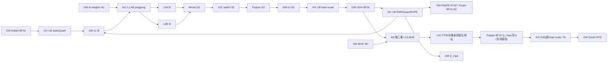
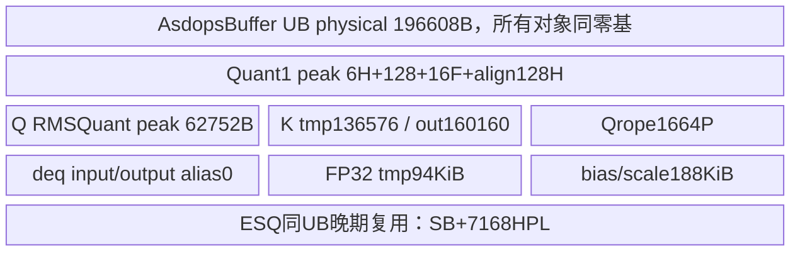

# SGL MLA预处理INT8缓存 A2/A3 ACLNN 算子知识

## 算子速览

| 项目 | 内容 |
|---|---|
| 实际入口 | 公开aclnnSglMlaPreprocessGetWorkspaceSize / aclnnSglMlaPreprocess，kernel commit dda6d36b0cdb4081e102d14c0a2fb276fc416e69 |
| 计算语义 | BF16 hidden静态I8量化/两次INT8乘+AIV反量化，latent RMSNorm→INT8 NoPE NZ缓存，BF16 RoPE NZ缓存；第三乘先落BF16，再按head scale静态量化Q_nope INT8，Q_rope BF16 |
| 输入输出 | hidden BF16[N,H]、INT8 NZ WDQKV/WUQ、BF16 WUK[A,128,512]；cache0/Q0输出INT8、rope cache/Q1 BF16；cache_mode固定2，quant_mode固定0 |
| 执行类型 | 单AICORE entry的MIX_CV，AIC3乘，AIV量化/反量化/RMS/RoPE/cache及EinSumQuant；非多Kernel |
| Kernel 路线 | R-001 key258 BF16 qmode0/cache2；R-002 qmode1/2/3→266/274/282无匹配终点 |
| 核心资源 | user=4W8+8N；AsdopsBuffer物理L1 512KiB、L0A/B64KiB、L0C128KiB、UB192KiB均同层零基复用；ESQ UB=32*align16(A)+7168*headPerLoop |
| 来源闭包 | source_closed：pair/OpDef/Host/POD/router/current BF16 body、全部命中device_prims、SDK9.1 tensor/参数/同步定义与active CMake闭合。generated bridge/硬件指令是明确边界 |
| 验证状态 | 已完成源码闭包检查；本次知识提取未执行编译、真机、数值或性能测试。draft：AIC sub_block_idx读前未初始化、第三乘l0c_buf无地址producer；后续仅为条件到达语句时的符号分析，不称安全复用。 |

## 接口与语义

### 计算语义

令N=tokens、H=hidden、A=heads。前两投影的实际body与浮点输出语义有公共算术，但本卡独立闭合最终INT8输出和缓存：Q0=CastI8(clamp(CastFP16(FP32(hidden)/scale0+offset0)))；**gamma0/beta0未在第一Quant读取**。INT8 MM1在INT32累加后先加bias0，再转FP32乘descale0、castBF16，L[N,2112]拆latent576和query1536；query以FP32 RMSNorm(eps1e−6)*gamma1+beta1，再静态量化I8做MM2，后者同INT32+bias1→FP32*descale1→BF16得到[N,A,192]。

latent前512经FP32 RMSNorm(eps1e−6)*gamma2，再乘 **1/ctkv_scale[0]**，castFP16→clamp[-128,127]→INT8 RINT，写NoPE NZ C032/block128；latent后64做half-rotation RoPE、castBF16RINT，写RoPE NZ C016/block128。slot=-1仅跳cache写，Q仍计算；其它非法slot/重复写无保护。

MM2每head前128与BF16 WUK[128,512]做第三乘，FP32累加后Fixpipe F322BF16，**先在s1存BF16 Q_nope**；AIC全部第三乘结束经flag11全AIC屏障、flag12发给AIV后，EinSumQuant读取BF16→FP32，乘每head **q_nope_scale[h]原值（没有取倒数）**，FP32→FP16→clamp[-128,127]→INT8 RINT，写Q0[N,A,512]。Q_rope来自MM2后64，FP32half旋转后BF16RINT写Q1[N,A,64]。因此这不是“浮点cache卡换dtype”：它增加K量化、NZ C032布局、BF16第三乘物化与独立ESQ阶段，以及不同scale方向/舍入边界。

QuantMode0为前处理静态非对称，不表示所有量化均per-token。qmode1/2/3没有entry；BF16模板中per-token代码未实例化，本卡不宣传支持。cache0/1/3浮点输出由[独立浮点语义卡](sgl_mla_preprocess_float_cache.md)负责，不能用其输出精度替代本card。

### 输入、输出与属性

| 参数 | shape/layout | dtype | 约束、默认值与语义 |
|---|---|---|---|
| hidden_state | [N,H] ND | BF16 only | N1..1024，公开H2048..8192；Host仅H>0且窄化u32，无完整对齐/上界guard |
| gamma0 | 文档[H] | BF16 | 当前第一Quant不读其值 |
| beta0 | 文档[H] | BF16 | 同上，不补第一norm |
| wdqkv | logical[2112,H] physicalNZ | INT8 | adapter rank2/4，实际物理NZ准备由caller负责，无TransData |
| descale0 | [2112] | FP32 | AIV (I32acc+bias)*scale后BF16 |
| gamma1 | [1536] | BF16 | query norm因子 |
| beta1 | [1536] | BF16 | query norm后bias |
| wuq | logical[A*192,1536] physicalNZ | INT8 | body transBtrue |
| descale1 | [A*192] | FP32 | 第二乘反量化 |
| gamma2 | [512] | BF16 | latent norm，无beta |
| cos | [N,64] | BF16 | Q/K同表 |
| sin | [N,64] | BF16 | half旋转32+32 |
| wuk | [A,128,512] ND | BF16 | adapter rank3/A>0/末512，未核对中间128 |
| kv_cache | physical[blocks,16,128,32] | INT8 | NoPE NZ；input仅descriptor/shape/dtype，实际写output cache |
| kv_cache_rope | physical[blocks,4,128,16] | BF16 | RoPE NZ，actualentry不读input cache内容 |
| slotmapping | [N] | INT32 | Device仅-1跳过；NZ outer=slot/128、inner=slot%128 |
| quant_scale0 | [1]逻辑，Device32B加载 | BF16 | 第一静态量化除数，无0/finite guard |
| quant_offset0 | [1]逻辑，Device32B加载 | INT8 | static非对称偏移 |
| bias0 | [2112] | INT32 | INT32域先加后scale |
| quant_scale1 | [1]逻辑/32B加载 | BF16 | 第二静态量化除数 |
| quant_offset1 | [1]逻辑/32B加载 | INT8 | 第二偏移 |
| bias1 | [A*192] | INT32 | 第二乘INT32域bias |
| ctkv_scale | [1]、nonempty | BF16 | cache2必需；K_nope乘其倒数 |
| q_nope_scale | [A]、nonempty | BF16 | cache2必需；Q_nope乘其原值，pad到align16(A)，广播8份FP32 |
| cache_mode | int64 | 2/int8_nzcache | 默认1不属本卡；FP16此模式Host拒绝 |
| quant_mode | int64 | 0/per_tensor_quant_asymm | Python默认0；C++None/OpDef默认1→key266无匹配；raw2/3同样无结果 |
| q_out0 | [N,A,512] ND | INT8 | caller preallocated，ESQ写 |
| kv_cache_out0 | 同INT8 kv_cache形状 | INT8 | caller需保证合适storage/别名；Device不自动input→output复制 |
| q_out1 | [N,A,64] ND | BF16 | Qrope写 |
| kv_cache_out1 | 同BF16 rope cache形状 | BF16 | Krope NZ写；仅slot触及位置提交 |

### 入口与版本

完整读取[同源API](../../../../apis/sgl_kernel_npu/sgl_mla_preprocess.md)和冻结mla_preprocess精确查询，已有API/模型集成Guide不是本native INT8输出Operator。公开硬件表arch22 Supported/arch35 Not supported，Python_ARCH22/CMake2201/architectures.json对应A2/A3，950不纳入。CANN9.1.0来自固定README/CI；SDK固定e5451c7feba11f9e259f4fbc19c4bf82f8c0496c。当前native attention/mla_preprocess BF16 body及utils/kernel/device_prims构建，legacy目录不另启动。FP16 float组合的文档冲突不用于扩张本BF16-only模式。

## Host/Launcher 执行流程

### 参数校验与前处理

Python explicit cache_mode=int8_nzcache、qmode0字符串→Torch。adapter先NPU及所有非optional同设备，ParseCacheMode→2、ParseQuantMode→0；hidden只FP16/BF16、rank2，weightsrank2/4，wukrank3，cachesrank4、slotrank1/I32/N匹配，N1..1024、A>0、wuk末512。FP16 cache2拒绝，BF16descales要求FP32；cache0和Q0需INT8，cacheRope/Q1/cacheOut1需BF16，ctkv_scale和q_nope_scale必须defined/nonempty。optional scales没有加入前面的同设备循环，完整dtype/shape由owned代码没有充分检查；普通inputs/outputs同NPU但未检查contiguous，也不转换。

24input/4output通过aclCreateTensor描述为ND，WDQKV/WUQ硬指定INT8、offsetINT8、biasINT32，未逐项核对原Tensor真实dtype；body按原始物理NZ指针读weight，无自动format_cast。Host只检查hidden/wuk基本rank/N/H/A和dtype/attrs域，cache2 KV输入必须INT8，核数>0；其余shape/stride/slot/scale值及完整输出extent无owned guard。Infer Q0[N,A,512]INT8、Q1[N,A,64]BF16，cache复制输入shape。

### 参数、Workspace 与生命周期

W8=N*max(max(H,1024A),384A,4224,4*max(192A,2112)) B；cache2专门令s1factor=max(H,A*512*2)，保证第三乘BF16 Q_nope可复用s1。user=4W8+8N，s1/2/3/4/5 offsets0,W8,2W8,3W8,4W8。qmode0 s5数值dormant。s1生命周期依次I8 Q0→I8 Q2→BF16 MM3输出，由全阶段同步隔开，最后ESQ仅读s1写caller Qout。

query失败TORCH_CHECK；query成功workspaceSize≤INT64_MAX后at::empty Byte，不清零。record_stream所有caller tensors/outputs/optional scales/workspace，lambda捕获owners/descriptors/executor/current stream；execute失败TORCH_CHECK，返回4个caller引用。cache input/output是否同storage由caller保证，没有库内全量copy或别名核对。CANN generated bridge/executor为边界。总query=libapi+user，entry GetUserWorkspace取user起点。

### 启动图与失败传播

单entry，Host blockDim=C，owned无显式task type宏；真实c220 AIC/AIV body形成MIX_CV。SDK2201 GetBlockIdx AIC=c，AIV=c*taskRation+sub，body按2映射paired核。所有stage在同launch：
```text
AIV Quant0 -> barrier1 -> start2 -> AIC MM1 I32
 AIC per tile7 <-> AIV deq1/ack8 every5
 AIV all barrier4 -> Q RMSQuant -> barrier5 -> start6 -> AIC MM2 I32
 AIV Kcache INT8 NoPE/BF16RoPE (overlap CubeMM2)
 AIV deq2 tile7/8 -> all barrier9 -> start3 -> AIC MM3 BF16 s1
 AIV Qrope BF16 output
 AIC all FIX flag11 set/wait -> paired flag12
 AIV wait12 -> EinSumQuant BF16 s1 * perHeadScale -> I8 Qout0
qmode1/2/3: default break，无body/无fallback
```
AIC ctor sub_block_idx宏外未初始化读取、MM3 LocalTensor L0C未初始化地址是可达静态风险终点；不推定运行会继续，也不丢弃后续可见body的符号化资源/同步知识。

## Route 与参数设计

### 分核与资源计算

三乘是(1,N,H,2112)、(1,N,1536,A*192)、(A,N,128,512)，transAfalse，前两transBtrue/I8→I32，第三transBfalse/BF16→FP32。前两deqOnTheFlytrue、L1 AB budget524288；Host候选M/N0以16倍增到512，M0*N0*4≤平台L0C、INT8 N0≤256，L2 footprint系数/方向惩罚决定GetCost，单Mloop余核<3/4可重拆N0；k0按L1半预算/((M0+N0)*inBytes)后I8向下32/512、第三乘16/256/512；blockDim=min(coreLoop,C)。Device两个INT8和第三乘实际direction0，entry遗漏swizzleDirect保留0，enShuffleK/enLoadAllAmat的Host producer均false，无true路线。

RMS rows=ceil(N/V)分核，末核截断；Qrope按N*A分head，P=floor(platformUB/2688)。ESQ另按N批在V核前/尾分配：front=N%V，frontBatch=ceil(N/V)，tailBatch=floor(N/V)，each batch[A,512]。令A16=align16(A)、SB=32*A16字节、Ubudget=196352−1024=195328，headPerLoop=floor((Ubudget−SB)/7168)，headLoops=floor(A/headPerLoop)、headTail=A%headPerLoop，colLoops512/64=8、colTail0。实际ESQ UB峰值SB+7168*headPerLoop≤195328，前提unsigned减法不下溢且headPerLoop>0；Host没有显式检查这些前提，不在任意大A下保证安全。

### Route 选择

| 顺序 | Route | Key/模板 | 精确选择条件与优先级 | 不适用去向 |
|---:|---|---|---|---|
| 1 | R-001 BF16 static quant+INT8 NZcache | 258=(1<<8) OR2 OR(0<<3)；MLAOperation<__bf16,2,NZ,NZ,ND,qmode0> | A2/A3，hiddenBF16、cache2、qmode0、N/H/A基本合法、KV/Q0 INT8、两scale非空，真实NZ128布局 | 不满足dtype/cacheguard失败；qmode非0走R-002 |
| 2 | R-002 无匹配qmode | 266/274/282 | raw/字符串qmode1..3通过Host但entry无case | default break，无owned结果 |
```text
FP16 cache2 -> Host fail
BF16 cache2 + KVdtype!=I8 -> Host fail
BF16 cache2 + two optional scales missing/empty -> adapter fail
BF16 cache2 + qmode0 ->258 -> full body
BF16 cache2 + qmode1/2/3 ->266/274/282 ->default break
other cache values ->另一浮点语义，不在本卡
```

### 模板/实现执行矩阵

| Route | key/selector | dtype/shape/platform 完整命中条件 | 执行族与 kernel 节点 | 实际模板/body | 内存与同步特征 | tail/fallback |
|---|---|---|---|---|---|---|
| R-001 | 258,qmode0,cache2 | A2/A3，BF16[N,H]，N1..1024/H>0/A>0，weightsI8NZ/WUKBF16ND；cacheQ0I8、ropeBF16、ctkv/qscale非空；资源/slot条件见guard | 单MIX，AIC MM1/MM2/MM3，AIV Quant0/deq1/RMSQuant/Kquant+RoPE/deq2/Qrope/ESQ | MLAPO_BF16::MLAOperation<__bf16,2,NZ,NZ,ND,PER_TENSOR_ASYMM_QUANT>；Aic<false,0,ND,NZ>；Aiv<__bf16,false,qmode0>；EinSum<__bf16,__bf16,ND,false,0,64,0>；EinSumQuant<__bf16,__bf16> | 4W8+8N，s1追加BF16第三乘复用，7/8 counter、阶段barrier、flag11/12；ESQ双buffer | M/N/K尾、heads尾、pad16scale、slot-1跳cache；无fallback |
| R-002 | 266/274/282 | Host合法BF16/cache2/qmode1/2/3 | 无计算body | switch default | 有Hostworkspace但不构造Device对象 | entry无writer，不是perToken |

### 隐藏性能 Guard

| Guard | Host/Tiling 条件 | Device/资源原因 | 影响 Route | 不满足时去向 | 源码符号 |
|---|---|---|---|---|---|
| 平台/BF16 | CMake2201、公开arch22；FP16 cache2明确拒 | 当前仅BF16I8缓存case | 1 | unsupported/Host失败 | CMake/Host/entry |
| qmode | Host0..3、entry只0 | static quant唯一实例 | 1/2 | R-002，无perToken | SetTilingKey/switch |
| cache2 types/scales | kv/Q0 INT8，rope BF16，两scale非空 | K I8与Q ESQ实际消费 | 1 | adapter失败；raw还需遵守完整dtype/shape | torch_adapter |
| NZ128 | 文档block128、bodyC032/16写死 | slot散写两个不同C0 | 1 | 没有其它layout fallback，rank4不充分 | RmsNormAndRopeConvergence1 |
| MM tile | M0*N0*4≤L0C，INT8N0≤256；K0对齐 | L1/AB/C当前extent | 1 | candidate skip、非法0值无显式fallback | PpMatmulTilingApi |
| ESQ UB | SB=32align16(A)，HPL=floor((195328−SB)/7168)；Brcb repeat=A16/8窄化uint8 | 双I/O/FP32buffer总SB+7168HPL | 1 | 未检查SB≤195328/HPL>0，极端A可下溢/除0 | EinSumQuantTiling |
| scalar/stride | no scale0/1/ctkv非零guard，未全检连续/NZ/H对齐 | 倒数、32B加载与I8Kround32 | 1 | 无安全fallback | Quant/adapter |
| slot | only−1 skip | 物理cache地址 | 1 | 其它非法值/重复写不保护 | cache helper |
| C++状态 | AIC sub未初始化，MM3 L0C无地址 | 存在body但不保证运行进展/正确 | 1 | 静态风险终点，下游只作符号路径 | ctor/EinSum.Init |

### POD/ABI

Host `MlaTilingData tilingData;`与Device local POD的字段均有声明默认值；嵌套Pp字段也逐个0初始化。Host memcpy全结构，Device逐字段handoff只复制源码列出的字段。固定源无sizeof/alignof/offsetof数值断言或编译报告；下表A布局是uint32=4/align4、uint64=8/align8、自然对齐下的静态候选：Pp size68/align4；Mla size416/align8，不能代替工具链实际sizeof。A偏移为推导而非运行验证；raw容量与拷贝都使用实际sizeof，必须同头同ABI。

| 结构 | 字段 | 类型/位宽 | ABI 布局 | 单位 | Host/launcher producer | Device consumer | 边界 |
|---|---|---|---|---|---|---|---|
| MlaTilingData | tilingKey | uint32_t/32 | A offset0；见自然ABI前提 | selector | SetTilingKey: (isBF16<<8)|cache|(qmode<<3) | entry copy→switch | 仅6个qmode0case，本卡key258及3未匹配qmode key；outer CANN key0独立 |
| MlaTilingData | userWorkspaceSize | uint64_t/64 | A offset8；见自然ABI前提 | bytes | SetMlapoWorkSpace: 本cache2 4W8+8N，s1factor=max(H,1024A) | Host query；entry不复制，local默认0且body不读 | 与libapi只加一次 |
| MlaTilingData | s1Offset | uint64_t/64 | A offset16；见自然ABI前提 | bytes | SetMlapoWorkSpace: 0*W8 | entry copy→userWorkspace+offset→Init s1 | stage alias，见资源/边 |
| MlaTilingData | s2Offset | uint64_t/64 | A offset24；见自然ABI前提 | bytes | SetMlapoWorkSpace: 1*W8 | entry copy→userWorkspace+offset→Init s2 | stage alias，见资源/边 |
| MlaTilingData | s3Offset | uint64_t/64 | A offset32；见自然ABI前提 | bytes | SetMlapoWorkSpace: 2*W8 | entry copy→userWorkspace+offset→Init s3 | stage alias，见资源/边 |
| MlaTilingData | s4Offset | uint64_t/64 | A offset40；见自然ABI前提 | bytes | SetMlapoWorkSpace: 3*W8 | entry copy→userWorkspace+offset→Init s4 | 本cache2 BF16 s4活动；s5 qmode0值inactive |
| MlaTilingData | s5Offset | uint64_t/64 | A offset48；见自然ABI前提 | bytes | SetMlapoWorkSpace: 4*W8 | entry copy→userWorkspace+offset→Init s5 | 本cache2 BF16 s4活动；s5 qmode0值inactive |
| MlaTilingData | numCore | uint32_t/32 | A offset56；见自然ABI前提 | AIC cores | Init: platform.coreNumAic | entry复制；计算body未直接读取 | 不能代替mm*.blockDim或rmsNumCore1 |
| MlaTilingData | n | uint32_t/32 | A offset60；见自然ABI前提 | tokens | Init: opParam.N | entry复制→MLAOperation.num_row/Quant.rows | N1..1024 |
| MlaTilingData | perTaskNum | uint32_t/32 | A offset64；见自然ABI前提 | task | 无Host赋值，声明默认0 | entry复制→splitN，splitN无后继消费者 | dormant，不能补分核producer |
| MlaTilingData | resTaskNum | uint32_t/32 | A offset68；见自然ABI前提 | task | 无Host赋值，默认0 | entry复制；body未消费 | dormant |
| MlaTilingData | mm1 | PpMatmulTilingData | A offset72；见自然ABI前提 | aggregate | Init/GetTilingData(mm1) | entry逐字段copy；本cache2 BF16 Aic/Aiv | A:68B/align4 |
| MlaTilingData | mm2 | PpMatmulTilingData | A offset140；见自然ABI前提 | aggregate | Init/GetTilingData(mm2) | entry逐字段copy；本cache2 BF16 Aic/Aiv | A:68B/align4 |
| MlaTilingData | mm3 | PpMatmulTilingData | A offset208；见自然ABI前提 | aggregate | Init/GetTilingData(mm3) | entry逐字段copy→PpMatmulEinSum | A:68B/align4 |
| MlaTilingData | rmsNumCore1 | uint32_t/32 | A offset276；见自然ABI前提 | AIV cores | RmsNormQuantTiling: platform.coreNumAiv | entry复制→MLAOperation.num_core_，rows partition | 第二字段不新增另一分核方案 |
| MlaTilingData | rmsNumCol1 | uint32_t/32 | A offset280；见自然ABI前提 | elements | RmsNormQuantTiling: H | entry复制→num_col_1/2→Quant/RmsNormQuant | 第一量化无norm |
| MlaTilingData | rmsNumRow1 | uint32_t/32 | A offset284；见自然ABI前提 | rows | RmsNormQuantTiling: N | entry遗漏→local0；helper用mlaParams.n | 无活动值消费者 |
| MlaTilingData | rmsQuantMin1 | uint32_t/32 | A offset288；见自然ABI前提 | unsigned bit pattern | RmsNormQuantTiling: -CONST_128→u32 | entry遗漏→local0；helper本地quantMin=-128 | 不将u32解释成有符号数值保证 |
| MlaTilingData | rmsNumCore2 | uint32_t/32 | A offset292；见自然ABI前提 | AIV cores | RmsNormQuantTiling: platform.coreNumAiv | entry复制，但MLAOperation按rmsNumCore1分两段 | 第二字段不新增另一分核方案 |
| MlaTilingData | rmsNumCol2 | uint32_t/32 | A offset296；见自然ABI前提 | elements | RmsNormQuantTiling: 2112 | entry复制→num_col_1/2→Quant/RmsNormQuant | stride576，实际query1536 |
| MlaTilingData | rmsNumRow2 | uint32_t/32 | A offset300；见自然ABI前提 | rows | RmsNormQuantTiling: N | entry遗漏→local0；helper用mlaParams.n | 无活动值消费者 |
| MlaTilingData | rmsQuantMin2 | uint32_t/32 | A offset304；见自然ABI前提 | unsigned bit pattern | RmsNormQuantTiling: -CONST_128→u32 | entry遗漏→local0；helper本地quantMin=-128 | 不将u32解释成有符号数值保证 |
| MlaTilingData | hiddenSizeQ | uint32_t/32 | A offset308；见自然ABI前提 | elements | RopeConcatTiling:64*A | entry复制→RopeInit字段读取（后续地址主要headDim/headNum） | P=UB/2688；无P==0保护，N*A用u32 |
| MlaTilingData | headNumQ | uint32_t/32 | A offset312；见自然ABI前提 | heads | RopeConcatTiling:A | entry复制→RopeFp16 head分组/cos复制 | P=UB/2688；无P==0保护，N*A用u32 |
| MlaTilingData | headDim | uint32_t/32 | A offset316；见自然ABI前提 | elements | RopeConcatTiling:64 | entry复制→Qrope half32、搬运/分配 | P=UB/2688；无P==0保护，N*A用u32 |
| MlaTilingData | concatSize | uint32_t/32 | A offset320；见自然ABI前提 | elements | RopeConcatTiling:512 | entry复制→Q0合并输出stride576 | P=UB/2688；无P==0保护，N*A用u32 |
| MlaTilingData | rotaryCoeff | uint32_t/32 | A offset324；见自然ABI前提 | halves | RopeConcatTiling:2 | entry复制→rotateStride=headDim/2 | P=UB/2688；无P==0保护，N*A用u32 |
| MlaTilingData | ntokens | uint32_t/32 | A offset328；见自然ABI前提 | tokens | RopeConcatTiling:N | entry复制→RopeInit保存，head几何由Host其余字段 | P=UB/2688；无P==0保护，N*A用u32 |
| MlaTilingData | realCore | uint32_t/32 | A offset332；见自然ABI前提 | AIV cores | RopeConcatTiling:ceil(N*A/ceil(N*A/V)) | entry复制→Rope Process blockIdx>=realCore早退 | P=UB/2688；无P==0保护，N*A用u32 |
| MlaTilingData | nlCoreRun | uint32_t/32 | A offset336；见自然ABI前提 | heads/core | RopeConcatTiling:ceil(N*A/realCore) | entry复制→Rope core起始head | P=UB/2688；无P==0保护，N*A用u32 |
| MlaTilingData | lCoreRun | uint32_t/32 | A offset340；见自然ABI前提 | heads/core | RopeConcatTiling:源码赋nlCoreRun（不是计算的lCoreRun） | entry复制→RopeInit保存；实际尾循环用last*字段 | P=UB/2688；无P==0保护，N*A用u32 |
| MlaTilingData | maxNPerLoopForUb | uint32_t/32 | A offset344；见自然ABI前提 | heads/UBtile | RopeConcatTiling:floor(platformUB/2688) | entry复制→Rope数据buffer尺寸/loop | P=UB/2688；无P==0保护，N*A用u32 |
| MlaTilingData | preCoreLoopTime | uint32_t/32 | A offset348；见自然ABI前提 | loops | RopeConcatTiling:ceil(nlCoreRun/P) | entry复制→非最后core rope loops | P=UB/2688；无P==0保护，N*A用u32 |
| MlaTilingData | preCoreLoopNLast | uint32_t/32 | A offset352；见自然ABI前提 | heads | RopeConcatTiling:nlCoreRun−(preLoops−1)*P | entry复制→非最后core最后loopN | P=UB/2688；无P==0保护，N*A用u32 |
| MlaTilingData | lastCoreLoopTime | uint32_t/32 | A offset356；见自然ABI前提 | loops | RopeConcatTiling:ceil(actualLastCoreHeads/P) | entry复制→最后core rope loops | P=UB/2688；无P==0保护，N*A用u32 |
| MlaTilingData | lastCoreLoopNLast | uint32_t/32 | A offset360；见自然ABI前提 | heads | RopeConcatTiling:actualLastCoreHeads−(lastLoops−1)*P | entry复制→最后core最后loopN | P=UB/2688；无P==0保护，N*A用u32 |
| MlaTilingData | esqFrontCore | uint32_t/32 | A offset364；见自然ABI前提 | counts | EinSumQuantTiling:N%V | entry复制→EinSumQuant::Init front核数 | 本cache2实际调用EinSumQuant::Process，HPL>0与SB/extent前提必须成立；仍不表示perToken |
| MlaTilingData | esqTailCore | uint32_t/32 | A offset368；见自然ABI前提 | counts | EinSumQuantTiling:V−N%V | entry复制→entry复制但EinSumQuant不直接读 | 本cache2实际调用EinSumQuant::Process，HPL>0与SB/extent前提必须成立；仍不表示perToken |
| MlaTilingData | esqFrontCoreBatch | uint32_t/32 | A offset372；见自然ABI前提 | counts | EinSumQuantTiling:ceil(N/V) | entry复制→EinSumQuant::Init batchNum | 本cache2实际调用EinSumQuant::Process，HPL>0与SB/extent前提必须成立；仍不表示perToken |
| MlaTilingData | esqTailCoreBatch | uint32_t/32 | A offset376；见自然ABI前提 | counts | EinSumQuantTiling:floor(N/V) | entry复制→EinSumQuant::Init batchNum | 本cache2实际调用EinSumQuant::Process，HPL>0与SB/extent前提必须成立；仍不表示perToken |
| MlaTilingData | esqHeadNum | uint32_t/32 | A offset380；见自然ABI前提 | counts | EinSumQuantTiling:A | entry复制→EinSumQuant::Init 几何 | 本cache2实际调用EinSumQuant::Process，HPL>0与SB/extent前提必须成立；仍不表示perToken |
| MlaTilingData | esqColNum | uint32_t/32 | A offset384；见自然ABI前提 | counts | EinSumQuantTiling:512 | entry复制→EinSumQuant::Init col | 本cache2实际调用EinSumQuant::Process，HPL>0与SB/extent前提必须成立；仍不表示perToken |
| MlaTilingData | esqUbHeadLoop | uint32_t/32 | A offset388；见自然ABI前提 | counts | EinSumQuantTiling:floor(A/headPerLoop) | entry复制→EinSumQuant::Init ubHeadLoop | 本cache2实际调用EinSumQuant::Process，HPL>0与SB/extent前提必须成立；仍不表示perToken |
| MlaTilingData | esqHeadPerLoop | uint32_t/32 | A offset392；见自然ABI前提 | counts | EinSumQuantTiling:见EinSumQuantTiling dtype公式 | entry复制→EinSumQuant::Init headPerLoop和buffer尺寸 | 本cache2实际调用EinSumQuant::Process，HPL>0与SB/extent前提必须成立；仍不表示perToken |
| MlaTilingData | esqHeadTail | uint32_t/32 | A offset396；见自然ABI前提 | counts | EinSumQuantTiling:A%headPerLoop | entry复制→EinSumQuant::Init headTail | 本cache2实际调用EinSumQuant::Process，HPL>0与SB/extent前提必须成立；仍不表示perToken |
| MlaTilingData | esqColLoop | uint32_t/32 | A offset400；见自然ABI前提 | counts | EinSumQuantTiling:512/(BF16?64:128) | entry复制→EinSumQuant::Init colLoop | 本cache2实际调用EinSumQuant::Process，HPL>0与SB/extent前提必须成立；仍不表示perToken |
| MlaTilingData | esqColTail | uint32_t/32 | A offset404；见自然ABI前提 | counts | EinSumQuantTiling:512%repeatMask=0 | entry复制→EinSumQuant::Init colTail | 本cache2实际调用EinSumQuant::Process，HPL>0与SB/extent前提必须成立；仍不表示perToken |
| MlaTilingData | hiddenStateDim | uint32_t/32 | A offset408；见自然ABI前提 | elements | Init: uint32(hiddenDim)，声明默认7168被覆盖 | entry复制→Quant/UB布局/第一乘K | Host仅H>0，cast上界/对齐未guard |
| PpMatmulTilingData mm1 | numBatch | uint32_t/32 | A内部offset0；whole72 | batch | GetTilingData(mm1): 1 | loops的batchIdx/GM batch offset | 结构size68/align4；INT8输入/INT32累加；BF16反量化另在AIV |
| PpMatmulTilingData mm1 | m | uint32_t/32 | A内部offset4；whole76 | elements | GetTilingData(mm1): N | m tail、行stride | 结构size68/align4；INT8输入/INT32累加；BF16反量化另在AIV |
| PpMatmulTilingData mm1 | k | uint32_t/32 | A内部offset8；whole80 | elements | GetTilingData(mm1): H | Kloops/offset、INT8round32或浮点round16 | 结构size68/align4；INT8输入/INT32累加；BF16反量化另在AIV |
| PpMatmulTilingData mm1 | n | uint32_t/32 | A内部offset12；whole84 | elements | GetTilingData(mm1): 2112 | Nloops、output stride | 结构size68/align4；INT8输入/INT32累加；BF16反量化另在AIV |
| PpMatmulTilingData mm1 | m0 | uint32_t/32 | A内部offset16；whole88 | elements | GetTilingData(mm1): tile search | Mtile actual/round | 结构size68/align4；INT8输入/INT32累加；BF16反量化另在AIV |
| PpMatmulTilingData mm1 | k0 | uint32_t/32 | A内部offset20；whole92 | elements | GetTilingData(mm1): FP16 budget518144/BF16 524288半容量公式 | K_L1分块 | 结构size68/align4；INT8输入/INT32累加；BF16反量化另在AIV |
| PpMatmulTilingData mm1 | n0 | uint32_t/32 | A内部offset24；whole96 | elements | GetTilingData(mm1): tile search≤256 | Ntile actual/round | 结构size68/align4；INT8输入/INT32累加；BF16反量化另在AIV |
| PpMatmulTilingData mm1 | mLoop | uint32_t/32 | A内部offset28；whole100 | loops | GetTilingData(mm1): ceil(N/m0) | mLoop/tdim.m | 结构size68/align4；INT8输入/INT32累加；BF16反量化另在AIV |
| PpMatmulTilingData mm1 | kLoop | uint32_t/32 | A内部offset32；whole104 | loops | GetTilingData(mm1): ceil(H/k0) | K_L1 loops | 结构size68/align4；INT8输入/INT32累加；BF16反量化另在AIV |
| PpMatmulTilingData mm1 | nLoop | uint32_t/32 | A内部offset36；whole108 | loops | GetTilingData(mm1): ceil(2112/n0) | nLoop/tdim.n | 结构size68/align4；INT8输入/INT32累加；BF16反量化另在AIV |
| PpMatmulTilingData mm1 | coreLoop | uint32_t/32 | A内部offset40；whole112 | tiles | GetTilingData(mm1): mLoop*nLoop | for loop_idx=core_idx;+=activeCore | 结构size68/align4；INT8输入/INT32累加；BF16反量化另在AIV |
| PpMatmulTilingData mm1 | swizzleCount | uint32_t/32 | A内部offset44；whole116 | tile count | GetTilingData(mm1): Swizzle selected count | Zn/Nz block index permutation | 结构size68/align4；INT8输入/INT32累加；BF16反量化另在AIV |
| PpMatmulTilingData mm1 | swizzleDirect | uint32_t/32 | A内部offset48；whole120 | enum | GetTilingData(mm1): Swizzle member last assigned | entry对三份均不复制，local默认0；FP16MM2模板方向1，其它方向0 | 结构size68/align4；handoff遗漏不据Host值推Device方向 |
| PpMatmulTilingData mm1 | enShuffleK | uint32_t/32 | A内部offset52；whole124 | bool/u32 | GetTilingData(mm1): 默认false/0 | 当前不shuffleK；entrycopy但无true producer | 结构size68/align4；无true Host路由 |
| PpMatmulTilingData mm1 | blockDim | uint32_t/32 | A内部offset56；whole128 | AIC cores | GetTilingData(mm1): min(coreLoop,C) | 当前activeCore数，未用核仍参加阶段wait | 结构size68/align4；INT8输入/INT32累加；BF16反量化另在AIV |
| PpMatmulTilingData mm1 | enLoadAllAmat | uint32_t/32 | A内部offset60；whole132 | bool/u32 | GetTilingData(mm1): 默认false/0 | mm1/mm2 entrycopy后False分块；mm3遗漏且EinSum不读 | 结构size68/align4；无true Host路由 |
| PpMatmulTilingData mm1 | b0matPingPongBufferLen | uint32_t/32 | A内部offset64；whole136 | bytes/int8 elements | GetTilingData(mm1): 默认262144 | mm1/mm2 entrycopy后B相邻pingpong距离；mm3遗漏→0且EinSum固定131072半精度元素 | 结构size68/align4；INT8输入/INT32累加；BF16反量化另在AIV |
| PpMatmulTilingData mm2 | numBatch | uint32_t/32 | A内部offset0；whole140 | batch | GetTilingData(mm2): 1 | loops的batchIdx/GM batch offset | 结构size68/align4；INT8输入/INT32累加；BF16反量化另在AIV |
| PpMatmulTilingData mm2 | m | uint32_t/32 | A内部offset4；whole144 | elements | GetTilingData(mm2): N | m tail、行stride | 结构size68/align4；INT8输入/INT32累加；BF16反量化另在AIV |
| PpMatmulTilingData mm2 | k | uint32_t/32 | A内部offset8；whole148 | elements | GetTilingData(mm2): 1536 | Kloops/offset、INT8round32或浮点round16 | 结构size68/align4；INT8输入/INT32累加；BF16反量化另在AIV |
| PpMatmulTilingData mm2 | n | uint32_t/32 | A内部offset12；whole152 | elements | GetTilingData(mm2): A*192 | Nloops、output stride | 结构size68/align4；INT8输入/INT32累加；BF16反量化另在AIV |
| PpMatmulTilingData mm2 | m0 | uint32_t/32 | A内部offset16；whole156 | elements | GetTilingData(mm2): tile search | Mtile actual/round | 结构size68/align4；INT8输入/INT32累加；BF16反量化另在AIV |
| PpMatmulTilingData mm2 | k0 | uint32_t/32 | A内部offset20；whole160 | elements | GetTilingData(mm2): 同mm1 | K_L1分块 | 结构size68/align4；INT8输入/INT32累加；BF16反量化另在AIV |
| PpMatmulTilingData mm2 | n0 | uint32_t/32 | A内部offset24；whole164 | elements | GetTilingData(mm2): tile search≤256 | Ntile actual/round | 结构size68/align4；INT8输入/INT32累加；BF16反量化另在AIV |
| PpMatmulTilingData mm2 | mLoop | uint32_t/32 | A内部offset28；whole168 | loops | GetTilingData(mm2): ceil(N/m0) | mLoop/tdim.m | 结构size68/align4；INT8输入/INT32累加；BF16反量化另在AIV |
| PpMatmulTilingData mm2 | kLoop | uint32_t/32 | A内部offset32；whole172 | loops | GetTilingData(mm2): ceil(1536/k0) | K_L1 loops | 结构size68/align4；INT8输入/INT32累加；BF16反量化另在AIV |
| PpMatmulTilingData mm2 | nLoop | uint32_t/32 | A内部offset36；whole176 | loops | GetTilingData(mm2): ceil(A*192/n0) | nLoop/tdim.n | 结构size68/align4；INT8输入/INT32累加；BF16反量化另在AIV |
| PpMatmulTilingData mm2 | coreLoop | uint32_t/32 | A内部offset40；whole180 | tiles | GetTilingData(mm2): mLoop*nLoop | for loop_idx=core_idx;+=activeCore | 结构size68/align4；INT8输入/INT32累加；BF16反量化另在AIV |
| PpMatmulTilingData mm2 | swizzleCount | uint32_t/32 | A内部offset44；whole184 | tile count | GetTilingData(mm2): Swizzle selected count | Zn/Nz block index permutation | 结构size68/align4；INT8输入/INT32累加；BF16反量化另在AIV |
| PpMatmulTilingData mm2 | swizzleDirect | uint32_t/32 | A内部offset48；whole188 | enum | GetTilingData(mm2): Swizzle member last assigned | entry对三份均不复制，local默认0；FP16MM2模板方向1，其它方向0 | 结构size68/align4；handoff遗漏不据Host值推Device方向 |
| PpMatmulTilingData mm2 | enShuffleK | uint32_t/32 | A内部offset52；whole192 | bool/u32 | GetTilingData(mm2): 默认false/0 | 当前不shuffleK；entrycopy但无true producer | 结构size68/align4；无true Host路由 |
| PpMatmulTilingData mm2 | blockDim | uint32_t/32 | A内部offset56；whole196 | AIC cores | GetTilingData(mm2): min(coreLoop,C) | 当前activeCore数，未用核仍参加阶段wait | 结构size68/align4；INT8输入/INT32累加；BF16反量化另在AIV |
| PpMatmulTilingData mm2 | enLoadAllAmat | uint32_t/32 | A内部offset60；whole200 | bool/u32 | GetTilingData(mm2): 默认false/0 | mm1/mm2 entrycopy后False分块；mm3遗漏且EinSum不读 | 结构size68/align4；无true Host路由 |
| PpMatmulTilingData mm2 | b0matPingPongBufferLen | uint32_t/32 | A内部offset64；whole204 | bytes/int8 elements | GetTilingData(mm2): 默认262144 | mm1/mm2 entrycopy后B相邻pingpong距离；mm3遗漏→0且EinSum固定131072半精度元素 | 结构size68/align4；INT8输入/INT32累加；BF16反量化另在AIV |
| PpMatmulTilingData mm3 | numBatch | uint32_t/32 | A内部offset0；whole208 | batch | GetTilingData(mm3): A | loops的batchIdx/GM batch offset | 结构size68/align4；EinSum当前浮点输入/FP32累加 |
| PpMatmulTilingData mm3 | m | uint32_t/32 | A内部offset4；whole212 | elements | GetTilingData(mm3): N | m tail、行stride | 结构size68/align4；EinSum当前浮点输入/FP32累加 |
| PpMatmulTilingData mm3 | k | uint32_t/32 | A内部offset8；whole216 | elements | GetTilingData(mm3): 128 | Kloops/offset、INT8round32或浮点round16 | 结构size68/align4；EinSum当前浮点输入/FP32累加 |
| PpMatmulTilingData mm3 | n | uint32_t/32 | A内部offset12；whole220 | elements | GetTilingData(mm3): 512 | Nloops、output stride | 结构size68/align4；EinSum当前浮点输入/FP32累加 |
| PpMatmulTilingData mm3 | m0 | uint32_t/32 | A内部offset16；whole224 | elements | GetTilingData(mm3): tile search | Mtile actual/round | 结构size68/align4；EinSum当前浮点输入/FP32累加 |
| PpMatmulTilingData mm3 | k0 | uint32_t/32 | A内部offset20；whole228 | elements | GetTilingData(mm3): 524288半容量、input2B | K_L1分块 | 结构size68/align4；EinSum当前浮点输入/FP32累加 |
| PpMatmulTilingData mm3 | n0 | uint32_t/32 | A内部offset24；whole232 | elements | GetTilingData(mm3): tile search≤512 | Ntile actual/round | 结构size68/align4；EinSum当前浮点输入/FP32累加 |
| PpMatmulTilingData mm3 | mLoop | uint32_t/32 | A内部offset28；whole236 | loops | GetTilingData(mm3): ceil(N/m0) | mLoop/tdim.m | 结构size68/align4；EinSum当前浮点输入/FP32累加 |
| PpMatmulTilingData mm3 | kLoop | uint32_t/32 | A内部offset32；whole240 | loops | GetTilingData(mm3): ceil(128/k0) | K_L1 loops | 结构size68/align4；EinSum当前浮点输入/FP32累加 |
| PpMatmulTilingData mm3 | nLoop | uint32_t/32 | A内部offset36；whole244 | loops | GetTilingData(mm3): ceil(512/n0) | nLoop/tdim.n | 结构size68/align4；EinSum当前浮点输入/FP32累加 |
| PpMatmulTilingData mm3 | coreLoop | uint32_t/32 | A内部offset40；whole248 | tiles | GetTilingData(mm3): A*mLoop*nLoop | for loop_idx=core_idx;+=activeCore | 结构size68/align4；EinSum当前浮点输入/FP32累加 |
| PpMatmulTilingData mm3 | swizzleCount | uint32_t/32 | A内部offset44；whole252 | tile count | GetTilingData(mm3): Swizzle selected count | Zn/Nz block index permutation | 结构size68/align4；EinSum当前浮点输入/FP32累加 |
| PpMatmulTilingData mm3 | swizzleDirect | uint32_t/32 | A内部offset48；whole256 | enum | GetTilingData(mm3): Swizzle member last assigned | entry对三份均不复制，local默认0；FP16MM2模板方向1，其它方向0 | 结构size68/align4；handoff遗漏不据Host值推Device方向 |
| PpMatmulTilingData mm3 | enShuffleK | uint32_t/32 | A内部offset52；whole260 | bool/u32 | GetTilingData(mm3): 默认false/0 | 当前不shuffleK；entrycopy但无true producer | 结构size68/align4；无true Host路由 |
| PpMatmulTilingData mm3 | blockDim | uint32_t/32 | A内部offset56；whole264 | AIC cores | GetTilingData(mm3): min(coreLoop,C) | 当前activeCore数，未用核仍参加阶段wait | 结构size68/align4；EinSum当前浮点输入/FP32累加 |
| PpMatmulTilingData mm3 | enLoadAllAmat | uint32_t/32 | A内部offset60；whole268 | bool/u32 | GetTilingData(mm3): 默认false/0 | mm1/mm2 entrycopy后False分块；mm3遗漏且EinSum不读 | 结构size68/align4；无true Host路由 |
| PpMatmulTilingData mm3 | b0matPingPongBufferLen | uint32_t/32 | A内部offset64；whole272 | bytes/int8 elements | GetTilingData(mm3): 默认262144 | mm1/mm2 entrycopy后B相邻pingpong距离；mm3遗漏→0且EinSum固定131072半精度元素 | 结构size68/align4；EinSum当前浮点输入/FP32累加 |

Device内部MatCoord、scalar fields和LocalTensor不是Host ABI。AsdopsBuffer各层LocalTensor<uint8_t>从地址0初始化，再以字节offset ReinterpretCast；多个对象同层同offset是真实别名，不是各自新申请192KiB UB/L1。SDK `LocalTensor() {}`及其 `TBuffAddr address_`没有默认成员初值，不能把未初始化第三乘l0c_buf当零基C0张量。全量结构的padding不携带语义；保留同头sizeof拷贝。


### Route 源码闭包

| Route | Key/selector | Host/Tiling producer | POD/参数 | Kernel entry/router | Kernel body/直接依赖 | 构建接线 |
|---|---|---|---|---|---|---|
| R-001 | 258/qmode0/cache2 | TilingSglMlaPreprocess/Init/EinSumQuantTiling/SetMlapoWorkSpace | MlaTilingData+3Pp，W8、ESQ几何、2scale指针 | entry case258→MLAPO_BF16::MLAOperation<__bf16,2,NZ,NZ,ND,qmode0> | BF16全body（Quant/RMS/deq/AIC/EinSum/Rope/Kquant/ESQ），device_prims当前iterator/mmad/mem；SDK9.1 tensor/struct/sync | native CMake2201/AICORE，include utils/kernel，cann_ops codegen |
| R-002 | 266/274/282 | 同Host编key | 同POD | default break | 无计算对象，不补模板perToken节点 | 同target，无其它qmode route |

## Kernel 实现

### 公共执行流程

entry PRELOAD2/SetAtomicnone/SetMasknorm，AIC padding0/NDpara；全POD GET后逐字段copy，省略swizzleDirect/无用rmsRows等保留默认；GetUserWorkspace和s1..s5地址；key258构造BF16 cache2对象，Init映射真实GM/UB/L1地址，随后Cube/Vector。每层AsdopsBuffer对象都初始化相同零基窗口，所有resource按阶段最大活跃范围而非对象数相加。SDK LocalTensor默认不赋地址与Mmad/同步参数已在固定9.1源中读取；硬件intrinsic、CANN generated bridge/executor是边界。AIC未初始化成员和第三乘L0C对象风险先限定，不给它们捏造producer或值。

### Route R-001：BF16 cache2 INT8 NZ缓存与Q量化

#### 适用条件

公开arch22/A2/A3内的BF16、qmode0、cache2子域；仍受draft静态缺陷和实际输入extent约束。 N1..1024、H>0、A>0；物理INT8 NZ WDQKV/WUQ、ND WUK[A,128,512]、数据布局/精度/所有caller输出满足接口约定。descaleFP32；Q0/cacheOut0 INT8、Q1/cacheOut1 BF16；ctkv_scale/q_nope_scale必须非空BF16。缓存NZ block128，NoPE C032、RoPE C016；caller输出与真实物理布局见下表。 qmode1/2/3不进入此body，走R-002。

##### 选择证据

| 层级 | 文件 | 符号 | 源码谓词/参数 | 结果/下一跳 |
|---|---|---|---|---|
| 公开/入口 | docs/api/en/operators/attention/mla_preprocess.md；torch_adapter.cpp | ParseCacheMode/ParseQuantMode | int8_nzcache→2；per_tensor_quant_asymm→0；hiddenBF16 | 当前公开子域 |
| Host | op_host/mla_preprocess_tiling.cpp | TilingSglMlaPreprocess/MlaPreprocessTiling::Init | cache=2,qmode0,isBf16=true；rank/N/H/A基本guard | 3个MM POD、RMS/Rope/ESQ几何、4W8+8N user |
| POD/router | op_kernel/mla_preprocess.cpp | SetTilingKey→switch case | (isBF16<<8) OR 2 OR (0<<3) | key258，MLAPO_BF16::MLAOperation<__bf16,2,DataFormat::NZ,DataFormat::NZ,DataFormat::ND,QuantMode::PER_TENSOR_ASYMM_QUANT> |
| body | op_kernel/mla_preprocess_mix_bf16.hpp | MLAOperation::Init/ProcessCube/ProcessVector | weights NZ/NZ/ND，splitGapC0，splitGapA64 | 同一entry AIC/AIV任务图；静态风险处不保证继续 |

#### Device 数据流

##### 函数级调用链

```text
sgl_mla_preprocess -> case 258 -> MLAPO_BF16::MLAOperation<__bf16,2,DataFormat::NZ,DataFormat::NZ,DataFormat::ND,QuantMode::PER_TENSOR_ASYMM_QUANT>
  ctor: AIC sub_block_idx未赋值却宏外读 -> 静态风险终点
  Init:
    GM views + row partition + Quant1.Init/RmsNormQuant2.Init/RopeFp16.RopeInit
    W8a8Aic<false,0,ND,NZ> MM1/MM2.Init；MM1 PreloadWeight
    EinSum<__bf16,__bf16,ND,false,0,64,0>.Init
       -> l1A/l1B/l0A/l0B addresses；l0c_buf没有赋值 -> 后续Mad/Fixpipe静态风险
  AIV ProcessVector:
    Quant1.Launch -> static Q0 FP32->FP16->I8 -> s1
    MM1 AIV.Process -> INT32+bias -> FP32*descale -> BF16 s3
    RmsNormQuant2.Launch(s3[:,576:],gamma1,beta1) -> I8 s1
    RmsNormAndRopeConvergence1 -> latent512 RMSNorm(gamma2) / ctkv_scale -> FP16/I8 NoPE NZ + BF16 Krope NZ
    MM2 AIV.Process -> INT32+bias -> FP32*descale -> BF16 s4
    RopeFp16.Process -> Qrope64 -> q_out1
    wait12 -> EinSumQuant<__bf16,__bf16>::Process
      Copy per-head BF16 scales/pad16 -> FP32/Brcb8
      Copy BF16 s1 Q_nope -> FP32 * q_nope_scale -> FP16 -> clamp/I8 -> q_out0
  AIC ProcessCube:
    MM1.Process -> INT32 s2 + tile7/8
    MM2.PreloadWeight / Process -> INT32 s2 + tile7/8
    EinSum.Process(BF16 s4 NoPE128, WUK) -> FP32 acc -> Fixpipe BF16 s1
    all-AIC flag11 set/wait -> paired flag12 permits ESQ
```

##### 源码等价伪码

```text
// 符号化伪码；未初始化变量/LocalTensor地址没有确定值，不能据此推定后续必执行。
entry localPOD = 声明默认值; copy only listed fields; user slices s1..s5
construct MLAOperation: block=GetBlockIdx; sub assigned only VECTOR macro
vectorBlock=(block/2)*2+sub   // AIC有未初始化读取风险
if reaches Init:
 AIV: rowWork=ceil(N/V); last活跃核rows截断；Gamma0/Beta0不参与第一Quant
 AIC: preload MM1 first2 K weight blocks in L1
 AIV Q0: copy H lowprec -> FP32; y=x/scale0+offset0
         FP32->FP16 CAST_NONE; clamp[-128,127]; I8 RINT(__CCE_AICORE__220)
         write s1[row*H], all-AIV flag1 barrier, mode2 start2
 AIC MM1: tileIdx=core; tileIdx<coreLoop; tileIdx+=mm1.blockDim
   Zn(direction0) -> mTile,nTile; m/n tail; K tiles k0, Kparts L0 capacity
   ND quantA + NZ weight -> L1 -> L0A/B -> I8*I8 INT32
   Fixpipe INT32 s2[row*2112+n]; set7; every5tiles wait8
 AIV deq1: each corresponding tile wait7; add I32bias, castF32*descale, castBF16 s3; every group firsttile posts8
 all-AIV flag4 barrier
 AIV Qnorm: read s3[row*2112+576 : +2112]
    fp32 rms(mean squares via 1/1536 +1e-6), *gamma1 +beta1
    /scale1+offset1 -> FP16 -> clamp -> I8 s1[row*1536]
 all-AIV flag5 barrier -> mode2 flag6 starts MM2
 AIC MM2: same I8 tile loop, INT32 s2 -> set7 / wait8; K=1536,Nout=A*192
 AIV Kcache (can overlap MM2):
   slot=slotmapping[row]; slot==-1 -> continue cache only
   read first576 of s3 row; normalize512 FP32*gamma2
   kNopeFP32 *= 1/ctkv_scale[0]; FP32->FP16->clamp/I8
   Krope64: q*cos + rotateHalf(q)*sin; castBF16
   outer=slot/128; inner=slot%128
   write NoPE NZ16groups*C032/I8; rope NZ4groups*C016/BF16
 AIV deq2: wait7 each INT32tile; add biasI32, scaleFP32, castBF16 -> s4
 all-AIV flag9 barrier -> mode2 flag3 starts MM3
 AIC MM3: for tileIdx=core; +=activeMM3cores:
   batch=head; Qinput rowstride=192*A, head offset=head*192
   WUK head[128,512] ND, no transB
   L1 pingpong + L0A/B pingpong; FP32 Mad accumulator l0c_buf (address无producer)
   Fixpipe BF16 -> s1 rowstride=512*A, head offset=head*512
 AIV Qrope: flat headIndex=row*A+h
   input s4[headIndex*192+128]; broadcast cos/sin[row,64]
   split32 rotateHalf, FP32 mul/add, CAST_RINT -> qOut1[headIndex*64]
 AIC all FIX flag11 set/wait -> paired flag12；AIV wait12
 AIV ESQ:
   batch分核front=N%V，frontBatch=ceil(N/V)、tailBatch=floor(N/V)
   SB=32*align16(A); HPL=floor((195328-SB)/7168); L=HPL*512
   load A BF16 q_nope_scale padded to align16(A); castFP32; Brcb8
   for local batch:
     for full HPL heads and headTail:
       p toggles0/1; wait input V_MTE2 p
       s1 BF16->UB input[p*L] -> FP32[p*L]
       for col64x8: Mul(perHeadFP32scale,FP32 input), no reciprocal
       FP32->FP16 CAST_NONE in-place; wait output MTE3_V p
       clamp[-128,127], I8 CAST_RINT -> q_out0 flattened [N,A,512]
       MTE3 release p; toggle; tail uses headTail*512 actual copy/count
 drain both pingpong V_MTE2/MTE3_V 0/1
```

Zn公式：inBatch=tileIdx%(mLoop*nLoop)，tileBlock=inBatch/(swizzleCount*nLoop)，inner=inBatch%(swizzleCount*nLoop)，nRow=最后tileBlock?mLoop−swizzleCount*tileBlock:swizzleCount；mIdx=tileBlock*swizzleCount+inner%nRow，nIdx=inner/nRow，奇tileBlock翻转nIdx。MM1/MM2与MM3全方向0；AIV deq从entry默认swizzleDirect0使用同Zn表。 Host swizzleDirect未在entry handoff复制，不能拿Host该值改这里实际静态方向。

#### 内存与数据搬运

##### 资源与搬运表

| 层级/缓冲区 | offset/地址公式 | extent/容量公式 | dtype/layout | producer | consumer | owner/lifetime | 对齐/复用 |
|---|---|---|---|---|---|---|---|
| GM inputs | hidden row*H；WD NZ: kIdx*k0*align16(Nout)+nIdx*n0*32；WUK=head*128*512+kIdx*k0*512+nIdx*n0 | caller tensor/static geometry | I8 NZ或BF16 ND | caller | Quant/Cube/Vector | record_stream+lambda | 无自动contiguous/NZ转换；actualstorage必须匹配 |
| GM Q0/Q1 | Q0:(row*A+h)*512+col I8；Q1:(row*A+h)*64+col BF16 | Q0=N*A*512B；Q1=N*A*64*2B | I8 ND / BF16 ND | ESQ / Qrope | caller | caller-owned输出，stream完成前保留 | MM3先写s1 BF16，不直接写Q0 |
| GM cacheOut | outer=slot/128,inner=slot%128；NoPE outer*128*512+inner*32+group*128*32；Rope outer*128*64+inner*16+group*128*16 | caller cache容量 | NoPE I8 NZ C032 / Rope BF16 NZ C016 | K RMSNorm+quant/RoPE | 后续caller | caller owner | slot-1不写，其它slot无范围/atomic保证 |
| user s1 | 0..W8 | W8=N*max(max(H,1024A),384A,4224,4max(192A,2112))B | Q0/Q2 I8→MM3 BF16 QNoPE | AIV Quant/RMSQuant，随后AIC MM3 | AIC MM1/MM2，随后AIV ESQ | single executor | Q0[N,H]→Q2[N,1536]→BF16[N,A,512]，flag阶段严格分开 |
| user s2 | W8..2W8 | W8 B | INT32 MM1，后复用INT32 MM2 | AIC MM1/2 Fixpipe | AIV deq1/deq2 | executor | deq1完成all-AIV4后，MM2才复用 |
| user s3 | 2W8..3W8 | W8 B | BF16 [N,2112] | AIV deq1 | query norm/Kcache | executor | source latent/query共用，Kcache与MM2可重叠但MM2不覆盖s3 |
| user s4 | 3W8..4W8 | W8 B | BF16 MM2[N,A*192] | AIV deq2 | MM3/Qrope | executor | all-AIV9后start3 |
| user s5 | 4W8..4W8+8N | 8N B | 2N FP32 dormant qmode0 | 无qmode0值producer | 无qmode0值consumer | executor | BF16 Init可建立view，不推perToken支持 |
| L1 INT8 MM A/B | A=0，B=Aextent；pingpong A/B各+262144B | AsdopsBuffer物理窗口524288B；Aextent=align512(M0*k0)，Bextent=nRound*kRound | I8 L1 NZ | gm_to_l1 ND2NZ/NZ copy | l1_to_l0 A/B | 每AIC多对象同零基别名；当前一乘生存 | Host full-load=false；需 max(baseA+262144+Aextent,baseB+262144+Bextent)≤524288，不把half预算当另外分配 |
| L1 MM3 A/B | A=0，B=align256(M0*k0*2)，两pingpong+131072*2=262144B | physical524288B；A=Mround*Kround*2，B=Nround*Kround*2 | BF16 NZ | Q ND2NZ/WUK ND2NZ | LoadData | 和前两乘复用同L1；前驱同步后才写 | M=1或Mtail1用VECTOR直拷；source rowstride特例单列 |
| L0A/B | INT8 p*32768元素=32768B；MM3 p*16384低精元素=32768B | A/B各65536B物理窗口 | I8/低精度fractal | LoadData2D/VECTOR | Mmad | 各AIC、两乘与第三乘复用 | 每Kpart wait M_MTE1 0/1，结束返还 |
| L0C MM1/MM2 | AsdopsBuffer CO1 addr0 | 131072B物理窗口；tile mRound*nRound*4 | INT32 | I8 Mmad | Fixpipe | 计算tile至Fix完成 | M0*N0*4 Host筛选；withBiasfalse |
| L0C MM3 | **LocalTensor l0c_buf未赋地址** | 物理有128KiB，当前对象地址/extent不可推定 | FP32预期累加类型 | 无可见地址producer | Mad/Fixpipe | 不是已初始化前两乘对象的隐式继承 | SDK默认构造不赋TBuffAddr；只记录风险后符号流程 |
| BT/FB | N/A；bias/scale在AIV | N/A | N/A | N/A | AIV deq另见下 | N/A | 不用FB反量化 |
| UB Quant1 | input0,scale6H,offset6H+32,x32=6H+64,buf=6H+64+4F；output=6H+128+16F | peak output+align128(H) B，F=align64(H) | BF16/FP32/FP16/I8 alias | DMA/Vector量化 | s1 | 同AIV UB全窗196608B；后阶段复用 | Gamma0/Beta0 storage有view但不做norm；scale倒数，no zero guard |
| UB Q RMSQuant | input0, gamma4224,beta7296,scale10368,offset10400,x32=10432,buf18880 | FP16 output44256+1536=45792B；BF16 output61216+1536=62752B | 2112输入取576后1536，FP32 g/sqx/work/sum等 | norm+scale+offset | s1 | UB与Quant1互斥复用 | eps1e−6，FP32square归约；tmp half别名死去work |
| UB K RMS/RoPE | input0,gamma4224,sin5248,cos5376,slots5504；tmp136576 | temp out=160160；低精576*2B，cal Reduce workspace最高约145536B，peak取max | BF16/FP32/slotI32 | K norm/RoPE | cacheOut0/1 | UB阶段；与Cube MM2重叠但不与同AIV其它UB使用重叠 | slots额外预留4096*32B；缓存模式决定DMA散写 |
| UB Qrope | S=128P,B=256P；Q16@0,Q32@S,reverse@S+B,cos16@S+2B,sin16@2S+2B,cos32@3S+2B,sin32@3S+3B,neg@3S+4B | end=3S+5B=1664P≤计划2688P，P=floor(platformUB/2688) | BF16/FP32 | MTE2→Vector | Qrope output | UB后期复用 | Host allSize还预算1024P concat区但当前Qrope未使用 |
| UB deq1/deq2 | inputI32/outputBF16 alias0，tmpFP32@94KiB=96256，bias/scale alias@188KiB=192512 | physical196608B；scale行≤N0*4≤1024B；I32 cast每次固定255*64元素，最后实际不足也执行整repeat | I32→FP32*FP32→BF16 | AIC GM C/MTE2/Vector | s3/s4 | 同UB两套对象分阶段复用 | input→output别名在读完输入后，bias→scale在加完bias后；overshoot只按源码描述不伪造mask保护 |
| UB ESQ | SB=32align16(A)，input BF16@SB，FP32@SB+4L，I8@SB+12L；p=0/1各以p*L元素索引 | input2*(2L)、FP322*(4L)、I82*(L)，合SB+14L=SB+7168HPL≤195328B，前提HPL>0/不下溢 | BF16→FP32 scale→FP16→I8 | s1/scale DMA/Vector | Qout0 MTE3 | 同UB晚期复用，非另配192KiB | scale先借input/FP32临时加载，Brcb存SB保留；tail按headTail实际count |
| scalar/register | tile coordinates、rowWork、offsets、flags、mlaParams local POD | 编译器决定，固定源无寄存器报告 | scalar/pointer | ctor/Init/loops | stages | entry/对象 | AIC sub_block_idx uninit、MM3 LocalTensor风险不设假定值 |

##### 分层内存布局





图为阶段复用：INT8 MM1/MM2与BF16 MM3复用L1/L0，deq1/deq2与Qnorm/K/Rope复用UB。NDDMA/SIMT/通信节点N/A；GM s1复用是明确的跨阶段buffer边。

##### 字节账、交接边与复用顺序

```text
W8=N*max(max(H,1024A),384A,4224,4*max(192A,2112)) B
user=4W8+8N; query=libapi+user
本cache2 BF16 s1/s2/s3/s4各W8+s5(8N)；s1再承接BF16[N,A,512]第三乘输出
all AsdopsBuffer objects per hardware layer alias same zero base:
 L1 capacity524288, L0A65536,L0B65536,L0C131072, UB196608 B
INT8 L1 actual highest endpoint=max(baseA+262144+Aextent,baseB+262144+Bextent)
MM3 L1 highest endpoint=align256(M0*k0*2)+262144+Nround*Kround*2
MM3 L0A/B double=2*16384*2=65536B；L0C对象extent未初始化，不能凭硬件窗口填成安全值
UB_peak = max(Quant1Peak,QnormPeak,Kpeak,1664P,deqPeak,SB+7168HPL), 不相加
Host Rope only guards2688P<=platformUB；其它peak需用实际H/A/tile反查，不存在全域资源guard
```

| 边/复用子区 | producer | offset/extent | dtype/layout | consumer | ordering/sync | owner/lifetime | 安全条件 |
|---|---|---|---|---|---|---|---|
| Q0→MM1 | AIV Quant1 MTE3 | s1[0,N*H) B | I8 ND | AIC MM1 | all-AIV mode0 flag1 set/wait，再mode2 flag2；MM1首task/闲核wait2 | single executor，Q0至MM1全部完成 | 不得用qmode1未匹配模板替代 |
| MM1→Qnorm/K | AIC I32 s2→AIV deq1 BF16 s3 | s2=W8,extentN*2112*4；s3=2W8,extentN*2112*2 | I32 then BF16 | AIV Q RMSQuant和Kcache | tile7/8协议，deq1后all-AIV4屏障 | s3持有到query norm及Kcache完成 | 不把packed scale/FP32scale互换 |
| Q2→MM2 | AIV RMSQuant2 | s1复用，[0,N*1536) B | I8 ND | AIC MM2 | all-AIV flag5 set/wait后mode2 flag6；MM2首task/闲核wait6 | MM1已完成才覆盖Q0 | 保留s3，Kcache仍要读取 |
| MM2→MM3/Qrope | AIC I32 s2→AIV deq2 BF16 s4 | s2=W8,extentN*A*192*4；s4=3W8,extentN*A*192*2 | BF16 ND [N,A,192] | AIC MM3前128、AIV Qrope后64 | deq2后all-AIV9 set/wait，mode2 flag3→AIC wait3；Qrope同AIV后继 | 第二乘输出至两consumer完成 | BF16 MMAIV(8)仅为逐tile流控反馈；完整输入就绪依赖all-AIV MM2OUT(9)屏障，随后发布AIC_MM3_START(3)并由同AIV顺序执行Qrope |
| MM3→ESQ | AIC FP32 Mad/Fixpipe | s1+(row*A+h)*512*2，N*A*512*2B | BF16 ND | AIV ESQ | all-AIC FIX flag11 set/wait，再paired FIX flag12；AIV wait12 | s1至ESQ完成 | l0c_buf无地址producer，后续仅符号化；flag12不是perToken能力 |
| Kcache | AIV norm/quant/RoPE | NoPE起outer*128*512+inner*32 I8；Rope起outer*128*64+inner*16 BF16 | I8/BF16 NZ | 后续caller | V_MTE3、MTE3_MTE2 event1；stream owners | caller cache | -1跳cache，调用者合法slot/容量/唯一owner；不全量copy输入cache |
| AB pingpong | MTE2 CopyTile→MTE1 LoadData | 两个L1半片，两个L0AB32KiB半片 | I8/BF16 fractal | Mmad | MTE1_MTE2 0/1/2/3，M_MTE1 0/1，MTE1_M set/wait | 当前tile/K片 | 首两weight块预载，只跳相应首次拷贝；不可重用尚未MTE1释放片 |
| C→Fixpipe | Mmad | L0C当前tile | I32/FP32 | Fixpipe | FIX_M0预置，M_FIX0 set/wait，Fix后返FIX_M0 | tile累加至输出完成 | 首K init或bias，非首K累加；MM3对象地址风险单列 |
| ESQ→Q0 | AIV ESQ | qOut0+(row*A+h)*512，N*A*512 I8字节 | I8 ND | caller | ESQ本地V_MTE2/MTE2_V/MTE3_V/V_MTE3 0/1；流完成 | caller output | 每head scale原值，禁止替换为ctkv倒数；headTail有效域真实提交 |
| BF16 tile流控 | AIC Fixpipe→set7；AIV反量化MTE3→set8 | 全图tile位置，GM s2不是五槽ring | I32→BF16 | paired AIC/两AIV | AIC每tile set7、每5tile wait8；AIV每tile wait7、序号%5==1 set8；mRows0子核仍wait/ack | 同一次矩阵乘 | 该5计数机制保护硬件counter，不应虚构5个GM slice；阶段barrier隔开s2复用 |

#### 同步、精度与尾块

##### 同步与数值边界表

| 阶段 | primitive/机制 | producer | consumer/等待点 | 保护对象 | 精度/尾块 |
|---|---|---|---|---|---|
| Quant0 | DataCopy block H/16→Cast FP32→Muls reciprocal/offset→CastFrom32To16→CastFromF16ToI8 | hidden | I8 s1 | UB分区、GM s1 | helper half CAST_NONE；I8 clamp及220 RINT；不足32B scalar逻辑值不等于已证明padding安全 |
| INT8复制 | gm_to_l1<ND,NZ> Nd2NzParams；NZ,NZ按blockcopy | QI8/weightNZ | L1 | rows/cols物理16×32 | ND stride<65536一条ND2NZ，否则逐行；NZ gap<65536合并，否则逐dblock |
| MM1/MM2 | l1_to_l0_a<ZN,ZZ,false>；B<ZN,NZ,true>；mmad<I8,I8,I32,false> | L1→AB | I32 C | 双L0AB | M/N align16，K align32；VECTOR M==1分支repeat ceil(Kround/512) |
| I32 deq | I32 Add bias→CastF32→Mul descale→convr BF16 | I32 C | BF16 intermediate | UB0/94K/188K | BF16 CAST_RINT；I32→F32每次255*64元素含最后过量repeat，不能改称严格mask tail |
| query RMSQuant | FP32 squares→sum(avg1/1536)+eps1e−6→sqrt/reciprocal→gamma1/beta1→static quant | s3 query1536 | Q2 I8 | FP32 work/half alias | ReduceSumCustom先64lanes累加再RepeatReduceSum；actual query1536，不是2112 norm |
| latent norm+quant | FP32 squares/mean512+eps1e−6，gamma2，再乘ctkv_scale倒数，FP16→clamp/I8 | s3前512 | KNoPE I8 NZ写出 | tmp136576；half temp140672；I8out160160 | 先取scale3标量再复用其UB，Rope覆盖该scratch在Kquant之后 |
| K RoPE | FP32 split32、[-后,前]*sin+original*cos | s3 latent后64 | Krope BF16 | tmp/rms cal alias | BF16 RINT，文档half-rotation而非交错pair |
| MM3 | BF16·BF16→FP32 Mad→Fixpipe F322BF16 | MM2前128、WUK | QNoPE512 | L1/L0AB、未初始化C对象 | Kround16；Kpart=16384/max(Mround,Nround)/16*16低精元素；无bias/ReLU |
| Q RoPE | FP32 mul/add，最终CAST_RINT | MM2后64/cos/sin | Q1 | 1664P UB | 输出BF16；heads按N*A分配，尾core/尾loop取last*字段 |
| cache DMA | DataCopyPad NoPE16块，每块32B,dstGap4064B；Rope4块，每块32B,dstGap4064B | K I8/BF16 outputs | NZ cacheOut | output offsets | NoPE C032/I8、Rope C016/BF16，page128；两类型byte stride相同但element stride不同 |
| ESQ precision/tail | s1 BF16→FP32 * BF16scale转FP32→FP16 CAST_NONE→clamp/I8 RINT | BF16第三乘结果/每head scale | I8 Q0 | SB+doubleinput/fp32/I8 | scalePad true右补0到align16(A)；fullHPL与headTail两段相同舍入，col512整8个64无列tail |
| inactive核/空域 | rows0跳自身Vector量化/缓存，仍全核barrier；Cube core>=active等start后return | Host/partition | 同图同步 | flag计数 | N=0在Host拒，不伪造空input fallback；slot-1仅不写cache |
| SDK同步边界 | CrossCoreSetFlag→NotifyEventImpl；WaitFlagDev→WaitEvent→wait_flag_dev | 指定PIPE_FIX/MTE3与mode0/2 | 同IDwait | 实际硬件同步队列 | message=1+((mode&3)<<4)+((flag&15)<<8)；无CPU运行证据 |

#### 关键实现

##### 符号证据表

| 阶段 | 文件 | 符号/模板实例 | 实现事实 |
|---|---|---|---|
| Host/Tiling producer | op_host/mla_preprocess_tiling.cpp | PpMatmulTilingApi/MlaPreprocessTiling::Init | 3乘几何、L1/L0候选、RMS/Rope/ESQ参数、4W8+8N预算 |
| Kernel entry/router | op_kernel/mla_preprocess.cpp | key258→MLAPO_BF16::MLAOperation<__bf16,2,DataFormat::NZ,DataFormat::NZ,DataFormat::ND,QuantMode::PER_TENSOR_ASYMM_QUANT> | 当前dtype/cache/qmode0，local POD选择性handoff |
| Device body/helper | op_kernel/mla_preprocess_mix_bf16.hpp | MLAPO_BF16::MLAOperation::Init/ProcessCube/ProcessVector/RmsNormAndRopeConvergence1 | 精确阶段图、cache2 INT8 Kquant/C032、EinSumQuant和11/12同步 |
| 当前Matmul | op_kernel/mla_preprocess_mix_bf16.hpp | PpMatmulW8a8Aic<false,0,ND,NZ>/PpMatmulW8a8Aiv<__bf16,false,qmode0>；PpMatmulEinSum | A/B traits和手写scheduler/mainloop/epilogue，非高层Matmul黑盒 |
| ESQ实际body | op_kernel/mla_preprocess_mix_bf16.hpp | EinSumQuant<__bf16,__bf16>::Init/Process | scale pad16/Brcb8，HPL双buffer，逐head乘scale，BF16→FP32→FP16→I8/full和tail |
| 公用specialization | csrc/utils/kernel/device_prims/iterator.h及iterators/*.inc | gm_to_l1/l1_to_l0*/l0c_to_gm/mmad；mem.h AsdopsBuffer | 当前2B/1B格式、M/N/K尾、零基alias与capacity |
| SDK当前定义 | kernel_tensor.h/kernel_tensor_base.h；kernel_struct_mm.h/fixpipe.h；dav_c220同步/核映射 | LocalTensor/TBuffAddr/MmadParams/FixpipeParamsV220/NotifyEventImpl | 9.1固定源的地址默认值、实参位义与primitive边界，未初始化事实不补造 |

### Route R-002：qmode1/2/3的无匹配终点

#### 适用条件

Host接受BF16/cache2的qmode1/2/3，key=(1<<8)|2|(qmode<<3)得到266/274/282，但entry只258匹配此cache。Python默认显式qmode0可避开；直接Torch省略/None默认1会到266。所有perToken模板分支未被这三个key实例化，不作为支持能力。

##### 选择证据

| 层级 | 文件 | 符号 | 源码谓词/参数 | 结果/下一跳 |
|---|---|---|---|---|
| C++ | torch_adapter.cpp | ParseQuantMode | per_tensor_quant_asymm→0；per_token_quant_symm或None默认→1；其它字符串报错 | 传qmode整数 |
| Host | op_host/mla_preprocess_tiling.cpp | TilingSglMlaPreprocess/SetTilingKey | raw qmode1/2/3在0..3域；key OR(qmode<<3) | 266/274/282 |
| Router | op_kernel/mla_preprocess.cpp | switch default | 没有qmode1/2/3 case | 不调用MLAOperation，不消费可能存在的perToken模板body |

#### Device 数据流

##### 函数级调用链

```text
Host tile/workspace/POD -> execute -> sgl_mla_preprocess
 -> PRELOAD/状态设置/GET_TILING_DATA/field handoff/user offsets
 -> switch default break -> return
```

##### 源码等价伪码

```text
if qmode not0 and Host其它条件通过:
  key=(BF16<<8)|cache|(qmode<<3)
  Host照常计算3个MM及vector几何
  workspace=4W8+8N
  entry没有匹配case -> no Init/no Cube/no Vector/no output writer
  no fallback to qmode0/torch_native
```

#### 内存与数据搬运

##### 资源与搬运表

| 层级/缓冲区 | offset/地址公式 | extent/容量公式 | dtype/layout | producer | consumer | owner/lifetime | 对齐/复用 |
|---|---|---|---|---|---|---|---|
| GM POD | raw tiling GM | sizeof MlaTilingData | POD | Host memcpy | entry字段copy/switch | executor/stream | 同ABI |
| GM outputs | caller原输出 | caller extent | caller dtype | 此entry无writer | caller | caller owner | 不能当0或已计算结果 |
| workspace | libapi后user | 4W8+8N | Byte | Host预算/allocator | entry计算地址但不调用body | executor/stream | 不以预分配s5推perToken支持 |
| L1/L0A/L0B/L0C/UB | N/A | 不构造MLAOperation/AsdopsBuffer | N/A | N/A | N/A | N/A | 没有计算替代路线 |
| 寄存器 | localPOD/key | 编译器决定 | scalar/POD | entry | switch | entry | 无报告 |

##### 分层内存布局


无Vector子段，UB block-beta为N/A；此失败分支不补Cube。

##### 字节账、交接边与复用顺序

```text
query=libapi+4W8+8N
计算body L1/L0/UB使用=N/A
没有AIC/AIV数据交接，只有Host POD→entry
```

| 边/复用子区 | producer | offset/extent | dtype/layout | consumer | ordering/sync | owner/lifetime | 安全条件 |
|---|---|---|---|---|---|---|---|
| POD→switch | Host memcpy | sizeof POD | scalar fields | entry | CANN执行框架 | executor/stream | 无匹配即没有owned输出writer；不编造错误返回码 |

#### 同步、精度与尾块

##### 同步与数值边界表

| 阶段 | primitive/机制 | producer | consumer/等待点 | 保护对象 | 精度/尾块 |
|---|---|---|---|---|---|
| default | 无计算body | N/A | return | N/A | 无量化/RMS/RoPE/cache写，无数值结果 |
| 同步 | 不进入stage flags | N/A | N/A | N/A | 不运行perToken符号不等于有fallback |

#### 关键实现

##### 符号证据表

| 阶段 | 文件 | 符号/模板实例 | 实现事实 |
|---|---|---|---|
| Host/Tiling producer | op_host/mla_preprocess_tiling.cpp | SetTilingKey | qmode<<3，Host接受1..3 |
| Kernel entry/router | op_kernel/mla_preprocess.cpp | switch/default | 六case全qmode0 |
| Device body/helper | op_kernel/mla_preprocess_mix_bf16.hpp | Quant/RmsNormQuant的perToken模板分支 | 未实例化，不当实际Route或能力 |


## 算子特定优化

### Trick T-001：为第三乘BF16物化扩展并复用s1

#### 触发与源码依据

- 适用 Route：R-001。
- 触发条件：qmode0/cache2，BF16，N/H/A通过Host；s1factor额外max(H,1024A)。
- Golden 来源：[csrc/attention/mla_preprocess/op_host/mla_preprocess_tiling.cpp:477–506](https://github.com/sgl-project/sgl-kernel-npu/blob/dda6d36b0cdb4081e102d14c0a2fb276fc416e69/csrc/attention/mla_preprocess/op_host/mla_preprocess_tiling.cpp#L477-L506)。

**官方源码（固定 Commit 连续逐字摘录）**：

```cpp
        static_cast<uint64_t>(opParam.cacheMode == 2 ? std::max(opParam.hiddenStateDim * sizeof(int8_t),
                                                                opParam.headNum * AXES_ALIGN_SIZE * sizeof(uint16_t))
                                                     : opParam.hiddenStateDim * sizeof(int8_t));
    uint64_t workSizeS1 = s1wsFactor;
    uint64_t workSizeS2 = opParam.headNum * HIDDEN_STRATE_ROPE * sizeof(uint16_t);
    uint64_t workSizeS3 = HIDDEN_STRATE_MM * sizeof(uint16_t);
    uint64_t workSizeS4 = std::max(opParam.headNum * HIDDEN_STRATE_ROPE, HIDDEN_STRATE_MM) * sizeof(uint32_t);

    uint64_t maxWorkspaceSize = workSizeS1;
    maxWorkspaceSize = std::max(maxWorkspaceSize, workSizeS2);
    maxWorkspaceSize = std::max(maxWorkspaceSize, workSizeS3);
    maxWorkspaceSize = std::max(maxWorkspaceSize, workSizeS4);
    maxWorkspaceSize *= static_cast<uint64_t>(opParam.N);

    uint64_t pertokenWorkspace = static_cast<uint64_t>(opParam.N) * sizeof(float) * 2;

    uint64_t userWorkspaceSize;
    if (opParam.isBf16 || opParam.quantMode == QuantMode::PER_TOKEN_SYMM_QUANT) {
        userWorkspaceSize = 4 * maxWorkspaceSize + pertokenWorkspace;
    } else {
        userWorkspaceSize = 3 * maxWorkspaceSize;
    }

    tilingData->userWorkspaceSize = userWorkspaceSize;
    tilingData->s1Offset = 0;
    tilingData->s2Offset = tilingData->s1Offset + maxWorkspaceSize;
    tilingData->s3Offset = tilingData->s2Offset + maxWorkspaceSize;
    tilingData->s4Offset = tilingData->s3Offset + maxWorkspaceSize;
    tilingData->s5Offset = tilingData->s4Offset + maxWorkspaceSize;
}
```

#### 机制与设计原因

s1先是I8 hidden/Q2，之后第三乘把BF16[N,A,512]写入同片，因此每token至少1024A字节。W8取四stage最大值，flags确保旧I8数据已消费；全AIC第三乘结束flag11/12之后AIV ESQ才读BF16 s1。

#### 迁移边界

- 适用：本BF16/qmode0/cache2实例。
- 前提：slice偏移W8、BF16字节、I8与BF16视图、11/12和之前2/6/3阶段顺序必须一起迁移；s5仍只是qmode0预留。
- 失效：不满足资源/dtype/layout/同步条件时，不能延用本实现为安全fallback。
- 未验证：本次知识提取未执行编译、真机、数值或性能测试。

#### 错误做法

固定源码cacheMode==2才扩s1factor是明确反例：沿用浮点cache的s1factor=H不能证明第三乘BF16输出fits。

### Trick T-002：K NoPE量化与两种C0缓存写出

#### 触发与源码依据

- 适用 Route：R-001。
- 触发条件：cache2、slot!=−1，K NoPE已按ctkv_scale倒数量化I8，Krope已BF16RINT。
- Golden 来源：[csrc/attention/mla_preprocess/op_kernel/mla_preprocess_mix_bf16.hpp:2644–2659](https://github.com/sgl-project/sgl-kernel-npu/blob/dda6d36b0cdb4081e102d14c0a2fb276fc416e69/csrc/attention/mla_preprocess/op_kernel/mla_preprocess_mix_bf16.hpp#L2644-L2659)。

**官方源码（固定 Commit 连续逐字摘录）**：

```cpp
            } else if constexpr (CACHE_MODE == CACHE_MODE_INT8_NZCACHE) {
                uint64_t cacheSatartI8Nz1 = outer_idx * 128 * 512 + inner_idx * I8_C0_SIZE;
                uint64_t cacheSatartNz2 = outer_idx * 128 * 64 + inner_idx * C0_SIZE;
                // nope:int8 nz
                AscendC::DataCopyExtParams outExt;
                outExt.blockCount = SPLIT_RMSNRORM_SIZE_ONE / I8_C0_SIZE;
                outExt.blockLen = I8_C0_SIZE * sizeof(int8_t);
                outExt.srcStride = 0;
                outExt.dstStride = (128 * I8_C0_SIZE - I8_C0_SIZE) * sizeof(int8_t);
                DataCopyPad(keycacheGmTensor1[cacheSatartI8Nz1], int8OutTensor, outExt);
                // rope:T1 nz
                outExt.blockCount = SPLIT_RMSNRORM_SIZE_TWO / C0_SIZE;
                outExt.blockLen = C0_SIZE * sizeof(T1);
                outExt.srcStride = 0;
                outExt.dstStride = (128 * C0_SIZE - C0_SIZE) * sizeof(T1);
                DataCopyPad(keycacheGmTensor2[cacheSatartNz2], outTmpTensor[SPLIT_RMSNRORM_SIZE_ONE], outExt);
```

#### 机制与设计原因

同一slot写两种物理layout：NoPE512/32=16块，每块32个I8；RoPE64/16=4块，每块16个BF16。两者blockLen恰32B，page128使dstGap恰4064B，但元素地址inner乘32或16不同，不能因byte stride相同混淆C0。

#### 迁移边界

- 适用：本BF16/qmode0/cache2实例。
- 前提：真实NZ[blocks,16,128,32]与[blocks,4,128,16]、合法slot和caller输出owner；INT8舍入前保留ctkv倒数/FP16中间。
- 失效：不满足资源/dtype/layout/同步条件时，不能延用本实现为安全fallback。
- 未验证：本次知识提取未执行编译、真机、数值或性能测试。

#### 错误做法

固定源I8_C0_SIZE与C0_SIZE不同，不能对两cache都用C016或都用32。无别的page-size fallback。

### Trick T-003：ESQ整段head scale先pad再广播

#### 触发与源码依据

- 适用 Route：R-001。
- 触发条件：BF16 cache2、qmode0，batchNum>0，A/headPerLoop满足容量；padLen=align16(A)。
- Golden 来源：[csrc/attention/mla_preprocess/op_kernel/mla_preprocess_mix_bf16.hpp:896–914](https://github.com/sgl-project/sgl-kernel-npu/blob/dda6d36b0cdb4081e102d14c0a2fb276fc416e69/csrc/attention/mla_preprocess/op_kernel/mla_preprocess_mix_bf16.hpp#L896-L914)。

**官方源码（固定 Commit 连续逐字摘录）**：

```cpp
        // init local tensor
        scaleBrcbFp32_ = buf.GetBuffer<BufferType::ASCEND_UB, float>(0);
        inputTensor_ = buf.GetBuffer<BufferType::ASCEND_UB, InDtype>(scaleBrcbFp32DataSize);
        inputFp32_ =
            buf.GetBuffer<BufferType::ASCEND_UB, float>(scaleBrcbFp32DataSize + inputDataSize * ROPE_CONCAT_NUM_BUFFER);
        int8OutTensor_ = buf.GetBuffer<BufferType::ASCEND_UB, int8_t>(
            scaleBrcbFp32DataSize + (inputDataSize + inputFp32DataSize) * ROPE_CONCAT_NUM_BUFFER);

        // scale copy in, cast, brcb[H, 1] --> [H, 8], use input ub space
        if (headNum == padLen) {
            AscendC::DataCopy(inputTensor_, scaleGm_, headNum);
        } else {
            AscendC::DataCopyPad(inputTensor_, scaleGm_, scaleCopyParams, scalePadParams);
        }
        SET_FLAG(MTE2, V, EVENT_ID0);
        WAIT_FLAG(MTE2, V, EVENT_ID0);
        AscendC::Cast(inputFp32_, inputTensor_, AscendC::RoundMode::CAST_NONE, padLen);
        AscendC::PipeBarrier<PIPE_V>();
        AscendC::Brcb(scaleBrcbFp32_, inputFp32_, padLen / ELE_NUM_FP32, {1, 8});
```

#### 机制与设计原因

先借尚未装NoPE输入的inputTensor空间载入BF16 q_nope_scale，必要时DataCopyPad右补0到A16，再castFP32、Brcb每head8份放独立SB区。后续body以64列repeat、src1BlkStride0、src1RepStride1广播乘每head原scale，避免每batch重新scale搬运。

#### 迁移边界

- 适用：本BF16/qmode0/cache2实例。
- 前提：Brcb repeat为uint8，A16/8≤255才完整表达，Host没有此guard；SB加所有双buffer必须≤硬件UB，scale生命周期从copy后一直到ESQ全部batch结束。
- 失效：不满足资源/dtype/layout/同步条件时，不能延用本实现为安全fallback。
- 未验证：本次知识提取未执行编译、真机、数值或性能测试。

#### 错误做法

固定SDK Brcb签名repeatTime uint8，不能把无界head数的uint32商当未窄化参数；固定源无自动分次broadcast fallback。

### Trick T-004：ESQ双buffer和真实head尾块

#### 触发与源码依据

- 适用 Route：R-001。
- 触发条件：L=headPerLoop*512，p交替0/1；full head loops及headTail>0分支。
- Golden 来源：[csrc/attention/mla_preprocess/op_kernel/mla_preprocess_mix_bf16.hpp:945–964](https://github.com/sgl-project/sgl-kernel-npu/blob/dda6d36b0cdb4081e102d14c0a2fb276fc416e69/csrc/attention/mla_preprocess/op_kernel/mla_preprocess_mix_bf16.hpp#L945-L964)。

**官方源码（固定 Commit 连续逐字摘录）**：

```cpp
                    AscendC::Mul(inputFp32_[calcTmpOffset + colOffset], inputFp32_[calcTmpOffset + colOffset],
                                 scaleBrcbFp32_[scaleBrcbOffset], CONST_64, headPerLoop,
                                 {1, 1, 0, calcRepeatStride, calcRepeatStride, 1});
                }
                AscendC::PipeBarrier<PIPE_V>();
                // quant fp32 --> fp16 --> int8
                CastFrom32To16(inputFp32_[calcTmpOffset].template ReinterpretCast<half>(), inputFp32_[calcTmpOffset],
                               calcLength);
                AscendC::PipeBarrier<PIPE_V>();
                WAIT_FLAG(MTE3, V, pingFlag);  // wait last result copy out
                CastFromF16ToI8(int8OutTensor_[calcTmpOffset],
                                inputFp32_[calcTmpOffset].template ReinterpretCast<half>(), quantMin_, calcLength);
                AscendC::PipeBarrier<PIPE_V>();
                SET_FLAG(V, MTE3, pingFlag);
                WAIT_FLAG(V, MTE3, pingFlag);
                // int8 CopyOut
                AscendC::DataCopy(quantOutGm_[calcStartOffset], int8OutTensor_[calcTmpOffset],
                                  {1, int8OutDataBlcok, 0, 0});
                SET_FLAG(MTE3, V, pingFlag);
                pingFlag = 1 - pingFlag;
```

#### 机制与设计原因

每p有BF16输入L、FP32工作L和I8输出L，MTE2等待V_MTE2释放输入，Cast后立即释放输入；量化等MTE3_V再覆盖I8输出，最后V_MTE3发DMA并返MTE3_V。FP32被就地reinterpret为FP16减少临时片，尾head按headTail*512拷贝/转换/输出，列512为8×64无列尾。

#### 迁移边界

- 适用：本BF16/qmode0/cache2实例。
- 前提：SB+14L真实双深度，所有三个dtype offset、p*L单位、full/tail实际count和首尾event种子/排空一起迁移；不能简单相加多个AsdopsBuffer。
- 失效：不满足资源/dtype/layout/同步条件时，不能延用本实现为安全fallback。
- 未验证：本次知识提取未执行编译、真机、数值或性能测试。

#### 错误做法

固定源有独立headTail>0分支和tailDataBlock/int8TailOutDataBlock，不能按fullHPL字节提交尾head。

### Trick T-005：先物化BF16再量化的同步/精度边界

#### 触发与源码依据

- 适用 Route：R-001。
- 触发条件：AIC已完成第三乘并经全AIC flag11/set-wait及mode2 flag12；AIV先Qrope再wait12。
- Golden 来源：[csrc/attention/mla_preprocess/op_kernel/mla_preprocess_mix_bf16.hpp:2906–2914](https://github.com/sgl-project/sgl-kernel-npu/blob/dda6d36b0cdb4081e102d14c0a2fb276fc416e69/csrc/attention/mla_preprocess/op_kernel/mla_preprocess_mix_bf16.hpp#L2906-L2914)。

**官方源码（固定 Commit 连续逐字摘录）**：

```cpp
    FftsCrossCoreSync<PIPE_MTE3, 0>(MM2OUT);
    WaitFlagDev(MM2OUT);
    AscendC::CrossCoreSetFlag<0x2, PIPE_MTE3>(AIC_MM3_START);
    ropeFp16.Process();

    if constexpr (CACHE_MODE == CACHE_MODE_INT8_NZCACHE) {
        WaitFlagDev(EINSUMQUANT);
        einSumQuant.Process();
    }
```

#### 机制与设计原因

ESQ不是MM3 Fixpipe直接I8：MM3先F322BF16写s1，AIV取BF16→FP32乘q_nope_scale原值，再FP16/clamp/I8。Qrope可以在第三乘时执行，真正ESQ必须等12。该边界决定BF16及FP16两次舍入，不能与直接FP32×scale量化视为等价。

#### 迁移边界

- 适用：本BF16/qmode0/cache2实例。
- 前提：保留MM3 BF16中间、s1 extent、EINSUMOUT11/EINSUMQUANT12、pairedAIV映射和输出owner；l0c_buf地址缺陷仍独立存在，不能把有flag解释为已验证正确。
- 失效：不满足资源/dtype/layout/同步条件时，不能延用本实现为安全fallback。
- 未验证：本次知识提取未执行编译、真机、数值或性能测试。

#### 错误做法

固定源wait12在einSumQuant.Process前，删除等待不能由此实现证明s1全部数据就绪；未提供额外性能反例。

## 模板与实现对比

| 对比维度 | R-001 BF16/qmode0/cache2 | R-002 qmode1/2/3终点 | 设计选择依据 |
|---|---|---|---|
| 命中条件/优先级 | key258，cache/Q0 INT8、rope BF16，两scale非空 | 266/274/282，Host可生成 | 六case全qmode0 |
| 执行族/节点图 | 单MIX：3个AIC乘、AIV量化/两deq/RMS/Kquant/RoPE/ESQ | 无计算body | 库未将perToken模板接到entry |
| M/N/K、tile 与 scheduler | (N,H,2112)/(N,1536,192A)/A×(N,128,512)，direction0 | Host仍算几何，Device不执行 | 当前手工tiling/POD与staticdirection |
| workspace/L1/L0/UB | 4W8+8N，L1/UB零基复用，ESQ SB+7168HPL | Host分配相同类预算但无bodyconsumer | 分配存在不等于算法存在 |
| AIC/AIV 或 kernel 交接 | tile7/8、阶段1/4/5/9→2/6/3、MM3 11/12→ESQ | 无stage flags | 同launch各真实边 |
| 同步、精度与 tail | I32bias先加、BF16反量化/第三乘物化、K倒数/Q直接scale、FP16中间I8RINT；head tail/pad16 | 无数值结果 | 不能将其称perToken支持 |
| fallback/失败边界 | AIC sub与MM3 L0C未初始化；slot/格式/容量未全guard | default break不写owned输出 | 全部draft，不能推荐安全复用 |

## 平台差异

| 项目 | A2 | A3 | Ascend 950 |
|---|---|---|---|
| 支持状态 | arch22支持本BF16 INT8 cache模式 | 同arch22 | arch35 ascendc Not supported，本卡不覆盖 |
| Host/Launcher | CANN9.1.0任务版本、2201、平台C/V/memory参与tiling | 同Host，不假设核数同A2 | 无target |
| Kernel/资源 | c220 BF16实际body、固定192KiB UB窗口/容量公式 | 同body | N/A，torch_native不证明native支持 |

## 限制与失败边界

- draft/source_closed表示完整固定owned/SDK实例可追溯，不是数值、内存安全或运行进展保证。AIC ctor sub_block_idx只在VEC宏下赋值却宏外读取；第三乘l0c_buf没有InitBuffer/GetBuffer赋值，SDK LocalTensor/TBuffAddr默认不初始化地址。不能推0/确定值或编造缺失producer，后续流程仅为到达该语句时的符号路径。
- qmode1/2/3虽Host接受，266/274/282无entry case；其它per-token分支未实例化。Python显式默认qmode0与C++None/OpDef默认1不同，后者不产生有用结果。FP16 cache2直接Host失败，不把其它cache的FP16 body挪入本卡。
- K_nope的ctkv_scale为除数，Q_nope的q_nope_scale为直接乘因子；两者都不验证非零/有限。第三乘先castBF16物化s1，再FP32×scale、FP16中间和I8RINT，不能省掉这两个舍入边界。
- 第一Quant不读取gamma0/beta0。MM1/MM2反量化为INT32 acc先加INT32 bias，再FP32scale、BF16RINT；输入I8 weights虽然ND descriptor，实际物理NZ由caller准备。adapter不做contiguous或TransData，未充分验证weights dtype/shape、cos/sin/scale/gamma/output/别名，Host只检查基本维度。
- H文档2048..8192，但Host仅H>0和u32窄化；H/16、H/32搬运与Kround32需要真实物理extent/对齐。无完整溢出、A上界或UB总peakguard；Rope和ESQ公式不代替各前提实际成立。
- ESQ headPerLoop来自无符号(195328−32align16(A))/7168，减法下溢或HPL0会破坏后续除法/extent；Host未guard。Brcb repeatTime为uint8，源传A16/8，超过255会窄化，未提供多次broadcast fallback。不要仅凭SB+7168HPL形式推任意A都安全。
- BF16deq int32 cast每次255×64元素包含尾部过量repeat，不能改写为精确mask。所有AsdopsBuffer对象共享同层零基地址，用阶段peak而非对象总和；s1在3个不同dtype阶段复用，11/12不能删除。s5在qmode0未读写数值，仅预留。
- mode2的NoPE NZ C032/I8和Rope NZ C016/BF16都page128，虽然DMA bytegap同4064，elementoffset不同。adapter只cache rank4，不能用任意ND或blockSize替代。slot仅-1跳cache，其它负值/越界/重复slot无保护，不能承诺确定写入顺序。
- Device只写caller output cache指针，不自动复制input cache或建立别名；未触槽是否保持取决于caller output的原始存储。两optional scales虽检查nonempty，却未加入初始同设备循环/完整shape检查；契约要求足够当前BF16 scale域。
- generated ACLNN/executor/runtime与硬件intrinsic为明确边界；SDK9.1固定源用于类型/默认地址/同步/参数定义，没有借其它SDK补闭包。未发现真实核心外部数学body缺口。
- 本次知识提取未执行编译、真机、数值或性能测试，未记录verified。

## 源码索引

### 链路索引

| 链路阶段 | 文件 | 关键符号 | 支撑内容 |
|---|---|---|---|
| 公开契约 | [docs/api/en/operators/attention/mla_preprocess.md](https://github.com/sgl-project/sgl-kernel-npu/blob/dda6d36b0cdb4081e102d14c0a2fb276fc416e69/docs/api/en/operators/attention/mla_preprocess.md) | mla_preprocess | 支持表、数学意图、输出/缓存模式与约束 |
| Python入口 | [python/sgl_kernel_npu/sgl_kernel_npu/operators/attention/mla_preprocess.py](https://github.com/sgl-project/sgl-kernel-npu/blob/dda6d36b0cdb4081e102d14c0a2fb276fc416e69/python/sgl_kernel_npu/sgl_kernel_npu/operators/attention/mla_preprocess.py) | mla_preprocess/_ascendc_impl | ARCH22、qmode0默认字符串、无后端回退 |
| 入口桥 | [csrc/attention/mla_preprocess/torch_adapter.cpp](https://github.com/sgl-project/sgl-kernel-npu/blob/dda6d36b0cdb4081e102d14c0a2fb276fc416e69/csrc/attention/mla_preprocess/torch_adapter.cpp) | sgl_mla_preprocess/ParseCacheMode/ParseQuantMode | ACLNN pair、caller输出与生命周期 |
| OpDef | [csrc/attention/mla_preprocess/op_host/mla_preprocess_def.cpp](https://github.com/sgl-project/sgl-kernel-npu/blob/dda6d36b0cdb4081e102d14c0a2fb276fc416e69/csrc/attention/mla_preprocess/op_host/mla_preprocess_def.cpp) | SglMlaPreprocess | 24输入、4输出、3dtype组合、cache/quant attrs |
| 输出推导 | [csrc/attention/mla_preprocess/op_host/mla_preprocess_infer.cpp](https://github.com/sgl-project/sgl-kernel-npu/blob/dda6d36b0cdb4081e102d14c0a2fb276fc416e69/csrc/attention/mla_preprocess/op_host/mla_preprocess_infer.cpp) | InferShape/InferDataType | Q shape512/576/64、cache复制shape和dtype |
| Host/Tiling | [csrc/attention/mla_preprocess/op_host/mla_preprocess_tiling.cpp](https://github.com/sgl-project/sgl-kernel-npu/blob/dda6d36b0cdb4081e102d14c0a2fb276fc416e69/csrc/attention/mla_preprocess/op_host/mla_preprocess_tiling.cpp) | TilingSglMlaPreprocess/PpMatmulTilingApi/MlaPreprocessTiling | 校验、tile搜索、workspace、POD、key |
| POD | [csrc/attention/mla_preprocess/op_kernel/mla_preprocess_tiling_data.h](https://github.com/sgl-project/sgl-kernel-npu/blob/dda6d36b0cdb4081e102d14c0a2fb276fc416e69/csrc/attention/mla_preprocess/op_kernel/mla_preprocess_tiling_data.h) | MlaTilingData/PpMatmulTilingData | 显式字段、默认值和ABI |
| Device常量 | [csrc/attention/mla_preprocess/op_kernel/mla_preprocess.h](https://github.com/sgl-project/sgl-kernel-npu/blob/dda6d36b0cdb4081e102d14c0a2fb276fc416e69/csrc/attention/mla_preprocess/op_kernel/mla_preprocess.h) | KEY_*/flags/cache/QuantMode | 六个qmode0 key及同步ID |
| Device entry | [csrc/attention/mla_preprocess/op_kernel/mla_preprocess.cpp](https://github.com/sgl-project/sgl-kernel-npu/blob/dda6d36b0cdb4081e102d14c0a2fb276fc416e69/csrc/attention/mla_preprocess/op_kernel/mla_preprocess.cpp) | sgl_mla_preprocess | 字段handoff、user workspace、六case |
| BF16实际body | [csrc/attention/mla_preprocess/op_kernel/mla_preprocess_mix_bf16.hpp](https://github.com/sgl-project/sgl-kernel-npu/blob/dda6d36b0cdb4081e102d14c0a2fb276fc416e69/csrc/attention/mla_preprocess/op_kernel/mla_preprocess_mix_bf16.hpp) | MLAPO_BF16::MLAOperation/Quant/RmsNormQuant/PpMatmul* | INT32中间、AIV反量化和浮点/NZ缓存 |
| 算子构建 | [csrc/attention/mla_preprocess/CMakeLists.txt](https://github.com/sgl-project/sgl-kernel-npu/blob/dda6d36b0cdb4081e102d14c0a2fb276fc416e69/csrc/attention/mla_preprocess/CMakeLists.txt) | sgl_register_operator | 2201/AICORE/SglMlaPreprocess、include utils/kernel |
| Device公共helper | [csrc/utils/kernel/device_prims/common.h](https://github.com/sgl-project/sgl-kernel-npu/blob/dda6d36b0cdb4081e102d14c0a2fb276fc416e69/csrc/utils/kernel/device_prims/common.h) | common.h | 当前指令包装、地址映射、容量或类型/舍入 |
| Device公共helper | [csrc/utils/kernel/device_prims/hardware.h](https://github.com/sgl-project/sgl-kernel-npu/blob/dda6d36b0cdb4081e102d14c0a2fb276fc416e69/csrc/utils/kernel/device_prims/hardware.h) | hardware.h | 当前指令包装、地址映射、容量或类型/舍入 |
| Device公共helper | [csrc/utils/kernel/device_prims/layout.h](https://github.com/sgl-project/sgl-kernel-npu/blob/dda6d36b0cdb4081e102d14c0a2fb276fc416e69/csrc/utils/kernel/device_prims/layout.h) | layout.h | 当前指令包装、地址映射、容量或类型/舍入 |
| Device公共helper | [csrc/utils/kernel/device_prims/mem.h](https://github.com/sgl-project/sgl-kernel-npu/blob/dda6d36b0cdb4081e102d14c0a2fb276fc416e69/csrc/utils/kernel/device_prims/mem.h) | mem.h | 当前指令包装、地址映射、容量或类型/舍入 |
| Device公共helper | [csrc/utils/kernel/device_prims/mma.h](https://github.com/sgl-project/sgl-kernel-npu/blob/dda6d36b0cdb4081e102d14c0a2fb276fc416e69/csrc/utils/kernel/device_prims/mma.h) | mma.h | 当前指令包装、地址映射、容量或类型/舍入 |
| Device公共helper | [csrc/utils/kernel/device_prims/utils.h](https://github.com/sgl-project/sgl-kernel-npu/blob/dda6d36b0cdb4081e102d14c0a2fb276fc416e69/csrc/utils/kernel/device_prims/utils.h) | utils.h | 当前指令包装、地址映射、容量或类型/舍入 |
| Device公共helper | [csrc/utils/kernel/device_prims/simd.h](https://github.com/sgl-project/sgl-kernel-npu/blob/dda6d36b0cdb4081e102d14c0a2fb276fc416e69/csrc/utils/kernel/device_prims/simd.h) | simd.h | 当前指令包装、地址映射、容量或类型/舍入 |
| Device公共helper | [csrc/utils/kernel/device_prims/kernel_utils.h](https://github.com/sgl-project/sgl-kernel-npu/blob/dda6d36b0cdb4081e102d14c0a2fb276fc416e69/csrc/utils/kernel/device_prims/kernel_utils.h) | kernel_utils.h | 当前指令包装、地址映射、容量或类型/舍入 |
| Device公共helper | [csrc/utils/kernel/device_prims/common_func.h](https://github.com/sgl-project/sgl-kernel-npu/blob/dda6d36b0cdb4081e102d14c0a2fb276fc416e69/csrc/utils/kernel/device_prims/common_func.h) | common_func.h | 当前指令包装、地址映射、容量或类型/舍入 |
| Device公共helper | [csrc/utils/kernel/device_prims/iterator.h](https://github.com/sgl-project/sgl-kernel-npu/blob/dda6d36b0cdb4081e102d14c0a2fb276fc416e69/csrc/utils/kernel/device_prims/iterator.h) | iterator.h | 当前指令包装、地址映射、容量或类型/舍入 |
| iterator实例 | [csrc/utils/kernel/device_prims/iterators/gm_to_l1_iterator.inc](https://github.com/sgl-project/sgl-kernel-npu/blob/dda6d36b0cdb4081e102d14c0a2fb276fc416e69/csrc/utils/kernel/device_prims/iterators/gm_to_l1_iterator.inc) | gm_to_l1_iterator.inc | 当前ND/NZ/ZN/VECTOR/输出 specialization；未命中分支不作为Route |
| iterator实例 | [csrc/utils/kernel/device_prims/iterators/gm_to_ub_iterator.inc](https://github.com/sgl-project/sgl-kernel-npu/blob/dda6d36b0cdb4081e102d14c0a2fb276fc416e69/csrc/utils/kernel/device_prims/iterators/gm_to_ub_iterator.inc) | gm_to_ub_iterator.inc | 当前ND/NZ/ZN/VECTOR/输出 specialization；未命中分支不作为Route |
| iterator实例 | [csrc/utils/kernel/device_prims/iterators/l1_to_l0_iterator.inc](https://github.com/sgl-project/sgl-kernel-npu/blob/dda6d36b0cdb4081e102d14c0a2fb276fc416e69/csrc/utils/kernel/device_prims/iterators/l1_to_l0_iterator.inc) | l1_to_l0_iterator.inc | 当前ND/NZ/ZN/VECTOR/输出 specialization；未命中分支不作为Route |
| iterator实例 | [csrc/utils/kernel/device_prims/iterators/l0c_to_gm_iterator.inc](https://github.com/sgl-project/sgl-kernel-npu/blob/dda6d36b0cdb4081e102d14c0a2fb276fc416e69/csrc/utils/kernel/device_prims/iterators/l0c_to_gm_iterator.inc) | l0c_to_gm_iterator.inc | 当前ND/NZ/ZN/VECTOR/输出 specialization；未命中分支不作为Route |
| iterator实例 | [csrc/utils/kernel/device_prims/iterators/l1_to_bt_iterator.inc](https://github.com/sgl-project/sgl-kernel-npu/blob/dda6d36b0cdb4081e102d14c0a2fb276fc416e69/csrc/utils/kernel/device_prims/iterators/l1_to_bt_iterator.inc) | l1_to_bt_iterator.inc | 当前ND/NZ/ZN/VECTOR/输出 specialization；未命中分支不作为Route |
| iterator实例 | [csrc/utils/kernel/device_prims/iterators/l1_to_fb_iterator.inc](https://github.com/sgl-project/sgl-kernel-npu/blob/dda6d36b0cdb4081e102d14c0a2fb276fc416e69/csrc/utils/kernel/device_prims/iterators/l1_to_fb_iterator.inc) | l1_to_fb_iterator.inc | 当前ND/NZ/ZN/VECTOR/输出 specialization；未命中分支不作为Route |
| iterator实例 | [csrc/utils/kernel/device_prims/iterators/l0c_to_l1_iterator.inc](https://github.com/sgl-project/sgl-kernel-npu/blob/dda6d36b0cdb4081e102d14c0a2fb276fc416e69/csrc/utils/kernel/device_prims/iterators/l0c_to_l1_iterator.inc) | l0c_to_l1_iterator.inc | 当前ND/NZ/ZN/VECTOR/输出 specialization；未命中分支不作为Route |
| iterator实例 | [csrc/utils/kernel/device_prims/iterators/l0c_to_ub_iterator.inc](https://github.com/sgl-project/sgl-kernel-npu/blob/dda6d36b0cdb4081e102d14c0a2fb276fc416e69/csrc/utils/kernel/device_prims/iterators/l0c_to_ub_iterator.inc) | l0c_to_ub_iterator.inc | 当前ND/NZ/ZN/VECTOR/输出 specialization；未命中分支不作为Route |
| iterator实例 | [csrc/utils/kernel/device_prims/iterators/l1_to_ub_iterator.inc](https://github.com/sgl-project/sgl-kernel-npu/blob/dda6d36b0cdb4081e102d14c0a2fb276fc416e69/csrc/utils/kernel/device_prims/iterators/l1_to_ub_iterator.inc) | l1_to_ub_iterator.inc | 当前ND/NZ/ZN/VECTOR/输出 specialization；未命中分支不作为Route |
| 框架helper | [csrc/aclnn_torch_adapter/aclnn_runtime.h](https://github.com/sgl-project/sgl-kernel-npu/blob/dda6d36b0cdb4081e102d14c0a2fb276fc416e69/csrc/aclnn_torch_adapter/aclnn_runtime.h) | tensor_descriptor/op_api_symbol | ND描述符与库符号owner |
| 构建注册 | [csrc/cmake/operators.cmake](https://github.com/sgl-project/sgl-kernel-npu/blob/dda6d36b0cdb4081e102d14c0a2fb276fc416e69/csrc/cmake/operators.cmake) | sgl_register_operator/sgl_resolve_operator | 源/include/平台选择 |
| CANN构建 | [csrc/cmake/cann_ops.cmake](https://github.com/sgl-project/sgl-kernel-npu/blob/dda6d36b0cdb4081e102d14c0a2fb276fc416e69/csrc/cmake/cann_ops.cmake) | sgl_generate_cann_interfaces/sgl_add_cann_kernels | OpDef codegen/tiling/entry/include接线 |
| 域构建 | [csrc/cmake/domains.cmake](https://github.com/sgl-project/sgl-kernel-npu/blob/dda6d36b0cdb4081e102d14c0a2fb276fc416e69/csrc/cmake/domains.cmake) | attention | active域发现 |
| 顶层构建 | [csrc/CMakeLists.txt](https://github.com/sgl-project/sgl-kernel-npu/blob/dda6d36b0cdb4081e102d14c0a2fb276fc416e69/csrc/CMakeLists.txt) | AICORE/CANN/torch targets | 生成bridge和kernel构建边界 |
| 平台映射 | [csrc/cmake/architectures.json](https://github.com/sgl-project/sgl-kernel-npu/blob/dda6d36b0cdb4081e102d14c0a2fb276fc416e69/csrc/cmake/architectures.json) | 2201 | ascend910b/ascend910_93 |
| 平台支持 | [python/sgl_kernel_npu/README.md](https://github.com/sgl-project/sgl-kernel-npu/blob/dda6d36b0cdb4081e102d14c0a2fb276fc416e69/python/sgl_kernel_npu/README.md) | arch22/CANN | A2/A3构建与9.1.0 |
| 版本证据 | [README.md](https://github.com/sgl-project/sgl-kernel-npu/blob/dda6d36b0cdb4081e102d14c0a2fb276fc416e69/README.md) | CANN and CI coverage | 9.1.0，非本次运行 |
| 固定CI版本 | [.github/workflows/pr-test-kernels.yml](https://github.com/sgl-project/sgl-kernel-npu/blob/dda6d36b0cdb4081e102d14c0a2fb276fc416e69/.github/workflows/pr-test-kernels.yml) | cann_version | 9.1.0 |
| SDK tensor | [include/basic_api/kernel_tensor.h](https://gitcode.com/cann/asc-devkit/blob/e5451c7feba11f9e259f4fbc19c4bf82f8c0496c/include/basic_api/kernel_tensor.h) | LocalTensor | 空默认构造及显式初始化接口 |
| SDK地址POD | [impl/basic_api/kernel_tensor_base.h](https://gitcode.com/cann/asc-devkit/blob/e5451c7feba11f9e259f4fbc19c4bf82f8c0496c/impl/basic_api/kernel_tensor_base.h) | BaseLocalTensor/TBuffAddr/InitBuffer | 无默认地址初始化、InitBuffer元素单位 |
| SDK Mmad ABI | [include/basic_api/kernel_struct_mm.h](https://gitcode.com/cann/asc-devkit/blob/e5451c7feba11f9e259f4fbc19c4bf82f8c0496c/include/basic_api/kernel_struct_mm.h) | MmadParams | unitFlag/cmatrixSource/cmatrixInitVal精确构造 |
| SDK Fixpipe ABI | [include/basic_api/kernel_struct_fixpipe.h](https://gitcode.com/cann/asc-devkit/blob/e5451c7feba11f9e259f4fbc19c4bf82f8c0496c/include/basic_api/kernel_struct_fixpipe.h) | FixpipeParamsV220 | n/m/stride/quantPre字段 |
| SDK同步接口 | [include/basic_api/kernel_operator_block_sync_intf.h](https://gitcode.com/cann/asc-devkit/blob/e5451c7feba11f9e259f4fbc19c4bf82f8c0496c/include/basic_api/kernel_operator_block_sync_intf.h) | CrossCoreSetFlag/WaitFlag | 当前API模板签名 |
| SDK同步分发 | [impl/basic_api/kernel_operator_block_sync_intf_impl.h](https://gitcode.com/cann/asc-devkit/blob/e5451c7feba11f9e259f4fbc19c4bf82f8c0496c/impl/basic_api/kernel_operator_block_sync_intf_impl.h) | CrossCoreSetFlag/WaitEvent | NotifyEventImpl和WaitEventImpl选择 |
| SDK2201同步 | [impl/basic_api/dav_c220/kernel_operator_sync_impl.h](https://gitcode.com/cann/asc-devkit/blob/e5451c7feba11f9e259f4fbc19c4bf82f8c0496c/impl/basic_api/dav_c220/kernel_operator_sync_impl.h) | GetffstMsg/NotifyEventImpl/WaitEventImpl | mode/flag编码与ffts/wait_flag_dev |
| SDK2201核映射 | [impl/basic_api/dav_c220/kernel_operator_sys_var_impl.h](https://gitcode.com/cann/asc-devkit/blob/e5451c7feba11f9e259f4fbc19c4bf82f8c0496c/impl/basic_api/dav_c220/kernel_operator_sys_var_impl.h) | GetBlockIdxImpl/GetTaskRationImpl/GetSubBlockIdxImpl | AIC与AIV的taskRation与子核 |
| SDK广播接口 | [include/basic_api/kernel_operator_vec_brcb_intf.h](https://gitcode.com/cann/asc-devkit/blob/e5451c7feba11f9e259f4fbc19c4bf82f8c0496c/include/basic_api/kernel_operator_vec_brcb_intf.h) | Brcb | repeatTime uint8_t、每8个源值广播成8个32B block |

每行一个固定文件，全部在sources；kernel与SDK各恰好一个primary。另一个浮点输出Operator使用普通知识链接，不作为本cache2 body替代。

### 实现复用检查

| 检查项 | 可复用事实 | 不得改变的约束 | 源码符号 |
|---|---|---|---|
| ABI/POD | 完整逐字段producer/consumer与当前ESQ活跃几何 | Host/Device同头sizeof，entry遗漏字段留默认；自然布局只是静态候选 | tiling_data.h/entry |
| 调用顺序 | pair→owners→同stream单entry；AIC3乘和AIV ESQ | MM3全AIC11屏障后12唤ESQ；Qrope之前可并行但不能提前读s1NoPE | ProcessCube/ProcessVector |
| workspace/内存 | W8与s1I8→BF16复用，ESQ SB+14L，UB/L1别名 | 双buffer乘2、dtype字节、p*L元素单位、scaleSB保留、真正L0C地址需先修复 | SetMlapoWorkSpace/EinSumQuant/AsdopsBuffer |
| 同步 | tile7/8五计数，阶段barrier/start，ESQ本地0/1种子/排空 | paired空行AIV仍参加flag；数据片生命周期不混同counter计数 | W8a8Aic/Aiv/EinSumQuant |
| 精度与尾块 | BF16→FP32scale→FP16→I8；K倒数/Q乘原scale；head full/tail与pad16 | 先BF16第三乘物化，clamp/RINT次序，NZ C032/16和page128 | RmsNormAndRopeConvergence1/EinSumQuant/kernel_utils |
| 失败边界 | qmode无匹配、FP16cache2失败、非法slot/布局/容量/未初始化 | 不宣称perToken/950/fallback/真机验证，不以source_closed遮盖静态风险 | Host/switch/ctor/EinSum.Init |
