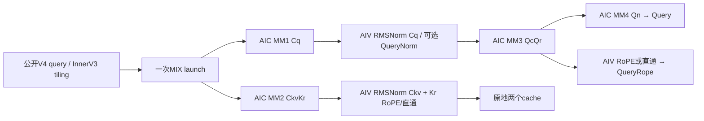
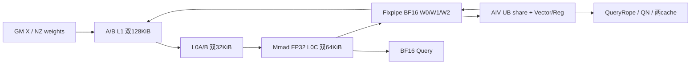
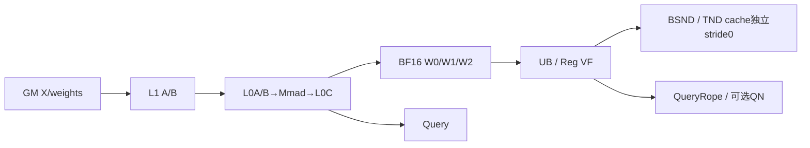
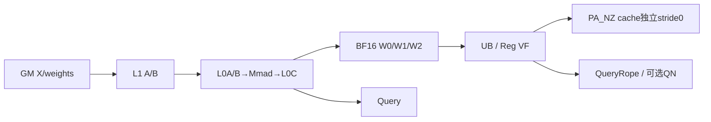
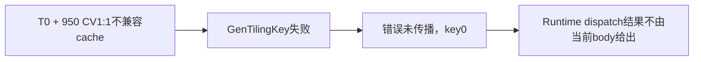

# MLA Prolog V4 浮点融合 950 ACLNN 算子知识

## 算子速览

| 项目 | 内容 |
|---|---|
| 实际入口 | d462/CANN9.2 的公开 aclnnMlaPrologV4WeightNzGetWorkspaceSize / aclnnMlaPrologV4WeightNz；SGL 外置 cann_ops_transformer eager 入口映射到该 pair |
| 计算语义 | BF16 四次投影、两次 RMSNorm、可选 interleave-half RoPE；输出 Query/QueryRope/可选 QueryNorm，按索引原地更新两份 BF16 cache |
| 输入输出 | weight/query/KV quant modes=(0,0,0)；He 枚举、Hcq∈{1536,2048}，N∈[1,128]，D∈{128,192}，Hckv=512，Dr=64，Nkv=1 |
| 执行类型 | 正常/空 cache 路线为单 MIX_CV kernel，AIC_CUBE 四段矩阵乘与 AIV_VECTOR 归一化、RoPE/直通、cache scatter；空 query entry 直接 return |
| Kernel 路线 | R-001 ND，R-002 token PA_BSND，R-003 token PA_NZ，R-004 block PA_BLK_BSND，R-005 block PA_BLK_NZ，R-006 空 query；R-007 被吞掉的资源guard失败；R-008 条件Host Debug非法key终点 |
| 核心资源 | L1 A/B 各双128KiB；L0A/B 各双32KiB，L0C 双64KiB；每 AIV 192KiB UB设计预算（A1小step有32B对齐差异），GM workspace复用BF16中间结果 |
| 来源闭包 | source_closed：公开 V4→generated InnerV3/OpDef→完整 Host/208B POD/selector→实际架构 split-N body/helpers。固定SDK揭示指令/索引契约；框架分配器、Runtime/已安装外置wheel身份仍为集成边界 |
| 验证状态 | 已完成冻结浮点范围的源码闭包检查；本次知识提取未执行编译、真机、数值或性能测试。draft保留实际资源前提与静态错误传播边界，不作为已验证安全复用结论。 |

## 接口与语义

### 计算语义

令 b16 为 BF16 存储舍入，mm 为 BF16输入、FP32 L0C累加、Fixpipe F322BF16输出。按 token 展平 t∈[0,T)，本体顺序为：

```text
cq0 = mm(X, WDq)
cq  = b16( (float(cq0) / sqrt(sum(float(cq0)^2)/Hcq + epsQ)) * float(gammaQ) * aq )
cqQR = mm(cq, WUqQr)                       # [T,N,D+64]，每head Qc后紧接Qr
Query[t,h,:] = mm(cqQR[t,h,0:D], WUk[h])  # [T,N,512]
QueryRope[t,h,:] = rot(cqQR[t,h,D:D+64], sin[t], cos[t]) if e else cqQR[t,h,D:D+64]
ckvKR = mm(X, WDkvKr)                     # [T,512+64]
ckv = b16( (float(ckvKR[:512]) / sqrt(sum(float(ckvKR[:512])^2)/512 + epsKV))
           * float(gammaKV) * ak )
kr  = rot(ckvKR[512:576], sin[t], cos[t]) if e else ckvKR[512:576]
scatter(ckv, kr, cacheMode, cacheIndex, actualSeqLen, stride0)
QueryNorm = cq if requested; scale outputs inactive in float domain
```

aq/ak分别为qcQrScale/kcScale；Host以abs(scale−1)≥FP32 epsilon决定是否真正Muls。因此极接近1的属性按该开关视为1；NaN等值不具有由此证明的正常数学合同。epsilon和scale从API double到OpDef Float/POD float，不能认为全程FP64。

开启RoPE时先把输入偶/奇交错维分别收集为32个元素，正弦前32维在GatherSinCos乘−1。对j∈[0,32)：y[j]=x[2j]*cos[j]−x[2j+1]*sin[j]；y[32+j]=x[2j+1]*cos[32+j]+x[2j]*sin[32+j]，FP32计算后CAST_RINT到BF16。关闭时不做偶奇重排，投影原顺序直通；sin/cos完全不读。A2/A3 helper注释“奇/偶”与[GatherMask](../../../../../../ops/ascendc/apis/simd_api/basic_api/memory_vector_compute/compare_and_select/gather_mask.md)实际pattern1=偶、2=奇的合同需区分，以上按真实pattern解释。

### 输入、输出与属性

| 参数 | shape/layout | dtype | 约束、默认值与语义 |
|---|---|---|---|
| tokenX | [T,He]或[B,S,He]；ND，T=B*S | BF16 | He∈{1024,2048,3072,4096,5120,6144,7168,7680,8192}；B∈[0,65536]；支持空T/B/S，必须先通过其它shape校验 |
| weightDq | 逻辑[He,Hcq]，FRACTAL_NZ；物理[Hcq/16,He/16,16,16] | BF16 | Hcq=1536或2048；公开ACLNN Host接收2D逻辑/4D存储描述，不能把无format的ND权重替代 |
| weightUqQr | 逻辑[Hcq,N*(D+64)]；NZ [N*(D+64)/16,Hcq/16,16,16] | BF16 | 每head Qc与Qr拼接；N为1..128任意整数 |
| weightUk | [N,D,512] ND | BF16 | D=128或192；不转NZ |
| weightDkvKr | 逻辑[He,576]，NZ [36,He/16,16,16] | BF16 | 先512 Ckv、后64 Kr |
| rmsnormGammaCq | [Hcq] ND | BF16 | FP32计算gamma乘法 |
| rmsnormGammaCkv | [512] ND | BF16 | 同上 |
| ropeSin/ropeCos | [T,64]或[B,S,64] | BF16 | ACLNN e=true两指针必须非null且Host验shape；e=false两指针必须nullptr。SGL/vendor用numel>0成对判断，并把两个空Tensor/None归一为nullptr关闭 |
| kvCacheRef | TND [T,1,512]、BSND [B,S,1,512]或PA逻辑[P,H,1,512] | BF16 IN/OUT | 只允许第一轴有padding stride0≥连续slice，内轴连续；PA_NZ/PA_BLK_NZ按NZ物理寻址而非逻辑ND行序 |
| krCacheRef | 相同模式的尾维64 | BF16 IN/OUT | float模式repo必须DIVIDE=0；两cache独立，禁止据量化合并helper推导本范围支持COMBINE |
| cacheIndexOptional | token-PA：[T]或[B,S]；block-PA：3D X时[B,ceil(S/H)]、2D X时一维页表 | INT64 ND | token-PA存全局token slot，负slot跳过写；block-PA存pageID。BSND/TND不读且Host期望缺省。输入索引内容/去重/容量由caller保证 |
| actualSeqLenOptional | fused T + block-PA 时[B] | INT32 ND | **累计query边界**，非每batch独立长度；其它路线不启用。B=actualSeqLen.shape[0]且B≤65536；必须单调、末值T且页表容量匹配，Host没有逐值读取验证 |
| QueryOut | [T,N,512]或[B,S,N,512] ND | BF16 | Cq→QcQr→Qn结果；正式输出不可与输入/cache任意overlap |
| QueryRopeOut | 同前导维，尾64 | BF16 | RoPE或原投影直通，shape不因开关变化 |
| QueryNormOutOptional | [T,Hcq]或[B,S,Hcq] ND；未请求为缺省 | BF16 | 请求时直接作为RMSNorm输出并供MM3读取，五返回中的第4项 |
| dequantScaleQNopeOutOptional | nullptr；vendor返回[0] | FP32空 | float不能传非null占位，ACLNN TensorHolder的“存在”由原始指针判定，不是numel |
| dequantScaleQNormOutOptional | nullptr；vendor返回[0] | FP32空 | float无scale定义；QueryNorm未请求时vendor也返回空 |
| quant/dequant/smooth/clip可选输入 | 本域缺省 | N/A | 本域没有量化数学，Host expected-map会拒绝不应存在的参数 |
| attrs | cacheMode默认PA_BSND；eps默认1e−5；aq/ak默认1；tileSize128 | mode为INT64，scalar API为double | wq=kvq=qq=0；ckvkrRepoMode=quantScaleRepoMode=0；tileSize虽然浮点inactive仍要求128；e由ACLNN显式doRope或SGL输入存在性决定 |

### 入口与版本

[SGL V4接入API](../../../../apis/sgl_kernel_npu/sgl_mlaprolog_v4.md)是接口/安装导航，本卡固定其文档明确引用的d462源码与CANN9.2，SDK固定a63d9.2。SGL的auto/cann入口导入独立cann_ops_transformer.mla_prolog，没有fallback到Torch矩阵数学；另一个bundled e7 profile不证明该外置扩展已安装同源。

V4公开pair把doRope传给aclnnInnerMlaPrologV3；同版本V3公开pair固定true，算子注册名仍MlaPrologV3。eager返回(Query, QueryRope, emptyScaleQNope, QueryNorm或空, emptyScaleQNorm)，cache以Tensor(a!)/Tensor(b!)副作用更新，不额外返回。functional七返回会clone两cache，属独立集成ABI，本卡不覆盖其clone/functionalize分支。其它quant modes为独立数学范围。

既有[9.1 V3 A2/A3](../../../../../../ops/ascendc/operators/aclnn/transformer/attention/mla_prolog.md)、[9.1 V3 950](../../../../../../ops/ascendc/operators/aclnn/transformer/attention/mla_prolog_950.md)与[Direct 950示例](../../../../../../ops/ascendc/operators/direct/transformer/attention/mla_prolog_950.md)保留原版本；旧POD172B、旧EnableRope/stride合同或纯AIV四返回不能替代当前208B、五返回/两cache副作用闭包，不覆盖旧卡。

## Host/Launcher 执行流程

### 参数校验与前处理

SGL先做rope成对非空检查并缓存外置callable，vendor Python注册schema/Meta再lazy load C++。OpBuilder解析vendor include优先于CANN与torch_npu并链接ascendcl/torch_npu；这些是构建接线事实，本次没有触发其load/JIT。vendor C++OptionalDeviceGuard选择tokenX.device，检查He/Hcq/D/N/Cache字段与三个NZ权重格式，创建正式输出。float不发生HIF8/FP4重解释。

aclnn V4首先验weight/KV/query modes、用TensorHolder给缺省输入/输出创建[0]descriptor，再按当前模式检查每个可选对象存在性。holder只在原始nullptr时创建；caller传非null [0]与nullptr不同。queryNorm原指针是否非null成为queryNormFlag，float的两个scale输出必须nullptr；doRope=false要求sin/cos原指针同时nullptr。holder使用形状0的临时假数据地址，仅是空descriptor，不是可读输入存储，析构在workspace查询返回时发生。

InnerV3由OpDef提供AutoContiguous输入布局预处理与cache IgnoreContiguous，实际数学没有外部GEMM fallback。转换context时先校验cache内轴连续、取stride0；stride描述缺失/维数不匹配时警告并按连续stride0。缓存空shape跳过stride验证设0。不能据该fallback宣称任意非连续cache正确。Host依次GetNpuInfo→CheckAttrs→CheckSingleRequiredParam→CheckCacheMode→SetShapeInfo/SetScenarioInfo→CheckScenarParam/QuantMode/Dims/SpecialScenario/ExpectedParam→SetAttrInfo→ProcessBaseInputs，任一返回失败终止。

公开ACLNN接受的NZ storage描述与vendor Tensor.size层需区分：vendor ResolveLogicalDims(4D)用(s0*16,s1*16)，Host用NZ的第一轴作为Nout、第二轴作为Kin；vendor QueryNorm分配直接用weight_dq.size(1)，InferShape要求WDq逻辑2D。保留2D逻辑shape的format29张量有独立storageDims；不能把raw Torch-visible4D当无条件等价桥接输入。这里没有推测torch_npu对任意raw张量的隐式转换或部署故障。

### 参数、Workspace 与生命周期

```text
m = min(T, 128 if D==128 else 64)
W_Host = W_lib + 4*m*Hcq + 2*m*576 + 4*m*N*(D+64) + 2*m*N*D
W_Device_peak = 2*m*576 + 2*m*Hcq + 2*m*N*(D+64)
```

W_lib来自平台GetLibApiWorkSpaceSize，不能用另一个算法的固定16MiB系统常量替代。Host的两份Cq、通用FP32 QcQr和额外Qc均为实际申请公式，浮点Device却通过同dtype别名复用；W_Host不是同时活跃用户slice之和。入口将workspace参数原址交给WorkspaceInit，不自行加W_lib偏移；SDK/runtime提供这块argument的打包属于工程ABI，不能凭预留项猜系统区在前还是后。

W0=[0,1152m) BF16 ckvKr；W1=[1152m,1152m+2mHcq) BF16 cq0。queryNormFlag=0时RMSNorm就地覆盖W1，=1时RMSNorm写正式QueryNorm，W1仍用于cq0。W2从1152m+2mHcq开始，2mN(D+64)B BF16 QcQr；mmQcQrResDequantGm与其同址，float不分配独立dequant片。Qn直接写正式QueryOut。每token步结束后复用相同W0/W1/W2，必须保留公共管线所列跨核屏障。

调用者先query得到workspaceSize/executor，再在同一设备申请足量workspace并Execute(workspace,size,executor,stream)。普通异步Runtime语义要求所有输入、页表/累计边界、cache、正式输出、workspace在stream完成前保持owner/地址稳定，cache在后继attention读取前必须有同stream顺序或显式event。SDK/Runtime内部executor销毁时机不在此自有源码中，不补造释放API。

vendor ACLNN_CMD取得当前NPU stream，必要时UseStreamResInCurrentThread；query失败释放转换descriptor并抛错，execute错误也抛出；OpCommand回调捕获descriptor/raw workspace/executor，执行后释放descriptor与HugeMem，local byte Tensor持有workspace。没有用户层同步等待；延迟队列和NPU缓存分配器stream记录由torch_npu负责，固定源码没有证明任意延后回调/跨stream仍可提前释放原owner。不能把descriptor销毁当Device数据owner立即可释放。

### 启动图与失败传播

非空路线一个InnerV3任务，blockDim=C（平台AIC数），V必须为C或2C且二者>0；CvMode=6或7选择MIX_AIC_1_1/1_2。entry默认MIX1:2，shared-kernel selector提供真实kernel类型，不能忽略key的CV参数。AIC使用GetBlockIdx为c；AIV使用GetBlockIdx=c*r+subblock，运行GetSubBlockNum给r，cubeBlockIdx=floor(v/r)。不能把raw get_block_idx直接当AIV线性索引。

空query先通过全部参数校验，Host填POD、只申请W_lib、blockDim=1，选择R-006 key并在Device创建TPipe/GM访问之前return；无输出清零或cache更新。950 R-007是明确列出的异常错误传播路线，不能伪装成正常空返回。




## Route 与参数设计

### 分核与资源计算

当前950计算body为arch35，A2/A3的classic细节仅作明确对照；本卡以950实际Reg VF/事件/TPipe实现计费。

记C/V为Host实际取得的AIC/AIV数、r∈{1,2}，H=Hcq，m为前文step。浮点关闭group/dequant优化与splitM；IsSplitKnSupported首先要求DAV9201，因此新POD的KN字段在本卡两代平台固定(1,1,0)，没有隐藏的KN Device路线。

| 段 | 原始矩阵 M/N/K | Host分核 | Device tile与tail |
|---|---|---|---|
| MM1 Cq | m/H/He | n1=max(64,16*ceil(H/(16C)))；b1=ceil(H/n1) | baseN128、baseK128、stepK4；K_L1=512，M按16对齐；最后核N=H−(b1−1)n1 |
| MM2 CkvKr | m/576/He | 空cache b2=n2=0；否则C≥9时n2=64,b2=9；否则n2=16*ceil(576/(16C)),b2=ceil(576/n2) | baseN128/baseK128/stepK4；最后N切片精确；空cache不执行MM2 |
| MM3 QcQr | m/[N(D+64)]/H | n3=16*ceil(N(D+64)/(16C)),b3=ceil(N(D+64)/n3) | baseK64/stepK4，K_L1=256；m≤64 baseN256，否则128；m≤32时整A全载L1，后继N块复用 |
| MM4 Qn | 每head m/512/D | headsPerCore=ceil(N/C),b4=ceil(N/headsPerCore) | D128全载A/B，baseK128/stepK1、N128块×4；D192走baseK64/stepK3、N128块×4的splitK helper。每核最后head数=N−(b4−1)headsPerCore |

所有step循环batchOffset+=m，最后m'仅更新各MMParams.m与AIV token划分，slice跨度仍按原m分配。AIV线性索引v分得q=floor(m'/Veff)、rem=m'%Veff，count=q+[v<rem]，localTokenStart=v*q+min(v,rem)，对count个token逐行处理。Veff初值min(m,V)，在编译CV1:1但运行subblock=2且Veff<m时源码翻倍；保留运行/编译资源差异，不擅自把平台coreNum和raw block索引替换。

### Route 选择

用K(c,E,A,e,cv)表示tuple(c,1,0,false,false,E,A,0,e,cv)，参数顺序严格对应entry。c=0合并BSND/TND；E=0普通、1空cache、2空query；A=1仅fused T+block PA；e为RoPE。以下表格完整笛卡尔积对应后续逐实例表，未列值不属于浮点范围。queryNormFlag、D128/192为同key的运行时子路线，不能丢掉其body差异。

| 顺序 | Route | Key/模板 | 精确选择条件与优先级 | 不适用去向 |
|---:|---|---|---|---|
| 1 | R-006 空query | (0,0,0,0,0,2,0,0,1,cv) | 全部参数验证后T=0优先，且GenTilingKey资源guard通过 | 950异常见R-007；参数错直接失败 |
| 2 | R-001 ND | K(0,0,0,e,cv) | T>0；cacheMode=BSND(3D X)或TND(2D X)，cache shape与X严格一致 | cache逻辑shape不符失败，不走PA fallback |
| 3 | R-002 token PA_BSND | K(1,E,0,e,cv) | T>0；P=0令E=1，否则0；cacheIndex保存token slot | 其它layout继续下条 |
| 4 | R-003 token PA_NZ | K(2,E,0,e,cv) | 同前但物理cache按NZ解释 | 其它layout继续下条 |
| 5 | R-004 block PA_BLK_BSND | K(3,E,A,e,cv) | T>0，X rank3→A0；rank2→A1且actualSeqLen必需；页表保存page ID | 缺累计边界/错误页表rank失败 |
| 6 | R-005 block PA_BLK_NZ | K(4,E,A,e,cv) | 同前，NZ寻址 | 没有其它Device fallback |
| 7 | R-007 950空query guard未传播 | 保留零key，不是合法selector | DAV3510、V=C、原cacheMode∉{PA_BSND,PA_NZ}、T=0；GenTilingKey失败但调用者无视返回 | 实际Runtime对key0处理不由本body给出，不能当成功空返回 |

950在V=C时仅R-002/R-003正常命中；V=2C保留全部正常cache布局。A2/A3 Host没有该DAV3510限制，两个CV selector均编译声明；公开平台支持不代表每种有效core资源部署已实测。非空guard失败被传播，空query的R-007遗漏返回检查是确定静态事实。

```text
validate modes, pointers, shapes, cache strides, C/V
  -> T==0 ?
       -> GenTilingKey guard accepted: R-006, blockDim1, entryreturn
       -> DAV3510 CV1:1 incompatible cache: R-007 (failure swallowed/key0)
  -> T>0 and GenTilingKey guard rejected: Host GRAPH_FAILED
  -> normalize cacheMode(TND=>0), E=(P==0), A=(fusedT && blockPA)
  -> c0:R-001 / c1:R-002 / c2:R-003 / c3:R-004 / c4:R-005
  -> float MLAPType, m'=tail, QueryNormFlag, D128full-load/D192splitK, e0/1
```

### 模板/实现执行矩阵

所有正常计算实例均为MlaPrologVecS1CubS2<MLAPType<bfloat16_t,bfloat16_t,bfloat16_t,float,static_cast<CACHE_MODE>(c),false,false,static_cast<EMPTY_TENSOR_MODE>(E),static_cast<ACTUAL_SEQ_MODE>(A),false,(cv==6?1:2),e>>，对应当前卡架构body。空query只实例化entry的constexpr return，不能把其Scenario0构造为上述计算类。

| Route | key/selector | dtype/shape/platform 完整命中条件 | 执行族与 kernel 节点 | 实际模板/body | 内存与同步特征 | tail/fallback |
|---|---|---|---|---|---|---|
| R-001 | c0/E0/A0/e0或1/cv6或7 | BF16 modes000、BSND/TND、T>0；950 cv6由Host拒绝 | 单MIX_CV | 上述MLAPType c0；ScatterCache<BF16,false> | W0/W1/W2；全AIV7/全AIC7+局部6/9 | m tail；没有PA索引fallback |
| R-002 | c1/E0或1/A0/e0或1/cv6或7 | BF16、PA_BSND；950两CV均可 | 单MIX_CV，E1跳MM2/cache段 | c1；ScatterCache<BF16,false> | token slot解页+stride0；负slot跳过 | E1仍计算Q；不验证正slot容量 |
| R-003 | c2/E0或1/A0/e0或1/cv6或7 | BF16、PA_NZ；950两CV均可 | 同上 | c2；ScatterCache<BF16,true> | 每行512/64→32B块NZ散写 | 负slot跳过；无上界/冲突保护 |
| R-004 | c3/E0或1/A0或1/e0或1/cv6或7 | BF16、block PA_BSND；A与X rank绑定；950 cv6拒绝 | 同上 | c3；ComputeBlkScatterOffsets→ScatterCacheMultiRows<BF16,false> | 页表游标+累计边界；vectorRow=1故正常页内单行 | A1末值/单调caller合同；E1不读页表 |
| R-005 | c4/E0或1/A0或1/e0或1/cv6或7 | 同前、block PA_NZ；950 cv6拒绝 | 同上 | c4；ScatterCacheMultiRows<BF16,true> | page stride0 + token*16，channel块间H*16 | 负page与大page限制见R-005 |
| R-006 | 全0参数但E2/e1/cv6或7 | T0且所有前置guard通过 | entry无Device计算节点 | mla_prolog_v3 constexpr EMPTY_QUERY return | 不读取POD/GM/UB，无屏障；只W_lib | cache不动、输出空，不清零非空cache |
| R-007 | key0，非selector | 仅950前述条件 | 没有已选择的自有Device body | Host错误传播终点 | 不假分配/同步/输出 | 不能宣称dispatch成功或具体Runtime错误码 |

下面逐实例保留真实key。正常e0需非Debug Host编码，或Host显式MLA_PROLOG_VERSION=3；默认Host版本−1配合ASCENDC_DEBUG的e0路径另见R-008，不能把下表当所有编译配置都成功。SDK的DECL实际宽度为4/2/**4**/1/1/2/2/2/1/8，非头文件旧注释所写Quant6bit；因此正常K=c+16+(E<<12)+(A<<14)+(e<<18)+(cv<<19)。全部UINT值列表为连续序数；CV是shared kernel type取实际6/7。SDK非Debug FastEncode只验DECL，不证明任意tuple有SEL；本表只列Device已声明SEL与正常Host资源guard交集，Debug/Runtime的外部包差异不能通过非法key抹平。

| 实例 | Route | (c,Scenario,Quant,deq,group,E,A,splitM,e,CV) | uint64 key |
|---|---|---|---|
| F001 | R-001 | (0,1,0,0,0,0,0,0,0,7) | 3670032 |
| F002 | R-001 | (0,1,0,0,0,0,0,0,1,7) | 3932176 |
| F003 | R-002 | (1,1,0,0,0,0,0,0,0,6) | 3145745 |
| F004 | R-002 | (1,1,0,0,0,0,0,0,0,7) | 3670033 |
| F005 | R-002 | (1,1,0,0,0,0,0,0,1,6) | 3407889 |
| F006 | R-002 | (1,1,0,0,0,0,0,0,1,7) | 3932177 |
| F007 | R-002 | (1,1,0,0,0,1,0,0,0,6) | 3149841 |
| F008 | R-002 | (1,1,0,0,0,1,0,0,0,7) | 3674129 |
| F009 | R-002 | (1,1,0,0,0,1,0,0,1,6) | 3411985 |
| F010 | R-002 | (1,1,0,0,0,1,0,0,1,7) | 3936273 |
| F011 | R-003 | (2,1,0,0,0,0,0,0,0,6) | 3145746 |
| F012 | R-003 | (2,1,0,0,0,0,0,0,0,7) | 3670034 |
| F013 | R-003 | (2,1,0,0,0,0,0,0,1,6) | 3407890 |
| F014 | R-003 | (2,1,0,0,0,0,0,0,1,7) | 3932178 |
| F015 | R-003 | (2,1,0,0,0,1,0,0,0,6) | 3149842 |
| F016 | R-003 | (2,1,0,0,0,1,0,0,0,7) | 3674130 |
| F017 | R-003 | (2,1,0,0,0,1,0,0,1,6) | 3411986 |
| F018 | R-003 | (2,1,0,0,0,1,0,0,1,7) | 3936274 |
| F019 | R-004 | (3,1,0,0,0,0,0,0,0,7) | 3670035 |
| F020 | R-004 | (3,1,0,0,0,0,0,0,1,7) | 3932179 |
| F021 | R-004 | (3,1,0,0,0,0,1,0,0,7) | 3686419 |
| F022 | R-004 | (3,1,0,0,0,0,1,0,1,7) | 3948563 |
| F023 | R-004 | (3,1,0,0,0,1,0,0,0,7) | 3674131 |
| F024 | R-004 | (3,1,0,0,0,1,0,0,1,7) | 3936275 |
| F025 | R-004 | (3,1,0,0,0,1,1,0,0,7) | 3690515 |
| F026 | R-004 | (3,1,0,0,0,1,1,0,1,7) | 3952659 |
| F027 | R-005 | (4,1,0,0,0,0,0,0,0,7) | 3670036 |
| F028 | R-005 | (4,1,0,0,0,0,0,0,1,7) | 3932180 |
| F029 | R-005 | (4,1,0,0,0,0,1,0,0,7) | 3686420 |
| F030 | R-005 | (4,1,0,0,0,0,1,0,1,7) | 3948564 |
| F031 | R-005 | (4,1,0,0,0,1,0,0,0,7) | 3674132 |
| F032 | R-005 | (4,1,0,0,0,1,0,0,1,7) | 3936276 |
| F033 | R-005 | (4,1,0,0,0,1,1,0,0,7) | 3690516 |
| F034 | R-005 | (4,1,0,0,0,1,1,0,1,7) | 3952660 |
| F035 | R-006 | (0,0,0,0,0,2,0,0,1,6) | 3416064 |
| F036 | R-006 | (0,0,0,0,0,2,0,0,1,7) | 3940352 |

逐实例表中的e0正常编码前提与R-008分开；每行还必须满足对应Route完整shape/平台/CV guard。

### 隐藏性能 Guard

| Guard | Host/Tiling 条件 | Device/资源原因 | 影响 Route | 不满足时去向 | 源码符号 |
|---|---|---|---|---|---|
| core资源 | C,V>0；V=C或2C | 跨核mode0/2需要一致参与核；GetBlockIdx展开subblock | 全部 | Host失败 | GetNpuInfo |
| 950 CV1:1 | cache仅PA_BSND/PA_NZ | 固定Host白名单，不推测硬件全域限制原因 | R-001/R-004/R-005/R-006 | 非空失败；空query R-007 | GenTilingKey |
| max step | D192且waveBufAllocated(BF16=true)时m≤64；D128≤128 | 限制L0C、L1A/B与wave临时范围 | R-001–5 | 修改tile需重新计费；非自动fallback | ProcessBaseInputs |
| 全A驻留 | MM3当前m'≤32 | 最多32*2048*2=128KiB单L1A bank | R-001–5 | 分K ping-pong | MatmulQcQr |
| Qn D192 | k>baseK128→baseK64,stepK3 | D192不满足全B/单K块路径 | R-001–5 | splitK helper；没有性能断言 | MmQnParamInit |
| TBuf对齐 | A1请求8m，m%4!=0时片向上32B | usedBytes未对齐而share也独立align32，实际总196640B | R-004/R-005 A1 | 无自有fallback，保留实际pool前提 | VectorBufferInit/SDK InitBuffer |
| Host Debug e0 | ASCENDC_DEBUG且Host VERSION默认−1 | Host SEL只有e1，Device VERSION3允许e0 | R-001–5 | INVALID_KEY未检查，R-008 | ENABLE_ROPE_SEL/EncodeTilingKey |
| 192KiB UB | 实际常驻F与阶段峰值必须满足F+P≤196608 | Host虽读取ubSize却未对本浮点shareBuffer逐阶段检查 | R-001–5 | 没有自有安全fallback | VectorBufferInit/RotaryPosEmbPerTensor |
| shape宽度/整数 | 先取得原维度再保存在u32，T用u32乘法 | 超大B*S/负动态维/窄化不能套用理想整数公式 | 全部 | 不能由小枚举guard推出全域无溢出 | SetShapeInfo |
| paged内容 | slot/page容量、累计边界单调/末值、互不冲突 | Device标量读/无atomic写；不扫描全量输入内容 | R-002–5 | caller责任；不构造dense fallback | ScatterCache/ComputeBlkScatterOffsets |

R-008是条件错误终点：非空e0在默认Host版本−1且ASCENDC_DEBUG时返回INVALID_TILING_KEY但Host仍success；见专节。正常非Debug不会因Host SEL少e0而拒绝，不能宣称源码普遍缺少e0 Device。

### POD/ABI

唯一跨Host/Device的tiling POD为MlaPrologTilingData.baseParams。下表offset是按固定uint32/float=4、uint16=2、uint64=8、自然8B对齐**静态推导**：baseParams offset0，sizeof208、alignof8；未运行编译器offsetof/sizeof验证。188..191为padding，不含可消费字段。普通C++struct没有每字段默认初始化；kNopeClipAlpha未由FillTiling写入，但冻结float不读，不能据此宣称该槽为0。EMPTY_QUERY entry在读取POD前return。

| 结构 | 字段 | 类型/位宽 | ABI 布局 | 单位 | Host/launcher producer | Device consumer | 边界 |
|---|---|---|---|---|---|---|---|
| BaseParams | batchSize | uint32_t/32 | offset0，4B | batch，TND其它路线为0 | FillTiling/CoreParams：B；fusedblockPA由actualSeqLen.shape[0] | ComputeBlkScatterOffsets批游标界 | batch，TND其它路线为0 |
| BaseParams | stepBatchSize | uint32_t/32 | offset4，4B | token；T0=0且不读 | FillTiling/CoreParams：min(T,D128?128:64) | Process步进/UB/WS/MM m | token；T0=0且不读 |
| BaseParams | mSubSize | uint32_t/32 | offset8，4B | inactive，非quant splitM | FillTiling/CoreParams：成员初始化0/FillTilingCoreParams | 当前splitN不读 | inactive，非quant splitM |
| BaseParams | mSubCoreNum | uint32_t/32 | offset12，4B | inactive | FillTiling/CoreParams：成员初始化0 | 当前splitN不读 | inactive |
| BaseParams | stepNumHeadDequant | uint32_t/32 | offset16，4B | head；仍写POD | FillTiling/CoreParams：D128?min(64,N):min(16,N) | float非dequant优化不读 | head；仍写POD |
| BaseParams | tokenSize | uint32_t/32 | offset20，4B | token；u32原始乘法域 | FillTiling/CoreParams：X前导维展平T | Process总步数 | token；u32原始乘法域 |
| BaseParams | seq1Size | uint32_t/32 | offset24，4B | token | FillTiling/CoreParams：rank3 X的S；rank2默认0 | blockPA A0批内token/ND BSND跨度 | token |
| BaseParams | seq2Size | uint32_t/32 | offset28，4B | 保留字段，不解释成真实KV长度 | FillTiling/CoreParams：nkvSize=1 | 本浮点splitN不读 | 保留字段，不解释成真实KV长度 |
| BaseParams | headSizeX | uint32_t/32 | offset32，4B | 元素 | FillTiling/CoreParams：He | MM1/MM2 K与X行跨度 | 元素 |
| BaseParams | headSizeCq | uint32_t/32 | offset36，4B | 元素 | FillTiling/CoreParams：Hcq | MM1输出/MM3 K/NormCq | 元素 |
| BaseParams | headSizeCkv | uint32_t/32 | offset40，4B | 元素 | FillTiling/CoreParams：512 | MM2切片/NormKV/MM4 N | 元素 |
| BaseParams | headSizeQc | uint32_t/32 | offset44，4B | 元素 | FillTiling/CoreParams：N*D | MM3/Qn输入跨度 | 元素 |
| BaseParams | headSizeQr | uint32_t/32 | offset48，4B | 元素 | FillTiling/CoreParams：N*64 | QueryRope行跨度 | 元素 |
| BaseParams | headSizeKr | uint32_t/32 | offset52，4B | 元素 | FillTiling/CoreParams：Dr=64 | MM2完整输出/分核 | 元素 |
| BaseParams | numHeadSize | uint32_t/32 | offset56，4B | head | FillTiling/CoreParams：N | MM4 head循环/QueryRope row | head |
| BaseParams | numHeadKvSize | uint32_t/32 | offset60，4B | head | FillTiling/CoreParams：Nkv=1 | 本浮点splitN无直接关键读取 | head |
| BaseParams | dimHeadSizeQc | uint32_t/32 | offset64，4B | 元素 | FillTiling/CoreParams：D | MM4 K/Qc切片 | 元素 |
| BaseParams | dimHeadRope | uint32_t/32 | offset68，4B | 元素 | FillTiling/CoreParams：64 | SinCos/Rotary/Kr尺寸 | 元素 |
| BaseParams | blockNum | uint32_t/32 | offset72，4B | cache slice数；P0选EMPTY_CACHE | FillTiling/CoreParams：cache首轴P/T/B | floatscatter不做正index上界校验 | cache slice数；P0选EMPTY_CACHE |
| BaseParams | blockSize | uint32_t/32 | offset76，4B | token；PA16..1024且16倍数 | FillTiling/CoreParams：PA H或BSND S；TND0 | GetCacheOffset解页/blockPA余数 | token；PA16..1024且16倍数 |
| BaseParams | mm1BlockNum | uint32_t/32 | offset80，4B | core | FillTiling/CoreParams：ceil(H/n1) | MM1活跃核/末核N | core |
| BaseParams | mm2BlockNum | uint32_t/32 | offset84，4B | core | FillTiling/CoreParams：非空ceil(576/n2)，E1=0 | MM2活跃核；E1前置constexpr return | core |
| BaseParams | mm3BlockNum | uint32_t/32 | offset88，4B | core | FillTiling/CoreParams：ceil(N(D+64)/n3) | MM3活跃核/末核N | core |
| BaseParams | mm4BlockNum | uint32_t/32 | offset92，4B | core | FillTiling/CoreParams：ceil(N/headsPerCore) | Qn head核范围 | core |
| BaseParams | vectorBlockNum | uint32_t/32 | offset96，4B | AIV调度数；运行subblock修正见正文 | FillTiling/CoreParams：min(m,V) | Init Veff/分token | AIV调度数；运行subblock修正见正文 |
| BaseParams | mm1SingleCoreN | uint32_t/32 | offset100，4B | 元素 | FillTiling/CoreParams：n1 | MmCqParamInit/ComputeAicOffset | 元素 |
| BaseParams | mm2SingleCoreN | uint32_t/32 | offset104，4B | 元素；E1不执行MM2 | FillTiling/CoreParams：n2；E1默认0 | MmCkvKrParamInit/ComputeAicOffset | 元素；E1不执行MM2 |
| BaseParams | mm3SingleCoreN | uint32_t/32 | offset108，4B | 元素 | FillTiling/CoreParams：n3 | MmQcQrParamInit/ComputeAicOffset | 元素 |
| BaseParams | mm4SingleCoreBatch | uint32_t/32 | offset112，4B | head | FillTiling/CoreParams：headsPerCore | Qn loops/weightUkOffset | head |
| BaseParams | dtileSize | uint32_t/32 | offset116，4B | 元素 | FillTiling/CoreParams：512 | ScatterCkv tokenStride | 元素 |
| BaseParams | kvQuantMode | uint32_t/32 | offset120，4B | mode | FillTiling/CoreParams：0 | float分支无需量化解释 | mode |
| BaseParams | tileSize | uint32_t/32 | offset124，4B | 元素，Host仍校验128 | FillTiling/CoreParams：attr128 | float不读pertile消费者 | 元素，Host仍校验128 |
| BaseParams | ckvkrRepoMode | uint32_t/32 | offset128，4B | mode | FillTiling/CoreParams：0 DIVIDE | ScatterKr合并分支inactive | mode |
| BaseParams | quantScaleRepoMode | uint32_t/32 | offset132，4B | mode | FillTiling/CoreParams：0 DIVIDE | scale回写分支inactive | mode |
| BaseParams | queryNormFlag | uint32_t/32 | offset136，4B | bool编码u32 | FillTiling/CoreParams：原始queryNormOut非null?1:0 | OutputInit/WorkspaceInit/Process | bool编码u32 |
| BaseParams | reciprocalCq | float/32 | offset140，4B | FP32 | FillTiling/CoreParams：float(1/H) | NormCq Reduce后Muls | FP32 |
| BaseParams | epsilonCq | float/32 | offset144，4B | FP32，不验证所有数值域 | FillTiling/CoreParams：rmsnormEpsilonCq Float | NormCq Adds/Sqrt | FP32，不验证所有数值域 |
| BaseParams | reciprocalCkv | float/32 | offset148，4B | FP32 | FillTiling/CoreParams：float(1/512) | NormKV Reduce后Muls | FP32 |
| BaseParams | epsilonCkv | float/32 | offset152，4B | FP32 | FillTiling/CoreParams：rmsnormEpsilonCkv Float | NormKV Adds/Sqrt | FP32 |
| BaseParams | kNopeClipAlpha | float/32 | offset156，4B | inactive，值不可宣称为0 | FillTiling/CoreParams：FillTiling未赋此标量字段 | float不读；quant helper另读GM | inactive，值不可宣称为0 |
| BaseParams | qcQrScale | float/32 | offset160，4B | FP32 | FillTiling/CoreParams：attr Float aq | NormCq gamma后Muls | FP32 |
| BaseParams | kcScale | float/32 | offset164，4B | FP32 | FillTiling/CoreParams：attr Float ak | NormKV gamma后Muls | FP32 |
| BaseParams | isQcQrScaleEnable | uint16_t/16 | offset168，2B | bool编码u16 | FillTiling/CoreParams：abs(aq-1)>=float epsilon | NormCq条件Muls | bool编码u16 |
| BaseParams | isKcScaleEnable | uint16_t/16 | offset170，2B | bool编码u16 | FillTiling/CoreParams：abs(ak-1)>=float epsilon | NormKV条件Muls | bool编码u16 |
| BaseParams | mm1NGroup | uint16_t/16 | offset172，2B | 组，9201才可能变化 | FillTiling/CoreParams：1 | 当前arch22/35 splitN不读KN分组 | 组，9201才可能变化 |
| BaseParams | mm1KGroup | uint16_t/16 | offset174，2B | 组 | FillTiling/CoreParams：1 | 本平台CalcWorkSpace按1；Device无KN | 组 |
| BaseParams | mm1SingleCoreK | uint32_t/32 | offset176，4B | 元素，inactive | FillTiling/CoreParams：0 | 当前arch22/35不读 | 元素，inactive |
| BaseParams | mm2NGroup | uint16_t/16 | offset180，2B | 组 | FillTiling/CoreParams：1 | 当前arch22/35不读KN分组 | 组 |
| BaseParams | mm2KGroup | uint16_t/16 | offset182，2B | 组 | FillTiling/CoreParams：1 | 本平台CalcWorkSpace按1；Device无KN | 组 |
| BaseParams | mm2SingleCoreK | uint32_t/32 | offset184，4B | 元素，inactive | FillTiling/CoreParams：0 | 当前arch22/35不读 | 元素，inactive |
| BaseParams | kvCacheStride0 | uint64_t/64 | offset192，8B | 元素u64，转int64需在已验范围内 | GetCacheStride0；空cache0 | ScatterCache/MaterializeOffsetsWithHeadSize | 元素u64，转int64需在已验范围内 |
| BaseParams | krCacheStride0 | uint64_t/64 | offset200，8B | 元素u64 | FillTiling/CoreParams：同前，独立取Kr | Kr ScatterCache/MaterializeOffsetsWithHeadSize | 元素u64 |

局部MMParams、RmsNormParam、Rectangle、ScatterCacheParams、CkvkrParams/AicOffset/AivOffset/MMBufParams在kernel内构造，既不额外序列化也不通过裸字节跨Host传递。MMParams各字段为u32；arch22声明n,m,k，arch35声明m,n,k，不能按同一私有struct布局拷贝。其逐字段值为m=m'、n=每核N、k=该段K、orgM=m、orgN=n、orgKa=输入完整行跨度、orgKb=权重K、orgKc=输出完整行跨度、baseM未赋且不读、baseN/baseK/stepK/kL1StepSize见分核表、needSetOrgShape=1但自有helper不依赖该标记；950另kScale=K/32在float不被scale指令消费。

RmsNormParam为{reciprocal:float,epsilon:float,row:u32=1,col:u32=H或512,scale:float,isScaleEnable:u16}；Rectangle为{row:u32=1或N,col:u32=64,stride:u32=576或D+64}。ScatterCacheParams八个int64依次为H/slot/row=1/col=512或64/tokenStride/stride0/S/tokenIndex（arch22命名stride/seqLength等）；CkvkrParams六个int64依次tokenIndex、W0元素offset、当前token序号、页内行数、当前cache元素offset、nextPage元素offset。它们的所有可消费值均来自POD与本卡后续地址公式；nextPage在row1正常域不触发spill。Aic/Aiv Offset是各项元素偏移，见公共执行流程；MMBufParams的bank计数器初始0，TBuffAddr由TPipe GetBufferAddr产生，持有到本次kernel/pipe结束。

### Route 源码闭包

| Route | Key/selector | Host/Tiling producer | POD/参数 | Kernel entry/router | Kernel body/直接依赖 | 构建接线 |
|---|---|---|---|---|---|---|
| R-001–R-005 | 上述逐实例K与c/E/A/e/cv | mla_prolog_tiling.cpp::RunBigKernelTiling→FillMatmul1..4→FillTiling/CalcWorkSpace/GenTilingKey；checker完整guard | 208B BaseParams；cache stride0与所有MM分核字段 | mla_prolog_v3.cpp::mla_prolog_v3 NO_QUANT→MLAPType BF16 | 当前arch split_n::Init/Process/AicProcess/AivProcess；matmul、RMS、GatherSinCos、Rotary、Scatter全闭合 | v3/op_host/CMakeLists声明attention/mla_prolog依赖与--cce-auto-sync=off；OpDef平台注册+tiling_register |
| R-006 | E2/e1/cv | 同Host，空分支仅FillTiling/libWS/block1 | 已填但entry不读 | entry的constexpr EMPTY_QUERY | 直接return，不构造计算类 | 同一编译TU/selector |
| R-008 | INVALID_TILING_KEY | Host默认−1与ASCENDC_DEBUG SEL验证不匹配e0，GenTilingKey未检查key | 无可消费Device参数 | 未匹配正常Device selector | 已知Host错误传播终点 | 两平台条件成立时 |
| R-007 | 非正常selector/key0 | DAV3510 GenTilingKey错误被空分支忽略 | 不假定可消费POD | 没有匹配float/empty selector | 已知Host静态终点，Runtime后果外部 | 仅950；不能声称正常launch闭合 |


## Kernel 实现

### 公共执行流程

本节给出R-001–R-005完整共享管线；后续Route保留各自真实selector、cache地址与空域/累计边界差异。以下缩写均是实际方法，未把多个kernel假合并：它们位于同一次MIX launch。

```text
mla_prolog_v3<Cache,1,0,false,false,E,A,0,e,Cv>
  Init: linear index -> OutputInit -> ScaleInit(float无GM scale读)
        -> MmParamInit -> WorkspaceInit -> CubeBufferInit / VectorBufferInit
  Process:
    每个 batchOffset=b0，以m步进，m'=min(m,T-b0)
    AIC:
      MM1(X[b0*He], WDq[c*n1*He]) -> W1[c*n1], rowStride H
      notify mode2 FIX flag6(CQ)
      wait flag9 -> MM2(X[b0*He], WDkvKr[c*n2*He])
                    -> W0[c*n2], rowStride576 (E1跳过)
      notify mode2 FIX flag6(A2/A3)或4(950)(CKVKR)
      wait flag6(RMS Cq完成)
      MM3(QueryNorm?QN[b0*H]:W1, WUqQr[c*n3*H])
           -> W2[c*n3], rowStride N(D+64)
      D128预载本核第一个head的WUk到L1B；notify mode2 FIX flag6(QCQR)
      所有AIC WaitAllCore<0,FIX>(7)后读其它核产出的Qc
      本核head h0=c*headsPerCore ... h0+headCount：
         Qc元素offset=h0*(D+64)，行跨度N(D+64)
         WUk元素offset=h0*D*512
         MM4 -> Query[(b0*N+h)*512]，行跨度N*512
      Query输出基址+=m*N*512；请求QN时其读取基址+=m*H
    AIV:
      首step只读一次两个gamma；按count/tokenStart读取sin/cos(e1)
      wait CQ6；全AIV<0,MTE3>7
      每token读W1[(tokenStart+i)*H] -> FP32RMS ->BF16
           -> W1原址或QN[(b0+tokenStart+i)*H]
      全AIV<0,MTE3>7 -> notify mode2 MTE3 flag6(RMS)
      wait CKVKR6/4；全AIV<0,MTE3>7
      每token读W0[(tokenStart+i)*576 : +512] -> RMS+ak -> ScatterCkv
               读W0[(tokenStart+i)*576+512 : +576] -> e?RoPE:castCopy -> ScatterKr
      notify mode2 MTE3 flag9，允许下一step MM2复用W0
      wait QCQR6；全AIV<0,MTE3>7
      每token/head从W2[tokenStart*N(D+64)+D]开始，blockCount=N、
           每行读64*2B，srcStride=D*2B，compact UB
           -> e?RoPE:castCopy -> QueryRope[(b0+tokenStart+i)*N*64]
      正式输出DMA完成后进入下一step
  AIC收尾：drain所有L1/L0 ping-pong event与SCALE_EVENT，再wait flag9
```

MM1/2/3的splitN外层遍历当前N切片的ceil(n/baseN)子块。MatmulSplitK里K_L1=baseK*stepK，K_L1循环q；首轮LoadL1AB加载q0，同时预加载q+1到另一bank。A地址为输入A[q*K_L1]，行距orgKa；NZ B地址为B[K*nOffset + q*K_L1*16]，用blockCount=ceil(nTile/16)、blockLen=K_L1个32B块、srcStride=K−K_L1搬入L1。ND→NZ A使用Nd2Nz nValue=m'、dValue=K_L1、srcDValue=orgKa、dstNzC0Stride=align16(m')，仅真实输入行被读取，Cube M=align16(m')。

K_L0循环j=0..stepK−1：A_L1偏移j*align16(m')*baseK，B_L1偏移j*16*baseK；L0A/B独立双bank，Mmad参数(align16(m'),nTile,baseK)，仅(q0,j0) cmatrixInitVal=true，后续累加FP32。Fixpipe仅输出m'实际行和nTile实际列，srcStride=align16(m')，dstStride=orgKc，quantPre=F322BF16；不把padding的M行写GM。MM3 m'≤32时先全载A=m'×H到一个L1A bank，后续N/K块共用它；B仍ping-pong。A2/A3的L1→L0A/B使用LoadData3D V2（B启用transpose）；950 B用LoadData2D V2 transpose，A在ASC_DEVKIT_VERSION_NUM≥90000000使用SetLoadDataRepeatWithStride+LoadDataWithStride，否则源码保留旧API分支。固定SDK9.2背景不等于任意二进制编译宏已核实。

D128的MM4预载一个head完整WUk(128×512×2=128KiB)到L1B，先前预载的第一个head传hasL1BLoaded=true，随后head=false重新加载。A=mmQcQrResDequantGm[head*(D+64)]、orgKa=N(D+64)，按N128列×4输出Query，unitFlag=3配合Fixpipe。D192走ND权重splitK：K_L1=192，L0 K64×3，B按[K,128]转换NZ；该运行时子路径没有被名称“FullLoad”掩盖。

AIV的RMSNormNormal先DMA一行BF16，再CAST_NONE到FP32。A2/A3使用平方→以64元素折叠Add→WholeReduceSum→乘reciprocal→加epsilon→Sqrt→Div→gamma→可选Muls；950 RmsNormVFImpl以FP32 64lane寄存器累加所有64元素chunk，再Reg::Reduce SUM，广播sqrt，第二遍Div/gamma，scale为外部Muls。H=1536/2048、512均为64倍数，950 repeat的uint16转换与全mask读取在本列域无尾不足；CAST_RINT输出BF16。该顺序不等于高精度单次融合RMS，也没有quant round/saturation输出。

RoPE读取compact BF16→FP32，GatherSinCos提前反号前32维sin。A2/A3用GatherMask1/2分离偶/奇，四个Mul+Add；950 RopeVFImpl一行64FP32的LoadAlign、DeInterleave(vregX,vregX)、低/高32lane分别Mul/Add/Move，整64laneStoreAlign。950 RMS gamma用[LoadAlign](../../../../../../ops/ascendc/apis/simd_api/basic_api/reg_vector_compute/reg_data_load/load_align_continuous.md)的DIST_UNPACK_B16，一次读VL/2=128B以64BF16展开，不误写为DIST_NORM256B；FP32 X/sin/cos正常LoadAlign每次256B。e=false不读sin/cos，950在直通Cast前还有DataSyncBarrier<UB>，A2/A3用classic pipe依赖。

| 层级/缓冲区 | offset/地址公式 | extent/容量公式 | dtype/layout | producer | consumer | owner/lifetime | 对齐/复用 |
|---|---|---|---|---|---|---|---|
| GM正式输入 | X[t*He]；NZ W按K*N逻辑tile；WUk[h*D*512] | X=2THe，WDq=2HeH，WUqQr=2HN(D+64)，WUk=2ND512，WDkvKr=2He576 B | BF16，三个权重NZ | caller/布局准备 | AIC DMA | caller至stream完成 | He/H/D/Dr保证16/32B粒度，不在本体重新TransData |
| GM gamma/sin/cos | gamma一次/核；sin/cos[t*64] | 2H+1024；每sin/cos128T B | BF16 ND | caller | AIV | 同上 | e0不读sin/cos；所有scale可选输入float不读 |
| W0 | argument workspace+0 | 1152m B | BF16 [m,576] | MM2 | NormKV/Kr | 整个launch，逐step复用 | flag9护下次写；E1未定义且不读 |
| W1 | workspace+1152m | 2mH B | BF16 [m,H] | MM1→NormCq | NormCq→MM3 | 同上 | QN0就地别名；QN1写正式输出 |
| W2 | workspace+1152m+2mH | 2mN(D+64) B | BF16 [m,N,D+64] | MM3 | MM4与RoPEQr | 同上 | mmQcQrResDequant同址，跨AIC7与AIV7保护 |
| GM正式输出 | Query[(t*N+h)*512]；QR[(t*N+h)*64]；QN[t*H] | 1024TN+128TN+(请求时2TH) B；空scale0B | BF16 ND | AIC/AIV | caller/后继attention | caller/输出Tensor持有 | QN1还作为MM3输入，不能提前复用 |
| L1A | bank=(aL1Iter&1)*131072 | 2×128KiB | BF16 NZ | MTE2 ND2NZ | MTE1 | 每AIC TPipe | 共享MM1/2/3/4；A-full-load时跨N/K保留一bank |
| L1B | bank=(bL1Iter&1)*131072 | 2×128KiB | BF16 NZ | MTE2 NZcopy/ND2NZ | MTE1 | 同上 | MM4 D128预载满一个bank，不能同时塞入其它权重 |
| L0A | bank=(aL0Iter&1)*32768 | 2×32KiB | BF16 fractal | MTE1 | Mmad | 同上 | hard event3/4 |
| L0B | bank=(bL0Iter&1)*32768 | 2×32KiB | BF16 fractal/transposed | MTE1 | Mmad | 同上 | hard event5/6 |
| L0C | bank=(cL0Iter&1)*65536 | 2×64KiB | FP32 | Mmad | Fixpipe | 同上 | unitFlag/FIX_M3/4防覆盖 |
| UB gamma常驻 | 固定InitBuffer顺序 | 2H+1024 B | BF16 | 首stepGM DMA | 两RMS | 每AIV TPipe | 同kernel后续step复用 |
| UB dequantTool常驻 | gamma后 | 32(m+7) B | float槽位 | 分配/Brcb | float无数学consumer | 每AIV TPipe | floatRMS未定义dequantScaleQcQr也仍执行Brcb，不能把这片称有效量化尺度或输出 |
| UB sincos常驻 | 后继独立TBuf | 512*rmax B，rmax=ceil(m/Veff) | FP32 [2,rmax,64] | GatherSinCos(e1) | Qr/Kr | 每AIV TPipe | e0仍分配，内容无初始化承诺 |
| UB actualSeq常驻 | 上述后，仅A1 | 请求8m B，实际align32(8m) | INT64 | 只分配 | 当前float游标实际直接标量读INT32 GM | 每AIV TPipe | 不能把该未填TBuf冒充metadata快照 |
| UB share | 最后InitBuffer | 请求S_req=196608−F_req；实际S_alloc=align32(S_req)，base=F_alloc，定义见下 | 字节复用 | 各Vector阶段 | 后继Vector/GM | 每AIV TPipe | 每阶段DMA drain后重用；Host没有逐阶段S guard |
| Reg | 950 FP32 64lane；A2/A3标量/经典Vector | 算法显式RegTensor，实际寄存器占用由编译器决定 | FP32/BF16展开 | UB load | compute/store | VF调用 | 不虚报occupancy或spill |
| cache GM/页表/边界 | 各Route地址见后 | caller实际storage包括stride0空洞；index8*count/actual4B | BF16/INT64/INT32 | caller与scatter | 后继attention | caller至stream完成 | 对不同cache各用独立stride0，无atomic解决重复slot |




下式为当前手写buffer布局的字节上界，不把寄存器当UB重复求和。固定SDK的TPipe::InitBuffer(TBuf,len)对每一片独立align32；令F0=2H+1024+32(m+7)+512rmax，F_req=F0+[A1]*8m，F_alloc=F0+[A1]*align32(8m)，S_req=196608−F_req，S_alloc=align32(S_req)。A1且m%4!=0时，实际声明的TBuf总量F_alloc+S_alloc=196640B；其它情况196608B。源码usedBytes未把actualSeq片对齐后扣减，因此多32B是可复验静态计费差异；只有结合实际pool容量才能判断是否超平台容量/触assert，不宣称真机故障。q=当前AIV有效token数≤rmax，c=64N。A2/A3：RMS Cq share峰值10H+32q+64，KV share峰值5184+512q，Kr开启RoPE1312+512q，Qr开启RoPE20c=1280N。950：对应为8H+32q+32、4128+512q、800+512q、12c=768N。GatherSinCos临时256q B。RoPE关闭时实际投影读/FP32/输出区域峰值8c，但helper仍计算inactive scratch地址，不能据开关任意缩小已约定buffer。

```text
U_A2A3_required = F_alloc + max(256q, 10H+32q+64, 5184+512q, 1312+512q, 1280N)
U_950_required  = F_alloc + max(256q, 8H+32q+32, 4128+512q, 800+512q, 768N)
各阶段峰值P须<=S_alloc，且F_alloc+P<=实际可用UB；还需F_alloc+S_alloc<=实际pool容量。
192KiB设计预算与真实InitBuffer对齐后分配量分开，A1 m%4!=0超设计预算32B。
L1单bankA >= 2*align16(m')*K_L1；B >= 2*K_L1*nTile。
L0A >= 2*align16(m')*baseK <=32768；
L0B >= 2*baseK*nTile <=32768；
L0C >= 4*align16(m')*nTile <=65536。
```

MM1/2最大K_L1=512,Ntile128,M128；MM3 M≤64时Ntile256/K_L1256，否则M128/Ntile128；上述L1/L0计费按这些实际配对成立。A-full-load额外要求2*align16(m')*H≤131072，由m'≤32/H≤2048成立。Host虽然取得平台UB/L1/L0容量，当前float tiling没有把全部阶段必要不等式逐一验成guard；小有效核数会使rmax变大，故只能给公式和前提，不推定某型号所有部署故障。

| 边/复用子区 | producer | offset/extent | dtype/layout | consumer | ordering/sync | owner/lifetime | 安全条件 |
|---|---|---|---|---|---|---|---|
| MM1→RMS Cq→MM3 | AIC FIX→AIV MTE3 | W1或正式QN | BF16同H行距 | AIV/AIC | mode2 flag6；RMS前后全AIV mode0/7 | kernel workspace/输出 | 所有AIV包括无token核均参加屏障 |
| MM2→KV/Kr→下step MM2 | AIC FIX→AIV scatter | W0 | BF16 [m,576] | AIV/下step AIC | CKVKR flag6(A2/A3)/4(950)；AIV初始及每step发flag9，AICwait与最终drain | 同上 | E1仍保留配对同步，不能删除为“无工作” |
| MM3→MM4 | 多AIC FIX | W2 Qc子列 | BF16行stride N(D+64) | 其它AIC | 所有AICmode0/FIX/7后MM4 | 同上 | Qc head分核与MM3列分核不同，局部flag6不够 |
| MM3→Qr及W2下轮 | AIC FIX→AIV | W2 Qr子列 | BF16compact→FP32 | RoPE/直通 | mode2 FIX6 +全AIV7；每Qr输出V_MTE3/MTE3_V/MTE3_MTE2；下一step全AIV7在MM3启动前完成 | 同上 | e0也需直通输出和DMA完成，不能删整段 |
| L1/L0 bank复用 | MTE2/MTE1/Mmad/Fixpipe | 各层bank按iter&1 | 实际fractal | 后续tile | A/B MTE1_MTE2↔MTE2_MTE1，L0 M_MTE1↔MTE1_M，C FIX_M↔M_FIX或unitFlag3 | 每AIC TPipe | 同核多矩阵共享计数器，不能每段无等待重置 |
| share阶段复用 | Gather/RMS/Rotary | 同一share基础地址，局部元素偏移按dtype换算 | BF16/FP32/uint8 | 下阶段 | MTE2_V、V_MTE3、MTE3_V/MTE3_MTE2成对与PIPE_V；950直通UB DSB | 每AIV TPipe | LocalTensor[]是元素偏移，shareTmpUb[]才是字节偏移 |

[CrossCoreSetFlag](../../../../../../ops/ascendc/apis/simd_api/basic_api/sync_control/inter_core_sync/cross_core_set_flag_isasi.md)与[CrossCoreWaitFlag](../../../../../../ops/ascendc/apis/simd_api/basic_api/sync_control/inter_core_sync/cross_core_wait_flag_isasi.md)复用已有API合同。固定SDK实现：Set走NotifyEventImpl、mode0/2发ffts消息；A2/A3Wait为wait_flag_dev(flagId)，mode/pipe不作硬件参数；950Wait默认mode0/PIPE_S与mode2同指令类，pipe传入有效，不能将两平台等待范围说成完全相同。源码复用同flag6但按阶段顺序消费，flag7在AIC/AIV不同核域各自mode0。无额外库Matmul对象、无SyncAll workspace、无NDDMA/通信节点；这里的Matmul是完整手写L1/L0 helper，不是省略核心的外部Torch调用。

mode0全核同步需要调度资源准入；当前Host未显式SetScheduleMode/batchmode。只能保留Runtime并发资源合同，不能把单stream顺序自动扩展为任意多stream并发安全。所有静态字节推导均要求维度乘法/u32保存/地址int64转换未溢出及storage容量真实充足。


### Route R-001：ND直接缓存写入

#### 适用条件

T>0、BSND只接3D X与[B,S,1,L]cache；TND只接2D X与[T,1,L]cache；E0/A0。 e0/e1与所有允许CV逐实例见selector表；queryNormFlag0/1、D128/192均按公共管线保留。本950路线要求V=2C；V=C时Host拒绝，空query错误另见R-007。

##### 选择证据

| 层级 | 文件 | 符号 | 源码谓词/参数 | 结果/下一跳 |
|---|---|---|---|---|
| API | v3/op_api/aclnn_mla_prolog_v4_weight_nz.cpp | V4 GetWorkspaceSize | modes000，queryNorm由pointer存在性，e显式传入 | InnerV3 |
| Host | mla_prolog/op_host/mla_prolog_tiling.cpp | SetScenarioInfo/GenTilingKey | T>0、BSND只接3D X与[B,S,1,L]cache；TND只接2D X与[T,1,L]cache；E0/A0。 | K(0,E,A,e,cv) |
| Router | v3/op_kernel/mla_prolog_v3.cpp | NO_QUANT | BF16 MLAPType，cache=0，group/dequant/splitM均false | arch35::MlaPrologVecS1CubS2 |
| Helper | arch35/service_scatter_cache_arch35.h | ScatterCache | BSND / TND；L=512或64 | 原地两cache |

#### Device 数据流

##### 函数级调用链

```text
mla_prolog_v3 -> Init/Process
  AicProcess -> MatmulSplitN(Cq) -> MatmulSplitN(CkvKr,E1skip)
             -> MatmulAndSyncQcQr/MatmulQcQr -> PreloadQnAndSync -> MM4(D128FullLoad/D192SplitK)
  AivProcess -> CopyGlobalParams/CopyInSinCos(e)
             -> RmsNormCq -> RmsNormCqProcess -> RmsNormNormal
             -> RmsNormRopeScatterCkvKr
                -> RmsNormAndScatterCkv -> ScatterCkv
                -> RopeAndScatterKr -> RotaryPosEmbPerTensor<BF16,FP32,BF16,false,e> -> ScatterKr
             -> DequantQcAndRopeQc<false> -> RopeQr -> RotaryPosEmbPerTensor<...,false,e>
```

##### 源码等价伪码

```text
每step按公共管线完成MM1/RMS Cq/MM3/MM4和Qr输出；不改变其6/7/9(950 CKVKR4)协议。
for 每个分配token t:
  if E==1: 不执行MM2/两cache读写，仍保持同步并完成Q/Qr
  else:
    ckv = NormFP32(BF16 W0[row,0:512])*ak -> BF16
    kr = e ? rotFP32(BF16 W0[row,512:576]) -> BF16 : castCopy
    paTokenIndex=t; GetCacheOffset(t,H,L,stride0) -> row1 DataCopy; BSND H=S，TND H=0。
    Ckv与Kr各按独立stride0、L512/64提交；DMA drain后复用share。
```

#### 内存与数据搬运

##### 资源与搬运表

| 层级/缓冲区 | offset/地址公式 | extent/容量公式 | dtype/layout | producer | consumer | owner/lifetime | 对齐/复用 |
|---|---|---|---|---|---|---|---|
| GM cache | BSND以t=b*S+s，cache元素offset=b*stride0+s*L；TND blockSize=0，offset=t*stride0；L=512或64。index不读。 | 2*L*每个有效写token；storage需包含stride0洞 | BF16 BSND / TND | AIV scatter | 后继attention | caller持有至stream完成 | L16倍数；两cache独立 |
| W0/W1/W2 | 公共表1152m/2mH/2mN(D+64)布局 | W_Device_peak，E1的W0预留未消费 | BF16 | AIC/AIV | 各阶段 | launch owner | W1/W2真实别名与flag协议完整保留 |
| L1/L0 | 公共Matmul bank+iter&1与N/K loop地址 | A/B双128KiB；L0A/B双32KiB，C双64KiB | NZ/FP32acc | MTE2/MTE1/Mmad | Mmad/FIX | TPipe | MM3 A-full-load与Qn D192分支不合并 |
| UB/Reg | 公共F_alloc+阶段峰值；当前A0无actual TBuf | 阶段峰值≤S_alloc且物理总量≤实际pool；A1对齐差异见公共账 | BF16/FP32 | Vector/Gather/Reg | DMA/下一阶段 | 每AIV TPipe | e0分配sincos但不消费；VF用64FP32整lane |

##### 分层内存布局



##### 字节账、交接边与复用顺序

公共W/UB完整字节式适用于该Route，唯一cache地址变换为上表；每行32B对齐；不重排ND channel，剩余cache空洞不写。 token index在AIV标量读取，不创建UB向量索引副本。

| 边/复用子区 | producer | offset/extent | dtype/layout | consumer | ordering/sync | owner/lifetime | 安全条件 |
|---|---|---|---|---|---|---|---|
| Cq→RMS→MM3 | MM1/RMS | W1或QN，2mH | BF16 H行距 | MM3 | CQ6/RMS6+全V7 | 整launch | QN0别名只在全部Cq就绪后覆盖 |
| QcQr→Q/Qr | MM3 | W2，2mN(D+64) | BF16完整行距 | MM4/RopeQr | 全C7与QCQR6/全V7 | 整launch | 下step必须等前一步Qr与MM3消费者完成 |
| CkvKr→cache | MM2/AIV | W0与每行1024/128B | BF16→FP32→BF16 | cache | CKVKR4、flag9、DMA drain | caller/launch | TND/BSND shape必须与X匹配，不能把无页表ND当cache容量可任意大；第一轴padding须实际storage存在。 |

#### 同步、精度与尾块

##### 同步与数值边界表

| 阶段 | primitive/机制 | producer | consumer/等待点 | 保护对象 | 精度/尾块 |
|---|---|---|---|---|---|
| 矩阵阶段 | 公共L1/L0 events、mode2 6/4/6与mode0 C7 | AIC | AIV/其它AIC | W0/W1/W2 | FP32acc→F322BF16；M仅提交m'实际行 |
| 归一化 | RmsNormVFImpl+CAST_RINT | AIV | MM3/cache | 一行H/512 | FP32sum/sqrt/div/gamma/scale；H均64倍数 |
| RoPE/直通 | Reg DeInterleave + UB DSB | AIV | QueryRope/Kr | c=64N或64 | e1偶奇→半域，e0原顺序；BF16回写 |
| cache scatter | MTE3_V/MTE3_MTE2，mode2/9 | AIV | 下stepMM2/后继attention | 两cache与share | 每行32B对齐；不重排ND channel，剩余cache空洞不写。 |
| 非法内容 | 无atomic、无完整页表/长度值guard | caller输入 | AIV scalar/DMA | 实际storage | TND/BSND shape必须与X匹配，不能把无页表ND当cache容量可任意大；第一轴padding须实际storage存在。 |

#### 关键实现

##### 符号证据表

| 阶段 | 文件 | 符号/模板实例 | 实现事实 |
|---|---|---|---|
| Host/Tiling producer | mla_prolog/op_host/mla_prolog_tiling.cpp | SetScenarioInfo/FillMatmul*/CalcWorkSpace/GenTilingKey | 精确cache=0及E/A/e/CV编码 |
| Kernel entry/router | mla_prolog_v3/op_kernel/mla_prolog_v3.cpp | NO_QUANT + MLAPType BF16 | 单MIX图，E1跳MM2而不是整个算子 |
| Device body/helper | mla_prolog/op_kernel/arch35/kernel_mla_prolog_split_n_arch35.h | AicProcess/AivProcess/ScatterCkv/ScatterKr | 公共完整数学+该布局真实地址 |
| Device body/helper | mla_prolog/op_kernel/arch35/service_scatter_cache_arch35.h | GetCacheOffset/ScatterCache | BSND以t=b*S+s，cache元素offset=b*stride0+s*L；TND blockSize=0，offset=t*stride0；L=512或64。index不读。 |


### Route R-002：token槽位PA_BSND

#### 适用条件

T>0、cacheMode=PA_BSND，X rank2/3分别用index[T]/index[B,S]；E=P0?1:0；A0。 e0/e1与所有允许CV逐实例见selector表；queryNormFlag0/1、D128/192均按公共管线保留。

##### 选择证据

| 层级 | 文件 | 符号 | 源码谓词/参数 | 结果/下一跳 |
|---|---|---|---|---|
| API | v3/op_api/aclnn_mla_prolog_v4_weight_nz.cpp | V4 GetWorkspaceSize | modes000，queryNorm由pointer存在性，e显式传入 | InnerV3 |
| Host | mla_prolog/op_host/mla_prolog_tiling.cpp | SetScenarioInfo/GenTilingKey | T>0、cacheMode=PA_BSND，X rank2/3分别用index[T]/index[B,S]；E=P0?1:0；A0。 | K(1,E,A,e,cv) |
| Router | v3/op_kernel/mla_prolog_v3.cpp | NO_QUANT | BF16 MLAPType，cache=1，group/dequant/splitM均false | arch35::MlaPrologVecS1CubS2 |
| Helper | arch35/service_scatter_cache_arch35.h | ScatterCache | PA_BSND；L=512或64 | 原地两cache |

#### Device 数据流

##### 函数级调用链

```text
mla_prolog_v3 -> Init/Process
  AicProcess -> MatmulSplitN(Cq) -> MatmulSplitN(CkvKr,E1skip)
             -> MatmulAndSyncQcQr/MatmulQcQr -> PreloadQnAndSync -> MM4(D128FullLoad/D192SplitK)
  AivProcess -> CopyGlobalParams/CopyInSinCos(e)
             -> RmsNormCq -> RmsNormCqProcess -> RmsNormNormal
             -> RmsNormRopeScatterCkvKr
                -> RmsNormAndScatterCkv -> ScatterCkv
                -> RopeAndScatterKr -> RotaryPosEmbPerTensor<BF16,FP32,BF16,false,e> -> ScatterKr
             -> DequantQcAndRopeQc<false> -> RopeQr -> RotaryPosEmbPerTensor<...,false,e>
```

##### 源码等价伪码

```text
每step按公共管线完成MM1/RMS Cq/MM3/MM4和Qr输出；不改变其6/7/9(950 CKVKR4)协议。
for 每个分配token t:
  if E==1: 不执行MM2/两cache读写，仍保持同步并完成Q/Qr
  else:
    ckv = NormFP32(BF16 W0[row,0:512])*ak -> BF16
    kr = e ? rotFP32(BF16 W0[row,512:576]) -> BF16 : castCopy
    slot=cacheIndexGm_(t); ScatterCache<BF16,false>: if(slot<0)return; DataCopy(cache[slot/H*stride0+(slot%H)*L], outUB,L)。
    Ckv与Kr各按独立stride0、L512/64提交；DMA drain后复用share。
```

#### 内存与数据搬运

##### 资源与搬运表

| 层级/缓冲区 | offset/地址公式 | extent/容量公式 | dtype/layout | producer | consumer | owner/lifetime | 对齐/复用 |
|---|---|---|---|---|---|---|---|
| GM cache | slot=index[t]；slot<0跳过。slot≥0：page=floor(slot/H)，u=slot%H；cache offset=page*stride0+u*L；L=512/64。 | 2*L*每个有效写token；storage需包含stride0洞 | BF16 PA_BSND | AIV scatter | 后继attention | caller持有至stream完成 | L16倍数；两cache独立 |
| W0/W1/W2 | 公共表1152m/2mH/2mN(D+64)布局 | W_Device_peak，E1的W0预留未消费 | BF16 | AIC/AIV | 各阶段 | launch owner | W1/W2真实别名与flag协议完整保留 |
| L1/L0 | 公共Matmul bank+iter&1与N/K loop地址 | A/B双128KiB；L0A/B双32KiB，C双64KiB | NZ/FP32acc | MTE2/MTE1/Mmad | Mmad/FIX | TPipe | MM3 A-full-load与Qn D192分支不合并 |
| UB/Reg | 公共F_alloc+阶段峰值；当前A0无actual TBuf | 阶段峰值≤S_alloc且物理总量≤实际pool；A1对齐差异见公共账 | BF16/FP32 | Vector/Gather/Reg | DMA/下一阶段 | 每AIV TPipe | e0分配sincos但不消费；VF用64FP32整lane |

##### 分层内存布局


##### 字节账、交接边与复用顺序

公共W/UB完整字节式适用于该Route，唯一cache地址变换为上表；row1 1024B Ckv、128B Kr；负slot只跳cache，不删除Query或RoPE输出。 token index在AIV标量读取，不创建UB向量索引副本。

| 边/复用子区 | producer | offset/extent | dtype/layout | consumer | ordering/sync | owner/lifetime | 安全条件 |
|---|---|---|---|---|---|---|---|
| Cq→RMS→MM3 | MM1/RMS | W1或QN，2mH | BF16 H行距 | MM3 | CQ6/RMS6+全V7 | 整launch | QN0别名只在全部Cq就绪后覆盖 |
| QcQr→Q/Qr | MM3 | W2，2mN(D+64) | BF16完整行距 | MM4/RopeQr | 全C7与QCQR6/全V7 | 整launch | 下step必须等前一步Qr与MM3消费者完成 |
| CkvKr→cache | MM2/AIV | W0与每行1024/128B | BF16→FP32→BF16 | cache | CKVKR4、flag9、DMA drain | caller/launch | 正slot须< P*H且两个cache一致可写；重复slot无atomic/冲突消解，调用者保证确定性。 |

#### 同步、精度与尾块

##### 同步与数值边界表

| 阶段 | primitive/机制 | producer | consumer/等待点 | 保护对象 | 精度/尾块 |
|---|---|---|---|---|---|
| 矩阵阶段 | 公共L1/L0 events、mode2 6/4/6与mode0 C7 | AIC | AIV/其它AIC | W0/W1/W2 | FP32acc→F322BF16；M仅提交m'实际行 |
| 归一化 | RmsNormVFImpl+CAST_RINT | AIV | MM3/cache | 一行H/512 | FP32sum/sqrt/div/gamma/scale；H均64倍数 |
| RoPE/直通 | Reg DeInterleave + UB DSB | AIV | QueryRope/Kr | c=64N或64 | e1偶奇→半域，e0原顺序；BF16回写 |
| cache scatter | MTE3_V/MTE3_MTE2，mode2/9 | AIV | 下stepMM2/后继attention | 两cache与share | row1 1024B Ckv、128B Kr；负slot只跳cache，不删除Query或RoPE输出。 |
| 非法内容 | 无atomic、无完整页表/长度值guard | caller输入 | AIV scalar/DMA | 实际storage | 正slot须< P*H且两个cache一致可写；重复slot无atomic/冲突消解，调用者保证确定性。 |

#### 关键实现

##### 符号证据表

| 阶段 | 文件 | 符号/模板实例 | 实现事实 |
|---|---|---|---|
| Host/Tiling producer | mla_prolog/op_host/mla_prolog_tiling.cpp | SetScenarioInfo/FillMatmul*/CalcWorkSpace/GenTilingKey | 精确cache=1及E/A/e/CV编码 |
| Kernel entry/router | mla_prolog_v3/op_kernel/mla_prolog_v3.cpp | NO_QUANT + MLAPType BF16 | 单MIX图，E1跳MM2而不是整个算子 |
| Device body/helper | mla_prolog/op_kernel/arch35/kernel_mla_prolog_split_n_arch35.h | AicProcess/AivProcess/ScatterCkv/ScatterKr | 公共完整数学+该布局真实地址 |
| Device body/helper | mla_prolog/op_kernel/arch35/service_scatter_cache_arch35.h | GetCacheOffset/ScatterCache | slot=index[t]；slot<0跳过。slot≥0：page=floor(slot/H)，u=slot%H；cache offset=page*stride0+u*L；L=512/64。 |


### Route R-003：token槽位PA_NZ

#### 适用条件

T>0、cacheMode=PA_NZ；逻辑描述[P,H,1,L]、物理按[P,L/16,H,16]存；E=P0?1:0、A0。 e0/e1与所有允许CV逐实例见selector表；queryNormFlag0/1、D128/192均按公共管线保留。

##### 选择证据

| 层级 | 文件 | 符号 | 源码谓词/参数 | 结果/下一跳 |
|---|---|---|---|---|
| API | v3/op_api/aclnn_mla_prolog_v4_weight_nz.cpp | V4 GetWorkspaceSize | modes000，queryNorm由pointer存在性，e显式传入 | InnerV3 |
| Host | mla_prolog/op_host/mla_prolog_tiling.cpp | SetScenarioInfo/GenTilingKey | T>0、cacheMode=PA_NZ；逻辑描述[P,H,1,L]、物理按[P,L/16,H,16]存；E=P0?1:0、A0。 | K(2,E,A,e,cv) |
| Router | v3/op_kernel/mla_prolog_v3.cpp | NO_QUANT | BF16 MLAPType，cache=2，group/dequant/splitM均false | arch35::MlaPrologVecS1CubS2 |
| Helper | arch35/service_scatter_cache_arch35.h | ScatterCache | PA_NZ；L=512或64 | 原地两cache |

#### Device 数据流

##### 函数级调用链

```text
mla_prolog_v3 -> Init/Process
  AicProcess -> MatmulSplitN(Cq) -> MatmulSplitN(CkvKr,E1skip)
             -> MatmulAndSyncQcQr/MatmulQcQr -> PreloadQnAndSync -> MM4(D128FullLoad/D192SplitK)
  AivProcess -> CopyGlobalParams/CopyInSinCos(e)
             -> RmsNormCq -> RmsNormCqProcess -> RmsNormNormal
             -> RmsNormRopeScatterCkvKr
                -> RmsNormAndScatterCkv -> ScatterCkv
                -> RopeAndScatterKr -> RotaryPosEmbPerTensor<BF16,FP32,BF16,false,e> -> ScatterKr
             -> DequantQcAndRopeQc<false> -> RopeQr -> RotaryPosEmbPerTensor<...,false,e>
```

##### 源码等价伪码

```text
每step按公共管线完成MM1/RMS Cq/MM3/MM4和Qr输出；不改变其6/7/9(950 CKVKR4)协议。
for 每个分配token t:
  if E==1: 不执行MM2/两cache读写，仍保持同步并完成Q/Qr
  else:
    ckv = NormFP32(BF16 W0[row,0:512])*ak -> BF16
    kr = e ? rotFP32(BF16 W0[row,512:576]) -> BF16 : castCopy
    ScatterCache<BF16,true>: DataCopyParams{L/16,1,0,H-1}，block单位32B；base按page stride0与页内token*16计算。
    Ckv与Kr各按独立stride0、L512/64提交；DMA drain后复用share。
```

#### 内存与数据搬运

##### 资源与搬运表

| 层级/缓冲区 | offset/地址公式 | extent/容量公式 | dtype/layout | producer | consumer | owner/lifetime | 对齐/复用 |
|---|---|---|---|---|---|---|---|
| GM cache | slot=index[t]；slot<0跳过。c0=16BF16；base=floor(slot/H)*stride0+(slot%H)*16；对j∈[0,L/16)，cache[base+j*H*16 : +16]=outUB[j*16:+16]。 | 2*L*每个有效写token；storage需包含stride0洞 | BF16 PA_NZ | AIV scatter | 后继attention | caller持有至stream完成 | L16倍数；两cache独立 |
| W0/W1/W2 | 公共表1152m/2mH/2mN(D+64)布局 | W_Device_peak，E1的W0预留未消费 | BF16 | AIC/AIV | 各阶段 | launch owner | W1/W2真实别名与flag协议完整保留 |
| L1/L0 | 公共Matmul bank+iter&1与N/K loop地址 | A/B双128KiB；L0A/B双32KiB，C双64KiB | NZ/FP32acc | MTE2/MTE1/Mmad | Mmad/FIX | TPipe | MM3 A-full-load与Qn D192分支不合并 |
| UB/Reg | 公共F_alloc+阶段峰值；当前A0无actual TBuf | 阶段峰值≤S_alloc且物理总量≤实际pool；A1对齐差异见公共账 | BF16/FP32 | Vector/Gather/Reg | DMA/下一阶段 | 每AIV TPipe | e0分配sincos但不消费；VF用64FP32整lane |

##### 分层内存布局



##### 字节账、交接边与复用顺序

公共W/UB完整字节式适用于该Route，唯一cache地址变换为上表；L512→32段32B，L64→4段32B；H16倍数使dstStride可精确表示；负slot不写。 token index在AIV标量读取，不创建UB向量索引副本。

| 边/复用子区 | producer | offset/extent | dtype/layout | consumer | ordering/sync | owner/lifetime | 安全条件 |
|---|---|---|---|---|---|---|---|
| Cq→RMS→MM3 | MM1/RMS | W1或QN，2mH | BF16 H行距 | MM3 | CQ6/RMS6+全V7 | 整launch | QN0别名只在全部Cq就绪后覆盖 |
| QcQr→Q/Qr | MM3 | W2，2mN(D+64) | BF16完整行距 | MM4/RopeQr | 全C7与QCQR6/全V7 | 整launch | 下step必须等前一步Qr与MM3消费者完成 |
| CkvKr→cache | MM2/AIV | W0与每行1024/128B | BF16→FP32→BF16 | cache | CKVKR4、flag9、DMA drain | caller/launch | 不能仅改cacheMode字符串把ND连续数据当NZ；第一轴padding之外内层按真实NZ地址组织，slot正上界/冲突仍由caller保证。 |

#### 同步、精度与尾块

##### 同步与数值边界表

| 阶段 | primitive/机制 | producer | consumer/等待点 | 保护对象 | 精度/尾块 |
|---|---|---|---|---|---|
| 矩阵阶段 | 公共L1/L0 events、mode2 6/4/6与mode0 C7 | AIC | AIV/其它AIC | W0/W1/W2 | FP32acc→F322BF16；M仅提交m'实际行 |
| 归一化 | RmsNormVFImpl+CAST_RINT | AIV | MM3/cache | 一行H/512 | FP32sum/sqrt/div/gamma/scale；H均64倍数 |
| RoPE/直通 | Reg DeInterleave + UB DSB | AIV | QueryRope/Kr | c=64N或64 | e1偶奇→半域，e0原顺序；BF16回写 |
| cache scatter | MTE3_V/MTE3_MTE2，mode2/9 | AIV | 下stepMM2/后继attention | 两cache与share | L512→32段32B，L64→4段32B；H16倍数使dstStride可精确表示；负slot不写。 |
| 非法内容 | 无atomic、无完整页表/长度值guard | caller输入 | AIV scalar/DMA | 实际storage | 不能仅改cacheMode字符串把ND连续数据当NZ；第一轴padding之外内层按真实NZ地址组织，slot正上界/冲突仍由caller保证。 |

#### 关键实现

##### 符号证据表

| 阶段 | 文件 | 符号/模板实例 | 实现事实 |
|---|---|---|---|
| Host/Tiling producer | mla_prolog/op_host/mla_prolog_tiling.cpp | SetScenarioInfo/FillMatmul*/CalcWorkSpace/GenTilingKey | 精确cache=2及E/A/e/CV编码 |
| Kernel entry/router | mla_prolog_v3/op_kernel/mla_prolog_v3.cpp | NO_QUANT + MLAPType BF16 | 单MIX图，E1跳MM2而不是整个算子 |
| Device body/helper | mla_prolog/op_kernel/arch35/kernel_mla_prolog_split_n_arch35.h | AicProcess/AivProcess/ScatterCkv/ScatterKr | 公共完整数学+该布局真实地址 |
| Device body/helper | mla_prolog/op_kernel/arch35/service_scatter_cache_arch35.h | GetCacheOffset/ScatterCache | slot=index[t]；slot<0跳过。c0=16BF16；base=floor(slot/H)*stride0+(slot%H)*16；对j∈[0,L/16)，cache[base+j*H*16 : +16]=outUB[j*16:+16]。 |


### Route R-004：页表PA_BLK_BSND

#### 适用条件

T>0、cacheMode=PA_BLK_BSND；X rank3→A0/index[B,ceil(S/H)]；rank2→A1/INT32累计边界[B]、一维INT64页表；E=P0?1:0。 e0/e1与所有允许CV逐实例见selector表；queryNormFlag0/1、D128/192均按公共管线保留。本950路线要求V=2C；V=C时Host拒绝，空query错误另见R-007。

##### 选择证据

| 层级 | 文件 | 符号 | 源码谓词/参数 | 结果/下一跳 |
|---|---|---|---|---|
| API | v3/op_api/aclnn_mla_prolog_v4_weight_nz.cpp | V4 GetWorkspaceSize | modes000，queryNorm由pointer存在性，e显式传入 | InnerV3 |
| Host | mla_prolog/op_host/mla_prolog_tiling.cpp | SetScenarioInfo/GenTilingKey | T>0、cacheMode=PA_BLK_BSND；X rank3→A0/index[B,ceil(S/H)]；rank2→A1/INT32累计边界[B]、一维INT64页表；E=P0?1:0。 | K(3,E,A,e,cv) |
| Router | v3/op_kernel/mla_prolog_v3.cpp | NO_QUANT | BF16 MLAPType，cache=3，group/dequant/splitM均false | arch35::MlaPrologVecS1CubS2 |
| Helper | arch35/service_scatter_cache_arch35.h | ScatterCacheMultiRows | PA_BLK_BSND；L=512或64 | 原地两cache |

#### Device 数据流

##### 函数级调用链

```text
mla_prolog_v3 -> Init/Process
  AicProcess -> MatmulSplitN(Cq) -> MatmulSplitN(CkvKr,E1skip)
             -> MatmulAndSyncQcQr/MatmulQcQr -> PreloadQnAndSync -> MM4(D128FullLoad/D192SplitK)
  AivProcess -> CopyGlobalParams/CopyInSinCos(e)
             -> RmsNormCq -> RmsNormCqProcess -> RmsNormNormal
             -> RmsNormRopeScatterCkvKr
                -> ComputeBlkScatterOffsets -> RmsNormAndScatterCkv -> ScatterCkv
                -> RopeAndScatterKr -> RotaryPosEmbPerTensor<BF16,FP32,BF16,false,e> -> ScatterKr
             -> DequantQcAndRopeQc<false> -> RopeQr -> RotaryPosEmbPerTensor<...,false,e>
```

##### 源码等价伪码

```text
每step按公共管线完成MM1/RMS Cq/MM3/MM4和Qr输出；不改变其6/7/9(950 CKVKR4)协议。
for 每个分配token t:
  if E==1: 不执行MM2/两cache读写，仍保持同步并完成Q/Qr
  else:
    ckv = NormFP32(BF16 W0[row,0:512])*ak -> BF16
    kr = e ? rotFP32(BF16 W0[row,512:576]) -> BF16 : castCopy
    ComputeBlkScatterOffsets直接标量读取页表/actualSeqLen，MaterializeOffsetsWithHeadSize<BF16,false>生成元素offset；ScatterCacheMultiRows<BF16,false>按rowsInCurBatch*L搬运。当前vectorRow=1且H>0，正常域不会跨页spill。
    Ckv与Kr各按独立stride0、L512/64提交；DMA drain后复用share。
```

#### 内存与数据搬运

##### 资源与搬运表

| 层级/缓冲区 | offset/地址公式 | extent/容量公式 | dtype/layout | producer | consumer | owner/lifetime | 对齐/复用 |
|---|---|---|---|---|---|---|---|
| GM cache | rank3：batch=floor(t/S)，u=t%S，pageTableBase=batch*ceil(S/H)；rank2：累计prefix定位batch，u=t−prefixPrev，pageTableBase=Σ前batch ceil((prefix[b]−prefix[b−1])/H)。page=index[base+floor(u/H)]；cache offset=page*stride0+(u%H)*L。 | 2*L*每个有效写token；storage需包含stride0洞 | BF16 PA_BLK_BSND | AIV scatter | 后继attention | caller持有至stream完成 | L16倍数；两cache独立 |
| W0/W1/W2 | 公共表1152m/2mH/2mN(D+64)布局 | W_Device_peak，E1的W0预留未消费 | BF16 | AIC/AIV | 各阶段 | launch owner | W1/W2真实别名与flag协议完整保留 |
| L1/L0 | 公共Matmul bank+iter&1与N/K loop地址 | A/B双128KiB；L0A/B双32KiB，C双64KiB | NZ/FP32acc | MTE2/MTE1/Mmad | Mmad/FIX | TPipe | MM3 A-full-load与Qn D192分支不合并 |
| UB/Reg | 公共F_alloc+阶段峰值；当前A1另8m TBuf，actual真实INT32 GM标量读 | 阶段峰值≤S_alloc且物理总量≤实际pool；A1对齐差异见公共账 | BF16/FP32 | Vector/Gather/Reg | DMA/下一阶段 | 每AIV TPipe | e0分配sincos但不消费；VF用64FP32整lane |

##### 分层内存布局


##### 字节账、交接边与复用顺序

公共W/UB完整字节式适用于该Route，唯一cache地址变换为上表；Rms/Kr依旧每token一行；每个AIV维护跨step batch游标，不重新把累计边界解释成独立长度。 A1页表INT64按各batch页数拼接，累计边界INT32只标量读，未在Host读其内容。

| 边/复用子区 | producer | offset/extent | dtype/layout | consumer | ordering/sync | owner/lifetime | 安全条件 |
|---|---|---|---|---|---|---|---|
| Cq→RMS→MM3 | MM1/RMS | W1或QN，2mH | BF16 H行距 | MM3 | CQ6/RMS6+全V7 | 整launch | QN0别名只在全部Cq就绪后覆盖 |
| QcQr→Q/Qr | MM3 | W2，2mN(D+64) | BF16完整行距 | MM4/RopeQr | 全C7与QCQR6/全V7 | 整launch | 下step必须等前一步Qr与MM3消费者完成 |
| CkvKr→cache | MM2/AIV | W0与每行1024/128B | BF16→FP32→BF16 | cache | CKVKR4、flag9、DMA drain | caller/launch | prefix必须单调且覆盖T，页表按每batch分别ceil；pageID必须合法非负。helper只检查最终cacheOffset<0，不能当完整page内容验证。 |

#### 同步、精度与尾块

##### 同步与数值边界表

| 阶段 | primitive/机制 | producer | consumer/等待点 | 保护对象 | 精度/尾块 |
|---|---|---|---|---|---|
| 矩阵阶段 | 公共L1/L0 events、mode2 6/4/6与mode0 C7 | AIC | AIV/其它AIC | W0/W1/W2 | FP32acc→F322BF16；M仅提交m'实际行 |
| 归一化 | RmsNormVFImpl+CAST_RINT | AIV | MM3/cache | 一行H/512 | FP32sum/sqrt/div/gamma/scale；H均64倍数 |
| RoPE/直通 | Reg DeInterleave + UB DSB | AIV | QueryRope/Kr | c=64N或64 | e1偶奇→半域，e0原顺序；BF16回写 |
| cache scatter | MTE3_V/MTE3_MTE2，mode2/9 | AIV | 下stepMM2/后继attention | 两cache与share | Rms/Kr依旧每token一行；每个AIV维护跨step batch游标，不重新把累计边界解释成独立长度。 |
| 非法内容 | 无atomic、无完整页表/长度值guard | caller输入 | AIV scalar/DMA | 实际storage | prefix必须单调且覆盖T，页表按每batch分别ceil；pageID必须合法非负。helper只检查最终cacheOffset<0，不能当完整page内容验证。 |

#### 关键实现

##### 符号证据表

| 阶段 | 文件 | 符号/模板实例 | 实现事实 |
|---|---|---|---|
| Host/Tiling producer | mla_prolog/op_host/mla_prolog_tiling.cpp | SetScenarioInfo/FillMatmul*/CalcWorkSpace/GenTilingKey | 精确cache=3及E/A/e/CV编码 |
| Kernel entry/router | mla_prolog_v3/op_kernel/mla_prolog_v3.cpp | NO_QUANT + MLAPType BF16 | 单MIX图，E1跳MM2而不是整个算子 |
| Device body/helper | mla_prolog/op_kernel/arch35/kernel_mla_prolog_split_n_arch35.h | AicProcess/AivProcess/ScatterCkv/ScatterKr | 公共完整数学+该布局真实地址 |
| Device body/helper | mla_prolog/op_kernel/arch35/service_scatter_cache_arch35.h | MaterializeOffsetsWithHeadSize/ScatterCacheMultiRows | rank3：batch=floor(t/S)，u=t%S，pageTableBase=batch*ceil(S/H)；rank2：累计prefix定位batch，u=t−prefixPrev，pageTableBase=Σ前batch ceil((prefix[b]−prefix[b−1])/H)。page=index[base+floor(u/H)]；cache offset=page*stride0+(u%H)*L。 |


### Route R-005：页表PA_BLK_NZ

#### 适用条件

T>0、cacheMode=PA_BLK_NZ；A0/A1与X rank绑定同R-004；E=P0?1:0。 e0/e1与所有允许CV逐实例见selector表；queryNormFlag0/1、D128/192均按公共管线保留。本950路线要求V=2C；V=C时Host拒绝，空query错误另见R-007。

##### 选择证据

| 层级 | 文件 | 符号 | 源码谓词/参数 | 结果/下一跳 |
|---|---|---|---|---|
| API | v3/op_api/aclnn_mla_prolog_v4_weight_nz.cpp | V4 GetWorkspaceSize | modes000，queryNorm由pointer存在性，e显式传入 | InnerV3 |
| Host | mla_prolog/op_host/mla_prolog_tiling.cpp | SetScenarioInfo/GenTilingKey | T>0、cacheMode=PA_BLK_NZ；A0/A1与X rank绑定同R-004；E=P0?1:0。 | K(4,E,A,e,cv) |
| Router | v3/op_kernel/mla_prolog_v3.cpp | NO_QUANT | BF16 MLAPType，cache=4，group/dequant/splitM均false | arch35::MlaPrologVecS1CubS2 |
| Helper | arch35/service_scatter_cache_arch35.h | ScatterCacheMultiRows | PA_BLK_NZ；L=512或64 | 原地两cache |

#### Device 数据流

##### 函数级调用链

```text
mla_prolog_v3 -> Init/Process
  AicProcess -> MatmulSplitN(Cq) -> MatmulSplitN(CkvKr,E1skip)
             -> MatmulAndSyncQcQr/MatmulQcQr -> PreloadQnAndSync -> MM4(D128FullLoad/D192SplitK)
  AivProcess -> CopyGlobalParams/CopyInSinCos(e)
             -> RmsNormCq -> RmsNormCqProcess -> RmsNormNormal
             -> RmsNormRopeScatterCkvKr
                -> ComputeBlkScatterOffsets -> RmsNormAndScatterCkv -> ScatterCkv
                -> RopeAndScatterKr -> RotaryPosEmbPerTensor<BF16,FP32,BF16,false,e> -> ScatterKr
             -> DequantQcAndRopeQc<false> -> RopeQr -> RotaryPosEmbPerTensor<...,false,e>
```

##### 源码等价伪码

```text
每step按公共管线完成MM1/RMS Cq/MM3/MM4和Qr输出；不改变其6/7/9(950 CKVKR4)协议。
for 每个分配token t:
  if E==1: 不执行MM2/两cache读写，仍保持同步并完成Q/Qr
  else:
    ckv = NormFP32(BF16 W0[row,0:512])*ak -> BF16
    kr = e ? rotFP32(BF16 W0[row,512:576]) -> BF16 : castCopy
    ComputeBlkScatterOffsets→MaterializeOffsetsWithHeadSize<BF16,true>→ScatterCacheMultiRows<BF16,true>；DataCopyParams{L/16,1,0,H-1}。row1正常域无spill，nextBatchOffset只为通用helper保留。
    Ckv与Kr各按独立stride0、L512/64提交；DMA drain后复用share。
```

#### 内存与数据搬运

##### 资源与搬运表

| 层级/缓冲区 | offset/地址公式 | extent/容量公式 | dtype/layout | producer | consumer | owner/lifetime | 对齐/复用 |
|---|---|---|---|---|---|---|---|
| GM cache | 页表与累计边界定位同R-004；base=page*stride0+(u%H)*16；j=0..L/16−1时写base+j*H*16的16BF16。 | 2*L*每个有效写token；storage需包含stride0洞 | BF16 PA_BLK_NZ | AIV scatter | 后继attention | caller持有至stream完成 | L16倍数；两cache独立 |
| W0/W1/W2 | 公共表1152m/2mH/2mN(D+64)布局 | W_Device_peak，E1的W0预留未消费 | BF16 | AIC/AIV | 各阶段 | launch owner | W1/W2真实别名与flag协议完整保留 |
| L1/L0 | 公共Matmul bank+iter&1与N/K loop地址 | A/B双128KiB；L0A/B双32KiB，C双64KiB | NZ/FP32acc | MTE2/MTE1/Mmad | Mmad/FIX | TPipe | MM3 A-full-load与Qn D192分支不合并 |
| UB/Reg | 公共F_alloc+阶段峰值；当前A1另8m TBuf，actual真实INT32 GM标量读 | 阶段峰值≤S_alloc且物理总量≤实际pool；A1对齐差异见公共账 | BF16/FP32 | Vector/Gather/Reg | DMA/下一阶段 | 每AIV TPipe | e0分配sincos但不消费；VF用64FP32整lane |

##### 分层内存布局


##### 字节账、交接边与复用顺序

公共W/UB完整字节式适用于该Route，唯一cache地址变换为上表；页内位置只沿16BF16子块推进；channel块隔H*16。不能用PA_BSND的一整行连续copy替代。 A1页表INT64按各batch页数拼接，累计边界INT32只标量读，未在Host读其内容。

| 边/复用子区 | producer | offset/extent | dtype/layout | consumer | ordering/sync | owner/lifetime | 安全条件 |
|---|---|---|---|---|---|---|---|
| Cq→RMS→MM3 | MM1/RMS | W1或QN，2mH | BF16 H行距 | MM3 | CQ6/RMS6+全V7 | 整launch | QN0别名只在全部Cq就绪后覆盖 |
| QcQr→Q/Qr | MM3 | W2，2mN(D+64) | BF16完整行距 | MM4/RopeQr | 全C7与QCQR6/全V7 | 整launch | 下step必须等前一步Qr与MM3消费者完成 |
| CkvKr→cache | MM2/AIV | W0与每行1024/128B | BF16→FP32→BF16 | cache | CKVKR4、flag9、DMA drain | caller/launch | 负page可能与页内正offset相加，源码仅检查最后cacheOffset；应遵守公开pageID∈[0,P)。不能泛化token-PA负slot跳过语义。 |

#### 同步、精度与尾块

##### 同步与数值边界表

| 阶段 | primitive/机制 | producer | consumer/等待点 | 保护对象 | 精度/尾块 |
|---|---|---|---|---|---|
| 矩阵阶段 | 公共L1/L0 events、mode2 6/4/6与mode0 C7 | AIC | AIV/其它AIC | W0/W1/W2 | FP32acc→F322BF16；M仅提交m'实际行 |
| 归一化 | RmsNormVFImpl+CAST_RINT | AIV | MM3/cache | 一行H/512 | FP32sum/sqrt/div/gamma/scale；H均64倍数 |
| RoPE/直通 | Reg DeInterleave + UB DSB | AIV | QueryRope/Kr | c=64N或64 | e1偶奇→半域，e0原顺序；BF16回写 |
| cache scatter | MTE3_V/MTE3_MTE2，mode2/9 | AIV | 下stepMM2/后继attention | 两cache与share | 页内位置只沿16BF16子块推进；channel块隔H*16。不能用PA_BSND的一整行连续copy替代。 |
| 非法内容 | 无atomic、无完整页表/长度值guard | caller输入 | AIV scalar/DMA | 实际storage | 负page可能与页内正offset相加，源码仅检查最后cacheOffset；应遵守公开pageID∈[0,P)。不能泛化token-PA负slot跳过语义。 |

#### 关键实现

##### 符号证据表

| 阶段 | 文件 | 符号/模板实例 | 实现事实 |
|---|---|---|---|
| Host/Tiling producer | mla_prolog/op_host/mla_prolog_tiling.cpp | SetScenarioInfo/FillMatmul*/CalcWorkSpace/GenTilingKey | 精确cache=4及E/A/e/CV编码 |
| Kernel entry/router | mla_prolog_v3/op_kernel/mla_prolog_v3.cpp | NO_QUANT + MLAPType BF16 | 单MIX图，E1跳MM2而不是整个算子 |
| Device body/helper | mla_prolog/op_kernel/arch35/kernel_mla_prolog_split_n_arch35.h | AicProcess/AivProcess/ScatterCkv/ScatterKr | 公共完整数学+该布局真实地址 |
| Device body/helper | mla_prolog/op_kernel/arch35/service_scatter_cache_arch35.h | MaterializeOffsetsWithHeadSize/ScatterCacheMultiRows | 页表与累计边界定位同R-004；base=page*stride0+(u%H)*16；j=0..L/16−1时写base+j*H*16的16BF16。 |


### Route R-006：空 query 提前返回

#### 适用条件

全部公开API/Host shape、dtype、repo、core与cache mode资源guard成立，且T=0。该判定优先于P=0，e在key中固定true，实际不读sin/cos。SGL/vendor的PA入口仍要求cacheIndex有numel>0，故其可到达子域可能比直接ACLNN窄。

##### 选择证据

| 层级 | 文件 | 符号 | 源码谓词/参数 | 结果/下一跳 |
|---|---|---|---|---|
| Host | mla_prolog/op_host/mla_prolog_tiling.cpp | SetScenarioInfo | fusedT T0或BS B*S0 | EMPTY_QUERY |
| Host | 同文件 | RunBigKernelTiling | requiredFuncs全通过 | FillTiling、W_lib、blockDim1、empty key |
| Router | v3/op_kernel/mla_prolog_v3.cpp | EMPTY_QUERY constexpr | E2 | return，位于GET_TILING_DATA/TPipe之前 |

#### Device 数据流

##### 函数级调用链

```text
公开V4→InnerV3→Host空分支→mla_prolog_v3<E2>
  -> 编译期EMPTY_QUERY判断 -> return
```

##### 源码等价伪码

```text
validate_all();
if T==0 and GenTilingKey guard accepted:
  FillTiling(); workspaceSize=W_lib; key=(0,0,0,0,0,2,0,0,1,cv); blockDim=1;
  Device: return;  # 不访问POD，不计算/清零/更新cache
```

#### 内存与数据搬运

##### 资源与搬运表

| 层级/缓冲区 | offset/地址公式 | extent/容量公式 | dtype/layout | producer | consumer | owner/lifetime | 对齐/复用 |
|---|---|---|---|---|---|---|---|
| GM输出 | Query/QR/QN前导空维 | 逻辑0B | BF16 | 无 | caller | 输出Tensor | 不承诺清零原非空cache |
| workspace | API argument | Host仅W_lib | Runtime | caller | 工程Runtime | stream完成前 | 没有用户W0/W1/W2消费者 |
| UB/L1/L0/Reg | N/A | 没有TPipe分配或计算指令 | N/A | N/A | N/A | N/A | 不能把正常路线容量加在空核上 |

##### 分层内存布局


##### 字节账、交接边与复用顺序

workspace_total=W_lib，用户slice=0；不生成AIC→AIV交接边。填入POD的stage字段虽可为0，entry在读取它们之前返回，不能据未使用字段恢复普通计算。

| 边/复用子区 | producer | offset/extent | dtype/layout | consumer | ordering/sync | owner/lifetime | 安全条件 |
|---|---|---|---|---|---|---|---|
| API/Runtime提交 | query executor | W_lib | 不含用户中间量 | empty entry | 同stream | caller | 前置guard必须有效；950例外R-007 |

#### 同步、精度与尾块

##### 同步与数值边界表

| 阶段 | primitive/机制 | producer | consumer/等待点 | 保护对象 | 精度/尾块 |
|---|---|---|---|---|---|
| empty | constexpr return | 无 | 无 | 无 | 不执行Matmul/RMS/RoPE；不是输出0填充算法 |
| lifecycle | stream提交 | caller | 后继节点 | cache仍原owner | 没有新增数值结果，不能作为非空回退 |

#### 关键实现

##### 符号证据表

| 阶段 | 文件 | 符号/模板实例 | 实现事实 |
|---|---|---|---|
| Host/Tiling producer | mla_prolog/op_host/mla_prolog_tiling.cpp | EMPTY_QUERY分支 | requiredFuncs先全执行，不跳接口校验 |
| Kernel entry/router | mla_prolog_v3/op_kernel/mla_prolog_v3.cpp | EmptyTensorMode2 | return位于GET_TILING_DATA之前 |
| Device body/helper | 同entry | constexpr return | 不存在需补造的空输出kernel |


### Route R-007：950 空 query 的资源 guard 错误未传播

#### 适用条件

DAV3510、V=C、cacheMode不是PA_BSND/PA_NZ、T=0，其它required校验成立。仅950；这是一条已知静态错误传播终点，不是可执行计算specialization。

##### 选择证据

| 层级 | 文件 | 符号 | 源码谓词/参数 | 结果/下一跳 |
|---|---|---|---|---|
| Host | mla_prolog/op_host/mla_prolog_tiling.cpp | GenTilingKey | DAV3510 CV1:1且cache不在{1,2} | GRAPH_FAILED，发生在key赋值之前 |
| Host | 同文件 | RunBigKernelTiling EMPTY_QUERY | 不检查GenTilingKey返回值 | block1/GRAPH_SUCCESS |
| 外层 | 同文件 | TilingMlaProlog | MlaPrologContext{}值初始化 | tilingKey仍0后SetTilingKey(0) |

#### Device 数据流

##### 函数级调用链

```text
required guards → EMPTY_QUERY → FillTiling → GenTilingKey失败被忽略
  → blockDim1/Host success/key0 → Runtime dispatch外部边界
```

##### 源码等价伪码

```text
context = {};                   # key0
if T==0:
  FillTiling(); workspace=W_lib;
  GenTilingKey();                # GRAPH_FAILED未传播，尚未写key
  blockDim=1; return SUCCESS;    # 不应等同正常empty key
```

#### 内存与数据搬运

##### 资源与搬运表

| 层级/缓冲区 | offset/地址公式 | extent/容量公式 | dtype/layout | producer | consumer | owner/lifetime | 对齐/复用 |
|---|---|---|---|---|---|---|---|
| Host workspace | API返回 | W_lib | Runtime | caller | 没有匹配的本算子selector消费者 | caller | 不推测dispatch成功 |
| GM/UB/L1/L0 | N/A | 无可选择body可计费 | N/A | N/A | N/A | N/A | 不编造key0的数学实现 |

##### 分层内存布局



##### 字节账、交接边与复用顺序

只有Host已给出的W_lib；没有可证明的Device搬运或交接边。该静态问题不构成真机复现，不把Runtime未知行为写成确定报错或确定内存破坏。

| 边/复用子区 | producer | offset/extent | dtype/layout | consumer | ordering/sync | owner/lifetime | 安全条件 |
|---|---|---|---|---|---|---|---|
| key错误 | Host | 0 | u64 | Runtime | 不存在已匹配计算协议 | executor | 应识别为失败边界，不能推荐直接复用 |

#### 同步、精度与尾块

##### 同步与数值边界表

| 阶段 | primitive/机制 | producer | consumer/等待点 | 保护对象 | 精度/尾块 |
|---|---|---|---|---|---|
| Host错误传播 | 缺少返回值判断 | GenTilingKey | EMPTY_QUERY调用者 | selector选择 | T0不意味着可忽略资源guard |
| Device | 没有选定body | N/A | N/A | N/A | 不宣称空返回/数值/同步已成功 |

#### 关键实现

##### 符号证据表

| 阶段 | 文件 | 符号/模板实例 | 实现事实 |
|---|---|---|---|
| Host/Tiling producer | mla_prolog/op_host/mla_prolog_tiling.cpp | GenTilingKey/EMPTY_QUERY分支 | 先guard失败、后未检查返回 |
| Kernel entry/router | mla_prolog/op_kernel/mla_prolog_template_tiling_key.h | 空selector | 正常需E2/e1/cv，key0不是该tuple |
| Device body/helper | N/A | N/A | 已知选择失败终点，不伪造实现 |


### Route R-008：Host Debug selector 与 RoPE 关闭的条件冲突

#### 适用条件

T>0、e=false，其它浮点guard成立；Host编译设置ASCENDC_DEBUG，且没有外部显式将MLA_PROLOG_VERSION设为3。固定Host TU未自带该define、头文件默认−1；Device v3.cpp则显式define3。此条件同时适用于A2/A3与950，不能泛化成一般部署必然失败。

##### 选择证据

| 层级 | 文件 | 符号 | 源码谓词/参数 | 结果/下一跳 |
|---|---|---|---|---|
| Host头 | mla_prolog/op_kernel/mla_prolog_template_tiling_key.h | MLA_PROLOG_ENABLE_ROPE_SEL | VERSION==3允许0/1，否则仅1 | Host默认−1 SEL无e0 |
| SDK | include/utils/tiling/template_argument.h | GET_TPL_TILING_KEY | ASCENDC_DEBUG | 调EncodeTilingKey，非FastEncode |
| SDK | impl/utils/tiling/template_argument.cpp | CheckInputTilingParamValid | 无任何SEL tuple匹配e0 | INVALID_TILING_KEY |
| Host | mla_prolog/op_host/mla_prolog_tiling.cpp | GenTilingKey | 未检查返回key是否INVALID | 函数仍GRAPH_SUCCESS |
| Device | mla_prolog_v3/op_kernel/mla_prolog_v3.cpp | define VERSION3 | 确实有e0编译SEL | 不能用Device有body掩盖Host非法key |

#### Device 数据流

##### 函数级调用链

```text
Host e0 → Debug EncodeTilingKey → SEL匹配失败 → UINT64_MAX
  → GenTilingKey返回success → Runtime selector外部终点
非Debug：FastEncode只验DECL，可产生本卡正常e0 tuple；
Host VERSION3：Debug SEL也可正常匹配。
```

##### 源码等价伪码

```text
if ASCENDC_DEBUG and Host_VERSION!=3 and T>0 and e==0:
  key=INVALID_TILING_KEY; Host_status=SUCCESS; # 缺少key有效性检查
else:
  正常K(c,E,A,e,cv)与R-001–R-005 body
```

#### 内存与数据搬运

##### 资源与搬运表

| 层级/缓冲区 | offset/地址公式 | extent/容量公式 | dtype/layout | producer | consumer | owner/lifetime | 对齐/复用 |
|---|---|---|---|---|---|---|---|
| workspace | Host完整申请公式 | W_Host | Runtime | caller | 没有匹配非法key body | caller | 预留成功不证明dispatch成功 |
| GM/UB/L1/L0 | N/A | 无该非法key的自有搬运可计费 | N/A | N/A | N/A | N/A | 不虚构Runtime行为 |

##### 分层内存布局


##### 字节账、交接边与复用顺序

W_Host是实际Host申请，非法key没有已选Device数据交接。正常e0在非Debug/Host_VERSION3仍有完整自有body；不据一个条件错误终点删除全部RoPE关闭知识。

| 边/复用子区 | producer | offset/extent | dtype/layout | consumer | ordering/sync | owner/lifetime | 安全条件 |
|---|---|---|---|---|---|---|---|
| key传递 | Debug encoder | UINT64_MAX | u64 | Runtime | Host无有效性检查 | executor | 必须保留编译配置条件，不作真机故障结论 |

#### 同步、精度与尾块

##### 同步与数值边界表

| 阶段 | primitive/机制 | producer | consumer/等待点 | 保护对象 | 精度/尾块 |
|---|---|---|---|---|---|
| Host选择 | SEL验证 | SDK Debug encoder | Runtime | entry选择 | 正常e0数值算法不等于此非法key可运行 |
| Device | N/A | N/A | N/A | N/A | 无计算/同步/性能结论 |

#### 关键实现

##### 符号证据表

| 阶段 | 文件 | 符号/模板实例 | 实现事实 |
|---|---|---|---|
| Host/Tiling producer | mla_prolog/op_kernel/mla_prolog_template_tiling_key.h | VERSION默认值/ENABLE_ROPE_SEL | Host/Device宏环境不同 |
| Kernel entry/router | mla_prolog_v3/op_kernel/mla_prolog_v3.cpp | MLA_PROLOG_VERSION3 | e0 body真实可编译选择 |
| Device body/helper | SDK impl/utils/tiling/template_argument.cpp | EncodeTilingKey | 已知Host非法key终点，不假补Device |


## 算子特定优化

### Trick T-001：同dtype中间量别名与可选QueryNorm直接输出

#### 触发与源码依据

- 适用 Route：R-001–R-005。
- 触发条件：modes000、当前架构全部正常selector；QueryNormFlag0/1。
- Golden 来源：[连续源码 attention/mla_prolog/op_kernel/arch35/kernel_mla_prolog_split_n_arch35.h:706–721](https://gitcode.com/cann/ops-transformer/blob/d462156cf5d97712fcfeef95070d649f47d3bb6e/attention/mla_prolog/op_kernel/arch35/kernel_mla_prolog_split_n_arch35.h#L706-L721)

**官方源码（固定 Commit 连续逐字摘录）**：

```cpp
    if (baseParams_->queryNormFlag == 0U) {
        // 全量化场景下`mmCqResGm_`与`rmsNormCqResGm_`的dtype不同，无法共用workspace，此处需要偏移`mmCqResGm_`占用的大小；
        if constexpr (!std::is_same<rmsNormCqOutputType, mmCqOutputType>::value) {
            workspaceOffset += static_cast<int64_t>(baseParams_->stepBatchSize) *
                               static_cast<int64_t>(baseParams_->headSizeCq) *
                               static_cast<int64_t>(sizeof(mmCqOutputType));
        }
        // 不返回queryNorm时，rmsNormCq结果放在workspace
        rmsNormCqResGm_.SetGlobalBuffer((__gm__ rmsNormCqOutputType*)(workspace + workspaceOffset));
        workspaceOffset += static_cast<int64_t>(baseParams_->stepBatchSize) *
                           static_cast<int64_t>(baseParams_->headSizeCq) * sizeof(rmsNormCqOutputType);
    } else {
        // 返回queryNorm时，rmsNormCq结果直接输出gm，此处需要偏移`mmCqResGm_`占用的大小
        workspaceOffset += static_cast<int64_t>(baseParams_->stepBatchSize) *
                           static_cast<int64_t>(baseParams_->headSizeCq) * static_cast<int64_t>(sizeof(mmCqOutputType));
    }
```

#### 机制与设计原因

float的cq0与RMS结果同为BF16，QueryNormFlag0可就地覆盖同一GM slice，1则直接写正式QueryNorm作为MM3输入。节省的是实际Device活跃slice，不改变Host通用申请上界；全部AIV屏障仍须保留。

#### 迁移边界

- 适用：相同浮点四MM/RMS/cache合同的融合实现。
- 前提：当前架构、真实selector、BF16/FP32中间dtype、POD208B、GM容量/对齐与完整公共同步协议。
- 失效：quant/functional clone或旧9.1 POD需要独立producer；不能改key/布局后继续套用该片段。
- 未验证：本次知识提取未执行编译、真机、数值或性能测试。

#### 错误做法

把Host两份Cq申请量机械切成两个实际Device片，会改变后续W2地址；忽略QN1正式输出的MM3 consumer会破坏生命周期。


### Trick T-002：编译期RoPE开关保留直通与精度边界

#### 触发与源码依据

- 适用 Route：R-001–R-005。
- 触发条件：modes000、当前架构全部正常selector；e0/e1，Host Debug例外R-008。
- Golden 来源：[连续源码 attention/mla_prolog/op_kernel/arch35/service_rotary_position_embedding_arch35.h:99–118](https://gitcode.com/cann/ops-transformer/blob/d462156cf5d97712fcfeef95070d649f47d3bb6e/attention/mla_prolog/op_kernel/arch35/service_rotary_position_embedding_arch35.h#L99-L118)

**官方源码（固定 Commit 连续逐字摘录）**：

```cpp
    if constexpr (doRope) {
        if constexpr (std::is_same<O, C>::value) {
            RotaryPosEmb<C>(outputLocal, kFp32Local, cosLocal, sinLocal, ropeParams.row, ropeParams.col, 0);
            PipeBarrier<PIPE_V>();
        } else {
            RotaryPosEmb<C>(kFp32OutputLocal, kFp32Local, cosLocal, sinLocal, ropeParams.row, ropeParams.col, 0);
            PipeBarrier<PIPE_V>();
            Cast(outputLocal, kFp32OutputLocal, RoundMode::CAST_RINT, cnt);
            PipeBarrier<PIPE_V>();
        }
    } else {
        DataSyncBarrier<MemDsbT::UB>();
        if constexpr (std::is_same<O, C>::value) {
            DataCopy(outputLocal, kFp32Local, cnt);
            PipeBarrier<PIPE_V>();
        } else {
            Cast(outputLocal, kFp32Local, RoundMode::CAST_RINT, cnt);
            PipeBarrier<PIPE_V>();
        }
    }
```

#### 机制与设计原因

doRope=false直接从FP32 projection Cast回BF16，前置UB DSB保护Reg/UB可见性；不调用Reg RoPE，也不读取sin/cos。开启时Reg偶奇重排后的结果CAST_RINT。

#### 迁移边界

- 适用：相同浮点四MM/RMS/cache合同的融合实现。
- 前提：当前架构、真实selector、BF16/FP32中间dtype、POD208B、GM容量/对齐与完整公共同步协议。
- 失效：quant/functional clone或旧9.1 POD需要独立producer；不能改key/布局后继续套用该片段。
- 未验证：本次知识提取未执行编译、真机、数值或性能测试。

#### 错误做法

把e0替换成e1并用sin0/cos1并不等价：e1还改变偶奇到半域排列；接口实际nullptr合同也不同。


### Trick T-003：K循环提前加载下一L1 bank

#### 触发与源码依据

- 适用 Route：R-001–R-005。
- 触发条件：modes000、当前架构全部正常selector；kL1+1<kL1Loops，非Afull时同时预取A。
- Golden 来源：[连续源码 attention/mla_prolog/op_kernel/arch35/service_matmul_arch35.h:437–448](https://gitcode.com/cann/ops-transformer/blob/d462156cf5d97712fcfeef95070d649f47d3bb6e/attention/mla_prolog/op_kernel/arch35/service_matmul_arch35.h#L437-L448)

**官方源码（固定 Commit 连续逐字摘录）**：

```cpp
    if (kL1 + 1 < kL1Loops) {
        if constexpr (!hasL1ALoaded) {
            LoadL1A<T, true>(tensorAGm[(kL1 + 1) * para.kL1StepSize], para.m, para.kL1StepSize, para.orgKa, bufParam);
        }
        if constexpr (bLoadFormat == DataFormat::NZ) {
            LoadL1B<T, DataFormat::NZ, true>(tensorBGm[para.k * nL1Offset + (kL1 + 1) * kOffesetUnit], nL1Size, para.n,
                                             para.kL1StepSize, para.k, bufParam);
        } else {
            LoadL1B<T, DataFormat::ND, true>(tensorBGm[(kL1 + 1) * para.kL1StepSize * para.n + nL1Offset], nL1Size,
                                             para.n, para.kL1StepSize, para.kL1StepSize, bufParam);
        }
    }
```

#### 机制与设计原因

在消费当前K_L1块前把下一个块送入另一L1 bank，A/B各自用iter&1事件和偏移。hasL1ALoaded时A不重复加载，B仍预取。外层持有完整bank状态，不能单独复制这一段而省略Wait/Set与最后drain。

#### 迁移边界

- 适用：相同浮点四MM/RMS/cache合同的融合实现。
- 前提：当前架构、真实selector、BF16/FP32中间dtype、POD208B、GM容量/对齐与完整公共同步协议。
- 失效：quant/functional clone或旧9.1 POD需要独立producer；不能改key/布局后继续套用该片段。
- 未验证：本次知识提取未执行编译、真机、数值或性能测试。

#### 错误做法

每个矩阵段随意把bank计数器置0或删除MTE1_MTE2等待，会破坏同一L1 bank读写交接。固定源码用事件计数器连续维护。


### Trick T-004：cache第一轴padding独立寻址

#### 触发与源码依据

- 适用 Route：R-001–R-005，block PA使用同一stride0但由MaterializeOffsets生成page地址。
- 触发条件：modes000、当前架构全部正常selector；非空cache且索引合同成立。
- Golden 来源：[连续源码 attention/mla_prolog/op_kernel/arch35/service_scatter_cache_arch35.h:55–63](https://gitcode.com/cann/ops-transformer/blob/d462156cf5d97712fcfeef95070d649f47d3bb6e/attention/mla_prolog/op_kernel/arch35/service_scatter_cache_arch35.h#L55-L63)

**官方源码（固定 Commit 连续逐字摘录）**：

```cpp
__aicore__ inline int64_t GetCacheOffset(int64_t tokenIdx, int64_t blkSize, int64_t tknStride, int64_t cacheStride)
{
    if (blkSize <= 0) {
        return tokenIdx * cacheStride;
    }
    int64_t blkIdx = tokenIdx / blkSize;
    int64_t idxInBlock = tokenIdx % blkSize;
    return blkIdx * cacheStride + idxInBlock * tknStride;
}
```

#### 机制与设计原因

slot先拆page与页内token，page乘caller独立stride0，token乘当前layout的tokenStride。允许页之间有真实storage padding，不把page跨度误写为H*L固定值；ND blockSize0另用token*stride0。

#### 迁移边界

- 适用：相同浮点四MM/RMS/cache合同的融合实现。
- 前提：当前架构、真实selector、BF16/FP32中间dtype、POD208B、GM容量/对齐与完整公共同步协议。
- 失效：quant/functional clone或旧9.1 POD需要独立producer；不能改key/布局后继续套用该片段。
- 未验证：本次知识提取未执行编译、真机、数值或性能测试。

#### 错误做法

用H*L替代实际stride0会把有padding的不同page写错位置；负slot与正上界没有相同guard。


## 模板与实现对比

| 对比维度 | R-001 ND | R-002/R-003 token PA | R-004/R-005 block PA | R-006/错误终点 | 设计选择依据 |
|---|---|---|---|---|---|
| 命中条件/优先级 | T>0，BSND/TND | T>0，slot index | T>0，page表；A与X rank绑定 | T0优先；R-007/R-008按条件失败 | 不把wrapper/API名拆成不同数学 |
| 执行族/节点图 | 单MIX四MM+Vector | 同左；P0跳MM2/cache | 同左；多累计游标 | empty无计算；错误key无匹配body | 动态layout不改变投影RMS数学 |
| M/N/K、tile与scheduler | 公共四MM分核/step | 同左 | 同左 | empty block1，不读POD | D128/192、MM3 m≤32子路径须保留 |
| workspace/L1/L0/UB | 公共BF16别名 | 同左；空cache W0仅预留 | A1请求8m TBuf另需align32 | W_lib或Host申请后选择失败 | 不能按通用FP32预留反推真实dtype |
| AIC/AIV或kernel交接 | 6/7/9，950 CKVKR4 | 同左 | 同左 | empty无交接；错误不假补 | MM3列分核与MM4 head分核不同 |
| 同步、精度与tail | m'最后步、ND scatter | 负slot可跳；NZ按32B段 | prefix每batch ceil页数；row1无spill | 无非空fallback | 全核barrier不随局部无工作删除 |
| fallback/失败边界 | shape/stride验证 | 正index容量/重复冲突caller | 非负page、累计末值/单调caller | key0/INVALID_KEY条件明确 | 没有Torch GEMM回退、没有自动修源 |

## 平台差异

| 项目 | A2 | A3 | Ascend 950 |
|---|---|---|---|
| 支持状态 | V4公开doc及OpDef支持 | 同A2 | V4公开doc及OpDef支持；均未实测 |
| Host/Launcher | d462共用Host；正常CV6/7 selector | 同A2 | DAV3510 CV6仅cache1/2；CV7完整float cache集合；empty失败传播另见R-007 |
| Kernel/资源 | arch22 classic Vector RMS/RoPE；CKVKR flag6 | 同arch22 | arch35 Reg VF RMS/RoPE；CKVKR flag4，e0额外UB DSB；overflow控制位60保存/置0/正常计算尾恢复 |
| ABI/量化范围 | 208B POD；modes000 | 同A2 | 同POD、当前仍modes000；MXFP8/FP8/HIF8其它数学不混本卡 |
| TBuf预算与Debug选择 | A1 m%4!=0有+32B静态分配差异；Host Debug e0条件R-008 | 同A2 | 同样差异与R-008；实际pool/编译配置须独立匹配 |

本卡Frontmatter仅登记当前平台域；其它平台列用于对照真实源分支，不表示本卡覆盖其它平台Device body。当前SDK/a63d官方9.2源码与d462 version.cmake9.2相符，但没有安装、编译或验证某个外置wheel/SDK二进制来自这些commit；不能按相同版本字符串视为bitwise同源。

## 限制与失败边界

- draft保留静态正确性前提：所有shape原维度、u32维度保存/T乘法、size_t字节乘法、int64地址必须可表示，实际GM storage需包含stride0 padding。公开S不限制不等于u32能表示所有B*S；Host并未扫描全部长度/页表/索引/重复写入。
- API文档允许doRope=false同时给nullptr或空Tensor，但实际ACLNN TensorHolder按原指针存在性检查，非null空Tensor不等于nullptr；SGL/vendor将两个空Tensor/None转换为nullptr是独立桥接行为。直接ACLNN必须按真实pointer合同传递。
- SourceHost支持cache仅第一轴padding，缺失stride descriptor时按连续回退；不能据此忽略actualstorage。token PA负slot跳过是实现扩展，公开正常索引合同仍slot∈[0,P*H)；block PA按pageID∈[0,P)，不外推同样负值语义。
- actualSeqLen是INT32累计query边界；page表按每batch分别ceil，不用ceil(T/H)代替。rank2 block PA的B来自边界shape且≤65536，Host不逐值保证单调/末值T；空cache跳过页表访问和cache更新，但T>0、A1且B>0时Process仍先以actualSeqLenGm_(0)初始化游标，不能保证actualSeqLen不被源码访问；是否保留为硬件load需编译证据。row1让正常spill不可达，不将通用row>1公式推广为已支持批写。
- UB实际请求与分配分开：固定192KiB设计budget，TPipe每片align32，A1且m%4!=0时物理TBuf声明总196640B；是否超过平台pool以实际容量为前提。当前Host无本域逐阶段UB/资源guard或安全fallback，必须重新核对S_alloc与各阶段峰值。
- 正常e0 body真实存在；但Host宏默认−1与ASCENDC_DEBUG同时成立时SEL只有e1，SDK返回INVALID_KEY而Host不检查，是R-008条件静态失败。非Debug FastEncode可编码同e0，不能说所有构建都会失败。
- 950空query的GenTilingKey guard错误未传播是R-007，key保留0；本卡不宣称Runtime具体错误码、真机死锁或数值损坏。非空同guard会正常传播GRAPH_FAILED。
- 全核mode0同步要求Runtime资源准入；当前Host无显式batchmode设置。框架OpCommand队列/缓存分配器持有规则与已安装CANN Runtime工程是外部生命周期边界，不能据raw指针捕获或局部Tensor析构单独证明安全或必定UAF。
- float也保留一些未定义但不作数学消费的scale临时槽Brcb与actualSeq预留；kNopeClipAlpha标量字段未写、padding未声明初始化。绝不能从未消费区域取“有效metadata”转接其它算子。
- QueryNormFlag改变正式输出所有权/中间GM别名，functional七返回clone改变cache ownership。只闭合eager五返回、两个mutates cache的float范围；不把quant、训练、functionalize或跨版本V3覆盖凭空拼入。
- 本次没有编译、运行、真机、数值、性能或跨版本兼容验证，没有verified事件；源码闭包与已知静态缺陷可以并存，不能作为直接安全移植或收益已证的推荐。

## 源码索引

### 链路索引

| 链路阶段 | 文件 | 关键符号 | 支撑内容 |
|---|---|---|---|
| SGL接入 | docs/api/zh/operators/attention/mlaprolog_v4.md | mlaprolog_v4.md | 公开平台/接口或primitive声明 |
| 公开约束 | attention/mla_prolog_v3/docs/aclnnMlaPrologV4WeightNz.md | aclnnMlaPrologV4WeightNz.md | 公开平台/接口或primitive声明 |
| 入口/Device | attention/mla_prolog_v3/op_api/aclnn_mla_prolog_v4_weight_nz.h | aclnn_mla_prolog_v4_weight_nz.h | 公开V4到实际InnerV3实现接线 |
| 入口/Device | attention/mla_prolog_v3/op_api/aclnn_mla_prolog_v4_weight_nz.cpp | aclnn_mla_prolog_v4_weight_nz.cpp | 公开V4到实际InnerV3实现接线 |
| 入口/Device | torch_extension/cann_ops_transformer/common/aclnn_common.h | aclnn_common.h | stream、descriptor与workspace owner边界 |
| Host/构建 | attention/mla_prolog_v3/op_host/CMakeLists.txt | CMakeLists.txt | 公开V4到实际InnerV3实现接线 |
| Host/构建 | attention/mla_prolog_v3/op_host/mla_prolog_v3_tiling_register.cpp | mla_prolog_v3_tiling_register.cpp | 公开V4到实际InnerV3实现接线 |
| Host/构建 | attention/mla_prolog/op_host/mla_prolog_tiling.cpp | mla_prolog_tiling.cpp | 公开V4到实际InnerV3实现接线 |
| 入口/Device | attention/mla_prolog/op_kernel/mla_prolog_tiling_data.h | mla_prolog_tiling_data.h | 公开V4到实际InnerV3实现接线 |
| 入口/Device | attention/mla_prolog/op_kernel/mla_prolog_template_tiling_key.h | mla_prolog_template_tiling_key.h | 公开V4到实际InnerV3实现接线 |
| 入口/Device | attention/mla_prolog/op_kernel/arch35/kernel_mla_prolog_split_n_arch35.h | kernel_mla_prolog_split_n_arch35.h | 公开V4到实际InnerV3实现接线 |
| 入口/Device | attention/mla_prolog/op_kernel/arch35/service_matmul_arch35.h | service_matmul_arch35.h | 完整L1/L0循环与F322BF16 |
| 入口/Device | attention/mla_prolog/op_kernel/arch35/service_rms_norm_arch35.h | service_rms_norm_arch35.h | FP32RMS与BF16边界 |
| 入口/Device | attention/mla_prolog/op_kernel/arch35/service_rotary_position_embedding_arch35.h | service_rotary_position_embedding_arch35.h | RoPE/直通与临时UB |
| 入口/Device | attention/mla_prolog/op_kernel/arch35/service_scatter_cache_arch35.h | service_scatter_cache_arch35.h | cache stride0/NZ与负索引边界 |
| SDK合同 | include/basic_api/kernel_operator_block_sync_intf.h | kernel_operator_block_sync_intf.h | 公开平台/接口或primitive声明 |
| SDK合同 | impl/utils/tiling/template_argument.cpp | template_argument.cpp | Debug SEL与非Debug DECL编码 |
| SDK合同 | impl/basic_api/kernel_tpipe_impl.h | kernel_tpipe_impl.h | 逐TBuf align32与池地址 |
| SDK合同 | impl/basic_api/dav_3510/kernel_tpipe_impl_c310.h | kernel_tpipe_impl_c310.h | 逐TBuf align32与池地址 |

### 实现复用检查

| 检查项 | 可复用事实 | 不得改变的约束 | 源码符号 |
|---|---|---|---|
| ABI/POD | Plain208B BaseParams自然对齐静态推导 | 52字段/offset、u64stride0、新KN槽、未定义inactive字段不得当0 | mla_prolog_tiling_data.h |
| 调用顺序 | 公开V4→InnerV3→单MIX四MM/RMS/RoPE/cache | eager五返回，两个cache副作用；e0不做重排 | V4 GetWorkspaceSize、entry、Process |
| workspace/内存 | BF16 W0/W1/W2真实alias，QN1直接正式GM | Host上界与Device峰值分开；TPipe32B向上对齐、UB阶段上界 | CalcWorkSpace/WorkspaceInit/VectorBufferInit |
| 同步 | L1/L0 event双bank、全AIC/全AIV7、局部6/9与950 CKVKR4 | 每段等待/终末drain、空cache也需配对参与，不能删无token核barrier | AicProcess/AivProcess/PreloadQnAndSync |
| 精度与尾块 | BF16边界、FP32RMS、e0原序/e1偶奇RoPE | m'有效行、D192 splitK、CAST_RINT/F322BF16不可替换为高精度golden | service_matmul/RMS/rotary helpers |
| 失败边界 | 已闭合正常body与R-007/R-008静态终点 | 保留平台/CV/Debug宏/padding前提，不把source_closed写成运行成功 | GenTilingKey/EMPTY_QUERY/SDK Encode/InitBuffer |
