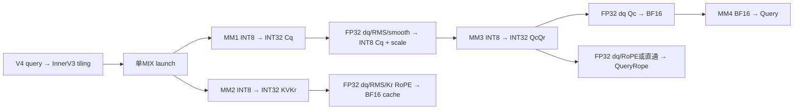
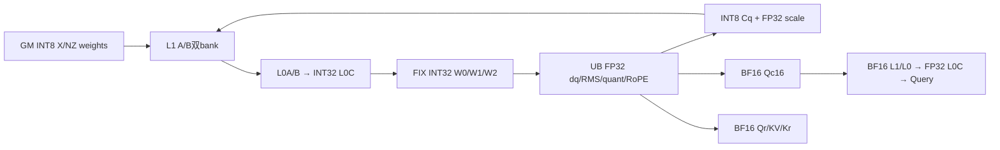
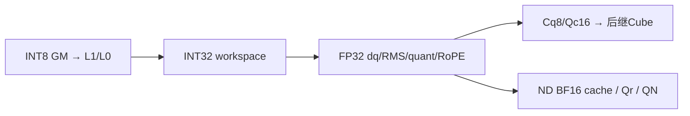
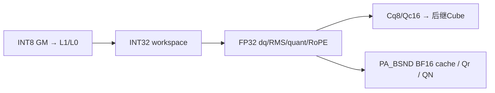
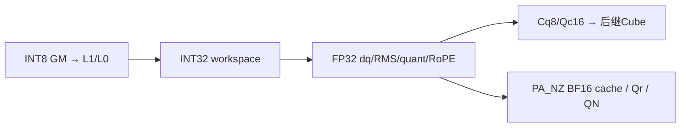
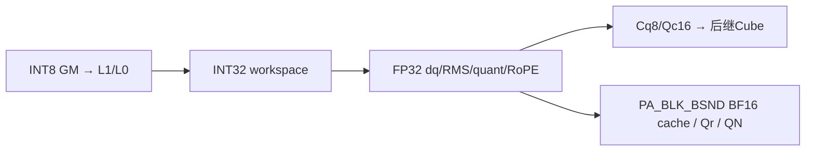

# MLA Prolog V4 INT8 投影与 BF16 缓存 950 ACLNN 算子知识

## 算子速览

| 项目 | 内容 |
|---|---|
| 实际入口 | CANN9.2 固定 d462 的 aclnnMlaPrologV4WeightNzGetWorkspaceSize / aclnnMlaPrologV4WeightNz；SGL auto/cann→外置 cann_ops_transformer.mla_prolog |
| 计算语义 | 唯一 weight/kv/query=(2,0,0)：INT8 投影、FP32 反量化与 RMS、Cq 动态 INT8、BF16 Qc 吸收投影；输出 BF16 Query/QueryRope，原地更新 BF16 KV/Kr；可选 INT8 QueryNorm 与 FP32 scale |
| 输入输出 | X/Dq/UqQr/DkvKr INT8，四份 FP32 scale；WUk/gamma/sin/cos BF16；cache 六布局；He/Hcq/N/D 与分核边界见下 |
| 执行类型 | 一个 MIX_CV：AIC_CUBE 四次矩阵乘；AIV_VECTOR 的 INT32 反量化、RMS/量化、RoPE/直通与 cache scatter；EMPTY_QUERY 无 Device 计算 |
| Kernel 路线 | R-001–005 N≤7；R-006–010 N≥8 的逐块 dequant 交叠；R-011 空 query；R-012 950 条件非法零 key；R-013 条件 Debug 非法 key |
| 核心资源 | INT32 GM 中间结果与独立 INT8 Cq/BF16 Qc 切片；L1 A/B 各双128KiB，L0A/B 各双32KiB，L0C 双64KiB；每 AIV 192KiB UB 设计预算 |
| 来源闭包 | source_closed：V4公开pair→InnerV3/OpDef→Host/POD/selector→本平台完整typed splitN及helpers。普通布局准备、通用硬件primitive、生成bridge与外置wheel身份为明确集成边界 |
| 验证状态 | 本次知识提取未执行编译、真机、数值或性能测试。draft 保留 UB 物理对齐、零 scale 与条件错误传播；源码闭合不表示已验证安全复用。 |

当前正文的主实现为arch35；两架构对照用于防止错用typed语义，卡片平台严格为950。

## 接口与语义

### 计算语义

记 H=Hcq，T 为展平 token 数，D 为吸收投影前的每 head Qc 维度，N 为 head 数；Ckv=512，Kr/Qr=64。M8(A,B) 表示 INT8×INT8 的 INT32 累加结果；dq(I,sx,sw) 表示当前架构真实顺序的 INT32→FP32 与逐 token/逐输出 channel scale 乘法。BF16矩阵乘以FP32 L0C累加后Fixpipe F322BF16；b16为CAST_RINT存储舍入。

```text
cq32 = M8(X, WDq)                                   # [T,H]
cqf  = RMS_FP32(dq(cq32,sX,sWDq), gammaQ,epsQ)*aq
cqf *= smoothQ if present                           # 仍FP32，不先转BF16
sCq[t] = max(abs(cqf[t,:]))/127
cq8[t,:] = current_arch_int8_cast(cqf[t,:]/sCq[t])    # [T,H] INT8
qcqr32 = M8(cq8, WUqQr)                             # [T,N,D+64]
qcf = dq(qcqr32[:,:,:D],sCq,sWUqQr[:,:,:D])
Qc = b16(qcf)
Query[t,h,:] = MM_BF16(Qc[t,h,:], WUk[h,:,:])         # [T,N,512]
qrf = dq(qcqr32[:,:,D:D+64],sCq,sWUqQr[:,:,D:D+64])
QueryRope = b16(rot(qrf,sin,cos)) if e else b16(qrf)

kvkr32 = M8(X, WDkvKr)                              # [T,576]，空cache时跳过
kvf = RMS_FP32(dq(kvkr32[:,:512],sX,sWDkvKr[:512]),gammaKV,epsKV)*ak
KV = b16(kvf)
krf = dq(kvkr32[:,512:576],sX,sWDkvKr[512:576])
Kr = b16(rot(krf,sin,cos)) if e else b16(krf)
scatter(KV,Kr,index/layout/stride0)                  # 两cache副作用
若请求：QueryNorm=cq8，dequantScaleQNorm=sCq[T,1]
dequantScaleQNope 不启用，vendor以FP32空tensor返回
```

arch22 的 dq 先乘 token scale 再乘 channel scale；arch35 的 DequantVFImpl 先 channel 后 token。相同实数公式不保证两种FP32乘法顺序逐位相同。INT8动态舍入也不同：arch22为FP32→INT32 CAST_RINT→half CAST_ROUND（SetDeqScale=1）→INT8 CAST_TRUNC；arch35 为FP32→half CAST_ODD/NO_SAT→INT8 CAST_RINT/SAT。不能用一种平台的cast链替另一种平台。per-token max=0 时实际sCq=0，当前函数无epsilon或零行分支，继续除零；不将它重写为scale1或承诺码值为0。scale/gamma/输入的NaN/Inf及epsilon非法值没有由shape检查证明数值有效。

RMS顺序为反量化→sum(x²)/width→+epsilon→sqrt→div→BF16 gamma转FP32相乘→可选aq/ak；aq/ak由abs(value−1)≥FP32 epsilon使能，API double下传OpDef Float/POD float。Qc在第四MM前必须舍入BF16；Qr/Kr反量化仍保持FP32至RoPE后才舍入，禁止提前统一cast BF16。RoPE对j=0..31：y[j]=x[2j]*cos[j]−x[2j+1]*sin[j]；y[32+j]=x[2j+1]*cos[32+j]+x[2j]*sin[32+j]。禁用时不做偶奇重排、保持原投影顺序。

### 输入、输出与属性

| 参数 | shape/layout | dtype | 约束、默认值与语义 |
|---|---|---|---|
| tokenX | [T,He]或[B,S,He]，ND/NCHW，T=B*S | INT8 | He∈{1024,2048,3072,4096,5120,6144,7168,7680,8192}，B≤65536；u32保存/乘法未溢出是后续公式前提 |
| weightDq | 逻辑[He,H]，NZ物理[H/32,He/16,16,32] | INT8 | H∈{1536,2048}；矩阵逻辑二维shape与storage维须区分 |
| weightUqQr | 逻辑[H,N*(D+64)]，NZ物理[N*(D+64)/32,H/16,16,32] | INT8 | N=1..128，D=128/192；不能用BF16的c0=16寻址 |
| weightDkvKr | 逻辑[He,576]，NZ [18,He/16,16,32] | INT8 | 前512 Ckv、后64 Kr |
| weightUk | [N,D,512] ND | BF16 | 第四矩阵乘吸收权重，不参与INT8量化 |
| dequantScaleX | [T,1] ND | FP32 | 必需，逐token反量化scale |
| dequantScaleWDq / WUqQr / WDkvKr | [1,H] / [1,N*(D+64)] / [1,576] | FP32 | 全部必需，逐输出channel反量化scale |
| smoothScalesCq | 缺省或[1,H] ND | FP32 | 可选，RMS与aq后、动态量化前相乘；存在性改变UB常驻4H |
| rmsnormGammaCq / Ckv | [H] / [512] | BF16 | 各AIV首step搬入并跨step保留 |
| ropeSin / Cos | [T,64]或[B,S,64] | BF16 | doRope=true须非null；false原始ACLNN指针须null；SGL/vendor按numel>0成对判断并归一化 |
| kvCacheRef / krCacheRef | TND [T,1,512/64]、BSND [B,S,1,512/64]或分页逻辑[Pnum,P,1,512/64] | BF16 IN/OUT | 各自stride0；内轴连续，第一轴padding允许但需真实storage；NZ路由使用物理tile地址 |
| cacheIndex | tokenPA [T]/[B,S]；blockPA [B,ceil(S/P)]或合轴一维页表 | INT64 ND | ND期望缺省；tokenPA负slot跳写；正上界、冲突与页表内容由caller保证 |
| actualSeqLen | 合轴blockPA [B] | INT32 ND | 累计终点，末值T、合法单调与页表容量属值合同；其它route缺省 |
| Query / QueryRope | [T,N,512/64]或[B,S,N,512/64] | BF16 | 正式输出，不与输入/cache/workspace任意overlap |
| QueryNorm | 可选[T,H]或[B,S,H] | INT8 | 非null指针使queryNormFlag=1，结果同时供MM3读取 |
| dequantScaleQNorm | QueryNorm开启时[T,1] | FP32 | 必须与QueryNorm成对；否则原始指针缺省，vendor返回空 |
| dequantScaleQNope | 原始nullptr；vendor为[0] | FP32空 | 不是该tuple有效输出；不能把非null空descriptor等同nullptr |
| quantScaleCkv / Ckr / clip | 缺省 | N/A | kv=0不量化；预留TBuf/指针声明不证明实际消费 |
| attrs | wq2/kvq0/qq0，repo0/scaleRepo0，tile128 | modes INT64；scalar double→float | eps默认1e−5，aq/ak默认1，cache默认PA_BSND；禁止混入kv1/3独立数学 |

### 入口与版本

[SGL V4 API](../../../../apis/sgl_kernel_npu/sgl_mlaprolog_v4.md)给出16模式及functional接入边界；本卡只冻结(2,0,0)的eager原地语义。固定SGL提交为dda6，依其文档明确引用的ops-transformer d462/CANN9.2；SDK为a63d9.2。公开产品表支持A2/A3及950的INT8全量化，具体本卡平台见Frontmatter；未据目录名推断支持。已安装外置cann_ops_transformer wheel、torch_npu及Runtime的二进制身份仍需部署侧核对。

V4 wrapper转aclnnInnerMlaPrologV3并增加doRope；固定V3公开pair则固定RoPE，不按内部注册名MlaPrologV3把两个ABI混淆。五返回顺序Q、Qr、空Qscale、可选QN、可选QNscale；cache仅副作用更新。functional的clone/TensorMove/Functionalize属API记录的另一集成路径，不计为本卡完整节点。旧[9.1 V3](../../../../../../ops/ascendc/operators/aclnn/transformer/attention/mla_prolog.md)、[旧950 V3](../../../../../../ops/ascendc/operators/aclnn/transformer/attention/mla_prolog_950.md)与[Direct示例](../../../../../../ops/ascendc/operators/direct/transformer/attention/mla_prolog_950.md)已全文比对：旧POD172B/固定RoPE或不同Direct ABI不能代替此208B/V4。浮点(0,0,0)与本INT8投影不是同一math卡。

## Host/Launcher 执行流程

### 参数校验与前处理

SGL先检查sin/cos成对非空，再lazy导入外置callable；vendor Python注册schema/Meta并通过OpBuilder构建接线导入C++。本次未触发load/JIT。C++ OptionalDeviceGuard选择tokenX设备，检查rank/He/Hcq/D/N、cache字段和三个权重FRACTAL_NZ，按实际INT8权重dtype分配QueryNorm，QNscale为FP32[T,1]，Query/QueryRope为BF16。本tuple的dtype override不改变TensorWrapper实际scalar_type；force HIF8只属于另一个w5路径。

V4先检查wq/kvq组合与qq范围、doRope指针；TensorHolder按“原始nullptr”创建shape[0]临时descriptor并以引用替换局部参数。holder存在性用于要求Qscale只在full+kv1、QNscale只在量化且QN开启时非空。禁用项必须以原始nullptr提供，非null空tensor不能绕过这项检查。holder假数据地址不是可读GM存储，析构在query返回时销毁descriptor。用户真实tensor与stream工作生命周期分开。

InnerV3生成bridge与OpDef执行AutoContiguous输入布局准备、cache IgnoreContiguous；自有core无外部Torch GEMM fallback。context转换校验cache内轴连续并取stride0，空cache设0；缺stride描述的连续fallback不表示任意stride合法。Host顺序GetNpuInfo→CheckAttrs→CheckSingleRequiredParam→CheckCacheMode→SetShapeInfo/SetScenarioInfo→CheckScenarParam/QuantMode/Dims/SpecialScenario/ExpectedParam→SetAttrInfo→ProcessBaseInputs→四MM分核→POD/WS/key。前置失败阻止后续；普通Contiguous/descriptor/生成bridge保留框架边界，不省略自有typed body。

vendor ResolveLogicalDims对Torch可见4D用(s0*16,s1*16)，Host对NZ实际storage用首轴*c0恢复Nout；vendor QueryNorm尺寸直接取weight_dq.size(1)。本INT8 storage c0=32，不能把raw4D Tensor当保留二维逻辑shape的format29 tensor等价，也不虚构torch_npu隐式转换。cache P∈[16,1024]且16倍数；Nkv=1/Ckv512/Kr64，repo0；页表/长度值未由Host逐值扫描。

### 参数、Workspace 与生命周期

记d=[N>=8]、qnf∈{0,1}、m=min(T,(D192且d)?64:128)，g=N*(D+64)，h=N*D。按有效u32和size_t/int64运算未溢出的域：

```text
W_Host = W_lib + 6*m*H + 4*m*576 + 4*m*g + 2*m*h + d*32*m
W_Device_peak = d*32*m + 4*m*576 + 4*m*H + (1-qnf)*m*H + 4*m*g + 2*m*h
Sscale=[0,d*32m)              FP32每token占32B；d0不分配
W0=[d*32m, +2304m)           INT32 [m,576]
W1=紧接W0，4mH              INT32 [m,H]
Cq8=紧接W1，qnf0时mH        INT8；qnf1直接正式QN且不占这片
W2=紧接Cq8/或W1，4mg        INT32 [m,N,D+64]
Qc16=紧接W2，2mh            BF16 [m,N,D]，与W2不别名
Qn直接写正式Query，不增加workspace片
```

Host按2mH预留Cq归一化结果，Device实为mH或正式QN，属于真实上界差异，不能把Host公式误作同时活跃片之和。W_lib取平台GetLibApiWorkSpaceSize，不能替换成另一算法固定系统常量；Device从workspace实参原址切片，没有自行跳过W_lib前缀。实际Runtime打包边界不在这份自有body中猜测。

调用者query取得size/executor→同设备分配足量workspace→Execute(workspace,size,executor,stream)。输入、输出、两cache、页表/边界、workspace需保持至stream完成；cache后继读依赖同stream或显式event。vendor ACLNN_CMD取当前NPU stream并在需要时UseStreamResInCurrentThread；query/execute失败抛错并清理descriptor。workspace由局部byte Tensor持有、回调捕获raw资源，Runtime/torch_npu分配器的延迟队列与stream记录仍为集成边界；descriptor释放不意味着Device tensor owner可立即释放。不补造executor释放API或用户同步。

### 启动图与失败传播

T>0正常路线为一次InnerV3 MIX launch，blockDim=C；C,V>0且V=C或2C。CvMode6/7分别选择MIX1:1/1:2；AIC线性c，AIV GetBlockIdx=c*r+subblock，r=GetSubBlockNum；raw get_block_idx不等于AIV线性索引。编译CvRatio与运行r不一致时源码有Veff修正，不能擅自消去。

T=0在全部参数校验后填POD、仅W_lib、blockDim1，正常空selector在TPipe/GM之前return；950量化V=C在GenTilingKey先被拒绝，空分支无视失败保留零key（R-012），不能说所有空输入都成功。e0的条件Debug非法key见R-013。非空GenTilingKey失败经函数序列返回GRAPH_FAILED。



## Route 与参数设计

### 分核与资源计算

C/V为Host可用AIC/AIV数，H=Hcq，P为分页blockSize（不与H混用），d=[N>=8]。IsSplitKnSupported首先要求DAV9201，当前A2/A3与950的KN字段固定(1,1,0)；w2不走MXFP8 splitM。group-compute只对部分量化并要求Nkv8，本tuple为全量化且公开Nkv1，实际group=false。

| 段 | 原始M/N/K | Host分核 | 实际base/step与tail |
|---|---|---|---|
| MM1 Cq | m/H/He | n1=max(64,32*ceil(H/(32C)))；b1=ceil(H/n1) | baseN128，baseK256，stepK4；He7680时stepK3，K_L1=768，否则1024 |
| MM2 KVKr | m/576/He | E1时b2=n2=0；否则C>=9取n2=64,b2=9；否则n2=32*ceil(576/(32C))，b2=ceil(576/n2) | 同MM1，最后核N=576−(b2−1)n2，E1 constexpr跳过 |
| MM3 QcQr | m/[N(D+64)]/H | d0：n3=32*ceil(N(D+64)/(32C))；d1：n3=(D+64)*ceil(N/C)；b3=ceil(N(D+64)/n3) | baseK128，stepK4，K_L1=512；初始化m<=64时baseN256，否则128；tail不重选baseN，当前m'<=64时INT8 A全载一个L1A bank |
| MM4 Qn | 每head m/512/D | hp=ceil(N/C)，b4=ceil(N/hp) | BF16 baseN128；D128 baseK128/stepK1，全A/B；D192 baseK64/stepK3走ND B splitK；末核head数N−(b4−1)hp |

m=min(T,(D192且N>=8)?64:128)。末step m'=min(m,T−b0)，更新四MM.m并重算AIV token划分，slice仍按初始m容量。Veff初始min(m,V)；编译cvRatio1但运行r2且Veff<m时乘2。AIV v的count=floor(m'/Veff)+[v<m'%Veff]，tokenStart=v*floor(m'/Veff)+min(v,m'%Veff)。所有无token核仍参加公共屏障。

矩阵N切片末核与baseN末tile均按有效宽度提交；Cube内部M=align16(m')，Fixpipe仅写m'真实行。INT8的C0=32而BF16 C0=16，NZ搬运偏移不可共用常数。声明表的旧位注释并非实际SDK编码ABI。

### Route 选择

K(c,d,E,A,e,cv)=(c,2,3,d,false,E,A,0,e,cv)。c0=BSND/TND归一ND、1=tokenPA_BSND、2=tokenPA_NZ、3/4=blockPA。E0正常、E1空cache，A1仅合轴blockPA。D128/192、QueryNorm、smooth与最后m'是同key的运行时body分支，全部保留，不追加虚构key。

| 顺序 | Route | Key/模板 | 精确选择条件与优先级 | 不适用去向 |
|---:|---|---|---|---|
| 1 | R-011 空query | (0,0,0,0,0,2,0,0,1,cv) | 全部参数校验后T=0优先，GenTilingKey guard通过 | 950 V=C为R-012；其它guard错失败 |
| 2 | R-001–005 | K(c,0,E,A,e,cv) | T>0，1<=N<=7；c按下方逐Route合法layout选取 | N>=8进入R-006–010；不做dense fallback |
| 3 | R-006–010 | K(c,1,E,A,e,cv) | T>0，8<=N<=128；mm3按完整head分核并逐块交接 | 不满足公开输入则Host失败 |
| 4 | R-012 950空query零key | 非法遗留key0 | DAV3510、V=C、w2、T=0；GenTilingKey拒绝量化而空分支忽略状态 | 无对应自有合法body，不能宣称空return |
| 5 | R-013 条件Debug e0 | INVALID_TILING_KEY | T>0、e0、Host ASCENDC_DEBUG且Host未外部define VERSION3 | 非Debug或Host VERSION3使用正常selector |

正常A2/A3允许cv6/7；950量化正常仅cv7（V=2C），cv6非空直接GRAPH_FAILED。950空query也先触发同guard，量化模式被拒绝与cache布局无关。各Route的c/E/A由真实layout/rank决定，不采用SEL里多出的不可达组合。不存在已选择的自有body的错误终点只记录Host传播，不虚构Runtime结果。

```text
validate modes/pointers/shape/cache-strides/C,V
  if T==0:
    GenTilingKey -> guard accepted: R011, libWS/block1, entryreturn
                 -> 950CV1:1: R012, ignored failure, retained key0
  else:
    ProcessBaseInputs d=(N>=8), mcap; FillMM1..4; WS/POD
    GenTilingKey rejects950cv6 -> GRAPH_FAILED
    c0/1/2/3/4 -> R(1+c+5d), e0/1, E/A perlayout
    conditional Host Debug e0 SEL mismatch -> R013; otherwise typed splitN
```

### 模板/实现执行矩阵

每个正常selector实例为MlaPrologVecS1CubS2<MLAPType<int8_t,int8_t,bfloat16_t,float,static_cast<CACHE_MODE>(c),d,false,static_cast<EMPTY_TENSOR_MODE>(E),static_cast<ACTUAL_SEQ_MODE>(A),false,(cv==6?1:2),e>>；对应本卡arch22或arch35 body。queryOutput/krCache/mmQnInput均BF16，MM1/2/3输出INT32，RmsCq输出INT8；不实例化Query动态量化。

| Route | key/selector | dtype/shape/platform完整命中条件 | 执行族与kernel节点 | 实际模板/body | 内存与同步特征 | tail/fallback |
|---|---|---|---|---|---|---|
| R-001 | K(0,0,E,A,e,cv) | N1..7；BSND 仅 rank3 X/cache [B,S,1,L]；TND 仅 rank2 X/cache [T,1,L]，E0/A0；cv7；INT8 modes200 | 单MIX_CV | arch35 splitN，d0，ScatterCache<BF16,false> | 无GM尺度槽；总QCQR6/allV7/DEQ6；公共W/L1/L0/UB完整账 | m'有效行；E1保留同步，非法值无fallback |
| R-006 | K(0,1,E,A,e,cv) | N8..128；BSND 仅 rank3 X/cache [B,S,1,L]；TND 仅 rank2 X/cache [T,1,L]，E0/A0；cv7；INT8 modes200 | 单MIX_CV | arch35 splitN，d1，ScatterCache<BF16,false> | GM32m scale汇总；逐tile6/10与逐head7；公共W/L1/L0/UB完整账 | m'有效行；E1保留同步，非法值无fallback |
| R-002 | K(1,0,E,A,e,cv) | N1..7；cacheMode=PA_BSND；X rank2/3分别用INT64 index[T]/[B,S]，A0，E0/1；cv7；INT8 modes200 | 单MIX_CV | arch35 splitN，d0，ScatterCache<BF16,false> | 无GM尺度槽；总QCQR6/allV7/DEQ6；公共W/L1/L0/UB完整账 | m'有效行；E1保留同步，非法值无fallback |
| R-007 | K(1,1,E,A,e,cv) | N8..128；cacheMode=PA_BSND；X rank2/3分别用INT64 index[T]/[B,S]，A0，E0/1；cv7；INT8 modes200 | 单MIX_CV | arch35 splitN，d1，ScatterCache<BF16,false> | GM32m scale汇总；逐tile6/10与逐head7；公共W/L1/L0/UB完整账 | m'有效行；E1保留同步，非法值无fallback |
| R-003 | K(2,0,E,A,e,cv) | N1..7；cacheMode=PA_NZ；逻辑[Pnum,P,1,L]，物理[Pnum,L/16,P,16]；A0，E0/1；cv7；INT8 modes200 | 单MIX_CV | arch35 splitN，d0，ScatterCache<BF16,true> | 无GM尺度槽；总QCQR6/allV7/DEQ6；公共W/L1/L0/UB完整账 | m'有效行；E1保留同步，非法值无fallback |
| R-008 | K(2,1,E,A,e,cv) | N8..128；cacheMode=PA_NZ；逻辑[Pnum,P,1,L]，物理[Pnum,L/16,P,16]；A0，E0/1；cv7；INT8 modes200 | 单MIX_CV | arch35 splitN，d1，ScatterCache<BF16,true> | GM32m scale汇总；逐tile6/10与逐head7；公共W/L1/L0/UB完整账 | m'有效行；E1保留同步，非法值无fallback |
| R-004 | K(3,0,E,A,e,cv) | N1..7；block页表，rank3→A0/index[B,ceil(S/P)]；rank2→A1/actualSeqLen[B]与一维INT64页表；E0/1；cv7；INT8 modes200 | 单MIX_CV | arch35 splitN，d0，ComputeBlkScatterOffsets→MaterializeOffsetsWithHeadSize<BF16,false>→ScatterCacheMultiRows<BF16,false> | 无GM尺度槽；总QCQR6/allV7/DEQ6；公共W/L1/L0/UB完整账 | m'有效行；E1保留同步，非法值无fallback |
| R-009 | K(3,1,E,A,e,cv) | N8..128；block页表，rank3→A0/index[B,ceil(S/P)]；rank2→A1/actualSeqLen[B]与一维INT64页表；E0/1；cv7；INT8 modes200 | 单MIX_CV | arch35 splitN，d1，ComputeBlkScatterOffsets→MaterializeOffsetsWithHeadSize<BF16,false>→ScatterCacheMultiRows<BF16,false> | GM32m scale汇总；逐tile6/10与逐head7；公共W/L1/L0/UB完整账 | m'有效行；E1保留同步，非法值无fallback |
| R-005 | K(4,0,E,A,e,cv) | N1..7；block页表与 c3 相同；cacheMode=PA_BLK_NZ，A0/1，E0/1；cv7；INT8 modes200 | 单MIX_CV | arch35 splitN，d0，ComputeBlkScatterOffsets→MaterializeOffsetsWithHeadSize<BF16,true>→ScatterCacheMultiRows<BF16,true> | 无GM尺度槽；总QCQR6/allV7/DEQ6；公共W/L1/L0/UB完整账 | m'有效行；E1保留同步，非法值无fallback |
| R-010 | K(4,1,E,A,e,cv) | N8..128；block页表与 c3 相同；cacheMode=PA_BLK_NZ，A0/1，E0/1；cv7；INT8 modes200 | 单MIX_CV | arch35 splitN，d1，ComputeBlkScatterOffsets→MaterializeOffsetsWithHeadSize<BF16,true>→ScatterCacheMultiRows<BF16,true> | GM32m scale汇总；逐tile6/10与逐head7；公共W/L1/L0/UB完整账 | m'有效行；E1保留同步，非法值无fallback |
| R-011 | 空key | T0/guard通过 | entryreturn，无计算 | constexpr EMPTY_QUERY | libWS/block1，不读POD | cache不动 |
| R-012 | key0非selector | 950V=C、T0 | 无选定body | Host错误终点 | libWS，错误被忽略 | Runtime边界 |
| R-013 | INVALID_KEY | 条件Host Debug e0 | 无选定body | SDK SEL错误终点 | 正常Host WS预留 | Runtime边界 |

真实SDK DECL宽度4/2/4/1/1/2/2/2/1/8，故K=c+224+(d<<10)+(E<<12)+(A<<14)+(e<<18)+(cv<<19)。下表逐key保留全部104正常A2/A3、52正常950交集以及合法空key；e0的条件Debug终点另列，不能说所有构建都成功。SDK非Debug FastEncode仅验DECL，Debug Encode验证SEL；Host头默认MLA_PROLOG_VERSION=-1令ENABLE_ROPE_SEL仅1，Device TU明确define3允许0/1。当前Host的GenTilingKey未检查INVALID_KEY。ORIG_DTYPE预处理宏须与本tuple的INT8/INT8/BF16一致，未知宏不作为成功部署证据。

| 实例 | Route | (c,Scenario,Quant,deq,group,E,A,splitM,e,CV) | uint64 key |
|---|---|---|---|
| I001 | R-001 | (0,2,3,0,0,0,0,0,0,7) | 3670240 |
| I002 | R-001 | (0,2,3,0,0,0,0,0,1,7) | 3932384 |
| I003 | R-002 | (1,2,3,0,0,0,0,0,0,7) | 3670241 |
| I004 | R-002 | (1,2,3,0,0,0,0,0,1,7) | 3932385 |
| I005 | R-002 | (1,2,3,0,0,1,0,0,0,7) | 3674337 |
| I006 | R-002 | (1,2,3,0,0,1,0,0,1,7) | 3936481 |
| I007 | R-003 | (2,2,3,0,0,0,0,0,0,7) | 3670242 |
| I008 | R-003 | (2,2,3,0,0,0,0,0,1,7) | 3932386 |
| I009 | R-003 | (2,2,3,0,0,1,0,0,0,7) | 3674338 |
| I010 | R-003 | (2,2,3,0,0,1,0,0,1,7) | 3936482 |
| I011 | R-004 | (3,2,3,0,0,0,0,0,0,7) | 3670243 |
| I012 | R-004 | (3,2,3,0,0,0,0,0,1,7) | 3932387 |
| I013 | R-004 | (3,2,3,0,0,0,1,0,0,7) | 3686627 |
| I014 | R-004 | (3,2,3,0,0,0,1,0,1,7) | 3948771 |
| I015 | R-004 | (3,2,3,0,0,1,0,0,0,7) | 3674339 |
| I016 | R-004 | (3,2,3,0,0,1,0,0,1,7) | 3936483 |
| I017 | R-004 | (3,2,3,0,0,1,1,0,0,7) | 3690723 |
| I018 | R-004 | (3,2,3,0,0,1,1,0,1,7) | 3952867 |
| I019 | R-005 | (4,2,3,0,0,0,0,0,0,7) | 3670244 |
| I020 | R-005 | (4,2,3,0,0,0,0,0,1,7) | 3932388 |
| I021 | R-005 | (4,2,3,0,0,0,1,0,0,7) | 3686628 |
| I022 | R-005 | (4,2,3,0,0,0,1,0,1,7) | 3948772 |
| I023 | R-005 | (4,2,3,0,0,1,0,0,0,7) | 3674340 |
| I024 | R-005 | (4,2,3,0,0,1,0,0,1,7) | 3936484 |
| I025 | R-005 | (4,2,3,0,0,1,1,0,0,7) | 3690724 |
| I026 | R-005 | (4,2,3,0,0,1,1,0,1,7) | 3952868 |
| I027 | R-006 | (0,2,3,1,0,0,0,0,0,7) | 3671264 |
| I028 | R-006 | (0,2,3,1,0,0,0,0,1,7) | 3933408 |
| I029 | R-007 | (1,2,3,1,0,0,0,0,0,7) | 3671265 |
| I030 | R-007 | (1,2,3,1,0,0,0,0,1,7) | 3933409 |
| I031 | R-007 | (1,2,3,1,0,1,0,0,0,7) | 3675361 |
| I032 | R-007 | (1,2,3,1,0,1,0,0,1,7) | 3937505 |
| I033 | R-008 | (2,2,3,1,0,0,0,0,0,7) | 3671266 |
| I034 | R-008 | (2,2,3,1,0,0,0,0,1,7) | 3933410 |
| I035 | R-008 | (2,2,3,1,0,1,0,0,0,7) | 3675362 |
| I036 | R-008 | (2,2,3,1,0,1,0,0,1,7) | 3937506 |
| I037 | R-009 | (3,2,3,1,0,0,0,0,0,7) | 3671267 |
| I038 | R-009 | (3,2,3,1,0,0,0,0,1,7) | 3933411 |
| I039 | R-009 | (3,2,3,1,0,0,1,0,0,7) | 3687651 |
| I040 | R-009 | (3,2,3,1,0,0,1,0,1,7) | 3949795 |
| I041 | R-009 | (3,2,3,1,0,1,0,0,0,7) | 3675363 |
| I042 | R-009 | (3,2,3,1,0,1,0,0,1,7) | 3937507 |
| I043 | R-009 | (3,2,3,1,0,1,1,0,0,7) | 3691747 |
| I044 | R-009 | (3,2,3,1,0,1,1,0,1,7) | 3953891 |
| I045 | R-010 | (4,2,3,1,0,0,0,0,0,7) | 3671268 |
| I046 | R-010 | (4,2,3,1,0,0,0,0,1,7) | 3933412 |
| I047 | R-010 | (4,2,3,1,0,0,1,0,0,7) | 3687652 |
| I048 | R-010 | (4,2,3,1,0,0,1,0,1,7) | 3949796 |
| I049 | R-010 | (4,2,3,1,0,1,0,0,0,7) | 3675364 |
| I050 | R-010 | (4,2,3,1,0,1,0,0,1,7) | 3937508 |
| I051 | R-010 | (4,2,3,1,0,1,1,0,0,7) | 3691748 |
| I052 | R-010 | (4,2,3,1,0,1,1,0,1,7) | 3953892 |
| 空query | R-011 | (0,0,0,0,0,2,0,0,1,7) | 3940352 |

### 隐藏性能 Guard

| Guard | Host/Tiling条件 | Device/资源原因 | 影响Route | 不满足时去向 | 源码符号 |
|---|---|---|---|---|---|
| dequant两图 | N>=8取d1 | MM3分完整head，AIV分D/r列，按head给MM4信号；d0按token等待全结果 | R001–010 | 另一真实body，不凭性能猜 | ProcessBaseInputs/FillMatmul3Tiling |
| max step | D192且d1时64，否则128 | MM3/N波与UB峰值所需；N<=7 D192仍可128 | 正常 | 当前固定cap，无自动缩tile | ProcessBaseInputs |
| INT8 A-full-load | 当前m'<=64 | align16(m')*H<=128KiB；INT8阈值64，BF16阈值32不适用 | 全正常MM3 | 分K双bank | MatmulQcQr |
| He7680 | (He/256)%4!=0，stepK=3 | 7680不能按1024整分，按768整分；允许He枚举其余用4 | 全正常MM1/2 | 不存在任意K-tail fallback | MmCq/CkvKrParamInit |
| 950核比 | V=C拒绝全部w2 | 固定Host白名单，不推测硬件全域限制 | 全部950 | 非空失败；空R012忽略失败 | GenTilingKey |
| UB物理量 | F_alloc+max(stage)<=实际UB且F_alloc+S_alloc<=pool | 每TBuf独立align32，A1小m可多32B；share阶段无Host逐项guard | 正常 | 无自有安全fallback | VectorBufferInit/TPipe |
| scale数值 | Cq absmax0→scale0，无epsilon | pertoken路径继续除零；pertile epsilon不属于本tuple | 正常 | 没有源码零行分支 | DynamicQuant/ComputeVFImpl M0 |
| page/slot值 | storage容量、索引上界、无写冲突 | scalar索引/非atomic散写；shape检查不验全值 | c1–4 | caller合同，无dense fallback | ScatterCache/ComputeBlkScatterOffsets |
| 宽度/窄化 | 原shape→u32，T的u32乘法 | 数学公式不能替代实际有限位运算；byteoffset转int64须有效 | 全部 | 不承诺超域结果 | SetShapeInfo/WorkspaceInit |
| Debug e0 | ASCENDC_DEBUG且Host VERSION!=3 | SEL不含e0、Encode返回UINT64_MAX；非Debug可编码正常e0 | R013 | Runtime处理外部边界 | template_argument/GenTilingKey |

### POD/ABI

唯一跨Host/Device POD为MlaPrologTilingData.baseParams。以下sizeof208/alignof8/offset按uint32/float4B、uint16 2B、uint64 8B自然对齐静态推导，未执行编译器sizeof/offsetof验证。baseParams offset0，188–191是padding。普通struct字段没有逐字段默认值；kNopeClipAlpha未被FillTiling赋值，本tuple不消费，不据此称其为0。空query在读POD前return。

| 结构 | 字段 | 类型/位宽 | ABI布局 | 单位 | Host/launcher producer | Device consumer | 边界 |
|---|---|---|---|---|---|---|---|
| BaseParams | batchSize | uint32_t/32 | offset0，4B | batch，TND其它路线为0 | FillTiling/CoreParams：B；fusedblockPA由actualSeqLen.shape[0] | ComputeBlkScatterOffsets批游标界 | batch，TND其它路线为0 |
| BaseParams | stepBatchSize | uint32_t/32 | offset4，4B | token；T0=0且不读 | FillTiling/CoreParams：min(T,(D192且N>=8)?64:128) | Process步进/UB/WS/MM m | token；T0=0且不读 |
| BaseParams | mSubSize | uint32_t/32 | offset8，4B | inactive，本tuple无splitM | FillTiling/CoreParams：成员初始化0/FillTilingCoreParams | 当前splitN不读 | inactive，本tuple无splitM |
| BaseParams | mSubCoreNum | uint32_t/32 | offset12，4B | inactive | FillTiling/CoreParams：成员初始化0 | 当前splitN不读 | inactive |
| BaseParams | stepNumHeadDequant | uint32_t/32 | offset16，4B | head；仍写POD | FillTiling/CoreParams：D128?min(64,N):min(16,N) | deq=0时DequantQc按head分块，deq=1由head波分工不直接读 | head；仍写POD |
| BaseParams | tokenSize | uint32_t/32 | offset20，4B | token；u32原始乘法域 | FillTiling/CoreParams：X前导维展平T | Process总步数 | token；u32原始乘法域 |
| BaseParams | seq1Size | uint32_t/32 | offset24，4B | token | FillTiling/CoreParams：rank3 X的S；rank2默认0 | blockPA A0批内token/ND BSND跨度 | token |
| BaseParams | seq2Size | uint32_t/32 | offset28，4B | 保留字段，不解释成真实KV长度 | FillTiling/CoreParams：nkvSize=1 | 本INT8 splitN不读 | 保留字段，不解释成真实KV长度 |
| BaseParams | headSizeX | uint32_t/32 | offset32，4B | 元素 | FillTiling/CoreParams：He | MM1/MM2 K与X行跨度 | 元素 |
| BaseParams | headSizeCq | uint32_t/32 | offset36，4B | 元素 | FillTiling/CoreParams：Hcq | MM1输出/MM3 K/NormCq | 元素 |
| BaseParams | headSizeCkv | uint32_t/32 | offset40，4B | 元素 | FillTiling/CoreParams：512 | MM2切片/NormKV/MM4 N | 元素 |
| BaseParams | headSizeQc | uint32_t/32 | offset44，4B | 元素 | FillTiling/CoreParams：N*D | MM3/Qn输入跨度 | 元素 |
| BaseParams | headSizeQr | uint32_t/32 | offset48，4B | 元素 | FillTiling/CoreParams：N*64 | QueryRope行跨度 | 元素 |
| BaseParams | headSizeKr | uint32_t/32 | offset52，4B | 元素 | FillTiling/CoreParams：Dr=64 | MM2完整输出/分核 | 元素 |
| BaseParams | numHeadSize | uint32_t/32 | offset56，4B | head | FillTiling/CoreParams：N | MM4 head循环/QueryRope row | head |
| BaseParams | numHeadKvSize | uint32_t/32 | offset60，4B | head | FillTiling/CoreParams：Nkv=1 | 本INT8 splitN无直接关键读取 | head |
| BaseParams | dimHeadSizeQc | uint32_t/32 | offset64，4B | 元素 | FillTiling/CoreParams：D | MM4 K/Qc切片 | 元素 |
| BaseParams | dimHeadRope | uint32_t/32 | offset68，4B | 元素 | FillTiling/CoreParams：64 | SinCos/Rotary/Kr尺寸 | 元素 |
| BaseParams | blockNum | uint32_t/32 | offset72，4B | cache slice数；P0选EMPTY_CACHE | FillTiling/CoreParams：cache首轴P/T/B | 本域scatter不做正index上界校验 | cache slice数；P0选EMPTY_CACHE |
| BaseParams | blockSize | uint32_t/32 | offset76，4B | token；PA16..1024且16倍数 | FillTiling/CoreParams：PA H或BSND S；TND0 | GetCacheOffset解页/blockPA余数 | token；PA16..1024且16倍数 |
| BaseParams | mm1BlockNum | uint32_t/32 | offset80，4B | core | FillTiling/CoreParams：ceil(H/n1) | MM1活跃核/末核N | core |
| BaseParams | mm2BlockNum | uint32_t/32 | offset84，4B | core | FillTiling/CoreParams：非空ceil(576/n2)，E1=0 | MM2活跃核；E1前置constexpr return | core |
| BaseParams | mm3BlockNum | uint32_t/32 | offset88，4B | core | FillTiling/CoreParams：ceil(N(D+64)/n3) | MM3活跃核/末核N | core |
| BaseParams | mm4BlockNum | uint32_t/32 | offset92，4B | core | FillTiling/CoreParams：ceil(N/headsPerCore) | Qn head核范围 | core |
| BaseParams | vectorBlockNum | uint32_t/32 | offset96，4B | AIV调度数；运行subblock修正见正文 | FillTiling/CoreParams：min(m,V) | Init Veff/分token | AIV调度数；运行subblock修正见正文 |
| BaseParams | mm1SingleCoreN | uint32_t/32 | offset100，4B | 元素 | FillTiling/CoreParams：n1 | MmCqParamInit/ComputeAicOffset | 元素 |
| BaseParams | mm2SingleCoreN | uint32_t/32 | offset104，4B | 元素；E1不执行MM2 | FillTiling/CoreParams：n2；E1默认0 | MmCkvKrParamInit/ComputeAicOffset | 元素；E1不执行MM2 |
| BaseParams | mm3SingleCoreN | uint32_t/32 | offset108，4B | 元素 | FillTiling/CoreParams：n3 | MmQcQrParamInit/ComputeAicOffset | 元素 |
| BaseParams | mm4SingleCoreBatch | uint32_t/32 | offset112，4B | head | FillTiling/CoreParams：headsPerCore | Qn loops/weightUkOffset | head |
| BaseParams | dtileSize | uint32_t/32 | offset116，4B | 元素 | FillTiling/CoreParams：512 | ScatterCkv tokenStride | 元素 |
| BaseParams | kvQuantMode | uint32_t/32 | offset120，4B | mode | FillTiling/CoreParams：0 | KV不量化；值0 | mode |
| BaseParams | tileSize | uint32_t/32 | offset124，4B | 元素，Host仍校验128 | FillTiling/CoreParams：attr128 | 本tuple不读pertile消费者 | 元素，Host仍校验128 |
| BaseParams | ckvkrRepoMode | uint32_t/32 | offset128，4B | mode | FillTiling/CoreParams：0 DIVIDE | ScatterKr合并分支inactive | mode |
| BaseParams | quantScaleRepoMode | uint32_t/32 | offset132，4B | mode | FillTiling/CoreParams：0 DIVIDE | scale回写分支inactive | mode |
| BaseParams | queryNormFlag | uint32_t/32 | offset136，4B | bool编码u32 | FillTiling/CoreParams：原始queryNormOut非null?1:0 | OutputInit/WorkspaceInit/Process | bool编码u32 |
| BaseParams | reciprocalCq | float/32 | offset140，4B | FP32 | FillTiling/CoreParams：float(1/H) | NormCq Reduce后Muls | FP32 |
| BaseParams | epsilonCq | float/32 | offset144，4B | FP32，不验证所有数值域 | FillTiling/CoreParams：rmsnormEpsilonCq Float | NormCq Adds/Sqrt | FP32，不验证所有数值域 |
| BaseParams | reciprocalCkv | float/32 | offset148，4B | FP32 | FillTiling/CoreParams：float(1/512) | NormKV Reduce后Muls | FP32 |
| BaseParams | epsilonCkv | float/32 | offset152，4B | FP32 | FillTiling/CoreParams：rmsnormEpsilonCkv Float | NormKV Adds/Sqrt | FP32 |
| BaseParams | kNopeClipAlpha | float/32 | offset156，4B | inactive，值不可宣称为0 | FillTiling/CoreParams：FillTiling未赋此标量字段 | 本tuple不读；其它quant helper另读GM | inactive，值不可宣称为0 |
| BaseParams | qcQrScale | float/32 | offset160，4B | FP32 | FillTiling/CoreParams：attr Float aq | NormCq gamma后Muls | FP32 |
| BaseParams | kcScale | float/32 | offset164，4B | FP32 | FillTiling/CoreParams：attr Float ak | NormKV gamma后Muls | FP32 |
| BaseParams | isQcQrScaleEnable | uint16_t/16 | offset168，2B | bool编码u16 | FillTiling/CoreParams：abs(aq-1)>=float epsilon | NormCq条件Muls | bool编码u16 |
| BaseParams | isKcScaleEnable | uint16_t/16 | offset170，2B | bool编码u16 | FillTiling/CoreParams：abs(ak-1)>=float epsilon | NormKV条件Muls | bool编码u16 |
| BaseParams | mm1NGroup | uint16_t/16 | offset172，2B | 组，9201才可能变化 | FillTiling/CoreParams：1 | 当前arch22/35 splitN不读KN分组 | 组，9201才可能变化 |
| BaseParams | mm1KGroup | uint16_t/16 | offset174，2B | 组 | FillTiling/CoreParams：1 | 本平台CalcWorkSpace按1；Device无KN | 组 |
| BaseParams | mm1SingleCoreK | uint32_t/32 | offset176，4B | 元素，inactive | FillTiling/CoreParams：0 | 当前arch22/35不读 | 元素，inactive |
| BaseParams | mm2NGroup | uint16_t/16 | offset180，2B | 组 | FillTiling/CoreParams：1 | 当前arch22/35不读KN分组 | 组 |
| BaseParams | mm2KGroup | uint16_t/16 | offset182，2B | 组 | FillTiling/CoreParams：1 | 本平台CalcWorkSpace按1；Device无KN | 组 |
| BaseParams | mm2SingleCoreK | uint32_t/32 | offset184，4B | 元素，inactive | FillTiling/CoreParams：0 | 当前arch22/35不读 | 元素，inactive |
| BaseParams | kvCacheStride0 | uint64_t/64 | offset192，8B | 元素u64，转int64需在已验范围内 | GetCacheStride0；空cache0 | ScatterCache/MaterializeOffsetsWithHeadSize | 元素u64，转int64需在已验范围内 |
| BaseParams | krCacheStride0 | uint64_t/64 | offset200，8B | 元素u64 | FillTiling/CoreParams：同前，独立取Kr | Kr ScatterCache/MaterializeOffsetsWithHeadSize | 元素u64 |

MMParams在Device内构造，不跨Host序列化：m=m'、n=每核N、k=该MM的K，orgM=m、orgN=n、orgKa分别为He/He/H/ND，orgKb=k，orgKc=H/576/N(D+64)/N512；baseM未赋且无实际消费者，needSetOrgShape=1但自有helper不依赖它。baseK/N、stepK与kL1StepSize见上表。arch22字段声明n,m,k，arch35为m,n,k，不能按共同裸ABI拷贝；950 kScale=K/32在INT8无MXscale指令消费。

RmsNormParam={reciprocal:float,epsilon:float,row:u32=1,col:u32=H/512,scale:float,isScaleEnable:u16}；Rectangle={row:u32,col:u32,stride:u32}，每处真实值见Kernel阶段。ScatterCacheParams八个int64为P/slot/row=1/col=L/tokenStride/stride0/S/tokenIndex；CkvkrParams六个int64为tokenIndex、W0元素offset、当前token序号、页内行数、cacheOffset、nextPageOffset。Aic/Aiv Offset均按当前typed tensor元素寻址；MMBufParams持有TPipe地址、初始0的bank计数器至kernel结束。它们是当前Device局部数据结构，不增加Host POD字段。


当前d1额外两个Device局部参数结构也逐字段保留；它们不属于Host序列化POD。DequantQcQrSplitNParams静态sizeof32/align8，RopeQrSplitNParams静态sizeof56/align8（28–31 padding），仍未编译验证。arch22/35的前两个RoPE字段顺序相反，必须按各平台声明aggregate初始化，不能按另一平台裸拷贝。

| 结构 | 字段 | 类型/位宽 | ABI布局 | 单位 | producer | consumer | 边界 |
|---|---|---|---|---|---|---|---|
| DequantQcQrSplitNParams | mmQnPreDequantOffset | int64_t/64 | offset0 | INT32元素 | ComputeAivOffset：o=cidx*n3 | DequantQcQrSplitN inputGm基址 | 仅d1；step/head标量，非外部指针 |
| DequantQcQrSplitNParams | mmQnPreDequantResOffset | int64_t/64 | offset8 | BF16元素 | h0*D | outputGm基址 | 仅d1；step/head标量，非外部指针 |
| DequantQcQrSplitNParams | inputOffset | uint32_t/32 | offset16 | INT32元素 | s*D/r+head*(D+64) | inputGm及channelScale子片 | 仅d1；step/head标量，非外部指针 |
| DequantQcQrSplitNParams | outputOffset | uint32_t/32 | offset20 | BF16元素 | s*D/r+head*D | outputGm子片 | 仅d1；step/head标量，非外部指针 |
| DequantQcQrSplitNParams | srcStride | uint32_t/32 | offset24 | 元素gap | N(D+64)−D/r | input DMA stride*sizeof(INT32)/32 | 仅d1；step/head标量，非外部指针 |
| DequantQcQrSplitNParams | dstStride | uint32_t/32 | offset28 | 元素gap | ND−D/r | output DMA stride*sizeof(BF16)/32 | 仅d1；step/head标量，非外部指针 |
| RopeQrSplitNParams | ropeQrOffset | int64_t/64 | offset0 | INT32元素 | o+D | RopeQrSplitN inputGm基址 | 仅d1；step/head标量，非外部指针 |
| RopeQrSplitNParams | ropeQrResOffset | int64_t/64 | offset8 | BF16元素 | h0*64+b0*N64 | Qr output基址 | 仅d1；step/head标量，非外部指针 |
| RopeQrSplitNParams | inputOffsetRope | uint32_t/32 | offset16 | INT32元素 | rowStart*g+head*(D+64) | Rotary perhead输入子片 | 仅d1；step/head标量，非外部指针 |
| RopeQrSplitNParams | deqScaleOffset | uint32_t/32 | offset20 | FP32元素 | head*(D+64) | WUqQr channel scale GM偏移 | 仅d1；step/head标量，非外部指针 |
| RopeQrSplitNParams | outputOffsetRope | uint32_t/32 | offset24 | BF16元素 | rowStart*N64+head*64 | 输出子片 | 仅d1；step/head标量，非外部指针 |
| RopeQrSplitNParams | ropeStride | int64_t/64 | offset32 | 元素 | N(D+64) | INT32输入行距/channelScaleStride参数 | 仅d1；step/head标量，非外部指针 |
| RopeQrSplitNParams | ropeDstStride | uint32_t/32 | offset40 | 元素gap | N64−64 | 输出DMA gap*sizeof(BF16)/32 | 仅d1；step/head标量，非外部指针 |
| RopeQrSplitNParams | deQuantScaleCqOffset | uint32_t/32 | offset44 | FP32元素 | rowStart*8 | 本半token sCq行槽 | 仅d1；step/head标量，非外部指针 |
| RopeQrSplitNParams | sinCosOffset | uint32_t/32 | offset48 | FP32元素 | r2首次0；r1第二半floor(m'/2)*64 | cos/sin子片 | 仅d1；step/head标量，非外部指针 |
| RopeQrSplitNParams | ropeCnt | uint32_t/32 | offset52 | 行 | r2 floor((m'+s)/2)；r1两半floor/ceil | perhead输入/输出blockCount，0行早return | 仅d1；step/head标量，非外部指针 |

UsedBlockParams为两个u32：blockStartIdx=0、blockEndIdx=对应MM1/2活跃核数；MatmulSplitN按start<=blockIdx<end选择，E1在范围检查前constexpr跳MM2。CastQcQrSplitNParams与量化Query后处理虽可见但本w2kv0没有实例化消费，不纳入当前活跃节点。

### Route 源码闭包

| Route | Key/selector | Host/Tiling producer | POD/参数 | Kernel entry/router | Kernel body/直接依赖 | 构建接线 |
|---|---|---|---|---|---|---|
| R001–005 | K(c,0,E,A,e,cv) | RunBigKernelTiling/ProcessBaseInputs→FillMatmul1..4→FillTiling/CalcWorkSpace/GenTilingKey | 208B + d0 | mla_prolog_v3 FULL_QUANT_KV_NO_QUANT | 本arch Init/Process、Matmul、RMSDynamicQuant、DequantPerTokenQc、Rotary、Scatter | v3/op_host/CMakeLists声明mla_prolog依赖与--cce-auto-sync=off；V3 OpDef/tiling_register |
| R006–010 | K(c,1,E,A,e,cv) | 同上，N>=8 | 208B + d1 | 相同INT8 MLAPType但deq=true | 增加DequantAndRopeSplitN/逐FIX及MTE3 flag、GM scale汇总；全部本体可读 | 同一编译TU/SEL声明，非外部Matmul |
| R011 | E2空key | 空分支FillTiling/libWS/block1 | 已填不读 | entry constexpr return | 无计算、无cache写 | 同一TU |
| R012 | key0非selector | 950 CV1:1量化guard失败被空分支忽略 | 不虚构消费者 | 无合法选定body | 已知Host错误终点，Runtime结果外部 | 仅950 |
| R013 | INVALID_KEY | Host Debug SEL验证不匹配e0 | 不虚构消费者 | Device确有正常e0，但非法key未选中它 | 精确条件错误传播 | SDK encoder + Host TU宏边界 |


## Kernel 实现

### 公共执行流程

本节给出十个正常Route共用的真实函数级管线，并分别展开d0与d1的全部差异；后续Route仅将c/E/A与当前管线配对，不把不同同步图合并成同一Route。以下地址在各自typed tensor中以元素计，workspace表以字节计。

```text
mla_prolog_v3<c,2,3,d,false,E,A,0,e,cv>
  -> MLAPType<INT8,INT8,BF16,FP32,c,d,false,E,A,false,r,e>
  -> Init: GetBlockIdx / OutputInit / ScaleInit / MmParamInit
           WorkspaceInit / CubeBufferInit或VectorBufferInit
  -> Process: for b0=0; b0<T; b0+=m, m'=min(m,T-b0)
  AIC:
    MM1 X[b0*He] * WDq[cidx*n1*He] -> W1[cidx*n1], outStride H
    notify mode2/FIX CQ6
    wait CKVfree9; MM2 X[b0*He] * WDkvKr[cidx*n2*He]
         -> W0[cidx*n2], outStride576，E1跳算但保留信号
    notify mode2/FIX CKV6(arch22)或4(arch35)
    wait RMS6; MM3 (QN?[b0*H]:Cq8) * WUqQr[cidx*n3*H]
         -> W2[cidx*n3], outStride g=N(D+64)
    d0: D128预载WUk首head -> notify QCQR6 -> wait DequantQC6
    d1: 每个MM3 N-base tile后发mode2/FIX MMQCQRsplit6(22)或10(35)
         PreloadQnAndSync只做D128首head预载后return，不发总QCQR6
    for h in 本核hp个head（末核修正）:
       d1按稀疏规则wait DEQsplit7
       MM4 Qc16[h*D] * WUk[h*D*512] -> Query[(b0*N+h)*512]
       D128 FullLoad(第一个hasL1BLoaded=true，其余false)
       D192 SplitK<BF16,BF16,float,ND_B>
    Q输出offset+=m*N*512；若QN1，其MM3 A基址+=m*H
  AIV:
    首step CopyGlobalParams：gammaQ/gammaKV、WDq/WDkvKr scale、可选smooth
    CopyInSinCos：d0按本核token；d1按配对C核对应的m'/r半区；e0不读
    wait CQ6; allV mode0/MTE3 flag7
    每本核token:
       DataCopyPad sX[t] 4B到32B槽
       W1 INT32 -> dq_FP32 -> RMS/gamma/aq/smooth
       -> DynamicQuant Cq8 + sCq
       Cq8写正式QN或workspace；可选QNscale写[T,1]
    Brcb：每token sCq扩展8float=32B；d1写GM Sscale
    allV7; d1每AIV把Sscale全m*32B汇总回常驻UB; notify RMS6
    wait CKV6/4; allV7
    每本核token：sX[t]；W0前512 dq/RMS/ak ->BF16 scatterKV；
                  W0后64 dq/可选RoPE ->BF16 scatterKr
    notify CKVfree9，允许下step MM2覆盖W0
    d0: wait QCQR6; allV7
        按每token的N个head DequantPerTokenQc -> Qc16
        allV7; notify DEQQC6；然后逐token RopeQr(INT32反量化)
    d1: DequantAndRopeSplitNSyncMMQcQr:
        本paired-C的列宽oriCol=n3tail，while colEnd<oriCol:
          wait MMQCQRsplit6/10；colEnd=min(colEnd+baseN,oriCol)
          若完整Qc已就绪，分D/r列，对全部m'行dq->BF16 Qc16
            满足稀疏规则时notify DEQsplit7
          若完整Qr也就绪，按m'/2切token的RopeQrSplitN
        Qr正式输出基址+=m*N64
  Process收尾AIC：
    drain L1/L0所有双bank hardevents和SCALE_EVENT，再wait最后CKVfree9
```

d1的分列地址：paired-C cidx首输出列o=cidx*n3，head起点h0=o/(D+64)。subblock s的Qc输入元素offset=o+s*D/r，完整INT32行跨度g；Qc16输出offset=h0*D+s*D/r，完整BF16行跨度ND。每推进一个head，输入+=D+64、输出+=D。单次DMA m'行、每行D/r元素，输入/输出stride分别g−D/r与ND−D/r。channel scale来自sWUqQr[o+s*D/r+head*(D+64)]；token scale常驻按每行8float读取。MM4以每head D个元素、每行ND跨度读取此独立结果，不能按W2的g跨度读取。

d1 Qr输入o+D+head*(D+64)，输出h0*64+head*64。r2的sub s有rowCount=floor((m'+s)/2)，rowStart=floor(m'/2)*s；奇数末step第二sub多一行。r1仍拆成floor(m'/2)与ceil(m'/2)两次，第二次sin/cos和sCq均增加首半区长度。Qr的input/output行跨度为g/N64；输出DMA为{rows,4,0,(N64−64)*2/32}。由colEnd分别判断Qc及Qr完整性，Qc允许在本head Qr尚未生产时通知MM4，不能用一个笼统“MM3完成”屏障替代。

d1当当前核head数L>MAX_SYNC_FLAG_COUNT=15时，Dequant loop只在i偶数或i==L−1发DEQsplit7，MM4同条件wait；不是全部flag永久只发一次，也不能由总通知数推断任意硬件并发配置无计数风险。MM3每baseN tile仍独立通知6/10。d0等待完整QCQR后全V7，先完成Qc反量化并全V7再发6，随后RoPEQr可与MM4并行；不使用浮点路线的“所有AIC等全C7直接读W2”协议。所有E1路线仍按上述信号对消费，只跳MM2本体/cache计算。

前三MM的MatmulSplitN遍历nTile=min(baseN,nremain)，MatmulSplitK对K_L1步进；A ND→NZ用nValue=m'、dValue=K_L1、srcDValue=orgKa、dstNzC0Stride=align16(m')。B NZ用c0=32，地址B[K*nOffset+kL1*K_L1*32]，blockCount=ceil(nTile/32)、blockLen=K_L1个32B块、srcStride=K−K_L1。L1双bank预载k+1，MTE1消费完才允许MTE2覆盖。L0每K子块A偏移align16(m')*baseK、B偏移32*baseK。Mmad(align16(m'),nTile,baseK)仅首K令cmatrixInitVal=true，INT32累加；Fixpipe直接存INT32，不能启用F322BF16代替反量化。

arch22 INT8 B转置走LoadDataWithTranspose，32元素c0；arch35走LoadData2D V2 transpose（mStep=ceil(K/16),kStep=ceil(N/32),srcStride=ceil(K_L1/16),dstStride=ceil(N/16)）。BF16 MM4仍c0=16；D128整WUk为128*512*2=128KiB，满一个L1B bank，N按128列四块；D192 K64*3，ND B按[K,128]转NZ。最后M行只提交m'，不把padding行写入正式输出。MM3在m'<=64整载INT8 A，H最大2048刚好128KiB，后继N/K块共享一bank；m'>64才重新按K加载。

RMS与反量化：arch22 RMS逐64元素折叠Add→WholeReduceSum→reciprocal/epsilon/Sqrt/Div→gamma/scale；arch35 RmsNormVF用64lane FP32寄存器累积再Reduce SUM，第二遍Div/gamma，scale在外部Muls。两者INT32输入均先dq FP32。arch22 DynamicQuant先Abs/RowMax、s=max/127、逆scale=127/max、Brcb后RowMuls，再按前述三次Cast；950 ComputeVFImpl<float,float,int8_t,M0>两遍Reg load，一遍absmax/Reduce MAX并StoreUnAlign单个scale，一遍Div/Cast/StoreAlign PACK4。M0不启用M1的1e-4阈值。H=1536/2048/512均为64倍数，当前RMS/量化列域无不满64的Reg尾读。

4B sX搬入后32B槽供classic RowMuls消费；[DataCopyPad](../../../../../../ops/ascendc/apis/simd_api/basic_api/memory_vector_compute/data_move/data_copy_pad_gm_to_ub.md) 的固定SDK文档明确：left/rightPadding=0、长度不足32B的dummy重复首元素。因此此处不是随机未定义的7个scale，也不能擅自改padding配置；950的DIST_BRC_B32则只广播有效首标量。sCq常驻Brcb每token重复8float，GM也按32B槽交接；QNscale正式输出则仅4B/token。

Kr与Qr均在INT32→FP32 dq之后可选RoPE；arch22 classic GatherMask1/2分别提取偶奇，950 Reg DeInterleave处理64lane，最终CAST_RINT BF16。e0不读sin/cos，直接cast保持通道顺序；950直通有DataSyncBarrier<UB>。d1 Qr的perhead channel scale区域与RoPE scratch有真实顺序复用，scale必须在复用前消费并以pipe同步隔离。

| 层级/缓冲区 | offset/地址公式 | extent/容量公式 | dtype/layout | producer | consumer | owner/lifetime | 对齐/复用 |
|---|---|---|---|---|---|---|---|
| GM输入 | X[t*He]，NZ三权重，WUk[h*D*512] | THe+HeH+HN(D+64)+He576+2ND512 B | INT8与BF16 | caller | MTE2/AIC | caller至stream完成 | NZ int8 c0=32，Uk c0=16 |
| GM scales/gamma | sX[t]；三权重scale按输出通道 | 4T+4H+4N(D+64)+4*576；gamma2H+1024；smooth可选4H | FP32/BF16 | caller | AIV | 同上 | 必需scale内容须合法；不是量化multiplier混用 |
| Sscale | workspace+0（仅d1） | 32m B | FP32 [m,8]槽 | AIV RmsNormCq/Brcb | 全AIV汇总/dq/Qr | 一launch跨step复用 | allV7后读，下一step前全V7保护 |
| W0 | workspace+d32m | 2304m B | INT32 [m,576] | MM2 FIX | KV/Kr | 同上 | CKVfree9防覆盖；E1预留不消费 |
| W1 | W0后 | 4mH B | INT32 [m,H] | MM1 FIX | RMS Cq | 同上 | 与Cq8 dtype不同、禁止别名 |
| Cq8 / QN | W1后或正式QN[t*H] | QN0 mH，QN1正式TH B | INT8 | RMS+dynamic quant | MM3 | workspace或输出tensor | RMS6+allV7；QN1输出仍是core输入 |
| W2 | W1/Cq8后 | 4mN(D+64) B | INT32 | MM3 | dq Qc/Qr | launch | d0总flag6；d1逐tile6/10 |
| Qc16 | W2后 | 2mND B | BF16 [m,N,D] | AIV dq+Cast | MM4 | launch | d0 DEQ6；d1 DEQsplit7；不与W2共址 |
| GM输出 | Q[(t*N+h)*512]，Qr[(t*N+h)*64]，QN[tH] | Q1024TN+Qr128TN；QN可选TH+scale4T B | BF16/INT8/FP32 | AIC/AIV | caller | 输出owner至后继消费 | Qscale空，无Query动态量化后处理 |
| L1 A/B | bank=(iter&1)*131072 | 各2*128KiB | INT8 NZ；MM4 BF16 NZ | MTE2 | MTE1 | 每AIC TPipe | 阶段共享bank计数器；A全载/Uk预载保留实际bank |
| L0 A/B | bank=(iter&1)*32768 | 各2*32KiB | INT8/BF16 fractal | MTE1 | Mmad | 每AIC TPipe | 各自hardevent保护 |
| L0C | bank=(iter&1)*65536 | 2*64KiB | 前三INT32、MM4 FP32 | Mmad | Fixpipe | 每AIC TPipe | FIX_M/M_FIX或unitFlag3；不同阶段不能无等待覆盖 |
| UB固定 | WDqScale4H+WDkvKrScale2304+gamma2H+1024+smooth4H? | F_req见下 | FP32/BF16 | 首stepDMA | 两RMS/反量化 | 每AIV TPipe | 每TBuf独立align32 |
| UB sCq槽 | 固定后 | 32(m+7) B | FP32 | 本核Brcb/GM汇总 | d0本核/d1全行dq | 同上 | 本tuple实际有效尺度，不能沿用浮点“未消费”描述 |
| UB sin/cos | 固定独立TBuf | 512*b B；b=d?ceil(m/r):ceil(m/Veff) | FP32 | GatherSinCos(e1) | Kr/Qr | 同上 | e0仍分配，不读未初始化内容 |
| UB actualSeq | 仅A1 | 请求8m、实际align32(8m) | INT64预留 | 仅分配 | 实际游标直接读GM INT32 | 同上 | 不是metadata快照 |
| UB share | 最后TBuf | S_req=196608−F_req，实际align32(S_req) | 字节按typed元素切片 | 当前Vector阶段 | 下一阶段/DMA | 每AIV TPipe | max阶段峰值计费、不得把不同时活跃片全部求和 |
| Reg | arch35 64lane FP32/packedhalf/INT8；22 classic Vector | 编译器实际寄存器分配不可由源码对象数推定 | typed | UB load | arithmetic/store | VF调用 | 不虚报occupancy/spill；tail mask不缩短无mask load范围 |




记sm=[smooth存在]、a=[A1]，qmax=ceil(m/Veff)，b=d?ceil(m/r):qmax。F0=(6+4sm)H+3328+32(m+7)+512b，F_req=F0+a8m，F_alloc=F0+a*align32(8m)，S_req=196608−F_req，S_alloc=align32(S_req)。F_req先须非负且不超过预算才能解释剩余值；A1且m%4!=0时，独立对齐使F_alloc+S_alloc=196640 B，较192KiB设计预算多32B；其余为196608。只有比较实际pool/UB容量才能判断部署是否超额，不由预算差异推定真机故障。

以下stage高水位按真实元素偏移导出，q为当前AIV分得token数，m'为当前step，c=64N，u=D/r，x=m'*u，ρ=ceil(m'/2)。每个式为相对share基址的**实际活跃最高字节范围**，包括存在的gap与复用；不把注释里的保守需求代替真实布局：

| 阶段 | arch22峰值 | arch35峰值 | 组成/边界 |
|---|---|---|---|
| Cq RMS+INT8 | 13H+32q+64 | 9H+32q+32 | 输出INT8 H，token尺度32q，sX32；22 dynamic/RMS临时峰12H+32，35 Reg RMS输入/输出FP32共8H |
| Ckv RMS | 5184+512q | 3104+512q | 外层sX32+双sin/cos512q；KV输出1024；22 RMS临时4128，35 INT32可重解释输入临时2048 |
| Kr e1 | 1568+512q | 928+512q | 外层32+512q；22输出128+额外保留128+Rotary1280，35输出128+Rotary768 |
| d0 Qr e1 | 26c=1664N | 18c=1152N | channel scale4c+输出2c+INT32 Rotary22为20c/35为12c |
| d0 DequantQc | 14ND+192 | 同左 | INT32输入4z，scale4z，compute4z，各间64B gap，BF16输出2z；z=N*D，N<=7令单次head数=N |
| d1 DequantQc | 4x+32+max(4u,2x) | 4x+32+max(4align64(u),2x)及输入尾读范围 | INT32 input与FP32 compute别名；scale/output别名。35不mask Reg load，D192/r2的u96尾load额外读32lane，已计真实scale读跨度 |
| d1 Qr e1 | 1408ρ | 896ρ+256 | 每head处理ρ行64元素；22输出2c+helper20c，35输出2c+helper12c+channelScale256 |
| SinCos gather | d0:256q；d1:256ceil(m'/r) | 同左 | 固定sin/cos之外的临时BF16输入 |
| d1 cache内gather | 32+768q | 同左 | 外层sX32+双FP32 sincos512q+临时256q，只有e1执行 |

arch35 d1 Qc的INT32/FP32 load每次256B，即使尾mask只消费32lane也会读足64lane：输入最后一行的名义4x范围可额外读取128B，scale区从4x+32起，D/r96时名义384B scale变为512B实际读取跨度。该读取可跨逻辑input/scale子片，仍位于同share backing；只有结合真实S_alloc才能讨论物理UB边界，不能由mask推断只读有效元素。被mask排除的lane不形成有效数值输出。本tuple的普通H/512/64和d0 ND列数均64倍数，其余VF load不需要凭空补尾语义。

```text
P = max(当前d/e/E可达stage高水位)
必要条件：P<=S_alloc，F_alloc+P<=实际可用UB，F_alloc+S_alloc<=实际pool
L1 A: align16(m')*K_L1*sizeof(T)<=131072（MM3全A时改H）
L1 B: K_L1*nTile*sizeof(T)<=131072
L0A: align16(m')*baseK*sizeof(T)<=32768
L0B: baseK*nTile*sizeof(T)<=32768
L0C: align16(m')*nTile*4<=65536
```

MM1/2最大INT8 K_L11024、Ntile128、M128，MM3初始m<=64/Ntile256/K_L1512或初始m128/Ntile128（tail不重选baseN），按真实配对计费。MM4 D128 BF16全B128KiB，D192 K192/N128；上述单bank条件均不能省double深度。e0只使用各Rotary的输入/dq/cast活跃子区，可低于表中e1高水位；保守保留e1上界不能声称e0已消除全部申请。E1仍保留W0和初始化常驻，但不读写cache数据；Host没有逐stage UB guard自动保证上述必要式。

| 边/复用子区 | producer | offset/extent | dtype/layout | consumer | ordering/sync | owner/lifetime | 安全条件 |
|---|---|---|---|---|---|---|---|
| CQ→Cq8→MM3 | MM1 FIX、AIV RMS/quant | W1 4mH；Cq8 mH或QN | INT32→FP32→INT8 | AIV/MM3 | mode2 CQ6，RMS前后allV7，MTE3 RMS6 | launch/正式QN | Cq8不别名W1；量化scale也须就绪 |
| sCq汇总 | 各AIV Brcb/DMA | GM32m与UB32(m+7) | FP3232B槽 | 所有AIV d1 | allV7先完成GM写再汇总；MTE2消费者有后续event | launch | 保留slot padding及token stride8float |
| KVKr→cache→下一step | AIC FIX→AIV scatter | W0 2304m；KV1024/Kr128B每token | INT32→FP32→BF16 | AIV/下一stepMM2 | CKV6(22)/4(35)，初始和每stepAIV发9、AICwait与drain | launch/cache caller | E1仍信号配对，页表值与容量不能由事件保证 |
| d0 QCQR→Qc16→MM4 | MM3 FIX→全AIV dq | W2 4mg→Qc16 2mh | INT32→BF16 | AIC MM4 | QCQR6+allV7，dq后allV7再DEQ6 | launch | Qr随后并行；下stepallV7保护复用 |
| d1逐块QCQR | MM3每N-base FIX | 本C核n3列，colEnd逐baseN增加 | INT32 | 配对AIV | mode2 flag6(22)/10(35)，每tile一通知 | launch | consumer分别等Qc/Qr完整列，不读未生产半head |
| d1 Qc16→MM4 | AIV MTE3 | 每head D/r列、m'行 | BF16 | 对应head MM4 | DEQsplit7；L>15的奇数head省通知且双方规则一致 | launch | 完整两列分片到达、strideND；不改回g |
| L1/L0 bank | MTE2/MTE1/MM/FIX | iter&1各层固定bank | INT8/BF16/INT32/FP32 | 后继tile | MTE1_MTE2↔MTE2_MTE1、M_MTE1↔MTE1_M、FIX_M↔M_FIX或unitFlag3 | AIC TPipe | 多矩阵共用计数器，不能每阶段重置不drain |
| share复用 | Gather/RMS/dq/Rotary | 上表typed byte范围 | 混合typed | 后继Vector/GM | MTE2_V、V_MTE3、MTE3_V、MTE3_MTE2与PIPE_V；950 e0 UB DSB | AIV TPipe | LocalTensor[]为元素偏移，uint8 share[]才是字节 |

[CrossCoreSetFlag](../../../../../../ops/ascendc/apis/simd_api/basic_api/sync_control/inter_core_sync/cross_core_set_flag_isasi.md)与[CrossCoreWaitFlag](../../../../../../ops/ascendc/apis/simd_api/basic_api/sync_control/inter_core_sync/cross_core_wait_flag_isasi.md)复用既有合同。固定SDK Set走NotifyEventImpl发ffts；22 Wait为wait_flag_dev(flagId)，35带pipe参数。mode2本C/V配对、mode0全AIV与全AIC域分别理解；不能因flag号相同推导同一同步作用域。当前Host无显式SetScheduleMode/batchmode，mode0准入由Runtime资源合同负责，不把单stream推成任意多stream并发安全。没有库Matmul对象、SyncAll workspace、通信或NDDMA节点；矩阵本体已闭合手写L1/L0 helper，通用硬件primitive保留编译器/SDK边界。

### Route R-001：N<=7/deq0 ND

#### 适用条件

(2,0,0)、T>0、N<=7/deq0；BSND 仅 rank3 X/cache [B,S,1,L]；TND 仅 rank2 X/cache [T,1,L]，E0/A0。仅cv7；e、D、QN、smooth与m'运行时分支均使用公共typed管线。E1跳cache计算但保留信号配对。

##### 选择证据

| 层级 | 文件 | 符号 | 源码谓词/参数 | 结果/下一跳 |
|---|---|---|---|---|
| Host | mla_prolog/op_host/mla_prolog_tiling.cpp | ProcessBaseInputs/SetScenarioInfo/GenTilingKey | N<=7/deq0；c=0；E/A依rank与空cache | K(0,0,E,A,e,cv) |
| Router | mla_prolog_v3/op_kernel/mla_prolog_v3.cpp | FULL_QUANT_KV_NO_QUANT | 公共INT8 MLAPType，deq=0 | arch35 splitN |

#### Device 数据流

##### 函数级调用链

```text
entry→Init/Process→公共AicProcess四MM
AivProcess→RmsNormCqProcess→RmsNormDynamicQuant
 →RmsNormRopeScatterCkvKr→RmsNormNormal/RotaryPosEmbPerTensor<int32,float,BF16,true,e>
 →ScatterCache<BF16,false>
 →DequantQc→DequantPerTokenQc，随后RopeQr
```

##### 源码等价伪码

```text
执行公共管线d0；当前cache stage每分配token：
  E1跳W0/cache；E0从INT32 W0反量化得到KV/Kr的FP32输入，
  KV=BF16(RMS*ak)，Kr=BF16(e?rot:原顺序)。
  BSND：t=b*S+s，offset=b*stride0+s*L；TND：blockSize=0，offset=t*stride0。L=512 或64；不读取cacheIndex。
  依独立stride0写L512/64，MTE3 drain后复用share。
```

#### 内存与数据搬运

##### 资源与搬运表

| 层级/缓冲区 | offset/地址公式 | extent/容量公式 | dtype/layout | producer | consumer | owner/lifetime | 对齐/复用 |
|---|---|---|---|---|---|---|---|
| 当前cache GM | BSND：t=b*S+s，offset=b*stride0+s*L；TND：blockSize=0，offset=t*stride0。L=512 或64；不读取cacheIndex。 | KV1024/Kr128 B每有效token；storage含stride洞 | BF16 ND | AIV | 后继attention | caller至stream完成 | 两 cache shape 与 X 匹配；第一轴 padding 须真实存在。 |
| GM中间/L1/L0/UB/Reg | 公共完整typed表，固定d0/c0，A0无actual片 | W_Device、F_alloc与对应d0 stage；L1/L0双深度不变 | INT32/INT8/FP32/BF16 | 同公共节点 | 同公共consumer | launch/TPipe | 不新增别名：W1/Cq8及W2/Qc16分别独立 |

##### 分层内存布局



##### 字节账、交接边与复用顺序

公共W_Host/W_Device及每层bank、UB逐stage式对本Route完整适用，d=0、c=0。无GM Sscale；Qc按单token全部N个head，Qr按64N元素计费；不得套逐headρ公式。 索引如需则仅scalar读取，不创建向量副本。

| 边/复用子区 | producer | offset/extent | dtype/layout | consumer | ordering/sync | owner/lifetime | 安全条件 |
|---|---|---|---|---|---|---|---|
| Qc交接 | MM3/AIV | W2→独立2mND Qc16 | INT32→FP32→BF16 | MM4 | 总QCQR6→allV7→DequantQc→allV7→DEQ6→MM4 | launch | stride由g变ND；下一stepallV7保护复用 |
| cache交接 | MM2/AIV | W0/当前1024+128B有效写 | INT32→BF16 | cache/下stepMM2 | CKV4、初始/每step9与MTE3 drain | caller/launch | 两 cache shape 与 X 匹配；第一轴 padding 须真实存在。 |

#### 同步、精度与尾块

##### 同步与数值边界表

| 阶段 | primitive/机制 | producer | consumer/等待点 | 保护对象 | 精度/尾块 |
|---|---|---|---|---|---|
| 四MM/Cq | 公共全部hardevents、CQ6/RMS6/allV7 | AIC/AIV | 相邻阶段 | typed W片 | INT32反量化后RMS量化；Qc舍入BF16后第四MM |
| 当前dequant | 总QCQR6→allV7→DequantQc→allV7→DEQ6→MM4 | MM3/AIV | MM4 | W2/Qc16 | N<=7的token/head处理 |
| scatter/RoPE | V/MTE事件与free9 | AIV | cache/Qr/下step | share/输出 | row1；E1不写；e0不读sin/cos，保留原通道顺序 |

#### 关键实现

##### 符号证据表

| 阶段 | 文件 | 符号/模板实例 | 实现事实 |
|---|---|---|---|
| Host/Tiling producer | mla_prolog/op_host/mla_prolog_tiling.cpp | FillMatmul*/CalcWorkSpace | c0/d0分核、容量与key |
| Kernel entry/router | mla_prolog_v3/op_kernel/mla_prolog_v3.cpp | INT8/INT8/BF16/float MLAPType | 当前typed数学 |
| Device body/helper | mla_prolog/op_kernel/arch35/kernel_mla_prolog_split_n_arch35.h | AicProcess/AivProcess/DequantQc→DequantPerTokenQc，随后RopeQr | 公共管线+本Route精确同步 |
| Device body/helper | mla_prolog/op_kernel/arch35/service_scatter_cache_arch35.h | ScatterCache<BF16,false> | 当前layout地址/边界 |

### Route R-002：N<=7/deq0 PA_BSND

#### 适用条件

(2,0,0)、T>0、N<=7/deq0；cacheMode=PA_BSND；X rank2/3分别用INT64 index[T]/[B,S]，A0，E0/1。仅cv7；e、D、QN、smooth与m'运行时分支均使用公共typed管线。E1跳cache计算但保留信号配对。

##### 选择证据

| 层级 | 文件 | 符号 | 源码谓词/参数 | 结果/下一跳 |
|---|---|---|---|---|
| Host | mla_prolog/op_host/mla_prolog_tiling.cpp | ProcessBaseInputs/SetScenarioInfo/GenTilingKey | N<=7/deq0；c=1；E/A依rank与空cache | K(1,0,E,A,e,cv) |
| Router | mla_prolog_v3/op_kernel/mla_prolog_v3.cpp | FULL_QUANT_KV_NO_QUANT | 公共INT8 MLAPType，deq=0 | arch35 splitN |

#### Device 数据流

##### 函数级调用链

```text
entry→Init/Process→公共AicProcess四MM
AivProcess→RmsNormCqProcess→RmsNormDynamicQuant
 →RmsNormRopeScatterCkvKr→RmsNormNormal/RotaryPosEmbPerTensor<int32,float,BF16,true,e>
 →ScatterCache<BF16,false>
 →DequantQc→DequantPerTokenQc，随后RopeQr
```

##### 源码等价伪码

```text
执行公共管线d0；当前cache stage每分配token：
  E1跳W0/cache；E0从INT32 W0反量化得到KV/Kr的FP32输入，
  KV=BF16(RMS*ak)，Kr=BF16(e?rot:原顺序)。
  slot=index[t]；slot<0不写；非负时page=slot/P，u=slot%P，offset=page*stride0+u*L，L=512/64。
  依独立stride0写L512/64，MTE3 drain后复用share。
```

#### 内存与数据搬运

##### 资源与搬运表

| 层级/缓冲区 | offset/地址公式 | extent/容量公式 | dtype/layout | producer | consumer | owner/lifetime | 对齐/复用 |
|---|---|---|---|---|---|---|---|
| 当前cache GM | slot=index[t]；slot<0不写；非负时page=slot/P，u=slot%P，offset=page*stride0+u*L，L=512/64。 | KV1024/Kr128 B每有效token；storage含stride洞 | BF16 PA_BSND | AIV | 后继attention | caller至stream完成 | slot<P*BlockNum、实际storage充分与重复slot互斥由caller保证；没有atomic或越界fallback。 |
| GM中间/L1/L0/UB/Reg | 公共完整typed表，固定d0/c1，A0无actual片 | W_Device、F_alloc与对应d0 stage；L1/L0双深度不变 | INT32/INT8/FP32/BF16 | 同公共节点 | 同公共consumer | launch/TPipe | 不新增别名：W1/Cq8及W2/Qc16分别独立 |

##### 分层内存布局



##### 字节账、交接边与复用顺序

公共W_Host/W_Device及每层bank、UB逐stage式对本Route完整适用，d=0、c=1。无GM Sscale；Qc按单token全部N个head，Qr按64N元素计费；不得套逐headρ公式。 索引如需则仅scalar读取，不创建向量副本。

| 边/复用子区 | producer | offset/extent | dtype/layout | consumer | ordering/sync | owner/lifetime | 安全条件 |
|---|---|---|---|---|---|---|---|
| Qc交接 | MM3/AIV | W2→独立2mND Qc16 | INT32→FP32→BF16 | MM4 | 总QCQR6→allV7→DequantQc→allV7→DEQ6→MM4 | launch | stride由g变ND；下一stepallV7保护复用 |
| cache交接 | MM2/AIV | W0/当前1024+128B有效写 | INT32→BF16 | cache/下stepMM2 | CKV4、初始/每step9与MTE3 drain | caller/launch | slot<P*BlockNum、实际storage充分与重复slot互斥由caller保证；没有atomic或越界fallback。 |

#### 同步、精度与尾块

##### 同步与数值边界表

| 阶段 | primitive/机制 | producer | consumer/等待点 | 保护对象 | 精度/尾块 |
|---|---|---|---|---|---|
| 四MM/Cq | 公共全部hardevents、CQ6/RMS6/allV7 | AIC/AIV | 相邻阶段 | typed W片 | INT32反量化后RMS量化；Qc舍入BF16后第四MM |
| 当前dequant | 总QCQR6→allV7→DequantQc→allV7→DEQ6→MM4 | MM3/AIV | MM4 | W2/Qc16 | N<=7的token/head处理 |
| scatter/RoPE | V/MTE事件与free9 | AIV | cache/Qr/下step | share/输出 | row1；E1不写；e0不读sin/cos，保留原通道顺序 |

#### 关键实现

##### 符号证据表

| 阶段 | 文件 | 符号/模板实例 | 实现事实 |
|---|---|---|---|
| Host/Tiling producer | mla_prolog/op_host/mla_prolog_tiling.cpp | FillMatmul*/CalcWorkSpace | c1/d0分核、容量与key |
| Kernel entry/router | mla_prolog_v3/op_kernel/mla_prolog_v3.cpp | INT8/INT8/BF16/float MLAPType | 当前typed数学 |
| Device body/helper | mla_prolog/op_kernel/arch35/kernel_mla_prolog_split_n_arch35.h | AicProcess/AivProcess/DequantQc→DequantPerTokenQc，随后RopeQr | 公共管线+本Route精确同步 |
| Device body/helper | mla_prolog/op_kernel/arch35/service_scatter_cache_arch35.h | ScatterCache<BF16,false> | 当前layout地址/边界 |

### Route R-003：N<=7/deq0 PA_NZ

#### 适用条件

(2,0,0)、T>0、N<=7/deq0；cacheMode=PA_NZ；逻辑[Pnum,P,1,L]，物理[Pnum,L/16,P,16]；A0，E0/1。仅cv7；e、D、QN、smooth与m'运行时分支均使用公共typed管线。E1跳cache计算但保留信号配对。

##### 选择证据

| 层级 | 文件 | 符号 | 源码谓词/参数 | 结果/下一跳 |
|---|---|---|---|---|
| Host | mla_prolog/op_host/mla_prolog_tiling.cpp | ProcessBaseInputs/SetScenarioInfo/GenTilingKey | N<=7/deq0；c=2；E/A依rank与空cache | K(2,0,E,A,e,cv) |
| Router | mla_prolog_v3/op_kernel/mla_prolog_v3.cpp | FULL_QUANT_KV_NO_QUANT | 公共INT8 MLAPType，deq=0 | arch35 splitN |

#### Device 数据流

##### 函数级调用链

```text
entry→Init/Process→公共AicProcess四MM
AivProcess→RmsNormCqProcess→RmsNormDynamicQuant
 →RmsNormRopeScatterCkvKr→RmsNormNormal/RotaryPosEmbPerTensor<int32,float,BF16,true,e>
 →ScatterCache<BF16,true>
 →DequantQc→DequantPerTokenQc，随后RopeQr
```

##### 源码等价伪码

```text
执行公共管线d0；当前cache stage每分配token：
  E1跳W0/cache；E0从INT32 W0反量化得到KV/Kr的FP32输入，
  KV=BF16(RMS*ak)，Kr=BF16(e?rot:原顺序)。
  slot<0跳写；base=(slot/P)*stride0+(slot%P)*16，channel块j写cache[base+j*P*16 : +16]；DMA {L/16,1,0,P-1} 均32B块单位。
  依独立stride0写L512/64，MTE3 drain后复用share。
```

#### 内存与数据搬运

##### 资源与搬运表

| 层级/缓冲区 | offset/地址公式 | extent/容量公式 | dtype/layout | producer | consumer | owner/lifetime | 对齐/复用 |
|---|---|---|---|---|---|---|---|
| 当前cache GM | slot<0跳写；base=(slot/P)*stride0+(slot%P)*16，channel块j写cache[base+j*P*16 : +16]；DMA {L/16,1,0,P-1} 均32B块单位。 | KV1024/Kr128 B每有效token；storage含stride洞 | BF16 PA_NZ | AIV | 后继attention | caller至stream完成 | Ckv32段32B、Kr4段32B；字符串改NZ不等于数据已转换；正slot上界/去重由caller保证。 |
| GM中间/L1/L0/UB/Reg | 公共完整typed表，固定d0/c2，A0无actual片 | W_Device、F_alloc与对应d0 stage；L1/L0双深度不变 | INT32/INT8/FP32/BF16 | 同公共节点 | 同公共consumer | launch/TPipe | 不新增别名：W1/Cq8及W2/Qc16分别独立 |

##### 分层内存布局



##### 字节账、交接边与复用顺序

公共W_Host/W_Device及每层bank、UB逐stage式对本Route完整适用，d=0、c=2。无GM Sscale；Qc按单token全部N个head，Qr按64N元素计费；不得套逐headρ公式。 索引如需则仅scalar读取，不创建向量副本。

| 边/复用子区 | producer | offset/extent | dtype/layout | consumer | ordering/sync | owner/lifetime | 安全条件 |
|---|---|---|---|---|---|---|---|
| Qc交接 | MM3/AIV | W2→独立2mND Qc16 | INT32→FP32→BF16 | MM4 | 总QCQR6→allV7→DequantQc→allV7→DEQ6→MM4 | launch | stride由g变ND；下一stepallV7保护复用 |
| cache交接 | MM2/AIV | W0/当前1024+128B有效写 | INT32→BF16 | cache/下stepMM2 | CKV4、初始/每step9与MTE3 drain | caller/launch | Ckv32段32B、Kr4段32B；字符串改NZ不等于数据已转换；正slot上界/去重由caller保证。 |

#### 同步、精度与尾块

##### 同步与数值边界表

| 阶段 | primitive/机制 | producer | consumer/等待点 | 保护对象 | 精度/尾块 |
|---|---|---|---|---|---|
| 四MM/Cq | 公共全部hardevents、CQ6/RMS6/allV7 | AIC/AIV | 相邻阶段 | typed W片 | INT32反量化后RMS量化；Qc舍入BF16后第四MM |
| 当前dequant | 总QCQR6→allV7→DequantQc→allV7→DEQ6→MM4 | MM3/AIV | MM4 | W2/Qc16 | N<=7的token/head处理 |
| scatter/RoPE | V/MTE事件与free9 | AIV | cache/Qr/下step | share/输出 | row1；E1不写；e0不读sin/cos，保留原通道顺序 |

#### 关键实现

##### 符号证据表

| 阶段 | 文件 | 符号/模板实例 | 实现事实 |
|---|---|---|---|
| Host/Tiling producer | mla_prolog/op_host/mla_prolog_tiling.cpp | FillMatmul*/CalcWorkSpace | c2/d0分核、容量与key |
| Kernel entry/router | mla_prolog_v3/op_kernel/mla_prolog_v3.cpp | INT8/INT8/BF16/float MLAPType | 当前typed数学 |
| Device body/helper | mla_prolog/op_kernel/arch35/kernel_mla_prolog_split_n_arch35.h | AicProcess/AivProcess/DequantQc→DequantPerTokenQc，随后RopeQr | 公共管线+本Route精确同步 |
| Device body/helper | mla_prolog/op_kernel/arch35/service_scatter_cache_arch35.h | ScatterCache<BF16,true> | 当前layout地址/边界 |

### Route R-004：N<=7/deq0 PA_BLK_BSND

#### 适用条件

(2,0,0)、T>0、N<=7/deq0；block页表，rank3→A0/index[B,ceil(S/P)]；rank2→A1/actualSeqLen[B]与一维INT64页表；E0/1。仅cv7；e、D、QN、smooth与m'运行时分支均使用公共typed管线。E1跳cache计算但保留信号配对。

##### 选择证据

| 层级 | 文件 | 符号 | 源码谓词/参数 | 结果/下一跳 |
|---|---|---|---|---|
| Host | mla_prolog/op_host/mla_prolog_tiling.cpp | ProcessBaseInputs/SetScenarioInfo/GenTilingKey | N<=7/deq0；c=3；E/A依rank与空cache | K(3,0,E,A,e,cv) |
| Router | mla_prolog_v3/op_kernel/mla_prolog_v3.cpp | FULL_QUANT_KV_NO_QUANT | 公共INT8 MLAPType，deq=0 | arch35 splitN |

#### Device 数据流

##### 函数级调用链

```text
entry→Init/Process→公共AicProcess四MM
AivProcess→RmsNormCqProcess→RmsNormDynamicQuant
 →RmsNormRopeScatterCkvKr→RmsNormNormal/RotaryPosEmbPerTensor<int32,float,BF16,true,e>
 →ComputeBlkScatterOffsets→MaterializeOffsetsWithHeadSize<BF16,false>→ScatterCacheMultiRows<BF16,false>
 →DequantQc→DequantPerTokenQc，随后RopeQr
```

##### 源码等价伪码

```text
执行公共管线d0；当前cache stage每分配token：
  E1跳W0/cache；E0从INT32 W0反量化得到KV/Kr的FP32输入，
  KV=BF16(RMS*ak)，Kr=BF16(e?rot:原顺序)。
  A0：b=t/S,u=t%S,j=b*ceil(S/P)+u/P。A1：沿累计边界找到prev<=t<cur，u=t-prev，j=此前batch的sum ceil(length/P)+u/P。page=index[j]；offset=page*stride0+(u%P)*L。
  依独立stride0写L512/64，MTE3 drain后复用share。
```

#### 内存与数据搬运

##### 资源与搬运表

| 层级/缓冲区 | offset/地址公式 | extent/容量公式 | dtype/layout | producer | consumer | owner/lifetime | 对齐/复用 |
|---|---|---|---|---|---|---|---|
| 当前cache GM | A0：b=t/S,u=t%S,j=b*ceil(S/P)+u/P。A1：沿累计边界找到prev<=t<cur，u=t-prev，j=此前batch的sum ceil(length/P)+u/P。page=index[j]；offset=page*stride0+(u%P)*L。 | KV1024/Kr128 B每有效token；storage含stride洞 | BF16 PA_BLK_BSND | AIV | 后继attention | caller至stream完成 | vectorRow=1，页内leftRows>=1，不触发spill；仍保留MaterializeOffsets/nextPage分支。只有物化offset<0才跳写，不扫描page正上界或长度单调性。 |
| GM中间/L1/L0/UB/Reg | 公共完整typed表，固定d0/c3，A1另加align32(8m) | W_Device、F_alloc与对应d0 stage；L1/L0双深度不变 | INT32/INT8/FP32/BF16 | 同公共节点 | 同公共consumer | launch/TPipe | 不新增别名：W1/Cq8及W2/Qc16分别独立 |

##### 分层内存布局



##### 字节账、交接边与复用顺序

公共W_Host/W_Device及每层bank、UB逐stage式对本Route完整适用，d=0、c=3。无GM Sscale；Qc按单token全部N个head，Qr按64N元素计费；不得套逐headρ公式。 actualSeq INT64预留不是GM INT32值快照。

| 边/复用子区 | producer | offset/extent | dtype/layout | consumer | ordering/sync | owner/lifetime | 安全条件 |
|---|---|---|---|---|---|---|---|
| Qc交接 | MM3/AIV | W2→独立2mND Qc16 | INT32→FP32→BF16 | MM4 | 总QCQR6→allV7→DequantQc→allV7→DEQ6→MM4 | launch | stride由g变ND；下一stepallV7保护复用 |
| cache交接 | MM2/AIV | W0/当前1024+128B有效写 | INT32→BF16 | cache/下stepMM2 | CKV4、初始/每step9与MTE3 drain | caller/launch | vectorRow=1，页内leftRows>=1，不触发spill；仍保留MaterializeOffsets/nextPage分支。只有物化offset<0才跳写，不扫描page正上界或长度单调性。 |

#### 同步、精度与尾块

##### 同步与数值边界表

| 阶段 | primitive/机制 | producer | consumer/等待点 | 保护对象 | 精度/尾块 |
|---|---|---|---|---|---|
| 四MM/Cq | 公共全部hardevents、CQ6/RMS6/allV7 | AIC/AIV | 相邻阶段 | typed W片 | INT32反量化后RMS量化；Qc舍入BF16后第四MM |
| 当前dequant | 总QCQR6→allV7→DequantQc→allV7→DEQ6→MM4 | MM3/AIV | MM4 | W2/Qc16 | N<=7的token/head处理 |
| scatter/RoPE | V/MTE事件与free9 | AIV | cache/Qr/下step | share/输出 | row1；E1不写；e0不读sin/cos，保留原通道顺序 |

#### 关键实现

##### 符号证据表

| 阶段 | 文件 | 符号/模板实例 | 实现事实 |
|---|---|---|---|
| Host/Tiling producer | mla_prolog/op_host/mla_prolog_tiling.cpp | FillMatmul*/CalcWorkSpace | c3/d0分核、容量与key |
| Kernel entry/router | mla_prolog_v3/op_kernel/mla_prolog_v3.cpp | INT8/INT8/BF16/float MLAPType | 当前typed数学 |
| Device body/helper | mla_prolog/op_kernel/arch35/kernel_mla_prolog_split_n_arch35.h | AicProcess/AivProcess/DequantQc→DequantPerTokenQc，随后RopeQr | 公共管线+本Route精确同步 |
| Device body/helper | mla_prolog/op_kernel/arch35/service_scatter_cache_arch35.h | ComputeBlkScatterOffsets→MaterializeOffsetsWithHeadSize<BF16,false>→ScatterCacheMultiRows<BF16,false> | 当前layout地址/边界 |

### Route R-005：N<=7/deq0 PA_BLK_NZ

#### 适用条件

(2,0,0)、T>0、N<=7/deq0；block页表与 c3 相同；cacheMode=PA_BLK_NZ，A0/1，E0/1。仅cv7；e、D、QN、smooth与m'运行时分支均使用公共typed管线。E1跳cache计算但保留信号配对。

##### 选择证据

| 层级 | 文件 | 符号 | 源码谓词/参数 | 结果/下一跳 |
|---|---|---|---|---|
| Host | mla_prolog/op_host/mla_prolog_tiling.cpp | ProcessBaseInputs/SetScenarioInfo/GenTilingKey | N<=7/deq0；c=4；E/A依rank与空cache | K(4,0,E,A,e,cv) |
| Router | mla_prolog_v3/op_kernel/mla_prolog_v3.cpp | FULL_QUANT_KV_NO_QUANT | 公共INT8 MLAPType，deq=0 | arch35 splitN |

#### Device 数据流

##### 函数级调用链

```text
entry→Init/Process→公共AicProcess四MM
AivProcess→RmsNormCqProcess→RmsNormDynamicQuant
 →RmsNormRopeScatterCkvKr→RmsNormNormal/RotaryPosEmbPerTensor<int32,float,BF16,true,e>
 →ComputeBlkScatterOffsets→MaterializeOffsetsWithHeadSize<BF16,true>→ScatterCacheMultiRows<BF16,true>
 →DequantQc→DequantPerTokenQc，随后RopeQr
```

##### 源码等价伪码

```text
执行公共管线d0；当前cache stage每分配token：
  E1跳W0/cache；E0从INT32 W0反量化得到KV/Kr的FP32输入，
  KV=BF16(RMS*ak)，Kr=BF16(e?rot:原顺序)。
  A0/A1的page/u按c3；base=page*stride0+(u%P)*16；j通道块offset=base+j*P*16，DMA {L/16,1,0,P-1}。
  依独立stride0写L512/64，MTE3 drain后复用share。
```

#### 内存与数据搬运

##### 资源与搬运表

| 层级/缓冲区 | offset/地址公式 | extent/容量公式 | dtype/layout | producer | consumer | owner/lifetime | 对齐/复用 |
|---|---|---|---|---|---|---|---|
| 当前cache GM | A0/A1的page/u按c3；base=page*stride0+(u%P)*16；j通道块offset=base+j*P*16，DMA {L/16,1,0,P-1}。 | KV1024/Kr128 B每有效token；storage含stride洞 | BF16 PA_BLK_NZ | AIV | 后继attention | caller至stream完成 | INT32累计终点直接标量读GM；预留INT64 actual TBuf不是快照。row1不spill；正page容量/重复page写冲突由caller保证。 |
| GM中间/L1/L0/UB/Reg | 公共完整typed表，固定d0/c4，A1另加align32(8m) | W_Device、F_alloc与对应d0 stage；L1/L0双深度不变 | INT32/INT8/FP32/BF16 | 同公共节点 | 同公共consumer | launch/TPipe | 不新增别名：W1/Cq8及W2/Qc16分别独立 |

##### 分层内存布局


##### 字节账、交接边与复用顺序

公共W_Host/W_Device及每层bank、UB逐stage式对本Route完整适用，d=0、c=4。无GM Sscale；Qc按单token全部N个head，Qr按64N元素计费；不得套逐headρ公式。 actualSeq INT64预留不是GM INT32值快照。

| 边/复用子区 | producer | offset/extent | dtype/layout | consumer | ordering/sync | owner/lifetime | 安全条件 |
|---|---|---|---|---|---|---|---|
| Qc交接 | MM3/AIV | W2→独立2mND Qc16 | INT32→FP32→BF16 | MM4 | 总QCQR6→allV7→DequantQc→allV7→DEQ6→MM4 | launch | stride由g变ND；下一stepallV7保护复用 |
| cache交接 | MM2/AIV | W0/当前1024+128B有效写 | INT32→BF16 | cache/下stepMM2 | CKV4、初始/每step9与MTE3 drain | caller/launch | INT32累计终点直接标量读GM；预留INT64 actual TBuf不是快照。row1不spill；正page容量/重复page写冲突由caller保证。 |

#### 同步、精度与尾块

##### 同步与数值边界表

| 阶段 | primitive/机制 | producer | consumer/等待点 | 保护对象 | 精度/尾块 |
|---|---|---|---|---|---|
| 四MM/Cq | 公共全部hardevents、CQ6/RMS6/allV7 | AIC/AIV | 相邻阶段 | typed W片 | INT32反量化后RMS量化；Qc舍入BF16后第四MM |
| 当前dequant | 总QCQR6→allV7→DequantQc→allV7→DEQ6→MM4 | MM3/AIV | MM4 | W2/Qc16 | N<=7的token/head处理 |
| scatter/RoPE | V/MTE事件与free9 | AIV | cache/Qr/下step | share/输出 | row1；E1不写；e0不读sin/cos，保留原通道顺序 |

#### 关键实现

##### 符号证据表

| 阶段 | 文件 | 符号/模板实例 | 实现事实 |
|---|---|---|---|
| Host/Tiling producer | mla_prolog/op_host/mla_prolog_tiling.cpp | FillMatmul*/CalcWorkSpace | c4/d0分核、容量与key |
| Kernel entry/router | mla_prolog_v3/op_kernel/mla_prolog_v3.cpp | INT8/INT8/BF16/float MLAPType | 当前typed数学 |
| Device body/helper | mla_prolog/op_kernel/arch35/kernel_mla_prolog_split_n_arch35.h | AicProcess/AivProcess/DequantQc→DequantPerTokenQc，随后RopeQr | 公共管线+本Route精确同步 |
| Device body/helper | mla_prolog/op_kernel/arch35/service_scatter_cache_arch35.h | ComputeBlkScatterOffsets→MaterializeOffsetsWithHeadSize<BF16,true>→ScatterCacheMultiRows<BF16,true> | 当前layout地址/边界 |

### Route R-006：N>=8/deq1 ND

#### 适用条件

(2,0,0)、T>0、N>=8/deq1；BSND 仅 rank3 X/cache [B,S,1,L]；TND 仅 rank2 X/cache [T,1,L]，E0/A0。仅cv7；e、D、QN、smooth与m'运行时分支均使用公共typed管线。E1跳cache计算但保留信号配对。

##### 选择证据

| 层级 | 文件 | 符号 | 源码谓词/参数 | 结果/下一跳 |
|---|---|---|---|---|
| Host | mla_prolog/op_host/mla_prolog_tiling.cpp | ProcessBaseInputs/SetScenarioInfo/GenTilingKey | N>=8/deq1；c=0；E/A依rank与空cache | K(0,1,E,A,e,cv) |
| Router | mla_prolog_v3/op_kernel/mla_prolog_v3.cpp | FULL_QUANT_KV_NO_QUANT | 公共INT8 MLAPType，deq=1 | arch35 splitN |

#### Device 数据流

##### 函数级调用链

```text
entry→Init/Process→公共AicProcess四MM
AivProcess→RmsNormCqProcess→RmsNormDynamicQuant
 →RmsNormRopeScatterCkvKr→RmsNormNormal/RotaryPosEmbPerTensor<int32,float,BF16,true,e>
 →ScatterCache<BF16,false>
 →DequantAndRopeSplitNSyncMMQcQr→DequantQcQrSplitN/RopeQrSplitN
```

##### 源码等价伪码

```text
执行公共管线d1；当前cache stage每分配token：
  E1跳W0/cache；E0从INT32 W0反量化得到KV/Kr的FP32输入，
  KV=BF16(RMS*ak)，Kr=BF16(e?rot:原顺序)。
  BSND：t=b*S+s，offset=b*stride0+s*L；TND：blockSize=0，offset=t*stride0。L=512 或64；不读取cacheIndex。
  依独立stride0写L512/64，MTE3 drain后复用share。
```

#### 内存与数据搬运

##### 资源与搬运表

| 层级/缓冲区 | offset/地址公式 | extent/容量公式 | dtype/layout | producer | consumer | owner/lifetime | 对齐/复用 |
|---|---|---|---|---|---|---|---|
| 当前cache GM | BSND：t=b*S+s，offset=b*stride0+s*L；TND：blockSize=0，offset=t*stride0。L=512 或64；不读取cacheIndex。 | KV1024/Kr128 B每有效token；storage含stride洞 | BF16 ND | AIV | 后继attention | caller至stream完成 | 两 cache shape 与 X 匹配；第一轴 padding 须真实存在。 |
| GM中间/L1/L0/UB/Reg | 公共完整typed表，固定d1/c0，A0无actual片 | W_Device、F_alloc与对应d1 stage；L1/L0双深度不变 | INT32/INT8/FP32/BF16 | 同公共节点 | 同公共consumer | launch/TPipe | 不新增别名：W1/Cq8及W2/Qc16分别独立 |

##### 分层内存布局


##### 字节账、交接边与复用顺序

公共W_Host/W_Device及每层bank、UB逐stage式对本Route完整适用，d=1、c=0。Qc块m'*(D/r)、Qr每head至多ceil(m'/2)*64；Sscale额外32m，不按全N重复申请Qr临时区。 索引如需则仅scalar读取，不创建向量副本。

| 边/复用子区 | producer | offset/extent | dtype/layout | consumer | ordering/sync | owner/lifetime | 安全条件 |
|---|---|---|---|---|---|---|---|
| Qc交接 | MM3/AIV | W2→独立2mND Qc16 | INT32→FP32→BF16 | MM4 | 逐tile FIX10→AIV dq→MTE3/7→MM4 | launch | stride由g变ND；下一stepallV7保护复用 |
| cache交接 | MM2/AIV | W0/当前1024+128B有效写 | INT32→BF16 | cache/下stepMM2 | CKV4、初始/每step9与MTE3 drain | caller/launch | 两 cache shape 与 X 匹配；第一轴 padding 须真实存在。 |

#### 同步、精度与尾块

##### 同步与数值边界表

| 阶段 | primitive/机制 | producer | consumer/等待点 | 保护对象 | 精度/尾块 |
|---|---|---|---|---|---|
| 四MM/Cq | 公共全部hardevents、CQ6/RMS6/allV7 | AIC/AIV | 相邻阶段 | typed W片 | INT32反量化后RMS量化；Qc舍入BF16后第四MM |
| 当前dequant | 逐tile FIX10→AIV dq→MTE3/7→MM4 | MM3/AIV | MM4 | W2/Qc16 | D/r分列与Qr两半，稀疏7计数双方一致 |
| scatter/RoPE | V/MTE事件与free9 | AIV | cache/Qr/下step | share/输出 | row1；E1不写；e0不读sin/cos，保留原通道顺序 |

#### 关键实现

##### 符号证据表

| 阶段 | 文件 | 符号/模板实例 | 实现事实 |
|---|---|---|---|
| Host/Tiling producer | mla_prolog/op_host/mla_prolog_tiling.cpp | FillMatmul*/CalcWorkSpace | c0/d1分核、容量与key |
| Kernel entry/router | mla_prolog_v3/op_kernel/mla_prolog_v3.cpp | INT8/INT8/BF16/float MLAPType | 当前typed数学 |
| Device body/helper | mla_prolog/op_kernel/arch35/kernel_mla_prolog_split_n_arch35.h | AicProcess/AivProcess/DequantAndRopeSplitNSyncMMQcQr→DequantQcQrSplitN/RopeQrSplitN | 公共管线+本Route精确同步 |
| Device body/helper | mla_prolog/op_kernel/arch35/service_scatter_cache_arch35.h | ScatterCache<BF16,false> | 当前layout地址/边界 |

### Route R-007：N>=8/deq1 PA_BSND

#### 适用条件

(2,0,0)、T>0、N>=8/deq1；cacheMode=PA_BSND；X rank2/3分别用INT64 index[T]/[B,S]，A0，E0/1。仅cv7；e、D、QN、smooth与m'运行时分支均使用公共typed管线。E1跳cache计算但保留信号配对。

##### 选择证据

| 层级 | 文件 | 符号 | 源码谓词/参数 | 结果/下一跳 |
|---|---|---|---|---|
| Host | mla_prolog/op_host/mla_prolog_tiling.cpp | ProcessBaseInputs/SetScenarioInfo/GenTilingKey | N>=8/deq1；c=1；E/A依rank与空cache | K(1,1,E,A,e,cv) |
| Router | mla_prolog_v3/op_kernel/mla_prolog_v3.cpp | FULL_QUANT_KV_NO_QUANT | 公共INT8 MLAPType，deq=1 | arch35 splitN |

#### Device 数据流

##### 函数级调用链

```text
entry→Init/Process→公共AicProcess四MM
AivProcess→RmsNormCqProcess→RmsNormDynamicQuant
 →RmsNormRopeScatterCkvKr→RmsNormNormal/RotaryPosEmbPerTensor<int32,float,BF16,true,e>
 →ScatterCache<BF16,false>
 →DequantAndRopeSplitNSyncMMQcQr→DequantQcQrSplitN/RopeQrSplitN
```

##### 源码等价伪码

```text
执行公共管线d1；当前cache stage每分配token：
  E1跳W0/cache；E0从INT32 W0反量化得到KV/Kr的FP32输入，
  KV=BF16(RMS*ak)，Kr=BF16(e?rot:原顺序)。
  slot=index[t]；slot<0不写；非负时page=slot/P，u=slot%P，offset=page*stride0+u*L，L=512/64。
  依独立stride0写L512/64，MTE3 drain后复用share。
```

#### 内存与数据搬运

##### 资源与搬运表

| 层级/缓冲区 | offset/地址公式 | extent/容量公式 | dtype/layout | producer | consumer | owner/lifetime | 对齐/复用 |
|---|---|---|---|---|---|---|---|
| 当前cache GM | slot=index[t]；slot<0不写；非负时page=slot/P，u=slot%P，offset=page*stride0+u*L，L=512/64。 | KV1024/Kr128 B每有效token；storage含stride洞 | BF16 PA_BSND | AIV | 后继attention | caller至stream完成 | slot<P*BlockNum、实际storage充分与重复slot互斥由caller保证；没有atomic或越界fallback。 |
| GM中间/L1/L0/UB/Reg | 公共完整typed表，固定d1/c1，A0无actual片 | W_Device、F_alloc与对应d1 stage；L1/L0双深度不变 | INT32/INT8/FP32/BF16 | 同公共节点 | 同公共consumer | launch/TPipe | 不新增别名：W1/Cq8及W2/Qc16分别独立 |

##### 分层内存布局


##### 字节账、交接边与复用顺序

公共W_Host/W_Device及每层bank、UB逐stage式对本Route完整适用，d=1、c=1。Qc块m'*(D/r)、Qr每head至多ceil(m'/2)*64；Sscale额外32m，不按全N重复申请Qr临时区。 索引如需则仅scalar读取，不创建向量副本。

| 边/复用子区 | producer | offset/extent | dtype/layout | consumer | ordering/sync | owner/lifetime | 安全条件 |
|---|---|---|---|---|---|---|---|
| Qc交接 | MM3/AIV | W2→独立2mND Qc16 | INT32→FP32→BF16 | MM4 | 逐tile FIX10→AIV dq→MTE3/7→MM4 | launch | stride由g变ND；下一stepallV7保护复用 |
| cache交接 | MM2/AIV | W0/当前1024+128B有效写 | INT32→BF16 | cache/下stepMM2 | CKV4、初始/每step9与MTE3 drain | caller/launch | slot<P*BlockNum、实际storage充分与重复slot互斥由caller保证；没有atomic或越界fallback。 |

#### 同步、精度与尾块

##### 同步与数值边界表

| 阶段 | primitive/机制 | producer | consumer/等待点 | 保护对象 | 精度/尾块 |
|---|---|---|---|---|---|
| 四MM/Cq | 公共全部hardevents、CQ6/RMS6/allV7 | AIC/AIV | 相邻阶段 | typed W片 | INT32反量化后RMS量化；Qc舍入BF16后第四MM |
| 当前dequant | 逐tile FIX10→AIV dq→MTE3/7→MM4 | MM3/AIV | MM4 | W2/Qc16 | D/r分列与Qr两半，稀疏7计数双方一致 |
| scatter/RoPE | V/MTE事件与free9 | AIV | cache/Qr/下step | share/输出 | row1；E1不写；e0不读sin/cos，保留原通道顺序 |

#### 关键实现

##### 符号证据表

| 阶段 | 文件 | 符号/模板实例 | 实现事实 |
|---|---|---|---|
| Host/Tiling producer | mla_prolog/op_host/mla_prolog_tiling.cpp | FillMatmul*/CalcWorkSpace | c1/d1分核、容量与key |
| Kernel entry/router | mla_prolog_v3/op_kernel/mla_prolog_v3.cpp | INT8/INT8/BF16/float MLAPType | 当前typed数学 |
| Device body/helper | mla_prolog/op_kernel/arch35/kernel_mla_prolog_split_n_arch35.h | AicProcess/AivProcess/DequantAndRopeSplitNSyncMMQcQr→DequantQcQrSplitN/RopeQrSplitN | 公共管线+本Route精确同步 |
| Device body/helper | mla_prolog/op_kernel/arch35/service_scatter_cache_arch35.h | ScatterCache<BF16,false> | 当前layout地址/边界 |

### Route R-008：N>=8/deq1 PA_NZ

#### 适用条件

(2,0,0)、T>0、N>=8/deq1；cacheMode=PA_NZ；逻辑[Pnum,P,1,L]，物理[Pnum,L/16,P,16]；A0，E0/1。仅cv7；e、D、QN、smooth与m'运行时分支均使用公共typed管线。E1跳cache计算但保留信号配对。

##### 选择证据

| 层级 | 文件 | 符号 | 源码谓词/参数 | 结果/下一跳 |
|---|---|---|---|---|
| Host | mla_prolog/op_host/mla_prolog_tiling.cpp | ProcessBaseInputs/SetScenarioInfo/GenTilingKey | N>=8/deq1；c=2；E/A依rank与空cache | K(2,1,E,A,e,cv) |
| Router | mla_prolog_v3/op_kernel/mla_prolog_v3.cpp | FULL_QUANT_KV_NO_QUANT | 公共INT8 MLAPType，deq=1 | arch35 splitN |

#### Device 数据流

##### 函数级调用链

```text
entry→Init/Process→公共AicProcess四MM
AivProcess→RmsNormCqProcess→RmsNormDynamicQuant
 →RmsNormRopeScatterCkvKr→RmsNormNormal/RotaryPosEmbPerTensor<int32,float,BF16,true,e>
 →ScatterCache<BF16,true>
 →DequantAndRopeSplitNSyncMMQcQr→DequantQcQrSplitN/RopeQrSplitN
```

##### 源码等价伪码

```text
执行公共管线d1；当前cache stage每分配token：
  E1跳W0/cache；E0从INT32 W0反量化得到KV/Kr的FP32输入，
  KV=BF16(RMS*ak)，Kr=BF16(e?rot:原顺序)。
  slot<0跳写；base=(slot/P)*stride0+(slot%P)*16，channel块j写cache[base+j*P*16 : +16]；DMA {L/16,1,0,P-1} 均32B块单位。
  依独立stride0写L512/64，MTE3 drain后复用share。
```

#### 内存与数据搬运

##### 资源与搬运表

| 层级/缓冲区 | offset/地址公式 | extent/容量公式 | dtype/layout | producer | consumer | owner/lifetime | 对齐/复用 |
|---|---|---|---|---|---|---|---|
| 当前cache GM | slot<0跳写；base=(slot/P)*stride0+(slot%P)*16，channel块j写cache[base+j*P*16 : +16]；DMA {L/16,1,0,P-1} 均32B块单位。 | KV1024/Kr128 B每有效token；storage含stride洞 | BF16 PA_NZ | AIV | 后继attention | caller至stream完成 | Ckv32段32B、Kr4段32B；字符串改NZ不等于数据已转换；正slot上界/去重由caller保证。 |
| GM中间/L1/L0/UB/Reg | 公共完整typed表，固定d1/c2，A0无actual片 | W_Device、F_alloc与对应d1 stage；L1/L0双深度不变 | INT32/INT8/FP32/BF16 | 同公共节点 | 同公共consumer | launch/TPipe | 不新增别名：W1/Cq8及W2/Qc16分别独立 |

##### 分层内存布局


##### 字节账、交接边与复用顺序

公共W_Host/W_Device及每层bank、UB逐stage式对本Route完整适用，d=1、c=2。Qc块m'*(D/r)、Qr每head至多ceil(m'/2)*64；Sscale额外32m，不按全N重复申请Qr临时区。 索引如需则仅scalar读取，不创建向量副本。

| 边/复用子区 | producer | offset/extent | dtype/layout | consumer | ordering/sync | owner/lifetime | 安全条件 |
|---|---|---|---|---|---|---|---|
| Qc交接 | MM3/AIV | W2→独立2mND Qc16 | INT32→FP32→BF16 | MM4 | 逐tile FIX10→AIV dq→MTE3/7→MM4 | launch | stride由g变ND；下一stepallV7保护复用 |
| cache交接 | MM2/AIV | W0/当前1024+128B有效写 | INT32→BF16 | cache/下stepMM2 | CKV4、初始/每step9与MTE3 drain | caller/launch | Ckv32段32B、Kr4段32B；字符串改NZ不等于数据已转换；正slot上界/去重由caller保证。 |

#### 同步、精度与尾块

##### 同步与数值边界表

| 阶段 | primitive/机制 | producer | consumer/等待点 | 保护对象 | 精度/尾块 |
|---|---|---|---|---|---|
| 四MM/Cq | 公共全部hardevents、CQ6/RMS6/allV7 | AIC/AIV | 相邻阶段 | typed W片 | INT32反量化后RMS量化；Qc舍入BF16后第四MM |
| 当前dequant | 逐tile FIX10→AIV dq→MTE3/7→MM4 | MM3/AIV | MM4 | W2/Qc16 | D/r分列与Qr两半，稀疏7计数双方一致 |
| scatter/RoPE | V/MTE事件与free9 | AIV | cache/Qr/下step | share/输出 | row1；E1不写；e0不读sin/cos，保留原通道顺序 |

#### 关键实现

##### 符号证据表

| 阶段 | 文件 | 符号/模板实例 | 实现事实 |
|---|---|---|---|
| Host/Tiling producer | mla_prolog/op_host/mla_prolog_tiling.cpp | FillMatmul*/CalcWorkSpace | c2/d1分核、容量与key |
| Kernel entry/router | mla_prolog_v3/op_kernel/mla_prolog_v3.cpp | INT8/INT8/BF16/float MLAPType | 当前typed数学 |
| Device body/helper | mla_prolog/op_kernel/arch35/kernel_mla_prolog_split_n_arch35.h | AicProcess/AivProcess/DequantAndRopeSplitNSyncMMQcQr→DequantQcQrSplitN/RopeQrSplitN | 公共管线+本Route精确同步 |
| Device body/helper | mla_prolog/op_kernel/arch35/service_scatter_cache_arch35.h | ScatterCache<BF16,true> | 当前layout地址/边界 |

### Route R-009：N>=8/deq1 PA_BLK_BSND

#### 适用条件

(2,0,0)、T>0、N>=8/deq1；block页表，rank3→A0/index[B,ceil(S/P)]；rank2→A1/actualSeqLen[B]与一维INT64页表；E0/1。仅cv7；e、D、QN、smooth与m'运行时分支均使用公共typed管线。E1跳cache计算但保留信号配对。

##### 选择证据

| 层级 | 文件 | 符号 | 源码谓词/参数 | 结果/下一跳 |
|---|---|---|---|---|
| Host | mla_prolog/op_host/mla_prolog_tiling.cpp | ProcessBaseInputs/SetScenarioInfo/GenTilingKey | N>=8/deq1；c=3；E/A依rank与空cache | K(3,1,E,A,e,cv) |
| Router | mla_prolog_v3/op_kernel/mla_prolog_v3.cpp | FULL_QUANT_KV_NO_QUANT | 公共INT8 MLAPType，deq=1 | arch35 splitN |

#### Device 数据流

##### 函数级调用链

```text
entry→Init/Process→公共AicProcess四MM
AivProcess→RmsNormCqProcess→RmsNormDynamicQuant
 →RmsNormRopeScatterCkvKr→RmsNormNormal/RotaryPosEmbPerTensor<int32,float,BF16,true,e>
 →ComputeBlkScatterOffsets→MaterializeOffsetsWithHeadSize<BF16,false>→ScatterCacheMultiRows<BF16,false>
 →DequantAndRopeSplitNSyncMMQcQr→DequantQcQrSplitN/RopeQrSplitN
```

##### 源码等价伪码

```text
执行公共管线d1；当前cache stage每分配token：
  E1跳W0/cache；E0从INT32 W0反量化得到KV/Kr的FP32输入，
  KV=BF16(RMS*ak)，Kr=BF16(e?rot:原顺序)。
  A0：b=t/S,u=t%S,j=b*ceil(S/P)+u/P。A1：沿累计边界找到prev<=t<cur，u=t-prev，j=此前batch的sum ceil(length/P)+u/P。page=index[j]；offset=page*stride0+(u%P)*L。
  依独立stride0写L512/64，MTE3 drain后复用share。
```

#### 内存与数据搬运

##### 资源与搬运表

| 层级/缓冲区 | offset/地址公式 | extent/容量公式 | dtype/layout | producer | consumer | owner/lifetime | 对齐/复用 |
|---|---|---|---|---|---|---|---|
| 当前cache GM | A0：b=t/S,u=t%S,j=b*ceil(S/P)+u/P。A1：沿累计边界找到prev<=t<cur，u=t-prev，j=此前batch的sum ceil(length/P)+u/P。page=index[j]；offset=page*stride0+(u%P)*L。 | KV1024/Kr128 B每有效token；storage含stride洞 | BF16 PA_BLK_BSND | AIV | 后继attention | caller至stream完成 | vectorRow=1，页内leftRows>=1，不触发spill；仍保留MaterializeOffsets/nextPage分支。只有物化offset<0才跳写，不扫描page正上界或长度单调性。 |
| GM中间/L1/L0/UB/Reg | 公共完整typed表，固定d1/c3，A1另加align32(8m) | W_Device、F_alloc与对应d1 stage；L1/L0双深度不变 | INT32/INT8/FP32/BF16 | 同公共节点 | 同公共consumer | launch/TPipe | 不新增别名：W1/Cq8及W2/Qc16分别独立 |

##### 分层内存布局


##### 字节账、交接边与复用顺序

公共W_Host/W_Device及每层bank、UB逐stage式对本Route完整适用，d=1、c=3。Qc块m'*(D/r)、Qr每head至多ceil(m'/2)*64；Sscale额外32m，不按全N重复申请Qr临时区。 actualSeq INT64预留不是GM INT32值快照。

| 边/复用子区 | producer | offset/extent | dtype/layout | consumer | ordering/sync | owner/lifetime | 安全条件 |
|---|---|---|---|---|---|---|---|
| Qc交接 | MM3/AIV | W2→独立2mND Qc16 | INT32→FP32→BF16 | MM4 | 逐tile FIX10→AIV dq→MTE3/7→MM4 | launch | stride由g变ND；下一stepallV7保护复用 |
| cache交接 | MM2/AIV | W0/当前1024+128B有效写 | INT32→BF16 | cache/下stepMM2 | CKV4、初始/每step9与MTE3 drain | caller/launch | vectorRow=1，页内leftRows>=1，不触发spill；仍保留MaterializeOffsets/nextPage分支。只有物化offset<0才跳写，不扫描page正上界或长度单调性。 |

#### 同步、精度与尾块

##### 同步与数值边界表

| 阶段 | primitive/机制 | producer | consumer/等待点 | 保护对象 | 精度/尾块 |
|---|---|---|---|---|---|
| 四MM/Cq | 公共全部hardevents、CQ6/RMS6/allV7 | AIC/AIV | 相邻阶段 | typed W片 | INT32反量化后RMS量化；Qc舍入BF16后第四MM |
| 当前dequant | 逐tile FIX10→AIV dq→MTE3/7→MM4 | MM3/AIV | MM4 | W2/Qc16 | D/r分列与Qr两半，稀疏7计数双方一致 |
| scatter/RoPE | V/MTE事件与free9 | AIV | cache/Qr/下step | share/输出 | row1；E1不写；e0不读sin/cos，保留原通道顺序 |

#### 关键实现

##### 符号证据表

| 阶段 | 文件 | 符号/模板实例 | 实现事实 |
|---|---|---|---|
| Host/Tiling producer | mla_prolog/op_host/mla_prolog_tiling.cpp | FillMatmul*/CalcWorkSpace | c3/d1分核、容量与key |
| Kernel entry/router | mla_prolog_v3/op_kernel/mla_prolog_v3.cpp | INT8/INT8/BF16/float MLAPType | 当前typed数学 |
| Device body/helper | mla_prolog/op_kernel/arch35/kernel_mla_prolog_split_n_arch35.h | AicProcess/AivProcess/DequantAndRopeSplitNSyncMMQcQr→DequantQcQrSplitN/RopeQrSplitN | 公共管线+本Route精确同步 |
| Device body/helper | mla_prolog/op_kernel/arch35/service_scatter_cache_arch35.h | ComputeBlkScatterOffsets→MaterializeOffsetsWithHeadSize<BF16,false>→ScatterCacheMultiRows<BF16,false> | 当前layout地址/边界 |

### Route R-010：N>=8/deq1 PA_BLK_NZ

#### 适用条件

(2,0,0)、T>0、N>=8/deq1；block页表与 c3 相同；cacheMode=PA_BLK_NZ，A0/1，E0/1。仅cv7；e、D、QN、smooth与m'运行时分支均使用公共typed管线。E1跳cache计算但保留信号配对。

##### 选择证据

| 层级 | 文件 | 符号 | 源码谓词/参数 | 结果/下一跳 |
|---|---|---|---|---|
| Host | mla_prolog/op_host/mla_prolog_tiling.cpp | ProcessBaseInputs/SetScenarioInfo/GenTilingKey | N>=8/deq1；c=4；E/A依rank与空cache | K(4,1,E,A,e,cv) |
| Router | mla_prolog_v3/op_kernel/mla_prolog_v3.cpp | FULL_QUANT_KV_NO_QUANT | 公共INT8 MLAPType，deq=1 | arch35 splitN |

#### Device 数据流

##### 函数级调用链

```text
entry→Init/Process→公共AicProcess四MM
AivProcess→RmsNormCqProcess→RmsNormDynamicQuant
 →RmsNormRopeScatterCkvKr→RmsNormNormal/RotaryPosEmbPerTensor<int32,float,BF16,true,e>
 →ComputeBlkScatterOffsets→MaterializeOffsetsWithHeadSize<BF16,true>→ScatterCacheMultiRows<BF16,true>
 →DequantAndRopeSplitNSyncMMQcQr→DequantQcQrSplitN/RopeQrSplitN
```

##### 源码等价伪码

```text
执行公共管线d1；当前cache stage每分配token：
  E1跳W0/cache；E0从INT32 W0反量化得到KV/Kr的FP32输入，
  KV=BF16(RMS*ak)，Kr=BF16(e?rot:原顺序)。
  A0/A1的page/u按c3；base=page*stride0+(u%P)*16；j通道块offset=base+j*P*16，DMA {L/16,1,0,P-1}。
  依独立stride0写L512/64，MTE3 drain后复用share。
```

#### 内存与数据搬运

##### 资源与搬运表

| 层级/缓冲区 | offset/地址公式 | extent/容量公式 | dtype/layout | producer | consumer | owner/lifetime | 对齐/复用 |
|---|---|---|---|---|---|---|---|
| 当前cache GM | A0/A1的page/u按c3；base=page*stride0+(u%P)*16；j通道块offset=base+j*P*16，DMA {L/16,1,0,P-1}。 | KV1024/Kr128 B每有效token；storage含stride洞 | BF16 PA_BLK_NZ | AIV | 后继attention | caller至stream完成 | INT32累计终点直接标量读GM；预留INT64 actual TBuf不是快照。row1不spill；正page容量/重复page写冲突由caller保证。 |
| GM中间/L1/L0/UB/Reg | 公共完整typed表，固定d1/c4，A1另加align32(8m) | W_Device、F_alloc与对应d1 stage；L1/L0双深度不变 | INT32/INT8/FP32/BF16 | 同公共节点 | 同公共consumer | launch/TPipe | 不新增别名：W1/Cq8及W2/Qc16分别独立 |

##### 分层内存布局


##### 字节账、交接边与复用顺序

公共W_Host/W_Device及每层bank、UB逐stage式对本Route完整适用，d=1、c=4。Qc块m'*(D/r)、Qr每head至多ceil(m'/2)*64；Sscale额外32m，不按全N重复申请Qr临时区。 actualSeq INT64预留不是GM INT32值快照。

| 边/复用子区 | producer | offset/extent | dtype/layout | consumer | ordering/sync | owner/lifetime | 安全条件 |
|---|---|---|---|---|---|---|---|
| Qc交接 | MM3/AIV | W2→独立2mND Qc16 | INT32→FP32→BF16 | MM4 | 逐tile FIX10→AIV dq→MTE3/7→MM4 | launch | stride由g变ND；下一stepallV7保护复用 |
| cache交接 | MM2/AIV | W0/当前1024+128B有效写 | INT32→BF16 | cache/下stepMM2 | CKV4、初始/每step9与MTE3 drain | caller/launch | INT32累计终点直接标量读GM；预留INT64 actual TBuf不是快照。row1不spill；正page容量/重复page写冲突由caller保证。 |

#### 同步、精度与尾块

##### 同步与数值边界表

| 阶段 | primitive/机制 | producer | consumer/等待点 | 保护对象 | 精度/尾块 |
|---|---|---|---|---|---|
| 四MM/Cq | 公共全部hardevents、CQ6/RMS6/allV7 | AIC/AIV | 相邻阶段 | typed W片 | INT32反量化后RMS量化；Qc舍入BF16后第四MM |
| 当前dequant | 逐tile FIX10→AIV dq→MTE3/7→MM4 | MM3/AIV | MM4 | W2/Qc16 | D/r分列与Qr两半，稀疏7计数双方一致 |
| scatter/RoPE | V/MTE事件与free9 | AIV | cache/Qr/下step | share/输出 | row1；E1不写；e0不读sin/cos，保留原通道顺序 |

#### 关键实现

##### 符号证据表

| 阶段 | 文件 | 符号/模板实例 | 实现事实 |
|---|---|---|---|
| Host/Tiling producer | mla_prolog/op_host/mla_prolog_tiling.cpp | FillMatmul*/CalcWorkSpace | c4/d1分核、容量与key |
| Kernel entry/router | mla_prolog_v3/op_kernel/mla_prolog_v3.cpp | INT8/INT8/BF16/float MLAPType | 当前typed数学 |
| Device body/helper | mla_prolog/op_kernel/arch35/kernel_mla_prolog_split_n_arch35.h | AicProcess/AivProcess/DequantAndRopeSplitNSyncMMQcQr→DequantQcQrSplitN/RopeQrSplitN | 公共管线+本Route精确同步 |
| Device body/helper | mla_prolog/op_kernel/arch35/service_scatter_cache_arch35.h | ComputeBlkScatterOffsets→MaterializeOffsetsWithHeadSize<BF16,true>→ScatterCacheMultiRows<BF16,true> | 当前layout地址/边界 |

### Route R-011：空 query 的无计算返回

#### 适用条件

T=0且全部公开参数guard通过，V=2C；V=C转R012。

##### 选择证据

| 层级 | 文件 | 符号 | 源码谓词/参数 | 结果/下一跳 |
|---|---|---|---|---|
| Host | mla_prolog/op_host/mla_prolog_tiling.cpp | RunBigKernelTiling::EMPTY_QUERY / mla_prolog_v3 constexpr return | T=0且全部公开参数guard通过，V=2C；V=C转R012 | Host空分支→FillTiling→Calc libWS→GenTilingKey→blockDim1→entry EMPTY_QUERY return |
| Router/SDK | mla_prolog_v3/op_kernel/mla_prolog_v3.cpp；template_argument.cpp | EMPTY_QUERY/EncodeTilingKey | 仅合法empty key有entryreturn | 非法key为外部dispatch边界 |

#### Device 数据流

##### 函数级调用链

```text
Host空分支→FillTiling→Calc libWS→GenTilingKey→blockDim1→entry EMPTY_QUERY return
```

##### 源码等价伪码

```text
normal_empty_key=(0,0,0,0,0,2,0,0,1,cv); entry先return，POD/TPipe/GM都不读。
```

#### 内存与数据搬运

##### 资源与搬运表

| 层级/缓冲区 | offset/地址公式 | extent/容量公式 | dtype/layout | producer | consumer | owner/lifetime | 对齐/复用 |
|---|---|---|---|---|---|---|---|
| Host/GM/片上 | 只W_lib，无用户W片/L1/L0/UB/Reg分配；输入/输出descriptor及cache owner仍由caller/框架管理。 | W_lib | Runtime/descriptor | caller | 合法entryreturn | 至合法stream工作完成 | 不补造数据阶段 |

##### 分层内存布局


##### 字节账、交接边与复用顺序

只W_lib，无用户W片/L1/L0/UB/Reg分配；输入/输出descriptor及cache owner仍由caller/框架管理。

| 边/复用子区 | producer | offset/extent | dtype/layout | consumer | ordering/sync | owner/lifetime | 安全条件 |
|---|---|---|---|---|---|---|---|
| Host key | tiling/encoder | u64 selector | 值传递 | entry/Runtime | 无新的Device同步可推导 | executor | 空输出不清零cache；该返回不覆盖未通过参数检查或错误key。 |

#### 同步、精度与尾块

##### 同步与数值边界表

| 阶段 | primitive/机制 | producer | consumer/等待点 | 保护对象 | 精度/尾块 |
|---|---|---|---|---|---|
| 当前终点 | 编译期return | Host/entry | 无Device工作 | 不构造数据交接 | 空输出不清零cache；该返回不覆盖未通过参数检查或错误key。 |

#### 关键实现

##### 符号证据表

| 阶段 | 文件 | 符号/模板实例 | 实现事实 |
|---|---|---|---|
| Host/Tiling producer | mla_prolog/op_host/mla_prolog_tiling.cpp | RunBigKernelTiling::EMPTY_QUERY / mla_prolog_v3 constexpr return | Host空分支→FillTiling→Calc libWS→GenTilingKey→blockDim1→entry EMPTY_QUERY return |
| Kernel entry/router | mla_prolog_v3/op_kernel/mla_prolog_v3.cpp | EMPTY_QUERY | 只对合法empty selector证明return |
| Device body/helper | mla_prolog/op_kernel/mla_prolog_template_tiling_key.h | SEL | 不虚构错误key body |


### Route R-012：950 量化空输入的 guard 返回值遗漏

#### 适用条件

DAV3510、w2、V=C、T=0，独立于cache布局。

##### 选择证据

| 层级 | 文件 | 符号 | 源码谓词/参数 | 结果/下一跳 |
|---|---|---|---|---|
| Host | mla_prolog/op_host/mla_prolog_tiling.cpp | GenTilingKey / RunBigKernelTiling EMPTY_QUERY | DAV3510、w2、V=C、T=0，独立于cache布局 | GenTilingKey CV1:1拒绝quant→GRAPH_FAILED→空分支忽略返回→context{}遗留tilingKey0，返回成功 |
| Router/SDK | mla_prolog_v3/op_kernel/mla_prolog_v3.cpp；template_argument.cpp | EMPTY_QUERY/EncodeTilingKey | 仅合法empty key有entryreturn | 非法key为外部dispatch边界 |

#### Device 数据流

##### 函数级调用链

```text
GenTilingKey CV1:1拒绝quant→GRAPH_FAILED→空分支忽略返回→context{}遗留tilingKey0，返回成功
```

##### 源码等价伪码

```text
GenTilingKey先验quant!=NO_QUANT而失败，尚未写empty key；caller无视status，key0不是合法empty selector。
```

#### 内存与数据搬运

##### 资源与搬运表

| 层级/缓冲区 | offset/地址公式 | extent/容量公式 | dtype/layout | producer | consumer | owner/lifetime | 对齐/复用 |
|---|---|---|---|---|---|---|---|
| Host/GM/片上 | Host只申请W_lib，未选定自有Device body；不虚构key0的GM/UB或同步。 | W_lib | Runtime/descriptor | caller | 没有已选Device consumer | 至合法stream工作完成 | 不补造数据阶段 |

##### 分层内存布局


##### 字节账、交接边与复用顺序

Host只申请W_lib，未选定自有Device body；不虚构key0的GM/UB或同步。

| 边/复用子区 | producer | offset/extent | dtype/layout | consumer | ordering/sync | owner/lifetime | 安全条件 |
|---|---|---|---|---|---|---|---|
| Host key | tiling/encoder | u64 selector | 值传递 | entry/Runtime | 无新的Device同步可推导 | executor | 非空同guard失败正常传播；不能将此条件错误终点当成功空返回，也不推定Runtime具体错误码或真机故障。 |

#### 同步、精度与尾块

##### 同步与数值边界表

| 阶段 | primitive/机制 | producer | consumer/等待点 | 保护对象 | 精度/尾块 |
|---|---|---|---|---|---|
| 当前终点 | Host条件错误传播 | Host/entry | Runtime未固定 | 不构造数据交接 | 非空同guard失败正常传播；不能将此条件错误终点当成功空返回，也不推定Runtime具体错误码或真机故障。 |

#### 关键实现

##### 符号证据表

| 阶段 | 文件 | 符号/模板实例 | 实现事实 |
|---|---|---|---|
| Host/Tiling producer | mla_prolog/op_host/mla_prolog_tiling.cpp | GenTilingKey / RunBigKernelTiling EMPTY_QUERY | GenTilingKey CV1:1拒绝quant→GRAPH_FAILED→空分支忽略返回→context{}遗留tilingKey0，返回成功 |
| Kernel entry/router | mla_prolog_v3/op_kernel/mla_prolog_v3.cpp | EMPTY_QUERY | 只对合法empty selector证明return |
| Device body/helper | mla_prolog/op_kernel/mla_prolog_template_tiling_key.h | SEL | 不虚构错误key body |


### Route R-013：关闭 RoPE 的条件 Debug 编码冲突

#### 适用条件

T>0、e0、Host ASCENDC_DEBUG且Host未外部define MLA_PROLOG_VERSION=3。

##### 选择证据

| 层级 | 文件 | 符号 | 源码谓词/参数 | 结果/下一跳 |
|---|---|---|---|---|
| Host | mla_prolog/op_host/mla_prolog_tiling.cpp | MLA_PROLOG_ENABLE_ROPE_SEL / EncodeTilingKey / GenTilingKey | T>0、e0、Host ASCENDC_DEBUG且Host未外部define MLA_PROLOG_VERSION=3 | Host头VERSION默认−1→ENABLE_ROPE_SEL仅1→SDK Encode SEL验证e0失败→UINT64_MAX→Host未检查key |
| Router/SDK | mla_prolog_v3/op_kernel/mla_prolog_v3.cpp；template_argument.cpp | EMPTY_QUERY/EncodeTilingKey | 仅合法empty key有entryreturn | 非法key为外部dispatch边界 |

#### Device 数据流

##### 函数级调用链

```text
Host头VERSION默认−1→ENABLE_ROPE_SEL仅1→SDK Encode SEL验证e0失败→UINT64_MAX→Host未检查key
```

##### 源码等价伪码

```text
Device TU define VERSION3真实允许e0；非Debug FastEncode只验DECL，或Host外部VERSION3时可正常；不能泛化全部e0失败。
```

#### 内存与数据搬运

##### 资源与搬运表

| 层级/缓冲区 | offset/地址公式 | extent/容量公式 | dtype/layout | producer | consumer | owner/lifetime | 对齐/复用 |
|---|---|---|---|---|---|---|---|
| Host/GM/片上 | Host申请正常W_Host；非法key没有已选Device搬运/内存/同步，不外推Runtime实现。 | W_Host | Runtime/descriptor | caller | 没有已选Device consumer | 至合法stream工作完成 | 不补造数据阶段 |

##### 分层内存布局


##### 字节账、交接边与复用顺序

Host申请正常W_Host；非法key没有已选Device搬运/内存/同步，不外推Runtime实现。

| 边/复用子区 | producer | offset/extent | dtype/layout | consumer | ordering/sync | owner/lifetime | 安全条件 |
|---|---|---|---|---|---|---|---|
| Host key | tiling/encoder | u64 selector | 值传递 | entry/Runtime | 无新的Device同步可推导 | executor | 准确保留编译配置前提；固定SDK源码不等于当前已安装二进制身份。 |

#### 同步、精度与尾块

##### 同步与数值边界表

| 阶段 | primitive/机制 | producer | consumer/等待点 | 保护对象 | 精度/尾块 |
|---|---|---|---|---|---|
| 当前终点 | Host条件错误传播 | Host/entry | Runtime未固定 | 不构造数据交接 | 准确保留编译配置前提；固定SDK源码不等于当前已安装二进制身份。 |

#### 关键实现

##### 符号证据表

| 阶段 | 文件 | 符号/模板实例 | 实现事实 |
|---|---|---|---|
| Host/Tiling producer | mla_prolog/op_host/mla_prolog_tiling.cpp | MLA_PROLOG_ENABLE_ROPE_SEL / EncodeTilingKey / GenTilingKey | Host头VERSION默认−1→ENABLE_ROPE_SEL仅1→SDK Encode SEL验证e0失败→UINT64_MAX→Host未检查key |
| Kernel entry/router | mla_prolog_v3/op_kernel/mla_prolog_v3.cpp | EMPTY_QUERY | 只对合法empty selector证明return |
| Device body/helper | SDK impl/utils/tiling/template_argument.cpp | CheckInputTilingParamValid | 不虚构错误key body |

## 算子特定优化

### Trick T-001：RMS 后直接动态 INT8，保留量化数值阶段

#### 触发与源码依据

- 适用Route：全部正常Route。
- 触发条件：INT8 rmsNormCqOutput，w2，smooth可选；当前arch35。
- Golden来源：[连续源码 attention/mla_prolog/op_kernel/arch35/vf/vf_dynamic_quant.h L117–L128](https://gitcode.com/cann/ops-transformer/blob/d462156cf5d97712fcfeef95070d649f47d3bb6e/attention/mla_prolog/op_kernel/arch35/vf/vf_dynamic_quant.h#L117-L128)。

**官方源码（固定Commit连续逐字摘录）**：

```cpp
        AscendC::Reg::Div(xNorm, xFp32, xScaleDup, validMask2);
        if constexpr (std::is_same<O, fp8_e4m3fn_t>::value) {
            AscendC::Reg::Cast<O, float, castTraitPack2>(yOutput, xNorm, validMask2);
        } else if constexpr (std::is_same<O, hifloat8_t>::value) {
            AscendC::Reg::Cast<O, float, castTraitF32ToHif8>(yOutput, xNorm, validMask2);
        } else {
            AscendC::Reg::Cast<half, float, castTraitF32ToHalf>(yHalf, xNorm, validMask2);
            AscendC::Reg::Cast<O, half, castTraitPack2>(yOutput, yHalf, validMask2);
        }
        AscendC::Reg::StoreAlign<O, AscendC::Reg::StoreDist::DIST_PACK4_B32>(addr, yOutput, validMask2);
    }
    AscendC::Reg::StoreUnAlignPost(scaleAddr, ureg0, 0);
```

#### 机制与设计原因

当前O=int8_t进入else，先half CAST_ODD/NO_SAT再INT8 RINT/SAT，PACK4 store；FP32 RMS输出直接供VF量化，不借另一平台三次Cast链替代。

#### 迁移边界

必须保留sCq与Cq8一致、scale0继续除零的实际边界、smooth位置及本架构cast trait；改为BF16 latent或添加epsilon会改变数学。 本次知识提取未执行编译、真机、数值或性能测试。

#### 错误做法

把归一化结果先存BF16再量化会增加源中不存在的舍入阶段；per-token M0无epsilon，不能复制pertile M1的阈值。 未把上述静态差异写成真机故障或收益实测。


### Trick T-002：MM3 逐列块通知与 Qc 反量化交叠

#### 触发与源码依据

- 适用Route：R-006–010。
- 触发条件：N>=8，enableDequantOpt=true；MM3按完整head分核。
- Golden来源：[连续源码 attention/mla_prolog/op_kernel/arch35/kernel_mla_prolog_split_n_arch35.h L1186–L1188](https://gitcode.com/cann/ops-transformer/blob/d462156cf5d97712fcfeef95070d649f47d3bb6e/attention/mla_prolog/op_kernel/arch35/kernel_mla_prolog_split_n_arch35.h#L1186-L1188)。

**官方源码（固定Commit连续逐字摘录）**：

```cpp
        if constexpr (MLAPT::enableDequantOpt) {
            CrossCoreSetFlag<SYNC_MODE_CUBE_VEC, PIPE_FIX>(FINISH_MM_QCQR_SPLIT_N);
        }
```

#### 机制与设计原因

每次MM3 baseN tile完成即发mode2/FIX通知；配对AIV只消费colEnd内完整Qc/Qr，Qc转BF16后发7供MM4。Qr可等待该head后64列才处理，不需要总MM3完成后再统一反量化。公共管线保留稀疏7计数、D/r列分工及GM32m尺度汇总。

#### 迁移边界

n3必须是D+64的整数倍（n3%(D+64)==0，Host为n3=(D+64)*ceil(N/C)）、MM3/MM4 head分核一致，GM scale先allV7后汇总；N<=7真实d0图不可套此协议。源码给出可交叠的数据依赖，不提供本次性能测量。 本次知识提取未执行编译、真机、数值或性能测试。

#### 错误做法

以一条总QCQR6替换每块flag或在Qc未完整写入前发7，会改变真实producer-consumer顺序；不能删除Qr半token分区或31/15等计数合同。 未把上述静态差异写成真机故障或收益实测。


### Trick T-003：cache 第一轴 stride 与页内 token stride 分离

#### 触发与源码依据

- 适用Route：全部正常Route；E0实际写cache。
- 触发条件：公开cache内轴连续、stride0为经Host校验的实际元素跨度。
- Golden来源：[连续源码 attention/mla_prolog/op_kernel/arch35/service_scatter_cache_arch35.h L55–L63](https://gitcode.com/cann/ops-transformer/blob/d462156cf5d97712fcfeef95070d649f47d3bb6e/attention/mla_prolog/op_kernel/arch35/service_scatter_cache_arch35.h#L55-L63)。

**官方源码（固定Commit连续逐字摘录）**：

```cpp
__aicore__ inline int64_t GetCacheOffset(int64_t tokenIdx, int64_t blkSize, int64_t tknStride, int64_t cacheStride)
{
    if (blkSize <= 0) {
        return tokenIdx * cacheStride;
    }
    int64_t blkIdx = tokenIdx / blkSize;
    int64_t idxInBlock = tokenIdx % blkSize;
    return blkIdx * cacheStride + idxInBlock * tknStride;
}
```

#### 机制与设计原因

ND/分页page使用stride0跳slice，页内token用L或NZ的16元素跨度；caller可在第一轴保留padding，但kernel不会创建或初始化空洞。Ckv/Kr各用自己的stride0，不将二者强行合并。

#### 迁移边界

负slot/offset跳写、正上界/写冲突与storage容量仍由caller负责；NZ通道块间距另为P*16；第一轴padding不是任意内轴stride支持。 本次知识提取未执行编译、真机、数值或性能测试。

#### 错误做法

把page偏移写成page*P*L会丢掉真实stride0；仅改layout字符串不能把ND存储转换为NZ。 未把上述静态差异写成真机故障或收益实测。

## 模板与实现对比

| 对比维度 | d0：R001–005 | d1：R006–010 | R011/错误终点 | 设计选择依据 |
|---|---|---|---|---|
| 命中条件/优先级 | T>0，N1..7 | T>0，N8..128 | T0优先；或明确编译/资源失败 | 真实Host bool，不按名称猜 |
| 执行族/图 | 单MIX_CV四MM+Vector | 相同数学、不同列块交接 | 合法empty无计算；非法key不造body | 全部Host可达域闭合 |
| M/N/K与scheduler | MM3按32列分核，mcap128 | 整head分核，D192 mcap64 | block1 empty | 第四MM读独立Qc16跨度ND |
| workspace/UB | 无GM Sscale；Qr按64N临时区 | 额外32m尺度槽，Qr按单head半token | libWS或正常WS但未选body | 不把不同活跃片硬别名 |
| AIC/AIV交接 | 总QCQR6、全V7、DequantQC6 | 逐tile6/10、逐head7，稀疏规则一致 | 不创造Device同步 | producer写完成先于consumer读 |
| 精度与tail | INT32→FP32 dq→BF16 Qc；末m'有效输出 | 同数学，列D/r及Qr两半；950不mask读取仍256B | 无数值有效结果可外推 | 22/35乘法及cast顺序保留 |
| fallback/失败 | 无其它核心fallback | N阈值回另一图，不改math | 950CV1:1/Debug错误传播 | source_closed不等运行正确 |

## 平台差异

| 项目 | A2 | A3 | Ascend950 |
|---|---|---|---|
| 公开平台 | V4文档支持INT8全量化 | 同A2 | 同样支持，当前w2正常V=2C；V=C Host拒绝 |
| 版本/接入 | d462/CANN9.2 V4→InnerV3 | 同A2 | 同固定版本；外置wheel身份单独核对 |
| Kernel | arch22 classic Vector + INT8 Cube | 同A2源码 | arch35 Reg VF + INT8 Cube |
| dtype/舍入 | dq token后channel；FP32→INT32 RINT→half ROUND→INT8 TRUNC | 同A2 | dq channel后token；FP32→half ODD/NO_SAT→INT8 RINT/SAT |
| 跨核信号 | CKV6、QCQRsplit6、DEQsplit7、free9 | 同A2 | CKV4、QCQRsplit10、DEQsplit7、free9 |
| 资源 | UB同192KiB设计，stage峰值使用22列 | 同A2 | 使用35列；Reg尾load跨度与有效mask分别计 |
| 运行验证 | 本次未执行；draft | 本次未执行；draft | 本次未执行；draft |

本卡实际平台以Frontmatter为准，另一平台列用于精确对照；公开支持表不是数值/性能实测报告。SDK a63d源码固定不证明所有同版本二进制包具有完全一致宏、codegen或调度资源。

## 限制与失败边界

- 仅w2kv0qq0，无partial、MXFP8、FP8/HIF8、KV量化、Grad或functional clone数学；普通框架布局准备与核心缺源的clone/TensorMove边界已明确分开。后续量化需独立闭合，不能改mode后直接复用当前bytes/cast/sync。
- UB每片独立align32；A1 m%4!=0总声明比192KiB设计多32B，实际pool比较是必要前提；每stage峰值、d1 cache内gather及950未mask尾load不能忽略。Host没有逐stage安全fallback；不把静态预算差异写成已发生物理越界或真机故障。
- per-token动态量化scale0继续除零；未固定对NaN/Inf/非法epsilon的可复用数值合同。不能添加epsilon、改舍入或提前BF16而称保持原数学。
- 原始shape保存在u32、T乘法及byteoffset/int64转换须未溢出；H/He小枚举不证明任意B*S都处于该域。不得用理想整数公式掩盖窄化。
- 正slot/page上界、cache storage（含stride0洞）、输入值合法性、无重复写冲突及stream顺序由caller保证；无atomic冲突消解，无dense或Torch核心fallback。
- 950 V=C非空拒绝；T0的GenTilingKey失败被忽略留零key。e0的Host Debug/VERSION条件可能返回INVALID_KEY而未检查。正常非Debug/e0 Device真实存在，不能把条件错误泛化成所有平台/构建必然失败。
- vendor四维Torch shape恢复与实际NZ storage维度不同，INT8 c0=32尤需区分；三NZ权重推荐保留正常二维逻辑shape和真实format信息，不能宣称任意raw4D安全。这里不修改上游源码、不推测torch_npu隐式转换。
- 所有tensor/cache/workspace至stream完成保持owner；descriptor销毁、Functionalize ctx.sync或单stream提交均不证明跨stream任意提前复用。固定源码不包含框架分配器、生成ACLNN bridge和编译器全部实现，本卡只在明确普通框架/硬件primitive边界处停止。
- 本次知识提取未执行安装、编译、测试、真机、数值或性能测量，未填写verified；draft不作为已验证稳定实现推荐。

## 源码索引

### 链路索引

| 链路阶段 | 文件 | 关键符号 | 支撑内容 |
|---|---|---|---|
| SGL公开接入 | docs/api/zh/operators/attention/mlaprolog_v4.md | mlaprolog_v4.md | 当前repo主证据：公开入口或primitive声明 |
| SGL公开接入 | python/sgl_kernel_npu/sgl_kernel_npu/operators/attention/mlaprolog_v4.py | mlaprolog_v4.py | 实际调用、参数、body、地址或同步实现 |
| SGL公开接入 | python/sgl_kernel_npu/README.md | README.md | 平台/版本或DataCopyPad合同 |
| 公开版本/约束 | attention/mla_prolog_v3/docs/aclnnMlaPrologV4WeightNz.md | aclnnMlaPrologV4WeightNz.md | 当前repo主证据：公开入口或primitive声明 |
| 公开版本/约束 | version.cmake | version.cmake | 平台/版本或DataCopyPad合同 |
| 公开ACLNN | attention/mla_prolog_v3/op_api/aclnn_mla_prolog_v4_weight_nz.h | aclnn_mla_prolog_v4_weight_nz.h | 当前类型/POD/primitive声明 |
| 公开ACLNN | attention/mla_prolog_v3/op_api/aclnn_mla_prolog_v4_weight_nz.cpp | aclnn_mla_prolog_v4_weight_nz.cpp | 实际调用、参数、body、地址或同步实现 |
| Torch桥接 | attention/mla_prolog_v3/torch_extension/mla_prolog.py | mla_prolog.py | 实际调用、参数、body、地址或同步实现 |
| Torch桥接 | attention/mla_prolog_v3/torch_extension/csrc/mla_prolog.cpp | mla_prolog.cpp | 实际调用、参数、body、地址或同步实现 |
| Torch桥接 | torch_extension/cann_ops_transformer/common/aclnn_common.h | aclnn_common.h | 实际调用、参数、body、地址或同步实现 |
| Torch桥接 | torch_extension/cann_ops_transformer/op_builder/builder.py | builder.py | 实际调用、参数、body、地址或同步实现 |
| Host/构建 | attention/mla_prolog_v3/op_host/CMakeLists.txt | CMakeLists.txt | 实际调用、参数、body、地址或同步实现 |
| Host/构建 | attention/mla_prolog_v3/op_host/mla_prolog_v3_def.cpp | mla_prolog_v3_def.cpp | 实际调用、参数、body、地址或同步实现 |
| Host/构建 | attention/mla_prolog_v3/op_host/mla_prolog_v3_tiling_register.cpp | mla_prolog_v3_tiling_register.cpp | 实际调用、参数、body、地址或同步实现 |
| Host/构建 | attention/mla_prolog_v3/op_host/mla_prolog_v3_tiling.h | mla_prolog_v3_tiling.h | 当前类型/POD/primitive声明 |
| Host/构建 | attention/mla_prolog_v3/op_host/mla_prolog_v3_infershape.cpp | mla_prolog_v3_infershape.cpp | 实际调用、参数、body、地址或同步实现 |
| Host/构建 | attention/mla_prolog_v3/op_host/mla_prolog_v3_infershape.h | mla_prolog_v3_infershape.h | 当前类型/POD/primitive声明 |
| Host/构建 | attention/mla_prolog/op_host/mla_prolog_infershape.h | mla_prolog_infershape.h | 当前类型/POD/primitive声明 |
| Host/构建 | attention/mla_prolog/op_host/mla_prolog_tiling.cpp | mla_prolog_tiling.cpp | 实际调用、参数、body、地址或同步实现 |
| Host/构建 | attention/mla_prolog/op_host/mla_prolog_tiling.h | mla_prolog_tiling.h | 当前类型/POD/primitive声明 |
| Host/构建 | attention/mla_prolog/op_host/mla_prolog_tiling_check.cpp | mla_prolog_tiling_check.cpp | 实际调用、参数、body、地址或同步实现 |
| Host/构建 | attention/mla_prolog/op_host/mla_prolog_tiling_check.h | mla_prolog_tiling_check.h | 当前类型/POD/primitive声明 |
| Device/selector | attention/mla_prolog/op_kernel/mla_prolog_tiling_data.h | mla_prolog_tiling_data.h | 当前类型/POD/primitive声明 |
| Device/selector | attention/mla_prolog/op_kernel/mla_prolog_template_tiling_key.h | mla_prolog_template_tiling_key.h | 当前类型/POD/primitive声明 |
| Device/selector | attention/mla_prolog_v3/op_kernel/mla_prolog_v3.cpp | mla_prolog_v3.cpp | 实际调用、参数、body、地址或同步实现 |
| Device/selector | attention/mla_prolog/op_kernel/arch35/kernel_mla_prolog_split_n_arch35.h | kernel_mla_prolog_split_n_arch35.h | 实际调用、参数、body、地址或同步实现 |
| Device/selector | attention/mla_prolog/op_kernel/arch35/mla_prolog_comm_arch35.h | mla_prolog_comm_arch35.h | 当前类型/POD/primitive声明 |
| Device/selector | attention/mla_prolog/op_kernel/arch35/mla_prolog_vector_comm_arch35.h | mla_prolog_vector_comm_arch35.h | 当前类型/POD/primitive声明 |
| Device/selector | attention/mla_prolog/op_kernel/arch35/service_matmul_arch35.h | service_matmul_arch35.h | 实际调用、参数、body、地址或同步实现 |
| Device/selector | attention/mla_prolog/op_kernel/arch35/service_rms_norm_arch35.h | service_rms_norm_arch35.h | 实际调用、参数、body、地址或同步实现 |
| Device/selector | attention/mla_prolog/op_kernel/arch35/service_gather_sin_cos_arch35.h | service_gather_sin_cos_arch35.h | 实际调用、参数、body、地址或同步实现 |
| Device/selector | attention/mla_prolog/op_kernel/arch35/service_rotary_position_embedding_arch35.h | service_rotary_position_embedding_arch35.h | 实际调用、参数、body、地址或同步实现 |
| Device/selector | attention/mla_prolog/op_kernel/arch35/service_scatter_cache_arch35.h | service_scatter_cache_arch35.h | 实际调用、参数、body、地址或同步实现 |
| Device/selector | attention/mla_prolog/op_kernel/arch35/service_rope_arch35.h | service_rope_arch35.h | 实际调用、参数、body、地址或同步实现 |
| Device/selector | attention/mla_prolog/op_kernel/arch35/vf/vf_rope.h | vf_rope.h | 实际调用、参数、body、地址或同步实现 |
| Device/selector | attention/mla_prolog/op_kernel/arch35/vf/vf_rms_norm.h | vf_rms_norm.h | 实际调用、参数、body、地址或同步实现 |
| Device/selector | attention/mla_prolog/op_kernel/arch35/vf/vf_comm.h | vf_comm.h | 当前类型/POD/primitive声明 |
| SDK primitive/ABI | include/basic_api/kernel_operator_block_sync_intf.h | kernel_operator_block_sync_intf.h | 当前repo主证据：公开入口或primitive声明 |
| SDK primitive/ABI | impl/basic_api/kernel_operator_block_sync_intf_impl.h | kernel_operator_block_sync_intf_impl.h | 实际调用、参数、body、地址或同步实现 |
| SDK primitive/ABI | include/basic_api/kernel_operator_sys_var_intf.h | kernel_operator_sys_var_intf.h | 当前类型/POD/primitive声明 |
| SDK primitive/ABI | impl/basic_api/kernel_operator_sys_var_intf_impl.h | kernel_operator_sys_var_intf_impl.h | 实际调用、参数、body、地址或同步实现 |
| SDK primitive/ABI | include/utils/tiling/template_argument.h | template_argument.h | 当前类型/POD/primitive声明 |
| SDK primitive/ABI | impl/utils/CMakeLists.txt | CMakeLists.txt | 实际调用、参数、body、地址或同步实现 |
| SDK primitive/ABI | include/basic_api/kernel_struct_mm.h | kernel_struct_mm.h | 当前类型/POD/primitive声明 |
| SDK primitive/ABI | impl/utils/tiling/template_argument.cpp | template_argument.cpp | 实际调用、参数、body、地址或同步实现 |
| SDK primitive/ABI | include/basic_api/kernel_tpipe.h | kernel_tpipe.h | 当前类型/POD/primitive声明 |
| SDK primitive/ABI | impl/basic_api/kernel_tpipe_impl.h | kernel_tpipe_impl.h | 实际调用、参数、body、地址或同步实现 |
| SDK primitive/ABI | include/basic_api/kernel_tensor.h | kernel_tensor.h | 当前类型/POD/primitive声明 |
| SDK primitive/ABI | impl/basic_api/kernel_tensor_impl.h | kernel_tensor_impl.h | 实际调用、参数、body、地址或同步实现 |
| SDK primitive/ABI | impl/basic_api/dav_3510/kernel_operator_sys_var_impl.h | kernel_operator_sys_var_impl.h | 实际调用、参数、body、地址或同步实现 |
| SDK primitive/ABI | impl/basic_api/dav_3510/kernel_operator_sync_impl.h | kernel_operator_sync_impl.h | 实际调用、参数、body、地址或同步实现 |
| SDK primitive/ABI | impl/basic_api/dav_3510/kernel_tpipe_impl_c310.h | kernel_tpipe_impl_c310.h | 实际调用、参数、body、地址或同步实现 |
| SDK primitive/ABI | include/basic_api/reg_compute/kernel_reg_compute_datacopy_intf.h | kernel_reg_compute_datacopy_intf.h | 当前类型/POD/primitive声明 |
| SDK primitive/ABI | impl/basic_api/reg_compute/dav_3510/kernel_reg_compute_datacopy_load_impl.h | kernel_reg_compute_datacopy_load_impl.h | 实际调用、参数、body、地址或同步实现 |
| Device/selector | attention/mla_prolog/op_kernel/arch35/service_dequant_arch35.h | service_dequant_arch35.h | 实际调用、参数、body、地址或同步实现 |
| SDK primitive/ABI | docs/zh/api/SIMD-API/basic_api/memory_vector_compute/data_move/DataCopyPad_GMToUB.md | DataCopyPad_GMToUB.md | 平台/版本或DataCopyPad合同 |
| Device/selector | attention/mla_prolog/op_kernel/arch35/vf/vf_dequant.h | vf_dequant.h | 实际调用、参数、body、地址或同步实现 |
| Device/selector | attention/mla_prolog/op_kernel/arch35/vf/vf_dynamic_quant.h | vf_dynamic_quant.h | 实际调用、参数、body、地址或同步实现 |

### 实现复用检查

| 检查项 | 可复用事实 | 不得改变的约束 | 源码符号 |
|---|---|---|---|
| ABI/POD | 208B自然对齐静态布局，52字段逐producer/consumer | 与旧172B不同；padding/inactive值不补0 | MlaPrologBaseParams/FillTiling |
| 调用顺序 | V4 query→InnerV3→一次MIX→当前stream执行 | 非空失败、empty与错误key不同终点；不漏cache副作用 | V4 pair/RunBigKernelTiling/entry |
| workspace/内存 | W0/W1 INT32，Cq8/Qc16独立，d1尺度槽32m | qnf、smooth、A1、m/r/Veff及tail实际分配 | WorkspaceInit/VectorBufferInit |
| 同步 | d0总6/allV7与d1逐tile6或10/逐head7 | 按架构flag与pipe/mode；free9防下步覆盖 | AicProcess/AivProcess/DequantAndRopeSplitN |
| 精度与tail | INT32→FP32两次scale乘法，RMS/量化/cast阶段 | 不跨平台假定逐位一致；e0不重排；有效store与无mask load分开 | RmsNormDynamicQuant/DequantVFImpl/Rotary |
| 失败边界 | 真正资源/shape/布局错误与无fallback条件 | 不以source_closed代替runtime复现，不修上游算法 | GenTilingKey/checker/SDK encoder |
