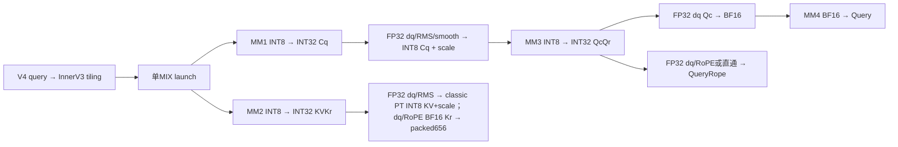
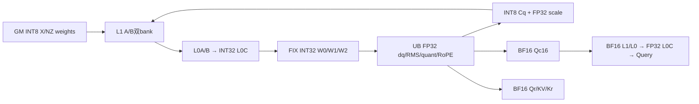
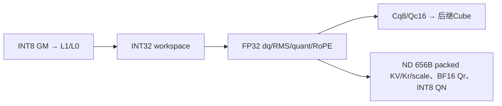
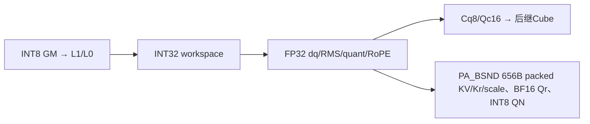

# MLA Prolog V4 INT8 全投影与分组量化合并缓存 A2/A3 ACLNN 算子知识

## 算子速览

| 项目 | 内容 |
|---|---|
| 实际入口 | CANN9.2 固定 d462 的 aclnnMlaPrologV4WeightNzGetWorkspaceSize / aclnnMlaPrologV4WeightNz；SGL auto/cann→外置 cann_ops_transformer.mla_prolog |
| 计算语义 | 唯一 weight/kv/query=(2,3,0)：INT8 投影、FP32 反量化与 RMS、Cq 动态 INT8、BF16 Qc 吸收投影；输出 BF16 Query/QueryRope，原地更新656B合并缓存：512B INT8 KV、128B BF16 Kr与16B FP32 scale；可选 INT8 QueryNorm 与 FP32 scale |
| 输入输出 | X/Dq/UqQr/DkvKr INT8，四份 FP32 scale；WUk/gamma/sin/cos BF16；cache仅BSND/TND/PA_BSND；He/Hcq/N/D 与分核边界见下 |
| 执行类型 | 一个 MIX_CV：AIC_CUBE 四次矩阵乘；AIV_VECTOR 的 INT32 反量化、RMS/量化、RoPE/直通与 cache scatter；EMPTY_QUERY 无 Device 计算 |
| Kernel 路线 | R001/002 N≤7 ND/PA；R003/004 N≥8 ND/PA；R005空query、R006量化空CV1:1错误key、R007条件Debug e0 |
| 核心资源 | INT32 GM 中间结果与独立 INT8 Cq/BF16 Qc 切片；L1 A/B 各双128KiB，L0A/B 各双32KiB，L0C 双64KiB；每 AIV 192KiB UB 设计预算 |
| 来源闭包 | source_closed：V4公开pair→InnerV3/OpDef→Host/POD/selector→本平台完整typed splitN及helpers。普通布局准备、通用硬件primitive、生成bridge与外置wheel身份为明确集成边界 |
| 验证状态 | 本次知识提取未执行编译、真机、数值或性能测试。draft 保留 UB 物理对齐、零 scale 与条件错误传播；源码闭合不表示已验证安全复用。 |

## 接口与语义

### 计算语义

记 H=Hcq，T 为展平 token 数，D 为吸收投影前的每 head Qc 维度，N 为 head 数；Ckv=512，Kr/Qr=64。M8(A,B) 表示 INT8×INT8 的 INT32 累加结果；dq(I,sx,sw) 表示当前架构真实顺序的 INT32→FP32 与逐 token/逐输出 channel scale 乘法。BF16矩阵乘以FP32 L0C累加后Fixpipe F322BF16；b16为CAST_RINT存储舍入。

```text
cq32 = M8(X, WDq)                                   # [T,H]
cqf  = RMS_FP32(dq(cq32,sX,sWDq), gammaQ,epsQ)*aq
cqf *= smoothQ if present                           # 仍FP32，不先转BF16
sCq[t] = max(abs(cqf[t,:]))/127
cq8[t,:] = current_arch_int8_cast(cqf[t,:]/sCq[t])    # [T,H] INT8
qcqr32 = M8(cq8, WUqQr)                             # [T,N,D+64]
qcf = dq(qcqr32[:,:,:D],sCq,sWUqQr[:,:,:D])
Qc = b16(qcf)
Query[t,h,:] = MM_BF16(Qc[t,h,:], WUk[h,:,:])         # [T,N,512]
qrf = dq(qcqr32[:,:,D:D+64],sCq,sWUqQr[:,:,D:D+64])
QueryRope = b16(rot(qrf,sin,cos)) if e else b16(qrf)

kvkr32 = M8(X, WDkvKr)                              # [T,576]，空cache时跳过
kvf = RMS_FP32(dq(kvkr32[:,:512],sX,sWDkvKr[:512]),gammaKV,epsKV)*ak
for j=0..3:                                       # 4组128元素，FP32 norm输入
  a[j] = max(abs(kvf[j*128:(j+1)*128]))
  v = kvf[j*128:(j+1)*128]
  z = min(v, alpha*a[j]); z = max(z, -alpha*a[j]) # 真实Min再Max顺序
  skv[j] = alpha*a[j]/127
  KV[j,:] = classic_INT8(z/skv[j])
krf = dq(kvkr32[:,512:576],sX,sWDkvKr[512:576])
Kr = b16(rot(krf,sin,cos)) if e else b16(krf)
packedSlot[0:512]=KV rawI8 ; [512:640]=Kr rawBF16 ; [640:656]=skv rawFP32
scatter三片到同一个kvCacheRef；独立krCacheRef要求numel0，不写其GM
若请求：QueryNorm=cq8，dequantScaleQNorm=sCq[T,1]
dequantScaleQNope 不启用，vendor以FP32空tensor返回
```

arch22 的 dq 先乘 token scale 再乘 channel scale；arch35 的 DequantVFImpl 先 channel 后 token。相同实数公式不保证两种FP32乘法顺序逐位相同。INT8动态舍入也不同：arch22为FP32→INT32 CAST_RINT→half CAST_ROUND（SetDeqScale=1）→INT8 CAST_TRUNC；arch35 为FP32→half CAST_ODD/NO_SAT→INT8 CAST_RINT/SAT。不能用一种平台的cast链替另一种平台。per-token max=0 时实际sCq=0，当前函数无epsilon或零行分支，继续除零；不将它重写为scale1或承诺码值为0。scale/gamma/输入的NaN/Inf及epsilon非法值没有由shape检查证明数值有效。

RMS顺序为反量化→sum(x²)/width→+epsilon→sqrt→div→BF16 gamma转FP32相乘→可选aq/ak；aq/ak由abs(value−1)≥FP32 epsilon使能，API double下传OpDef Float/POD float。Qc在第四MM前必须舍入BF16；Qr/Kr反量化仍保持FP32至RoPE后才舍入，禁止提前统一cast BF16。RoPE对j=0..31：y[j]=x[2j]*cos[j]−x[2j+1]*sin[j]；y[32+j]=x[2j+1]*cos[32+j]+x[2j]*sin[32+j]。禁用时不做偶奇重排、保持原投影顺序。

### 输入、输出与属性

| 参数 | shape/layout | dtype | 约束、默认值与语义 |
|---|---|---|---|
| tokenX | [T,He]或[B,S,He]，ND/NCHW，T=B*S | INT8 | He∈{1024,2048,3072,4096,5120,6144,7168,7680,8192}，B≤65536；u32保存/乘法未溢出是后续公式前提 |
| weightDq | 逻辑[He,H]，NZ物理[H/32,He/16,16,32] | INT8 | H∈{1536,2048}；矩阵逻辑二维shape与storage维须区分 |
| weightUqQr | 逻辑[H,N*(D+64)]，NZ物理[N*(D+64)/32,H/16,16,32] | INT8 | N=1..128，D=128/192；不能用BF16的c0=16寻址 |
| weightDkvKr | 逻辑[He,576]，NZ [18,He/16,16,32] | INT8 | 前512 Ckv、后64 Kr |
| weightUk | [N,D,512] ND | BF16 | 第四矩阵乘吸收权重，不参与INT8量化 |
| dequantScaleX | [T,1] ND | FP32 | 必需，逐token反量化scale |
| dequantScaleWDq / WUqQr / WDkvKr | [1,H] / [1,N*(D+64)] / [1,576] | FP32 | 全部必需，逐输出channel反量化scale |
| smoothScalesCq | 缺省或[1,H] ND | FP32 | 可选，RMS与aq后、动态量化前相乘；存在性改变UB常驻4H |
| rmsnormGammaCq / Ckv | [H] / [512] | BF16 | 各AIV首step搬入并跨step保留 |
| ropeSin / Cos | [T,64]或[B,S,64] | BF16 | doRope=true须非null；false原始ACLNN指针须null；SGL/vendor按numel>0成对判断并归一化 |
| kvCacheRef / krCacheRef | KV:ND [T,1,656]/[B,S,1,656]，PA [Pnum,P,1,656]；Kr为空 | INT8 KV；Kr空BF16描述符 | repo1，KV实际stride0且内轴连续；Kr仅空对象合同，不写其GM |
| cacheIndex | PA_BSND [T]/[B,S]；ND缺省 | INT64 | 负slot跳全部3片；正slot上界/无冲突由caller保证；无blockPA路由 |
| actualSeqLen | 缺省 | N/A | blockPA被Host拒绝，当前A0无累计边界消费 |
| Query / QueryRope | [T,N,512/64]或[B,S,N,512/64] | BF16 | 正式输出，不与输入/cache/workspace任意overlap |
| QueryNorm | 可选[T,H]或[B,S,H] | INT8 | 非null指针使queryNormFlag=1，结果同时供MM3读取 |
| dequantScaleQNorm | QueryNorm开启时[T,1] | FP32 | 必须与QueryNorm成对；否则原始指针缺省，vendor返回空 |
| dequantScaleQNope | 原始nullptr；vendor为[0] | FP32空 | 不是该tuple有效输出；不能把非null空descriptor等同nullptr |
| quantScaleCkv / Ckr | 原始nullptr | N/A | 本PT直接输出4个FP32组scale，常驻32B quantScaleCkv TBuf仅分配不装载/消费 |
| kNopeClipAlpha | [1] ND | FP32 | full INT8 pertile必需，设备从GM读取alpha；两份quantScaleCkv/Ckr缺省，不消费 |
| attrs | wq2/kvq3/qq0，repo1/scaleRepo1，tile128 | modes INT64；scalar double→float | eps默认1e−5，aq/ak默认1，cache默认PA_BSND；禁止混入kv0/1/2其它独立数学 |

### 入口与版本

[SGL V4 API](../../../../apis/sgl_kernel_npu/sgl_mlaprolog_v4.md)给出16模式及functional接入边界；本卡只冻结(2,3,0)的eager原地语义。固定SGL提交为dda6，依其文档明确引用的ops-transformer d462/CANN9.2；SDK为a63d9.2。公开产品表支持A2/A3及950的INT8全量化，具体本卡平台见Frontmatter；未据目录名推断支持。已安装外置cann_ops_transformer wheel、torch_npu及Runtime的二进制身份仍需部署侧核对。

V4 wrapper转aclnnInnerMlaPrologV3并增加doRope；固定V3公开pair则固定RoPE，不按内部注册名MlaPrologV3把两个ABI混淆。五返回顺序Q、Qr、空Qscale、可选QN、可选QNscale；cache仅副作用更新。functional的clone/TensorMove/Functionalize属API记录的另一集成路径，不计为本卡完整节点。旧[9.1 V3](../../../../../../ops/ascendc/operators/aclnn/transformer/attention/mla_prolog.md)、[旧950 V3](../../../../../../ops/ascendc/operators/aclnn/transformer/attention/mla_prolog_950.md)与[Direct示例](../../../../../../ops/ascendc/operators/direct/transformer/attention/mla_prolog_950.md)已全文比对：旧POD172B/固定RoPE或不同Direct ABI不能代替此208B/V4。浮点(0,0,0)与本INT8投影不是同一math卡。

## Host/Launcher 执行流程

### 参数校验与前处理

SGL先检查sin/cos成对非空，再lazy导入外置callable；vendor Python注册schema/Meta并通过OpBuilder构建接线导入C++。本次未触发load/JIT。C++ OptionalDeviceGuard选择tokenX设备，检查rank/He/Hcq/D/N、cache字段和三个权重FRACTAL_NZ，按实际INT8权重dtype分配QueryNorm，QNscale为FP32[T,1]，Query/QueryRope为BF16。本tuple的dtype override不改变TensorWrapper实际scalar_type；force HIF8只属于另一个w5路径。

V4先检查wq/kvq组合与qq范围、doRope指针；TensorHolder按“原始nullptr”创建shape[0]临时descriptor并以引用替换局部参数。holder存在性用于要求Qscale只在full+kv1、QNscale只在量化且QN开启时非空。禁用项必须以原始nullptr提供，非null空tensor不能绕过这项检查。holder假数据地址不是可读GM存储，析构在query返回时销毁descriptor。用户真实tensor与stream工作生命周期分开。

InnerV3生成bridge与OpDef执行AutoContiguous输入布局准备、cache IgnoreContiguous；自有core无外部Torch GEMM fallback。context转换校验cache内轴连续并取stride0，空cache设0；缺stride描述的连续fallback不表示任意stride合法。Host顺序GetNpuInfo→CheckAttrs→CheckSingleRequiredParam→CheckCacheMode→SetShapeInfo/SetScenarioInfo→CheckScenarParam/QuantMode/Dims/SpecialScenario/ExpectedParam→SetAttrInfo→ProcessBaseInputs→四MM分核→POD/WS/key。前置失败阻止后续；普通Contiguous/descriptor/生成bridge保留框架边界，不省略自有typed body。

vendor ResolveLogicalDims对Torch可见4D用(s0*16,s1*16)，Host对NZ实际storage用首轴*c0恢复Nout；vendor QueryNorm尺寸直接取weight_dq.size(1)。本INT8 storage c0=32，不能把raw4D Tensor当保留二维逻辑shape的format29 tensor等价，也不虚构torch_npu隐式转换。cache P∈[16,1024]且16倍数；Nkv=1/Ckv512/Kr64，repo1/scaleRepo1、dtile656，公开及Host只支持BSND/TND/PA_BSND；正slot未逐值扫描。

### 参数、Workspace 与生命周期

记d=[N>=8]、qnf∈{0,1}、m=min(T,(D192且d)?64:128)，g=N*(D+64)，h=N*D。按有效u32和size_t/int64运算未溢出的域：

```text
W_Host = W_lib + 6*m*H + 4*m*576 + 4*m*g + 2*m*h + d*32*m
W_Device_peak = d*32*m + 4*m*576 + 4*m*H + (1-qnf)*m*H + 4*m*g + 2*m*h
Sscale=[0,d*32m)              FP32每token占32B；d0不分配
W0=[d*32m, +2304m)           INT32 [m,576]
W1=紧接W0，4mH              INT32 [m,H]
Cq8=紧接W1，qnf0时mH        INT8；qnf1直接正式QN且不占这片
W2=紧接Cq8/或W1，4mg        INT32 [m,N,D+64]
Qc16=紧接W2，2mh            BF16 [m,N,D]，与W2不别名
Qn直接写正式Query，不增加workspace片
```

Host按2mH预留Cq归一化结果，Device实为mH或正式QN，属于真实上界差异，不能把Host公式误作同时活跃片之和。W_lib取平台GetLibApiWorkSpaceSize，不能替换成另一算法固定系统常量；Device从workspace实参原址切片，没有自行跳过W_lib前缀。实际Runtime打包边界不在这份自有body中猜测。

调用者query取得size/executor→同设备分配足量workspace→Execute(workspace,size,executor,stream)。输入、输出、两cache、页表/边界、workspace需保持至stream完成；cache后继读依赖同stream或显式event。vendor ACLNN_CMD取当前NPU stream并在需要时UseStreamResInCurrentThread；query/execute失败抛错并清理descriptor。workspace由局部byte Tensor持有、回调捕获raw资源，Runtime/torch_npu分配器的延迟队列与stream记录仍为集成边界；descriptor释放不意味着Device tensor owner可立即释放。不补造executor释放API或用户同步。

### 启动图与失败传播

T>0正常路线为一次InnerV3 MIX launch，blockDim=C；C,V>0且V=C或2C。CvMode6/7分别选择MIX1:1/1:2；AIC线性c，AIV GetBlockIdx=c*r+subblock，r=GetSubBlockNum；raw get_block_idx不等于AIV线性索引。编译CvRatio与运行r不一致时源码有Veff修正，不能擅自消去。

T=0在全部参数校验后填POD、仅W_lib、blockDim1，正常空selector在TPipe/GM之前return；950量化V=C在GenTilingKey先被拒绝，空分支无视失败保留零key（R-006），不能说所有空输入都成功。e0的条件Debug非法key见R-007。非空GenTilingKey失败经函数序列返回GRAPH_FAILED。




当前tile INT8在arch22/35均调用classic QuantPerTile：原始amax、alpha裁剪与alpha*amax/127、FP32→INT32 RINT→half ROUND(SetDeqScale1)→I8 TRUNC。它不同于950 Cq的ODD/RINT链，也不使用FP8 M1阈值1e−4；amax0或alpha0产生scale0后仍继续倒数。shape检查不证明alpha数值合法。

Kr空对象经vendor CheckKrCacheMergedRepo要求numel0且shape至少含一个0，支持shape(0)；Host CheckCkvkrRepoMode同时检查Kr输入/输出numel0。GenActualParamInfo在COMBINE移除其逐场景dtype/shape比较；950前置CheckKrCache仍要求rank1/3/4且dtype BF16/INT8，A2/A3 COMBINE前置短路。这个检查差异不增加Kr数值输出，也不把空GM当可读缓存。Doc公开dtype/shape约束仍需部署侧遵循。

## Route 与参数设计

### 分核与资源计算

C/V为Host可用AIC/AIV数，H=Hcq，P为分页blockSize（不与H混用），d=[N>=8]。IsSplitKnSupported首先要求DAV9201，当前A2/A3与950的KN字段固定(1,1,0)；w2不走MXFP8 splitM。group-compute只对部分量化并要求Nkv8，本tuple为全量化且公开Nkv1，实际group=false。

| 段 | 原始M/N/K | Host分核 | 实际base/step与tail |
|---|---|---|---|
| MM1 Cq | m/H/He | n1=max(64,32*ceil(H/(32C)))；b1=ceil(H/n1) | baseN128，baseK256，stepK4；He7680时stepK3，K_L1=768，否则1024 |
| MM2 KVKr | m/576/He | E1时b2=n2=0；否则C>=9取n2=64,b2=9；否则n2=32*ceil(576/(32C))，b2=ceil(576/n2) | 同MM1，最后核N=576−(b2−1)n2，E1 constexpr跳过 |
| MM3 QcQr | m/[N(D+64)]/H | d0：n3=32*ceil(N(D+64)/(32C))；d1：n3=(D+64)*ceil(N/C)；b3=ceil(N(D+64)/n3) | baseK128，stepK4，K_L1=512；初始化m<=64时baseN256，否则128；tail不重选baseN，当前m'<=64时INT8 A全载一个L1A bank |
| MM4 Qn | 每head m/512/D | hp=ceil(N/C)，b4=ceil(N/hp) | BF16 baseN128；D128 baseK128/stepK1，全A/B；D192 baseK64/stepK3走ND B splitK；末核head数N−(b4−1)hp |

m=min(T,(D192且N>=8)?64:128)。末step m'=min(m,T−b0)，更新四MM.m并重算AIV token划分，slice仍按初始m容量。Veff初始min(m,V)；编译cvRatio1但运行r2且Veff<m时乘2。AIV v的count=floor(m'/Veff)+[v<m'%Veff]，tokenStart=v*floor(m'/Veff)+min(v,m'%Veff)。所有无token核仍参加公共屏障。

矩阵N切片末核与baseN末tile均按有效宽度提交；Cube内部M=align16(m')，Fixpipe仅写m'真实行。INT8的C0=32而BF16 C0=16，NZ搬运偏移不可共用常数。声明表的旧位注释并非实际SDK编码ABI。


当前仅c0 ND与c1 tokenPA可达，A0固定，无blockPA/actual TBuf；cache投影/scale已变为全INT8类型，不能使用partial的BF16 MM1/2参数。

### Route 选择

K(c,d,E,e,cv)=(c,2,6,d,0,E,0,0,e,cv)。quant6映射FULL_QUANT_KV_QUANT_PERTILE、模板isPertile=true；dtile656、repo1/scaleRepo1、tile128、qq0。

| 顺序 | Route | Key/模板 | 精确选择条件与优先级 | 不适用去向 |
|---:|---|---|---|---|
| 1 | R005空query | (0,0,0,0,0,2,0,0,1,cv) | 全部guard后T0且CVguard通过 | 950cv6进入R006 |
| 2 | R001/R002 | K(0或1,0,E,e,cv) | T>0、N1..7，ND/PA_BSND | N8..128走R003/R004 |
| 3 | R003/R004 | K(0或1,1,E,e,cv) | T>0、N8..128 | 输入非法Host失败，无其它核心fallback |
| 4 | R006 950空零key | key0 | T0、DAV3510、V=C，GenKey量化guard失败被忽略 | 未选合法body，Runtime外部 |
| 5 | R007条件Debug e0 | UINT64_MAX | T>0/e0、Host Debug且VERSION未define3 | 正常非Debug或HostVERSION3有真实e0 body |

```text
CheckCacheMode：kv3先拒绝PA_NZ/PA_BLK_BSND/PA_BLK_NZ
CheckRepoMode：repo/scaleRepo必须1；CheckDtile656；Kr输入/输出numel0；clip FP32[1]
T0 -> 合法empty R005 / 950cv6遗漏失败R006
T>0 -> d=(N>=8), c0/1 -> R(1+c+2d)
       e0条件Debug INVALID_KEY -> R007
```

### 模板/实现执行矩阵

| Route | key/selector | dtype/shape/platform完整命中条件 | 执行族与kernel节点 | 实际模板/body | 内存与同步特征 | tail/fallback |
|---|---|---|---|---|---|---|
| R-001 | K(0,0,E,e,cv) | (2,3,0)，N1..7；BSND/TND，E0，A0；cv6/7 | 单MIX_CV，INT8前三MM+BF16 MM4+AIV | arch22 MlaPrologVecS1CubS2<MLAPType<INT8,INT8,INT8,FP32,c,d,false,E,0,true,r,e>> | 总QCQR6/allV7/DEQ6；PT out544、KV/Kr/scale三片、free9；Qbf/Query动态量化后处理不实例化 | m'有效输出；e0直通；index非法值无fallback |
| R-002 | K(1,0,E,e,cv) | (2,3,0)，N1..7；PA_BSND/INT64 slot，E0/1，A0；cv6/7 | 单MIX_CV，INT8前三MM+BF16 MM4+AIV | arch22 MlaPrologVecS1CubS2<MLAPType<INT8,INT8,INT8,FP32,c,d,false,E,0,true,r,e>> | 总QCQR6/allV7/DEQ6；PT out544、KV/Kr/scale三片、free9；Qbf/Query动态量化后处理不实例化 | m'有效输出；e0直通；index非法值无fallback |
| R-003 | K(0,1,E,e,cv) | (2,3,0)，N8..128；BSND/TND，E0，A0；cv6/7 | 单MIX_CV，INT8前三MM+BF16 MM4+AIV | arch22 MlaPrologVecS1CubS2<MLAPType<INT8,INT8,INT8,FP32,c,d,false,E,0,true,r,e>> | GM32m sCq、逐tile6/10与稀疏7；PT out544、KV/Kr/scale三片、free9；Qbf/Query动态量化后处理不实例化 | m'有效输出；e0直通；index非法值无fallback |
| R-004 | K(1,1,E,e,cv) | (2,3,0)，N8..128；PA_BSND/INT64 slot，E0/1，A0；cv6/7 | 单MIX_CV，INT8前三MM+BF16 MM4+AIV | arch22 MlaPrologVecS1CubS2<MLAPType<INT8,INT8,INT8,FP32,c,d,false,E,0,true,r,e>> | GM32m sCq、逐tile6/10与稀疏7；PT out544、KV/Kr/scale三片、free9；Qbf/Query动态量化后处理不实例化 | m'有效输出；e0直通；index非法值无fallback |
| R-005 | EMPTY_QUERY key | T0/guard通过 | entryreturn，无计算 | constexpr E2 | libWS/block1，不读POD | cache不写 |
| R-007 | INVALID_KEY | 条件Host Debug且e0 | 无选定body | SDK SEL错误终点 | Device非Debug/e0 body真实存在 | 不泛化其它构建 |


DECL宽度4/2/4/1/1/2/2/2/1/8，K=c+416+(d<<10)+(E<<12)+(e<<18)+(cv<<19)。正常交集A2/A3共24、950共12，不把SEL中额外NZ/A1当Host可达。Host Debug Encode还验SEL；Host VERSION默认−1与Device TU define3的e0差异按R007保留，不宣称所有e0必错。

| 实例 | Route | (c,Scenario,Quant,deq,group,E,A,splitM,e,CV) | uint64 key |
|---|---|---|---|
| I001 | R-001 | (0,2,6,0,0,0,0,0,0,6) | 3146144 |
| I002 | R-001 | (0,2,6,0,0,0,0,0,0,7) | 3670432 |
| I003 | R-001 | (0,2,6,0,0,0,0,0,1,6) | 3408288 |
| I004 | R-001 | (0,2,6,0,0,0,0,0,1,7) | 3932576 |
| I005 | R-002 | (1,2,6,0,0,0,0,0,0,6) | 3146145 |
| I006 | R-002 | (1,2,6,0,0,0,0,0,0,7) | 3670433 |
| I007 | R-002 | (1,2,6,0,0,0,0,0,1,6) | 3408289 |
| I008 | R-002 | (1,2,6,0,0,0,0,0,1,7) | 3932577 |
| I009 | R-002 | (1,2,6,0,0,1,0,0,0,6) | 3150241 |
| I010 | R-002 | (1,2,6,0,0,1,0,0,0,7) | 3674529 |
| I011 | R-002 | (1,2,6,0,0,1,0,0,1,6) | 3412385 |
| I012 | R-002 | (1,2,6,0,0,1,0,0,1,7) | 3936673 |
| I013 | R-003 | (0,2,6,1,0,0,0,0,0,6) | 3147168 |
| I014 | R-003 | (0,2,6,1,0,0,0,0,0,7) | 3671456 |
| I015 | R-003 | (0,2,6,1,0,0,0,0,1,6) | 3409312 |
| I016 | R-003 | (0,2,6,1,0,0,0,0,1,7) | 3933600 |
| I017 | R-004 | (1,2,6,1,0,0,0,0,0,6) | 3147169 |
| I018 | R-004 | (1,2,6,1,0,0,0,0,0,7) | 3671457 |
| I019 | R-004 | (1,2,6,1,0,0,0,0,1,6) | 3409313 |
| I020 | R-004 | (1,2,6,1,0,0,0,0,1,7) | 3933601 |
| I021 | R-004 | (1,2,6,1,0,1,0,0,0,6) | 3151265 |
| I022 | R-004 | (1,2,6,1,0,1,0,0,0,7) | 3675553 |
| I023 | R-004 | (1,2,6,1,0,1,0,0,1,6) | 3413409 |
| I024 | R-004 | (1,2,6,1,0,1,0,0,1,7) | 3937697 |
| 空query cv6 | R-005 | (0,0,0,0,0,2,0,0,1,6) | 3416064 |
| 空query cv7 | R-005 | (0,0,0,0,0,2,0,0,1,7) | 3940352 |


### 隐藏性能 Guard

| Guard | Host/Tiling条件 | Device/资源原因 | 影响Route | 不满足时去向 | 源码符号 |
|---|---|---|---|---|---|
| 缓存布局 | kv3只ND与PA_BSND | 656B三片原始字节布局，无可达NZ/blockPA | R001–004 | Host失败 | CheckCacheMode |
| 合并模式 | repo=scaleRepo=1、Kr空 | Kr/scale写同KV对象偏移512/640 | 全正常 | Host失败 | CheckRepoMode/CheckCkvkrRepoMode |
| 槽宽/组宽 | dtile656、tile128 | 512I8+128BF16raw+16FP32raw，4组128 | 正常 | Host失败 | CheckDtileSize/QuantPerTile |
| N流水 | N>=8 deq1，D192 mcap64 | MM3完整head列分核及AIV/Mm4交叠 | R003/004 | d0另一真实body | ProcessBaseInputs/FillMatmul3 |
| INT8整A载 | 当前m'<=64 | H<=2048恰好最高128KiB L1 A | MM3 | 按K双bank | MatmulQcQr |
| 950核比 | cv6量化被拒绝 | 固定Host白名单 | 950 | 非空失败；空R006忽略返回 | GenTilingKey |
| UB实际域 | U0+F/P<=实际pool，F中含未消费32B TBuf | PT实际tmp、Brcb8块与RMS共享顺序须按bytes计 | 正常 | 无逐stage缩tilefallback | VectorBufferInit/QuantPerTile/TPipe |
| 数值零域 | alpha或组amax为0令scale0 | classic PT DynamicQuant无epsilon，仍算倒数/RowMuls | E0 cache | 无源码zero修复 | DynamicQuant(alpha) |
| slot/storage | index正上界、656 stride真实容量、无冲突 | 三片非atomic scatter | c1 | caller合同 | ScatterCkv/ScatterKr |
| 有限位形状 | u32保存/ceil乘法、byteoffset/int64须有效 | 数学byte公式只在无溢出/窄化域 | 全部 | 不承诺超域结果 | SetShapeInfo/WorkspaceInit |
| GM对齐 | INT8 GM1B对齐，长度512/128B；scale16B用Pad | 656奇slot16B偏移符合当前固定SDK地址合同 | 正常 | 必须遵守真实dtype与UB32B对齐 | DataCopy/ScatterCacheUnAligned |

### POD/ABI

MlaPrologTilingData.baseParams共52字段，sizeof208/align8按u32/float4、u16 2、u64 8自然对齐静态推导，未编译sizeof/offsetof。188–191 padding；POD kNopeClipAlpha未赋且不读，独立GM alpha才是PT输入。

| 结构 | 字段 | 类型/位宽 | ABI布局 | 单位 | Host/launcher producer | Device consumer | 边界 |
|---|---|---|---|---|---|---|---|
| BaseParams | batchSize | uint32_t/32 | offset0，4B | batch，rank2当前域为0 | FillTiling/CoreParams：rank3 B，否则0 | 当前c0/c1不直接读；仅已排除blockPA有批游标consumer | 不将不可达blockPA消费者当本域活跃节点 |
| BaseParams | stepBatchSize | uint32_t/32 | offset4，4B | token；T0=0且不读 | FillTiling/CoreParams：min(T,(D192且N>=8)?64:128) | Process步进/UB/WS/MM m | token；T0=0且不读 |
| BaseParams | mSubSize | uint32_t/32 | offset8，4B | inactive，非quant splitM | FillTiling/CoreParams：成员初始化0/FillTilingCoreParams | 当前splitN不读 | inactive，非quant splitM |
| BaseParams | mSubCoreNum | uint32_t/32 | offset12，4B | inactive | FillTiling/CoreParams：成员初始化0 | 当前splitN不读 | inactive |
| BaseParams | stepNumHeadDequant | uint32_t/32 | offset16，4B | head；仍写POD | FillTiling/CoreParams：D128?min(64,N):min(16,N) | deq=0时DequantQc按head分块，deq=1由head波分工不直接读 | head；仍写POD |
| BaseParams | tokenSize | uint32_t/32 | offset20，4B | token；u32原始乘法域 | FillTiling/CoreParams：X前导维展平T | Process总步数 | token；u32原始乘法域 |
| BaseParams | seq1Size | uint32_t/32 | offset24，4B | token | FillTiling/CoreParams：rank3 X的S；rank2默认0 | 当前ND实际寻址用blockSize/stride0；blockPA消费者不在本域 | 不补造blockPA路由 |
| BaseParams | seq2Size | uint32_t/32 | offset28，4B | 保留字段，不解释成真实KV长度 | FillTiling/CoreParams：nkvSize=1 | 本INT8全量化splitN不读 | 保留字段，不解释成真实KV长度 |
| BaseParams | headSizeX | uint32_t/32 | offset32，4B | 元素 | FillTiling/CoreParams：He | MM1/MM2 K与X行跨度 | 元素 |
| BaseParams | headSizeCq | uint32_t/32 | offset36，4B | 元素 | FillTiling/CoreParams：Hcq | MM1输出/MM3 K/NormCq | 元素 |
| BaseParams | headSizeCkv | uint32_t/32 | offset40，4B | 元素 | FillTiling/CoreParams：512 | MM2切片/NormKV/MM4 N | 元素 |
| BaseParams | headSizeQc | uint32_t/32 | offset44，4B | 元素 | FillTiling/CoreParams：N*D | MM3/Qn输入跨度 | 元素 |
| BaseParams | headSizeQr | uint32_t/32 | offset48，4B | 元素 | FillTiling/CoreParams：N*64 | QueryRope行跨度 | 元素 |
| BaseParams | headSizeKr | uint32_t/32 | offset52，4B | 元素 | FillTiling/CoreParams：Dr=64 | MM2完整输出/分核 | 元素 |
| BaseParams | numHeadSize | uint32_t/32 | offset56，4B | head | FillTiling/CoreParams：N | MM4 head循环/QueryRope row | head |
| BaseParams | numHeadKvSize | uint32_t/32 | offset60，4B | head | FillTiling/CoreParams：Nkv=1 | 本INT8全量化splitN无直接关键读取 | head |
| BaseParams | dimHeadSizeQc | uint32_t/32 | offset64，4B | 元素 | FillTiling/CoreParams：D | MM4 K/Qc切片 | 元素 |
| BaseParams | dimHeadRope | uint32_t/32 | offset68，4B | 元素 | FillTiling/CoreParams：64 | SinCos/Rotary/Kr尺寸 | 元素 |
| BaseParams | blockNum | uint32_t/32 | offset72，4B | cache slice数；P0选EMPTY_CACHE | FillTiling/CoreParams：cache首轴P/T/B | 本域scatter不做正index上界校验 | cache slice数；P0选EMPTY_CACHE |
| BaseParams | blockSize | uint32_t/32 | offset76，4B | token；PA16..1024且16倍数 | FillTiling/CoreParams：PA P或BSND S；TND0 | GetCacheOffset解页/blockPA余数 | token；PA16..1024且16倍数 |
| BaseParams | mm1BlockNum | uint32_t/32 | offset80，4B | core | FillTiling/CoreParams：ceil(H/n1) | MM1活跃核/末核N | core |
| BaseParams | mm2BlockNum | uint32_t/32 | offset84，4B | core | FillTiling/CoreParams：非空ceil(576/n2)，E1=0 | MM2活跃核；E1前置constexpr return | core |
| BaseParams | mm3BlockNum | uint32_t/32 | offset88，4B | core | FillTiling/CoreParams：ceil(N(D+64)/n3) | MM3活跃核/末核N | core |
| BaseParams | mm4BlockNum | uint32_t/32 | offset92，4B | core | FillTiling/CoreParams：ceil(N/headsPerCore) | Qn head核范围 | core |
| BaseParams | vectorBlockNum | uint32_t/32 | offset96，4B | AIV调度数；运行subblock修正见正文 | FillTiling/CoreParams：min(m,V) | Init Veff/分token | AIV调度数；运行subblock修正见正文 |
| BaseParams | mm1SingleCoreN | uint32_t/32 | offset100，4B | 元素 | FillTiling/CoreParams：n1 | MmCqParamInit/ComputeAicOffset | 元素 |
| BaseParams | mm2SingleCoreN | uint32_t/32 | offset104，4B | 元素；E1不执行MM2 | FillTiling/CoreParams：n2；E1默认0 | MmCkvKrParamInit/ComputeAicOffset | 元素；E1不执行MM2 |
| BaseParams | mm3SingleCoreN | uint32_t/32 | offset108，4B | 元素 | FillTiling/CoreParams：n3 | MmQcQrParamInit/ComputeAicOffset | 元素 |
| BaseParams | mm4SingleCoreBatch | uint32_t/32 | offset112，4B | head | FillTiling/CoreParams：headsPerCore | Qn loops/weightUkOffset | head |
| BaseParams | dtileSize | uint32_t/32 | offset116，4B | byte/INT8元素 | FillTiling/CoreParams：656=512+64*2+4*4 | 合并cache每token stride，DataCopy原始字节 | Host CheckDtileSize精确要求656 |
| BaseParams | kvQuantMode | uint32_t/32 | offset120，4B | mode | FillTiling/CoreParams：3 PER_TILE | 4组128 clip/dynamic INT8 | queryQuant0 |
| BaseParams | tileSize | uint32_t/32 | offset124，4B | 元素，Host仍校验128 | FillTiling/CoreParams：attr128 | PerTileQuantParams.tileSize、tileNum=512/tileSize；ScatterCkv计算scale数 | 元素，Host仍校验128 |
| BaseParams | ckvkrRepoMode | uint32_t/32 | offset128，4B | mode | FillTiling/CoreParams：1 COMBINE | ScatterKr写kvCache偏移512 | KrRef/Out numel0 |
| BaseParams | quantScaleRepoMode | uint32_t/32 | offset132，4B | mode | FillTiling/CoreParams：1 COMBINE | ScatterCkv scale原字节写偏移640 | 4float16B |
| BaseParams | queryNormFlag | uint32_t/32 | offset136，4B | bool编码u32 | FillTiling/CoreParams：原始queryNormOut非null?1:0 | OutputInit/WorkspaceInit/Process | bool编码u32 |
| BaseParams | reciprocalCq | float/32 | offset140，4B | FP32 | FillTiling/CoreParams：float(1/H) | NormCq Reduce后Muls | FP32 |
| BaseParams | epsilonCq | float/32 | offset144，4B | FP32，不验证所有数值域 | FillTiling/CoreParams：rmsnormEpsilonCq Float | NormCq Adds/Sqrt | FP32，不验证所有数值域 |
| BaseParams | reciprocalCkv | float/32 | offset148，4B | FP32 | FillTiling/CoreParams：float(1/512) | NormKV Reduce后Muls | FP32 |
| BaseParams | epsilonCkv | float/32 | offset152，4B | FP32 | FillTiling/CoreParams：rmsnormEpsilonCkv Float | NormKV Adds/Sqrt | FP32 |
| BaseParams | kNopeClipAlpha | float/32 | offset156，4B | inactive POD标量 | FillTiling/CoreParams：FillTiling仍未赋此POD float | PT使用独立GM alpha，不消费POD本字段 | 不得猜POD默认0；GM FP32[1]必需 |
| BaseParams | qcQrScale | float/32 | offset160，4B | FP32 | FillTiling/CoreParams：attr Float aq | NormCq gamma后Muls | FP32 |
| BaseParams | kcScale | float/32 | offset164，4B | FP32 | FillTiling/CoreParams：attr Float ak | NormKV gamma后Muls | FP32 |
| BaseParams | isQcQrScaleEnable | uint16_t/16 | offset168，2B | bool编码u16 | FillTiling/CoreParams：abs(aq-1)>=float epsilon | NormCq条件Muls | bool编码u16 |
| BaseParams | isKcScaleEnable | uint16_t/16 | offset170，2B | bool编码u16 | FillTiling/CoreParams：abs(ak-1)>=float epsilon | NormKV条件Muls | bool编码u16 |
| BaseParams | mm1NGroup | uint16_t/16 | offset172，2B | 组，9201才可能变化 | FillTiling/CoreParams：1 | 当前arch22/35 splitN不读KN分组 | 组，9201才可能变化 |
| BaseParams | mm1KGroup | uint16_t/16 | offset174，2B | 组 | FillTiling/CoreParams：1 | 本平台CalcWorkSpace按1；Device无KN | 组 |
| BaseParams | mm1SingleCoreK | uint32_t/32 | offset176，4B | 元素，inactive | FillTiling/CoreParams：0 | 当前arch22/35不读 | 元素，inactive |
| BaseParams | mm2NGroup | uint16_t/16 | offset180，2B | 组 | FillTiling/CoreParams：1 | 当前arch22/35不读KN分组 | 组 |
| BaseParams | mm2KGroup | uint16_t/16 | offset182，2B | 组 | FillTiling/CoreParams：1 | 本平台CalcWorkSpace按1；Device无KN | 组 |
| BaseParams | mm2SingleCoreK | uint32_t/32 | offset184，4B | 元素，inactive | FillTiling/CoreParams：0 | 当前arch22/35不读 | 元素，inactive |
| BaseParams | kvCacheStride0 | uint64_t/64 | offset192，8B | 元素u64，转int64需在已验范围内 | GetCacheStride0；空cache0 | ScatterCache/MaterializeOffsetsWithHeadSize | 元素u64，转int64需在已验范围内 |
| BaseParams | krCacheStride0 | uint64_t/64 | offset200，8B | 元素，inactive | FillTiling/CoreParams：空Kr cache→0 | 当前Merged分支用kvCacheStride0，不读此stride | 不凭空stride认为Kr数学消失 |

MMParams、RmsNormParam、Rectangle、MMBufParams/Aic/AivOffset及d1两个局部结构见下：它们为Device局部typed元素计数，不跨Host序列化。MMParams m=m'、n=每核N、k=He/He/H/D；orgKa=He/He/H/ND、orgKb=k、orgKc=H/576/g/N512；bank计数初始0跨阶段保持，baseM未赋无consumer。DequantQcQrSplitNParams32B、RopeQrSplitNParams56B自然布局未编译验证；arch22/35 RoPE前两i64顺序不同。

当前d1额外两个Device局部参数结构也逐字段保留；它们不属于Host序列化POD。DequantQcQrSplitNParams静态sizeof32/align8，RopeQrSplitNParams静态sizeof56/align8（28–31 padding），仍未编译验证。arch22/35的前两个RoPE字段顺序相反，必须按各平台声明aggregate初始化，不能按另一平台裸拷贝。

| 结构 | 字段 | 类型/位宽 | ABI布局 | 单位 | producer | consumer | 边界 |
|---|---|---|---|---|---|---|---|
| DequantQcQrSplitNParams | mmQnPreDequantOffset | int64_t/64 | offset0 | INT32元素 | ComputeAivOffset：o=cidx*n3 | DequantQcQrSplitN inputGm基址 | 仅d1；step/head标量，非外部指针 |
| DequantQcQrSplitNParams | mmQnPreDequantResOffset | int64_t/64 | offset8 | BF16元素 | h0*D | outputGm基址 | 仅d1；step/head标量，非外部指针 |
| DequantQcQrSplitNParams | inputOffset | uint32_t/32 | offset16 | INT32元素 | s*D/r+head*(D+64) | inputGm及channelScale子片 | 仅d1；step/head标量，非外部指针 |
| DequantQcQrSplitNParams | outputOffset | uint32_t/32 | offset20 | BF16元素 | s*D/r+head*D | outputGm子片 | 仅d1；step/head标量，非外部指针 |
| DequantQcQrSplitNParams | srcStride | uint32_t/32 | offset24 | 元素gap | N(D+64)−D/r | input DMA stride*sizeof(INT32)/32 | 仅d1；step/head标量，非外部指针 |
| DequantQcQrSplitNParams | dstStride | uint32_t/32 | offset28 | 元素gap | ND−D/r | output DMA stride*sizeof(BF16)/32 | 仅d1；step/head标量，非外部指针 |
| RopeQrSplitNParams | ropeQrOffset | int64_t/64 | offset8 | INT32元素 | o+D | RopeQrSplitN inputGm基址 | 仅d1；step/head标量，非外部指针 |
| RopeQrSplitNParams | ropeQrResOffset | int64_t/64 | offset0 | BF16元素 | h0*64+b0*N64 | Qr output基址 | 仅d1；step/head标量，非外部指针 |
| RopeQrSplitNParams | inputOffsetRope | uint32_t/32 | offset16 | INT32元素 | rowStart*g+head*(D+64) | Rotary perhead输入子片 | 仅d1；step/head标量，非外部指针 |
| RopeQrSplitNParams | deqScaleOffset | uint32_t/32 | offset20 | FP32元素 | head*(D+64) | WUqQr channel scale GM偏移 | 仅d1；step/head标量，非外部指针 |
| RopeQrSplitNParams | outputOffsetRope | uint32_t/32 | offset24 | BF16元素 | rowStart*N64+head*64 | 输出子片 | 仅d1；step/head标量，非外部指针 |
| RopeQrSplitNParams | ropeStride | int64_t/64 | offset32 | 元素 | N(D+64) | INT32输入行距/channelScaleStride参数 | 仅d1；step/head标量，非外部指针 |
| RopeQrSplitNParams | ropeDstStride | uint32_t/32 | offset40 | 元素gap | N64−64 | 输出DMA gap*sizeof(BF16)/32 | 仅d1；step/head标量，非外部指针 |
| RopeQrSplitNParams | deQuantScaleCqOffset | uint32_t/32 | offset44 | FP32元素 | rowStart*8 | 本半token sCq行槽 | 仅d1；step/head标量，非外部指针 |
| RopeQrSplitNParams | sinCosOffset | uint32_t/32 | offset48 | FP32元素 | r2首次0；r1第二半floor(m'/2)*64 | cos/sin子片 | 仅d1；step/head标量，非外部指针 |
| RopeQrSplitNParams | ropeCnt | uint32_t/32 | offset52 | 行 | r2 floor((m'+s)/2)；r1两半floor/ceil | perhead输入/输出blockCount，0行早return | 仅d1；step/head标量，非外部指针 |

UsedBlockParams为两个u32：blockStartIdx=0、blockEndIdx=对应MM1/2活跃核数；MatmulSplitN按start<=blockIdx<end选择，E1在范围检查前constexpr跳MM2。CastQcQrSplitNParams与量化Query后处理虽可见但当前(2,3,0)没有实例化消费，不纳入当前活跃节点。


PerTileQuantParams静态sizeof20/align4：tileSize:u32 offset0=128，tileNum:u32 offset4=4，alpha:float offset8=GM读取值，row:u32 offset12=1，col:u32 offset16=512。各字段由RmsNormAndQuantizeCkv逐次aggregate构造，消费于QuantPerTile→PerTileClipWithAlpha/DynamicQuant/Cast，未序列化。RmsNormParam row1/colH或512，scale/enable为aq/ak；ScatterCacheParams当前row1、tokenStride656、data col512/128、scale col16，所有GM offset以INT8字节为元素。

### Route 源码闭包

| Route | Key/selector | Host/Tiling producer | POD/参数 | Kernel entry/router | Kernel body/直接依赖 | 构建接线 |
|---|---|---|---|---|---|---|
| R001/002 | K(c,0,E,e,cv) | RunBigKernelTiling/ProcessBaseInputs/FillMatmul*/CalcWS/GenKey | 208B，dtile656/repo1/PT6 | mla_prolog_v3 FULL_QUANT_KV_QUANT_PERTILE | arch22/35 splitN d0；RMSDynamicQuant、DequantPerTokenQc、QuantPerTile、Rotary、三片scatter | v3/op_host/CMakeLists/OpDef/tiling_register，auto-sync=off |
| R003/004 | K(c,1,E,e,cv) | 同上，N>=8 | 同POD，head对齐n3 | 同entry，deq1 | DequantAndRopeSplitN/逐tile6或10与cast7、GM32m尺度；PT缓存body同前 | 同TU/SEL |
| R005 | EMPTY_QUERY | 空分支FillTiling/libWS/block1 | 已填不读 | entry constexpr return | 无core | 同TU |
| R006 | key0 | 950CV1:1 guard失败被空分支忽略 | 不造consumer | 无合法已选body | Host精确错误终点 | Runtime外部 |
| R007 | INVALID_KEY | SDK Debug Encode SEL不匹配e0 | 不造consumer | 正常e0 body确实存在 | 条件构建错误传播 | Host/Device VERSION宏边界 |

## Kernel 实现

### 公共执行流程

本节给出四个正常Route共用的真实函数级管线，并分别展开d0与d1的全部差异；后续Route仅将c/E/A与当前管线配对，不把不同同步图合并成同一Route。以下地址在各自typed tensor中以元素计，workspace表以字节计。

```text
mla_prolog_v3<c,2,6,d,false,E,0,0,e,cv>
  -> MLAPType<INT8,INT8,INT8,FP32,c,d,false,E,0,true,r,e>
  -> Init: GetBlockIdx / OutputInit / ScaleInit / MmParamInit
           WorkspaceInit / CubeBufferInit或VectorBufferInit
  -> Process: for b0=0; b0<T; b0+=m, m'=min(m,T-b0)
  AIC:
    MM1 X[b0*He] * WDq[cidx*n1*He] -> W1[cidx*n1], outStride H
    notify mode2/FIX CQ6
    wait CKVfree9; MM2 X[b0*He] * WDkvKr[cidx*n2*He]
         -> W0[cidx*n2], outStride576，E1跳算但保留信号
    notify mode2/FIX CKV6(arch22)或4(arch35)
    wait RMS6; MM3 (QN?[b0*H]:Cq8) * WUqQr[cidx*n3*H]
         -> W2[cidx*n3], outStride g=N(D+64)
    d0: D128预载WUk首head -> notify QCQR6 -> wait DequantQC6
    d1: 每个MM3 N-base tile后发mode2/FIX MMQCQRsplit6(22)或10(35)
         PreloadQnAndSync只做D128首head预载后return，不发总QCQR6
    for h in 本核hp个head（末核修正）:
       d1按稀疏规则wait DEQsplit7
       MM4 Qc16[h*D] * WUk[h*D*512] -> Query[(b0*N+h)*512]
       D128 FullLoad(第一个hasL1BLoaded=true，其余false)
       D192 SplitK<BF16,BF16,float,ND_B>
    Q输出offset+=m*N*512；若QN1，其MM3 A基址+=m*H
  AIV:
    首step CopyGlobalParams：gammaQ/gammaKV、WDq/WDkvKr scale、可选smooth
    CopyInSinCos：d0按本核token；d1按配对C核对应的m'/r半区；e0不读
    wait CQ6; allV mode0/MTE3 flag7
    每本核token:
       DataCopyPad sX[t] 4B到32B槽
       W1 INT32 -> dq_FP32 -> RMS/gamma/aq/smooth
       -> DynamicQuant Cq8 + sCq
       Cq8写正式QN或workspace；可选QNscale写[T,1]
    Brcb：每token sCq扩展8float=32B；d1写GM Sscale
    allV7; d1每AIV把Sscale全m*32B汇总回常驻UB; notify RMS6
    wait CKV6/4; allV7
    每本核token：sX[t]；W0前512 dq/RMS/ak ->classic PT INT8+scale scatterKV；
                  W0后64 dq/可选RoPE ->BF16原字节 scatterKr到kvCache+512
    notify CKVfree9，允许下step MM2覆盖W0
    d0: wait QCQR6; allV7
        按每token的N个head DequantPerTokenQc -> Qc16
        allV7; notify DEQQC6；然后逐token RopeQr(INT32反量化)
    d1: DequantAndRopeSplitNSyncMMQcQr:
        本paired-C的列宽oriCol=n3tail，while colEnd<oriCol:
          wait MMQCQRsplit6/10；colEnd=min(colEnd+baseN,oriCol)
          若完整Qc已就绪，分D/r列，对全部m'行dq->BF16 Qc16
            满足稀疏规则时notify DEQsplit7
          若完整Qr也就绪，按m'/2切token的RopeQrSplitN
        Qr正式输出基址+=m*N64
  Process收尾AIC：
    drain L1/L0所有双bank hardevents和SCALE_EVENT，再wait最后CKVfree9
```

d1的分列地址：paired-C cidx首输出列o=cidx*n3，head起点h0=o/(D+64)。subblock s的Qc输入元素offset=o+s*D/r，完整INT32行跨度g；Qc16输出offset=h0*D+s*D/r，完整BF16行跨度ND。每推进一个head，输入+=D+64、输出+=D。单次DMA m'行、每行D/r元素，输入/输出stride分别g−D/r与ND−D/r。channel scale来自sWUqQr[o+s*D/r+head*(D+64)]；token scale常驻按每行8float读取。MM4以每head D个元素、每行ND跨度读取此独立结果，不能按W2的g跨度读取。

d1 Qr输入o+D+head*(D+64)，输出h0*64+head*64。r2的sub s有rowCount=floor((m'+s)/2)，rowStart=floor(m'/2)*s；奇数末step第二sub多一行。r1仍拆成floor(m'/2)与ceil(m'/2)两次，第二次sin/cos和sCq均增加首半区长度。Qr的input/output行跨度为g/N64；输出DMA为{rows,4,0,(N64−64)*2/32}。由colEnd分别判断Qc及Qr完整性，Qc允许在本head Qr尚未生产时通知MM4，不能用一个笼统“MM3完成”屏障替代。

d1当当前核head数L>MAX_SYNC_FLAG_COUNT=15时，Dequant loop只在i偶数或i==L−1发DEQsplit7，MM4同条件wait；不是全部flag永久只发一次，也不能由总通知数推断任意硬件并发配置无计数风险。MM3每baseN tile仍独立通知6/10。d0等待完整QCQR后全V7，先完成Qc反量化并全V7再发6，随后RoPEQr可与MM4并行；不使用浮点路线的“所有AIC等全C7直接读W2”协议。所有E1路线仍按上述信号对消费，只跳MM2本体/cache计算。

前三MM的MatmulSplitN遍历nTile=min(baseN,nremain)，MatmulSplitK对K_L1步进；A ND→NZ用nValue=m'、dValue=K_L1、srcDValue=orgKa、dstNzC0Stride=align16(m')。B NZ用c0=32，地址B[K*nOffset+kL1*K_L1*32]，blockCount=ceil(nTile/32)、blockLen=K_L1个32B块、srcStride=K−K_L1。L1双bank预载k+1，MTE1消费完才允许MTE2覆盖。L0每K子块A偏移align16(m')*baseK、B偏移32*baseK。Mmad(align16(m'),nTile,baseK)仅首K令cmatrixInitVal=true，INT32累加；Fixpipe直接存INT32，不能启用F322BF16代替反量化。

arch22 INT8 B转置走LoadDataWithTranspose，32元素c0；arch35走LoadData2D V2 transpose（mStep=ceil(K/16),kStep=ceil(N/32),srcStride=ceil(K_L1/16),dstStride=ceil(N/16)）。BF16 MM4仍c0=16；D128整WUk为128*512*2=128KiB，满一个L1B bank，N按128列四块；D192 K64*3，ND B按[K,128]转NZ。最后M行只提交m'，不把padding行写入正式输出。MM3在m'<=64整载INT8 A，H最大2048刚好128KiB，后继N/K块共享一bank；m'>64才重新按K加载。

RMS与反量化：arch22 RMS逐64元素折叠Add→WholeReduceSum→reciprocal/epsilon/Sqrt/Div→gamma/scale；arch35 RmsNormVF用64lane FP32寄存器累积再Reduce SUM，第二遍Div/gamma，scale在外部Muls。两者INT32输入均先dq FP32。arch22 DynamicQuant先Abs/RowMax、s=max/127、逆scale=127/max、Brcb后RowMuls，再按前述三次Cast；950 ComputeVFImpl<float,float,int8_t,M0>两遍Reg load，一遍absmax/Reduce MAX并StoreUnAlign单个scale，一遍Div/Cast/StoreAlign PACK4。M0不启用M1的1e-4阈值。H=1536/2048/512均为64倍数，当前RMS/量化列域无不满64的Reg尾读。

4B sX搬入后32B槽供classic RowMuls消费；[DataCopyPad](../../../../../../ops/ascendc/apis/simd_api/basic_api/memory_vector_compute/data_move/data_copy_pad_gm_to_ub.md) 的固定SDK文档明确：left/rightPadding=0、长度不足32B的dummy重复首元素。因此此处不是随机未定义的7个scale，也不能擅自改padding配置；950的DIST_BRC_B32则只广播有效首标量。sCq常驻Brcb每token重复8float，GM也按32B槽交接；QNscale正式输出则仅4B/token。

Kr与Qr均在INT32→FP32 dq之后可选RoPE；arch22 classic GatherMask1/2分别提取偶奇，950 Reg DeInterleave处理64lane，最终CAST_RINT BF16。e0不读sin/cos，直接cast保持通道顺序；950直通有DataSyncBarrier<UB>。d1 Qr的perhead channel scale区域与RoPE scratch有真实顺序复用，scale必须在复用前消费并以pipe同步隔离。

| 层级/缓冲区 | offset/地址公式 | extent/容量公式 | dtype/layout | producer | consumer | owner/lifetime | 对齐/复用 |
|---|---|---|---|---|---|---|---|
| GM输入 | X[t*He]，NZ三权重，WUk[h*D*512] | THe+HeH+HN(D+64)+He576+2ND512 B | INT8与BF16 | caller | MTE2/AIC | caller至stream完成 | NZ int8 c0=32，Uk c0=16 |
| GM scales/gamma | sX[t]；三权重scale按输出通道 | 4T+4H+4N(D+64)+4*576；gamma2H+1024；smooth可选4H | FP32/BF16 | caller | AIV | 同上 | 必需scale内容须合法；不是量化multiplier混用 |
| Sscale | workspace+0（仅d1） | 32m B | FP32 [m,8]槽 | AIV RmsNormCq/Brcb | 全AIV汇总/dq/Qr | 一launch跨step复用 | allV7后读，下一step前全V7保护 |
| W0 | workspace+d32m | 2304m B | INT32 [m,576] | MM2 FIX | KV/Kr | 同上 | CKVfree9防覆盖；E1预留不消费 |
| W1 | W0后 | 4mH B | INT32 [m,H] | MM1 FIX | RMS Cq | 同上 | 与Cq8 dtype不同、禁止别名 |
| Cq8 / QN | W1后或正式QN[t*H] | QN0 mH，QN1正式TH B | INT8 | RMS+dynamic quant | MM3 | workspace或输出tensor | RMS6+allV7；QN1输出仍是core输入 |
| W2 | W1/Cq8后 | 4mN(D+64) B | INT32 | MM3 | dq Qc/Qr | launch | d0总flag6；d1逐tile6/10 |
| Qc16 | W2后 | 2mND B | BF16 [m,N,D] | AIV dq+Cast | MM4 | launch | d0 DEQ6；d1 DEQsplit7；不与W2共址 |
| GM输出 | Q[(t*N+h)*512]，Qr[(t*N+h)*64]，QN[tH] | Q1024TN+Qr128TN；QN可选TH+scale4T B | BF16/INT8/FP32 | AIC/AIV | caller | 输出owner至后继消费 | Qscale空，无Query动态量化后处理 |
| L1 A/B | bank=(iter&1)*131072 | 各2*128KiB | INT8 NZ；MM4 BF16 NZ | MTE2 | MTE1 | 每AIC TPipe | 阶段共享bank计数器；A全载/Uk预载保留实际bank |
| L0 A/B | bank=(iter&1)*32768 | 各2*32KiB | INT8/BF16 fractal | MTE1 | Mmad | 每AIC TPipe | 各自hardevent保护 |
| L0C | bank=(iter&1)*65536 | 2*64KiB | 前三INT32、MM4 FP32 | Mmad | Fixpipe | 每AIC TPipe | FIX_M/M_FIX或unitFlag3；不同阶段不能无等待覆盖 |
| UB固定 | WDqScale4H+WDkvKrScale2304+gamma2H+1024+smooth4H?+unusedCkvScale32 | F_req见下 | FP32/BF16 | 首stepDMA | 两RMS/反量化 | 每AIV TPipe | 每TBuf独立align32 |
| UB sCq槽 | 固定后 | 32(m+7) B | FP32 | 本核Brcb/GM汇总 | d0本核/d1全行dq | 同上 | 本tuple实际有效尺度，不能沿用浮点“未消费”描述 |
| UB sin/cos | 固定独立TBuf | 512*b B；b=d?ceil(m/r):ceil(m/Veff) | FP32 | GatherSinCos(e1) | Kr/Qr | 同上 | e0仍分配，不读未初始化内容 |
| UB actualSeq | 仅A1 | 请求8m、实际align32(8m) | INT64预留 | 仅分配 | 实际游标直接读GM INT32 | 同上 | 不是metadata快照 |
| UB share | 最后TBuf | S_req=196608−F_req，实际align32(S_req) | 字节按typed元素切片 | 当前Vector阶段 | 下一阶段/DMA | 每AIV TPipe | max阶段峰值计费、不得把不同时活跃片全部求和 |
| Reg | arch35 64lane FP32/packedhalf/INT8；22 classic Vector | 编译器实际寄存器分配不可由源码对象数推定 | typed | UB load | arithmetic/store | VF调用 | 不虚报occupancy/spill；tail mask不缩短无mask load范围 |




记sm=[smooth存在]、a=[A1]（当前scope a=0），qmax=ceil(m/Veff)，b=d?ceil(m/r):qmax。F0=(6+4sm)H+3360+32(m+7)+512b，F_req=F0+a8m，F_alloc=F0+a*align32(8m)，S_req=196608−F_req，S_alloc=align32(S_req)。F_req先须非负且不超过预算才能解释剩余值；A1且m%4!=0时，独立对齐使F_alloc+S_alloc=196640 B，较192KiB设计预算多32B；其余为196608。只有比较实际pool/UB容量才能判断部署是否超额，不由预算差异推定真机故障。

以下stage高水位按真实元素偏移导出，q为当前AIV分得token数，m'为当前step，c=64N，u=D/r，x=m'*u，ρ=ceil(m'/2)。每个式为相对share基址的**实际活跃最高字节范围**，包括存在的gap与复用；不把注释里的保守需求代替真实布局：

| 阶段 | arch22峰值 | arch35峰值 | 组成/边界 |
|---|---|---|---|
| Cq RMS+INT8 | 13H+32q+64 | 9H+32q+32 | 输出INT8 H，token尺度32q，sX32；22 dynamic/RMS临时峰12H+32，35 Reg RMS输入/输出FP32共8H |
| Ckv RMS+classic PT INT8 | 6752+512q | 5088+512q | 外层sX32+双sin/cos512q；out544、normFP32 2048；22 RMSscratch4128主导，35 RMSscratch2048但clip阶段inner5056高于RMSinner4640 |
| Kr e1 | 1568+512q | 928+512q | 外层32+512q；22输出128+额外保留128+Rotary1280，35输出128+Rotary768 |
| d0 Qr e1 | 26c=1664N | 18c=1152N | channel scale4c+输出2c+INT32 Rotary22为20c/35为12c |
| d0 DequantQc | 14ND+192 | 同左 | INT32输入4z，scale4z，compute4z，各间64B gap，BF16输出2z；z=N*D，N<=7令单次head数=N |
| d1 DequantQc | 4x+32+max(4u,2x) | 4x+32+max(4align64(u),2x)及输入尾读范围 | INT32 input与FP32 compute别名；scale/output别名。35不mask Reg load，D192/r2的u96尾load额外读32lane，已计真实scale读跨度 |
| d1 Qr e1 | 1408ρ | 896ρ+256 | 每head处理ρ行64元素；22输出2c+helper20c，35输出2c+helper12c+channelScale256 |
| SinCos gather | d0:256q；d1:256ceil(m'/r) | 同左 | 固定sin/cos之外的临时BF16输入 |
| d1 cache内gather | 32+768q | 同左 | 外层sX32+双FP32 sincos512q+临时256q，只有e1执行 |

arch35 d1 Qc的INT32/FP32 load每次256B，即使尾mask只消费32lane也会读足64lane：输入最后一行的名义4x范围可额外读取128B，scale区从4x+32起，D/r96时名义384B scale变为512B实际读取跨度。该读取可跨逻辑input/scale子片，仍位于同share backing；只有结合真实S_alloc才能讨论物理UB边界，不能由mask推断只读有效元素。被mask排除的lane不形成有效数值输出。本tuple的普通H/512/64和d0 ND列数均64倍数，其余VF load不需要凭空补尾语义。

```text
P = max(当前d/e/E可达stage高水位)
必要条件：P<=S_alloc，F_alloc+P<=实际可用UB，F_alloc+S_alloc<=实际pool
L1 A: align16(m')*K_L1*sizeof(T)<=131072（MM3全A时改H）
L1 B: K_L1*nTile*sizeof(T)<=131072
L0A: align16(m')*baseK*sizeof(T)<=32768
L0B: baseK*nTile*sizeof(T)<=32768
L0C: align16(m')*nTile*4<=65536
```

MM1/2最大INT8 K_L11024、Ntile128、M128，MM3初始m<=64/Ntile256/K_L1512或初始m128/Ntile128（tail不重选baseN），按真实配对计费。MM4 D128 BF16全B128KiB，D192 K192/N128；上述单bank条件均不能省double深度。e0只使用各Rotary的输入/dq/cast活跃子区，可低于表中e1高水位；保守保留e1上界不能声称e0已消除全部申请。E1仍保留W0和初始化常驻，但不读写cache数据；Host没有逐stage UB guard自动保证上述必要式。

| 边/复用子区 | producer | offset/extent | dtype/layout | consumer | ordering/sync | owner/lifetime | 安全条件 |
|---|---|---|---|---|---|---|---|
| CQ→Cq8→MM3 | MM1 FIX、AIV RMS/quant | W1 4mH；Cq8 mH或QN | INT32→FP32→INT8 | AIV/MM3 | mode2 CQ6，RMS前后allV7，MTE3 RMS6 | launch/正式QN | Cq8不别名W1；量化scale也须就绪 |
| sCq汇总 | 各AIV Brcb/DMA | GM32m与UB32(m+7) | FP3232B槽 | 所有AIV d1 | allV7先完成GM写再汇总；MTE2消费者有后续event | launch | 保留slot padding及token stride8float |
| KVKr→cache→下一step | AIC FIX→AIV scatter | W0 2304m；KV512/Kr128/scale16B每token | INT32→FP32→INT8/BF16/FP32 | AIV/下一stepMM2 | CKV6(22)/4(35)，初始和每stepAIV发9、AICwait与drain | launch/cache caller | E1仍信号配对，页表值与容量不能由事件保证 |
| d0 QCQR→Qc16→MM4 | MM3 FIX→全AIV dq | W2 4mg→Qc16 2mh | INT32→BF16 | AIC MM4 | QCQR6+allV7，dq后allV7再DEQ6 | launch | Qr随后并行；下stepallV7保护复用 |
| d1逐块QCQR | MM3每N-base FIX | 本C核n3列，colEnd逐baseN增加 | INT32 | 配对AIV | mode2 flag6(22)/10(35)，每tile一通知 | launch | consumer分别等Qc/Qr完整列，不读未生产半head |
| d1 Qc16→MM4 | AIV MTE3 | 每head D/r列、m'行 | BF16 | 对应head MM4 | DEQsplit7；L>15的奇数head省通知且双方规则一致 | launch | 完整两列分片到达、strideND；不改回g |
| L1/L0 bank | MTE2/MTE1/MM/FIX | iter&1各层固定bank | INT8/BF16/INT32/FP32 | 后继tile | MTE1_MTE2↔MTE2_MTE1、M_MTE1↔MTE1_M、FIX_M↔M_FIX或unitFlag3 | AIC TPipe | 多矩阵共用计数器，不能每阶段重置不drain |
| share复用 | Gather/RMS/dq/Rotary | 上表typed byte范围 | 混合typed | 后继Vector/GM | MTE2_V、V_MTE3、MTE3_V、MTE3_MTE2与PIPE_V；950 e0 UB DSB | AIV TPipe | LocalTensor[]为元素偏移，uint8 share[]才是字节 |

[CrossCoreSetFlag](../../../../../../ops/ascendc/apis/simd_api/basic_api/sync_control/inter_core_sync/cross_core_set_flag_isasi.md)与[CrossCoreWaitFlag](../../../../../../ops/ascendc/apis/simd_api/basic_api/sync_control/inter_core_sync/cross_core_wait_flag_isasi.md)复用既有合同。固定SDK Set走NotifyEventImpl发ffts；22 Wait为wait_flag_dev(flagId)，35带pipe参数。mode2本C/V配对、mode0全AIV与全AIC域分别理解；不能因flag号相同推导同一同步作用域。当前Host无显式SetScheduleMode/batchmode，mode0准入由Runtime资源合同负责，不把单stream推成任意多stream并发安全。没有库Matmul对象、SyncAll workspace、通信或NDDMA节点；矩阵本体已闭合手写L1/L0 helper，通用硬件primitive保留编译器/SDK边界。


当前950的TPipe UB起点U0由固定SDK GetDynamicMemStartPos<Hardware::UB>()取dynamicStartUB；arch22该helper为0。前文Falloc+Salloc是声明字节总量，真实UB最高地址还须加U0：U0+Falloc+Salloc<=实际pool、U0+Falloc+P<=实际UB。不能由192KiB设计预算推定任意二进制动态UB起点与容量。

当前scope固定c0/c1、A0，不走A1/任何NZ/blockPA。前文a实际为0，所以无actual TBuf、无A1小m多32B的当前路线；F0各项本就32B倍数，声明总量196608B再结合实际U0/pool比较。Query/Qr仍BF16，isPertile=true令queryOutputType alias也BF16；needQnDynamicQuant=false，没有Query临时/后处理。当前krCacheType=BF16，但其数据写入kvCache的512偏移，不消费独立Kr GM或krCacheStride0。

```text
RmsNormAndScatterCkv(outer share after32+512q):
 outLocal=int8 share[0]，outSize=align32(512+4*4)=544；
 normInFloat512在+544，RMSscratch在+2592
 RmsNormNormal<INT32,...,float>（先按架构顺序乘sX与sWDkvKr） -> normIn
 alpha=kNopeClipAlphaGm.GetValue(0)，ScaleInit因isPertile绑定GM，Host必需
 QuantPerTile(outLocal,normIn,RMSscratch,{tileSize128,tileNum4,alpha,row1,col512})
  scales=float reinterpret(outLocal[512])
  aMax=RMSscratch float[0:8]，aMaxBrcb=float[8:40]，sharedBuf=RMSscratch+160B
  PerTileClipWithAlpha:
    abs512到sharedBuf，RowMax每128得到4amax；
    Brcb 1次8标量→8个32B块；有效前4块用于±alpha*amax
    Min(normIn,upper)，Max(normIn,lower)，PIPE_V
  DynamicQuant(alpha):
    scale=amax*alpha/127；reciprocal=1/scale；Brcb reciprocal；
    RowMuls每组128，clip/scale
  classic CastFP32ToINT8：RINT I32→half ROUND（SetDeqScale1）→I8 TRUNC
 V_MTE3→ScatterCkv:
  KV data512B写slotBase
  scale raw16B从outLocal512写slotBase+640（ScatterCacheUnAligned I8,false / DataCopyPad）
 drain MTE3
RopeAndScatterKr:
  BF16 out128B、helper22:1280B加额外128B预留 /35:768B；INT32 dq→FP32 RoPE/直通→BF16 RINT
  ScatterKr把out ReinterpretCast<int8_t>，count128，写slotBase+512
 drain MTE3
```

packed地址：ND/TND slotBase=t*kvStride0；ND/BSND slotBase=b*kvStride0+s*656（等价GetCacheOffset(t,S,656,stride0)）；tokenPA先slot=index[t]，负值各次scatter均跳写，非负slotBase=(slot/P)*kvStride0+(slot%P)*656。KV512、scale16、Kr128是三个不重叠MTE3提交，非原子656B快照；后继consumer需stream/event保证三片均完成。Kr空输入/输出不表示Kr数学被跳过，Kr128B位于合并对象内。

[连续DataCopy](../../../../../../ops/ascendc/apis/simd_api/basic_api/memory_vector_compute/data_move/data_copy_gm_and_ub_continuous.md)的固定SDK合同为GM按元素大小对齐、UB32B对齐、count*sizeof(T)须32B倍数。payload/Kr以INT8视图传512/128个元素，故奇slot的656B步长产生16B GM偏移仍满足1B地址对齐；scale用[DataCopyPad UB→GM](../../../../../../ops/ascendc/apis/simd_api/basic_api/memory_vector_compute/data_move/data_copy_pad_ub_to_gm.md)只写有效16B。不得仅因GM不是32B起点断言非法，也不把合同吻合当真机安全复现。

PT临时字节账：相对当前cache inner share，out0..544，normIn544..2592，RMSscratch起2592。aMax32B、名义有效aMaxBrcb128B，sharedBuf起2752；abs512 float2048B到4800，maxAlpha/minAlpha各128B，最高5056。Brcb1次实际写256B而非有效4组的128B，会触及sharedBuf头128B；该区域此时abs已在RowMax后过期，RowClips使用独立normIn，不把这次跨逻辑子片视为已证物理越界。DynamicQuant的3个32B标量槽和256B reciprocalBrcb最高3104，classic cast临时2048B最高4800。均低于RMS22的6720 inner高水位；35 RMSinner4640低于clipinner5056。因此加outer32+512q后分别6752+512q和5088+512q。

常驻quantScaleCkvTBuf因为MM2输出INT32、RmsCkv输出I8申请ALIGN_BLOCK_SIZE=32B；CopyGlobalParams因!isPertile条件不装载它，QuantPerTile不消费该LocalTensor。没有quantScaleCkr TBuf。申请真实存在必须计费，未初始化但不读不当有效channel尺度。

| 边/复用子区 | producer | offset/extent | dtype/layout | consumer | ordering/sync | owner/lifetime | 安全条件 |
|---|---|---|---|---|---|---|---|
| norm→tile clip/quant | RMS/RowMax/RowClips | out544+norm2048+RMS/clip tmp | INT32→dq FP32→INT8，4FP32scale | packedKV | V_MTE2/PIPE_V/经典cast→V_MTE3 | share | alpha/amax0无epsilon；两平台均classic cast |
| 三片GM提交 | KV量化/Rotary | base0:512、base640:16、base512:128 | INT8/BF16raw/FP32raw | 下游cache读 | 每阶段V_MTE3、MTE3 drain；全步free9 | caller | 不承诺原子快照，slot/storage稳定、无写冲突 |
| scratch逻辑复用 | Brcb/clip/DynamicQuant/cast | 名义aMaxBrcb128但实际写256B | FP32 | 后继tmp | PIPE_V隔离真实先后 | TPipe share | 实际最高byte按上述范围计，过期abs不再消费 |

### Route R-001：N<=7/deq0 ND

#### 适用条件

(2,3,0)、T>0、N<=7/deq0；BSND 仅 rank3 X/cache [B,S,1,L]；TND 仅 rank2 X/cache [T,1,L]，E0/A0。cv6/7；e、D、QN、smooth与m'运行时分支均使用公共typed管线。E1跳cache计算但保留信号配对。

##### 选择证据

| 层级 | 文件 | 符号 | 源码谓词/参数 | 结果/下一跳 |
|---|---|---|---|---|
| Host | mla_prolog/op_host/mla_prolog_tiling.cpp | ProcessBaseInputs/SetScenarioInfo/GenTilingKey | N<=7/deq0；c=0；E/A依rank与空cache | K(0,0,E,e,cv) |
| Router | mla_prolog_v3/op_kernel/mla_prolog_v3.cpp | FULL_QUANT_KV_QUANT_PERTILE | 公共INT8 MLAPType，deq=0 | arch22 splitN |

#### Device 数据流

##### 函数级调用链

```text
entry→Init/Process→公共AicProcess四MM
AivProcess→RmsNormCqProcess→RmsNormDynamicQuant
 →RmsNormRopeScatterCkvKr→RmsNormNormal/RotaryPosEmbPerTensor<int32,float,BF16,true,e>
 →ScatterCache<INT8,false> payload/KrRaw + ScatterCacheUnAligned<INT8,false> scale
 →DequantQc→DequantPerTokenQc，随后RopeQr
```

##### 源码等价伪码

```text
执行公共管线d0；当前cache stage每分配token：
  E1跳W0/cache；E0从INT32 W0按架构乘sX与sWDkvKr得到FP32 KV/Kr输入，
  KV=classic_INT8(clip(RMS*ak,±alpha*amax)/(alpha*amax/127))每128组；Kr=BF16(e?rot:原顺序)，4FP32组scale。
  BSND：t=b*S+s，slotBase=b*kvStride0+s*656；TND：slotBase=t*kvStride0；不读index。三片KV[0,512)、Kr[512,640)、scale[640,656)。
  按KV stride0与slot656分别写512/16/128B，scale DataCopyPad；MTE3 drain后复用share。
```

#### 内存与数据搬运

##### 资源与搬运表

| 层级/缓冲区 | offset/地址公式 | extent/容量公式 | dtype/layout | producer | consumer | owner/lifetime | 对齐/复用 |
|---|---|---|---|---|---|---|---|
| 当前cache GM | BSND：t=b*S+s，slotBase=b*kvStride0+s*656；TND：slotBase=t*kvStride0；不读index。三片KV[0,512)、Kr[512,640)、scale[640,656)。 | KV512+Kr128+scale16B每有效token；storage含stride洞 | INT8 packed ND | AIV | 后继attention | caller至stream完成 | KV shape与X/PA匹配、stride0 padding须真实存在，Kr输入/输出numel0但Kr数学写合并区。 |
| GM中间/L1/L0/UB/Reg | 公共完整typed表，固定d0/c0，A0无actual片 | W_Device、F_alloc与对应d0 stage；L1/L0双深度不变 | INT8/INT32/FP32/BF16 | 同公共节点 | 同公共consumer | launch/TPipe | 不新增别名：W1/Cq8及W2/Qc16分别独立 |

##### 分层内存布局



##### 字节账、交接边与复用顺序

公共W_Host/W_Device及每层bank、UB逐stage式对本Route完整适用，d=0、c=0。无GM Sscale；Qc按单token全部N个head，Qr按64N元素计费；不得套逐headρ公式。 索引如需则仅scalar读取，不创建向量副本。

| 边/复用子区 | producer | offset/extent | dtype/layout | consumer | ordering/sync | owner/lifetime | 安全条件 |
|---|---|---|---|---|---|---|---|
| Qc交接 | MM3/AIV | W2→独立2mND Qc16 | INT32→FP32→BF16 | MM4 | 总QCQR6→allV7→DequantQc→allV7→DEQ6→MM4 | launch | stride由g变ND；下一stepallV7保护复用 |
| cache交接 | MM2/AIV | W0 2304m/当前KV512+Kr128+scale16B有效写 | INT32→FP32→INT8/BF16/FP32 | cache/下stepMM2 | CKV6、初始/每step9与MTE3 drain | caller/launch | KV shape与X/PA匹配、stride0 padding须真实存在，Kr输入/输出numel0但Kr数学写合并区。 |

#### 同步、精度与尾块

##### 同步与数值边界表

| 阶段 | primitive/机制 | producer | consumer/等待点 | 保护对象 | 精度/尾块 |
|---|---|---|---|---|---|
| PT/packed缓存 | classic QuantPerTile+三片MTE3写 | RMS/clip/量化/Rotary | 合并KV对象 | out544、norm2048、PT/RMSscratch | alpha/amax0无epsilon；KrBF16原字节；无NZ/A1 |
| 四MM/Cq | 公共全部hardevents、CQ6/RMS6/allV7 | AIC/AIV | 相邻阶段 | typed W片 | 前三投影INT32→FP32反量化；Cq RMS动态I8、cache classic PT I8；Qc舍入BF16再第四MM |
| 当前dequant | 总QCQR6→allV7→DequantQc→allV7→DEQ6→MM4 | MM3/AIV | MM4 | W2/Qc16 | N<=7的token/head处理 |
| scatter/RoPE | V/MTE事件与free9 | AIV | cache/Qr/下step | share/输出 | row1；E1不写；e0不读sin/cos，保留原通道顺序 |

#### 关键实现

##### 符号证据表

| 阶段 | 文件 | 符号/模板实例 | 实现事实 |
|---|---|---|---|
| Host/Tiling producer | mla_prolog/op_host/mla_prolog_tiling.cpp | FillMatmul*/CalcWorkSpace | c0/d0分核、容量与key |
| Kernel entry/router | mla_prolog_v3/op_kernel/mla_prolog_v3.cpp | INT8/INT8/INT8/float PT MLAPType | 当前typed数学 |
| Device body/helper | mla_prolog/op_kernel/arch22/kernel_mla_prolog_split_n_arch22.h | AicProcess/AivProcess/DequantQc→DequantPerTokenQc，随后RopeQr | 公共管线+本Route精确同步 |
| Device body/helper | mla_prolog/op_kernel/arch22/service_scatter_cache_arch22.h | ScatterCache<INT8,false> payload/KrRaw + ScatterCacheUnAligned<INT8,false> scale | 当前layout地址/边界 |

### Route R-002：N<=7/deq0 PA_BSND

#### 适用条件

(2,3,0)、T>0、N<=7/deq0；cacheMode=PA_BSND；X rank2/3分别用INT64 index[T]/[B,S]，A0，E0/1。cv6/7；e、D、QN、smooth与m'运行时分支均使用公共typed管线。E1跳cache计算但保留信号配对。

##### 选择证据

| 层级 | 文件 | 符号 | 源码谓词/参数 | 结果/下一跳 |
|---|---|---|---|---|
| Host | mla_prolog/op_host/mla_prolog_tiling.cpp | ProcessBaseInputs/SetScenarioInfo/GenTilingKey | N<=7/deq0；c=1；E/A依rank与空cache | K(1,0,E,e,cv) |
| Router | mla_prolog_v3/op_kernel/mla_prolog_v3.cpp | FULL_QUANT_KV_QUANT_PERTILE | 公共INT8 MLAPType，deq=0 | arch22 splitN |

#### Device 数据流

##### 函数级调用链

```text
entry→Init/Process→公共AicProcess四MM
AivProcess→RmsNormCqProcess→RmsNormDynamicQuant
 →RmsNormRopeScatterCkvKr→RmsNormNormal/RotaryPosEmbPerTensor<int32,float,BF16,true,e>
 →ScatterCache<INT8,false> payload/KrRaw + ScatterCacheUnAligned<INT8,false> scale
 →DequantQc→DequantPerTokenQc，随后RopeQr
```

##### 源码等价伪码

```text
执行公共管线d0；当前cache stage每分配token：
  E1跳W0/cache；E0从INT32 W0按架构乘sX与sWDkvKr得到FP32 KV/Kr输入，
  KV=classic_INT8(clip(RMS*ak,±alpha*amax)/(alpha*amax/127))每128组；Kr=BF16(e?rot:原顺序)，4FP32组scale。
  slot=index[t]；slot<0三片均不写；非负时page=slot/P，u=slot%P，slotBase=page*kvStride0+u*656，三片偏移0/512/640。
  按KV stride0与slot656分别写512/16/128B，scale DataCopyPad；MTE3 drain后复用share。
```

#### 内存与数据搬运

##### 资源与搬运表

| 层级/缓冲区 | offset/地址公式 | extent/容量公式 | dtype/layout | producer | consumer | owner/lifetime | 对齐/复用 |
|---|---|---|---|---|---|---|---|
| 当前cache GM | slot=index[t]；slot<0三片均不写；非负时page=slot/P，u=slot%P，slotBase=page*kvStride0+u*656，三片偏移0/512/640。 | KV512+Kr128+scale16B每有效token；storage含stride洞 | INT8 packed PA_BSND | AIV | 后继attention | caller至stream完成 | slot<P*BlockNum、实际storage充分与重复slot互斥由caller保证；没有atomic或越界fallback。 |
| GM中间/L1/L0/UB/Reg | 公共完整typed表，固定d0/c1，A0无actual片 | W_Device、F_alloc与对应d0 stage；L1/L0双深度不变 | INT8/INT32/FP32/BF16 | 同公共节点 | 同公共consumer | launch/TPipe | 不新增别名：W1/Cq8及W2/Qc16分别独立 |

##### 分层内存布局



##### 字节账、交接边与复用顺序

公共W_Host/W_Device及每层bank、UB逐stage式对本Route完整适用，d=0、c=1。无GM Sscale；Qc按单token全部N个head，Qr按64N元素计费；不得套逐headρ公式。 索引如需则仅scalar读取，不创建向量副本。

| 边/复用子区 | producer | offset/extent | dtype/layout | consumer | ordering/sync | owner/lifetime | 安全条件 |
|---|---|---|---|---|---|---|---|
| Qc交接 | MM3/AIV | W2→独立2mND Qc16 | INT32→FP32→BF16 | MM4 | 总QCQR6→allV7→DequantQc→allV7→DEQ6→MM4 | launch | stride由g变ND；下一stepallV7保护复用 |
| cache交接 | MM2/AIV | W0 2304m/当前KV512+Kr128+scale16B有效写 | INT32→FP32→INT8/BF16/FP32 | cache/下stepMM2 | CKV6、初始/每step9与MTE3 drain | caller/launch | slot<P*BlockNum、实际storage充分与重复slot互斥由caller保证；没有atomic或越界fallback。 |

#### 同步、精度与尾块

##### 同步与数值边界表

| 阶段 | primitive/机制 | producer | consumer/等待点 | 保护对象 | 精度/尾块 |
|---|---|---|---|---|---|
| PT/packed缓存 | classic QuantPerTile+三片MTE3写 | RMS/clip/量化/Rotary | 合并KV对象 | out544、norm2048、PT/RMSscratch | alpha/amax0无epsilon；KrBF16原字节；无NZ/A1 |
| 四MM/Cq | 公共全部hardevents、CQ6/RMS6/allV7 | AIC/AIV | 相邻阶段 | typed W片 | 前三投影INT32→FP32反量化；Cq RMS动态I8、cache classic PT I8；Qc舍入BF16再第四MM |
| 当前dequant | 总QCQR6→allV7→DequantQc→allV7→DEQ6→MM4 | MM3/AIV | MM4 | W2/Qc16 | N<=7的token/head处理 |
| scatter/RoPE | V/MTE事件与free9 | AIV | cache/Qr/下step | share/输出 | row1；E1不写；e0不读sin/cos，保留原通道顺序 |

#### 关键实现

##### 符号证据表

| 阶段 | 文件 | 符号/模板实例 | 实现事实 |
|---|---|---|---|
| Host/Tiling producer | mla_prolog/op_host/mla_prolog_tiling.cpp | FillMatmul*/CalcWorkSpace | c1/d0分核、容量与key |
| Kernel entry/router | mla_prolog_v3/op_kernel/mla_prolog_v3.cpp | INT8/INT8/INT8/float PT MLAPType | 当前typed数学 |
| Device body/helper | mla_prolog/op_kernel/arch22/kernel_mla_prolog_split_n_arch22.h | AicProcess/AivProcess/DequantQc→DequantPerTokenQc，随后RopeQr | 公共管线+本Route精确同步 |
| Device body/helper | mla_prolog/op_kernel/arch22/service_scatter_cache_arch22.h | ScatterCache<INT8,false> payload/KrRaw + ScatterCacheUnAligned<INT8,false> scale | 当前layout地址/边界 |

### Route R-003：N>=8/deq1 ND

#### 适用条件

(2,3,0)、T>0、N>=8/deq1；BSND 仅 rank3 X/cache [B,S,1,L]；TND 仅 rank2 X/cache [T,1,L]，E0/A0。cv6/7；e、D、QN、smooth与m'运行时分支均使用公共typed管线。E1跳cache计算但保留信号配对。

##### 选择证据

| 层级 | 文件 | 符号 | 源码谓词/参数 | 结果/下一跳 |
|---|---|---|---|---|
| Host | mla_prolog/op_host/mla_prolog_tiling.cpp | ProcessBaseInputs/SetScenarioInfo/GenTilingKey | N>=8/deq1；c=0；E/A依rank与空cache | K(0,1,E,e,cv) |
| Router | mla_prolog_v3/op_kernel/mla_prolog_v3.cpp | FULL_QUANT_KV_QUANT_PERTILE | 公共INT8 MLAPType，deq=1 | arch22 splitN |

#### Device 数据流

##### 函数级调用链

```text
entry→Init/Process→公共AicProcess四MM
AivProcess→RmsNormCqProcess→RmsNormDynamicQuant
 →RmsNormRopeScatterCkvKr→RmsNormNormal/RotaryPosEmbPerTensor<int32,float,BF16,true,e>
 →ScatterCache<INT8,false> payload/KrRaw + ScatterCacheUnAligned<INT8,false> scale
 →DequantAndRopeSplitNSyncMMQcQr→DequantQcQrSplitN/RopeQrSplitN
```

##### 源码等价伪码

```text
执行公共管线d1；当前cache stage每分配token：
  E1跳W0/cache；E0从INT32 W0按架构乘sX与sWDkvKr得到FP32 KV/Kr输入，
  KV=classic_INT8(clip(RMS*ak,±alpha*amax)/(alpha*amax/127))每128组；Kr=BF16(e?rot:原顺序)，4FP32组scale。
  BSND：t=b*S+s，slotBase=b*kvStride0+s*656；TND：slotBase=t*kvStride0；不读index。三片KV[0,512)、Kr[512,640)、scale[640,656)。
  按KV stride0与slot656分别写512/16/128B，scale DataCopyPad；MTE3 drain后复用share。
```

#### 内存与数据搬运

##### 资源与搬运表

| 层级/缓冲区 | offset/地址公式 | extent/容量公式 | dtype/layout | producer | consumer | owner/lifetime | 对齐/复用 |
|---|---|---|---|---|---|---|---|
| 当前cache GM | BSND：t=b*S+s，slotBase=b*kvStride0+s*656；TND：slotBase=t*kvStride0；不读index。三片KV[0,512)、Kr[512,640)、scale[640,656)。 | KV512+Kr128+scale16B每有效token；storage含stride洞 | INT8 packed ND | AIV | 后继attention | caller至stream完成 | KV shape与X/PA匹配、stride0 padding须真实存在，Kr输入/输出numel0但Kr数学写合并区。 |
| GM中间/L1/L0/UB/Reg | 公共完整typed表，固定d1/c0，A0无actual片 | W_Device、F_alloc与对应d1 stage；L1/L0双深度不变 | INT8/INT32/FP32/BF16 | 同公共节点 | 同公共consumer | launch/TPipe | 不新增别名：W1/Cq8及W2/Qc16分别独立 |

##### 分层内存布局


##### 字节账、交接边与复用顺序

公共W_Host/W_Device及每层bank、UB逐stage式对本Route完整适用，d=1、c=0。Qc块m'*(D/r)、Qr每head至多ceil(m'/2)*64；Sscale额外32m，不按全N重复申请Qr临时区。 索引如需则仅scalar读取，不创建向量副本。

| 边/复用子区 | producer | offset/extent | dtype/layout | consumer | ordering/sync | owner/lifetime | 安全条件 |
|---|---|---|---|---|---|---|---|
| Qc交接 | MM3/AIV | W2→独立2mND Qc16 | INT32→FP32→BF16 | MM4 | 逐tile FIX6→AIV dq→MTE3/7→MM4 | launch | stride由g变ND；下一stepallV7保护复用 |
| cache交接 | MM2/AIV | W0 2304m/当前KV512+Kr128+scale16B有效写 | INT32→FP32→INT8/BF16/FP32 | cache/下stepMM2 | CKV6、初始/每step9与MTE3 drain | caller/launch | KV shape与X/PA匹配、stride0 padding须真实存在，Kr输入/输出numel0但Kr数学写合并区。 |

#### 同步、精度与尾块

##### 同步与数值边界表

| 阶段 | primitive/机制 | producer | consumer/等待点 | 保护对象 | 精度/尾块 |
|---|---|---|---|---|---|
| PT/packed缓存 | classic QuantPerTile+三片MTE3写 | RMS/clip/量化/Rotary | 合并KV对象 | out544、norm2048、PT/RMSscratch | alpha/amax0无epsilon；KrBF16原字节；无NZ/A1 |
| 四MM/Cq | 公共全部hardevents、CQ6/RMS6/allV7 | AIC/AIV | 相邻阶段 | typed W片 | 前三投影INT32→FP32反量化；Cq RMS动态I8、cache classic PT I8；Qc舍入BF16再第四MM |
| 当前dequant | 逐tile FIX6→AIV dq→MTE3/7→MM4 | MM3/AIV | MM4 | W2/Qc16 | D/r分列与Qr两半，稀疏7计数双方一致 |
| scatter/RoPE | V/MTE事件与free9 | AIV | cache/Qr/下step | share/输出 | row1；E1不写；e0不读sin/cos，保留原通道顺序 |

#### 关键实现

##### 符号证据表

| 阶段 | 文件 | 符号/模板实例 | 实现事实 |
|---|---|---|---|
| Host/Tiling producer | mla_prolog/op_host/mla_prolog_tiling.cpp | FillMatmul*/CalcWorkSpace | c0/d1分核、容量与key |
| Kernel entry/router | mla_prolog_v3/op_kernel/mla_prolog_v3.cpp | INT8/INT8/INT8/float PT MLAPType | 当前typed数学 |
| Device body/helper | mla_prolog/op_kernel/arch22/kernel_mla_prolog_split_n_arch22.h | AicProcess/AivProcess/DequantAndRopeSplitNSyncMMQcQr→DequantQcQrSplitN/RopeQrSplitN | 公共管线+本Route精确同步 |
| Device body/helper | mla_prolog/op_kernel/arch22/service_scatter_cache_arch22.h | ScatterCache<INT8,false> payload/KrRaw + ScatterCacheUnAligned<INT8,false> scale | 当前layout地址/边界 |

### Route R-004：N>=8/deq1 PA_BSND

#### 适用条件

(2,3,0)、T>0、N>=8/deq1；cacheMode=PA_BSND；X rank2/3分别用INT64 index[T]/[B,S]，A0，E0/1。cv6/7；e、D、QN、smooth与m'运行时分支均使用公共typed管线。E1跳cache计算但保留信号配对。

##### 选择证据

| 层级 | 文件 | 符号 | 源码谓词/参数 | 结果/下一跳 |
|---|---|---|---|---|
| Host | mla_prolog/op_host/mla_prolog_tiling.cpp | ProcessBaseInputs/SetScenarioInfo/GenTilingKey | N>=8/deq1；c=1；E/A依rank与空cache | K(1,1,E,e,cv) |
| Router | mla_prolog_v3/op_kernel/mla_prolog_v3.cpp | FULL_QUANT_KV_QUANT_PERTILE | 公共INT8 MLAPType，deq=1 | arch22 splitN |

#### Device 数据流

##### 函数级调用链

```text
entry→Init/Process→公共AicProcess四MM
AivProcess→RmsNormCqProcess→RmsNormDynamicQuant
 →RmsNormRopeScatterCkvKr→RmsNormNormal/RotaryPosEmbPerTensor<int32,float,BF16,true,e>
 →ScatterCache<INT8,false> payload/KrRaw + ScatterCacheUnAligned<INT8,false> scale
 →DequantAndRopeSplitNSyncMMQcQr→DequantQcQrSplitN/RopeQrSplitN
```

##### 源码等价伪码

```text
执行公共管线d1；当前cache stage每分配token：
  E1跳W0/cache；E0从INT32 W0按架构乘sX与sWDkvKr得到FP32 KV/Kr输入，
  KV=classic_INT8(clip(RMS*ak,±alpha*amax)/(alpha*amax/127))每128组；Kr=BF16(e?rot:原顺序)，4FP32组scale。
  slot=index[t]；slot<0三片均不写；非负时page=slot/P，u=slot%P，slotBase=page*kvStride0+u*656，三片偏移0/512/640。
  按KV stride0与slot656分别写512/16/128B，scale DataCopyPad；MTE3 drain后复用share。
```

#### 内存与数据搬运

##### 资源与搬运表

| 层级/缓冲区 | offset/地址公式 | extent/容量公式 | dtype/layout | producer | consumer | owner/lifetime | 对齐/复用 |
|---|---|---|---|---|---|---|---|
| 当前cache GM | slot=index[t]；slot<0三片均不写；非负时page=slot/P，u=slot%P，slotBase=page*kvStride0+u*656，三片偏移0/512/640。 | KV512+Kr128+scale16B每有效token；storage含stride洞 | INT8 packed PA_BSND | AIV | 后继attention | caller至stream完成 | slot<P*BlockNum、实际storage充分与重复slot互斥由caller保证；没有atomic或越界fallback。 |
| GM中间/L1/L0/UB/Reg | 公共完整typed表，固定d1/c1，A0无actual片 | W_Device、F_alloc与对应d1 stage；L1/L0双深度不变 | INT8/INT32/FP32/BF16 | 同公共节点 | 同公共consumer | launch/TPipe | 不新增别名：W1/Cq8及W2/Qc16分别独立 |

##### 分层内存布局


##### 字节账、交接边与复用顺序

公共W_Host/W_Device及每层bank、UB逐stage式对本Route完整适用，d=1、c=1。Qc块m'*(D/r)、Qr每head至多ceil(m'/2)*64；Sscale额外32m，不按全N重复申请Qr临时区。 索引如需则仅scalar读取，不创建向量副本。

| 边/复用子区 | producer | offset/extent | dtype/layout | consumer | ordering/sync | owner/lifetime | 安全条件 |
|---|---|---|---|---|---|---|---|
| Qc交接 | MM3/AIV | W2→独立2mND Qc16 | INT32→FP32→BF16 | MM4 | 逐tile FIX6→AIV dq→MTE3/7→MM4 | launch | stride由g变ND；下一stepallV7保护复用 |
| cache交接 | MM2/AIV | W0 2304m/当前KV512+Kr128+scale16B有效写 | INT32→FP32→INT8/BF16/FP32 | cache/下stepMM2 | CKV6、初始/每step9与MTE3 drain | caller/launch | slot<P*BlockNum、实际storage充分与重复slot互斥由caller保证；没有atomic或越界fallback。 |

#### 同步、精度与尾块

##### 同步与数值边界表

| 阶段 | primitive/机制 | producer | consumer/等待点 | 保护对象 | 精度/尾块 |
|---|---|---|---|---|---|
| PT/packed缓存 | classic QuantPerTile+三片MTE3写 | RMS/clip/量化/Rotary | 合并KV对象 | out544、norm2048、PT/RMSscratch | alpha/amax0无epsilon；KrBF16原字节；无NZ/A1 |
| 四MM/Cq | 公共全部hardevents、CQ6/RMS6/allV7 | AIC/AIV | 相邻阶段 | typed W片 | 前三投影INT32→FP32反量化；Cq RMS动态I8、cache classic PT I8；Qc舍入BF16再第四MM |
| 当前dequant | 逐tile FIX6→AIV dq→MTE3/7→MM4 | MM3/AIV | MM4 | W2/Qc16 | D/r分列与Qr两半，稀疏7计数双方一致 |
| scatter/RoPE | V/MTE事件与free9 | AIV | cache/Qr/下step | share/输出 | row1；E1不写；e0不读sin/cos，保留原通道顺序 |

#### 关键实现

##### 符号证据表

| 阶段 | 文件 | 符号/模板实例 | 实现事实 |
|---|---|---|---|
| Host/Tiling producer | mla_prolog/op_host/mla_prolog_tiling.cpp | FillMatmul*/CalcWorkSpace | c1/d1分核、容量与key |
| Kernel entry/router | mla_prolog_v3/op_kernel/mla_prolog_v3.cpp | INT8/INT8/INT8/float PT MLAPType | 当前typed数学 |
| Device body/helper | mla_prolog/op_kernel/arch22/kernel_mla_prolog_split_n_arch22.h | AicProcess/AivProcess/DequantAndRopeSplitNSyncMMQcQr→DequantQcQrSplitN/RopeQrSplitN | 公共管线+本Route精确同步 |
| Device body/helper | mla_prolog/op_kernel/arch22/service_scatter_cache_arch22.h | ScatterCache<INT8,false> payload/KrRaw + ScatterCacheUnAligned<INT8,false> scale | 当前layout地址/边界 |


### Route R-005：空 query 的无计算返回

#### 适用条件

T=0且全部公开参数guard通过，cv6/7均通过本平台资源guard。

##### 选择证据

| 层级 | 文件 | 符号 | 源码谓词/参数 | 结果/下一跳 |
|---|---|---|---|---|
| Host | mla_prolog/op_host/mla_prolog_tiling.cpp | RunBigKernelTiling::EMPTY_QUERY / mla_prolog_v3 constexpr return | T=0且全部公开参数guard通过，cv6/7均通过本平台资源guard | Host空分支→FillTiling→Calc libWS→GenTilingKey→blockDim1→entry EMPTY_QUERY return |
| Router/SDK | mla_prolog_v3/op_kernel/mla_prolog_v3.cpp；template_argument.cpp | EMPTY_QUERY/EncodeTilingKey | 仅合法empty key有entryreturn | 非法key为外部dispatch边界 |

#### Device 数据流

##### 函数级调用链

```text
Host空分支→FillTiling→Calc libWS→GenTilingKey→blockDim1→entry EMPTY_QUERY return
```

##### 源码等价伪码

```text
normal_empty_key=(0,0,0,0,0,2,0,0,1,cv); entry先return，POD/TPipe/GM都不读。
```

#### 内存与数据搬运

##### 资源与搬运表

| 层级/缓冲区 | offset/地址公式 | extent/容量公式 | dtype/layout | producer | consumer | owner/lifetime | 对齐/复用 |
|---|---|---|---|---|---|---|---|
| Host/GM/片上 | 只W_lib，无用户W片/L1/L0/UB/Reg分配；输入/输出descriptor及cache owner仍由caller/框架管理。 | W_lib | Runtime/descriptor | caller | 合法entryreturn | 至合法stream工作完成 | 不补造数据阶段 |

##### 分层内存布局


##### 字节账、交接边与复用顺序

只W_lib，无用户W片/L1/L0/UB/Reg分配；输入/输出descriptor及cache owner仍由caller/框架管理。

| 边/复用子区 | producer | offset/extent | dtype/layout | consumer | ordering/sync | owner/lifetime | 安全条件 |
|---|---|---|---|---|---|---|---|
| Host key | tiling/encoder | u64 selector | 值传递 | entry/Runtime | 无新的Device同步可推导 | executor | 空输出不清零cache；该返回不覆盖未通过参数检查或错误key。 |

#### 同步、精度与尾块

##### 同步与数值边界表

| 阶段 | primitive/机制 | producer | consumer/等待点 | 保护对象 | 精度/尾块 |
|---|---|---|---|---|---|
| 当前终点 | 编译期return | Host/entry | 无Device工作 | 不构造数据交接 | 空输出不清零cache；该返回不覆盖未通过参数检查或错误key。 |

#### 关键实现

##### 符号证据表

| 阶段 | 文件 | 符号/模板实例 | 实现事实 |
|---|---|---|---|
| Host/Tiling producer | mla_prolog/op_host/mla_prolog_tiling.cpp | RunBigKernelTiling::EMPTY_QUERY / mla_prolog_v3 constexpr return | Host空分支→FillTiling→Calc libWS→GenTilingKey→blockDim1→entry EMPTY_QUERY return |
| Kernel entry/router | mla_prolog_v3/op_kernel/mla_prolog_v3.cpp | EMPTY_QUERY | 只对合法empty selector证明return |
| Device body/helper | mla_prolog/op_kernel/mla_prolog_template_tiling_key.h | SEL | 不虚构错误key body |


### Route R-007：关闭 RoPE 的条件 Debug 编码冲突

#### 适用条件

T>0、e0、Host ASCENDC_DEBUG且Host未外部define MLA_PROLOG_VERSION=3。

##### 选择证据

| 层级 | 文件 | 符号 | 源码谓词/参数 | 结果/下一跳 |
|---|---|---|---|---|
| Host | mla_prolog/op_host/mla_prolog_tiling.cpp | MLA_PROLOG_ENABLE_ROPE_SEL / EncodeTilingKey / GenTilingKey | T>0、e0、Host ASCENDC_DEBUG且Host未外部define MLA_PROLOG_VERSION=3 | Host头VERSION默认−1→ENABLE_ROPE_SEL仅1→SDK Encode SEL验证e0失败→UINT64_MAX→Host未检查key |
| Router/SDK | mla_prolog_v3/op_kernel/mla_prolog_v3.cpp；template_argument.cpp | EMPTY_QUERY/EncodeTilingKey | 仅合法empty key有entryreturn | 非法key为外部dispatch边界 |

#### Device 数据流

##### 函数级调用链

```text
Host头VERSION默认−1→ENABLE_ROPE_SEL仅1→SDK Encode SEL验证e0失败→UINT64_MAX→Host未检查key
```

##### 源码等价伪码

```text
Device TU define VERSION3真实允许e0；非Debug FastEncode只验DECL，或Host外部VERSION3时可正常；不能泛化全部e0失败。
```

#### 内存与数据搬运

##### 资源与搬运表

| 层级/缓冲区 | offset/地址公式 | extent/容量公式 | dtype/layout | producer | consumer | owner/lifetime | 对齐/复用 |
|---|---|---|---|---|---|---|---|
| Host/GM/片上 | Host申请正常W_Host；非法key没有已选Device搬运/内存/同步，不外推Runtime实现。 | W_Host | Runtime/descriptor | caller | 没有已选Device consumer | 至合法stream工作完成 | 不补造数据阶段 |

##### 分层内存布局


##### 字节账、交接边与复用顺序

Host申请正常W_Host；非法key没有已选Device搬运/内存/同步，不外推Runtime实现。

| 边/复用子区 | producer | offset/extent | dtype/layout | consumer | ordering/sync | owner/lifetime | 安全条件 |
|---|---|---|---|---|---|---|---|
| Host key | tiling/encoder | u64 selector | 值传递 | entry/Runtime | 无新的Device同步可推导 | executor | 准确保留编译配置前提；固定SDK源码不等于当前已安装二进制身份。 |

#### 同步、精度与尾块

##### 同步与数值边界表

| 阶段 | primitive/机制 | producer | consumer/等待点 | 保护对象 | 精度/尾块 |
|---|---|---|---|---|---|
| 当前终点 | Host条件错误传播 | Host/entry | Runtime未固定 | 不构造数据交接 | 准确保留编译配置前提；固定SDK源码不等于当前已安装二进制身份。 |

#### 关键实现

##### 符号证据表

| 阶段 | 文件 | 符号/模板实例 | 实现事实 |
|---|---|---|---|
| Host/Tiling producer | mla_prolog/op_host/mla_prolog_tiling.cpp | MLA_PROLOG_ENABLE_ROPE_SEL / EncodeTilingKey / GenTilingKey | Host头VERSION默认−1→ENABLE_ROPE_SEL仅1→SDK Encode SEL验证e0失败→UINT64_MAX→Host未检查key |
| Kernel entry/router | mla_prolog_v3/op_kernel/mla_prolog_v3.cpp | EMPTY_QUERY | 只对合法empty selector证明return |
| Device body/helper | SDK impl/utils/tiling/template_argument.cpp | CheckInputTilingParamValid | 不虚构错误key body |


## 算子特定优化

### Trick T-001：RMS 后直接动态 INT8，保留量化数值阶段

#### 触发与源码依据

- 适用Route：四个正常Route。
- 触发条件：INT8 rmsNormCqOutput，w2，smooth可选；当前arch22。
- Golden来源：[连续源码 attention/mla_prolog/op_kernel/arch22/service_rms_norm_arch22.h L121–L136](https://gitcode.com/cann/ops-transformer/blob/d462156cf5d97712fcfeef95070d649f47d3bb6e/attention/mla_prolog/op_kernel/arch22/service_rms_norm_arch22.h#L121-L136)。

**官方源码（固定Commit连续逐字摘录）**：

```cpp
    RmsNormNormal<T, GammaType, C, C, U>(xFp32Local, inputGm, gammaLocal, dequantScaleWDqLocal, dequantScaleXLocal,
                                         shareTmpUb[rmsNormParams.col * sizeof(C)], rmsNormParams);
    AscendC::PipeBarrier<PIPE_V>();
    if (enableSmoothScalesCq) {
        Mul(xFp32Local, xFp32Local, smoothLocal, cnt);
    }
    AscendC::PipeBarrier<PIPE_V>();
    LocalTensor<C> maxInt8Tensor = shareTmpUb.ReinterpretCast<C>()[cnt];
    int64_t rowAlign = Align(rmsNormParams.row, FP32_BLOCK_ELEMENT_NUM);
    Duplicate<C>(maxInt8Tensor, static_cast<C>(127.0), rowAlign);
    AscendC::PipeBarrier<PIPE_V>();
    DynamicQuant(xFp32Local, outputScales, xFp32Local, maxInt8Tensor, shareTmpUb[(cnt + rowAlign) * sizeof(C)],
                 rmsNormParams.row, rmsNormParams.col);
    AscendC::PipeBarrier<PIPE_V>();
    CastFP32ToINT8(outputLocal, xFp32Local, shareTmpUb, cnt);
    AscendC::PipeBarrier<PIPE_V>();
```

#### 机制与设计原因

RMS输出FP32、可选smooth、absmax/127后才CastFP32ToINT8，不先转BF16；xFp32与后续quant输入复用，RMS临时区在量化阶段可复用，share峰值按实际最长活跃阶段计。

#### 迁移边界

必须保留sCq与Cq8一致、scale0继续除零的实际边界、smooth位置及本架构cast trait；改为BF16 latent或添加epsilon会改变数学。 本次知识提取未执行编译、真机、数值或性能测试。

#### 错误做法

把归一化结果先存BF16再量化会增加源中不存在的舍入阶段；per-token M0无epsilon，不能复制pertile M1的阈值。 未把上述静态差异写成真机故障或收益实测。


### Trick T-002：MM3 逐列块通知与 Qc 反量化交叠

#### 触发与源码依据

- 适用Route：R-003/004。
- 触发条件：N>=8，enableDequantOpt=true；MM3按完整head分核。
- Golden来源：[连续源码 attention/mla_prolog/op_kernel/arch22/kernel_mla_prolog_split_n_arch22.h L1177–L1179](https://gitcode.com/cann/ops-transformer/blob/d462156cf5d97712fcfeef95070d649f47d3bb6e/attention/mla_prolog/op_kernel/arch22/kernel_mla_prolog_split_n_arch22.h#L1177-L1179)。

**官方源码（固定Commit连续逐字摘录）**：

```cpp
        if constexpr (MLAPT::enableDequantOpt) {
            CrossCoreSetFlag<0x2, PIPE_FIX>(FINISH_MM_QCQR_SPLIT_N);
        }
```

#### 机制与设计原因

每次MM3 baseN tile完成即发mode2/FIX通知；配对AIV只消费colEnd内完整Qc/Qr，Qc转BF16后发7供MM4。Qr可等待该head后64列才处理，不需要总MM3完成后再统一反量化。公共管线保留稀疏7计数、D/r列分工及GM32m尺度汇总。

#### 迁移边界

n3必须是D+64的整数倍（n3%(D+64)==0，Host为n3=(D+64)*ceil(N/C)）、MM3/MM4 head分核一致，GM scale先allV7后汇总；N<=7真实d0图不可套此协议。源码给出可交叠的数据依赖，不提供本次性能测量。 本次知识提取未执行编译、真机、数值或性能测试。

#### 错误做法

以一条总QCQR6替换每块flag或在Qc未完整写入前发7，会改变真实producer-consumer顺序；不能删除Qr半token分区或31/15等计数合同。 未把上述静态差异写成真机故障或收益实测。


### Trick T-003：clip与动态scale共用原始tile amax

#### 触发与源码依据

- 适用Route：R001–004，实际cache数学限E0。
- 触发条件：(2,3,0)，tile128/repo1/scaleRepo1。
- Golden 来源：[固定连续源码 L421–L434](https://gitcode.com/cann/ops-transformer/blob/d462156cf5d97712fcfeef95070d649f47d3bb6e/attention/mla_prolog/op_kernel/arch22/mla_prolog_vector_comm_arch22.h#L421-L434)

**官方源码（固定 Commit 连续逐字摘录）**：

```cpp
    LocalTensor<float> clipOut = inputLocal;
    uint32_t aMaxSizeAlign =
        Align(static_cast<uint32_t>(perTileQuantParams.tileNum * perTileQuantParams.row), FP32_BLOCK_ELEMENT_NUM);
    uint32_t aMaxBrcbSize = perTileQuantParams.tileNum * perTileQuantParams.row * FP32_BLOCK_ELEMENT_NUM;
    LocalTensor<float> aMax = shareTmpUb.template ReinterpretCast<float>();
    LocalTensor<float> aMaxBrcb = aMax[aMaxSizeAlign];
    LocalTensor<uint8_t> sharedBuf = aMaxBrcb[aMaxBrcbSize].template ReinterpretCast<uint8_t>();

    PerTileClipWithAlpha(clipOut, aMax, aMaxBrcb, inputLocal, sharedBuf, perTileQuantParams);

    LocalTensor<float> quantOut = clipOut;
    DynamicQuant(quantOut, scale, clipOut, aMax, aMaxBrcb, sharedBuf, perTileQuantParams.alpha,
                 perTileQuantParams.tileNum * perTileQuantParams.row, perTileQuantParams.tileSize);
    PipeBarrier<PIPE_V>();
```

#### 机制与设计原因

每128个KV元素先按alpha*原始amax裁剪，scale仍取alpha*原始amax/127，再classic INT8 cast；clip/RMS/quant临时区按真实先后复用。

#### 迁移边界

- 适用：当前固定平台及全INT8 PT数学。
- 前提：必须保留alpha GM输入、原始amax、Min再Max顺序、4个FP32输出scale与classic舍入，不能用FP8 M1 epsilon或拿裁剪后重新amax替公式。
- 失效：其它kv数学或NZ/blockPA需要独立Host路由与body证据，不猜fallback。
- 未验证：本次知识提取未执行编译、真机、数值或性能测试。

#### 错误做法

添加epsilon或把cache量化提前BF16会改变源中alpha/amax/127及舍入阶段；不把scale0伪造成源码已有zero修复。

### Trick T-004：Host先限制合并缓存布局

#### 触发与源码依据

- 适用Route：R001–004，实际cache数学限E0。
- 触发条件：(2,3,0)，tile128/repo1/scaleRepo1。
- Golden 来源：[固定连续源码 L1292–L1303](https://gitcode.com/cann/ops-transformer/blob/d462156cf5d97712fcfeef95070d649f47d3bb6e/attention/mla_prolog/op_host/mla_prolog_tiling_check.cpp#L1292-L1303)

**官方源码（固定 Commit 连续逐字摘录）**：

```cpp
    if (*(context_.kvQuantMode) != static_cast<int>(KV_QUANT_MODE::PER_TILE)) {
        return ge::GRAPH_SUCCESS;
    }

    if ((std::strncmp(context_.cacheMode, CACHE_MODE_PA_NZ, CACHE_MODE_LEN) == 0) ||
        (std::strncmp(context_.cacheMode, CACHE_MODE_PA_BLK_BSND, CACHE_MODE_LEN) == 0) ||
        (std::strncmp(context_.cacheMode, CACHE_MODE_PA_BLK_NZ, CACHE_MODE_LEN) == 0)) {
        OP_LOGE_FOR_INVALID_VALUE_WITH_REASON(
            context_.opName, "cacheMode", std::string(context_.cacheMode),
            "When pertoken-pergroup quant mode, cacheMode cannot be {PA_NZ, PA_BLK_BSND, PA_BLK_NZ}");
        return ge::GRAPH_FAILED;
    }
```

#### 机制与设计原因

kv3的packed656只能按ND/tokenPA写三片；Host显式拒绝NZ/blockPA，SEL多出的模板不是本tuple可达节点。

#### 迁移边界

- 适用：当前固定平台及全INT8 PT数学。
- 前提：repo/scaleRepo1、Kr输入/输出空，KV stride0与656页内stride，GM512/128长度用DataCopy、scale16B用DataCopyPad。
- 失效：其它kv数学或NZ/blockPA需要独立Host路由与body证据，不猜fallback。
- 未验证：本次知识提取未执行编译、真机、数值或性能测试。

#### 错误做法

从SEL看到NZ模板便把它写成Host可达会违反明确guard；也不能因656奇slot起点非32B对齐就忽略INT8 GM地址实际1B对齐合同。


## 模板与实现对比

| 对比维度 | d0 R001/002 | d1 R003/004 | 设计选择依据 |
|---|---|---|---|
| 命中/平台 | N1..7；ND/tokenPA | N8..128；ND/tokenPA | kv3拒绝NZ与blockPA，不按SEL假造route |
| 执行族/图 | 单MIX INT8 MM1/2/3+BF16 MM4+AIV | 同typed数学，MM3按head交叠 | 核心无外部Torch fallback |
| tile/scheduler | mcap128、MM3按32列分核 | D192 mcap64、MM3完整head | 前三INT8：MM1/2 K1024或768、MM3 K512与初始Ntile规则 |
| workspace/UB | 无GM sCq；Qr按全部N heads | sCq32m、Qr按head/半token | PT cache新增out544/unused32；22 RMS峰、35 clip峰更高 |
| AIC/AIV交接 | 总QCQR6、allV7、dq6 | 每tile6/10、cast7稀疏规则 | cache均free9防下步W0覆盖 |
| 精度/tail | 三投影INT32反量化/Cq动态I8、cache classic tileINT8与BF16 Kr | 同数学，Qr先后与MM4交叠 | 两平台cachePT均classic，不套FP8 M1阈值 |
| fallback/失败 | 非法mode/layout/shape Host失败 | 同前；没有NZ回退body | 空/错误key分终点 |

## 平台差异

| 项目 | A2 | A3 | Ascend950 |
|---|---|---|---|
| 公开范围 | V4 全INT8投影+INT8 pertoken-pergroup | 同A2 | 公开支持相同数学 |
| Host/Launcher | cv6或7，ND/PA_BSND | 同A2 | 正常量化cv7，cv6非空失败 |
| Kernel/资源 | arch22 classic，KV6752+512q/Kr1568+512q | 同A2 | arch35，KV5088+512q/Kr928+512q |
| Cq舍入 | RINT I32→halfROUND→I8TRUNC | 同A2 | FP32→halfODD→I8RINT/SAT |
| cache tile舍入 | classic RINT I32→halfROUND→I8TRUNC | 同A2 | 同classic链；不是950 KV-channel Reg VF |
| 产品/二进制验证 | 本次无 | 本次无 | 本次无；SDK动态U0/compiler/wheel须部署核对 |

## 限制与失败边界

- 唯一(2,3,0)，repo/scaleRepo1、tile128、dtile656；仅BSND/TND/PA_BSND，A0固定。原API覆盖其它模式不表示本tuple有NZ/blockPA/A1、独立Kr GM输出或Query动态量化。
- Cq per-token absmax0继续除零；cache classic QuantPerTile原始amax0或alpha0也scale0并继续倒数，不能加FP8 M1的1e−4阈值或擅自改scale1。NaN/Inf/epsilon/alpha值合同不由shape检查证明。
- KV512、BF16 Kr128原字节、FP32 scale16原字节为三个非原子提交；下游需等stream/event，index/storage稳定、正slot容量、656 stride及无冲突由caller保证。空Kr只是对象合同，Kr数学仍写合并KV512偏移。
- 常驻32B quantScaleCkv TBuf已分配但不初始化/消费；实际高水位计入PT out544/RMS/clip/classic cast，Brcb实际8块覆盖过期abs临时区须按真实顺序。不能由名义有效4个amax只计128B Brcb写。
- 当前无A1多32B差异；真实UB末地址还需加U0，比较实际SDK pool/阶段峰值。GM按INT8元素1B对齐，奇slot16B偏移符合固定DataCopy地址合同；长度512/128B均32B倍数，scale16B用Pad。合同吻合不等真机安全测量。
- Kr空输入经vendor/Host检查层有rank/dtype差别，不能据COMBINE删除公开输入descriptor或泛化不同二进制wheel。POD clip标量未赋不读，PT从GM alpha读取；本full INT8 PT有合法producer，不混入非pertile的未绑定clip问题。
- 950 CV1:1非空失败、空GenKey返回值被忽略；条件Host Debug/e0可非法key，正常非Debug/e0真实body存在。Runtime对非法key的结果未固定，不虚构device fallback。
- shape/u32 ceil/乘法及size_t/int64 byteoffset只在未溢出/窄化域使用数学公式；不把源码闭合当全部输入正确性证明。
- descriptor销毁不结束Device tensor lifetime；所有读入/输出/cache/workspace到stream完成保留owner，跨stream显式同步。生成bridge、Runtime/allocator、compiler primitive与装机身份为明确外部边界。
- 本次未运行上游、安装、构建、编译、数值/真机/性能测试，未填写verified；draft不作稳定安全实现推荐。

## 源码索引

### 链路索引

| 分层 | 固定源码文件 | 关键符号/入口 | 本卡作用 |
|---|---|---|---|
| SGL接入 | docs/api/zh/operators/attention/mlaprolog_v4.md | mlaprolog_v4.md | 当前repo主证据：公开入口或primitive声明 |
| SGL接入 | python/sgl_kernel_npu/sgl_kernel_npu/operators/attention/mlaprolog_v4.py | mlaprolog_v4.py | 实际调用、参数、body、地址或同步实现 |
| SGL接入 | python/sgl_kernel_npu/README.md | README.md | 平台/版本或搬运合同 |
| Host/构建 | attention/mla_prolog_v3/docs/aclnnMlaPrologV4WeightNz.md | aclnnMlaPrologV4WeightNz.md | 当前repo主证据：公开入口或primitive声明 |
| Host/构建 | version.cmake | version.cmake | 平台/版本或搬运合同 |
| Host/构建 | attention/mla_prolog_v3/op_api/aclnn_mla_prolog_v4_weight_nz.h | aclnn_mla_prolog_v4_weight_nz.h | 类型/POD/primitive声明 |
| Host/构建 | attention/mla_prolog_v3/op_api/aclnn_mla_prolog_v4_weight_nz.cpp | aclnn_mla_prolog_v4_weight_nz.cpp | 实际调用、参数、body、地址或同步实现 |
| Host/构建 | attention/mla_prolog_v3/torch_extension/mla_prolog.py | mla_prolog.py | 实际调用、参数、body、地址或同步实现 |
| Host/构建 | attention/mla_prolog_v3/torch_extension/csrc/mla_prolog.cpp | mla_prolog.cpp | 实际调用、参数、body、地址或同步实现 |
| Host/构建 | torch_extension/cann_ops_transformer/common/aclnn_common.h | aclnn_common.h | 实际调用、参数、body、地址或同步实现 |
| Host/构建 | torch_extension/cann_ops_transformer/op_builder/builder.py | builder.py | 实际调用、参数、body、地址或同步实现 |
| Host/构建 | attention/mla_prolog_v3/op_host/CMakeLists.txt | CMakeLists.txt | 实际调用、参数、body、地址或同步实现 |
| Host/构建 | attention/mla_prolog_v3/op_host/mla_prolog_v3_def.cpp | mla_prolog_v3_def.cpp | 实际调用、参数、body、地址或同步实现 |
| Host/构建 | attention/mla_prolog_v3/op_host/mla_prolog_v3_tiling_register.cpp | mla_prolog_v3_tiling_register.cpp | 实际调用、参数、body、地址或同步实现 |
| Host/构建 | attention/mla_prolog_v3/op_host/mla_prolog_v3_tiling.h | mla_prolog_v3_tiling.h | 类型/POD/primitive声明 |
| Host/构建 | attention/mla_prolog_v3/op_host/mla_prolog_v3_infershape.cpp | mla_prolog_v3_infershape.cpp | 实际调用、参数、body、地址或同步实现 |
| Host/构建 | attention/mla_prolog_v3/op_host/mla_prolog_v3_infershape.h | mla_prolog_v3_infershape.h | 类型/POD/primitive声明 |
| Host/构建 | attention/mla_prolog/op_host/mla_prolog_infershape.h | mla_prolog_infershape.h | 类型/POD/primitive声明 |
| Host/构建 | attention/mla_prolog/op_host/mla_prolog_tiling.cpp | mla_prolog_tiling.cpp | 实际调用、参数、body、地址或同步实现 |
| Host/构建 | attention/mla_prolog/op_host/mla_prolog_tiling.h | mla_prolog_tiling.h | 类型/POD/primitive声明 |
| Host/构建 | attention/mla_prolog/op_host/mla_prolog_tiling_check.cpp | mla_prolog_tiling_check.cpp | 实际调用、参数、body、地址或同步实现 |
| Host/构建 | attention/mla_prolog/op_host/mla_prolog_tiling_check.h | mla_prolog_tiling_check.h | 类型/POD/primitive声明 |
| Device/selector | attention/mla_prolog/op_kernel/mla_prolog_tiling_data.h | mla_prolog_tiling_data.h | 类型/POD/primitive声明 |
| Device/selector | attention/mla_prolog/op_kernel/mla_prolog_template_tiling_key.h | mla_prolog_template_tiling_key.h | 类型/POD/primitive声明 |
| Device/selector | attention/mla_prolog_v3/op_kernel/mla_prolog_v3.cpp | mla_prolog_v3.cpp | 实际调用、参数、body、地址或同步实现 |
| Device/selector | attention/mla_prolog/op_kernel/arch22/kernel_mla_prolog_split_n_arch22.h | kernel_mla_prolog_split_n_arch22.h | 实际调用、参数、body、地址或同步实现 |
| Device/selector | attention/mla_prolog/op_kernel/arch22/mla_prolog_comm_arch22.h | mla_prolog_comm_arch22.h | 类型/POD/primitive声明 |
| Device/selector | attention/mla_prolog/op_kernel/arch22/mla_prolog_vector_comm_arch22.h | mla_prolog_vector_comm_arch22.h | 类型/POD/primitive声明 |
| Device/selector | attention/mla_prolog/op_kernel/arch22/service_matmul_arch22.h | service_matmul_arch22.h | 实际调用、参数、body、地址或同步实现 |
| Device/selector | attention/mla_prolog/op_kernel/arch22/service_rms_norm_arch22.h | service_rms_norm_arch22.h | 实际调用、参数、body、地址或同步实现 |
| Device/selector | attention/mla_prolog/op_kernel/arch22/service_gather_sin_cos_arch22.h | service_gather_sin_cos_arch22.h | 实际调用、参数、body、地址或同步实现 |
| Device/selector | attention/mla_prolog/op_kernel/arch22/service_rotary_position_embedding_arch22.h | service_rotary_position_embedding_arch22.h | 实际调用、参数、body、地址或同步实现 |
| Device/selector | attention/mla_prolog/op_kernel/arch22/service_scatter_cache_arch22.h | service_scatter_cache_arch22.h | 实际调用、参数、body、地址或同步实现 |
| Device/selector | attention/mla_prolog/op_kernel/arch22/service_rope_arch22.h | service_rope_arch22.h | 实际调用、参数、body、地址或同步实现 |
| Device/selector | attention/mla_prolog/op_kernel/arch22/rms_norm.h | rms_norm.h | 实际调用、参数、body、地址或同步实现 |
| SDK primitive/ABI | include/basic_api/kernel_operator_block_sync_intf.h | kernel_operator_block_sync_intf.h | 当前repo主证据：公开入口或primitive声明 |
| SDK primitive/ABI | impl/basic_api/kernel_operator_block_sync_intf_impl.h | kernel_operator_block_sync_intf_impl.h | 实际调用、参数、body、地址或同步实现 |
| SDK primitive/ABI | include/basic_api/kernel_operator_sys_var_intf.h | kernel_operator_sys_var_intf.h | 类型/POD/primitive声明 |
| SDK primitive/ABI | impl/basic_api/kernel_operator_sys_var_intf_impl.h | kernel_operator_sys_var_intf_impl.h | 实际调用、参数、body、地址或同步实现 |
| SDK primitive/ABI | include/utils/tiling/template_argument.h | template_argument.h | 类型/POD/primitive声明 |
| SDK primitive/ABI | impl/utils/CMakeLists.txt | CMakeLists.txt | 实际调用、参数、body、地址或同步实现 |
| SDK primitive/ABI | include/basic_api/kernel_struct_mm.h | kernel_struct_mm.h | 类型/POD/primitive声明 |
| SDK primitive/ABI | impl/utils/tiling/template_argument.cpp | template_argument.cpp | 实际调用、参数、body、地址或同步实现 |
| SDK primitive/ABI | include/basic_api/kernel_tpipe.h | kernel_tpipe.h | 类型/POD/primitive声明 |
| SDK primitive/ABI | impl/basic_api/kernel_tpipe_impl.h | kernel_tpipe_impl.h | 实际调用、参数、body、地址或同步实现 |
| SDK primitive/ABI | include/basic_api/kernel_tensor.h | kernel_tensor.h | 类型/POD/primitive声明 |
| SDK primitive/ABI | impl/basic_api/kernel_tensor_impl.h | kernel_tensor_impl.h | 实际调用、参数、body、地址或同步实现 |
| SDK primitive/ABI | impl/basic_api/dav_c220/kernel_operator_sys_var_impl.h | kernel_operator_sys_var_impl.h | 实际调用、参数、body、地址或同步实现 |
| SDK primitive/ABI | impl/basic_api/dav_c220/kernel_operator_sync_impl.h | kernel_operator_sync_impl.h | 实际调用、参数、body、地址或同步实现 |
| Device/selector | attention/mla_prolog/op_kernel/arch22/service_dequant_arch22.h | service_dequant_arch22.h | 实际调用、参数、body、地址或同步实现 |
| SDK primitive/ABI | docs/zh/api/SIMD-API/basic_api/memory_vector_compute/data_move/DataCopyPad_GMToUB.md | DataCopyPad_GMToUB.md | 平台/版本或搬运合同 |
| SDK primitive/ABI | docs/zh/api/SIMD-API/basic_api/memory_vector_compute/data_move/DataCopy_GMAndUB_continuous.md | DataCopy_GMAndUB_continuous.md | 平台/版本或搬运合同 |
| SDK primitive/ABI | docs/zh/api/SIMD-API/basic_api/memory_vector_compute/data_move/DataCopyPad_UBToGM.md | DataCopyPad_UBToGM.md | 平台/版本或搬运合同 |

### 实现复用检查

| 检查项 | 可复用事实 | 不得改变的约束 | 源码符号 |
|---|---|---|---|
| ABI/POD | 208B/52字段，dtile656、repo1/PT3 | padding/inactive clip不补0，GM alpha独立输入 | BaseParams/FillTiling |
| 调用顺序 | V4→InnerV3→一次MIX→当前stream | KV数据→scale、随后Kr写合并区，非原子 | Process/ScatterCkv/ScatterKr |
| workspace/内存 | INT32W0/CQ/W2、INT8Cq、BF16Qc独立 | PT out544/unused32/实Brcb范围/UB U0 | WorkspaceInit/VectorBufferInit/QuantPerTile |
| 同步 | d0总6/allV7，d1逐tile6/10与cast7，cache free9 | 每层真实hardevent/pipe/owner，三片完成再读 | Aic/AivProcess/DequantAndRopeSplitN |
| 精度与tail | INT32投影反量化→FP32 RMS；classic tileINT8；BF16 Kr原字节 | 不改alpha*amax/127、裁剪顺序或增加epsilon；不省中间舍入 | RMS/PerTileClip/DynamicQuant/Cast |
| 失败边界 | 公开Host仅2layout，正常key与错误终点分开 | 不用不可达NZ空helper捏造缺源或故障 | CheckCacheMode/GenKey/SDK Encode |
