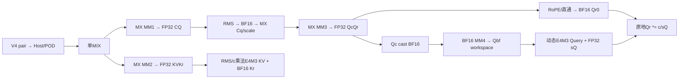
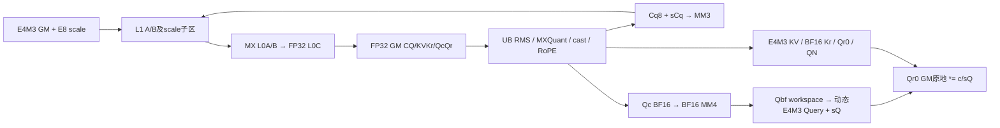
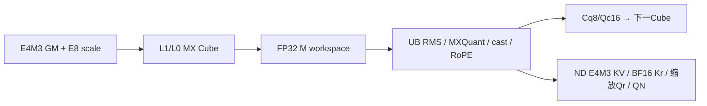
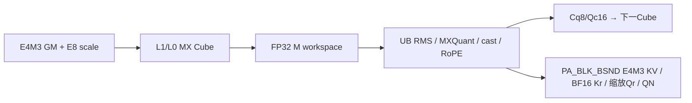

# MLA Prolog V4 MXFP8 投影与 Query、KV 量化 950 ACLNN 算子知识

## 算子速览

| 项目 | 内容 |
|---|---|
| 实际入口 | aclnnMlaPrologV4WeightNzGetWorkspaceSize / aclnnMlaPrologV4WeightNz，固定 d462/CANN9.2；SGL auto/cann 接入外置 cann_ops_transformer |
| 计算语义 | 唯一 (weight,kv,query)=(3,1,1)：E4M3FN 与 E8M0 分组投影，FP32 RMS→BF16→MXFP8 Cq，BF16吸收后Query动态E4M3、KV乘法量化E4M3、Qr缩放BF16；cache原地更新 |
| 输入输出 | X 与前三权重 E4M3FN；四份 scale 原生 E8M0，每32个K一个；Uk/gamma/sin/cos与Qr/Kr BF16，Query/KV E4M3、QNope尺度FP32；可选 QN E4M3FN+E8M0 scale |
| 执行类型 | 单 MIX_CV：AIC_CUBE 的3次MX乘加及第4次BF16 MM，AIV_VECTOR RMS/MX量化、KV乘法量化、Query动态量化、Qr读改写、RoPE/scatter；空query无Device计算 |
| Kernel 路线 | R001–005 splitN；R006–010 大T splitM；R011空query；R012空query guard返回值遗漏；R013条件Debug e0非法key |
| 核心资源 | FP32 GM投影、FP8 Cq、BF16独立Qc；L1 A/B各双128KiB、L0 A/B各双32KiB、C双64KiB；UB192KiB设计预算，逐片/阶段计费见下 |
| 来源闭包 | source_closed：公开V4→InnerV3/Host/POD/真实selector→arch35完整splitN/splitM和MX/RMS/RoPE/cache helpers；二进制wheel、生成bridge与compiler/Runtime primitive身份保留集成边界 |
| 验证状态 | 未安装、编译、测试或真机测量。draft：保留splitM单行尾部mode2通知不配对、空cache预零、workspace复用及ND未绑定读取的静态边界；不作为已验证安全实现推荐 |

## 接口与语义

### 计算语义

定义H=Hcq、T展平token数、N heads、D128/192、g=N(D+64)、h=ND。MX(A,B,sa,sb)对K轴每32元素一组，在Cube内应用A每row、B每输出channel的E8M0尺度，前三输出FP32。c=quantScaleCkv[0]是**乘法量化系数**，不是分母反量化scale。

```text
cq = MX(X,WDq,sX,sWDq)
cqf = RMS_FP32(cq,gammaQ,epsQ)*aq
(cq8,sCq) = MXQuant32(BF16_CAST_ROUND(cqf))       # E4M3 / E8M0每32元素
qcqr = MX(cq8,WUqQr,sCq,sWUqQr)                 # FP32
Qc = BF16_CAST_RINT(qcqr[:,:,:D])
Qbf = BF16_FIX(MM_BF16_FP32ACC(Qc,WUk))         # [T,N,512] workspace，尚非正式Query
sQ[t,h] = max(abs(FP32(Qbf[t,h,:])))/448
Query[t,h,:] = E4M3_CAST_RINT_SAT(FP32(Qbf[t,h,:])/sQ[t,h])
Qr0 = BF16_CAST_RINT(e?rot(qcqr[:,:,D:]):qcqr[:,:,D:])
QueryRope[t,h,:] = BF16_CAST_RINT(FP32(Qr0[t,h,:]) * (c/sQ[t,h]))
dequantScaleQNope[t,h,0] = sQ[t,h]              # FP32，不是E8M0，也不除以c

kvkr = MX(X,WDkvKr,sX,sWDkvKr)                  # E1跳MM2/cache数学
kvf = RMS_FP32(kvkr[:,:512],gammaKV,epsKV)*ak
KVcache = E4M3_CAST_RINT_SAT(kvf*c)             # 直接FP32量化，不预先BF16
Krcache = BF16_CAST_RINT(e?rot(kvkr[:,512:]):kvkr[:,512:])
scatter(KVcache,Krcache,index/layout/各自stride0)
可选QN=cq8，QNscale=sCq[T,H/32]为E8M0
```

Query每token每head独立512元素动态量化；此后同head64元素Qr在正式GM原地读改写。e0仅跳RoPE，仍执行c/sQ后处理，不能把关闭RoPE当关闭Qr缩放。Query的per-token ComputeVFImpl M0 scale=maxabs/448，无M1的1e−4下限；全零Qbf使sQ=0并继续除零，Qr也可能c/0。非法c、epsilon和NaN/Inf没有shape校验替代的数值保证。

上式表示类型与scale所属轴；Cube硬件的MX乘加内部舍入/异常值约定不能由实数求和式替换。splitN前两MM在L0C跨K累加后一次FIX；splitM的MatmulSplitMKOuter每K_L1子块重新FP32 L0C累加、FIX AtomicAdd到先清零GM。因此两路投影实数语义相同，FP32求和顺序不同，不承诺逐位一致。

MXQuant32的真实位运算为：BF16输入取指数位 `bits&0x7f80`，每32元素Reduce MAX；令E为该指数位最大值，普通非零有限组先E'=max(E,0x0400)，shared=E'−0x0400，E8M0编码shared>>7。普通范围对应2^(floor(log2(maxabs))−8)，低指数按位下限钳住。E=0时scale编码0且乘法系数置0；E=0x7f80的Inf/NaN指数分支scale编码0xff、倒数系数为0x7f81；shared=0x7f00的倒数特例用0x0040。不是INT8 per-token的max/127，也不把E8编码0说成浮点scale0。ComputeDataVF用BF16乘倒数系数、拆分转FP32，先比较钳到[-448,448]再E4M3 CAST_RINT/SAT。NaN传播保留该指令链，不由注释推定完整IEEE数值合同。

RMS用FP32平方累计/Reduce SUM、乘float(1/width)、加epsilon、sqrt、div、BF16 gamma转FP32相乘，aq/ak仅abs(value−1)>=FP32 epsilon时Muls。MX模式无smoothScalesCq与外部FP32投影反量化乘法。Qr/Kr保持FP32到RoPE后舍入；e0保持原投影通道顺序并不访问sin/cos。RoPE对j=0..31产生前半 `x[2j]cos[j]−x[2j+1]sin[j]`，后半 `x[2j+1]cos[32+j]+x[2j]sin[32+j]`。


### 输入、输出与属性

| 参数 | shape/layout | dtype | 约束、默认值与语义 |
|---|---|---|---|
| tokenX | [T,He]或[B,S,He] ND；T=B*S | E4M3FN | He∈{1024,2048,3072,4096,5120,6144,7168,7680,8192}，B≤65536；u32保存/乘法无溢出为后文公式前提 |
| weightDq | 逻辑[He,H]，NZ物理[H/32,He/16,16,32] | E4M3FN | H1536/2048；逻辑shape与format29 storage不可混用 |
| weightUqQr | [H,g]，NZ物理[g/32,H/16,16,32] | E4M3FN | N1..128，D128/192；完整head由当前模板处理 |
| weightDkvKr | [He,576]，NZ物理[18,He/16,16,32] | E4M3FN | 前512与后64两段 |
| weightUk | [N,D,512] ND | BF16 | 第4个MM不参与MX量化 |
| dequantScaleX | [T,He/32] ND | E8M0 | 必需，每token每32个K一个 |
| dequantScaleWDq / WUqQr / WDkvKr | [H,He/32] / [g,H/32] / [576,He/32] | E8M0 | 必需，输出channel为首轴；不是FP32或uint8替身 |
| gammaCq / gammaCkv | [H] / [512] | BF16 | 各AIV首step搬入、后继step保留 |
| ropeSin / Cos | [T,64]或[B,S,64] | BF16 | e1须成对；e0原始ACLNN指针null；wrapper按numel>0归一化 |
| kvCacheRef / krCacheRef | ND TND/BSND，或分页逻辑[Pnum,P,1,512/64]；NZ分别C0=32/16 | E4M3 / BF16 IN/OUT | 独立stride0，内轴连续；stride洞须真实storage |
| cacheIndex | tokenPA [T]/[B,S]；blockPA [B,ceil(S/P)]或合轴一维页表 | INT64 | ND缺省；正slot/page容量与无冲突由caller保证；splitM ND原文额外未绑定读取见限制 |
| actualSeqLen | rank2合轴blockPA的[B]累计终点 | INT32 | A1必需，末值T及单调/页表值为caller合同 |
| Query / QueryRope | [T,N,512/64]或[B,S,N,512/64] | E4M3 / BF16 | 独立有效输出；不与读入对象/workspace任意overlap |
| QueryNorm | 可选[T,H]或[B,S,H] | E4M3FN | qnf非null时MM3直接读正式QN；否则读workspace |
| dequantScaleQNorm | QN开启时[T,H/32]，物理无行padding | E8M0 | 与QN成对；vendor继承原生scaleX.scalar_type |
| dequantScaleQNope | [T,N,1]，rank3输入仍展平T | FP32 | 必须非空，实际sQ=maxabs(Qbf)/448；不是c/sQ |
| quantScaleCkv | [1] ND | FP32 | 必需，c同时用于KV乘法量化和Qr缩放；其它Ckr/smooth/clip缺省 |
| attrs | w3/kv1/q1、repo0、scaleRepo0、tile128 | mode INT64，scalar double→Float/POD float | eps默认1e−5、aq/ak默认1，cache默认PA_BSND；functional clone另见API |

### 入口与版本

[SGL V4 API](../../../../apis/sgl_kernel_npu/sgl_mlaprolog_v4.md)归档16tuple/functional接入，本卡只含(3,1,1) eager原地核心。SGL dda6文档明确引用ops-transformer d462，version.cmake=9.2；SDK a63d同9.2，不拿SGL通用9.1 CI基线替本行9.2。公开文档的MXFP8平台是950，Host DAV3510有实际typed body；A2/A3不是本卡平台。

V4公开pair转InnerMlaPrologV3并增加doRope；V3公开pair固定RoPE，与内部注册名相同不表示公开ABI等价。SGL auto/cann→lazy外置cann_ops_transformer.mla_prolog→vendor Python/C++→ACLNN_CMD取当前NPU stream。未安装或加载wheel，固定源码不证明部署wheel/torch_npu/compiler完全相同。已全文比对旧V3三卡与本族float/INT8卡：旧172B POD/固定RoPE/Direct参数、float000与INT8并非本MX数学，可链接复用相关合同但不替当前body。

## Host/Launcher 执行流程

### 参数校验与前处理

SGL先检查sin/cos成对，vendor ResolveDoRope按非空归一化。C++设备guard后CheckBasicInputs、IsHifloat8Scene（w3不强制HIF8）、CheckMxfp8Inputs：四份输入scale都必须at::kFloat8_e8m0fnu；common映射Float8_e8m0fnu→ACL_FLOAT8_E8M0。QNscale分配继承scaleX dtype，不能概括为uint8包装。token/权重TensorWrapper使用自身scalar_type；5个dtype override不是通用重解释。Query按tokenX的E4M3 dtype、Qr分配BF16，QN按UqQr的实际E4M3 dtype分配；四维raw Torch shape恢复与保留逻辑二维shape的NZ format tensor仍需区分。

V4校验mode组合、query量化与doRope指针；TensorHolder把原始null转换shape[0]临时descriptor并按holder存在性检查可选输出。QNope scale在当前必须提供FP32输出；QN与QNscale成对。非null空descriptor不是原始nullptr。holder/query descriptor析构不授予提前释放Device owner的权限。

InnerV3/OpDef的普通AutoContiguous、IgnoreContiguous(cache)、生成bridge为受控框架布局边界，无外部Torch核心GEMM fallback。Host按GetNpuInfo→CheckAttrs/Required/CacheMode→SetShapeInfo/Scenario→QuantMode/Dims/SpecialScenario/ExpectedParam→SetAttrInfo→ProcessBaseInputs→FillMatmul1..4→FillTiling/CalcWorkSpace/GenTilingKey执行。C,V必须正且V=C或2C；本950量化非空V=C由GenTilingKey拒绝。Nkv1、P16..1024且16倍数、六cache布局/rank组合和内轴连续性均经checker；正index上界、长度单调及无冲突没有逐值扫描证明。

### 参数、Workspace 与生命周期

m=min(T,128)，s=splitMFlag，a=actualSeqMode，qnf∈{0,1}；u32形状、ceil、size_t/int64偏移未溢出是所有数学byte式前提。H/32=48或64，scale物理槽G=align32(H/32)=64字节。

```text
splitN Host: Wlib +6mH +2304m +4mg +2mh +64m +2mN512
splitN Device从workspace实参原址：
  Sscale64m ; KVKr2304m FP32 ; CQ4mH FP32 ;
  qnf0:Cq8 mH，qnf1:正式QN ;
  QcQr4mg FP32 ; Qc16 2mh BF16 ; Qbf 2mN512 BF16

splitM Host: Wlib +6mHC +2304m*b2 +4mgC +4mhC +64mC +2mN512C
splitM Device顺序：
  Sscale64mC ; CQ4mHC ;
  qnf0:Cq8 mHC，qnf1:正式QN ;
  KVKr2304m*b2 ; QcQr4mgC ; Qc16 2mhC ; gap 2mhC ; Qbf 2mN512C
  b2=E1?0:C；第二Qc片仅地址gap，没有consumer；Qbf由MM4写并由动态量化读。
```

Host的2mH归一化预留大于Device实际mH/直接QN；splitM第二2mhC是真实Query前地址gap、无consumer，不凭gap声称ping-pong。M的每C slab容量按初始m，尾步只改变有效curM。N和M切片顺序不同，不按Host求和次序重建Device地址。Wlib为GetLibApiWorkSpaceSize实际查询；Device本体没有自行跳过Wlib前缀，Runtime打包位置为外部边界。

调用者query取得size/executor→同设备分配足量workspace→Execute(workspace,size,executor,stream)。输入、两cache、输出、index/actual和workspace都保持到stream完成；后继cache读要同stream或显式event。vendor当前stream、UseStreamResInCurrentThread和分配器延迟回收是集成边界；不得以局部descriptor析构/ctx.sync宣称Device owner可任意提前释放或跨stream可见。query/execute失败向上抛错、清理descriptor，不补造自动重试或executor释放API。

### 启动图与失败传播

T>0仅一次MIX launch，blockDim=C。AIC c、配对AIV线性v=c*r+sub；AscendC::GetBlockIdx与raw get_block_idx不是同一个索引。当前正常r=2、selector cv7；950量化CV1:1先Host拒绝。SDK编译/Runtime必须保持template cvRatio与运行subblock一致。



T=0仍先做公开参数校验；合法空key在POD/TPipe前return、只Wlib/block1。V=C时空分支忽略GenTilingKey失败遗留key0，不把它说成合法空返回。Host Debug且未外部define VERSION3的e0可产生INVALID_KEY但未检查；正常非Debug或Host VERSION3有真实e0 body。完整终点R011–013见后。

## Route 与参数设计

### 分核与资源计算

C/V为实际Host可用AIC/AIV；当前950正常V=2C。s=[T>=8192 && (He7168或7680) && N128]，dequantOpt始终true，group=false；Nkv8 group分支不属于公开Nkv1。IsSplitKnSupported要求DAV9201，当前DAV3510的KN三元组为(1,1,0)，不套arch92优化。

| 段 | splitN分核 | splitM分核 | Device tile与真实末块 |
|---|---|---|---|
| MM1 m/H/He | n1=max(64,32ceil(H/(32C)))，b1=ceil(H/n1) | n1=H，b1=C | baseN64、baseK256、stepK4，He7680时3；K_L11024/768 |
| MM2 m/576/He | E1 b2=n2=0；否则C>=9时n2=64/b2=9，其余n2=32ceil(576/(32C)) | E0 n2=576/b2=C；E1 b2=n2=0 | N本体baseN128、M本体baseN64；baseK256、stepK同MM1。N的nTile=min(128,末核N)，不要由Host注释替代Device128 |
| MM3 m/g/H | n3=(D+64)ceil(N/C)，b3=ceil(g/n3) | n3=g、b3=C | baseN128固定，不使用INT8 m<=64时256；baseK128、stepK4、K_L1512；m'<=64时A整H载L1 |
| MM4 每head m/512/D | hp=ceil(N/C)、b4=ceil(N/hp) | hp=N128、b4=C | BF16 baseN128；D128 baseK128/step1，D192 baseK64/step3；M始终ND B splitK/enUnitFlag，N保留真实预载分支 |

m=min(T,128)，MX在D192也不缩到64。N末step m'=min(m,T−b0)，所有slice容量仍m，AIV有效Veff=min(m,V)（特定编译/运行cv不一致时按源码修正）；v核分得q=floor(m'/Veff)+[v<m'%Veff]、start=v*floor(m'/Veff)+min(v,m'%Veff)。

M的ms=ceil(T/C)，fore=T−(ms−1)C；c<fore分ms行、起点c*ms，其余分ms−1、起点fore*ms+(c−fore)*(ms−1)。每C按m=128步进当前curM，AIV sub s的q=floor(curM/2)+s*(curM%2)、start=s*floor(curM/2)。curM1时sub0得到0行。这里“s”局部sub与splitM布尔需区分；M不按全Veff均分token。

### Route 选择

K(c,s,E,A,e)=(c,2,8,1,0,E,A,s,e,7)，序列字段为cache/scenario/quant/deq/group/empty/actual/splitM/rope/cv。c0 ND，c1/2 tokenPA，c3/4 blockPA；E0/1、A0/1的真实交集见各Route。

| 顺序 | Route | Key/模板 | 精确选择条件与优先级 | 不适用去向 |
|---:|---|---|---|---|
| 1 | R011空query | (0,0,0,0,0,2,0,0,1,7) | 全部guard后T0且V2C | V=C R012；其它guard错失败 |
| 2 | R006–010 splitM | K(c,1,E,A,e) | T>=8192、He7168/7680、N128 | 其它T>0走splitN |
| 3 | R001–005 splitN | K(c,0,E,A,e) | T>0且上述M条件不同时成立 | 非法输入Host失败，无其它core fallback |
| 4 | R012空量化零key | key0非合法空selector | DAV3510、T0、V=C；GenTilingKey失败被空分支忽略 | Runtime dispatch外部边界 |
| 5 | R013条件Debug e0 | INVALID_TILING_KEY | Host ASCENDC_DEBUG且VERSION非3、e0，SEL未包含0 | 非Debug或HostVERSION3正常e0；并非必然部署失败 |

```text
public/API/shape/mode/cache guards
  T0 -> guard accepted: R011 ; CV1:1 guard rejected but ignored: R012
  T>0 -> s=(T>=8192 && He in {7168,7680} && N==128)
        deq1,group0,m=min(T,128)
        FillMM1..4 -> POD/WS -> GenKey rejectsCV1:1
        c0..4 -> R(1+c+5s)
        conditional HostDebug e0 invalid -> R013
```

### 模板/实现执行矩阵

| R-001 splitN/ND | K(0,0,E,A,e) | T>0 && 非splitM条件；BSND 仅 rank3 X/cache [B,S,1,L]；TND 仅 rank2 X/cache [T,1,L]，E0/A0 | MIX_CV单kernel：AIC4MM+AIV | MlaPrologVecS1CubS2<MLAPType<FP8E4M3,FP8E4M3,FP8E4M3,FP8E8M0,c,1,0,E,A,0,2,e>> | 共享切片/逐FIX10→cast7、allV7/free9 | 末step m'；Qc列D/2、Qr行二分 |
| R-002 splitN/PA_BSND | K(1,0,E,A,e) | T>0 && 非splitM条件；cacheMode=PA_BSND；X rank2/3分别用INT64 index[T]/[B,S]，A0，E0/1 | MIX_CV单kernel：AIC4MM+AIV | MlaPrologVecS1CubS2<MLAPType<FP8E4M3,FP8E4M3,FP8E4M3,FP8E8M0,c,1,0,E,A,0,2,e>> | 共享切片/逐FIX10→cast7、allV7/free9 | 末step m'；Qc列D/2、Qr行二分 |
| R-003 splitN/PA_NZ | K(2,0,E,A,e) | T>0 && 非splitM条件；cacheMode=PA_NZ；逻辑[Pnum,P,1,L]，物理KV[Pnum,16,P,32]（E4M3，col0=32）、Kr[Pnum,4,P,16]（BF16，col0=16）；A0，E0/1 | MIX_CV单kernel：AIC4MM+AIV | MlaPrologVecS1CubS2<MLAPType<FP8E4M3,FP8E4M3,FP8E4M3,FP8E8M0,c,1,0,E,A,0,2,e>> | 共享切片/逐FIX10→cast7、allV7/free9 | 末step m'；Qc列D/2、Qr行二分 |
| R-004 splitN/PA_BLK_BSND | K(3,0,E,A,e) | T>0 && 非splitM条件；block页表，rank3→A0/index[B,ceil(S/P)]；rank2→A1/actualSeqLen[B]与一维INT64页表；E0/1 | MIX_CV单kernel：AIC4MM+AIV | MlaPrologVecS1CubS2<MLAPType<FP8E4M3,FP8E4M3,FP8E4M3,FP8E8M0,c,1,0,E,A,0,2,e>> | 共享切片/逐FIX10→cast7、allV7/free9 | 末step m'；Qc列D/2、Qr行二分 |
| R-005 splitN/PA_BLK_NZ | K(4,0,E,A,e) | T>0 && 非splitM条件；block页表与 c3 相同；cacheMode=PA_BLK_NZ，A0/1，E0/1 | MIX_CV单kernel：AIC4MM+AIV | MlaPrologVecS1CubS2<MLAPType<FP8E4M3,FP8E4M3,FP8E4M3,FP8E8M0,c,1,0,E,A,0,2,e>> | 共享切片/逐FIX10→cast7、allV7/free9 | 末step m'；Qc列D/2、Qr行二分 |
| R-006 splitM/ND | K(0,1,E,A,e) | T>=8192 && He∈{7168,7680} && N128；BSND 仅 rank3 X/cache [B,S,1,L]；TND 仅 rank2 X/cache [T,1,L]，E0/A0 | MIX_CV单kernel：AIC4MM+AIV | MlaPrologV3SplitM<MLAPType<FP8E4M3,FP8E4M3,FP8E4M3,FP8E8M0,c,1,0,E,A,0,2,e>> | perC切片/Kouter AtomicAdd、coarse10/3→7 | 每C尾curM；0行AIV缺通知见限制 |
| R-007 splitM/PA_BSND | K(1,1,E,A,e) | T>=8192 && He∈{7168,7680} && N128；cacheMode=PA_BSND；X rank2/3分别用INT64 index[T]/[B,S]，A0，E0/1 | MIX_CV单kernel：AIC4MM+AIV | MlaPrologV3SplitM<MLAPType<FP8E4M3,FP8E4M3,FP8E4M3,FP8E8M0,c,1,0,E,A,0,2,e>> | perC切片/Kouter AtomicAdd、coarse10/3→7 | 每C尾curM；0行AIV缺通知见限制 |
| R-008 splitM/PA_NZ | K(2,1,E,A,e) | T>=8192 && He∈{7168,7680} && N128；cacheMode=PA_NZ；逻辑[Pnum,P,1,L]，物理KV[Pnum,16,P,32]（E4M3，col0=32）、Kr[Pnum,4,P,16]（BF16，col0=16）；A0，E0/1 | MIX_CV单kernel：AIC4MM+AIV | MlaPrologV3SplitM<MLAPType<FP8E4M3,FP8E4M3,FP8E4M3,FP8E8M0,c,1,0,E,A,0,2,e>> | perC切片/Kouter AtomicAdd、coarse10/3→7 | 每C尾curM；0行AIV缺通知见限制 |
| R-009 splitM/PA_BLK_BSND | K(3,1,E,A,e) | T>=8192 && He∈{7168,7680} && N128；block页表，rank3→A0/index[B,ceil(S/P)]；rank2→A1/actualSeqLen[B]与一维INT64页表；E0/1 | MIX_CV单kernel：AIC4MM+AIV | MlaPrologV3SplitM<MLAPType<FP8E4M3,FP8E4M3,FP8E4M3,FP8E8M0,c,1,0,E,A,0,2,e>> | perC切片/Kouter AtomicAdd、coarse10/3→7 | 每C尾curM；0行AIV缺通知见限制 |
| R-010 splitM/PA_BLK_NZ | K(4,1,E,A,e) | T>=8192 && He∈{7168,7680} && N128；block页表与 c3 相同；cacheMode=PA_BLK_NZ，A0/1，E0/1 | MIX_CV单kernel：AIC4MM+AIV | MlaPrologV3SplitM<MLAPType<FP8E4M3,FP8E4M3,FP8E4M3,FP8E8M0,c,1,0,E,A,0,2,e>> | perC切片/Kouter AtomicAdd、coarse10/3→7 | 每C尾curM；0行AIV缺通知见限制 |
| R011 | EMPTY_QUERY | T0、合法cv7 | 无Device节点 | entry constexpr return | Wlib/block1 | 不读POD/GM |
| R012 | key0 | T0、cv6量化guard失败被忽略 | 无合法已选body | Host已知终点 | 不补造GM访问 | Runtime外部 |
| R013 | INVALID_KEY | 条件Debug/e0 | 无合法已选body | SDK Encode/Host未检查返回 | 正常Device e0存在 | 不编造dispatch行为 |

编译宏ORIG_DTYPE对应FP8E4M3/FP8E4M3/BF16，Runtime不得以其它dtype复用。QueryNorm、H、D、各tail是同selector内实际分支，不再制造虚拟算子。

SDK DECL宽度4/2/4/1/1/2/2/2/1/8，正常K=c+544+1024+(E<<12)+(A<<14)+(s<<16)+(e<<18)+(7<<19)。以下52项为正常交集；每项真实template如上。SDK非Debug FastEncode只查DECL；Debug Encode另查SEL。Host VERSION默认−1、Device TU define3，故e0仅在所述Host Debug条件产生INVALID_KEY，不能删掉正常e0。

| Route | c / splitM / E / A / e / cv | u64 key |
|---|---|---|
| R-001 | 0/0/0/0/0/7 | 3671584 |
| R-001 | 0/0/0/0/1/7 | 3933728 |
| R-002 | 1/0/0/0/0/7 | 3671585 |
| R-002 | 1/0/0/0/1/7 | 3933729 |
| R-002 | 1/0/1/0/0/7 | 3675681 |
| R-002 | 1/0/1/0/1/7 | 3937825 |
| R-003 | 2/0/0/0/0/7 | 3671586 |
| R-003 | 2/0/0/0/1/7 | 3933730 |
| R-003 | 2/0/1/0/0/7 | 3675682 |
| R-003 | 2/0/1/0/1/7 | 3937826 |
| R-004 | 3/0/0/0/0/7 | 3671587 |
| R-004 | 3/0/0/0/1/7 | 3933731 |
| R-004 | 3/0/0/1/0/7 | 3687971 |
| R-004 | 3/0/0/1/1/7 | 3950115 |
| R-004 | 3/0/1/0/0/7 | 3675683 |
| R-004 | 3/0/1/0/1/7 | 3937827 |
| R-004 | 3/0/1/1/0/7 | 3692067 |
| R-004 | 3/0/1/1/1/7 | 3954211 |
| R-005 | 4/0/0/0/0/7 | 3671588 |
| R-005 | 4/0/0/0/1/7 | 3933732 |
| R-005 | 4/0/0/1/0/7 | 3687972 |
| R-005 | 4/0/0/1/1/7 | 3950116 |
| R-005 | 4/0/1/0/0/7 | 3675684 |
| R-005 | 4/0/1/0/1/7 | 3937828 |
| R-005 | 4/0/1/1/0/7 | 3692068 |
| R-005 | 4/0/1/1/1/7 | 3954212 |
| R-006 | 0/1/0/0/0/7 | 3737120 |
| R-006 | 0/1/0/0/1/7 | 3999264 |
| R-007 | 1/1/0/0/0/7 | 3737121 |
| R-007 | 1/1/0/0/1/7 | 3999265 |
| R-007 | 1/1/1/0/0/7 | 3741217 |
| R-007 | 1/1/1/0/1/7 | 4003361 |
| R-008 | 2/1/0/0/0/7 | 3737122 |
| R-008 | 2/1/0/0/1/7 | 3999266 |
| R-008 | 2/1/1/0/0/7 | 3741218 |
| R-008 | 2/1/1/0/1/7 | 4003362 |
| R-009 | 3/1/0/0/0/7 | 3737123 |
| R-009 | 3/1/0/0/1/7 | 3999267 |
| R-009 | 3/1/0/1/0/7 | 3753507 |
| R-009 | 3/1/0/1/1/7 | 4015651 |
| R-009 | 3/1/1/0/0/7 | 3741219 |
| R-009 | 3/1/1/0/1/7 | 4003363 |
| R-009 | 3/1/1/1/0/7 | 3757603 |
| R-009 | 3/1/1/1/1/7 | 4019747 |
| R-010 | 4/1/0/0/0/7 | 3737124 |
| R-010 | 4/1/0/0/1/7 | 3999268 |
| R-010 | 4/1/0/1/0/7 | 3753508 |
| R-010 | 4/1/0/1/1/7 | 4015652 |
| R-010 | 4/1/1/0/0/7 | 3741220 |
| R-010 | 4/1/1/0/1/7 | 4003364 |
| R-010 | 4/1/1/1/0/7 | 3757604 |
| R-010 | 4/1/1/1/1/7 | 4019748 |
| R011 | (0,0,0,0,0,2,0,0,1,7) | 3940352 |
| R012 | 不匹配合法selector | 0 |
| R013 | Encode failure | 18446744073709551615 |

### 隐藏性能 Guard

| Guard | Host/Tiling条件 | Device/资源原因 | 影响Route | 不满足时去向 | 源码符号 |
|---|---|---|---|---|---|
| splitM | T>=8192、He7168/7680、N128 | perC完整head、Kouter GM AtomicAdd；非任意MX输入 | R006–010 | splitN | SetScenarioInfo |
| dequantOpt | UqQr为E4M3 | 实际为cast而非外部scale乘法；flags按typed图 | 全正常 | 不用N7/8旧阈值 | ProcessBaseInputs |
| MX baseN128 | 与m'无关 | B数据512*128=64KiB，余区容纳MXscale | MM3 | 没有256tile替换 | MmQcQrParamInit |
| L1 scale区域 | 需B数据不覆盖64KiB后的scale | N MM2实际nTile>64且K_L11024时B数据跨scale起点；C>=9取64能避免该特定重叠，不能宣称任意C安全 | R001–005 | Host无针对该重叠的额外guard | LoadL1ABAndScale/MmCkvKrParamInit |
| tail1模式2 | M curM1→sub0 q0 | QcQrSplit提前return不发7，而AIC仍等两个AIV | R006–010 | 无自有补通知fallback；条件静态风险 | QcQrSplit/MatmulQnSync |
| E1预零 | M b2=0但预零仍写m576 | W0空片与后继W2起点重合，写入不由E1保护 | R006–010 | 无自有修复 | Process/WorkspaceInit |
| 950核比 | 正常量化V=C被拒绝 | 固定Host白名单，非硬件全域推测 | 全部 | 非空失败；空R012遗漏状态 | GenTilingKey |
| UB对齐 | N A1时实际序列片align32(8m) | 独立对齐，小m%4!=0比设计预算多32B；M无actual TBuf | 正常 | 无逐stage自动缩tile | VectorBufferInit/TPipe |
| 指数/数值 | BF16指数钳位、0/Inf/NaN分支 | MXQuant与INT8 max/127不同；不添加epsilon | 正常 | 保留实际位运算 | ComputeMaxExp/Scale/DataVF |
| index/storage | 内轴连续且真实stride0 storage、slot/page合法互斥 | 非atomic scatter，shape检查不证明值合法 | c1–4 | caller合同 | ScatterCache/ComputeBlkScatterOffsets |
| 有限位域 | u32 shape/ceil/multiply、size_t/int64 offsets | 理想整数byte式只在无窄化溢出域成立 | 全部 | 超域不承诺 | SetShapeInfo/FillTiling |

### POD/ABI

跨Host/Device为MlaPrologTilingData.baseParams，共52字段。sizeof208/alignof8/以下offset按u32/float4B、u16 2B、u64 8B自然对齐静态推导，未执行编译器sizeof/offsetof；188–191 padding。kNopeClipAlpha未被FillTiling赋值且当前不读，不猜默认0。

| 结构 | 字段 | 类型/位宽 | ABI布局 | 单位 | Host/launcher producer | Device consumer | 边界 |
|---|---|---|---|---|---|---|---|
| BaseParams | batchSize | uint32_t/32 | offset0，4B | batch，TND其它路线为0 | FillTiling/CoreParams：B；fusedblockPA由actualSeqLen.shape[0] | ComputeBlkScatterOffsets批游标界 | batch，TND其它路线为0 |
| BaseParams | stepBatchSize | uint32_t/32 | offset4，4B | token；T0=0且不读 | FillTiling/CoreParams：min(T,128) | Process步进/UB/WS/MM m | token；T0=0且不读 |
| BaseParams | mSubSize | uint32_t/32 | offset8，4B | token/core | FillTiling/CoreParams：splitM时ceil(T/C)，否则0 | Process每核token数与起点 | u32 ceil计算未溢出 |
| BaseParams | mSubCoreNum | uint32_t/32 | offset12，4B | core | FillTiling/CoreParams：splitM时T−(mSubSize−1)C，否则0 | Process前fore核多1行 | 0<fore<=C |
| BaseParams | stepNumHeadDequant | uint32_t/32 | offset16，4B | head | FillTiling/CoreParams：D128?min(64,N):min(16,N) | 本tuple dequantOpt=true，旧deq0处理不走 | 已写POD不等必消费 |
| BaseParams | tokenSize | uint32_t/32 | offset20，4B | token；u32原始乘法域 | FillTiling/CoreParams：X前导维展平T | Process总步数 | token；u32原始乘法域 |
| BaseParams | seq1Size | uint32_t/32 | offset24，4B | token | FillTiling/CoreParams：rank3 X的S；rank2默认0 | blockPA A0批内token/ND BSND跨度 | token |
| BaseParams | seq2Size | uint32_t/32 | offset28，4B | 保留字段，不解释成真实KV长度 | FillTiling/CoreParams：nkvSize=1 | 本MXFP8 splitN不读 | 保留字段，不解释成真实KV长度 |
| BaseParams | headSizeX | uint32_t/32 | offset32，4B | 元素 | FillTiling/CoreParams：He | MM1/MM2 K与X行跨度 | 元素 |
| BaseParams | headSizeCq | uint32_t/32 | offset36，4B | 元素 | FillTiling/CoreParams：Hcq | MM1输出/MM3 K/NormCq | 元素 |
| BaseParams | headSizeCkv | uint32_t/32 | offset40，4B | 元素 | FillTiling/CoreParams：512 | MM2切片/NormKV/MM4 N | 元素 |
| BaseParams | headSizeQc | uint32_t/32 | offset44，4B | 元素 | FillTiling/CoreParams：N*D | MM3/Qn输入跨度 | 元素 |
| BaseParams | headSizeQr | uint32_t/32 | offset48，4B | 元素 | FillTiling/CoreParams：N*64 | QueryRope行跨度 | 元素 |
| BaseParams | headSizeKr | uint32_t/32 | offset52，4B | 元素 | FillTiling/CoreParams：Dr=64 | MM2完整输出/分核 | 元素 |
| BaseParams | numHeadSize | uint32_t/32 | offset56，4B | head | FillTiling/CoreParams：N | MM4 head循环/QueryRope row | head |
| BaseParams | numHeadKvSize | uint32_t/32 | offset60，4B | head | FillTiling/CoreParams：Nkv=1 | 本MXFP8 splitN无直接关键读取 | head |
| BaseParams | dimHeadSizeQc | uint32_t/32 | offset64，4B | 元素 | FillTiling/CoreParams：D | MM4 K/Qc切片 | 元素 |
| BaseParams | dimHeadRope | uint32_t/32 | offset68，4B | 元素 | FillTiling/CoreParams：64 | SinCos/Rotary/Kr尺寸 | 元素 |
| BaseParams | blockNum | uint32_t/32 | offset72，4B | cache slice数；P0选EMPTY_CACHE | FillTiling/CoreParams：cache首轴P/T/B | 本域scatter不做正index上界校验 | cache slice数；P0选EMPTY_CACHE |
| BaseParams | blockSize | uint32_t/32 | offset76，4B | token；PA16..1024且16倍数 | FillTiling/CoreParams：PA H或BSND S；TND0 | GetCacheOffset解页/blockPA余数 | token；PA16..1024且16倍数 |
| BaseParams | mm1BlockNum | uint32_t/32 | offset80，4B | core | FillTiling/CoreParams：splitM:C；splitN:ceil(H/n1) | CQ切片/mm1活跃核 | C>0 |
| BaseParams | mm2BlockNum | uint32_t/32 | offset84，4B | core | FillTiling/CoreParams：E1:0；否则splitM:C/splitN:ceil(576/n2) | MM2/W0切片；splitM预零未验E1 | 空cache预零见限制 |
| BaseParams | mm3BlockNum | uint32_t/32 | offset88，4B | core | FillTiling/CoreParams：splitM:C；splitN:ceil(g/n3) | MM3活跃核/WS倍数 | M每核完整g列 |
| BaseParams | mm4BlockNum | uint32_t/32 | offset92，4B | core | FillTiling/CoreParams：splitM:C；splitN:ceil(N/hp) | MM4/独立Qc切片 | M每核完整N heads |
| BaseParams | vectorBlockNum | uint32_t/32 | offset96，4B | AIV | FillTiling/CoreParams：min(m,V) | N分token；M每对AIV分本核curM | M本体不按全Veff均分 |
| BaseParams | mm1SingleCoreN | uint32_t/32 | offset100，4B | 元素 | FillTiling/CoreParams：splitM:H；splitN:n1 | MM1输出N/stride | 同上 |
| BaseParams | mm2SingleCoreN | uint32_t/32 | offset104，4B | 元素 | FillTiling/CoreParams：E1:0；splitM:576；splitN:n2 | MM2输出N/stride | M E1预零仍按576 |
| BaseParams | mm3SingleCoreN | uint32_t/32 | offset108，4B | 元素 | FillTiling/CoreParams：splitM:g；splitN:(D+64)ceil(N/C) | MM3输出列/波 | 完整head切分 |
| BaseParams | mm4SingleCoreBatch | uint32_t/32 | offset112，4B | head | FillTiling/CoreParams：splitM:N；splitN:ceil(N/C) | MM4 head循环 | M N128 |
| BaseParams | dtileSize | uint32_t/32 | offset116，4B | 元素 | FillTiling/CoreParams：512 | ScatterCkv tokenStride | 元素 |
| BaseParams | kvQuantMode | uint32_t/32 | offset120，4B | mode | FillTiling/CoreParams：1 PER_TENSOR | KV乘法量化、Query动态及Qr缩放 | 值1，与qq1配对 |
| BaseParams | tileSize | uint32_t/32 | offset124，4B | 元素，Host仍校验128 | FillTiling/CoreParams：attr128 | 本tuple不读pertile消费者 | 元素，Host仍校验128 |
| BaseParams | ckvkrRepoMode | uint32_t/32 | offset128，4B | mode | FillTiling/CoreParams：0 DIVIDE | ScatterKr合并分支inactive | mode |
| BaseParams | quantScaleRepoMode | uint32_t/32 | offset132，4B | mode | FillTiling/CoreParams：0 DIVIDE | scale回写分支inactive | mode |
| BaseParams | queryNormFlag | uint32_t/32 | offset136，4B | bool编码u32 | FillTiling/CoreParams：原始queryNormOut非null?1:0 | OutputInit/WorkspaceInit/Process | bool编码u32 |
| BaseParams | reciprocalCq | float/32 | offset140，4B | FP32 | FillTiling/CoreParams：float(1/H) | NormCq Reduce后Muls | FP32 |
| BaseParams | epsilonCq | float/32 | offset144，4B | FP32，不验证所有数值域 | FillTiling/CoreParams：rmsnormEpsilonCq Float | NormCq Adds/Sqrt | FP32，不验证所有数值域 |
| BaseParams | reciprocalCkv | float/32 | offset148，4B | FP32 | FillTiling/CoreParams：float(1/512) | NormKV Reduce后Muls | FP32 |
| BaseParams | epsilonCkv | float/32 | offset152，4B | FP32 | FillTiling/CoreParams：rmsnormEpsilonCkv Float | NormKV Adds/Sqrt | FP32 |
| BaseParams | kNopeClipAlpha | float/32 | offset156，4B | inactive，值不可宣称为0 | FillTiling/CoreParams：FillTiling未赋此标量字段 | 本tuple不读；其它quant helper另读GM | inactive，值不可宣称为0 |
| BaseParams | qcQrScale | float/32 | offset160，4B | FP32 | FillTiling/CoreParams：attr Float aq | NormCq gamma后Muls | FP32 |
| BaseParams | kcScale | float/32 | offset164，4B | FP32 | FillTiling/CoreParams：attr Float ak | NormKV gamma后Muls | FP32 |
| BaseParams | isQcQrScaleEnable | uint16_t/16 | offset168，2B | bool编码u16 | FillTiling/CoreParams：abs(aq-1)>=float epsilon | NormCq条件Muls | bool编码u16 |
| BaseParams | isKcScaleEnable | uint16_t/16 | offset170，2B | bool编码u16 | FillTiling/CoreParams：abs(ak-1)>=float epsilon | NormKV条件Muls | bool编码u16 |
| BaseParams | mm1NGroup | uint16_t/16 | offset172，2B | 组，9201才可能变化 | FillTiling/CoreParams：1 | 当前arch35 splitN不读KN分组 | 组，9201才可能变化 |
| BaseParams | mm1KGroup | uint16_t/16 | offset174，2B | 组 | FillTiling/CoreParams：1 | 本平台CalcWorkSpace按1；Device无KN | 组 |
| BaseParams | mm1SingleCoreK | uint32_t/32 | offset176，4B | 元素，inactive | FillTiling/CoreParams：0 | 当前arch35不读 | 元素，inactive |
| BaseParams | mm2NGroup | uint16_t/16 | offset180，2B | 组 | FillTiling/CoreParams：1 | 当前arch35不读KN分组 | 组 |
| BaseParams | mm2KGroup | uint16_t/16 | offset182，2B | 组 | FillTiling/CoreParams：1 | 本平台CalcWorkSpace按1；Device无KN | 组 |
| BaseParams | mm2SingleCoreK | uint32_t/32 | offset184，4B | 元素，inactive | FillTiling/CoreParams：0 | 当前arch35不读 | 元素，inactive |
| BaseParams | kvCacheStride0 | uint64_t/64 | offset192，8B | 元素u64，转int64需在已验范围内 | GetCacheStride0；空cache0 | ScatterCache/MaterializeOffsetsWithHeadSize | 元素u64，转int64需在已验范围内 |
| BaseParams | krCacheStride0 | uint64_t/64 | offset200，8B | 元素u64 | FillTiling/CoreParams：同前，独立取Kr | Kr ScatterCache/MaterializeOffsetsWithHeadSize | 元素u64 |

Device局部MMParams的m/n/k依四MM、orgKa=He/He/H/ND、orgKb=k、orgKc=H/576/g/N512；needSetOrgShape1，baseM没有赋值及实际消费者；kScale=K/32在MX真实消费。MMBufParams保存TPipe基址、各bank初始0计数至launch结束，不在阶段间重置。RmsNormParam六字段reciprocal/epsilon(float)、row/col(u32)、scale(float)、isScaleEnable(u16)，row1、colH/512。Rectangle三u32为row/col/stride。ScatterCacheParams八i64为P/slot/row1/colL/tokenStride/stride0/S/tokenIndex；CkvkrParams六i64为tokenIndex、W0元素offset、当前token序号、rowsInCurBatch、cacheOffset、nextPageOffset。Aic/AivOffset按各typed元素计，不把它们当额外序列化POD。

Device局部参数同样按真实字段解释，以下自然布局为静态推导，未编译验证：

| 结构 | 字段 | 类型/位宽 | ABI布局 | 单位 | Host/launcher producer | Device consumer | 边界 |
|---|---|---|---|---|---|---|---|
| CastQcQrSplitNParams | mmQnPreCastOffset | int64_t/64 | offset0，sizeof32/align8 | typed元素/见producer | Device DequantAndRopeSplitNSyncMMQcQr：本C MM3起列o | CastQcQrSplitN inputGm基址 | Device局部非序列化；整值未窄化前提 |
| CastQcQrSplitNParams | mmQnPreCastResOffset | int64_t/64 | offset8，sizeof32/align8 | typed元素/见producer | Device DequantAndRopeSplitNSyncMMQcQr：本C head起点h0*D | BF16 outputGm基址 | Device局部非序列化；整值未窄化前提 |
| CastQcQrSplitNParams | inputOffset | uint32_t/32 | offset16，sizeof32/align8 | typed元素/见producer | Device DequantAndRopeSplitNSyncMMQcQr：sub*D/2+head*(D+64) | FP32输入元素 | Device局部非序列化；整值未窄化前提 |
| CastQcQrSplitNParams | outputOffset | uint32_t/32 | offset20，sizeof32/align8 | typed元素/见producer | Device DequantAndRopeSplitNSyncMMQcQr：sub*D/2+head*D | BF16输出元素 | Device局部非序列化；整值未窄化前提 |
| CastQcQrSplitNParams | srcStride | uint32_t/32 | offset24，sizeof32/align8 | typed元素/见producer | Device DequantAndRopeSplitNSyncMMQcQr：g-D/2 | DMA输入行gap | Device局部非序列化；整值未窄化前提 |
| CastQcQrSplitNParams | dstStride | uint32_t/32 | offset28，sizeof32/align8 | typed元素/见producer | Device DequantAndRopeSplitNSyncMMQcQr：h-D/2 | DMA输出行gap | Device局部非序列化；整值未窄化前提 |
| RopeQrSplitNParams | ropeQrOffset | int64_t/64 | offset0，sizeof56/align8 | typed元素/见producer | Device DequantAndRopeSplitNSyncMMQcQr：o+D | FP32输入段基址 | Device局部非序列化；整值未窄化前提 |
| RopeQrSplitNParams | ropeQrResOffset | int64_t/64 | offset8，sizeof56/align8 | typed元素/见producer | Device DequantAndRopeSplitNSyncMMQcQr：h0*64+batchOffset*N64 | BF16正式Qr基址 | Device局部非序列化；整值未窄化前提 |
| RopeQrSplitNParams | inputOffsetRope | uint32_t/32 | offset16，sizeof56/align8 | typed元素/见producer | Device DequantAndRopeSplitNSyncMMQcQr：rowStart*g+head*(D+64) | 当前head输入 | Device局部非序列化；整值未窄化前提 |
| RopeQrSplitNParams | deqScaleOffset | uint32_t/32 | offset20，sizeof56/align8 | typed元素/见producer | Device DequantAndRopeSplitNSyncMMQcQr：MX无消费 | 旧反量化字段inactive | Device局部非序列化；整值未窄化前提 |
| RopeQrSplitNParams | outputOffsetRope | uint32_t/32 | offset24，sizeof56/align8 | typed元素/见producer | Device DequantAndRopeSplitNSyncMMQcQr：rowStart*N64+head*64 | 输出DMA | Device局部非序列化；整值未窄化前提 |
| RopeQrSplitNParams | ropeStride | int64_t/64 | offset32，sizeof56/align8 | typed元素/见producer | Device DequantAndRopeSplitNSyncMMQcQr：g | 输入FP32行跨度 | Device局部非序列化；整值未窄化前提 |
| RopeQrSplitNParams | ropeDstStride | uint32_t/32 | offset40，sizeof56/align8 | typed元素/见producer | Device DequantAndRopeSplitNSyncMMQcQr：N64−64 | 输出BF16行gap | Device局部非序列化；整值未窄化前提 |
| RopeQrSplitNParams | deQuantScaleCqOffset | uint32_t/32 | offset44，sizeof56/align8 | typed元素/见producer | Device DequantAndRopeSplitNSyncMMQcQr：MX不做Vector反量化 | inactive | Device局部非序列化；整值未窄化前提 |
| RopeQrSplitNParams | sinCosOffset | uint32_t/32 | offset48，sizeof56/align8 | typed元素/见producer | Device DequantAndRopeSplitNSyncMMQcQr：本AIV half-row sin/cos元素起点 | RotaryPerHead | Device局部非序列化；整值未窄化前提 |
| RopeQrSplitNParams | ropeCnt | uint32_t/32 | offset52，sizeof56/align8 | typed元素/见producer | Device DequantAndRopeSplitNSyncMMQcQr：当前half-row行数floor/ceil(m'/2) | 有效元素count | Device局部非序列化；整值未窄化前提 |

旧DequantQcQrSplitNParams当前MX不实例化外部Vector反量化分支，不能把其scale消费者安到本tuple。

### Route 源码闭包

| Route | Key/selector | Host/Tiling producer | POD/参数 | Kernel entry/router | Kernel body/直接依赖 | 构建接线 |
|---|---|---|---|---|---|---|
| R001–005 | K(c,0,E,A,e)逐项如上 | RunBigKernelTiling→SetScenarioInfo/ProcessBaseInputs/FillMatmul*/CalcWorkSpace/GenKey | 208B，KN固定1/1/0 | mla_prolog_v3 MXFP8_FULL_QUANT_KV_QUANT_PER_TENSOR splitM0 | arch35 splitN完整Init/Process/MatmulQcQr/CastQcQrSplitN/Rope/RMS/scatter | v3/op_host/CMakeLists声明mla_prolog依赖、auto-sync=off；OpDef/tiling_register |
| R006–010 | K(c,1,E,A,e) | 同上，mSub/fore与perC分核 | 208B+M分区 | 同entry splitM1 | arch35 splitM完整Process/MatmulSplitMKOuter/双coarseflag/QcQrSplit/cache | 同TU/SEL，非外部Torch MM |
| R011 | 合法empty | 空分支FillTiling/libWS/block1 | 已填不读 | entry constexpr return | 无core | 同TU |
| R012 | key0 | GenKey guard失败被忽略 | 不虚构consumer | 未选合法body | Host精确缺陷 | Runtime派发外部 |
| R013 | INVALID_KEY | SDK Debug Encode验证SEL | 不虚构consumer | 正常e0 Device存在 | 条件构建错误传播 | Host/Device VERSION宏条件 |

## Kernel 实现

### 公共执行流程

以下N管线定义和M管线定义分别由后续五layout Route完整实例化；类型始终前三输入E4M3FN、尺度E8M0、前三输出FP32、Cq E4M3、Qc/Uk/MM4输出BF16。模板ENABLE_DEQUANT名字在此表示cast/流水选择，不是对FP32投影再乘外部scale。

```text
entry: 先判EMPTY_QUERY return；读208B，TPipe；
  MXFP8 quant8 -> splitM0:MlaPrologVecS1CubS2 / splitM1:MlaPrologV3SplitM
Init: 绑定GM/cache/可选QN/尺度；MmParamInit；
      WorkspaceInit按本算法切片；AIC CubeBufferInit / AIV VectorBufferInit
      E8M0不分配FP32权重scale或smooth常驻UB。
```

N管线完整函数/地址/循环：

```text
Process<needQnDynamicQuant=true>:
  AIC初始L1 A/B、L0 A/B/C双bank及SCALE_EVENT free；
  AIV初始mode2/MTE3 free9；
  for batchOffset=0; batchOffset<T; batchOffset+=m:
    m'=min(m,T-batchOffset)，四MM.m=m'，重分AIV token
    AicOffset: MM1输出列c*n1；MM2列c*n2；
      MM3输出o=c*n3/head起h0=o/(D+64)，MM4 heads c*hp；
      sX元素base=batchOffset*He/32，
      sWDq=c*n1*(He/32)，sWDkv=c*n2*(He/32)，sWUq=o*(H/32)
    AIC:
      MatmulSplitN<E4M3,float,E8> MM1 ->CQ FP32；notifyCQ6
      wait free9；E0 MatmulSplitN<E4M3,float,E8> MM2 ->KVKr FP32
      notifyCKV4；waitRMSCq6
      MatmulQcQr:
        若m'<=64: LoadL1AAndScale<...,scaleSrcPad=true>一次整载Cq8/H及sCq
        for nidx=0..ceil(n3tail/128)-1:
          MatmulSplitK<E4M3,float,E8,hasAFullLoad,true>，
          输出W2每行g、列o+nidx128；最后tile有效tail
          每tile FIX notify10
        A整载bank释放
      waitSCALE_EVENT；PreloadQnAndSync→MatmulQnWeightPreload
      每head等待配对AIV的DEQsplit7（head数>15时仅偶数或最后发/等）
        MM4从Qc16行跨度h读D，Uk本head[D,512] ND；
        D128走当前整B预载/全A路线，D192按K64*3 splitK；
        BF16乘、FP32 L0C、Fixpipe F322BF16→Qbf workspace[当前step,N,512]
        每head FIX notify8，随后AIV等8逐head动态量化
      releaseSCALE_EVENT
    AIV:
      首step CopyGamma；e1 GatherSinCos当前half-row到常驻FP32 sin/cos
      waitCQ6；allV7
      每自有token RmsNormCqProcess:
        W1 FP32→RMS/aq→BF16 CAST_ROUND→MXQuant32；
        Cq8 H字节写workspace/正式QN，scale H/32有效字节按64B槽存UB
      CopyDequantScaleCq -> GM Sscale[tokenLocal*64]，每行DMA64B
      QN开启则DataCopyPad每行H/32B（48时UB自然32B对齐64B；正式输出紧凑48B）
      allV7；MX不把GMscale汇总成每token FP32向量；notifyRMSCq6
      waitCKV4；allV7；
      RmsNormRopeScatterCkvKr:
        先reserve32B标量槽+512q本地cos/sin；e1再GatherSinCos
        E1 return；否则每本核token：
          Ckv float512→RMS/ak FP32→乘c→E4M3 RINT/SAT→layout scatter
          Kr float64→e1 RoPE/e0直通→BF16→layout scatter
          MTE3排空后share可复用
      notifyfree9
      DequantAndRopeSplitNSyncMMQcQr:
        colEnd从0按baseN128推进，逐tilewait10；
        每完整head的Qc已生产：
          CastQcQrSplitN，sub分D/2列、全部m'行
          FP32输入offset=o+sub*D/2+head*(D+64)，行跨度g
          BF16输出offset=h0*D+sub*D/2+head*D，行跨度h
          输入4*m'*D/2B，输出同UB前缀2*m'*D/2B
          Cast RINT，MTE3写Qc16，按双方稀疏head规则notify7
        每完整Qr已生产：
          RopeQrSplitN：sub0/1各floor/ceil(m'/2)行，
          输入o+D+rowStart*g+head*(D+64)，输出h0*64+rowStart*N64+head*64
          FP32 RotaryPerHead<false,e>→BF16，正式行跨度N64
      Qr0写完后DynamicQuantQnAndMulQrSyncMMQn逐head等8，写Query/sQ并原地改写Qr；Qbf workspace不按batch增加基址。
      Qr输出base每step+=m*N64
收尾AIC drain所有L1/L0 bank和SCALE_EVENT，wait最后free9。
```

N的RMSCq前后allV7保留真实跨核producer/consumer；CKV stage有free9防下step覆盖W0。MM3每paired-C的完整head列切分，Qc由两AIV分列写同一行，只有两者均完成才允许MM4读；Qr按行切而非按D列。不能用一个“全部MM3完成”屏障代替细粒度cast7。当前cast没有INT32/FP32 DequantVF以及D/2=96的scale向量尾load；不要继承INT8卡的额外scale读问题。

M管线完整函数/地址/循环：

```text
每C的start/end由ms/fore确定；for mOffset=start; mOffset<end; mOffset+=128:
  curM=min(128,end-mOffset)，四MM.m=curM
  AIV sub0:
    zeroBuf Duplicate float0共512元素
    用MTE3按512float chunk清零本C CQ片mH和KVKr片m576（均用初始m128）
    这里不检查E1，KVKr实际extent却由b2控制
    V_MTE3→DMA→MTE3_V排空
  两AIV都notify mode2/MTE3 flag2
  AIC wait mode2/FIX flag2
    MM1 MatmulSplitMKOuter，输入X[mOffset*He]，scaleX[mOffset*He/32]，
      输出CQ[c*mH] FP32，weight/scale从全矩阵0列起
    notifyCQ6
    E0 MM2 MatmulSplitMKOuter输出KVKr[c*m576]；E1不调用
    PIPE_ALL；notifyCKV4；waitRMSCq6
    MM3读Cq8[c*mH]或QN[mOffset*H]，
      Sscale[c*m64]，WUqQr/scale全g列
      nidx128循环，FP32输出W2[c*mg]，A整载仅curM<=64；
      L=ceil(g/128)，spacing=ceil(L/14)
      flag10 if nidx%spacing==0 or last；
      flag3 if (nidx+1)%spacing==0 or last
    waitSCALE_EVENT
    MM4每C全N128 heads：
      coarse=ceil(128/14)=10，i%10==0等7；
      gap1分支条件128-ceil(128/10)<=15为false
      每head再分512为4个N128块；
      MatmulSplitK<BF16,BF16,E8,false,false,true,ND>，
      从Qc16[c*mND+head*D]行跨度ND读取；
      写Qbf workspace[c*m*N512+head512]
    全部128heads完成后PIPE_ALL，AIC仅notify一次8
    releaseSCALE_EVENT
  AIV sub:
    q=floor(curM/2)+sub*(curM%2)，rowStart=sub*floor(curM/2)
    首本核step搬gamma，e1搬对应行sin/cos
    waitCQ6；每q行RMS/MXquant，
      Cq8输出c*mH+rowStart*H（或QN全局mOffset+rowStart）
      scales输出(c*m+rowStart)*64；可选QNscale全局紧凑H/32
    即使q0 RmsNormCq提前return，外层仍notifyRMSCq6
    waitCKV4；cache stage E1/b2=0或q0跳过，否则按当前q行scatter
    QcQrSplit:
      q0直接return（不发7，也不消费10/3）
      for colCube=0; colCube<g; colCube+=128:
        若splitCount%spacing==0或last：wait10
        若splitCount%spacing==0：wait3（等待本coarse窗最后FIX）
        while完整Qc已生产：
          复制q行D浮点，输入行跨度g，alias prefix Cast RINT BF16
          输出Qc16行跨度ND；
          每第10个head或末head通知7；gap1条件false
        while完整Qr已生产：
          q行64float，RotaryPerHead<false,e>，写全局Qr行跨度N64
      MTE3_MTE2排空
QcQrSplit完全提交Qr0后，DynamicQuantQnAndMulQrSyncMMQn仅先wait8一次，再循环128heads量化/原地Qr改写。
无free9、无allV跨C屏障；收尾AIC仅drain L1/L0/SCALE_EVENT。
```

D128时g24576、L192、spacing14，flag10共15次/flag3共14次；D192时g32768、L256、spacing19，同样15/14。AIV对应等待计数一致，MM4粗粒度7每10heads/末共13次。**仅q>0的AIV执行这些通知**；curM1一侧q0使mode2缺一producer，正常flag计数无残留的该轮无法满足“两个AIV均上报”的固定SDK契约。只认定静态协议缺口，不声称已编译或真机死锁。

MX矩阵乘真实共用helper：

```text
MatmulSplitN -> nTile loop -> MatmulSplitK -> K_L1 loop -> MatmulL1 -> stepK loop:
 A ND→NZ，CopyNDGmToL1: m真实行、K_L1宽、源行跨度K，内部M align16
 B NZ→L1，c0=32，GM元素地址K*nOffset+kL1*K_L1*32
 scaleA在L1B固定64KiB，scaleB紧随align16(m')*(K/32)B
 LoadL1AAndScale把相邻2个E8字节reinterpret BF16作Dn2Nz，
   nValue=(K/32)/2，dValue=m'；Cq scale源physical stride为align16(nValue)，即64B行
 LoadL1BAndScale每个Ntile载完整K/32 scale，B无该行padding
 后继k+1数据L1双bank预取；scale不是独立double-buffer，以SCALE_EVENT保护
 LoadDataL1ToL0Mxfp8 / LoadDataL1ToL0B:
   mx_fp8_e4m3_t + fp8_e8m0_t载入，A无转置/B转置，
   scale yStep=ceil(baseK/64)，srcStride=ceil(K/64)（调用传入para.k，即完整K，不是kL1StepSize），xStep=ceil(M/Ntile/16)
 Mmad<MX> FP32 L0C，firstK init，跨K累计后FIX真实m'行，输出FP32
 bank free/ready：MTE1_MTE2 ↔ MTE2_MTE1、M_MTE1 ↔ MTE1_M、
                FIX_M ↔ M_FIX或实际unitFlag3
```

M的前两MM特有MatmulSplitMKOuter：一次Dn2Nz载完整A scale到L1B64KiB；A scale extent align16(curM)*(He/32)B，B scale从其后开始，每个B bank相同相对offset。K_L1外循环，A数据只用slot0，B按nb&1双bank，预取nb+1的B数据及完整Kscale；B scale无padding。每K_L1内每N64块L0C从首sk初始化，执行stepK个MX Mmad后SetAtomicAdd<float>→FIX部分和→SetAtomicNone，GM必须先零。Kouter结束释放SCALE_EVENT；AIC flag2确保先前MTE3零填提交后才开始首次AtomicAdd，但没有提供下轮零填对另一AIV旧读的保护。

| 层级/缓冲区 | offset/地址公式 | extent/容量公式 | dtype/layout | producer | consumer | owner/lifetime | 对齐/复用 |
|---|---|---|---|---|---|---|---|
| GM X/weights/scales | X[tHe]；B NZ[K*nOffset+kL1*K_L1*32]；scaleX[tHe/32]、scaleB[n*K/32] | X THe B；weights HeH/Hg/He576 B；scales THe/32,HHe/32,gH/32,576He/32 B | E4M3/E8M0 | caller | AIC MTE2 | caller至stream完成 | 三NZ权重真实format，scale ND |
| 正式Query/Qr/sQ/QN/QNscale | tN512/tN64/tN/tH/t(H/32) typed元素 | TN512/2TN64/4TN；qnf TH与TH/32 B | E4M3/BF16/FP32/E4M3/E8M0 | AIC/AIV | downstream/当前MM3 | caller | QN与workspace不重复分配 |
| N workspace | Sscale→KVKr→CQ→Cq8→QcQr→Qc16→Qbf | 上文逐slice | FP32/E4M3/E8/BF16 | 当前MIX | 后继阶段 | workspace owner至stream完 | 每步共享，flag保护 |
| M workspace | Sscale→CQ→Cq8→KVKr→QcQr→Qc16→gap→Qbf，每C独立slab | 64mC+4mHC+(1-qnf)mHC+2304mb2+4mgC+4mhC+2mN512C | 同上 | 同上 | 同上 | 同上 | E1预零另见限制，不能把空片补容量 |
| L1 A | (aIter&1)*131072；Kouter只slot0 | 2*128KiB | E4M3/BF16 NZ | MTE2 | MTE1 | AIC TPipe | 全A仅当前m'<=64；H最大2048 |
| L1 B | (bIter&1)*131072，scaleA64KiB、scaleB紧随 | 2*128KiB，scale是其中真实子区 | E4M3/BF16/E8 | MTE2 | MTE1/MX load | AIC TPipe | scale非独立分配，SCALE_EVENT不可删 |
| L0 A/B/C | A/B bank=(iter&1)*32768；C bank=(iter&1)*65536 | A/B各2*32KiB，C2*64KiB | MX数据含scale编码/BF16；FP32累加 | MTE1/MM | MM/FIX | AIC TPipe | 工具链MX内部packed表示不由对象sizeof猜全scale硬件占用 |
| N UB固定 | gamma2H+1024；quantScaleCkv32；sCq32(m+7)；sin/cos512ceil(m/2)；A1 actual片8m | F_N及对齐式见下 | BF16/E8/FP32/INT64预留 | 首DMA/RMS | Vector/GM | AIV TPipe | MX无FP32权重scale/smooth常驻；actual TBuf不被当快照读 |
| M UB固定 | 同前无actual片，另zeroBuf2048 | F_M=F0+2048，m128 | 同上 | 各AIV | 清零/RMS/RoPE | AIV TPipe | AIC也声明zeroBuf并Duplicate，当前实际预零用AIV |
| UB share | 各算法最后TBuf，uint8后再typed切片 | S_N/S_M见下 | 多typed别名 | 当前stage | 下一stage | AIV TPipe | LocalTensor[]按元素偏移，uint8[]才是字节 |
| Reg | VF load/reduce/cast | 256B寄存器，实际编译寄存器分配不可推定 | BF16/FP32/E4M3/u16 | UB | 算术/store | VF调用 | 不把有效mask当搬运缩短，不推测occupancy/spill |




逐层字节与实际地址高水位（以下都是当前typed实际consumer；不是注释中的约估）：

```text
F0 = 2H +1024 +32 +32(m+7) +512ceil(m/2)
N: Freq=F0+A*8m，Falloc=F0+A*align32(8m)
   Sreq=196608-Freq，Salloc=align32(Sreq)
   N总声明=Falloc+Salloc=196608 + [A && m%4!=0]*32
M: U0=TPipe当前UB池起点，GetPhyAddr=endSincos=U0+F0
   Falloc=F0+2048；Sreq=196608-(U0+F0)-2048
   endAddress=U0+Falloc+align32(Sreq)
   本正常M m128/F0均32对齐，Sreq正且对齐时endAddress=196608
SDK NPU GetPhyAddr返回bufferAddr+offset*sizeof(T)，非CPU host指针；
SDK ResetPool从GetDynamicMemStartPos<UB>()起分配，不能无证把U0永远当0。
```

M的减法必须非负并在uint32分配长度域有效；N若U0非零，实际末地址为U0+上述声明。须比较实际pool容量与stage峰值；设计192KiB不是来源证明的所有SDK部署UB容量。A1小m的32B超预算不直接等于真机物理越界。

| UB阶段 | 相对share最高活跃byte/实际读取 | 组成及不活跃边界 |
|---|---|---|
| Cq MX RMS/quant | 9H+64q+align32(He/32)+256 上界 | 输出H；q行scale64q；未消费的sX占align32(He/32)；RMS峰8H，MX BF16 tmp在6H、halfScale在8H，scale Reg实际load256B，故最后256B计入；H1536/2048是256倍数无BF16主向量尾 |
| Ckv RMS+量化 | 4640+512q | reserve32+局部cos/sin512q+输出E4M3 512+FP32 normIn2048+RMS输入临时2048；QuantPerTensor不额外分配传入tmp |
| Kr RoPE e1 | 800+512q | reserve32+cos/sin512q+BF16输出128+float Preprocess/Rotary640；不走MX外部dequant |
| Qr perhead e1 | 768ρ+256 | ρ=N时该paired half-row或M当前q；cnt=64ρ，外部BF16输出2cnt、helper10cnt+256；中间预留scale256当前不消费 |
| N Qc cast | 4m'*(D/2) | FP32 input同UB prefix alias BF16 output；无channel/token scale临时片 |
| M Qc cast | 4qD | q行全部D，输入/输出alias；不是N的分列公式 |
| 常驻sin/cos gather | 256ceil(m'/2)（N）；256ceil(curM/2)（M；CopyInSinCos对两sub均用此count） | BF16临时输入后cast FP32到常驻TBuf，仅e1 |
| cache内部gather | 32+768q | 外层32+FP32 sincos512q，helper再256q；N在E1前仍可gather，M b2=0会更早return |

ρ在N为对应half-row floor/ceil(m'/2)，M为q；上式e1给e0保守上界，不宣称e0删除全部预留。所有share阶段按max合并，必要条件P<=Salloc、U0+Falloc+P<=实际UB；顺序复用靠MTE2_V/V_MTE3/MTE3_V/MTE3_MTE2与PIPE_V/UB DSB。Cq的MXQuant没有INT8“scale0除零”路线；Query per-token零scale另见下文；有限位指数与Inf/NaN按上文真实分支处理。

```text
L1A data: align16(m')*K_L1 B <=131072（MM3全A时K_L1替H）
L1B data: K_L1*nTile B，另scale区从65536起；
         extentScaleA=align16(m')*(K/32)，extentScaleB=nTile*(K/32)
         65536+extentScaleA+extentScaleB <=131072，且与B数据不重叠
L0A data=align16(m')*baseK B（BF16乘2）
L0B data=baseK*nTile B（BF16乘2）
L0C=align16(m')*nTile*4B <=65536
```

MX LoadData硬件还绑定scale plane，所列L0字节为数据slice与源码bank容量，不凭源码T对象数额外构造scale硬件内存。M MM1/2 B64使1024*64=64KiB；K768时48KiB。N MM1同64；N MM2 baseN128但常见C>=9使实际tile64，C<9需真实nTile检查，源码没有上述重叠guard。MM3 B512*128=64KiB，加A scale最多128*64=8KiB、Bscale128*64=8KiB；剩余足够但不能改baseN256。MM4D128 BF16整Uk=128KiB，D192用K64*3而非把全部D192*512强塞一bank；M始终ND splitK，L0A最大128*128*2=32KiB，D192为16KiB，L0C每N128最大64KiB。

| 边/复用子区 | producer | offset/extent | dtype/layout | consumer | ordering/sync | owner/lifetime | 安全条件 |
|---|---|---|---|---|---|---|---|
| CQ→Cq8/scales | MM1 FIX/AIV | 4mH与mH/64m；M乘C并按C切片 | FP32→BF16→E4M3/E8 | RMS/MM3 | CQ6、N allV7前后、RMS6；M无全V屏障 | launch/正式QN | 两q0仍发RMS6，正式紧凑scale与内部64B槽不同 |
| KVKr→cache | MM2/AIV | 2304m（M乘b2）→有效512+128B/token | FP32→BF16 | cache/后继consumer | CKV4，N free9；M无显式free9，但正常E0经读→7→MM4→8→下轮预零传递排序 | launch/cache caller | 正常E0由CQ/KVKr读→QcQrSplit mode2 flag7→AIC双AIV wait7/MM4→flag8→AIV wait8后处理→下轮预零形成传递复用保护；E1空W0预零覆盖W2及q0缺通知另论 |
| MM3→Qc16 | AIC FIX/AIV | N按D/2列、M按q行；输出strideND | FP32→BF16 | MM4 | N每tile10→head7；M10/3 coarse→7 | launch | mode2要求两个AIV都set；M q0漏通知 |
| Qr输出 | AIV | rowStart*g输入，rowStart*N64输出 | FP32→BF16 | downstream | FIX10/3→MTE2_V→V_MTE3，Qr store后drain | caller | e0直通无重排，不读sin/cos |
| M预零→AtomicAdd | sub0 AIV→AIC | CQ mH/KV m576 float*本C | FP32 GM | Kouter FIX atomic | 两AIV mode2/MTE3 flag2→AICwait | launch | flag2只保证本轮写零先于本轮atomic；正常E0旧读的复用保护来自7→MM4→8链，E1别名与q0通知缺口另论 |
| L1B scale/MM4 | MX MTE2/MTE1 |64KiB后真实scale子区 | E8 bytes/packBF16 | MX LoadData/后继BF16MM4 | SCALE_EVENT free/ready，非double scale | AIC TPipe | MM4复用L1B前等scale消费；下一MX前也等 |
| share复用 | gather/RMS/quant/cast/rope | 上表byte高水位 | 多typed | 下一stage | V/MTE hardevent、PIPE_V、UB DSB | AIV TPipe | 读取范围与有效store/mask分开 |

[CrossCoreSetFlag](../../../../../../ops/ascendc/apis/simd_api/basic_api/sync_control/inter_core_sync/cross_core_set_flag_isasi.md)与[CrossCoreWaitFlag](../../../../../../ops/ascendc/apis/simd_api/basic_api/sync_control/inter_core_sync/cross_core_wait_flag_isasi.md)配对；固定SDK官方doc明确mode2为AIC和两个AIV，mode0则同类型全部资源核，并有flag计数上限15。代码的N逐tile通知与M coarse15/14不是任意“只要有一个AIV写完”即满足。流水hardevent和同步内置编译/指令编码属于固定primitive边界，本次未通过codegen验证其二进制行为。

311的新增末端管线必须与上面的MX主干一起执行；MM4仍输出BF16，正式Query的E4M3存储由AIV生产。N每head独立8握手，M全head一次8握手；两种都在AIV完成该paired全部Qr0的MTE3 drain之后才读Qr GM。

```text
DynamicQuantQnAndMulQrSyncMMQn(batchOffset,curM,numHeadOffset,headCount):
  paired sub s，row=floor(curM/2)+s*(curM%2)，rowStart=s*floor(curM/2)
  headBase=N路线c*hp；M路线0；Qbf基址N为0/M为c*m*N512
  inp=QbfBase+rowStart*N512+headBase*512
  out=batchOffset*N512+rowStart*N512+headBase*512
  scaleOut=batchOffset*N+rowStart*N+headBase
  qr=batchOffset*N64+rowStart*N64+headBase64
  c=quantScaleCkvGm.GetValue(0)；初始化MTE3_V3/V_MTE2 0/V_MTE2 3
  M: 仅一次CrossCoreWaitFlag(8)
  每head：
    N: CrossCoreWaitFlag(8)
    DynamicQuantQnWithMulQr<BF16,float,E4M3>(row,512,scaleStride=N,queryStride=N512,ropeCol64,ropeStride=N64,r2)
    inp/out +=512；scaleOut+=1；qr+=64
  drain V_MTE2 3/0、MTE3_V3

DynamicQuantQnWithMulQr:
  row0/col0先return，无零行Brcb或divide
  u=min(row,8*r)=min(row,16)，v=min(row,64)，B=align8(u)，Ar=align8(row)
  DynamicQuantMultiRow:
    每u行，BF16 DMA输入，尾块修正blockCount；
    等V_MTE2 0→DMA→MTE2_V0，等MTE3_V3；
    DynamicQuantPerTokenVf<E4M3>：
      每row512，BF16 unpack转FP32，两遍absmax/Reduce MAX与Div；
      scale=maxabs/448，CAST_RINT/SAT E4M3 PACK4 store，scale连续FP32
    V_MTE2 0释放输入，V_MTE3 3→输出DMA→MTE3_V3；
    GM行stride=N512，scaleLocal按row连续累积
  Brcb(scaleBrcb,scaleOutput,ceil(row/8),{1,8})，PIPE_V
  V_MTE3 0；DataCopyPad sQ：
    blockCount=row，blockLen4B，srcStride0（实际UB每32B槽），dstStride=(N−1)*4B
  MulQr:
    等V_MTE2 3，把row*64 BF16 Qr0一次DMA到qrInput（GMstride=N64）
    当前row<=64，故v=row，MulQr循环仅1次：
      MTE3_V1/MTE2_V1保证旧out和输入就绪
      Cast BF16→FP32，MulQrVF每64lane：
        Load scaleBrcb[row*8] DIST_BRC_B32，Div(c,sQ)，乘Qr0
      CAST_RINT BF16，V_MTE3 1→覆盖原正式Qr GM
    V_MTE2 3释放
  最终MTE3_MTE2 0排空
```

Kvcache QuantPerTensor：CopyGamma首step把c标量4B DataCopyPad到常驻32B；RmsNormAndQuantizeCkv先FP32 normIn保留完整512输出，再VF每64lane广播c相乘，直接E4M3 CAST_RINT/SAT，PACK4 store。512是64倍数，当前没有不满64的KV尾load；Kr始终BF16不乘c、不读quantScaleCkr。Query的FP32 per-token尺度与内部MX Cq的E8M0分组尺度是两套独立数学，不能互换。

| 层级/缓冲区 | offset/地址公式 | extent/容量公式 | dtype/layout | producer | consumer | owner/lifetime | 对齐/复用 |
|---|---|---|---|---|---|---|---|
| Qbf workspace | N:紧接Qc16；M:紧接第二Qc16大小gap | N2mN512；M2mN512C | BF16 [m,N,512] | MM4 FIX | DynamicQuantMultiRow | launch | step内复用；M按C slab，不按全局batch增长 |
| QNope scale输出 | (batch+rowStart)*N+head | 4B有效/row-head | FP32 | AIV absmax/448 | downstream/MulQr同轮 | caller至stream完 | DataCopyPad UB32B槽→GM跨head-stride |
| Query输出 | (batch+rowStart)*N512+head512 | row512 B/head | E4M3 | AIV量化 | downstream | caller | 输入Qbf BF16与输出E4M3不别名 |
| Qr读改写 | 同一正式GM[(batch+rowStart)*N64+head64] | 2row64 B/head | BF16→FP32→BF16 | RopeQr→MulQr | 下游 | caller | 同paired提交/排空后load，非独立无消费输出 |
| 常驻c | gamma后实际InitBuffer片 |32B，首4B为FP32 scalar | FP32 | CopyGamma | KV QuantPerTensor/MulQr标量另读GM | AIV TPipe | F0中真实增加32，不因只1标量省略 |
| Query UB frame | 以下逐片地址 | P_DQ(row) | BF16/FP32/E4M3 | DMA/quant/Brcb/MulQr | 同frame | AIV share | 无额外TQue；预留空洞仍计最高地址 |

定义I=1024u+128row+128v+64。helper真实frame布局（字节，基址均share）：

```text
inputHalf       =0                   extent1024u B BF16
qrInputLocal    =1024u               extent128row B BF16
outputLocalRope =1024u+128row+32      extent128v B BF16；前/后各32B gap
inputLocal      =I                   FP32预留512u元素；MulQr的FP32临时复用此基址
outputLocal     =I+2048u             FP32视图预留，真实E4输出512u B
maxInt8Tensor   =I+4096u             4B*B（Duplicate127，当前E4 VF不消费此常量）
dynamicQuantUb =I+4096u+4B           4*(512u+8B) B地址预留，当前VF不消费该tmp参数
scaleOutput    =I+6144u+36B          4Ar B，实际写row个scale
scaleBrcb      =I+6144u+36B+4Ar      32Ar B，实际Brcb整8个输入/次
P_DQ = I+6144u+36B+36Ar
row<=64 -> v=row；最大row64/u16/B16/Ar64时P_DQ=134016B
```

Brcb对最后不足8行仍读已预留的Ar行尺度，padding值未被有效Query/sQ/Qr消费；不能把padding说成0。DataCopyPad每次只提交有效4B并跨到下一个head的GM位置，source32B槽不是连续row*4B。当前源实现中MulQr的dequantScaleOffset局部变量递增却没有传入VF，但row<=64使该MulQr循环只执行1轮；不把全域多轮潜在行为外推到本可达域。frame的reciprocalLocal参数未在MulQr内消费，不把声明位置当额外有效读。

P=max(原MX/RMS/RoPE阶段、Ckv4640+512q、P_DQ)。F0真实增加32B后仍须按Salloc/动态U0比较，不依据最大134016B直接宣布所有部署安全。Query BF16行512和Qr行64保证当前Reg每轮主向量整64lane；尺度DIST_BRC_B32每row读取1标量广播，不凭有效output数量省Brcb实际32Ar地址。

| 边/复用子区 | producer | offset/extent | dtype/layout | consumer | ordering/sync | owner/lifetime | 安全条件 |
|---|---|---|---|---|---|---|---|
| Qc16→Qbf→量化 | MM4 FIX | 上述Qbf slab/每head row512 | BF16 | AIV DynamicQuantMultiRow | N每head8、M整heads一次8；随后MTE2_V | launch | M tail1的早先7缺口仍在，不能由新增8补偿 |
| Queryscale→Qr | VF absmax/scaleOutput | 4row有效/32Ar brcb | FP32 | sQ输出/MulQrVF | PIPE_V、V_MTE3 0与MulQr MTE2/V事件 | share/caller | sQ0继续除零，无epsilon或zero行分支 |
| Qr0→Qr最终 | AIV RoPE store | 同一正式GM2row64/head | BF16 | MulQr load/overwrite | 入口MTE3_MTE2 drain→load→MTE2_V1→cast/div/mul→V_MTE3 1 | caller | e0也进行c/sQ；owner到stream完 |
| Queryframe跨head | 当前AIV量化/MulQr | 全P_DQ frame | 多typed | 下一head | helper尾MTE3_MTE2，caller初始化/最终drain | TPipe | 输入/输出复用hardevent0/3与MulQr1不能删 |

[Brcb](../../../../../../ops/ascendc/apis/simd_api/basic_api/memory_vector_compute/data_padding/brcb.md)与[UB→GM DataCopyPad](../../../../../../ops/ascendc/apis/simd_api/basic_api/memory_vector_compute/data_move/data_copy_pad_ub_to_gm.md)已全文核对；当前使用非零repeat、srcBlkStride1/dstRepStride8与普通padding行距。primitive实现的编译/二进制身份仍属明确外部边界。

N的MM4每head都发flag8，未套DEQ7的奇数head省通知规则。若实际Host资源令本核headCount>15，必须使未消费的8计数保持在SDK上限内；Host没有以headCount<=15作显式guard。该条件只记录调度所需计数域，不由假设C值推定真实950必然故障。M只发一次8，不借用N每head协议。

### Route R-001：splitN ND

#### 适用条件

(3,1,1)、T>0且大T/He/N三重splitM条件不同时成立；BSND 仅 rank3 X/cache [B,S,1,L]；TND 仅 rank2 X/cache [T,1,L]，E0/A0。正常cv7/r2、deq1/group0，e0/1、H1536/2048、D128/192、QN开关均保留。E1跳MM2/cache数学，仍保留同步；cache内部gather可能在E1提前返回前执行。

##### 选择证据

| 层级 | 文件 | 符号 | 源码谓词/参数 | 结果/下一跳 |
|---|---|---|---|---|
| Host | attention/mla_prolog/op_host/mla_prolog_tiling.cpp | SetScenarioInfo/ProcessBaseInputs/GenTilingKey | T>0且大T/He/N三重splitM条件不同时成立；c0；E/A按rank/空cache | K(0,0,E,A,e) |
| Router | attention/mla_prolog_v3/op_kernel/mla_prolog_v3.cpp | quant8 MXFP8_FULL_QUANT_KV_QUANT_PER_TENSOR | splitM0、E4M3/E4M3/E4M3/E8 | MlaPrologVecS1CubS2 |

#### Device 数据流

##### 函数级调用链

```text
entry→MlaPrologVecS1CubS2::Init→Process→公共N管线AicProcess/MM1..4
AivProcess→RmsNormCqProcess→RmsNormDynamicQuant→MXQuant32
 →RmsNormRopeScatterCkvKr→RmsNormNormal/RotaryPerTensor<float,float,BF16,false,e>
 →ScatterCache<E4M3,false>(KV)/ScatterCache<BF16,false>(Kr)
 →DequantAndRopeSplitNSyncMMQcQr→CastQcQrSplitN/RopeQrSplitN
 →DynamicQuantQnAndMulQrSyncMMQn→DynamicQuantQnWithMulQr→MulQrVF
```

##### 源码等价伪码

```text
按公共N管线执行真实tile/GMoffset/event；MM4写Qbf临时，每head等8后动态E4M3并Qr*=c/sQ；
当前layout的每有效cache token t：
  KV = E4M3_CAST_RINT_SAT(RMS_FP32(W0[t,:512])*ak*c)
  Kr = BF16(e?rot(W0[t,512:]):原顺序)
  BSND：t=b*S+s，offset=b*stride0+s*L；TND：blockSize=0，offset=t*stride0。L=512 或64；不读取cacheIndex。
  分别使用KV/Kr的stride0提交512/128B，再MTE3 drain才复用share
  E1无有效cache写；正index/storage合同不因pipeline同步而自动成立。
```

#### 内存与数据搬运

##### 资源与搬运表

| 层级/缓冲区 | offset/地址公式 | extent/容量公式 | dtype/layout | producer | consumer | owner/lifetime | 对齐/复用 |
|---|---|---|---|---|---|---|---|
| cache GM | BSND：t=b*S+s，offset=b*stride0+s*L；TND：blockSize=0，offset=t*stride0。L=512 或64；不读取cacheIndex。 | 每token KV512/Kr128B，实际storage含stride洞 | E4M3/BF16 ND | 当前AIV | 后继attention | caller至stream完 | 两 cache shape 与 X 匹配；第一轴 padding 须真实存在。 |
| workspace | 公共N逐slice及每元素offset；共享Sscale/W0/CQ/Cq/W2/Qc16 | 64m+2304m+4mH+(1-qnf)mH+4mg+2mh+2mN512 | FP32/E8/E4M3/BF16 | AIC/AIV | 相邻stage | launch | AIV0行仍参与外层同步 |
| L1/L0/UB/Reg | 公共完整typed资源表，N/c0/A0 | L1 A/B各双128KiB，L0 A/B双32KiB/C双64KiB；UB F/S/P公式 | MX/BF16/FP32 | 公共节点 | 公共consumer | TPipe/VF调用 | A1按8m实际align32计，MX无smooth/FP32权重尺度常驻 |

##### 分层内存布局


##### 字节账、交接边与复用顺序

公共N的Host/Device公式、L1 scale子区与UB逐stage式在本Route完整适用；m=min(T,128)，q按Veff，Qc输入4m'D/2而Qr按ρ=ceil(m'/2)；无actual预留片。 两 cache shape 与 X 匹配；第一轴 padding 须真实存在。

| 边/复用子区 | producer | offset/extent | dtype/layout | consumer | ordering/sync | owner/lifetime | 安全条件 |
|---|---|---|---|---|---|---|---|
| Qc交接 | MM3 FIX/AIV cast | 本C MM3列o，两个sub各D/2列，m'行 | FP32→BF16 | MM4 | 每tile10→每head/稀疏head7 | launch | 两AIV mode2 producer均到达；stride从g改ND |
| cache→下一步 | MM2/AIV | W0有效FP32→512+128B/token | FP32→E4M3/BF16 | cache/后继step | CKV4/free9与MTE3 drain | caller/launch | 真实slot/page合同 |
| Query/Qr后处理 | MM4 FIX/Query量化 | Qbf临时2mN512（M乘C），P_DQ最大134016B | BF16→E4M3/FP32scale，Qr BF16读改写 | 正式输出 | N每head8/M整head一次8，MTE3 drain后Qr reload | launch/caller | c/sQ、scale0除零、逐head输出地址按公共311管线 |
| 尺度/UB复用 | RMS/MXQuant/gather | 64B scale槽与share P | E8/混合typed | MM3/后继Vector | RMS6、SCALE_EVENT及公共hardevent | TPipe | 正式QNscale有效H/32B，内部padding64B不当数学有效值 |

#### 同步、精度与尾块

##### 同步与数值边界表

| 阶段 | primitive/机制 | producer | consumer/等待点 | 保护对象 | 精度/尾块 |
|---|---|---|---|---|---|
| 当前四MM与Vector | CQ6/RMS6及allV7→MM3逐tile10→cast7→MM4；CKV4/free9防W0覆盖 | 当前paired AIC/AIV | 公共N阶段 | 对应GM/L1/L0/UB片 | 前三MX FP32累加；尾m'真实行FIX |
| Cq量化/cast | RMS→BF16 ROUND→MXQuant；Qc RINT BF16 | AIV | MM3/MM4 | Cq/sCq/Qc16 | E8指数域/异常值按公共位运算，不套INT8零scale除法 |
| Query动态/Qr缩放 | flag8 + frame hardevents0/3/1 | AIC/AIV | 同headQuery/Qr输出 | Qbf/sQ/正式Qr GM | sQ=maxabs/448无epsilon，e0仍乘c/sQ |
| scatter/RoPE | PIPE_V、V/MTE hardevent、e0 UB DSB | AIV | cache/Qr/下一stage | share与正式输出 | row1，e0不重排，尾分核与half-row；正index与输出碰撞无atomic消解 |

#### 关键实现

##### 符号证据表

| 阶段 | 文件 | 符号/模板实例 | 实现事实 |
|---|---|---|---|
| Host/Tiling producer | attention/mla_prolog/op_host/mla_prolog_tiling.cpp | SetScenarioInfo/FillMatmul*/CalcWorkSpace/GenKey | 当前N/c0真实分核和key |
| Kernel entry/router | attention/mla_prolog_v3/op_kernel/mla_prolog_v3.cpp | E4M3/E4M3/E4M3/E8 MLAPType | quant8与splitM0真实实例 |
| Device body/helper | attention/mla_prolog/op_kernel/arch35/kernel_mla_prolog_split_n_arch35.h | AicProcess/AivProcess/CastQcQrSplitN/RopeQrSplitN | 完整公共N管线、本Route条件及tail |
| Device body/helper | attention/mla_prolog/op_kernel/arch35/service_scatter_cache_arch35.h | ScatterCache<E4M3,false>(KV)/ScatterCache<BF16,false>(Kr) | 当前layout地址、DMA及索引边界 |

### Route R-002：splitN PA_BSND

#### 适用条件

(3,1,1)、T>0且大T/He/N三重splitM条件不同时成立；cacheMode=PA_BSND；X rank2/3分别用INT64 index[T]/[B,S]，A0，E0/1。正常cv7/r2、deq1/group0，e0/1、H1536/2048、D128/192、QN开关均保留。E1跳MM2/cache数学，仍保留同步；cache内部gather可能在E1提前返回前执行。

##### 选择证据

| 层级 | 文件 | 符号 | 源码谓词/参数 | 结果/下一跳 |
|---|---|---|---|---|
| Host | attention/mla_prolog/op_host/mla_prolog_tiling.cpp | SetScenarioInfo/ProcessBaseInputs/GenTilingKey | T>0且大T/He/N三重splitM条件不同时成立；c1；E/A按rank/空cache | K(1,0,E,A,e) |
| Router | attention/mla_prolog_v3/op_kernel/mla_prolog_v3.cpp | quant8 MXFP8_FULL_QUANT_KV_QUANT_PER_TENSOR | splitM0、E4M3/E4M3/E4M3/E8 | MlaPrologVecS1CubS2 |

#### Device 数据流

##### 函数级调用链

```text
entry→MlaPrologVecS1CubS2::Init→Process→公共N管线AicProcess/MM1..4
AivProcess→RmsNormCqProcess→RmsNormDynamicQuant→MXQuant32
 →RmsNormRopeScatterCkvKr→RmsNormNormal/RotaryPerTensor<float,float,BF16,false,e>
 →ScatterCache<E4M3,false>(KV)/ScatterCache<BF16,false>(Kr)
 →DequantAndRopeSplitNSyncMMQcQr→CastQcQrSplitN/RopeQrSplitN
 →DynamicQuantQnAndMulQrSyncMMQn→DynamicQuantQnWithMulQr→MulQrVF
```

##### 源码等价伪码

```text
按公共N管线执行真实tile/GMoffset/event；MM4写Qbf临时，每head等8后动态E4M3并Qr*=c/sQ；
当前layout的每有效cache token t：
  KV = E4M3_CAST_RINT_SAT(RMS_FP32(W0[t,:512])*ak*c)
  Kr = BF16(e?rot(W0[t,512:]):原顺序)
  slot=index[t]；slot<0不写；非负时page=slot/P，u=slot%P，offset=page*stride0+u*L，L=512/64。
  分别使用KV/Kr的stride0提交512/128B，再MTE3 drain才复用share
  E1无有效cache写；正index/storage合同不因pipeline同步而自动成立。
```

#### 内存与数据搬运

##### 资源与搬运表

| 层级/缓冲区 | offset/地址公式 | extent/容量公式 | dtype/layout | producer | consumer | owner/lifetime | 对齐/复用 |
|---|---|---|---|---|---|---|---|
| cache GM | slot=index[t]；slot<0不写；非负时page=slot/P，u=slot%P，offset=page*stride0+u*L，L=512/64。 | 每token KV512/Kr128B，实际storage含stride洞 | E4M3/BF16 PA_BSND | 当前AIV | 后继attention | caller至stream完 | slot<P*BlockNum、实际storage充分与重复slot互斥由caller保证；没有atomic或越界fallback。 |
| workspace | 公共N逐slice及每元素offset；共享Sscale/W0/CQ/Cq/W2/Qc16 | 64m+2304m+4mH+(1-qnf)mH+4mg+2mh+2mN512 | FP32/E8/E4M3/BF16 | AIC/AIV | 相邻stage | launch | AIV0行仍参与外层同步 |
| L1/L0/UB/Reg | 公共完整typed资源表，N/c1/A0 | L1 A/B各双128KiB，L0 A/B双32KiB/C双64KiB；UB F/S/P公式 | MX/BF16/FP32 | 公共节点 | 公共consumer | TPipe/VF调用 | A1按8m实际align32计，MX无smooth/FP32权重尺度常驻 |

##### 分层内存布局


##### 字节账、交接边与复用顺序

公共N的Host/Device公式、L1 scale子区与UB逐stage式在本Route完整适用；m=min(T,128)，q按Veff，Qc输入4m'D/2而Qr按ρ=ceil(m'/2)；无actual预留片。 slot<P*BlockNum、实际storage充分与重复slot互斥由caller保证；没有atomic或越界fallback。

| 边/复用子区 | producer | offset/extent | dtype/layout | consumer | ordering/sync | owner/lifetime | 安全条件 |
|---|---|---|---|---|---|---|---|
| Qc交接 | MM3 FIX/AIV cast | 本C MM3列o，两个sub各D/2列，m'行 | FP32→BF16 | MM4 | 每tile10→每head/稀疏head7 | launch | 两AIV mode2 producer均到达；stride从g改ND |
| cache→下一步 | MM2/AIV | W0有效FP32→512+128B/token | FP32→E4M3/BF16 | cache/后继step | CKV4/free9与MTE3 drain | caller/launch | 真实slot/page合同 |
| Query/Qr后处理 | MM4 FIX/Query量化 | Qbf临时2mN512（M乘C），P_DQ最大134016B | BF16→E4M3/FP32scale，Qr BF16读改写 | 正式输出 | N每head8/M整head一次8，MTE3 drain后Qr reload | launch/caller | c/sQ、scale0除零、逐head输出地址按公共311管线 |
| 尺度/UB复用 | RMS/MXQuant/gather | 64B scale槽与share P | E8/混合typed | MM3/后继Vector | RMS6、SCALE_EVENT及公共hardevent | TPipe | 正式QNscale有效H/32B，内部padding64B不当数学有效值 |

#### 同步、精度与尾块

##### 同步与数值边界表

| 阶段 | primitive/机制 | producer | consumer/等待点 | 保护对象 | 精度/尾块 |
|---|---|---|---|---|---|
| 当前四MM与Vector | CQ6/RMS6及allV7→MM3逐tile10→cast7→MM4；CKV4/free9防W0覆盖 | 当前paired AIC/AIV | 公共N阶段 | 对应GM/L1/L0/UB片 | 前三MX FP32累加；尾m'真实行FIX |
| Cq量化/cast | RMS→BF16 ROUND→MXQuant；Qc RINT BF16 | AIV | MM3/MM4 | Cq/sCq/Qc16 | E8指数域/异常值按公共位运算，不套INT8零scale除法 |
| Query动态/Qr缩放 | flag8 + frame hardevents0/3/1 | AIC/AIV | 同headQuery/Qr输出 | Qbf/sQ/正式Qr GM | sQ=maxabs/448无epsilon，e0仍乘c/sQ |
| scatter/RoPE | PIPE_V、V/MTE hardevent、e0 UB DSB | AIV | cache/Qr/下一stage | share与正式输出 | row1，e0不重排，尾分核与half-row；正index与输出碰撞无atomic消解 |

#### 关键实现

##### 符号证据表

| 阶段 | 文件 | 符号/模板实例 | 实现事实 |
|---|---|---|---|
| Host/Tiling producer | attention/mla_prolog/op_host/mla_prolog_tiling.cpp | SetScenarioInfo/FillMatmul*/CalcWorkSpace/GenKey | 当前N/c1真实分核和key |
| Kernel entry/router | attention/mla_prolog_v3/op_kernel/mla_prolog_v3.cpp | E4M3/E4M3/E4M3/E8 MLAPType | quant8与splitM0真实实例 |
| Device body/helper | attention/mla_prolog/op_kernel/arch35/kernel_mla_prolog_split_n_arch35.h | AicProcess/AivProcess/CastQcQrSplitN/RopeQrSplitN | 完整公共N管线、本Route条件及tail |
| Device body/helper | attention/mla_prolog/op_kernel/arch35/service_scatter_cache_arch35.h | ScatterCache<E4M3,false>(KV)/ScatterCache<BF16,false>(Kr) | 当前layout地址、DMA及索引边界 |

### Route R-003：splitN PA_NZ

#### 适用条件

(3,1,1)、T>0且大T/He/N三重splitM条件不同时成立；cacheMode=PA_NZ；逻辑[Pnum,P,1,L]，物理KV[Pnum,16,P,32]、Kr[Pnum,4,P,16]；A0，E0/1。正常cv7/r2、deq1/group0，e0/1、H1536/2048、D128/192、QN开关均保留。E1跳MM2/cache数学，仍保留同步；cache内部gather可能在E1提前返回前执行。

##### 选择证据

| 层级 | 文件 | 符号 | 源码谓词/参数 | 结果/下一跳 |
|---|---|---|---|---|
| Host | attention/mla_prolog/op_host/mla_prolog_tiling.cpp | SetScenarioInfo/ProcessBaseInputs/GenTilingKey | T>0且大T/He/N三重splitM条件不同时成立；c2；E/A按rank/空cache | K(2,0,E,A,e) |
| Router | attention/mla_prolog_v3/op_kernel/mla_prolog_v3.cpp | quant8 MXFP8_FULL_QUANT_KV_QUANT_PER_TENSOR | splitM0、E4M3/E4M3/E4M3/E8 | MlaPrologVecS1CubS2 |

#### Device 数据流

##### 函数级调用链

```text
entry→MlaPrologVecS1CubS2::Init→Process→公共N管线AicProcess/MM1..4
AivProcess→RmsNormCqProcess→RmsNormDynamicQuant→MXQuant32
 →RmsNormRopeScatterCkvKr→RmsNormNormal/RotaryPerTensor<float,float,BF16,false,e>
 →ScatterCache<E4M3,true>(KV)/ScatterCache<BF16,true>(Kr)
 →DequantAndRopeSplitNSyncMMQcQr→CastQcQrSplitN/RopeQrSplitN
 →DynamicQuantQnAndMulQrSyncMMQn→DynamicQuantQnWithMulQr→MulQrVF
```

##### 源码等价伪码

```text
按公共N管线执行真实tile/GMoffset/event；MM4写Qbf临时，每head等8后动态E4M3并Qr*=c/sQ；
当前layout的每有效cache token t：
  KV = E4M3_CAST_RINT_SAT(RMS_FP32(W0[t,:512])*ak*c)
  Kr = BF16(e?rot(W0[t,512:]):原顺序)
  slot<0跳写；c0=KV32/Kr16；base=(slot/P)*stride0+(slot%P)*c0，channel块j写cache[base+j*P*c0 : +c0]；DMA {L/c0,1,0,P-1} 均32B块单位。
  分别使用KV/Kr的stride0提交512/128B，再MTE3 drain才复用share
  E1无有效cache写；正index/storage合同不因pipeline同步而自动成立。
```

#### 内存与数据搬运

##### 资源与搬运表

| 层级/缓冲区 | offset/地址公式 | extent/容量公式 | dtype/layout | producer | consumer | owner/lifetime | 对齐/复用 |
|---|---|---|---|---|---|---|---|
| cache GM | slot<0跳写；c0=KV32/Kr16；base=(slot/P)*stride0+(slot%P)*c0，channel块j写cache[base+j*P*c0 : +c0]；DMA {L/c0,1,0,P-1} 均32B块单位。 | 每token KV512/Kr128B，实际storage含stride洞 | E4M3/BF16 PA_NZ | 当前AIV | 后继attention | caller至stream完 | Ckv16段32B、Kr4段32B；字符串改NZ不等于数据已转换；正slot上界/去重由caller保证。 |
| workspace | 公共N逐slice及每元素offset；共享Sscale/W0/CQ/Cq/W2/Qc16 | 64m+2304m+4mH+(1-qnf)mH+4mg+2mh+2mN512 | FP32/E8/E4M3/BF16 | AIC/AIV | 相邻stage | launch | AIV0行仍参与外层同步 |
| L1/L0/UB/Reg | 公共完整typed资源表，N/c2/A0 | L1 A/B各双128KiB，L0 A/B双32KiB/C双64KiB；UB F/S/P公式 | MX/BF16/FP32 | 公共节点 | 公共consumer | TPipe/VF调用 | A1按8m实际align32计，MX无smooth/FP32权重尺度常驻 |

##### 分层内存布局


##### 字节账、交接边与复用顺序

公共N的Host/Device公式、L1 scale子区与UB逐stage式在本Route完整适用；m=min(T,128)，q按Veff，Qc输入4m'D/2而Qr按ρ=ceil(m'/2)；无actual预留片。 Ckv16段32B、Kr4段32B；字符串改NZ不等于数据已转换；正slot上界/去重由caller保证。

| 边/复用子区 | producer | offset/extent | dtype/layout | consumer | ordering/sync | owner/lifetime | 安全条件 |
|---|---|---|---|---|---|---|---|
| Qc交接 | MM3 FIX/AIV cast | 本C MM3列o，两个sub各D/2列，m'行 | FP32→BF16 | MM4 | 每tile10→每head/稀疏head7 | launch | 两AIV mode2 producer均到达；stride从g改ND |
| cache→下一步 | MM2/AIV | W0有效FP32→512+128B/token | FP32→E4M3/BF16 | cache/后继step | CKV4/free9与MTE3 drain | caller/launch | 真实slot/page合同 |
| Query/Qr后处理 | MM4 FIX/Query量化 | Qbf临时2mN512（M乘C），P_DQ最大134016B | BF16→E4M3/FP32scale，Qr BF16读改写 | 正式输出 | N每head8/M整head一次8，MTE3 drain后Qr reload | launch/caller | c/sQ、scale0除零、逐head输出地址按公共311管线 |
| 尺度/UB复用 | RMS/MXQuant/gather | 64B scale槽与share P | E8/混合typed | MM3/后继Vector | RMS6、SCALE_EVENT及公共hardevent | TPipe | 正式QNscale有效H/32B，内部padding64B不当数学有效值 |

#### 同步、精度与尾块

##### 同步与数值边界表

| 阶段 | primitive/机制 | producer | consumer/等待点 | 保护对象 | 精度/尾块 |
|---|---|---|---|---|---|
| 当前四MM与Vector | CQ6/RMS6及allV7→MM3逐tile10→cast7→MM4；CKV4/free9防W0覆盖 | 当前paired AIC/AIV | 公共N阶段 | 对应GM/L1/L0/UB片 | 前三MX FP32累加；尾m'真实行FIX |
| Cq量化/cast | RMS→BF16 ROUND→MXQuant；Qc RINT BF16 | AIV | MM3/MM4 | Cq/sCq/Qc16 | E8指数域/异常值按公共位运算，不套INT8零scale除法 |
| Query动态/Qr缩放 | flag8 + frame hardevents0/3/1 | AIC/AIV | 同headQuery/Qr输出 | Qbf/sQ/正式Qr GM | sQ=maxabs/448无epsilon，e0仍乘c/sQ |
| scatter/RoPE | PIPE_V、V/MTE hardevent、e0 UB DSB | AIV | cache/Qr/下一stage | share与正式输出 | row1，e0不重排，尾分核与half-row；正index与输出碰撞无atomic消解 |

#### 关键实现

##### 符号证据表

| 阶段 | 文件 | 符号/模板实例 | 实现事实 |
|---|---|---|---|
| Host/Tiling producer | attention/mla_prolog/op_host/mla_prolog_tiling.cpp | SetScenarioInfo/FillMatmul*/CalcWorkSpace/GenKey | 当前N/c2真实分核和key |
| Kernel entry/router | attention/mla_prolog_v3/op_kernel/mla_prolog_v3.cpp | E4M3/E4M3/E4M3/E8 MLAPType | quant8与splitM0真实实例 |
| Device body/helper | attention/mla_prolog/op_kernel/arch35/kernel_mla_prolog_split_n_arch35.h | AicProcess/AivProcess/CastQcQrSplitN/RopeQrSplitN | 完整公共N管线、本Route条件及tail |
| Device body/helper | attention/mla_prolog/op_kernel/arch35/service_scatter_cache_arch35.h | ScatterCache<E4M3,true>(KV)/ScatterCache<BF16,true>(Kr) | 当前layout地址、DMA及索引边界 |

### Route R-004：splitN PA_BLK_BSND

#### 适用条件

(3,1,1)、T>0且大T/He/N三重splitM条件不同时成立；block页表，rank3→A0/index[B,ceil(S/P)]；rank2→A1/actualSeqLen[B]与一维INT64页表；E0/1。正常cv7/r2、deq1/group0，e0/1、H1536/2048、D128/192、QN开关均保留。E1跳MM2/cache数学，仍保留同步；cache内部gather可能在E1提前返回前执行。

##### 选择证据

| 层级 | 文件 | 符号 | 源码谓词/参数 | 结果/下一跳 |
|---|---|---|---|---|
| Host | attention/mla_prolog/op_host/mla_prolog_tiling.cpp | SetScenarioInfo/ProcessBaseInputs/GenTilingKey | T>0且大T/He/N三重splitM条件不同时成立；c3；E/A按rank/空cache | K(3,0,E,A,e) |
| Router | attention/mla_prolog_v3/op_kernel/mla_prolog_v3.cpp | quant8 MXFP8_FULL_QUANT_KV_QUANT_PER_TENSOR | splitM0、E4M3/E4M3/E4M3/E8 | MlaPrologVecS1CubS2 |

#### Device 数据流

##### 函数级调用链

```text
entry→MlaPrologVecS1CubS2::Init→Process→公共N管线AicProcess/MM1..4
AivProcess→RmsNormCqProcess→RmsNormDynamicQuant→MXQuant32
 →RmsNormRopeScatterCkvKr→RmsNormNormal/RotaryPerTensor<float,float,BF16,false,e>
 →ComputeBlkScatterOffsets→MaterializeOffsetsWithHeadSize<E4M3/BF16,false>→ScatterCacheMultiRows<E4M3/BF16,false>
 →DequantAndRopeSplitNSyncMMQcQr→CastQcQrSplitN/RopeQrSplitN
 →DynamicQuantQnAndMulQrSyncMMQn→DynamicQuantQnWithMulQr→MulQrVF
```

##### 源码等价伪码

```text
按公共N管线执行真实tile/GMoffset/event；MM4写Qbf临时，每head等8后动态E4M3并Qr*=c/sQ；
当前layout的每有效cache token t：
  KV = E4M3_CAST_RINT_SAT(RMS_FP32(W0[t,:512])*ak*c)
  Kr = BF16(e?rot(W0[t,512:]):原顺序)
  A0：b=t/S,u=t%S,j=b*ceil(S/P)+u/P。A1：沿累计边界找到prev<=t<cur，u=t-prev，j=此前batch的sum ceil(length/P)+u/P。page=index[j]；offset=page*stride0+(u%P)*L。
  分别使用KV/Kr的stride0提交512/128B，再MTE3 drain才复用share
  E1无有效cache写；正index/storage合同不因pipeline同步而自动成立。
```

#### 内存与数据搬运

##### 资源与搬运表

| 层级/缓冲区 | offset/地址公式 | extent/容量公式 | dtype/layout | producer | consumer | owner/lifetime | 对齐/复用 |
|---|---|---|---|---|---|---|---|
| cache GM | A0：b=t/S,u=t%S,j=b*ceil(S/P)+u/P。A1：沿累计边界找到prev<=t<cur，u=t-prev，j=此前batch的sum ceil(length/P)+u/P。page=index[j]；offset=page*stride0+(u%P)*L。 | 每token KV512/Kr128B，实际storage含stride洞 | E4M3/BF16 PA_BLK_BSND | 当前AIV | 后继attention | caller至stream完 | vectorRow=1，页内leftRows>=1，不触发spill；仍保留MaterializeOffsets/nextPage分支。只有物化offset<0才跳写，不扫描page正上界或长度单调性。 |
| workspace | 公共N逐slice及每元素offset；共享Sscale/W0/CQ/Cq/W2/Qc16 | 64m+2304m+4mH+(1-qnf)mH+4mg+2mh+2mN512 | FP32/E8/E4M3/BF16 | AIC/AIV | 相邻stage | launch | AIV0行仍参与外层同步 |
| L1/L0/UB/Reg | 公共完整typed资源表，N/c3/A0或1 | L1 A/B各双128KiB，L0 A/B双32KiB/C双64KiB；UB F/S/P公式 | MX/BF16/FP32 | 公共节点 | 公共consumer | TPipe/VF调用 | A1按8m实际align32计，MX无smooth/FP32权重尺度常驻 |

##### 分层内存布局


##### 字节账、交接边与复用顺序

公共N的Host/Device公式、L1 scale子区与UB逐stage式在本Route完整适用；m=min(T,128)，q按Veff，Qc输入4m'D/2而Qr按ρ=ceil(m'/2)；A1只有N申请actual INT64预留片8m，实际游标仍读GM INT32累计边界。 vectorRow=1，页内leftRows>=1，不触发spill；仍保留MaterializeOffsets/nextPage分支。只有物化offset<0才跳写，不扫描page正上界或长度单调性。

| 边/复用子区 | producer | offset/extent | dtype/layout | consumer | ordering/sync | owner/lifetime | 安全条件 |
|---|---|---|---|---|---|---|---|
| Qc交接 | MM3 FIX/AIV cast | 本C MM3列o，两个sub各D/2列，m'行 | FP32→BF16 | MM4 | 每tile10→每head/稀疏head7 | launch | 两AIV mode2 producer均到达；stride从g改ND |
| cache→下一步 | MM2/AIV | W0有效FP32→512+128B/token | FP32→E4M3/BF16 | cache/后继step | CKV4/free9与MTE3 drain | caller/launch | 真实slot/page合同 |
| Query/Qr后处理 | MM4 FIX/Query量化 | Qbf临时2mN512（M乘C），P_DQ最大134016B | BF16→E4M3/FP32scale，Qr BF16读改写 | 正式输出 | N每head8/M整head一次8，MTE3 drain后Qr reload | launch/caller | c/sQ、scale0除零、逐head输出地址按公共311管线 |
| 尺度/UB复用 | RMS/MXQuant/gather | 64B scale槽与share P | E8/混合typed | MM3/后继Vector | RMS6、SCALE_EVENT及公共hardevent | TPipe | 正式QNscale有效H/32B，内部padding64B不当数学有效值 |

#### 同步、精度与尾块

##### 同步与数值边界表

| 阶段 | primitive/机制 | producer | consumer/等待点 | 保护对象 | 精度/尾块 |
|---|---|---|---|---|---|
| 当前四MM与Vector | CQ6/RMS6及allV7→MM3逐tile10→cast7→MM4；CKV4/free9防W0覆盖 | 当前paired AIC/AIV | 公共N阶段 | 对应GM/L1/L0/UB片 | 前三MX FP32累加；尾m'真实行FIX |
| Cq量化/cast | RMS→BF16 ROUND→MXQuant；Qc RINT BF16 | AIV | MM3/MM4 | Cq/sCq/Qc16 | E8指数域/异常值按公共位运算，不套INT8零scale除法 |
| Query动态/Qr缩放 | flag8 + frame hardevents0/3/1 | AIC/AIV | 同headQuery/Qr输出 | Qbf/sQ/正式Qr GM | sQ=maxabs/448无epsilon，e0仍乘c/sQ |
| scatter/RoPE | PIPE_V、V/MTE hardevent、e0 UB DSB | AIV | cache/Qr/下一stage | share与正式输出 | row1，e0不重排，尾分核与half-row；正index与输出碰撞无atomic消解 |

#### 关键实现

##### 符号证据表

| 阶段 | 文件 | 符号/模板实例 | 实现事实 |
|---|---|---|---|
| Host/Tiling producer | attention/mla_prolog/op_host/mla_prolog_tiling.cpp | SetScenarioInfo/FillMatmul*/CalcWorkSpace/GenKey | 当前N/c3真实分核和key |
| Kernel entry/router | attention/mla_prolog_v3/op_kernel/mla_prolog_v3.cpp | E4M3/E4M3/E4M3/E8 MLAPType | quant8与splitM0真实实例 |
| Device body/helper | attention/mla_prolog/op_kernel/arch35/kernel_mla_prolog_split_n_arch35.h | AicProcess/AivProcess/CastQcQrSplitN/RopeQrSplitN | 完整公共N管线、本Route条件及tail |
| Device body/helper | attention/mla_prolog/op_kernel/arch35/service_scatter_cache_arch35.h | ComputeBlkScatterOffsets→MaterializeOffsetsWithHeadSize<E4M3/BF16,false>→ScatterCacheMultiRows<E4M3/BF16,false> | 当前layout地址、DMA及索引边界 |

### Route R-005：splitN PA_BLK_NZ

#### 适用条件

(3,1,1)、T>0且大T/He/N三重splitM条件不同时成立；block页表与 c3 相同；cacheMode=PA_BLK_NZ，A0/1，E0/1。正常cv7/r2、deq1/group0，e0/1、H1536/2048、D128/192、QN开关均保留。E1跳MM2/cache数学，仍保留同步；cache内部gather可能在E1提前返回前执行。

##### 选择证据

| 层级 | 文件 | 符号 | 源码谓词/参数 | 结果/下一跳 |
|---|---|---|---|---|
| Host | attention/mla_prolog/op_host/mla_prolog_tiling.cpp | SetScenarioInfo/ProcessBaseInputs/GenTilingKey | T>0且大T/He/N三重splitM条件不同时成立；c4；E/A按rank/空cache | K(4,0,E,A,e) |
| Router | attention/mla_prolog_v3/op_kernel/mla_prolog_v3.cpp | quant8 MXFP8_FULL_QUANT_KV_QUANT_PER_TENSOR | splitM0、E4M3/E4M3/E4M3/E8 | MlaPrologVecS1CubS2 |

#### Device 数据流

##### 函数级调用链

```text
entry→MlaPrologVecS1CubS2::Init→Process→公共N管线AicProcess/MM1..4
AivProcess→RmsNormCqProcess→RmsNormDynamicQuant→MXQuant32
 →RmsNormRopeScatterCkvKr→RmsNormNormal/RotaryPerTensor<float,float,BF16,false,e>
 →ComputeBlkScatterOffsets→MaterializeOffsetsWithHeadSize<E4M3/BF16,true>→ScatterCacheMultiRows<E4M3/BF16,true>
 →DequantAndRopeSplitNSyncMMQcQr→CastQcQrSplitN/RopeQrSplitN
 →DynamicQuantQnAndMulQrSyncMMQn→DynamicQuantQnWithMulQr→MulQrVF
```

##### 源码等价伪码

```text
按公共N管线执行真实tile/GMoffset/event；MM4写Qbf临时，每head等8后动态E4M3并Qr*=c/sQ；
当前layout的每有效cache token t：
  KV = E4M3_CAST_RINT_SAT(RMS_FP32(W0[t,:512])*ak*c)
  Kr = BF16(e?rot(W0[t,512:]):原顺序)
  A0/A1的page/u按c3；c0=KV32/Kr16；base=page*stride0+(u%P)*c0；j通道块offset=base+j*P*c0，DMA {L/c0,1,0,P-1}。
  分别使用KV/Kr的stride0提交512/128B，再MTE3 drain才复用share
  E1无有效cache写；正index/storage合同不因pipeline同步而自动成立。
```

#### 内存与数据搬运

##### 资源与搬运表

| 层级/缓冲区 | offset/地址公式 | extent/容量公式 | dtype/layout | producer | consumer | owner/lifetime | 对齐/复用 |
|---|---|---|---|---|---|---|---|
| cache GM | A0/A1的page/u按c3；c0=KV32/Kr16；base=page*stride0+(u%P)*c0；j通道块offset=base+j*P*c0，DMA {L/c0,1,0,P-1}。 | 每token KV512/Kr128B，实际storage含stride洞 | E4M3/BF16 PA_BLK_NZ | 当前AIV | 后继attention | caller至stream完 | INT32累计终点直接标量读GM；预留INT64 actual TBuf不是快照。row1不spill；正page容量/重复page写冲突由caller保证。 |
| workspace | 公共N逐slice及每元素offset；共享Sscale/W0/CQ/Cq/W2/Qc16 | 64m+2304m+4mH+(1-qnf)mH+4mg+2mh+2mN512 | FP32/E8/E4M3/BF16 | AIC/AIV | 相邻stage | launch | AIV0行仍参与外层同步 |
| L1/L0/UB/Reg | 公共完整typed资源表，N/c4/A0或1 | L1 A/B各双128KiB，L0 A/B双32KiB/C双64KiB；UB F/S/P公式 | MX/BF16/FP32 | 公共节点 | 公共consumer | TPipe/VF调用 | A1按8m实际align32计，MX无smooth/FP32权重尺度常驻 |

##### 分层内存布局


##### 字节账、交接边与复用顺序

公共N的Host/Device公式、L1 scale子区与UB逐stage式在本Route完整适用；m=min(T,128)，q按Veff，Qc输入4m'D/2而Qr按ρ=ceil(m'/2)；A1只有N申请actual INT64预留片8m，实际游标仍读GM INT32累计边界。 INT32累计终点直接标量读GM；预留INT64 actual TBuf不是快照。row1不spill；正page容量/重复page写冲突由caller保证。

| 边/复用子区 | producer | offset/extent | dtype/layout | consumer | ordering/sync | owner/lifetime | 安全条件 |
|---|---|---|---|---|---|---|---|
| Qc交接 | MM3 FIX/AIV cast | 本C MM3列o，两个sub各D/2列，m'行 | FP32→BF16 | MM4 | 每tile10→每head/稀疏head7 | launch | 两AIV mode2 producer均到达；stride从g改ND |
| cache→下一步 | MM2/AIV | W0有效FP32→512+128B/token | FP32→E4M3/BF16 | cache/后继step | CKV4/free9与MTE3 drain | caller/launch | 真实slot/page合同 |
| Query/Qr后处理 | MM4 FIX/Query量化 | Qbf临时2mN512（M乘C），P_DQ最大134016B | BF16→E4M3/FP32scale，Qr BF16读改写 | 正式输出 | N每head8/M整head一次8，MTE3 drain后Qr reload | launch/caller | c/sQ、scale0除零、逐head输出地址按公共311管线 |
| 尺度/UB复用 | RMS/MXQuant/gather | 64B scale槽与share P | E8/混合typed | MM3/后继Vector | RMS6、SCALE_EVENT及公共hardevent | TPipe | 正式QNscale有效H/32B，内部padding64B不当数学有效值 |

#### 同步、精度与尾块

##### 同步与数值边界表

| 阶段 | primitive/机制 | producer | consumer/等待点 | 保护对象 | 精度/尾块 |
|---|---|---|---|---|---|
| 当前四MM与Vector | CQ6/RMS6及allV7→MM3逐tile10→cast7→MM4；CKV4/free9防W0覆盖 | 当前paired AIC/AIV | 公共N阶段 | 对应GM/L1/L0/UB片 | 前三MX FP32累加；尾m'真实行FIX |
| Cq量化/cast | RMS→BF16 ROUND→MXQuant；Qc RINT BF16 | AIV | MM3/MM4 | Cq/sCq/Qc16 | E8指数域/异常值按公共位运算，不套INT8零scale除法 |
| Query动态/Qr缩放 | flag8 + frame hardevents0/3/1 | AIC/AIV | 同headQuery/Qr输出 | Qbf/sQ/正式Qr GM | sQ=maxabs/448无epsilon，e0仍乘c/sQ |
| scatter/RoPE | PIPE_V、V/MTE hardevent、e0 UB DSB | AIV | cache/Qr/下一stage | share与正式输出 | row1，e0不重排，尾分核与half-row；正index与输出碰撞无atomic消解 |

#### 关键实现

##### 符号证据表

| 阶段 | 文件 | 符号/模板实例 | 实现事实 |
|---|---|---|---|
| Host/Tiling producer | attention/mla_prolog/op_host/mla_prolog_tiling.cpp | SetScenarioInfo/FillMatmul*/CalcWorkSpace/GenKey | 当前N/c4真实分核和key |
| Kernel entry/router | attention/mla_prolog_v3/op_kernel/mla_prolog_v3.cpp | E4M3/E4M3/E4M3/E8 MLAPType | quant8与splitM0真实实例 |
| Device body/helper | attention/mla_prolog/op_kernel/arch35/kernel_mla_prolog_split_n_arch35.h | AicProcess/AivProcess/CastQcQrSplitN/RopeQrSplitN | 完整公共N管线、本Route条件及tail |
| Device body/helper | attention/mla_prolog/op_kernel/arch35/service_scatter_cache_arch35.h | ComputeBlkScatterOffsets→MaterializeOffsetsWithHeadSize<E4M3/BF16,true>→ScatterCacheMultiRows<E4M3/BF16,true> | 当前layout地址、DMA及索引边界 |

### Route R-006：splitM ND

#### 适用条件

(3,1,1)、T>=8192 && He∈{7168,7680} && N128；BSND 仅 rank3 X/cache [B,S,1,L]；TND 仅 rank2 X/cache [T,1,L]，E0/A0。正常cv7/r2、deq1/group0，e0/1、H1536/2048、D128/192、QN开关均保留。E1跳MM2/cache数学但预零仍写KV空片；curM1分到q0的一侧漏DEQ7，均为本Route静态边界。

##### 选择证据

| 层级 | 文件 | 符号 | 源码谓词/参数 | 结果/下一跳 |
|---|---|---|---|---|
| Host | attention/mla_prolog/op_host/mla_prolog_tiling.cpp | SetScenarioInfo/ProcessBaseInputs/GenTilingKey | T>=8192 && He∈{7168,7680} && N128；c0；E/A按rank/空cache | K(0,1,E,A,e) |
| Router | attention/mla_prolog_v3/op_kernel/mla_prolog_v3.cpp | quant8 MXFP8_FULL_QUANT_KV_QUANT_PER_TENSOR | splitM1、E4M3/E4M3/E4M3/E8 | MlaPrologV3SplitM |

#### Device 数据流

##### 函数级调用链

```text
entry→MlaPrologV3SplitM::Init→Process→公共M管线AicProcess/MM1..4
AivProcess→RmsNormCqProcess→RmsNormDynamicQuant→MXQuant32
 →RmsNormRopeScatterCkvKr→RmsNormNormal/RotaryPerTensor<float,float,BF16,false,e>
 →ScatterCache<E4M3,false>(KV)/ScatterCache<BF16,false>(Kr)；ScatterKr先有未绑定index读取再覆盖，见限制
 →QcQrSplit→QcQrSplitDequantQc(Cast RINT)/QcQrSplitRopeQr
 →DynamicQuantQnAndMulQrSyncMMQn→DynamicQuantQnWithMulQr→MulQrVF
```

##### 源码等价伪码

```text
按公共M管线执行真实tile/GMoffset/event；MM4写Qbf临时，先等一次整head8再动态E4M3并Qr*=c/sQ；
当前layout的每有效cache token t：
  KV = E4M3_CAST_RINT_SAT(RMS_FP32(W0[t,:512])*ak*c)
  Kr = BF16(e?rot(W0[t,512:]):原顺序)
  BSND：t=b*S+s，offset=b*stride0+s*L；TND：blockSize=0，offset=t*stride0。L=512 或64；不读取cacheIndex。
  分别使用KV/Kr的stride0提交512/128B，再MTE3 drain才复用share
  原文ScatterKr在选ND前先求cacheIndexGm_(t)，Init未绑定该GM；不要删掉此静态求值事实。
```

#### 内存与数据搬运

##### 资源与搬运表

| 层级/缓冲区 | offset/地址公式 | extent/容量公式 | dtype/layout | producer | consumer | owner/lifetime | 对齐/复用 |
|---|---|---|---|---|---|---|---|
| cache GM | BSND：t=b*S+s，offset=b*stride0+s*L；TND：blockSize=0，offset=t*stride0。L=512 或64；不读取cacheIndex。 | 每token KV512/Kr128B，实际storage含stride洞 | E4M3/BF16 ND | 当前AIV | 后继attention | caller至stream完 | 两 cache shape 与 X 匹配；第一轴 padding 须真实存在。 |
| workspace | 公共M逐slice及每元素offset；每C CQ/Cq/W0/W2/Qc16基址 | 64mC+4mHC+(1-qnf)mHC+2304mb2+4mgC+4mhC+2mN512C | FP32/E8/E4M3/BF16 | AIC/AIV | 相邻stage | launch | b2E1=0仍预零，不给空片补容量 |
| L1/L0/UB/Reg | 公共完整typed资源表，M/c0/A0 | L1 A/B各双128KiB，L0 A/B双32KiB/C双64KiB；UB F/S/P公式 | MX/BF16/FP32 | 公共节点 | 公共consumer | TPipe/VF调用 | M无actual TBuf，新增zero2048；UB计算保留U0 |

##### 分层内存布局



##### 字节账、交接边与复用顺序

公共M的Host/Device公式、L1 scale子区与UB逐stage式在本Route完整适用；m128，q为paired当前curM行二分；E1 b2=0而预零m576不受保护；Host多预留Qc16不能说明W0空片拥有它。 两 cache shape 与 X 匹配；第一轴 padding 须真实存在。

| 边/复用子区 | producer | offset/extent | dtype/layout | consumer | ordering/sync | owner/lifetime | 安全条件 |
|---|---|---|---|---|---|---|---|
| Qc交接 | MM3 FIX/AIV cast | 每C W2 g行→Qc16 ND行，q行完整D | FP32→BF16 | MM4 | coarse10/3→每10head/末7 | launch | 两AIV mode2 producer均到达；q0漏通知条件保留 |
| cache→下一步 | MM2/AIV | W0有效FP32→512+128B/token | FP32→E4M3/BF16 | cache/后继step | CKV4；正常E0经旧读→flag7→MM4→flag8→下轮预零 | caller/launch | 正常E0有传递复用顺序；E1预零别名与q0缺通知仍各自保留 |
| Query/Qr后处理 | MM4 FIX/Query量化 | Qbf临时2mN512（M乘C），P_DQ最大134016B | BF16→E4M3/FP32scale，Qr BF16读改写 | 正式输出 | N每head8/M整head一次8，MTE3 drain后Qr reload | launch/caller | c/sQ、scale0除零、逐head输出地址按公共311管线 |
| 尺度/UB复用 | RMS/MXQuant/gather | 64B scale槽与share P | E8/混合typed | MM3/后继Vector | RMS6、SCALE_EVENT及公共hardevent | TPipe | 正式QNscale有效H/32B，内部padding64B不当数学有效值 |

#### 同步、精度与尾块

##### 同步与数值边界表

| 阶段 | primitive/机制 | producer | consumer/等待点 | 保护对象 | 精度/尾块 |
|---|---|---|---|---|---|
| 当前四MM与Vector | flag2预零→CQ6/RMS6→MM3 coarse10/3→cast7→MM4；CKV4无free9 | 当前paired AIC/AIV | 公共M阶段 | 对应GM/L1/L0/UB片 | 前两MM Kouter FP32 GM AtomicAdd，非N全K单L0C求和 |
| Cq量化/cast | RMS→BF16 ROUND→MXQuant；Qc RINT BF16 | AIV | MM3/MM4 | Cq/sCq/Qc16 | E8指数域/异常值按公共位运算，不套INT8零scale除法 |
| Query动态/Qr缩放 | flag8 + frame hardevents0/3/1 | AIC/AIV | 同headQuery/Qr输出 | Qbf/sQ/正式Qr GM | sQ=maxabs/448无epsilon，e0仍乘c/sQ |
| scatter/RoPE | PIPE_V、V/MTE hardevent、e0 UB DSB | AIV | cache/Qr/下一stage | share与正式输出 | row1，e0不重排，curM1 q0精确早退；正index与输出碰撞无atomic消解 |

#### 关键实现

##### 符号证据表

| 阶段 | 文件 | 符号/模板实例 | 实现事实 |
|---|---|---|---|
| Host/Tiling producer | attention/mla_prolog/op_host/mla_prolog_tiling.cpp | SetScenarioInfo/FillMatmul*/CalcWorkSpace/GenKey | 当前M/c0真实分核和key |
| Kernel entry/router | attention/mla_prolog_v3/op_kernel/mla_prolog_v3.cpp | E4M3/E4M3/E4M3/E8 MLAPType | quant8与splitM1真实实例 |
| Device body/helper | attention/mla_prolog/op_kernel/arch35/kernel_mla_prolog_split_m.h | AicProcess/AivProcess/QcQrSplit | 完整公共M管线、本Route条件及tail |
| Device body/helper | attention/mla_prolog/op_kernel/arch35/service_scatter_cache_arch35.h | ScatterCache<E4M3,false>(KV)/ScatterCache<BF16,false>(Kr) | 当前layout地址、DMA及索引边界 |

### Route R-007：splitM PA_BSND

#### 适用条件

(3,1,1)、T>=8192 && He∈{7168,7680} && N128；cacheMode=PA_BSND；X rank2/3分别用INT64 index[T]/[B,S]，A0，E0/1。正常cv7/r2、deq1/group0，e0/1、H1536/2048、D128/192、QN开关均保留。E1跳MM2/cache数学但预零仍写KV空片；curM1分到q0的一侧漏DEQ7，均为本Route静态边界。

##### 选择证据

| 层级 | 文件 | 符号 | 源码谓词/参数 | 结果/下一跳 |
|---|---|---|---|---|
| Host | attention/mla_prolog/op_host/mla_prolog_tiling.cpp | SetScenarioInfo/ProcessBaseInputs/GenTilingKey | T>=8192 && He∈{7168,7680} && N128；c1；E/A按rank/空cache | K(1,1,E,A,e) |
| Router | attention/mla_prolog_v3/op_kernel/mla_prolog_v3.cpp | quant8 MXFP8_FULL_QUANT_KV_QUANT_PER_TENSOR | splitM1、E4M3/E4M3/E4M3/E8 | MlaPrologV3SplitM |

#### Device 数据流

##### 函数级调用链

```text
entry→MlaPrologV3SplitM::Init→Process→公共M管线AicProcess/MM1..4
AivProcess→RmsNormCqProcess→RmsNormDynamicQuant→MXQuant32
 →RmsNormRopeScatterCkvKr→RmsNormNormal/RotaryPerTensor<float,float,BF16,false,e>
 →ScatterCache<E4M3,false>(KV)/ScatterCache<BF16,false>(Kr)
 →QcQrSplit→QcQrSplitDequantQc(Cast RINT)/QcQrSplitRopeQr
 →DynamicQuantQnAndMulQrSyncMMQn→DynamicQuantQnWithMulQr→MulQrVF
```

##### 源码等价伪码

```text
按公共M管线执行真实tile/GMoffset/event；MM4写Qbf临时，先等一次整head8再动态E4M3并Qr*=c/sQ；
当前layout的每有效cache token t：
  KV = E4M3_CAST_RINT_SAT(RMS_FP32(W0[t,:512])*ak*c)
  Kr = BF16(e?rot(W0[t,512:]):原顺序)
  slot=index[t]；slot<0不写；非负时page=slot/P，u=slot%P，offset=page*stride0+u*L，L=512/64。
  分别使用KV/Kr的stride0提交512/128B，再MTE3 drain才复用share
  E1无有效cache写；正index/storage合同不因pipeline同步而自动成立。
```

#### 内存与数据搬运

##### 资源与搬运表

| 层级/缓冲区 | offset/地址公式 | extent/容量公式 | dtype/layout | producer | consumer | owner/lifetime | 对齐/复用 |
|---|---|---|---|---|---|---|---|
| cache GM | slot=index[t]；slot<0不写；非负时page=slot/P，u=slot%P，offset=page*stride0+u*L，L=512/64。 | 每token KV512/Kr128B，实际storage含stride洞 | E4M3/BF16 PA_BSND | 当前AIV | 后继attention | caller至stream完 | slot<P*BlockNum、实际storage充分与重复slot互斥由caller保证；没有atomic或越界fallback。 |
| workspace | 公共M逐slice及每元素offset；每C CQ/Cq/W0/W2/Qc16基址 | 64mC+4mHC+(1-qnf)mHC+2304mb2+4mgC+4mhC+2mN512C | FP32/E8/E4M3/BF16 | AIC/AIV | 相邻stage | launch | b2E1=0仍预零，不给空片补容量 |
| L1/L0/UB/Reg | 公共完整typed资源表，M/c1/A0 | L1 A/B各双128KiB，L0 A/B双32KiB/C双64KiB；UB F/S/P公式 | MX/BF16/FP32 | 公共节点 | 公共consumer | TPipe/VF调用 | M无actual TBuf，新增zero2048；UB计算保留U0 |

##### 分层内存布局


##### 字节账、交接边与复用顺序

公共M的Host/Device公式、L1 scale子区与UB逐stage式在本Route完整适用；m128，q为paired当前curM行二分；E1 b2=0而预零m576不受保护；Host多预留Qc16不能说明W0空片拥有它。 slot<P*BlockNum、实际storage充分与重复slot互斥由caller保证；没有atomic或越界fallback。

| 边/复用子区 | producer | offset/extent | dtype/layout | consumer | ordering/sync | owner/lifetime | 安全条件 |
|---|---|---|---|---|---|---|---|
| Qc交接 | MM3 FIX/AIV cast | 每C W2 g行→Qc16 ND行，q行完整D | FP32→BF16 | MM4 | coarse10/3→每10head/末7 | launch | 两AIV mode2 producer均到达；q0漏通知条件保留 |
| cache→下一步 | MM2/AIV | W0有效FP32→512+128B/token | FP32→E4M3/BF16 | cache/后继step | CKV4；正常E0经旧读→flag7→MM4→flag8→下轮预零 | caller/launch | 正常E0有传递复用顺序；E1预零别名与q0缺通知仍各自保留 |
| Query/Qr后处理 | MM4 FIX/Query量化 | Qbf临时2mN512（M乘C），P_DQ最大134016B | BF16→E4M3/FP32scale，Qr BF16读改写 | 正式输出 | N每head8/M整head一次8，MTE3 drain后Qr reload | launch/caller | c/sQ、scale0除零、逐head输出地址按公共311管线 |
| 尺度/UB复用 | RMS/MXQuant/gather | 64B scale槽与share P | E8/混合typed | MM3/后继Vector | RMS6、SCALE_EVENT及公共hardevent | TPipe | 正式QNscale有效H/32B，内部padding64B不当数学有效值 |

#### 同步、精度与尾块

##### 同步与数值边界表

| 阶段 | primitive/机制 | producer | consumer/等待点 | 保护对象 | 精度/尾块 |
|---|---|---|---|---|---|
| 当前四MM与Vector | flag2预零→CQ6/RMS6→MM3 coarse10/3→cast7→MM4；CKV4无free9 | 当前paired AIC/AIV | 公共M阶段 | 对应GM/L1/L0/UB片 | 前两MM Kouter FP32 GM AtomicAdd，非N全K单L0C求和 |
| Cq量化/cast | RMS→BF16 ROUND→MXQuant；Qc RINT BF16 | AIV | MM3/MM4 | Cq/sCq/Qc16 | E8指数域/异常值按公共位运算，不套INT8零scale除法 |
| Query动态/Qr缩放 | flag8 + frame hardevents0/3/1 | AIC/AIV | 同headQuery/Qr输出 | Qbf/sQ/正式Qr GM | sQ=maxabs/448无epsilon，e0仍乘c/sQ |
| scatter/RoPE | PIPE_V、V/MTE hardevent、e0 UB DSB | AIV | cache/Qr/下一stage | share与正式输出 | row1，e0不重排，curM1 q0精确早退；正index与输出碰撞无atomic消解 |

#### 关键实现

##### 符号证据表

| 阶段 | 文件 | 符号/模板实例 | 实现事实 |
|---|---|---|---|
| Host/Tiling producer | attention/mla_prolog/op_host/mla_prolog_tiling.cpp | SetScenarioInfo/FillMatmul*/CalcWorkSpace/GenKey | 当前M/c1真实分核和key |
| Kernel entry/router | attention/mla_prolog_v3/op_kernel/mla_prolog_v3.cpp | E4M3/E4M3/E4M3/E8 MLAPType | quant8与splitM1真实实例 |
| Device body/helper | attention/mla_prolog/op_kernel/arch35/kernel_mla_prolog_split_m.h | AicProcess/AivProcess/QcQrSplit | 完整公共M管线、本Route条件及tail |
| Device body/helper | attention/mla_prolog/op_kernel/arch35/service_scatter_cache_arch35.h | ScatterCache<E4M3,false>(KV)/ScatterCache<BF16,false>(Kr) | 当前layout地址、DMA及索引边界 |

### Route R-008：splitM PA_NZ

#### 适用条件

(3,1,1)、T>=8192 && He∈{7168,7680} && N128；cacheMode=PA_NZ；逻辑[Pnum,P,1,L]，物理KV[Pnum,16,P,32]、Kr[Pnum,4,P,16]；A0，E0/1。正常cv7/r2、deq1/group0，e0/1、H1536/2048、D128/192、QN开关均保留。E1跳MM2/cache数学但预零仍写KV空片；curM1分到q0的一侧漏DEQ7，均为本Route静态边界。

##### 选择证据

| 层级 | 文件 | 符号 | 源码谓词/参数 | 结果/下一跳 |
|---|---|---|---|---|
| Host | attention/mla_prolog/op_host/mla_prolog_tiling.cpp | SetScenarioInfo/ProcessBaseInputs/GenTilingKey | T>=8192 && He∈{7168,7680} && N128；c2；E/A按rank/空cache | K(2,1,E,A,e) |
| Router | attention/mla_prolog_v3/op_kernel/mla_prolog_v3.cpp | quant8 MXFP8_FULL_QUANT_KV_QUANT_PER_TENSOR | splitM1、E4M3/E4M3/E4M3/E8 | MlaPrologV3SplitM |

#### Device 数据流

##### 函数级调用链

```text
entry→MlaPrologV3SplitM::Init→Process→公共M管线AicProcess/MM1..4
AivProcess→RmsNormCqProcess→RmsNormDynamicQuant→MXQuant32
 →RmsNormRopeScatterCkvKr→RmsNormNormal/RotaryPerTensor<float,float,BF16,false,e>
 →ScatterCache<E4M3,true>(KV)/ScatterCache<BF16,true>(Kr)
 →QcQrSplit→QcQrSplitDequantQc(Cast RINT)/QcQrSplitRopeQr
 →DynamicQuantQnAndMulQrSyncMMQn→DynamicQuantQnWithMulQr→MulQrVF
```

##### 源码等价伪码

```text
按公共M管线执行真实tile/GMoffset/event；MM4写Qbf临时，先等一次整head8再动态E4M3并Qr*=c/sQ；
当前layout的每有效cache token t：
  KV = E4M3_CAST_RINT_SAT(RMS_FP32(W0[t,:512])*ak*c)
  Kr = BF16(e?rot(W0[t,512:]):原顺序)
  slot<0跳写；c0=KV32/Kr16；base=(slot/P)*stride0+(slot%P)*c0，channel块j写cache[base+j*P*c0 : +c0]；DMA {L/c0,1,0,P-1} 均32B块单位。
  分别使用KV/Kr的stride0提交512/128B，再MTE3 drain才复用share
  E1无有效cache写；正index/storage合同不因pipeline同步而自动成立。
```

#### 内存与数据搬运

##### 资源与搬运表

| 层级/缓冲区 | offset/地址公式 | extent/容量公式 | dtype/layout | producer | consumer | owner/lifetime | 对齐/复用 |
|---|---|---|---|---|---|---|---|
| cache GM | slot<0跳写；c0=KV32/Kr16；base=(slot/P)*stride0+(slot%P)*c0，channel块j写cache[base+j*P*c0 : +c0]；DMA {L/c0,1,0,P-1} 均32B块单位。 | 每token KV512/Kr128B，实际storage含stride洞 | E4M3/BF16 PA_NZ | 当前AIV | 后继attention | caller至stream完 | Ckv16段32B、Kr4段32B；字符串改NZ不等于数据已转换；正slot上界/去重由caller保证。 |
| workspace | 公共M逐slice及每元素offset；每C CQ/Cq/W0/W2/Qc16基址 | 64mC+4mHC+(1-qnf)mHC+2304mb2+4mgC+4mhC+2mN512C | FP32/E8/E4M3/BF16 | AIC/AIV | 相邻stage | launch | b2E1=0仍预零，不给空片补容量 |
| L1/L0/UB/Reg | 公共完整typed资源表，M/c2/A0 | L1 A/B各双128KiB，L0 A/B双32KiB/C双64KiB；UB F/S/P公式 | MX/BF16/FP32 | 公共节点 | 公共consumer | TPipe/VF调用 | M无actual TBuf，新增zero2048；UB计算保留U0 |

##### 分层内存布局


##### 字节账、交接边与复用顺序

公共M的Host/Device公式、L1 scale子区与UB逐stage式在本Route完整适用；m128，q为paired当前curM行二分；E1 b2=0而预零m576不受保护；Host多预留Qc16不能说明W0空片拥有它。 Ckv16段32B、Kr4段32B；字符串改NZ不等于数据已转换；正slot上界/去重由caller保证。

| 边/复用子区 | producer | offset/extent | dtype/layout | consumer | ordering/sync | owner/lifetime | 安全条件 |
|---|---|---|---|---|---|---|---|
| Qc交接 | MM3 FIX/AIV cast | 每C W2 g行→Qc16 ND行，q行完整D | FP32→BF16 | MM4 | coarse10/3→每10head/末7 | launch | 两AIV mode2 producer均到达；q0漏通知条件保留 |
| cache→下一步 | MM2/AIV | W0有效FP32→512+128B/token | FP32→E4M3/BF16 | cache/后继step | CKV4；正常E0经旧读→flag7→MM4→flag8→下轮预零 | caller/launch | 正常E0有传递复用顺序；E1预零别名与q0缺通知仍各自保留 |
| Query/Qr后处理 | MM4 FIX/Query量化 | Qbf临时2mN512（M乘C），P_DQ最大134016B | BF16→E4M3/FP32scale，Qr BF16读改写 | 正式输出 | N每head8/M整head一次8，MTE3 drain后Qr reload | launch/caller | c/sQ、scale0除零、逐head输出地址按公共311管线 |
| 尺度/UB复用 | RMS/MXQuant/gather | 64B scale槽与share P | E8/混合typed | MM3/后继Vector | RMS6、SCALE_EVENT及公共hardevent | TPipe | 正式QNscale有效H/32B，内部padding64B不当数学有效值 |

#### 同步、精度与尾块

##### 同步与数值边界表

| 阶段 | primitive/机制 | producer | consumer/等待点 | 保护对象 | 精度/尾块 |
|---|---|---|---|---|---|
| 当前四MM与Vector | flag2预零→CQ6/RMS6→MM3 coarse10/3→cast7→MM4；CKV4无free9 | 当前paired AIC/AIV | 公共M阶段 | 对应GM/L1/L0/UB片 | 前两MM Kouter FP32 GM AtomicAdd，非N全K单L0C求和 |
| Cq量化/cast | RMS→BF16 ROUND→MXQuant；Qc RINT BF16 | AIV | MM3/MM4 | Cq/sCq/Qc16 | E8指数域/异常值按公共位运算，不套INT8零scale除法 |
| Query动态/Qr缩放 | flag8 + frame hardevents0/3/1 | AIC/AIV | 同headQuery/Qr输出 | Qbf/sQ/正式Qr GM | sQ=maxabs/448无epsilon，e0仍乘c/sQ |
| scatter/RoPE | PIPE_V、V/MTE hardevent、e0 UB DSB | AIV | cache/Qr/下一stage | share与正式输出 | row1，e0不重排，curM1 q0精确早退；正index与输出碰撞无atomic消解 |

#### 关键实现

##### 符号证据表

| 阶段 | 文件 | 符号/模板实例 | 实现事实 |
|---|---|---|---|
| Host/Tiling producer | attention/mla_prolog/op_host/mla_prolog_tiling.cpp | SetScenarioInfo/FillMatmul*/CalcWorkSpace/GenKey | 当前M/c2真实分核和key |
| Kernel entry/router | attention/mla_prolog_v3/op_kernel/mla_prolog_v3.cpp | E4M3/E4M3/E4M3/E8 MLAPType | quant8与splitM1真实实例 |
| Device body/helper | attention/mla_prolog/op_kernel/arch35/kernel_mla_prolog_split_m.h | AicProcess/AivProcess/QcQrSplit | 完整公共M管线、本Route条件及tail |
| Device body/helper | attention/mla_prolog/op_kernel/arch35/service_scatter_cache_arch35.h | ScatterCache<E4M3,true>(KV)/ScatterCache<BF16,true>(Kr) | 当前layout地址、DMA及索引边界 |

### Route R-009：splitM PA_BLK_BSND

#### 适用条件

(3,1,1)、T>=8192 && He∈{7168,7680} && N128；block页表，rank3→A0/index[B,ceil(S/P)]；rank2→A1/actualSeqLen[B]与一维INT64页表；E0/1。正常cv7/r2、deq1/group0，e0/1、H1536/2048、D128/192、QN开关均保留。E1跳MM2/cache数学但预零仍写KV空片；curM1分到q0的一侧漏DEQ7，均为本Route静态边界。

##### 选择证据

| 层级 | 文件 | 符号 | 源码谓词/参数 | 结果/下一跳 |
|---|---|---|---|---|
| Host | attention/mla_prolog/op_host/mla_prolog_tiling.cpp | SetScenarioInfo/ProcessBaseInputs/GenTilingKey | T>=8192 && He∈{7168,7680} && N128；c3；E/A按rank/空cache | K(3,1,E,A,e) |
| Router | attention/mla_prolog_v3/op_kernel/mla_prolog_v3.cpp | quant8 MXFP8_FULL_QUANT_KV_QUANT_PER_TENSOR | splitM1、E4M3/E4M3/E4M3/E8 | MlaPrologV3SplitM |

#### Device 数据流

##### 函数级调用链

```text
entry→MlaPrologV3SplitM::Init→Process→公共M管线AicProcess/MM1..4
AivProcess→RmsNormCqProcess→RmsNormDynamicQuant→MXQuant32
 →RmsNormRopeScatterCkvKr→RmsNormNormal/RotaryPerTensor<float,float,BF16,false,e>
 →ComputeBlkScatterOffsets→MaterializeOffsetsWithHeadSize<E4M3/BF16,false>→ScatterCacheMultiRows<E4M3/BF16,false>
 →QcQrSplit→QcQrSplitDequantQc(Cast RINT)/QcQrSplitRopeQr
 →DynamicQuantQnAndMulQrSyncMMQn→DynamicQuantQnWithMulQr→MulQrVF
```

##### 源码等价伪码

```text
按公共M管线执行真实tile/GMoffset/event；MM4写Qbf临时，先等一次整head8再动态E4M3并Qr*=c/sQ；
当前layout的每有效cache token t：
  KV = E4M3_CAST_RINT_SAT(RMS_FP32(W0[t,:512])*ak*c)
  Kr = BF16(e?rot(W0[t,512:]):原顺序)
  A0：b=t/S,u=t%S,j=b*ceil(S/P)+u/P。A1：沿累计边界找到prev<=t<cur，u=t-prev，j=此前batch的sum ceil(length/P)+u/P。page=index[j]；offset=page*stride0+(u%P)*L。
  分别使用KV/Kr的stride0提交512/128B，再MTE3 drain才复用share
  E1无有效cache写；正index/storage合同不因pipeline同步而自动成立。
```

#### 内存与数据搬运

##### 资源与搬运表

| 层级/缓冲区 | offset/地址公式 | extent/容量公式 | dtype/layout | producer | consumer | owner/lifetime | 对齐/复用 |
|---|---|---|---|---|---|---|---|
| cache GM | A0：b=t/S,u=t%S,j=b*ceil(S/P)+u/P。A1：沿累计边界找到prev<=t<cur，u=t-prev，j=此前batch的sum ceil(length/P)+u/P。page=index[j]；offset=page*stride0+(u%P)*L。 | 每token KV512/Kr128B，实际storage含stride洞 | E4M3/BF16 PA_BLK_BSND | 当前AIV | 后继attention | caller至stream完 | vectorRow=1，页内leftRows>=1，不触发spill；仍保留MaterializeOffsets/nextPage分支。只有物化offset<0才跳写，不扫描page正上界或长度单调性。 |
| workspace | 公共M逐slice及每元素offset；每C CQ/Cq/W0/W2/Qc16基址 | 64mC+4mHC+(1-qnf)mHC+2304mb2+4mgC+4mhC+2mN512C | FP32/E8/E4M3/BF16 | AIC/AIV | 相邻stage | launch | b2E1=0仍预零，不给空片补容量 |
| L1/L0/UB/Reg | 公共完整typed资源表，M/c3/A0或1 | L1 A/B各双128KiB，L0 A/B双32KiB/C双64KiB；UB F/S/P公式 | MX/BF16/FP32 | 公共节点 | 公共consumer | TPipe/VF调用 | M无actual TBuf，新增zero2048；UB计算保留U0 |

##### 分层内存布局



##### 字节账、交接边与复用顺序

公共M的Host/Device公式、L1 scale子区与UB逐stage式在本Route完整适用；m128，q为paired当前curM行二分；E1 b2=0而预零m576不受保护；Host多预留Qc16不能说明W0空片拥有它。 vectorRow=1，页内leftRows>=1，不触发spill；仍保留MaterializeOffsets/nextPage分支。只有物化offset<0才跳写，不扫描page正上界或长度单调性。

| 边/复用子区 | producer | offset/extent | dtype/layout | consumer | ordering/sync | owner/lifetime | 安全条件 |
|---|---|---|---|---|---|---|---|
| Qc交接 | MM3 FIX/AIV cast | 每C W2 g行→Qc16 ND行，q行完整D | FP32→BF16 | MM4 | coarse10/3→每10head/末7 | launch | 两AIV mode2 producer均到达；q0漏通知条件保留 |
| cache→下一步 | MM2/AIV | W0有效FP32→512+128B/token | FP32→E4M3/BF16 | cache/后继step | CKV4；正常E0经旧读→flag7→MM4→flag8→下轮预零 | caller/launch | 正常E0有传递复用顺序；E1预零别名与q0缺通知仍各自保留 |
| Query/Qr后处理 | MM4 FIX/Query量化 | Qbf临时2mN512（M乘C），P_DQ最大134016B | BF16→E4M3/FP32scale，Qr BF16读改写 | 正式输出 | N每head8/M整head一次8，MTE3 drain后Qr reload | launch/caller | c/sQ、scale0除零、逐head输出地址按公共311管线 |
| 尺度/UB复用 | RMS/MXQuant/gather | 64B scale槽与share P | E8/混合typed | MM3/后继Vector | RMS6、SCALE_EVENT及公共hardevent | TPipe | 正式QNscale有效H/32B，内部padding64B不当数学有效值 |

#### 同步、精度与尾块

##### 同步与数值边界表

| 阶段 | primitive/机制 | producer | consumer/等待点 | 保护对象 | 精度/尾块 |
|---|---|---|---|---|---|
| 当前四MM与Vector | flag2预零→CQ6/RMS6→MM3 coarse10/3→cast7→MM4；CKV4无free9 | 当前paired AIC/AIV | 公共M阶段 | 对应GM/L1/L0/UB片 | 前两MM Kouter FP32 GM AtomicAdd，非N全K单L0C求和 |
| Cq量化/cast | RMS→BF16 ROUND→MXQuant；Qc RINT BF16 | AIV | MM3/MM4 | Cq/sCq/Qc16 | E8指数域/异常值按公共位运算，不套INT8零scale除法 |
| Query动态/Qr缩放 | flag8 + frame hardevents0/3/1 | AIC/AIV | 同headQuery/Qr输出 | Qbf/sQ/正式Qr GM | sQ=maxabs/448无epsilon，e0仍乘c/sQ |
| scatter/RoPE | PIPE_V、V/MTE hardevent、e0 UB DSB | AIV | cache/Qr/下一stage | share与正式输出 | row1，e0不重排，curM1 q0精确早退；正index与输出碰撞无atomic消解 |

#### 关键实现

##### 符号证据表

| 阶段 | 文件 | 符号/模板实例 | 实现事实 |
|---|---|---|---|
| Host/Tiling producer | attention/mla_prolog/op_host/mla_prolog_tiling.cpp | SetScenarioInfo/FillMatmul*/CalcWorkSpace/GenKey | 当前M/c3真实分核和key |
| Kernel entry/router | attention/mla_prolog_v3/op_kernel/mla_prolog_v3.cpp | E4M3/E4M3/E4M3/E8 MLAPType | quant8与splitM1真实实例 |
| Device body/helper | attention/mla_prolog/op_kernel/arch35/kernel_mla_prolog_split_m.h | AicProcess/AivProcess/QcQrSplit | 完整公共M管线、本Route条件及tail |
| Device body/helper | attention/mla_prolog/op_kernel/arch35/service_scatter_cache_arch35.h | ComputeBlkScatterOffsets→MaterializeOffsetsWithHeadSize<E4M3/BF16,false>→ScatterCacheMultiRows<E4M3/BF16,false> | 当前layout地址、DMA及索引边界 |

### Route R-010：splitM PA_BLK_NZ

#### 适用条件

(3,1,1)、T>=8192 && He∈{7168,7680} && N128；block页表与 c3 相同；cacheMode=PA_BLK_NZ，A0/1，E0/1。正常cv7/r2、deq1/group0，e0/1、H1536/2048、D128/192、QN开关均保留。E1跳MM2/cache数学但预零仍写KV空片；curM1分到q0的一侧漏DEQ7，均为本Route静态边界。

##### 选择证据

| 层级 | 文件 | 符号 | 源码谓词/参数 | 结果/下一跳 |
|---|---|---|---|---|
| Host | attention/mla_prolog/op_host/mla_prolog_tiling.cpp | SetScenarioInfo/ProcessBaseInputs/GenTilingKey | T>=8192 && He∈{7168,7680} && N128；c4；E/A按rank/空cache | K(4,1,E,A,e) |
| Router | attention/mla_prolog_v3/op_kernel/mla_prolog_v3.cpp | quant8 MXFP8_FULL_QUANT_KV_QUANT_PER_TENSOR | splitM1、E4M3/E4M3/E4M3/E8 | MlaPrologV3SplitM |

#### Device 数据流

##### 函数级调用链

```text
entry→MlaPrologV3SplitM::Init→Process→公共M管线AicProcess/MM1..4
AivProcess→RmsNormCqProcess→RmsNormDynamicQuant→MXQuant32
 →RmsNormRopeScatterCkvKr→RmsNormNormal/RotaryPerTensor<float,float,BF16,false,e>
 →ComputeBlkScatterOffsets→MaterializeOffsetsWithHeadSize<E4M3/BF16,true>→ScatterCacheMultiRows<E4M3/BF16,true>
 →QcQrSplit→QcQrSplitDequantQc(Cast RINT)/QcQrSplitRopeQr
 →DynamicQuantQnAndMulQrSyncMMQn→DynamicQuantQnWithMulQr→MulQrVF
```

##### 源码等价伪码

```text
按公共M管线执行真实tile/GMoffset/event；MM4写Qbf临时，先等一次整head8再动态E4M3并Qr*=c/sQ；
当前layout的每有效cache token t：
  KV = E4M3_CAST_RINT_SAT(RMS_FP32(W0[t,:512])*ak*c)
  Kr = BF16(e?rot(W0[t,512:]):原顺序)
  A0/A1的page/u按c3；c0=KV32/Kr16；base=page*stride0+(u%P)*c0；j通道块offset=base+j*P*c0，DMA {L/c0,1,0,P-1}。
  分别使用KV/Kr的stride0提交512/128B，再MTE3 drain才复用share
  E1无有效cache写；正index/storage合同不因pipeline同步而自动成立。
```

#### 内存与数据搬运

##### 资源与搬运表

| 层级/缓冲区 | offset/地址公式 | extent/容量公式 | dtype/layout | producer | consumer | owner/lifetime | 对齐/复用 |
|---|---|---|---|---|---|---|---|
| cache GM | A0/A1的page/u按c3；c0=KV32/Kr16；base=page*stride0+(u%P)*c0；j通道块offset=base+j*P*c0，DMA {L/c0,1,0,P-1}。 | 每token KV512/Kr128B，实际storage含stride洞 | E4M3/BF16 PA_BLK_NZ | 当前AIV | 后继attention | caller至stream完 | INT32累计终点直接标量读GM；预留INT64 actual TBuf不是快照。row1不spill；正page容量/重复page写冲突由caller保证。 |
| workspace | 公共M逐slice及每元素offset；每C CQ/Cq/W0/W2/Qc16基址 | 64mC+4mHC+(1-qnf)mHC+2304mb2+4mgC+4mhC+2mN512C | FP32/E8/E4M3/BF16 | AIC/AIV | 相邻stage | launch | b2E1=0仍预零，不给空片补容量 |
| L1/L0/UB/Reg | 公共完整typed资源表，M/c4/A0或1 | L1 A/B各双128KiB，L0 A/B双32KiB/C双64KiB；UB F/S/P公式 | MX/BF16/FP32 | 公共节点 | 公共consumer | TPipe/VF调用 | M无actual TBuf，新增zero2048；UB计算保留U0 |

##### 分层内存布局


##### 字节账、交接边与复用顺序

公共M的Host/Device公式、L1 scale子区与UB逐stage式在本Route完整适用；m128，q为paired当前curM行二分；E1 b2=0而预零m576不受保护；Host多预留Qc16不能说明W0空片拥有它。 INT32累计终点直接标量读GM；预留INT64 actual TBuf不是快照。row1不spill；正page容量/重复page写冲突由caller保证。

| 边/复用子区 | producer | offset/extent | dtype/layout | consumer | ordering/sync | owner/lifetime | 安全条件 |
|---|---|---|---|---|---|---|---|
| Qc交接 | MM3 FIX/AIV cast | 每C W2 g行→Qc16 ND行，q行完整D | FP32→BF16 | MM4 | coarse10/3→每10head/末7 | launch | 两AIV mode2 producer均到达；q0漏通知条件保留 |
| cache→下一步 | MM2/AIV | W0有效FP32→512+128B/token | FP32→E4M3/BF16 | cache/后继step | CKV4；正常E0经旧读→flag7→MM4→flag8→下轮预零 | caller/launch | 正常E0有传递复用顺序；E1预零别名与q0缺通知仍各自保留 |
| Query/Qr后处理 | MM4 FIX/Query量化 | Qbf临时2mN512（M乘C），P_DQ最大134016B | BF16→E4M3/FP32scale，Qr BF16读改写 | 正式输出 | N每head8/M整head一次8，MTE3 drain后Qr reload | launch/caller | c/sQ、scale0除零、逐head输出地址按公共311管线 |
| 尺度/UB复用 | RMS/MXQuant/gather | 64B scale槽与share P | E8/混合typed | MM3/后继Vector | RMS6、SCALE_EVENT及公共hardevent | TPipe | 正式QNscale有效H/32B，内部padding64B不当数学有效值 |

#### 同步、精度与尾块

##### 同步与数值边界表

| 阶段 | primitive/机制 | producer | consumer/等待点 | 保护对象 | 精度/尾块 |
|---|---|---|---|---|---|
| 当前四MM与Vector | flag2预零→CQ6/RMS6→MM3 coarse10/3→cast7→MM4；CKV4无free9 | 当前paired AIC/AIV | 公共M阶段 | 对应GM/L1/L0/UB片 | 前两MM Kouter FP32 GM AtomicAdd，非N全K单L0C求和 |
| Cq量化/cast | RMS→BF16 ROUND→MXQuant；Qc RINT BF16 | AIV | MM3/MM4 | Cq/sCq/Qc16 | E8指数域/异常值按公共位运算，不套INT8零scale除法 |
| Query动态/Qr缩放 | flag8 + frame hardevents0/3/1 | AIC/AIV | 同headQuery/Qr输出 | Qbf/sQ/正式Qr GM | sQ=maxabs/448无epsilon，e0仍乘c/sQ |
| scatter/RoPE | PIPE_V、V/MTE hardevent、e0 UB DSB | AIV | cache/Qr/下一stage | share与正式输出 | row1，e0不重排，curM1 q0精确早退；正index与输出碰撞无atomic消解 |

#### 关键实现

##### 符号证据表

| 阶段 | 文件 | 符号/模板实例 | 实现事实 |
|---|---|---|---|
| Host/Tiling producer | attention/mla_prolog/op_host/mla_prolog_tiling.cpp | SetScenarioInfo/FillMatmul*/CalcWorkSpace/GenKey | 当前M/c4真实分核和key |
| Kernel entry/router | attention/mla_prolog_v3/op_kernel/mla_prolog_v3.cpp | E4M3/E4M3/E4M3/E8 MLAPType | quant8与splitM1真实实例 |
| Device body/helper | attention/mla_prolog/op_kernel/arch35/kernel_mla_prolog_split_m.h | AicProcess/AivProcess/QcQrSplit | 完整公共M管线、本Route条件及tail |
| Device body/helper | attention/mla_prolog/op_kernel/arch35/service_scatter_cache_arch35.h | ComputeBlkScatterOffsets→MaterializeOffsetsWithHeadSize<E4M3/BF16,true>→ScatterCacheMultiRows<E4M3/BF16,true> | 当前layout地址、DMA及索引边界 |

### Route R-011：空 query 的无计算返回

#### 适用条件

T=0且全部公开参数guard通过，V=2C；V=C转R012。

##### 选择证据

| 层级 | 文件 | 符号 | 源码谓词/参数 | 结果/下一跳 |
|---|---|---|---|---|
| Host | mla_prolog/op_host/mla_prolog_tiling.cpp | RunBigKernelTiling::EMPTY_QUERY / mla_prolog_v3 constexpr return | T=0且全部公开参数guard通过，V=2C；V=C转R012 | Host空分支→FillTiling→Calc libWS→GenTilingKey→blockDim1→entry EMPTY_QUERY return |
| Router/SDK | mla_prolog_v3/op_kernel/mla_prolog_v3.cpp；template_argument.cpp | EMPTY_QUERY/EncodeTilingKey | 仅合法empty key有entryreturn | 非法key为外部dispatch边界 |

#### Device 数据流

##### 函数级调用链

```text
Host空分支→FillTiling→Calc libWS→GenTilingKey→blockDim1→entry EMPTY_QUERY return
```

##### 源码等价伪码

```text
normal_empty_key=(0,0,0,0,0,2,0,0,1,cv); entry先return，POD/TPipe/GM都不读。
```

#### 内存与数据搬运

##### 资源与搬运表

| 层级/缓冲区 | offset/地址公式 | extent/容量公式 | dtype/layout | producer | consumer | owner/lifetime | 对齐/复用 |
|---|---|---|---|---|---|---|---|
| Host/GM/片上 | 只W_lib，无用户W片/L1/L0/UB/Reg分配；输入/输出descriptor及cache owner仍由caller/框架管理。 | W_lib | Runtime/descriptor | caller | 合法entryreturn | 至合法stream工作完成 | 不补造数据阶段 |

##### 分层内存布局


##### 字节账、交接边与复用顺序

只W_lib，无用户W片/L1/L0/UB/Reg分配；输入/输出descriptor及cache owner仍由caller/框架管理。

| 边/复用子区 | producer | offset/extent | dtype/layout | consumer | ordering/sync | owner/lifetime | 安全条件 |
|---|---|---|---|---|---|---|---|
| Host key | tiling/encoder | u64 selector | 值传递 | entry/Runtime | 无新的Device同步可推导 | executor | 空输出不清零cache；该返回不覆盖未通过参数检查或错误key。 |

#### 同步、精度与尾块

##### 同步与数值边界表

| 阶段 | primitive/机制 | producer | consumer/等待点 | 保护对象 | 精度/尾块 |
|---|---|---|---|---|---|
| 当前终点 | 编译期return | Host/entry | 无Device工作 | 不构造数据交接 | 空输出不清零cache；该返回不覆盖未通过参数检查或错误key。 |

#### 关键实现

##### 符号证据表

| 阶段 | 文件 | 符号/模板实例 | 实现事实 |
|---|---|---|---|
| Host/Tiling producer | mla_prolog/op_host/mla_prolog_tiling.cpp | RunBigKernelTiling::EMPTY_QUERY / mla_prolog_v3 constexpr return | Host空分支→FillTiling→Calc libWS→GenTilingKey→blockDim1→entry EMPTY_QUERY return |
| Kernel entry/router | mla_prolog_v3/op_kernel/mla_prolog_v3.cpp | EMPTY_QUERY | 只对合法empty selector证明return |
| Device body/helper | mla_prolog/op_kernel/mla_prolog_template_tiling_key.h | SEL | 不虚构错误key body |


### Route R-012：950 量化空输入的 guard 返回值遗漏

#### 适用条件

DAV3510、w3、V=C、T=0，独立于cache布局。

##### 选择证据

| 层级 | 文件 | 符号 | 源码谓词/参数 | 结果/下一跳 |
|---|---|---|---|---|
| Host | mla_prolog/op_host/mla_prolog_tiling.cpp | GenTilingKey / RunBigKernelTiling EMPTY_QUERY | DAV3510、w3、V=C、T=0，独立于cache布局 | GenTilingKey CV1:1拒绝quant→GRAPH_FAILED→空分支忽略返回→context{}遗留tilingKey0，返回成功 |
| Router/SDK | mla_prolog_v3/op_kernel/mla_prolog_v3.cpp；template_argument.cpp | EMPTY_QUERY/EncodeTilingKey | 仅合法empty key有entryreturn | 非法key为外部dispatch边界 |

#### Device 数据流

##### 函数级调用链

```text
GenTilingKey CV1:1拒绝quant→GRAPH_FAILED→空分支忽略返回→context{}遗留tilingKey0，返回成功
```

##### 源码等价伪码

```text
GenTilingKey先验quant!=NO_QUANT而失败，尚未写empty key；caller无视status，key0不是合法empty selector。
```

#### 内存与数据搬运

##### 资源与搬运表

| 层级/缓冲区 | offset/地址公式 | extent/容量公式 | dtype/layout | producer | consumer | owner/lifetime | 对齐/复用 |
|---|---|---|---|---|---|---|---|
| Host/GM/片上 | Host只申请W_lib，未选定自有Device body；不虚构key0的GM/UB或同步。 | W_lib | Runtime/descriptor | caller | 没有已选Device consumer | 至合法stream工作完成 | 不补造数据阶段 |

##### 分层内存布局


##### 字节账、交接边与复用顺序

Host只申请W_lib，未选定自有Device body；不虚构key0的GM/UB或同步。

| 边/复用子区 | producer | offset/extent | dtype/layout | consumer | ordering/sync | owner/lifetime | 安全条件 |
|---|---|---|---|---|---|---|---|
| Host key | tiling/encoder | u64 selector | 值传递 | entry/Runtime | 无新的Device同步可推导 | executor | 非空同guard失败正常传播；不能将此条件错误终点当成功空返回，也不推定Runtime具体错误码或真机故障。 |

#### 同步、精度与尾块

##### 同步与数值边界表

| 阶段 | primitive/机制 | producer | consumer/等待点 | 保护对象 | 精度/尾块 |
|---|---|---|---|---|---|
| 当前终点 | Host条件错误传播 | Host/entry | Runtime未固定 | 不构造数据交接 | 非空同guard失败正常传播；不能将此条件错误终点当成功空返回，也不推定Runtime具体错误码或真机故障。 |

#### 关键实现

##### 符号证据表

| 阶段 | 文件 | 符号/模板实例 | 实现事实 |
|---|---|---|---|
| Host/Tiling producer | mla_prolog/op_host/mla_prolog_tiling.cpp | GenTilingKey / RunBigKernelTiling EMPTY_QUERY | GenTilingKey CV1:1拒绝quant→GRAPH_FAILED→空分支忽略返回→context{}遗留tilingKey0，返回成功 |
| Kernel entry/router | mla_prolog_v3/op_kernel/mla_prolog_v3.cpp | EMPTY_QUERY | 只对合法empty selector证明return |
| Device body/helper | mla_prolog/op_kernel/mla_prolog_template_tiling_key.h | SEL | 不虚构错误key body |


### Route R-013：关闭 RoPE 的条件 Debug 编码冲突

#### 适用条件

T>0、e0、Host ASCENDC_DEBUG且Host未外部define MLA_PROLOG_VERSION=3。

##### 选择证据

| 层级 | 文件 | 符号 | 源码谓词/参数 | 结果/下一跳 |
|---|---|---|---|---|
| Host | mla_prolog/op_host/mla_prolog_tiling.cpp | MLA_PROLOG_ENABLE_ROPE_SEL / EncodeTilingKey / GenTilingKey | T>0、e0、Host ASCENDC_DEBUG且Host未外部define MLA_PROLOG_VERSION=3 | Host头VERSION默认−1→ENABLE_ROPE_SEL仅1→SDK Encode SEL验证e0失败→UINT64_MAX→Host未检查key |
| Router/SDK | mla_prolog_v3/op_kernel/mla_prolog_v3.cpp；template_argument.cpp | EMPTY_QUERY/EncodeTilingKey | 仅合法empty key有entryreturn | 非法key为外部dispatch边界 |

#### Device 数据流

##### 函数级调用链

```text
Host头VERSION默认−1→ENABLE_ROPE_SEL仅1→SDK Encode SEL验证e0失败→UINT64_MAX→Host未检查key
```

##### 源码等价伪码

```text
Device TU define VERSION3真实允许e0；非Debug FastEncode只验DECL，或Host外部VERSION3时可正常；不能泛化全部e0失败。
```

#### 内存与数据搬运

##### 资源与搬运表

| 层级/缓冲区 | offset/地址公式 | extent/容量公式 | dtype/layout | producer | consumer | owner/lifetime | 对齐/复用 |
|---|---|---|---|---|---|---|---|
| Host/GM/片上 | Host申请正常W_Host；非法key没有已选Device搬运/内存/同步，不外推Runtime实现。 | W_Host | Runtime/descriptor | caller | 没有已选Device consumer | 至合法stream工作完成 | 不补造数据阶段 |

##### 分层内存布局


##### 字节账、交接边与复用顺序

Host申请正常W_Host；非法key没有已选Device搬运/内存/同步，不外推Runtime实现。

| 边/复用子区 | producer | offset/extent | dtype/layout | consumer | ordering/sync | owner/lifetime | 安全条件 |
|---|---|---|---|---|---|---|---|
| Host key | tiling/encoder | u64 selector | 值传递 | entry/Runtime | 无新的Device同步可推导 | executor | 准确保留编译配置前提；固定SDK源码不等于当前已安装二进制身份。 |

#### 同步、精度与尾块

##### 同步与数值边界表

| 阶段 | primitive/机制 | producer | consumer/等待点 | 保护对象 | 精度/尾块 |
|---|---|---|---|---|---|
| 当前终点 | Host条件错误传播 | Host/entry | Runtime未固定 | 不构造数据交接 | 准确保留编译配置前提；固定SDK源码不等于当前已安装二进制身份。 |

#### 关键实现

##### 符号证据表

| 阶段 | 文件 | 符号/模板实例 | 实现事实 |
|---|---|---|---|
| Host/Tiling producer | mla_prolog/op_host/mla_prolog_tiling.cpp | MLA_PROLOG_ENABLE_ROPE_SEL / EncodeTilingKey / GenTilingKey | Host头VERSION默认−1→ENABLE_ROPE_SEL仅1→SDK Encode SEL验证e0失败→UINT64_MAX→Host未检查key |
| Kernel entry/router | mla_prolog_v3/op_kernel/mla_prolog_v3.cpp | EMPTY_QUERY | 只对合法empty selector证明return |
| Device body/helper | SDK impl/utils/tiling/template_argument.cpp | CheckInputTilingParamValid | 不虚构错误key body |

## 算子特定优化

### Trick T-001：大T切M而非继续切head

#### 触发与源码依据

- 适用Route：R006–010
- 触发条件：T>=8192、He7168/7680、N128
- Golden 来源：[固定连续源码 L353–L360](https://gitcode.com/cann/ops-transformer/blob/d462156cf5d97712fcfeef95070d649f47d3bb6e/attention/mla_prolog/op_host/mla_prolog_tiling.cpp#L353-L360)

**官方源码（固定 Commit 连续逐字摘录）**：

```cpp
    scenarioInfo_.splitMFlag_ = 0U;
    if (scenarioInfo_.weightQuantMode_ == WEIGHT_QUANT_MODE::MXFP8_FULL_QUANT &&
        baseShapeInfo_.tSize >= 8192) { // 8192：BS >= 8K
        if ((baseShapeInfo_.heSize == HEAD_SIZE1 || baseShapeInfo_.heSize == HEAD_SIZE2) &&
            baseShapeInfo_.nSize == 128) { // 128：N为128时路由到切M模板
            scenarioInfo_.splitMFlag_ = 1U;
        }
    }
```

#### 机制与设计原因

Host用mSub/fore把不同token交给各C，MM3/4每核完整heads；其它输入回splitN，不能只按T选路。

#### 迁移边界

- 适用：当前固定950 typed route。
- 前提：同时迁移perC workspace、Kouter预零及真实tail同步；q0缺通知使当前源码不适合作已验证实现直接推荐。
- 失效：改变shape/mode/type/scale或同步必须重闭合当前body，不能由相同函数名直接复用。
- 未验证：本次知识提取未执行编译、真机、数值或性能测试。

#### 错误做法

把T>=8192当充分条件会漏He/N的真实Host布尔guard，且会选入源码不存在的M路由。

### Trick T-002：MX量化前真实BF16舍入与分组指数

#### 触发与源码依据

- 适用Route：R001–010
- 触发条件：w3、Cq FP32 RMS输出
- Golden 来源：[固定连续源码 L138–L146](https://gitcode.com/cann/ops-transformer/blob/d462156cf5d97712fcfeef95070d649f47d3bb6e/attention/mla_prolog/op_kernel/arch35/service_rms_norm_arch35.h#L138-L146)

**官方源码（固定 Commit 连续逐字摘录）**：

```cpp
    if constexpr (std::is_same<O, fp8_e4m3fn_t>::value && std::is_same<U, fp8_e8m0_t>::value) {
        LocalTensor<bfloat16_t> xBf16Local = xFp32Local[cnt].template ReinterpretCast<bfloat16_t>();
        Cast(xBf16Local, xFp32Local, RoundMode::CAST_ROUND, cnt);
        PipeBarrier<PIPE_V>();
        LocalTensor<uint16_t> outputScalesLocal = outputScales.template ReinterpretCast<uint16_t>();
        LocalTensor<int8_t> outLocal = outputLocal.template ReinterpretCast<int8_t>();
        LocalTensor<uint8_t> tmpLocal = xBf16Local[cnt].template ReinterpretCast<uint8_t>();
        DynamicQuantPerBlockMxfp8Vf<bfloat16_t, fp8_e4m3fn_t>(outLocal, outputScalesLocal, xBf16Local, tmpLocal,
                                                              rmsNormParams.row, rmsNormParams.col);
```

#### 机制与设计原因

RMS FP32输出在MXQuant前CAST_ROUND为BF16，每32元素提取共享指数；E8M0 scale进入MX LoadData/Cube。

#### 迁移边界

- 适用：当前固定950 typed route。
- 前提：须保留BF16舍入、指数钳位/特殊值、SAT/RINT与scale矩阵轴；换成per-token FP32 max/448是另一数学。
- 失效：改变shape/mode/type/scale或同步必须重闭合当前body，不能由相同函数名直接复用。
- 未验证：本次知识提取未执行编译、真机、数值或性能测试。

#### 错误做法

省掉BF16中间舍入、把E8 scale改FP32或把H/32 scale槽改1个token scale，均改变该源码数学与MX数据地址。

### Trick T-003：Kouter部分和直接AtomicAdd到GM

#### 触发与源码依据

- 适用Route：R006–010
- 触发条件：splitM MM1/MM2
- Golden 来源：[固定连续源码 L972–L974](https://gitcode.com/cann/ops-transformer/blob/d462156cf5d97712fcfeef95070d649f47d3bb6e/attention/mla_prolog/op_kernel/arch35/service_matmul_arch35.h#L972-L974)

**官方源码（固定 Commit 连续逐字摘录）**：

```cpp
            SetAtomicAdd<float>();
            Fixpipe(tensorCGm[nb * para.baseN], cL0, fixParams);
            SetAtomicNone();
```

#### 机制与设计原因

每个K_L1分别初始化L0C并FIX float原子加，B块ping-pong；减少L0C跨K存活，但改变FP32求和顺序。

#### 迁移边界

- 适用：当前固定950 typed route。
- 前提：GM必须本轮先零且旧consumer已读完；flag2保护本轮零填→atomic，正常E0另以旧读→flag7→MM4→flag8保护下轮复用；源码无独立free9及E1预零guard，不能因此否定已有E0传递链。
- 失效：改变shape/mode/type/scale或同步必须重闭合当前body，不能由相同函数名直接复用。
- 未验证：本次知识提取未执行编译、真机、数值或性能测试。

#### 错误做法

省略GM先零会把旧值纳入AtomicAdd；源码的zero阶段和原子模式切换是可复验反例依据，但本次未运行该错误实现。

### Trick T-004：零token子核的早退与通知协议

#### 触发与源码依据

- 适用Route：R006–010
- 触发条件：curM1、r2使sub0 q0
- Golden 来源：[固定连续源码 L1635–L1643](https://gitcode.com/cann/ops-transformer/blob/d462156cf5d97712fcfeef95070d649f47d3bb6e/attention/mla_prolog/op_kernel/arch35/kernel_mla_prolog_split_m.h#L1635-L1643)

**官方源码（固定 Commit 连续逐字摘录）**：

```cpp
__aicore__ inline void MlaPrologV3SplitM<MLAPT>::QcQrSplit(int64_t curVecToken, int64_t curBlockTokenOffset,
                                                           int64_t curMSize, int64_t mmQcQrOffset,
                                                           int64_t mmQnPreDequantResOffset, int64_t ropeQrOffset,
                                                           int64_t ropeQrResOffset)
{
    // Avoid DataCopyParams with blockCount=0 when this vector core owns no tokens.
    if (curVecToken == 0) {
        return;
    }
```

#### 机制与设计原因

真实实现为避免零count搬运提前返回；它同时跳过Qc处理后的mode2 flag7。AIC仍按完整128heads等待7。

#### 迁移边界

- 适用：当前固定950 typed route。
- 前提：必须区分RmsNormCq早退后外层仍发6，与QcQrSplit早退后没有7；固定SDK两个AIV都需上报，静态协议缺口不能由空DMA NOP掩盖。
- 失效：改变shape/mode/type/scale或同步必须重闭合当前body，不能由相同函数名直接复用。
- 未验证：本次知识提取未执行编译、真机、数值或性能测试。

#### 错误做法

只给有q行AIV保留7、却保留AIC mode2等待，不能据单侧store完成证明双侧握手完成；条件静态推导不等真机复现。

### Trick T-005：KV直接FP32乘法量化，不先舍入BF16

#### 触发与源码依据

- 适用Route：R001–010
- 触发条件：kv1、c为FP32[1]
- Golden 来源：[固定连续源码 L44–L62](https://gitcode.com/cann/ops-transformer/blob/d462156cf5d97712fcfeef95070d649f47d3bb6e/attention/mla_prolog/op_kernel/arch35/vf/vf_quant_pertensor.h#L44-L62)

**官方源码（固定 Commit 连续逐字摘录）**：

```cpp
    Reg::LoadAlign<T, Reg::LoadDist::DIST_BRC_B32>(vregQuantScale, quantScaleBuf);
    for (uint16_t i = 0; i < uint16_t(repeatTimes); i++) {
        uint16_t loopOffset = i * floatRepSize;
        if constexpr (std::is_same<T, float>::value) {
            Reg::LoadAlign<T, Reg::LoadDist::DIST_NORM>(vregFloat, inputBuf + loopOffset);
        } else if constexpr (std::is_same<T, bfloat16_t>::value) {
            Reg::LoadAlign<T, Reg::LoadDist::DIST_UNPACK_B16>(vregSrc, inputBuf + loopOffset);
            Reg::Cast<float, T, CAST_TRAITB162F32>(vregFloat, vregSrc, pregAll);
        }
        Reg::Mul<T, Reg::MaskMergeMode::ZEROING>(vregFloat, vregFloat, vregQuantScale, pregAll);
        if constexpr (std::is_same<U, hifloat8_t>::value) {
            Reg::Cast<U, float, CAST_TRAITF322HIF8>(vregRes, vregFloat, pregAll);
        } else if constexpr (std::is_same<U, int8_t>::value) {
            Reg::Cast<half, float, castTraitF32ToHalf>(yHalf, vregFloat, pregAll);
            Reg::Cast<U, half, CAST_TRAIT>(vregRes, yHalf, pregAll);
        } else {
            Reg::Cast<U, float, CAST_TRAITF322FP8E4M3>(vregRes, vregFloat, pregAll);
        }
        Reg::StoreAlign<U, Reg::StoreDist::DIST_PACK4_B32>(outputBuf + loopOffset, vregRes, pregAll);
```

#### 机制与设计原因

QuantPerTensorVF广播c、FP32相乘并E4M3 CAST_RINT/SAT。Kr仍BF16且不消费c。

#### 迁移边界

- 适用：当前独立(3,1,1)。
- 前提：不能把c作为除法scale或把norm先BF16；必须保留512B KV和各自C0/stride0。
- 失效：其它kv/query模式是其它数学，不将当前per-token scale套到MX Cq E8 scale。
- 未验证：本次知识提取未执行编译、真机、数值或性能测试。

#### 错误做法

把量化写成kv/c会反转固定源码的Mul，或按BF16缓存的1024B和C0=16统一KV/Kr会改变实际地址。

### Trick T-006：Query动态尺度复用到Qr的GM读改写

#### 触发与源码依据

- 适用Route：R001–010
- 触发条件：qq1，Query BF16临时已完成且Qr0已提交
- Golden 来源：[固定连续源码 L216–L229](https://gitcode.com/cann/ops-transformer/blob/d462156cf5d97712fcfeef95070d649f47d3bb6e/attention/mla_prolog/op_kernel/arch35/service_dynamic_quant_qn_mul_qr_arch35.h#L216-L229)

**官方源码（固定 Commit 连续逐字摘录）**：

```cpp
    Brcb(scaleBrcb, scaleOutputLocal, CeilDivT(row, computeBlockAlign), {1, computeBlockAlign});
    PipeBarrier<PIPE_V>();

    // DataCopyParams  : count len srcStrideIn dstStrideIn
    DataCopyParams scaleOutCopyParams{(uint16_t)row, (uint16_t)sizeof(C), 0,
                                      (uint16_t)((scaleOutStride - 1) * sizeof(C))};

    SetFlag<HardEvent::V_MTE3>(CALC_SCALE_FINISH);
    WaitFlag<HardEvent::V_MTE3>(CALC_SCALE_FINISH);
    DataCopyPad(scaleOutputGm, scaleBrcb, scaleOutCopyParams);

    // qr rope 后的乘法
    MulQr(outputGmRope, inputGmRope, outputLocalRope, qrInputLocal, qrFp32Local, reciprocalLocal, scaleBrcb, row,
          colRope, subRowRope, qrOutputStrideRope, quantScaleCkvRope, MUL_QR_INPUT_COPY_READY, MUL_QR);
```

#### 机制与设计原因

每head512元素得到sQ=maxabs/448，Brcb形成32B尺度槽，同时DataCopyPad写FP32 sQ，再在同一正式Qr上读改写c/sQ。

#### 迁移边界

- 适用：当前独立(3,1,1)。
- 前提：N逐head8/M全head一次8不同；row<=64、frame真实offset、Brcb padding、sQ0除零均不可省略。
- 失效：其它kv/query模式是其它数学，不将当前per-token scale套到MX Cq E8 scale。
- 未验证：本次知识提取未执行编译、真机、数值或性能测试。

#### 错误做法

Qr0写后没有排空就读改写会丢失真实GM交接；只输出原RoPE的BF16 Qr会漏掉c/sQ，e0仍需这一步。

## 模板与实现对比

| 对比维度 | splitN R001–005 | splitM R006–010 | 设计选择依据 |
|---|---|---|---|
| 命中条件/优先级 | 非M条件且T>0 | T>=8192、He7168/7680、N128 | 同MX数学、不同真实scheduler |
| 执行族/节点图 | 单MIX四Cube+Vector | 同一图、perC tokens | 核心无外部Torch fallback |
| M/N/K、scheduler | 各MM切输出列；m<=128 | 每C完整heads、切token，每C步128 | Host的ms/fore保证名义总token覆盖 |
| workspace/L1/L0/UB | 共享中间片，N MM2实际tile须检查 | perC片、额外zero2048、Query前第二Qc大小gap无consumer | Scale在L1B真实占区、不能抹掉 |
| AIC/AIV交接 | allV7、每tile10/cast7、free9 | 预零flag2、coarse10/3、每10head7，无free9 | mode2为双AIV通知 |
| 精度/tail | 全K FP32 L0C→FIX；Qc两sub分列 | 前两MM Kouter float GM AtomicAdd；Qc分行 | 不能保证FP32逐位一致；curM1漏一侧7 |
| fallback/失败 | 超M域正常落本路线 | 选中M无自有回退 | 静态缺陷保留，非runtime复现 |

## 平台差异

| 项目 | A2 | A3 | Ascend950 |
|---|---|---|---|
| 本数学公开平台 | 公开V4 MXFP8表不包含 | 同A2 | 明确公开支持本w3量化族 |
| Host/Launcher | 不借INT8/float支持 | 同A2 | DAV3510，量化正常V2C，V=C拒绝 |
| Kernel/资源 | 不实例化本卡arch35 | 同A2 | arch35 E4M3/E8M0 MX Cube+Reg VF，splitN/M完整可读 |
| 版本身份 | 本卡无对应targets | 同A2 | d462/CANN9.2 + SDK a63d9.2；实际wheel/compiler需部署侧核对 |
| 运行验证 | 本次无 | 本次无 | 本次无，draft |

公开产品表不等同真机性能或数值验证。固定SDK源码不保证所有同版本二进制包具有完全一致宏、codegen、动态UB起点与调度资源。

## 限制与失败边界

- 仅(3,1,1)，无E5M2、w4 FP8-per-token、w5 HIF8、其它KV/query量化或functional clone数学。MX当前要求原生E8M0而非uint8替身；E8M0/scale轴/中间BF16舍入均不可省略。
- splitM curM1/r2令sub0 q0，QcQrSplit早退不发7，AIC仍按mode2等双AIV；固定SDK合同下、同轮无旧残留通知的条件静态不匹配。不能宣称已编译死锁、SDK不支持或真机复现，也不修改源码补信号。该点不妨碍知识来源闭合，阻止把当前draft当已验证安全实现推荐。
- splitM E1使mm2BlockNum0/W0 extent0，但每轮sub0依旧清零m576 float*cb，地址从W0基址也即后继W2起点出发。该写可能覆盖逻辑W2有效数据，且各C无全局屏障；它不自动等于越出整workspace。正常E0虽无独立free9，但AIV完成CQ/KVKr读取后才由QcQrSplit发mode2 flag7，AIC等两侧7并完成MM4后发8，AIV wait8完成后处理后才能进入下一轮预零，形成旧读完成的传递保护。flag2只证明本轮零填先于本轮AIC；不得用缺独立free9否定该E0链。E1覆盖W2与curM1/q0缺通知是独立风险；未作运行验证。
- splitM ND Init没有SetGlobalBuffer(cacheIndexGm_)；ScatterKr却先求cacheIndexGm_(t)再constexpr覆盖t。固定SDK const operator()有CheckGlobalBuffer后实际GM下标；普通BaseGlobalTensor指针无默认初始化，super-kernel Debug则nullptr并检查trap。此原文求值不能当安全布局预处理；编译器是否删除死读取及具体构建宏属未运行边界，不声称固定编译失败或必然故障。
- N MM2 baseN128与MX scale从L1B64KiB起的占区需按实际nTile检查。C>=9时Host实际N64；C<9若K_L1*nTile超过64KiB可与scale重叠，Host没有该额外guard。不能将条件C域泛化所有实际950可达配置或部署故障。
- UB逐片align32、动态起点U0与stage峰值必须同时计。N A1 m%4!=0的声明比192KiB预算多32B；M根据GetPhyAddr扣U0。需实际pool容量才能裁决物理越界，不由名义预算直接推出真机结论；当前Host无逐stage缩tile fallback。
- Query per-token sQ=maxabs(Qbf)/448无epsilon，sQ0继续除零并用于Qr c/sQ；不能借MX Cq的零指数特殊分支替Query加zero行处理。KV乘c直接FP32→E4，Qr先BF16 RoPE再FP32比例再BF16，两次数值舍入不可省略。
- Qbf临时、Query前M地址gap、P_DQ的reserved区与scaleBrcb实际对齐高水位均真实保留；row<=64使MulQr循环仅1次，当前未使用dequantScaleOffset变量不代表可直接泛化到多轮。
- u32 shape保存、T乘法/ceil、byteoffset转size_t/int64等均须在无溢出/窄化域；理想整数公式不覆盖超域。NaN/Inf、非法epsilon、input/scale数据有效性并未由shape检查充分保证。
- slot/page正上界、length累计值、真实stride0 storage与无重复写冲突由caller保证，非atomic scatter不消解冲突。E1/空query与真实合法输出/失败key要分开，R012/R013不补造Device body或Runtime结果。
- 输入/输出/cache/workspace全部至stream完成保留owner；同stream提交不证明跨stream可见。普通Contiguous、生成bridge、Runtime/allocator及MX codegen primitive身份为明确外部集成边界，不能据source_closed声称装机一致。
- 本次未安装、构建、编译、运行上游、测试、真机或性能测量，未填写verified；本卡是可复验静态源码知识。

## 源码索引

### 链路索引

| 链路阶段 | 文件 | 关键符号 | 支撑内容 |
|---|---|---|---|
| 公开接入/合同 | docs/api/zh/operators/attention/mlaprolog_v4.md | mla_prolog | 本仓唯一primary |
| 公开接入/合同 | python/sgl_kernel_npu/sgl_kernel_npu/operators/attention/mlaprolog_v4.py | mla_prolog | 当前完整调用/参数/实现/声明 |
| 公开接入/合同 | python/sgl_kernel_npu/README.md | 版本/平台表 | 版本/平台或primitive合同 |
| 公开接入/合同 | attention/mla_prolog_v3/docs/aclnnMlaPrologV4WeightNz.md | aclnnMlaPrologV4WeightNz | 本仓唯一primary |
| 公开接入/合同 | version.cmake | CANN_VERSION | 版本/平台或primitive合同 |
| 公开接入/合同 | attention/mla_prolog_v3/op_api/aclnn_mla_prolog_v4_weight_nz.h | aclnnMlaPrologV4WeightNzGetWorkspaceSize/Execute | 当前完整调用/参数/实现/声明 |
| 公开接入/合同 | attention/mla_prolog_v3/op_api/aclnn_mla_prolog_v4_weight_nz.cpp | TensorHolder/CheckParams/V4 pair | 当前完整调用/参数/实现/声明 |
| Torch桥接 | attention/mla_prolog_v3/torch_extension/mla_prolog.py | mla_prolog/_meta_outputs/Functionalize | 当前完整调用/参数/实现/声明 |
| Torch桥接 | attention/mla_prolog_v3/torch_extension/csrc/mla_prolog.cpp | CheckMxfp8Inputs/MakeDequantScaleQNormTensor/mla_prolog | 当前完整调用/参数/实现/声明 |
| Torch桥接 | torch_extension/cann_ops_transformer/common/aclnn_common.h | ACLNN_CMD/TensorWrapper/ConvertType | 当前完整调用/参数/实现/声明 |
| Torch桥接 | torch_extension/cann_ops_transformer/op_builder/builder.py | OpBuilder | 当前完整调用/参数/实现/声明 |
| Host/构建 | attention/mla_prolog_v3/op_host/CMakeLists.txt | target_sources/DEPENDENCIES | 当前完整调用/参数/实现/声明 |
| Host/构建 | attention/mla_prolog_v3/op_host/mla_prolog_v3_def.cpp | MlaPrologV3 OpDef | 当前完整调用/参数/实现/声明 |
| Host/构建 | attention/mla_prolog_v3/op_host/mla_prolog_v3_tiling_register.cpp | MlaPrologV3/RunBigKernelTiling | 当前完整调用/参数/实现/声明 |
| Host/构建 | attention/mla_prolog_v3/op_host/mla_prolog_v3_tiling.h | TilingMlaPrologV3 | 当前完整调用/参数/实现/声明 |
| Host/构建 | attention/mla_prolog_v3/op_host/mla_prolog_v3_infershape.cpp | InferShape/InferDataType | 当前完整调用/参数/实现/声明 |
| Host/构建 | attention/mla_prolog_v3/op_host/mla_prolog_v3_infershape.h | InferShape | 当前完整调用/参数/实现/声明 |
| Host/构建 | attention/mla_prolog/op_host/mla_prolog_infershape.h | 公共shape推导 | 当前完整调用/参数/实现/声明 |
| Host/构建 | attention/mla_prolog/op_host/mla_prolog_tiling.cpp | SetScenarioInfo/FillMatmul*/CalcWorkSpace/GenTilingKey | 当前完整调用/参数/实现/声明 |
| Host/构建 | attention/mla_prolog/op_host/mla_prolog_tiling.h | BaseShapeInfo/ScenarioInfo/MlaPrologTiling | 当前完整调用/参数/实现/声明 |
| Host/构建 | attention/mla_prolog/op_host/mla_prolog_tiling_check.cpp | FillMxfp8FullQuantParamInfo/Check* | 当前完整调用/参数/实现/声明 |
| Host/构建 | attention/mla_prolog/op_host/mla_prolog_tiling_check.h | MlaPrologTilingCheck | 当前完整调用/参数/实现/声明 |
| Device | attention/mla_prolog/op_kernel/mla_prolog_tiling_data.h | MlaPrologBaseParams | 当前完整调用/参数/实现/声明 |
| Device | attention/mla_prolog/op_kernel/mla_prolog_template_tiling_key.h | ASCENDC_TPL_ARGS_DECL/SEL | 当前完整调用/参数/实现/声明 |
| Device | attention/mla_prolog_v3/op_kernel/mla_prolog_v3.cpp | mla_prolog_v3/quant8 | 当前完整调用/参数/实现/声明 |
| Device | attention/mla_prolog/op_kernel/arch35/kernel_mla_prolog_split_n_arch35.h | MlaPrologVecS1CubS2/Init/Process/CastQcQrSplitN | 当前完整调用/参数/实现/声明 |
| Device | attention/mla_prolog/op_kernel/arch35/mla_prolog_comm_arch35.h | MLAPType/MMParams/IsFullQuantMode | 当前完整调用/参数/实现/声明 |
| Device | attention/mla_prolog/op_kernel/arch35/mla_prolog_vector_comm_arch35.h | Vector参数/常量 | 当前完整调用/参数/实现/声明 |
| Device | attention/mla_prolog/op_kernel/arch35/service_matmul_arch35.h | MatmulSplitN/SplitK/SplitMKOuter/MX LoadData | 当前完整调用/参数/实现/声明 |
| Device | attention/mla_prolog/op_kernel/arch35/service_rms_norm_arch35.h | RmsNormNormal/RmsNormDynamicQuant | 当前完整调用/参数/实现/声明 |
| Device | attention/mla_prolog/op_kernel/arch35/service_gather_sin_cos_arch35.h | GatherSinCos | 当前完整调用/参数/实现/声明 |
| Device | attention/mla_prolog/op_kernel/arch35/service_rotary_position_embedding_arch35.h | PreprocessRopeInput/RotaryPosEmbPerHead/PerTensor | 当前完整调用/参数/实现/声明 |
| Device | attention/mla_prolog/op_kernel/arch35/service_scatter_cache_arch35.h | ScatterCache/MaterializeOffsets/ScatterCacheMultiRows | 当前完整调用/参数/实现/声明 |
| Device | attention/mla_prolog/op_kernel/arch35/service_rope_arch35.h | RotaryPosEmb | 当前完整调用/参数/实现/声明 |
| Device | attention/mla_prolog/op_kernel/arch35/vf/vf_rope.h | RotaryPosEmbVF | 当前完整调用/参数/实现/声明 |
| Device | attention/mla_prolog/op_kernel/arch35/vf/vf_rms_norm.h | RmsNormVF | 当前完整调用/参数/实现/声明 |
| Device | attention/mla_prolog/op_kernel/arch35/vf/vf_comm.h | VF辅助常量 | 当前完整调用/参数/实现/声明 |
| SDK primitive/ABI | include/basic_api/kernel_operator_block_sync_intf.h | CrossCoreSetFlag/WaitFlag | 本仓唯一primary |
| SDK primitive/ABI | impl/basic_api/kernel_operator_block_sync_intf_impl.h | CrossCoreSetFlag/WaitFlag实现 | 当前完整调用/参数/实现/声明 |
| SDK primitive/ABI | include/basic_api/kernel_operator_sys_var_intf.h | GetBlockIdx/GetSubBlockIdx | 当前完整调用/参数/实现/声明 |
| SDK primitive/ABI | impl/basic_api/kernel_operator_sys_var_intf_impl.h | GetBlockIdx/GetSubBlockIdx | 当前完整调用/参数/实现/声明 |
| SDK primitive/ABI | include/utils/tiling/template_argument.h | 模板DECL/SEL/编码声明 | 当前完整调用/参数/实现/声明 |
| SDK primitive/ABI | impl/utils/CMakeLists.txt | target_sources/DEPENDENCIES | 当前完整调用/参数/实现/声明 |
| SDK primitive/ABI | include/basic_api/kernel_struct_mm.h | Mmad/Fixpipe/LoadData参数 | 当前完整调用/参数/实现/声明 |
| SDK primitive/ABI | impl/utils/tiling/template_argument.cpp | EncodeTilingKey/FastEncode | 当前完整调用/参数/实现/声明 |
| SDK primitive/ABI | include/basic_api/kernel_tpipe.h | TPipe/InitBuffer | 当前完整调用/参数/实现/声明 |
| SDK primitive/ABI | impl/basic_api/kernel_tpipe_impl.h | TPipe分配/生命周期 | 当前完整调用/参数/实现/声明 |
| SDK primitive/ABI | include/basic_api/kernel_tensor.h | LocalTensor/GlobalTensor | 当前完整调用/参数/实现/声明 |
| SDK primitive/ABI | impl/basic_api/kernel_tensor_impl.h | GetPhyAddr/GlobalTensor::operator() | 当前完整调用/参数/实现/声明 |
| SDK primitive/ABI | impl/basic_api/dav_3510/kernel_operator_sys_var_impl.h | GetBlockIdx/GetSubBlockNum | 当前完整调用/参数/实现/声明 |
| SDK primitive/ABI | impl/basic_api/dav_3510/kernel_operator_sync_impl.h | 同步primitive内联 | 当前完整调用/参数/实现/声明 |
| SDK primitive/ABI | impl/basic_api/dav_3510/kernel_tpipe_impl_c310.h | TPipe::InitBuffer/ResetPool | 当前完整调用/参数/实现/声明 |
| SDK primitive/ABI | include/basic_api/reg_compute/kernel_reg_compute_datacopy_intf.h | Reg LoadAlign/StoreAlign | 当前完整调用/参数/实现/声明 |
| SDK primitive/ABI | impl/basic_api/reg_compute/dav_3510/kernel_reg_compute_datacopy_load_impl.h | Reg load内联 | 当前完整调用/参数/实现/声明 |
| Device | attention/mla_prolog/op_kernel/arch35/service_dequant_arch35.h | Dequant（当前MX分支排除） | 当前完整调用/参数/实现/声明 |
| SDK primitive/ABI | docs/zh/api/SIMD-API/basic_api/memory_vector_compute/data_move/DataCopyPad_GMToUB.md | DataCopyPad padding合同 | 版本/平台或primitive合同 |
| Device | attention/mla_prolog/op_kernel/arch35/vf/vf_dequant.h | DequantVF（当前MX不走外部scale分支） | 当前完整调用/参数/实现/声明 |
| Device | attention/mla_prolog/op_kernel/arch35/vf/vf_dynamic_quant.h | ComputeMaxExpVF/ComputeScaleVF/ComputeDataVF/DynamicQuantPerBlockMxfp8Vf | 当前完整调用/参数/实现/声明 |
| Device | attention/mla_prolog/op_kernel/arch35/kernel_mla_prolog_split_m.h | MlaPrologV3SplitM/Process/QcQrSplit | 当前完整调用/参数/实现/声明 |
| SDK primitive/ABI | impl/basic_api/kernel_tensor_base.h | BaseGlobalTensor/CheckGlobalBuffer | 当前完整调用/参数/实现/声明 |
| SDK primitive/ABI | docs/zh/api/SIMD-API/basic_api/sync_control/inter_core_sync/CrossCoreSetFlag_ISASI.md | mode2两个AIV及计数合同 | 版本/平台或primitive合同 |
| Device新增末端 | attention/mla_prolog/op_kernel/arch35/service_dynamic_quant_qn_mul_qr_arch35.h | DynamicQuantQnWithMulQr/DynamicQuantMultiRow/MulQr | KV乘法量化/Query动态量化/Qr原地读改写 |
| Device新增末端 | attention/mla_prolog/op_kernel/arch35/vf/vf_quant_pertensor.h | QuantPerTensorVF | KV乘法量化/Query动态量化/Qr原地读改写 |
| Device新增末端 | attention/mla_prolog/op_kernel/arch35/vf/vf_mul_qr.h | MulQrVF | KV乘法量化/Query动态量化/Qr原地读改写 |

### 实现复用检查

| 检查项 | 可复用事实 | 不得改变的约束 | 源码符号 |
|---|---|---|---|
| ABI/POD | 208B自然对齐、52字段及局部cast/rope参数 | 与旧172B/V3不同；inactive/padding不补0 | BaseParams/FillTiling |
| 调用顺序 | V4pair→InnerV3→一次MIX→当前stream | 两cache副作用、可选QN/scale、空/错误终点 | V4/entry/Process |
| workspace/内存 | N/M顺序不同，perC片/scale64B槽与正式紧凑scale | 初始m容量、qnf、E1空片、U0/对齐、L1 scale子区 | WorkspaceInit/VectorBufferInit |
| 同步 | N free9/allV、M预零2/coarse10/3/cast7；新增N每head8/M整head8 | 双AIV mode2合同；M正常E0读→7→MM4→8复用链、q0通知缺口与E1预零别名分别保留 | AicProcess/AivProcess/QcQrSplit |
| 精度与tail | MX主干 + KV*c E4、Qbf BF16→per-head E4/sQ、Qr BF16→FP32*c/sQ→BF16 | 不改scale轴/量化位运算或假设跨route逐位一致 | service_matmul/RmsNormDynamicQuant/VF |
| 失败边界 | 950 CV1:1 guard、Debug selector、静态资源/同步/读取条件 | source_closed不是runtime复现，不修上游 | GenKey/SDK Encode/Process/ScatterKr |
