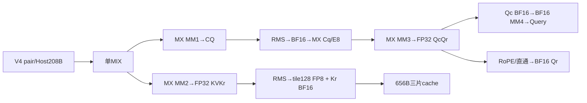
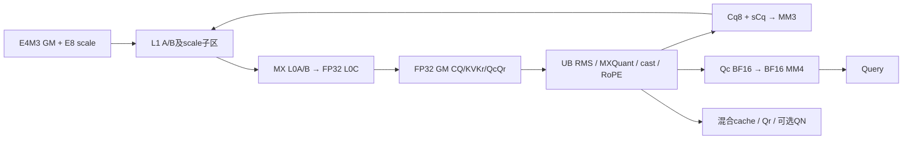
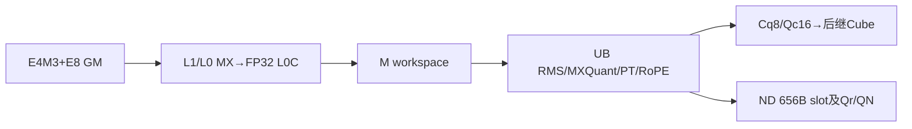
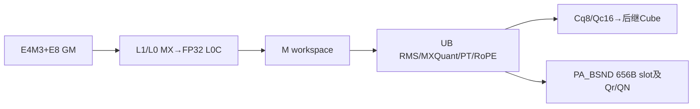

# MLA Prolog V4 MXFP8 投影与分组混合缓存 950 ACLNN 算子知识

## 算子速览

| 项目 | 内容 |
|---|---|
| 实际入口 | aclnnMlaPrologV4WeightNzGetWorkspaceSize / aclnnMlaPrologV4WeightNz，固定d462/CANN9.2；SGL auto/cann外置接入 |
| 计算语义 | 唯一(3,3,0)：E4M3FN/E8M0分组MX投影，FP32 RMS→BF16→MX Cq；KV另按128元素动态E4M3，Kr BF16与四FP32尺度合并 |
| 输入输出 | 投影scale为原生E8M0；Uk/gamma/sin/cos与Query/Qr为BF16；单KV slot 656字节，Kr descriptor为空；可选QN E4M3+E8M0 |
| 执行类型 | 单MIX_CV，AIC_CUBE三次MX与第四次BF16 MM；AIV_VECTOR归一化/量化/RoPE/分片scatter |
| Kernel 路线 | R-001/002为splitN ND/PA_BSND，R-003/004为大T splitM ND/PA_BSND；R-005–007为空/条件错误终点 |
| 核心资源 | N共享/M每C独立workspace；L1 A/B各双128KiB，L0 A/B各双32KiB，C双64KiB；192KiB UB设计预算及动态起点约束 |
| 来源闭包 | source_closed：V4→InnerV3/Host/POD/quant9→当前splitN/M完整typed body；生成bridge、普通布局与通用硬件primitive保留边界 |
| 验证状态 | 本次知识提取未执行编译、真机、数值或性能测试。draft保留单行尾通知、空cache预零、跨轮复用和ND未绑定读取等静态限制。 |

## 接口与语义

### 计算语义

T为展平token数，He为输入宽度，H=Hcq，N为head数，D=128/192，g=N(D+64)、h=ND；Ckv512、Dr64。MX表示每32个K元素的E4M3数据与E8M0 scale共同参与FP32 Cube乘加，不能改成一个token scale乘一个channel scale。

```text
CQ = MX(X,WDq,sX,sWDq)                         FP32 [T,H]
CQf = RMS_FP32(CQ,gammaQ,epsQ)*aq
(Cq8,sCq)=MXQuant32(BF16_CAST_ROUND(CQf))        E4M3 [T,H], E8M0 [T,H/32]
QcQr=MX(Cq8,WUqQr,sCq,sWUqQr)                  FP32 [T,N,D+64]
Qc16=BF16_CAST_RINT(QcQr[:,:,:D])
Query=BF16_FIX(MM_BF16_FP32ACC(Qc16,WUk))       BF16 [T,N,512]
QueryRope=BF16_CAST_RINT(e?rot(QcQr[:,:,D:]):QcQr[:,:,D:])
KVKr=MX(X,WDkvKr,sX,sWDkvKr)                   FP32 [T,576]
fKV=RMS_FP32(KVKr[:,:512],gammaKV,epsKV)*ak
for j in 0..3:
  scaleKV[t,j]=max(max(abs(fKV[t,128j:128(j+1)])),1e-4)/448   FP32
  KV8[group]=CAST_RINT_SAT_E4M3(fKV[group]/scaleKV[t,j])
Kr16=BF16_CAST_RINT(e?rot(KVKr[:,512:]):KVKr[:,512:])
slot=KV8[512B] || Kr16[128B] || scaleKV[16B]     共656B
若开启QN：QN=Cq8，QNscale=sCq；无Query动态量化或Qr尺度补偿。
```

KV group量化直接消费FP32 RMS输出，不先转BF16；1e−4下限只属于该128元素缓存量化，不推广到Cq的MXQuant。E8M0属于投影及Cq尺度，缓存四尺度是FP32，不能以MX编码解释。FP32实数公式不替代MX硬件累加/异常值合同；splitN全K在L0C累加后FIX，splitM前两MM每K_L1部分和AtomicAdd到预零GM，求和顺序不同，不承诺跨路线逐位一致。

MXQuant32的真实位运算为：BF16输入取指数位 `bits&0x7f80`，每32元素Reduce MAX；令E为该指数位最大值，普通非零有限组先E'=max(E,0x0400)，shared=E'−0x0400，E8M0编码shared>>7。普通范围对应2^(floor(log2(maxabs))−8)，低指数按位下限钳住。E=0时scale编码0且乘法系数置0；E=0x7f80的Inf/NaN指数分支scale编码0xff、倒数系数为0x7f81；shared=0x7f00的倒数特例用0x0040。不是INT8 per-token的max/127，也不把E8编码0说成浮点scale0。ComputeDataVF用BF16乘倒数系数、拆分转FP32，先比较钳到[-448,448]再E4M3 CAST_RINT/SAT。NaN传播保留该指令链，不由注释推定完整IEEE数值合同。

RMS用FP32平方累计/Reduce SUM、乘float(1/width)、加epsilon、sqrt、div、BF16 gamma转FP32相乘，aq/ak仅abs(value−1)>=FP32 epsilon时Muls。MX模式无smoothScalesCq与外部FP32投影反量化乘法。Qr/Kr保持FP32到RoPE后舍入；e0保持原投影通道顺序并不访问sin/cos。RoPE对j=0..31产生前半 `x[2j]cos[j]−x[2j+1]sin[j]`，后半 `x[2j+1]cos[32+j]+x[2j]sin[32+j]`。

### 输入、输出与属性

| 参数 | shape/layout | dtype | 约束、默认值与语义 |
|---|---|---|---|
| tokenX | [T,He]或[B,S,He] ND；T=B*S | E4M3FN | He∈{1024,2048,3072,4096,5120,6144,7168,7680,8192}，B≤65536；u32保存/乘法无溢出为后文公式前提 |
| weightDq | 逻辑[He,H]，NZ物理[H/32,He/16,16,32] | E4M3FN | H1536/2048；逻辑shape与format29 storage不可混用 |
| weightUqQr | [H,g]，NZ物理[g/32,H/16,16,32] | E4M3FN | N1..128，D128/192；完整head由当前模板处理 |
| weightDkvKr | [He,576]，NZ物理[18,He/16,16,32] | E4M3FN | 前512与后64两段 |
| weightUk | [N,D,512] ND | BF16 | 第4个MM不参与MX量化 |
| dequantScaleX | [T,He/32] ND | E8M0 | 必需，每token每32个K一个 |
| dequantScaleWDq / WUqQr / WDkvKr | [H,He/32] / [g,H/32] / [576,He/32] | E8M0 | 必需，输出channel为首轴；不是FP32或uint8替身 |
| gammaCq / gammaCkv | [H] / [512] | BF16 | 各AIV首step搬入、后继step保留 |
| ropeSin / Cos | [T,64]或[B,S,64] | BF16 | e1须成对；e0原始ACLNN指针null；wrapper按numel>0归一化 |
| kvCacheRef / krCacheRef | KV ND [T,1,656]/[B,S,1,656]或PA_BSND [pages,P,1,656]；Kr含零维空shape如[0] | KV E4M3；Kr为空descriptor | Kr无独立写目标；Host950允许的空Kr dtype与真正BF16 bit pattern分开；KV stride0为实际物理跨度 |
| cacheIndex | tokenPA [T]/[B,S]；ND缺省 | INT64 | PA负slot跳写，正上界/去重由caller保证；M ND先读取未绑定index再覆盖见限制 |
| actualSeqLen | 缺省 | N/A | kv3公开只ND/tokenPA，不允许blockPA，故A0无consumer |
| Query / QueryRope | [T,N,512/64]或[B,S,N,512/64] | BF16 | 独立有效输出；不与读入对象/workspace任意overlap |
| QueryNorm | 可选[T,H]或[B,S,H] | E4M3FN | qnf非null时MM3直接读正式QN；否则读workspace |
| dequantScaleQNorm | QN开启时[T,H/32]，物理无行padding | E8M0 | 与QN成对；vendor继承原生scaleX.scalar_type |
| dequantScaleQNope | 原始null，vendor返回[0] | FP32空 | (3,3,0)无Query动态量化 |
| quantScaleCkv/Ckr、smooth、clip | 缺省 | N/A | 四FP32缓存尺度由Device产生；MX不接受smooth/clip，E8条件alpha固定1且该值不参与QuantPerTile8Bit |
| attrs | w3/kv3/q0、repo1、scaleRepo1、tile128 | INT64 mode，double→Float/POD float | eps默认1e−5、aq/ak默认1、cache默认PA_BSND；只有ND/PA_BSND实际可达 |

### 入口与版本


[SGL V4 API](../../../../apis/sgl_kernel_npu/sgl_mlaprolog_v4.md)归档16tuple/functional接入，本卡只含(3,3,0) eager原地核心。SGL dda6文档明确引用ops-transformer d462，version.cmake=9.2；SDK a63d同9.2，不拿SGL通用9.1 CI基线替本行9.2。公开文档的MXFP8平台是950，Host DAV3510有实际typed body；A2/A3不是本卡平台。

V4公开pair转InnerMlaPrologV3并增加doRope；V3公开pair固定RoPE，与内部注册名相同不表示公开ABI等价。SGL auto/cann→lazy外置cann_ops_transformer.mla_prolog→vendor Python/C++→ACLNN_CMD取当前NPU stream。未安装或加载wheel，固定源码不证明部署wheel/torch_npu/compiler完全相同。已全文比对旧V3三卡与本族float/INT8卡：旧172B POD/固定RoPE/Direct参数、float000与INT8并非本MX数学，可链接复用相关合同但不替当前body。

逻辑二维weight view与FRACTAL_NZ四维storage须分层：InferShape对weightDq逻辑shape要求2D，Host GetStorageShape可读取物理4D NZ；vendor ResolveLogicalDims对普通4D Torch shape另有自己的推导，不能把任意4D tensor当作同一个公开域。

## Host/Launcher 执行流程

### 参数校验与前处理

SGL先检查sin/cos成对，vendor ResolveDoRope按非空归一化。C++设备guard后CheckBasicInputs、IsHifloat8Scene（w3不强制HIF8）、CheckMxfp8Inputs：四份输入scale都必须at::kFloat8_e8m0fnu；common映射Float8_e8m0fnu→ACL_FLOAT8_E8M0。QNscale分配继承scaleX dtype，不能概括为uint8包装。token/权重TensorWrapper使用自身scalar_type；5个dtype override不是通用重解释。Query/Qr分配BF16，QN按UqQr的实际E4M3 dtype分配；四维raw Torch shape恢复与保留逻辑二维shape的NZ format tensor仍需区分。

V4校验mode组合、query量化与doRope指针；TensorHolder把原始null转换shape[0]临时descriptor并按holder存在性检查可选输出。QNope scale在当前必须原始null；QN与QNscale成对。非null空descriptor不是原始nullptr。holder/query descriptor析构不授予提前释放Device owner的权限。

InnerV3/OpDef的普通AutoContiguous、IgnoreContiguous(cache)、生成bridge为受控框架布局边界，无外部Torch核心GEMM fallback。Host按GetNpuInfo→CheckAttrs/Required/CacheMode→SetShapeInfo/Scenario→QuantMode/Dims/SpecialScenario/ExpectedParam→SetAttrInfo→ProcessBaseInputs→FillMatmul1..4→FillTiling/CalcWorkSpace/GenTilingKey执行。C,V必须正且V=C或2C；本950量化非空V=C由GenTilingKey拒绝。Nkv1、P16..1024且16倍数、本tuple的ND/PA_BSND布局/rank组合和内轴连续性均经checker；正index上界、长度单调及无冲突没有逐值扫描证明。

额外kv3检查：repo与scaleRepo均1、tile128，禁止NZ与blockPA；cache混合末维656、Kr为空、Query BF16，QNope scale禁用。FillMxfp8FullKVPertileParamInfo继承MX四份E8M0 scale与禁用smooth/clip合同，只把KV dtype改为E4M3。输出Kr计算仍来自类型模板的BF16，不由空descriptor的占位dtype决定。

### 参数、Workspace 与生命周期

令m=min(T,128)，qnf为QN开关；内部scale槽G=align32(H/32)=64B，正式QNscale行长H/32=48或64B。Wlib是实际查询值，不固定16MiB。

```text
N Host = Wlib +64m+6mH+2304m+4mg+2mh
N Device =64m+2304m+4mH+(1-qnf)mH+4mg+2mh
  依次Sscale → W0 KVKr → W1 CQ → Cq8(或正式QN) → W2 QcQr → Qc16
M Host =Wlib+64mC+6mHC+2304mb2+4mgC+2mhC
M Device=64mC+4mHC+(1-qnf)mHC+2304mb2+4mgC+2mhC
  依次Sscale → W1 CQ → Cq8(或正式QN) → W0 KVKr → W2 QcQr → Qc16
  b2=E1?0:C；每C片按初始m128分配，末curM只改变有效行。
```

Host归一化预留2mH而实际Cq8只mH/QN；quant9没有quant7/8 splitM的额外第二Qc16预留，更没有Query量化临时片。Device从workspace实参原址切，不自行跳过Wlib；Runtime打包位置为外部集成边界，不能按Host求和顺序反推Device片序。所有形状/ceil/字节式须处于u32、size_t、int64无溢出域。

调用者query取得size/executor→同设备分配足量workspace→Execute(workspace,size,executor,stream)。输入、两cache、输出、index/actual和workspace都保持到stream完成；后继cache读要同stream或显式event。vendor当前stream、UseStreamResInCurrentThread和分配器延迟回收是集成边界；不得以局部descriptor析构/ctx.sync宣称Device owner可任意提前释放或跨stream可见。query/execute失败向上抛错、清理descriptor，不补造自动重试或executor释放API。

### 启动图与失败传播

T>0仅一次MIX，blockDim=C；正常DAV3510量化V=2C，对应cv7/r2。AIC c与AIV v=c*r+sub共享当前POD，运行GetSubBlockNum须匹配模板。V=C正常量化Host拒绝；T0和Debug终点见R-005–007。entry在构造TPipe后清CTRL60，末尾恢复该bit；不套用SiTU先清bit再构造TPipe的顺序。



## Route 与参数设计

### 分核与资源计算

C/V为实际Host可用AIC/AIV；当前950正常V=2C。s=[T>=8192 && (He7168或7680) && N128]，dequantOpt始终true，group=false；Nkv8 group分支不属于公开Nkv1。IsSplitKnSupported要求DAV9201，当前DAV3510的KN三元组为(1,1,0)，不套arch92优化。

| 段 | splitN分核 | splitM分核 | Device tile与真实末块 |
|---|---|---|---|
| MM1 m/H/He | n1=max(64,32ceil(H/(32C)))，b1=ceil(H/n1) | n1=H，b1=C | baseN64、baseK256、stepK4，He7680时3；K_L11024/768 |
| MM2 m/576/He | E1 b2=n2=0；否则C>=9时n2=64/b2=9，其余n2=32ceil(576/(32C)) | E0 n2=576/b2=C；E1 b2=n2=0 | N本体baseN128、M本体baseN64；baseK256、stepK同MM1。N的nTile=min(128,末核N)，不要由Host注释替代Device128 |
| MM3 m/g/H | n3=(D+64)ceil(N/C)，b3=ceil(g/n3) | n3=g、b3=C | baseN128固定，不使用INT8 m<=64时256；baseK128、stepK4、K_L1512；m'<=64时A整H载L1 |
| MM4 每head m/512/D | hp=ceil(N/C)、b4=ceil(N/hp) | hp=N128、b4=C | BF16 baseN128；D128 baseK128/step1，D192 baseK64/step3；M始终ND B splitK/enUnitFlag，N保留真实预载分支 |

m=min(T,128)，MX在D192也不缩到64。N末step m'=min(m,T−b0)，所有slice容量仍m，AIV有效Veff=min(m,V)（特定编译/运行cv不一致时按源码修正）；v核分得q=floor(m'/Veff)+[v<m'%Veff]、start=v*floor(m'/Veff)+min(v,m'%Veff)。

M的ms=ceil(T/C)，fore=T−(ms−1)C；c<fore分ms行、起点c*ms，其余分ms−1、起点fore*ms+(c−fore)*(ms−1)。每C按m=128步进当前curM，AIV sub s的q=floor(curM/2)+s*(curM%2)、start=s*floor(curM/2)。curM1时sub0得到0行。这里“s”局部sub与splitM布尔需区分；M不按全Veff均分token。

本tuple只有c0/1、A0；上述N分核的实际Veff与M perC的ms/fore不可互换。N的m在D192也仍128。ND无空cache正常交集；PA_BSND可E0/1。

### Route 选择

s=[T>=8192 && He∈{7168,7680} && N128]；K(c,s,E,e)=(c,2,9,1,0,E,0,s,e,7)。cache c0为BSND/TND，c1为PA_BSND。dequantOpt=1、group=0，query量化false。Nkv=1使group模板不可达；DAV3510不走9201 KN分组。

| 顺序 | Route | Key/模板 | 精确选择条件与优先级 | 不适用去向 |
|---:|---|---|---|---|
| 1 | R-005合法空query | empty tuple | 全部guard后T0、V2C | V=C到R-006 |
| 2 | R-003/004 splitM | K(c,1,E,e) | T>0且s1，按ND/PA_BSND | s0到R-001/002 |
| 3 | R-001/002 splitN | K(c,0,E,e) | T>0且s0，按ND/PA_BSND | 非法输入Host失败 |
| 4 | R-006 | key0 | T0、V=C，GenTilingKey拒绝状态被忽略 | 无合法已选body |
| 5 | R-007 | INVALID_KEY | 条件HostDebug、VERSION非3、e0 | 正常非Debug/HostVERSION3有e0body |

```text
公开参数/shape/mode/cache guard
 T0 → V2C合法empty；V=C量化guard失败但空分支漏检
 T>0 → s的T/He/N三重条件 → splitM或splitN
       c0 E0；c1 E0/1；A0，e0/1，cv7
       其它cache/repo/quant组合不进入本逻辑算子
```

### 模板/实现执行矩阵

| Route | key/selector | dtype/shape/platform 完整命中条件 | 执行族与 kernel 节点 | 实际模板/body | 内存与同步特征 | tail/fallback |
|---|---|---|---|---|---|---|
| R-001 | K(0,0,E,e) | 950/3,3,0，s0，ND，E0、A0、e0/1 | 单MIX四MM+AIV | MlaPrologVecS1CubS2<MLAPType<E4M3,E4M3,E4M3,E8,c,1,0,E,0,true,2,e>> | 共享workspace/allV7/free9/10→7 | QN、D/H及实际末行不另造selector |
| R-002 | K(1,0,E,e) | 950/3,3,0，s0，PA_BSND，E0/1、A0、e0/1 | 单MIX四MM+AIV | MlaPrologVecS1CubS2<MLAPType<E4M3,E4M3,E4M3,E8,c,1,0,E,0,true,2,e>> | 共享workspace/allV7/free9/10→7 | QN、D/H及实际末行不另造selector |
| R-003 | K(0,1,E,e) | 950/3,3,0，s1，ND，E0、A0、e0/1 | 单MIX四MM+AIV | MlaPrologV3SplitM<MLAPType<E4M3,E4M3,E4M3,E8,c,1,0,E,0,true,2,e>> | perC workspace/Kouter AtomicAdd/2→6→10/3→7 | QN、D/H及实际末行不另造selector |
| R-004 | K(1,1,E,e) | 950/3,3,0，s1，PA_BSND，E0/1、A0、e0/1 | 单MIX四MM+AIV | MlaPrologV3SplitM<MLAPType<E4M3,E4M3,E4M3,E8,c,1,0,E,0,true,2,e>> | perC workspace/Kouter AtomicAdd/2→6→10/3→7 | QN、D/H及实际末行不另造selector |
| R-005 | empty | T0/V2C | 无Device计算 | entry constexpr return | 仅Wlib | 不读POD/GM |
| R-006 | 0 | T0/V=C失败状态遗漏 | 无合法已选body | Host终点 | 只Wlib | 不推定Runtime结果 |
| R-007 | UINT64_MAX | 条件HostDebug/e0 | 无合法已选body | SDK Encode/Host未检查 | 正常Device e0存在 | 不推定必然部署失败 |

SDK DECL字段宽度4/2/4/1/1/2/2/2/1/8；正常key=c+32+(9<<6)+(1<<10)+(E<<12)+(s<<16)+(e<<18)+(7<<19)。12个正常selector如下，QN/H/D/tail在同selector内处理。

| Route | c/s/E/e/cv | key |
|---|---|---|
| R-001 | 0/0/0/0/7 | 3671648 |
| R-001 | 0/0/0/1/7 | 3933792 |
| R-002 | 1/0/0/0/7 | 3671649 |
| R-002 | 1/0/0/1/7 | 3933793 |
| R-002 | 1/0/1/0/7 | 3675745 |
| R-002 | 1/0/1/1/7 | 3937889 |
| R-003 | 0/1/0/0/7 | 3737184 |
| R-003 | 0/1/0/1/7 | 3999328 |
| R-004 | 1/1/0/0/7 | 3737185 |
| R-004 | 1/1/0/1/7 | 3999329 |
| R-004 | 1/1/1/0/7 | 3741281 |
| R-004 | 1/1/1/1/7 | 4003425 |
| R-005 | (0,0,0,0,0,2,0,0,1,7) | 3940352 |
| R-006 | guard拒绝、非合法selector | 0 |
| R-007 | Encode失败 | 18446744073709551615 |

### 隐藏性能 Guard

| Guard | Host/Tiling 条件 | Device/资源原因 | 影响 Route | 不满足时去向 | 源码符号 |
|---|---|---|---|---|---|
| splitM | T>=8192、He7168/7680、N128 | perC完整heads、Kouter部分和 | R003/004 | splitN | SetScenarioInfo |
| PT布局 | kv3/repo1/scaleRepo1/tile128 | 656B混合槽与Kr空 | 全正常 | Host失败，无NZ/blockPA | Check* |
| MX dtype | 四投影E4M3、四scale E8M0 | MX LoadData与真实BF16中间舍入 | 全正常 | Host失败，无E5M2路线 | FillMxfp8* |
| CV1:1 | V=C正常quant拒绝 | 固定Host白名单 | 全部 | 非空失败；空R006漏检 | GenTilingKey |
| L1 scale不重叠 | N MM2实际K_L1*nTile与64KiB边界 | C<9时真实tile可大于64 | R001/002 | 无自有额外guard | LoadL1ABAndScale |
| M尾行 | curM1/r2有一AIV q0 | QcQrSplit早退不发mode2 7 | R003/004 | 无通知fallback | QcQrSplit |
| M E1/跨轮复用 | b2=0仍预零m576；E0也无free9 | 空片/旧peer读未由本轮flag2保护 | R003/004 | 无自有修复 | Process |
| UB | 动态起点U0、逐片align32、stage峰值 | 声明预算不是物理容量证明 | 全正常 | Host无逐stage缩tile | VectorBufferInit |
| storage/index | stride0容量/slot上界/互斥 | 三片非atomic写 | 全正常 | caller合同 | ScatterCkv/ScatterKr |

### POD/ABI

跨Host/Device为MlaPrologTilingData.baseParams，共52字段。sizeof208/alignof8/以下offset按u32/float4B、u16 2B、u64 8B自然对齐静态推导，未执行编译器sizeof/offsetof；188–191 padding。kNopeClipAlpha未被FillTiling赋值且当前不读，不猜默认0。

| 结构 | 字段 | 类型/位宽 | ABI布局 | 单位 | Host/launcher producer | Device consumer | 边界 |
|---|---|---|---|---|---|---|---|
| BaseParams | batchSize | uint32_t/32 | offset0，4B | batch，TND其它路线为0 | FillTiling/CoreParams：B；fusedblockPA由actualSeqLen.shape[0] | ND BSND跨度/Host检查；blockPA消费者不活跃 | 本tuple A0 |
| BaseParams | stepBatchSize | uint32_t/32 | offset4，4B | token；T0=0且不读 | FillTiling/CoreParams：min(T,128) | Process步进/UB/WS/MM m | token；T0=0且不读 |
| BaseParams | mSubSize | uint32_t/32 | offset8，4B | token/core | FillTiling/CoreParams：splitM时ceil(T/C)，否则0 | Process每核token数与起点 | u32 ceil计算未溢出 |
| BaseParams | mSubCoreNum | uint32_t/32 | offset12，4B | core | FillTiling/CoreParams：splitM时T−(mSubSize−1)C，否则0 | Process前fore核多1行 | 0<fore<=C |
| BaseParams | stepNumHeadDequant | uint32_t/32 | offset16，4B | head | FillTiling/CoreParams：D128?min(64,N):min(16,N) | 本tuple dequantOpt=true，旧deq0处理不走 | 已写POD不等必消费 |
| BaseParams | tokenSize | uint32_t/32 | offset20，4B | token；u32原始乘法域 | FillTiling/CoreParams：X前导维展平T | Process总步数 | token；u32原始乘法域 |
| BaseParams | seq1Size | uint32_t/32 | offset24，4B | token | FillTiling/CoreParams：rank3 X的S；rank2默认0 | ND BSND寻址；blockPA消费者不活跃 | token |
| BaseParams | seq2Size | uint32_t/32 | offset28，4B | 保留字段，不解释成真实KV长度 | FillTiling/CoreParams：nkvSize=1 | 本MXFP8 splitN不读 | 保留字段，不解释成真实KV长度 |
| BaseParams | headSizeX | uint32_t/32 | offset32，4B | 元素 | FillTiling/CoreParams：He | MM1/MM2 K与X行跨度 | 元素 |
| BaseParams | headSizeCq | uint32_t/32 | offset36，4B | 元素 | FillTiling/CoreParams：Hcq | MM1输出/MM3 K/NormCq | 元素 |
| BaseParams | headSizeCkv | uint32_t/32 | offset40，4B | 元素 | FillTiling/CoreParams：512 | MM2切片/NormKV/MM4 N | 元素 |
| BaseParams | headSizeQc | uint32_t/32 | offset44，4B | 元素 | FillTiling/CoreParams：N*D | MM3/Qn输入跨度 | 元素 |
| BaseParams | headSizeQr | uint32_t/32 | offset48，4B | 元素 | FillTiling/CoreParams：N*64 | QueryRope行跨度 | 元素 |
| BaseParams | headSizeKr | uint32_t/32 | offset52，4B | 元素 | FillTiling/CoreParams：Dr=64 | MM2完整输出/分核 | 元素 |
| BaseParams | numHeadSize | uint32_t/32 | offset56，4B | head | FillTiling/CoreParams：N | MM4 head循环/QueryRope row | head |
| BaseParams | numHeadKvSize | uint32_t/32 | offset60，4B | head | FillTiling/CoreParams：Nkv=1 | 本MXFP8 splitN无直接关键读取 | head |
| BaseParams | dimHeadSizeQc | uint32_t/32 | offset64，4B | 元素 | FillTiling/CoreParams：D | MM4 K/Qc切片 | 元素 |
| BaseParams | dimHeadRope | uint32_t/32 | offset68，4B | 元素 | FillTiling/CoreParams：64 | SinCos/Rotary/Kr尺寸 | 元素 |
| BaseParams | blockNum | uint32_t/32 | offset72，4B | cache slice数；P0选EMPTY_CACHE | FillTiling/CoreParams：cache首轴P/T/B | 本域scatter不做正index上界校验 | cache slice数；P0选EMPTY_CACHE |
| BaseParams | blockSize | uint32_t/32 | offset76，4B | token；PA16..1024且16倍数 | FillTiling/CoreParams：PA H或BSND S；TND0 | GetCacheOffset解页/blockPA余数 | token；PA16..1024且16倍数 |
| BaseParams | mm1BlockNum | uint32_t/32 | offset80，4B | core | FillTiling/CoreParams：splitM:C；splitN:ceil(H/n1) | CQ切片/mm1活跃核 | C>0 |
| BaseParams | mm2BlockNum | uint32_t/32 | offset84，4B | core | FillTiling/CoreParams：E1:0；否则splitM:C/splitN:ceil(576/n2) | MM2/W0切片；splitM预零未验E1 | 空cache预零见限制 |
| BaseParams | mm3BlockNum | uint32_t/32 | offset88，4B | core | FillTiling/CoreParams：splitM:C；splitN:ceil(g/n3) | MM3活跃核/WS倍数 | M每核完整g列 |
| BaseParams | mm4BlockNum | uint32_t/32 | offset92，4B | core | FillTiling/CoreParams：splitM:C；splitN:ceil(N/hp) | MM4/独立Qc切片 | M每核完整N heads |
| BaseParams | vectorBlockNum | uint32_t/32 | offset96，4B | AIV | FillTiling/CoreParams：min(m,V) | N分token；M每对AIV分本核curM | M本体不按全Veff均分 |
| BaseParams | mm1SingleCoreN | uint32_t/32 | offset100，4B | 元素 | FillTiling/CoreParams：splitM:H；splitN:n1 | MM1输出N/stride | 同上 |
| BaseParams | mm2SingleCoreN | uint32_t/32 | offset104，4B | 元素 | FillTiling/CoreParams：E1:0；splitM:576；splitN:n2 | MM2输出N/stride | M E1预零仍按576 |
| BaseParams | mm3SingleCoreN | uint32_t/32 | offset108，4B | 元素 | FillTiling/CoreParams：splitM:g；splitN:(D+64)ceil(N/C) | MM3输出列/波 | 完整head切分 |
| BaseParams | mm4SingleCoreBatch | uint32_t/32 | offset112，4B | head | FillTiling/CoreParams：splitM:N；splitN:ceil(N/C) | MM4 head循环 | M N128 |
| BaseParams | dtileSize | uint32_t/32 | offset116，4B | KV单字节元素/字节 | FillTiling：baseShapeInfo_.dtileSize，取KV storage末维并由CheckDtileSize校验为656 | payload/Kr/scale统一tokenStride | 字节，KV按单字节类型解释 |
| BaseParams | kvQuantMode | uint32_t/32 | offset120，4B | mode | FillTiling：3 PER_TILE | 量化与合并cache | 非perTensor/perChannel |
| BaseParams | tileSize | uint32_t/32 | offset124，4B | 元素，Host仍校验128 | attr128 | QuantPerTile8Bit每组元素数 | 512/128=4组 |
| BaseParams | ckvkrRepoMode | uint32_t/32 | offset128，4B | mode | attr1 CONCAT | ScatterCkv/ScatterKr混合槽布局 | 当前公共必需1 |
| BaseParams | quantScaleRepoMode | uint32_t/32 | offset132，4B | mode | attr1 CONCAT | ScatterCkv/ScatterKr混合槽布局 | 当前公共必需1 |
| BaseParams | queryNormFlag | uint32_t/32 | offset136，4B | bool编码u32 | FillTiling/CoreParams：原始queryNormOut非null?1:0 | OutputInit/WorkspaceInit/Process | bool编码u32 |
| BaseParams | reciprocalCq | float/32 | offset140，4B | FP32 | FillTiling/CoreParams：float(1/H) | NormCq Reduce后Muls | FP32 |
| BaseParams | epsilonCq | float/32 | offset144，4B | FP32，不验证所有数值域 | FillTiling/CoreParams：rmsnormEpsilonCq Float | NormCq Adds/Sqrt | FP32，不验证所有数值域 |
| BaseParams | reciprocalCkv | float/32 | offset148，4B | FP32 | FillTiling/CoreParams：float(1/512) | NormKV Reduce后Muls | FP32 |
| BaseParams | epsilonCkv | float/32 | offset152，4B | FP32 | FillTiling/CoreParams：rmsnormEpsilonCkv Float | NormKV Adds/Sqrt | FP32 |
| BaseParams | kNopeClipAlpha | float/32 | offset156，4B | inactive，值不可宣称为0 | FillTiling/CoreParams：FillTiling未赋此标量字段 | 本MX tuple不读；局部alpha由E8条件常量1 | 未赋标量不猜0 |
| BaseParams | qcQrScale | float/32 | offset160，4B | FP32 | FillTiling/CoreParams：attr Float aq | NormCq gamma后Muls | FP32 |
| BaseParams | kcScale | float/32 | offset164，4B | FP32 | FillTiling/CoreParams：attr Float ak | NormKV gamma后Muls | FP32 |
| BaseParams | isQcQrScaleEnable | uint16_t/16 | offset168，2B | bool编码u16 | FillTiling/CoreParams：abs(aq-1)>=float epsilon | NormCq条件Muls | bool编码u16 |
| BaseParams | isKcScaleEnable | uint16_t/16 | offset170，2B | bool编码u16 | FillTiling/CoreParams：abs(ak-1)>=float epsilon | NormKV条件Muls | bool编码u16 |
| BaseParams | mm1NGroup | uint16_t/16 | offset172，2B | 组，9201才可能变化 | FillTiling/CoreParams：1 | 当前arch35 splitN不读KN分组 | 组，9201才可能变化 |
| BaseParams | mm1KGroup | uint16_t/16 | offset174，2B | 组 | FillTiling/CoreParams：1 | 本平台CalcWorkSpace按1；Device无KN | 组 |
| BaseParams | mm1SingleCoreK | uint32_t/32 | offset176，4B | 元素，inactive | FillTiling/CoreParams：0 | 当前arch35不读 | 元素，inactive |
| BaseParams | mm2NGroup | uint16_t/16 | offset180，2B | 组 | FillTiling/CoreParams：1 | 当前arch35不读KN分组 | 组 |
| BaseParams | mm2KGroup | uint16_t/16 | offset182，2B | 组 | FillTiling/CoreParams：1 | 本平台CalcWorkSpace按1；Device无KN | 组 |
| BaseParams | mm2SingleCoreK | uint32_t/32 | offset184，4B | 元素，inactive | FillTiling/CoreParams：0 | 当前arch35不读 | 元素，inactive |
| BaseParams | kvCacheStride0 | uint64_t/64 | offset192，8B | 元素u64，转int64需在已验范围内 | GetCacheStride0；空cache0 | ScatterCache/MaterializeOffsetsWithHeadSize | 元素u64，转int64需在已验范围内 |
| BaseParams | krCacheStride0 | uint64_t/64 | offset200，8B | 元素u64 | 空Kr descriptor，经GetCacheStride0为空取0 | 本tuple不作为写目标 | 实际Kr写KV slot+512 |

Device局部MMParams的m/n/k依四MM、orgKa=He/He/H/ND、orgKb=k、orgKc=H/576/g/N512；needSetOrgShape1，baseM没有赋值及实际消费者；kScale=K/32在MX真实消费。MMBufParams保存TPipe基址、各bank初始0计数至launch结束，不在阶段间重置。RmsNormParam六字段reciprocal/epsilon(float)、row/col(u32)、scale(float)、isScaleEnable(u16)，row1、colH/512。Rectangle三u32为row/col/stride。ScatterCacheParams八i64为P/slot/row1/colL/tokenStride/stride0/S/tokenIndex；CkvkrParams六i64为tokenIndex、W0元素offset、当前token序号、rowsInCurBatch、cacheOffset、nextPageOffset。Aic/AivOffset按各typed元素计，不把它们当额外序列化POD。

Device局部参数同样按真实字段解释，以下自然布局为静态推导，未编译验证：

| 结构 | 字段 | 类型/位宽 | ABI布局 | 单位 | Host/launcher producer | Device consumer | 边界 |
|---|---|---|---|---|---|---|---|
| CastQcQrSplitNParams | mmQnPreCastOffset | int64_t/64 | offset0，sizeof32/align8 | typed元素/见producer | Device DequantAndRopeSplitNSyncMMQcQr：本C MM3起列o | CastQcQrSplitN inputGm基址 | Device局部非序列化；整值未窄化前提 |
| CastQcQrSplitNParams | mmQnPreCastResOffset | int64_t/64 | offset8，sizeof32/align8 | typed元素/见producer | Device DequantAndRopeSplitNSyncMMQcQr：本C head起点h0*D | BF16 outputGm基址 | Device局部非序列化；整值未窄化前提 |
| CastQcQrSplitNParams | inputOffset | uint32_t/32 | offset16，sizeof32/align8 | typed元素/见producer | Device DequantAndRopeSplitNSyncMMQcQr：sub*D/2+head*(D+64) | FP32输入元素 | Device局部非序列化；整值未窄化前提 |
| CastQcQrSplitNParams | outputOffset | uint32_t/32 | offset20，sizeof32/align8 | typed元素/见producer | Device DequantAndRopeSplitNSyncMMQcQr：sub*D/2+head*D | BF16输出元素 | Device局部非序列化；整值未窄化前提 |
| CastQcQrSplitNParams | srcStride | uint32_t/32 | offset24，sizeof32/align8 | typed元素/见producer | Device DequantAndRopeSplitNSyncMMQcQr：g-D/2 | DMA输入行gap | Device局部非序列化；整值未窄化前提 |
| CastQcQrSplitNParams | dstStride | uint32_t/32 | offset28，sizeof32/align8 | typed元素/见producer | Device DequantAndRopeSplitNSyncMMQcQr：h-D/2 | DMA输出行gap | Device局部非序列化；整值未窄化前提 |
| RopeQrSplitNParams | ropeQrOffset | int64_t/64 | offset0，sizeof56/align8 | typed元素/见producer | Device DequantAndRopeSplitNSyncMMQcQr：o+D | FP32输入段基址 | Device局部非序列化；整值未窄化前提 |
| RopeQrSplitNParams | ropeQrResOffset | int64_t/64 | offset8，sizeof56/align8 | typed元素/见producer | Device DequantAndRopeSplitNSyncMMQcQr：h0*64+batchOffset*N64 | BF16正式Qr基址 | Device局部非序列化；整值未窄化前提 |
| RopeQrSplitNParams | inputOffsetRope | uint32_t/32 | offset16，sizeof56/align8 | typed元素/见producer | Device DequantAndRopeSplitNSyncMMQcQr：rowStart*g+head*(D+64) | 当前head输入 | Device局部非序列化；整值未窄化前提 |
| RopeQrSplitNParams | deqScaleOffset | uint32_t/32 | offset20，sizeof56/align8 | typed元素/见producer | Device DequantAndRopeSplitNSyncMMQcQr：MX无消费 | 旧反量化字段inactive | Device局部非序列化；整值未窄化前提 |
| RopeQrSplitNParams | outputOffsetRope | uint32_t/32 | offset24，sizeof56/align8 | typed元素/见producer | Device DequantAndRopeSplitNSyncMMQcQr：rowStart*N64+head*64 | 输出DMA | Device局部非序列化；整值未窄化前提 |
| RopeQrSplitNParams | ropeStride | int64_t/64 | offset32，sizeof56/align8 | typed元素/见producer | Device DequantAndRopeSplitNSyncMMQcQr：g | 输入FP32行跨度 | Device局部非序列化；整值未窄化前提 |
| RopeQrSplitNParams | ropeDstStride | uint32_t/32 | offset40，sizeof56/align8 | typed元素/见producer | Device DequantAndRopeSplitNSyncMMQcQr：N64−64 | 输出BF16行gap | Device局部非序列化；整值未窄化前提 |
| RopeQrSplitNParams | deQuantScaleCqOffset | uint32_t/32 | offset44，sizeof56/align8 | typed元素/见producer | Device DequantAndRopeSplitNSyncMMQcQr：MX不做Vector反量化 | inactive | Device局部非序列化；整值未窄化前提 |
| RopeQrSplitNParams | sinCosOffset | uint32_t/32 | offset48，sizeof56/align8 | typed元素/见producer | Device DequantAndRopeSplitNSyncMMQcQr：本AIV half-row sin/cos元素起点 | RotaryPerHead | Device局部非序列化；整值未窄化前提 |
| RopeQrSplitNParams | ropeCnt | uint32_t/32 | offset52，sizeof56/align8 | 行数 | Device DequantAndRopeSplitNSyncMMQcQr：当前half-row行数（floor/ceil(m'/2)） | RopeQrSplitN的Rectangle.row及DMA blockCount | Device局部非序列化；整值未窄化前提 |

旧DequantQcQrSplitNParams当前MX不实例化外部Vector反量化分支，不能把其scale消费者安到本tuple。

PerTileQuantParams为Device局部自然布局，sizeof20/align4静态推导；不与208B序列化结构合并。alpha与tileNum字段虽填入，FP8 QuantPerTile8Bit不消费alpha，也不以tileNum代替row*col/tileSize推导循环。

| 结构 | 字段 | 类型/位宽 | ABI布局 | 单位 | Host/launcher producer | Device consumer | 边界 |
|---|---|---|---|---|---|---|---|
| PerTileQuantParams | tileSize | u32 | offset0 | 元素 | baseParams.tileSize=128 | QuantPerTileVF | 128 |
| PerTileQuantParams | tileNum | u32 | offset4 | group | 512/128=4 | 当前FP8 helper不直接读 | 不能补造用途 |
| PerTileQuantParams | alpha | float | offset8 | 数值 | isFp8E8m0?1:GM读取，当前常量1 | 当前FP8 helper不读 | 不把w4/w5 clip指针读取风险套入w3 |
| PerTileQuantParams | row | u32 | offset12 | 行 | vectorRow1 | QuantPerTile8Bit | 每token1行 |
| PerTileQuantParams | col | u32 | offset16 | 元素 | 512 | scale尾随地址/量化计数 | outLocal+512B |

### Route 源码闭包

| Route | Key/selector | Host/Tiling producer | POD/参数 | Kernel entry/router | Kernel body/直接依赖 | 构建接线 |
|---|---|---|---|---|---|---|
| R001/002 | K(c,0,E,e) | RunBigKernelTiling/FillMatmul*/CalcWorkSpace/GenKey | 208B，DTile656，A0 | quant9、isPertile=true、splitM0 | splitN完整四MM/RMS/MXQuant/PT量化/RoPE/scatter | v3 CMake依赖mla_prolog、auto-sync=off、OpDef/register/SEL |
| R003/004 | K(c,1,E,e) | 同上，另ms/fore/perC资源 | 同POD | quant9、splitM1 | splitM完整Process/Kouter/QcQrSplit/PTcache | 同TU与SEL |
| R005 | 合法empty | 空分支/libWS/block1 | 不读POD | constexpr return | 无core | 同TU |
| R006/007 | 0或INVALID_KEY | Host精确失败终点 | 不补造consumer | 未选合法body | Runtime结果外部 | 对应Host/SDK宏条件 |

## Kernel 实现

### 公共执行流程

以下N管线定义和M管线定义分别由后续ND/PA_BSND Route完整实例化；类型始终前三输入E4M3FN、尺度E8M0、前三输出FP32、Cq E4M3、Qc/Uk/MM4输出BF16。模板ENABLE_DEQUANT名字在此表示cast/流水选择，不是对FP32投影再乘外部scale。

```text
entry: 先判EMPTY_QUERY return；读208B，TPipe；
  MXFP8 quant9/isPertile=true -> splitM0:MlaPrologVecS1CubS2 / splitM1:MlaPrologV3SplitM
Init: 绑定GM/cache/可选QN/尺度；MmParamInit；
      WorkspaceInit按本算法切片；AIC CubeBufferInit / AIV VectorBufferInit
      E8M0不分配FP32权重scale或smooth常驻UB。
```

N管线完整函数/地址/循环：

```text
Process<needQnDynamicQuant=false>:
  AIC初始L1 A/B、L0 A/B/C双bank及SCALE_EVENT free；
  AIV初始mode2/MTE3 free9；
  for batchOffset=0; batchOffset<T; batchOffset+=m:
    m'=min(m,T-batchOffset)，四MM.m=m'，重分AIV token
    AicOffset: MM1输出列c*n1；MM2列c*n2；
      MM3输出o=c*n3/head起h0=o/(D+64)，MM4 heads c*hp；
      sX元素base=batchOffset*He/32，
      sWDq=c*n1*(He/32)，sWDkv=c*n2*(He/32)，sWUq=o*(H/32)
    AIC:
      MatmulSplitN<E4M3,float,E8> MM1 ->CQ FP32；notifyCQ6
      wait free9；E0 MatmulSplitN<E4M3,float,E8> MM2 ->KVKr FP32
      notifyCKV4；waitRMSCq6
      MatmulQcQr:
        若m'<=64: LoadL1AAndScale<...,scaleSrcPad=true>一次整载Cq8/H及sCq
        for nidx=0..ceil(n3tail/128)-1:
          MatmulSplitK<E4M3,float,E8,hasAFullLoad,true>，
          输出W2每行g、列o+nidx128；最后tile有效tail
          每tile FIX notify10
        A整载bank释放
      waitSCALE_EVENT；PreloadQnAndSync→MatmulQnWeightPreload
      每head等待配对AIV的DEQsplit7（head数>15时仅偶数或最后发/等）
        MM4从Qc16行跨度h读D，Uk本head[D,512] ND；
        D128走当前整B预载/全A路线，D192按K64*3 splitK；
        BF16乘、FP32 L0C、Fixpipe F322BF16→正式Query[batch,N,512]
      releaseSCALE_EVENT
    AIV:
      首step CopyGamma；e1 GatherSinCos当前half-row到常驻FP32 sin/cos
      waitCQ6；allV7
      每自有token RmsNormCqProcess:
        W1 FP32→RMS/aq→BF16 CAST_ROUND→MXQuant32；
        Cq8 H字节写workspace/正式QN，scale H/32有效字节按64B槽存UB
      CopyDequantScaleCq -> GM Sscale[tokenLocal*64]，每行DMA64B
      QN开启则DataCopyPad每行H/32B（48时UB自然32B对齐64B；正式输出紧凑48B）
      allV7；MX不把GMscale汇总成每token FP32向量；notifyRMSCq6
      waitCKV4；allV7；
      RmsNormRopeScatterCkvKr:
        先reserve32B标量槽+512q本地cos/sin；e1再GatherSinCos
        E1 return；否则每本核token：
          Ckv float512→RMS/ak→四组128元素E4M3/FP32scale→合并slot payload/scale scatter
          Kr float64→e1 RoPE/e0直通→BF16→重解释128字节写slot+512
          MTE3排空后share可复用
      notifyfree9
      DequantAndRopeSplitNSyncMMQcQr:
        colEnd从0按baseN128推进，逐tilewait10；
        每完整head的Qc已生产：
          CastQcQrSplitN，sub分D/2列、全部m'行
          FP32输入offset=o+sub*D/2+head*(D+64)，行跨度g
          BF16输出offset=h0*D+sub*D/2+head*D，行跨度h
          输入4*m'*D/2B，输出同UB前缀2*m'*D/2B
          Cast RINT，MTE3写Qc16，按双方稀疏head规则notify7
        每完整Qr已生产：
          RopeQrSplitN：sub0/1各floor/ceil(m'/2)行，
          输入o+D+rowStart*g+head*(D+64)，输出h0*64+rowStart*N64+head*64
          FP32 RotaryPerHead<false,e>→BF16，正式行跨度N64
      Qr输出base每step+=m*N64
收尾AIC drain所有L1/L0 bank和SCALE_EVENT，wait最后free9。
```

N的RMSCq前后allV7保留真实跨核producer/consumer；CKV stage有free9防下step覆盖W0。MM3每paired-C的完整head列切分，Qc由两AIV分列写同一行，只有两者均完成才允许MM4读；Qr按行切而非按D列。不能用一个“全部MM3完成”屏障代替细粒度cast7。当前cast没有INT32/FP32 DequantVF以及D/2=96的scale向量尾load；不要继承INT8卡的额外scale读问题。

M管线完整函数/地址/循环：

```text
每C的start/end由ms/fore确定；for mOffset=start; mOffset<end; mOffset+=128:
  curM=min(128,end-mOffset)，四MM.m=curM
  AIV sub0:
    zeroBuf Duplicate float0共512元素
    用MTE3按512float chunk清零本C CQ片mH和KVKr片m576（均用初始m128）
    这里不检查E1，KVKr实际extent却由b2控制
    V_MTE3→DMA→MTE3_V排空
  两AIV都notify mode2/MTE3 flag2
  AIC wait mode2/FIX flag2
    MM1 MatmulSplitMKOuter，输入X[mOffset*He]，scaleX[mOffset*He/32]，
      输出CQ[c*mH] FP32，weight/scale从全矩阵0列起
    notifyCQ6
    E0 MM2 MatmulSplitMKOuter输出KVKr[c*m576]；E1不调用
    PIPE_ALL；notifyCKV4；waitRMSCq6
    MM3读Cq8[c*mH]或QN[mOffset*H]，
      Sscale[c*m64]，WUqQr/scale全g列
      nidx128循环，FP32输出W2[c*mg]，A整载仅curM<=64；
      L=ceil(g/128)，spacing=ceil(L/14)
      flag10 if nidx%spacing==0 or last；
      flag3 if (nidx+1)%spacing==0 or last
    waitSCALE_EVENT
    MM4每C全N128 heads：
      coarse=ceil(128/14)=10，i%10==0等7；
      gap1分支条件128-ceil(128/10)<=15为false
      每head再分512为4个N128块；
      MatmulSplitK<BF16,BF16,E8,false,false,true,ND>，
      从Qc16[c*mND+head*D]行跨度ND读取；
      写正式Query[mOffset*N512+head512]
    releaseSCALE_EVENT
  AIV sub:
    q=floor(curM/2)+sub*(curM%2)，rowStart=sub*floor(curM/2)
    首本核step搬gamma，e1搬对应行sin/cos
    waitCQ6；每q行RMS/MXquant，
      Cq8输出c*mH+rowStart*H（或QN全局mOffset+rowStart）
      scales输出(c*m+rowStart)*64；可选QNscale全局紧凑H/32
    即使q0 RmsNormCq提前return，外层仍notifyRMSCq6
    waitCKV4；cache stage E1/b2=0或q0跳过，否则按当前q行scatter
    QcQrSplit:
      q0直接return（不发7，也不消费10/3）
      for colCube=0; colCube<g; colCube+=128:
        若splitCount%spacing==0或last：wait10
        若splitCount%spacing==0：wait3（等待本coarse窗最后FIX）
        while完整Qc已生产：
          复制q行D浮点，输入行跨度g，alias prefix Cast RINT BF16
          输出Qc16行跨度ND；
          每第10个head或末head通知7；gap1条件false
        while完整Qr已生产：
          q行64float，RotaryPerHead<false,e>，写全局Qr行跨度N64
      MTE3_MTE2排空
无free9、无allV跨C屏障；收尾AIC仅drain L1/L0/SCALE_EVENT。
```

D128时g24576、L192、spacing14，flag10共15次/flag3共14次；D192时g32768、L256、spacing19，同样15/14。AIV对应等待计数一致，MM4粗粒度7每10heads/末共13次。**仅q>0的AIV执行这些通知**；curM1一侧q0使mode2缺一producer，正常flag计数无残留的该轮无法满足“两个AIV均上报”的固定SDK契约。只认定静态协议缺口，不声称已编译或真机死锁。

MX矩阵乘真实共用helper：

```text
MatmulSplitN -> nTile loop -> MatmulSplitK -> K_L1 loop -> MatmulL1 -> stepK loop:
 A ND→NZ，CopyNDGmToL1: m真实行、K_L1宽、源行跨度K，内部M align16
 B NZ→L1，c0=32，GM元素地址K*nOffset+kL1*K_L1*32
 scaleA在L1B固定64KiB，scaleB紧随align16(m')*(K/32)B
 LoadL1AAndScale把相邻2个E8字节reinterpret BF16作Dn2Nz，
   nValue=(K/32)/2，dValue=m'；Cq scale源physical stride为align16(nValue)，即64B行
 LoadL1BAndScale每个Ntile载完整K/32 scale，B无该行padding
 后继k+1数据L1双bank预取；scale不是独立double-buffer，以SCALE_EVENT保护
 LoadDataL1ToL0Mxfp8 / LoadDataL1ToL0B:
   mx_fp8_e4m3_t + fp8_e8m0_t载入，A无转置/B转置，
   scale yStep=ceil(baseK/64)，srcStride=ceil(K/64)（调用传入para.k，即完整K，不是kL1StepSize），xStep=ceil(M/Ntile/16)
 Mmad<MX> FP32 L0C，firstK init，跨K累计后FIX真实m'行，输出FP32
 bank free/ready：MTE1_MTE2 ↔ MTE2_MTE1、M_MTE1 ↔ MTE1_M、
                FIX_M ↔ M_FIX或实际unitFlag3
```

M的前两MM特有MatmulSplitMKOuter：一次Dn2Nz载完整A scale到L1B64KiB；A scale extent align16(curM)*(He/32)B，B scale从其后开始，每个B bank相同相对offset。K_L1外循环，A数据只用slot0，B按nb&1双bank，预取nb+1的B数据及完整Kscale；B scale无padding。每K_L1内每N64块L0C从首sk初始化，执行stepK个MX Mmad后SetAtomicAdd<float>→FIX部分和→SetAtomicNone，GM必须先零。Kouter结束释放SCALE_EVENT；AIC flag2确保先前MTE3零填提交后才开始首次AtomicAdd，但没有提供下轮零填对另一AIV旧读的保护。

| 层级/缓冲区 | offset/地址公式 | extent/容量公式 | dtype/layout | producer | consumer | owner/lifetime | 对齐/复用 |
|---|---|---|---|---|---|---|---|
| GM X/weights/scales | X[tHe]；B NZ[K*nOffset+kL1*K_L1*32]；scaleX[tHe/32]、scaleB[n*K/32] | X THe B；weights HeH/Hg/He576 B；scales THe/32,HHe/32,gH/32,576He/32 B | E4M3/E8M0 | caller | AIC MTE2 | caller至stream完成 | 三NZ权重真实format，scale ND |
| 正式Query/Qr/QN/QNscale | tN512/tN64/tH/t(H/32) typed元素 | 2TN512/2TN64；qnf TH与TH/32 B | BF16/E4M3/E8M0 | AIC/AIV | downstream/当前MM3 | caller | QN与workspace不重复分配 |
| N workspace | Sscale→KVKr→CQ→Cq8→QcQr→Qc16 | 上文逐slice | FP32/E4M3/E8/BF16 | 当前MIX | 后继阶段 | workspace owner至stream完 | 每步共享，flag保护 |
| M workspace | Sscale→CQ→Cq8→KVKr→QcQr→Qc16，每C独立slab | 64mC+4mHC+(1-qnf)mHC+2304mb2+4mgC+2mhC | 同上 | 同上 | 同上 | 同上 | E1预零另见限制，不能把空片补容量 |
| L1 A | (aIter&1)*131072；Kouter只slot0 | 2*128KiB | E4M3/BF16 NZ | MTE2 | MTE1 | AIC TPipe | 全A仅当前m'<=64；H最大2048 |
| L1 B | (bIter&1)*131072，scaleA64KiB、scaleB紧随 | 2*128KiB，scale是其中真实子区 | E4M3/BF16/E8 | MTE2 | MTE1/MX load | AIC TPipe | scale非独立分配，SCALE_EVENT不可删 |
| L0 A/B/C | A/B bank=(iter&1)*32768；C bank=(iter&1)*65536 | A/B各2*32KiB，C2*64KiB | MX数据含scale编码/BF16；FP32累加 | MTE1/MM | MM/FIX | AIC TPipe | 工具链MX内部packed表示不由对象sizeof猜全scale硬件占用 |
| N UB固定 | gamma2H+1024+quantCkv32；sCq32(m+7)；sin/cos512ceil(m/2)；本tuple无actual片 | F_N及对齐式见下 | BF16/E8/FP32 | 首DMA/RMS | Vector/GM | AIV TPipe | MX无FP32权重scale/smooth常驻；本tuple无actual TBuf |
| M UB固定 | 同前无actual片，另zeroBuf2048 | F_M=F0+2048，m128 | 同上 | 各AIV | 清零/RMS/RoPE | AIV TPipe | AIC也声明zeroBuf并Duplicate，当前实际预零用AIV |
| UB share | 各算法最后TBuf，uint8后再typed切片 | S_N/S_M见下 | 多typed别名 | 当前stage | 下一stage | AIV TPipe | LocalTensor[]按元素偏移，uint8[]才是字节 |
| Reg | VF load/reduce/cast | 256B寄存器，实际编译寄存器分配不可推定 | BF16/FP32/E4M3/u16 | UB | 算术/store | VF调用 | 不把有效mask当搬运缩短，不推测occupancy/spill |




逐层字节与实际地址高水位：

```text
F0=2H+1024+32+32(m+7)+512ceil(m/2)
其中独立quantScaleCkv TBuf为32B，PT不填不消费；无actual/smooth/FP32权重scale槽。
N Falloc=F0，Salloc=align32(196608-F0)，末地址U0+F0+Salloc=U0+196608
M usedAddr=U0+F0，另zeroBuf2048B，Sreq=196608-(U0+F0)-2048
  Salloc=align32(Sreq)，实际末地址U0+F0+2048+Salloc
正常m128与F0均32对齐；须Sreq非负、stage峰值<=Salloc且实际UB池覆盖末地址。
SDK物理地址包含bufferAddr与typed offset；动态起点U0不无证取0。
```

| UB阶段 | 相对share最高活跃byte/实际读取 | 组成及不活跃边界 |
|---|---|---|
| Cq MX RMS/quant | 9H+64q+align32(He/32)+256 上界 | 输出H；q行scale64q；未消费的sX占align32(He/32)；RMS峰8H，MX BF16 tmp在6H、halfScale在8H，scale Reg实际load256B，故最后256B计入；H1536/2048是256倍数无BF16主向量尾 |
| Ckv RMS+group量化 | 4672+512q | 外层32+512q，output544B（payload512+scale16+padding16），FP32 norm输出2048与FP32输入2048 |
| Kr RoPE e1 | 800+512q | reserve32+cos/sin512q+BF16输出128+float Preprocess/Rotary640；不走MX外部dequant |
| Qr perhead e1 | 768ρ+256 | ρ=N时该paired half-row或M当前q；cnt=64ρ，外部BF16输出2cnt、helper10cnt+256；中间预留scale256当前不消费 |
| N Qc cast | 4m'*(D/2) | FP32 input同UB prefix alias BF16 output；无channel/token scale临时片 |
| M Qc cast | 4qD | q行全部D，输入/输出alias；不是N的分列公式 |
| 常驻sin/cos gather | 256ceil(m'/2)（N）；256ceil(curM/2)（M，CopyInSinCos两sub均用此count） | BF16临时输入后cast FP32到常驻TBuf，仅e1 |
| cache内部gather | 32+768q | 外层32+FP32 sincos512q，helper再256q；N在E1前仍可gather，M b2=0会更早return |

ρ在N为对应half-row floor/ceil(m'/2)，M为q；上式e1给e0保守上界，不宣称e0删除全部预留。所有share阶段按max合并，必要条件P<=Salloc、U0+Falloc+P<=实际UB；顺序复用靠MTE2_V/V_MTE3/MTE3_V/MTE3_MTE2与PIPE_V/UB DSB。MX没有INT8“scale0除零”路线；有限位指数与Inf/NaN按上文真实分支处理。

```text
L1A data: align16(m')*K_L1 B <=131072（MM3全A时K_L1替H）
L1B data: K_L1*nTile B，另scale区从65536起；
         extentScaleA=align16(m')*(K/32)，extentScaleB=nTile*(K/32)
         65536+extentScaleA+extentScaleB <=131072，且与B数据不重叠
L0A data=align16(m')*baseK B（BF16乘2）
L0B data=baseK*nTile B（BF16乘2）
L0C=align16(m')*nTile*4B <=65536
```

MX LoadData硬件还绑定scale plane，所列L0字节为数据slice与源码bank容量，不凭源码T对象数额外构造scale硬件内存。M MM1/2 B64使1024*64=64KiB；K768时48KiB。N MM1同64；N MM2 baseN128但常见C>=9使实际tile64，C<9需真实nTile检查，源码没有上述重叠guard。MM3 B512*128=64KiB，加A scale最多128*64=8KiB、Bscale128*64=8KiB；剩余足够但不能改baseN256。MM4D128 BF16整Uk=128KiB，D192用K64*3而非把全部D192*512强塞一bank；M始终ND splitK，L0A最大128*128*2=32KiB，D192为16KiB，L0C每N128最大64KiB。

| 边/复用子区 | producer | offset/extent | dtype/layout | consumer | ordering/sync | owner/lifetime | 安全条件 |
|---|---|---|---|---|---|---|---|
| CQ→Cq8/scales | MM1 FIX/AIV | 4mH与mH/64m；M乘C并按C切片 | FP32→BF16→E4M3/E8 | RMS/MM3 | CQ6、N allV7前后、RMS6；M无全V屏障 | launch/正式QN | 两q0仍发RMS6，正式紧凑scale与内部64B槽不同 |
| KVKr→cache | MM2/AIV | 2304m（M乘b2）→有效512+128+16B/token | FP32→E4M3/BF16/FP32 | cache/后继consumer | CKV4，N free9；M没有防下一轮zero的free9 | launch/cache caller | M潜在跨轮重用需另证明，不能用flag2代替 |
| MM3→Qc16 | AIC FIX/AIV | N按D/2列、M按q行；输出strideND | FP32→BF16 | MM4 | N每tile10→head7；M10/3 coarse→7 | launch | mode2要求两个AIV都set；M q0漏通知 |
| Qr输出 | AIV | rowStart*g输入，rowStart*N64输出 | FP32→BF16 | downstream | FIX10/3→MTE2_V→V_MTE3，Qr store后drain | caller | e0直通无重排，不读sin/cos |
| M预零→AtomicAdd | sub0 AIV→AIC | CQ mH/KV m576 float*本C | FP32 GM | Kouter FIX atomic | 两AIV mode2/MTE3 flag2→AICwait | launch | 只保证本轮写零在本轮atomic前，不证明旧peer读已结束 |
| L1B scale/MM4 | MX MTE2/MTE1 |64KiB后真实scale子区 | E8 bytes/packBF16 | MX LoadData/后继BF16MM4 | SCALE_EVENT free/ready，非double scale | AIC TPipe | MM4复用L1B前等scale消费；下一MX前也等 |
| share复用 | gather/RMS/quant/cast/rope | 上表byte高水位 | 多typed | 下一stage | V/MTE hardevent、PIPE_V、UB DSB | AIV TPipe | 读取范围与有效store/mask分开 |

[CrossCoreSetFlag](../../../../../../ops/ascendc/apis/simd_api/basic_api/sync_control/inter_core_sync/cross_core_set_flag_isasi.md)与[CrossCoreWaitFlag](../../../../../../ops/ascendc/apis/simd_api/basic_api/sync_control/inter_core_sync/cross_core_wait_flag_isasi.md)配对；固定SDK官方doc明确mode2为AIC和两个AIV，mode0则同类型全部资源核，并有flag计数上限15。代码的N逐tile通知与M coarse15/14不是任意“只要有一个AIV写完”即满足。流水hardevent和同步内置编译/指令编码属于固定primitive边界，本次未通过codegen验证其二进制行为。

分组cache阶段从share的sX32与双FP32 sin/cos(512q)之后取ckvOut；ckvOutSize=align32(512+4*4)=544B，payload在0..511、四FP32 scale在512..527；后接FP32 normIn 2048B、normShared输入2048B。QuantPerTile8Bit→QuantPerTileVF<float,float,FP8>对4个128元素tile分别两遍Reg load/amax floor1e−4/除448/RINT_SAT并保存4B scale，不用PerTileQuantParams.alpha，不调用INT8 clip/MSD链。output/scale与norm临时不别名，4672+512q是实际最高活跃范围。

ScatterCkv先写512B payload，再以ScatterCacheUnAligned把ckvOut+512的16B尺度写入slot+640；RopeAndScatterKr后将64个BF16重解释成128个FP8字节，通过ScatterCache写slot+512。三段是512/128/16B，tokenStride=656，KV首轴stride0保持实际物理跨度；scale采用16B DataCopyPad，不将长度误作32B块数。Kr空tensor不作为写目标。此处payload/Kr按1字节FP8类型搬运；固定SDK的连续DataCopy合同要求GM地址按元素字节数对齐、UB地址与搬运长度按32B对齐。656B槽跨度模32为16本身不违反GM地址合同，512/128B长度也均为32B倍数；16B scale由另一路DataCopyPad写入，不能据槽跨度直接断言非对齐故障。三个输出片独立MTE3提交，splitN的free9在cache阶段结束发出；splitM无此跨轮握手；没有原子多字段发布，caller后继须等同stream/event，不能并发只见payload就读剩余片。

MX的kNopeClipAlpha局部表达式因isFp8E8m0=true固定取1，C++条件运算符不求值未选的GetValue；因此没有w4/w5相同的clip空指针表达式读取。PerTileQuantParams.alpha最终也不被FP8 helper消费。POD中未赋的同名float字段仍不可补0。

合并槽三片非atomic；payload/scale写后才算Kr，相关MTE3 drain保护局部share复用，不提供下游并行reader的多字段原子快照。caller须同stream或显式event后读取。Kr为空descriptor不授予复用其GM指针的权限。

### Route R-001：splitN ND合并缓存

#### 适用条件

950、(3,3,0)、T>0、V2C、deq1/group0、repo1/scaleRepo1/tile128、A0；上述splitM三重条件不同时成立；TND/BSND、E0、rank2/3匹配cache。e0/1、QN开关、H1536/2048、D128/192及真实尾行均由当前body处理。

##### 选择证据

| 层级 | 文件 | 符号 | 源码谓词/参数 | 结果/下一跳 |
|---|---|---|---|---|
| Host | mla_prolog_tiling.cpp | SetScenarioInfo/GenKey | 上述splitM三重条件不同时成立；TND/BSND、E0、rank2/3匹配cache | K(0,0,E,e) |
| Router | mla_prolog_v3.cpp | MXFP8_FULL_QUANT_KV_QUANT_PER_TILE | E4M3/E4M3/E4M3/E8、isPertile=true、splitM0 | MlaPrologVecS1CubS2 |

#### Device 数据流

##### 函数级调用链

```text
entry quant9 → MlaPrologVecS1CubS2::Init/Process → 公共N四MM管线
AIV → RmsNormCqProcess → RmsNormDynamicQuant → BF16/MXQuant32
    → RmsNormRopeScatterCkvKr → RmsNormAndQuantizeCkv → QuantPerTile8Bit/QuantPerTileVF M1
    → ScatterCkv(payload/scale) → RopeAndScatterKr → ScatterKr(BF16 bytes)
    → CastQcQrSplitN/RopeQrSplitN
```

##### 源码等价伪码

```text
按公共N真实m/offset/loop/scale/flag执行三次MX投影与一次BF16 MM；
TND base=t*stride0；BSND t=b*S+u，base=b*stride0+u*656
KVf=RMS_FP32(W0[t,:512])*ak
for group j: scale=max(amax(abs(KVf[group])),1e-4)/448，data=E4M3_RINT_SAT(KVf/scale)
依次写base+0的512B payload，base+640的16B四scale（Pad）
Kr=BF16_RINT(e?rot(W0[t,512:]):原顺序)，重解释成128个E4M3存储字节写base+512
Qr BF16，无Query8/Qscale/Qr补偿；QN可选E4M3+E8M0。
```

#### 内存与数据搬运

##### 资源与搬运表

| 层级/缓冲区 | offset/地址公式 | extent/容量公式 | dtype/layout | producer | consumer | owner/lifetime | 对齐/复用 |
|---|---|---|---|---|---|---|---|
| cache GM | TND base=t*stride0；BSND t=b*S+u，base=b*stride0+u*656；payload0/Kr512/scale640 | 每slot656B及真实stride洞 | E4M3/BF16/FP32混合 | 当前AIV | 下游reader | caller至stream完 | Kr无独立写目标，三片非atomic |
| workspace | 公共N切片和每元素offset | 64m+2304m+4mH+(1-qnf)mH+4mg+2mh | FP32/E4M3/E8/BF16 | 四MM/AIV | 相邻stage | workspace owner | 共享W0有free9，scale内64B/正式48或64B不同 |
| L1/L0/UB/Reg | 公共typed表，N/A0 | L1 A/B双128KiB；L0 A/B双32KiB/C双64KiB；UB F/S/P实际式 | MX/BF16/FP32 | MTE/Cube/VF | 对应consumer | TPipe/VF调用 | PT output544B、stage4672+512q；无actual槽 |

##### 分层内存布局


##### 字节账、交接边与复用顺序

Device workspace=64m+2304m+4mH+(1-qnf)mH+4mg+2mh，Host与实际差额见公共式；当前q使用全Veff均分token，Qc另两sub分D/2列。F0含未消费的quantCkv32B，F0+share声明196608B，末地址仍含U0。P=max(Cq 9H+64q+align32(He/32)+256，KV4672+512q，Kr800+512q，Qc/Qr/gather真实读范围)，须P<=Salloc并检查实际pool。

| 边/复用子区 | producer | offset/extent | dtype/layout | consumer | ordering/sync | owner/lifetime | 安全条件 |
|---|---|---|---|---|---|---|---|
| CQ→Cq→MM3 | MM1/RMS | 公共Sscale/CQ/Cq/QN地址 | FP32→BF16→E4M3/E8 | MM3 | CQ6/RMS6；MX SCALE_EVENT | launch/QN owner | scale轴/内部64B槽不可改 |
| Qc→MM4 | MM3/AIV | 本C MM3列、两sub各D/2列m行 | FP32→BF16 | BF16 MM4 | CQ6/RMS6前后allV7；KV4/free9；MM3逐tile10→完整head7→MM4 | launch | mode2双AIV通知；完整head前两侧均完成 |
| KV三片/share | MM2/RMS/quant/RoPE | W0→512/16/128B | 混合 | reader/下一step | KV4、局部MTE3 drain；free9 | caller/launch | slot有效/无碰撞，stream/event发布 |

#### 同步、精度与尾块

##### 同步与数值边界表

| 阶段 | primitive/机制 | producer | consumer/等待点 | 保护对象 | 精度/尾块 |
|---|---|---|---|---|---|
| 四MM/Vector | CQ6/RMS6前后allV7；KV4/free9；MM3逐tile10→完整head7→MM4 | AIC/AIV | 公共N节点 | 对应W/L1/L0片 | 全K FP32 L0C→FIX |
| Cq/PT | BF16 ROUND→MXQuant；FP32 perTile M1 | AIV | MM3/cache | payload与scale | 两套scale不同；PT1e−4，不套classic alpha/127 |
| cache/rope | V/MTE事件及UB DSB | AIV | cache/Qr/下一stage | share复用 | e0不重排；正slot容量与互斥由caller保证 |

#### 关键实现

##### 符号证据表

| 阶段 | 文件 | 符号/模板实例 | 实现事实 |
|---|---|---|---|
| Host/Tiling producer | mla_prolog/op_host/mla_prolog_tiling.cpp | SetScenarioInfo/Fill*/GenKey | 当前s/c/E真实分核和selector |
| Kernel entry/router | mla_prolog_v3/op_kernel/mla_prolog_v3.cpp | quant9/isPertile | MlaPrologVecS1CubS2唯一typed body |
| Device body/helper | mla_prolog/op_kernel/arch35/kernel_mla_prolog_split_n_arch35.h | Process/RmsNormAndQuantizeCkv/ScatterCkv/Kr | 公共N完整流水、PT、地址与tail |
| Device body/helper | mla_prolog/op_kernel/arch35/mla_prolog_vector_comm_arch35.h | QuantPerTile8Bit | tail存四FP32尺度，无alpha消费 |

### Route R-002：splitN PA_BSND合并缓存

#### 适用条件

950、(3,3,0)、T>0、V2C、deq1/group0、repo1/scaleRepo1/tile128、A0；上述splitM三重条件不同时成立；PA_BSND、E0/1、index[T]/[B,S]。e0/1、QN开关、H1536/2048、D128/192及真实尾行均由当前body处理。

##### 选择证据

| 层级 | 文件 | 符号 | 源码谓词/参数 | 结果/下一跳 |
|---|---|---|---|---|
| Host | mla_prolog_tiling.cpp | SetScenarioInfo/GenKey | 上述splitM三重条件不同时成立；PA_BSND、E0/1、index[T]/[B,S] | K(1,0,E,e) |
| Router | mla_prolog_v3.cpp | MXFP8_FULL_QUANT_KV_QUANT_PER_TILE | E4M3/E4M3/E4M3/E8、isPertile=true、splitM0 | MlaPrologVecS1CubS2 |

#### Device 数据流

##### 函数级调用链

```text
entry quant9 → MlaPrologVecS1CubS2::Init/Process → 公共N四MM管线
AIV → RmsNormCqProcess → RmsNormDynamicQuant → BF16/MXQuant32
    → RmsNormRopeScatterCkvKr → RmsNormAndQuantizeCkv → QuantPerTile8Bit/QuantPerTileVF M1
    → ScatterCkv(payload/scale) → RopeAndScatterKr → ScatterKr(BF16 bytes)
    → CastQcQrSplitN/RopeQrSplitN
```

##### 源码等价伪码

```text
按公共N真实m/offset/loop/scale/flag执行三次MX投影与一次BF16 MM；
slot=index[t]，负slot跳写；page=slot/P，u=slot%P，base=page*stride0+u*656
KVf=RMS_FP32(W0[t,:512])*ak
for group j: scale=max(amax(abs(KVf[group])),1e-4)/448，data=E4M3_RINT_SAT(KVf/scale)
依次写base+0的512B payload，base+640的16B四scale（Pad）
Kr=BF16_RINT(e?rot(W0[t,512:]):原顺序)，重解释成128个E4M3存储字节写base+512
Qr BF16，无Query8/Qscale/Qr补偿；QN可选E4M3+E8M0。
```

#### 内存与数据搬运

##### 资源与搬运表

| 层级/缓冲区 | offset/地址公式 | extent/容量公式 | dtype/layout | producer | consumer | owner/lifetime | 对齐/复用 |
|---|---|---|---|---|---|---|---|
| cache GM | slot=index[t]，负slot跳写；page=slot/P，u=slot%P，base=page*stride0+u*656；payload0/Kr512/scale640 | 每slot656B及真实stride洞 | E4M3/BF16/FP32混合 | 当前AIV | 下游reader | caller至stream完 | Kr无独立写目标，三片非atomic |
| workspace | 公共N切片和每元素offset | 64m+2304m+4mH+(1-qnf)mH+4mg+2mh | FP32/E4M3/E8/BF16 | 四MM/AIV | 相邻stage | workspace owner | 共享W0有free9，scale内64B/正式48或64B不同 |
| L1/L0/UB/Reg | 公共typed表，N/A0 | L1 A/B双128KiB；L0 A/B双32KiB/C双64KiB；UB F/S/P实际式 | MX/BF16/FP32 | MTE/Cube/VF | 对应consumer | TPipe/VF调用 | PT output544B、stage4672+512q；无actual槽 |

##### 分层内存布局


##### 字节账、交接边与复用顺序

Device workspace=64m+2304m+4mH+(1-qnf)mH+4mg+2mh，Host与实际差额见公共式；当前q使用全Veff均分token，Qc另两sub分D/2列。F0含未消费的quantCkv32B，F0+share声明196608B，末地址仍含U0。P=max(Cq 9H+64q+align32(He/32)+256，KV4672+512q，Kr800+512q，Qc/Qr/gather真实读范围)，须P<=Salloc并检查实际pool。

| 边/复用子区 | producer | offset/extent | dtype/layout | consumer | ordering/sync | owner/lifetime | 安全条件 |
|---|---|---|---|---|---|---|---|
| CQ→Cq→MM3 | MM1/RMS | 公共Sscale/CQ/Cq/QN地址 | FP32→BF16→E4M3/E8 | MM3 | CQ6/RMS6；MX SCALE_EVENT | launch/QN owner | scale轴/内部64B槽不可改 |
| Qc→MM4 | MM3/AIV | 本C MM3列、两sub各D/2列m行 | FP32→BF16 | BF16 MM4 | CQ6/RMS6前后allV7；KV4/free9；MM3逐tile10→完整head7→MM4 | launch | mode2双AIV通知；完整head前两侧均完成 |
| KV三片/share | MM2/RMS/quant/RoPE | W0→512/16/128B | 混合 | reader/下一step | KV4、局部MTE3 drain；free9 | caller/launch | slot有效/无碰撞，stream/event发布 |

#### 同步、精度与尾块

##### 同步与数值边界表

| 阶段 | primitive/机制 | producer | consumer/等待点 | 保护对象 | 精度/尾块 |
|---|---|---|---|---|---|
| 四MM/Vector | CQ6/RMS6前后allV7；KV4/free9；MM3逐tile10→完整head7→MM4 | AIC/AIV | 公共N节点 | 对应W/L1/L0片 | 全K FP32 L0C→FIX |
| Cq/PT | BF16 ROUND→MXQuant；FP32 perTile M1 | AIV | MM3/cache | payload与scale | 两套scale不同；PT1e−4，不套classic alpha/127 |
| cache/rope | V/MTE事件及UB DSB | AIV | cache/Qr/下一stage | share复用 | e0不重排；正slot容量与互斥由caller保证 |

#### 关键实现

##### 符号证据表

| 阶段 | 文件 | 符号/模板实例 | 实现事实 |
|---|---|---|---|
| Host/Tiling producer | mla_prolog/op_host/mla_prolog_tiling.cpp | SetScenarioInfo/Fill*/GenKey | 当前s/c/E真实分核和selector |
| Kernel entry/router | mla_prolog_v3/op_kernel/mla_prolog_v3.cpp | quant9/isPertile | MlaPrologVecS1CubS2唯一typed body |
| Device body/helper | mla_prolog/op_kernel/arch35/kernel_mla_prolog_split_n_arch35.h | Process/RmsNormAndQuantizeCkv/ScatterCkv/Kr | 公共N完整流水、PT、地址与tail |
| Device body/helper | mla_prolog/op_kernel/arch35/mla_prolog_vector_comm_arch35.h | QuantPerTile8Bit | tail存四FP32尺度，无alpha消费 |

### Route R-003：splitM ND合并缓存

#### 适用条件

950、(3,3,0)、T>0、V2C、deq1/group0、repo1/scaleRepo1/tile128、A0；T>=8192、He7168/7680、N128；TND/BSND、E0、rank2/3匹配cache。e0/1、QN开关、H1536/2048、D128/192及真实尾行均由当前body处理。

##### 选择证据

| 层级 | 文件 | 符号 | 源码谓词/参数 | 结果/下一跳 |
|---|---|---|---|---|
| Host | mla_prolog_tiling.cpp | SetScenarioInfo/GenKey | T>=8192、He7168/7680、N128；TND/BSND、E0、rank2/3匹配cache | K(0,1,E,e) |
| Router | mla_prolog_v3.cpp | MXFP8_FULL_QUANT_KV_QUANT_PER_TILE | E4M3/E4M3/E4M3/E8、isPertile=true、splitM1 | MlaPrologV3SplitM |

#### Device 数据流

##### 函数级调用链

```text
entry quant9 → MlaPrologV3SplitM::Init/Process → 公共M四MM管线
AIV → RmsNormCqProcess → RmsNormDynamicQuant → BF16/MXQuant32
    → RmsNormRopeScatterCkvKr → RmsNormAndQuantizeCkv → QuantPerTile8Bit/QuantPerTileVF M1
    → ScatterCkv(payload/scale) → RopeAndScatterKr → ScatterKr(BF16 bytes)
    → QcQrSplit→QcQrSplitDequantQc/QcQrSplitRopeQr
```

##### 源码等价伪码

```text
按公共M真实m/offset/loop/scale/flag执行三次MX投影与一次BF16 MM；
TND base=t*stride0；BSND t=b*S+u，base=b*stride0+u*656
KVf=RMS_FP32(W0[t,:512])*ak
for group j: scale=max(amax(abs(KVf[group])),1e-4)/448，data=E4M3_RINT_SAT(KVf/scale)
依次写base+0的512B payload，base+640的16B四scale（Pad）
Kr=BF16_RINT(e?rot(W0[t,512:]):原顺序)，重解释成128个E4M3存储字节写base+512
Qr BF16，无Query8/Qscale/Qr补偿；QN可选E4M3+E8M0。
M的ScatterKr在ND constexpr覆盖t之前仍先求cacheIndexGm_(t)；Init对ND未绑定，须保留静态/codegen边界。
```

#### 内存与数据搬运

##### 资源与搬运表

| 层级/缓冲区 | offset/地址公式 | extent/容量公式 | dtype/layout | producer | consumer | owner/lifetime | 对齐/复用 |
|---|---|---|---|---|---|---|---|
| cache GM | TND base=t*stride0；BSND t=b*S+u，base=b*stride0+u*656；payload0/Kr512/scale640 | 每slot656B及真实stride洞 | E4M3/BF16/FP32混合 | 当前AIV | 下游reader | caller至stream完 | Kr无独立写目标，三片非atomic |
| workspace | 公共M切片和每元素offset | 64mC+4mHC+(1-qnf)mHC+2304mb2+4mgC+2mhC | FP32/E4M3/E8/BF16 | 四MM/AIV | 相邻stage | workspace owner | b2E1=0不阻止预零空片；每C独立slab |
| L1/L0/UB/Reg | 公共typed表，M/A0 | L1 A/B双128KiB；L0 A/B双32KiB/C双64KiB；UB F/S/P实际式 | MX/BF16/FP32 | MTE/Cube/VF | 对应consumer | TPipe/VF调用 | PT output544B、stage4672+512q；zero2048 |

##### 分层内存布局



##### 字节账、交接边与复用顺序

Device workspace=64mC+4mHC+(1-qnf)mHC+2304mb2+4mgC+2mhC，Host与实际差额见公共式；当前q使用perC curM两sub分行。F0含未消费的quantCkv32B，另zero2048且usedAddr包含U0。P=max(Cq 9H+64q+align32(He/32)+256，KV4672+512q，Kr800+512q，Qc/Qr/gather真实读范围)，须P<=Salloc并检查实际pool。

| 边/复用子区 | producer | offset/extent | dtype/layout | consumer | ordering/sync | owner/lifetime | 安全条件 |
|---|---|---|---|---|---|---|---|
| CQ→Cq→MM3 | MM1/RMS | 公共Sscale/CQ/Cq/QN地址 | FP32→BF16→E4M3/E8 | MM3 | CQ6/RMS6；MX SCALE_EVENT | launch/QN owner | scale轴/内部64B槽不可改 |
| Qc→MM4 | MM3/AIV | 每C完整head、q行D | FP32→BF16 | BF16 MM4 | flag2预零→Kouter/MM1 CQ6→RMS6；MM3 coarse10/3→每10head/末7→MM4，无free9 | launch | mode2双AIV通知；q0漏7 |
| KV三片/share | MM2/RMS/quant/RoPE | W0→512/16/128B | 混合 | reader/下一step | KV4、局部MTE3 drain；无free9 | caller/launch | slot有效/无碰撞，stream/event发布 |

#### 同步、精度与尾块

##### 同步与数值边界表

| 阶段 | primitive/机制 | producer | consumer/等待点 | 保护对象 | 精度/尾块 |
|---|---|---|---|---|---|
| 四MM/Vector | flag2预零→Kouter/MM1 CQ6→RMS6；MM3 coarse10/3→每10head/末7→MM4，无free9 | AIC/AIV | 公共M节点 | 对应W/L1/L0片 | 前两MM Kouter FP32 GM AtomicAdd |
| Cq/PT | BF16 ROUND→MXQuant；FP32 perTile M1 | AIV | MM3/cache | payload与scale | 两套scale不同；PT1e−4，不套classic alpha/127 |
| cache/rope | V/MTE事件及UB DSB | AIV | cache/Qr/下一stage | share复用 | e0不重排；正slot容量与互斥由caller保证 |

#### 关键实现

##### 符号证据表

| 阶段 | 文件 | 符号/模板实例 | 实现事实 |
|---|---|---|---|
| Host/Tiling producer | mla_prolog/op_host/mla_prolog_tiling.cpp | SetScenarioInfo/Fill*/GenKey | 当前s/c/E真实分核和selector |
| Kernel entry/router | mla_prolog_v3/op_kernel/mla_prolog_v3.cpp | quant9/isPertile | MlaPrologV3SplitM唯一typed body |
| Device body/helper | mla_prolog/op_kernel/arch35/kernel_mla_prolog_split_m.h | Process/RmsNormAndQuantizeCkv/ScatterCkv/Kr | 公共M完整流水、PT、地址与tail |
| Device body/helper | mla_prolog/op_kernel/arch35/mla_prolog_vector_comm_arch35.h | QuantPerTile8Bit | tail存四FP32尺度，无alpha消费 |

### Route R-004：splitM PA_BSND合并缓存

#### 适用条件

950、(3,3,0)、T>0、V2C、deq1/group0、repo1/scaleRepo1/tile128、A0；T>=8192、He7168/7680、N128；PA_BSND、E0/1、index[T]/[B,S]。e0/1、QN开关、H1536/2048、D128/192及真实尾行均由当前body处理。

##### 选择证据

| 层级 | 文件 | 符号 | 源码谓词/参数 | 结果/下一跳 |
|---|---|---|---|---|
| Host | mla_prolog_tiling.cpp | SetScenarioInfo/GenKey | T>=8192、He7168/7680、N128；PA_BSND、E0/1、index[T]/[B,S] | K(1,1,E,e) |
| Router | mla_prolog_v3.cpp | MXFP8_FULL_QUANT_KV_QUANT_PER_TILE | E4M3/E4M3/E4M3/E8、isPertile=true、splitM1 | MlaPrologV3SplitM |

#### Device 数据流

##### 函数级调用链

```text
entry quant9 → MlaPrologV3SplitM::Init/Process → 公共M四MM管线
AIV → RmsNormCqProcess → RmsNormDynamicQuant → BF16/MXQuant32
    → RmsNormRopeScatterCkvKr → RmsNormAndQuantizeCkv → QuantPerTile8Bit/QuantPerTileVF M1
    → ScatterCkv(payload/scale) → RopeAndScatterKr → ScatterKr(BF16 bytes)
    → QcQrSplit→QcQrSplitDequantQc/QcQrSplitRopeQr
```

##### 源码等价伪码

```text
按公共M真实m/offset/loop/scale/flag执行三次MX投影与一次BF16 MM；
slot=index[t]，负slot跳写；page=slot/P，u=slot%P，base=page*stride0+u*656
KVf=RMS_FP32(W0[t,:512])*ak
for group j: scale=max(amax(abs(KVf[group])),1e-4)/448，data=E4M3_RINT_SAT(KVf/scale)
依次写base+0的512B payload，base+640的16B四scale（Pad）
Kr=BF16_RINT(e?rot(W0[t,512:]):原顺序)，重解释成128个E4M3存储字节写base+512
Qr BF16，无Query8/Qscale/Qr补偿；QN可选E4M3+E8M0。
```

#### 内存与数据搬运

##### 资源与搬运表

| 层级/缓冲区 | offset/地址公式 | extent/容量公式 | dtype/layout | producer | consumer | owner/lifetime | 对齐/复用 |
|---|---|---|---|---|---|---|---|
| cache GM | slot=index[t]，负slot跳写；page=slot/P，u=slot%P，base=page*stride0+u*656；payload0/Kr512/scale640 | 每slot656B及真实stride洞 | E4M3/BF16/FP32混合 | 当前AIV | 下游reader | caller至stream完 | Kr无独立写目标，三片非atomic |
| workspace | 公共M切片和每元素offset | 64mC+4mHC+(1-qnf)mHC+2304mb2+4mgC+2mhC | FP32/E4M3/E8/BF16 | 四MM/AIV | 相邻stage | workspace owner | b2E1=0不阻止预零空片；每C独立slab |
| L1/L0/UB/Reg | 公共typed表，M/A0 | L1 A/B双128KiB；L0 A/B双32KiB/C双64KiB；UB F/S/P实际式 | MX/BF16/FP32 | MTE/Cube/VF | 对应consumer | TPipe/VF调用 | PT output544B、stage4672+512q；zero2048 |

##### 分层内存布局



##### 字节账、交接边与复用顺序

Device workspace=64mC+4mHC+(1-qnf)mHC+2304mb2+4mgC+2mhC，Host与实际差额见公共式；当前q使用perC curM两sub分行。F0含未消费的quantCkv32B，另zero2048且usedAddr包含U0。P=max(Cq 9H+64q+align32(He/32)+256，KV4672+512q，Kr800+512q，Qc/Qr/gather真实读范围)，须P<=Salloc并检查实际pool。

| 边/复用子区 | producer | offset/extent | dtype/layout | consumer | ordering/sync | owner/lifetime | 安全条件 |
|---|---|---|---|---|---|---|---|
| CQ→Cq→MM3 | MM1/RMS | 公共Sscale/CQ/Cq/QN地址 | FP32→BF16→E4M3/E8 | MM3 | CQ6/RMS6；MX SCALE_EVENT | launch/QN owner | scale轴/内部64B槽不可改 |
| Qc→MM4 | MM3/AIV | 每C完整head、q行D | FP32→BF16 | BF16 MM4 | flag2预零→Kouter/MM1 CQ6→RMS6；MM3 coarse10/3→每10head/末7→MM4，无free9 | launch | mode2双AIV通知；q0漏7 |
| KV三片/share | MM2/RMS/quant/RoPE | W0→512/16/128B | 混合 | reader/下一step | KV4、局部MTE3 drain；无free9 | caller/launch | slot有效/无碰撞，stream/event发布 |

#### 同步、精度与尾块

##### 同步与数值边界表

| 阶段 | primitive/机制 | producer | consumer/等待点 | 保护对象 | 精度/尾块 |
|---|---|---|---|---|---|
| 四MM/Vector | flag2预零→Kouter/MM1 CQ6→RMS6；MM3 coarse10/3→每10head/末7→MM4，无free9 | AIC/AIV | 公共M节点 | 对应W/L1/L0片 | 前两MM Kouter FP32 GM AtomicAdd |
| Cq/PT | BF16 ROUND→MXQuant；FP32 perTile M1 | AIV | MM3/cache | payload与scale | 两套scale不同；PT1e−4，不套classic alpha/127 |
| cache/rope | V/MTE事件及UB DSB | AIV | cache/Qr/下一stage | share复用 | e0不重排；正slot容量与互斥由caller保证 |

#### 关键实现

##### 符号证据表

| 阶段 | 文件 | 符号/模板实例 | 实现事实 |
|---|---|---|---|
| Host/Tiling producer | mla_prolog/op_host/mla_prolog_tiling.cpp | SetScenarioInfo/Fill*/GenKey | 当前s/c/E真实分核和selector |
| Kernel entry/router | mla_prolog_v3/op_kernel/mla_prolog_v3.cpp | quant9/isPertile | MlaPrologV3SplitM唯一typed body |
| Device body/helper | mla_prolog/op_kernel/arch35/kernel_mla_prolog_split_m.h | Process/RmsNormAndQuantizeCkv/ScatterCkv/Kr | 公共M完整流水、PT、地址与tail |
| Device body/helper | mla_prolog/op_kernel/arch35/mla_prolog_vector_comm_arch35.h | QuantPerTile8Bit | tail存四FP32尺度，无alpha消费 |

### Route R-005：空 query 的无计算返回

#### 适用条件

T=0且全部公开参数guard通过，V=2C；V=C转R006。

##### 选择证据

| 层级 | 文件 | 符号 | 源码谓词/参数 | 结果/下一跳 |
|---|---|---|---|---|
| Host | mla_prolog/op_host/mla_prolog_tiling.cpp | RunBigKernelTiling::EMPTY_QUERY / mla_prolog_v3 constexpr return | T=0且全部公开参数guard通过，V=2C；V=C转R006 | Host空分支→FillTiling→Calc libWS→GenTilingKey→blockDim1→entry EMPTY_QUERY return |
| Router/SDK | mla_prolog_v3/op_kernel/mla_prolog_v3.cpp；template_argument.cpp | EMPTY_QUERY/EncodeTilingKey | 仅合法empty key有entryreturn | 非法key为外部dispatch边界 |

#### Device 数据流

##### 函数级调用链

```text
Host空分支→FillTiling→Calc libWS→GenTilingKey→blockDim1→entry EMPTY_QUERY return
```

##### 源码等价伪码

```text
normal_empty_key=(0,0,0,0,0,2,0,0,1,cv); entry先return，POD/TPipe/GM都不读。
```

#### 内存与数据搬运

##### 资源与搬运表

| 层级/缓冲区 | offset/地址公式 | extent/容量公式 | dtype/layout | producer | consumer | owner/lifetime | 对齐/复用 |
|---|---|---|---|---|---|---|---|
| Host/GM/片上 | 只W_lib，无用户W片/L1/L0/UB/Reg分配；输入/输出descriptor及cache owner仍由caller/框架管理。 | W_lib | Runtime/descriptor | caller | 合法entryreturn | 至合法stream工作完成 | 不补造数据阶段 |

##### 分层内存布局


##### 字节账、交接边与复用顺序

只W_lib，无用户W片/L1/L0/UB/Reg分配；输入/输出descriptor及cache owner仍由caller/框架管理。

| 边/复用子区 | producer | offset/extent | dtype/layout | consumer | ordering/sync | owner/lifetime | 安全条件 |
|---|---|---|---|---|---|---|---|
| Host key | tiling/encoder | u64 selector | 值传递 | entry/Runtime | 无新的Device同步可推导 | executor | 空输出不清零cache；该返回不覆盖未通过参数检查或错误key。 |

#### 同步、精度与尾块

##### 同步与数值边界表

| 阶段 | primitive/机制 | producer | consumer/等待点 | 保护对象 | 精度/尾块 |
|---|---|---|---|---|---|
| 当前终点 | 编译期return | Host/entry | 无Device工作 | 不构造数据交接 | 空输出不清零cache；该返回不覆盖未通过参数检查或错误key。 |

#### 关键实现

##### 符号证据表

| 阶段 | 文件 | 符号/模板实例 | 实现事实 |
|---|---|---|---|
| Host/Tiling producer | mla_prolog/op_host/mla_prolog_tiling.cpp | RunBigKernelTiling::EMPTY_QUERY / mla_prolog_v3 constexpr return | Host空分支→FillTiling→Calc libWS→GenTilingKey→blockDim1→entry EMPTY_QUERY return |
| Kernel entry/router | mla_prolog_v3/op_kernel/mla_prolog_v3.cpp | EMPTY_QUERY | 只对合法empty selector证明return |
| Device body/helper | mla_prolog/op_kernel/mla_prolog_template_tiling_key.h | SEL | 不虚构错误key body |


### Route R-006：950 量化空输入的 guard 返回值遗漏

#### 适用条件

DAV3510、w3、V=C、T=0，独立于cache布局。

##### 选择证据

| 层级 | 文件 | 符号 | 源码谓词/参数 | 结果/下一跳 |
|---|---|---|---|---|
| Host | mla_prolog/op_host/mla_prolog_tiling.cpp | GenTilingKey / RunBigKernelTiling EMPTY_QUERY | DAV3510、w3、V=C、T=0，独立于cache布局 | GenTilingKey CV1:1拒绝quant→GRAPH_FAILED→空分支忽略返回→context{}遗留tilingKey0，返回成功 |
| Router/SDK | mla_prolog_v3/op_kernel/mla_prolog_v3.cpp；template_argument.cpp | EMPTY_QUERY/EncodeTilingKey | 仅合法empty key有entryreturn | 非法key为外部dispatch边界 |

#### Device 数据流

##### 函数级调用链

```text
GenTilingKey CV1:1拒绝quant→GRAPH_FAILED→空分支忽略返回→context{}遗留tilingKey0，返回成功
```

##### 源码等价伪码

```text
GenTilingKey先验quant!=NO_QUANT而失败，尚未写empty key；caller无视status，key0不是合法empty selector。
```

#### 内存与数据搬运

##### 资源与搬运表

| 层级/缓冲区 | offset/地址公式 | extent/容量公式 | dtype/layout | producer | consumer | owner/lifetime | 对齐/复用 |
|---|---|---|---|---|---|---|---|
| Host/GM/片上 | Host只申请W_lib，未选定自有Device body；不虚构key0的GM/UB或同步。 | W_lib | Runtime/descriptor | caller | 没有已选Device consumer | 至合法stream工作完成 | 不补造数据阶段 |

##### 分层内存布局


##### 字节账、交接边与复用顺序

Host只申请W_lib，未选定自有Device body；不虚构key0的GM/UB或同步。

| 边/复用子区 | producer | offset/extent | dtype/layout | consumer | ordering/sync | owner/lifetime | 安全条件 |
|---|---|---|---|---|---|---|---|
| Host key | tiling/encoder | u64 selector | 值传递 | entry/Runtime | 无新的Device同步可推导 | executor | 非空同guard失败正常传播；不能将此条件错误终点当成功空返回，也不推定Runtime具体错误码或真机故障。 |

#### 同步、精度与尾块

##### 同步与数值边界表

| 阶段 | primitive/机制 | producer | consumer/等待点 | 保护对象 | 精度/尾块 |
|---|---|---|---|---|---|
| 当前终点 | Host条件错误传播 | Host/entry | Runtime未固定 | 不构造数据交接 | 非空同guard失败正常传播；不能将此条件错误终点当成功空返回，也不推定Runtime具体错误码或真机故障。 |

#### 关键实现

##### 符号证据表

| 阶段 | 文件 | 符号/模板实例 | 实现事实 |
|---|---|---|---|
| Host/Tiling producer | mla_prolog/op_host/mla_prolog_tiling.cpp | GenTilingKey / RunBigKernelTiling EMPTY_QUERY | GenTilingKey CV1:1拒绝quant→GRAPH_FAILED→空分支忽略返回→context{}遗留tilingKey0，返回成功 |
| Kernel entry/router | mla_prolog_v3/op_kernel/mla_prolog_v3.cpp | EMPTY_QUERY | 只对合法empty selector证明return |
| Device body/helper | mla_prolog/op_kernel/mla_prolog_template_tiling_key.h | SEL | 不虚构错误key body |


### Route R-007：关闭 RoPE 的条件 Debug 编码冲突

#### 适用条件

T>0、e0、Host ASCENDC_DEBUG且Host未外部define MLA_PROLOG_VERSION=3。

##### 选择证据

| 层级 | 文件 | 符号 | 源码谓词/参数 | 结果/下一跳 |
|---|---|---|---|---|
| Host | mla_prolog/op_host/mla_prolog_tiling.cpp | MLA_PROLOG_ENABLE_ROPE_SEL / EncodeTilingKey / GenTilingKey | T>0、e0、Host ASCENDC_DEBUG且Host未外部define MLA_PROLOG_VERSION=3 | Host头VERSION默认−1→ENABLE_ROPE_SEL仅1→SDK Encode SEL验证e0失败→UINT64_MAX→Host未检查key |
| Router/SDK | mla_prolog_v3/op_kernel/mla_prolog_v3.cpp；template_argument.cpp | EMPTY_QUERY/EncodeTilingKey | 仅合法empty key有entryreturn | 非法key为外部dispatch边界 |

#### Device 数据流

##### 函数级调用链

```text
Host头VERSION默认−1→ENABLE_ROPE_SEL仅1→SDK Encode SEL验证e0失败→UINT64_MAX→Host未检查key
```

##### 源码等价伪码

```text
Device TU define VERSION3真实允许e0；非Debug FastEncode只验DECL，或Host外部VERSION3时可正常；不能泛化全部e0失败。
```

#### 内存与数据搬运

##### 资源与搬运表

| 层级/缓冲区 | offset/地址公式 | extent/容量公式 | dtype/layout | producer | consumer | owner/lifetime | 对齐/复用 |
|---|---|---|---|---|---|---|---|
| Host/GM/片上 | Host申请正常W_Host；非法key没有已选Device搬运/内存/同步，不外推Runtime实现。 | W_Host | Runtime/descriptor | caller | 没有已选Device consumer | 至合法stream工作完成 | 不补造数据阶段 |

##### 分层内存布局


##### 字节账、交接边与复用顺序

Host申请正常W_Host；非法key没有已选Device搬运/内存/同步，不外推Runtime实现。

| 边/复用子区 | producer | offset/extent | dtype/layout | consumer | ordering/sync | owner/lifetime | 安全条件 |
|---|---|---|---|---|---|---|---|
| Host key | tiling/encoder | u64 selector | 值传递 | entry/Runtime | 无新的Device同步可推导 | executor | 准确保留编译配置前提；固定SDK源码不等于当前已安装二进制身份。 |

#### 同步、精度与尾块

##### 同步与数值边界表

| 阶段 | primitive/机制 | producer | consumer/等待点 | 保护对象 | 精度/尾块 |
|---|---|---|---|---|---|
| 当前终点 | Host条件错误传播 | Host/entry | Runtime未固定 | 不构造数据交接 | 准确保留编译配置前提；固定SDK源码不等于当前已安装二进制身份。 |

#### 关键实现

##### 符号证据表

| 阶段 | 文件 | 符号/模板实例 | 实现事实 |
|---|---|---|---|
| Host/Tiling producer | mla_prolog/op_host/mla_prolog_tiling.cpp | MLA_PROLOG_ENABLE_ROPE_SEL / EncodeTilingKey / GenTilingKey | Host头VERSION默认−1→ENABLE_ROPE_SEL仅1→SDK Encode SEL验证e0失败→UINT64_MAX→Host未检查key |
| Kernel entry/router | mla_prolog_v3/op_kernel/mla_prolog_v3.cpp | EMPTY_QUERY | 只对合法empty selector证明return |
| Device body/helper | SDK impl/utils/tiling/template_argument.cpp | CheckInputTilingParamValid | 不虚构错误key body |

## 算子特定优化


### Trick T-001：大T切M而非继续切head

#### 触发与源码依据

- 适用Route：R-003/004
- 触发条件：T>=8192、He7168/7680、N128
- Golden 来源：[固定连续源码 L353–L360](https://gitcode.com/cann/ops-transformer/blob/d462156cf5d97712fcfeef95070d649f47d3bb6e/attention/mla_prolog/op_host/mla_prolog_tiling.cpp#L353-L360)

**官方源码（固定 Commit 连续逐字摘录）**：

```cpp
    scenarioInfo_.splitMFlag_ = 0U;
    if (scenarioInfo_.weightQuantMode_ == WEIGHT_QUANT_MODE::MXFP8_FULL_QUANT &&
        baseShapeInfo_.tSize >= 8192) { // 8192：BS >= 8K
        if ((baseShapeInfo_.heSize == HEAD_SIZE1 || baseShapeInfo_.heSize == HEAD_SIZE2) &&
            baseShapeInfo_.nSize == 128) { // 128：N为128时路由到切M模板
            scenarioInfo_.splitMFlag_ = 1U;
        }
    }
```

#### 机制与设计原因

Host用mSub/fore把不同token交给各C，MM3/4每核完整heads；其它输入回splitN，不能只按T选路。

#### 迁移边界

- 适用：当前固定950 typed route。
- 前提：同时迁移perC workspace、Kouter预零及真实tail同步；q0缺通知使当前源码不适合作已验证实现直接推荐。
- 失效：改变shape/mode/type/scale或同步必须重闭合当前body，不能由相同函数名直接复用。
- 未验证：本次知识提取未执行编译、真机、数值或性能测试。

#### 错误做法

把T>=8192当充分条件会漏He/N的真实Host布尔guard，且会选入源码不存在的M路由。

### Trick T-002：MX量化前真实BF16舍入与分组指数

#### 触发与源码依据

- 适用Route：R-001–004
- 触发条件：w3、Cq FP32 RMS输出
- Golden 来源：[固定连续源码 L138–L146](https://gitcode.com/cann/ops-transformer/blob/d462156cf5d97712fcfeef95070d649f47d3bb6e/attention/mla_prolog/op_kernel/arch35/service_rms_norm_arch35.h#L138-L146)

**官方源码（固定 Commit 连续逐字摘录）**：

```cpp
    if constexpr (std::is_same<O, fp8_e4m3fn_t>::value && std::is_same<U, fp8_e8m0_t>::value) {
        LocalTensor<bfloat16_t> xBf16Local = xFp32Local[cnt].template ReinterpretCast<bfloat16_t>();
        Cast(xBf16Local, xFp32Local, RoundMode::CAST_ROUND, cnt);
        PipeBarrier<PIPE_V>();
        LocalTensor<uint16_t> outputScalesLocal = outputScales.template ReinterpretCast<uint16_t>();
        LocalTensor<int8_t> outLocal = outputLocal.template ReinterpretCast<int8_t>();
        LocalTensor<uint8_t> tmpLocal = xBf16Local[cnt].template ReinterpretCast<uint8_t>();
        DynamicQuantPerBlockMxfp8Vf<bfloat16_t, fp8_e4m3fn_t>(outLocal, outputScalesLocal, xBf16Local, tmpLocal,
                                                              rmsNormParams.row, rmsNormParams.col);
```

#### 机制与设计原因

RMS FP32输出在MXQuant前CAST_ROUND为BF16，每32元素提取共享指数；E8M0 scale进入MX LoadData/Cube。

#### 迁移边界

- 适用：当前固定950 typed route。
- 前提：须保留BF16舍入、指数钳位/特殊值、SAT/RINT与scale矩阵轴；换成per-token FP32 max/448是另一数学。
- 失效：改变shape/mode/type/scale或同步必须重闭合当前body，不能由相同函数名直接复用。
- 未验证：本次知识提取未执行编译、真机、数值或性能测试。

#### 错误做法

省掉BF16中间舍入、把E8 scale改FP32或把H/32 scale槽改1个token scale，均改变该源码数学与MX数据地址。

### Trick T-003：Kouter部分和直接AtomicAdd到GM

#### 触发与源码依据

- 适用Route：R-003/004
- 触发条件：splitM MM1/MM2
- Golden 来源：[固定连续源码 L972–L974](https://gitcode.com/cann/ops-transformer/blob/d462156cf5d97712fcfeef95070d649f47d3bb6e/attention/mla_prolog/op_kernel/arch35/service_matmul_arch35.h#L972-L974)

**官方源码（固定 Commit 连续逐字摘录）**：

```cpp
            SetAtomicAdd<float>();
            Fixpipe(tensorCGm[nb * para.baseN], cL0, fixParams);
            SetAtomicNone();
```

#### 机制与设计原因

每个K_L1分别初始化L0C并FIX float原子加，B块ping-pong；减少L0C跨K存活，但改变FP32求和顺序。

#### 迁移边界

- 适用：当前固定950 typed route。
- 前提：GM必须本轮先零且旧consumer已读完；flag2只保护本轮零填→atomic，源码缺跨轮free9及E1预零guard。
- 失效：改变shape/mode/type/scale或同步必须重闭合当前body，不能由相同函数名直接复用。
- 未验证：本次知识提取未执行编译、真机、数值或性能测试。

#### 错误做法

省略GM先零会把旧值纳入AtomicAdd；源码的zero阶段和原子模式切换是可复验反例依据，但本次未运行该错误实现。

### Trick T-004：零token子核的早退与通知协议

#### 触发与源码依据

- 适用Route：R-003/004
- 触发条件：curM1、r2使sub0 q0
- Golden 来源：[固定连续源码 L1635–L1643](https://gitcode.com/cann/ops-transformer/blob/d462156cf5d97712fcfeef95070d649f47d3bb6e/attention/mla_prolog/op_kernel/arch35/kernel_mla_prolog_split_m.h#L1635-L1643)

**官方源码（固定 Commit 连续逐字摘录）**：

```cpp
__aicore__ inline void MlaPrologV3SplitM<MLAPT>::QcQrSplit(int64_t curVecToken, int64_t curBlockTokenOffset,
                                                           int64_t curMSize, int64_t mmQcQrOffset,
                                                           int64_t mmQnPreDequantResOffset, int64_t ropeQrOffset,
                                                           int64_t ropeQrResOffset)
{
    // Avoid DataCopyParams with blockCount=0 when this vector core owns no tokens.
    if (curVecToken == 0) {
        return;
    }
```

#### 机制与设计原因

真实实现为避免零count搬运提前返回；它同时跳过Qc处理后的mode2 flag7。AIC仍按完整128heads等待7。

#### 迁移边界

- 适用：当前固定950 typed route。
- 前提：必须区分RmsNormCq早退后外层仍发6，与QcQrSplit早退后没有7；固定SDK两个AIV都需上报，静态协议缺口不能由空DMA NOP掩盖。
- 失效：改变shape/mode/type/scale或同步必须重闭合当前body，不能由相同函数名直接复用。
- 未验证：本次知识提取未执行编译、真机、数值或性能测试。

#### 错误做法

只给有q行AIV保留7、却保留AIC mode2等待，不能据单侧store完成证明双侧握手完成；条件静态推导不等真机复现。

### Trick T-005：MX投影与FP32缓存scale分别编码

#### 触发与源码依据

- 适用Route：R-001–004。
- 触发条件：quant9、isPertile=true、tile128、E4M3缓存。
- Golden 来源：[固定连续源码 L383–L387](https://gitcode.com/cann/ops-transformer/blob/d462156cf5d97712fcfeef95070d649f47d3bb6e/attention/mla_prolog/op_kernel/arch35/mla_prolog_vector_comm_arch35.h#L383-L387)

**官方源码（固定 Commit 连续逐字摘录）**：

```cpp
    LocalTensor<float> quantScaleLocal =
        outLocal[perTileQuantParams.row * perTileQuantParams.col].template ReinterpretCast<float>();
    QuantPerTileVF<float, float, O>(outLocal, inputLocal, quantScaleLocal, perTileQuantParams.row,
                                    perTileQuantParams.col, perTileQuantParams.tileSize);
}
```

#### 机制与设计原因

QuantPerTile8Bit将四FP32尺度放在UB payload尾，再分片写入GM slot+640；投影E8M0 scale仍沿MX LoadData单独参与Cube，不与缓存尺度混用。量化Reg M1以maxabs下限1e−4和448范围生成scale，避免把Cq的32元素指数尺度套入128元素缓存。

#### 迁移边界

- 适用：当前950固定source/tuple。
- 前提：保留FP32 RMS输出、每组128元素、RINT/SAT、656B真实字节布局和stream/event发布。
- 失效：w4/w5投影scale、INT8 classic clip、kv1 Query8均是其它数学与buffer协议。
- 未验证：本次知识提取未执行编译、真机、数值或性能测试。

#### 错误做法

以E8M0解释四个FP32 cache scale，或把128个Kr存储字节当128个BF16，均改变固定源码消费者合同；本次未运行错误实现。

## 模板与实现对比

| 对比维度 | splitN R001/002 | splitM R003/004 | 设计选择依据 |
|---|---|---|---|
| 命中条件/优先级 | 非M三重条件 | T>=8192/He7168或7680/N128 | 同一MX/PT数学不同调度 |
| 执行族/节点图 | 单MIX四MM+Vector | 同图perC tokens | 无外部Torch核心fallback |
| M/N/K、tile与scheduler | 各MM切N，m<=128 | 每C全head，按ms/fore分token，步128 | MM1/2 Kouter，MM3 N128，MM4 ND splitK |
| workspace/L1/L0/UB | 共享片；A0无actual | perC片，额外zero2048，quant9无第二Qc预留 | 64B E8槽与544B PT输出均为实际容量 |
| AIC/AIV交接 | allV7/free9/逐tile10/cast7 | 预零2/coarse10/3/每10head7，无free9 | 保留双AIV mode2合同 |
| 同步/精度/tail | 前三全K FP32 L0C求和 | 前两GM AtomicAdd；curM1 q0漏7 | 不承诺跨路逐位相等/运行安全 |
| fallback/失败 | 合法输入选择N | M选中无运行回退 | 已见静态条件与未选body终点分别记录 |

## 平台差异

| 项目 | A2 | A3 | Ascend950 |
|---|---|---|---|
| 支持状态 | 本MX公开表不支持 | 同A2 | 明确公开w3/kv3 |
| Host/Launcher | 不借INT8/float平台 | 同A2 | d4629.2/DAV3510、V2C正常量化 |
| Kernel/资源 | 本卡无target | 本卡无target | E4M3/E8 MX、Reg PT、splitN/M |
| 运行验证 | 无 | 无 | 无，draft |

## 限制与失败边界

- 仅(3,3,0)原地五输出：不含w4/w5、E5M2、Query量化或functional clone/TensorMove核心。普通NZ布局准备、生成bridge、Runtime/allocator及MX codegen是标明的外部primitive边界；源码身份不证明部署wheel/SDK相同。
- splitM curM1/r2令sub0 q0；RmsNormCq早退后外层仍发6，QcQrSplit早退却不发7，而AIC按mode2等待双AIV。在该轮无残留通知的条件下是静态协议缺口，不等真机死锁复现。
- splitM PA E1时b2=0/W0 extent0但sub0仍预零m576 float*cb，起点别名W2；不能据额外预留虚构W0容量，也不直接宣称越出整个workspace。E0下也缺旧peer消费完成→下轮zero的free9，flag2仅证明本轮zero在本轮AtomicAdd前；实际冲突依赖调度，未运行。
- splitM ND ScatterKr先求未绑定cacheIndexGm_(t)再constexpr覆盖为t；SDK的原文读取/检查与编译器DCE/codegen区分，不声称必然fault。N的ND ScatterKr在读取前即按layout分支，不套用M缺口。
- N MM2在C<9、实际K_L1*nTile>64KiB时可覆盖L1B的scale子区；常见C>=9使tile64，不把小C条件推成所有950故障。Host无该额外资源guard。
- UB必须同时核动态U0、声明总量和stage实际读高水位。当前A0不含其它tuple的actual对齐片；M CopyInSinCos给两个sub均传ceil(curM/2)，scratch gather按此count核算，即使sub0只拥有floor行。不能把stage有效消费行数当作DMA已缩短。
- MX Cq的E8编码0不等于数值scale0；KV per128 M1使用1e−4下限。NaN/Inf、非法epsilon、shape/offset窄化、slot正上界/去重和实际stride容量不由shape guard充分保证。
- 三片cache写入非atomic，必须保持owner到stream完成并满足下游event依赖；Kr空tensor的dtype/指针不等于实际写目标。E8条件不求值clip GM读取，不继承FP32投影分支的该静态风险。
- 本次未安装、编译、真机、数值、性能或上游测试，未填写verified；source_closed仅表示当前固定实现与已见失败终点可追溯。

## 源码索引

### 链路索引

| 链路阶段 | 文件 | 关键符号 | 支撑内容 |
|---|---|---|---|
| 固定来源 | docs/api/zh/operators/attention/mlaprolog_v4.md | mlaprolog_v4 | 当前入口/Host/POD/typed body/构建或SDK合同，实际消费范围见正文 |
| 固定来源 | python/sgl_kernel_npu/sgl_kernel_npu/operators/attention/mlaprolog_v4.py | mlaprolog_v4 | 当前入口/Host/POD/typed body/构建或SDK合同，实际消费范围见正文 |
| 固定来源 | python/sgl_kernel_npu/README.md | README | 当前入口/Host/POD/typed body/构建或SDK合同，实际消费范围见正文 |
| 固定来源 | attention/mla_prolog_v3/docs/aclnnMlaPrologV4WeightNz.md | aclnnMlaPrologV4WeightNz | 当前入口/Host/POD/typed body/构建或SDK合同，实际消费范围见正文 |
| 固定来源 | version.cmake | version | 当前入口/Host/POD/typed body/构建或SDK合同，实际消费范围见正文 |
| 固定来源 | attention/mla_prolog_v3/op_api/aclnn_mla_prolog_v4_weight_nz.h | aclnn_mla_prolog_v4_weight_nz | 当前入口/Host/POD/typed body/构建或SDK合同，实际消费范围见正文 |
| 固定来源 | attention/mla_prolog_v3/op_api/aclnn_mla_prolog_v4_weight_nz.cpp | aclnn_mla_prolog_v4_weight_nz | 当前入口/Host/POD/typed body/构建或SDK合同，实际消费范围见正文 |
| 固定来源 | attention/mla_prolog_v3/torch_extension/mla_prolog.py | mla_prolog | 当前入口/Host/POD/typed body/构建或SDK合同，实际消费范围见正文 |
| 固定来源 | attention/mla_prolog_v3/torch_extension/csrc/mla_prolog.cpp | mla_prolog | 当前入口/Host/POD/typed body/构建或SDK合同，实际消费范围见正文 |
| 固定来源 | torch_extension/cann_ops_transformer/common/aclnn_common.h | aclnn_common | 当前入口/Host/POD/typed body/构建或SDK合同，实际消费范围见正文 |
| 固定来源 | torch_extension/cann_ops_transformer/op_builder/builder.py | builder | 当前入口/Host/POD/typed body/构建或SDK合同，实际消费范围见正文 |
| 固定来源 | attention/mla_prolog_v3/op_host/CMakeLists.txt | CMakeLists | 当前入口/Host/POD/typed body/构建或SDK合同，实际消费范围见正文 |
| 固定来源 | attention/mla_prolog_v3/op_host/mla_prolog_v3_def.cpp | mla_prolog_v3_def | 当前入口/Host/POD/typed body/构建或SDK合同，实际消费范围见正文 |
| 固定来源 | attention/mla_prolog_v3/op_host/mla_prolog_v3_tiling_register.cpp | mla_prolog_v3_tiling_register | 当前入口/Host/POD/typed body/构建或SDK合同，实际消费范围见正文 |
| 固定来源 | attention/mla_prolog_v3/op_host/mla_prolog_v3_tiling.h | mla_prolog_v3_tiling | 当前入口/Host/POD/typed body/构建或SDK合同，实际消费范围见正文 |
| 固定来源 | attention/mla_prolog_v3/op_host/mla_prolog_v3_infershape.cpp | mla_prolog_v3_infershape | 当前入口/Host/POD/typed body/构建或SDK合同，实际消费范围见正文 |
| 固定来源 | attention/mla_prolog_v3/op_host/mla_prolog_v3_infershape.h | mla_prolog_v3_infershape | 当前入口/Host/POD/typed body/构建或SDK合同，实际消费范围见正文 |
| 固定来源 | attention/mla_prolog/op_host/mla_prolog_infershape.h | mla_prolog_infershape | 当前入口/Host/POD/typed body/构建或SDK合同，实际消费范围见正文 |
| 固定来源 | attention/mla_prolog/op_host/mla_prolog_tiling.cpp | mla_prolog_tiling | 当前入口/Host/POD/typed body/构建或SDK合同，实际消费范围见正文 |
| 固定来源 | attention/mla_prolog/op_host/mla_prolog_tiling.h | mla_prolog_tiling | 当前入口/Host/POD/typed body/构建或SDK合同，实际消费范围见正文 |
| 固定来源 | attention/mla_prolog/op_host/mla_prolog_tiling_check.cpp | mla_prolog_tiling_check | 当前入口/Host/POD/typed body/构建或SDK合同，实际消费范围见正文 |
| 固定来源 | attention/mla_prolog/op_host/mla_prolog_tiling_check.h | mla_prolog_tiling_check | 当前入口/Host/POD/typed body/构建或SDK合同，实际消费范围见正文 |
| 固定来源 | attention/mla_prolog/op_kernel/mla_prolog_tiling_data.h | mla_prolog_tiling_data | 当前入口/Host/POD/typed body/构建或SDK合同，实际消费范围见正文 |
| 固定来源 | attention/mla_prolog/op_kernel/mla_prolog_template_tiling_key.h | mla_prolog_template_tiling_key | 当前入口/Host/POD/typed body/构建或SDK合同，实际消费范围见正文 |
| 固定来源 | attention/mla_prolog_v3/op_kernel/mla_prolog_v3.cpp | mla_prolog_v3 | 当前入口/Host/POD/typed body/构建或SDK合同，实际消费范围见正文 |
| 固定来源 | attention/mla_prolog/op_kernel/arch35/kernel_mla_prolog_split_n_arch35.h | kernel_mla_prolog_split_n_arch35 | 当前入口/Host/POD/typed body/构建或SDK合同，实际消费范围见正文 |
| 固定来源 | attention/mla_prolog/op_kernel/arch35/mla_prolog_comm_arch35.h | mla_prolog_comm_arch35 | 当前入口/Host/POD/typed body/构建或SDK合同，实际消费范围见正文 |
| 固定来源 | attention/mla_prolog/op_kernel/arch35/mla_prolog_vector_comm_arch35.h | mla_prolog_vector_comm_arch35 | 当前入口/Host/POD/typed body/构建或SDK合同，实际消费范围见正文 |
| 固定来源 | attention/mla_prolog/op_kernel/arch35/service_matmul_arch35.h | service_matmul_arch35 | 当前入口/Host/POD/typed body/构建或SDK合同，实际消费范围见正文 |
| 固定来源 | attention/mla_prolog/op_kernel/arch35/service_rms_norm_arch35.h | service_rms_norm_arch35 | 当前入口/Host/POD/typed body/构建或SDK合同，实际消费范围见正文 |
| 固定来源 | attention/mla_prolog/op_kernel/arch35/service_gather_sin_cos_arch35.h | service_gather_sin_cos_arch35 | 当前入口/Host/POD/typed body/构建或SDK合同，实际消费范围见正文 |
| 固定来源 | attention/mla_prolog/op_kernel/arch35/service_rotary_position_embedding_arch35.h | service_rotary_position_embedding_arch35 | 当前入口/Host/POD/typed body/构建或SDK合同，实际消费范围见正文 |
| 固定来源 | attention/mla_prolog/op_kernel/arch35/service_scatter_cache_arch35.h | service_scatter_cache_arch35 | 当前入口/Host/POD/typed body/构建或SDK合同，实际消费范围见正文 |
| 固定来源 | attention/mla_prolog/op_kernel/arch35/service_rope_arch35.h | service_rope_arch35 | 当前入口/Host/POD/typed body/构建或SDK合同，实际消费范围见正文 |
| 固定来源 | attention/mla_prolog/op_kernel/arch35/vf/vf_rope.h | vf_rope | 当前入口/Host/POD/typed body/构建或SDK合同，实际消费范围见正文 |
| 固定来源 | attention/mla_prolog/op_kernel/arch35/vf/vf_rms_norm.h | vf_rms_norm | 当前入口/Host/POD/typed body/构建或SDK合同，实际消费范围见正文 |
| 固定来源 | attention/mla_prolog/op_kernel/arch35/vf/vf_comm.h | vf_comm | 当前入口/Host/POD/typed body/构建或SDK合同，实际消费范围见正文 |
| 固定来源 | include/basic_api/kernel_operator_block_sync_intf.h | kernel_operator_block_sync_intf | 当前入口/Host/POD/typed body/构建或SDK合同，实际消费范围见正文 |
| 固定来源 | impl/basic_api/kernel_operator_block_sync_intf_impl.h | kernel_operator_block_sync_intf_impl | 当前入口/Host/POD/typed body/构建或SDK合同，实际消费范围见正文 |
| 固定来源 | include/basic_api/kernel_operator_sys_var_intf.h | kernel_operator_sys_var_intf | 当前入口/Host/POD/typed body/构建或SDK合同，实际消费范围见正文 |
| 固定来源 | impl/basic_api/kernel_operator_sys_var_intf_impl.h | kernel_operator_sys_var_intf_impl | 当前入口/Host/POD/typed body/构建或SDK合同，实际消费范围见正文 |
| 固定来源 | include/utils/tiling/template_argument.h | template_argument | 当前入口/Host/POD/typed body/构建或SDK合同，实际消费范围见正文 |
| 固定来源 | impl/utils/CMakeLists.txt | CMakeLists | 当前入口/Host/POD/typed body/构建或SDK合同，实际消费范围见正文 |
| 固定来源 | include/basic_api/kernel_struct_mm.h | kernel_struct_mm | 当前入口/Host/POD/typed body/构建或SDK合同，实际消费范围见正文 |
| 固定来源 | impl/utils/tiling/template_argument.cpp | template_argument | 当前入口/Host/POD/typed body/构建或SDK合同，实际消费范围见正文 |
| 固定来源 | include/basic_api/kernel_tpipe.h | kernel_tpipe | 当前入口/Host/POD/typed body/构建或SDK合同，实际消费范围见正文 |
| 固定来源 | impl/basic_api/kernel_tpipe_impl.h | kernel_tpipe_impl | 当前入口/Host/POD/typed body/构建或SDK合同，实际消费范围见正文 |
| 固定来源 | include/basic_api/kernel_tensor.h | kernel_tensor | 当前入口/Host/POD/typed body/构建或SDK合同，实际消费范围见正文 |
| 固定来源 | impl/basic_api/kernel_tensor_impl.h | kernel_tensor_impl | 当前入口/Host/POD/typed body/构建或SDK合同，实际消费范围见正文 |
| 固定来源 | impl/basic_api/dav_3510/kernel_operator_sys_var_impl.h | kernel_operator_sys_var_impl | 当前入口/Host/POD/typed body/构建或SDK合同，实际消费范围见正文 |
| 固定来源 | impl/basic_api/dav_3510/kernel_operator_sync_impl.h | kernel_operator_sync_impl | 当前入口/Host/POD/typed body/构建或SDK合同，实际消费范围见正文 |
| 固定来源 | impl/basic_api/dav_3510/kernel_tpipe_impl_c310.h | kernel_tpipe_impl_c310 | 当前入口/Host/POD/typed body/构建或SDK合同，实际消费范围见正文 |
| 固定来源 | include/basic_api/reg_compute/kernel_reg_compute_datacopy_intf.h | kernel_reg_compute_datacopy_intf | 当前入口/Host/POD/typed body/构建或SDK合同，实际消费范围见正文 |
| 固定来源 | impl/basic_api/reg_compute/dav_3510/kernel_reg_compute_datacopy_load_impl.h | kernel_reg_compute_datacopy_load_impl | 当前入口/Host/POD/typed body/构建或SDK合同，实际消费范围见正文 |
| 固定来源 | attention/mla_prolog/op_kernel/arch35/service_dequant_arch35.h | service_dequant_arch35 | 当前入口/Host/POD/typed body/构建或SDK合同，实际消费范围见正文 |
| 固定来源 | docs/zh/api/SIMD-API/basic_api/memory_vector_compute/data_move/DataCopyPad_GMToUB.md | DataCopyPad_GMToUB | 当前入口/Host/POD/typed body/构建或SDK合同，实际消费范围见正文 |
| 固定来源 | attention/mla_prolog/op_kernel/arch35/vf/vf_dequant.h | vf_dequant | 当前入口/Host/POD/typed body/构建或SDK合同，实际消费范围见正文 |
| 固定来源 | attention/mla_prolog/op_kernel/arch35/vf/vf_dynamic_quant.h | vf_dynamic_quant | 当前入口/Host/POD/typed body/构建或SDK合同，实际消费范围见正文 |
| 固定来源 | attention/mla_prolog/op_kernel/arch35/kernel_mla_prolog_split_m.h | kernel_mla_prolog_split_m | 当前入口/Host/POD/typed body/构建或SDK合同，实际消费范围见正文 |
| 固定来源 | impl/basic_api/kernel_tensor_base.h | kernel_tensor_base | 当前入口/Host/POD/typed body/构建或SDK合同，实际消费范围见正文 |
| 固定来源 | docs/zh/api/SIMD-API/basic_api/sync_control/inter_core_sync/CrossCoreSetFlag_ISASI.md | CrossCoreSetFlag_ISASI | 当前入口/Host/POD/typed body/构建或SDK合同，实际消费范围见正文 |
| 固定来源 | torch_extension/cann_ops_transformer/utils/arg_check.py | arg_check | 当前入口/Host/POD/typed body/构建或SDK合同，实际消费范围见正文 |
| 固定来源 | include/basic_api/kernel_struct_fixpipe.h | kernel_struct_fixpipe | 当前入口/Host/POD/typed body/构建或SDK合同，实际消费范围见正文 |
| 固定来源 | docs/zh/api/SIMD-API/basic_api/memory_vector_compute/data_move/DataCopy_GMAndUB_continuous.md | DataCopy_GMAndUB_continuous | 当前入口/Host/POD/typed body/构建或SDK合同，实际消费范围见正文 |

### 实现复用检查

| 检查项 | 可复用事实 | 不得改变的约束 | 源码符号 |
|---|---|---|---|
| ABI/POD | 208B/52字段、局部PT20B | 字段/单位/inactive值、DTile656 | FillTiling/PerTileQuantParams |
| 调用顺序 | 四MM与MX/PT/RoPE | QueryBF16、QN可选、双cache参数但仅KV写目标 | V4/Process |
| workspace/内存 | N共享/M perC、64B E8槽、544B PT输出 | 初始m容量、QN、E1空片、U0、真实buffer边界 | WorkspaceInit/VectorBufferInit |
| 同步 | N allV/free9，M2/coarse10/3/7 | 双AIV通知、q0/跨轮条件边界 | AicProcess/AivProcess/QcQrSplit |
| 精度与尾块 | BF16 ROUND后MX、PT FP32 M1、KrBF16 | E8与FP32 scale不能互换、AtomicAdd顺序 | RmsNormDynamicQuant/QuantPerTileVF |
| 失败边界 | CV1:1/Debug selector/ND求值 | 不虚构Runtime结果或真机验证 | GenKey/SDK/ScatterKr |

相关知识：[V4 API](../../../../apis/sgl_kernel_npu/sgl_mlaprolog_v4.md)、[MXFP8与BF16缓存](sgl_mlaprolog_v4_w3_kv0_950.md)、[FP8与分组缓存](sgl_mlaprolog_v4_w4_kv3_950.md)。
