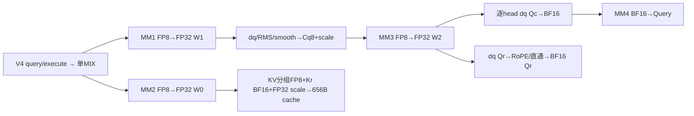
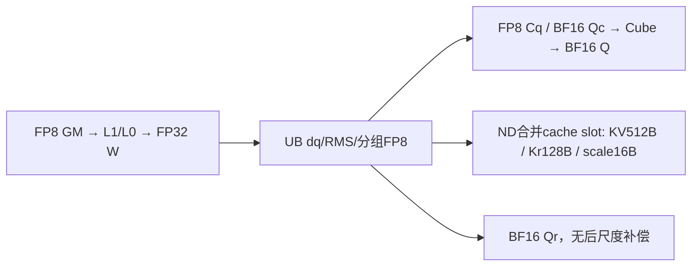
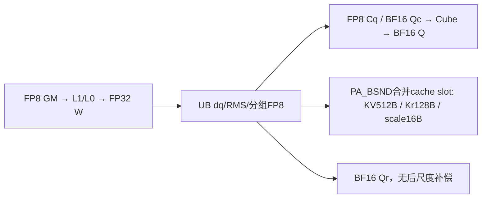

# MLA Prolog V4 FP8 投影与分组混合缓存 950 ACLNN 算子知识

## 算子速览

| 项目 | 内容 |
|---|---|
| 实际入口 | aclnnMlaPrologV4WeightNzGetWorkspaceSize / aclnnMlaPrologV4WeightNz，公开 ACLNN；SGL auto/cann 调外置 cann_ops_transformer.mla_prolog |
| 计算语义 | 唯一 (weight,kv,query)=(4,3,0)：三次E4M3FN投影以FP32累加/反量化，Cq动态FP8；第四次BF16吸收投影；BF16 Query/Qr，KV每128元素动态FP8，Kr BF16与四FP32 scale合并到656字节slot |
| 输入输出 | X/WDq/WUqQr/WDkvKr E4M3FN；四份 FP32 scale；WUk/gamma/sin/cos BF16；可选 E4M3FN QueryNorm+FP32 scale |
| 执行类型 | 一次 MIX_CV，AIC_CUBE 四矩阵乘与 AIV_VECTOR 反量化/RMS/量化/RoPE/scatter；空 query 在 entry 提前返回 |
| Kernel 路线 | R-001/002 为ND/tokenPA_BSND，全部dequantOpt=true/splitN；6正常typed selector；R-003–005为空和条件错误终点 |
| 核心资源 | FP32 W0/W1/W2、E4M3 Cq、BF16 Qc；每 AIC 的 L1 A/B 各双128KiB，L0A/B 各双32KiB，L0C 双64KiB；每 AIV 的192KiB设计预算 |
| 来源闭包 | source_closed：V4 pair→InnerV3/OpDef→Host/POD/key→arch35 splitN 及本实例 helper；生成 bridge、普通布局准备、通用硬件 primitive 与外置 wheel 身份是集成边界 |
| 验证状态 | 本次知识提取未执行编译、真机、数值或性能测试。draft 保留选中搬运特化、UB、Cq零scale、clip指针和条件key边界；源码闭合不等同已验证正确。 |

## 接口与语义

### 计算语义

T为展平token数，H=Hcq，N为head数，D=128/192；Ckv=512、Dr=64。MM8为E4M3FN×E4M3FN、FP32累加/输出，dq先乘FP32 channel scale再乘FP32 token scale。b16是Vector CAST_RINT，第四矩阵乘通过Fixpipe F322BF16输出；e4是FP32→E4M3FN RINT/SAT。

```text
zQ=MM8(X,WDq)
fQ=RMS_FP32(dq(zQ,sX,sWDq),gammaQ,epsQ)*aq；可选再乘smoothQ
sCq[t]=max(abs(fQ[t,:]))/448；Cq8=e4(fQ/sCq)         FP32直接量化，per-token M0
zQR=MM8(Cq8,WUqQr)
Qc16=b16(dq(zQR[:,:,:D],sCq,sWUqQr[:,:,:D]))
Query=MM4_BF16(Qc16,WUk)                           BF16 [T,N,512]
QueryRope=b16(e?rot(dq(zQR[:,:,D:],sCq,sWUqQr[:,:,D:])):反量化原通道顺序)
zKVKr=MM8(X,WDkvKr)
fKV=RMS_FP32(dq(zKVKr[:,:512],sX,sWDkvKr[:512]),gammaKV,epsKV)*ak
对每个token的4个连续128元素group j:
  sKV[t,j]=max(max(abs(fKV[t,128j:128(j+1)])),1e-4)/448   FP32，perTile M1
  KV8[t,128j:128(j+1)]=e4(fKV[group]/sKV[t,j])
Kr16=b16(e?rot(dq(zKVKr[:,512:],sX,sWDkvKr[512:])):反量化原通道顺序)
cache slot 656字节 = KV8 512B + Kr16 128B + sKV 16B
```

旋转按相邻偶/奇配对，输出前32为even*cos−odd*sin、后32为odd*cos+even*sin；GatherSinCos已将sin前半乘−1。关闭旋转保留原通道顺序。本tuple不对Query动态量化，不补偿Qr；dequantScaleQNope禁用。

RMS按64lane平方累加→Reduce SUM→reciprocal/epsilon/Sqrt/Div→gamma，aq/ak的条件Muls随后进行，smooth只用于Cq。Cq FP32直接RINT/SAT转E4M3，无MXFP8的BF16预舍入/E8M0组scale；Cq M0全零仍scale0继续除零。KV M1则将每128元素amax下限设1e−4，四份FP32 scale与数据一起保存，没有INT8 perTile的alpha clip操作。不能把这一阈值推广到Cq或把slot全656字节按同质FP8消费。

### 输入、输出与属性

| 参数 | shape/layout | dtype | 约束、默认值与语义 |
|---|---|---|---|
| tokenX | [T,He]或[B,S,He] ND/NCHW | E4M3FN | He∈{1024,2048,3072,4096,5120,6144,7168,7680,8192}，B≤65536，u32 T乘法不溢出 |
| weightDq | 逻辑[He,H]，NZ [H/32,He/16,16,32] | E4M3FN | H∈{1536,2048} |
| weightUqQr | 逻辑[H,N(D+64)]，NZ [N(D+64)/32,H/16,16,32] | E4M3FN | N1..128，D128/192；不接受E5M2 |
| weightDkvKr | 逻辑[He,576]，NZ [18,He/16,16,32] | E4M3FN | 前512 Ckv、后64 Kr |
| weightUk | [N,D,512] ND | BF16 | 第四MM吸收权重 |
| dequantScaleX | [T,1] | FP32 | 必需token scale |
| dequantScaleWDq/WUqQr/WDkvKr | [1,H]/[1,N(D+64)]/[1,576] | FP32 | 必需channel scale，不是E8M0 |
| gammaCq/Ckv；smoothCq | [H]/[512]；可选[1,H] | BF16；FP32 | 各AIV首step加载，smooth额外4H UB |
| ropeSin/Cos | [T,64]或[B,S,64] | BF16 | 原始ACLNN e0双nullptr/e1双有效；SGL/vendor按numel>0归一化 |
| kvCacheRef | TND [T,1,656]、BSND [B,S,1,656]或PA_BSND [Pnum,P,1,656] | 名义E4M3FN IN/OUT | 每slot混合字节；内轴连续、首轴stride允许padding；P16..1024且16倍数 |
| krCacheRef | 含零维空tensor，例如[0] | BF16或Host允许的INT8空 | 原始pointer仍需合法descriptor/rank1/3/4；仅为空壳，不是Kr写目标 |
| cacheIndex | 仅PA_BSND [T]/[B,S] | INT64 | ND不传；负slot跳写，正界/无冲突由caller保证 |
| actualSeqLen | 缺省 | N/A | blockPA全部禁止，不增加A1可达路线 |
| Query/QueryRope | [T,N,512/64]或[B,S,N,512/64] | BF16 | 不做Query动态量化或Qr后尺度补偿 |
| QueryNorm/dequantScaleQNorm | 可选[T,H]或[B,S,H] / [T,1] | E4M3FN/FP32 | 同一Cq8供MM3；禁用时空tensor |
| dequantScaleQNope | 原始nullptr，vendor返回[0] | FP32空 | kv3/q0不输出Query scale |
| quantScaleCkv/Ckr/kNopeClipAlpha | 缺省 | N/A | Host明确不接受本tuple clip，Device仍有标量读取表达式，见限制 |
| attrs | w4/kv3/q0，repo1/scaleRepo1，tile128 | INT64模式；double标量转float | eps1e−5、aq/ak1、cache默认PA_BSND；合法cache仅PA_BSND/BSND/TND |

### 入口与版本

本卡冻结 SGL dda6 文档明确引用的 ops-transformer d462 的 CANN9.2.0；SDK 固定 a63d9.2。公开产品表与场景表明确 FP8 全量化仅950，A2/A3不支持，不从 arch35 文件名扩大范围。SGL 的 torch_native 只覆盖0/2/3若干组合，w4由 auto/cann 透传，不能把公共参考当成此 tuple 的独立 golden。

[SGL V4 API](../../../../apis/sgl_kernel_npu/sgl_mlaprolog_v4.md)说明16组合和functional边界。本卡为原地五输出语义，不纳入 clone/TensorMove 的外部 Device 实现。V4 复用 InnerV3 注册名并增加 doRope，不意味着旧 V3 固定RoPE/旧172B POD是本卡ABI。当前(4,3,0)与INT8、MXFP8、HIF8及w4kv0/kv1各自为独立数学。

## Host/Launcher 执行流程

### 参数校验与前处理

SGL先判sin/cos成对，lazy导入vendor callable。vendor schema标注cache Tensor(a!)/Tensor(b!)，PrivateUse1→OpBuilder.load→C++。Builder可复用加载结果并选择CANN/vendor头库，arg_check代理只拒绝可解析pybind doc中的明确类型不匹配，未识别类型透传；这不是值域或设备安全检查。本次未运行load、编译或安装。

C++ OptionalDeviceGuard(tokenX.device)→形状与NZ格式校验→分配五输出→ACLNN_CMD。w4实际Tensor.scalar_type透传；HIF8 override强制解释只属于w5，不将uint8或E5M2改成合法w4。ResolveLogicalDims对Torch可见4D采用(s0*16,s1*16)，Host又按实际NZ storage首轴*c0恢复输出宽；inferShape要求权重逻辑rank2。QueryNorm分配取weight_dq.size(1)，故不能把裸4D storage Tensor与保留二维逻辑shape的format29权重直接等价。

V4检查模式/可选指针/doRope，TensorHolder将原始nullptr替为[0]临时descriptor；禁用Qscale、QNscale是否允许由原始nullptr身份决定，非null空descriptor不是同一合同。holder假数据地址不可当有效GM，query返回销毁descriptor。OpDef输入AutoContiguous、cache IgnoreContiguous；普通生成bridge/布局准备为框架边界，不隐藏自有核心算子。

Host：ConvertContext校验cache内轴连续、首轴stride≥逻辑连续跨度；空cache stride0=0，缺stride descriptor才回退连续值。GetNpuInfo要求C/V>0且V=C或2C→attrs/required/cache mode→shape/scenario→repo/query模式、quant/dims/special/expected参数→attrs→ProcessBaseInputs→四MM分核→POD/WS/key。tile只接受128，repo和scaleRepo必须同时1，cache只接受PA_BSND/BSND/TND；Kr输入输出必须为空。Host不扫描slot内容、scale有限性、重复slot或全部乘法溢出。真实错误状态停止后续，空query的GenTilingKey例外见R004。

### 参数、Workspace 与生命周期

记m=min(T,D==192?64:128)、g=N(D+64)、h=ND、qnf∈{0,1}；运算限定于源码u32/size_t/int64未溢出域。

```text
W_Host = W_lib + 32m + 6mH + 2304m + 4mg + 2mh
Device slices，从workspace参数原址开始：
Sscale [0,32m)                     FP32 [m,8]广播槽
W0     [32m,+2304m)                FP32 [m,576]，E1仍预留
W1     W0后4mH                    FP32 [m,H]
Cq8    W1后(1-qnf)mH              E4M3FN；qnf1直接正式QN
W2     Cq8后4mg                   FP32 [m,N,D+64]
Qc16   W2后2mh                    BF16 [m,N,D]
W_Device = 32m+2304m+4mH+(1-qnf)mH+4mg+2mh
```

Host按2mH预算归一化结果，实际Cq仅mH或正式QN；不能把Host上界误作同时活跃片之和。W_lib由平台GetLibApiWorkSpaceSize取得，Device未自行跳过该固定常量；生成Runtime包装如何传workspace是集成边界，不臆造16MiB偏移。

ACLNN query取得size/executor→caller分配→execute同stream。vendor使用当前NPU stream，必要时UseStreamResInCurrentThread；query/execute失败清理descriptor并抛错。byte workspace tensor为Host局部，回调捕获raw资源，未自行证明allocator/延迟队列所有权。输入、输出、合并cache、index与workspace需存活至stream工作完成；后继cache读由同stream或event排序，不用descriptor析构替代Device完成。

### 启动图与失败传播

正常T>0一次InnerV3 MIX_AIC_1_2，blockDim=C，运行AIV线性索引v=c*r+s，r=GetSubBlockNum=2；全部950量化V=C被Host拒绝。空T正常block1、W_lib、entry在POD/TPipe/GM之前返回。Host Debug selector不匹配和空分支吞GenTilingKey错误分别见R005/R004。



## Route 与参数设计

### 分核与资源计算

w4的dequantOpt始终true，不按N≥8再分支；splitM只属w3，KN只属DAV9201，group要求部分量化及Nkv8，均不属于本tuple。m的D192上限64对全部N生效。Veff=min(m,V)，末step m'=min(m,T−b0)，AIV v分q=floor(m'/Veff)+[v<m'%Veff]，start=v*floor(m'/Veff)+min(v,m'%Veff)。无token核仍参加公共屏障；每对AIV在后续Qc沿D/2分列、Qr沿m'分行，不能混用两种划分。

| 段 | M/N/K与分核 | base/step及tail |
|---|---|---|
| MM1 | m/H/He；n1=max(64,32ceil(H/(32C)))，b1=ceil(H/n1) | baseN128、baseK256；stepK=(He/256)%4==0?4:3，K_L1=1024/768；末核n=H−(b1−1)n1 |
| MM2 | m/576/He；E1 b2=n2=0；否则C≥9取64/9，否则n2=32ceil(576/(32C)) | baseN128、baseK256、stepK同MM1；末核有效N；E1 constexpr跳计算 |
| MM3 | m/g/H；n3=(D+64)ceil(N/C)，b3=ceil(g/n3) | baseK128、stepK4；初始m≤64取baseN256，否则128；末step不重选baseN；当前m'≤64整载A否则分K |
| MM4 | 每head m/512/D；hp=ceil(N/C)，b4=ceil(N/hp) | baseN128；D128 K128×1、全B128KiB；D192 K64×3、ND B splitK；末核head余数 |

所有Cube内部M=align16(m')，Fixpipe只提交m'有效行。FP8 NZ C0=32、BF16 C0=16。L1/L0按实际base与双bank逐项算，不能仅按逻辑tensor长度认定资源足够。

### Route 选择

K(c,E,e)=(c,2,14,true,false,E,0,0,e,7)。c0归一BSND/TND、只E0；c1 PA_BSND允许E0/1；A=0、splitM=0、deq=1、isPertile=true。Host先校验模式和repo/layout，T0优先，正常T>0仍受V=2C限制。

| 顺序 | Route | Key/模板 | 精确选择条件与优先级 | 不适用去向 |
|---:|---|---|---|---|
| 1 | R003 空query | 空selector | 全部前置合同满足，T0,V=2C | V=C进入R004 |
| 2 | R001 ND | K(0,0,e) | T>0，BSND rank3 X/cache4或TND rank2 X/cache3 | 非法rank/layout失败 |
| 3 | R002 PA_BSND | K(1,E,e) | T>0，token index，KV非空或Pnum0的E1 | blockPA/NZ拒绝，无fallback |
| 4 | R004 | key0 | T0,V=C，空分支吞GenTilingKey失败 | 无合法自有body |
| 5 | R005 | UINT64_MAX | 条件Host Debug e0且VERSION默认−1 | 非Debug可编码，实际宏须核对 |

```text
validate tuple/repo1/tile128/cache(仅ND或tokenPA)/strides/CV
  T0→FillTiling/libWS/GenKey(状态被忽略)/block1
  T>0→deq1/splitN→MM/WS/POD→GenKey
    V=C失败；V=2C: c0→R001，c1→R002
    条件Debug e0 → INVALID_KEY但Host未检查
```

### 模板/实现执行矩阵

正常完整实例为 `MlaPrologVecS1CubS2<MLAPType<FP8E4M3,FP8E4M3,FP8E4M3,float,CACHE_MODE(c),true,false,EMPTY(E),ACTUAL(0),true,2,e>>`。前三MM输出FP32，Cq为FP8，第四MM输入/输出BF16；isPertile强制QueryOutput为BF16、Kr为BF16，KV名义FP8承载混合656字节。entry指针顺序与公共V4相同，实际散写只使用kvCacheOut，krCacheOut是空别名；不能把空Kr pointer当额外存储。

| Route | key/selector | 完整命中条件 | 执行族与节点 | 实际body | 内存与同步 | tail/fallback |
|---|---|---|---|---|---|---|
| R001 | K(0,0,e) | ND合法rank、T>0，repo1/tile128，V2C | 单MIX四MM+Vector | splitN/QuantPerTile8Bit/合并Scatter | 公共W/L1/L0/UB，三段散写 | m'真实行，非atomic发布 |
| R002 | K(1,E,e) | PA_BSND，E0/1，INT64 index | 同上；E1跳MM2/cache | 同typed body按slot | free9，独立有效前缀 | 负slot跳写，正界caller |
| R003 | 空key | T0,V2C、全部前置合同满足 | entryreturn | 不读POD/GM，不建TPipe | libWS/block1 | cache不变 |
| R004 | key0 | T0,V=C | 无选中合法body | Host吞失败 | libWS/block1 | Runtime边界 |
| R005 | INVALID_KEY | 条件Debug e0 | 无选中合法body | SDK Encode/SEL失败 | 正常Host预留 | Host未检查INVALID_KEY |

SDK实际DECL宽度4/2/4/1/1/2/2/2/1/8；`K=c+32+(14<<6)+(1<<10)+(E<<12)+(e<<18)+(7<<19)`。Host默认VERSION−1的ENABLE_ROPE_SEL只1；Device TU定义3允许0/1。SEL多出的A1/deq0并未被此Host产生，不能扩大为blockPA可达能力。

| Route | (c,E,A,e) | uint64 key |
|---|---|---|
| R001 | (0,0,0,0) | 3671968 |
| R001 | (0,0,0,1) | 3934112 |
| R002 | (1,0,0,0) | 3671969 |
| R002 | (1,0,0,1) | 3934113 |
| R002 | (1,1,0,0) | 3676065 |
| R002 | (1,1,0,1) | 3938209 |
| R003 | (0,0,0,0,0,2,0,0,1,7) | 3940352 |

### 隐藏性能 Guard

| Guard | Host/Tiling条件 | Device/资源原因 | Route | 不满足去向 | 符号 |
|---|---|---|---|---|---|
| w4类型 | E4M3FN+FP32 scale | 不是MXFP8/E8M0或E5M2实例 | 全正常 | Host失败 | FillFP8FullQuantParamInfo |
| CV1:2 | V=2C | 950量化白名单 | 全部 | 非空失败，空R004 | GenTilingKey |
| D192 step | cap64 | MM3波与UB容量；全部N均生效 | 全正常 | 无动态缩tile fallback | ProcessBaseInputs |
| MM3 A全载 | 当前m'≤64 | align16(m')*H≤128KiB；H2048时刚满bank | 全正常 | m'>64分K | MatmulQcQr |
| stepK3 | (He/256)%4!=0 | 合法He7680用768步长无K尾，其他枚举1024 | 全正常 | 无任意He tail补救 | MmCq/CkvKrParamInit |
| UB资源 | F_alloc+stage≤实际UB/pool | 对齐独立TBuf；实际pool起点U0也占空间 | 全正常 | 没有逐stage Host guard | VectorBufferInit/TPipe |
| 数值 | scale值、epsilon及amax合法 | Cq零行无epsilon/保护 | 全正常 | 原代码继续计算 | ComputeVFImpl M0 |
| 索引与宽度 | u32 shape不溢出、slot合法无冲突 | 非atomic散写、标量GM索引不验正上界 | 全正常 | caller合同 | SetShapeInfo/ScatterCache |
| FP8 L0B特化 | T=E4M3FN,S=float仍选MX LoadData | 搬运与Mmad模板条件不同，不能改写为普通B搬运 | 全正常前三MM | 没有自有替代分支 | MatmulL0/LoadDataL1ToL0B |

### POD/ABI

唯一Host序列化结构为 MlaPrologTilingData.baseParams，静态自然ABI推导sizeof208/align8，188–191 padding；未执行目标编译器sizeof/offsetof。逐字段如下。kNopeClipAlpha字段未被FillTiling赋值，本tuple不读，不称其为0。MM/offset等其余结构只在Device局部构造，不另造Host ABI。

| 结构 | 字段 | 类型/位宽 | ABI布局 | 单位 | Host/launcher producer | Device consumer | 边界 |
|---|---|---|---|---|---|---|---|
| BaseParams | batchSize | uint32_t/32 | offset0，4B | batch，TND其它路线为0 | FillTiling/CoreParams：B；本tuple不允许blockPA | BSND批维；无blockPA consumer | batch，TND其它路线为0 |
| BaseParams | stepBatchSize | uint32_t/32 | offset4，4B | token；T0=0且不读 | FillTiling/CoreParams：min(T,D192?64:128) | Process步进/UB/WS/MM m | token；T0=0且不读 |
| BaseParams | mSubSize | uint32_t/32 | offset8，4B | inactive，本tuple无splitM | FillTiling/CoreParams：成员初始化0/FillTilingCoreParams | 当前splitN不读 | inactive，本tuple无splitM |
| BaseParams | mSubCoreNum | uint32_t/32 | offset12，4B | inactive | FillTiling/CoreParams：成员初始化0 | 当前splitN不读 | inactive |
| BaseParams | stepNumHeadDequant | uint32_t/32 | offset16，4B | head；仍写POD | FillTiling/CoreParams：D128?min(64,N):min(16,N) | deq恒1，由head波分工不直接读 | head；仍写POD |
| BaseParams | tokenSize | uint32_t/32 | offset20，4B | token；u32原始乘法域 | FillTiling/CoreParams：X前导维展平T | Process总步数 | token；u32原始乘法域 |
| BaseParams | seq1Size | uint32_t/32 | offset24，4B | token | FillTiling/CoreParams：rank3 X的S；rank2默认0 | ND BSND跨度 | token |
| BaseParams | seq2Size | uint32_t/32 | offset28，4B | 保留字段，不解释成真实KV长度 | FillTiling/CoreParams：nkvSize=1 | 本FP8 splitN不读 | 保留字段，不解释成真实KV长度 |
| BaseParams | headSizeX | uint32_t/32 | offset32，4B | 元素 | FillTiling/CoreParams：He | MM1/MM2 K与X行跨度 | 元素 |
| BaseParams | headSizeCq | uint32_t/32 | offset36，4B | 元素 | FillTiling/CoreParams：Hcq | MM1输出/MM3 K/NormCq | 元素 |
| BaseParams | headSizeCkv | uint32_t/32 | offset40，4B | 元素 | FillTiling/CoreParams：512 | MM2切片/NormKV/MM4 N | 元素 |
| BaseParams | headSizeQc | uint32_t/32 | offset44，4B | 元素 | FillTiling/CoreParams：N*D | MM3/Qn输入跨度 | 元素 |
| BaseParams | headSizeQr | uint32_t/32 | offset48，4B | 元素 | FillTiling/CoreParams：N*64 | QueryRope行跨度 | 元素 |
| BaseParams | headSizeKr | uint32_t/32 | offset52，4B | 元素 | FillTiling/CoreParams：Dr=64 | MM2完整输出/分核 | 元素 |
| BaseParams | numHeadSize | uint32_t/32 | offset56，4B | head | FillTiling/CoreParams：N | MM4 head循环/QueryRope row | head |
| BaseParams | numHeadKvSize | uint32_t/32 | offset60，4B | head | FillTiling/CoreParams：Nkv=1 | 本FP8 splitN无直接关键读取 | head |
| BaseParams | dimHeadSizeQc | uint32_t/32 | offset64，4B | 元素 | FillTiling/CoreParams：D | MM4 K/Qc切片 | 元素 |
| BaseParams | dimHeadRope | uint32_t/32 | offset68，4B | 元素 | FillTiling/CoreParams：64 | SinCos/Rotary/Kr尺寸 | 元素 |
| BaseParams | blockNum | uint32_t/32 | offset72，4B | cache slice数；P0选EMPTY_CACHE | FillTiling/CoreParams：cache首轴P/T/B | 本域scatter不做正index上界校验 | cache slice数；P0选EMPTY_CACHE |
| BaseParams | blockSize | uint32_t/32 | offset76，4B | token；PA16..1024且16倍数 | FillTiling/CoreParams：PA H或BSND S；TND0 | GetCacheOffset解token slot；blockPA不属于本tuple | token；PA16..1024且16倍数 |
| BaseParams | mm1BlockNum | uint32_t/32 | offset80，4B | core | FillTiling/CoreParams：ceil(H/n1) | MM1活跃核/末核N | core |
| BaseParams | mm2BlockNum | uint32_t/32 | offset84，4B | core | FillTiling/CoreParams：非空ceil(576/n2)，E1=0 | MM2活跃核；E1前置constexpr return | core |
| BaseParams | mm3BlockNum | uint32_t/32 | offset88，4B | core | FillTiling/CoreParams：ceil(N(D+64)/n3) | MM3活跃核/末核N | core |
| BaseParams | mm4BlockNum | uint32_t/32 | offset92，4B | core | FillTiling/CoreParams：ceil(N/headsPerCore) | Qn head核范围 | core |
| BaseParams | vectorBlockNum | uint32_t/32 | offset96，4B | AIV调度数；运行subblock修正见正文 | FillTiling/CoreParams：min(m,V) | Init Veff/分token | AIV调度数；运行subblock修正见正文 |
| BaseParams | mm1SingleCoreN | uint32_t/32 | offset100，4B | 元素 | FillTiling/CoreParams：n1 | MmCqParamInit/ComputeAicOffset | 元素 |
| BaseParams | mm2SingleCoreN | uint32_t/32 | offset104，4B | 元素；E1不执行MM2 | FillTiling/CoreParams：n2；E1默认0 | MmCkvKrParamInit/ComputeAicOffset | 元素；E1不执行MM2 |
| BaseParams | mm3SingleCoreN | uint32_t/32 | offset108，4B | 元素 | FillTiling/CoreParams：n3 | MmQcQrParamInit/ComputeAicOffset | 元素 |
| BaseParams | mm4SingleCoreBatch | uint32_t/32 | offset112，4B | head | FillTiling/CoreParams：headsPerCore | Qn loops/weightUkOffset | head |
| BaseParams | dtileSize | uint32_t/32 | offset116，4B | 元素 | FillTiling/CoreParams：656 | ScatterCkv/Kr/scale合并slot tokenStride | 元素 |
| BaseParams | kvQuantMode | uint32_t/32 | offset120，4B | mode | FillTiling/CoreParams：3 | KV perTile；值3 | mode |
| BaseParams | tileSize | uint32_t/32 | offset124，4B | 元素，Host仍校验128 | FillTiling/CoreParams：attr128 | QuantPerTileVF：4组×128 | 元素，Host仍校验128 |
| BaseParams | ckvkrRepoMode | uint32_t/32 | offset128，4B | mode | FillTiling/CoreParams：1 COMBINE | ScatterKr合并BF16字节到KV+512 | mode |
| BaseParams | quantScaleRepoMode | uint32_t/32 | offset132，4B | mode | FillTiling/CoreParams：1 COMBINE | ScatterCkv将4份FP32写KV+640 | mode |
| BaseParams | queryNormFlag | uint32_t/32 | offset136，4B | bool编码u32 | FillTiling/CoreParams：原始queryNormOut非null?1:0 | OutputInit/WorkspaceInit/Process | bool编码u32 |
| BaseParams | reciprocalCq | float/32 | offset140，4B | FP32 | FillTiling/CoreParams：float(1/H) | NormCq Reduce后Muls | FP32 |
| BaseParams | epsilonCq | float/32 | offset144，4B | FP32，不验证所有数值域 | FillTiling/CoreParams：rmsnormEpsilonCq Float | NormCq Adds/Sqrt | FP32，不验证所有数值域 |
| BaseParams | reciprocalCkv | float/32 | offset148，4B | FP32 | FillTiling/CoreParams：float(1/512) | NormKV Reduce后Muls | FP32 |
| BaseParams | epsilonCkv | float/32 | offset152，4B | FP32 | FillTiling/CoreParams：rmsnormEpsilonCkv Float | NormKV Adds/Sqrt | FP32 |
| BaseParams | kNopeClipAlpha | float/32 | offset156，4B | inactive，值不可宣称为0 | FillTiling/CoreParams：FillTiling未赋此标量字段 | 本tuple不读；其它quant helper另读GM | inactive，值不可宣称为0 |
| BaseParams | qcQrScale | float/32 | offset160，4B | FP32 | FillTiling/CoreParams：attr Float aq | NormCq gamma后Muls | FP32 |
| BaseParams | kcScale | float/32 | offset164，4B | FP32 | FillTiling/CoreParams：attr Float ak | NormKV gamma后Muls | FP32 |
| BaseParams | isQcQrScaleEnable | uint16_t/16 | offset168，2B | bool编码u16 | FillTiling/CoreParams：abs(aq-1)>=float epsilon | NormCq条件Muls | bool编码u16 |
| BaseParams | isKcScaleEnable | uint16_t/16 | offset170，2B | bool编码u16 | FillTiling/CoreParams：abs(ak-1)>=float epsilon | NormKV条件Muls | bool编码u16 |
| BaseParams | mm1NGroup | uint16_t/16 | offset172，2B | 组，9201才可能变化 | FillTiling/CoreParams：1 | 当前arch22/35 splitN不读KN分组 | 组，9201才可能变化 |
| BaseParams | mm1KGroup | uint16_t/16 | offset174，2B | 组 | FillTiling/CoreParams：1 | 本平台CalcWorkSpace按1；Device无KN | 组 |
| BaseParams | mm1SingleCoreK | uint32_t/32 | offset176，4B | 元素，inactive | FillTiling/CoreParams：0 | 当前arch22/35不读 | 元素，inactive |
| BaseParams | mm2NGroup | uint16_t/16 | offset180，2B | 组 | FillTiling/CoreParams：1 | 当前arch22/35不读KN分组 | 组 |
| BaseParams | mm2KGroup | uint16_t/16 | offset182，2B | 组 | FillTiling/CoreParams：1 | 本平台CalcWorkSpace按1；Device无KN | 组 |
| BaseParams | mm2SingleCoreK | uint32_t/32 | offset184，4B | 元素，inactive | FillTiling/CoreParams：0 | 当前arch22/35不读 | 元素，inactive |
| BaseParams | kvCacheStride0 | uint64_t/64 | offset192，8B | 元素u64，转int64需在已验范围内 | GetCacheStride0；空cache0 | ScatterCache/MaterializeOffsetsWithHeadSize | 元素u64，转int64需在已验范围内 |
| BaseParams | krCacheStride0 | uint64_t/64 | offset200，8B | 元素u64 | FillTiling/CoreParams：空Kr取0 | 当前合并Kr不用该stride | 元素u64 |


Device局部MMParams为15个u32，普通ABI推导sizeof60/align4：m/n/k偏移0/4/8，orgM/N/Ka/Kb/Kc偏移12/16/20/24/28，baseM/N/K偏移32/36/40，stepK/needSetOrgShape/kL1StepSize/kScale偏移44/48/52/56。m=m'，n当前核有效宽，k=He/He/H/D，orgKa=He/He/H/ND，orgKb=k，orgKc=H/576/g/N512。baseM未赋且无实际consumer；needSetOrgShape=1但自有helper不依赖它；kScale=k/32被辅助scale寻址计算读取，不能因S=float称该字段完全无读。

DequantQcQrSplitNParams的int64基址offset0/8，u32 input/output offset16/20、src/dst gap24/28，sizeof32/align8。输入基址o=c*n3、输出h0*D，s的input=s*D/2+head*(D+64)，output=s*D/2+head*D；gap=g−D/2、ND−D/2，分别以FP32/BF16元素为单位。RopeQrSplitNParams两int64偏移0/8，u32 input/deq/output偏移16/20/24，padding28–31，int64 ropeStride32，u32 dstGap/scaleOffset/sincosOffset/rows在40/44/48/52，sizeof56/align8；input=rowStart*g+head*(D+64)、output=rowStart*N64+head*64、scaleOffset=rowStart*8、rows=floor((m'+s)/2)，rowStart=floor(m'/2)*s。所有尺寸是静态普通ABI推导。

RmsNormParam六字段依次reciprocal/epsilon(float)、row/col(u32)、scale(float)、isScaleEnable(u16)，row=1、col=H/512；Rectangle三u32为row/col/stride。ScatterCacheParams八int64为P/slot/row1/col/tokenStride/stride0/S/tokenIndex；CkvkrParams六int64为tokenIndex、W0元素offset、当前token序号、页内行数、cacheOffset、nextPageOffset。UsedBlockParams两u32 start0/end=b1或b2。Aic/Aiv Offset各int64为对应typed元素偏移；MMBufParams的bank计数初始0、TPipe地址贯穿整个launch。局部字段consumer均为下方同名方法，不跨平台裸拷贝。

### Route 源码闭包

| Route | Key/selector | Host/Tiling producer | POD/参数 | entry/router | body/直接依赖 | 构建接线 |
|---|---|---|---|---|---|---|
| R001 | c0/quant14 | SetScenarioInfo/CheckRepoMode/FillMatmul*/GenTilingKey | 208B，repo1/tile128 | FP8/FP8/FP8/float/isPertile=true | arch35 splitN、RMS、QuantPerTileVF M1、合并scatter | V3 OpDef ascend950，依赖mla_prolog，auto-sync off |
| R002 | c1/quant14 | PA_BSND/E0/1 | INT64 index、656 tokenStride | 同typed entry | 同body按slot写三段 | 同上 |
| R003 | 空key | RunBigKernelTiling空分支 | block1/libWS | constexpr empty return | 无核心Device计算 | empty selector |
| R004 | key0 | GenTilingKey失败被忽略 | 错误终点 | 未选合法body | 不补造Runtime结果 | Host/SDK边界 |
| R005 | INVALID_KEY | 条件Debug e0 | 正常Host预算 | 未选合法body | 不补造Runtime结果 | Host/Device VERSION宏边界 |

## Kernel 实现

### 公共执行流程

entry保存overflow控制位60，空query提前return；正常读取208B POD，创建TPipe，置overflow0，构造本typed对象，Init绑定GM→MM参数→workspace→AIC/AIV buffer，Process结束恢复原位。AIC索引c；AIV线性v=c*r+s，配对cubeIdx=v/r。每step先MM1，再等待cache free9执行MM2（E1只跳body仍发信号），等RMS6后MM3，逐headQc-ready7后MM4。AIV首step加载常驻系数，按token分RMS/缓存，按pair分Qc列和Qr行。

```text
对b0=0,m,2m,...<T：m'=min(m,T-b0)，末step更新四MM.m及token划分
 AIC:
  MM1(X[b0*He],WDq)->W1；PIPE_FIX mode2 flag6
  wait free9；MM2或E1跳过->W0；PIPE_FIX mode2 flag4
  wait RMS6；MM3逐baseN tile->W2，逐tile PIPE_FIX mode2 flag10
  D128预载首head WUk；每head wait Qc7(>15head时偶数/最后通知)
  MM4(Qc16,WUk)->正式Query；Query offset按m*N*512跨step递增
 AIV:
  首step加载gamma/weightScales/smooth；e1 gather sincos
  wait CQ6；allV mode0 flag7；每本核token W1 dq/RMS/aq/smooth/FP8量化->Cq8/QN+sCq
  allV7；按32B槽汇总sCq至常驻UB；PIPE_MTE3 mode2 RMS6
  wait KV4；allV7；E0逐token dq/RMS/ak->KV，dq/rot或直通->Kr，分Route scatter
  PIPE_MTE3 mode2 free9
  每MM3 tile wait10，累计列末端，完整Qc头则dq两半D/2列->Qc16并通知7
  完整Qr头则按floor/ceil(m'/2)行 dq/rot或直通->正式Qr
  Qr输出基址按m*N*64跨step递增
结束：AIC drain全部L1/L0 hardevent和SCALE_EVENT，wait最后free9
```

W1→RMS与Cq→MM3分核不同，RMS前后allV7保护汇总/复用；W0跨step由free9防覆盖。MM3每tile通知10，Qc按D完整才发7，Qr按D+64完整才消费。每核head L>15时仅i偶数或i==L−1发/等Qc7，两端相同；不能将其说成一次总屏障。下一step共享scratch依赖上述固定顺序与allV屏障，Host提交一次launch本身不是这些可见性的证据。

前三MM：A ND→NZ用Nd2Nz{nValue=m',dValue=K_L1,srcDValue=orgKa,dstNzC0Stride=align16(m')}；B NZ按C0=32，以B[K*nOff+kL1*K_L1*32]为起点，DataCopy{ceil(nTile/32),K_L1,K−K_L1,0}，长度/stride单位32B。预载下一bank，MTE1消费后才释放给MTE2。A进L0 LoadData3D/WithStride，B的实际选中特化见下；L0逐K片，Mmad(align16(m'),nTile,baseK)仅首K清L0C，后续FP32累加。Fixpipe FP32→FP32保持NoQuant/无ReLU，M_FIX/FIX_M保护bank。MM3 m'≤64整载Cq A（H2048且m64刚好128KiB），其余分K双bank。MM4用BF16，D128全B128KiB并以128列四块，D192走ND B的K64×3，FP32累加后F322BF16。

**FP8搬运限制**：MatmulL0<T=FP8E4M3,S=float>调用LoadDataL1ToL0B；helper只按T判断，仍将L0B重解释mx_fp8_e4m3_t并传E8M0视图做MX LoadData。MatmulL1无条件从L1B+64KiB以及其后align16(m')*kScale建立scale视图，但w4的LoadL1AB不生产MX scale子区；此子区可未初始化或与普通B数据重叠。该调用省略kL1Size，MX srcStride按默认0形成，而Mmad随后用普通FP8类型。以上是可定位的实际调用链，不是默认空LocalTensor，也不证明这些字节参与正确数值或已发生故障；目标codegen/硬件效果本次未验证。不能把它简写为普通LoadData2D或借用w3的E8M0数值公式消除边界。

| 层级/缓冲区 | offset/地址 | 容量/extent字节 | dtype/layout | producer→consumer | owner/lifetime | 对齐/复用 |
|---|---|---|---|---|---|---|
| GM输入 | X[tHe]，NZ三权重，Uk[hD512] | THe+HeH+Hg+He576+2ND512 | E4M3/BF16 | caller→MTE2/Cube | caller至stream完成 | FP8 C0=32/BF16 C0=16 |
| GM scales/gamma | sX[t]、sw按channel | 4T+4H+4g+2304，gamma2H+1024，smooth?4H | FP32/BF16 | caller→AIV | 同上 | 与quant multiplier区分 |
| Sscale/W0/W1/Cq/W2/Qc16 | 前述连续slice | W_Device逐片公式 | FP32/FP8/BF16 | 四MM↔AIV | launch跨step复用 | W1/Cq和W2/Qc分别不别名 |
| 正式输出 | Q[(tN+h)512]、Qr[(tN+h)64]、QN[tH] | Q1024TN+Qr128TN；QN可选TH+4T | BF16/FP8/FP32 | AIC/AIV→后继 | caller | QN同时被MM3消费 |
| L1A/B | bank=(iter&1)*131072 | 各2*128KiB | FP8/BF16 NZ | MTE2→MTE1 | 每AIC TPipe | 实际scale视图边界如上，不能扣除未证别名 |
| L0A/B | bank=(iter&1)*32768 | 各2*32KiB | 当前typed fractal | MTE1→Mmad | 同上 | M_MTE1/MTE1_M |
| L0C | bank=(iter&1)*65536 | 2*64KiB | FP32 | Mmad→Fixpipe | 同上 | FIX_M/M_FIX或MM4 unitFlag3 |
| UB固定 | wdq4H、wdkv2304、gamma2H+1024、smooth?4H、未消费quantScaleCkv槽32 | F_req/F_alloc见下 | FP32/BF16 | 首stepMTE2→RMS/dq | 每AIV TPipe | 独立TBuf align32 |
| UB CqScale | 固定后 | 32(m+7) | FP32槽 | 本核Brcb/GM汇总→deq | launch | 实际每token重复8float，正式QNscale仅4B |
| UB sincos | 独立TBuf | 512ceil(m/2) | FP32 | Gather→Kr/Qr | launch | e0仍分配但不读sin/cos；A恒0，不分配actual槽 |
| UB share | 最后TBuf | align32(196608−F_req) | 字节按typed切片 | 当前Vector阶段→后续阶段 | launch | 使用max阶段峰值，不相加已串行区 |
| Reg | 64lane FP32、BF16/FP8 packed | 编译器分配量固定源码不可见 | typed | UB↔VF算术 | VF | 不虚报occupancy/spill |

令sm为smooth存在、a=A1、U0=TPipe实际UB起点，q为本核当前token数，rho=ceil(m'/2)、u=D/2、x=m'*u：

```text
F0=(6+4sm)H+3360+32(m+7)+512ceil(m/2)
本tuple a=0：F_req=F_alloc=F0
S_alloc=align32(196608-F_req)
UB已申请最高位置=U0+F_alloc+S_alloc
F_alloc+S_alloc=196608；本tuple无A1，不借用其它tuple的额外32B对齐结论
```

| share阶段 | 实际最高活跃字节范围 | 数据与复用来源 |
|---|---|---|
| Cq RMS+FP8 | 9H+32q+32 | FP8输出H，scale32q，sX32，RMS FP32双H；量化Reg不另物化FP32行 |
| KV RMS+groupFP8 | 4672+512q | sX32+双sincos512q+align32(512+16)=544B输出/scale、FP32 norm输出2048、FP32输入2048 |
| Kr e1 | 800+512q | 外层32+512q，输出128，float Rotary helper640；不可沿用INT32输入的额外128 |
| Qc逐head | 4x+32+max(4align64(u),2x)及输入无mask尾读 | input/compute别名，scale/output顺序复用；D192/u96的scale物理load512B |
| Qr逐head e1 | 768rho+256 | 输出2*64rho，float预处理/旋转/scale顺序复用，channelScale256；无INT32 cast区 |
| 初始Qr gather | 256ceil(m'/2) | 临时BF16 sin/cos，在固定FP32 sincos之外 |
| cache内gather e1 | 32+768q | 外层sX32+双FP32 sincos512q+临时BF16 256q |

D192的Qc每行96个FP32，Reg最后tail虽然只消费32lane，LoadAlign仍读64lane；末行input可越名义子片128B，scale从4x+32开始的96元素实际load128元素。它们仍可能落在同share backing，不能由逻辑跨片直接断言物理越UB；必须结合实际S_alloc/UB pool。e0只用直通活跃子区可低于e1界，E1不消费cache阶段，但所有固定TBuf仍在。必要条件为P=max可达stage≤S_alloc、U0+F_alloc+P≤实际UB、U0+F_alloc+S_alloc≤实际pool，Host无逐stage检查。

```text
L1A bank: align16(m')*K_L1*sizeof(T)<=131072，MM3全A改H
L1B bank: K_L1*nTile*sizeof(T)<=131072
L0A bank: align16(m')*baseK*sizeof(T)<=32768
L0B bank: baseK*nTile*sizeof(T)<=32768
L0C bank: align16(m')*nTile*4<=65536
```


| 边/复用子区 | producer | offset/extent | dtype/layout | consumer | ordering/sync | owner/lifetime | 安全条件 |
|---|---|---|---|---|---|---|---|
| CQ→Cq8 | MM1/AIV | W1 4mH→Cq mH/QN | FP32→FP8 | MM3 | CQ6、RMS前后allV7、RMS6 | launch/QN owner | scale32B槽也须写完 |
| KVKr | MM2 | W0 2304m | FP32→FP8/BF16/FP32 | AIV/cache与下step | KV4、free9、MTE3 drain | launch/caller | E1保持信号配对 |
| Qc | MM3/AIV | W2→独立Qc16 2mND | FP32→dq→BF16 | MM4 | 逐tile10→完整head7 | launch | 同head先Qc可与后续Qr并行 |
| Qr | MM3/AIV | W2 head后64→正式Qr | FP32→dq/RoPE→BF16 | caller | tile10，V/MTE3事件 | caller | 末odd token两AIV分floor/ceil |
| UB scale/output | DequantQcQrSplitN | scale位于4x+32后 | FP32/BF16别名 | Cast后MTE3 | MTE2_V/V_MTE3，覆写前deq完成 | share | 无mask load范围也要计入 |

分组cache阶段从share的sX32与双FP32 sin/cos(512q)之后取ckvOut；ckvOutSize=align32(512+4*4)=544B，payload在0..511、四FP32 scale在512..527；后接FP32 normIn 2048B、normShared输入2048B。QuantPerTile8Bit→QuantPerTileVF<float,float,FP8>对4个128元素tile分别两遍Reg load/amax floor1e−4/除448/RINT_SAT并保存4B scale，不用PerTileQuantParams.alpha，不调用INT8 clip/MSD链。output/scale与norm临时不别名，4672+512q是实际最高活跃范围。

ScatterCkv先写512B payload，再以ScatterCacheUnAligned把ckvOut+512的16B尺度写入slot+640；RopeAndScatterKr后将64个BF16重解释成128个FP8字节，通过ScatterCache写slot+512。三段是512/128/16B，tokenStride=656，KV首轴stride0保持实际物理跨度；scale采用16B DataCopyPad，不将长度误作32B块数。Kr空tensor不作为写目标。此处payload/Kr按1字节FP8类型搬运；固定SDK的连续DataCopy合同要求GM地址按元素字节数对齐、UB地址与搬运长度按32B对齐。656B槽跨度模32为16本身不违反GM地址合同，512/128B长度也均为32B倍数；16B scale由另一路DataCopyPad写入，不能据槽跨度直接断言非对齐故障。三个输出片独立MTE3提交，free9在cache阶段结束发出；没有原子多字段发布，caller后继须等同stream/event，不能并发只见payload就读剩余片。

**clip参数静态边界**：Host FillFP8FullKVPertileQuantParamInfo erase(K_NOPE_CLIP_ALPHA)并isValid=false，拒绝非空clip。ScaleInit按isPertile将传入pointer绑定kNopeClipAlphaGm_；RmsNormAndQuantizeCkv又先计算`isFp8E8m0 ? 1.0f : kNopeClipAlphaGm_.GetValue(0)`，w4的scale=float取后者，原始指针按公共合同为空。该float随后仅填alpha，而QuantPerTile8Bit实际不用alpha；固定SDK非const GetValue仍包含CheckGlobalBuffer/DcciReadCache/GM解引用。是否被目标优化完整消除、是否保留副作用取决于实际codegen；不能因最终数学不用alpha就声称无读取，也不能宣称已观察到空指针故障。此边界与POD中未赋的kNopeClipAlpha标量字段不同。

| 合并写入边 | producer | offset/extent | dtype/layout | consumer | ordering/sync | owner/lifetime | 条件 |
|---|---|---|---|---|---|---|---|
| KV payload | RMS+QuantPerTileVF M1 | slot+0，512B | E4M3FN | 下游cache reader | V_MTE3/MTE3_V及free9 | caller | 每128元素一FP32 scale，不与Cq M0混淆 |
| Kr bytes | Rotary/直通+BF16 cast | slot+512，128B | BF16 bit pattern | reader按BF16解释 | 局部MTE3 drain | caller | 原Kr输出为空；不能将128B按128个BF16 |
| scales | 同KV quant | slot+640，16B | 4个FP32 | reader按FP32解释 | ScatterCacheUnAligned DataCopyPad | caller | 三片非atomic，读依赖stream/event |

### Route R-001：ND合并cache

#### 适用条件

(4,3,0)、T>0、V=2C、repo1/scaleRepo1/tile128，BSND rank3/cache4或TND rank2/cache3；E0/A0。e0/1、D128/192、QN、smooth及末step均遵守公共typed流程；E1跳MM2/cache body但保留KV4/free9。

##### 选择证据

| 层级 | 文件 | 符号 | 谓词/参数 | 结果 |
|---|---|---|---|---|
| Host | attention/mla_prolog/op_host/mla_prolog_tiling.cpp | SetScenarioInfo/ProcessBaseInputs/GenTilingKey | c=0,A0,quant14,deq1,splitN | K(c,E,e) |
| Router | attention/mla_prolog_v3/op_kernel/mla_prolog_v3.cpp | FP8_FULL_QUANT_KV_QUANT_PER_TILE | FP8/FP8/FP8/float/isPertile=true | arch35 splitN |

#### Device 数据流

##### 函数级调用链

```text
entry→Init/Process→公共四MM/RMS/Cq8及逐headQc/Qr
 →RmsNormRopeScatterCkvKr→RmsNormAndQuantizeCkv
 →QuantPerTile8Bit→QuantPerTileVF<float,float,FP8>→ComputeVFImpl<M1>
 →ScatterCkv→ScatterCache<FP8,false>+ScatterCacheUnAligned<FP8,false>
 →RopeAndScatterKr→RotaryPosEmbPerTensor<float,float,BF16,true,e>
 →ScatterKr→BF16重解释FP8 bytes→ScatterCache<FP8,false>
```

##### 源码等价伪码

```text
公共MM/RMS/逐head流水不变，Query与Qr为BF16，无Query量化/补偿。
 每token E0: fKV=dq/RMS/ak得到FP32；4组128元素amax=max(amax,1e-4)，s=amax/448，KV8=e4(fKV/s)。
 slot=t；P>0按(slot//P)*stride0+(slot%P)*656，TND P0按t*stride0。
 payload写base+0/512B，scale写base+640/16B，BF16 Kr旋转或直通后按字节写base+512/128B。
 clipAlpha读取表达式仍按上文保留；e0也写原顺序Kr；所有cache阶段完成后free9。
```

#### 内存与数据搬运

##### 资源与搬运表

| 层级/缓冲区 | offset/地址 | extent/容量 | dtype/layout | producer | consumer | owner/lifetime | 对齐/复用 |
|---|---|---|---|---|---|---|---|
| cache GM | slot=t；P>0按(slot//P)*stride0+(slot%P)*656，TND P0按t*stride0 | 每有效token656B=512+128+16 | 混合FP8/BF16/FP32 | AIV三片写 | 后继attention | caller至stream完成 | 首轴stride保留洞；Kr空壳不消费 |
| workspace/L1/L0/UB/Reg | 公共逐片表，c=0 | W_Device同非Query量化域；F0含32B未消费槽，KV peak4672+512q | FP32/FP8/BF16 | 四MM/Vector | 同公共消费者 | launch/TPipe | A恒0，无actualSeq TBuf；8B/32B单位不混用 |

##### 分层内存布局



##### 字节账、交接边与复用顺序

完整使用公共W_Host/W_Device与每层双bank账；F0=(6+4sm)H+3360+32(m+7)+512ceil(m/2)，a=0，UB申请196608B加实际U0，stage按max比较。KV输出scratch544B包含16B scale及16B padding，正式slot656B不含这段scratch padding。clip临时值、unused quantScaleCkv32仍按实际表达式/分配保存，不构造安全性结论。

| 边/复用子区 | producer | offset/extent | dtype/layout | consumer | ordering/sync | owner/lifetime | 条件 |
|---|---|---|---|---|---|---|---|
| Qc | MM3/AIV | W2→Qc16 | FP32→BF16 | MM4 | tile10/head7 | launch | Qr可与MM4交叠，E1仍保留 |
| KV/Kr/scale | MM2/AIV | W0→三片656B slot | FP32→混合字节 | cache/下step | KV4/free9、MTE3 drain | caller/launch | 非atomic发布，负slot才明确跳写，正界/无冲突由caller |

#### 同步、精度与尾块

##### 同步与数值边界表

| 阶段 | primitive/机制 | producer | consumer/等待点 | 保护对象 | 精度/尾块 |
|---|---|---|---|---|---|
| Cq/Qc | CQ6/RMS6/allV7/tile10/head7 | AIC/AIV | MM3/MM4 | W/Cq/scale/Qc | Cq M0无epsilon；Qc BF16后MM4 |
| group quant | UB barrier、Reg两遍load | AIV | scatter | ckvOut544B/norm双FP32片 | M1 floor1e−4，每128元素一FP32scale，512列均整除64 |
| 三片cache | V_MTE3/MTE3_V/free9 | AIV | 后继/下一step | W0/share/cache | Kr e0原顺序，m'仅有效行，E1不写 |

#### 关键实现

##### 符号证据表

| 阶段 | 文件 | 符号 | 事实 |
|---|---|---|---|
| Host | attention/mla_prolog/op_host/mla_prolog_tiling_check.cpp | FillFP8FullKVPertileQuantParamInfo/CheckRepoMode | c=0、repo1、clip禁用、仅ND/tokenPA |
| Router | attention/mla_prolog_v3/op_kernel/mla_prolog_v3.cpp | quant14/isPertile | FP8/FP8/FP8/float |
| Body | attention/mla_prolog/op_kernel/arch35/kernel_mla_prolog_split_n_arch35.h | RmsNormAndQuantizeCkv/ScatterCkv/ScatterKr | clip读取表达式与656B三片 |
| helper | attention/mla_prolog/op_kernel/arch35/vf/vf_dynamic_quant.h | QuantPerTileVF/ComputeVFImpl<M1> | 四组实际数学与epsilon |

### Route R-002：PA_BSND合并cache

#### 适用条件

(4,3,0)、T>0、V=2C、repo1/scaleRepo1/tile128，PA_BSND token index，E0/1,A0。e0/1、D128/192、QN、smooth及末step均遵守公共typed流程；E1跳MM2/cache body但保留KV4/free9。

##### 选择证据

| 层级 | 文件 | 符号 | 谓词/参数 | 结果 |
|---|---|---|---|---|
| Host | attention/mla_prolog/op_host/mla_prolog_tiling.cpp | SetScenarioInfo/ProcessBaseInputs/GenTilingKey | c=1,A0,quant14,deq1,splitN | K(c,E,e) |
| Router | attention/mla_prolog_v3/op_kernel/mla_prolog_v3.cpp | FP8_FULL_QUANT_KV_QUANT_PER_TILE | FP8/FP8/FP8/float/isPertile=true | arch35 splitN |

#### Device 数据流

##### 函数级调用链

```text
entry→Init/Process→公共四MM/RMS/Cq8及逐headQc/Qr
 →RmsNormRopeScatterCkvKr→RmsNormAndQuantizeCkv
 →QuantPerTile8Bit→QuantPerTileVF<float,float,FP8>→ComputeVFImpl<M1>
 →ScatterCkv→ScatterCache<FP8,false>+ScatterCacheUnAligned<FP8,false>
 →RopeAndScatterKr→RotaryPosEmbPerTensor<float,float,BF16,true,e>
 →ScatterKr→BF16重解释FP8 bytes→ScatterCache<FP8,false>
```

##### 源码等价伪码

```text
公共MM/RMS/逐head流水不变，Query与Qr为BF16，无Query量化/补偿。
 每token E0: fKV=dq/RMS/ak得到FP32；4组128元素amax=max(amax,1e-4)，s=amax/448，KV8=e4(fKV/s)。
 slot=index[t]；slot<0三段均跳写，否则base=(slot//P)*stride0+(slot%P)*656。
 payload写base+0/512B，scale写base+640/16B，BF16 Kr旋转或直通后按字节写base+512/128B。
 clipAlpha读取表达式仍按上文保留；e0也写原顺序Kr；所有cache阶段完成后free9。
```

#### 内存与数据搬运

##### 资源与搬运表

| 层级/缓冲区 | offset/地址 | extent/容量 | dtype/layout | producer | consumer | owner/lifetime | 对齐/复用 |
|---|---|---|---|---|---|---|---|
| cache GM | slot=index[t]；slot<0三段均跳写，否则base=(slot//P)*stride0+(slot%P)*656 | 每有效token656B=512+128+16 | 混合FP8/BF16/FP32 | AIV三片写 | 后继attention | caller至stream完成 | 首轴stride保留洞；Kr空壳不消费 |
| workspace/L1/L0/UB/Reg | 公共逐片表，c=1 | W_Device同非Query量化域；F0含32B未消费槽，KV peak4672+512q | FP32/FP8/BF16 | 四MM/Vector | 同公共消费者 | launch/TPipe | A恒0，无actualSeq TBuf；8B/32B单位不混用 |

##### 分层内存布局



##### 字节账、交接边与复用顺序

完整使用公共W_Host/W_Device与每层双bank账；F0=(6+4sm)H+3360+32(m+7)+512ceil(m/2)，a=0，UB申请196608B加实际U0，stage按max比较。KV输出scratch544B包含16B scale及16B padding，正式slot656B不含这段scratch padding。clip临时值、unused quantScaleCkv32仍按实际表达式/分配保存，不构造安全性结论。

| 边/复用子区 | producer | offset/extent | dtype/layout | consumer | ordering/sync | owner/lifetime | 条件 |
|---|---|---|---|---|---|---|---|
| Qc | MM3/AIV | W2→Qc16 | FP32→BF16 | MM4 | tile10/head7 | launch | Qr可与MM4交叠，E1仍保留 |
| KV/Kr/scale | MM2/AIV | W0→三片656B slot | FP32→混合字节 | cache/下step | KV4/free9、MTE3 drain | caller/launch | 非atomic发布，负slot才明确跳写，正界/无冲突由caller |

#### 同步、精度与尾块

##### 同步与数值边界表

| 阶段 | primitive/机制 | producer | consumer/等待点 | 保护对象 | 精度/尾块 |
|---|---|---|---|---|---|
| Cq/Qc | CQ6/RMS6/allV7/tile10/head7 | AIC/AIV | MM3/MM4 | W/Cq/scale/Qc | Cq M0无epsilon；Qc BF16后MM4 |
| group quant | UB barrier、Reg两遍load | AIV | scatter | ckvOut544B/norm双FP32片 | M1 floor1e−4，每128元素一FP32scale，512列均整除64 |
| 三片cache | V_MTE3/MTE3_V/free9 | AIV | 后继/下一step | W0/share/cache | Kr e0原顺序，m'仅有效行，E1不写 |

#### 关键实现

##### 符号证据表

| 阶段 | 文件 | 符号 | 事实 |
|---|---|---|---|
| Host | attention/mla_prolog/op_host/mla_prolog_tiling_check.cpp | FillFP8FullKVPertileQuantParamInfo/CheckRepoMode | c=1、repo1、clip禁用、仅ND/tokenPA |
| Router | attention/mla_prolog_v3/op_kernel/mla_prolog_v3.cpp | quant14/isPertile | FP8/FP8/FP8/float |
| Body | attention/mla_prolog/op_kernel/arch35/kernel_mla_prolog_split_n_arch35.h | RmsNormAndQuantizeCkv/ScatterCkv/ScatterKr | clip读取表达式与656B三片 |
| helper | attention/mla_prolog/op_kernel/arch35/vf/vf_dynamic_quant.h | QuantPerTileVF/ComputeVFImpl<M1> | 四组实际数学与epsilon |

### Route R-003：空query

#### 适用条件

T==0，全部前置检查通过，V=2C。

##### 选择证据

| 层级 | 文件 | 符号 | 谓词/参数 | 结果 |
|---|---|---|---|---|
| Host/SDK | attention/mla_prolog/op_host/mla_prolog_tiling.cpp；SDK template_argument | RunBigKernelTiling/GenTilingKey/Encode | T==0，全部前置检查通过，V=2C | blockDim1，workspace仅W_lib，空key3940352；entry不读POD/GM，不建TPipe，合并cache不变 |

#### Device 数据流

##### 函数级调用链

```text
V4参数检查→RunBigKernelTiling→GenTilingKey→本Route终点
```

##### 源码等价伪码

blockDim1，workspace仅W_lib，空key3940352；entry不读POD/GM，不建TPipe，合并cache不变。R003的return由constexpr EmptyTensorMode决定；R004/R005未选中合法自有body，不捏造Runtime容错或输出。

#### 内存与数据搬运

##### 资源与搬运表

| 层级/缓冲区 | offset/地址 | extent/容量 | dtype/layout | producer | consumer | owner/lifetime | 对齐/复用 |
|---|---|---|---|---|---|---|---|
| GM/workspace/L1/L0/UB/Reg | R003无算法读写；错误终点未选body | R003/004仅libWS，R005正常Host预算 | N/A | Host | 框架 | caller | 不能由预算推导错误key有Device实现 |

##### 分层内存布局


##### 字节账、交接边与复用顺序

没有已选核心节点间交接；R003无计算slice，R004/005无可合法绑定的本tuple数据流。caller真实tensor生命周期仍须遵守API，不假设错误可安全续跑。

#### 同步、精度与尾块

##### 同步与数值边界表

| 阶段 | primitive/机制 | producer | consumer/等待点 | 保护对象 | 精度/尾块 |
|---|---|---|---|---|---|
| 终点 | R003 entryreturn；其余Host/SDK条件错误 | Host/SDK | Runtime边界 | N/A | 无合法数值输出可推导 |

#### 关键实现

##### 符号证据表

| 阶段 | 文件 | 符号 | 实现事实 |
|---|---|---|---|
| Host | attention/mla_prolog/op_host/mla_prolog_tiling.cpp | RunBigKernelTiling/GenTilingKey | blockDim1，workspace仅W_lib，空key3940352；entry不读POD/GM，不建TPipe，合并cache不变 |
| Router/SDK | attention/mla_prolog_v3/op_kernel/mla_prolog_v3.cpp；SDK include/utils/tiling/template_argument.h | EmptyTensorMode / Encode选择 | 只在合法空key提前return，错误key不补造实际路由 |

### Route R-004：空query核比错误被忽略

#### 适用条件

DAV3510、T==0、V=C。

##### 选择证据

| 层级 | 文件 | 符号 | 谓词/参数 | 结果 |
|---|---|---|---|---|
| Host/SDK | attention/mla_prolog/op_host/mla_prolog_tiling.cpp；SDK template_argument | RunBigKernelTiling/GenTilingKey/Encode | DAV3510、T==0、V=C | GenTilingKey拒绝量化，RunBigKernelTiling空分支忽略GRAPH_FAILED；context初值key0/block1/libWS被返回成功。key0不是有效本tuple selector |

#### Device 数据流

##### 函数级调用链

```text
V4参数检查→RunBigKernelTiling→GenTilingKey→本Route终点
```

##### 源码等价伪码

GenTilingKey拒绝量化，RunBigKernelTiling空分支忽略GRAPH_FAILED；context初值key0/block1/libWS被返回成功。key0不是有效本tuple selector。R003的return由constexpr EmptyTensorMode决定；R004/R005未选中合法自有body，不捏造Runtime容错或输出。

#### 内存与数据搬运

##### 资源与搬运表

| 层级/缓冲区 | offset/地址 | extent/容量 | dtype/layout | producer | consumer | owner/lifetime | 对齐/复用 |
|---|---|---|---|---|---|---|---|
| GM/workspace/L1/L0/UB/Reg | R003无算法读写；错误终点未选body | R003/004仅libWS，R005正常Host预算 | N/A | Host | 框架 | caller | 不能由预算推导错误key有Device实现 |

##### 分层内存布局


##### 字节账、交接边与复用顺序

没有已选核心节点间交接；R003无计算slice，R004/005无可合法绑定的本tuple数据流。caller真实tensor生命周期仍须遵守API，不假设错误可安全续跑。

#### 同步、精度与尾块

##### 同步与数值边界表

| 阶段 | primitive/机制 | producer | consumer/等待点 | 保护对象 | 精度/尾块 |
|---|---|---|---|---|---|
| 终点 | R003 entryreturn；其余Host/SDK条件错误 | Host/SDK | Runtime边界 | N/A | 无合法数值输出可推导 |

#### 关键实现

##### 符号证据表

| 阶段 | 文件 | 符号 | 实现事实 |
|---|---|---|---|
| Host | attention/mla_prolog/op_host/mla_prolog_tiling.cpp | RunBigKernelTiling/GenTilingKey | GenTilingKey拒绝量化，RunBigKernelTiling空分支忽略GRAPH_FAILED；context初值key0/block1/libWS被返回成功。key0不是有效本tuple selector |
| Router/SDK | attention/mla_prolog_v3/op_kernel/mla_prolog_v3.cpp；SDK include/utils/tiling/template_argument.h | EmptyTensorMode / Encode选择 | 只在合法空key提前return，错误key不补造实际路由 |

### Route R-005：条件Debug关闭RoPE非法key

#### 适用条件

T>0、e0、Host ASCENDC_DEBUG且VERSION默认−1。

##### 选择证据

| 层级 | 文件 | 符号 | 谓词/参数 | 结果 |
|---|---|---|---|---|
| Host/SDK | attention/mla_prolog/op_host/mla_prolog_tiling.cpp；SDK template_argument | RunBigKernelTiling/GenTilingKey/Encode | T>0、e0、Host ASCENDC_DEBUG且VERSION默认−1 | EncodeTilingKey的SEL缺e0，返回UINT64_MAX；GenTilingKey未检查该值，仍返回GRAPH_SUCCESS。非Debug或Host定义VERSION3时不由此形成非法key |

#### Device 数据流

##### 函数级调用链

```text
V4参数检查→RunBigKernelTiling→GenTilingKey→本Route终点
```

##### 源码等价伪码

EncodeTilingKey的SEL缺e0，返回UINT64_MAX；GenTilingKey未检查该值，仍返回GRAPH_SUCCESS。非Debug或Host定义VERSION3时不由此形成非法key。R003的return由constexpr EmptyTensorMode决定；R004/R005未选中合法自有body，不捏造Runtime容错或输出。

#### 内存与数据搬运

##### 资源与搬运表

| 层级/缓冲区 | offset/地址 | extent/容量 | dtype/layout | producer | consumer | owner/lifetime | 对齐/复用 |
|---|---|---|---|---|---|---|---|
| GM/workspace/L1/L0/UB/Reg | R003无算法读写；错误终点未选body | R003/004仅libWS，R005正常Host预算 | N/A | Host | 框架 | caller | 不能由预算推导错误key有Device实现 |

##### 分层内存布局


##### 字节账、交接边与复用顺序

没有已选核心节点间交接；R003无计算slice，R004/005无可合法绑定的本tuple数据流。caller真实tensor生命周期仍须遵守API，不假设错误可安全续跑。

#### 同步、精度与尾块

##### 同步与数值边界表

| 阶段 | primitive/机制 | producer | consumer/等待点 | 保护对象 | 精度/尾块 |
|---|---|---|---|---|---|
| 终点 | R003 entryreturn；其余Host/SDK条件错误 | Host/SDK | Runtime边界 | N/A | 无合法数值输出可推导 |

#### 关键实现

##### 符号证据表

| 阶段 | 文件 | 符号 | 实现事实 |
|---|---|---|---|
| Host | attention/mla_prolog/op_host/mla_prolog_tiling.cpp | RunBigKernelTiling/GenTilingKey | EncodeTilingKey的SEL缺e0，返回UINT64_MAX；GenTilingKey未检查该值，仍返回GRAPH_SUCCESS。非Debug或Host定义VERSION3时不由此形成非法key |
| Router/SDK | attention/mla_prolog_v3/op_kernel/mla_prolog_v3.cpp；SDK include/utils/tiling/template_argument.h | EmptyTensorMode / Encode选择 | 只在合法空key提前return，错误key不补造实际路由 |

## 算子特定优化

### Trick T-001：MM3 A全载与baseN配合

#### 触发与源码依据

- 适用Route：R001–002。
- 触发条件：R001–002；当前FP8/S=float、初始m≤64取baseN256，m>64取128；当前m'≤64可整载A。
- Golden 来源：[连续源码](https://gitcode.com/cann/ops-transformer/blob/d462156cf5d97712fcfeef95070d649f47d3bb6e/attention/mla_prolog/op_kernel/arch35/kernel_mla_prolog_split_n_arch35.h#L498-L507)。

**官方源码（固定Commit连续逐字摘录）**：

```cpp
    } else {
        if constexpr (std::is_same<mmInputType, FP8E4M3>::value &&
                      isFp8E8m0) { // FP8全量化场景下L1B用满，修改baseN会造成内存踩踏
            mmQcQrParam_.baseN = 128;
        } else {
            if (mmQcQrParam_.m <= 64) { // FP8全量化场景，scale需要额外占用L1，该优化不适用
                mmQcQrParam_.baseN = 256;
            } else {
                mmQcQrParam_.baseN = 128;
            }
```

#### 机制与设计原因

当前S=float不进入MX的强制baseN128分支；A整载阈值按单字节类型为64，H最大2048使m64时128KiB恰好一bank，后续N tile复用A。末step只改m，不重选baseN，必须按初始tile配对算L0C。

#### 迁移边界

D128的m>64按K分片；D192 cap64；不能将注释中的FP8泛称误作w3/w4条件相同。 前提为本卡950/CANN9.2/FP8+FP32 scale、合法shape与实际资源；本次知识提取未执行编译、真机、数值或性能测试。

#### 错误做法

D128的m>64按K分片；D192 cap64；不能将注释中的FP8泛称误作w3/w4条件相同。 固定源码的选择/实际分支提供边界依据，未据此编造测得性能或运行故障。

### Trick T-002：FP32归一化后直接动态FP8

#### 触发与源码依据

- 适用Route：R001–002。
- 触发条件：R001–002；RmsNormDynamicQuant选择非E8M0分支，ComputeVFImpl<O=E4M3FN,M=0>。
- Golden 来源：[连续源码](https://gitcode.com/cann/ops-transformer/blob/d462156cf5d97712fcfeef95070d649f47d3bb6e/attention/mla_prolog/op_kernel/arch35/vf/vf_dynamic_quant.h#L117-L126)。

**官方源码（固定Commit连续逐字摘录）**：

```cpp
        AscendC::Reg::Div(xNorm, xFp32, xScaleDup, validMask2);
        if constexpr (std::is_same<O, fp8_e4m3fn_t>::value) {
            AscendC::Reg::Cast<O, float, castTraitPack2>(yOutput, xNorm, validMask2);
        } else if constexpr (std::is_same<O, hifloat8_t>::value) {
            AscendC::Reg::Cast<O, float, castTraitF32ToHif8>(yOutput, xNorm, validMask2);
        } else {
            AscendC::Reg::Cast<half, float, castTraitF32ToHalf>(yHalf, xNorm, validMask2);
            AscendC::Reg::Cast<O, half, castTraitPack2>(yOutput, yHalf, validMask2);
        }
        AscendC::Reg::StoreAlign<O, AscendC::Reg::StoreDist::DIST_PACK4_B32>(addr, yOutput, validMask2);
```

#### 机制与设计原因

FP32 RMS/aq/smooth不先舍入BF16，直接Div及RINT/SAT转E4M3；两遍Reg读取使FP32行无需额外全行量化中间物化，scale按4B正式结果及32B内部广播槽分开。

#### 迁移边界

全零行scale0；没有M1的1e−4，不应添加epsilon或借用INT8的FP16 ODD路径。 前提为本卡950/CANN9.2/FP8+FP32 scale、合法shape与实际资源；本次知识提取未执行编译、真机、数值或性能测试。

#### 错误做法

全零行scale0；没有M1的1e−4，不应添加epsilon或借用INT8的FP16 ODD路径。 固定源码的选择/实际分支提供边界依据，未据此编造测得性能或运行故障。

### Trick T-003：逐head交接与稀疏等待

#### 触发与源码依据

- 适用Route：R001–002。
- 触发条件：R001–002；dequantOpt=true，当前AIC head数L>15时偶数/最后head通知与等待。
- Golden 来源：[连续源码](https://gitcode.com/cann/ops-transformer/blob/d462156cf5d97712fcfeef95070d649f47d3bb6e/attention/mla_prolog/op_kernel/arch35/kernel_mla_prolog_split_n_arch35.h#L1243-L1249)。

**官方源码（固定Commit连续逐字摘录）**：

```cpp
    bool needSparseSync = subLoopTimes > MAX_SYNC_FLAG_COUNT;
    for (int64_t i = 0; i < subLoopTimes; i++) {
        if constexpr (MLAPT::enableDequantOpt) {
            if (!needSparseSync || i % 2 == 0 || i == subLoopTimes - 1) {
                CrossCoreWaitFlag(FINISH_VEC_DEQUANT_QC_SPLIT_N);
            }
        }
```

#### 机制与设计原因

MM3逐tile通知，AIV只要完整Qc头就转换并通知MM4，Qr可以后处理；L>15时生产与消费共同按偶数/最后head稀疏通知，保持相同计数协议。

#### 迁移边界

不能合并为全MM3结束一次屏障，不能只改变一侧稀疏条件；flag计数硬件与调度效果未运行验证。 前提为本卡950/CANN9.2/FP8+FP32 scale、合法shape与实际资源；本次知识提取未执行编译、真机、数值或性能测试。

#### 错误做法

不能合并为全MM3结束一次屏障，不能只改变一侧稀疏条件；flag计数硬件与调度效果未运行验证。 固定源码的选择/实际分支提供边界依据，未据此编造测得性能或运行故障。

### Trick T-004：KV每128元素独立scale并设置amax下限

#### 触发与源码依据

- 适用Route：R001–002，(4,3,0)、isPertile=true、tile128。
- Golden 来源：[连续源码](https://gitcode.com/cann/ops-transformer/blob/d462156cf5d97712fcfeef95070d649f47d3bb6e/attention/mla_prolog/op_kernel/arch35/vf/vf_dynamic_quant.h#L94-L104)。

**官方源码（固定Commit连续逐字摘录）**：

```cpp
    AscendC::Reg::Reduce<Reg::ReduceType::MAX, float, float, Reg::MaskMergeMode::ZEROING>(xReduceMax, xMaxAbs,
                                                                                          fullMask1);
    if constexpr (M == PER_TILE_QUANT_MODE) {
        constexpr float epsilonValue = 1e-4f;
        AscendC::Reg::RegTensor<float> epsilonReg;
        AscendC::Reg::Duplicate(epsilonReg, epsilonValue, fullMask1);
        AscendC::Reg::Max(xReduceMax, xReduceMax, epsilonReg, fullMask1); // regtensor类型
    }
    AscendC::Reg::Muls(xScale, xReduceMax, alphaValue, fullMask1);
    AscendC::Reg::Duplicate(xScaleDup, xScale, fullMask1);
    AscendC::Reg::StoreUnAlign<float, AscendC::Reg::PostLiteral::POST_MODE_UPDATE>(scaleAddr, xScale, ureg0, 1);
```

#### 机制与设计原因

仅M1将amax下限设1e−4，再除448；FP32 scale四份按组保存，不能将Cq M0或MXFP8 E8M0编码混入。

#### 迁移边界

本卡950/CANN9.2/FP8+FP32 scale与repo1合同；资源和原始指针状态均须按上文核对。本次知识提取未执行编译、真机、数值或性能测试。

#### 错误做法

仅M1将amax下限设1e−4，再除448；FP32 scale四份按组保存，不能将Cq M0或MXFP8 E8M0编码混入。 固定源码未提供运行故障或性能结果，不补造。

### Trick T-005：合并cache路径的实际clip表达式边界

#### 触发与源码依据

- 适用Route：R001–002，(4,3,0)、isPertile=true、tile128。
- Golden 来源：[连续源码](https://gitcode.com/cann/ops-transformer/blob/d462156cf5d97712fcfeef95070d649f47d3bb6e/attention/mla_prolog/op_kernel/arch35/kernel_mla_prolog_split_n_arch35.h#L1625-L1637)。

**官方源码（固定Commit连续逐字摘录）**：

```cpp
    if constexpr (isPertile) {
        float clipAlpha = isFp8E8m0 ? 1.0f : kNopeClipAlphaGm_.GetValue(0);
        PerTileQuantParams perTileParams = {
            static_cast<uint32_t>(baseParams_->tileSize),                            // baseParams_->tileSize
            static_cast<uint32_t>(baseParams_->headSizeCkv / baseParams_->tileSize), // tileNum
            clipAlpha,                                                               // alpha
            static_cast<uint32_t>(vectorRow_),                                       // row
            baseParams_->headSizeCkv                                                 // col
        };
        if constexpr (std::is_same<rmsNormCkvOutputType, int8_t>::value) {
            QuantPerTile(ckvOutLocal, normInLocal, normSharedBuf, perTileParams);
        } else {
            QuantPerTile8Bit(ckvOutLocal, normInLocal, perTileParams);
```

#### 机制与设计原因

Host拒绝clip但这里S=float仍求GetValue；QuantPerTile8Bit不使用alpha。应保留实际调用/codegen边界，不能因为数学无clip擅自删除读取或伪称已观察故障。

#### 迁移边界

本卡950/CANN9.2/FP8+FP32 scale与repo1合同；资源和原始指针状态均须按上文核对。本次知识提取未执行编译、真机、数值或性能测试。

#### 错误做法

Host拒绝clip但这里S=float仍求GetValue；QuantPerTile8Bit不使用alpha。应保留实际调用/codegen边界，不能因为数学无clip擅自删除读取或伪称已观察故障。 固定源码未提供运行故障或性能结果，不补造。

## 模板与实现对比

| 对比维度 | R001 ND | R002 PA_BSND | 设计选择依据 |
|---|---|---|---|
| 命中/优先级 | BSND/TND合法rank，E0 | tokenPA E0/1 | Host仅支持这两类，非NZ/blockPA |
| 执行族/节点图 | MIX四MM/Vector/三片cache | 同数学、slot索引不同 | 单独保存真实寻址路线 |
| M/N/K/tile | splitN、D192 cap64、deq1 | 同 | FP8权重触发dequantOpt |
| workspace/L1/L0/UB | 完整公共typed账，a0 | 同，E1保留固定分配 | 无A1额外TBuf，不引入其对齐超额结论 |
| 交接/同步 | CQ6/RMS6/tile10/head7/KV4/free9 | E1跳数据保留信号 | 三片散写不是atomic |
| 精度/tail | Cq M0、KV M1；BF16 Q/Qr；slot656B | 同；负slot跳写 | 不同scale域与混合字节 |
| fallback/失败 | 非法rank/stride失败 | 正界/页容量/冲突由caller保证 | 无自有dense安全fallback |

## 平台差异

| 项目 | A2 | A3 | Ascend 950 |
|---|---|---|---|
| 支持状态 | 公开文档不支持w4 | 公开文档不支持w4 | 公开场景支持，受正文guard |
| Host/Launcher | w限0/1/2，拒绝当前tuple | 同 | d462 V4/InnerV3，非空量化V=C拒绝 |
| Kernel/资源 | 不发布本FP8平台卡 | 不发布本FP8平台卡 | arch35 Reg VF、实际FP8/MX搬运特化、MIX1:2 |

## 限制与失败边界

- 固定源码支持不证明已安装wheel、动态选择的custom/opapi库与当前checkout身份一致。标准生成inner bridge、普通布局/内存准备及底层ISA是明确集成边界，不用它们替代自有Host/POD/body。
- shape/slot/scale值、stride/alias、u32乘法与所有权是调用前提；Host未逐值证明这些条件。空输入仍先走参数检查，950CV1:1空路径吞失败不应概括为全空安全。
- L0B的MX LoadData与plain FP8 Mmad条件不一致、未生产scale视图、UB独立align32、D192无mask读范围、条件Debug e0均按上文保留；不以源码闭合或lint通过宣称实际数值、安全性或性能已验证。
- 本次知识提取未执行编译、真机、数值或性能测试；不存在本次verified事件。

## 源码索引

### 链路索引

| 链路阶段 | 文件 | 关键符号 | 支撑内容 |
|---|---|---|---|
| SGL接入 | docs/api/zh/operators/attention/mlaprolog_v4.md | mlaprolog_v4 | 固定来源的入口/Host/typed helper或构建/SDK边界，实际消费范围以上文为准 |
| SGL接入 | python/sgl_kernel_npu/sgl_kernel_npu/operators/attention/mlaprolog_v4.py | mlaprolog_v4 | 固定来源的入口/Host/typed helper或构建/SDK边界，实际消费范围以上文为准 |
| SGL接入 | python/sgl_kernel_npu/README.md | README | 固定来源的入口/Host/typed helper或构建/SDK边界，实际消费范围以上文为准 |
| V4实现 | attention/mla_prolog_v3/docs/aclnnMlaPrologV4WeightNz.md | aclnnMlaPrologV4WeightNz | 固定来源的入口/Host/typed helper或构建/SDK边界，实际消费范围以上文为准 |
| V4实现 | version.cmake | version | 固定来源的入口/Host/typed helper或构建/SDK边界，实际消费范围以上文为准 |
| V4实现 | attention/mla_prolog_v3/op_api/aclnn_mla_prolog_v4_weight_nz.h | aclnn_mla_prolog_v4_weight_nz | 固定来源的入口/Host/typed helper或构建/SDK边界，实际消费范围以上文为准 |
| V4实现 | attention/mla_prolog_v3/op_api/aclnn_mla_prolog_v4_weight_nz.cpp | aclnn_mla_prolog_v4_weight_nz | 固定来源的入口/Host/typed helper或构建/SDK边界，实际消费范围以上文为准 |
| V4实现 | attention/mla_prolog_v3/torch_extension/mla_prolog.py | mla_prolog | 固定来源的入口/Host/typed helper或构建/SDK边界，实际消费范围以上文为准 |
| V4实现 | attention/mla_prolog_v3/torch_extension/csrc/mla_prolog.cpp | mla_prolog | 固定来源的入口/Host/typed helper或构建/SDK边界，实际消费范围以上文为准 |
| V4实现 | torch_extension/cann_ops_transformer/common/aclnn_common.h | aclnn_common | 固定来源的入口/Host/typed helper或构建/SDK边界，实际消费范围以上文为准 |
| V4实现 | torch_extension/cann_ops_transformer/op_builder/builder.py | builder | 固定来源的入口/Host/typed helper或构建/SDK边界，实际消费范围以上文为准 |
| V4实现 | attention/mla_prolog_v3/op_host/CMakeLists.txt | CMakeLists | 固定来源的入口/Host/typed helper或构建/SDK边界，实际消费范围以上文为准 |
| V4实现 | attention/mla_prolog_v3/op_host/mla_prolog_v3_def.cpp | mla_prolog_v3_def | 固定来源的入口/Host/typed helper或构建/SDK边界，实际消费范围以上文为准 |
| V4实现 | attention/mla_prolog_v3/op_host/mla_prolog_v3_tiling_register.cpp | mla_prolog_v3_tiling_register | 固定来源的入口/Host/typed helper或构建/SDK边界，实际消费范围以上文为准 |
| V4实现 | attention/mla_prolog_v3/op_host/mla_prolog_v3_tiling.h | mla_prolog_v3_tiling | 固定来源的入口/Host/typed helper或构建/SDK边界，实际消费范围以上文为准 |
| V4实现 | attention/mla_prolog_v3/op_host/mla_prolog_v3_infershape.cpp | mla_prolog_v3_infershape | 固定来源的入口/Host/typed helper或构建/SDK边界，实际消费范围以上文为准 |
| V4实现 | attention/mla_prolog_v3/op_host/mla_prolog_v3_infershape.h | mla_prolog_v3_infershape | 固定来源的入口/Host/typed helper或构建/SDK边界，实际消费范围以上文为准 |
| V4实现 | attention/mla_prolog/op_host/mla_prolog_infershape.h | mla_prolog_infershape | 固定来源的入口/Host/typed helper或构建/SDK边界，实际消费范围以上文为准 |
| V4实现 | attention/mla_prolog/op_host/mla_prolog_tiling.cpp | mla_prolog_tiling | 固定来源的入口/Host/typed helper或构建/SDK边界，实际消费范围以上文为准 |
| V4实现 | attention/mla_prolog/op_host/mla_prolog_tiling.h | mla_prolog_tiling | 固定来源的入口/Host/typed helper或构建/SDK边界，实际消费范围以上文为准 |
| V4实现 | attention/mla_prolog/op_host/mla_prolog_tiling_check.cpp | mla_prolog_tiling_check | 固定来源的入口/Host/typed helper或构建/SDK边界，实际消费范围以上文为准 |
| V4实现 | attention/mla_prolog/op_host/mla_prolog_tiling_check.h | mla_prolog_tiling_check | 固定来源的入口/Host/typed helper或构建/SDK边界，实际消费范围以上文为准 |
| V4实现 | attention/mla_prolog/op_kernel/mla_prolog_tiling_data.h | mla_prolog_tiling_data | 固定来源的入口/Host/typed helper或构建/SDK边界，实际消费范围以上文为准 |
| V4实现 | attention/mla_prolog/op_kernel/mla_prolog_template_tiling_key.h | mla_prolog_template_tiling_key | 固定来源的入口/Host/typed helper或构建/SDK边界，实际消费范围以上文为准 |
| V4实现 | attention/mla_prolog_v3/op_kernel/mla_prolog_v3.cpp | mla_prolog_v3 | 固定来源的入口/Host/typed helper或构建/SDK边界，实际消费范围以上文为准 |
| V4实现 | attention/mla_prolog/op_kernel/arch35/kernel_mla_prolog_split_n_arch35.h | kernel_mla_prolog_split_n_arch35 | 固定来源的入口/Host/typed helper或构建/SDK边界，实际消费范围以上文为准 |
| V4实现 | attention/mla_prolog/op_kernel/arch35/mla_prolog_comm_arch35.h | mla_prolog_comm_arch35 | 固定来源的入口/Host/typed helper或构建/SDK边界，实际消费范围以上文为准 |
| V4实现 | attention/mla_prolog/op_kernel/arch35/mla_prolog_vector_comm_arch35.h | mla_prolog_vector_comm_arch35 | 固定来源的入口/Host/typed helper或构建/SDK边界，实际消费范围以上文为准 |
| V4实现 | attention/mla_prolog/op_kernel/arch35/service_matmul_arch35.h | service_matmul_arch35 | 固定来源的入口/Host/typed helper或构建/SDK边界，实际消费范围以上文为准 |
| V4实现 | attention/mla_prolog/op_kernel/arch35/service_rms_norm_arch35.h | service_rms_norm_arch35 | 固定来源的入口/Host/typed helper或构建/SDK边界，实际消费范围以上文为准 |
| V4实现 | attention/mla_prolog/op_kernel/arch35/service_gather_sin_cos_arch35.h | service_gather_sin_cos_arch35 | 固定来源的入口/Host/typed helper或构建/SDK边界，实际消费范围以上文为准 |
| V4实现 | attention/mla_prolog/op_kernel/arch35/service_rotary_position_embedding_arch35.h | service_rotary_position_embedding_arch35 | 固定来源的入口/Host/typed helper或构建/SDK边界，实际消费范围以上文为准 |
| V4实现 | attention/mla_prolog/op_kernel/arch35/service_scatter_cache_arch35.h | service_scatter_cache_arch35 | 固定来源的入口/Host/typed helper或构建/SDK边界，实际消费范围以上文为准 |
| V4实现 | attention/mla_prolog/op_kernel/arch35/service_rope_arch35.h | service_rope_arch35 | 固定来源的入口/Host/typed helper或构建/SDK边界，实际消费范围以上文为准 |
| V4实现 | attention/mla_prolog/op_kernel/arch35/vf/vf_rope.h | vf_rope | 固定来源的入口/Host/typed helper或构建/SDK边界，实际消费范围以上文为准 |
| V4实现 | attention/mla_prolog/op_kernel/arch35/vf/vf_rms_norm.h | vf_rms_norm | 固定来源的入口/Host/typed helper或构建/SDK边界，实际消费范围以上文为准 |
| V4实现 | attention/mla_prolog/op_kernel/arch35/vf/vf_comm.h | vf_comm | 固定来源的入口/Host/typed helper或构建/SDK边界，实际消费范围以上文为准 |
| SDK | include/basic_api/kernel_operator_block_sync_intf.h | kernel_operator_block_sync_intf | 固定来源的入口/Host/typed helper或构建/SDK边界，实际消费范围以上文为准 |
| SDK | impl/basic_api/kernel_operator_block_sync_intf_impl.h | kernel_operator_block_sync_intf_impl | 固定来源的入口/Host/typed helper或构建/SDK边界，实际消费范围以上文为准 |
| SDK | include/basic_api/kernel_operator_sys_var_intf.h | kernel_operator_sys_var_intf | 固定来源的入口/Host/typed helper或构建/SDK边界，实际消费范围以上文为准 |
| SDK | impl/basic_api/kernel_operator_sys_var_intf_impl.h | kernel_operator_sys_var_intf_impl | 固定来源的入口/Host/typed helper或构建/SDK边界，实际消费范围以上文为准 |
| SDK | include/utils/tiling/template_argument.h | template_argument | 固定来源的入口/Host/typed helper或构建/SDK边界，实际消费范围以上文为准 |
| SDK | include/basic_api/kernel_struct_mm.h | kernel_struct_mm | 固定来源的入口/Host/typed helper或构建/SDK边界，实际消费范围以上文为准 |
| SDK | impl/utils/tiling/template_argument.cpp | template_argument | 固定来源的入口/Host/typed helper或构建/SDK边界，实际消费范围以上文为准 |
| SDK | include/basic_api/kernel_tpipe.h | kernel_tpipe | 固定来源的入口/Host/typed helper或构建/SDK边界，实际消费范围以上文为准 |
| SDK | impl/basic_api/kernel_tpipe_impl.h | kernel_tpipe_impl | 固定来源的入口/Host/typed helper或构建/SDK边界，实际消费范围以上文为准 |
| SDK | include/basic_api/kernel_tensor.h | kernel_tensor | 固定来源的入口/Host/typed helper或构建/SDK边界，实际消费范围以上文为准 |
| SDK | impl/basic_api/kernel_tensor_impl.h | kernel_tensor_impl | 固定来源的入口/Host/typed helper或构建/SDK边界，实际消费范围以上文为准 |
| SDK | impl/basic_api/dav_3510/kernel_operator_sys_var_impl.h | kernel_operator_sys_var_impl | 固定来源的入口/Host/typed helper或构建/SDK边界，实际消费范围以上文为准 |
| SDK | impl/basic_api/dav_3510/kernel_operator_sync_impl.h | kernel_operator_sync_impl | 固定来源的入口/Host/typed helper或构建/SDK边界，实际消费范围以上文为准 |
| SDK | impl/basic_api/dav_3510/kernel_tpipe_impl_c310.h | kernel_tpipe_impl_c310 | 固定来源的入口/Host/typed helper或构建/SDK边界，实际消费范围以上文为准 |
| V4实现 | attention/mla_prolog/op_kernel/arch35/vf/vf_dequant.h | vf_dequant | 固定来源的入口/Host/typed helper或构建/SDK边界，实际消费范围以上文为准 |
| V4实现 | attention/mla_prolog/op_kernel/arch35/vf/vf_dynamic_quant.h | vf_dynamic_quant | 固定来源的入口/Host/typed helper或构建/SDK边界，实际消费范围以上文为准 |
| V4实现 | torch_extension/cann_ops_transformer/utils/arg_check.py | arg_check | 固定来源的入口/Host/typed helper或构建/SDK边界，实际消费范围以上文为准 |
| SDK | include/basic_api/kernel_struct_fixpipe.h | kernel_struct_fixpipe | 固定来源的入口/Host/typed helper或构建/SDK边界，实际消费范围以上文为准 |

| SDK | docs/zh/api/SIMD-API/basic_api/memory_vector_compute/data_move/DataCopy_GMAndUB_continuous.md | DataCopy连续搬运 | GM元素对齐、UB与长度32B合同；非真机验证 |

### 实现复用检查

| 检查项 | 可复用事实 | 不得改变的约束 | 源码符号 |
|---|---|---|---|
| ABI/POD | 208B自然结构、五输出加cache副作用 | 字段顺序/位宽/单位/未赋字段，非旧172B | MlaPrologBaseParams/FillTiling |
| 调用顺序 | 四MM与RMS/scale/逐head交接 | CQ6/RMS6/KV4/free9/tile10/head7及allV7 | AicProcess/AivProcess |
| 数值 | FP8积FP32累加，channel后token，RMS后直接FP8 | 不插BF16中间边界、不换E8M0/E5M2或INT8 Cast链 | DequantVFImpl/RmsNormDynamicQuant/ComputeVFImpl |
| 内存 | 独立W1/Cq、W2/Qc，双bank及UB顺序复用 | 实际MX B搬运、U0/align32/Reg load物理范围 | MatmulL1/LoadDataL1ToL0B/VectorBufferInit |
| 适配 | 符合950公开tuple和资源可迁移 | 原始nullptr身份、stride0、合法slot/生命周期 | V4 TensorHolder/GetCacheStride0/ScatterCache |
| 性能 | 只提取源码机制 | 未测收益/占用/故障不得补造 | 本卡固定源码证据 |

相关合同：[GM与UB连续搬运](../../../../../../ops/ascendc/apis/simd_api/basic_api/memory_vector_compute/data_move/data_copy_gm_and_ub_continuous.md)。
