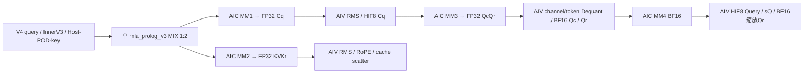
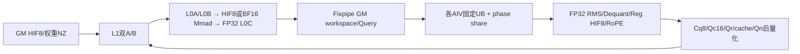
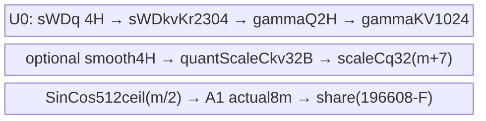

# MLA Prolog V4 HIF8 投影、Query 与逐张量缓存量化 950 ACLNN 算子知识

## 算子速览

| 项目 | 内容 |
|---|---|
| 实际入口 | aclnnMlaPrologV4WeightNzGetWorkspaceSize / aclnnMlaPrologV4WeightNz；固定 kernel dda6、vendor d462、SDK9.2；唯一(w,kv,q)=(5,1,1) |
| 计算语义 | HIF8输入/三投影权重，FP32反量化和RMS→直接HIF8 per-token Cq；BF16吸收投影；HIF8 Query/KV、FP32 Query反量化scale、BF16缩放Qr和分离Kr缓存 |
| 输入输出 | He/H/N/D/64/512维及NZ逻辑/物理视图见下；HIF8不是E4M3或E8M0；cache原地改写 |
| 执行类型 | 单MIX_CV：3个HIF8 AIC_CUBE矩阵乘与第4个BF16矩阵乘；AIV_VECTOR负责反量化、RMS、动态量化、RoPE、scatter；空query不计算 |
| Kernel 路线 | R-001：全部精确cache/empty/actual/RoPE/可选输出子selector的splitN；R-002：空query；R-003：失败终点 |
| 核心资源 | GM分阶段交接；L1 A/B各双128KiB，L0A/B各双32KiB，L0C双64KiB；UB设计192KiB，实际32B向上对齐及动态起点另计 |
| 来源闭包 | source_closed：V4→InnerV3桥→当前Host/POD/key→arch35 HIF8完整body/helpers/构建；generated bridge、通用SDK指令与Runtime为明确框架边界；外部安装二进制身份须与本固定源码一致 |
| 验证状态 | draft：保留未检查的Debug非法key、空query忽略GenKey失败、UB预算对齐及尺寸窄化边界；Query零行scale与异步storage亦有前提。本次未执行安装、编译、真机、数值或性能测试，不作已验证安全实现推荐 |

## 接口与语义

### 计算语义

记T为展平token，H∈{1536,2048}，He为X宽度，N∈[1,128]，D∈{128,192}，g=N(D+64)，h=ND。下面是类型和运算顺序等价式，不能用实数等价替代硬件舍入/归约顺序：

```text
rawCq = Cube_HIF8_FP32ACC(X8,WDq8)                    # [T,H]
Cq = (rawCq * sWDq[channel]) * sX[token]              # channel后token
R = RMS_FP32(Cq,gammaQ,epsQ) * conditional(aq)
Z = R * smooth[channel] if smooth!=nullptr else R
sCq[token] = ReduceMax(abs(Z))/32768                  # M=0没有epsilon钳制
Cq8 = HIF8_CAST_ROUND_SAT(Z/sCq)                     # FP32直接HIF8，无BF16中间
rawQcQr = Cube_HIF8_FP32ACC(Cq8,WUqQr8)              # [T,N,D+64]
QcQr = (rawQcQr*sWUqQr[channel])*sCq[token]
Qc16 = BF16_CAST_RINT(QcQr[:,:,:D])
Qbf = BF16_FIXPIPE(Cube_BF16_FP32ACC(Qc16,WUk16))     # [T,N,512]
Qr0 = BF16_CAST_RINT(rope(QcQr[:,:,D:]) if e else QcQr[:,:,D:])
rawKvKr = Cube_HIF8_FP32ACC(X8,WDkvKr8)               # [T,576]，E1不执行
KvKr = (rawKvKr*sWDkvKr[channel])*sX[token]
CkvF = RMS_FP32(KvKr[:,:512],gammaKV,epsKV)*conditional(ak)
Kr16 = BF16_CAST_RINT(rope(KvKr[:,512:]) if e else KvKr[:,512:])
c=quantScaleCkv[0]；KV8=HIF8_CAST_ROUND_SAT(CkvF*c)；Kr=Kr16
sQ[token,head]=ReduceMax(abs(FP32(Qbf[token,head,:])))/32768
Query=HIF8_CAST_ROUND_SAT(FP32(Qbf)/sQ)
QueryRope=BF16_CAST_RINT(FP32(Qr0)*(c/sQ))；scatter(KV8,Kr16)到分离cache
QN若请求：返回Cq8与每token FP32 sCq；否则Cq8在workspace供MM3。
```

RMS为FP32逐64lane平方加、Reduce SUM、乘FP32倒数、加epsilon、Sqrt、Div、BF16 gamma转FP32相乘；aq/ak仅`abs(scale−1)>=FLT_EPS`时Muls。可选smooth发生在Cq RMS/尺度矫正之后、amax之前。HIF8使用最大有限值32768与Reg CAST_ROUND/SAT，不能换成E4M3最大448或INT8最大127；不存在MX每32元素E8M0分组scale。M=0全零行scale=0、后续表达式0/0，源码没有保证量化payload全0。NaN/Inf与epsilon/scale异常值按这些原语的真实指令链处理，未据实数公式推断完整异常值合同。

RoPE输入相邻even/odd经DeInterleave变为前后半：j∈[0,32)，低半`x[2j]*cos[j]−x[2j+1]*sin[j]`，高半`x[2j+1]*cos[32+j]+x[2j]*sin[32+j]`。Gather将sin前半取负；调用者提供普通sin，不能预先重复取负。e0为compile-time分支，不读sin/cos，保留原投影通道顺序；有关UB仍分配。KV1的c是调用方提供的量化乘数，不是自动amax反量化scale：QuantPerTensorVF<float,HIF8>将FP32 CkvF乘c后HIF8 ROUND/SAT，未先转BF16。Query后量化实际T=BF16：先读MM4已经Fixpipe舍入的Qbf，再Reg cast FP32、amax/32768、HIF8 ROUND，不能改成MM4 FP32累加直接量化。Qr先完成RoPE及第一次BF16舍入，再MulQrVF将BF16升FP32、乘(c/sQ)、RINT回BF16，即使e0也二次缩放。

Query动态量化每head逐token512元素，scale输出FP32[T,N,1]（BSND也展平T）；QNscale是FP32[T,1]。全零Qbf导致sQ0与c/sQ除0，未额外epsilon/fallback。源码maxInt8=127临时Duplicate仍存在，但DynamicQuantPerTokenVf<HIF8>实际采用32768；旧命名/无效临时值不改变HIF8公式。

### 输入、输出与属性

| 参数 | shape/layout | dtype | 约束、默认值与语义 |
|---|---|---|---|
| tokenX | [T,He] TND或[B,S,He] BSND | ACL_HIFLOAT8 | He∈{1024,2048,3072,4096,5120,6144,7168,7680,8192}；B0..65536；T/S公开未设上限但当前Host u32有限 |
| weightDq | 逻辑[He,H]，物理FRACTAL_NZ | HIF8 | InferShape要求逻辑rank2；storage shape可为rank4 NZ；两种rank不能混用 |
| weightUqQr | 逻辑[H,N(D+64)]，NZ | HIF8 | 三投影矩阵中第二级 |
| weightUk | [N,D,512] ND | BF16 | N1..128，D128/192，Nkv仅1 |
| weightDkvKr | 逻辑[He,576]，NZ | HIF8 | 前512 Ckv、后64 Kr |
| dequantScaleX | TND为[T,1]、BSND为[B*S,1]，均为二维ND | FP32 | 每token；不按He/32分组 |
| dequantScaleWDq / WUqQr / WDkvKr | [1,H] / [1,g] / [1,576] ND | FP32 | 每输出channel；不可提供E8M0代替 |
| rmsnormGammaCq / Ckv | [H] / [512] | BF16 | Cq/KV独立RMS |
| ropeSin / Cos | TND[T,64]或BSND[B,S,64] | BF16 | doRope1两者有效；doRope0原始ACLNN要求两个nullptr；Torch空Tensor先折为None |
| kvCache / krCache与Out | KV[T,1,512]或[B,S,1,512]/PA对应；Kr同布局宽64，逐selector见下 | HIF8 / BF16 | mutable原地合同，输入/输出同storage由集成层维持；只有axis0允许合法padding stride，内部轴必须连续 |
| cacheIndex | tokenPA[T]/[B,S]；blockPA[B,ceil(S/P)]或packed一维页表 | INT64 | ND可缺省；页/slot值容量、去重、实际分配由caller保证 |
| actualSeqLen | blockPA+rank2输入时[B] | INT32 | 累计exclusive终点，非每batch长度；应非递减且末值T；Host没有逐值扫描 |
| smoothScalesCq | None或[1,H] | FP32 | 默认None；以指针nullptr判开关，defined但空Tensor不等同合法None |
| quantScaleCkv / quantScaleCkr / kNopeClipAlpha | quantScaleCkv[1]；Ckr与clip disabled | FP32 / 无有效值 | c必需；KV quant及Qr后处理均读c；无自动正值/非零/有限扫描 |
| queryOut / queryRopeOut | [T,N,512]/[T,N,64]或BSND对应形状 | HIF8 / BF16 | MM4先BF16临时片，AIV按token/head量化Query并二次改写Qr |
| dequantScaleQNopeOut | 固定[T,N,1]，BSND同样展平 | FP32 | 必需FP32 sQ，stride N，与QNscale不同 |
| queryNormOut / dequantScaleQNormOut | QN为TND[T,H]或BSND[B,S,H]；QNscale两者均[T,1] | HIF8 / FP32 | 原始queryNormOut nullptr→flag0且两者disabled；nonnull→flag1并必须有scale |
| weightQuantMode / kvCacheQuantMode / queryQuantMode | scalar | int64 | 唯一5/1/1，公开接口一般默认0不能作为此数学默认 |
| epsCq / epsCkv | scalar | double→FP32 | 默认1e−5 |
| qcQrScale / kcScale | scalar | double→FP32 | 默认1；abs差≥FLT_EPS才开Muls |
| cacheMode / ckvkrRepoMode / quantScaleRepoMode / tileSize | scalar | string/int64 | BSND/TND/PA_BSND/PA_NZ/PA_BLK_BSND/PA_BLK_NZ；repo0/scaleRepo0/tile128 |
| doRope | scalar | bool | 默认true；false还有条件Debug selector失败，不能只凭Device body宣布所有构建可运行 |

### 入口与版本

本卡只覆盖V4(5,1,1)的公开ACLNN，CANN9.2.0，950。公开V4产品/模式表、OpDef 950 HIF8配置及Host DAV_3510 selector相互对应。A2/A3没有本w5公开支持，不由通用入口支持或arch目录外推。vendor version.cmake与固定SDK version.cmake为9.2，kernel公开文档明确外置vendor固定d462；9.1或其它vendor提交不由本卡覆盖。

SGL auto/cann注册wrapper懒加载`cann_ops_transformer.mla_prolog`，不自做HIF8数学。固定SGL 9.2默认ops_transformer profile实际固定e7da且arch35只选flash_mla/metadata，**没有选入本MLA Prolog**；因此固定源码闭包成立的集成前提是实际另行安装/加载d462 vendor。common/aclnn_common.h按自定义OPP/LD路径→libopapi_transformer.so→libopapi.so查找并缓存函数，不验证本地二进制SHA。不能把来源固定理解为运行时wheel已匹配。

vendor Torch `mla_prolog.py`注册mutable缓存schema、meta和PrivateUse1，OpBuilder分阶段staging/load编译C++bridge；arg_check仅按可解析签名做类型检查，unknown/Any不新增Tensor语义guard。GetAclDataType对override≥256用值−256：ACL_HIFLOAT8为34，对应290。C++ `IsHifloat8Scene`在w5时只要X或三个投影权重**任一个**actualdtype为Byte就进该分支，要求四个override都解码为HIF8，kvCache还必须提供第五个HIF8 override，然后强制全部四个ACL描述符为HIF8。它不检查四个actualdtype都为Byte，也没有数值转换；混合actualdtype的正确bit编码、元素字节数/容量由caller保证。不能写成“自动量化”或“明确拒绝所有混合dtype”。w5 QN也按HIF8 typedesc输出。kv1 KV与Query typedesc强制HIF8（Torch实际Byte）；Kr/Qr BF16。

C++ `ResolveLogicalDims`对rank4视图用(s0*16,s1*16)，不能等同Host `GetStorageShape`的NZ物理rank4公式；fresh InferShape要求weightDq**逻辑rank2**。推荐合同是逻辑2D权重view+正确实际NZ存储，不能因Tiling接受物理4D就宣布任意逻辑4D ACLNN/Torch参数可用。

[公开集成/API合同](../../../../apis/sgl_kernel_npu/sgl_mlaprolog_v4.md)保留其更宽模式Reference；[非量化950源码实现](sgl_mlaprolog_v4_float_950.md)和[MXFP8 BF16缓存实现](sgl_mlaprolog_v4_w3_kv0_950.md)为不同数学，不能当本HIF8 alias。functional seven-output wrapper的两次clone、Functionalize replace/commit、GE TensorMove不在本原地ACLNN单MIX闭包内。

## Host/Launcher 执行流程

### 参数校验与前处理

V4 GetWorkspaceSize先校验SoC/模式组合、doRope与两个原始rope指针，再用局部TensorHolder为disabled输出/optional构造shape[0]描述符；holder的0xff占位地址无非空有效值可读，不是Device常量。queryNormFlag来自原始QN指针而非holder替换后的指针。随后调用InnerV3两阶段generated bridge；普通AutoContiguous、InferShape、executor封装是框架边界，不能伪造自有copy kernel。

OpDef对普通输入AutoContiguous，对cache IgnoreContiguous；Host只接受内部轴连续、首轴stride≥默认连续跨度的cache，invalid/missing stride描述符有回落默认并warning的路径，caller仍须真实storage匹配。ConvertContext→required stages依次为GetNpuInfo、CheckAttrs、CheckSingleRequiredParam、CheckCacheMode、SetShapeInfo、SetScenarioInfo、CheckScenarParam、CheckQuantMode、CheckDims、CheckSpecialScenarioParamShape、CheckParamByScenario、SetAttrInfo、ProcessBaseInputs，任何checked失败返回GRAPH_FAILED；然后MM1/2/3/4Parameters、FillTiling、CalcWorkSpace、GenTilingKey同样逐项checked。空query在required后提前FillTiling/WS=L/GenKey，**不检查该GenKey返回值**。

### 参数、Workspace 与生命周期

raw GetWorkspaceSize返回W与executor；execute(workspace,W,executor,stream)异步下发，W=0可nullptr。caller保持所有输入/输出、cache、索引、workspace与executor合法到对应stream完成，不能把提交成功当完成。TensorHolder析构销毁临时ACL描述符，由框架桥保留所需执行信息，不据栈地址推断非空Device读。

Torch bridge在OptionalDeviceGuard下用首个Tensor设备的current NPU stream；默认workspaceSize=0/executor=null，HugeMem函数可选，deterministic由配置/weak fallback设置；ConvertTypes创建包含逻辑shape/stride与物理NPUstorage shape/format的ACL描述符，storagebase+storage_offset形成起点。query失败释放描述符并抛出；W>0用本地byteTensor持有workspace。自定义callback捕获转换后描述符tuple、**raw workspace地址**、W、executor和stream，未捕获输入/输出/workspace Tensor对象，也没有SiTU式record_stream；OpCommand Run/队列与allocator保留机制属于框架生命周期边界，源码不能单独证明UAF或自动完成。callback执行ACLNN→ReleaseConvertTypes→可选ReleaseHugeMem→检查返回；Run之后可选UnInitHugeMem。没有用户可见host同步或数值验证。

workspace令L=平台libapi预留，m=Host stepBatchSize，f=queryNormFlag：
```text
W_host = L + 6mH + 2304m + 4mg + 2mh + 32m +1024mN
device relative workspace pointer:
Sscale[0,32m) -> KVKr[32m,32m+2304m)
 -> CqFP32[...,+4mH)
 -> Cq8[...,+(1-f)mH) (f1改用外部QN，不占本片)
 -> QcQrFP32[...,+4mg) -> QcBF16[...,+2mh)  -> MM4_BF16[...,+1024mN)
```
这按当前实际WorkspaceInit顺序，不将libapi L擅自再偏移到每片；此Device函数从传入workspace偏移0开始。Host固定给norm reserve2mH，而实际只用(1−f)mH，差额(mH或2mH)+L是保留量，不是任何片的逻辑容量。空cache仍分配2304m KVKr片但不读写其数学值。末尾BF16[m,N,512]由MM4写、AIV后量化读，必须等flag8；下个m步复用，不能省掉1024mN。

### 启动图与失败传播



blockDim为C=AIC核数，配对V=2C为本正常w5域；GetNpuInfo仅一般允许V=C或2C，GenKey再拒绝3510量化CV1:1。空queryblockDim1，key有效则entry compile-time return，不构造TPipe。normal query失败不启动正常body；Debug Encoder返回INVALID_KEY没有后置检查，行为是非法key终点，不补造fallback。

## Route 与参数设计

### 分核与资源计算

m=min(T,D128?128:64)，headstep=min(N,D128?64:16)，vcore=min(m,V)。MM1 n1=max(32ceil(H/(32C)),64)，b1=ceil(H/n1)；MM2 E0时C≥9→n2=64,b2=9，否则n2=32ceil(576/(32C)),b2=ceil(576/n2)，E1→n2=b2=0；MM3 n3=(D+64)ceil(N/C)，b3=ceil(g/n3)；MM4 h4=ceil(N/C)，b4=ceil(N/h4)。无Nkv8公共分组优化：Nkv公开校验为1。w5不进入只含w3的大T splitM；950不进入只对9201的切KN。

每个非末core按singleN，最后有效core取剩余N；MM1/2 baseN128/baseK256/stepK4，He7680调整stepK3避免K余数；MM3 baseK128/stepK4，m≤64时baseN256且A全载，否则baseN128；MM4 baseN128，D128时baseK128/step1并预载完整WUk，D192改baseK64/step3。Host所传m和tail curm决定Mmad m按16向上对齐，Fixpipe实际mSize=curm；不提交padding行。合法He/H/D的K能整分这些step，不能为本域捏造K尾补零。

### Route 选择

本卡按**一个真实splitN实现族**组织，模板仅cache/E/A/e变化，资源与精度共享；下面精确列出子selector及差异，不按机械笛卡尔积重复相同五节。c=cache枚举，E=emptyMode，A=actualSeqMode，e=enableRope，f=QN开关，s=smooth是否非nullptr。

| 顺序 | Route | Key/模板 | 精确选择条件与优先级 | 不适用去向 |
|---:|---|---|---|---|
| 1 | R-003校验失败 | 无有效key | 上述模式/shape/dtype/cache/非空optional合同任一失败，或T>0且3510 V=C | GRAPH_FAILED/ACLNN错误，不启动有效body |
| 2 | R-002空query | (0,0,0,0,0,2,0,0,1,cv) | required通过且T=0；V=2C时key有效；V=C时GenKey失败被忽略 | 后者R-003 key0终点 |
| 3 | R-003条件Debug失败 | INVALID_KEY | T>0、e0、Host定义ASCENDC_DEBUG且未外部定义MLA_PROLOG_VERSION=3 | tiling仍成功但无匹配有效key；不得假运行正常body |
| 4 | R-001 splitN | K(c,E,A,e) | T>0且全部guard通过，(5,1,1)、3510、V=2C；下表全部精确子selector | 不跨w/kv/q fallback |

```text
checked required
 ├ failure → R003
 ├ T==0 → FillTiling; W=L; GenKey(return ignored); block=1 → R002 or failed-key R003
 └ T>0 → MM1..4/Fill/WS/GenKey checked
           ├ CV1:1→R003 checked failure
           ├ HostDebug && e0 && versionSEL!=3→R003 INVALID_KEY unchecked
           └ K(c,E,A,e)→R001 splitN HIF8
```


| cache子selector | c | A | 逻辑输入/cache与index | E/e/f/s精确变化 | 实际cache body |
|---|---:|---:|---|---|---|
| ND-BSND | 0 | 0 | X[B,S,He]；cache[B,S,1,512]/Kr[B,S,1,64]；无需index | 仅E0×e0/1×f0/1×sNone/valid | ScatterCache<HIF8,false> / ScatterCache<BF16,false>；每token算batch内offset |
| ND-TND | 0 | 0 | X[T,He]；cache[T,1,512]/Kr[T,1,64] | 同上 | token*stride0 |
| tokenPA-BSND | 1 | 0 | cache[pages,P,1,512/64]；index[B,S] | E0/1×e0/1×f0/1×sNone/valid | ScatterCache<HIF8,false> / ScatterCache<BF16,false> |
| tokenPA-TND | 1 | 0 | 同cache；index[T] | E0/1×e0/1×f0/1×sNone/valid | 同body |
| tokenPA-NZ | 2 | 0 | 逻辑cache[pages,P,1,512/64]，物理NZ[pages,KV width/32,P,32；Kr width/16,P,16]；index[T]或[B,S] | E0/1×e0/1×f0/1×sNone/valid | ScatterCache<HIF8,true> / ScatterCache<BF16,true> |
| blockPA-BSND | 3 | 0 | X[B,S,He]；index[B,ceil(S/P)] | E0/1×e0/1×f0/1×sNone/valid | ComputeBlkScatterOffsets→ScatterCacheMultiRows<HIF8,false> / ScatterCacheMultiRows<BF16,false> |
| blockPA-packed | 3 | 1 | X[T,He]；actual[B]累计终点；一维页表 | E0/1×e0/1×f0/1×sNone/valid；额外8mB actual TBuf | 同body，GM标量actual游标 |
| blockPA-NZ-BSND | 4 | 0 | 物理NZ与block页表 | E0/1×e0/1×f0/1×sNone/valid | ScatterCacheMultiRows<HIF8,true> / ScatterCacheMultiRows<BF16,true> |
| blockPA-NZ-packed | 4 | 1 | 物理NZ+actual[B]+一维页表 | E0/1×e0/1×f0/1×sNone/valid；额外8mB actual TBuf | 同body |


表内ND-BSND/ND-TND在T>0时仅E0：Host将cache shape严格绑定[B,S,1,L]或[T,1,L]，首维置0不能通过一致性校验。分页子selector保留E∈{0,1}（T>0且KV cache首维blockNum==0→1，否则0；其它维为零不自动等价，若其它一致性检查失败仍R003），e∈{0,1}受Debug条件限制，f∈{0,1}，s∈{nullptr,valid FP32[1,H]}。f/s不编码key，仍分别改变Cq8指向/UB fixed片及计算；不省略None域。packed blockPA A1额外8mB TBuf；E1跳MM2及RMS/Kr/cache写，Query后量化和c读取仍执行，但仍发/等MM2与free9的配对flag，仍可读取RoPE sin/cos准备；e0不读sin/cos但分配不减。其它A值/非blockPA A1不是Host可达。

K的实际SDK DECL位宽顺序4,2,4,1,1,2,2,2,1,8：cache bit0、scenario bit4、quant bit6、deq bit10、group bit11、E bit12、A bit14、splitM bit16、e bit18、cv bit19；不用源码过期注释的位位置。
```text
K(c,E,A,e)=c + (2<<4) + (13<<6) + (1<<10)
          + (E<<12) + (A<<14) + (e<<18) + (7<<19)
          = 3671904 + c +4096E+16384A+262144e
固定：scenario2, quant13,deq1,group0,splitM0,cv7；ND仅E0，分页E0/1；A由cache表确定。
EMPTY_QUERY有效key=(2<<12)+(1<<18)+(7<<19)=3940352。
```

### 模板/实现执行矩阵

| Route | key/selector | dtype/shape/platform完整命中条件 | 执行族与kernel节点 | 实际模板/body | 内存与同步特征 | tail/fallback |
|---|---|---|---|---|---|---|
| R-001全部子selector | 上述逐c/E/A/e；f/s独立开关 | 950 HIF8/HIF8/HIF8/float；T>0，D128/192，V2C及接口表 | 单MIX_CV：MM1/2→RMS/量化→MM3→Deq/RoPE→MM4/Qn后量化 | MlaPrologVecS1CubS2<MLAPType<HIF8,HIF8,HIF8,float,c,true,false,E,A,false,2,e>>；Process/AicProcess/AivProcess | GM切片按f/E；UB按A/s；cache按c；所有分支边精确见下 | curm更新+strided有效行；无其它math fallback |
| R-002 | EMPTY_QUERY tuple | T=0且GenKey没有提前CV1:1失败 | entry直接return，非Cube计算分支 | mla_prolog_v3 emptyMode constexpr | W=L；TPipe/CTRL无变化 | no-op，cache保持；不声称错误key也no-op |
| R-003 | checked错误/INVALID_KEY/key0 | 校验/CV/Debug/empty忽略返回等条件 | 无合法body保证 | Host失败或框架key dispatch失败终点 | 已分配对象由框架清理，未知key不编造资源 | 不外推确定运行结果 |

### 隐藏性能 Guard

| Guard | Host/Tiling条件 | Device/资源原因 | 影响Route | 不满足时去向 | 源码符号 |
|---|---|---|---|---|---|
| m限幅 | D128→128，D192→64 | L1A128KiB/L0C64KiB以及更宽baseN | R001全部c | Host用更小m而非扩大buffer | ProcessBaseInputs/MmQcQrParamInit |
| A全载/baseN | m≤64且w5/deq1/group0 | mH≤128KiB；64*256*4=64KiB L0C | R001 | m>64→baseN128/分K搬A | MatmulAndSyncQcQr |
| K=7680 | (K/baseK)%4!=0 | step4有余数，公共He7680→3 | R001 MM1/2 | 只在合法He集合更改step；不任意尾补零 | MmCqParamInit/MmCkvKrParamInit |
| CV2 | 3510量化且V=C被拒 | 当前HIF8 MIX1:2路由与双AIV通知 | R001 | R003；T0忽略返回另列 | GenTilingKey |
| UB预算 | 192KiB−usedBytes，非Host平台自动反算 | all InitBuffer独立round32，A1非4倍m时多32B | R001 A1 | 需要真实U0+总量≤pool；源码无新增fallback | VectorBufferInit/SDK TPipe |
| page/stride | P16..1024/16、内轴连续/首轴够大 | Scatter分段单位32B/地址元素尺度 | R001 PA | shape错误Host失败；值容量不扫描 | CheckDims/GetCacheStride0/ScatterCache |
| q/e/None | f由原始QN指针、e由属性、s由指针 | 输出指向/量化/潜在读范围依赖它们 | R001 | optional相互依赖失败；Debug e0另列 | V4 GetWorkspaceSize/ScaleInit |

### POD/ABI

MlaPrologTilingData仅嵌套MlaPrologBaseParams。固定标准布局静态推导sizeof208、align8；188–191为对齐padding，不是字段/容量。以下逐字段列出，u32=uint32_t/32，u16=uint16_t/16，u64=uint64_t/64，f32=float/32；每行ABI给offsetof与大小。未做编译实测布局。

| 结构 | 字段 | 类型/位宽 | ABI布局 | 单位 | Host/launcher producer | Device consumer | 边界 |
|---|---|---|---|---|---|---|---|
| BaseParams | batchSize | u32 | offset0，4B | batch | FillTilingCoreParams←bSize | 实际长度游标/BSND映射 | B≤65536 |
| BaseParams | stepBatchSize | u32 | offset4，4B | token | ProcessBaseInputs→min(T,D128?128:64) | Process步长/WorkspaceInit/BufferInit | T0为0；尾步局部m更新不改分配 |
| BaseParams | mSubSize | u32 | offset8，4B | token | FillTilingCoreParams←mSubSize_ | splitM专用，本实例不读 | 0/非本域 |
| BaseParams | mSubCoreNum | u32 | offset12，4B | core | FillTilingCoreParams←mSubCoreNum_ | splitM专用，本实例不读 | 0/非本域 |
| BaseParams | stepNumHeadDequant | u32 | offset16，4B | head | ProcessBaseInputs→min(N,D128?64:16) | DequantQcAndRopeQc头循环 | 不是head总数 |
| BaseParams | tokenSize | u32 | offset20，4B | token | SetShapeInfo tSize→FillTiling | Process循环T | 外部尺寸转u32，BS乘法需不溢出 |
| BaseParams | seq1Size | u32 | offset24，4B | token | SetShapeInfo s1Size | ND/固定长度blockPA映射 | TND/BSND分域 |
| BaseParams | seq2Size | u32 | offset28，4B | token | SetShapeInfo s2Size | 缓存shape/通用元数据 | 按cache shape |
| BaseParams | headSizeX | u32 | offset32，4B | 元素 | SetShapeInfo heSize | MM1/2 K及地址 | 公开He集合 |
| BaseParams | headSizeCq | u32 | offset36，4B | 元素 | SetShapeInfo hcqSize | MM1 N/MM3 K/RMS | 1536/2048 |
| BaseParams | headSizeCkv | u32 | offset40，4B | 元素 | SetShapeInfo hckvSize | MM2/RMS/Scatter/MM4 | 512 |
| BaseParams | headSizeQc | u32 | offset44，4B | 元素 | SetShapeInfo N*D | MM3 stride/Qc workspace | ND |
| BaseParams | headSizeQr | u32 | offset48，4B | 元素 | SetShapeInfo N*Dr | Qr stride | 64N |
| BaseParams | headSizeKr | u32 | offset52，4B | 元素 | SetShapeInfo drSize | MM2/RoPE | 64 |
| BaseParams | numHeadSize | u32 | offset56，4B | head | SetShapeInfo nSize | MM3/4及AIV头循环 | 1..128 |
| BaseParams | numHeadKvSize | u32 | offset60，4B | head | SetShapeInfo nkvSize | shape/通用分组参数 | 公开仅1，group分支不可达 |
| BaseParams | dimHeadSizeQc | u32 | offset64，4B | 元素 | SetShapeInfo dSize | MM4 K/分半Qc | 128/192 |
| BaseParams | dimHeadRope | u32 | offset68，4B | 元素 | SetShapeInfo drSize | Qr/Kr/SinCos | 64 |
| BaseParams | blockNum | u32 | offset72，4B | page | SetShapeInfo blockNum | Host容量元数据 | Device未作所有正index上界检查 |
| BaseParams | blockSize | u32 | offset76，4B | token | SetShapeInfo blockSize | GetCacheOffset/页表除模 | PA16..1024/16；TND0 |
| BaseParams | mm1BlockNum | u32 | offset80，4B | core | MM1Parameters→ceil(H/n1) | MatmulSplitN UsedBlock | 空query未启动 |
| BaseParams | mm2BlockNum | u32 | offset84，4B | core | MM2Parameters→E?0:ceil(576/n2) | MatmulSplitN UsedBlock | E1跳MM2 |
| BaseParams | mm3BlockNum | u32 | offset88，4B | core | MM3Parameters→ceil(g/n3) | MatmulAndSyncQcQr | tail core n余数 |
| BaseParams | mm4BlockNum | u32 | offset92，4B | core | MM4Parameters→ceil(N/h4) | MM4头数余数 | 非使用核受UsedBlock保护 |
| BaseParams | vectorBlockNum | u32 | offset96，4B | core | ProcessBaseInputs→min(m,V) | ComputeAivOffset行分配 | 尾部curVectorBlockNum跟随curm |
| BaseParams | mm1SingleCoreN | u32 | offset100，4B | 元素 | MM1Parameters n1=max(32ceil(H/(32C)),64) | MM1 NZ权重/输出offset | 最后有效core n余数 |
| BaseParams | mm2SingleCoreN | u32 | offset104，4B | 元素 | MM2Parameters n2=C≥9?64:32ceil(576/(32C)) | MM2 NZ权重/输出offset | E1为0 |
| BaseParams | mm3SingleCoreN | u32 | offset108，4B | 元素 | MM3Parameters n3=(D+64)ceil(N/C) | MM3输出头完整分组 | 每core多个baseN tile |
| BaseParams | mm4SingleCoreBatch | u32 | offset112，4B | head | MM4Parameters h4=ceil(N/C) | ComputeAicOffset/MM4 head loop | 最后core余数 |
| BaseParams | dtileSize | u32 | offset116，4B | cache元素 | SetShapeInfo dtileSize | Scatter tokenStride | KV0/1=512；KV3=656 |
| BaseParams | kvQuantMode | u32 | offset120，4B | enum | SetAttrInfo→FillTiling | Cache量化/属性 | 本卡固定1 |
| BaseParams | tileSize | u32 | offset124，4B | 元素 | attrs tileSize→FillTiling | perTile helper | 固定128；非perTile不计算 |
| BaseParams | ckvkrRepoMode | u32 | offset128，4B | enum | attrs→FillTiling | ScatterKr合并/分离 | KV3为1，KV0/1为0 |
| BaseParams | quantScaleRepoMode | u32 | offset132，4B | enum | attrs→FillTiling | perTile scale合存 | KV3为1，KV0/1为0 |
| BaseParams | queryNormFlag | u32 | offset136，4B | bool | V4原始queryNormOut非空→Innerattr | OutputInit/WorkspaceInit/CopyQueryNormScale | 0临时Cq8；1直接外部QN |
| BaseParams | reciprocalCq | f32 | offset140，4B | 1/元素 | SetAttrInfo→1.0f/H | RmsNormVF Cq | FP32 |
| BaseParams | epsilonCq | f32 | offset144，4B | 数值 | attrs eps→float | RmsNormVF Cq | 默认1e−5；非有限不额外筛 |
| BaseParams | reciprocalCkv | f32 | offset148，4B | 1/元素 | SetAttrInfo→1.0f/512 | RmsNormVF KV | FP32 |
| BaseParams | epsilonCkv | f32 | offset152，4B | 数值 | attrs eps→float | RmsNormVF KV | 默认1e−5 |
| BaseParams | kNopeClipAlpha | f32 | offset156，4B | 数值 | FillTiling没有赋值 | 本实例不读该POD字段；实际helper从GM参数读 | 不能伪造producer |
| BaseParams | qcQrScale | f32 | offset160，4B | 数值 | attrs→float | RMS Cq后Muls | 默认1 |
| BaseParams | kcScale | f32 | offset164，4B | 数值 | attrs→float | RMS Ckv后Muls | 默认1 |
| BaseParams | isQcQrScaleEnable | u16 | offset168，2B | bool | abs(qcQrScale−1)≥FLT_EPS | RMS Cq conditionalMuls | NaN比较不为true |
| BaseParams | isKcScaleEnable | u16 | offset170，2B | bool | abs(kcScale−1)≥FLT_EPS | RMS Ckv conditionalMuls | 同上 |
| BaseParams | mm1NGroup | u16 | offset172，2B | group | FillTilingCoreParams←1 | MM1公共参数/切KN | 3510不切KN |
| BaseParams | mm1KGroup | u16 | offset174，2B | group | FillTilingCoreParams←1 | HostWS/公共参数 | 3510不切KN |
| BaseParams | mm1SingleCoreK | u32 | offset176，4B | 元素 | FillTilingCoreParams←0 | 切KN路径，不在本实例 | inactive |
| BaseParams | mm2NGroup | u16 | offset180，2B | group | FillTilingCoreParams←1 | MM2公共参数 | 3510不切KN |
| BaseParams | mm2KGroup | u16 | offset182，2B | group | FillTilingCoreParams←1 | HostWS/公共参数 | 3510不切KN |
| BaseParams | mm2SingleCoreK | u32 | offset184，4B | 元素 | FillTilingCoreParams←0 | 切KN路径，不在本实例 | inactive |
| BaseParams | kvCacheStride0 | u64 | offset192，8B | cache元素 | ConvertContext/GetCacheStride0 | ScatterCache/GetCacheOffset | 仅axis0可padding；E1=0 |
| BaseParams | krCacheStride0 | u64 | offset200，8B | BF16元素 | ConvertContext/GetCacheStride0 | ScatterKr/GetCacheOffset | KV3空Kr为0；不可拿作合存slot字节stride |

### Route 源码闭包

| Route | Key/selector | Host/Tiling producer | POD/参数 | Kernel entry/router | Kernel body/直接依赖 | 构建接线 |
|---|---|---|---|---|---|---|
| R001逐c/E/A/e+f/s | K精确公式/矩阵 | V4 GetWorkspaceSize→InnerV3→TilingMlaProlog→RunBigKernelTiling/MM1..4/GenTilingKey | 208B全部字段+GM scales/optionals | v3.cpp HIF8 quant13分支/MLAPType实例 | arch35 splitN完整类；Matmul/RMS/Dequant/DynamicQuant/RoPE/Scatter全部实际body | v3 OpDef 950+tiling_register，v3 CMake依赖mla_prolog/shared CMake，auto-sync=off |
| R002 | EMPTY_QUERY tuple | required→FillTiling/GenKey/W=L/block1 | 仍传POD但entry return不读其核心数值 | v3.cpp empty constexpr return | 无kernel helper计算 | 同一entry编译 |
| R003 | 无有效selector | checked failure/ignored失败/Debug Encoder | 不伪造合法POD consumer | INVALID_KEY/key0非已选实例 | 无实际后续保证 | 不补造fallback body |

## Kernel 实现

### 公共执行流程

合法entry先读CTRL60旧值，注册208B POD及MIX_AIC_1_2；EMPTY_QUERY在TPipe构造前return。正常entry提取tiling，**构造TPipe后再清CTRL60**，调用所选Init/Process，退出时恢复仅bit60，随后作用域TPipe析构进行SDK管线清理；并不保存/恢复整个CTRL。这与其它算子TPipe Reset之后再次覆盖CTRL的顺序不能混淆。

只有一个launch，四MM是同一MIX内阶段，不是四kernel。GM workspace在m步循环复用；CopyGlobalParams只首步读gamma/固定scale/smooth；last step更新MM参数m和AIV分工，Cq8外部QN、Query/Qr地址随batchOffset推进。AIC/MM与AIV的分核策略不同，必须保留allVector屏障。Nkv8公共group和其它dtype的uninstantiated代码不进入本算子。

### Route R-001：HIF8 splitN与精确缓存子selector

#### 适用条件

##### 选择证据

| 层级 | 文件 | 符号 | 源码谓词/参数 | 结果/下一跳 |
|---|---|---|---|---|
| API | v3/op_api/aclnn_mla_prolog_v4_weight_nz.cpp | GetWorkspaceSize | w5/kv1/q1，950，rope/null与output合同 | InnerV3 |
| Host | mla_prolog/op_host/mla_prolog_tiling.cpp | SetScenarioInfo/ProcessBaseInputs/GenTilingKey | T>0、quant13、deq1/group0、splitM0、c/E/A/e矩阵、CV7 | K(c,E,A,e) |
| Router | v3/op_kernel/mla_prolog_v3.cpp | HIF8_FULL_QUANT_KV_QUANT_PER_TENSOR | scenarioQUANT且quant13 | MLAPType<HIF8,HIF8,HIF8,float,c,1,0,E,A,false,2,e> |
| Body | mla_prolog/op_kernel/arch35/kernel_mla_prolog_split_n_arch35.h | Process/AicProcess/AivProcess | 各compile-time selector+f/s运行期开关 | 下述精确参数化body，无另外数学合并 |

#### Device 数据流

##### 函数级调用链

```text
mla_prolog_v3 -> Init -> OutputInit/ScaleInit/MmParamInit/WorkspaceInit
  -> AIC CubeBufferInit 或 AIV VectorBufferInit
  -> Process(m-step)
     AIC AicProcess:
       MatmulSplitN MM1 -> set6(FIX)
       wait9 -> MatmulSplitN MM2(E1return) -> set4(FIX)
       wait6(RMS) -> MatmulAndSyncQcQr -> 每Ntile set10(FIX)
       PreloadQnAndSync -> MatmulQnSyncDynamicQuantAndMulQr<true>
     AIV AivProcess:
       首轮CopyGlobalParams；CopyInSinCos
       wait6(MM1) -> allVec7 -> RmsNormCq/RmsNormCqProcess
       RmsNormDynamicQuant -> RmsNormNormal -> Dequant -> RmsNormVF -> HIF8 DynamicQuant
       CopyDequantScaleCq(Brcb)/CopyQueryNormScale -> allVec7 -> set6(RMS)
       wait4 -> allVec7 -> RmsNormRopeScatterCkvKr(E1return) -> set9
       DequantQcAndRopeQc -> DequantAndRopeSplitN
       wait10 -> DequantQcQrSplitN / RopeQrSplitN -> set7按head/分组
       DynamicQuantQnAndMulQrSyncMMQn→每head wait8→DynamicQuantQnWithMulQr→DynamicQuantMultiRow/DynamicQuantPerTokenVf<BF16,float,HIF8>→Brcb scale→MulQr/MulQrVF
     AIC drain所有local bank events及free9
```

##### 源码等价伪码

```text
# 伪码，保留编译selector与运行期开关
allocate fixed buffers; prime local bank events; AIV prime free9;
for t0 in range(0,T,m):
    curm=min(m,T-t0); 更新MM的m/尾步AIV分工
    AIC:
        MM1所有本core Ntile: ND X->L1NZ, NZ WDq->L1, L1->L0; HIF8 mad FP32; Fixpipe Cq
        set mode2/FIX 6; wait mode2 free9
        if E==0: 同样MM2→KVKrFP32
        set mode2/FIX 4; wait mode2 RMS6
        MM3按head分配core/baseNtile:
            m<=64全载Cq8到L1A；否则Kstep分块A
            HIF8 mad FP32，Fixpipe QcQr; 每Ntile发布mode2/FIX10
        MM4各head等待mode2/7（head>15每2head/末尾批次）
        D128预载WUk全K；D192分Kstep3；BF16 mad FP32/Fixpipe BF16
        每head Fixpipe BF16到workspace MM4_BF16；发布mode2/FIX8，不直接写HIF8 Query
    AIV:
        首步搬固定scales/gamma/smooth；e1搬当前sin/cos
        wait6; allVec7; for 自己有效token:
            Cq channel then token scale -> FP32 RMS/aq -> smooth? -> amax/32768 -> HIF8
            写f?外部QN:workspaceCq8；Brcb每scale8个float到Sscale
            f1额外DataCopyPad FP32 scale输出
        allVec7; gather当前m*32B scale；set6
        wait4; allVec7
        E0 for 自己有效token:
            按cache selector计算slot/page/ND目标
            Ckv channel/token scale→RMS/ak→FP32乘c→HIF8 ROUND/SAT
            Kr channel/token scale→(e?RoPE:identity)→BF16
            两cache或合存区域写入，负slot/page偏移跳写
        set9; 按baseN完成点wait10
        每head两AIV各处理D/2 Qc通道，channel/token Dequant→RINT BF16到Qc16
        Qr各AIV处理floor/ceil(curm/2)行，FP32 Dequant/RoPE→BF16有效strided输出
        mode2/7通知本head数据可供MM4
        各AIV分floor/ceil(curm/2)行；每head wait8，即使本AIV row0也消费通知，helper row0return；量化Qbf并输出sQ；原Qr0读回→FP32*(c/sQ)→RINT BF16回写
```

#### 内存与数据搬运

##### 资源与搬运表

| 层级/缓冲区 | offset/地址公式 | extent/容量公式 | dtype/layout | producer | consumer | owner/lifetime | 对齐/复用 |
|---|---|---|---|---|---|---|---|
| GM输入/权重/outputs | X[t0*He]；WDq[cb*n1*He]、WDkvKr[cb*n2*He] NZ；WUqQr按cb*n3*H；WUk[head*D*512] | 接口表实际分配；Query/Qr有效T行 | HIF8/BF16/FP32与NZ | caller/AIC/AIV | 四MM及Vector | caller到stream完成 | 逻辑view与物理NZ一致；不复制量化bit编码 |
| Sscale | W+0 | 32m | FP32每行8重复 | AIV Brcb/MTE3 | AIV Dequant | launch/每步复用 | allVec7→RMS6；不是E8M0 |
| KVKr | W+32m | 2304m | FP32[m,576] | AIC MM2 | AIV KV/Kr | launch，每步free9保护 | E1片仍预留但跳数学 |
| Cq / Cq8 | W+32m+2304m；后移4mH | 4mH+(1−f)mH | FP32/HIF8 | MM1/RMS | RMS/MM3 | launch；f1 Cq8外部QN | 不将不同dtype原地重叠 |
| QcQr / Qc16 | 其后依次 | 4mg / 2mh | FP32[m,g]/BF16[m,h] | MM3/AIV Dequant | AIV/MM4 | launch/逐head交接 | baseN10→cast7 |
| MM4_BF16 | Qc16尾后，relativeDevice W+32m+2304m+4mH+(1−f)mH+4mg+2mh | 1024mN | BF16[m,N,512] | AIC MM4 Fixpipe | AIV DynamicQuantQnAndMulQr | launch/当前m步 | 每head连续512，跨row stride512N；每head flag8 |
| L1 A/B | 两bank=(iter&1)*131072 | 各262144B，总524288B | HIF8或BF16 NZ | MTE2 | MTE1 | AIC TPipe | A事件4/5，B6/7；无HIF8 scale额外L1片 |
| L0A/L0B | (iter&1)*32768 | 各65536B | HIF8/BF16 | MTE1 | Mmad | AIC TPipe | A3/4，B5/6 |
| L0C | (iter&1)*65536 | 131072B | FP32 | Mmad | Fixpipe | AIC TPipe | FIX_M3/4；最后K完成才提交 |
| UB固定 | 从U0按InitBuffer顺序累加Align32(size) | F见下 | FP32/BF16/临时int64 | CopyGlobalParams/各Vector | RMS/Deq/RoPE | 每AIV TPipe | 不是跨AIV共享UB；无TQue |
| UB share | U0+各固定片物理span | Align32(196608−F) | 阶段临时alias | 当前Vector阶段 | 同阶段搬运/计算 | RMS→KV/Kr→Qc/Qr/Qn后量化复用 | phase pipe/event之后复用，不能把scratch峰值相加 |
| Reg | RegTensor<float/HIF8/BF16>，256B向量寄存器接口 | VF逻辑64 FP32 lane；非独立UB | FP32计算/packed8bit | LoadAlign/算术 | StoreAlign/flush | VF调用 | mask保护count；不凭Reg对象数推物理寄存器配额 |

##### 分层内存布局





##### 字节账、交接边与复用顺序

```text
F = 4H+2304+2H+1024+s*4H+32(m+7)+512ceil(m/2)+A*8m +32
UB_actual = sum Align32(each fixed size)+Align32(196608-F)
          = 196608 + (A && m%4!=0 ? 32 : 0)
安全必要条件 U0+UB_actual <= SDK真实UB pool末址；U0=GetDynamicMemStartPos()，不是假定0。
L1 = 2*128KiB A + 2*128KiB B；L0A/B各2*32KiB；L0C2*64KiB。
MM1/2 m128*Kstep1024HIF8=128KiB A；baseN128*Kstep1024=128KiB B。
L0A128*256=32KiB，L0B256*128=32KiB，L0C128*128*4=64KiB。
MM3 m<=64,Nbase256,K128：L0C最多64KiB，mH最大128KiB。
RMS Cq share峰：Rq +32v+32+8Rq =9H+32v+32。
KV/Kr share峰按当前量化特化见后式。KV1 Ckv阶段prefix32+512v、out512B、normOut2048B、normShared2048B，共4640+512v；Kr仍800+512v。另固定quantScaleCkv32B保存Pad读入的c。
Qc share：count=curm*D/2，4count+32+max(2D,2count)。
Qr share：rows=floor/ceil(curm/2)，cnt64rows，12cnt+256，rows<=64时<=49408B。
Query后量化：r=(curm+subIdx)/2≤64，a=min(r,16)，b=min(r,64)，z=Align8(a)，R=Align8(r)。实际offset/extent：inputHalf0/1024a；qrInput在1024a/128r；+32padding后outputQr/128b；再+32后inputLocal，接4a512、outputLocal再4a512、maxInt8Tensor4z、dynamicQuantUb(4a512+32z)、scaleOutput4R、scaleBrcb32R。最高末址=7168a+128(r+b)+64+36(z+R)，r64为134016B；r0helper直接return。MulQr复用inputLocal作为FP32 Qr。部分老临时区计算未用，但后继scale地址仍按完整offset推进，不能省掉空隙。最紧正常D128/H2048/s1/m128时F60928B，share135680B，高水位134016B低1664B；这是静态公式比较，仍需实际U0/pool。
这些峰值按阶段分别对196608-F核算；所有当前合法参数仍需实际SDK动态起点与池容量。
```


Cq scale每token仅首float有效、跨32B。CopyDequantScaleCq repeat=v/{1,1}每次读8float写8块，后次从下一块覆盖前次padding；前v块最终各保留token首scale，末尾7块预留，解释32(m+7)片。Query后处理scaleOutput是连续标量，repeat=ceil(r/8)/{1,8}展开R个32B块；scaleCopy只提交r行。两种Brcb参数不能混同。

actual8m TBuf只Get<int64_t>，本body未将actualSeqLen拷成它的快照；实际用int32 GM标量读。除该片外固定请求均32B倍数，actual与share分别round32，故A1且m非4倍比设计预算多32B，这是预算静态不一致，**不能仅此声称超过950实际UB物理容量**。普通连续DataCopy的GM地址按元素字节对齐、UB地址32B、长度32B；DataCopyPad用于标量/短尾，不能把GM所有地址都要求32B。


缓存逐子selector地址完整如下。aKV/aKr为真实首轴stride，off均以各自元素计，P为page大小，u为展平token，r为tokenPA的index值；若E1全部cache数学/提交均跳过：

| c/A | KV/Kr目标地址公式 | DataCopy实际范围/边界 |
|---|---|---|
| c0 TND | u*aKV / u*aKr | KV HIF8 512元素、Kr BF16 64元素连续；Init不绑定index且Scatter不会读取index |
| c0 BSND | floor(u/S)*aKV+(u%S)*512；Kr以aKr/64替换 | 同上，首轴padding允许 |
| c1 | floor(r/P)*aKV+(r%P)*512；Kr以aKr/64替换 | r<0跳写；r正值没有总页容量guard |
| c2 | floor(r/P)*aKV+(r%P)*32；Kr floor(r/P)*aKr+(r%P)*16 | KV16段col0=32HIF8、Kr4段col0=16BF16，每段32B，dstStride=P−1个32B单元 |
| c3 A0 | b=floor(u/S)，t=u%S，页表off=b*ceil(S/P)+floor(t/P)，page=index[off]；dst=page*aKV+(t%P)*512 | Kr替换aKr/64；row固定1，合法pos时不跨page |
| c3 A1 | 游标找到prevPrefix≤u<curPrefix；t=u−prevPrefix，tableBase=此前各batch ceil(length/P)之和；其余同c3 A0 | 原文先read actual[curBatch]再++；首边界可重复读首prefix再advance；仍需累计终点合法 |
| c4 A0/1 | 与c3相同页表；KV dst=page*aKV+(t%P)*32；Kr page*aKr+(t%P)*16 | KV HIF8/Kr BF16各自NZ分段32B；Kr同aKr；合法row1不spill |

MaterializeOffsetsWithHeadSize仍有needSpill/nextPage辅助分支：多row跨page时按rowsLeft分两段；当前vectorRow=1与合法P/pos使它不可达。不能为了公共helper存在而宣布当前每token跨页，也不能删掉A1的真实游标。负page生成负offset时跳提交，正page容量/索引长度/重复写没有自有全面校验。


| 边/复用子区 | producer | offset/extent | dtype/layout | consumer | ordering/sync | owner/lifetime | 安全条件 |
|---|---|---|---|---|---|---|---|
| MM1→RMS | AIC Fixpipe | Cq 4mH | FP32 | AIV | mode2 FIX6→wait6/allVec7 | 每m步workspace | tail只curm有效行 |
| Cq8+scale→MM3 | AIV/MTE3 | Cq8(mH或external)+Sscale32m | HIF8/FP32 | AIC MTE2；AIV后续deq | allVec7→setMTE3 RMS6 | 当前step；QN全T外部 | 不删allVec，不用paired完成替代全vector |
| MM2→cache→下一步MM2 | AIC→AIV→AIC | KVKr2304m | FP32→HIF8 / BF16 | RMS/RoPE/scatter | FIX4→wait4/allVec7→MTE3 free9；Init先prime9，最后AIC drain9 | 当前step复用 | E1两端保留通知而不读未写KVKr |
| MM3→Qc16→MM4 | AIC→pairedAIV→AIC | QcQr4mg/Qc16 2mh | FP32/BF16 | Dequant/MM4 | 每Ntile FIX10；head齐后MTE3 cast7 | 本head有效行 | >15head每2或末尾批次发/等次数一致 |
| Qr→output | AIV | T*N*64*2有效strided行 | BF16 | caller/AIV MulQr | V_MTE3/pipe；MTE3_MTE2事件0确保本AIV Qr0写出再读回 | caller到流完成 | row floor/ceil分半、N/D stride一致 |
| L1/L0 bank复用 | MTE2/MTE1/Mmad/FIX | 上述pingpong span | HIF8/BF16/FP32 | 下一tile | MTE1_MTE2、MTE2_MTE1；M_MTE1、MTE1_M；FIX_M/M_FIX或unitFlag3 | AIC TPipe | iter&1与event相配，末尾drain |
| share phase alias | 当前RMS/KV/Kr/Qc/Qr/Qn后量化 | 各phase峰值/固定share容量 | FP32与目标dtype | 后继phase | MTE3_V、MTE3_MTE2、V_MTE2、MTE2_V、V_MTE3 | 当前AIV | output/scale alias仅在前段Dequant已结束后写 |

#### 同步、精度与尾块

##### 同步与数值边界表

| 阶段 | primitive/机制 | producer | consumer/等待点 | 保护对象 | 精度/尾块 |
|---|---|---|---|---|---|
| Cq全局交接 | mode2 MM6/RMS6 + mode0 allVec7 | AIC / 全AIV | AIV / AIC | 不同分核策略的整mH Cq8 | FP32反量化channel再token、RMS再smooth、HIF8 ROUND/SAT |
| KV复用 | mode2 free9 prime/每轮/末尾drain | AIV MTE3 | AIC下一MM2 | 同一KVKr workspace | E1helper return仍配对，未写值不读 |
| MM3/Qc | mode2 FIX10/cast7 | AIC每baseN tile / pairedAIV | AIV完整head / MM4 | QcQr/Qc16 | FP32原地Dequant后CAST_RINT BF16；Qc每AIV D/2，tailcurm |
| MM4 | BF16 native Mmad FP32ACC / Fixpipe F322BF16 | AIC | Query/Qn后量化 | L0C/Query片 | D128预载、D192K64*3；unitFlag3只fullspecialization，split显式M_FIX |
| MM4→Query后量化→Qr缩放 | 每head mode2/FIX8；V_MTE2输入0/MTE3_V输出3；Qr输入3/计算1 | AIC MM4 / AIV DynamicQuant | pairedAIV逐head wait8 / MulQr | Qbf临时片、sQ与原地Qr | BF16→FP32→HIF8 ROUND；Qr BF16→FP32*(c/sQ)→BF16 RINT；r0也先消费8 |
| 本地DMA | V_MTE2(0/1)、MTE2_V(0/1)、V_MTE3(0/2)、MTE3_V(0/1)、MTE3_MTE2(0/1) | 当前pipe | 对应等待 | share/scale/cast输出 | flag已等再写；连续row字节32B合法；标量用Pad |
| Reg与RoPE | FP32 Reg64lane/DeInterleave/Cast | Vector | Qr/Kr | 每64dim pair/有效行 | e0无sin读取而保持投影原序；e1 FP32RoPE后RINT BF16 |
| CTRL/退出 | savebit60→TPipe→clear60→Process→restore60→TPipe析构 | entry/SDK | kernel末尾 | HIF8 overflow模式/管线 | empty先return；未声称恢复整个CTRL或host同步 |

#### 关键实现

##### 符号证据表

| 阶段 | 文件 | 符号/模板实例 | 实现事实 |
|---|---|---|---|
| Host/Tiling producer | attention/mla_prolog/op_host/mla_prolog_tiling.cpp | ProcessBaseInputs/MM1..4Parameters/FillTiling/CalcWorkSpace/GenTilingKey | 当前w5无splitM，无切KN，c/E/A/e精确编码 |
| Kernel entry/router | attention/mla_prolog_v3/op_kernel/mla_prolog_v3.cpp | HIF8_FULL_QUANT_KV_QUANT_PER_TENSOR / MLAPType | HIF8/HIF8/HIF8/float，deq1/group0/pertilefalse |
| Device body/helper | attention/mla_prolog/op_kernel/arch35/kernel_mla_prolog_split_n_arch35.h | MatmulAndSyncQcQr/DequantAndRopeSplitN/ScatterCkv/ScatterKr | MM3 baseN与A全载，逐tile同步/有效cache地址 |
| Device body/helper | attention/mla_prolog/op_kernel/arch35/service_matmul_arch35.h | MatmulSplitK/MatmulFullLoad/MatmulL0 | MM1/2/3 HIF8实际非MX native mad；MM4 BF16当前实例 |
| Device body/helper | attention/mla_prolog/op_kernel/arch35/service_rms_norm_arch35.h | RmsNormDynamicQuant<float,BF16,float,float,HIF8,float> | FP32 RMS直接HIF8，不选BF16→MX分支 |
| Device body/helper | attention/mla_prolog/op_kernel/arch35/vf/vf_dynamic_quant.h | ComputeVFImpl<float,float,HIF8,0> | amax/32768、M0无eps、CAST_ROUND/SAT与PACK4 |
| Device body/helper | attention/mla_prolog/op_kernel/arch35/service_rotary_position_embedding_arch35.h | RotaryPosEmbPerHead / PerTensor | channel后token反量化；FP32RoPE/CAST_RINT BF16 |

### Route R-002：空query无计算

#### 适用条件

##### 选择证据

| 层级 | 文件 | 符号 | 源码谓词/参数 | 结果/下一跳 |
|---|---|---|---|---|
| Host | mla_prolog_tiling.cpp | RunBigKernelTiling/GenTilingKey | required通过，T0；CV2成功编码 | empty tuple、W=L、block1 |
| entry | mla_prolog_v3.cpp | emptyMode EMPTY_QUERY | compile-time2 | 直接return |

#### Device 数据流

##### 函数级调用链

```text
V4 -> required checks -> T0 FillTiling/GenKey -> mla_prolog_v3 -> return before TPipe
```

##### 源码等价伪码

```text
# 伪码
required();
if tokenSize==0:
    FillTiling(); W=L; GenTilingKey(); # 原文未检查返回
    blockDim=1;
entry valid EMPTY_QUERY: return;
```

#### 内存与数据搬运

##### 资源与搬运表

| 层级/缓冲区 | offset/地址公式 | extent/容量公式 | dtype/layout | producer | consumer | owner/lifetime | 对齐/复用 |
|---|---|---|---|---|---|---|---|
| GM/cache | caller原地址 | 空query有效元素0；cache保留 | 接口原dtype | caller | entry不读写 | caller/stream | 无Device搬运 |
| workspace | pointer | L框架预留 | byte | query/caller | 此body不使用 | caller到完成 | 不等同任意W0 |
| L1/L0/UB/Reg scratch | N/A | 0自有TPipe资源 | N/A | N/A | N/A | 无构造 | 不套R001资源 |

##### 分层内存布局


##### 字节账、交接边与复用顺序

```text
W=L；自有L1/L0/UB scratch=0；没有跨族数据边。
```

| 边/复用子区 | producer | offset/extent | dtype/layout | consumer | ordering/sync | owner/lifetime | 安全条件 |
|---|---|---|---|---|---|---|---|
| 无自有交接 | N/A | 0 | N/A | N/A | stream提交顺序 | caller | 必须是有效EMPTY_QUERY key，不含GenKey失败key0 |

#### 同步、精度与尾块

##### 同步与数值边界表

| 阶段 | primitive/机制 | producer | consumer/等待点 | 保护对象 | 精度/尾块 |
|---|---|---|---|---|---|
| return | compile-timeif | entry | 无 | 无 | 不进行数值计算；读取旧CTRL但未改变 |

#### 关键实现

##### 符号证据表

| 阶段 | 文件 | 符号/模板实例 | 实现事实 |
|---|---|---|---|
| Host/Tiling producer | attention/mla_prolog/op_host/mla_prolog_tiling.cpp | RunBigKernelTiling | 先required，后T0特殊逻辑 |
| Kernel entry/router | attention/mla_prolog_v3/op_kernel/mla_prolog_v3.cpp | EMPTY_QUERY | TPipe之前return |
| Device body/helper | attention/mla_prolog_v3/op_kernel/mla_prolog_v3.cpp | mla_prolog_v3 | 无核心helper；不是缺源 |

### Route R-003：校验与未匹配key终点

#### 适用条件

##### 选择证据

| 层级 | 文件 | 符号 | 源码谓词/参数 | 结果/下一跳 |
|---|---|---|---|---|
| Host | mla_prolog_tiling_check.cpp | CheckParamByScenario/CheckDims等 | 真实shape/dtype/模式检查失败 | GRAPH_FAILED |
| Host | mla_prolog_tiling.cpp | GenTilingKey | 正常w5+CV1:1 | checked失败；T0却忽略返回保留初始化key0 |
| SDK | impl/utils/tiling/template_argument.cpp | EncodeTilingKey | HostDebug，SEL只有rope1但输入e0 | INVALID_KEY返回；GenKey未查此值 |

#### Device 数据流

##### 函数级调用链

```text
checked错误 -> GRAPH_FAILED -> ACLNN错误
T0+GenKey失败 -> GRAPH_SUCCESS/key0 -> 无有效EMPTY_QUERY保障
HostDebug e0/versionSEL!=3 -> INVALID_KEY -> 无匹配有效实例保障
```

##### 源码等价伪码

```text
# 伪码，不能为错误key补Device路径
if checkedStageFailed: return GRAPH_FAILED
if T0: GenKeyReturnIgnored(); return SUCCESS
key=GET_TPL_TILING_KEY(...); # 可返回INVALID_KEY
return SUCCESS;             # 原文没有key合法性后查
```

#### 内存与数据搬运

##### 资源与搬运表

| 层级/缓冲区 | offset/地址公式 | extent/容量公式 | dtype/layout | producer | consumer | owner/lifetime | 对齐/复用 |
|---|---|---|---|---|---|---|---|
| Host已建对象 | 实际分配 | 框架相关 | 描述符/executor | Host | cleanup | 框架/caller | 不推定错误key运行轨迹 |
| Device各层 | 无有效实例可归属 | 不声明正常资源 | N/A | N/A | N/A | N/A | 不把R001资源当错误key保证 |

##### 分层内存布局


##### 字节账、交接边与复用顺序

```text
不为错误selector补造workspace/L1/L0/UB容量或后续consumer。
```

| 边/复用子区 | producer | offset/extent | dtype/layout | consumer | ordering/sync | owner/lifetime | 安全条件 |
|---|---|---|---|---|---|---|---|
| 无有效边保证 | Host | 不确定后续 | N/A | 框架错误处理 | API返回/框架dispatch | 框架/caller | 错误应传到caller，不假设空算子或成功输出 |

#### 同步、精度与尾块

##### 同步与数值边界表

| 阶段 | primitive/机制 | producer | consumer/等待点 | 保护对象 | 精度/尾块 |
|---|---|---|---|---|---|
| 失败传播 | GRAPH_FAILED或未检查key值 | Host/SDK encoder | ACLNN/framework | 不保证后续正常body | 未运行；不能宣称一定挂死/越界/合法输出 |

#### 关键实现

##### 符号证据表

| 阶段 | 文件 | 符号/模板实例 | 实现事实 |
|---|---|---|---|
| Host/Tiling producer | attention/mla_prolog/op_host/mla_prolog_tiling.cpp | RunBigKernelTiling/GenTilingKey | CV拒绝先于empty编码；empty忽略返回 |
| Kernel entry/router | attention/mla_prolog/op_kernel/mla_prolog_template_tiling_key.h | MLA_ENABLE_ROPE_SEL | Host默认VERSION−1只rope1，Device TU VERSION3含0/1 |
| Device body/helper | attention/mla_prolog_v3/op_kernel/mla_prolog_v3.cpp | mla_prolog_v3 | 可见e0 body不修复HostDebug无匹配key |

## 算子特定优化

### Trick T-001：HIF8小M采用更宽N及A全载

#### 触发与源码依据

- 适用 Route：R-001全部表内子selector。
- 触发条件：950 w5/kv1/q1，当前m与类型按下述机制；E1只跳KV计算，不改变MM3条件。
- Golden 来源：[attention/mla_prolog/op_kernel/arch35/kernel_mla_prolog_split_n_arch35.h:495–511](https://gitcode.com/cann/ops-transformer/blob/d462156cf5d97712fcfeef95070d649f47d3bb6e/attention/mla_prolog/op_kernel/arch35/kernel_mla_prolog_split_n_arch35.h#L495-L511)

**官方源码（固定 Commit 连续逐字摘录）**：

```cpp
    mmQcQrParam_.baseK = (sizeof(mmQcQrInputType) == ONE_BYTE_TYPE_SIZE) ? 128 : 64;
    if constexpr (MLAPT::enableGroupComputeOpt) {
        mmQcQrParam_.baseN = 128;
    } else {
        if constexpr (std::is_same<mmInputType, FP8E4M3>::value &&
                      isFp8E8m0) { // FP8全量化场景下L1B用满，修改baseN会造成内存踩踏
            mmQcQrParam_.baseN = 128;
        } else {
            if (mmQcQrParam_.m <= 64) { // FP8全量化场景，scale需要额外占用L1，该优化不适用
                mmQcQrParam_.baseN = 256;
            } else {
                mmQcQrParam_.baseN = 128;
            }
        }
    }
    mmQcQrParam_.stepK = 4;
    mmQcQrParam_.kL1StepSize = mmQcQrParam_.baseK * mmQcQrParam_.stepK;
```

#### 机制与设计原因

w5不是FP8+E8M0分支。m≤64把MM3 baseN从128升256、baseK128/step4，配合MatmulAndSyncQcQr A全载mH≤128KiB，L0C最大64*256*4=64KiB。m>64退baseN128；D192 Host mcap64恰好始终在宽N侧。MM1/2/4保持自己的base/step，不能全局替换为256。

#### 迁移边界

- 适用：相同HIF8 FP32输出MM3
- 前提：精确128KiB L1A与64KiB L0C容量、m/H上界、完整分N同步
- 失效：不满足时保留原else路径或Host失败；不能发明更大资源fallback。
- 未验证：本次知识提取未执行编译、真机、数值或性能测试。

#### 错误做法

固定源码明确将FP8+E8M0锁baseN128，照搬此优化到MX会触及注释指出的L1B额外scale容量；本w5没有该scale子区。

### Trick T-002：FP32归一化值直接以HIF8 ROUND打包

#### 触发与源码依据

- 适用 Route：R-001全部表内子selector。
- 触发条件：950 w5/kv1/q1，当前m与类型按下述机制；E1只跳KV计算，不改变MM3条件。
- Golden 来源：[attention/mla_prolog/op_kernel/arch35/vf/vf_dynamic_quant.h:118–127](https://gitcode.com/cann/ops-transformer/blob/d462156cf5d97712fcfeef95070d649f47d3bb6e/attention/mla_prolog/op_kernel/arch35/vf/vf_dynamic_quant.h#L118-L127)

**官方源码（固定 Commit 连续逐字摘录）**：

```cpp
        if constexpr (std::is_same<O, fp8_e4m3fn_t>::value) {
            AscendC::Reg::Cast<O, float, castTraitPack2>(yOutput, xNorm, validMask2);
        } else if constexpr (std::is_same<O, hifloat8_t>::value) {
            AscendC::Reg::Cast<O, float, castTraitF32ToHif8>(yOutput, xNorm, validMask2);
        } else {
            AscendC::Reg::Cast<half, float, castTraitF32ToHalf>(yHalf, xNorm, validMask2);
            AscendC::Reg::Cast<O, half, castTraitPack2>(yOutput, yHalf, validMask2);
        }
        AscendC::Reg::StoreAlign<O, AscendC::Reg::StoreDist::DIST_PACK4_B32>(addr, yOutput, validMask2);
    }
```

#### 机制与设计原因

当前实际O=HIF8选择第二个if constexpr分支，castTraitF32ToHif8是ZERO/SAT/ZEROING/CAST_ROUND。之前FP32 RMS/optional smooth和amax/32768；M0无epsilon钳制。Reg Store PACK4_B32是打包，不是改成E8M0 scale。SDK3510 trait最终映射HIF8 vcvt。

#### 迁移边界

- 适用：本w5 Cq及相同HIF8 pertoken路径
- 前提：保持FP32中间、max32768、无epsilon条件、有效mask与StoreUnAlignPost scale flush
- 失效：不满足时保留原else路径或Host失败；不能发明更大资源fallback。
- 未验证：本次知识提取未执行编译、真机、数值或性能测试。

#### 错误做法

固定仓未给本w5可验证运行反例；不能以E4M3 RINT/448或MX BF16中间替换后仍宣称同一数值实现。

### Trick T-003：全Vector完成再通知Cube并复用KV片

#### 触发与源码依据

- 适用 Route：R-001全部表内子selector。
- 触发条件：950 w5/kv1/q1，当前m与类型按下述机制；E1只跳KV计算，不改变MM3条件。
- Golden 来源：[attention/mla_prolog/op_kernel/arch35/kernel_mla_prolog_split_n_arch35.h:925–943](https://gitcode.com/cann/ops-transformer/blob/d462156cf5d97712fcfeef95070d649f47d3bb6e/attention/mla_prolog/op_kernel/arch35/kernel_mla_prolog_split_n_arch35.h#L925-L943)

**官方源码（固定 Commit 连续逐字摘录）**：

```cpp
    WaitAllCore<SYNC_MODE_ALL_VEC, PIPE_MTE3>(FINISH_VEC_ALL);
    RmsNormCq(tokenIndex, aivOffset.rmsNormCqOffset, rmsNormCqResOffset, aivOffset.curVecToken,
              aivOffset.curBlockTokenOffset);
    // 由于RmsNormCq和MatmulQcQr的分核策略不一样，需要等所有vector上的RmsNormCq执行完成后才能启动MatmulQcQr
    // 需要所有vector核上的RmsNormCq执行完成后，才发起MatmulQcQr的执行
    WaitAllCore<SYNC_MODE_ALL_VEC, PIPE_MTE3>(FINISH_VEC_ALL);

    // 聚合全部scale结果
    if constexpr ((MLAPT::enableDequantOpt || MLAPT::enableGroupComputeOpt) &&
                  IsFullQuantMode<rmsNormCqOutputType, dequantScaleType, true>()) {
        DataCopy(dequantTool_.deQuantScaleCqLocal_, dequantTool_.deQuantScaleCqGm_,
                 ALIGN_BLOCK_SIZE / sizeof(float) * baseParams_->stepBatchSize);
    }
    CrossCoreSetFlag<SYNC_MODE_CUBE_VEC, PIPE_MTE3>(FINISH_VEC_RMSNORM_CQ);
    CrossCoreWaitFlag(FINISH_MM_CKVKR);
    WaitAllCore<SYNC_MODE_ALL_VEC, PIPE_MTE3>(FINISH_VEC_ALL);
    RmsNormRopeScatterCkvKr(tokenIndex, aivOffset.rmsNormCkvOffset, aivOffset.ropeKrOffset, aivOffset.curVecToken);
    CrossCoreSetFlag<SYNC_MODE_CUBE_VEC, PIPE_MTE3>(FINISH_VEC_CKVKR);

```

#### 机制与设计原因

Cq分核与MM3分核不同，因此必须mode0 allVec7聚合，再把每token scale以8个float重复布局从GM搬回。mode2 RMS6只在该屏障之后发布；MM2完成4→allVec→KV scatter→free9保护下一轮KVKr片重用。量化scale不是独立某pairedAIV产物。

#### 迁移边界

- 适用：同样全Vector生产/按N分Cube消费的融合图
- 前提：保留allVector与pairedmode2不同作用、PIPE_MTE3发布和Init prime9/末尾drain9
- 失效：不满足时保留原else路径或Host失败；不能发明更大资源fallback。
- 未验证：本次知识提取未执行编译、真机、数值或性能测试。

#### 错误做法

只等本pair的RMS完成会遗漏其它Vector生产数据的完成条件；这是同步协议推导，未宣称复现实测错值。

### Trick T-004：Query量化与Qr后缩放串行复用UB

#### 触发与源码依据

- 适用 Route：R-001全部kv1子selector。
- 触发条件：needQnDynamicQuant=true，正常CV2，每pairedAIV r=floor/ceil(curm/2)>0。
- Golden 来源：[attention/mla_prolog/op_kernel/arch35/service_dynamic_quant_qn_mul_qr_arch35.h:183–206](https://gitcode.com/cann/ops-transformer/blob/d462156cf5d97712fcfeef95070d649f47d3bb6e/attention/mla_prolog/op_kernel/arch35/service_dynamic_quant_qn_mul_qr_arch35.h#L183-L206)

**官方源码（固定 Commit 连续逐字摘录）**：

```cpp
    uint32_t brcbCnt = Align(subRow, computeBlockAlign);

    // Rope Post Process 局部变量
    uint64_t rowStepSizeRope = 64; // 单次处理最大行数
    uint64_t subRowRope = row < rowStepSizeRope ? row : rowStepSizeRope;
    uint32_t computeSizeRope = subRowRope * colRope;
    uint32_t loadRopeGmSize = row * colRope;

    // Dynamic Quant & Rope Post Process UB Buffer分配
    LocalTensor<T> inputHalf = shareTmpUb.ReinterpretCast<T>();
    LocalTensor<T> qrInputLocal = inputHalf[computeSize];
    LocalTensor<T> outputLocalRope = qrInputLocal[loadRopeGmSize + inputBlockAlign];

    LocalTensor<C> inputLocal = outputLocalRope[computeSizeRope + inputBlockAlign].template ReinterpretCast<C>();
    LocalTensor<C> outputLocal = inputLocal[computeSize];
    LocalTensor<C> maxInt8Tensor = outputLocal[computeSize];
    LocalTensor<C> dynamicQuantUb = maxInt8Tensor[brcbCnt];
    LocalTensor<C> scaleOutputLocal = dynamicQuantUb[computeSize + brcbCnt * computeBlockAlign];
    LocalTensor<C> scaleBrcb = scaleOutputLocal[Align(row, computeBlockAlign)];

    // Rope Post Process流程在Dynamic Quant流程结束，两者UB Buffer不会同时使用，故可以从起始位置开始重新计算，减少UB
    // Buffer使用
    LocalTensor<C> qrFp32Local = inputLocal;
    LocalTensor<C> reciprocalLocal = qrFp32Local[computeSizeRope + computeBlockAlign];
```

#### 机制与设计原因

MM4结果已有BF16中间。Query每次最多16行，Qr最多64行；先输出Query与sQ，随后Qr复用inputLocal为FP32缓冲。scaleOutput/Brcb位于旧dynamicQuantUb等预留区之后，高水位134016B；不能因参数当前未用于计算就删地址空隙。c/sQ融合Query反量化尺度到Qr，保留两次BF16舍入。

#### 迁移边界

- 适用：BF16 MM4与HIF8 pertoken Query/BF16 Qr融合。
- 前提：额外1024mN GM片、每head flag8、UB高水位、c/sQ数值域及storage生命周期。
- 失效：kv0/kv3无此后处理；r0只跳helper仍消费flag8。
- 未验证：本次知识提取未执行编译、真机、数值或性能测试。

#### 错误做法

省略Qbf或以c为除数代替乘数改变数学/舍入；固定仓未给本w5可验证运行反例。


## 模板与实现对比

| 对比维度 | R-001正常/空cache splitN | R-002空query | 设计选择依据 |
|---|---|---|---|
| 命中条件/优先级 | T>0，逐c/E/A/e矩阵、f/s运行期；checked guard通过 | T0，GenKey须有效 | required先于空分支，失败R003单列 |
| 执行族/节点图 | 单MIX1:2四MM及Vector/Qn后量化 | entry return | 多stage不冒充多kernel |
| M/N/K、tile与scheduler | D128m128/D192m64；MM3m≤64 baseN256/A全载；MM4 D128/D192不同Kstep | 无有效tile计算 | 当前具体实例，不借MX splitM |
| workspace/L1/L0/UB | W公式、逐片与UB对齐/动态起点；E1保留片但跳计算 | W=L，无TPipe | f/s/A真实改变资源，不藏None域 |
| AIC/AIV或kernel交接 | MM6/RMS6、MM4/free9、MM3tile10/cast7/MM4head8 | 无 | allVector7不能替代为单pair |
| 同步、精度与tail | HIF8 native mad/FP32反量化RMS/ROUND HIF8/BF16 RINT，curm有效提交 | 不做数值 | 无性能/逐位等价验证 |
| fallback/失败边界 | 非本模式不fallback；R003包括CV/Debug与窄化风险 | CV失败被忽略则非有效no-op | source_closed不表示正确性认证 |

## 平台差异

| 项目 | A2 | A3 | Ascend 950 |
|---|---|---|---|
| 支持状态 | 本w5无公开支持 | 本w5无公开支持 | 本卡唯一平台，公开模式表+OpDef+Host相符 |
| Host/Launcher | 不扩展通用V4入口到此math | 同左 | CANN9.2/d462、3510、正常V2C |
| Kernel/资源 | 不选择arch22 HIF8实例 | 同左 | arch35 splitN、MIX1:2，192KiB设计UB+SDK真实起点/对齐条件 |

## 限制与失败边界

- source_closed仅表示固定源码可追溯；draft不等于通过数值、内存、并发或性能认证。外部wheel/runtime/compiler必须匹配本任务；generated InnerV3及通用primitive是框架边界。
- 正常量化不支持950 CV1:1。空query路径忽略GenKey失败会保留key0，不能描述成所有T0均安全no-op。HostDebug且无外部VERSION3定义的e0会返回INVALID_KEY而未检查；非Debug快速encoder按DECL接受0，Device TU含e0 body。未运行具体编译配置，不推定所有build失败。
- S/T公开不限与Host u32转换/BS乘法存在有限表示边界；真实shape/offset/size乘法须不溢出且分配容量合法。未将unused MAXT/MAXS常量伪造成Host guard。
- A1 actual TBuf8m与share独立Align32可使physical allocation超过192KiB设计预算32B；是否超平台pool还取决于U0与实际可用容量。当前Host没有相应动态资源fallback。
- cache只有首轴padding受支持，positive index/page上界/单调实际长度/冲突写未逐值验证。重复位置可能并发覆盖，非atomic；负slot/page偏移跳写不等于全面安全guard。
- HIF8 Byte override是typedesc重解释，无数值转换，any-Byte触发且不确保全部actualdtype Byte；错误编码/容量没有该guard自动修复。逻辑2D与物理NZ4D不可混同。
- optional None与defined空Tensor区分；queryNormFlag依原指针，smooth指针非nullptr就启用，配套scale/output必须满足合同。e0 buffer仍存在；E1通知仍配对，不能删同步。
- HIF8 Cq pertoken没有epsilon最大值下限，全零/非有限行为按原语链，不能保证零payload；aq/ak epsilon比较与NaN不额外纠正。KV1 Query零行除0、异常c没有独立修复；MM4 BF16中间及Qr第二次舍入不能折叠。
- Torch callback无Tensor capture/record_stream，caller/framework需维持异步storage生命周期；未据静态lambda断言确定UAF。functional clone和GE编排不在本数学单kernel source_closed范围。

## 源码索引

### 链路索引

| 链路阶段 | 文件 | 关键符号 | 支撑内容 |
|---|---|---|---|
| 公开约束 | [docs/api/en/operators/attention/mlaprolog_v4.md](https://github.com/sgl-project/sgl-kernel-npu/blob/dda6d36b0cdb4081e102d14c0a2fb276fc416e69/docs/api/en/operators/attention/mlaprolog_v4.md) | mlaprolog_v4 | 公开模式/外部vendor |
| SGL入口 | [python/sgl_kernel_npu/sgl_kernel_npu/operators/attention/mlaprolog_v4.py](https://github.com/sgl-project/sgl-kernel-npu/blob/dda6d36b0cdb4081e102d14c0a2fb276fc416e69/python/sgl_kernel_npu/sgl_kernel_npu/operators/attention/mlaprolog_v4.py) | mlaprolog_v4 | auto/cann实际转发 |
| SGL构建 | [third_party/profiles/cann-9.2.0/ops_transformer.json](https://github.com/sgl-project/sgl-kernel-npu/blob/dda6d36b0cdb4081e102d14c0a2fb276fc416e69/third_party/profiles/cann-9.2.0/ops_transformer.json) | arch35 selected bindings | 默认profile不捆绑此V4 |
| SGL构建 | [third_party/ops_transformer/build.py](https://github.com/sgl-project/sgl-kernel-npu/blob/dda6d36b0cdb4081e102d14c0a2fb276fc416e69/third_party/ops_transformer/build.py) | arch35 selected bindings | 默认profile不捆绑此V4 |
| ACLNN声明 | [attention/mla_prolog_v3/op_api/aclnn_mla_prolog_v4_weight_nz.h](https://gitcode.com/cann/ops-transformer/blob/d462156cf5d97712fcfeef95070d649f47d3bb6e/attention/mla_prolog_v3/op_api/aclnn_mla_prolog_v4_weight_nz.h) | aclnnMlaPrologV4WeightNz* | 两阶段公开ABI |
| ACLNN实现 | [attention/mla_prolog_v3/op_api/aclnn_mla_prolog_v4_weight_nz.cpp](https://gitcode.com/cann/ops-transformer/blob/d462156cf5d97712fcfeef95070d649f47d3bb6e/attention/mla_prolog_v3/op_api/aclnn_mla_prolog_v4_weight_nz.cpp) | TensorHolder/GetWorkspaceSize/execute | V4→InnerV3桥接 |
| 版本/平台 | [attention/mla_prolog_v3/docs/aclnnMlaPrologV4WeightNz.md](https://gitcode.com/cann/ops-transformer/blob/d462156cf5d97712fcfeef95070d649f47d3bb6e/attention/mla_prolog_v3/docs/aclnnMlaPrologV4WeightNz.md) | V4 HIF8产品/版本表 | 950及9.2 |
| 版本/平台 | [version.cmake](https://gitcode.com/cann/ops-transformer/blob/d462156cf5d97712fcfeef95070d649f47d3bb6e/version.cmake) | V4 HIF8产品/版本表 | 950及9.2 |
| Torch接入 | [attention/mla_prolog_v3/torch_extension/mla_prolog.py](https://gitcode.com/cann/ops-transformer/blob/d462156cf5d97712fcfeef95070d649f47d3bb6e/attention/mla_prolog_v3/torch_extension/mla_prolog.py) | mla_prolog/IsHifloat8Scene | 分配/shape/强制dtype |
| Torch接入 | [attention/mla_prolog_v3/torch_extension/csrc/mla_prolog.cpp](https://gitcode.com/cann/ops-transformer/blob/d462156cf5d97712fcfeef95070d649f47d3bb6e/attention/mla_prolog_v3/torch_extension/csrc/mla_prolog.cpp) | mla_prolog/IsHifloat8Scene | 分配/shape/强制dtype |
| Torch构建/生命周期 | [torch_extension/cann_ops_transformer/common/aclnn_common.h](https://gitcode.com/cann/ops-transformer/blob/d462156cf5d97712fcfeef95070d649f47d3bb6e/torch_extension/cann_ops_transformer/common/aclnn_common.h) | ACLNN_CMD/OpBuilder | 库解析/描述符/当前流/暂存边界 |
| Torch构建/生命周期 | [torch_extension/cann_ops_transformer/op_builder/builder.py](https://gitcode.com/cann/ops-transformer/blob/d462156cf5d97712fcfeef95070d649f47d3bb6e/torch_extension/cann_ops_transformer/op_builder/builder.py) | ACLNN_CMD/OpBuilder | 库解析/描述符/当前流/暂存边界 |
| Torch构建/生命周期 | [torch_extension/cann_ops_transformer/utils/arg_check.py](https://gitcode.com/cann/ops-transformer/blob/d462156cf5d97712fcfeef95070d649f47d3bb6e/torch_extension/cann_ops_transformer/utils/arg_check.py) | ACLNN_CMD/OpBuilder | 库解析/描述符/当前流/暂存边界 |
| Torch构建/生命周期 | [torch_extension/setup.py](https://gitcode.com/cann/ops-transformer/blob/d462156cf5d97712fcfeef95070d649f47d3bb6e/torch_extension/setup.py) | ACLNN_CMD/OpBuilder | 库解析/描述符/当前流/暂存边界 |
| Torch构建/生命周期 | [torch_extension/cann_ops_transformer/__init__.py](https://gitcode.com/cann/ops-transformer/blob/d462156cf5d97712fcfeef95070d649f47d3bb6e/torch_extension/cann_ops_transformer/__init__.py) | ACLNN_CMD/OpBuilder | 库解析/描述符/当前流/暂存边界 |
| Torch构建/生命周期 | [torch_extension/cann_ops_transformer/op_builder/__init__.py](https://gitcode.com/cann/ops-transformer/blob/d462156cf5d97712fcfeef95070d649f47d3bb6e/torch_extension/cann_ops_transformer/op_builder/__init__.py) | ACLNN_CMD/OpBuilder | 库解析/描述符/当前流/暂存边界 |
| Torch构建/生命周期 | [attention/mla_prolog_v3/torch_extension/__init__.py](https://gitcode.com/cann/ops-transformer/blob/d462156cf5d97712fcfeef95070d649f47d3bb6e/attention/mla_prolog_v3/torch_extension/__init__.py) | ACLNN_CMD/OpBuilder | 库解析/描述符/当前流/暂存边界 |
| 算子构建 | [attention/mla_prolog_v3/op_host/CMakeLists.txt](https://gitcode.com/cann/ops-transformer/blob/d462156cf5d97712fcfeef95070d649f47d3bb6e/attention/mla_prolog_v3/op_host/CMakeLists.txt) | MlaPrologV3/DEPENDENCIES/auto-sync | 共享Host与arch35实际body |
| 算子构建 | [attention/mla_prolog/op_host/CMakeLists.txt](https://gitcode.com/cann/ops-transformer/blob/d462156cf5d97712fcfeef95070d649f47d3bb6e/attention/mla_prolog/op_host/CMakeLists.txt) | MlaPrologV3/DEPENDENCIES/auto-sync | 共享Host与arch35实际body |
| 算子构建 | [attention/mla_prolog_v3/CMakeLists.txt](https://gitcode.com/cann/ops-transformer/blob/d462156cf5d97712fcfeef95070d649f47d3bb6e/attention/mla_prolog_v3/CMakeLists.txt) | MlaPrologV3/DEPENDENCIES/auto-sync | 共享Host与arch35实际body |
| Host/Tiling | [attention/mla_prolog_v3/op_host/mla_prolog_v3_def.cpp](https://gitcode.com/cann/ops-transformer/blob/d462156cf5d97712fcfeef95070d649f47d3bb6e/attention/mla_prolog_v3/op_host/mla_prolog_v3_def.cpp) | OpDef/InferShape/TilingMlaProlog/RunBigKernelTiling | 校验/分核/POD/key/workspace |
| Host/Tiling | [attention/mla_prolog_v3/op_host/mla_prolog_v3_tiling_register.cpp](https://gitcode.com/cann/ops-transformer/blob/d462156cf5d97712fcfeef95070d649f47d3bb6e/attention/mla_prolog_v3/op_host/mla_prolog_v3_tiling_register.cpp) | OpDef/InferShape/TilingMlaProlog/RunBigKernelTiling | 校验/分核/POD/key/workspace |
| Host/Tiling | [attention/mla_prolog_v3/op_host/mla_prolog_v3_infershape.cpp](https://gitcode.com/cann/ops-transformer/blob/d462156cf5d97712fcfeef95070d649f47d3bb6e/attention/mla_prolog_v3/op_host/mla_prolog_v3_infershape.cpp) | OpDef/InferShape/TilingMlaProlog/RunBigKernelTiling | 校验/分核/POD/key/workspace |
| Host/Tiling | [attention/mla_prolog/op_host/mla_prolog_tiling.cpp](https://gitcode.com/cann/ops-transformer/blob/d462156cf5d97712fcfeef95070d649f47d3bb6e/attention/mla_prolog/op_host/mla_prolog_tiling.cpp) | OpDef/InferShape/TilingMlaProlog/RunBigKernelTiling | 校验/分核/POD/key/workspace |
| Host/Tiling | [attention/mla_prolog/op_host/mla_prolog_tiling_check.cpp](https://gitcode.com/cann/ops-transformer/blob/d462156cf5d97712fcfeef95070d649f47d3bb6e/attention/mla_prolog/op_host/mla_prolog_tiling_check.cpp) | OpDef/InferShape/TilingMlaProlog/RunBigKernelTiling | 校验/分核/POD/key/workspace |
| Host/POD声明 | [attention/mla_prolog_v3/op_host/mla_prolog_v3_tiling.h](https://gitcode.com/cann/ops-transformer/blob/d462156cf5d97712fcfeef95070d649f47d3bb6e/attention/mla_prolog_v3/op_host/mla_prolog_v3_tiling.h) | MlaPrologBaseParams/GET_TPL_TILING_KEY | 208B与selector |
| Host/POD声明 | [attention/mla_prolog_v3/op_host/mla_prolog_v3_infershape.h](https://gitcode.com/cann/ops-transformer/blob/d462156cf5d97712fcfeef95070d649f47d3bb6e/attention/mla_prolog_v3/op_host/mla_prolog_v3_infershape.h) | MlaPrologBaseParams/GET_TPL_TILING_KEY | 208B与selector |
| Host/POD声明 | [attention/mla_prolog/op_host/mla_prolog_infershape.h](https://gitcode.com/cann/ops-transformer/blob/d462156cf5d97712fcfeef95070d649f47d3bb6e/attention/mla_prolog/op_host/mla_prolog_infershape.h) | MlaPrologBaseParams/GET_TPL_TILING_KEY | 208B与selector |
| Host/POD声明 | [attention/mla_prolog/op_host/mla_prolog_tiling.h](https://gitcode.com/cann/ops-transformer/blob/d462156cf5d97712fcfeef95070d649f47d3bb6e/attention/mla_prolog/op_host/mla_prolog_tiling.h) | MlaPrologBaseParams/GET_TPL_TILING_KEY | 208B与selector |
| Host/POD声明 | [attention/mla_prolog/op_host/mla_prolog_tiling_check.h](https://gitcode.com/cann/ops-transformer/blob/d462156cf5d97712fcfeef95070d649f47d3bb6e/attention/mla_prolog/op_host/mla_prolog_tiling_check.h) | MlaPrologBaseParams/GET_TPL_TILING_KEY | 208B与selector |
| Host/POD声明 | [attention/mla_prolog/op_kernel/mla_prolog_tiling_data.h](https://gitcode.com/cann/ops-transformer/blob/d462156cf5d97712fcfeef95070d649f47d3bb6e/attention/mla_prolog/op_kernel/mla_prolog_tiling_data.h) | MlaPrologBaseParams/GET_TPL_TILING_KEY | 208B与selector |
| Host/POD声明 | [attention/mla_prolog/op_kernel/mla_prolog_template_tiling_key.h](https://gitcode.com/cann/ops-transformer/blob/d462156cf5d97712fcfeef95070d649f47d3bb6e/attention/mla_prolog/op_kernel/mla_prolog_template_tiling_key.h) | MlaPrologBaseParams/GET_TPL_TILING_KEY | 208B与selector |
| Kernel | [attention/mla_prolog_v3/op_kernel/mla_prolog_v3.cpp](https://gitcode.com/cann/ops-transformer/blob/d462156cf5d97712fcfeef95070d649f47d3bb6e/attention/mla_prolog_v3/op_kernel/mla_prolog_v3.cpp) | mla_prolog_v3/MlaPrologVecS1CubS2 | HIF8 MIX全body |
| Kernel | [attention/mla_prolog/op_kernel/arch35/kernel_mla_prolog_split_n_arch35.h](https://gitcode.com/cann/ops-transformer/blob/d462156cf5d97712fcfeef95070d649f47d3bb6e/attention/mla_prolog/op_kernel/arch35/kernel_mla_prolog_split_n_arch35.h) | mla_prolog_v3/MlaPrologVecS1CubS2 | HIF8 MIX全body |
| Kernel类型 | [attention/mla_prolog/op_kernel/arch35/mla_prolog_comm_arch35.h](https://gitcode.com/cann/ops-transformer/blob/d462156cf5d97712fcfeef95070d649f47d3bb6e/attention/mla_prolog/op_kernel/arch35/mla_prolog_comm_arch35.h) | MLAPType/MMParams/offset structs | 实际HIF8实例/地址 |
| Kernel类型 | [attention/mla_prolog/op_kernel/arch35/mla_prolog_vector_comm_arch35.h](https://gitcode.com/cann/ops-transformer/blob/d462156cf5d97712fcfeef95070d649f47d3bb6e/attention/mla_prolog/op_kernel/arch35/mla_prolog_vector_comm_arch35.h) | MLAPType/MMParams/offset structs | 实际HIF8实例/地址 |
| Device依赖 | [attention/mla_prolog/op_kernel/arch35/service_matmul_arch35.h](https://gitcode.com/cann/ops-transformer/blob/d462156cf5d97712fcfeef95070d649f47d3bb6e/attention/mla_prolog/op_kernel/arch35/service_matmul_arch35.h) | Matmul/RMS/Dequant/DynamicQuant/RoPE/Scatter | 全部实际选中body与参数 |
| Device依赖 | [attention/mla_prolog/op_kernel/arch35/service_rms_norm_arch35.h](https://gitcode.com/cann/ops-transformer/blob/d462156cf5d97712fcfeef95070d649f47d3bb6e/attention/mla_prolog/op_kernel/arch35/service_rms_norm_arch35.h) | Matmul/RMS/Dequant/DynamicQuant/RoPE/Scatter | 全部实际选中body与参数 |
| Device依赖 | [attention/mla_prolog/op_kernel/arch35/service_dequant_arch35.h](https://gitcode.com/cann/ops-transformer/blob/d462156cf5d97712fcfeef95070d649f47d3bb6e/attention/mla_prolog/op_kernel/arch35/service_dequant_arch35.h) | Matmul/RMS/Dequant/DynamicQuant/RoPE/Scatter | 全部实际选中body与参数 |
| Device依赖 | [attention/mla_prolog/op_kernel/arch35/service_scatter_cache_arch35.h](https://gitcode.com/cann/ops-transformer/blob/d462156cf5d97712fcfeef95070d649f47d3bb6e/attention/mla_prolog/op_kernel/arch35/service_scatter_cache_arch35.h) | Matmul/RMS/Dequant/DynamicQuant/RoPE/Scatter | 全部实际选中body与参数 |
| Device依赖 | [attention/mla_prolog/op_kernel/arch35/service_rotary_position_embedding_arch35.h](https://gitcode.com/cann/ops-transformer/blob/d462156cf5d97712fcfeef95070d649f47d3bb6e/attention/mla_prolog/op_kernel/arch35/service_rotary_position_embedding_arch35.h) | Matmul/RMS/Dequant/DynamicQuant/RoPE/Scatter | 全部实际选中body与参数 |
| Device依赖 | [attention/mla_prolog/op_kernel/arch35/service_gather_sin_cos_arch35.h](https://gitcode.com/cann/ops-transformer/blob/d462156cf5d97712fcfeef95070d649f47d3bb6e/attention/mla_prolog/op_kernel/arch35/service_gather_sin_cos_arch35.h) | Matmul/RMS/Dequant/DynamicQuant/RoPE/Scatter | 全部实际选中body与参数 |
| Device依赖 | [attention/mla_prolog/op_kernel/arch35/service_rope_arch35.h](https://gitcode.com/cann/ops-transformer/blob/d462156cf5d97712fcfeef95070d649f47d3bb6e/attention/mla_prolog/op_kernel/arch35/service_rope_arch35.h) | Matmul/RMS/Dequant/DynamicQuant/RoPE/Scatter | 全部实际选中body与参数 |
| Device依赖 | [attention/mla_prolog/op_kernel/arch35/vf/vf_dynamic_quant.h](https://gitcode.com/cann/ops-transformer/blob/d462156cf5d97712fcfeef95070d649f47d3bb6e/attention/mla_prolog/op_kernel/arch35/vf/vf_dynamic_quant.h) | Matmul/RMS/Dequant/DynamicQuant/RoPE/Scatter | 全部实际选中body与参数 |
| Device依赖 | [attention/mla_prolog/op_kernel/arch35/vf/vf_rms_norm.h](https://gitcode.com/cann/ops-transformer/blob/d462156cf5d97712fcfeef95070d649f47d3bb6e/attention/mla_prolog/op_kernel/arch35/vf/vf_rms_norm.h) | Matmul/RMS/Dequant/DynamicQuant/RoPE/Scatter | 全部实际选中body与参数 |
| Device依赖 | [attention/mla_prolog/op_kernel/arch35/vf/vf_dequant.h](https://gitcode.com/cann/ops-transformer/blob/d462156cf5d97712fcfeef95070d649f47d3bb6e/attention/mla_prolog/op_kernel/arch35/vf/vf_dequant.h) | Matmul/RMS/Dequant/DynamicQuant/RoPE/Scatter | 全部实际选中body与参数 |
| Device依赖 | [attention/mla_prolog/op_kernel/arch35/vf/vf_rope.h](https://gitcode.com/cann/ops-transformer/blob/d462156cf5d97712fcfeef95070d649f47d3bb6e/attention/mla_prolog/op_kernel/arch35/vf/vf_rope.h) | Matmul/RMS/Dequant/DynamicQuant/RoPE/Scatter | 全部实际选中body与参数 |
| Device依赖 | [attention/mla_prolog/op_kernel/arch35/vf/vf_comm.h](https://gitcode.com/cann/ops-transformer/blob/d462156cf5d97712fcfeef95070d649f47d3bb6e/attention/mla_prolog/op_kernel/arch35/vf/vf_comm.h) | Matmul/RMS/Dequant/DynamicQuant/RoPE/Scatter | 全部实际选中body与参数 |
| SDK版本 | [version.cmake](https://gitcode.com/cann/asc-devkit/blob/a63d5261c7c8077a0081e867f43a0e884fec066b/version.cmake) | asc-devkit VERSION9.2.0 | 本任务固定SDK |
| SDK声明 | [include/utils/tiling/template_argument.h](https://gitcode.com/cann/asc-devkit/blob/a63d5261c7c8077a0081e867f43a0e884fec066b/include/utils/tiling/template_argument.h) | ASCENDC_TPL/MmadParams | selector实际位宽/累加属性 |
| SDK声明 | [include/basic_api/kernel_struct_mm.h](https://gitcode.com/cann/asc-devkit/blob/a63d5261c7c8077a0081e867f43a0e884fec066b/include/basic_api/kernel_struct_mm.h) | ASCENDC_TPL/MmadParams | selector实际位宽/累加属性 |
| SDK实际实例 | [impl/utils/tiling/template_argument.cpp](https://gitcode.com/cann/asc-devkit/blob/a63d5261c7c8077a0081e867f43a0e884fec066b/impl/utils/tiling/template_argument.cpp) | Encode/TPipe/Mmad/RegCast/Fixpipe | 32B对齐/UB起点/HIF8指令 |
| SDK实际实例 | [impl/basic_api/kernel_tpipe_impl.h](https://gitcode.com/cann/asc-devkit/blob/a63d5261c7c8077a0081e867f43a0e884fec066b/impl/basic_api/kernel_tpipe_impl.h) | Encode/TPipe/Mmad/RegCast/Fixpipe | 32B对齐/UB起点/HIF8指令 |
| SDK实际实例 | [impl/basic_api/dav_3510/kernel_tpipe_impl_c310.h](https://gitcode.com/cann/asc-devkit/blob/a63d5261c7c8077a0081e867f43a0e884fec066b/impl/basic_api/dav_3510/kernel_tpipe_impl_c310.h) | Encode/TPipe/Mmad/RegCast/Fixpipe | 32B对齐/UB起点/HIF8指令 |
| SDK实际实例 | [impl/basic_api/kernel_tensor_impl.h](https://gitcode.com/cann/asc-devkit/blob/a63d5261c7c8077a0081e867f43a0e884fec066b/impl/basic_api/kernel_tensor_impl.h) | Encode/TPipe/Mmad/RegCast/Fixpipe | 32B对齐/UB起点/HIF8指令 |
| SDK实际实例 | [impl/basic_api/kernel_operator_mm_intf_impl.h](https://gitcode.com/cann/asc-devkit/blob/a63d5261c7c8077a0081e867f43a0e884fec066b/impl/basic_api/kernel_operator_mm_intf_impl.h) | Encode/TPipe/Mmad/RegCast/Fixpipe | 32B对齐/UB起点/HIF8指令 |
| SDK实际实例 | [impl/basic_api/kernel_operator_mm_base_impl.h](https://gitcode.com/cann/asc-devkit/blob/a63d5261c7c8077a0081e867f43a0e884fec066b/impl/basic_api/kernel_operator_mm_base_impl.h) | Encode/TPipe/Mmad/RegCast/Fixpipe | 32B对齐/UB起点/HIF8指令 |
| SDK实际实例 | [impl/basic_api/dav_3510/kernel_operator_mm_impl.h](https://gitcode.com/cann/asc-devkit/blob/a63d5261c7c8077a0081e867f43a0e884fec066b/impl/basic_api/dav_3510/kernel_operator_mm_impl.h) | Encode/TPipe/Mmad/RegCast/Fixpipe | 32B对齐/UB起点/HIF8指令 |
| SDK实际实例 | [impl/basic_api/reg_compute/dav_3510/kernel_reg_compute_vec_vconv_impl.h](https://gitcode.com/cann/asc-devkit/blob/a63d5261c7c8077a0081e867f43a0e884fec066b/impl/basic_api/reg_compute/dav_3510/kernel_reg_compute_vec_vconv_impl.h) | Encode/TPipe/Mmad/RegCast/Fixpipe | 32B对齐/UB起点/HIF8指令 |
| SDK实际实例 | [impl/basic_api/dav_3510/kernel_operator_fixpipe_impl.h](https://gitcode.com/cann/asc-devkit/blob/a63d5261c7c8077a0081e867f43a0e884fec066b/impl/basic_api/dav_3510/kernel_operator_fixpipe_impl.h) | Encode/TPipe/Mmad/RegCast/Fixpipe | 32B对齐/UB起点/HIF8指令 |
| SDK实际实例 | [impl/basic_api/kernel_utils_base.h](https://gitcode.com/cann/asc-devkit/blob/a63d5261c7c8077a0081e867f43a0e884fec066b/impl/basic_api/kernel_utils_base.h) | Encode/TPipe/Mmad/RegCast/Fixpipe | 32B对齐/UB起点/HIF8指令 |
| SDK搬运约束 | [docs/zh/api/SIMD-API/basic_api/memory_vector_compute/data_move/DataCopy_GMAndUB_continuous.md](https://gitcode.com/cann/asc-devkit/blob/a63d5261c7c8077a0081e867f43a0e884fec066b/docs/zh/api/SIMD-API/basic_api/memory_vector_compute/data_move/DataCopy_GMAndUB_continuous.md) | DataCopy | GM按元素/UB32B/长度32B |
| KV/Query量化后处理 | [attention/mla_prolog/op_kernel/arch35/service_dynamic_quant_qn_mul_qr_arch35.h](https://gitcode.com/cann/ops-transformer/blob/d462156cf5d97712fcfeef95070d649f47d3bb6e/attention/mla_prolog/op_kernel/arch35/service_dynamic_quant_qn_mul_qr_arch35.h) | QuantPerTensorVF/DynamicQuantQnWithMulQr/MulQrVF | 固定c/HIF8 pertoken/二次Qr/UB实际布局 |
| KV/Query量化后处理 | [attention/mla_prolog/op_kernel/arch35/vf/vf_mul_qr.h](https://gitcode.com/cann/ops-transformer/blob/d462156cf5d97712fcfeef95070d649f47d3bb6e/attention/mla_prolog/op_kernel/arch35/vf/vf_mul_qr.h) | QuantPerTensorVF/DynamicQuantQnWithMulQr/MulQrVF | 固定c/HIF8 pertoken/二次Qr/UB实际布局 |
| KV/Query量化后处理 | [attention/mla_prolog/op_kernel/arch35/vf/vf_quant_pertensor.h](https://gitcode.com/cann/ops-transformer/blob/d462156cf5d97712fcfeef95070d649f47d3bb6e/attention/mla_prolog/op_kernel/arch35/vf/vf_quant_pertensor.h) | QuantPerTensorVF/DynamicQuantQnWithMulQr/MulQrVF | 固定c/HIF8 pertoken/二次Qr/UB实际布局 |
| SDK广播 | [impl/basic_api/dav_3510/kernel_operator_vec_brcb_impl.h](https://gitcode.com/cann/asc-devkit/blob/a63d5261c7c8077a0081e867f43a0e884fec066b/impl/basic_api/dav_3510/kernel_operator_vec_brcb_impl.h) | BrcbCommonImpl/BrcbRepeatParams | 32B广播与repeat/stride精确计费 |
| SDK广播 | [include/basic_api/kernel_struct_brcb.h](https://gitcode.com/cann/asc-devkit/blob/a63d5261c7c8077a0081e867f43a0e884fec066b/include/basic_api/kernel_struct_brcb.h) | BrcbCommonImpl/BrcbRepeatParams | 32B广播与repeat/stride精确计费 |
| SDK广播 | [docs/zh/api/SIMD-API/basic_api/memory_vector_compute/data_padding/Brcb.md](https://gitcode.com/cann/asc-devkit/blob/a63d5261c7c8077a0081e867f43a0e884fec066b/docs/zh/api/SIMD-API/basic_api/memory_vector_compute/data_padding/Brcb.md) | BrcbCommonImpl/BrcbRepeatParams | 32B广播与repeat/stride精确计费 |

### 实现复用检查

| 检查项 | 可复用事实 | 不得改变的约束 | 源码符号 |
|---|---|---|---|
| ABI/POD | 208B/align8逐52字段 | 188..191padding、inactive切KN/clip字段不能造producer；stride单位依cache dtype | MlaPrologBaseParams/FillTiling |
| 调用顺序 | 单MIX四MM+Vector/Qn后量化 | E1跳计算仍通知，f/s/A/e全部精确条件；不得借w3 splitM | AicProcess/AivProcess |
| workspace/内存 | Host reserve与Device实际slice、UB phase复用 | U0/32Bround/owner/f/QN指向及HIF8 KV元素stride与BF16 Kr元素stride | WorkspaceInit/VectorBufferInit |
| 同步 | mode2/0+local flags、pingpong/unitFlag | 不删allVec、free9、tile10/head7/MM4head8 | WaitAllCore/MatmulL0/Process |
| 精度与尾块 | FP32RMS→HIF8，channel后token，tail有效行 | 固定c乘数/HIF8 ROUND/Query BF16中间/Qr两次舍入与c/sQ；不可换为E8M0 | ComputeVFImpl/Dequant/RopeQrSplitN |
| 失败边界 | 真实Host错误与未匹配key终点 | 不补造正常key/fallback、运行结果或已验证事件 | GenTilingKey/EncodeTilingKey |
