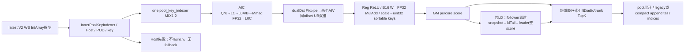
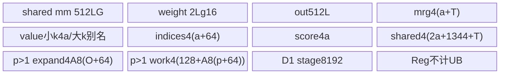
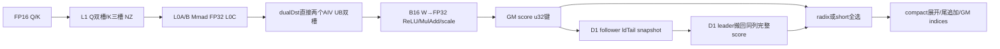
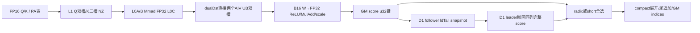

# PoolKeyIndexer V2 浮点池索引 950 ACLNN 算子知识

## 算子速览

| 项目 | 内容 |
|---|---|
| 实际入口 | aclnnPoolKeyIndexerV2GetWorkspaceSize / aclnnPoolKeyIndexerV2；最新公开V2 IntArray原型，quantMode=−1、returnValue=false |
| 计算语义 | FP32 QK累加→ReLU→B16头权重转FP32逐头MulAdd→1/√128缩放→pool TopK→展开完整pool token→追加因果可见tail；mode0固定topk处追加，mode1紧随有效展开追加 |
| 输入输出 | Q/K/W同FP16或BF16，G1..64、D128、K一头；4个同名/PA布局；host int64长度/尾计数；新int32 [B,Sq,topk+p−1]或[Tq,topk+p−1]，values[0] |
| 执行类型 | 单pool_key_indexer，MIX_CV/KERNEL_TYPE_MIX_AIC_1_2；AIC_CUBE经dual-dst Fixpipe直接写两AIV UB，AIV_VECTOR RegBase归约/radix TopK/展开；纯尾零pool只AIV写输出 |
| Kernel 路线 | R-001..R-032：2dtype×4layout×2mask×2尾布局；每条保留小/大poolTopK、splitM、整组/加权/LD、short/full/multitrunk、3种展开及纯tail子分支；R-033零有效任务 |
| 核心资源 | L1=229376B、L0A/B65536B各、L0C131072B/AIC；双向shared-UB交接2×ceil(LG/2)×128×4/AIV；UB完整公式与超限条件见下；GM score与LDtail按N×L×align128(S2)×4 |
| 来源闭包 | source_closed：V2/Inner→Host27字段POD→arch35自有Cube/Vector/radix/展开/LD→SDK9.2当前primitive；SGL另是旧pair mode0静态兼容映射，不声称已调用V2 |
| 静态限制 | G33..63且有效M>128未split导致L0 slot容量边界；小G无mask读取64权重可跨weightBuf；部分合法属性的名义UB分配超过固定SDK248KiB。保留draft，不推荐无条件安全复用 |
| 验证状态 | 已完成源码闭包检查；本次知识提取未执行编译、真机、数值或性能测试。 |

## 接口与语义

### 计算语义

p=poolSize、Ktok=topk、k=Ktok/p（完整pool选择数）。pool_key已经由上游池化，只包含完整pool，本算子不从原始KV计算pool均值/最大值，也不消费尾Key向量。对Query行i、完整pool j：
score(i,j)=(1/√128)×Σ[h=0..G−1] w(i,h)×ReLU(Σ[d=0..127] q(i,h,d)×pool_key(j,0,d))。
实际950顺序是Cube B16×B16→FP32 Mmad，Fixpipe FP32不启ReLU/量化，Vector权重B16→FP32、逐头Reg::MulAddDst，再统一乘qkScale。不能把缩放的实数可交换性当作与文档逐步浮点舍入完全一致，也不能移ReLU到头聚合后。

每batch完整pool数P，tail=t∈[0,p)，原始token总长Lorig=Pp+t。mask0可选P个pool、tail全部可见；mask3，Query有效长度Q，行i的右对齐位置g=Lorig−Q+i，非负域完整可见pool数v=floor((g+1)/p)（负域按C++整数除法后走v≤0清理），tail可见数clamp(g−Pp+1,0,t)。先从可见完整pool选min(v,k)，每个pool id j展开jp..jp+p−1，再追加Pp..Pp+visibleTail−1，输出是batch局部原始KV token索引。下游原始KV须与Pp+t一致；输出不指向pool_key内部D元素。p=1必t0，直接退化位置选择（本算子还有1/√128与B16 W合同，不能据名称断言与任意LightningIndexer逐位相同）。

mode0 legacy：tailPos=Ktok，即使v<k也保留[min(v,k)p,Ktok)的−1缝隙；mode1 compact：tailPos=min(v,k)p，未使用槽全在行尾。两mode的有效token集合相同，位置布局不同；这两个属性域已显式覆盖，量化0/1/2及returnValue=true不属于本卡数学调用。radix输出筛选集合未按分数全排序；相等分数顺序与跨trunk集合交接依源码，不能用稳定有序pool列表作为合同。

### 输入、输出与属性

| 参数 | shape/layout | dtype | 约束、默认值与语义 |
|---|---|---|---|
| query | [B,Sq,G,128] BSND / [Tq,G,128] TND | FP16/BF16 | 物理非空，G1..64；AutoContiguous框架预处理；二维SGL直接转发不能扩成vendor支持 |
| poolKey | [B,Pk,1,128] / [Tk,1,128] / [P,page,1,128] PA_BBND | 同Q | 非PA与Q同名；仅完整pool。允许零pool空形态：BSND dim1=0、TND/PA dim0=0，N2/D仍须合法 |
| weights | query去掉D | 同Q | 非量化必须同B16 dtype，非空；AutoContiguous；不是LI的FP32 W |
| poolTailK | host [B] | aclIntArray int64 | 必选、t0..p−1；ValueDepend转内部int64 GM输入 |
| actualSeqQ | host [B] | aclIntArray int64 | TND必须，元素为不带前导0的累计结束位置；末值=Tq；BSND必须nullptr |
| actualSeqK | host [B] | aclIntArray int64 | TND必须，累计结束pool数、末值=Tk；PA必须、逐batch pool数，非前缀；BSND必须nullptr |
| blockTable | [B,maxPages] | int32 ND | PA必须，非PA禁止；页ID/值域真实storage覆盖调用方负责 |
| qDescale/kDescale | nullptr | — | quantMode−1 Host明确拒非空；不绑定、不分配quant UB |
| topk/poolSize | Ktok / p | int64 | Ktok1..2048及3072/4096/5120/6144/7168/8192；p1..128，Ktok%p=0；默认2048/16 |
| layoutQ/layoutK | BSND/TND；BSND/TND/PA_BBND | string | 非PA同名；4布局×2mask×2dtype实际16key |
| maskMode/quantMode/returnValue | 0或3 / −1 / false | int64/int64/bool | 默认3/−1/false；POD/key quant编码=host+1=0 |
| keyStride0 | PA 0轴元素stride | int64→u32 | 默认−1；显式≥page×128，与运行时stride存在时必须一致；非PA显式非负被拒 |
| kDescaleStride0 | −1 | int64 | 非PA显式非负拒绝；本非量化域不消费scale stride |
| sparseIndicesMode | 0/1 | int64→u32 | V2公开新增，mode0 legacy / mode1 compact；缺省旧图属性时Host fallback0，不把旧V1文档当新增属性合同 |
| sparseIndicesOut | [B,Sq,Ktok+p−1] / [Tq,Ktok+p−1] | int32 | 独立合法存储，无效−1；不是初始化的empty本身保证 |
| sparseValuesOut | [0] | FP32 | required descriptor仍非空；本域无值提交/不读返回值 |

PA page16..2048、16倍数，池数是页内pool行数而非原始token数。Host值可见时检查tail、前缀非负/单调/末值及PA页表列数覆盖；本IntArray入口须持有host数据。并存Tensor变体使用设备int64而跳过Host值校验是另一原型边界，本卡没有将其改成IntArray或把额外symbol假作SGL调用。

### 入口与版本

固定ops-transformer e7da/version.cmake=9.2.0；asc-devkit a63d9.2；SGL dda6是兼容桥接来源。CANN primary采用实际安装的公开V2头aclnn_pool_key_indexer_v2.h；V1说明和README仅支撑已逐项核实共享的浮点、shape、mask、产品合同，不冒充新增mode签名来源。op_host CMake将该手写V2头安装到aclnnop，外层V1/V2皆转同aclnnInnerPoolKeyIndexer，OpDef ascend950配置与arch35 body闭合。本卡只950，不按arch35文件名推测广泛支持或实测收益。

SGL pool_key_indexer auto/aclnn→import attentions→torch.ops.attentions.pool_key_indexer→register_ops.cpp→pool_key_indexer.cpp，实际固定字符串为**aclnnPoolKeyIndexer**。其旧WS转发Inner时固定sparseIndicesMode=0，SGL插件另固定quant−1、rvfalse、空descale/kDescaleStride0−1；输出一项indices。V2模式1是最新公开CANN相关扩展，不声称SGL调用V2、不是通过bundled Python profile映射。SGL动态库解析先ASCEND_CUSTOM_OPP_PATH、再默认vendors/config优先级、最后libopapi.so；没有将解析到的任意已装binary等同固定e7的保证。旧pair只有实际提供者为本固定树时才可按该共享body解释。源码级SGL合同复用[已有API](../../../../apis/sgl_kernel_npu/sgl_pool_key_indexer.md)。

## Host/Launcher 执行流程

### 参数校验与前处理

V2 WS顺序查query/poolKey/weights/poolTailK/indices/values/workspaceSize/executor非空，失败日志使用ACLNN_ERR_PARAM_NULLPTR但实际return ge::GRAPH_FAILED；再逐参调用Inner GetWorkspaceSize，执行段直转Inner。框架生成IntArray→ValueDepend tensor/AutoContiguous、executor收集与launch属于标注的框架边界，不是核心外部算子。

Host DoTiling从platform读取npuArch、C/V核数、UB大小→ParseAndCheckParams→CalcTilingParams→CalcWorkspaceSize→加GetLibApiWorkSpaceSize→SetTilingData/SaveToBuffer→写workspace[0]→key→CalcTschBlockDim(V,C,V)。没有读取UB后按实际需求拒绝的容量guard，也未在CalcTsch返回后补零核guard。Parse按topk/p、layout与可选输入存在、mask/quant/rv/mode、整除、dtype/rank/head/stride、输出shape、host值范围、连续性逐步检查；所有失败立即GRAPH_FAILED，无数学fallback。BSND不能有actualQ/K，TND需要两前缀；PA需要actualK+table，QueryTND另需actualQ。Q/K必须同B16，W同Q，D128/N2=1，G≤64；非空Q隐含G正但超大shape转换仍须守护。

Host IsHostVisibleValue只允许kOnHost/kFollowing解引用，设备地址不在Host当指针读。host前缀B个元素（不含前导0），TND B来自actualQ.numel；PA实际K不为累计值。tail形状[B]且0≤t<p。零pool Key空形态额外放行而非一概空Tensor拒绝，CheckKeyContiguous在不消费零pool时跳过；其它空轴不因此合法。host不读取page ID证明其在真实K storage内。

SGL桥另先检查quant−1/rvfalse、query rank2/3/4、p>0、topk≥p、layout前缀、Q/K/W同B16；不会reshape二维Q，也不把任意后缀变成vendor合法layout。EXEC_NPU_CMD创建ACL Tensor时rank3/4描述格式为ACL_FORMAT_NCL/NCHW，保存真实sizes/strides/storage_offset；文档写ND不等于该helper内部逐字ND。optional实际序列None在插件中变empty IntArray，是否在generated bridge归一为缺省nullptr属于框架接入合同，不能假造有源包装实现。V2本卡以其严格合法原型为闭包入口，SGL这一兼容映射不宣称任意环境可运行。

### 参数、Workspace 与生命周期

定义物理C/V，N=CalcTschBlockDim(V,C,V)，POD usedCoreNum=C。正常MIX1:2需V=2C、N=C>0；Device GetBlockNum为N，AIC id=i，GetBlockIdx AIV=2i+subid，aiCoreIdx=AIVid/2。分核后usedCoreNum可缩小，与N和物理C分开；workspace必须按launch N覆盖，不能按active核数缩小。

以Aq(x)=向q对齐，以下均字节、数学式要求原始类型运算及窄化未溢出：
```text
k=Ktok/p
L22=(k>2048?floor(8192/k)*2:8); A22=A16(L22*G)
L35=(k>2048?2:4); J=A128(S2)
S22=A512(C*2*A22*512*4)
S35=A512(C*L35*J*4)             # 非量化SCORE_T=uint32,4B
S=max(S22,S35)                 # 950分支，PKI_WS_ARCH_BRANCH不移除该max
Tail=(k<=2048?S35:0)
LDscore=A32(C*L22*2*2*8192*4)
LDparam=A32(C*L22*2*16*8)
wsOffScore=0; wsOffLdScore=S+Tail; wsOffLdIdx=S+Tail+LDscore
W_host = GetLibApiWorkSpaceSize(950)=16MiB + S+Tail+LDscore+LDparam
Device userScore = N*L35*J*4；scoreCore_i = userBase+i*L35*J*4
Device ldTailBase = userBase+N*L35*J*4（不按Host max S定位）
ldTailCore_i = ldTailBase+i*L35*J*4；只有LD开启才写/读
```
Host额外LDscore/LDparam主要沿arch22上界预留；arch35不消费wsOffLdScore/wsOffLdIdx，使用自算score/ldTail地址，因此不能按字段名杜撰本路线TopK pairs/metadata切片。即使S>S35，实际Tail起点更早，Host总reserve仍覆盖两个S35（N≤C等条件成立）；不能把两种布局误认为逐offset一致。k>2048 isLDOpen恒false，ldTail虽绑定但未消费，不应计实际DMA。

SDK3510 GetUserWorkspace在当前MIX配置取系统workspace+RESERVED_WORKSPACE16MiB；GetLibApiWorkSpaceSize的16MiB来自Host函数，二者区分来源，特殊编译宏可改变user base，不把数值相等当一般布局证明。调用方持有输出、输入、IntArray及其存储、workspace、executor到实际stream消费完成；手写V2不自己分配/销毁用户输出。

SGL旧桥AllocateWorkspace用当前NPU byte at::empty，EXEC_NPU_CMD取当前stream，WS同步成功后OpCommand custom handler执行，成功才ReleaseConvertTypes/ReleaseHugeMem，函数末UnInitHugeMem。workspaceTensor局部owner、回调只捕裸workspaceAddr；descriptor/IntArray在handler执行调用返回后释放，异步保活由torch_npu/allocator/生成executor框架负责，不能据局部变量宣称设备同步完成；异常路径并非所有临时对象都有显式RAII释放。不保证该桥已装provider与本树同版本。

### 启动图与失败传播


同一核心Kernel；无外部Torch pooling/projection/选择数学，Q/K预池化由输入合同承担。Entry query,poolKey,weights,tail,actualQ,actualK,table,qScale,kScale,indices,values,workspace,tiling，GetUserWorkspace后KERNEL_TASK_TYPE_DEFAULT MIX1:2；__CCE_AICORE__310选择arch35，ORIG_DTYPE_QUERY if constexpr分出half/BF16，量化编译枝在本冻结域不实例化执行。Host key含mask/quant/rv，mode由POD运行时选择。kernel failure无源码回滚输出保证；未知非法key不构成本卡fallback。

## Route 与参数设计

### 分核与资源计算

Device从k而非Host s1BaseSize字段重算L=k>2048?2:4、M=LG、S2base128、D128，splitMFlag=(G==64&&k≤2048)。Host CalcTilingParams仅在k>6144写L2，否则L4；其s1Base/mBase/s2Base不直接控制arch35实际尺寸，mBaseMax只对未选quant尺度缓冲有关。Host trunkLen按16K/12K/8K/4K/2K/12K表，Vector InitParams实际覆盖为T=(k>5120?(k>7168?2048:4096):8192)，必须用实际T计UB和TopK循环。

浮点isLDOpen=(U<C)&&k≤2048，U_BSND=B×ceil(Sq/L)，U_TND=ceil(Tq/L)+(B−1)是逐batch上界，N2=1。若LD开，按128pool tile分核；否则整query组不可切分，mask3若首末组tile数量不同由HasBlockGradient加权记账，仍整组原子归一核。商余分配、末核吃剩余组，区间inclusive，末端扩至最后batch以处理零pool；有效task0仍使能core0，走R-033尾部清理，不进入正常used0清理终点。k>2048无S2分片，避免TopK固定资源之外LD。

每AIC Cube L1 Q2×256×128×2=131072B、K3×128×128×2=98304B，共229376B；L0A/B各2×128×128×2=65536B，L0C2×128×128×4=131072B。Q首S2加载，组内复用；Key每tile128。G64小k走splitM，L0 M128两次互插Query的64行片；其它float不钳M，所以G33..63满4行组M132..252构成静态L0 slot容量风险，见限制。

AIV逐InitBuffer字节账，所有请求已为32B倍数：
```text
a=A256(k); L=(k>2048?2:4); M=L*G; g16=A16(G); J=A128(S2)
AIC bufUB 与每AIV resMm1Buf 首分配同local offset，用于Fixpipe dualDst；不在同一AIV账重复加。
resMm1 = 2*ceil(M/2)*128*4 = 512*M
weight = 2*ceil(L/2)*g16*2 = 2*L*g16
out    = 2*ceil(L/2)*128*4 = 512*L
mrg    = (a+T)*4
value  = k<=2048 ? a*4 :0       # 大k alias mrg；rvfalse时亦保留小k分配
indices= (a+64)*4
score  = a*4
shared = (2*a+5*256+64+T)*4 = (2*a+1344+T)*4
         # hisIndex0 alias indicesOut；hisIndex1/shared@0；hist@a，4个idx桶，nk64，tmpIndex@a+1344
expand = p>1 ? A8(Ktok+p−1+64)*4 :0
work   = p>1 ? (128+A8(p+64))*4 :0
LDstage= isLDOpen ?2048*4:0
UB_total=512*L*G+2*L*g16+512*L+4*(5*a+2*T+1408)
         +[k<=2048]*4*a+expand+work+LDstage
SDK3510 TOTAL_VEC_LOCAL_SIZE / TOTAL_UB_SIZE =248KiB=253952B（该固定头的可用常量）。
必要条件UB_total<=可用容量；Host查询UB但没有按该公式guard。
例G64,k2048,p2,Ktok4096：UB_total=271424B（无LD），LD开时279616B。
例G64,k2048,p1：无LD253952B，LD开262144B。
```
以上为源代码名义分配请求，不是成功分配/传输保证；没有执行到错误状态的观察。小G的weights实际LoadAlign<DIST_UNPACK_B16>读64个B16=128B，逻辑只用G权重不免除物理storage边界；逐行读取范围见限制。寄存器一组256B RegTensor对应64FP32或128B16，不将register参数当额外UB；具体寄存器总byte由编译器分配不可从源码求定。无SIMT、NDDMA或通信节点，N/A。

### Route 选择

| 顺序 | Route | Key/模板 | 精确选择条件与优先级 | 不适用去向 |
|---:|---|---|---|---|
| 1 | R-001 FP16 BSND/BSND mask0 legacy | (1,1,3,0,0,0,0,0) | 950、quant−1/rvfalse、共同合法域、该dtype/layout/mask，POD mode=0 | 非法Host拒；其它mode/key相应Route；零有效任务 R-033 |
| 2 | R-002 FP16 BSND/BSND mask0 compact | (1,1,3,0,0,0,0,0) | 950、quant−1/rvfalse、共同合法域、该dtype/layout/mask，POD mode=1 | 非法Host拒；其它mode/key相应Route；零有效任务 R-033 |
| 3 | R-003 FP16 BSND/BSND mask3 legacy | (1,1,3,0,0,3,0,0) | 950、quant−1/rvfalse、共同合法域、该dtype/layout/mask，POD mode=0 | 非法Host拒；其它mode/key相应Route；零有效任务 R-033 |
| 4 | R-004 FP16 BSND/BSND mask3 compact | (1,1,3,0,0,3,0,0) | 950、quant−1/rvfalse、共同合法域、该dtype/layout/mask，POD mode=1 | 非法Host拒；其它mode/key相应Route；零有效任务 R-033 |
| 5 | R-005 FP16 TND/TND mask0 legacy | (1,1,3,1,1,0,0,0) | 950、quant−1/rvfalse、共同合法域、该dtype/layout/mask，POD mode=0 | 非法Host拒；其它mode/key相应Route；零有效任务 R-033 |
| 6 | R-006 FP16 TND/TND mask0 compact | (1,1,3,1,1,0,0,0) | 950、quant−1/rvfalse、共同合法域、该dtype/layout/mask，POD mode=1 | 非法Host拒；其它mode/key相应Route；零有效任务 R-033 |
| 7 | R-007 FP16 TND/TND mask3 legacy | (1,1,3,1,1,3,0,0) | 950、quant−1/rvfalse、共同合法域、该dtype/layout/mask，POD mode=0 | 非法Host拒；其它mode/key相应Route；零有效任务 R-033 |
| 8 | R-008 FP16 TND/TND mask3 compact | (1,1,3,1,1,3,0,0) | 950、quant−1/rvfalse、共同合法域、该dtype/layout/mask，POD mode=1 | 非法Host拒；其它mode/key相应Route；零有效任务 R-033 |
| 9 | R-009 FP16 BSND/PA_BBND mask0 legacy | (1,1,3,0,2,0,0,0) | 950、quant−1/rvfalse、共同合法域、该dtype/layout/mask，POD mode=0 | 非法Host拒；其它mode/key相应Route；零有效任务 R-033 |
| 10 | R-010 FP16 BSND/PA_BBND mask0 compact | (1,1,3,0,2,0,0,0) | 950、quant−1/rvfalse、共同合法域、该dtype/layout/mask，POD mode=1 | 非法Host拒；其它mode/key相应Route；零有效任务 R-033 |
| 11 | R-011 FP16 BSND/PA_BBND mask3 legacy | (1,1,3,0,2,3,0,0) | 950、quant−1/rvfalse、共同合法域、该dtype/layout/mask，POD mode=0 | 非法Host拒；其它mode/key相应Route；零有效任务 R-033 |
| 12 | R-012 FP16 BSND/PA_BBND mask3 compact | (1,1,3,0,2,3,0,0) | 950、quant−1/rvfalse、共同合法域、该dtype/layout/mask，POD mode=1 | 非法Host拒；其它mode/key相应Route；零有效任务 R-033 |
| 13 | R-013 FP16 TND/PA_BBND mask0 legacy | (1,1,3,1,2,0,0,0) | 950、quant−1/rvfalse、共同合法域、该dtype/layout/mask，POD mode=0 | 非法Host拒；其它mode/key相应Route；零有效任务 R-033 |
| 14 | R-014 FP16 TND/PA_BBND mask0 compact | (1,1,3,1,2,0,0,0) | 950、quant−1/rvfalse、共同合法域、该dtype/layout/mask，POD mode=1 | 非法Host拒；其它mode/key相应Route；零有效任务 R-033 |
| 15 | R-015 FP16 TND/PA_BBND mask3 legacy | (1,1,3,1,2,3,0,0) | 950、quant−1/rvfalse、共同合法域、该dtype/layout/mask，POD mode=0 | 非法Host拒；其它mode/key相应Route；零有效任务 R-033 |
| 16 | R-016 FP16 TND/PA_BBND mask3 compact | (1,1,3,1,2,3,0,0) | 950、quant−1/rvfalse、共同合法域、该dtype/layout/mask，POD mode=1 | 非法Host拒；其它mode/key相应Route；零有效任务 R-033 |
| 17 | R-017 BF16 BSND/BSND mask0 legacy | (27,27,3,0,0,0,0,0) | 950、quant−1/rvfalse、共同合法域、该dtype/layout/mask，POD mode=0 | 非法Host拒；其它mode/key相应Route；零有效任务 R-033 |
| 18 | R-018 BF16 BSND/BSND mask0 compact | (27,27,3,0,0,0,0,0) | 950、quant−1/rvfalse、共同合法域、该dtype/layout/mask，POD mode=1 | 非法Host拒；其它mode/key相应Route；零有效任务 R-033 |
| 19 | R-019 BF16 BSND/BSND mask3 legacy | (27,27,3,0,0,3,0,0) | 950、quant−1/rvfalse、共同合法域、该dtype/layout/mask，POD mode=0 | 非法Host拒；其它mode/key相应Route；零有效任务 R-033 |
| 20 | R-020 BF16 BSND/BSND mask3 compact | (27,27,3,0,0,3,0,0) | 950、quant−1/rvfalse、共同合法域、该dtype/layout/mask，POD mode=1 | 非法Host拒；其它mode/key相应Route；零有效任务 R-033 |
| 21 | R-021 BF16 TND/TND mask0 legacy | (27,27,3,1,1,0,0,0) | 950、quant−1/rvfalse、共同合法域、该dtype/layout/mask，POD mode=0 | 非法Host拒；其它mode/key相应Route；零有效任务 R-033 |
| 22 | R-022 BF16 TND/TND mask0 compact | (27,27,3,1,1,0,0,0) | 950、quant−1/rvfalse、共同合法域、该dtype/layout/mask，POD mode=1 | 非法Host拒；其它mode/key相应Route；零有效任务 R-033 |
| 23 | R-023 BF16 TND/TND mask3 legacy | (27,27,3,1,1,3,0,0) | 950、quant−1/rvfalse、共同合法域、该dtype/layout/mask，POD mode=0 | 非法Host拒；其它mode/key相应Route；零有效任务 R-033 |
| 24 | R-024 BF16 TND/TND mask3 compact | (27,27,3,1,1,3,0,0) | 950、quant−1/rvfalse、共同合法域、该dtype/layout/mask，POD mode=1 | 非法Host拒；其它mode/key相应Route；零有效任务 R-033 |
| 25 | R-025 BF16 BSND/PA_BBND mask0 legacy | (27,27,3,0,2,0,0,0) | 950、quant−1/rvfalse、共同合法域、该dtype/layout/mask，POD mode=0 | 非法Host拒；其它mode/key相应Route；零有效任务 R-033 |
| 26 | R-026 BF16 BSND/PA_BBND mask0 compact | (27,27,3,0,2,0,0,0) | 950、quant−1/rvfalse、共同合法域、该dtype/layout/mask，POD mode=1 | 非法Host拒；其它mode/key相应Route；零有效任务 R-033 |
| 27 | R-027 BF16 BSND/PA_BBND mask3 legacy | (27,27,3,0,2,3,0,0) | 950、quant−1/rvfalse、共同合法域、该dtype/layout/mask，POD mode=0 | 非法Host拒；其它mode/key相应Route；零有效任务 R-033 |
| 28 | R-028 BF16 BSND/PA_BBND mask3 compact | (27,27,3,0,2,3,0,0) | 950、quant−1/rvfalse、共同合法域、该dtype/layout/mask，POD mode=1 | 非法Host拒；其它mode/key相应Route；零有效任务 R-033 |
| 29 | R-029 BF16 TND/PA_BBND mask0 legacy | (27,27,3,1,2,0,0,0) | 950、quant−1/rvfalse、共同合法域、该dtype/layout/mask，POD mode=0 | 非法Host拒；其它mode/key相应Route；零有效任务 R-033 |
| 30 | R-030 BF16 TND/PA_BBND mask0 compact | (27,27,3,1,2,0,0,0) | 950、quant−1/rvfalse、共同合法域、该dtype/layout/mask，POD mode=1 | 非法Host拒；其它mode/key相应Route；零有效任务 R-033 |
| 31 | R-031 BF16 TND/PA_BBND mask3 legacy | (27,27,3,1,2,3,0,0) | 950、quant−1/rvfalse、共同合法域、该dtype/layout/mask，POD mode=0 | 非法Host拒；其它mode/key相应Route；零有效任务 R-033 |
| 32 | R-032 BF16 TND/PA_BBND mask3 compact | (27,27,3,1,2,3,0,0) | 950、quant−1/rvfalse、共同合法域、该dtype/layout/mask，POD mode=1 | 非法Host拒；其它mode/key相应Route；零有效任务 R-033 |
| 33 | R-033 零有效任务/纯tail | 上述16key / mode0或1 | GetTotalBaseBlockNum=0，SplitCore强制core0覆盖所有batch | 无Cube数学，经CleanInvalidOutput附tail；无自动Torch fallback |

```text
V2 IntArray -> Host legal float, return=false -> dtype/layout/mask生成16key
POD mode0/1 -> 各自tailPos，不更改集合
Device k<=2048: L4；G64 splitM；U<C可开LD
Device k>2048: L2；无splitM/无LD
无LD：普通整组，mask梯度时按tile权重记账但不切组
LD：128pool tile按核切；完整段内联TopK，否则leader延迟到snapshot归并后TopK
每行TopK：v<=0清理；0<v<k顺序全选；v>=k单trunk或多trunk radix
p=1无展开；pow2 2..64 gather；其它p非8倍数 scalar；余者Duplicate+Add
无完整pool：core0处理全批tail，输出mode0/1位置分别Ktok/0
```

### 模板/实现执行矩阵

D0/D1为每条Route中设备分核的明确子状态：D0=!isLDOpen整组、D1=isLDOpen且按实际段覆盖选择直接/延迟；S0/S1为splitMFlag false/true，参数公式逐项保留；并未把它们当相同内存/同步图。mode0/1单独列Route；typed key分别列，未把量化模板并入。

| Route | key/selector | dtype/shape/platform 完整命中条件 | 执行族与 kernel 节点 | 实际模板/body | 内存与同步特征 | tail/fallback |
|---|---|---|---|---|---|---|
| R-001 | (1,1,3,0,0,0,0,0),mode0 | 950 FP16 BSND/BSND、mask0、quant−1/rvfalse、G1..64/D128 | 单MIX AIC1/AIV2，D0/D1/S0/S1按公式 | PoolKeyIndexerKernel<PkiType<half,half,int32_t,PkiLayout::BSND,PkiLayout::BSND>> | shared UB双槽，mode4 VC0/1和CV2/3及peer+16；D1多ldTail+8192UB与AIV SyncAll | tail固定Ktok；3展开/short/zero明确；无量化fallback |
| R-002 | (1,1,3,0,0,0,0,0),mode1 | 950 FP16 BSND/BSND、mask0、quant−1/rvfalse、G1..64/D128 | 单MIX AIC1/AIV2，D0/D1/S0/S1按公式 | PoolKeyIndexerKernel<PkiType<half,half,int32_t,PkiLayout::BSND,PkiLayout::BSND>> | shared UB双槽，mode4 VC0/1和CV2/3及peer+16；D1多ldTail+8192UB与AIV SyncAll | tail紧跟min(v,k)p；3展开/short/zero明确；无量化fallback |
| R-003 | (1,1,3,0,0,3,0,0),mode0 | 950 FP16 BSND/BSND、mask3、quant−1/rvfalse、G1..64/D128 | 单MIX AIC1/AIV2，D0/D1/S0/S1按公式 | PoolKeyIndexerKernel<PkiType<half,half,int32_t,PkiLayout::BSND,PkiLayout::BSND>> | shared UB双槽，mode4 VC0/1和CV2/3及peer+16；D1多ldTail+8192UB与AIV SyncAll | tail固定Ktok；3展开/short/zero明确；无量化fallback |
| R-004 | (1,1,3,0,0,3,0,0),mode1 | 950 FP16 BSND/BSND、mask3、quant−1/rvfalse、G1..64/D128 | 单MIX AIC1/AIV2，D0/D1/S0/S1按公式 | PoolKeyIndexerKernel<PkiType<half,half,int32_t,PkiLayout::BSND,PkiLayout::BSND>> | shared UB双槽，mode4 VC0/1和CV2/3及peer+16；D1多ldTail+8192UB与AIV SyncAll | tail紧跟min(v,k)p；3展开/short/zero明确；无量化fallback |
| R-005 | (1,1,3,1,1,0,0,0),mode0 | 950 FP16 TND/TND、mask0、quant−1/rvfalse、G1..64/D128 | 单MIX AIC1/AIV2，D0/D1/S0/S1按公式 | PoolKeyIndexerKernel<PkiType<half,half,int32_t,PkiLayout::TND,PkiLayout::TND>> | shared UB双槽，mode4 VC0/1和CV2/3及peer+16；D1多ldTail+8192UB与AIV SyncAll | tail固定Ktok；3展开/short/zero明确；无量化fallback |
| R-006 | (1,1,3,1,1,0,0,0),mode1 | 950 FP16 TND/TND、mask0、quant−1/rvfalse、G1..64/D128 | 单MIX AIC1/AIV2，D0/D1/S0/S1按公式 | PoolKeyIndexerKernel<PkiType<half,half,int32_t,PkiLayout::TND,PkiLayout::TND>> | shared UB双槽，mode4 VC0/1和CV2/3及peer+16；D1多ldTail+8192UB与AIV SyncAll | tail紧跟min(v,k)p；3展开/short/zero明确；无量化fallback |
| R-007 | (1,1,3,1,1,3,0,0),mode0 | 950 FP16 TND/TND、mask3、quant−1/rvfalse、G1..64/D128 | 单MIX AIC1/AIV2，D0/D1/S0/S1按公式 | PoolKeyIndexerKernel<PkiType<half,half,int32_t,PkiLayout::TND,PkiLayout::TND>> | shared UB双槽，mode4 VC0/1和CV2/3及peer+16；D1多ldTail+8192UB与AIV SyncAll | tail固定Ktok；3展开/short/zero明确；无量化fallback |
| R-008 | (1,1,3,1,1,3,0,0),mode1 | 950 FP16 TND/TND、mask3、quant−1/rvfalse、G1..64/D128 | 单MIX AIC1/AIV2，D0/D1/S0/S1按公式 | PoolKeyIndexerKernel<PkiType<half,half,int32_t,PkiLayout::TND,PkiLayout::TND>> | shared UB双槽，mode4 VC0/1和CV2/3及peer+16；D1多ldTail+8192UB与AIV SyncAll | tail紧跟min(v,k)p；3展开/short/zero明确；无量化fallback |
| R-009 | (1,1,3,0,2,0,0,0),mode0 | 950 FP16 BSND/PA_BBND、mask0、quant−1/rvfalse、G1..64/D128 | 单MIX AIC1/AIV2，D0/D1/S0/S1按公式 | PoolKeyIndexerKernel<PkiType<half,half,int32_t,PkiLayout::BSND,PkiLayout::PA_BSND>> | shared UB双槽，mode4 VC0/1和CV2/3及peer+16；D1多ldTail+8192UB与AIV SyncAll | tail固定Ktok；3展开/short/zero明确；无量化fallback |
| R-010 | (1,1,3,0,2,0,0,0),mode1 | 950 FP16 BSND/PA_BBND、mask0、quant−1/rvfalse、G1..64/D128 | 单MIX AIC1/AIV2，D0/D1/S0/S1按公式 | PoolKeyIndexerKernel<PkiType<half,half,int32_t,PkiLayout::BSND,PkiLayout::PA_BSND>> | shared UB双槽，mode4 VC0/1和CV2/3及peer+16；D1多ldTail+8192UB与AIV SyncAll | tail紧跟min(v,k)p；3展开/short/zero明确；无量化fallback |
| R-011 | (1,1,3,0,2,3,0,0),mode0 | 950 FP16 BSND/PA_BBND、mask3、quant−1/rvfalse、G1..64/D128 | 单MIX AIC1/AIV2，D0/D1/S0/S1按公式 | PoolKeyIndexerKernel<PkiType<half,half,int32_t,PkiLayout::BSND,PkiLayout::PA_BSND>> | shared UB双槽，mode4 VC0/1和CV2/3及peer+16；D1多ldTail+8192UB与AIV SyncAll | tail固定Ktok；3展开/short/zero明确；无量化fallback |
| R-012 | (1,1,3,0,2,3,0,0),mode1 | 950 FP16 BSND/PA_BBND、mask3、quant−1/rvfalse、G1..64/D128 | 单MIX AIC1/AIV2，D0/D1/S0/S1按公式 | PoolKeyIndexerKernel<PkiType<half,half,int32_t,PkiLayout::BSND,PkiLayout::PA_BSND>> | shared UB双槽，mode4 VC0/1和CV2/3及peer+16；D1多ldTail+8192UB与AIV SyncAll | tail紧跟min(v,k)p；3展开/short/zero明确；无量化fallback |
| R-013 | (1,1,3,1,2,0,0,0),mode0 | 950 FP16 TND/PA_BBND、mask0、quant−1/rvfalse、G1..64/D128 | 单MIX AIC1/AIV2，D0/D1/S0/S1按公式 | PoolKeyIndexerKernel<PkiType<half,half,int32_t,PkiLayout::TND,PkiLayout::PA_BSND>> | shared UB双槽，mode4 VC0/1和CV2/3及peer+16；D1多ldTail+8192UB与AIV SyncAll | tail固定Ktok；3展开/short/zero明确；无量化fallback |
| R-014 | (1,1,3,1,2,0,0,0),mode1 | 950 FP16 TND/PA_BBND、mask0、quant−1/rvfalse、G1..64/D128 | 单MIX AIC1/AIV2，D0/D1/S0/S1按公式 | PoolKeyIndexerKernel<PkiType<half,half,int32_t,PkiLayout::TND,PkiLayout::PA_BSND>> | shared UB双槽，mode4 VC0/1和CV2/3及peer+16；D1多ldTail+8192UB与AIV SyncAll | tail紧跟min(v,k)p；3展开/short/zero明确；无量化fallback |
| R-015 | (1,1,3,1,2,3,0,0),mode0 | 950 FP16 TND/PA_BBND、mask3、quant−1/rvfalse、G1..64/D128 | 单MIX AIC1/AIV2，D0/D1/S0/S1按公式 | PoolKeyIndexerKernel<PkiType<half,half,int32_t,PkiLayout::TND,PkiLayout::PA_BSND>> | shared UB双槽，mode4 VC0/1和CV2/3及peer+16；D1多ldTail+8192UB与AIV SyncAll | tail固定Ktok；3展开/short/zero明确；无量化fallback |
| R-016 | (1,1,3,1,2,3,0,0),mode1 | 950 FP16 TND/PA_BBND、mask3、quant−1/rvfalse、G1..64/D128 | 单MIX AIC1/AIV2，D0/D1/S0/S1按公式 | PoolKeyIndexerKernel<PkiType<half,half,int32_t,PkiLayout::TND,PkiLayout::PA_BSND>> | shared UB双槽，mode4 VC0/1和CV2/3及peer+16；D1多ldTail+8192UB与AIV SyncAll | tail紧跟min(v,k)p；3展开/short/zero明确；无量化fallback |
| R-017 | (27,27,3,0,0,0,0,0),mode0 | 950 BF16 BSND/BSND、mask0、quant−1/rvfalse、G1..64/D128 | 单MIX AIC1/AIV2，D0/D1/S0/S1按公式 | PoolKeyIndexerKernel<PkiType<bfloat16_t,bfloat16_t,int32_t,PkiLayout::BSND,PkiLayout::BSND>> | shared UB双槽，mode4 VC0/1和CV2/3及peer+16；D1多ldTail+8192UB与AIV SyncAll | tail固定Ktok；3展开/short/zero明确；无量化fallback |
| R-018 | (27,27,3,0,0,0,0,0),mode1 | 950 BF16 BSND/BSND、mask0、quant−1/rvfalse、G1..64/D128 | 单MIX AIC1/AIV2，D0/D1/S0/S1按公式 | PoolKeyIndexerKernel<PkiType<bfloat16_t,bfloat16_t,int32_t,PkiLayout::BSND,PkiLayout::BSND>> | shared UB双槽，mode4 VC0/1和CV2/3及peer+16；D1多ldTail+8192UB与AIV SyncAll | tail紧跟min(v,k)p；3展开/short/zero明确；无量化fallback |
| R-019 | (27,27,3,0,0,3,0,0),mode0 | 950 BF16 BSND/BSND、mask3、quant−1/rvfalse、G1..64/D128 | 单MIX AIC1/AIV2，D0/D1/S0/S1按公式 | PoolKeyIndexerKernel<PkiType<bfloat16_t,bfloat16_t,int32_t,PkiLayout::BSND,PkiLayout::BSND>> | shared UB双槽，mode4 VC0/1和CV2/3及peer+16；D1多ldTail+8192UB与AIV SyncAll | tail固定Ktok；3展开/short/zero明确；无量化fallback |
| R-020 | (27,27,3,0,0,3,0,0),mode1 | 950 BF16 BSND/BSND、mask3、quant−1/rvfalse、G1..64/D128 | 单MIX AIC1/AIV2，D0/D1/S0/S1按公式 | PoolKeyIndexerKernel<PkiType<bfloat16_t,bfloat16_t,int32_t,PkiLayout::BSND,PkiLayout::BSND>> | shared UB双槽，mode4 VC0/1和CV2/3及peer+16；D1多ldTail+8192UB与AIV SyncAll | tail紧跟min(v,k)p；3展开/short/zero明确；无量化fallback |
| R-021 | (27,27,3,1,1,0,0,0),mode0 | 950 BF16 TND/TND、mask0、quant−1/rvfalse、G1..64/D128 | 单MIX AIC1/AIV2，D0/D1/S0/S1按公式 | PoolKeyIndexerKernel<PkiType<bfloat16_t,bfloat16_t,int32_t,PkiLayout::TND,PkiLayout::TND>> | shared UB双槽，mode4 VC0/1和CV2/3及peer+16；D1多ldTail+8192UB与AIV SyncAll | tail固定Ktok；3展开/short/zero明确；无量化fallback |
| R-022 | (27,27,3,1,1,0,0,0),mode1 | 950 BF16 TND/TND、mask0、quant−1/rvfalse、G1..64/D128 | 单MIX AIC1/AIV2，D0/D1/S0/S1按公式 | PoolKeyIndexerKernel<PkiType<bfloat16_t,bfloat16_t,int32_t,PkiLayout::TND,PkiLayout::TND>> | shared UB双槽，mode4 VC0/1和CV2/3及peer+16；D1多ldTail+8192UB与AIV SyncAll | tail紧跟min(v,k)p；3展开/short/zero明确；无量化fallback |
| R-023 | (27,27,3,1,1,3,0,0),mode0 | 950 BF16 TND/TND、mask3、quant−1/rvfalse、G1..64/D128 | 单MIX AIC1/AIV2，D0/D1/S0/S1按公式 | PoolKeyIndexerKernel<PkiType<bfloat16_t,bfloat16_t,int32_t,PkiLayout::TND,PkiLayout::TND>> | shared UB双槽，mode4 VC0/1和CV2/3及peer+16；D1多ldTail+8192UB与AIV SyncAll | tail固定Ktok；3展开/short/zero明确；无量化fallback |
| R-024 | (27,27,3,1,1,3,0,0),mode1 | 950 BF16 TND/TND、mask3、quant−1/rvfalse、G1..64/D128 | 单MIX AIC1/AIV2，D0/D1/S0/S1按公式 | PoolKeyIndexerKernel<PkiType<bfloat16_t,bfloat16_t,int32_t,PkiLayout::TND,PkiLayout::TND>> | shared UB双槽，mode4 VC0/1和CV2/3及peer+16；D1多ldTail+8192UB与AIV SyncAll | tail紧跟min(v,k)p；3展开/short/zero明确；无量化fallback |
| R-025 | (27,27,3,0,2,0,0,0),mode0 | 950 BF16 BSND/PA_BBND、mask0、quant−1/rvfalse、G1..64/D128 | 单MIX AIC1/AIV2，D0/D1/S0/S1按公式 | PoolKeyIndexerKernel<PkiType<bfloat16_t,bfloat16_t,int32_t,PkiLayout::BSND,PkiLayout::PA_BSND>> | shared UB双槽，mode4 VC0/1和CV2/3及peer+16；D1多ldTail+8192UB与AIV SyncAll | tail固定Ktok；3展开/short/zero明确；无量化fallback |
| R-026 | (27,27,3,0,2,0,0,0),mode1 | 950 BF16 BSND/PA_BBND、mask0、quant−1/rvfalse、G1..64/D128 | 单MIX AIC1/AIV2，D0/D1/S0/S1按公式 | PoolKeyIndexerKernel<PkiType<bfloat16_t,bfloat16_t,int32_t,PkiLayout::BSND,PkiLayout::PA_BSND>> | shared UB双槽，mode4 VC0/1和CV2/3及peer+16；D1多ldTail+8192UB与AIV SyncAll | tail紧跟min(v,k)p；3展开/short/zero明确；无量化fallback |
| R-027 | (27,27,3,0,2,3,0,0),mode0 | 950 BF16 BSND/PA_BBND、mask3、quant−1/rvfalse、G1..64/D128 | 单MIX AIC1/AIV2，D0/D1/S0/S1按公式 | PoolKeyIndexerKernel<PkiType<bfloat16_t,bfloat16_t,int32_t,PkiLayout::BSND,PkiLayout::PA_BSND>> | shared UB双槽，mode4 VC0/1和CV2/3及peer+16；D1多ldTail+8192UB与AIV SyncAll | tail固定Ktok；3展开/short/zero明确；无量化fallback |
| R-028 | (27,27,3,0,2,3,0,0),mode1 | 950 BF16 BSND/PA_BBND、mask3、quant−1/rvfalse、G1..64/D128 | 单MIX AIC1/AIV2，D0/D1/S0/S1按公式 | PoolKeyIndexerKernel<PkiType<bfloat16_t,bfloat16_t,int32_t,PkiLayout::BSND,PkiLayout::PA_BSND>> | shared UB双槽，mode4 VC0/1和CV2/3及peer+16；D1多ldTail+8192UB与AIV SyncAll | tail紧跟min(v,k)p；3展开/short/zero明确；无量化fallback |
| R-029 | (27,27,3,1,2,0,0,0),mode0 | 950 BF16 TND/PA_BBND、mask0、quant−1/rvfalse、G1..64/D128 | 单MIX AIC1/AIV2，D0/D1/S0/S1按公式 | PoolKeyIndexerKernel<PkiType<bfloat16_t,bfloat16_t,int32_t,PkiLayout::TND,PkiLayout::PA_BSND>> | shared UB双槽，mode4 VC0/1和CV2/3及peer+16；D1多ldTail+8192UB与AIV SyncAll | tail固定Ktok；3展开/short/zero明确；无量化fallback |
| R-030 | (27,27,3,1,2,0,0,0),mode1 | 950 BF16 TND/PA_BBND、mask0、quant−1/rvfalse、G1..64/D128 | 单MIX AIC1/AIV2，D0/D1/S0/S1按公式 | PoolKeyIndexerKernel<PkiType<bfloat16_t,bfloat16_t,int32_t,PkiLayout::TND,PkiLayout::PA_BSND>> | shared UB双槽，mode4 VC0/1和CV2/3及peer+16；D1多ldTail+8192UB与AIV SyncAll | tail紧跟min(v,k)p；3展开/short/zero明确；无量化fallback |
| R-031 | (27,27,3,1,2,3,0,0),mode0 | 950 BF16 TND/PA_BBND、mask3、quant−1/rvfalse、G1..64/D128 | 单MIX AIC1/AIV2，D0/D1/S0/S1按公式 | PoolKeyIndexerKernel<PkiType<bfloat16_t,bfloat16_t,int32_t,PkiLayout::TND,PkiLayout::PA_BSND>> | shared UB双槽，mode4 VC0/1和CV2/3及peer+16；D1多ldTail+8192UB与AIV SyncAll | tail固定Ktok；3展开/short/zero明确；无量化fallback |
| R-032 | (27,27,3,1,2,3,0,0),mode1 | 950 BF16 TND/PA_BBND、mask3、quant−1/rvfalse、G1..64/D128 | 单MIX AIC1/AIV2，D0/D1/S0/S1按公式 | PoolKeyIndexerKernel<PkiType<bfloat16_t,bfloat16_t,int32_t,PkiLayout::TND,PkiLayout::PA_BSND>> | shared UB双槽，mode4 VC0/1和CV2/3及peer+16；D1多ldTail+8192UB与AIV SyncAll | tail紧跟min(v,k)p；3展开/short/zero明确；无量化fallback |
| R-033 | task0、上述任一key/mode | 物理Q/W非空；Key0pool合法编码 | 同launch AIV清理/尾追加，无Mmad | DealActSeqLenIsZero/CleanInvalidOutput | Init资源不删；仅core0两AIV写同值输出；D1仍全AIV barrier | mode0 tail@Ktok、mode1 tail@0，mask因果按Lorig=t |

### 隐藏性能 Guard

| Guard | Host/Tiling 条件 | Device/资源原因 | 影响 Route | 不满足时去向 | 源码符号 |
|---|---|---|---|---|---|
| 非量化范围 | quant−1，Q/K/W同FP16或BF16，descale null | float accumulator / 32bit score，不走u16/scale buffers | 全部 | Host拒，量化是独立调用域 | ParseAndCheckParams/PkiType::scoreType |
| 维度/布局 | D128/G≤64/N2=1；非PA同名；PA page16倍数≤2048 | 固定L1/L0与dualDst、页拆分 | 全部 | Host拒；设备值页号未全校验 | ParseAndCheckParams/KeyNd2NzForPA |
| L0 M | splitM只G64/k≤2048；其余实际M需要≤128/slot | 每L0槽128×128，G33..63无钳制 | S0 | 缺容量guard，不能假设已fallback | InitTilingData/ComputeMm1/LoadQueryToL0a |
| UB | Host仅读取ubSize、不计算UB_total | 公式可能超253952B SDK上限 | 含大G/展开/LD等 | 无降tile路线，不推实测异常 | InitBuffers/CalcTilingParams |
| LD | U<C且k≤2048；float forceLd=false | 低Query并行度才切S2，保持整score进行TopK | D1 | D0；k>2048禁止 | CalcS1ParallelUnitUpperBound/isLDOpen |
| mask加权 | mask3&&!LD且任batch首末组tile数不同 | 对晚Query组更大可见域记权；组仍不拆 | D0 mask3 | 均匀组记账 | HasBlockGradient/SplitCore |
| TopK trunk | T=8192/4096/2048真实Vector表 | a+T合并buffer；uint16 histogram总count≤a+T≤16384 | radix | short域跳radix；不是Host trunkLen表 | InitParams/LITopk/LiTopKVF |
| weight行stride | (g16−G)*2 %32 ==0用批量，否则逐行 | DataCopyPad dstStride以32B计，不能截断非整间隙 | 所有非16倍数G | CopyGmToUbRowsPitched逐行 | CopyGmToUbRowsPitched |
| 展开 | p pow2≤64 / p%8!=0 / 其余 | gather64lane / 标量精确 / 32B对齐向量铺 | p>1 | 三显式分支；p1直接indices | ExpandAndAppendIndices/ExpandPow2PoolIndices |
| 长度/偏移 | int64长度/attrs/stride→u32、原始长度Pp+t与行索引int32/u32 | 必须不溢出/窄化且storage覆盖 | 全部 | 多处缺逐乘积guard；不按无界数学推广 | SetTilingData/GetS1S2ActualSeqLen/CalcRunInfo |

### POD/ABI

PoolKeyIndexerTilingData共27字段，uint32/float 4B、int64/uint64 8B。声明名义payload=22×4+1×4+4×8=124B；宏生成真实sizeof/alignof/offsetof/padding未在本固定源展开，不等于124B packed ABI。使用SaveToBuffer/GetDataSize/GET_TILING_DATA。表中一字段一行；constInfo复制并不等于字段参与实际地址/selector。

| 结构 | 字段 | 类型/位宽 | ABI 布局 | 单位 | Host/launcher producer | Device consumer | 边界 |
|---|---|---|---|---|---|---|---|
| PoolKeyIndexerTilingData | bSize | uint32/32 | 声明1，生成offset/align边界 | batch | BSND query.dim0 / TND actualQ.numel | Init.batchSize / SplitCore / prefix/tailGM | B正、前缀末值正确 |
| PoolKeyIndexerTilingData | gSize | uint32/32 | 声明2，生成offset/align边界 | head | n1/n2=N1 | G/M、weight行pitch、Reg循环 | 1..64；M guard缺口另述 |
| PoolKeyIndexerTilingData | s1Size | uint32/32 | 声明3，生成offset/align边界 | query行 | BSND dim1 / TND dim0 | qSeqSize、并行上界、outputprefix | TND是Tq而非每batch长度 |
| PoolKeyIndexerTilingData | s2Size | int64/64 | 声明4，生成offset/align边界 | pool | BSND dim1/TND dim0/PA maxPages*page | kSeqSize、score行距J/实际默认K | PA乘法在u32完成后存i64，不能认为自动防溢出 |
| PoolKeyIndexerTilingData | sparseCount | uint32/32 | 声明5，生成offset/align边界 | pool选择数 | topk/poolSize | k、L、LD开关、TopK buffer | 不等token topk |
| PoolKeyIndexerTilingData | topk | uint32/32 | 声明6，生成offset/align边界 | token宽 | 合法topk attr | constInfo.topk复制；输出主公式重算k*p | 集合1..8192按合同 |
| PoolKeyIndexerTilingData | poolSize | uint32/32 | 声明7，生成offset/align边界 | token/pool | attr p1..128 | Lorig、因果v、展开、tail | topk%p0 |
| PoolKeyIndexerTilingData | usedCoreNum | uint32/32 | 声明8，生成offset/align边界 | AIC组 | info.aicNum=C | Init初始C→SplitCore缩小active数 | 不同于GetBlockNum N；正常需N=C>0 |
| PoolKeyIndexerTilingData | s1BaseSize | uint32/32 | 声明9，生成offset/align边界 | query行/tile | CalcTilingParams k>6144?2:4 | arch35 Init不用该字段，重算k>2048?2:4 | Host值不可直接用来算实际UB/score |
| PoolKeyIndexerTilingData | mBaseSize | uint32/32 | 声明10，生成offset/align边界 | QG行 | Host s1Base*G | arch35 Init不用，重算L*G | 同上 |
| PoolKeyIndexerTilingData | mBaseSizeMax | uint32/32 | 声明11，生成offset/align边界 | QG行容量参数 | Host k>6144?128:256 | Init复制；非量化当前body不据它钳M | 量化scale L1相关不纳入本域 |
| PoolKeyIndexerTilingData | s2BaseSize | uint32/32 | 声明12，生成offset/align边界 | pool/tile | Host常量128 | arch35重设常量128 | 本字段未作为当前tile producer |
| PoolKeyIndexerTilingData | trunkLen | uint32/32 | 声明13，生成offset/align边界 | pool/trunk | GetTrunkLen(k)16K/12K/8K/4K/2K/12K | Init复制；Vector InitParams独立改T=8192/4096/2048 | 不要用Host表计实际buffer |
| PoolKeyIndexerTilingData | maskMode | uint32/32 | 声明14，生成offset/align边界 | 枚举 | attr经int32保存后set | attenMaskFlag、RunInfo可见pool/tail | 有效原始attr0/3；窄化别名不扩合法合同 |
| PoolKeyIndexerTilingData | quantMode | uint32/32 | 声明15，生成offset/align边界 | 模板枚举 | host quantMode+1 | constInfo.quantMode；float模板来自ORIG_DTYPE | 本域0，不是原始−1 |
| PoolKeyIndexerTilingData | returnValue | uint32/32 | 声明16，生成offset/align边界 | 布尔 | attr bool?1:0 | Vector rv分支 | 本域0，small k value buffer仍分配 |
| PoolKeyIndexerTilingData | layoutQ | uint32/32 | 声明17，生成offset/align边界 | 布局枚举 | BSND0/TND1 | key模板layout实际参与，字段arch35不读作selector | 不能改key与字段不一致 |
| PoolKeyIndexerTilingData | layoutK | uint32/32 | 声明18，生成offset/align边界 | 布局枚举 | BSND0/TND1/PA2 | 同上；PAGE constexpr | 公开PA_BBND在PkiLayout枚举名PA_BSND |
| PoolKeyIndexerTilingData | blockSize | uint32/32 | 声明19，生成offset/align边界 | pool/page | PA K.dim1 | 页内地址/页边界分割 | 非PA0 inactive |
| PoolKeyIndexerTilingData | maxBlockNumPerBatch | uint32/32 | 声明20，生成offset/align边界 | 页表列 | PA table.dim1 | table[b*maxPages+logicalpage] | 非PA inactive |
| PoolKeyIndexerTilingData | keyStride0 | uint32/32 | 声明21，生成offset/align边界 | K元素stride | attr≥0优先、runtime stride次之、page*128默认 | KeyNd2NzForPA页首乘该stride | PA实际消费，非PA0；显式大i64窄化需限制 |
| PoolKeyIndexerTilingData | keyDequantScaleStride0 | uint32/32 | 声明22，生成offset/align边界 | scale元素stride | float默认0；quant分支不选 | float无scaleconsumer | 不能声称本域有q/k descale数学 |
| PoolKeyIndexerTilingData | wsOffScore | uint64/64 | 声明23，生成offset/align边界 | byte | CalcWorkspaceSize=0 | Init复制，arch35 Init实际自算score基址 | 仅Hostreserve记录 |
| PoolKeyIndexerTilingData | wsOffLdScore | uint64/64 | 声明24，生成offset/align边界 | byte | S+Tail | 同上，arch35不按该字段寻址 | 实际ldTail@N*L*J*4 |
| PoolKeyIndexerTilingData | wsOffLdIdx | uint64/64 | 声明25，生成offset/align边界 | byte | S+Tail+LDscore | arch35不读/写该param区 | 不要虚构param LD归并 |
| PoolKeyIndexerTilingData | qkScale | float/32 | 声明26，生成offset/align边界 | 比例 | 1/sqrt(float(128)) | Reg聚合后Mul | float域不乘int8补偿1024 |
| PoolKeyIndexerTilingData | sparseIndicesMode | uint32/32 | 声明27，生成offset/align边界 | 布局枚举 | GetAttrNum+null守护；V2 mode0/1 | ExpandAndAppendIndices/DealActSeqLenIsZero.tailPos | V1兼容层强制0；mode1紧凑 |
| PoolKeyIndexerCompileInfo | socVersion | platform_ascendc::SocVersion | 成员1，真实align/offset外部ABI | 枚举 | TilingPrepareForPoolKeyIndexer GetSocVersion | TilingParse/图编译资料 | 枚举宽度与ABI为外部声明边界 |
| PoolKeyIndexerCompileInfo | npuArch | NpuArch | 成员2，真实align/offset外部ABI | 枚举 | TilingPrepareForPoolKeyIndexer GetCurNpuArch | 同上 | 不作为Device selector的独立输入 |
| PoolKeyIndexerCompileInfo | aicNum | uint64/64 | 成员3，真实align/offset外部ABI | AIC核 | TilingPrepareForPoolKeyIndexer GetCoreNumAic | 同上 | DoTiling重新查询 |
| PoolKeyIndexerCompileInfo | aivNum | uint64/64 | 成员4，真实align/offset外部ABI | AIV核 | TilingPrepareForPoolKeyIndexer GetCoreNumAiv | 同上 | 同上 |
| PoolKeyIndexerCompileInfo | ubSize | uint64/64 | 成员5，真实align/offset外部ABI | byte | TilingPrepareForPoolKeyIndexer GetCoreMemSize(UB) | 同上 | 没有UB_total admission guard |
| PoolKeyIndexerCompileInfo | l1Size | uint64/64 | 成员6，真实align/offset外部ABI | byte | TilingPrepareForPoolKeyIndexer GetCoreMemSize(L1) | 同上 | 不因此证明L1需求已比较 |

CompileInfo只用于TilingParse/图编译资料，不作为Device POD传入。其socVersion、npuArch枚举宽度/ABI依外部声明；aicNum/aivNum/ubSize/l1Size为uint64，依次由GetSocVersion/GetCurNpuArch/GetCoreNumAic/GetCoreNumAiv/GetCoreMemSize(UB/L1)填写；DoTiling重新查询platform而不消费该对象代替校验，不能据CompileInfo已填推出资源guard已完成。

### Route 源码闭包

| Route | Key/selector | Host/Tiling producer | POD/参数 | Kernel entry/router | Kernel body/直接依赖 | 构建接线 |
|---|---|---|---|---|---|---|
| R-001 | (1,1,3,0,0,0,0,0),mode0 | pool_key_indexer_tiling.cpp ParseAndCheck/CalcTiling/SetTilingData | 27字段，k/L/M、mode0 | pool_key_indexer.cpp ORIG_DTYPE FP16、PkiType<half,half,int32_t,PkiLayout::BSND,PkiLayout::BSND> | arch35 kernel/cube/vector、vf vector1/base/topk/gather/expand | ascend950 OpDef；op_host CMake aclnn_inner+手写V2/header install |
| R-002 | (1,1,3,0,0,0,0,0),mode1 | pool_key_indexer_tiling.cpp ParseAndCheck/CalcTiling/SetTilingData | 27字段，k/L/M、mode1 | pool_key_indexer.cpp ORIG_DTYPE FP16、PkiType<half,half,int32_t,PkiLayout::BSND,PkiLayout::BSND> | arch35 kernel/cube/vector、vf vector1/base/topk/gather/expand | ascend950 OpDef；op_host CMake aclnn_inner+手写V2/header install |
| R-003 | (1,1,3,0,0,3,0,0),mode0 | pool_key_indexer_tiling.cpp ParseAndCheck/CalcTiling/SetTilingData | 27字段，k/L/M、mode0 | pool_key_indexer.cpp ORIG_DTYPE FP16、PkiType<half,half,int32_t,PkiLayout::BSND,PkiLayout::BSND> | arch35 kernel/cube/vector、vf vector1/base/topk/gather/expand | ascend950 OpDef；op_host CMake aclnn_inner+手写V2/header install |
| R-004 | (1,1,3,0,0,3,0,0),mode1 | pool_key_indexer_tiling.cpp ParseAndCheck/CalcTiling/SetTilingData | 27字段，k/L/M、mode1 | pool_key_indexer.cpp ORIG_DTYPE FP16、PkiType<half,half,int32_t,PkiLayout::BSND,PkiLayout::BSND> | arch35 kernel/cube/vector、vf vector1/base/topk/gather/expand | ascend950 OpDef；op_host CMake aclnn_inner+手写V2/header install |
| R-005 | (1,1,3,1,1,0,0,0),mode0 | pool_key_indexer_tiling.cpp ParseAndCheck/CalcTiling/SetTilingData | 27字段，k/L/M、mode0 | pool_key_indexer.cpp ORIG_DTYPE FP16、PkiType<half,half,int32_t,PkiLayout::TND,PkiLayout::TND> | arch35 kernel/cube/vector、vf vector1/base/topk/gather/expand | ascend950 OpDef；op_host CMake aclnn_inner+手写V2/header install |
| R-006 | (1,1,3,1,1,0,0,0),mode1 | pool_key_indexer_tiling.cpp ParseAndCheck/CalcTiling/SetTilingData | 27字段，k/L/M、mode1 | pool_key_indexer.cpp ORIG_DTYPE FP16、PkiType<half,half,int32_t,PkiLayout::TND,PkiLayout::TND> | arch35 kernel/cube/vector、vf vector1/base/topk/gather/expand | ascend950 OpDef；op_host CMake aclnn_inner+手写V2/header install |
| R-007 | (1,1,3,1,1,3,0,0),mode0 | pool_key_indexer_tiling.cpp ParseAndCheck/CalcTiling/SetTilingData | 27字段，k/L/M、mode0 | pool_key_indexer.cpp ORIG_DTYPE FP16、PkiType<half,half,int32_t,PkiLayout::TND,PkiLayout::TND> | arch35 kernel/cube/vector、vf vector1/base/topk/gather/expand | ascend950 OpDef；op_host CMake aclnn_inner+手写V2/header install |
| R-008 | (1,1,3,1,1,3,0,0),mode1 | pool_key_indexer_tiling.cpp ParseAndCheck/CalcTiling/SetTilingData | 27字段，k/L/M、mode1 | pool_key_indexer.cpp ORIG_DTYPE FP16、PkiType<half,half,int32_t,PkiLayout::TND,PkiLayout::TND> | arch35 kernel/cube/vector、vf vector1/base/topk/gather/expand | ascend950 OpDef；op_host CMake aclnn_inner+手写V2/header install |
| R-009 | (1,1,3,0,2,0,0,0),mode0 | pool_key_indexer_tiling.cpp ParseAndCheck/CalcTiling/SetTilingData | 27字段，k/L/M、mode0 | pool_key_indexer.cpp ORIG_DTYPE FP16、PkiType<half,half,int32_t,PkiLayout::BSND,PkiLayout::PA_BSND> | arch35 kernel/cube/vector、vf vector1/base/topk/gather/expand | ascend950 OpDef；op_host CMake aclnn_inner+手写V2/header install |
| R-010 | (1,1,3,0,2,0,0,0),mode1 | pool_key_indexer_tiling.cpp ParseAndCheck/CalcTiling/SetTilingData | 27字段，k/L/M、mode1 | pool_key_indexer.cpp ORIG_DTYPE FP16、PkiType<half,half,int32_t,PkiLayout::BSND,PkiLayout::PA_BSND> | arch35 kernel/cube/vector、vf vector1/base/topk/gather/expand | ascend950 OpDef；op_host CMake aclnn_inner+手写V2/header install |
| R-011 | (1,1,3,0,2,3,0,0),mode0 | pool_key_indexer_tiling.cpp ParseAndCheck/CalcTiling/SetTilingData | 27字段，k/L/M、mode0 | pool_key_indexer.cpp ORIG_DTYPE FP16、PkiType<half,half,int32_t,PkiLayout::BSND,PkiLayout::PA_BSND> | arch35 kernel/cube/vector、vf vector1/base/topk/gather/expand | ascend950 OpDef；op_host CMake aclnn_inner+手写V2/header install |
| R-012 | (1,1,3,0,2,3,0,0),mode1 | pool_key_indexer_tiling.cpp ParseAndCheck/CalcTiling/SetTilingData | 27字段，k/L/M、mode1 | pool_key_indexer.cpp ORIG_DTYPE FP16、PkiType<half,half,int32_t,PkiLayout::BSND,PkiLayout::PA_BSND> | arch35 kernel/cube/vector、vf vector1/base/topk/gather/expand | ascend950 OpDef；op_host CMake aclnn_inner+手写V2/header install |
| R-013 | (1,1,3,1,2,0,0,0),mode0 | pool_key_indexer_tiling.cpp ParseAndCheck/CalcTiling/SetTilingData | 27字段，k/L/M、mode0 | pool_key_indexer.cpp ORIG_DTYPE FP16、PkiType<half,half,int32_t,PkiLayout::TND,PkiLayout::PA_BSND> | arch35 kernel/cube/vector、vf vector1/base/topk/gather/expand | ascend950 OpDef；op_host CMake aclnn_inner+手写V2/header install |
| R-014 | (1,1,3,1,2,0,0,0),mode1 | pool_key_indexer_tiling.cpp ParseAndCheck/CalcTiling/SetTilingData | 27字段，k/L/M、mode1 | pool_key_indexer.cpp ORIG_DTYPE FP16、PkiType<half,half,int32_t,PkiLayout::TND,PkiLayout::PA_BSND> | arch35 kernel/cube/vector、vf vector1/base/topk/gather/expand | ascend950 OpDef；op_host CMake aclnn_inner+手写V2/header install |
| R-015 | (1,1,3,1,2,3,0,0),mode0 | pool_key_indexer_tiling.cpp ParseAndCheck/CalcTiling/SetTilingData | 27字段，k/L/M、mode0 | pool_key_indexer.cpp ORIG_DTYPE FP16、PkiType<half,half,int32_t,PkiLayout::TND,PkiLayout::PA_BSND> | arch35 kernel/cube/vector、vf vector1/base/topk/gather/expand | ascend950 OpDef；op_host CMake aclnn_inner+手写V2/header install |
| R-016 | (1,1,3,1,2,3,0,0),mode1 | pool_key_indexer_tiling.cpp ParseAndCheck/CalcTiling/SetTilingData | 27字段，k/L/M、mode1 | pool_key_indexer.cpp ORIG_DTYPE FP16、PkiType<half,half,int32_t,PkiLayout::TND,PkiLayout::PA_BSND> | arch35 kernel/cube/vector、vf vector1/base/topk/gather/expand | ascend950 OpDef；op_host CMake aclnn_inner+手写V2/header install |
| R-017 | (27,27,3,0,0,0,0,0),mode0 | pool_key_indexer_tiling.cpp ParseAndCheck/CalcTiling/SetTilingData | 27字段，k/L/M、mode0 | pool_key_indexer.cpp ORIG_DTYPE BF16、PkiType<bfloat16_t,bfloat16_t,int32_t,PkiLayout::BSND,PkiLayout::BSND> | arch35 kernel/cube/vector、vf vector1/base/topk/gather/expand | ascend950 OpDef；op_host CMake aclnn_inner+手写V2/header install |
| R-018 | (27,27,3,0,0,0,0,0),mode1 | pool_key_indexer_tiling.cpp ParseAndCheck/CalcTiling/SetTilingData | 27字段，k/L/M、mode1 | pool_key_indexer.cpp ORIG_DTYPE BF16、PkiType<bfloat16_t,bfloat16_t,int32_t,PkiLayout::BSND,PkiLayout::BSND> | arch35 kernel/cube/vector、vf vector1/base/topk/gather/expand | ascend950 OpDef；op_host CMake aclnn_inner+手写V2/header install |
| R-019 | (27,27,3,0,0,3,0,0),mode0 | pool_key_indexer_tiling.cpp ParseAndCheck/CalcTiling/SetTilingData | 27字段，k/L/M、mode0 | pool_key_indexer.cpp ORIG_DTYPE BF16、PkiType<bfloat16_t,bfloat16_t,int32_t,PkiLayout::BSND,PkiLayout::BSND> | arch35 kernel/cube/vector、vf vector1/base/topk/gather/expand | ascend950 OpDef；op_host CMake aclnn_inner+手写V2/header install |
| R-020 | (27,27,3,0,0,3,0,0),mode1 | pool_key_indexer_tiling.cpp ParseAndCheck/CalcTiling/SetTilingData | 27字段，k/L/M、mode1 | pool_key_indexer.cpp ORIG_DTYPE BF16、PkiType<bfloat16_t,bfloat16_t,int32_t,PkiLayout::BSND,PkiLayout::BSND> | arch35 kernel/cube/vector、vf vector1/base/topk/gather/expand | ascend950 OpDef；op_host CMake aclnn_inner+手写V2/header install |
| R-021 | (27,27,3,1,1,0,0,0),mode0 | pool_key_indexer_tiling.cpp ParseAndCheck/CalcTiling/SetTilingData | 27字段，k/L/M、mode0 | pool_key_indexer.cpp ORIG_DTYPE BF16、PkiType<bfloat16_t,bfloat16_t,int32_t,PkiLayout::TND,PkiLayout::TND> | arch35 kernel/cube/vector、vf vector1/base/topk/gather/expand | ascend950 OpDef；op_host CMake aclnn_inner+手写V2/header install |
| R-022 | (27,27,3,1,1,0,0,0),mode1 | pool_key_indexer_tiling.cpp ParseAndCheck/CalcTiling/SetTilingData | 27字段，k/L/M、mode1 | pool_key_indexer.cpp ORIG_DTYPE BF16、PkiType<bfloat16_t,bfloat16_t,int32_t,PkiLayout::TND,PkiLayout::TND> | arch35 kernel/cube/vector、vf vector1/base/topk/gather/expand | ascend950 OpDef；op_host CMake aclnn_inner+手写V2/header install |
| R-023 | (27,27,3,1,1,3,0,0),mode0 | pool_key_indexer_tiling.cpp ParseAndCheck/CalcTiling/SetTilingData | 27字段，k/L/M、mode0 | pool_key_indexer.cpp ORIG_DTYPE BF16、PkiType<bfloat16_t,bfloat16_t,int32_t,PkiLayout::TND,PkiLayout::TND> | arch35 kernel/cube/vector、vf vector1/base/topk/gather/expand | ascend950 OpDef；op_host CMake aclnn_inner+手写V2/header install |
| R-024 | (27,27,3,1,1,3,0,0),mode1 | pool_key_indexer_tiling.cpp ParseAndCheck/CalcTiling/SetTilingData | 27字段，k/L/M、mode1 | pool_key_indexer.cpp ORIG_DTYPE BF16、PkiType<bfloat16_t,bfloat16_t,int32_t,PkiLayout::TND,PkiLayout::TND> | arch35 kernel/cube/vector、vf vector1/base/topk/gather/expand | ascend950 OpDef；op_host CMake aclnn_inner+手写V2/header install |
| R-025 | (27,27,3,0,2,0,0,0),mode0 | pool_key_indexer_tiling.cpp ParseAndCheck/CalcTiling/SetTilingData | 27字段，k/L/M、mode0 | pool_key_indexer.cpp ORIG_DTYPE BF16、PkiType<bfloat16_t,bfloat16_t,int32_t,PkiLayout::BSND,PkiLayout::PA_BSND> | arch35 kernel/cube/vector、vf vector1/base/topk/gather/expand | ascend950 OpDef；op_host CMake aclnn_inner+手写V2/header install |
| R-026 | (27,27,3,0,2,0,0,0),mode1 | pool_key_indexer_tiling.cpp ParseAndCheck/CalcTiling/SetTilingData | 27字段，k/L/M、mode1 | pool_key_indexer.cpp ORIG_DTYPE BF16、PkiType<bfloat16_t,bfloat16_t,int32_t,PkiLayout::BSND,PkiLayout::PA_BSND> | arch35 kernel/cube/vector、vf vector1/base/topk/gather/expand | ascend950 OpDef；op_host CMake aclnn_inner+手写V2/header install |
| R-027 | (27,27,3,0,2,3,0,0),mode0 | pool_key_indexer_tiling.cpp ParseAndCheck/CalcTiling/SetTilingData | 27字段，k/L/M、mode0 | pool_key_indexer.cpp ORIG_DTYPE BF16、PkiType<bfloat16_t,bfloat16_t,int32_t,PkiLayout::BSND,PkiLayout::PA_BSND> | arch35 kernel/cube/vector、vf vector1/base/topk/gather/expand | ascend950 OpDef；op_host CMake aclnn_inner+手写V2/header install |
| R-028 | (27,27,3,0,2,3,0,0),mode1 | pool_key_indexer_tiling.cpp ParseAndCheck/CalcTiling/SetTilingData | 27字段，k/L/M、mode1 | pool_key_indexer.cpp ORIG_DTYPE BF16、PkiType<bfloat16_t,bfloat16_t,int32_t,PkiLayout::BSND,PkiLayout::PA_BSND> | arch35 kernel/cube/vector、vf vector1/base/topk/gather/expand | ascend950 OpDef；op_host CMake aclnn_inner+手写V2/header install |
| R-029 | (27,27,3,1,2,0,0,0),mode0 | pool_key_indexer_tiling.cpp ParseAndCheck/CalcTiling/SetTilingData | 27字段，k/L/M、mode0 | pool_key_indexer.cpp ORIG_DTYPE BF16、PkiType<bfloat16_t,bfloat16_t,int32_t,PkiLayout::TND,PkiLayout::PA_BSND> | arch35 kernel/cube/vector、vf vector1/base/topk/gather/expand | ascend950 OpDef；op_host CMake aclnn_inner+手写V2/header install |
| R-030 | (27,27,3,1,2,0,0,0),mode1 | pool_key_indexer_tiling.cpp ParseAndCheck/CalcTiling/SetTilingData | 27字段，k/L/M、mode1 | pool_key_indexer.cpp ORIG_DTYPE BF16、PkiType<bfloat16_t,bfloat16_t,int32_t,PkiLayout::TND,PkiLayout::PA_BSND> | arch35 kernel/cube/vector、vf vector1/base/topk/gather/expand | ascend950 OpDef；op_host CMake aclnn_inner+手写V2/header install |
| R-031 | (27,27,3,1,2,3,0,0),mode0 | pool_key_indexer_tiling.cpp ParseAndCheck/CalcTiling/SetTilingData | 27字段，k/L/M、mode0 | pool_key_indexer.cpp ORIG_DTYPE BF16、PkiType<bfloat16_t,bfloat16_t,int32_t,PkiLayout::TND,PkiLayout::PA_BSND> | arch35 kernel/cube/vector、vf vector1/base/topk/gather/expand | ascend950 OpDef；op_host CMake aclnn_inner+手写V2/header install |
| R-032 | (27,27,3,1,2,3,0,0),mode1 | pool_key_indexer_tiling.cpp ParseAndCheck/CalcTiling/SetTilingData | 27字段，k/L/M、mode1 | pool_key_indexer.cpp ORIG_DTYPE BF16、PkiType<bfloat16_t,bfloat16_t,int32_t,PkiLayout::TND,PkiLayout::PA_BSND> | arch35 kernel/cube/vector、vf vector1/base/topk/gather/expand | ascend950 OpDef；op_host CMake aclnn_inner+手写V2/header install |
| R-033 | 零有效任务、上述key | 同Host零Key放行 | 同POD/长度/host IntArray | 同MIX entry | SplitCore task0→DealActSeqLenIsZero/CleanInvalidOutput | 同构建，非独立CPU/Torch数学 |

## Kernel 实现

### 公共执行流程

当前16typed key都实例化PoolKeyIndexerKernel<PkiType<Q_T,Q_T,int32_t,QL,KL>>，WEIGHTS_T=void→PkiTypeTraits推同B16 W，SCALE_T=void，isQuant=false、SCORE_T=uint32。bool DT_W_FLAG默认false，不把FP32 W或u16量化键混入。Init双方同POD、绑定int64长度/tail，先SplitCore，再各自InitBuffers。AIC bufUB和AIV resMm1Buf都是各自TPipe首个UB分配，容量及local offset相同；Fixpipe config={ROW_MAJOR,true}、dualDstCtl1使M/2×N分别写SUB0/SUB1，不是AIC额外GM mm中间量，也不在同一AIV UB账叠加两个别名。

Q-K body：Key每128pool经Nd2Nz到三槽L1，PA按table[b*maxPages+floor(j/page)]×keyStride0+(j%page)×128查真实页，受页尾截断；非PA基址TND前缀来自actualK[b−1]，BSND b*S2。Query每组首S2加载到双槽L1，nValue有效M，dstNzC0Stride=align16(align2G(Mreal))；每后续S2复用。LoadData2DV2 Q/K无transpose；mStep按16、kStep8，Q src/dstStride分别ceil(L1M/16)/ceil(L0M/16)。G64小k且非尾M>128走splitM：每128行L0片由两64行子段组合，源mStart=(s1gL1Offset/2+i*128)/16，dstOffset=i*64*16个B16 NZ元素；Key只在本tile首M片装一次L0B，kl0BufIdx到最后M片才递增。

Mmad(m=align16(Mreal),n=Ntail,k128,cmatrixInitVal=true)，B16→FP32，无跨D分段累加；小于10个16×16子块加PIPE_M。局部环：Key MTE1_MTE2 2/3/4、Query5/6；MTE2_MTE1=2、MTE1_M=2、M_MTE1=3/4、FIX_M=2/3、M_FIX=3/4；L0C在FIX_M许可后写，M_FIX后才Fixp，Fixp后重新许可L0C。FP32 Fixpipe NoQuant、reluEn=false、unitFlag默认0，nSize=align8(Ntail)、mSize=align2(Mreal)、srcStride=align16(mSize)、dstStride128，ndNum1/strides0、dualDstCtl1。sharedUB slot=(loop%2)*ceil(M/2)*128，分片附加ceil(Moffset/2)*128；头tail padding只按真正消费行使用，不能删掉物理读取范围。

mode4 intra同步：AIV Alloc初始置VC0/1，AIC每tile Wait<4,PIPE_FIX>(loop%2)及同id+16；计算后Set<4,PIPE_FIX>(2+loop%2)及+16；AIV Wait<4,PIPE_V>(2+loop%2)后消费共享UB、最后Set<4,PIPE_V>(loop%2)。SDK3510映射set_intra_block/wait_intra_block，精确实参如上；Cube显式两peer id，AIV调用本subblock对应intra通道，不把它写成mode2 GM交接。curAivRows0的AIV仍wait完成信号再返还许可；无需载权重/发GM分数。AIC主循环末在FreeEventID后还wait VC0/1，未显式wait16/17；不虚构额外drain，后续结束/reset由Kernel/primitive生命周期边界承担。

AIV每query组按实际行ceil/2、floor/2分给sub0/1；weight实际在段首刷新固定cache，先Wait当前及另一ping事件，后续S2复用。行pitch g16=align16(G)，CopyGmToUbRowsPitched若行gap字节非32倍数逐行blockCount1，否则blockCount=rows、dstStride=gap/32，blockLen=G×2；padding 0。MTE2_V保护DMA→V，V_MTE2在V消费结束补许可。Reg每行LoadAlign<W,DIST_UNPACK_B16>读128B、cast FP32，64lane权重Gather逐h，两个64lane FP32 QK寄存器每头各载一半128列，Relu后MulAddDst累加，最后Mul qkScale。转换为32bit sortable key：正数bits xor0x80000000，负数bits xor0xffffffff；仅exact bits0x7fc00000的canonical NaN经特殊归一到key0，不扩成任意NaN有序保证。

分数经outBuf双槽写本core GM score，分块每行128×4B、blockCount当前AIV行数、dstStride=(J−128)×4B（GM stride字节）；每subblock半区rowbase=sub*ceil(L/2)*J，列=tile*128。V_MTE3/MTE3_V保护out槽；ProcessTopK前MTE3_MTE2，LD Save先PIPE_ALL确保最后1–2块在飞写已完成。

位置TopK按每行v：v≤0写−1（不调用radix）；0<v<k直接CreateVecIndex0..v−1，再补−1；v≥k若ceil(v/T)=1或(k>T且v≤a)则单次输入align256(v)；否则多trunk。k>T首轮直接载a个score为历史并建0..a−1索引，后续每轮将历史a分数复制到mrg头、新trunk追加，历史padding或新尾padding key0；k≤T首轮radix选k后才迭代归并。LITopk用hisIndex ping/pong，input tmp容量a+T，保存历史score以供下一轮；rvfalse不代表中间score不需要，只有最后一轮FindValueOutput可跳。radix四轮从高8bit到低8bit：Histograms<uint8,uint16,BIN0/1,ACCUMULATE>、cast交织成256u32累计桶、bottomK=validLen−k+1找目标桶/nextK、第四轮拼阈值；Squeeze/StoreUnAlign先输出所有GT再EQ，返回前k个位置集合。tmpIdx可装全validLen，未声称按score排序。各目标桶/输出scratch间Reg::LocalMemBar<VEC_STORE,VEC_LOAD>明确，Op自身部分UB DataCopy后只给PIPE_V处按现状记录，不推断未见MTE fence。

p>1按3分支展开，indices额外64槽和expand额外64槽容纳Reg完整64lane读写。pow2 p2..64用常驻r/p、r%p模板，Gather64pool后按ps次64lane输出，最多ceil(Ktok/64)≤128个输出chunk（源注释4096的64chunk不是Host真正上限）；非pow2且p%8!=0用V铺−1→V_S→逐token SetValue→S_MTE3；其它p%8=0（含128）逐pool Duplicate(base)+offsetTpl Add，尾标量写前V_S、之后S_MTE3。pow2的实际gather尾lane可写到有效展开之后，调用方用mask Duplicate精确清缝隙和尾区，再按mode0/1写tail。tail起始是Pp=Lorig−t，不是Ktok选取预算。

D0在组末立即ProcessTopK。D1完整覆盖S2的核组也立即TopK；跨核段仅首核记录ldPending/RunInfo，不完整followers不TopK，其区间首组处理后立刻SaveLdTail(rangeStart,end,runInfo)，防自身下一组重用score区覆盖。Save/CopyScoreSeg逐行每2048u32=8192B staging，MTE2_MTE3与MTE3_MTE2均在行循环内，MTE3写前/重用前明确同步。ProcessDecode条件isLDOpen全核一致；源码各核先PIPE_ALL再SyncAll()，**SDK默认SyncAll<true>仅AIV同步，AIC到该调用无AIV栅障动作**，不采用“全AIC/AIV barrier”的注释扩张。leader重放SplitCore获取后续核的目标段inclusive范围，读ldTail绝对core槽、搬到自身score相同列，完整后复用ProcessTopK。AIV FreeEventID延至Decode完成，避免先消费TOPK初始许可；不同leader的目标段/follower槽按分核决定，不能把普通score区当持久snapshot。


### Route R-001：FP16 BSND/BSND mask0 legacy

#### 适用条件

##### 选择证据

| 层级 | 文件 | 符号 | 源码谓词/参数 | 结果/下一跳 |
|---|---|---|---|---|
| API/Host | op_host/op_api/aclnn_pool_key_indexer_v2.cpp / pool_key_indexer_tiling.cpp | V2GetWorkspaceSize/ParseAndCheckParams | 950共同浮点域、FP16、BSND/BSND、mask0、mode0、quant−1/rvfalse | key (1,1,3,0,0,0,0,0)；正pool本Route、全零R-033 |
| router | op_kernel/pool_key_indexer.cpp | ORIG_DTYPE_QUERY/INVOKE_PKI_OP_IMPL | PkiType<half,half,int32_t,PkiLayout::BSND,PkiLayout::BSND>，__CCE_AICORE__310 | 单arch35 MIX1:2；SCORE_T=u32，W=half |
| Device selector | op_kernel/arch35/pool_key_indexer_kernel_arch35.h | InitTilingData/SplitCore | L=(k>2048?2:4)，splitM=(G64&&k≤2048)，LD=(B*ceil(Sq/L)<C)&&k≤2048 | D0整组或D1切S2；mask0无梯度权重 |

#### Device 数据流

##### 函数级调用链

```text
pool_key_indexer -> Init/InitTilingData/InitActualSeqLen/SplitCore/InitBuffers
 -> ProcessMain -> CalcGS1LoopParams/CalcS2LoopParams/CalcRunInfo -> ProcessBaseBlock
 -> AIC ComputeMm1 -> KeyNd2Nz/QueryNd2Nz -> LoadData2DV2 -> ComputeL0c/Mmad -> Fixp
 -> AIV ProcessVec1 -> CopyGmToUbRowsPitched -> vector1::MulWeightAndReduceSum -> scoreGm
 -> D0/完整段 ProcessTopK；D1 follower SaveLdTail / leader延迟ProcessTopK
 -> ProcessDecode(SyncAll<true>/CopyScoreSegFromCore/ProcessTopK) -> AIV FreeEventID
 -> LITopk<u32>/topkb32gather::{Histograms,Find*} -> ExpandAndAppendIndices/CopyOut
```

##### 源码等价伪码

```text
# 源码等价调度伪码，具体primitive参数见公共执行流程
qPrefix=b*Sq; Qvalid=Sq
poolP=S2; keyAddr=(b*S2+j)*128
L=k>2048?2:4; M=L*G; a=align256(k); J=align128(S2)
O=qPrefix*(Ktok+p−1); Qelem=(qPrefix*G+qgroup*L*G)*128; Welem=(qPrefix+row)*G
splitM=(G==64 && k<=2048); LD=(U<C && k<=2048)
D0: count querygroups，均匀整组计数
D1: count 128pool tiles，商余得inclusive首末组及S2区间
for each assigned group/tile:
  AIC wait mode4 VC[p]和VC[p+16]
  K→3slot L1；firstS2 Q→2slot L1；LoadData→双L0A/B；Mmad FP32
  Fixpipe<float,float,{ROW_MAJOR,true}> sharedUB[p*ceil(M/2)*128] dualDst1
  signal mode4 CV[2+p]和CV[18+p]
  AIV wait CV[2+p]；实际行ceil/floor分两侧；row0/1本地权重cache仅段首DMA刷新
  128列Reg：B16 W→FP32；每头QK ReLU/MulAdd；乘1/sqrt128；sortable u32 key
  score[(sub*ceil(L/2)+localrow)*J + tile*128]写128个key
  signal VC[p]后该sharedUB槽可覆盖
  组末完整S2: ProcessTopK；跨核首段:存RunInfo；follower首组立刻SaveLdTail
if LD: 全AIV SyncAll；leader按重放SplitCore取follower ldTail段→本core score→ProcessTopK
for each output row:
  Lorig=poolP*p+t; v=poolP; visibleTail=t
  v<=0: −1清理；0<v<k: CreateVecIndex全选后补−1
  v>=k: 单trunk或多trunk radix阈值筛选，真实索引hist ping/pong交接
  p==1:直接indices；p>1:按pow2 gather/非8倍数scalar/其它Duplicate+Add展开
  tailPos=Ktok（纯tail也固定Ktok）；写poolP*p起visibleTail个token，余槽−1
  DataCopyPad out[O+row*(Ktok+p−1)]，字节数4*(Ktok+p−1)；rvfalse不写values
Decode完成后释放AIV TOPK/Vec1许可；零pool全批进入R-033纯tail分支。
```

mask0所有完整pool与tail可见；设备仍按分片/排序边界处理真实存储。  Mode0 tail位置为Ktok（纯tail也固定Ktok），既定行宽仍Ktok+p−1。

#### 内存与数据搬运

##### 资源与搬运表

| 层级/缓冲区 | offset/地址公式 | extent/容量公式 | dtype/layout | producer | consumer | owner/lifetime | 对齐/复用 |
|---|---|---|---|---|---|---|---|
| GM输入/输出 | 上述Qelem/keyAddr/Welem/O | 输入storage、每行4*(Ktok+p−1)输出 | FP16 Q/K/W ND；int64 prefix/tail；int32 out | 调用方 | DMA/Reg/输出consumer | Tensor/IntArray到stream完成 | 连续同名布局，W物理128B Reg读取见限制 |
| L1 | Query2×256×128×2；Key3×128×128×2 | 229376 B | FP16 NZ | MTE2 Nd2Nz | MTE1 | AIC TPipe | Query跨S2复用；事件Q5/6、K2/3/4 |
| L0A/B/C | 双槽每128×128 | A/B65536B各；C131072B | FP16/FP16/FP32 | LoadData/Mmad | Mmad/Fixpipe | AIC TPipe | splitM仅G64小k；其它有效M>128容量风险 |
| shared UB mm | slot=p*ceil(M/2)*128元素 | 2*ceil(M/2)*128*4每AIV | FP32 ND | AIC dualDst Fixpipe | AIV Reg QK | AIC首UB视图/AIV首resMm1同offset | mode4 VC/CV两slot；不经过GM mm |
| GM score / ldTail | core_i*N切片按i*L*J*4；ldTail@N*L*J*4 | score N*L*J*4；LD时另同量tail | u32 sortable keys | ProcessVec1 / SaveLdTail | ProcessTopK / LD leader | userWS，tail snapshot跨后续组存活 | D0无tail DMA；D1需独立snapshot，不能alias常规score |
| AIV UB其它 | weight/out/mrg/value/indices/expand/work/score/shared/LDstage逐项账 | UB_total见下公式；LD再8192B | B16 W/u32 keys/int32 indices | TPipe/Reg | TopK/expand/LD | 每AIV独立池，main全阶段常驻 | value小k常分配、大k alias mrg；hisIndex0 alias indices |
| 寄存器/其它族 | 64FP32 lane双QK/acc、128B16 lane、u16 histogram计数 | 总Reg占用编译器边界；SIMT/NDDMA/通信N/A | RegTensor/Mask | Reg primitives | 同VF | VF活跃期 | radix input按256元素，展开按64lane |

##### 分层内存布局




##### 字节账、交接边与复用顺序

```text
W_host=16MiB+max(S22,S35)+[k<=2048]S35+LDscore22+LDparam22
Device score=N*L*J*4；D1 ldTail再N*L*J*4；Host的POD wsOffLd*不是arch35实际地址
L1=229376；L0A/B=65536各；L0C=131072
UB_total=512LG+2Lg16+512L+4(5a+2T+1408)+[k<=2048]4a
         +[p>1](4A8(Ktok+p−1+64)+4(128+A8(p+64)))+[LD]8192
所有InitBuffer请求32B倍数；须UB_total<=真实可用容量（固定SDK3510常量253952B）。
资源公式需字段/乘积无溢出、N=C、合法prefix/page/stride；Host未做实需容量guard。
```

| 边/复用子区 | producer | offset/extent | dtype/layout | consumer | ordering/sync | owner/lifetime | 安全条件 |
|---|---|---|---|---|---|---|---|
| Cube→AIV | Fixp | shared slot各ceil(M/2)*128*4，n align8/m align2 | FP32 ND | 两AIV ProcessVec1 | mode4 CV2/3与peer18/19完成，VC0/1+peer16/17许可 | 同组local UB双槽 | AIC/AIV首buffer同offset，M/行映射，旧slot读完才许可 |
| AIV score→TopK | ProcessVec1 | 本半区localrow*J+tile128 | u32 | ProcessTopK | MTE3_MTE2/Vec1 MTE3_V，TOPK V_MTE2/MTE2_V | percore GM score | D0整组，D1仅完整段内联；rowstride不能按有效v缩 |
| D1 snapshot→leader | SaveLdTail/CopyScoreSegFromCore | 绝对followerCore槽、同row/col段，chunk≤8192B | u32逐字节 | leader score / TopK | 保存前PIPE_ALL；全AIV SyncAll；逐行MTE2_MTE3/MTE3_MTE2 | ldTail跨后续组、leader完成后不再用 | 不读被下一group覆盖的常规score；事件Free延迟 |
| TopK/展开复用 | radix历史索引与values、小kvalueBuf | indices alias hisIndex0；大kvalue alias mrg，rvfalse无外部value消费 | u32/int32 | 下一trunk/expand | RegLocalMemBar/PIPE_V及显式HardEvent如正文 | AIV常驻UB | 仅有源可证明alias扣减；不额外假设其它stage释放 |

#### 同步、精度与尾块

##### 同步与数值边界表

| 阶段 | primitive/机制 | producer | consumer/等待点 | 保护对象 | 精度/尾块 |
|---|---|---|---|---|---|
| Cube | Q/K MTE事件、M_MTE1、FIX_M/M_FIX双槽 | GM/L1/LoadData/Mmad | Fixp | L1/L0/共享UB | FP16→FP32；D128、N尾按8/m偶数，量化/随路ReLU关闭 |
| Vector | mode4；weight段首双ping等待；Reg/PIPE_V | Fixp/weightsDMA | Relu/MulAdd/score | sharedUB/weight/out两slot | B16 W转FP32，sum逐头MulAddDst后scale；effective G之外仍有物理128B读 |
| TopK/LD | D0无全局Sync，D1 SyncAll<true>仅AIV；FreeEvent在Decode后 | score/ldTail | leader/radix | GM段snapshot/TopK初始许可 | k≤2048才LD；tail列128pad、radix256pad为key0 |
| 展开/提交 | V_S/S_V/S_MTE3、V_MTE3/MTE3_V | Reg indices / scalar tail | DataCopyPad | 展开行、mode0 tailPos | v=poolP; visibleTail=t；tail@Ktok（纯tail也固定Ktok）；无效−1；无values返回 |
| 空域 | 零poolcore0全批CleanInvalidOutput | prefix/t | output | 整行4*(Ktok+p−1) | mask0按实际tail可见性；无Mmad；R-033 |

#### 关键实现

##### 符号证据表

| 阶段 | 文件 | 符号/模板实例 | 实现事实 |
|---|---|---|---|
| Host/Tiling producer | op_host/pool_key_indexer_tiling.cpp | ParseAndCheckParams/SetTilingData | (1,1,3,0,0,0,0,0)、mode0，quant编码0/rv0 |
| Kernel entry/router | op_kernel/pool_key_indexer.cpp | PkiType<half,half,int32_t,PkiLayout::BSND,PkiLayout::BSND> | ORIG_DTYPE FP16、arch35、u32 score/同B16 W |
| Device调度 | op_kernel/arch35/pool_key_indexer_kernel_arch35.h | SplitCore/HasBlockGradient/ProcessBaseBlock/ProcessDecode | D0/D1、splitM、follower snapshot与延迟leader |
| Cube | op_kernel/arch35/pool_key_indexer_service_cube_arch35.h | KeyNd2Nz/LoadQueryToL0a/ComputeL0c/Fixp | L1/L0/FP32、dualDst1直达UB |
| Vector | op_kernel/arch35/pool_key_indexer_service_vector_arch35.h | ProcessVec1/ProcessTopK/ExpandAndAppendIndices | 完整pool/tail全可见，mode0尾布局 |
| Reg helper | op_kernel/arch35/vf/pool_key_indexer_vector1.h | MulWeightAndReduceSum | FP32 MulAddDst/scale、非量化u32 sortable key |
| TopK helper | op_kernel/arch35/vf/pool_key_indexer_topk.h | LITopk<uint32_t> | a/T、hisIndex ping/pong、最后rv0可省value gather |
| radix body | op_kernel/arch35/vf/pool_key_indexer_vf_topk_gather.h | HistogramsFirst/Second/Third/Last、FindIdxGT/EQ/RealIndex | 4×8bit阈值选择及全局真实pool索引映射 |
| expand helper | op_kernel/arch35/vf/pool_key_indexer_vf_expand.h | ExpandPow2PoolIndices | pow2≤64、64lane gather/逐chunk向量自增 |

### Route R-002：FP16 BSND/BSND mask0 compact

#### 适用条件

##### 选择证据

| 层级 | 文件 | 符号 | 源码谓词/参数 | 结果/下一跳 |
|---|---|---|---|---|
| API/Host | op_host/op_api/aclnn_pool_key_indexer_v2.cpp / pool_key_indexer_tiling.cpp | V2GetWorkspaceSize/ParseAndCheckParams | 950共同浮点域、FP16、BSND/BSND、mask0、mode1、quant−1/rvfalse | key (1,1,3,0,0,0,0,0)；正pool本Route、全零R-033 |
| router | op_kernel/pool_key_indexer.cpp | ORIG_DTYPE_QUERY/INVOKE_PKI_OP_IMPL | PkiType<half,half,int32_t,PkiLayout::BSND,PkiLayout::BSND>，__CCE_AICORE__310 | 单arch35 MIX1:2；SCORE_T=u32，W=half |
| Device selector | op_kernel/arch35/pool_key_indexer_kernel_arch35.h | InitTilingData/SplitCore | L=(k>2048?2:4)，splitM=(G64&&k≤2048)，LD=(B*ceil(Sq/L)<C)&&k≤2048 | D0整组或D1切S2；mask0无梯度权重 |

#### Device 数据流

##### 函数级调用链

```text
pool_key_indexer -> Init/InitTilingData/InitActualSeqLen/SplitCore/InitBuffers
 -> ProcessMain -> CalcGS1LoopParams/CalcS2LoopParams/CalcRunInfo -> ProcessBaseBlock
 -> AIC ComputeMm1 -> KeyNd2Nz/QueryNd2Nz -> LoadData2DV2 -> ComputeL0c/Mmad -> Fixp
 -> AIV ProcessVec1 -> CopyGmToUbRowsPitched -> vector1::MulWeightAndReduceSum -> scoreGm
 -> D0/完整段 ProcessTopK；D1 follower SaveLdTail / leader延迟ProcessTopK
 -> ProcessDecode(SyncAll<true>/CopyScoreSegFromCore/ProcessTopK) -> AIV FreeEventID
 -> LITopk<u32>/topkb32gather::{Histograms,Find*} -> ExpandAndAppendIndices/CopyOut
```

##### 源码等价伪码

```text
# 源码等价调度伪码，具体primitive参数见公共执行流程
qPrefix=b*Sq; Qvalid=Sq
poolP=S2; keyAddr=(b*S2+j)*128
L=k>2048?2:4; M=L*G; a=align256(k); J=align128(S2)
O=qPrefix*(Ktok+p−1); Qelem=(qPrefix*G+qgroup*L*G)*128; Welem=(qPrefix+row)*G
splitM=(G==64 && k<=2048); LD=(U<C && k<=2048)
D0: count querygroups，均匀整组计数
D1: count 128pool tiles，商余得inclusive首末组及S2区间
for each assigned group/tile:
  AIC wait mode4 VC[p]和VC[p+16]
  K→3slot L1；firstS2 Q→2slot L1；LoadData→双L0A/B；Mmad FP32
  Fixpipe<float,float,{ROW_MAJOR,true}> sharedUB[p*ceil(M/2)*128] dualDst1
  signal mode4 CV[2+p]和CV[18+p]
  AIV wait CV[2+p]；实际行ceil/floor分两侧；row0/1本地权重cache仅段首DMA刷新
  128列Reg：B16 W→FP32；每头QK ReLU/MulAdd；乘1/sqrt128；sortable u32 key
  score[(sub*ceil(L/2)+localrow)*J + tile*128]写128个key
  signal VC[p]后该sharedUB槽可覆盖
  组末完整S2: ProcessTopK；跨核首段:存RunInfo；follower首组立刻SaveLdTail
if LD: 全AIV SyncAll；leader按重放SplitCore取follower ldTail段→本core score→ProcessTopK
for each output row:
  Lorig=poolP*p+t; v=poolP; visibleTail=t
  v<=0: −1清理；0<v<k: CreateVecIndex全选后补−1
  v>=k: 单trunk或多trunk radix阈值筛选，真实索引hist ping/pong交接
  p==1:直接indices；p>1:按pow2 gather/非8倍数scalar/其它Duplicate+Add展开
  tailPos=min(v,k)*p（纯tail为0）；写poolP*p起visibleTail个token，余槽−1
  DataCopyPad out[O+row*(Ktok+p−1)]，字节数4*(Ktok+p−1)；rvfalse不写values
Decode完成后释放AIV TOPK/Vec1许可；零pool全批进入R-033纯tail分支。
```

mask0所有完整pool与tail可见；设备仍按分片/排序边界处理真实存储。  Mode1 tail位置为min(v,k)*p（纯tail为0），既定行宽仍Ktok+p−1。

#### 内存与数据搬运

##### 资源与搬运表

| 层级/缓冲区 | offset/地址公式 | extent/容量公式 | dtype/layout | producer | consumer | owner/lifetime | 对齐/复用 |
|---|---|---|---|---|---|---|---|
| GM输入/输出 | 上述Qelem/keyAddr/Welem/O | 输入storage、每行4*(Ktok+p−1)输出 | FP16 Q/K/W ND；int64 prefix/tail；int32 out | 调用方 | DMA/Reg/输出consumer | Tensor/IntArray到stream完成 | 连续同名布局，W物理128B Reg读取见限制 |
| L1 | Query2×256×128×2；Key3×128×128×2 | 229376 B | FP16 NZ | MTE2 Nd2Nz | MTE1 | AIC TPipe | Query跨S2复用；事件Q5/6、K2/3/4 |
| L0A/B/C | 双槽每128×128 | A/B65536B各；C131072B | FP16/FP16/FP32 | LoadData/Mmad | Mmad/Fixpipe | AIC TPipe | splitM仅G64小k；其它有效M>128容量风险 |
| shared UB mm | slot=p*ceil(M/2)*128元素 | 2*ceil(M/2)*128*4每AIV | FP32 ND | AIC dualDst Fixpipe | AIV Reg QK | AIC首UB视图/AIV首resMm1同offset | mode4 VC/CV两slot；不经过GM mm |
| GM score / ldTail | core_i*N切片按i*L*J*4；ldTail@N*L*J*4 | score N*L*J*4；LD时另同量tail | u32 sortable keys | ProcessVec1 / SaveLdTail | ProcessTopK / LD leader | userWS，tail snapshot跨后续组存活 | D0无tail DMA；D1需独立snapshot，不能alias常规score |
| AIV UB其它 | weight/out/mrg/value/indices/expand/work/score/shared/LDstage逐项账 | UB_total见下公式；LD再8192B | B16 W/u32 keys/int32 indices | TPipe/Reg | TopK/expand/LD | 每AIV独立池，main全阶段常驻 | value小k常分配、大k alias mrg；hisIndex0 alias indices |
| 寄存器/其它族 | 64FP32 lane双QK/acc、128B16 lane、u16 histogram计数 | 总Reg占用编译器边界；SIMT/NDDMA/通信N/A | RegTensor/Mask | Reg primitives | 同VF | VF活跃期 | radix input按256元素，展开按64lane |

##### 分层内存布局




##### 字节账、交接边与复用顺序

```text
W_host=16MiB+max(S22,S35)+[k<=2048]S35+LDscore22+LDparam22
Device score=N*L*J*4；D1 ldTail再N*L*J*4；Host的POD wsOffLd*不是arch35实际地址
L1=229376；L0A/B=65536各；L0C=131072
UB_total=512LG+2Lg16+512L+4(5a+2T+1408)+[k<=2048]4a
         +[p>1](4A8(Ktok+p−1+64)+4(128+A8(p+64)))+[LD]8192
所有InitBuffer请求32B倍数；须UB_total<=真实可用容量（固定SDK3510常量253952B）。
资源公式需字段/乘积无溢出、N=C、合法prefix/page/stride；Host未做实需容量guard。
```

| 边/复用子区 | producer | offset/extent | dtype/layout | consumer | ordering/sync | owner/lifetime | 安全条件 |
|---|---|---|---|---|---|---|---|
| Cube→AIV | Fixp | shared slot各ceil(M/2)*128*4，n align8/m align2 | FP32 ND | 两AIV ProcessVec1 | mode4 CV2/3与peer18/19完成，VC0/1+peer16/17许可 | 同组local UB双槽 | AIC/AIV首buffer同offset，M/行映射，旧slot读完才许可 |
| AIV score→TopK | ProcessVec1 | 本半区localrow*J+tile128 | u32 | ProcessTopK | MTE3_MTE2/Vec1 MTE3_V，TOPK V_MTE2/MTE2_V | percore GM score | D0整组，D1仅完整段内联；rowstride不能按有效v缩 |
| D1 snapshot→leader | SaveLdTail/CopyScoreSegFromCore | 绝对followerCore槽、同row/col段，chunk≤8192B | u32逐字节 | leader score / TopK | 保存前PIPE_ALL；全AIV SyncAll；逐行MTE2_MTE3/MTE3_MTE2 | ldTail跨后续组、leader完成后不再用 | 不读被下一group覆盖的常规score；事件Free延迟 |
| TopK/展开复用 | radix历史索引与values、小kvalueBuf | indices alias hisIndex0；大kvalue alias mrg，rvfalse无外部value消费 | u32/int32 | 下一trunk/expand | RegLocalMemBar/PIPE_V及显式HardEvent如正文 | AIV常驻UB | 仅有源可证明alias扣减；不额外假设其它stage释放 |

#### 同步、精度与尾块

##### 同步与数值边界表

| 阶段 | primitive/机制 | producer | consumer/等待点 | 保护对象 | 精度/尾块 |
|---|---|---|---|---|---|
| Cube | Q/K MTE事件、M_MTE1、FIX_M/M_FIX双槽 | GM/L1/LoadData/Mmad | Fixp | L1/L0/共享UB | FP16→FP32；D128、N尾按8/m偶数，量化/随路ReLU关闭 |
| Vector | mode4；weight段首双ping等待；Reg/PIPE_V | Fixp/weightsDMA | Relu/MulAdd/score | sharedUB/weight/out两slot | B16 W转FP32，sum逐头MulAddDst后scale；effective G之外仍有物理128B读 |
| TopK/LD | D0无全局Sync，D1 SyncAll<true>仅AIV；FreeEvent在Decode后 | score/ldTail | leader/radix | GM段snapshot/TopK初始许可 | k≤2048才LD；tail列128pad、radix256pad为key0 |
| 展开/提交 | V_S/S_V/S_MTE3、V_MTE3/MTE3_V | Reg indices / scalar tail | DataCopyPad | 展开行、mode1 tailPos | v=poolP; visibleTail=t；tail@min(v,k)*p（纯tail为0）；无效−1；无values返回 |
| 空域 | 零poolcore0全批CleanInvalidOutput | prefix/t | output | 整行4*(Ktok+p−1) | mask0按实际tail可见性；无Mmad；R-033 |

#### 关键实现

##### 符号证据表

| 阶段 | 文件 | 符号/模板实例 | 实现事实 |
|---|---|---|---|
| Host/Tiling producer | op_host/pool_key_indexer_tiling.cpp | ParseAndCheckParams/SetTilingData | (1,1,3,0,0,0,0,0)、mode1，quant编码0/rv0 |
| Kernel entry/router | op_kernel/pool_key_indexer.cpp | PkiType<half,half,int32_t,PkiLayout::BSND,PkiLayout::BSND> | ORIG_DTYPE FP16、arch35、u32 score/同B16 W |
| Device调度 | op_kernel/arch35/pool_key_indexer_kernel_arch35.h | SplitCore/HasBlockGradient/ProcessBaseBlock/ProcessDecode | D0/D1、splitM、follower snapshot与延迟leader |
| Cube | op_kernel/arch35/pool_key_indexer_service_cube_arch35.h | KeyNd2Nz/LoadQueryToL0a/ComputeL0c/Fixp | L1/L0/FP32、dualDst1直达UB |
| Vector | op_kernel/arch35/pool_key_indexer_service_vector_arch35.h | ProcessVec1/ProcessTopK/ExpandAndAppendIndices | 完整pool/tail全可见，mode1尾布局 |
| Reg helper | op_kernel/arch35/vf/pool_key_indexer_vector1.h | MulWeightAndReduceSum | FP32 MulAddDst/scale、非量化u32 sortable key |
| TopK helper | op_kernel/arch35/vf/pool_key_indexer_topk.h | LITopk<uint32_t> | a/T、hisIndex ping/pong、最后rv0可省value gather |
| radix body | op_kernel/arch35/vf/pool_key_indexer_vf_topk_gather.h | HistogramsFirst/Second/Third/Last、FindIdxGT/EQ/RealIndex | 4×8bit阈值选择及全局真实pool索引映射 |
| expand helper | op_kernel/arch35/vf/pool_key_indexer_vf_expand.h | ExpandPow2PoolIndices | pow2≤64、64lane gather/逐chunk向量自增 |

### Route R-003：FP16 BSND/BSND mask3 legacy

#### 适用条件

##### 选择证据

| 层级 | 文件 | 符号 | 源码谓词/参数 | 结果/下一跳 |
|---|---|---|---|---|
| API/Host | op_host/op_api/aclnn_pool_key_indexer_v2.cpp / pool_key_indexer_tiling.cpp | V2GetWorkspaceSize/ParseAndCheckParams | 950共同浮点域、FP16、BSND/BSND、mask3、mode0、quant−1/rvfalse | key (1,1,3,0,0,3,0,0)；正pool本Route、全零R-033 |
| router | op_kernel/pool_key_indexer.cpp | ORIG_DTYPE_QUERY/INVOKE_PKI_OP_IMPL | PkiType<half,half,int32_t,PkiLayout::BSND,PkiLayout::BSND>，__CCE_AICORE__310 | 单arch35 MIX1:2；SCORE_T=u32，W=half |
| Device selector | op_kernel/arch35/pool_key_indexer_kernel_arch35.h | InitTilingData/SplitCore | L=(k>2048?2:4)，splitM=(G64&&k≤2048)，LD=(B*ceil(Sq/L)<C)&&k≤2048 | D0整组或D1切S2；mask3无LD有梯度可加权 |

#### Device 数据流

##### 函数级调用链

```text
pool_key_indexer -> Init/InitTilingData/InitActualSeqLen/SplitCore/InitBuffers
 -> ProcessMain -> CalcGS1LoopParams/CalcS2LoopParams/CalcRunInfo -> ProcessBaseBlock
 -> AIC ComputeMm1 -> KeyNd2Nz/QueryNd2Nz -> LoadData2DV2 -> ComputeL0c/Mmad -> Fixp
 -> AIV ProcessVec1 -> CopyGmToUbRowsPitched -> vector1::MulWeightAndReduceSum -> scoreGm
 -> D0/完整段 ProcessTopK；D1 follower SaveLdTail / leader延迟ProcessTopK
 -> ProcessDecode(SyncAll<true>/CopyScoreSegFromCore/ProcessTopK) -> AIV FreeEventID
 -> LITopk<u32>/topkb32gather::{Histograms,Find*} -> ExpandAndAppendIndices/CopyOut
```

##### 源码等价伪码

```text
# 源码等价调度伪码，具体primitive参数见公共执行流程
qPrefix=b*Sq; Qvalid=Sq
poolP=S2; keyAddr=(b*S2+j)*128
L=k>2048?2:4; M=L*G; a=align256(k); J=align128(S2)
O=qPrefix*(Ktok+p−1); Qelem=(qPrefix*G+qgroup*L*G)*128; Welem=(qPrefix+row)*G
splitM=(G==64 && k<=2048); LD=(U<C && k<=2048)
D0: count querygroups，HasBlockGradient为真时按组可见tile数记权但整组不可拆
D1: count 128pool tiles，商余得inclusive首末组及S2区间
for each assigned group/tile:
  AIC wait mode4 VC[p]和VC[p+16]
  K→3slot L1；firstS2 Q→2slot L1；LoadData→双L0A/B；Mmad FP32
  Fixpipe<float,float,{ROW_MAJOR,true}> sharedUB[p*ceil(M/2)*128] dualDst1
  signal mode4 CV[2+p]和CV[18+p]
  AIV wait CV[2+p]；实际行ceil/floor分两侧；row0/1本地权重cache仅段首DMA刷新
  128列Reg：B16 W→FP32；每头QK ReLU/MulAdd；乘1/sqrt128；sortable u32 key
  score[(sub*ceil(L/2)+localrow)*J + tile*128]写128个key
  signal VC[p]后该sharedUB槽可覆盖
  组末完整S2: ProcessTopK；跨核首段:存RunInfo；follower首组立刻SaveLdTail
if LD: 全AIV SyncAll；leader按重放SplitCore取follower ldTail段→本core score→ProcessTopK
for each output row:
  Lorig=poolP*p+t; g=Lorig−Qvalid+queryRow; v=floor((g+1)/p); visibleTail=clamp(g−poolP*p+1,0,t)
  v<=0: −1清理；0<v<k: CreateVecIndex全选后补−1
  v>=k: 单trunk或多trunk radix阈值筛选，真实索引hist ping/pong交接
  p==1:直接indices；p>1:按pow2 gather/非8倍数scalar/其它Duplicate+Add展开
  tailPos=Ktok（纯tail也固定Ktok）；写poolP*p起visibleTail个token，余槽−1
  DataCopyPad out[O+row*(Ktok+p−1)]，字节数4*(Ktok+p−1)；rvfalse不写values
Decode完成后释放AIV TOPK/Vec1许可；零pool全批进入R-033纯tail分支。
```

逐行v按原始token因果位置除p，不把当前tile末端视作全部行可见域。  Mode0 tail位置为Ktok（纯tail也固定Ktok），既定行宽仍Ktok+p−1。

#### 内存与数据搬运

##### 资源与搬运表

| 层级/缓冲区 | offset/地址公式 | extent/容量公式 | dtype/layout | producer | consumer | owner/lifetime | 对齐/复用 |
|---|---|---|---|---|---|---|---|
| GM输入/输出 | 上述Qelem/keyAddr/Welem/O | 输入storage、每行4*(Ktok+p−1)输出 | FP16 Q/K/W ND；int64 prefix/tail；int32 out | 调用方 | DMA/Reg/输出consumer | Tensor/IntArray到stream完成 | 连续同名布局，W物理128B Reg读取见限制 |
| L1 | Query2×256×128×2；Key3×128×128×2 | 229376 B | FP16 NZ | MTE2 Nd2Nz | MTE1 | AIC TPipe | Query跨S2复用；事件Q5/6、K2/3/4 |
| L0A/B/C | 双槽每128×128 | A/B65536B各；C131072B | FP16/FP16/FP32 | LoadData/Mmad | Mmad/Fixpipe | AIC TPipe | splitM仅G64小k；其它有效M>128容量风险 |
| shared UB mm | slot=p*ceil(M/2)*128元素 | 2*ceil(M/2)*128*4每AIV | FP32 ND | AIC dualDst Fixpipe | AIV Reg QK | AIC首UB视图/AIV首resMm1同offset | mode4 VC/CV两slot；不经过GM mm |
| GM score / ldTail | core_i*N切片按i*L*J*4；ldTail@N*L*J*4 | score N*L*J*4；LD时另同量tail | u32 sortable keys | ProcessVec1 / SaveLdTail | ProcessTopK / LD leader | userWS，tail snapshot跨后续组存活 | D0无tail DMA；D1需独立snapshot，不能alias常规score |
| AIV UB其它 | weight/out/mrg/value/indices/expand/work/score/shared/LDstage逐项账 | UB_total见下公式；LD再8192B | B16 W/u32 keys/int32 indices | TPipe/Reg | TopK/expand/LD | 每AIV独立池，main全阶段常驻 | value小k常分配、大k alias mrg；hisIndex0 alias indices |
| 寄存器/其它族 | 64FP32 lane双QK/acc、128B16 lane、u16 histogram计数 | 总Reg占用编译器边界；SIMT/NDDMA/通信N/A | RegTensor/Mask | Reg primitives | 同VF | VF活跃期 | radix input按256元素，展开按64lane |

##### 分层内存布局


##### 字节账、交接边与复用顺序

```text
W_host=16MiB+max(S22,S35)+[k<=2048]S35+LDscore22+LDparam22
Device score=N*L*J*4；D1 ldTail再N*L*J*4；Host的POD wsOffLd*不是arch35实际地址
L1=229376；L0A/B=65536各；L0C=131072
UB_total=512LG+2Lg16+512L+4(5a+2T+1408)+[k<=2048]4a
         +[p>1](4A8(Ktok+p−1+64)+4(128+A8(p+64)))+[LD]8192
所有InitBuffer请求32B倍数；须UB_total<=真实可用容量（固定SDK3510常量253952B）。
资源公式需字段/乘积无溢出、N=C、合法prefix/page/stride；Host未做实需容量guard。
```

| 边/复用子区 | producer | offset/extent | dtype/layout | consumer | ordering/sync | owner/lifetime | 安全条件 |
|---|---|---|---|---|---|---|---|
| Cube→AIV | Fixp | shared slot各ceil(M/2)*128*4，n align8/m align2 | FP32 ND | 两AIV ProcessVec1 | mode4 CV2/3与peer18/19完成，VC0/1+peer16/17许可 | 同组local UB双槽 | AIC/AIV首buffer同offset，M/行映射，旧slot读完才许可 |
| AIV score→TopK | ProcessVec1 | 本半区localrow*J+tile128 | u32 | ProcessTopK | MTE3_MTE2/Vec1 MTE3_V，TOPK V_MTE2/MTE2_V | percore GM score | D0整组，D1仅完整段内联；rowstride不能按有效v缩 |
| D1 snapshot→leader | SaveLdTail/CopyScoreSegFromCore | 绝对followerCore槽、同row/col段，chunk≤8192B | u32逐字节 | leader score / TopK | 保存前PIPE_ALL；全AIV SyncAll；逐行MTE2_MTE3/MTE3_MTE2 | ldTail跨后续组、leader完成后不再用 | 不读被下一group覆盖的常规score；事件Free延迟 |
| TopK/展开复用 | radix历史索引与values、小kvalueBuf | indices alias hisIndex0；大kvalue alias mrg，rvfalse无外部value消费 | u32/int32 | 下一trunk/expand | RegLocalMemBar/PIPE_V及显式HardEvent如正文 | AIV常驻UB | 仅有源可证明alias扣减；不额外假设其它stage释放 |

#### 同步、精度与尾块

##### 同步与数值边界表

| 阶段 | primitive/机制 | producer | consumer/等待点 | 保护对象 | 精度/尾块 |
|---|---|---|---|---|---|
| Cube | Q/K MTE事件、M_MTE1、FIX_M/M_FIX双槽 | GM/L1/LoadData/Mmad | Fixp | L1/L0/共享UB | FP16→FP32；D128、N尾按8/m偶数，量化/随路ReLU关闭 |
| Vector | mode4；weight段首双ping等待；Reg/PIPE_V | Fixp/weightsDMA | Relu/MulAdd/score | sharedUB/weight/out两slot | B16 W转FP32，sum逐头MulAddDst后scale；effective G之外仍有物理128B读 |
| TopK/LD | D0无全局Sync，D1 SyncAll<true>仅AIV；FreeEvent在Decode后 | score/ldTail | leader/radix | GM段snapshot/TopK初始许可 | k≤2048才LD；tail列128pad、radix256pad为key0 |
| 展开/提交 | V_S/S_V/S_MTE3、V_MTE3/MTE3_V | Reg indices / scalar tail | DataCopyPad | 展开行、mode0 tailPos | g=Lorig−Qvalid+queryRow; v=floor((g+1)/p); visibleTail=clamp(g−poolP*p+1,0,t)；tail@Ktok（纯tail也固定Ktok）；无效−1；无values返回 |
| 空域 | 零poolcore0全批CleanInvalidOutput | prefix/t | output | 整行4*(Ktok+p−1) | mask3按实际tail可见性；无Mmad；R-033 |

#### 关键实现

##### 符号证据表

| 阶段 | 文件 | 符号/模板实例 | 实现事实 |
|---|---|---|---|
| Host/Tiling producer | op_host/pool_key_indexer_tiling.cpp | ParseAndCheckParams/SetTilingData | (1,1,3,0,0,3,0,0)、mode0，quant编码0/rv0 |
| Kernel entry/router | op_kernel/pool_key_indexer.cpp | PkiType<half,half,int32_t,PkiLayout::BSND,PkiLayout::BSND> | ORIG_DTYPE FP16、arch35、u32 score/同B16 W |
| Device调度 | op_kernel/arch35/pool_key_indexer_kernel_arch35.h | SplitCore/HasBlockGradient/ProcessBaseBlock/ProcessDecode | D0/D1、splitM、follower snapshot与延迟leader |
| Cube | op_kernel/arch35/pool_key_indexer_service_cube_arch35.h | KeyNd2Nz/LoadQueryToL0a/ComputeL0c/Fixp | L1/L0/FP32、dualDst1直达UB |
| Vector | op_kernel/arch35/pool_key_indexer_service_vector_arch35.h | ProcessVec1/ProcessTopK/ExpandAndAppendIndices | 原始token因果除p，mode0尾布局 |
| Reg helper | op_kernel/arch35/vf/pool_key_indexer_vector1.h | MulWeightAndReduceSum | FP32 MulAddDst/scale、非量化u32 sortable key |
| TopK helper | op_kernel/arch35/vf/pool_key_indexer_topk.h | LITopk<uint32_t> | a/T、hisIndex ping/pong、最后rv0可省value gather |
| radix body | op_kernel/arch35/vf/pool_key_indexer_vf_topk_gather.h | HistogramsFirst/Second/Third/Last、FindIdxGT/EQ/RealIndex | 4×8bit阈值选择及全局真实pool索引映射 |
| expand helper | op_kernel/arch35/vf/pool_key_indexer_vf_expand.h | ExpandPow2PoolIndices | pow2≤64、64lane gather/逐chunk向量自增 |

### Route R-004：FP16 BSND/BSND mask3 compact

#### 适用条件

##### 选择证据

| 层级 | 文件 | 符号 | 源码谓词/参数 | 结果/下一跳 |
|---|---|---|---|---|
| API/Host | op_host/op_api/aclnn_pool_key_indexer_v2.cpp / pool_key_indexer_tiling.cpp | V2GetWorkspaceSize/ParseAndCheckParams | 950共同浮点域、FP16、BSND/BSND、mask3、mode1、quant−1/rvfalse | key (1,1,3,0,0,3,0,0)；正pool本Route、全零R-033 |
| router | op_kernel/pool_key_indexer.cpp | ORIG_DTYPE_QUERY/INVOKE_PKI_OP_IMPL | PkiType<half,half,int32_t,PkiLayout::BSND,PkiLayout::BSND>，__CCE_AICORE__310 | 单arch35 MIX1:2；SCORE_T=u32，W=half |
| Device selector | op_kernel/arch35/pool_key_indexer_kernel_arch35.h | InitTilingData/SplitCore | L=(k>2048?2:4)，splitM=(G64&&k≤2048)，LD=(B*ceil(Sq/L)<C)&&k≤2048 | D0整组或D1切S2；mask3无LD有梯度可加权 |

#### Device 数据流

##### 函数级调用链

```text
pool_key_indexer -> Init/InitTilingData/InitActualSeqLen/SplitCore/InitBuffers
 -> ProcessMain -> CalcGS1LoopParams/CalcS2LoopParams/CalcRunInfo -> ProcessBaseBlock
 -> AIC ComputeMm1 -> KeyNd2Nz/QueryNd2Nz -> LoadData2DV2 -> ComputeL0c/Mmad -> Fixp
 -> AIV ProcessVec1 -> CopyGmToUbRowsPitched -> vector1::MulWeightAndReduceSum -> scoreGm
 -> D0/完整段 ProcessTopK；D1 follower SaveLdTail / leader延迟ProcessTopK
 -> ProcessDecode(SyncAll<true>/CopyScoreSegFromCore/ProcessTopK) -> AIV FreeEventID
 -> LITopk<u32>/topkb32gather::{Histograms,Find*} -> ExpandAndAppendIndices/CopyOut
```

##### 源码等价伪码

```text
# 源码等价调度伪码，具体primitive参数见公共执行流程
qPrefix=b*Sq; Qvalid=Sq
poolP=S2; keyAddr=(b*S2+j)*128
L=k>2048?2:4; M=L*G; a=align256(k); J=align128(S2)
O=qPrefix*(Ktok+p−1); Qelem=(qPrefix*G+qgroup*L*G)*128; Welem=(qPrefix+row)*G
splitM=(G==64 && k<=2048); LD=(U<C && k<=2048)
D0: count querygroups，HasBlockGradient为真时按组可见tile数记权但整组不可拆
D1: count 128pool tiles，商余得inclusive首末组及S2区间
for each assigned group/tile:
  AIC wait mode4 VC[p]和VC[p+16]
  K→3slot L1；firstS2 Q→2slot L1；LoadData→双L0A/B；Mmad FP32
  Fixpipe<float,float,{ROW_MAJOR,true}> sharedUB[p*ceil(M/2)*128] dualDst1
  signal mode4 CV[2+p]和CV[18+p]
  AIV wait CV[2+p]；实际行ceil/floor分两侧；row0/1本地权重cache仅段首DMA刷新
  128列Reg：B16 W→FP32；每头QK ReLU/MulAdd；乘1/sqrt128；sortable u32 key
  score[(sub*ceil(L/2)+localrow)*J + tile*128]写128个key
  signal VC[p]后该sharedUB槽可覆盖
  组末完整S2: ProcessTopK；跨核首段:存RunInfo；follower首组立刻SaveLdTail
if LD: 全AIV SyncAll；leader按重放SplitCore取follower ldTail段→本core score→ProcessTopK
for each output row:
  Lorig=poolP*p+t; g=Lorig−Qvalid+queryRow; v=floor((g+1)/p); visibleTail=clamp(g−poolP*p+1,0,t)
  v<=0: −1清理；0<v<k: CreateVecIndex全选后补−1
  v>=k: 单trunk或多trunk radix阈值筛选，真实索引hist ping/pong交接
  p==1:直接indices；p>1:按pow2 gather/非8倍数scalar/其它Duplicate+Add展开
  tailPos=min(v,k)*p（纯tail为0）；写poolP*p起visibleTail个token，余槽−1
  DataCopyPad out[O+row*(Ktok+p−1)]，字节数4*(Ktok+p−1)；rvfalse不写values
Decode完成后释放AIV TOPK/Vec1许可；零pool全批进入R-033纯tail分支。
```

逐行v按原始token因果位置除p，不把当前tile末端视作全部行可见域。  Mode1 tail位置为min(v,k)*p（纯tail为0），既定行宽仍Ktok+p−1。

#### 内存与数据搬运

##### 资源与搬运表

| 层级/缓冲区 | offset/地址公式 | extent/容量公式 | dtype/layout | producer | consumer | owner/lifetime | 对齐/复用 |
|---|---|---|---|---|---|---|---|
| GM输入/输出 | 上述Qelem/keyAddr/Welem/O | 输入storage、每行4*(Ktok+p−1)输出 | FP16 Q/K/W ND；int64 prefix/tail；int32 out | 调用方 | DMA/Reg/输出consumer | Tensor/IntArray到stream完成 | 连续同名布局，W物理128B Reg读取见限制 |
| L1 | Query2×256×128×2；Key3×128×128×2 | 229376 B | FP16 NZ | MTE2 Nd2Nz | MTE1 | AIC TPipe | Query跨S2复用；事件Q5/6、K2/3/4 |
| L0A/B/C | 双槽每128×128 | A/B65536B各；C131072B | FP16/FP16/FP32 | LoadData/Mmad | Mmad/Fixpipe | AIC TPipe | splitM仅G64小k；其它有效M>128容量风险 |
| shared UB mm | slot=p*ceil(M/2)*128元素 | 2*ceil(M/2)*128*4每AIV | FP32 ND | AIC dualDst Fixpipe | AIV Reg QK | AIC首UB视图/AIV首resMm1同offset | mode4 VC/CV两slot；不经过GM mm |
| GM score / ldTail | core_i*N切片按i*L*J*4；ldTail@N*L*J*4 | score N*L*J*4；LD时另同量tail | u32 sortable keys | ProcessVec1 / SaveLdTail | ProcessTopK / LD leader | userWS，tail snapshot跨后续组存活 | D0无tail DMA；D1需独立snapshot，不能alias常规score |
| AIV UB其它 | weight/out/mrg/value/indices/expand/work/score/shared/LDstage逐项账 | UB_total见下公式；LD再8192B | B16 W/u32 keys/int32 indices | TPipe/Reg | TopK/expand/LD | 每AIV独立池，main全阶段常驻 | value小k常分配、大k alias mrg；hisIndex0 alias indices |
| 寄存器/其它族 | 64FP32 lane双QK/acc、128B16 lane、u16 histogram计数 | 总Reg占用编译器边界；SIMT/NDDMA/通信N/A | RegTensor/Mask | Reg primitives | 同VF | VF活跃期 | radix input按256元素，展开按64lane |

##### 分层内存布局


##### 字节账、交接边与复用顺序

```text
W_host=16MiB+max(S22,S35)+[k<=2048]S35+LDscore22+LDparam22
Device score=N*L*J*4；D1 ldTail再N*L*J*4；Host的POD wsOffLd*不是arch35实际地址
L1=229376；L0A/B=65536各；L0C=131072
UB_total=512LG+2Lg16+512L+4(5a+2T+1408)+[k<=2048]4a
         +[p>1](4A8(Ktok+p−1+64)+4(128+A8(p+64)))+[LD]8192
所有InitBuffer请求32B倍数；须UB_total<=真实可用容量（固定SDK3510常量253952B）。
资源公式需字段/乘积无溢出、N=C、合法prefix/page/stride；Host未做实需容量guard。
```

| 边/复用子区 | producer | offset/extent | dtype/layout | consumer | ordering/sync | owner/lifetime | 安全条件 |
|---|---|---|---|---|---|---|---|
| Cube→AIV | Fixp | shared slot各ceil(M/2)*128*4，n align8/m align2 | FP32 ND | 两AIV ProcessVec1 | mode4 CV2/3与peer18/19完成，VC0/1+peer16/17许可 | 同组local UB双槽 | AIC/AIV首buffer同offset，M/行映射，旧slot读完才许可 |
| AIV score→TopK | ProcessVec1 | 本半区localrow*J+tile128 | u32 | ProcessTopK | MTE3_MTE2/Vec1 MTE3_V，TOPK V_MTE2/MTE2_V | percore GM score | D0整组，D1仅完整段内联；rowstride不能按有效v缩 |
| D1 snapshot→leader | SaveLdTail/CopyScoreSegFromCore | 绝对followerCore槽、同row/col段，chunk≤8192B | u32逐字节 | leader score / TopK | 保存前PIPE_ALL；全AIV SyncAll；逐行MTE2_MTE3/MTE3_MTE2 | ldTail跨后续组、leader完成后不再用 | 不读被下一group覆盖的常规score；事件Free延迟 |
| TopK/展开复用 | radix历史索引与values、小kvalueBuf | indices alias hisIndex0；大kvalue alias mrg，rvfalse无外部value消费 | u32/int32 | 下一trunk/expand | RegLocalMemBar/PIPE_V及显式HardEvent如正文 | AIV常驻UB | 仅有源可证明alias扣减；不额外假设其它stage释放 |

#### 同步、精度与尾块

##### 同步与数值边界表

| 阶段 | primitive/机制 | producer | consumer/等待点 | 保护对象 | 精度/尾块 |
|---|---|---|---|---|---|
| Cube | Q/K MTE事件、M_MTE1、FIX_M/M_FIX双槽 | GM/L1/LoadData/Mmad | Fixp | L1/L0/共享UB | FP16→FP32；D128、N尾按8/m偶数，量化/随路ReLU关闭 |
| Vector | mode4；weight段首双ping等待；Reg/PIPE_V | Fixp/weightsDMA | Relu/MulAdd/score | sharedUB/weight/out两slot | B16 W转FP32，sum逐头MulAddDst后scale；effective G之外仍有物理128B读 |
| TopK/LD | D0无全局Sync，D1 SyncAll<true>仅AIV；FreeEvent在Decode后 | score/ldTail | leader/radix | GM段snapshot/TopK初始许可 | k≤2048才LD；tail列128pad、radix256pad为key0 |
| 展开/提交 | V_S/S_V/S_MTE3、V_MTE3/MTE3_V | Reg indices / scalar tail | DataCopyPad | 展开行、mode1 tailPos | g=Lorig−Qvalid+queryRow; v=floor((g+1)/p); visibleTail=clamp(g−poolP*p+1,0,t)；tail@min(v,k)*p（纯tail为0）；无效−1；无values返回 |
| 空域 | 零poolcore0全批CleanInvalidOutput | prefix/t | output | 整行4*(Ktok+p−1) | mask3按实际tail可见性；无Mmad；R-033 |

#### 关键实现

##### 符号证据表

| 阶段 | 文件 | 符号/模板实例 | 实现事实 |
|---|---|---|---|
| Host/Tiling producer | op_host/pool_key_indexer_tiling.cpp | ParseAndCheckParams/SetTilingData | (1,1,3,0,0,3,0,0)、mode1，quant编码0/rv0 |
| Kernel entry/router | op_kernel/pool_key_indexer.cpp | PkiType<half,half,int32_t,PkiLayout::BSND,PkiLayout::BSND> | ORIG_DTYPE FP16、arch35、u32 score/同B16 W |
| Device调度 | op_kernel/arch35/pool_key_indexer_kernel_arch35.h | SplitCore/HasBlockGradient/ProcessBaseBlock/ProcessDecode | D0/D1、splitM、follower snapshot与延迟leader |
| Cube | op_kernel/arch35/pool_key_indexer_service_cube_arch35.h | KeyNd2Nz/LoadQueryToL0a/ComputeL0c/Fixp | L1/L0/FP32、dualDst1直达UB |
| Vector | op_kernel/arch35/pool_key_indexer_service_vector_arch35.h | ProcessVec1/ProcessTopK/ExpandAndAppendIndices | 原始token因果除p，mode1尾布局 |
| Reg helper | op_kernel/arch35/vf/pool_key_indexer_vector1.h | MulWeightAndReduceSum | FP32 MulAddDst/scale、非量化u32 sortable key |
| TopK helper | op_kernel/arch35/vf/pool_key_indexer_topk.h | LITopk<uint32_t> | a/T、hisIndex ping/pong、最后rv0可省value gather |
| radix body | op_kernel/arch35/vf/pool_key_indexer_vf_topk_gather.h | HistogramsFirst/Second/Third/Last、FindIdxGT/EQ/RealIndex | 4×8bit阈值选择及全局真实pool索引映射 |
| expand helper | op_kernel/arch35/vf/pool_key_indexer_vf_expand.h | ExpandPow2PoolIndices | pow2≤64、64lane gather/逐chunk向量自增 |

### Route R-005：FP16 TND/TND mask0 legacy

#### 适用条件

##### 选择证据

| 层级 | 文件 | 符号 | 源码谓词/参数 | 结果/下一跳 |
|---|---|---|---|---|
| API/Host | op_host/op_api/aclnn_pool_key_indexer_v2.cpp / pool_key_indexer_tiling.cpp | V2GetWorkspaceSize/ParseAndCheckParams | 950共同浮点域、FP16、TND/TND、mask0、mode0、quant−1/rvfalse | key (1,1,3,1,1,0,0,0)；正pool本Route、全零R-033 |
| router | op_kernel/pool_key_indexer.cpp | ORIG_DTYPE_QUERY/INVOKE_PKI_OP_IMPL | PkiType<half,half,int32_t,PkiLayout::TND,PkiLayout::TND>，__CCE_AICORE__310 | 单arch35 MIX1:2；SCORE_T=u32，W=half |
| Device selector | op_kernel/arch35/pool_key_indexer_kernel_arch35.h | InitTilingData/SplitCore | L=(k>2048?2:4)，splitM=(G64&&k≤2048)，LD=(ceil(Tq/L)+(B−1)<C)&&k≤2048 | D0整组或D1切S2；mask0无梯度权重 |

#### Device 数据流

##### 函数级调用链

```text
pool_key_indexer -> Init/InitTilingData/InitActualSeqLen/SplitCore/InitBuffers
 -> ProcessMain -> CalcGS1LoopParams/CalcS2LoopParams/CalcRunInfo -> ProcessBaseBlock
 -> AIC ComputeMm1 -> KeyNd2Nz/QueryNd2Nz -> LoadData2DV2 -> ComputeL0c/Mmad -> Fixp
 -> AIV ProcessVec1 -> CopyGmToUbRowsPitched -> vector1::MulWeightAndReduceSum -> scoreGm
 -> D0/完整段 ProcessTopK；D1 follower SaveLdTail / leader延迟ProcessTopK
 -> ProcessDecode(SyncAll<true>/CopyScoreSegFromCore/ProcessTopK) -> AIV FreeEventID
 -> LITopk<u32>/topkb32gather::{Histograms,Find*} -> ExpandAndAppendIndices/CopyOut
```

##### 源码等价伪码

```text
# 源码等价调度伪码，具体primitive参数见公共执行流程
qPrefix=(b==0?0:actualQ[b−1]); Qvalid=actualQ[b]−qPrefix
kPrefix=(b==0?0:actualK[b−1]); poolP=actualK[b]−kPrefix; keyAddr=(kPrefix+j)*128
L=k>2048?2:4; M=L*G; a=align256(k); J=align128(S2)
O=qPrefix*(Ktok+p−1); Qelem=(qPrefix*G+qgroup*L*G)*128; Welem=(qPrefix+row)*G
splitM=(G==64 && k<=2048); LD=(U<C && k<=2048)
D0: count querygroups，均匀整组计数
D1: count 128pool tiles，商余得inclusive首末组及S2区间
for each assigned group/tile:
  AIC wait mode4 VC[p]和VC[p+16]
  K→3slot L1；firstS2 Q→2slot L1；LoadData→双L0A/B；Mmad FP32
  Fixpipe<float,float,{ROW_MAJOR,true}> sharedUB[p*ceil(M/2)*128] dualDst1
  signal mode4 CV[2+p]和CV[18+p]
  AIV wait CV[2+p]；实际行ceil/floor分两侧；row0/1本地权重cache仅段首DMA刷新
  128列Reg：B16 W→FP32；每头QK ReLU/MulAdd；乘1/sqrt128；sortable u32 key
  score[(sub*ceil(L/2)+localrow)*J + tile*128]写128个key
  signal VC[p]后该sharedUB槽可覆盖
  组末完整S2: ProcessTopK；跨核首段:存RunInfo；follower首组立刻SaveLdTail
if LD: 全AIV SyncAll；leader按重放SplitCore取follower ldTail段→本core score→ProcessTopK
for each output row:
  Lorig=poolP*p+t; v=poolP; visibleTail=t
  v<=0: −1清理；0<v<k: CreateVecIndex全选后补−1
  v>=k: 单trunk或多trunk radix阈值筛选，真实索引hist ping/pong交接
  p==1:直接indices；p>1:按pow2 gather/非8倍数scalar/其它Duplicate+Add展开
  tailPos=Ktok（纯tail也固定Ktok）；写poolP*p起visibleTail个token，余槽−1
  DataCopyPad out[O+row*(Ktok+p−1)]，字节数4*(Ktok+p−1)；rvfalse不写values
Decode完成后释放AIV TOPK/Vec1许可；零pool全批进入R-033纯tail分支。
```

mask0所有完整pool与tail可见；设备仍按分片/排序边界处理真实存储。  Mode0 tail位置为Ktok（纯tail也固定Ktok），既定行宽仍Ktok+p−1。

#### 内存与数据搬运

##### 资源与搬运表

| 层级/缓冲区 | offset/地址公式 | extent/容量公式 | dtype/layout | producer | consumer | owner/lifetime | 对齐/复用 |
|---|---|---|---|---|---|---|---|
| GM输入/输出 | 上述Qelem/keyAddr/Welem/O | 输入storage、每行4*(Ktok+p−1)输出 | FP16 Q/K/W ND；int64 prefix/tail；int32 out | 调用方 | DMA/Reg/输出consumer | Tensor/IntArray到stream完成 | 连续同名布局，W物理128B Reg读取见限制 |
| L1 | Query2×256×128×2；Key3×128×128×2 | 229376 B | FP16 NZ | MTE2 Nd2Nz | MTE1 | AIC TPipe | Query跨S2复用；事件Q5/6、K2/3/4 |
| L0A/B/C | 双槽每128×128 | A/B65536B各；C131072B | FP16/FP16/FP32 | LoadData/Mmad | Mmad/Fixpipe | AIC TPipe | splitM仅G64小k；其它有效M>128容量风险 |
| shared UB mm | slot=p*ceil(M/2)*128元素 | 2*ceil(M/2)*128*4每AIV | FP32 ND | AIC dualDst Fixpipe | AIV Reg QK | AIC首UB视图/AIV首resMm1同offset | mode4 VC/CV两slot；不经过GM mm |
| GM score / ldTail | core_i*N切片按i*L*J*4；ldTail@N*L*J*4 | score N*L*J*4；LD时另同量tail | u32 sortable keys | ProcessVec1 / SaveLdTail | ProcessTopK / LD leader | userWS，tail snapshot跨后续组存活 | D0无tail DMA；D1需独立snapshot，不能alias常规score |
| AIV UB其它 | weight/out/mrg/value/indices/expand/work/score/shared/LDstage逐项账 | UB_total见下公式；LD再8192B | B16 W/u32 keys/int32 indices | TPipe/Reg | TopK/expand/LD | 每AIV独立池，main全阶段常驻 | value小k常分配、大k alias mrg；hisIndex0 alias indices |
| 寄存器/其它族 | 64FP32 lane双QK/acc、128B16 lane、u16 histogram计数 | 总Reg占用编译器边界；SIMT/NDDMA/通信N/A | RegTensor/Mask | Reg primitives | 同VF | VF活跃期 | radix input按256元素，展开按64lane |

##### 分层内存布局


##### 字节账、交接边与复用顺序

```text
W_host=16MiB+max(S22,S35)+[k<=2048]S35+LDscore22+LDparam22
Device score=N*L*J*4；D1 ldTail再N*L*J*4；Host的POD wsOffLd*不是arch35实际地址
L1=229376；L0A/B=65536各；L0C=131072
UB_total=512LG+2Lg16+512L+4(5a+2T+1408)+[k<=2048]4a
         +[p>1](4A8(Ktok+p−1+64)+4(128+A8(p+64)))+[LD]8192
所有InitBuffer请求32B倍数；须UB_total<=真实可用容量（固定SDK3510常量253952B）。
资源公式需字段/乘积无溢出、N=C、合法prefix/page/stride；Host未做实需容量guard。
```

| 边/复用子区 | producer | offset/extent | dtype/layout | consumer | ordering/sync | owner/lifetime | 安全条件 |
|---|---|---|---|---|---|---|---|
| Cube→AIV | Fixp | shared slot各ceil(M/2)*128*4，n align8/m align2 | FP32 ND | 两AIV ProcessVec1 | mode4 CV2/3与peer18/19完成，VC0/1+peer16/17许可 | 同组local UB双槽 | AIC/AIV首buffer同offset，M/行映射，旧slot读完才许可 |
| AIV score→TopK | ProcessVec1 | 本半区localrow*J+tile128 | u32 | ProcessTopK | MTE3_MTE2/Vec1 MTE3_V，TOPK V_MTE2/MTE2_V | percore GM score | D0整组，D1仅完整段内联；rowstride不能按有效v缩 |
| D1 snapshot→leader | SaveLdTail/CopyScoreSegFromCore | 绝对followerCore槽、同row/col段，chunk≤8192B | u32逐字节 | leader score / TopK | 保存前PIPE_ALL；全AIV SyncAll；逐行MTE2_MTE3/MTE3_MTE2 | ldTail跨后续组、leader完成后不再用 | 不读被下一group覆盖的常规score；事件Free延迟 |
| TopK/展开复用 | radix历史索引与values、小kvalueBuf | indices alias hisIndex0；大kvalue alias mrg，rvfalse无外部value消费 | u32/int32 | 下一trunk/expand | RegLocalMemBar/PIPE_V及显式HardEvent如正文 | AIV常驻UB | 仅有源可证明alias扣减；不额外假设其它stage释放 |

#### 同步、精度与尾块

##### 同步与数值边界表

| 阶段 | primitive/机制 | producer | consumer/等待点 | 保护对象 | 精度/尾块 |
|---|---|---|---|---|---|
| Cube | Q/K MTE事件、M_MTE1、FIX_M/M_FIX双槽 | GM/L1/LoadData/Mmad | Fixp | L1/L0/共享UB | FP16→FP32；D128、N尾按8/m偶数，量化/随路ReLU关闭 |
| Vector | mode4；weight段首双ping等待；Reg/PIPE_V | Fixp/weightsDMA | Relu/MulAdd/score | sharedUB/weight/out两slot | B16 W转FP32，sum逐头MulAddDst后scale；effective G之外仍有物理128B读 |
| TopK/LD | D0无全局Sync，D1 SyncAll<true>仅AIV；FreeEvent在Decode后 | score/ldTail | leader/radix | GM段snapshot/TopK初始许可 | k≤2048才LD；tail列128pad、radix256pad为key0 |
| 展开/提交 | V_S/S_V/S_MTE3、V_MTE3/MTE3_V | Reg indices / scalar tail | DataCopyPad | 展开行、mode0 tailPos | v=poolP; visibleTail=t；tail@Ktok（纯tail也固定Ktok）；无效−1；无values返回 |
| 空域 | 零poolcore0全批CleanInvalidOutput | prefix/t | output | 整行4*(Ktok+p−1) | mask0按实际tail可见性；无Mmad；R-033 |

#### 关键实现

##### 符号证据表

| 阶段 | 文件 | 符号/模板实例 | 实现事实 |
|---|---|---|---|
| Host/Tiling producer | op_host/pool_key_indexer_tiling.cpp | ParseAndCheckParams/SetTilingData | (1,1,3,1,1,0,0,0)、mode0，quant编码0/rv0 |
| Kernel entry/router | op_kernel/pool_key_indexer.cpp | PkiType<half,half,int32_t,PkiLayout::TND,PkiLayout::TND> | ORIG_DTYPE FP16、arch35、u32 score/同B16 W |
| Device调度 | op_kernel/arch35/pool_key_indexer_kernel_arch35.h | SplitCore/HasBlockGradient/ProcessBaseBlock/ProcessDecode | D0/D1、splitM、follower snapshot与延迟leader |
| Cube | op_kernel/arch35/pool_key_indexer_service_cube_arch35.h | KeyNd2Nz/LoadQueryToL0a/ComputeL0c/Fixp | L1/L0/FP32、dualDst1直达UB |
| Vector | op_kernel/arch35/pool_key_indexer_service_vector_arch35.h | ProcessVec1/ProcessTopK/ExpandAndAppendIndices | 完整pool/tail全可见，mode0尾布局 |
| Reg helper | op_kernel/arch35/vf/pool_key_indexer_vector1.h | MulWeightAndReduceSum | FP32 MulAddDst/scale、非量化u32 sortable key |
| TopK helper | op_kernel/arch35/vf/pool_key_indexer_topk.h | LITopk<uint32_t> | a/T、hisIndex ping/pong、最后rv0可省value gather |
| radix body | op_kernel/arch35/vf/pool_key_indexer_vf_topk_gather.h | HistogramsFirst/Second/Third/Last、FindIdxGT/EQ/RealIndex | 4×8bit阈值选择及全局真实pool索引映射 |
| expand helper | op_kernel/arch35/vf/pool_key_indexer_vf_expand.h | ExpandPow2PoolIndices | pow2≤64、64lane gather/逐chunk向量自增 |

### Route R-006：FP16 TND/TND mask0 compact

#### 适用条件

##### 选择证据

| 层级 | 文件 | 符号 | 源码谓词/参数 | 结果/下一跳 |
|---|---|---|---|---|
| API/Host | op_host/op_api/aclnn_pool_key_indexer_v2.cpp / pool_key_indexer_tiling.cpp | V2GetWorkspaceSize/ParseAndCheckParams | 950共同浮点域、FP16、TND/TND、mask0、mode1、quant−1/rvfalse | key (1,1,3,1,1,0,0,0)；正pool本Route、全零R-033 |
| router | op_kernel/pool_key_indexer.cpp | ORIG_DTYPE_QUERY/INVOKE_PKI_OP_IMPL | PkiType<half,half,int32_t,PkiLayout::TND,PkiLayout::TND>，__CCE_AICORE__310 | 单arch35 MIX1:2；SCORE_T=u32，W=half |
| Device selector | op_kernel/arch35/pool_key_indexer_kernel_arch35.h | InitTilingData/SplitCore | L=(k>2048?2:4)，splitM=(G64&&k≤2048)，LD=(ceil(Tq/L)+(B−1)<C)&&k≤2048 | D0整组或D1切S2；mask0无梯度权重 |

#### Device 数据流

##### 函数级调用链

```text
pool_key_indexer -> Init/InitTilingData/InitActualSeqLen/SplitCore/InitBuffers
 -> ProcessMain -> CalcGS1LoopParams/CalcS2LoopParams/CalcRunInfo -> ProcessBaseBlock
 -> AIC ComputeMm1 -> KeyNd2Nz/QueryNd2Nz -> LoadData2DV2 -> ComputeL0c/Mmad -> Fixp
 -> AIV ProcessVec1 -> CopyGmToUbRowsPitched -> vector1::MulWeightAndReduceSum -> scoreGm
 -> D0/完整段 ProcessTopK；D1 follower SaveLdTail / leader延迟ProcessTopK
 -> ProcessDecode(SyncAll<true>/CopyScoreSegFromCore/ProcessTopK) -> AIV FreeEventID
 -> LITopk<u32>/topkb32gather::{Histograms,Find*} -> ExpandAndAppendIndices/CopyOut
```

##### 源码等价伪码

```text
# 源码等价调度伪码，具体primitive参数见公共执行流程
qPrefix=(b==0?0:actualQ[b−1]); Qvalid=actualQ[b]−qPrefix
kPrefix=(b==0?0:actualK[b−1]); poolP=actualK[b]−kPrefix; keyAddr=(kPrefix+j)*128
L=k>2048?2:4; M=L*G; a=align256(k); J=align128(S2)
O=qPrefix*(Ktok+p−1); Qelem=(qPrefix*G+qgroup*L*G)*128; Welem=(qPrefix+row)*G
splitM=(G==64 && k<=2048); LD=(U<C && k<=2048)
D0: count querygroups，均匀整组计数
D1: count 128pool tiles，商余得inclusive首末组及S2区间
for each assigned group/tile:
  AIC wait mode4 VC[p]和VC[p+16]
  K→3slot L1；firstS2 Q→2slot L1；LoadData→双L0A/B；Mmad FP32
  Fixpipe<float,float,{ROW_MAJOR,true}> sharedUB[p*ceil(M/2)*128] dualDst1
  signal mode4 CV[2+p]和CV[18+p]
  AIV wait CV[2+p]；实际行ceil/floor分两侧；row0/1本地权重cache仅段首DMA刷新
  128列Reg：B16 W→FP32；每头QK ReLU/MulAdd；乘1/sqrt128；sortable u32 key
  score[(sub*ceil(L/2)+localrow)*J + tile*128]写128个key
  signal VC[p]后该sharedUB槽可覆盖
  组末完整S2: ProcessTopK；跨核首段:存RunInfo；follower首组立刻SaveLdTail
if LD: 全AIV SyncAll；leader按重放SplitCore取follower ldTail段→本core score→ProcessTopK
for each output row:
  Lorig=poolP*p+t; v=poolP; visibleTail=t
  v<=0: −1清理；0<v<k: CreateVecIndex全选后补−1
  v>=k: 单trunk或多trunk radix阈值筛选，真实索引hist ping/pong交接
  p==1:直接indices；p>1:按pow2 gather/非8倍数scalar/其它Duplicate+Add展开
  tailPos=min(v,k)*p（纯tail为0）；写poolP*p起visibleTail个token，余槽−1
  DataCopyPad out[O+row*(Ktok+p−1)]，字节数4*(Ktok+p−1)；rvfalse不写values
Decode完成后释放AIV TOPK/Vec1许可；零pool全批进入R-033纯tail分支。
```

mask0所有完整pool与tail可见；设备仍按分片/排序边界处理真实存储。  Mode1 tail位置为min(v,k)*p（纯tail为0），既定行宽仍Ktok+p−1。

#### 内存与数据搬运

##### 资源与搬运表

| 层级/缓冲区 | offset/地址公式 | extent/容量公式 | dtype/layout | producer | consumer | owner/lifetime | 对齐/复用 |
|---|---|---|---|---|---|---|---|
| GM输入/输出 | 上述Qelem/keyAddr/Welem/O | 输入storage、每行4*(Ktok+p−1)输出 | FP16 Q/K/W ND；int64 prefix/tail；int32 out | 调用方 | DMA/Reg/输出consumer | Tensor/IntArray到stream完成 | 连续同名布局，W物理128B Reg读取见限制 |
| L1 | Query2×256×128×2；Key3×128×128×2 | 229376 B | FP16 NZ | MTE2 Nd2Nz | MTE1 | AIC TPipe | Query跨S2复用；事件Q5/6、K2/3/4 |
| L0A/B/C | 双槽每128×128 | A/B65536B各；C131072B | FP16/FP16/FP32 | LoadData/Mmad | Mmad/Fixpipe | AIC TPipe | splitM仅G64小k；其它有效M>128容量风险 |
| shared UB mm | slot=p*ceil(M/2)*128元素 | 2*ceil(M/2)*128*4每AIV | FP32 ND | AIC dualDst Fixpipe | AIV Reg QK | AIC首UB视图/AIV首resMm1同offset | mode4 VC/CV两slot；不经过GM mm |
| GM score / ldTail | core_i*N切片按i*L*J*4；ldTail@N*L*J*4 | score N*L*J*4；LD时另同量tail | u32 sortable keys | ProcessVec1 / SaveLdTail | ProcessTopK / LD leader | userWS，tail snapshot跨后续组存活 | D0无tail DMA；D1需独立snapshot，不能alias常规score |
| AIV UB其它 | weight/out/mrg/value/indices/expand/work/score/shared/LDstage逐项账 | UB_total见下公式；LD再8192B | B16 W/u32 keys/int32 indices | TPipe/Reg | TopK/expand/LD | 每AIV独立池，main全阶段常驻 | value小k常分配、大k alias mrg；hisIndex0 alias indices |
| 寄存器/其它族 | 64FP32 lane双QK/acc、128B16 lane、u16 histogram计数 | 总Reg占用编译器边界；SIMT/NDDMA/通信N/A | RegTensor/Mask | Reg primitives | 同VF | VF活跃期 | radix input按256元素，展开按64lane |

##### 分层内存布局


##### 字节账、交接边与复用顺序

```text
W_host=16MiB+max(S22,S35)+[k<=2048]S35+LDscore22+LDparam22
Device score=N*L*J*4；D1 ldTail再N*L*J*4；Host的POD wsOffLd*不是arch35实际地址
L1=229376；L0A/B=65536各；L0C=131072
UB_total=512LG+2Lg16+512L+4(5a+2T+1408)+[k<=2048]4a
         +[p>1](4A8(Ktok+p−1+64)+4(128+A8(p+64)))+[LD]8192
所有InitBuffer请求32B倍数；须UB_total<=真实可用容量（固定SDK3510常量253952B）。
资源公式需字段/乘积无溢出、N=C、合法prefix/page/stride；Host未做实需容量guard。
```

| 边/复用子区 | producer | offset/extent | dtype/layout | consumer | ordering/sync | owner/lifetime | 安全条件 |
|---|---|---|---|---|---|---|---|
| Cube→AIV | Fixp | shared slot各ceil(M/2)*128*4，n align8/m align2 | FP32 ND | 两AIV ProcessVec1 | mode4 CV2/3与peer18/19完成，VC0/1+peer16/17许可 | 同组local UB双槽 | AIC/AIV首buffer同offset，M/行映射，旧slot读完才许可 |
| AIV score→TopK | ProcessVec1 | 本半区localrow*J+tile128 | u32 | ProcessTopK | MTE3_MTE2/Vec1 MTE3_V，TOPK V_MTE2/MTE2_V | percore GM score | D0整组，D1仅完整段内联；rowstride不能按有效v缩 |
| D1 snapshot→leader | SaveLdTail/CopyScoreSegFromCore | 绝对followerCore槽、同row/col段，chunk≤8192B | u32逐字节 | leader score / TopK | 保存前PIPE_ALL；全AIV SyncAll；逐行MTE2_MTE3/MTE3_MTE2 | ldTail跨后续组、leader完成后不再用 | 不读被下一group覆盖的常规score；事件Free延迟 |
| TopK/展开复用 | radix历史索引与values、小kvalueBuf | indices alias hisIndex0；大kvalue alias mrg，rvfalse无外部value消费 | u32/int32 | 下一trunk/expand | RegLocalMemBar/PIPE_V及显式HardEvent如正文 | AIV常驻UB | 仅有源可证明alias扣减；不额外假设其它stage释放 |

#### 同步、精度与尾块

##### 同步与数值边界表

| 阶段 | primitive/机制 | producer | consumer/等待点 | 保护对象 | 精度/尾块 |
|---|---|---|---|---|---|
| Cube | Q/K MTE事件、M_MTE1、FIX_M/M_FIX双槽 | GM/L1/LoadData/Mmad | Fixp | L1/L0/共享UB | FP16→FP32；D128、N尾按8/m偶数，量化/随路ReLU关闭 |
| Vector | mode4；weight段首双ping等待；Reg/PIPE_V | Fixp/weightsDMA | Relu/MulAdd/score | sharedUB/weight/out两slot | B16 W转FP32，sum逐头MulAddDst后scale；effective G之外仍有物理128B读 |
| TopK/LD | D0无全局Sync，D1 SyncAll<true>仅AIV；FreeEvent在Decode后 | score/ldTail | leader/radix | GM段snapshot/TopK初始许可 | k≤2048才LD；tail列128pad、radix256pad为key0 |
| 展开/提交 | V_S/S_V/S_MTE3、V_MTE3/MTE3_V | Reg indices / scalar tail | DataCopyPad | 展开行、mode1 tailPos | v=poolP; visibleTail=t；tail@min(v,k)*p（纯tail为0）；无效−1；无values返回 |
| 空域 | 零poolcore0全批CleanInvalidOutput | prefix/t | output | 整行4*(Ktok+p−1) | mask0按实际tail可见性；无Mmad；R-033 |

#### 关键实现

##### 符号证据表

| 阶段 | 文件 | 符号/模板实例 | 实现事实 |
|---|---|---|---|
| Host/Tiling producer | op_host/pool_key_indexer_tiling.cpp | ParseAndCheckParams/SetTilingData | (1,1,3,1,1,0,0,0)、mode1，quant编码0/rv0 |
| Kernel entry/router | op_kernel/pool_key_indexer.cpp | PkiType<half,half,int32_t,PkiLayout::TND,PkiLayout::TND> | ORIG_DTYPE FP16、arch35、u32 score/同B16 W |
| Device调度 | op_kernel/arch35/pool_key_indexer_kernel_arch35.h | SplitCore/HasBlockGradient/ProcessBaseBlock/ProcessDecode | D0/D1、splitM、follower snapshot与延迟leader |
| Cube | op_kernel/arch35/pool_key_indexer_service_cube_arch35.h | KeyNd2Nz/LoadQueryToL0a/ComputeL0c/Fixp | L1/L0/FP32、dualDst1直达UB |
| Vector | op_kernel/arch35/pool_key_indexer_service_vector_arch35.h | ProcessVec1/ProcessTopK/ExpandAndAppendIndices | 完整pool/tail全可见，mode1尾布局 |
| Reg helper | op_kernel/arch35/vf/pool_key_indexer_vector1.h | MulWeightAndReduceSum | FP32 MulAddDst/scale、非量化u32 sortable key |
| TopK helper | op_kernel/arch35/vf/pool_key_indexer_topk.h | LITopk<uint32_t> | a/T、hisIndex ping/pong、最后rv0可省value gather |
| radix body | op_kernel/arch35/vf/pool_key_indexer_vf_topk_gather.h | HistogramsFirst/Second/Third/Last、FindIdxGT/EQ/RealIndex | 4×8bit阈值选择及全局真实pool索引映射 |
| expand helper | op_kernel/arch35/vf/pool_key_indexer_vf_expand.h | ExpandPow2PoolIndices | pow2≤64、64lane gather/逐chunk向量自增 |

### Route R-007：FP16 TND/TND mask3 legacy

#### 适用条件

##### 选择证据

| 层级 | 文件 | 符号 | 源码谓词/参数 | 结果/下一跳 |
|---|---|---|---|---|
| API/Host | op_host/op_api/aclnn_pool_key_indexer_v2.cpp / pool_key_indexer_tiling.cpp | V2GetWorkspaceSize/ParseAndCheckParams | 950共同浮点域、FP16、TND/TND、mask3、mode0、quant−1/rvfalse | key (1,1,3,1,1,3,0,0)；正pool本Route、全零R-033 |
| router | op_kernel/pool_key_indexer.cpp | ORIG_DTYPE_QUERY/INVOKE_PKI_OP_IMPL | PkiType<half,half,int32_t,PkiLayout::TND,PkiLayout::TND>，__CCE_AICORE__310 | 单arch35 MIX1:2；SCORE_T=u32，W=half |
| Device selector | op_kernel/arch35/pool_key_indexer_kernel_arch35.h | InitTilingData/SplitCore | L=(k>2048?2:4)，splitM=(G64&&k≤2048)，LD=(ceil(Tq/L)+(B−1)<C)&&k≤2048 | D0整组或D1切S2；mask3无LD有梯度可加权 |

#### Device 数据流

##### 函数级调用链

```text
pool_key_indexer -> Init/InitTilingData/InitActualSeqLen/SplitCore/InitBuffers
 -> ProcessMain -> CalcGS1LoopParams/CalcS2LoopParams/CalcRunInfo -> ProcessBaseBlock
 -> AIC ComputeMm1 -> KeyNd2Nz/QueryNd2Nz -> LoadData2DV2 -> ComputeL0c/Mmad -> Fixp
 -> AIV ProcessVec1 -> CopyGmToUbRowsPitched -> vector1::MulWeightAndReduceSum -> scoreGm
 -> D0/完整段 ProcessTopK；D1 follower SaveLdTail / leader延迟ProcessTopK
 -> ProcessDecode(SyncAll<true>/CopyScoreSegFromCore/ProcessTopK) -> AIV FreeEventID
 -> LITopk<u32>/topkb32gather::{Histograms,Find*} -> ExpandAndAppendIndices/CopyOut
```

##### 源码等价伪码

```text
# 源码等价调度伪码，具体primitive参数见公共执行流程
qPrefix=(b==0?0:actualQ[b−1]); Qvalid=actualQ[b]−qPrefix
kPrefix=(b==0?0:actualK[b−1]); poolP=actualK[b]−kPrefix; keyAddr=(kPrefix+j)*128
L=k>2048?2:4; M=L*G; a=align256(k); J=align128(S2)
O=qPrefix*(Ktok+p−1); Qelem=(qPrefix*G+qgroup*L*G)*128; Welem=(qPrefix+row)*G
splitM=(G==64 && k<=2048); LD=(U<C && k<=2048)
D0: count querygroups，HasBlockGradient为真时按组可见tile数记权但整组不可拆
D1: count 128pool tiles，商余得inclusive首末组及S2区间
for each assigned group/tile:
  AIC wait mode4 VC[p]和VC[p+16]
  K→3slot L1；firstS2 Q→2slot L1；LoadData→双L0A/B；Mmad FP32
  Fixpipe<float,float,{ROW_MAJOR,true}> sharedUB[p*ceil(M/2)*128] dualDst1
  signal mode4 CV[2+p]和CV[18+p]
  AIV wait CV[2+p]；实际行ceil/floor分两侧；row0/1本地权重cache仅段首DMA刷新
  128列Reg：B16 W→FP32；每头QK ReLU/MulAdd；乘1/sqrt128；sortable u32 key
  score[(sub*ceil(L/2)+localrow)*J + tile*128]写128个key
  signal VC[p]后该sharedUB槽可覆盖
  组末完整S2: ProcessTopK；跨核首段:存RunInfo；follower首组立刻SaveLdTail
if LD: 全AIV SyncAll；leader按重放SplitCore取follower ldTail段→本core score→ProcessTopK
for each output row:
  Lorig=poolP*p+t; g=Lorig−Qvalid+queryRow; v=floor((g+1)/p); visibleTail=clamp(g−poolP*p+1,0,t)
  v<=0: −1清理；0<v<k: CreateVecIndex全选后补−1
  v>=k: 单trunk或多trunk radix阈值筛选，真实索引hist ping/pong交接
  p==1:直接indices；p>1:按pow2 gather/非8倍数scalar/其它Duplicate+Add展开
  tailPos=Ktok（纯tail也固定Ktok）；写poolP*p起visibleTail个token，余槽−1
  DataCopyPad out[O+row*(Ktok+p−1)]，字节数4*(Ktok+p−1)；rvfalse不写values
Decode完成后释放AIV TOPK/Vec1许可；零pool全批进入R-033纯tail分支。
```

逐行v按原始token因果位置除p，不把当前tile末端视作全部行可见域。  Mode0 tail位置为Ktok（纯tail也固定Ktok），既定行宽仍Ktok+p−1。

#### 内存与数据搬运

##### 资源与搬运表

| 层级/缓冲区 | offset/地址公式 | extent/容量公式 | dtype/layout | producer | consumer | owner/lifetime | 对齐/复用 |
|---|---|---|---|---|---|---|---|
| GM输入/输出 | 上述Qelem/keyAddr/Welem/O | 输入storage、每行4*(Ktok+p−1)输出 | FP16 Q/K/W ND；int64 prefix/tail；int32 out | 调用方 | DMA/Reg/输出consumer | Tensor/IntArray到stream完成 | 连续同名布局，W物理128B Reg读取见限制 |
| L1 | Query2×256×128×2；Key3×128×128×2 | 229376 B | FP16 NZ | MTE2 Nd2Nz | MTE1 | AIC TPipe | Query跨S2复用；事件Q5/6、K2/3/4 |
| L0A/B/C | 双槽每128×128 | A/B65536B各；C131072B | FP16/FP16/FP32 | LoadData/Mmad | Mmad/Fixpipe | AIC TPipe | splitM仅G64小k；其它有效M>128容量风险 |
| shared UB mm | slot=p*ceil(M/2)*128元素 | 2*ceil(M/2)*128*4每AIV | FP32 ND | AIC dualDst Fixpipe | AIV Reg QK | AIC首UB视图/AIV首resMm1同offset | mode4 VC/CV两slot；不经过GM mm |
| GM score / ldTail | core_i*N切片按i*L*J*4；ldTail@N*L*J*4 | score N*L*J*4；LD时另同量tail | u32 sortable keys | ProcessVec1 / SaveLdTail | ProcessTopK / LD leader | userWS，tail snapshot跨后续组存活 | D0无tail DMA；D1需独立snapshot，不能alias常规score |
| AIV UB其它 | weight/out/mrg/value/indices/expand/work/score/shared/LDstage逐项账 | UB_total见下公式；LD再8192B | B16 W/u32 keys/int32 indices | TPipe/Reg | TopK/expand/LD | 每AIV独立池，main全阶段常驻 | value小k常分配、大k alias mrg；hisIndex0 alias indices |
| 寄存器/其它族 | 64FP32 lane双QK/acc、128B16 lane、u16 histogram计数 | 总Reg占用编译器边界；SIMT/NDDMA/通信N/A | RegTensor/Mask | Reg primitives | 同VF | VF活跃期 | radix input按256元素，展开按64lane |

##### 分层内存布局


##### 字节账、交接边与复用顺序

```text
W_host=16MiB+max(S22,S35)+[k<=2048]S35+LDscore22+LDparam22
Device score=N*L*J*4；D1 ldTail再N*L*J*4；Host的POD wsOffLd*不是arch35实际地址
L1=229376；L0A/B=65536各；L0C=131072
UB_total=512LG+2Lg16+512L+4(5a+2T+1408)+[k<=2048]4a
         +[p>1](4A8(Ktok+p−1+64)+4(128+A8(p+64)))+[LD]8192
所有InitBuffer请求32B倍数；须UB_total<=真实可用容量（固定SDK3510常量253952B）。
资源公式需字段/乘积无溢出、N=C、合法prefix/page/stride；Host未做实需容量guard。
```

| 边/复用子区 | producer | offset/extent | dtype/layout | consumer | ordering/sync | owner/lifetime | 安全条件 |
|---|---|---|---|---|---|---|---|
| Cube→AIV | Fixp | shared slot各ceil(M/2)*128*4，n align8/m align2 | FP32 ND | 两AIV ProcessVec1 | mode4 CV2/3与peer18/19完成，VC0/1+peer16/17许可 | 同组local UB双槽 | AIC/AIV首buffer同offset，M/行映射，旧slot读完才许可 |
| AIV score→TopK | ProcessVec1 | 本半区localrow*J+tile128 | u32 | ProcessTopK | MTE3_MTE2/Vec1 MTE3_V，TOPK V_MTE2/MTE2_V | percore GM score | D0整组，D1仅完整段内联；rowstride不能按有效v缩 |
| D1 snapshot→leader | SaveLdTail/CopyScoreSegFromCore | 绝对followerCore槽、同row/col段，chunk≤8192B | u32逐字节 | leader score / TopK | 保存前PIPE_ALL；全AIV SyncAll；逐行MTE2_MTE3/MTE3_MTE2 | ldTail跨后续组、leader完成后不再用 | 不读被下一group覆盖的常规score；事件Free延迟 |
| TopK/展开复用 | radix历史索引与values、小kvalueBuf | indices alias hisIndex0；大kvalue alias mrg，rvfalse无外部value消费 | u32/int32 | 下一trunk/expand | RegLocalMemBar/PIPE_V及显式HardEvent如正文 | AIV常驻UB | 仅有源可证明alias扣减；不额外假设其它stage释放 |

#### 同步、精度与尾块

##### 同步与数值边界表

| 阶段 | primitive/机制 | producer | consumer/等待点 | 保护对象 | 精度/尾块 |
|---|---|---|---|---|---|
| Cube | Q/K MTE事件、M_MTE1、FIX_M/M_FIX双槽 | GM/L1/LoadData/Mmad | Fixp | L1/L0/共享UB | FP16→FP32；D128、N尾按8/m偶数，量化/随路ReLU关闭 |
| Vector | mode4；weight段首双ping等待；Reg/PIPE_V | Fixp/weightsDMA | Relu/MulAdd/score | sharedUB/weight/out两slot | B16 W转FP32，sum逐头MulAddDst后scale；effective G之外仍有物理128B读 |
| TopK/LD | D0无全局Sync，D1 SyncAll<true>仅AIV；FreeEvent在Decode后 | score/ldTail | leader/radix | GM段snapshot/TopK初始许可 | k≤2048才LD；tail列128pad、radix256pad为key0 |
| 展开/提交 | V_S/S_V/S_MTE3、V_MTE3/MTE3_V | Reg indices / scalar tail | DataCopyPad | 展开行、mode0 tailPos | g=Lorig−Qvalid+queryRow; v=floor((g+1)/p); visibleTail=clamp(g−poolP*p+1,0,t)；tail@Ktok（纯tail也固定Ktok）；无效−1；无values返回 |
| 空域 | 零poolcore0全批CleanInvalidOutput | prefix/t | output | 整行4*(Ktok+p−1) | mask3按实际tail可见性；无Mmad；R-033 |

#### 关键实现

##### 符号证据表

| 阶段 | 文件 | 符号/模板实例 | 实现事实 |
|---|---|---|---|
| Host/Tiling producer | op_host/pool_key_indexer_tiling.cpp | ParseAndCheckParams/SetTilingData | (1,1,3,1,1,3,0,0)、mode0，quant编码0/rv0 |
| Kernel entry/router | op_kernel/pool_key_indexer.cpp | PkiType<half,half,int32_t,PkiLayout::TND,PkiLayout::TND> | ORIG_DTYPE FP16、arch35、u32 score/同B16 W |
| Device调度 | op_kernel/arch35/pool_key_indexer_kernel_arch35.h | SplitCore/HasBlockGradient/ProcessBaseBlock/ProcessDecode | D0/D1、splitM、follower snapshot与延迟leader |
| Cube | op_kernel/arch35/pool_key_indexer_service_cube_arch35.h | KeyNd2Nz/LoadQueryToL0a/ComputeL0c/Fixp | L1/L0/FP32、dualDst1直达UB |
| Vector | op_kernel/arch35/pool_key_indexer_service_vector_arch35.h | ProcessVec1/ProcessTopK/ExpandAndAppendIndices | 原始token因果除p，mode0尾布局 |
| Reg helper | op_kernel/arch35/vf/pool_key_indexer_vector1.h | MulWeightAndReduceSum | FP32 MulAddDst/scale、非量化u32 sortable key |
| TopK helper | op_kernel/arch35/vf/pool_key_indexer_topk.h | LITopk<uint32_t> | a/T、hisIndex ping/pong、最后rv0可省value gather |
| radix body | op_kernel/arch35/vf/pool_key_indexer_vf_topk_gather.h | HistogramsFirst/Second/Third/Last、FindIdxGT/EQ/RealIndex | 4×8bit阈值选择及全局真实pool索引映射 |
| expand helper | op_kernel/arch35/vf/pool_key_indexer_vf_expand.h | ExpandPow2PoolIndices | pow2≤64、64lane gather/逐chunk向量自增 |

### Route R-008：FP16 TND/TND mask3 compact

#### 适用条件

##### 选择证据

| 层级 | 文件 | 符号 | 源码谓词/参数 | 结果/下一跳 |
|---|---|---|---|---|
| API/Host | op_host/op_api/aclnn_pool_key_indexer_v2.cpp / pool_key_indexer_tiling.cpp | V2GetWorkspaceSize/ParseAndCheckParams | 950共同浮点域、FP16、TND/TND、mask3、mode1、quant−1/rvfalse | key (1,1,3,1,1,3,0,0)；正pool本Route、全零R-033 |
| router | op_kernel/pool_key_indexer.cpp | ORIG_DTYPE_QUERY/INVOKE_PKI_OP_IMPL | PkiType<half,half,int32_t,PkiLayout::TND,PkiLayout::TND>，__CCE_AICORE__310 | 单arch35 MIX1:2；SCORE_T=u32，W=half |
| Device selector | op_kernel/arch35/pool_key_indexer_kernel_arch35.h | InitTilingData/SplitCore | L=(k>2048?2:4)，splitM=(G64&&k≤2048)，LD=(ceil(Tq/L)+(B−1)<C)&&k≤2048 | D0整组或D1切S2；mask3无LD有梯度可加权 |

#### Device 数据流

##### 函数级调用链

```text
pool_key_indexer -> Init/InitTilingData/InitActualSeqLen/SplitCore/InitBuffers
 -> ProcessMain -> CalcGS1LoopParams/CalcS2LoopParams/CalcRunInfo -> ProcessBaseBlock
 -> AIC ComputeMm1 -> KeyNd2Nz/QueryNd2Nz -> LoadData2DV2 -> ComputeL0c/Mmad -> Fixp
 -> AIV ProcessVec1 -> CopyGmToUbRowsPitched -> vector1::MulWeightAndReduceSum -> scoreGm
 -> D0/完整段 ProcessTopK；D1 follower SaveLdTail / leader延迟ProcessTopK
 -> ProcessDecode(SyncAll<true>/CopyScoreSegFromCore/ProcessTopK) -> AIV FreeEventID
 -> LITopk<u32>/topkb32gather::{Histograms,Find*} -> ExpandAndAppendIndices/CopyOut
```

##### 源码等价伪码

```text
# 源码等价调度伪码，具体primitive参数见公共执行流程
qPrefix=(b==0?0:actualQ[b−1]); Qvalid=actualQ[b]−qPrefix
kPrefix=(b==0?0:actualK[b−1]); poolP=actualK[b]−kPrefix; keyAddr=(kPrefix+j)*128
L=k>2048?2:4; M=L*G; a=align256(k); J=align128(S2)
O=qPrefix*(Ktok+p−1); Qelem=(qPrefix*G+qgroup*L*G)*128; Welem=(qPrefix+row)*G
splitM=(G==64 && k<=2048); LD=(U<C && k<=2048)
D0: count querygroups，HasBlockGradient为真时按组可见tile数记权但整组不可拆
D1: count 128pool tiles，商余得inclusive首末组及S2区间
for each assigned group/tile:
  AIC wait mode4 VC[p]和VC[p+16]
  K→3slot L1；firstS2 Q→2slot L1；LoadData→双L0A/B；Mmad FP32
  Fixpipe<float,float,{ROW_MAJOR,true}> sharedUB[p*ceil(M/2)*128] dualDst1
  signal mode4 CV[2+p]和CV[18+p]
  AIV wait CV[2+p]；实际行ceil/floor分两侧；row0/1本地权重cache仅段首DMA刷新
  128列Reg：B16 W→FP32；每头QK ReLU/MulAdd；乘1/sqrt128；sortable u32 key
  score[(sub*ceil(L/2)+localrow)*J + tile*128]写128个key
  signal VC[p]后该sharedUB槽可覆盖
  组末完整S2: ProcessTopK；跨核首段:存RunInfo；follower首组立刻SaveLdTail
if LD: 全AIV SyncAll；leader按重放SplitCore取follower ldTail段→本core score→ProcessTopK
for each output row:
  Lorig=poolP*p+t; g=Lorig−Qvalid+queryRow; v=floor((g+1)/p); visibleTail=clamp(g−poolP*p+1,0,t)
  v<=0: −1清理；0<v<k: CreateVecIndex全选后补−1
  v>=k: 单trunk或多trunk radix阈值筛选，真实索引hist ping/pong交接
  p==1:直接indices；p>1:按pow2 gather/非8倍数scalar/其它Duplicate+Add展开
  tailPos=min(v,k)*p（纯tail为0）；写poolP*p起visibleTail个token，余槽−1
  DataCopyPad out[O+row*(Ktok+p−1)]，字节数4*(Ktok+p−1)；rvfalse不写values
Decode完成后释放AIV TOPK/Vec1许可；零pool全批进入R-033纯tail分支。
```

逐行v按原始token因果位置除p，不把当前tile末端视作全部行可见域。  Mode1 tail位置为min(v,k)*p（纯tail为0），既定行宽仍Ktok+p−1。

#### 内存与数据搬运

##### 资源与搬运表

| 层级/缓冲区 | offset/地址公式 | extent/容量公式 | dtype/layout | producer | consumer | owner/lifetime | 对齐/复用 |
|---|---|---|---|---|---|---|---|
| GM输入/输出 | 上述Qelem/keyAddr/Welem/O | 输入storage、每行4*(Ktok+p−1)输出 | FP16 Q/K/W ND；int64 prefix/tail；int32 out | 调用方 | DMA/Reg/输出consumer | Tensor/IntArray到stream完成 | 连续同名布局，W物理128B Reg读取见限制 |
| L1 | Query2×256×128×2；Key3×128×128×2 | 229376 B | FP16 NZ | MTE2 Nd2Nz | MTE1 | AIC TPipe | Query跨S2复用；事件Q5/6、K2/3/4 |
| L0A/B/C | 双槽每128×128 | A/B65536B各；C131072B | FP16/FP16/FP32 | LoadData/Mmad | Mmad/Fixpipe | AIC TPipe | splitM仅G64小k；其它有效M>128容量风险 |
| shared UB mm | slot=p*ceil(M/2)*128元素 | 2*ceil(M/2)*128*4每AIV | FP32 ND | AIC dualDst Fixpipe | AIV Reg QK | AIC首UB视图/AIV首resMm1同offset | mode4 VC/CV两slot；不经过GM mm |
| GM score / ldTail | core_i*N切片按i*L*J*4；ldTail@N*L*J*4 | score N*L*J*4；LD时另同量tail | u32 sortable keys | ProcessVec1 / SaveLdTail | ProcessTopK / LD leader | userWS，tail snapshot跨后续组存活 | D0无tail DMA；D1需独立snapshot，不能alias常规score |
| AIV UB其它 | weight/out/mrg/value/indices/expand/work/score/shared/LDstage逐项账 | UB_total见下公式；LD再8192B | B16 W/u32 keys/int32 indices | TPipe/Reg | TopK/expand/LD | 每AIV独立池，main全阶段常驻 | value小k常分配、大k alias mrg；hisIndex0 alias indices |
| 寄存器/其它族 | 64FP32 lane双QK/acc、128B16 lane、u16 histogram计数 | 总Reg占用编译器边界；SIMT/NDDMA/通信N/A | RegTensor/Mask | Reg primitives | 同VF | VF活跃期 | radix input按256元素，展开按64lane |

##### 分层内存布局


##### 字节账、交接边与复用顺序

```text
W_host=16MiB+max(S22,S35)+[k<=2048]S35+LDscore22+LDparam22
Device score=N*L*J*4；D1 ldTail再N*L*J*4；Host的POD wsOffLd*不是arch35实际地址
L1=229376；L0A/B=65536各；L0C=131072
UB_total=512LG+2Lg16+512L+4(5a+2T+1408)+[k<=2048]4a
         +[p>1](4A8(Ktok+p−1+64)+4(128+A8(p+64)))+[LD]8192
所有InitBuffer请求32B倍数；须UB_total<=真实可用容量（固定SDK3510常量253952B）。
资源公式需字段/乘积无溢出、N=C、合法prefix/page/stride；Host未做实需容量guard。
```

| 边/复用子区 | producer | offset/extent | dtype/layout | consumer | ordering/sync | owner/lifetime | 安全条件 |
|---|---|---|---|---|---|---|---|
| Cube→AIV | Fixp | shared slot各ceil(M/2)*128*4，n align8/m align2 | FP32 ND | 两AIV ProcessVec1 | mode4 CV2/3与peer18/19完成，VC0/1+peer16/17许可 | 同组local UB双槽 | AIC/AIV首buffer同offset，M/行映射，旧slot读完才许可 |
| AIV score→TopK | ProcessVec1 | 本半区localrow*J+tile128 | u32 | ProcessTopK | MTE3_MTE2/Vec1 MTE3_V，TOPK V_MTE2/MTE2_V | percore GM score | D0整组，D1仅完整段内联；rowstride不能按有效v缩 |
| D1 snapshot→leader | SaveLdTail/CopyScoreSegFromCore | 绝对followerCore槽、同row/col段，chunk≤8192B | u32逐字节 | leader score / TopK | 保存前PIPE_ALL；全AIV SyncAll；逐行MTE2_MTE3/MTE3_MTE2 | ldTail跨后续组、leader完成后不再用 | 不读被下一group覆盖的常规score；事件Free延迟 |
| TopK/展开复用 | radix历史索引与values、小kvalueBuf | indices alias hisIndex0；大kvalue alias mrg，rvfalse无外部value消费 | u32/int32 | 下一trunk/expand | RegLocalMemBar/PIPE_V及显式HardEvent如正文 | AIV常驻UB | 仅有源可证明alias扣减；不额外假设其它stage释放 |

#### 同步、精度与尾块

##### 同步与数值边界表

| 阶段 | primitive/机制 | producer | consumer/等待点 | 保护对象 | 精度/尾块 |
|---|---|---|---|---|---|
| Cube | Q/K MTE事件、M_MTE1、FIX_M/M_FIX双槽 | GM/L1/LoadData/Mmad | Fixp | L1/L0/共享UB | FP16→FP32；D128、N尾按8/m偶数，量化/随路ReLU关闭 |
| Vector | mode4；weight段首双ping等待；Reg/PIPE_V | Fixp/weightsDMA | Relu/MulAdd/score | sharedUB/weight/out两slot | B16 W转FP32，sum逐头MulAddDst后scale；effective G之外仍有物理128B读 |
| TopK/LD | D0无全局Sync，D1 SyncAll<true>仅AIV；FreeEvent在Decode后 | score/ldTail | leader/radix | GM段snapshot/TopK初始许可 | k≤2048才LD；tail列128pad、radix256pad为key0 |
| 展开/提交 | V_S/S_V/S_MTE3、V_MTE3/MTE3_V | Reg indices / scalar tail | DataCopyPad | 展开行、mode1 tailPos | g=Lorig−Qvalid+queryRow; v=floor((g+1)/p); visibleTail=clamp(g−poolP*p+1,0,t)；tail@min(v,k)*p（纯tail为0）；无效−1；无values返回 |
| 空域 | 零poolcore0全批CleanInvalidOutput | prefix/t | output | 整行4*(Ktok+p−1) | mask3按实际tail可见性；无Mmad；R-033 |

#### 关键实现

##### 符号证据表

| 阶段 | 文件 | 符号/模板实例 | 实现事实 |
|---|---|---|---|
| Host/Tiling producer | op_host/pool_key_indexer_tiling.cpp | ParseAndCheckParams/SetTilingData | (1,1,3,1,1,3,0,0)、mode1，quant编码0/rv0 |
| Kernel entry/router | op_kernel/pool_key_indexer.cpp | PkiType<half,half,int32_t,PkiLayout::TND,PkiLayout::TND> | ORIG_DTYPE FP16、arch35、u32 score/同B16 W |
| Device调度 | op_kernel/arch35/pool_key_indexer_kernel_arch35.h | SplitCore/HasBlockGradient/ProcessBaseBlock/ProcessDecode | D0/D1、splitM、follower snapshot与延迟leader |
| Cube | op_kernel/arch35/pool_key_indexer_service_cube_arch35.h | KeyNd2Nz/LoadQueryToL0a/ComputeL0c/Fixp | L1/L0/FP32、dualDst1直达UB |
| Vector | op_kernel/arch35/pool_key_indexer_service_vector_arch35.h | ProcessVec1/ProcessTopK/ExpandAndAppendIndices | 原始token因果除p，mode1尾布局 |
| Reg helper | op_kernel/arch35/vf/pool_key_indexer_vector1.h | MulWeightAndReduceSum | FP32 MulAddDst/scale、非量化u32 sortable key |
| TopK helper | op_kernel/arch35/vf/pool_key_indexer_topk.h | LITopk<uint32_t> | a/T、hisIndex ping/pong、最后rv0可省value gather |
| radix body | op_kernel/arch35/vf/pool_key_indexer_vf_topk_gather.h | HistogramsFirst/Second/Third/Last、FindIdxGT/EQ/RealIndex | 4×8bit阈值选择及全局真实pool索引映射 |
| expand helper | op_kernel/arch35/vf/pool_key_indexer_vf_expand.h | ExpandPow2PoolIndices | pow2≤64、64lane gather/逐chunk向量自增 |

### Route R-009：FP16 BSND/PA_BBND mask0 legacy

#### 适用条件

##### 选择证据

| 层级 | 文件 | 符号 | 源码谓词/参数 | 结果/下一跳 |
|---|---|---|---|---|
| API/Host | op_host/op_api/aclnn_pool_key_indexer_v2.cpp / pool_key_indexer_tiling.cpp | V2GetWorkspaceSize/ParseAndCheckParams | 950共同浮点域、FP16、BSND/PA_BBND、mask0、mode0、quant−1/rvfalse | key (1,1,3,0,2,0,0,0)；正pool本Route、全零R-033 |
| router | op_kernel/pool_key_indexer.cpp | ORIG_DTYPE_QUERY/INVOKE_PKI_OP_IMPL | PkiType<half,half,int32_t,PkiLayout::BSND,PkiLayout::PA_BSND>，__CCE_AICORE__310 | 单arch35 MIX1:2；SCORE_T=u32，W=half |
| Device selector | op_kernel/arch35/pool_key_indexer_kernel_arch35.h | InitTilingData/SplitCore | L=(k>2048?2:4)，splitM=(G64&&k≤2048)，LD=(B*ceil(Sq/L)<C)&&k≤2048 | D0整组或D1切S2；mask0无梯度权重 |

#### Device 数据流

##### 函数级调用链

```text
pool_key_indexer -> Init/InitTilingData/InitActualSeqLen/SplitCore/InitBuffers
 -> ProcessMain -> CalcGS1LoopParams/CalcS2LoopParams/CalcRunInfo -> ProcessBaseBlock
 -> AIC ComputeMm1 -> KeyNd2NzForPA/QueryNd2Nz -> LoadData2DV2 -> ComputeL0c/Mmad -> Fixp
 -> AIV ProcessVec1 -> CopyGmToUbRowsPitched -> vector1::MulWeightAndReduceSum -> scoreGm
 -> D0/完整段 ProcessTopK；D1 follower SaveLdTail / leader延迟ProcessTopK
 -> ProcessDecode(SyncAll<true>/CopyScoreSegFromCore/ProcessTopK) -> AIV FreeEventID
 -> LITopk<u32>/topkb32gather::{Histograms,Find*} -> ExpandAndAppendIndices/CopyOut
```

##### 源码等价伪码

```text
# 源码等价调度伪码，具体primitive参数见公共执行流程
qPrefix=b*Sq; Qvalid=Sq
poolP=actualK[b]; keyAddr=table[b*maxPages+floor(j/page)]*keyStride0+(j%page)*128
L=k>2048?2:4; M=L*G; a=align256(k); J=align128(S2)
O=qPrefix*(Ktok+p−1); Qelem=(qPrefix*G+qgroup*L*G)*128; Welem=(qPrefix+row)*G
splitM=(G==64 && k<=2048); LD=(U<C && k<=2048)
D0: count querygroups，均匀整组计数
D1: count 128pool tiles，商余得inclusive首末组及S2区间
for each assigned group/tile:
  AIC wait mode4 VC[p]和VC[p+16]
  K→3slot L1；firstS2 Q→2slot L1；LoadData→双L0A/B；Mmad FP32
  Fixpipe<float,float,{ROW_MAJOR,true}> sharedUB[p*ceil(M/2)*128] dualDst1
  signal mode4 CV[2+p]和CV[18+p]
  AIV wait CV[2+p]；实际行ceil/floor分两侧；row0/1本地权重cache仅段首DMA刷新
  128列Reg：B16 W→FP32；每头QK ReLU/MulAdd；乘1/sqrt128；sortable u32 key
  score[(sub*ceil(L/2)+localrow)*J + tile*128]写128个key
  signal VC[p]后该sharedUB槽可覆盖
  组末完整S2: ProcessTopK；跨核首段:存RunInfo；follower首组立刻SaveLdTail
if LD: 全AIV SyncAll；leader按重放SplitCore取follower ldTail段→本core score→ProcessTopK
for each output row:
  Lorig=poolP*p+t; v=poolP; visibleTail=t
  v<=0: −1清理；0<v<k: CreateVecIndex全选后补−1
  v>=k: 单trunk或多trunk radix阈值筛选，真实索引hist ping/pong交接
  p==1:直接indices；p>1:按pow2 gather/非8倍数scalar/其它Duplicate+Add展开
  tailPos=Ktok（纯tail也固定Ktok）；写poolP*p起visibleTail个token，余槽−1
  DataCopyPad out[O+row*(Ktok+p−1)]，字节数4*(Ktok+p−1)；rvfalse不写values
Decode完成后释放AIV TOPK/Vec1许可；零pool全批进入R-033纯tail分支。
```

mask0所有完整pool与tail可见；设备仍按分片/排序边界处理真实存储。 PA实际消费keyStride0，非连续仅0轴；不是LI arch22未用stride的路线。 Mode0 tail位置为Ktok（纯tail也固定Ktok），既定行宽仍Ktok+p−1。

#### 内存与数据搬运

##### 资源与搬运表

| 层级/缓冲区 | offset/地址公式 | extent/容量公式 | dtype/layout | producer | consumer | owner/lifetime | 对齐/复用 |
|---|---|---|---|---|---|---|---|
| GM输入/输出 | 上述Qelem/keyAddr/Welem/O | 输入storage、每行4*(Ktok+p−1)输出 | FP16 Q/K/W ND；int64 prefix/tail；int32 out | 调用方 | DMA/Reg/输出consumer | Tensor/IntArray到stream完成 | PA stride0/page table精确地址，W物理128B Reg读取见限制 |
| L1 | Query2×256×128×2；Key3×128×128×2 | 229376 B | FP16 NZ | MTE2 Nd2Nz | MTE1 | AIC TPipe | Query跨S2复用；事件Q5/6、K2/3/4 |
| L0A/B/C | 双槽每128×128 | A/B65536B各；C131072B | FP16/FP16/FP32 | LoadData/Mmad | Mmad/Fixpipe | AIC TPipe | splitM仅G64小k；其它有效M>128容量风险 |
| shared UB mm | slot=p*ceil(M/2)*128元素 | 2*ceil(M/2)*128*4每AIV | FP32 ND | AIC dualDst Fixpipe | AIV Reg QK | AIC首UB视图/AIV首resMm1同offset | mode4 VC/CV两slot；不经过GM mm |
| GM score / ldTail | core_i*N切片按i*L*J*4；ldTail@N*L*J*4 | score N*L*J*4；LD时另同量tail | u32 sortable keys | ProcessVec1 / SaveLdTail | ProcessTopK / LD leader | userWS，tail snapshot跨后续组存活 | D0无tail DMA；D1需独立snapshot，不能alias常规score |
| AIV UB其它 | weight/out/mrg/value/indices/expand/work/score/shared/LDstage逐项账 | UB_total见下公式；LD再8192B | B16 W/u32 keys/int32 indices | TPipe/Reg | TopK/expand/LD | 每AIV独立池，main全阶段常驻 | value小k常分配、大k alias mrg；hisIndex0 alias indices |
| 寄存器/其它族 | 64FP32 lane双QK/acc、128B16 lane、u16 histogram计数 | 总Reg占用编译器边界；SIMT/NDDMA/通信N/A | RegTensor/Mask | Reg primitives | 同VF | VF活跃期 | radix input按256元素，展开按64lane |

##### 分层内存布局


##### 字节账、交接边与复用顺序

```text
W_host=16MiB+max(S22,S35)+[k<=2048]S35+LDscore22+LDparam22
Device score=N*L*J*4；D1 ldTail再N*L*J*4；Host的POD wsOffLd*不是arch35实际地址
L1=229376；L0A/B=65536各；L0C=131072
UB_total=512LG+2Lg16+512L+4(5a+2T+1408)+[k<=2048]4a
         +[p>1](4A8(Ktok+p−1+64)+4(128+A8(p+64)))+[LD]8192
所有InitBuffer请求32B倍数；须UB_total<=真实可用容量（固定SDK3510常量253952B）。
资源公式需字段/乘积无溢出、N=C、合法prefix/page/stride；Host未做实需容量guard。
```

| 边/复用子区 | producer | offset/extent | dtype/layout | consumer | ordering/sync | owner/lifetime | 安全条件 |
|---|---|---|---|---|---|---|---|
| Cube→AIV | Fixp | shared slot各ceil(M/2)*128*4，n align8/m align2 | FP32 ND | 两AIV ProcessVec1 | mode4 CV2/3与peer18/19完成，VC0/1+peer16/17许可 | 同组local UB双槽 | AIC/AIV首buffer同offset，M/行映射，旧slot读完才许可 |
| AIV score→TopK | ProcessVec1 | 本半区localrow*J+tile128 | u32 | ProcessTopK | MTE3_MTE2/Vec1 MTE3_V，TOPK V_MTE2/MTE2_V | percore GM score | D0整组，D1仅完整段内联；rowstride不能按有效v缩 |
| D1 snapshot→leader | SaveLdTail/CopyScoreSegFromCore | 绝对followerCore槽、同row/col段，chunk≤8192B | u32逐字节 | leader score / TopK | 保存前PIPE_ALL；全AIV SyncAll；逐行MTE2_MTE3/MTE3_MTE2 | ldTail跨后续组、leader完成后不再用 | 不读被下一group覆盖的常规score；事件Free延迟 |
| TopK/展开复用 | radix历史索引与values、小kvalueBuf | indices alias hisIndex0；大kvalue alias mrg，rvfalse无外部value消费 | u32/int32 | 下一trunk/expand | RegLocalMemBar/PIPE_V及显式HardEvent如正文 | AIV常驻UB | 仅有源可证明alias扣减；不额外假设其它stage释放 |

#### 同步、精度与尾块

##### 同步与数值边界表

| 阶段 | primitive/机制 | producer | consumer/等待点 | 保护对象 | 精度/尾块 |
|---|---|---|---|---|---|
| Cube | Q/K MTE事件、M_MTE1、FIX_M/M_FIX双槽 | GM/L1/LoadData/Mmad | Fixp | L1/L0/共享UB | FP16→FP32；D128、N尾按8/m偶数，量化/随路ReLU关闭 |
| Vector | mode4；weight段首双ping等待；Reg/PIPE_V | Fixp/weightsDMA | Relu/MulAdd/score | sharedUB/weight/out两slot | B16 W转FP32，sum逐头MulAddDst后scale；effective G之外仍有物理128B读 |
| TopK/LD | D0无全局Sync，D1 SyncAll<true>仅AIV；FreeEvent在Decode后 | score/ldTail | leader/radix | GM段snapshot/TopK初始许可 | k≤2048才LD；tail列128pad、radix256pad为key0 |
| 展开/提交 | V_S/S_V/S_MTE3、V_MTE3/MTE3_V | Reg indices / scalar tail | DataCopyPad | 展开行、mode0 tailPos | v=poolP; visibleTail=t；tail@Ktok（纯tail也固定Ktok）；无效−1；无values返回 |
| 空域 | 零poolcore0全批CleanInvalidOutput | prefix/t | output | 整行4*(Ktok+p−1) | mask0按实际tail可见性；无Mmad；R-033 |

#### 关键实现

##### 符号证据表

| 阶段 | 文件 | 符号/模板实例 | 实现事实 |
|---|---|---|---|
| Host/Tiling producer | op_host/pool_key_indexer_tiling.cpp | ParseAndCheckParams/SetTilingData | (1,1,3,0,2,0,0,0)、mode0，quant编码0/rv0 |
| Kernel entry/router | op_kernel/pool_key_indexer.cpp | PkiType<half,half,int32_t,PkiLayout::BSND,PkiLayout::PA_BSND> | ORIG_DTYPE FP16、arch35、u32 score/同B16 W |
| Device调度 | op_kernel/arch35/pool_key_indexer_kernel_arch35.h | SplitCore/HasBlockGradient/ProcessBaseBlock/ProcessDecode | D0/D1、splitM、follower snapshot与延迟leader |
| Cube | op_kernel/arch35/pool_key_indexer_service_cube_arch35.h | KeyNd2NzForPA/LoadQueryToL0a/ComputeL0c/Fixp | L1/L0/FP32、dualDst1直达UB |
| Vector | op_kernel/arch35/pool_key_indexer_service_vector_arch35.h | ProcessVec1/ProcessTopK/ExpandAndAppendIndices | 完整pool/tail全可见，mode0尾布局 |
| Reg helper | op_kernel/arch35/vf/pool_key_indexer_vector1.h | MulWeightAndReduceSum | FP32 MulAddDst/scale、非量化u32 sortable key |
| TopK helper | op_kernel/arch35/vf/pool_key_indexer_topk.h | LITopk<uint32_t> | a/T、hisIndex ping/pong、最后rv0可省value gather |
| radix body | op_kernel/arch35/vf/pool_key_indexer_vf_topk_gather.h | HistogramsFirst/Second/Third/Last、FindIdxGT/EQ/RealIndex | 4×8bit阈值选择及全局真实pool索引映射 |
| expand helper | op_kernel/arch35/vf/pool_key_indexer_vf_expand.h | ExpandPow2PoolIndices | pow2≤64、64lane gather/逐chunk向量自增 |

### Route R-010：FP16 BSND/PA_BBND mask0 compact

#### 适用条件

##### 选择证据

| 层级 | 文件 | 符号 | 源码谓词/参数 | 结果/下一跳 |
|---|---|---|---|---|
| API/Host | op_host/op_api/aclnn_pool_key_indexer_v2.cpp / pool_key_indexer_tiling.cpp | V2GetWorkspaceSize/ParseAndCheckParams | 950共同浮点域、FP16、BSND/PA_BBND、mask0、mode1、quant−1/rvfalse | key (1,1,3,0,2,0,0,0)；正pool本Route、全零R-033 |
| router | op_kernel/pool_key_indexer.cpp | ORIG_DTYPE_QUERY/INVOKE_PKI_OP_IMPL | PkiType<half,half,int32_t,PkiLayout::BSND,PkiLayout::PA_BSND>，__CCE_AICORE__310 | 单arch35 MIX1:2；SCORE_T=u32，W=half |
| Device selector | op_kernel/arch35/pool_key_indexer_kernel_arch35.h | InitTilingData/SplitCore | L=(k>2048?2:4)，splitM=(G64&&k≤2048)，LD=(B*ceil(Sq/L)<C)&&k≤2048 | D0整组或D1切S2；mask0无梯度权重 |

#### Device 数据流

##### 函数级调用链

```text
pool_key_indexer -> Init/InitTilingData/InitActualSeqLen/SplitCore/InitBuffers
 -> ProcessMain -> CalcGS1LoopParams/CalcS2LoopParams/CalcRunInfo -> ProcessBaseBlock
 -> AIC ComputeMm1 -> KeyNd2NzForPA/QueryNd2Nz -> LoadData2DV2 -> ComputeL0c/Mmad -> Fixp
 -> AIV ProcessVec1 -> CopyGmToUbRowsPitched -> vector1::MulWeightAndReduceSum -> scoreGm
 -> D0/完整段 ProcessTopK；D1 follower SaveLdTail / leader延迟ProcessTopK
 -> ProcessDecode(SyncAll<true>/CopyScoreSegFromCore/ProcessTopK) -> AIV FreeEventID
 -> LITopk<u32>/topkb32gather::{Histograms,Find*} -> ExpandAndAppendIndices/CopyOut
```

##### 源码等价伪码

```text
# 源码等价调度伪码，具体primitive参数见公共执行流程
qPrefix=b*Sq; Qvalid=Sq
poolP=actualK[b]; keyAddr=table[b*maxPages+floor(j/page)]*keyStride0+(j%page)*128
L=k>2048?2:4; M=L*G; a=align256(k); J=align128(S2)
O=qPrefix*(Ktok+p−1); Qelem=(qPrefix*G+qgroup*L*G)*128; Welem=(qPrefix+row)*G
splitM=(G==64 && k<=2048); LD=(U<C && k<=2048)
D0: count querygroups，均匀整组计数
D1: count 128pool tiles，商余得inclusive首末组及S2区间
for each assigned group/tile:
  AIC wait mode4 VC[p]和VC[p+16]
  K→3slot L1；firstS2 Q→2slot L1；LoadData→双L0A/B；Mmad FP32
  Fixpipe<float,float,{ROW_MAJOR,true}> sharedUB[p*ceil(M/2)*128] dualDst1
  signal mode4 CV[2+p]和CV[18+p]
  AIV wait CV[2+p]；实际行ceil/floor分两侧；row0/1本地权重cache仅段首DMA刷新
  128列Reg：B16 W→FP32；每头QK ReLU/MulAdd；乘1/sqrt128；sortable u32 key
  score[(sub*ceil(L/2)+localrow)*J + tile*128]写128个key
  signal VC[p]后该sharedUB槽可覆盖
  组末完整S2: ProcessTopK；跨核首段:存RunInfo；follower首组立刻SaveLdTail
if LD: 全AIV SyncAll；leader按重放SplitCore取follower ldTail段→本core score→ProcessTopK
for each output row:
  Lorig=poolP*p+t; v=poolP; visibleTail=t
  v<=0: −1清理；0<v<k: CreateVecIndex全选后补−1
  v>=k: 单trunk或多trunk radix阈值筛选，真实索引hist ping/pong交接
  p==1:直接indices；p>1:按pow2 gather/非8倍数scalar/其它Duplicate+Add展开
  tailPos=min(v,k)*p（纯tail为0）；写poolP*p起visibleTail个token，余槽−1
  DataCopyPad out[O+row*(Ktok+p−1)]，字节数4*(Ktok+p−1)；rvfalse不写values
Decode完成后释放AIV TOPK/Vec1许可；零pool全批进入R-033纯tail分支。
```

mask0所有完整pool与tail可见；设备仍按分片/排序边界处理真实存储。 PA实际消费keyStride0，非连续仅0轴；不是LI arch22未用stride的路线。 Mode1 tail位置为min(v,k)*p（纯tail为0），既定行宽仍Ktok+p−1。

#### 内存与数据搬运

##### 资源与搬运表

| 层级/缓冲区 | offset/地址公式 | extent/容量公式 | dtype/layout | producer | consumer | owner/lifetime | 对齐/复用 |
|---|---|---|---|---|---|---|---|
| GM输入/输出 | 上述Qelem/keyAddr/Welem/O | 输入storage、每行4*(Ktok+p−1)输出 | FP16 Q/K/W ND；int64 prefix/tail；int32 out | 调用方 | DMA/Reg/输出consumer | Tensor/IntArray到stream完成 | PA stride0/page table精确地址，W物理128B Reg读取见限制 |
| L1 | Query2×256×128×2；Key3×128×128×2 | 229376 B | FP16 NZ | MTE2 Nd2Nz | MTE1 | AIC TPipe | Query跨S2复用；事件Q5/6、K2/3/4 |
| L0A/B/C | 双槽每128×128 | A/B65536B各；C131072B | FP16/FP16/FP32 | LoadData/Mmad | Mmad/Fixpipe | AIC TPipe | splitM仅G64小k；其它有效M>128容量风险 |
| shared UB mm | slot=p*ceil(M/2)*128元素 | 2*ceil(M/2)*128*4每AIV | FP32 ND | AIC dualDst Fixpipe | AIV Reg QK | AIC首UB视图/AIV首resMm1同offset | mode4 VC/CV两slot；不经过GM mm |
| GM score / ldTail | core_i*N切片按i*L*J*4；ldTail@N*L*J*4 | score N*L*J*4；LD时另同量tail | u32 sortable keys | ProcessVec1 / SaveLdTail | ProcessTopK / LD leader | userWS，tail snapshot跨后续组存活 | D0无tail DMA；D1需独立snapshot，不能alias常规score |
| AIV UB其它 | weight/out/mrg/value/indices/expand/work/score/shared/LDstage逐项账 | UB_total见下公式；LD再8192B | B16 W/u32 keys/int32 indices | TPipe/Reg | TopK/expand/LD | 每AIV独立池，main全阶段常驻 | value小k常分配、大k alias mrg；hisIndex0 alias indices |
| 寄存器/其它族 | 64FP32 lane双QK/acc、128B16 lane、u16 histogram计数 | 总Reg占用编译器边界；SIMT/NDDMA/通信N/A | RegTensor/Mask | Reg primitives | 同VF | VF活跃期 | radix input按256元素，展开按64lane |

##### 分层内存布局



```mermaid
block-beta
  columns 4
  mm["shared mm 512LG"] w["weight 2Lg16"] out["out512L"] m["mrg4(a+T)"]
  val["value小k4a/大k别名"] idx["indices4(a+64)"] score["score4a"] hist["shared4(2a+1344+T)"]
  exp["p>1 expand4A8(O+64)"] work["p>1 work4(128+A8(p+64))"] ld["D1 stage8192"] regs["Reg不计UB"]
```

##### 字节账、交接边与复用顺序

```text
W_host=16MiB+max(S22,S35)+[k<=2048]S35+LDscore22+LDparam22
Device score=N*L*J*4；D1 ldTail再N*L*J*4；Host的POD wsOffLd*不是arch35实际地址
L1=229376；L0A/B=65536各；L0C=131072
UB_total=512LG+2Lg16+512L+4(5a+2T+1408)+[k<=2048]4a
         +[p>1](4A8(Ktok+p−1+64)+4(128+A8(p+64)))+[LD]8192
所有InitBuffer请求32B倍数；须UB_total<=真实可用容量（固定SDK3510常量253952B）。
资源公式需字段/乘积无溢出、N=C、合法prefix/page/stride；Host未做实需容量guard。
```

| 边/复用子区 | producer | offset/extent | dtype/layout | consumer | ordering/sync | owner/lifetime | 安全条件 |
|---|---|---|---|---|---|---|---|
| Cube→AIV | Fixp | shared slot各ceil(M/2)*128*4，n align8/m align2 | FP32 ND | 两AIV ProcessVec1 | mode4 CV2/3与peer18/19完成，VC0/1+peer16/17许可 | 同组local UB双槽 | AIC/AIV首buffer同offset，M/行映射，旧slot读完才许可 |
| AIV score→TopK | ProcessVec1 | 本半区localrow*J+tile128 | u32 | ProcessTopK | MTE3_MTE2/Vec1 MTE3_V，TOPK V_MTE2/MTE2_V | percore GM score | D0整组，D1仅完整段内联；rowstride不能按有效v缩 |
| D1 snapshot→leader | SaveLdTail/CopyScoreSegFromCore | 绝对followerCore槽、同row/col段，chunk≤8192B | u32逐字节 | leader score / TopK | 保存前PIPE_ALL；全AIV SyncAll；逐行MTE2_MTE3/MTE3_MTE2 | ldTail跨后续组、leader完成后不再用 | 不读被下一group覆盖的常规score；事件Free延迟 |
| TopK/展开复用 | radix历史索引与values、小kvalueBuf | indices alias hisIndex0；大kvalue alias mrg，rvfalse无外部value消费 | u32/int32 | 下一trunk/expand | RegLocalMemBar/PIPE_V及显式HardEvent如正文 | AIV常驻UB | 仅有源可证明alias扣减；不额外假设其它stage释放 |

#### 同步、精度与尾块

##### 同步与数值边界表

| 阶段 | primitive/机制 | producer | consumer/等待点 | 保护对象 | 精度/尾块 |
|---|---|---|---|---|---|
| Cube | Q/K MTE事件、M_MTE1、FIX_M/M_FIX双槽 | GM/L1/LoadData/Mmad | Fixp | L1/L0/共享UB | FP16→FP32；D128、N尾按8/m偶数，量化/随路ReLU关闭 |
| Vector | mode4；weight段首双ping等待；Reg/PIPE_V | Fixp/weightsDMA | Relu/MulAdd/score | sharedUB/weight/out两slot | B16 W转FP32，sum逐头MulAddDst后scale；effective G之外仍有物理128B读 |
| TopK/LD | D0无全局Sync，D1 SyncAll<true>仅AIV；FreeEvent在Decode后 | score/ldTail | leader/radix | GM段snapshot/TopK初始许可 | k≤2048才LD；tail列128pad、radix256pad为key0 |
| 展开/提交 | V_S/S_V/S_MTE3、V_MTE3/MTE3_V | Reg indices / scalar tail | DataCopyPad | 展开行、mode1 tailPos | v=poolP; visibleTail=t；tail@min(v,k)*p（纯tail为0）；无效−1；无values返回 |
| 空域 | 零poolcore0全批CleanInvalidOutput | prefix/t | output | 整行4*(Ktok+p−1) | mask0按实际tail可见性；无Mmad；R-033 |

#### 关键实现

##### 符号证据表

| 阶段 | 文件 | 符号/模板实例 | 实现事实 |
|---|---|---|---|
| Host/Tiling producer | op_host/pool_key_indexer_tiling.cpp | ParseAndCheckParams/SetTilingData | (1,1,3,0,2,0,0,0)、mode1，quant编码0/rv0 |
| Kernel entry/router | op_kernel/pool_key_indexer.cpp | PkiType<half,half,int32_t,PkiLayout::BSND,PkiLayout::PA_BSND> | ORIG_DTYPE FP16、arch35、u32 score/同B16 W |
| Device调度 | op_kernel/arch35/pool_key_indexer_kernel_arch35.h | SplitCore/HasBlockGradient/ProcessBaseBlock/ProcessDecode | D0/D1、splitM、follower snapshot与延迟leader |
| Cube | op_kernel/arch35/pool_key_indexer_service_cube_arch35.h | KeyNd2NzForPA/LoadQueryToL0a/ComputeL0c/Fixp | L1/L0/FP32、dualDst1直达UB |
| Vector | op_kernel/arch35/pool_key_indexer_service_vector_arch35.h | ProcessVec1/ProcessTopK/ExpandAndAppendIndices | 完整pool/tail全可见，mode1尾布局 |
| Reg helper | op_kernel/arch35/vf/pool_key_indexer_vector1.h | MulWeightAndReduceSum | FP32 MulAddDst/scale、非量化u32 sortable key |
| TopK helper | op_kernel/arch35/vf/pool_key_indexer_topk.h | LITopk<uint32_t> | a/T、hisIndex ping/pong、最后rv0可省value gather |
| radix body | op_kernel/arch35/vf/pool_key_indexer_vf_topk_gather.h | HistogramsFirst/Second/Third/Last、FindIdxGT/EQ/RealIndex | 4×8bit阈值选择及全局真实pool索引映射 |
| expand helper | op_kernel/arch35/vf/pool_key_indexer_vf_expand.h | ExpandPow2PoolIndices | pow2≤64、64lane gather/逐chunk向量自增 |

### Route R-011：FP16 BSND/PA_BBND mask3 legacy

#### 适用条件

##### 选择证据

| 层级 | 文件 | 符号 | 源码谓词/参数 | 结果/下一跳 |
|---|---|---|---|---|
| API/Host | op_host/op_api/aclnn_pool_key_indexer_v2.cpp / pool_key_indexer_tiling.cpp | V2GetWorkspaceSize/ParseAndCheckParams | 950共同浮点域、FP16、BSND/PA_BBND、mask3、mode0、quant−1/rvfalse | key (1,1,3,0,2,3,0,0)；正pool本Route、全零R-033 |
| router | op_kernel/pool_key_indexer.cpp | ORIG_DTYPE_QUERY/INVOKE_PKI_OP_IMPL | PkiType<half,half,int32_t,PkiLayout::BSND,PkiLayout::PA_BSND>，__CCE_AICORE__310 | 单arch35 MIX1:2；SCORE_T=u32，W=half |
| Device selector | op_kernel/arch35/pool_key_indexer_kernel_arch35.h | InitTilingData/SplitCore | L=(k>2048?2:4)，splitM=(G64&&k≤2048)，LD=(B*ceil(Sq/L)<C)&&k≤2048 | D0整组或D1切S2；mask3无LD有梯度可加权 |

#### Device 数据流

##### 函数级调用链

```text
pool_key_indexer -> Init/InitTilingData/InitActualSeqLen/SplitCore/InitBuffers
 -> ProcessMain -> CalcGS1LoopParams/CalcS2LoopParams/CalcRunInfo -> ProcessBaseBlock
 -> AIC ComputeMm1 -> KeyNd2NzForPA/QueryNd2Nz -> LoadData2DV2 -> ComputeL0c/Mmad -> Fixp
 -> AIV ProcessVec1 -> CopyGmToUbRowsPitched -> vector1::MulWeightAndReduceSum -> scoreGm
 -> D0/完整段 ProcessTopK；D1 follower SaveLdTail / leader延迟ProcessTopK
 -> ProcessDecode(SyncAll<true>/CopyScoreSegFromCore/ProcessTopK) -> AIV FreeEventID
 -> LITopk<u32>/topkb32gather::{Histograms,Find*} -> ExpandAndAppendIndices/CopyOut
```

##### 源码等价伪码

```text
# 源码等价调度伪码，具体primitive参数见公共执行流程
qPrefix=b*Sq; Qvalid=Sq
poolP=actualK[b]; keyAddr=table[b*maxPages+floor(j/page)]*keyStride0+(j%page)*128
L=k>2048?2:4; M=L*G; a=align256(k); J=align128(S2)
O=qPrefix*(Ktok+p−1); Qelem=(qPrefix*G+qgroup*L*G)*128; Welem=(qPrefix+row)*G
splitM=(G==64 && k<=2048); LD=(U<C && k<=2048)
D0: count querygroups，HasBlockGradient为真时按组可见tile数记权但整组不可拆
D1: count 128pool tiles，商余得inclusive首末组及S2区间
for each assigned group/tile:
  AIC wait mode4 VC[p]和VC[p+16]
  K→3slot L1；firstS2 Q→2slot L1；LoadData→双L0A/B；Mmad FP32
  Fixpipe<float,float,{ROW_MAJOR,true}> sharedUB[p*ceil(M/2)*128] dualDst1
  signal mode4 CV[2+p]和CV[18+p]
  AIV wait CV[2+p]；实际行ceil/floor分两侧；row0/1本地权重cache仅段首DMA刷新
  128列Reg：B16 W→FP32；每头QK ReLU/MulAdd；乘1/sqrt128；sortable u32 key
  score[(sub*ceil(L/2)+localrow)*J + tile*128]写128个key
  signal VC[p]后该sharedUB槽可覆盖
  组末完整S2: ProcessTopK；跨核首段:存RunInfo；follower首组立刻SaveLdTail
if LD: 全AIV SyncAll；leader按重放SplitCore取follower ldTail段→本core score→ProcessTopK
for each output row:
  Lorig=poolP*p+t; g=Lorig−Qvalid+queryRow; v=floor((g+1)/p); visibleTail=clamp(g−poolP*p+1,0,t)
  v<=0: −1清理；0<v<k: CreateVecIndex全选后补−1
  v>=k: 单trunk或多trunk radix阈值筛选，真实索引hist ping/pong交接
  p==1:直接indices；p>1:按pow2 gather/非8倍数scalar/其它Duplicate+Add展开
  tailPos=Ktok（纯tail也固定Ktok）；写poolP*p起visibleTail个token，余槽−1
  DataCopyPad out[O+row*(Ktok+p−1)]，字节数4*(Ktok+p−1)；rvfalse不写values
Decode完成后释放AIV TOPK/Vec1许可；零pool全批进入R-033纯tail分支。
```

逐行v按原始token因果位置除p，不把当前tile末端视作全部行可见域。 PA实际消费keyStride0，非连续仅0轴；不是LI arch22未用stride的路线。 Mode0 tail位置为Ktok（纯tail也固定Ktok），既定行宽仍Ktok+p−1。

#### 内存与数据搬运

##### 资源与搬运表

| 层级/缓冲区 | offset/地址公式 | extent/容量公式 | dtype/layout | producer | consumer | owner/lifetime | 对齐/复用 |
|---|---|---|---|---|---|---|---|
| GM输入/输出 | 上述Qelem/keyAddr/Welem/O | 输入storage、每行4*(Ktok+p−1)输出 | FP16 Q/K/W ND；int64 prefix/tail；int32 out | 调用方 | DMA/Reg/输出consumer | Tensor/IntArray到stream完成 | PA stride0/page table精确地址，W物理128B Reg读取见限制 |
| L1 | Query2×256×128×2；Key3×128×128×2 | 229376 B | FP16 NZ | MTE2 Nd2Nz | MTE1 | AIC TPipe | Query跨S2复用；事件Q5/6、K2/3/4 |
| L0A/B/C | 双槽每128×128 | A/B65536B各；C131072B | FP16/FP16/FP32 | LoadData/Mmad | Mmad/Fixpipe | AIC TPipe | splitM仅G64小k；其它有效M>128容量风险 |
| shared UB mm | slot=p*ceil(M/2)*128元素 | 2*ceil(M/2)*128*4每AIV | FP32 ND | AIC dualDst Fixpipe | AIV Reg QK | AIC首UB视图/AIV首resMm1同offset | mode4 VC/CV两slot；不经过GM mm |
| GM score / ldTail | core_i*N切片按i*L*J*4；ldTail@N*L*J*4 | score N*L*J*4；LD时另同量tail | u32 sortable keys | ProcessVec1 / SaveLdTail | ProcessTopK / LD leader | userWS，tail snapshot跨后续组存活 | D0无tail DMA；D1需独立snapshot，不能alias常规score |
| AIV UB其它 | weight/out/mrg/value/indices/expand/work/score/shared/LDstage逐项账 | UB_total见下公式；LD再8192B | B16 W/u32 keys/int32 indices | TPipe/Reg | TopK/expand/LD | 每AIV独立池，main全阶段常驻 | value小k常分配、大k alias mrg；hisIndex0 alias indices |
| 寄存器/其它族 | 64FP32 lane双QK/acc、128B16 lane、u16 histogram计数 | 总Reg占用编译器边界；SIMT/NDDMA/通信N/A | RegTensor/Mask | Reg primitives | 同VF | VF活跃期 | radix input按256元素，展开按64lane |

##### 分层内存布局

```mermaid
flowchart LR
  G["FP16 Q/K / PA表"] --> L["L1 Q双槽/K三槽 NZ"]
  L --> A["L0A/B Mmad FP32 L0C"]
  A --> U["dualDst直接两个AIV UB双槽"]
  U --> V["B16 W→FP32 ReLU/MulAdd/scale"]
  V --> S["GM score u32键"]
  S --> T["radix或short全选"]
  S --> D["D1 follower ldTail snapshot"]
  D --> R["D1 leader搬回同列完整score"]
  R --> T
  T --> O["legacy展开/尾追加/GM indices"]
```

```mermaid
block-beta
  columns 4
  mm["shared mm 512LG"] w["weight 2Lg16"] out["out512L"] m["mrg4(a+T)"]
  val["value小k4a/大k别名"] idx["indices4(a+64)"] score["score4a"] hist["shared4(2a+1344+T)"]
  exp["p>1 expand4A8(O+64)"] work["p>1 work4(128+A8(p+64))"] ld["D1 stage8192"] regs["Reg不计UB"]
```

##### 字节账、交接边与复用顺序

```text
W_host=16MiB+max(S22,S35)+[k<=2048]S35+LDscore22+LDparam22
Device score=N*L*J*4；D1 ldTail再N*L*J*4；Host的POD wsOffLd*不是arch35实际地址
L1=229376；L0A/B=65536各；L0C=131072
UB_total=512LG+2Lg16+512L+4(5a+2T+1408)+[k<=2048]4a
         +[p>1](4A8(Ktok+p−1+64)+4(128+A8(p+64)))+[LD]8192
所有InitBuffer请求32B倍数；须UB_total<=真实可用容量（固定SDK3510常量253952B）。
资源公式需字段/乘积无溢出、N=C、合法prefix/page/stride；Host未做实需容量guard。
```

| 边/复用子区 | producer | offset/extent | dtype/layout | consumer | ordering/sync | owner/lifetime | 安全条件 |
|---|---|---|---|---|---|---|---|
| Cube→AIV | Fixp | shared slot各ceil(M/2)*128*4，n align8/m align2 | FP32 ND | 两AIV ProcessVec1 | mode4 CV2/3与peer18/19完成，VC0/1+peer16/17许可 | 同组local UB双槽 | AIC/AIV首buffer同offset，M/行映射，旧slot读完才许可 |
| AIV score→TopK | ProcessVec1 | 本半区localrow*J+tile128 | u32 | ProcessTopK | MTE3_MTE2/Vec1 MTE3_V，TOPK V_MTE2/MTE2_V | percore GM score | D0整组，D1仅完整段内联；rowstride不能按有效v缩 |
| D1 snapshot→leader | SaveLdTail/CopyScoreSegFromCore | 绝对followerCore槽、同row/col段，chunk≤8192B | u32逐字节 | leader score / TopK | 保存前PIPE_ALL；全AIV SyncAll；逐行MTE2_MTE3/MTE3_MTE2 | ldTail跨后续组、leader完成后不再用 | 不读被下一group覆盖的常规score；事件Free延迟 |
| TopK/展开复用 | radix历史索引与values、小kvalueBuf | indices alias hisIndex0；大kvalue alias mrg，rvfalse无外部value消费 | u32/int32 | 下一trunk/expand | RegLocalMemBar/PIPE_V及显式HardEvent如正文 | AIV常驻UB | 仅有源可证明alias扣减；不额外假设其它stage释放 |

#### 同步、精度与尾块

##### 同步与数值边界表

| 阶段 | primitive/机制 | producer | consumer/等待点 | 保护对象 | 精度/尾块 |
|---|---|---|---|---|---|
| Cube | Q/K MTE事件、M_MTE1、FIX_M/M_FIX双槽 | GM/L1/LoadData/Mmad | Fixp | L1/L0/共享UB | FP16→FP32；D128、N尾按8/m偶数，量化/随路ReLU关闭 |
| Vector | mode4；weight段首双ping等待；Reg/PIPE_V | Fixp/weightsDMA | Relu/MulAdd/score | sharedUB/weight/out两slot | B16 W转FP32，sum逐头MulAddDst后scale；effective G之外仍有物理128B读 |
| TopK/LD | D0无全局Sync，D1 SyncAll<true>仅AIV；FreeEvent在Decode后 | score/ldTail | leader/radix | GM段snapshot/TopK初始许可 | k≤2048才LD；tail列128pad、radix256pad为key0 |
| 展开/提交 | V_S/S_V/S_MTE3、V_MTE3/MTE3_V | Reg indices / scalar tail | DataCopyPad | 展开行、mode0 tailPos | g=Lorig−Qvalid+queryRow; v=floor((g+1)/p); visibleTail=clamp(g−poolP*p+1,0,t)；tail@Ktok（纯tail也固定Ktok）；无效−1；无values返回 |
| 空域 | 零poolcore0全批CleanInvalidOutput | prefix/t | output | 整行4*(Ktok+p−1) | mask3按实际tail可见性；无Mmad；R-033 |

#### 关键实现

##### 符号证据表

| 阶段 | 文件 | 符号/模板实例 | 实现事实 |
|---|---|---|---|
| Host/Tiling producer | op_host/pool_key_indexer_tiling.cpp | ParseAndCheckParams/SetTilingData | (1,1,3,0,2,3,0,0)、mode0，quant编码0/rv0 |
| Kernel entry/router | op_kernel/pool_key_indexer.cpp | PkiType<half,half,int32_t,PkiLayout::BSND,PkiLayout::PA_BSND> | ORIG_DTYPE FP16、arch35、u32 score/同B16 W |
| Device调度 | op_kernel/arch35/pool_key_indexer_kernel_arch35.h | SplitCore/HasBlockGradient/ProcessBaseBlock/ProcessDecode | D0/D1、splitM、follower snapshot与延迟leader |
| Cube | op_kernel/arch35/pool_key_indexer_service_cube_arch35.h | KeyNd2NzForPA/LoadQueryToL0a/ComputeL0c/Fixp | L1/L0/FP32、dualDst1直达UB |
| Vector | op_kernel/arch35/pool_key_indexer_service_vector_arch35.h | ProcessVec1/ProcessTopK/ExpandAndAppendIndices | 原始token因果除p，mode0尾布局 |
| Reg helper | op_kernel/arch35/vf/pool_key_indexer_vector1.h | MulWeightAndReduceSum | FP32 MulAddDst/scale、非量化u32 sortable key |
| TopK helper | op_kernel/arch35/vf/pool_key_indexer_topk.h | LITopk<uint32_t> | a/T、hisIndex ping/pong、最后rv0可省value gather |
| radix body | op_kernel/arch35/vf/pool_key_indexer_vf_topk_gather.h | HistogramsFirst/Second/Third/Last、FindIdxGT/EQ/RealIndex | 4×8bit阈值选择及全局真实pool索引映射 |
| expand helper | op_kernel/arch35/vf/pool_key_indexer_vf_expand.h | ExpandPow2PoolIndices | pow2≤64、64lane gather/逐chunk向量自增 |

### Route R-012：FP16 BSND/PA_BBND mask3 compact

#### 适用条件

##### 选择证据

| 层级 | 文件 | 符号 | 源码谓词/参数 | 结果/下一跳 |
|---|---|---|---|---|
| API/Host | op_host/op_api/aclnn_pool_key_indexer_v2.cpp / pool_key_indexer_tiling.cpp | V2GetWorkspaceSize/ParseAndCheckParams | 950共同浮点域、FP16、BSND/PA_BBND、mask3、mode1、quant−1/rvfalse | key (1,1,3,0,2,3,0,0)；正pool本Route、全零R-033 |
| router | op_kernel/pool_key_indexer.cpp | ORIG_DTYPE_QUERY/INVOKE_PKI_OP_IMPL | PkiType<half,half,int32_t,PkiLayout::BSND,PkiLayout::PA_BSND>，__CCE_AICORE__310 | 单arch35 MIX1:2；SCORE_T=u32，W=half |
| Device selector | op_kernel/arch35/pool_key_indexer_kernel_arch35.h | InitTilingData/SplitCore | L=(k>2048?2:4)，splitM=(G64&&k≤2048)，LD=(B*ceil(Sq/L)<C)&&k≤2048 | D0整组或D1切S2；mask3无LD有梯度可加权 |

#### Device 数据流

##### 函数级调用链

```text
pool_key_indexer -> Init/InitTilingData/InitActualSeqLen/SplitCore/InitBuffers
 -> ProcessMain -> CalcGS1LoopParams/CalcS2LoopParams/CalcRunInfo -> ProcessBaseBlock
 -> AIC ComputeMm1 -> KeyNd2NzForPA/QueryNd2Nz -> LoadData2DV2 -> ComputeL0c/Mmad -> Fixp
 -> AIV ProcessVec1 -> CopyGmToUbRowsPitched -> vector1::MulWeightAndReduceSum -> scoreGm
 -> D0/完整段 ProcessTopK；D1 follower SaveLdTail / leader延迟ProcessTopK
 -> ProcessDecode(SyncAll<true>/CopyScoreSegFromCore/ProcessTopK) -> AIV FreeEventID
 -> LITopk<u32>/topkb32gather::{Histograms,Find*} -> ExpandAndAppendIndices/CopyOut
```

##### 源码等价伪码

```text
# 源码等价调度伪码，具体primitive参数见公共执行流程
qPrefix=b*Sq; Qvalid=Sq
poolP=actualK[b]; keyAddr=table[b*maxPages+floor(j/page)]*keyStride0+(j%page)*128
L=k>2048?2:4; M=L*G; a=align256(k); J=align128(S2)
O=qPrefix*(Ktok+p−1); Qelem=(qPrefix*G+qgroup*L*G)*128; Welem=(qPrefix+row)*G
splitM=(G==64 && k<=2048); LD=(U<C && k<=2048)
D0: count querygroups，HasBlockGradient为真时按组可见tile数记权但整组不可拆
D1: count 128pool tiles，商余得inclusive首末组及S2区间
for each assigned group/tile:
  AIC wait mode4 VC[p]和VC[p+16]
  K→3slot L1；firstS2 Q→2slot L1；LoadData→双L0A/B；Mmad FP32
  Fixpipe<float,float,{ROW_MAJOR,true}> sharedUB[p*ceil(M/2)*128] dualDst1
  signal mode4 CV[2+p]和CV[18+p]
  AIV wait CV[2+p]；实际行ceil/floor分两侧；row0/1本地权重cache仅段首DMA刷新
  128列Reg：B16 W→FP32；每头QK ReLU/MulAdd；乘1/sqrt128；sortable u32 key
  score[(sub*ceil(L/2)+localrow)*J + tile*128]写128个key
  signal VC[p]后该sharedUB槽可覆盖
  组末完整S2: ProcessTopK；跨核首段:存RunInfo；follower首组立刻SaveLdTail
if LD: 全AIV SyncAll；leader按重放SplitCore取follower ldTail段→本core score→ProcessTopK
for each output row:
  Lorig=poolP*p+t; g=Lorig−Qvalid+queryRow; v=floor((g+1)/p); visibleTail=clamp(g−poolP*p+1,0,t)
  v<=0: −1清理；0<v<k: CreateVecIndex全选后补−1
  v>=k: 单trunk或多trunk radix阈值筛选，真实索引hist ping/pong交接
  p==1:直接indices；p>1:按pow2 gather/非8倍数scalar/其它Duplicate+Add展开
  tailPos=min(v,k)*p（纯tail为0）；写poolP*p起visibleTail个token，余槽−1
  DataCopyPad out[O+row*(Ktok+p−1)]，字节数4*(Ktok+p−1)；rvfalse不写values
Decode完成后释放AIV TOPK/Vec1许可；零pool全批进入R-033纯tail分支。
```

逐行v按原始token因果位置除p，不把当前tile末端视作全部行可见域。 PA实际消费keyStride0，非连续仅0轴；不是LI arch22未用stride的路线。 Mode1 tail位置为min(v,k)*p（纯tail为0），既定行宽仍Ktok+p−1。

#### 内存与数据搬运

##### 资源与搬运表

| 层级/缓冲区 | offset/地址公式 | extent/容量公式 | dtype/layout | producer | consumer | owner/lifetime | 对齐/复用 |
|---|---|---|---|---|---|---|---|
| GM输入/输出 | 上述Qelem/keyAddr/Welem/O | 输入storage、每行4*(Ktok+p−1)输出 | FP16 Q/K/W ND；int64 prefix/tail；int32 out | 调用方 | DMA/Reg/输出consumer | Tensor/IntArray到stream完成 | PA stride0/page table精确地址，W物理128B Reg读取见限制 |
| L1 | Query2×256×128×2；Key3×128×128×2 | 229376 B | FP16 NZ | MTE2 Nd2Nz | MTE1 | AIC TPipe | Query跨S2复用；事件Q5/6、K2/3/4 |
| L0A/B/C | 双槽每128×128 | A/B65536B各；C131072B | FP16/FP16/FP32 | LoadData/Mmad | Mmad/Fixpipe | AIC TPipe | splitM仅G64小k；其它有效M>128容量风险 |
| shared UB mm | slot=p*ceil(M/2)*128元素 | 2*ceil(M/2)*128*4每AIV | FP32 ND | AIC dualDst Fixpipe | AIV Reg QK | AIC首UB视图/AIV首resMm1同offset | mode4 VC/CV两slot；不经过GM mm |
| GM score / ldTail | core_i*N切片按i*L*J*4；ldTail@N*L*J*4 | score N*L*J*4；LD时另同量tail | u32 sortable keys | ProcessVec1 / SaveLdTail | ProcessTopK / LD leader | userWS，tail snapshot跨后续组存活 | D0无tail DMA；D1需独立snapshot，不能alias常规score |
| AIV UB其它 | weight/out/mrg/value/indices/expand/work/score/shared/LDstage逐项账 | UB_total见下公式；LD再8192B | B16 W/u32 keys/int32 indices | TPipe/Reg | TopK/expand/LD | 每AIV独立池，main全阶段常驻 | value小k常分配、大k alias mrg；hisIndex0 alias indices |
| 寄存器/其它族 | 64FP32 lane双QK/acc、128B16 lane、u16 histogram计数 | 总Reg占用编译器边界；SIMT/NDDMA/通信N/A | RegTensor/Mask | Reg primitives | 同VF | VF活跃期 | radix input按256元素，展开按64lane |

##### 分层内存布局

```mermaid
flowchart LR
  G["FP16 Q/K / PA表"] --> L["L1 Q双槽/K三槽 NZ"]
  L --> A["L0A/B Mmad FP32 L0C"]
  A --> U["dualDst直接两个AIV UB双槽"]
  U --> V["B16 W→FP32 ReLU/MulAdd/scale"]
  V --> S["GM score u32键"]
  S --> T["radix或short全选"]
  S --> D["D1 follower ldTail snapshot"]
  D --> R["D1 leader搬回同列完整score"]
  R --> T
  T --> O["compact展开/尾追加/GM indices"]
```

```mermaid
block-beta
  columns 4
  mm["shared mm 512LG"] w["weight 2Lg16"] out["out512L"] m["mrg4(a+T)"]
  val["value小k4a/大k别名"] idx["indices4(a+64)"] score["score4a"] hist["shared4(2a+1344+T)"]
  exp["p>1 expand4A8(O+64)"] work["p>1 work4(128+A8(p+64))"] ld["D1 stage8192"] regs["Reg不计UB"]
```

##### 字节账、交接边与复用顺序

```text
W_host=16MiB+max(S22,S35)+[k<=2048]S35+LDscore22+LDparam22
Device score=N*L*J*4；D1 ldTail再N*L*J*4；Host的POD wsOffLd*不是arch35实际地址
L1=229376；L0A/B=65536各；L0C=131072
UB_total=512LG+2Lg16+512L+4(5a+2T+1408)+[k<=2048]4a
         +[p>1](4A8(Ktok+p−1+64)+4(128+A8(p+64)))+[LD]8192
所有InitBuffer请求32B倍数；须UB_total<=真实可用容量（固定SDK3510常量253952B）。
资源公式需字段/乘积无溢出、N=C、合法prefix/page/stride；Host未做实需容量guard。
```

| 边/复用子区 | producer | offset/extent | dtype/layout | consumer | ordering/sync | owner/lifetime | 安全条件 |
|---|---|---|---|---|---|---|---|
| Cube→AIV | Fixp | shared slot各ceil(M/2)*128*4，n align8/m align2 | FP32 ND | 两AIV ProcessVec1 | mode4 CV2/3与peer18/19完成，VC0/1+peer16/17许可 | 同组local UB双槽 | AIC/AIV首buffer同offset，M/行映射，旧slot读完才许可 |
| AIV score→TopK | ProcessVec1 | 本半区localrow*J+tile128 | u32 | ProcessTopK | MTE3_MTE2/Vec1 MTE3_V，TOPK V_MTE2/MTE2_V | percore GM score | D0整组，D1仅完整段内联；rowstride不能按有效v缩 |
| D1 snapshot→leader | SaveLdTail/CopyScoreSegFromCore | 绝对followerCore槽、同row/col段，chunk≤8192B | u32逐字节 | leader score / TopK | 保存前PIPE_ALL；全AIV SyncAll；逐行MTE2_MTE3/MTE3_MTE2 | ldTail跨后续组、leader完成后不再用 | 不读被下一group覆盖的常规score；事件Free延迟 |
| TopK/展开复用 | radix历史索引与values、小kvalueBuf | indices alias hisIndex0；大kvalue alias mrg，rvfalse无外部value消费 | u32/int32 | 下一trunk/expand | RegLocalMemBar/PIPE_V及显式HardEvent如正文 | AIV常驻UB | 仅有源可证明alias扣减；不额外假设其它stage释放 |

#### 同步、精度与尾块

##### 同步与数值边界表

| 阶段 | primitive/机制 | producer | consumer/等待点 | 保护对象 | 精度/尾块 |
|---|---|---|---|---|---|
| Cube | Q/K MTE事件、M_MTE1、FIX_M/M_FIX双槽 | GM/L1/LoadData/Mmad | Fixp | L1/L0/共享UB | FP16→FP32；D128、N尾按8/m偶数，量化/随路ReLU关闭 |
| Vector | mode4；weight段首双ping等待；Reg/PIPE_V | Fixp/weightsDMA | Relu/MulAdd/score | sharedUB/weight/out两slot | B16 W转FP32，sum逐头MulAddDst后scale；effective G之外仍有物理128B读 |
| TopK/LD | D0无全局Sync，D1 SyncAll<true>仅AIV；FreeEvent在Decode后 | score/ldTail | leader/radix | GM段snapshot/TopK初始许可 | k≤2048才LD；tail列128pad、radix256pad为key0 |
| 展开/提交 | V_S/S_V/S_MTE3、V_MTE3/MTE3_V | Reg indices / scalar tail | DataCopyPad | 展开行、mode1 tailPos | g=Lorig−Qvalid+queryRow; v=floor((g+1)/p); visibleTail=clamp(g−poolP*p+1,0,t)；tail@min(v,k)*p（纯tail为0）；无效−1；无values返回 |
| 空域 | 零poolcore0全批CleanInvalidOutput | prefix/t | output | 整行4*(Ktok+p−1) | mask3按实际tail可见性；无Mmad；R-033 |

#### 关键实现

##### 符号证据表

| 阶段 | 文件 | 符号/模板实例 | 实现事实 |
|---|---|---|---|
| Host/Tiling producer | op_host/pool_key_indexer_tiling.cpp | ParseAndCheckParams/SetTilingData | (1,1,3,0,2,3,0,0)、mode1，quant编码0/rv0 |
| Kernel entry/router | op_kernel/pool_key_indexer.cpp | PkiType<half,half,int32_t,PkiLayout::BSND,PkiLayout::PA_BSND> | ORIG_DTYPE FP16、arch35、u32 score/同B16 W |
| Device调度 | op_kernel/arch35/pool_key_indexer_kernel_arch35.h | SplitCore/HasBlockGradient/ProcessBaseBlock/ProcessDecode | D0/D1、splitM、follower snapshot与延迟leader |
| Cube | op_kernel/arch35/pool_key_indexer_service_cube_arch35.h | KeyNd2NzForPA/LoadQueryToL0a/ComputeL0c/Fixp | L1/L0/FP32、dualDst1直达UB |
| Vector | op_kernel/arch35/pool_key_indexer_service_vector_arch35.h | ProcessVec1/ProcessTopK/ExpandAndAppendIndices | 原始token因果除p，mode1尾布局 |
| Reg helper | op_kernel/arch35/vf/pool_key_indexer_vector1.h | MulWeightAndReduceSum | FP32 MulAddDst/scale、非量化u32 sortable key |
| TopK helper | op_kernel/arch35/vf/pool_key_indexer_topk.h | LITopk<uint32_t> | a/T、hisIndex ping/pong、最后rv0可省value gather |
| radix body | op_kernel/arch35/vf/pool_key_indexer_vf_topk_gather.h | HistogramsFirst/Second/Third/Last、FindIdxGT/EQ/RealIndex | 4×8bit阈值选择及全局真实pool索引映射 |
| expand helper | op_kernel/arch35/vf/pool_key_indexer_vf_expand.h | ExpandPow2PoolIndices | pow2≤64、64lane gather/逐chunk向量自增 |

### Route R-013：FP16 TND/PA_BBND mask0 legacy

#### 适用条件

##### 选择证据

| 层级 | 文件 | 符号 | 源码谓词/参数 | 结果/下一跳 |
|---|---|---|---|---|
| API/Host | op_host/op_api/aclnn_pool_key_indexer_v2.cpp / pool_key_indexer_tiling.cpp | V2GetWorkspaceSize/ParseAndCheckParams | 950共同浮点域、FP16、TND/PA_BBND、mask0、mode0、quant−1/rvfalse | key (1,1,3,1,2,0,0,0)；正pool本Route、全零R-033 |
| router | op_kernel/pool_key_indexer.cpp | ORIG_DTYPE_QUERY/INVOKE_PKI_OP_IMPL | PkiType<half,half,int32_t,PkiLayout::TND,PkiLayout::PA_BSND>，__CCE_AICORE__310 | 单arch35 MIX1:2；SCORE_T=u32，W=half |
| Device selector | op_kernel/arch35/pool_key_indexer_kernel_arch35.h | InitTilingData/SplitCore | L=(k>2048?2:4)，splitM=(G64&&k≤2048)，LD=(ceil(Tq/L)+(B−1)<C)&&k≤2048 | D0整组或D1切S2；mask0无梯度权重 |

#### Device 数据流

##### 函数级调用链

```text
pool_key_indexer -> Init/InitTilingData/InitActualSeqLen/SplitCore/InitBuffers
 -> ProcessMain -> CalcGS1LoopParams/CalcS2LoopParams/CalcRunInfo -> ProcessBaseBlock
 -> AIC ComputeMm1 -> KeyNd2NzForPA/QueryNd2Nz -> LoadData2DV2 -> ComputeL0c/Mmad -> Fixp
 -> AIV ProcessVec1 -> CopyGmToUbRowsPitched -> vector1::MulWeightAndReduceSum -> scoreGm
 -> D0/完整段 ProcessTopK；D1 follower SaveLdTail / leader延迟ProcessTopK
 -> ProcessDecode(SyncAll<true>/CopyScoreSegFromCore/ProcessTopK) -> AIV FreeEventID
 -> LITopk<u32>/topkb32gather::{Histograms,Find*} -> ExpandAndAppendIndices/CopyOut
```

##### 源码等价伪码

```text
# 源码等价调度伪码，具体primitive参数见公共执行流程
qPrefix=(b==0?0:actualQ[b−1]); Qvalid=actualQ[b]−qPrefix
poolP=actualK[b]; keyAddr=table[b*maxPages+floor(j/page)]*keyStride0+(j%page)*128
L=k>2048?2:4; M=L*G; a=align256(k); J=align128(S2)
O=qPrefix*(Ktok+p−1); Qelem=(qPrefix*G+qgroup*L*G)*128; Welem=(qPrefix+row)*G
splitM=(G==64 && k<=2048); LD=(U<C && k<=2048)
D0: count querygroups，均匀整组计数
D1: count 128pool tiles，商余得inclusive首末组及S2区间
for each assigned group/tile:
  AIC wait mode4 VC[p]和VC[p+16]
  K→3slot L1；firstS2 Q→2slot L1；LoadData→双L0A/B；Mmad FP32
  Fixpipe<float,float,{ROW_MAJOR,true}> sharedUB[p*ceil(M/2)*128] dualDst1
  signal mode4 CV[2+p]和CV[18+p]
  AIV wait CV[2+p]；实际行ceil/floor分两侧；row0/1本地权重cache仅段首DMA刷新
  128列Reg：B16 W→FP32；每头QK ReLU/MulAdd；乘1/sqrt128；sortable u32 key
  score[(sub*ceil(L/2)+localrow)*J + tile*128]写128个key
  signal VC[p]后该sharedUB槽可覆盖
  组末完整S2: ProcessTopK；跨核首段:存RunInfo；follower首组立刻SaveLdTail
if LD: 全AIV SyncAll；leader按重放SplitCore取follower ldTail段→本core score→ProcessTopK
for each output row:
  Lorig=poolP*p+t; v=poolP; visibleTail=t
  v<=0: −1清理；0<v<k: CreateVecIndex全选后补−1
  v>=k: 单trunk或多trunk radix阈值筛选，真实索引hist ping/pong交接
  p==1:直接indices；p>1:按pow2 gather/非8倍数scalar/其它Duplicate+Add展开
  tailPos=Ktok（纯tail也固定Ktok）；写poolP*p起visibleTail个token，余槽−1
  DataCopyPad out[O+row*(Ktok+p−1)]，字节数4*(Ktok+p−1)；rvfalse不写values
Decode完成后释放AIV TOPK/Vec1许可；零pool全批进入R-033纯tail分支。
```

mask0所有完整pool与tail可见；设备仍按分片/排序边界处理真实存储。 PA实际消费keyStride0，非连续仅0轴；不是LI arch22未用stride的路线。 Mode0 tail位置为Ktok（纯tail也固定Ktok），既定行宽仍Ktok+p−1。

#### 内存与数据搬运

##### 资源与搬运表

| 层级/缓冲区 | offset/地址公式 | extent/容量公式 | dtype/layout | producer | consumer | owner/lifetime | 对齐/复用 |
|---|---|---|---|---|---|---|---|
| GM输入/输出 | 上述Qelem/keyAddr/Welem/O | 输入storage、每行4*(Ktok+p−1)输出 | FP16 Q/K/W ND；int64 prefix/tail；int32 out | 调用方 | DMA/Reg/输出consumer | Tensor/IntArray到stream完成 | PA stride0/page table精确地址，W物理128B Reg读取见限制 |
| L1 | Query2×256×128×2；Key3×128×128×2 | 229376 B | FP16 NZ | MTE2 Nd2Nz | MTE1 | AIC TPipe | Query跨S2复用；事件Q5/6、K2/3/4 |
| L0A/B/C | 双槽每128×128 | A/B65536B各；C131072B | FP16/FP16/FP32 | LoadData/Mmad | Mmad/Fixpipe | AIC TPipe | splitM仅G64小k；其它有效M>128容量风险 |
| shared UB mm | slot=p*ceil(M/2)*128元素 | 2*ceil(M/2)*128*4每AIV | FP32 ND | AIC dualDst Fixpipe | AIV Reg QK | AIC首UB视图/AIV首resMm1同offset | mode4 VC/CV两slot；不经过GM mm |
| GM score / ldTail | core_i*N切片按i*L*J*4；ldTail@N*L*J*4 | score N*L*J*4；LD时另同量tail | u32 sortable keys | ProcessVec1 / SaveLdTail | ProcessTopK / LD leader | userWS，tail snapshot跨后续组存活 | D0无tail DMA；D1需独立snapshot，不能alias常规score |
| AIV UB其它 | weight/out/mrg/value/indices/expand/work/score/shared/LDstage逐项账 | UB_total见下公式；LD再8192B | B16 W/u32 keys/int32 indices | TPipe/Reg | TopK/expand/LD | 每AIV独立池，main全阶段常驻 | value小k常分配、大k alias mrg；hisIndex0 alias indices |
| 寄存器/其它族 | 64FP32 lane双QK/acc、128B16 lane、u16 histogram计数 | 总Reg占用编译器边界；SIMT/NDDMA/通信N/A | RegTensor/Mask | Reg primitives | 同VF | VF活跃期 | radix input按256元素，展开按64lane |

##### 分层内存布局

```mermaid
flowchart LR
  G["FP16 Q/K / PA表"] --> L["L1 Q双槽/K三槽 NZ"]
  L --> A["L0A/B Mmad FP32 L0C"]
  A --> U["dualDst直接两个AIV UB双槽"]
  U --> V["B16 W→FP32 ReLU/MulAdd/scale"]
  V --> S["GM score u32键"]
  S --> T["radix或short全选"]
  S --> D["D1 follower ldTail snapshot"]
  D --> R["D1 leader搬回同列完整score"]
  R --> T
  T --> O["legacy展开/尾追加/GM indices"]
```

```mermaid
block-beta
  columns 4
  mm["shared mm 512LG"] w["weight 2Lg16"] out["out512L"] m["mrg4(a+T)"]
  val["value小k4a/大k别名"] idx["indices4(a+64)"] score["score4a"] hist["shared4(2a+1344+T)"]
  exp["p>1 expand4A8(O+64)"] work["p>1 work4(128+A8(p+64))"] ld["D1 stage8192"] regs["Reg不计UB"]
```

##### 字节账、交接边与复用顺序

```text
W_host=16MiB+max(S22,S35)+[k<=2048]S35+LDscore22+LDparam22
Device score=N*L*J*4；D1 ldTail再N*L*J*4；Host的POD wsOffLd*不是arch35实际地址
L1=229376；L0A/B=65536各；L0C=131072
UB_total=512LG+2Lg16+512L+4(5a+2T+1408)+[k<=2048]4a
         +[p>1](4A8(Ktok+p−1+64)+4(128+A8(p+64)))+[LD]8192
所有InitBuffer请求32B倍数；须UB_total<=真实可用容量（固定SDK3510常量253952B）。
资源公式需字段/乘积无溢出、N=C、合法prefix/page/stride；Host未做实需容量guard。
```

| 边/复用子区 | producer | offset/extent | dtype/layout | consumer | ordering/sync | owner/lifetime | 安全条件 |
|---|---|---|---|---|---|---|---|
| Cube→AIV | Fixp | shared slot各ceil(M/2)*128*4，n align8/m align2 | FP32 ND | 两AIV ProcessVec1 | mode4 CV2/3与peer18/19完成，VC0/1+peer16/17许可 | 同组local UB双槽 | AIC/AIV首buffer同offset，M/行映射，旧slot读完才许可 |
| AIV score→TopK | ProcessVec1 | 本半区localrow*J+tile128 | u32 | ProcessTopK | MTE3_MTE2/Vec1 MTE3_V，TOPK V_MTE2/MTE2_V | percore GM score | D0整组，D1仅完整段内联；rowstride不能按有效v缩 |
| D1 snapshot→leader | SaveLdTail/CopyScoreSegFromCore | 绝对followerCore槽、同row/col段，chunk≤8192B | u32逐字节 | leader score / TopK | 保存前PIPE_ALL；全AIV SyncAll；逐行MTE2_MTE3/MTE3_MTE2 | ldTail跨后续组、leader完成后不再用 | 不读被下一group覆盖的常规score；事件Free延迟 |
| TopK/展开复用 | radix历史索引与values、小kvalueBuf | indices alias hisIndex0；大kvalue alias mrg，rvfalse无外部value消费 | u32/int32 | 下一trunk/expand | RegLocalMemBar/PIPE_V及显式HardEvent如正文 | AIV常驻UB | 仅有源可证明alias扣减；不额外假设其它stage释放 |

#### 同步、精度与尾块

##### 同步与数值边界表

| 阶段 | primitive/机制 | producer | consumer/等待点 | 保护对象 | 精度/尾块 |
|---|---|---|---|---|---|
| Cube | Q/K MTE事件、M_MTE1、FIX_M/M_FIX双槽 | GM/L1/LoadData/Mmad | Fixp | L1/L0/共享UB | FP16→FP32；D128、N尾按8/m偶数，量化/随路ReLU关闭 |
| Vector | mode4；weight段首双ping等待；Reg/PIPE_V | Fixp/weightsDMA | Relu/MulAdd/score | sharedUB/weight/out两slot | B16 W转FP32，sum逐头MulAddDst后scale；effective G之外仍有物理128B读 |
| TopK/LD | D0无全局Sync，D1 SyncAll<true>仅AIV；FreeEvent在Decode后 | score/ldTail | leader/radix | GM段snapshot/TopK初始许可 | k≤2048才LD；tail列128pad、radix256pad为key0 |
| 展开/提交 | V_S/S_V/S_MTE3、V_MTE3/MTE3_V | Reg indices / scalar tail | DataCopyPad | 展开行、mode0 tailPos | v=poolP; visibleTail=t；tail@Ktok（纯tail也固定Ktok）；无效−1；无values返回 |
| 空域 | 零poolcore0全批CleanInvalidOutput | prefix/t | output | 整行4*(Ktok+p−1) | mask0按实际tail可见性；无Mmad；R-033 |

#### 关键实现

##### 符号证据表

| 阶段 | 文件 | 符号/模板实例 | 实现事实 |
|---|---|---|---|
| Host/Tiling producer | op_host/pool_key_indexer_tiling.cpp | ParseAndCheckParams/SetTilingData | (1,1,3,1,2,0,0,0)、mode0，quant编码0/rv0 |
| Kernel entry/router | op_kernel/pool_key_indexer.cpp | PkiType<half,half,int32_t,PkiLayout::TND,PkiLayout::PA_BSND> | ORIG_DTYPE FP16、arch35、u32 score/同B16 W |
| Device调度 | op_kernel/arch35/pool_key_indexer_kernel_arch35.h | SplitCore/HasBlockGradient/ProcessBaseBlock/ProcessDecode | D0/D1、splitM、follower snapshot与延迟leader |
| Cube | op_kernel/arch35/pool_key_indexer_service_cube_arch35.h | KeyNd2NzForPA/LoadQueryToL0a/ComputeL0c/Fixp | L1/L0/FP32、dualDst1直达UB |
| Vector | op_kernel/arch35/pool_key_indexer_service_vector_arch35.h | ProcessVec1/ProcessTopK/ExpandAndAppendIndices | 完整pool/tail全可见，mode0尾布局 |
| Reg helper | op_kernel/arch35/vf/pool_key_indexer_vector1.h | MulWeightAndReduceSum | FP32 MulAddDst/scale、非量化u32 sortable key |
| TopK helper | op_kernel/arch35/vf/pool_key_indexer_topk.h | LITopk<uint32_t> | a/T、hisIndex ping/pong、最后rv0可省value gather |
| radix body | op_kernel/arch35/vf/pool_key_indexer_vf_topk_gather.h | HistogramsFirst/Second/Third/Last、FindIdxGT/EQ/RealIndex | 4×8bit阈值选择及全局真实pool索引映射 |
| expand helper | op_kernel/arch35/vf/pool_key_indexer_vf_expand.h | ExpandPow2PoolIndices | pow2≤64、64lane gather/逐chunk向量自增 |

### Route R-014：FP16 TND/PA_BBND mask0 compact

#### 适用条件

##### 选择证据

| 层级 | 文件 | 符号 | 源码谓词/参数 | 结果/下一跳 |
|---|---|---|---|---|
| API/Host | op_host/op_api/aclnn_pool_key_indexer_v2.cpp / pool_key_indexer_tiling.cpp | V2GetWorkspaceSize/ParseAndCheckParams | 950共同浮点域、FP16、TND/PA_BBND、mask0、mode1、quant−1/rvfalse | key (1,1,3,1,2,0,0,0)；正pool本Route、全零R-033 |
| router | op_kernel/pool_key_indexer.cpp | ORIG_DTYPE_QUERY/INVOKE_PKI_OP_IMPL | PkiType<half,half,int32_t,PkiLayout::TND,PkiLayout::PA_BSND>，__CCE_AICORE__310 | 单arch35 MIX1:2；SCORE_T=u32，W=half |
| Device selector | op_kernel/arch35/pool_key_indexer_kernel_arch35.h | InitTilingData/SplitCore | L=(k>2048?2:4)，splitM=(G64&&k≤2048)，LD=(ceil(Tq/L)+(B−1)<C)&&k≤2048 | D0整组或D1切S2；mask0无梯度权重 |

#### Device 数据流

##### 函数级调用链

```text
pool_key_indexer -> Init/InitTilingData/InitActualSeqLen/SplitCore/InitBuffers
 -> ProcessMain -> CalcGS1LoopParams/CalcS2LoopParams/CalcRunInfo -> ProcessBaseBlock
 -> AIC ComputeMm1 -> KeyNd2NzForPA/QueryNd2Nz -> LoadData2DV2 -> ComputeL0c/Mmad -> Fixp
 -> AIV ProcessVec1 -> CopyGmToUbRowsPitched -> vector1::MulWeightAndReduceSum -> scoreGm
 -> D0/完整段 ProcessTopK；D1 follower SaveLdTail / leader延迟ProcessTopK
 -> ProcessDecode(SyncAll<true>/CopyScoreSegFromCore/ProcessTopK) -> AIV FreeEventID
 -> LITopk<u32>/topkb32gather::{Histograms,Find*} -> ExpandAndAppendIndices/CopyOut
```

##### 源码等价伪码

```text
# 源码等价调度伪码，具体primitive参数见公共执行流程
qPrefix=(b==0?0:actualQ[b−1]); Qvalid=actualQ[b]−qPrefix
poolP=actualK[b]; keyAddr=table[b*maxPages+floor(j/page)]*keyStride0+(j%page)*128
L=k>2048?2:4; M=L*G; a=align256(k); J=align128(S2)
O=qPrefix*(Ktok+p−1); Qelem=(qPrefix*G+qgroup*L*G)*128; Welem=(qPrefix+row)*G
splitM=(G==64 && k<=2048); LD=(U<C && k<=2048)
D0: count querygroups，均匀整组计数
D1: count 128pool tiles，商余得inclusive首末组及S2区间
for each assigned group/tile:
  AIC wait mode4 VC[p]和VC[p+16]
  K→3slot L1；firstS2 Q→2slot L1；LoadData→双L0A/B；Mmad FP32
  Fixpipe<float,float,{ROW_MAJOR,true}> sharedUB[p*ceil(M/2)*128] dualDst1
  signal mode4 CV[2+p]和CV[18+p]
  AIV wait CV[2+p]；实际行ceil/floor分两侧；row0/1本地权重cache仅段首DMA刷新
  128列Reg：B16 W→FP32；每头QK ReLU/MulAdd；乘1/sqrt128；sortable u32 key
  score[(sub*ceil(L/2)+localrow)*J + tile*128]写128个key
  signal VC[p]后该sharedUB槽可覆盖
  组末完整S2: ProcessTopK；跨核首段:存RunInfo；follower首组立刻SaveLdTail
if LD: 全AIV SyncAll；leader按重放SplitCore取follower ldTail段→本core score→ProcessTopK
for each output row:
  Lorig=poolP*p+t; v=poolP; visibleTail=t
  v<=0: −1清理；0<v<k: CreateVecIndex全选后补−1
  v>=k: 单trunk或多trunk radix阈值筛选，真实索引hist ping/pong交接
  p==1:直接indices；p>1:按pow2 gather/非8倍数scalar/其它Duplicate+Add展开
  tailPos=min(v,k)*p（纯tail为0）；写poolP*p起visibleTail个token，余槽−1
  DataCopyPad out[O+row*(Ktok+p−1)]，字节数4*(Ktok+p−1)；rvfalse不写values
Decode完成后释放AIV TOPK/Vec1许可；零pool全批进入R-033纯tail分支。
```

mask0所有完整pool与tail可见；设备仍按分片/排序边界处理真实存储。 PA实际消费keyStride0，非连续仅0轴；不是LI arch22未用stride的路线。 Mode1 tail位置为min(v,k)*p（纯tail为0），既定行宽仍Ktok+p−1。

#### 内存与数据搬运

##### 资源与搬运表

| 层级/缓冲区 | offset/地址公式 | extent/容量公式 | dtype/layout | producer | consumer | owner/lifetime | 对齐/复用 |
|---|---|---|---|---|---|---|---|
| GM输入/输出 | 上述Qelem/keyAddr/Welem/O | 输入storage、每行4*(Ktok+p−1)输出 | FP16 Q/K/W ND；int64 prefix/tail；int32 out | 调用方 | DMA/Reg/输出consumer | Tensor/IntArray到stream完成 | PA stride0/page table精确地址，W物理128B Reg读取见限制 |
| L1 | Query2×256×128×2；Key3×128×128×2 | 229376 B | FP16 NZ | MTE2 Nd2Nz | MTE1 | AIC TPipe | Query跨S2复用；事件Q5/6、K2/3/4 |
| L0A/B/C | 双槽每128×128 | A/B65536B各；C131072B | FP16/FP16/FP32 | LoadData/Mmad | Mmad/Fixpipe | AIC TPipe | splitM仅G64小k；其它有效M>128容量风险 |
| shared UB mm | slot=p*ceil(M/2)*128元素 | 2*ceil(M/2)*128*4每AIV | FP32 ND | AIC dualDst Fixpipe | AIV Reg QK | AIC首UB视图/AIV首resMm1同offset | mode4 VC/CV两slot；不经过GM mm |
| GM score / ldTail | core_i*N切片按i*L*J*4；ldTail@N*L*J*4 | score N*L*J*4；LD时另同量tail | u32 sortable keys | ProcessVec1 / SaveLdTail | ProcessTopK / LD leader | userWS，tail snapshot跨后续组存活 | D0无tail DMA；D1需独立snapshot，不能alias常规score |
| AIV UB其它 | weight/out/mrg/value/indices/expand/work/score/shared/LDstage逐项账 | UB_total见下公式；LD再8192B | B16 W/u32 keys/int32 indices | TPipe/Reg | TopK/expand/LD | 每AIV独立池，main全阶段常驻 | value小k常分配、大k alias mrg；hisIndex0 alias indices |
| 寄存器/其它族 | 64FP32 lane双QK/acc、128B16 lane、u16 histogram计数 | 总Reg占用编译器边界；SIMT/NDDMA/通信N/A | RegTensor/Mask | Reg primitives | 同VF | VF活跃期 | radix input按256元素，展开按64lane |

##### 分层内存布局

```mermaid
flowchart LR
  G["FP16 Q/K / PA表"] --> L["L1 Q双槽/K三槽 NZ"]
  L --> A["L0A/B Mmad FP32 L0C"]
  A --> U["dualDst直接两个AIV UB双槽"]
  U --> V["B16 W→FP32 ReLU/MulAdd/scale"]
  V --> S["GM score u32键"]
  S --> T["radix或short全选"]
  S --> D["D1 follower ldTail snapshot"]
  D --> R["D1 leader搬回同列完整score"]
  R --> T
  T --> O["compact展开/尾追加/GM indices"]
```

```mermaid
block-beta
  columns 4
  mm["shared mm 512LG"] w["weight 2Lg16"] out["out512L"] m["mrg4(a+T)"]
  val["value小k4a/大k别名"] idx["indices4(a+64)"] score["score4a"] hist["shared4(2a+1344+T)"]
  exp["p>1 expand4A8(O+64)"] work["p>1 work4(128+A8(p+64))"] ld["D1 stage8192"] regs["Reg不计UB"]
```

##### 字节账、交接边与复用顺序

```text
W_host=16MiB+max(S22,S35)+[k<=2048]S35+LDscore22+LDparam22
Device score=N*L*J*4；D1 ldTail再N*L*J*4；Host的POD wsOffLd*不是arch35实际地址
L1=229376；L0A/B=65536各；L0C=131072
UB_total=512LG+2Lg16+512L+4(5a+2T+1408)+[k<=2048]4a
         +[p>1](4A8(Ktok+p−1+64)+4(128+A8(p+64)))+[LD]8192
所有InitBuffer请求32B倍数；须UB_total<=真实可用容量（固定SDK3510常量253952B）。
资源公式需字段/乘积无溢出、N=C、合法prefix/page/stride；Host未做实需容量guard。
```

| 边/复用子区 | producer | offset/extent | dtype/layout | consumer | ordering/sync | owner/lifetime | 安全条件 |
|---|---|---|---|---|---|---|---|
| Cube→AIV | Fixp | shared slot各ceil(M/2)*128*4，n align8/m align2 | FP32 ND | 两AIV ProcessVec1 | mode4 CV2/3与peer18/19完成，VC0/1+peer16/17许可 | 同组local UB双槽 | AIC/AIV首buffer同offset，M/行映射，旧slot读完才许可 |
| AIV score→TopK | ProcessVec1 | 本半区localrow*J+tile128 | u32 | ProcessTopK | MTE3_MTE2/Vec1 MTE3_V，TOPK V_MTE2/MTE2_V | percore GM score | D0整组，D1仅完整段内联；rowstride不能按有效v缩 |
| D1 snapshot→leader | SaveLdTail/CopyScoreSegFromCore | 绝对followerCore槽、同row/col段，chunk≤8192B | u32逐字节 | leader score / TopK | 保存前PIPE_ALL；全AIV SyncAll；逐行MTE2_MTE3/MTE3_MTE2 | ldTail跨后续组、leader完成后不再用 | 不读被下一group覆盖的常规score；事件Free延迟 |
| TopK/展开复用 | radix历史索引与values、小kvalueBuf | indices alias hisIndex0；大kvalue alias mrg，rvfalse无外部value消费 | u32/int32 | 下一trunk/expand | RegLocalMemBar/PIPE_V及显式HardEvent如正文 | AIV常驻UB | 仅有源可证明alias扣减；不额外假设其它stage释放 |

#### 同步、精度与尾块

##### 同步与数值边界表

| 阶段 | primitive/机制 | producer | consumer/等待点 | 保护对象 | 精度/尾块 |
|---|---|---|---|---|---|
| Cube | Q/K MTE事件、M_MTE1、FIX_M/M_FIX双槽 | GM/L1/LoadData/Mmad | Fixp | L1/L0/共享UB | FP16→FP32；D128、N尾按8/m偶数，量化/随路ReLU关闭 |
| Vector | mode4；weight段首双ping等待；Reg/PIPE_V | Fixp/weightsDMA | Relu/MulAdd/score | sharedUB/weight/out两slot | B16 W转FP32，sum逐头MulAddDst后scale；effective G之外仍有物理128B读 |
| TopK/LD | D0无全局Sync，D1 SyncAll<true>仅AIV；FreeEvent在Decode后 | score/ldTail | leader/radix | GM段snapshot/TopK初始许可 | k≤2048才LD；tail列128pad、radix256pad为key0 |
| 展开/提交 | V_S/S_V/S_MTE3、V_MTE3/MTE3_V | Reg indices / scalar tail | DataCopyPad | 展开行、mode1 tailPos | v=poolP; visibleTail=t；tail@min(v,k)*p（纯tail为0）；无效−1；无values返回 |
| 空域 | 零poolcore0全批CleanInvalidOutput | prefix/t | output | 整行4*(Ktok+p−1) | mask0按实际tail可见性；无Mmad；R-033 |

#### 关键实现

##### 符号证据表

| 阶段 | 文件 | 符号/模板实例 | 实现事实 |
|---|---|---|---|
| Host/Tiling producer | op_host/pool_key_indexer_tiling.cpp | ParseAndCheckParams/SetTilingData | (1,1,3,1,2,0,0,0)、mode1，quant编码0/rv0 |
| Kernel entry/router | op_kernel/pool_key_indexer.cpp | PkiType<half,half,int32_t,PkiLayout::TND,PkiLayout::PA_BSND> | ORIG_DTYPE FP16、arch35、u32 score/同B16 W |
| Device调度 | op_kernel/arch35/pool_key_indexer_kernel_arch35.h | SplitCore/HasBlockGradient/ProcessBaseBlock/ProcessDecode | D0/D1、splitM、follower snapshot与延迟leader |
| Cube | op_kernel/arch35/pool_key_indexer_service_cube_arch35.h | KeyNd2NzForPA/LoadQueryToL0a/ComputeL0c/Fixp | L1/L0/FP32、dualDst1直达UB |
| Vector | op_kernel/arch35/pool_key_indexer_service_vector_arch35.h | ProcessVec1/ProcessTopK/ExpandAndAppendIndices | 完整pool/tail全可见，mode1尾布局 |
| Reg helper | op_kernel/arch35/vf/pool_key_indexer_vector1.h | MulWeightAndReduceSum | FP32 MulAddDst/scale、非量化u32 sortable key |
| TopK helper | op_kernel/arch35/vf/pool_key_indexer_topk.h | LITopk<uint32_t> | a/T、hisIndex ping/pong、最后rv0可省value gather |
| radix body | op_kernel/arch35/vf/pool_key_indexer_vf_topk_gather.h | HistogramsFirst/Second/Third/Last、FindIdxGT/EQ/RealIndex | 4×8bit阈值选择及全局真实pool索引映射 |
| expand helper | op_kernel/arch35/vf/pool_key_indexer_vf_expand.h | ExpandPow2PoolIndices | pow2≤64、64lane gather/逐chunk向量自增 |

### Route R-015：FP16 TND/PA_BBND mask3 legacy

#### 适用条件

##### 选择证据

| 层级 | 文件 | 符号 | 源码谓词/参数 | 结果/下一跳 |
|---|---|---|---|---|
| API/Host | op_host/op_api/aclnn_pool_key_indexer_v2.cpp / pool_key_indexer_tiling.cpp | V2GetWorkspaceSize/ParseAndCheckParams | 950共同浮点域、FP16、TND/PA_BBND、mask3、mode0、quant−1/rvfalse | key (1,1,3,1,2,3,0,0)；正pool本Route、全零R-033 |
| router | op_kernel/pool_key_indexer.cpp | ORIG_DTYPE_QUERY/INVOKE_PKI_OP_IMPL | PkiType<half,half,int32_t,PkiLayout::TND,PkiLayout::PA_BSND>，__CCE_AICORE__310 | 单arch35 MIX1:2；SCORE_T=u32，W=half |
| Device selector | op_kernel/arch35/pool_key_indexer_kernel_arch35.h | InitTilingData/SplitCore | L=(k>2048?2:4)，splitM=(G64&&k≤2048)，LD=(ceil(Tq/L)+(B−1)<C)&&k≤2048 | D0整组或D1切S2；mask3无LD有梯度可加权 |

#### Device 数据流

##### 函数级调用链

```text
pool_key_indexer -> Init/InitTilingData/InitActualSeqLen/SplitCore/InitBuffers
 -> ProcessMain -> CalcGS1LoopParams/CalcS2LoopParams/CalcRunInfo -> ProcessBaseBlock
 -> AIC ComputeMm1 -> KeyNd2NzForPA/QueryNd2Nz -> LoadData2DV2 -> ComputeL0c/Mmad -> Fixp
 -> AIV ProcessVec1 -> CopyGmToUbRowsPitched -> vector1::MulWeightAndReduceSum -> scoreGm
 -> D0/完整段 ProcessTopK；D1 follower SaveLdTail / leader延迟ProcessTopK
 -> ProcessDecode(SyncAll<true>/CopyScoreSegFromCore/ProcessTopK) -> AIV FreeEventID
 -> LITopk<u32>/topkb32gather::{Histograms,Find*} -> ExpandAndAppendIndices/CopyOut
```

##### 源码等价伪码

```text
# 源码等价调度伪码，具体primitive参数见公共执行流程
qPrefix=(b==0?0:actualQ[b−1]); Qvalid=actualQ[b]−qPrefix
poolP=actualK[b]; keyAddr=table[b*maxPages+floor(j/page)]*keyStride0+(j%page)*128
L=k>2048?2:4; M=L*G; a=align256(k); J=align128(S2)
O=qPrefix*(Ktok+p−1); Qelem=(qPrefix*G+qgroup*L*G)*128; Welem=(qPrefix+row)*G
splitM=(G==64 && k<=2048); LD=(U<C && k<=2048)
D0: count querygroups，HasBlockGradient为真时按组可见tile数记权但整组不可拆
D1: count 128pool tiles，商余得inclusive首末组及S2区间
for each assigned group/tile:
  AIC wait mode4 VC[p]和VC[p+16]
  K→3slot L1；firstS2 Q→2slot L1；LoadData→双L0A/B；Mmad FP32
  Fixpipe<float,float,{ROW_MAJOR,true}> sharedUB[p*ceil(M/2)*128] dualDst1
  signal mode4 CV[2+p]和CV[18+p]
  AIV wait CV[2+p]；实际行ceil/floor分两侧；row0/1本地权重cache仅段首DMA刷新
  128列Reg：B16 W→FP32；每头QK ReLU/MulAdd；乘1/sqrt128；sortable u32 key
  score[(sub*ceil(L/2)+localrow)*J + tile*128]写128个key
  signal VC[p]后该sharedUB槽可覆盖
  组末完整S2: ProcessTopK；跨核首段:存RunInfo；follower首组立刻SaveLdTail
if LD: 全AIV SyncAll；leader按重放SplitCore取follower ldTail段→本core score→ProcessTopK
for each output row:
  Lorig=poolP*p+t; g=Lorig−Qvalid+queryRow; v=floor((g+1)/p); visibleTail=clamp(g−poolP*p+1,0,t)
  v<=0: −1清理；0<v<k: CreateVecIndex全选后补−1
  v>=k: 单trunk或多trunk radix阈值筛选，真实索引hist ping/pong交接
  p==1:直接indices；p>1:按pow2 gather/非8倍数scalar/其它Duplicate+Add展开
  tailPos=Ktok（纯tail也固定Ktok）；写poolP*p起visibleTail个token，余槽−1
  DataCopyPad out[O+row*(Ktok+p−1)]，字节数4*(Ktok+p−1)；rvfalse不写values
Decode完成后释放AIV TOPK/Vec1许可；零pool全批进入R-033纯tail分支。
```

逐行v按原始token因果位置除p，不把当前tile末端视作全部行可见域。 PA实际消费keyStride0，非连续仅0轴；不是LI arch22未用stride的路线。 Mode0 tail位置为Ktok（纯tail也固定Ktok），既定行宽仍Ktok+p−1。

#### 内存与数据搬运

##### 资源与搬运表

| 层级/缓冲区 | offset/地址公式 | extent/容量公式 | dtype/layout | producer | consumer | owner/lifetime | 对齐/复用 |
|---|---|---|---|---|---|---|---|
| GM输入/输出 | 上述Qelem/keyAddr/Welem/O | 输入storage、每行4*(Ktok+p−1)输出 | FP16 Q/K/W ND；int64 prefix/tail；int32 out | 调用方 | DMA/Reg/输出consumer | Tensor/IntArray到stream完成 | PA stride0/page table精确地址，W物理128B Reg读取见限制 |
| L1 | Query2×256×128×2；Key3×128×128×2 | 229376 B | FP16 NZ | MTE2 Nd2Nz | MTE1 | AIC TPipe | Query跨S2复用；事件Q5/6、K2/3/4 |
| L0A/B/C | 双槽每128×128 | A/B65536B各；C131072B | FP16/FP16/FP32 | LoadData/Mmad | Mmad/Fixpipe | AIC TPipe | splitM仅G64小k；其它有效M>128容量风险 |
| shared UB mm | slot=p*ceil(M/2)*128元素 | 2*ceil(M/2)*128*4每AIV | FP32 ND | AIC dualDst Fixpipe | AIV Reg QK | AIC首UB视图/AIV首resMm1同offset | mode4 VC/CV两slot；不经过GM mm |
| GM score / ldTail | core_i*N切片按i*L*J*4；ldTail@N*L*J*4 | score N*L*J*4；LD时另同量tail | u32 sortable keys | ProcessVec1 / SaveLdTail | ProcessTopK / LD leader | userWS，tail snapshot跨后续组存活 | D0无tail DMA；D1需独立snapshot，不能alias常规score |
| AIV UB其它 | weight/out/mrg/value/indices/expand/work/score/shared/LDstage逐项账 | UB_total见下公式；LD再8192B | B16 W/u32 keys/int32 indices | TPipe/Reg | TopK/expand/LD | 每AIV独立池，main全阶段常驻 | value小k常分配、大k alias mrg；hisIndex0 alias indices |
| 寄存器/其它族 | 64FP32 lane双QK/acc、128B16 lane、u16 histogram计数 | 总Reg占用编译器边界；SIMT/NDDMA/通信N/A | RegTensor/Mask | Reg primitives | 同VF | VF活跃期 | radix input按256元素，展开按64lane |

##### 分层内存布局

```mermaid
flowchart LR
  G["FP16 Q/K / PA表"] --> L["L1 Q双槽/K三槽 NZ"]
  L --> A["L0A/B Mmad FP32 L0C"]
  A --> U["dualDst直接两个AIV UB双槽"]
  U --> V["B16 W→FP32 ReLU/MulAdd/scale"]
  V --> S["GM score u32键"]
  S --> T["radix或short全选"]
  S --> D["D1 follower ldTail snapshot"]
  D --> R["D1 leader搬回同列完整score"]
  R --> T
  T --> O["legacy展开/尾追加/GM indices"]
```

```mermaid
block-beta
  columns 4
  mm["shared mm 512LG"] w["weight 2Lg16"] out["out512L"] m["mrg4(a+T)"]
  val["value小k4a/大k别名"] idx["indices4(a+64)"] score["score4a"] hist["shared4(2a+1344+T)"]
  exp["p>1 expand4A8(O+64)"] work["p>1 work4(128+A8(p+64))"] ld["D1 stage8192"] regs["Reg不计UB"]
```

##### 字节账、交接边与复用顺序

```text
W_host=16MiB+max(S22,S35)+[k<=2048]S35+LDscore22+LDparam22
Device score=N*L*J*4；D1 ldTail再N*L*J*4；Host的POD wsOffLd*不是arch35实际地址
L1=229376；L0A/B=65536各；L0C=131072
UB_total=512LG+2Lg16+512L+4(5a+2T+1408)+[k<=2048]4a
         +[p>1](4A8(Ktok+p−1+64)+4(128+A8(p+64)))+[LD]8192
所有InitBuffer请求32B倍数；须UB_total<=真实可用容量（固定SDK3510常量253952B）。
资源公式需字段/乘积无溢出、N=C、合法prefix/page/stride；Host未做实需容量guard。
```

| 边/复用子区 | producer | offset/extent | dtype/layout | consumer | ordering/sync | owner/lifetime | 安全条件 |
|---|---|---|---|---|---|---|---|
| Cube→AIV | Fixp | shared slot各ceil(M/2)*128*4，n align8/m align2 | FP32 ND | 两AIV ProcessVec1 | mode4 CV2/3与peer18/19完成，VC0/1+peer16/17许可 | 同组local UB双槽 | AIC/AIV首buffer同offset，M/行映射，旧slot读完才许可 |
| AIV score→TopK | ProcessVec1 | 本半区localrow*J+tile128 | u32 | ProcessTopK | MTE3_MTE2/Vec1 MTE3_V，TOPK V_MTE2/MTE2_V | percore GM score | D0整组，D1仅完整段内联；rowstride不能按有效v缩 |
| D1 snapshot→leader | SaveLdTail/CopyScoreSegFromCore | 绝对followerCore槽、同row/col段，chunk≤8192B | u32逐字节 | leader score / TopK | 保存前PIPE_ALL；全AIV SyncAll；逐行MTE2_MTE3/MTE3_MTE2 | ldTail跨后续组、leader完成后不再用 | 不读被下一group覆盖的常规score；事件Free延迟 |
| TopK/展开复用 | radix历史索引与values、小kvalueBuf | indices alias hisIndex0；大kvalue alias mrg，rvfalse无外部value消费 | u32/int32 | 下一trunk/expand | RegLocalMemBar/PIPE_V及显式HardEvent如正文 | AIV常驻UB | 仅有源可证明alias扣减；不额外假设其它stage释放 |

#### 同步、精度与尾块

##### 同步与数值边界表

| 阶段 | primitive/机制 | producer | consumer/等待点 | 保护对象 | 精度/尾块 |
|---|---|---|---|---|---|
| Cube | Q/K MTE事件、M_MTE1、FIX_M/M_FIX双槽 | GM/L1/LoadData/Mmad | Fixp | L1/L0/共享UB | FP16→FP32；D128、N尾按8/m偶数，量化/随路ReLU关闭 |
| Vector | mode4；weight段首双ping等待；Reg/PIPE_V | Fixp/weightsDMA | Relu/MulAdd/score | sharedUB/weight/out两slot | B16 W转FP32，sum逐头MulAddDst后scale；effective G之外仍有物理128B读 |
| TopK/LD | D0无全局Sync，D1 SyncAll<true>仅AIV；FreeEvent在Decode后 | score/ldTail | leader/radix | GM段snapshot/TopK初始许可 | k≤2048才LD；tail列128pad、radix256pad为key0 |
| 展开/提交 | V_S/S_V/S_MTE3、V_MTE3/MTE3_V | Reg indices / scalar tail | DataCopyPad | 展开行、mode0 tailPos | g=Lorig−Qvalid+queryRow; v=floor((g+1)/p); visibleTail=clamp(g−poolP*p+1,0,t)；tail@Ktok（纯tail也固定Ktok）；无效−1；无values返回 |
| 空域 | 零poolcore0全批CleanInvalidOutput | prefix/t | output | 整行4*(Ktok+p−1) | mask3按实际tail可见性；无Mmad；R-033 |

#### 关键实现

##### 符号证据表

| 阶段 | 文件 | 符号/模板实例 | 实现事实 |
|---|---|---|---|
| Host/Tiling producer | op_host/pool_key_indexer_tiling.cpp | ParseAndCheckParams/SetTilingData | (1,1,3,1,2,3,0,0)、mode0，quant编码0/rv0 |
| Kernel entry/router | op_kernel/pool_key_indexer.cpp | PkiType<half,half,int32_t,PkiLayout::TND,PkiLayout::PA_BSND> | ORIG_DTYPE FP16、arch35、u32 score/同B16 W |
| Device调度 | op_kernel/arch35/pool_key_indexer_kernel_arch35.h | SplitCore/HasBlockGradient/ProcessBaseBlock/ProcessDecode | D0/D1、splitM、follower snapshot与延迟leader |
| Cube | op_kernel/arch35/pool_key_indexer_service_cube_arch35.h | KeyNd2NzForPA/LoadQueryToL0a/ComputeL0c/Fixp | L1/L0/FP32、dualDst1直达UB |
| Vector | op_kernel/arch35/pool_key_indexer_service_vector_arch35.h | ProcessVec1/ProcessTopK/ExpandAndAppendIndices | 原始token因果除p，mode0尾布局 |
| Reg helper | op_kernel/arch35/vf/pool_key_indexer_vector1.h | MulWeightAndReduceSum | FP32 MulAddDst/scale、非量化u32 sortable key |
| TopK helper | op_kernel/arch35/vf/pool_key_indexer_topk.h | LITopk<uint32_t> | a/T、hisIndex ping/pong、最后rv0可省value gather |
| radix body | op_kernel/arch35/vf/pool_key_indexer_vf_topk_gather.h | HistogramsFirst/Second/Third/Last、FindIdxGT/EQ/RealIndex | 4×8bit阈值选择及全局真实pool索引映射 |
| expand helper | op_kernel/arch35/vf/pool_key_indexer_vf_expand.h | ExpandPow2PoolIndices | pow2≤64、64lane gather/逐chunk向量自增 |

### Route R-016：FP16 TND/PA_BBND mask3 compact

#### 适用条件

##### 选择证据

| 层级 | 文件 | 符号 | 源码谓词/参数 | 结果/下一跳 |
|---|---|---|---|---|
| API/Host | op_host/op_api/aclnn_pool_key_indexer_v2.cpp / pool_key_indexer_tiling.cpp | V2GetWorkspaceSize/ParseAndCheckParams | 950共同浮点域、FP16、TND/PA_BBND、mask3、mode1、quant−1/rvfalse | key (1,1,3,1,2,3,0,0)；正pool本Route、全零R-033 |
| router | op_kernel/pool_key_indexer.cpp | ORIG_DTYPE_QUERY/INVOKE_PKI_OP_IMPL | PkiType<half,half,int32_t,PkiLayout::TND,PkiLayout::PA_BSND>，__CCE_AICORE__310 | 单arch35 MIX1:2；SCORE_T=u32，W=half |
| Device selector | op_kernel/arch35/pool_key_indexer_kernel_arch35.h | InitTilingData/SplitCore | L=(k>2048?2:4)，splitM=(G64&&k≤2048)，LD=(ceil(Tq/L)+(B−1)<C)&&k≤2048 | D0整组或D1切S2；mask3无LD有梯度可加权 |

#### Device 数据流

##### 函数级调用链

```text
pool_key_indexer -> Init/InitTilingData/InitActualSeqLen/SplitCore/InitBuffers
 -> ProcessMain -> CalcGS1LoopParams/CalcS2LoopParams/CalcRunInfo -> ProcessBaseBlock
 -> AIC ComputeMm1 -> KeyNd2NzForPA/QueryNd2Nz -> LoadData2DV2 -> ComputeL0c/Mmad -> Fixp
 -> AIV ProcessVec1 -> CopyGmToUbRowsPitched -> vector1::MulWeightAndReduceSum -> scoreGm
 -> D0/完整段 ProcessTopK；D1 follower SaveLdTail / leader延迟ProcessTopK
 -> ProcessDecode(SyncAll<true>/CopyScoreSegFromCore/ProcessTopK) -> AIV FreeEventID
 -> LITopk<u32>/topkb32gather::{Histograms,Find*} -> ExpandAndAppendIndices/CopyOut
```

##### 源码等价伪码

```text
# 源码等价调度伪码，具体primitive参数见公共执行流程
qPrefix=(b==0?0:actualQ[b−1]); Qvalid=actualQ[b]−qPrefix
poolP=actualK[b]; keyAddr=table[b*maxPages+floor(j/page)]*keyStride0+(j%page)*128
L=k>2048?2:4; M=L*G; a=align256(k); J=align128(S2)
O=qPrefix*(Ktok+p−1); Qelem=(qPrefix*G+qgroup*L*G)*128; Welem=(qPrefix+row)*G
splitM=(G==64 && k<=2048); LD=(U<C && k<=2048)
D0: count querygroups，HasBlockGradient为真时按组可见tile数记权但整组不可拆
D1: count 128pool tiles，商余得inclusive首末组及S2区间
for each assigned group/tile:
  AIC wait mode4 VC[p]和VC[p+16]
  K→3slot L1；firstS2 Q→2slot L1；LoadData→双L0A/B；Mmad FP32
  Fixpipe<float,float,{ROW_MAJOR,true}> sharedUB[p*ceil(M/2)*128] dualDst1
  signal mode4 CV[2+p]和CV[18+p]
  AIV wait CV[2+p]；实际行ceil/floor分两侧；row0/1本地权重cache仅段首DMA刷新
  128列Reg：B16 W→FP32；每头QK ReLU/MulAdd；乘1/sqrt128；sortable u32 key
  score[(sub*ceil(L/2)+localrow)*J + tile*128]写128个key
  signal VC[p]后该sharedUB槽可覆盖
  组末完整S2: ProcessTopK；跨核首段:存RunInfo；follower首组立刻SaveLdTail
if LD: 全AIV SyncAll；leader按重放SplitCore取follower ldTail段→本core score→ProcessTopK
for each output row:
  Lorig=poolP*p+t; g=Lorig−Qvalid+queryRow; v=floor((g+1)/p); visibleTail=clamp(g−poolP*p+1,0,t)
  v<=0: −1清理；0<v<k: CreateVecIndex全选后补−1
  v>=k: 单trunk或多trunk radix阈值筛选，真实索引hist ping/pong交接
  p==1:直接indices；p>1:按pow2 gather/非8倍数scalar/其它Duplicate+Add展开
  tailPos=min(v,k)*p（纯tail为0）；写poolP*p起visibleTail个token，余槽−1
  DataCopyPad out[O+row*(Ktok+p−1)]，字节数4*(Ktok+p−1)；rvfalse不写values
Decode完成后释放AIV TOPK/Vec1许可；零pool全批进入R-033纯tail分支。
```

逐行v按原始token因果位置除p，不把当前tile末端视作全部行可见域。 PA实际消费keyStride0，非连续仅0轴；不是LI arch22未用stride的路线。 Mode1 tail位置为min(v,k)*p（纯tail为0），既定行宽仍Ktok+p−1。

#### 内存与数据搬运

##### 资源与搬运表

| 层级/缓冲区 | offset/地址公式 | extent/容量公式 | dtype/layout | producer | consumer | owner/lifetime | 对齐/复用 |
|---|---|---|---|---|---|---|---|
| GM输入/输出 | 上述Qelem/keyAddr/Welem/O | 输入storage、每行4*(Ktok+p−1)输出 | FP16 Q/K/W ND；int64 prefix/tail；int32 out | 调用方 | DMA/Reg/输出consumer | Tensor/IntArray到stream完成 | PA stride0/page table精确地址，W物理128B Reg读取见限制 |
| L1 | Query2×256×128×2；Key3×128×128×2 | 229376 B | FP16 NZ | MTE2 Nd2Nz | MTE1 | AIC TPipe | Query跨S2复用；事件Q5/6、K2/3/4 |
| L0A/B/C | 双槽每128×128 | A/B65536B各；C131072B | FP16/FP16/FP32 | LoadData/Mmad | Mmad/Fixpipe | AIC TPipe | splitM仅G64小k；其它有效M>128容量风险 |
| shared UB mm | slot=p*ceil(M/2)*128元素 | 2*ceil(M/2)*128*4每AIV | FP32 ND | AIC dualDst Fixpipe | AIV Reg QK | AIC首UB视图/AIV首resMm1同offset | mode4 VC/CV两slot；不经过GM mm |
| GM score / ldTail | core_i*N切片按i*L*J*4；ldTail@N*L*J*4 | score N*L*J*4；LD时另同量tail | u32 sortable keys | ProcessVec1 / SaveLdTail | ProcessTopK / LD leader | userWS，tail snapshot跨后续组存活 | D0无tail DMA；D1需独立snapshot，不能alias常规score |
| AIV UB其它 | weight/out/mrg/value/indices/expand/work/score/shared/LDstage逐项账 | UB_total见下公式；LD再8192B | B16 W/u32 keys/int32 indices | TPipe/Reg | TopK/expand/LD | 每AIV独立池，main全阶段常驻 | value小k常分配、大k alias mrg；hisIndex0 alias indices |
| 寄存器/其它族 | 64FP32 lane双QK/acc、128B16 lane、u16 histogram计数 | 总Reg占用编译器边界；SIMT/NDDMA/通信N/A | RegTensor/Mask | Reg primitives | 同VF | VF活跃期 | radix input按256元素，展开按64lane |

##### 分层内存布局

```mermaid
flowchart LR
  G["FP16 Q/K / PA表"] --> L["L1 Q双槽/K三槽 NZ"]
  L --> A["L0A/B Mmad FP32 L0C"]
  A --> U["dualDst直接两个AIV UB双槽"]
  U --> V["B16 W→FP32 ReLU/MulAdd/scale"]
  V --> S["GM score u32键"]
  S --> T["radix或short全选"]
  S --> D["D1 follower ldTail snapshot"]
  D --> R["D1 leader搬回同列完整score"]
  R --> T
  T --> O["compact展开/尾追加/GM indices"]
```

```mermaid
block-beta
  columns 4
  mm["shared mm 512LG"] w["weight 2Lg16"] out["out512L"] m["mrg4(a+T)"]
  val["value小k4a/大k别名"] idx["indices4(a+64)"] score["score4a"] hist["shared4(2a+1344+T)"]
  exp["p>1 expand4A8(O+64)"] work["p>1 work4(128+A8(p+64))"] ld["D1 stage8192"] regs["Reg不计UB"]
```

##### 字节账、交接边与复用顺序

```text
W_host=16MiB+max(S22,S35)+[k<=2048]S35+LDscore22+LDparam22
Device score=N*L*J*4；D1 ldTail再N*L*J*4；Host的POD wsOffLd*不是arch35实际地址
L1=229376；L0A/B=65536各；L0C=131072
UB_total=512LG+2Lg16+512L+4(5a+2T+1408)+[k<=2048]4a
         +[p>1](4A8(Ktok+p−1+64)+4(128+A8(p+64)))+[LD]8192
所有InitBuffer请求32B倍数；须UB_total<=真实可用容量（固定SDK3510常量253952B）。
资源公式需字段/乘积无溢出、N=C、合法prefix/page/stride；Host未做实需容量guard。
```

| 边/复用子区 | producer | offset/extent | dtype/layout | consumer | ordering/sync | owner/lifetime | 安全条件 |
|---|---|---|---|---|---|---|---|
| Cube→AIV | Fixp | shared slot各ceil(M/2)*128*4，n align8/m align2 | FP32 ND | 两AIV ProcessVec1 | mode4 CV2/3与peer18/19完成，VC0/1+peer16/17许可 | 同组local UB双槽 | AIC/AIV首buffer同offset，M/行映射，旧slot读完才许可 |
| AIV score→TopK | ProcessVec1 | 本半区localrow*J+tile128 | u32 | ProcessTopK | MTE3_MTE2/Vec1 MTE3_V，TOPK V_MTE2/MTE2_V | percore GM score | D0整组，D1仅完整段内联；rowstride不能按有效v缩 |
| D1 snapshot→leader | SaveLdTail/CopyScoreSegFromCore | 绝对followerCore槽、同row/col段，chunk≤8192B | u32逐字节 | leader score / TopK | 保存前PIPE_ALL；全AIV SyncAll；逐行MTE2_MTE3/MTE3_MTE2 | ldTail跨后续组、leader完成后不再用 | 不读被下一group覆盖的常规score；事件Free延迟 |
| TopK/展开复用 | radix历史索引与values、小kvalueBuf | indices alias hisIndex0；大kvalue alias mrg，rvfalse无外部value消费 | u32/int32 | 下一trunk/expand | RegLocalMemBar/PIPE_V及显式HardEvent如正文 | AIV常驻UB | 仅有源可证明alias扣减；不额外假设其它stage释放 |

#### 同步、精度与尾块

##### 同步与数值边界表

| 阶段 | primitive/机制 | producer | consumer/等待点 | 保护对象 | 精度/尾块 |
|---|---|---|---|---|---|
| Cube | Q/K MTE事件、M_MTE1、FIX_M/M_FIX双槽 | GM/L1/LoadData/Mmad | Fixp | L1/L0/共享UB | FP16→FP32；D128、N尾按8/m偶数，量化/随路ReLU关闭 |
| Vector | mode4；weight段首双ping等待；Reg/PIPE_V | Fixp/weightsDMA | Relu/MulAdd/score | sharedUB/weight/out两slot | B16 W转FP32，sum逐头MulAddDst后scale；effective G之外仍有物理128B读 |
| TopK/LD | D0无全局Sync，D1 SyncAll<true>仅AIV；FreeEvent在Decode后 | score/ldTail | leader/radix | GM段snapshot/TopK初始许可 | k≤2048才LD；tail列128pad、radix256pad为key0 |
| 展开/提交 | V_S/S_V/S_MTE3、V_MTE3/MTE3_V | Reg indices / scalar tail | DataCopyPad | 展开行、mode1 tailPos | g=Lorig−Qvalid+queryRow; v=floor((g+1)/p); visibleTail=clamp(g−poolP*p+1,0,t)；tail@min(v,k)*p（纯tail为0）；无效−1；无values返回 |
| 空域 | 零poolcore0全批CleanInvalidOutput | prefix/t | output | 整行4*(Ktok+p−1) | mask3按实际tail可见性；无Mmad；R-033 |

#### 关键实现

##### 符号证据表

| 阶段 | 文件 | 符号/模板实例 | 实现事实 |
|---|---|---|---|
| Host/Tiling producer | op_host/pool_key_indexer_tiling.cpp | ParseAndCheckParams/SetTilingData | (1,1,3,1,2,3,0,0)、mode1，quant编码0/rv0 |
| Kernel entry/router | op_kernel/pool_key_indexer.cpp | PkiType<half,half,int32_t,PkiLayout::TND,PkiLayout::PA_BSND> | ORIG_DTYPE FP16、arch35、u32 score/同B16 W |
| Device调度 | op_kernel/arch35/pool_key_indexer_kernel_arch35.h | SplitCore/HasBlockGradient/ProcessBaseBlock/ProcessDecode | D0/D1、splitM、follower snapshot与延迟leader |
| Cube | op_kernel/arch35/pool_key_indexer_service_cube_arch35.h | KeyNd2NzForPA/LoadQueryToL0a/ComputeL0c/Fixp | L1/L0/FP32、dualDst1直达UB |
| Vector | op_kernel/arch35/pool_key_indexer_service_vector_arch35.h | ProcessVec1/ProcessTopK/ExpandAndAppendIndices | 原始token因果除p，mode1尾布局 |
| Reg helper | op_kernel/arch35/vf/pool_key_indexer_vector1.h | MulWeightAndReduceSum | FP32 MulAddDst/scale、非量化u32 sortable key |
| TopK helper | op_kernel/arch35/vf/pool_key_indexer_topk.h | LITopk<uint32_t> | a/T、hisIndex ping/pong、最后rv0可省value gather |
| radix body | op_kernel/arch35/vf/pool_key_indexer_vf_topk_gather.h | HistogramsFirst/Second/Third/Last、FindIdxGT/EQ/RealIndex | 4×8bit阈值选择及全局真实pool索引映射 |
| expand helper | op_kernel/arch35/vf/pool_key_indexer_vf_expand.h | ExpandPow2PoolIndices | pow2≤64、64lane gather/逐chunk向量自增 |

### Route R-017：BF16 BSND/BSND mask0 legacy

#### 适用条件

##### 选择证据

| 层级 | 文件 | 符号 | 源码谓词/参数 | 结果/下一跳 |
|---|---|---|---|---|
| API/Host | op_host/op_api/aclnn_pool_key_indexer_v2.cpp / pool_key_indexer_tiling.cpp | V2GetWorkspaceSize/ParseAndCheckParams | 950共同浮点域、BF16、BSND/BSND、mask0、mode0、quant−1/rvfalse | key (27,27,3,0,0,0,0,0)；正pool本Route、全零R-033 |
| router | op_kernel/pool_key_indexer.cpp | ORIG_DTYPE_QUERY/INVOKE_PKI_OP_IMPL | PkiType<bfloat16_t,bfloat16_t,int32_t,PkiLayout::BSND,PkiLayout::BSND>，__CCE_AICORE__310 | 单arch35 MIX1:2；SCORE_T=u32，W=bfloat16_t |
| Device selector | op_kernel/arch35/pool_key_indexer_kernel_arch35.h | InitTilingData/SplitCore | L=(k>2048?2:4)，splitM=(G64&&k≤2048)，LD=(B*ceil(Sq/L)<C)&&k≤2048 | D0整组或D1切S2；mask0无梯度权重 |

#### Device 数据流

##### 函数级调用链

```text
pool_key_indexer -> Init/InitTilingData/InitActualSeqLen/SplitCore/InitBuffers
 -> ProcessMain -> CalcGS1LoopParams/CalcS2LoopParams/CalcRunInfo -> ProcessBaseBlock
 -> AIC ComputeMm1 -> KeyNd2Nz/QueryNd2Nz -> LoadData2DV2 -> ComputeL0c/Mmad -> Fixp
 -> AIV ProcessVec1 -> CopyGmToUbRowsPitched -> vector1::MulWeightAndReduceSum -> scoreGm
 -> D0/完整段 ProcessTopK；D1 follower SaveLdTail / leader延迟ProcessTopK
 -> ProcessDecode(SyncAll<true>/CopyScoreSegFromCore/ProcessTopK) -> AIV FreeEventID
 -> LITopk<u32>/topkb32gather::{Histograms,Find*} -> ExpandAndAppendIndices/CopyOut
```

##### 源码等价伪码

```text
# 源码等价调度伪码，具体primitive参数见公共执行流程
qPrefix=b*Sq; Qvalid=Sq
poolP=S2; keyAddr=(b*S2+j)*128
L=k>2048?2:4; M=L*G; a=align256(k); J=align128(S2)
O=qPrefix*(Ktok+p−1); Qelem=(qPrefix*G+qgroup*L*G)*128; Welem=(qPrefix+row)*G
splitM=(G==64 && k<=2048); LD=(U<C && k<=2048)
D0: count querygroups，均匀整组计数
D1: count 128pool tiles，商余得inclusive首末组及S2区间
for each assigned group/tile:
  AIC wait mode4 VC[p]和VC[p+16]
  K→3slot L1；firstS2 Q→2slot L1；LoadData→双L0A/B；Mmad FP32
  Fixpipe<float,float,{ROW_MAJOR,true}> sharedUB[p*ceil(M/2)*128] dualDst1
  signal mode4 CV[2+p]和CV[18+p]
  AIV wait CV[2+p]；实际行ceil/floor分两侧；row0/1本地权重cache仅段首DMA刷新
  128列Reg：B16 W→FP32；每头QK ReLU/MulAdd；乘1/sqrt128；sortable u32 key
  score[(sub*ceil(L/2)+localrow)*J + tile*128]写128个key
  signal VC[p]后该sharedUB槽可覆盖
  组末完整S2: ProcessTopK；跨核首段:存RunInfo；follower首组立刻SaveLdTail
if LD: 全AIV SyncAll；leader按重放SplitCore取follower ldTail段→本core score→ProcessTopK
for each output row:
  Lorig=poolP*p+t; v=poolP; visibleTail=t
  v<=0: −1清理；0<v<k: CreateVecIndex全选后补−1
  v>=k: 单trunk或多trunk radix阈值筛选，真实索引hist ping/pong交接
  p==1:直接indices；p>1:按pow2 gather/非8倍数scalar/其它Duplicate+Add展开
  tailPos=Ktok（纯tail也固定Ktok）；写poolP*p起visibleTail个token，余槽−1
  DataCopyPad out[O+row*(Ktok+p−1)]，字节数4*(Ktok+p−1)；rvfalse不写values
Decode完成后释放AIV TOPK/Vec1许可；零pool全批进入R-033纯tail分支。
```

mask0所有完整pool与tail可见；设备仍按分片/排序边界处理真实存储。  Mode0 tail位置为Ktok（纯tail也固定Ktok），既定行宽仍Ktok+p−1。

#### 内存与数据搬运

##### 资源与搬运表

| 层级/缓冲区 | offset/地址公式 | extent/容量公式 | dtype/layout | producer | consumer | owner/lifetime | 对齐/复用 |
|---|---|---|---|---|---|---|---|
| GM输入/输出 | 上述Qelem/keyAddr/Welem/O | 输入storage、每行4*(Ktok+p−1)输出 | BF16 Q/K/W ND；int64 prefix/tail；int32 out | 调用方 | DMA/Reg/输出consumer | Tensor/IntArray到stream完成 | 连续同名布局，W物理128B Reg读取见限制 |
| L1 | Query2×256×128×2；Key3×128×128×2 | 229376 B | BF16 NZ | MTE2 Nd2Nz | MTE1 | AIC TPipe | Query跨S2复用；事件Q5/6、K2/3/4 |
| L0A/B/C | 双槽每128×128 | A/B65536B各；C131072B | BF16/BF16/FP32 | LoadData/Mmad | Mmad/Fixpipe | AIC TPipe | splitM仅G64小k；其它有效M>128容量风险 |
| shared UB mm | slot=p*ceil(M/2)*128元素 | 2*ceil(M/2)*128*4每AIV | FP32 ND | AIC dualDst Fixpipe | AIV Reg QK | AIC首UB视图/AIV首resMm1同offset | mode4 VC/CV两slot；不经过GM mm |
| GM score / ldTail | core_i*N切片按i*L*J*4；ldTail@N*L*J*4 | score N*L*J*4；LD时另同量tail | u32 sortable keys | ProcessVec1 / SaveLdTail | ProcessTopK / LD leader | userWS，tail snapshot跨后续组存活 | D0无tail DMA；D1需独立snapshot，不能alias常规score |
| AIV UB其它 | weight/out/mrg/value/indices/expand/work/score/shared/LDstage逐项账 | UB_total见下公式；LD再8192B | B16 W/u32 keys/int32 indices | TPipe/Reg | TopK/expand/LD | 每AIV独立池，main全阶段常驻 | value小k常分配、大k alias mrg；hisIndex0 alias indices |
| 寄存器/其它族 | 64FP32 lane双QK/acc、128B16 lane、u16 histogram计数 | 总Reg占用编译器边界；SIMT/NDDMA/通信N/A | RegTensor/Mask | Reg primitives | 同VF | VF活跃期 | radix input按256元素，展开按64lane |

##### 分层内存布局

```mermaid
flowchart LR
  G["BF16 Q/K"] --> L["L1 Q双槽/K三槽 NZ"]
  L --> A["L0A/B Mmad FP32 L0C"]
  A --> U["dualDst直接两个AIV UB双槽"]
  U --> V["B16 W→FP32 ReLU/MulAdd/scale"]
  V --> S["GM score u32键"]
  S --> T["radix或short全选"]
  S --> D["D1 follower ldTail snapshot"]
  D --> R["D1 leader搬回同列完整score"]
  R --> T
  T --> O["legacy展开/尾追加/GM indices"]
```

```mermaid
block-beta
  columns 4
  mm["shared mm 512LG"] w["weight 2Lg16"] out["out512L"] m["mrg4(a+T)"]
  val["value小k4a/大k别名"] idx["indices4(a+64)"] score["score4a"] hist["shared4(2a+1344+T)"]
  exp["p>1 expand4A8(O+64)"] work["p>1 work4(128+A8(p+64))"] ld["D1 stage8192"] regs["Reg不计UB"]
```

##### 字节账、交接边与复用顺序

```text
W_host=16MiB+max(S22,S35)+[k<=2048]S35+LDscore22+LDparam22
Device score=N*L*J*4；D1 ldTail再N*L*J*4；Host的POD wsOffLd*不是arch35实际地址
L1=229376；L0A/B=65536各；L0C=131072
UB_total=512LG+2Lg16+512L+4(5a+2T+1408)+[k<=2048]4a
         +[p>1](4A8(Ktok+p−1+64)+4(128+A8(p+64)))+[LD]8192
所有InitBuffer请求32B倍数；须UB_total<=真实可用容量（固定SDK3510常量253952B）。
资源公式需字段/乘积无溢出、N=C、合法prefix/page/stride；Host未做实需容量guard。
```

| 边/复用子区 | producer | offset/extent | dtype/layout | consumer | ordering/sync | owner/lifetime | 安全条件 |
|---|---|---|---|---|---|---|---|
| Cube→AIV | Fixp | shared slot各ceil(M/2)*128*4，n align8/m align2 | FP32 ND | 两AIV ProcessVec1 | mode4 CV2/3与peer18/19完成，VC0/1+peer16/17许可 | 同组local UB双槽 | AIC/AIV首buffer同offset，M/行映射，旧slot读完才许可 |
| AIV score→TopK | ProcessVec1 | 本半区localrow*J+tile128 | u32 | ProcessTopK | MTE3_MTE2/Vec1 MTE3_V，TOPK V_MTE2/MTE2_V | percore GM score | D0整组，D1仅完整段内联；rowstride不能按有效v缩 |
| D1 snapshot→leader | SaveLdTail/CopyScoreSegFromCore | 绝对followerCore槽、同row/col段，chunk≤8192B | u32逐字节 | leader score / TopK | 保存前PIPE_ALL；全AIV SyncAll；逐行MTE2_MTE3/MTE3_MTE2 | ldTail跨后续组、leader完成后不再用 | 不读被下一group覆盖的常规score；事件Free延迟 |
| TopK/展开复用 | radix历史索引与values、小kvalueBuf | indices alias hisIndex0；大kvalue alias mrg，rvfalse无外部value消费 | u32/int32 | 下一trunk/expand | RegLocalMemBar/PIPE_V及显式HardEvent如正文 | AIV常驻UB | 仅有源可证明alias扣减；不额外假设其它stage释放 |

#### 同步、精度与尾块

##### 同步与数值边界表

| 阶段 | primitive/机制 | producer | consumer/等待点 | 保护对象 | 精度/尾块 |
|---|---|---|---|---|---|
| Cube | Q/K MTE事件、M_MTE1、FIX_M/M_FIX双槽 | GM/L1/LoadData/Mmad | Fixp | L1/L0/共享UB | BF16→FP32；D128、N尾按8/m偶数，量化/随路ReLU关闭 |
| Vector | mode4；weight段首双ping等待；Reg/PIPE_V | Fixp/weightsDMA | Relu/MulAdd/score | sharedUB/weight/out两slot | B16 W转FP32，sum逐头MulAddDst后scale；effective G之外仍有物理128B读 |
| TopK/LD | D0无全局Sync，D1 SyncAll<true>仅AIV；FreeEvent在Decode后 | score/ldTail | leader/radix | GM段snapshot/TopK初始许可 | k≤2048才LD；tail列128pad、radix256pad为key0 |
| 展开/提交 | V_S/S_V/S_MTE3、V_MTE3/MTE3_V | Reg indices / scalar tail | DataCopyPad | 展开行、mode0 tailPos | v=poolP; visibleTail=t；tail@Ktok（纯tail也固定Ktok）；无效−1；无values返回 |
| 空域 | 零poolcore0全批CleanInvalidOutput | prefix/t | output | 整行4*(Ktok+p−1) | mask0按实际tail可见性；无Mmad；R-033 |

#### 关键实现

##### 符号证据表

| 阶段 | 文件 | 符号/模板实例 | 实现事实 |
|---|---|---|---|
| Host/Tiling producer | op_host/pool_key_indexer_tiling.cpp | ParseAndCheckParams/SetTilingData | (27,27,3,0,0,0,0,0)、mode0，quant编码0/rv0 |
| Kernel entry/router | op_kernel/pool_key_indexer.cpp | PkiType<bfloat16_t,bfloat16_t,int32_t,PkiLayout::BSND,PkiLayout::BSND> | ORIG_DTYPE BF16、arch35、u32 score/同B16 W |
| Device调度 | op_kernel/arch35/pool_key_indexer_kernel_arch35.h | SplitCore/HasBlockGradient/ProcessBaseBlock/ProcessDecode | D0/D1、splitM、follower snapshot与延迟leader |
| Cube | op_kernel/arch35/pool_key_indexer_service_cube_arch35.h | KeyNd2Nz/LoadQueryToL0a/ComputeL0c/Fixp | L1/L0/FP32、dualDst1直达UB |
| Vector | op_kernel/arch35/pool_key_indexer_service_vector_arch35.h | ProcessVec1/ProcessTopK/ExpandAndAppendIndices | 完整pool/tail全可见，mode0尾布局 |
| Reg helper | op_kernel/arch35/vf/pool_key_indexer_vector1.h | MulWeightAndReduceSum | FP32 MulAddDst/scale、非量化u32 sortable key |
| TopK helper | op_kernel/arch35/vf/pool_key_indexer_topk.h | LITopk<uint32_t> | a/T、hisIndex ping/pong、最后rv0可省value gather |
| radix body | op_kernel/arch35/vf/pool_key_indexer_vf_topk_gather.h | HistogramsFirst/Second/Third/Last、FindIdxGT/EQ/RealIndex | 4×8bit阈值选择及全局真实pool索引映射 |
| expand helper | op_kernel/arch35/vf/pool_key_indexer_vf_expand.h | ExpandPow2PoolIndices | pow2≤64、64lane gather/逐chunk向量自增 |

### Route R-018：BF16 BSND/BSND mask0 compact

#### 适用条件

##### 选择证据

| 层级 | 文件 | 符号 | 源码谓词/参数 | 结果/下一跳 |
|---|---|---|---|---|
| API/Host | op_host/op_api/aclnn_pool_key_indexer_v2.cpp / pool_key_indexer_tiling.cpp | V2GetWorkspaceSize/ParseAndCheckParams | 950共同浮点域、BF16、BSND/BSND、mask0、mode1、quant−1/rvfalse | key (27,27,3,0,0,0,0,0)；正pool本Route、全零R-033 |
| router | op_kernel/pool_key_indexer.cpp | ORIG_DTYPE_QUERY/INVOKE_PKI_OP_IMPL | PkiType<bfloat16_t,bfloat16_t,int32_t,PkiLayout::BSND,PkiLayout::BSND>，__CCE_AICORE__310 | 单arch35 MIX1:2；SCORE_T=u32，W=bfloat16_t |
| Device selector | op_kernel/arch35/pool_key_indexer_kernel_arch35.h | InitTilingData/SplitCore | L=(k>2048?2:4)，splitM=(G64&&k≤2048)，LD=(B*ceil(Sq/L)<C)&&k≤2048 | D0整组或D1切S2；mask0无梯度权重 |

#### Device 数据流

##### 函数级调用链

```text
pool_key_indexer -> Init/InitTilingData/InitActualSeqLen/SplitCore/InitBuffers
 -> ProcessMain -> CalcGS1LoopParams/CalcS2LoopParams/CalcRunInfo -> ProcessBaseBlock
 -> AIC ComputeMm1 -> KeyNd2Nz/QueryNd2Nz -> LoadData2DV2 -> ComputeL0c/Mmad -> Fixp
 -> AIV ProcessVec1 -> CopyGmToUbRowsPitched -> vector1::MulWeightAndReduceSum -> scoreGm
 -> D0/完整段 ProcessTopK；D1 follower SaveLdTail / leader延迟ProcessTopK
 -> ProcessDecode(SyncAll<true>/CopyScoreSegFromCore/ProcessTopK) -> AIV FreeEventID
 -> LITopk<u32>/topkb32gather::{Histograms,Find*} -> ExpandAndAppendIndices/CopyOut
```

##### 源码等价伪码

```text
# 源码等价调度伪码，具体primitive参数见公共执行流程
qPrefix=b*Sq; Qvalid=Sq
poolP=S2; keyAddr=(b*S2+j)*128
L=k>2048?2:4; M=L*G; a=align256(k); J=align128(S2)
O=qPrefix*(Ktok+p−1); Qelem=(qPrefix*G+qgroup*L*G)*128; Welem=(qPrefix+row)*G
splitM=(G==64 && k<=2048); LD=(U<C && k<=2048)
D0: count querygroups，均匀整组计数
D1: count 128pool tiles，商余得inclusive首末组及S2区间
for each assigned group/tile:
  AIC wait mode4 VC[p]和VC[p+16]
  K→3slot L1；firstS2 Q→2slot L1；LoadData→双L0A/B；Mmad FP32
  Fixpipe<float,float,{ROW_MAJOR,true}> sharedUB[p*ceil(M/2)*128] dualDst1
  signal mode4 CV[2+p]和CV[18+p]
  AIV wait CV[2+p]；实际行ceil/floor分两侧；row0/1本地权重cache仅段首DMA刷新
  128列Reg：B16 W→FP32；每头QK ReLU/MulAdd；乘1/sqrt128；sortable u32 key
  score[(sub*ceil(L/2)+localrow)*J + tile*128]写128个key
  signal VC[p]后该sharedUB槽可覆盖
  组末完整S2: ProcessTopK；跨核首段:存RunInfo；follower首组立刻SaveLdTail
if LD: 全AIV SyncAll；leader按重放SplitCore取follower ldTail段→本core score→ProcessTopK
for each output row:
  Lorig=poolP*p+t; v=poolP; visibleTail=t
  v<=0: −1清理；0<v<k: CreateVecIndex全选后补−1
  v>=k: 单trunk或多trunk radix阈值筛选，真实索引hist ping/pong交接
  p==1:直接indices；p>1:按pow2 gather/非8倍数scalar/其它Duplicate+Add展开
  tailPos=min(v,k)*p（纯tail为0）；写poolP*p起visibleTail个token，余槽−1
  DataCopyPad out[O+row*(Ktok+p−1)]，字节数4*(Ktok+p−1)；rvfalse不写values
Decode完成后释放AIV TOPK/Vec1许可；零pool全批进入R-033纯tail分支。
```

mask0所有完整pool与tail可见；设备仍按分片/排序边界处理真实存储。  Mode1 tail位置为min(v,k)*p（纯tail为0），既定行宽仍Ktok+p−1。

#### 内存与数据搬运

##### 资源与搬运表

| 层级/缓冲区 | offset/地址公式 | extent/容量公式 | dtype/layout | producer | consumer | owner/lifetime | 对齐/复用 |
|---|---|---|---|---|---|---|---|
| GM输入/输出 | 上述Qelem/keyAddr/Welem/O | 输入storage、每行4*(Ktok+p−1)输出 | BF16 Q/K/W ND；int64 prefix/tail；int32 out | 调用方 | DMA/Reg/输出consumer | Tensor/IntArray到stream完成 | 连续同名布局，W物理128B Reg读取见限制 |
| L1 | Query2×256×128×2；Key3×128×128×2 | 229376 B | BF16 NZ | MTE2 Nd2Nz | MTE1 | AIC TPipe | Query跨S2复用；事件Q5/6、K2/3/4 |
| L0A/B/C | 双槽每128×128 | A/B65536B各；C131072B | BF16/BF16/FP32 | LoadData/Mmad | Mmad/Fixpipe | AIC TPipe | splitM仅G64小k；其它有效M>128容量风险 |
| shared UB mm | slot=p*ceil(M/2)*128元素 | 2*ceil(M/2)*128*4每AIV | FP32 ND | AIC dualDst Fixpipe | AIV Reg QK | AIC首UB视图/AIV首resMm1同offset | mode4 VC/CV两slot；不经过GM mm |
| GM score / ldTail | core_i*N切片按i*L*J*4；ldTail@N*L*J*4 | score N*L*J*4；LD时另同量tail | u32 sortable keys | ProcessVec1 / SaveLdTail | ProcessTopK / LD leader | userWS，tail snapshot跨后续组存活 | D0无tail DMA；D1需独立snapshot，不能alias常规score |
| AIV UB其它 | weight/out/mrg/value/indices/expand/work/score/shared/LDstage逐项账 | UB_total见下公式；LD再8192B | B16 W/u32 keys/int32 indices | TPipe/Reg | TopK/expand/LD | 每AIV独立池，main全阶段常驻 | value小k常分配、大k alias mrg；hisIndex0 alias indices |
| 寄存器/其它族 | 64FP32 lane双QK/acc、128B16 lane、u16 histogram计数 | 总Reg占用编译器边界；SIMT/NDDMA/通信N/A | RegTensor/Mask | Reg primitives | 同VF | VF活跃期 | radix input按256元素，展开按64lane |

##### 分层内存布局

```mermaid
flowchart LR
  G["BF16 Q/K"] --> L["L1 Q双槽/K三槽 NZ"]
  L --> A["L0A/B Mmad FP32 L0C"]
  A --> U["dualDst直接两个AIV UB双槽"]
  U --> V["B16 W→FP32 ReLU/MulAdd/scale"]
  V --> S["GM score u32键"]
  S --> T["radix或short全选"]
  S --> D["D1 follower ldTail snapshot"]
  D --> R["D1 leader搬回同列完整score"]
  R --> T
  T --> O["compact展开/尾追加/GM indices"]
```

```mermaid
block-beta
  columns 4
  mm["shared mm 512LG"] w["weight 2Lg16"] out["out512L"] m["mrg4(a+T)"]
  val["value小k4a/大k别名"] idx["indices4(a+64)"] score["score4a"] hist["shared4(2a+1344+T)"]
  exp["p>1 expand4A8(O+64)"] work["p>1 work4(128+A8(p+64))"] ld["D1 stage8192"] regs["Reg不计UB"]
```

##### 字节账、交接边与复用顺序

```text
W_host=16MiB+max(S22,S35)+[k<=2048]S35+LDscore22+LDparam22
Device score=N*L*J*4；D1 ldTail再N*L*J*4；Host的POD wsOffLd*不是arch35实际地址
L1=229376；L0A/B=65536各；L0C=131072
UB_total=512LG+2Lg16+512L+4(5a+2T+1408)+[k<=2048]4a
         +[p>1](4A8(Ktok+p−1+64)+4(128+A8(p+64)))+[LD]8192
所有InitBuffer请求32B倍数；须UB_total<=真实可用容量（固定SDK3510常量253952B）。
资源公式需字段/乘积无溢出、N=C、合法prefix/page/stride；Host未做实需容量guard。
```

| 边/复用子区 | producer | offset/extent | dtype/layout | consumer | ordering/sync | owner/lifetime | 安全条件 |
|---|---|---|---|---|---|---|---|
| Cube→AIV | Fixp | shared slot各ceil(M/2)*128*4，n align8/m align2 | FP32 ND | 两AIV ProcessVec1 | mode4 CV2/3与peer18/19完成，VC0/1+peer16/17许可 | 同组local UB双槽 | AIC/AIV首buffer同offset，M/行映射，旧slot读完才许可 |
| AIV score→TopK | ProcessVec1 | 本半区localrow*J+tile128 | u32 | ProcessTopK | MTE3_MTE2/Vec1 MTE3_V，TOPK V_MTE2/MTE2_V | percore GM score | D0整组，D1仅完整段内联；rowstride不能按有效v缩 |
| D1 snapshot→leader | SaveLdTail/CopyScoreSegFromCore | 绝对followerCore槽、同row/col段，chunk≤8192B | u32逐字节 | leader score / TopK | 保存前PIPE_ALL；全AIV SyncAll；逐行MTE2_MTE3/MTE3_MTE2 | ldTail跨后续组、leader完成后不再用 | 不读被下一group覆盖的常规score；事件Free延迟 |
| TopK/展开复用 | radix历史索引与values、小kvalueBuf | indices alias hisIndex0；大kvalue alias mrg，rvfalse无外部value消费 | u32/int32 | 下一trunk/expand | RegLocalMemBar/PIPE_V及显式HardEvent如正文 | AIV常驻UB | 仅有源可证明alias扣减；不额外假设其它stage释放 |

#### 同步、精度与尾块

##### 同步与数值边界表

| 阶段 | primitive/机制 | producer | consumer/等待点 | 保护对象 | 精度/尾块 |
|---|---|---|---|---|---|
| Cube | Q/K MTE事件、M_MTE1、FIX_M/M_FIX双槽 | GM/L1/LoadData/Mmad | Fixp | L1/L0/共享UB | BF16→FP32；D128、N尾按8/m偶数，量化/随路ReLU关闭 |
| Vector | mode4；weight段首双ping等待；Reg/PIPE_V | Fixp/weightsDMA | Relu/MulAdd/score | sharedUB/weight/out两slot | B16 W转FP32，sum逐头MulAddDst后scale；effective G之外仍有物理128B读 |
| TopK/LD | D0无全局Sync，D1 SyncAll<true>仅AIV；FreeEvent在Decode后 | score/ldTail | leader/radix | GM段snapshot/TopK初始许可 | k≤2048才LD；tail列128pad、radix256pad为key0 |
| 展开/提交 | V_S/S_V/S_MTE3、V_MTE3/MTE3_V | Reg indices / scalar tail | DataCopyPad | 展开行、mode1 tailPos | v=poolP; visibleTail=t；tail@min(v,k)*p（纯tail为0）；无效−1；无values返回 |
| 空域 | 零poolcore0全批CleanInvalidOutput | prefix/t | output | 整行4*(Ktok+p−1) | mask0按实际tail可见性；无Mmad；R-033 |

#### 关键实现

##### 符号证据表

| 阶段 | 文件 | 符号/模板实例 | 实现事实 |
|---|---|---|---|
| Host/Tiling producer | op_host/pool_key_indexer_tiling.cpp | ParseAndCheckParams/SetTilingData | (27,27,3,0,0,0,0,0)、mode1，quant编码0/rv0 |
| Kernel entry/router | op_kernel/pool_key_indexer.cpp | PkiType<bfloat16_t,bfloat16_t,int32_t,PkiLayout::BSND,PkiLayout::BSND> | ORIG_DTYPE BF16、arch35、u32 score/同B16 W |
| Device调度 | op_kernel/arch35/pool_key_indexer_kernel_arch35.h | SplitCore/HasBlockGradient/ProcessBaseBlock/ProcessDecode | D0/D1、splitM、follower snapshot与延迟leader |
| Cube | op_kernel/arch35/pool_key_indexer_service_cube_arch35.h | KeyNd2Nz/LoadQueryToL0a/ComputeL0c/Fixp | L1/L0/FP32、dualDst1直达UB |
| Vector | op_kernel/arch35/pool_key_indexer_service_vector_arch35.h | ProcessVec1/ProcessTopK/ExpandAndAppendIndices | 完整pool/tail全可见，mode1尾布局 |
| Reg helper | op_kernel/arch35/vf/pool_key_indexer_vector1.h | MulWeightAndReduceSum | FP32 MulAddDst/scale、非量化u32 sortable key |
| TopK helper | op_kernel/arch35/vf/pool_key_indexer_topk.h | LITopk<uint32_t> | a/T、hisIndex ping/pong、最后rv0可省value gather |
| radix body | op_kernel/arch35/vf/pool_key_indexer_vf_topk_gather.h | HistogramsFirst/Second/Third/Last、FindIdxGT/EQ/RealIndex | 4×8bit阈值选择及全局真实pool索引映射 |
| expand helper | op_kernel/arch35/vf/pool_key_indexer_vf_expand.h | ExpandPow2PoolIndices | pow2≤64、64lane gather/逐chunk向量自增 |

### Route R-019：BF16 BSND/BSND mask3 legacy

#### 适用条件

##### 选择证据

| 层级 | 文件 | 符号 | 源码谓词/参数 | 结果/下一跳 |
|---|---|---|---|---|
| API/Host | op_host/op_api/aclnn_pool_key_indexer_v2.cpp / pool_key_indexer_tiling.cpp | V2GetWorkspaceSize/ParseAndCheckParams | 950共同浮点域、BF16、BSND/BSND、mask3、mode0、quant−1/rvfalse | key (27,27,3,0,0,3,0,0)；正pool本Route、全零R-033 |
| router | op_kernel/pool_key_indexer.cpp | ORIG_DTYPE_QUERY/INVOKE_PKI_OP_IMPL | PkiType<bfloat16_t,bfloat16_t,int32_t,PkiLayout::BSND,PkiLayout::BSND>，__CCE_AICORE__310 | 单arch35 MIX1:2；SCORE_T=u32，W=bfloat16_t |
| Device selector | op_kernel/arch35/pool_key_indexer_kernel_arch35.h | InitTilingData/SplitCore | L=(k>2048?2:4)，splitM=(G64&&k≤2048)，LD=(B*ceil(Sq/L)<C)&&k≤2048 | D0整组或D1切S2；mask3无LD有梯度可加权 |

#### Device 数据流

##### 函数级调用链

```text
pool_key_indexer -> Init/InitTilingData/InitActualSeqLen/SplitCore/InitBuffers
 -> ProcessMain -> CalcGS1LoopParams/CalcS2LoopParams/CalcRunInfo -> ProcessBaseBlock
 -> AIC ComputeMm1 -> KeyNd2Nz/QueryNd2Nz -> LoadData2DV2 -> ComputeL0c/Mmad -> Fixp
 -> AIV ProcessVec1 -> CopyGmToUbRowsPitched -> vector1::MulWeightAndReduceSum -> scoreGm
 -> D0/完整段 ProcessTopK；D1 follower SaveLdTail / leader延迟ProcessTopK
 -> ProcessDecode(SyncAll<true>/CopyScoreSegFromCore/ProcessTopK) -> AIV FreeEventID
 -> LITopk<u32>/topkb32gather::{Histograms,Find*} -> ExpandAndAppendIndices/CopyOut
```

##### 源码等价伪码

```text
# 源码等价调度伪码，具体primitive参数见公共执行流程
qPrefix=b*Sq; Qvalid=Sq
poolP=S2; keyAddr=(b*S2+j)*128
L=k>2048?2:4; M=L*G; a=align256(k); J=align128(S2)
O=qPrefix*(Ktok+p−1); Qelem=(qPrefix*G+qgroup*L*G)*128; Welem=(qPrefix+row)*G
splitM=(G==64 && k<=2048); LD=(U<C && k<=2048)
D0: count querygroups，HasBlockGradient为真时按组可见tile数记权但整组不可拆
D1: count 128pool tiles，商余得inclusive首末组及S2区间
for each assigned group/tile:
  AIC wait mode4 VC[p]和VC[p+16]
  K→3slot L1；firstS2 Q→2slot L1；LoadData→双L0A/B；Mmad FP32
  Fixpipe<float,float,{ROW_MAJOR,true}> sharedUB[p*ceil(M/2)*128] dualDst1
  signal mode4 CV[2+p]和CV[18+p]
  AIV wait CV[2+p]；实际行ceil/floor分两侧；row0/1本地权重cache仅段首DMA刷新
  128列Reg：B16 W→FP32；每头QK ReLU/MulAdd；乘1/sqrt128；sortable u32 key
  score[(sub*ceil(L/2)+localrow)*J + tile*128]写128个key
  signal VC[p]后该sharedUB槽可覆盖
  组末完整S2: ProcessTopK；跨核首段:存RunInfo；follower首组立刻SaveLdTail
if LD: 全AIV SyncAll；leader按重放SplitCore取follower ldTail段→本core score→ProcessTopK
for each output row:
  Lorig=poolP*p+t; g=Lorig−Qvalid+queryRow; v=floor((g+1)/p); visibleTail=clamp(g−poolP*p+1,0,t)
  v<=0: −1清理；0<v<k: CreateVecIndex全选后补−1
  v>=k: 单trunk或多trunk radix阈值筛选，真实索引hist ping/pong交接
  p==1:直接indices；p>1:按pow2 gather/非8倍数scalar/其它Duplicate+Add展开
  tailPos=Ktok（纯tail也固定Ktok）；写poolP*p起visibleTail个token，余槽−1
  DataCopyPad out[O+row*(Ktok+p−1)]，字节数4*(Ktok+p−1)；rvfalse不写values
Decode完成后释放AIV TOPK/Vec1许可；零pool全批进入R-033纯tail分支。
```

逐行v按原始token因果位置除p，不把当前tile末端视作全部行可见域。  Mode0 tail位置为Ktok（纯tail也固定Ktok），既定行宽仍Ktok+p−1。

#### 内存与数据搬运

##### 资源与搬运表

| 层级/缓冲区 | offset/地址公式 | extent/容量公式 | dtype/layout | producer | consumer | owner/lifetime | 对齐/复用 |
|---|---|---|---|---|---|---|---|
| GM输入/输出 | 上述Qelem/keyAddr/Welem/O | 输入storage、每行4*(Ktok+p−1)输出 | BF16 Q/K/W ND；int64 prefix/tail；int32 out | 调用方 | DMA/Reg/输出consumer | Tensor/IntArray到stream完成 | 连续同名布局，W物理128B Reg读取见限制 |
| L1 | Query2×256×128×2；Key3×128×128×2 | 229376 B | BF16 NZ | MTE2 Nd2Nz | MTE1 | AIC TPipe | Query跨S2复用；事件Q5/6、K2/3/4 |
| L0A/B/C | 双槽每128×128 | A/B65536B各；C131072B | BF16/BF16/FP32 | LoadData/Mmad | Mmad/Fixpipe | AIC TPipe | splitM仅G64小k；其它有效M>128容量风险 |
| shared UB mm | slot=p*ceil(M/2)*128元素 | 2*ceil(M/2)*128*4每AIV | FP32 ND | AIC dualDst Fixpipe | AIV Reg QK | AIC首UB视图/AIV首resMm1同offset | mode4 VC/CV两slot；不经过GM mm |
| GM score / ldTail | core_i*N切片按i*L*J*4；ldTail@N*L*J*4 | score N*L*J*4；LD时另同量tail | u32 sortable keys | ProcessVec1 / SaveLdTail | ProcessTopK / LD leader | userWS，tail snapshot跨后续组存活 | D0无tail DMA；D1需独立snapshot，不能alias常规score |
| AIV UB其它 | weight/out/mrg/value/indices/expand/work/score/shared/LDstage逐项账 | UB_total见下公式；LD再8192B | B16 W/u32 keys/int32 indices | TPipe/Reg | TopK/expand/LD | 每AIV独立池，main全阶段常驻 | value小k常分配、大k alias mrg；hisIndex0 alias indices |
| 寄存器/其它族 | 64FP32 lane双QK/acc、128B16 lane、u16 histogram计数 | 总Reg占用编译器边界；SIMT/NDDMA/通信N/A | RegTensor/Mask | Reg primitives | 同VF | VF活跃期 | radix input按256元素，展开按64lane |

##### 分层内存布局

```mermaid
flowchart LR
  G["BF16 Q/K"] --> L["L1 Q双槽/K三槽 NZ"]
  L --> A["L0A/B Mmad FP32 L0C"]
  A --> U["dualDst直接两个AIV UB双槽"]
  U --> V["B16 W→FP32 ReLU/MulAdd/scale"]
  V --> S["GM score u32键"]
  S --> T["radix或short全选"]
  S --> D["D1 follower ldTail snapshot"]
  D --> R["D1 leader搬回同列完整score"]
  R --> T
  T --> O["legacy展开/尾追加/GM indices"]
```

```mermaid
block-beta
  columns 4
  mm["shared mm 512LG"] w["weight 2Lg16"] out["out512L"] m["mrg4(a+T)"]
  val["value小k4a/大k别名"] idx["indices4(a+64)"] score["score4a"] hist["shared4(2a+1344+T)"]
  exp["p>1 expand4A8(O+64)"] work["p>1 work4(128+A8(p+64))"] ld["D1 stage8192"] regs["Reg不计UB"]
```

##### 字节账、交接边与复用顺序

```text
W_host=16MiB+max(S22,S35)+[k<=2048]S35+LDscore22+LDparam22
Device score=N*L*J*4；D1 ldTail再N*L*J*4；Host的POD wsOffLd*不是arch35实际地址
L1=229376；L0A/B=65536各；L0C=131072
UB_total=512LG+2Lg16+512L+4(5a+2T+1408)+[k<=2048]4a
         +[p>1](4A8(Ktok+p−1+64)+4(128+A8(p+64)))+[LD]8192
所有InitBuffer请求32B倍数；须UB_total<=真实可用容量（固定SDK3510常量253952B）。
资源公式需字段/乘积无溢出、N=C、合法prefix/page/stride；Host未做实需容量guard。
```

| 边/复用子区 | producer | offset/extent | dtype/layout | consumer | ordering/sync | owner/lifetime | 安全条件 |
|---|---|---|---|---|---|---|---|
| Cube→AIV | Fixp | shared slot各ceil(M/2)*128*4，n align8/m align2 | FP32 ND | 两AIV ProcessVec1 | mode4 CV2/3与peer18/19完成，VC0/1+peer16/17许可 | 同组local UB双槽 | AIC/AIV首buffer同offset，M/行映射，旧slot读完才许可 |
| AIV score→TopK | ProcessVec1 | 本半区localrow*J+tile128 | u32 | ProcessTopK | MTE3_MTE2/Vec1 MTE3_V，TOPK V_MTE2/MTE2_V | percore GM score | D0整组，D1仅完整段内联；rowstride不能按有效v缩 |
| D1 snapshot→leader | SaveLdTail/CopyScoreSegFromCore | 绝对followerCore槽、同row/col段，chunk≤8192B | u32逐字节 | leader score / TopK | 保存前PIPE_ALL；全AIV SyncAll；逐行MTE2_MTE3/MTE3_MTE2 | ldTail跨后续组、leader完成后不再用 | 不读被下一group覆盖的常规score；事件Free延迟 |
| TopK/展开复用 | radix历史索引与values、小kvalueBuf | indices alias hisIndex0；大kvalue alias mrg，rvfalse无外部value消费 | u32/int32 | 下一trunk/expand | RegLocalMemBar/PIPE_V及显式HardEvent如正文 | AIV常驻UB | 仅有源可证明alias扣减；不额外假设其它stage释放 |

#### 同步、精度与尾块

##### 同步与数值边界表

| 阶段 | primitive/机制 | producer | consumer/等待点 | 保护对象 | 精度/尾块 |
|---|---|---|---|---|---|
| Cube | Q/K MTE事件、M_MTE1、FIX_M/M_FIX双槽 | GM/L1/LoadData/Mmad | Fixp | L1/L0/共享UB | BF16→FP32；D128、N尾按8/m偶数，量化/随路ReLU关闭 |
| Vector | mode4；weight段首双ping等待；Reg/PIPE_V | Fixp/weightsDMA | Relu/MulAdd/score | sharedUB/weight/out两slot | B16 W转FP32，sum逐头MulAddDst后scale；effective G之外仍有物理128B读 |
| TopK/LD | D0无全局Sync，D1 SyncAll<true>仅AIV；FreeEvent在Decode后 | score/ldTail | leader/radix | GM段snapshot/TopK初始许可 | k≤2048才LD；tail列128pad、radix256pad为key0 |
| 展开/提交 | V_S/S_V/S_MTE3、V_MTE3/MTE3_V | Reg indices / scalar tail | DataCopyPad | 展开行、mode0 tailPos | g=Lorig−Qvalid+queryRow; v=floor((g+1)/p); visibleTail=clamp(g−poolP*p+1,0,t)；tail@Ktok（纯tail也固定Ktok）；无效−1；无values返回 |
| 空域 | 零poolcore0全批CleanInvalidOutput | prefix/t | output | 整行4*(Ktok+p−1) | mask3按实际tail可见性；无Mmad；R-033 |

#### 关键实现

##### 符号证据表

| 阶段 | 文件 | 符号/模板实例 | 实现事实 |
|---|---|---|---|
| Host/Tiling producer | op_host/pool_key_indexer_tiling.cpp | ParseAndCheckParams/SetTilingData | (27,27,3,0,0,3,0,0)、mode0，quant编码0/rv0 |
| Kernel entry/router | op_kernel/pool_key_indexer.cpp | PkiType<bfloat16_t,bfloat16_t,int32_t,PkiLayout::BSND,PkiLayout::BSND> | ORIG_DTYPE BF16、arch35、u32 score/同B16 W |
| Device调度 | op_kernel/arch35/pool_key_indexer_kernel_arch35.h | SplitCore/HasBlockGradient/ProcessBaseBlock/ProcessDecode | D0/D1、splitM、follower snapshot与延迟leader |
| Cube | op_kernel/arch35/pool_key_indexer_service_cube_arch35.h | KeyNd2Nz/LoadQueryToL0a/ComputeL0c/Fixp | L1/L0/FP32、dualDst1直达UB |
| Vector | op_kernel/arch35/pool_key_indexer_service_vector_arch35.h | ProcessVec1/ProcessTopK/ExpandAndAppendIndices | 原始token因果除p，mode0尾布局 |
| Reg helper | op_kernel/arch35/vf/pool_key_indexer_vector1.h | MulWeightAndReduceSum | FP32 MulAddDst/scale、非量化u32 sortable key |
| TopK helper | op_kernel/arch35/vf/pool_key_indexer_topk.h | LITopk<uint32_t> | a/T、hisIndex ping/pong、最后rv0可省value gather |
| radix body | op_kernel/arch35/vf/pool_key_indexer_vf_topk_gather.h | HistogramsFirst/Second/Third/Last、FindIdxGT/EQ/RealIndex | 4×8bit阈值选择及全局真实pool索引映射 |
| expand helper | op_kernel/arch35/vf/pool_key_indexer_vf_expand.h | ExpandPow2PoolIndices | pow2≤64、64lane gather/逐chunk向量自增 |

### Route R-020：BF16 BSND/BSND mask3 compact

#### 适用条件

##### 选择证据

| 层级 | 文件 | 符号 | 源码谓词/参数 | 结果/下一跳 |
|---|---|---|---|---|
| API/Host | op_host/op_api/aclnn_pool_key_indexer_v2.cpp / pool_key_indexer_tiling.cpp | V2GetWorkspaceSize/ParseAndCheckParams | 950共同浮点域、BF16、BSND/BSND、mask3、mode1、quant−1/rvfalse | key (27,27,3,0,0,3,0,0)；正pool本Route、全零R-033 |
| router | op_kernel/pool_key_indexer.cpp | ORIG_DTYPE_QUERY/INVOKE_PKI_OP_IMPL | PkiType<bfloat16_t,bfloat16_t,int32_t,PkiLayout::BSND,PkiLayout::BSND>，__CCE_AICORE__310 | 单arch35 MIX1:2；SCORE_T=u32，W=bfloat16_t |
| Device selector | op_kernel/arch35/pool_key_indexer_kernel_arch35.h | InitTilingData/SplitCore | L=(k>2048?2:4)，splitM=(G64&&k≤2048)，LD=(B*ceil(Sq/L)<C)&&k≤2048 | D0整组或D1切S2；mask3无LD有梯度可加权 |

#### Device 数据流

##### 函数级调用链

```text
pool_key_indexer -> Init/InitTilingData/InitActualSeqLen/SplitCore/InitBuffers
 -> ProcessMain -> CalcGS1LoopParams/CalcS2LoopParams/CalcRunInfo -> ProcessBaseBlock
 -> AIC ComputeMm1 -> KeyNd2Nz/QueryNd2Nz -> LoadData2DV2 -> ComputeL0c/Mmad -> Fixp
 -> AIV ProcessVec1 -> CopyGmToUbRowsPitched -> vector1::MulWeightAndReduceSum -> scoreGm
 -> D0/完整段 ProcessTopK；D1 follower SaveLdTail / leader延迟ProcessTopK
 -> ProcessDecode(SyncAll<true>/CopyScoreSegFromCore/ProcessTopK) -> AIV FreeEventID
 -> LITopk<u32>/topkb32gather::{Histograms,Find*} -> ExpandAndAppendIndices/CopyOut
```

##### 源码等价伪码

```text
# 源码等价调度伪码，具体primitive参数见公共执行流程
qPrefix=b*Sq; Qvalid=Sq
poolP=S2; keyAddr=(b*S2+j)*128
L=k>2048?2:4; M=L*G; a=align256(k); J=align128(S2)
O=qPrefix*(Ktok+p−1); Qelem=(qPrefix*G+qgroup*L*G)*128; Welem=(qPrefix+row)*G
splitM=(G==64 && k<=2048); LD=(U<C && k<=2048)
D0: count querygroups，HasBlockGradient为真时按组可见tile数记权但整组不可拆
D1: count 128pool tiles，商余得inclusive首末组及S2区间
for each assigned group/tile:
  AIC wait mode4 VC[p]和VC[p+16]
  K→3slot L1；firstS2 Q→2slot L1；LoadData→双L0A/B；Mmad FP32
  Fixpipe<float,float,{ROW_MAJOR,true}> sharedUB[p*ceil(M/2)*128] dualDst1
  signal mode4 CV[2+p]和CV[18+p]
  AIV wait CV[2+p]；实际行ceil/floor分两侧；row0/1本地权重cache仅段首DMA刷新
  128列Reg：B16 W→FP32；每头QK ReLU/MulAdd；乘1/sqrt128；sortable u32 key
  score[(sub*ceil(L/2)+localrow)*J + tile*128]写128个key
  signal VC[p]后该sharedUB槽可覆盖
  组末完整S2: ProcessTopK；跨核首段:存RunInfo；follower首组立刻SaveLdTail
if LD: 全AIV SyncAll；leader按重放SplitCore取follower ldTail段→本core score→ProcessTopK
for each output row:
  Lorig=poolP*p+t; g=Lorig−Qvalid+queryRow; v=floor((g+1)/p); visibleTail=clamp(g−poolP*p+1,0,t)
  v<=0: −1清理；0<v<k: CreateVecIndex全选后补−1
  v>=k: 单trunk或多trunk radix阈值筛选，真实索引hist ping/pong交接
  p==1:直接indices；p>1:按pow2 gather/非8倍数scalar/其它Duplicate+Add展开
  tailPos=min(v,k)*p（纯tail为0）；写poolP*p起visibleTail个token，余槽−1
  DataCopyPad out[O+row*(Ktok+p−1)]，字节数4*(Ktok+p−1)；rvfalse不写values
Decode完成后释放AIV TOPK/Vec1许可；零pool全批进入R-033纯tail分支。
```

逐行v按原始token因果位置除p，不把当前tile末端视作全部行可见域。  Mode1 tail位置为min(v,k)*p（纯tail为0），既定行宽仍Ktok+p−1。

#### 内存与数据搬运

##### 资源与搬运表

| 层级/缓冲区 | offset/地址公式 | extent/容量公式 | dtype/layout | producer | consumer | owner/lifetime | 对齐/复用 |
|---|---|---|---|---|---|---|---|
| GM输入/输出 | 上述Qelem/keyAddr/Welem/O | 输入storage、每行4*(Ktok+p−1)输出 | BF16 Q/K/W ND；int64 prefix/tail；int32 out | 调用方 | DMA/Reg/输出consumer | Tensor/IntArray到stream完成 | 连续同名布局，W物理128B Reg读取见限制 |
| L1 | Query2×256×128×2；Key3×128×128×2 | 229376 B | BF16 NZ | MTE2 Nd2Nz | MTE1 | AIC TPipe | Query跨S2复用；事件Q5/6、K2/3/4 |
| L0A/B/C | 双槽每128×128 | A/B65536B各；C131072B | BF16/BF16/FP32 | LoadData/Mmad | Mmad/Fixpipe | AIC TPipe | splitM仅G64小k；其它有效M>128容量风险 |
| shared UB mm | slot=p*ceil(M/2)*128元素 | 2*ceil(M/2)*128*4每AIV | FP32 ND | AIC dualDst Fixpipe | AIV Reg QK | AIC首UB视图/AIV首resMm1同offset | mode4 VC/CV两slot；不经过GM mm |
| GM score / ldTail | core_i*N切片按i*L*J*4；ldTail@N*L*J*4 | score N*L*J*4；LD时另同量tail | u32 sortable keys | ProcessVec1 / SaveLdTail | ProcessTopK / LD leader | userWS，tail snapshot跨后续组存活 | D0无tail DMA；D1需独立snapshot，不能alias常规score |
| AIV UB其它 | weight/out/mrg/value/indices/expand/work/score/shared/LDstage逐项账 | UB_total见下公式；LD再8192B | B16 W/u32 keys/int32 indices | TPipe/Reg | TopK/expand/LD | 每AIV独立池，main全阶段常驻 | value小k常分配、大k alias mrg；hisIndex0 alias indices |
| 寄存器/其它族 | 64FP32 lane双QK/acc、128B16 lane、u16 histogram计数 | 总Reg占用编译器边界；SIMT/NDDMA/通信N/A | RegTensor/Mask | Reg primitives | 同VF | VF活跃期 | radix input按256元素，展开按64lane |

##### 分层内存布局

```mermaid
flowchart LR
  G["BF16 Q/K"] --> L["L1 Q双槽/K三槽 NZ"]
  L --> A["L0A/B Mmad FP32 L0C"]
  A --> U["dualDst直接两个AIV UB双槽"]
  U --> V["B16 W→FP32 ReLU/MulAdd/scale"]
  V --> S["GM score u32键"]
  S --> T["radix或short全选"]
  S --> D["D1 follower ldTail snapshot"]
  D --> R["D1 leader搬回同列完整score"]
  R --> T
  T --> O["compact展开/尾追加/GM indices"]
```

```mermaid
block-beta
  columns 4
  mm["shared mm 512LG"] w["weight 2Lg16"] out["out512L"] m["mrg4(a+T)"]
  val["value小k4a/大k别名"] idx["indices4(a+64)"] score["score4a"] hist["shared4(2a+1344+T)"]
  exp["p>1 expand4A8(O+64)"] work["p>1 work4(128+A8(p+64))"] ld["D1 stage8192"] regs["Reg不计UB"]
```

##### 字节账、交接边与复用顺序

```text
W_host=16MiB+max(S22,S35)+[k<=2048]S35+LDscore22+LDparam22
Device score=N*L*J*4；D1 ldTail再N*L*J*4；Host的POD wsOffLd*不是arch35实际地址
L1=229376；L0A/B=65536各；L0C=131072
UB_total=512LG+2Lg16+512L+4(5a+2T+1408)+[k<=2048]4a
         +[p>1](4A8(Ktok+p−1+64)+4(128+A8(p+64)))+[LD]8192
所有InitBuffer请求32B倍数；须UB_total<=真实可用容量（固定SDK3510常量253952B）。
资源公式需字段/乘积无溢出、N=C、合法prefix/page/stride；Host未做实需容量guard。
```

| 边/复用子区 | producer | offset/extent | dtype/layout | consumer | ordering/sync | owner/lifetime | 安全条件 |
|---|---|---|---|---|---|---|---|
| Cube→AIV | Fixp | shared slot各ceil(M/2)*128*4，n align8/m align2 | FP32 ND | 两AIV ProcessVec1 | mode4 CV2/3与peer18/19完成，VC0/1+peer16/17许可 | 同组local UB双槽 | AIC/AIV首buffer同offset，M/行映射，旧slot读完才许可 |
| AIV score→TopK | ProcessVec1 | 本半区localrow*J+tile128 | u32 | ProcessTopK | MTE3_MTE2/Vec1 MTE3_V，TOPK V_MTE2/MTE2_V | percore GM score | D0整组，D1仅完整段内联；rowstride不能按有效v缩 |
| D1 snapshot→leader | SaveLdTail/CopyScoreSegFromCore | 绝对followerCore槽、同row/col段，chunk≤8192B | u32逐字节 | leader score / TopK | 保存前PIPE_ALL；全AIV SyncAll；逐行MTE2_MTE3/MTE3_MTE2 | ldTail跨后续组、leader完成后不再用 | 不读被下一group覆盖的常规score；事件Free延迟 |
| TopK/展开复用 | radix历史索引与values、小kvalueBuf | indices alias hisIndex0；大kvalue alias mrg，rvfalse无外部value消费 | u32/int32 | 下一trunk/expand | RegLocalMemBar/PIPE_V及显式HardEvent如正文 | AIV常驻UB | 仅有源可证明alias扣减；不额外假设其它stage释放 |

#### 同步、精度与尾块

##### 同步与数值边界表

| 阶段 | primitive/机制 | producer | consumer/等待点 | 保护对象 | 精度/尾块 |
|---|---|---|---|---|---|
| Cube | Q/K MTE事件、M_MTE1、FIX_M/M_FIX双槽 | GM/L1/LoadData/Mmad | Fixp | L1/L0/共享UB | BF16→FP32；D128、N尾按8/m偶数，量化/随路ReLU关闭 |
| Vector | mode4；weight段首双ping等待；Reg/PIPE_V | Fixp/weightsDMA | Relu/MulAdd/score | sharedUB/weight/out两slot | B16 W转FP32，sum逐头MulAddDst后scale；effective G之外仍有物理128B读 |
| TopK/LD | D0无全局Sync，D1 SyncAll<true>仅AIV；FreeEvent在Decode后 | score/ldTail | leader/radix | GM段snapshot/TopK初始许可 | k≤2048才LD；tail列128pad、radix256pad为key0 |
| 展开/提交 | V_S/S_V/S_MTE3、V_MTE3/MTE3_V | Reg indices / scalar tail | DataCopyPad | 展开行、mode1 tailPos | g=Lorig−Qvalid+queryRow; v=floor((g+1)/p); visibleTail=clamp(g−poolP*p+1,0,t)；tail@min(v,k)*p（纯tail为0）；无效−1；无values返回 |
| 空域 | 零poolcore0全批CleanInvalidOutput | prefix/t | output | 整行4*(Ktok+p−1) | mask3按实际tail可见性；无Mmad；R-033 |

#### 关键实现

##### 符号证据表

| 阶段 | 文件 | 符号/模板实例 | 实现事实 |
|---|---|---|---|
| Host/Tiling producer | op_host/pool_key_indexer_tiling.cpp | ParseAndCheckParams/SetTilingData | (27,27,3,0,0,3,0,0)、mode1，quant编码0/rv0 |
| Kernel entry/router | op_kernel/pool_key_indexer.cpp | PkiType<bfloat16_t,bfloat16_t,int32_t,PkiLayout::BSND,PkiLayout::BSND> | ORIG_DTYPE BF16、arch35、u32 score/同B16 W |
| Device调度 | op_kernel/arch35/pool_key_indexer_kernel_arch35.h | SplitCore/HasBlockGradient/ProcessBaseBlock/ProcessDecode | D0/D1、splitM、follower snapshot与延迟leader |
| Cube | op_kernel/arch35/pool_key_indexer_service_cube_arch35.h | KeyNd2Nz/LoadQueryToL0a/ComputeL0c/Fixp | L1/L0/FP32、dualDst1直达UB |
| Vector | op_kernel/arch35/pool_key_indexer_service_vector_arch35.h | ProcessVec1/ProcessTopK/ExpandAndAppendIndices | 原始token因果除p，mode1尾布局 |
| Reg helper | op_kernel/arch35/vf/pool_key_indexer_vector1.h | MulWeightAndReduceSum | FP32 MulAddDst/scale、非量化u32 sortable key |
| TopK helper | op_kernel/arch35/vf/pool_key_indexer_topk.h | LITopk<uint32_t> | a/T、hisIndex ping/pong、最后rv0可省value gather |
| radix body | op_kernel/arch35/vf/pool_key_indexer_vf_topk_gather.h | HistogramsFirst/Second/Third/Last、FindIdxGT/EQ/RealIndex | 4×8bit阈值选择及全局真实pool索引映射 |
| expand helper | op_kernel/arch35/vf/pool_key_indexer_vf_expand.h | ExpandPow2PoolIndices | pow2≤64、64lane gather/逐chunk向量自增 |

### Route R-021：BF16 TND/TND mask0 legacy

#### 适用条件

##### 选择证据

| 层级 | 文件 | 符号 | 源码谓词/参数 | 结果/下一跳 |
|---|---|---|---|---|
| API/Host | op_host/op_api/aclnn_pool_key_indexer_v2.cpp / pool_key_indexer_tiling.cpp | V2GetWorkspaceSize/ParseAndCheckParams | 950共同浮点域、BF16、TND/TND、mask0、mode0、quant−1/rvfalse | key (27,27,3,1,1,0,0,0)；正pool本Route、全零R-033 |
| router | op_kernel/pool_key_indexer.cpp | ORIG_DTYPE_QUERY/INVOKE_PKI_OP_IMPL | PkiType<bfloat16_t,bfloat16_t,int32_t,PkiLayout::TND,PkiLayout::TND>，__CCE_AICORE__310 | 单arch35 MIX1:2；SCORE_T=u32，W=bfloat16_t |
| Device selector | op_kernel/arch35/pool_key_indexer_kernel_arch35.h | InitTilingData/SplitCore | L=(k>2048?2:4)，splitM=(G64&&k≤2048)，LD=(ceil(Tq/L)+(B−1)<C)&&k≤2048 | D0整组或D1切S2；mask0无梯度权重 |

#### Device 数据流

##### 函数级调用链

```text
pool_key_indexer -> Init/InitTilingData/InitActualSeqLen/SplitCore/InitBuffers
 -> ProcessMain -> CalcGS1LoopParams/CalcS2LoopParams/CalcRunInfo -> ProcessBaseBlock
 -> AIC ComputeMm1 -> KeyNd2Nz/QueryNd2Nz -> LoadData2DV2 -> ComputeL0c/Mmad -> Fixp
 -> AIV ProcessVec1 -> CopyGmToUbRowsPitched -> vector1::MulWeightAndReduceSum -> scoreGm
 -> D0/完整段 ProcessTopK；D1 follower SaveLdTail / leader延迟ProcessTopK
 -> ProcessDecode(SyncAll<true>/CopyScoreSegFromCore/ProcessTopK) -> AIV FreeEventID
 -> LITopk<u32>/topkb32gather::{Histograms,Find*} -> ExpandAndAppendIndices/CopyOut
```

##### 源码等价伪码

```text
# 源码等价调度伪码，具体primitive参数见公共执行流程
qPrefix=(b==0?0:actualQ[b−1]); Qvalid=actualQ[b]−qPrefix
kPrefix=(b==0?0:actualK[b−1]); poolP=actualK[b]−kPrefix; keyAddr=(kPrefix+j)*128
L=k>2048?2:4; M=L*G; a=align256(k); J=align128(S2)
O=qPrefix*(Ktok+p−1); Qelem=(qPrefix*G+qgroup*L*G)*128; Welem=(qPrefix+row)*G
splitM=(G==64 && k<=2048); LD=(U<C && k<=2048)
D0: count querygroups，均匀整组计数
D1: count 128pool tiles，商余得inclusive首末组及S2区间
for each assigned group/tile:
  AIC wait mode4 VC[p]和VC[p+16]
  K→3slot L1；firstS2 Q→2slot L1；LoadData→双L0A/B；Mmad FP32
  Fixpipe<float,float,{ROW_MAJOR,true}> sharedUB[p*ceil(M/2)*128] dualDst1
  signal mode4 CV[2+p]和CV[18+p]
  AIV wait CV[2+p]；实际行ceil/floor分两侧；row0/1本地权重cache仅段首DMA刷新
  128列Reg：B16 W→FP32；每头QK ReLU/MulAdd；乘1/sqrt128；sortable u32 key
  score[(sub*ceil(L/2)+localrow)*J + tile*128]写128个key
  signal VC[p]后该sharedUB槽可覆盖
  组末完整S2: ProcessTopK；跨核首段:存RunInfo；follower首组立刻SaveLdTail
if LD: 全AIV SyncAll；leader按重放SplitCore取follower ldTail段→本core score→ProcessTopK
for each output row:
  Lorig=poolP*p+t; v=poolP; visibleTail=t
  v<=0: −1清理；0<v<k: CreateVecIndex全选后补−1
  v>=k: 单trunk或多trunk radix阈值筛选，真实索引hist ping/pong交接
  p==1:直接indices；p>1:按pow2 gather/非8倍数scalar/其它Duplicate+Add展开
  tailPos=Ktok（纯tail也固定Ktok）；写poolP*p起visibleTail个token，余槽−1
  DataCopyPad out[O+row*(Ktok+p−1)]，字节数4*(Ktok+p−1)；rvfalse不写values
Decode完成后释放AIV TOPK/Vec1许可；零pool全批进入R-033纯tail分支。
```

mask0所有完整pool与tail可见；设备仍按分片/排序边界处理真实存储。  Mode0 tail位置为Ktok（纯tail也固定Ktok），既定行宽仍Ktok+p−1。

#### 内存与数据搬运

##### 资源与搬运表

| 层级/缓冲区 | offset/地址公式 | extent/容量公式 | dtype/layout | producer | consumer | owner/lifetime | 对齐/复用 |
|---|---|---|---|---|---|---|---|
| GM输入/输出 | 上述Qelem/keyAddr/Welem/O | 输入storage、每行4*(Ktok+p−1)输出 | BF16 Q/K/W ND；int64 prefix/tail；int32 out | 调用方 | DMA/Reg/输出consumer | Tensor/IntArray到stream完成 | 连续同名布局，W物理128B Reg读取见限制 |
| L1 | Query2×256×128×2；Key3×128×128×2 | 229376 B | BF16 NZ | MTE2 Nd2Nz | MTE1 | AIC TPipe | Query跨S2复用；事件Q5/6、K2/3/4 |
| L0A/B/C | 双槽每128×128 | A/B65536B各；C131072B | BF16/BF16/FP32 | LoadData/Mmad | Mmad/Fixpipe | AIC TPipe | splitM仅G64小k；其它有效M>128容量风险 |
| shared UB mm | slot=p*ceil(M/2)*128元素 | 2*ceil(M/2)*128*4每AIV | FP32 ND | AIC dualDst Fixpipe | AIV Reg QK | AIC首UB视图/AIV首resMm1同offset | mode4 VC/CV两slot；不经过GM mm |
| GM score / ldTail | core_i*N切片按i*L*J*4；ldTail@N*L*J*4 | score N*L*J*4；LD时另同量tail | u32 sortable keys | ProcessVec1 / SaveLdTail | ProcessTopK / LD leader | userWS，tail snapshot跨后续组存活 | D0无tail DMA；D1需独立snapshot，不能alias常规score |
| AIV UB其它 | weight/out/mrg/value/indices/expand/work/score/shared/LDstage逐项账 | UB_total见下公式；LD再8192B | B16 W/u32 keys/int32 indices | TPipe/Reg | TopK/expand/LD | 每AIV独立池，main全阶段常驻 | value小k常分配、大k alias mrg；hisIndex0 alias indices |
| 寄存器/其它族 | 64FP32 lane双QK/acc、128B16 lane、u16 histogram计数 | 总Reg占用编译器边界；SIMT/NDDMA/通信N/A | RegTensor/Mask | Reg primitives | 同VF | VF活跃期 | radix input按256元素，展开按64lane |

##### 分层内存布局

```mermaid
flowchart LR
  G["BF16 Q/K"] --> L["L1 Q双槽/K三槽 NZ"]
  L --> A["L0A/B Mmad FP32 L0C"]
  A --> U["dualDst直接两个AIV UB双槽"]
  U --> V["B16 W→FP32 ReLU/MulAdd/scale"]
  V --> S["GM score u32键"]
  S --> T["radix或short全选"]
  S --> D["D1 follower ldTail snapshot"]
  D --> R["D1 leader搬回同列完整score"]
  R --> T
  T --> O["legacy展开/尾追加/GM indices"]
```

```mermaid
block-beta
  columns 4
  mm["shared mm 512LG"] w["weight 2Lg16"] out["out512L"] m["mrg4(a+T)"]
  val["value小k4a/大k别名"] idx["indices4(a+64)"] score["score4a"] hist["shared4(2a+1344+T)"]
  exp["p>1 expand4A8(O+64)"] work["p>1 work4(128+A8(p+64))"] ld["D1 stage8192"] regs["Reg不计UB"]
```

##### 字节账、交接边与复用顺序

```text
W_host=16MiB+max(S22,S35)+[k<=2048]S35+LDscore22+LDparam22
Device score=N*L*J*4；D1 ldTail再N*L*J*4；Host的POD wsOffLd*不是arch35实际地址
L1=229376；L0A/B=65536各；L0C=131072
UB_total=512LG+2Lg16+512L+4(5a+2T+1408)+[k<=2048]4a
         +[p>1](4A8(Ktok+p−1+64)+4(128+A8(p+64)))+[LD]8192
所有InitBuffer请求32B倍数；须UB_total<=真实可用容量（固定SDK3510常量253952B）。
资源公式需字段/乘积无溢出、N=C、合法prefix/page/stride；Host未做实需容量guard。
```

| 边/复用子区 | producer | offset/extent | dtype/layout | consumer | ordering/sync | owner/lifetime | 安全条件 |
|---|---|---|---|---|---|---|---|
| Cube→AIV | Fixp | shared slot各ceil(M/2)*128*4，n align8/m align2 | FP32 ND | 两AIV ProcessVec1 | mode4 CV2/3与peer18/19完成，VC0/1+peer16/17许可 | 同组local UB双槽 | AIC/AIV首buffer同offset，M/行映射，旧slot读完才许可 |
| AIV score→TopK | ProcessVec1 | 本半区localrow*J+tile128 | u32 | ProcessTopK | MTE3_MTE2/Vec1 MTE3_V，TOPK V_MTE2/MTE2_V | percore GM score | D0整组，D1仅完整段内联；rowstride不能按有效v缩 |
| D1 snapshot→leader | SaveLdTail/CopyScoreSegFromCore | 绝对followerCore槽、同row/col段，chunk≤8192B | u32逐字节 | leader score / TopK | 保存前PIPE_ALL；全AIV SyncAll；逐行MTE2_MTE3/MTE3_MTE2 | ldTail跨后续组、leader完成后不再用 | 不读被下一group覆盖的常规score；事件Free延迟 |
| TopK/展开复用 | radix历史索引与values、小kvalueBuf | indices alias hisIndex0；大kvalue alias mrg，rvfalse无外部value消费 | u32/int32 | 下一trunk/expand | RegLocalMemBar/PIPE_V及显式HardEvent如正文 | AIV常驻UB | 仅有源可证明alias扣减；不额外假设其它stage释放 |

#### 同步、精度与尾块

##### 同步与数值边界表

| 阶段 | primitive/机制 | producer | consumer/等待点 | 保护对象 | 精度/尾块 |
|---|---|---|---|---|---|
| Cube | Q/K MTE事件、M_MTE1、FIX_M/M_FIX双槽 | GM/L1/LoadData/Mmad | Fixp | L1/L0/共享UB | BF16→FP32；D128、N尾按8/m偶数，量化/随路ReLU关闭 |
| Vector | mode4；weight段首双ping等待；Reg/PIPE_V | Fixp/weightsDMA | Relu/MulAdd/score | sharedUB/weight/out两slot | B16 W转FP32，sum逐头MulAddDst后scale；effective G之外仍有物理128B读 |
| TopK/LD | D0无全局Sync，D1 SyncAll<true>仅AIV；FreeEvent在Decode后 | score/ldTail | leader/radix | GM段snapshot/TopK初始许可 | k≤2048才LD；tail列128pad、radix256pad为key0 |
| 展开/提交 | V_S/S_V/S_MTE3、V_MTE3/MTE3_V | Reg indices / scalar tail | DataCopyPad | 展开行、mode0 tailPos | v=poolP; visibleTail=t；tail@Ktok（纯tail也固定Ktok）；无效−1；无values返回 |
| 空域 | 零poolcore0全批CleanInvalidOutput | prefix/t | output | 整行4*(Ktok+p−1) | mask0按实际tail可见性；无Mmad；R-033 |

#### 关键实现

##### 符号证据表

| 阶段 | 文件 | 符号/模板实例 | 实现事实 |
|---|---|---|---|
| Host/Tiling producer | op_host/pool_key_indexer_tiling.cpp | ParseAndCheckParams/SetTilingData | (27,27,3,1,1,0,0,0)、mode0，quant编码0/rv0 |
| Kernel entry/router | op_kernel/pool_key_indexer.cpp | PkiType<bfloat16_t,bfloat16_t,int32_t,PkiLayout::TND,PkiLayout::TND> | ORIG_DTYPE BF16、arch35、u32 score/同B16 W |
| Device调度 | op_kernel/arch35/pool_key_indexer_kernel_arch35.h | SplitCore/HasBlockGradient/ProcessBaseBlock/ProcessDecode | D0/D1、splitM、follower snapshot与延迟leader |
| Cube | op_kernel/arch35/pool_key_indexer_service_cube_arch35.h | KeyNd2Nz/LoadQueryToL0a/ComputeL0c/Fixp | L1/L0/FP32、dualDst1直达UB |
| Vector | op_kernel/arch35/pool_key_indexer_service_vector_arch35.h | ProcessVec1/ProcessTopK/ExpandAndAppendIndices | 完整pool/tail全可见，mode0尾布局 |
| Reg helper | op_kernel/arch35/vf/pool_key_indexer_vector1.h | MulWeightAndReduceSum | FP32 MulAddDst/scale、非量化u32 sortable key |
| TopK helper | op_kernel/arch35/vf/pool_key_indexer_topk.h | LITopk<uint32_t> | a/T、hisIndex ping/pong、最后rv0可省value gather |
| radix body | op_kernel/arch35/vf/pool_key_indexer_vf_topk_gather.h | HistogramsFirst/Second/Third/Last、FindIdxGT/EQ/RealIndex | 4×8bit阈值选择及全局真实pool索引映射 |
| expand helper | op_kernel/arch35/vf/pool_key_indexer_vf_expand.h | ExpandPow2PoolIndices | pow2≤64、64lane gather/逐chunk向量自增 |

### Route R-022：BF16 TND/TND mask0 compact

#### 适用条件

##### 选择证据

| 层级 | 文件 | 符号 | 源码谓词/参数 | 结果/下一跳 |
|---|---|---|---|---|
| API/Host | op_host/op_api/aclnn_pool_key_indexer_v2.cpp / pool_key_indexer_tiling.cpp | V2GetWorkspaceSize/ParseAndCheckParams | 950共同浮点域、BF16、TND/TND、mask0、mode1、quant−1/rvfalse | key (27,27,3,1,1,0,0,0)；正pool本Route、全零R-033 |
| router | op_kernel/pool_key_indexer.cpp | ORIG_DTYPE_QUERY/INVOKE_PKI_OP_IMPL | PkiType<bfloat16_t,bfloat16_t,int32_t,PkiLayout::TND,PkiLayout::TND>，__CCE_AICORE__310 | 单arch35 MIX1:2；SCORE_T=u32，W=bfloat16_t |
| Device selector | op_kernel/arch35/pool_key_indexer_kernel_arch35.h | InitTilingData/SplitCore | L=(k>2048?2:4)，splitM=(G64&&k≤2048)，LD=(ceil(Tq/L)+(B−1)<C)&&k≤2048 | D0整组或D1切S2；mask0无梯度权重 |

#### Device 数据流

##### 函数级调用链

```text
pool_key_indexer -> Init/InitTilingData/InitActualSeqLen/SplitCore/InitBuffers
 -> ProcessMain -> CalcGS1LoopParams/CalcS2LoopParams/CalcRunInfo -> ProcessBaseBlock
 -> AIC ComputeMm1 -> KeyNd2Nz/QueryNd2Nz -> LoadData2DV2 -> ComputeL0c/Mmad -> Fixp
 -> AIV ProcessVec1 -> CopyGmToUbRowsPitched -> vector1::MulWeightAndReduceSum -> scoreGm
 -> D0/完整段 ProcessTopK；D1 follower SaveLdTail / leader延迟ProcessTopK
 -> ProcessDecode(SyncAll<true>/CopyScoreSegFromCore/ProcessTopK) -> AIV FreeEventID
 -> LITopk<u32>/topkb32gather::{Histograms,Find*} -> ExpandAndAppendIndices/CopyOut
```

##### 源码等价伪码

```text
# 源码等价调度伪码，具体primitive参数见公共执行流程
qPrefix=(b==0?0:actualQ[b−1]); Qvalid=actualQ[b]−qPrefix
kPrefix=(b==0?0:actualK[b−1]); poolP=actualK[b]−kPrefix; keyAddr=(kPrefix+j)*128
L=k>2048?2:4; M=L*G; a=align256(k); J=align128(S2)
O=qPrefix*(Ktok+p−1); Qelem=(qPrefix*G+qgroup*L*G)*128; Welem=(qPrefix+row)*G
splitM=(G==64 && k<=2048); LD=(U<C && k<=2048)
D0: count querygroups，均匀整组计数
D1: count 128pool tiles，商余得inclusive首末组及S2区间
for each assigned group/tile:
  AIC wait mode4 VC[p]和VC[p+16]
  K→3slot L1；firstS2 Q→2slot L1；LoadData→双L0A/B；Mmad FP32
  Fixpipe<float,float,{ROW_MAJOR,true}> sharedUB[p*ceil(M/2)*128] dualDst1
  signal mode4 CV[2+p]和CV[18+p]
  AIV wait CV[2+p]；实际行ceil/floor分两侧；row0/1本地权重cache仅段首DMA刷新
  128列Reg：B16 W→FP32；每头QK ReLU/MulAdd；乘1/sqrt128；sortable u32 key
  score[(sub*ceil(L/2)+localrow)*J + tile*128]写128个key
  signal VC[p]后该sharedUB槽可覆盖
  组末完整S2: ProcessTopK；跨核首段:存RunInfo；follower首组立刻SaveLdTail
if LD: 全AIV SyncAll；leader按重放SplitCore取follower ldTail段→本core score→ProcessTopK
for each output row:
  Lorig=poolP*p+t; v=poolP; visibleTail=t
  v<=0: −1清理；0<v<k: CreateVecIndex全选后补−1
  v>=k: 单trunk或多trunk radix阈值筛选，真实索引hist ping/pong交接
  p==1:直接indices；p>1:按pow2 gather/非8倍数scalar/其它Duplicate+Add展开
  tailPos=min(v,k)*p（纯tail为0）；写poolP*p起visibleTail个token，余槽−1
  DataCopyPad out[O+row*(Ktok+p−1)]，字节数4*(Ktok+p−1)；rvfalse不写values
Decode完成后释放AIV TOPK/Vec1许可；零pool全批进入R-033纯tail分支。
```

mask0所有完整pool与tail可见；设备仍按分片/排序边界处理真实存储。  Mode1 tail位置为min(v,k)*p（纯tail为0），既定行宽仍Ktok+p−1。

#### 内存与数据搬运

##### 资源与搬运表

| 层级/缓冲区 | offset/地址公式 | extent/容量公式 | dtype/layout | producer | consumer | owner/lifetime | 对齐/复用 |
|---|---|---|---|---|---|---|---|
| GM输入/输出 | 上述Qelem/keyAddr/Welem/O | 输入storage、每行4*(Ktok+p−1)输出 | BF16 Q/K/W ND；int64 prefix/tail；int32 out | 调用方 | DMA/Reg/输出consumer | Tensor/IntArray到stream完成 | 连续同名布局，W物理128B Reg读取见限制 |
| L1 | Query2×256×128×2；Key3×128×128×2 | 229376 B | BF16 NZ | MTE2 Nd2Nz | MTE1 | AIC TPipe | Query跨S2复用；事件Q5/6、K2/3/4 |
| L0A/B/C | 双槽每128×128 | A/B65536B各；C131072B | BF16/BF16/FP32 | LoadData/Mmad | Mmad/Fixpipe | AIC TPipe | splitM仅G64小k；其它有效M>128容量风险 |
| shared UB mm | slot=p*ceil(M/2)*128元素 | 2*ceil(M/2)*128*4每AIV | FP32 ND | AIC dualDst Fixpipe | AIV Reg QK | AIC首UB视图/AIV首resMm1同offset | mode4 VC/CV两slot；不经过GM mm |
| GM score / ldTail | core_i*N切片按i*L*J*4；ldTail@N*L*J*4 | score N*L*J*4；LD时另同量tail | u32 sortable keys | ProcessVec1 / SaveLdTail | ProcessTopK / LD leader | userWS，tail snapshot跨后续组存活 | D0无tail DMA；D1需独立snapshot，不能alias常规score |
| AIV UB其它 | weight/out/mrg/value/indices/expand/work/score/shared/LDstage逐项账 | UB_total见下公式；LD再8192B | B16 W/u32 keys/int32 indices | TPipe/Reg | TopK/expand/LD | 每AIV独立池，main全阶段常驻 | value小k常分配、大k alias mrg；hisIndex0 alias indices |
| 寄存器/其它族 | 64FP32 lane双QK/acc、128B16 lane、u16 histogram计数 | 总Reg占用编译器边界；SIMT/NDDMA/通信N/A | RegTensor/Mask | Reg primitives | 同VF | VF活跃期 | radix input按256元素，展开按64lane |

##### 分层内存布局

```mermaid
flowchart LR
  G["BF16 Q/K"] --> L["L1 Q双槽/K三槽 NZ"]
  L --> A["L0A/B Mmad FP32 L0C"]
  A --> U["dualDst直接两个AIV UB双槽"]
  U --> V["B16 W→FP32 ReLU/MulAdd/scale"]
  V --> S["GM score u32键"]
  S --> T["radix或short全选"]
  S --> D["D1 follower ldTail snapshot"]
  D --> R["D1 leader搬回同列完整score"]
  R --> T
  T --> O["compact展开/尾追加/GM indices"]
```

```mermaid
block-beta
  columns 4
  mm["shared mm 512LG"] w["weight 2Lg16"] out["out512L"] m["mrg4(a+T)"]
  val["value小k4a/大k别名"] idx["indices4(a+64)"] score["score4a"] hist["shared4(2a+1344+T)"]
  exp["p>1 expand4A8(O+64)"] work["p>1 work4(128+A8(p+64))"] ld["D1 stage8192"] regs["Reg不计UB"]
```

##### 字节账、交接边与复用顺序

```text
W_host=16MiB+max(S22,S35)+[k<=2048]S35+LDscore22+LDparam22
Device score=N*L*J*4；D1 ldTail再N*L*J*4；Host的POD wsOffLd*不是arch35实际地址
L1=229376；L0A/B=65536各；L0C=131072
UB_total=512LG+2Lg16+512L+4(5a+2T+1408)+[k<=2048]4a
         +[p>1](4A8(Ktok+p−1+64)+4(128+A8(p+64)))+[LD]8192
所有InitBuffer请求32B倍数；须UB_total<=真实可用容量（固定SDK3510常量253952B）。
资源公式需字段/乘积无溢出、N=C、合法prefix/page/stride；Host未做实需容量guard。
```

| 边/复用子区 | producer | offset/extent | dtype/layout | consumer | ordering/sync | owner/lifetime | 安全条件 |
|---|---|---|---|---|---|---|---|
| Cube→AIV | Fixp | shared slot各ceil(M/2)*128*4，n align8/m align2 | FP32 ND | 两AIV ProcessVec1 | mode4 CV2/3与peer18/19完成，VC0/1+peer16/17许可 | 同组local UB双槽 | AIC/AIV首buffer同offset，M/行映射，旧slot读完才许可 |
| AIV score→TopK | ProcessVec1 | 本半区localrow*J+tile128 | u32 | ProcessTopK | MTE3_MTE2/Vec1 MTE3_V，TOPK V_MTE2/MTE2_V | percore GM score | D0整组，D1仅完整段内联；rowstride不能按有效v缩 |
| D1 snapshot→leader | SaveLdTail/CopyScoreSegFromCore | 绝对followerCore槽、同row/col段，chunk≤8192B | u32逐字节 | leader score / TopK | 保存前PIPE_ALL；全AIV SyncAll；逐行MTE2_MTE3/MTE3_MTE2 | ldTail跨后续组、leader完成后不再用 | 不读被下一group覆盖的常规score；事件Free延迟 |
| TopK/展开复用 | radix历史索引与values、小kvalueBuf | indices alias hisIndex0；大kvalue alias mrg，rvfalse无外部value消费 | u32/int32 | 下一trunk/expand | RegLocalMemBar/PIPE_V及显式HardEvent如正文 | AIV常驻UB | 仅有源可证明alias扣减；不额外假设其它stage释放 |

#### 同步、精度与尾块

##### 同步与数值边界表

| 阶段 | primitive/机制 | producer | consumer/等待点 | 保护对象 | 精度/尾块 |
|---|---|---|---|---|---|
| Cube | Q/K MTE事件、M_MTE1、FIX_M/M_FIX双槽 | GM/L1/LoadData/Mmad | Fixp | L1/L0/共享UB | BF16→FP32；D128、N尾按8/m偶数，量化/随路ReLU关闭 |
| Vector | mode4；weight段首双ping等待；Reg/PIPE_V | Fixp/weightsDMA | Relu/MulAdd/score | sharedUB/weight/out两slot | B16 W转FP32，sum逐头MulAddDst后scale；effective G之外仍有物理128B读 |
| TopK/LD | D0无全局Sync，D1 SyncAll<true>仅AIV；FreeEvent在Decode后 | score/ldTail | leader/radix | GM段snapshot/TopK初始许可 | k≤2048才LD；tail列128pad、radix256pad为key0 |
| 展开/提交 | V_S/S_V/S_MTE3、V_MTE3/MTE3_V | Reg indices / scalar tail | DataCopyPad | 展开行、mode1 tailPos | v=poolP; visibleTail=t；tail@min(v,k)*p（纯tail为0）；无效−1；无values返回 |
| 空域 | 零poolcore0全批CleanInvalidOutput | prefix/t | output | 整行4*(Ktok+p−1) | mask0按实际tail可见性；无Mmad；R-033 |

#### 关键实现

##### 符号证据表

| 阶段 | 文件 | 符号/模板实例 | 实现事实 |
|---|---|---|---|
| Host/Tiling producer | op_host/pool_key_indexer_tiling.cpp | ParseAndCheckParams/SetTilingData | (27,27,3,1,1,0,0,0)、mode1，quant编码0/rv0 |
| Kernel entry/router | op_kernel/pool_key_indexer.cpp | PkiType<bfloat16_t,bfloat16_t,int32_t,PkiLayout::TND,PkiLayout::TND> | ORIG_DTYPE BF16、arch35、u32 score/同B16 W |
| Device调度 | op_kernel/arch35/pool_key_indexer_kernel_arch35.h | SplitCore/HasBlockGradient/ProcessBaseBlock/ProcessDecode | D0/D1、splitM、follower snapshot与延迟leader |
| Cube | op_kernel/arch35/pool_key_indexer_service_cube_arch35.h | KeyNd2Nz/LoadQueryToL0a/ComputeL0c/Fixp | L1/L0/FP32、dualDst1直达UB |
| Vector | op_kernel/arch35/pool_key_indexer_service_vector_arch35.h | ProcessVec1/ProcessTopK/ExpandAndAppendIndices | 完整pool/tail全可见，mode1尾布局 |
| Reg helper | op_kernel/arch35/vf/pool_key_indexer_vector1.h | MulWeightAndReduceSum | FP32 MulAddDst/scale、非量化u32 sortable key |
| TopK helper | op_kernel/arch35/vf/pool_key_indexer_topk.h | LITopk<uint32_t> | a/T、hisIndex ping/pong、最后rv0可省value gather |
| radix body | op_kernel/arch35/vf/pool_key_indexer_vf_topk_gather.h | HistogramsFirst/Second/Third/Last、FindIdxGT/EQ/RealIndex | 4×8bit阈值选择及全局真实pool索引映射 |
| expand helper | op_kernel/arch35/vf/pool_key_indexer_vf_expand.h | ExpandPow2PoolIndices | pow2≤64、64lane gather/逐chunk向量自增 |

### Route R-023：BF16 TND/TND mask3 legacy

#### 适用条件

##### 选择证据

| 层级 | 文件 | 符号 | 源码谓词/参数 | 结果/下一跳 |
|---|---|---|---|---|
| API/Host | op_host/op_api/aclnn_pool_key_indexer_v2.cpp / pool_key_indexer_tiling.cpp | V2GetWorkspaceSize/ParseAndCheckParams | 950共同浮点域、BF16、TND/TND、mask3、mode0、quant−1/rvfalse | key (27,27,3,1,1,3,0,0)；正pool本Route、全零R-033 |
| router | op_kernel/pool_key_indexer.cpp | ORIG_DTYPE_QUERY/INVOKE_PKI_OP_IMPL | PkiType<bfloat16_t,bfloat16_t,int32_t,PkiLayout::TND,PkiLayout::TND>，__CCE_AICORE__310 | 单arch35 MIX1:2；SCORE_T=u32，W=bfloat16_t |
| Device selector | op_kernel/arch35/pool_key_indexer_kernel_arch35.h | InitTilingData/SplitCore | L=(k>2048?2:4)，splitM=(G64&&k≤2048)，LD=(ceil(Tq/L)+(B−1)<C)&&k≤2048 | D0整组或D1切S2；mask3无LD有梯度可加权 |

#### Device 数据流

##### 函数级调用链

```text
pool_key_indexer -> Init/InitTilingData/InitActualSeqLen/SplitCore/InitBuffers
 -> ProcessMain -> CalcGS1LoopParams/CalcS2LoopParams/CalcRunInfo -> ProcessBaseBlock
 -> AIC ComputeMm1 -> KeyNd2Nz/QueryNd2Nz -> LoadData2DV2 -> ComputeL0c/Mmad -> Fixp
 -> AIV ProcessVec1 -> CopyGmToUbRowsPitched -> vector1::MulWeightAndReduceSum -> scoreGm
 -> D0/完整段 ProcessTopK；D1 follower SaveLdTail / leader延迟ProcessTopK
 -> ProcessDecode(SyncAll<true>/CopyScoreSegFromCore/ProcessTopK) -> AIV FreeEventID
 -> LITopk<u32>/topkb32gather::{Histograms,Find*} -> ExpandAndAppendIndices/CopyOut
```

##### 源码等价伪码

```text
# 源码等价调度伪码，具体primitive参数见公共执行流程
qPrefix=(b==0?0:actualQ[b−1]); Qvalid=actualQ[b]−qPrefix
kPrefix=(b==0?0:actualK[b−1]); poolP=actualK[b]−kPrefix; keyAddr=(kPrefix+j)*128
L=k>2048?2:4; M=L*G; a=align256(k); J=align128(S2)
O=qPrefix*(Ktok+p−1); Qelem=(qPrefix*G+qgroup*L*G)*128; Welem=(qPrefix+row)*G
splitM=(G==64 && k<=2048); LD=(U<C && k<=2048)
D0: count querygroups，HasBlockGradient为真时按组可见tile数记权但整组不可拆
D1: count 128pool tiles，商余得inclusive首末组及S2区间
for each assigned group/tile:
  AIC wait mode4 VC[p]和VC[p+16]
  K→3slot L1；firstS2 Q→2slot L1；LoadData→双L0A/B；Mmad FP32
  Fixpipe<float,float,{ROW_MAJOR,true}> sharedUB[p*ceil(M/2)*128] dualDst1
  signal mode4 CV[2+p]和CV[18+p]
  AIV wait CV[2+p]；实际行ceil/floor分两侧；row0/1本地权重cache仅段首DMA刷新
  128列Reg：B16 W→FP32；每头QK ReLU/MulAdd；乘1/sqrt128；sortable u32 key
  score[(sub*ceil(L/2)+localrow)*J + tile*128]写128个key
  signal VC[p]后该sharedUB槽可覆盖
  组末完整S2: ProcessTopK；跨核首段:存RunInfo；follower首组立刻SaveLdTail
if LD: 全AIV SyncAll；leader按重放SplitCore取follower ldTail段→本core score→ProcessTopK
for each output row:
  Lorig=poolP*p+t; g=Lorig−Qvalid+queryRow; v=floor((g+1)/p); visibleTail=clamp(g−poolP*p+1,0,t)
  v<=0: −1清理；0<v<k: CreateVecIndex全选后补−1
  v>=k: 单trunk或多trunk radix阈值筛选，真实索引hist ping/pong交接
  p==1:直接indices；p>1:按pow2 gather/非8倍数scalar/其它Duplicate+Add展开
  tailPos=Ktok（纯tail也固定Ktok）；写poolP*p起visibleTail个token，余槽−1
  DataCopyPad out[O+row*(Ktok+p−1)]，字节数4*(Ktok+p−1)；rvfalse不写values
Decode完成后释放AIV TOPK/Vec1许可；零pool全批进入R-033纯tail分支。
```

逐行v按原始token因果位置除p，不把当前tile末端视作全部行可见域。  Mode0 tail位置为Ktok（纯tail也固定Ktok），既定行宽仍Ktok+p−1。

#### 内存与数据搬运

##### 资源与搬运表

| 层级/缓冲区 | offset/地址公式 | extent/容量公式 | dtype/layout | producer | consumer | owner/lifetime | 对齐/复用 |
|---|---|---|---|---|---|---|---|
| GM输入/输出 | 上述Qelem/keyAddr/Welem/O | 输入storage、每行4*(Ktok+p−1)输出 | BF16 Q/K/W ND；int64 prefix/tail；int32 out | 调用方 | DMA/Reg/输出consumer | Tensor/IntArray到stream完成 | 连续同名布局，W物理128B Reg读取见限制 |
| L1 | Query2×256×128×2；Key3×128×128×2 | 229376 B | BF16 NZ | MTE2 Nd2Nz | MTE1 | AIC TPipe | Query跨S2复用；事件Q5/6、K2/3/4 |
| L0A/B/C | 双槽每128×128 | A/B65536B各；C131072B | BF16/BF16/FP32 | LoadData/Mmad | Mmad/Fixpipe | AIC TPipe | splitM仅G64小k；其它有效M>128容量风险 |
| shared UB mm | slot=p*ceil(M/2)*128元素 | 2*ceil(M/2)*128*4每AIV | FP32 ND | AIC dualDst Fixpipe | AIV Reg QK | AIC首UB视图/AIV首resMm1同offset | mode4 VC/CV两slot；不经过GM mm |
| GM score / ldTail | core_i*N切片按i*L*J*4；ldTail@N*L*J*4 | score N*L*J*4；LD时另同量tail | u32 sortable keys | ProcessVec1 / SaveLdTail | ProcessTopK / LD leader | userWS，tail snapshot跨后续组存活 | D0无tail DMA；D1需独立snapshot，不能alias常规score |
| AIV UB其它 | weight/out/mrg/value/indices/expand/work/score/shared/LDstage逐项账 | UB_total见下公式；LD再8192B | B16 W/u32 keys/int32 indices | TPipe/Reg | TopK/expand/LD | 每AIV独立池，main全阶段常驻 | value小k常分配、大k alias mrg；hisIndex0 alias indices |
| 寄存器/其它族 | 64FP32 lane双QK/acc、128B16 lane、u16 histogram计数 | 总Reg占用编译器边界；SIMT/NDDMA/通信N/A | RegTensor/Mask | Reg primitives | 同VF | VF活跃期 | radix input按256元素，展开按64lane |

##### 分层内存布局

```mermaid
flowchart LR
  G["BF16 Q/K"] --> L["L1 Q双槽/K三槽 NZ"]
  L --> A["L0A/B Mmad FP32 L0C"]
  A --> U["dualDst直接两个AIV UB双槽"]
  U --> V["B16 W→FP32 ReLU/MulAdd/scale"]
  V --> S["GM score u32键"]
  S --> T["radix或short全选"]
  S --> D["D1 follower ldTail snapshot"]
  D --> R["D1 leader搬回同列完整score"]
  R --> T
  T --> O["legacy展开/尾追加/GM indices"]
```

```mermaid
block-beta
  columns 4
  mm["shared mm 512LG"] w["weight 2Lg16"] out["out512L"] m["mrg4(a+T)"]
  val["value小k4a/大k别名"] idx["indices4(a+64)"] score["score4a"] hist["shared4(2a+1344+T)"]
  exp["p>1 expand4A8(O+64)"] work["p>1 work4(128+A8(p+64))"] ld["D1 stage8192"] regs["Reg不计UB"]
```

##### 字节账、交接边与复用顺序

```text
W_host=16MiB+max(S22,S35)+[k<=2048]S35+LDscore22+LDparam22
Device score=N*L*J*4；D1 ldTail再N*L*J*4；Host的POD wsOffLd*不是arch35实际地址
L1=229376；L0A/B=65536各；L0C=131072
UB_total=512LG+2Lg16+512L+4(5a+2T+1408)+[k<=2048]4a
         +[p>1](4A8(Ktok+p−1+64)+4(128+A8(p+64)))+[LD]8192
所有InitBuffer请求32B倍数；须UB_total<=真实可用容量（固定SDK3510常量253952B）。
资源公式需字段/乘积无溢出、N=C、合法prefix/page/stride；Host未做实需容量guard。
```

| 边/复用子区 | producer | offset/extent | dtype/layout | consumer | ordering/sync | owner/lifetime | 安全条件 |
|---|---|---|---|---|---|---|---|
| Cube→AIV | Fixp | shared slot各ceil(M/2)*128*4，n align8/m align2 | FP32 ND | 两AIV ProcessVec1 | mode4 CV2/3与peer18/19完成，VC0/1+peer16/17许可 | 同组local UB双槽 | AIC/AIV首buffer同offset，M/行映射，旧slot读完才许可 |
| AIV score→TopK | ProcessVec1 | 本半区localrow*J+tile128 | u32 | ProcessTopK | MTE3_MTE2/Vec1 MTE3_V，TOPK V_MTE2/MTE2_V | percore GM score | D0整组，D1仅完整段内联；rowstride不能按有效v缩 |
| D1 snapshot→leader | SaveLdTail/CopyScoreSegFromCore | 绝对followerCore槽、同row/col段，chunk≤8192B | u32逐字节 | leader score / TopK | 保存前PIPE_ALL；全AIV SyncAll；逐行MTE2_MTE3/MTE3_MTE2 | ldTail跨后续组、leader完成后不再用 | 不读被下一group覆盖的常规score；事件Free延迟 |
| TopK/展开复用 | radix历史索引与values、小kvalueBuf | indices alias hisIndex0；大kvalue alias mrg，rvfalse无外部value消费 | u32/int32 | 下一trunk/expand | RegLocalMemBar/PIPE_V及显式HardEvent如正文 | AIV常驻UB | 仅有源可证明alias扣减；不额外假设其它stage释放 |

#### 同步、精度与尾块

##### 同步与数值边界表

| 阶段 | primitive/机制 | producer | consumer/等待点 | 保护对象 | 精度/尾块 |
|---|---|---|---|---|---|
| Cube | Q/K MTE事件、M_MTE1、FIX_M/M_FIX双槽 | GM/L1/LoadData/Mmad | Fixp | L1/L0/共享UB | BF16→FP32；D128、N尾按8/m偶数，量化/随路ReLU关闭 |
| Vector | mode4；weight段首双ping等待；Reg/PIPE_V | Fixp/weightsDMA | Relu/MulAdd/score | sharedUB/weight/out两slot | B16 W转FP32，sum逐头MulAddDst后scale；effective G之外仍有物理128B读 |
| TopK/LD | D0无全局Sync，D1 SyncAll<true>仅AIV；FreeEvent在Decode后 | score/ldTail | leader/radix | GM段snapshot/TopK初始许可 | k≤2048才LD；tail列128pad、radix256pad为key0 |
| 展开/提交 | V_S/S_V/S_MTE3、V_MTE3/MTE3_V | Reg indices / scalar tail | DataCopyPad | 展开行、mode0 tailPos | g=Lorig−Qvalid+queryRow; v=floor((g+1)/p); visibleTail=clamp(g−poolP*p+1,0,t)；tail@Ktok（纯tail也固定Ktok）；无效−1；无values返回 |
| 空域 | 零poolcore0全批CleanInvalidOutput | prefix/t | output | 整行4*(Ktok+p−1) | mask3按实际tail可见性；无Mmad；R-033 |

#### 关键实现

##### 符号证据表

| 阶段 | 文件 | 符号/模板实例 | 实现事实 |
|---|---|---|---|
| Host/Tiling producer | op_host/pool_key_indexer_tiling.cpp | ParseAndCheckParams/SetTilingData | (27,27,3,1,1,3,0,0)、mode0，quant编码0/rv0 |
| Kernel entry/router | op_kernel/pool_key_indexer.cpp | PkiType<bfloat16_t,bfloat16_t,int32_t,PkiLayout::TND,PkiLayout::TND> | ORIG_DTYPE BF16、arch35、u32 score/同B16 W |
| Device调度 | op_kernel/arch35/pool_key_indexer_kernel_arch35.h | SplitCore/HasBlockGradient/ProcessBaseBlock/ProcessDecode | D0/D1、splitM、follower snapshot与延迟leader |
| Cube | op_kernel/arch35/pool_key_indexer_service_cube_arch35.h | KeyNd2Nz/LoadQueryToL0a/ComputeL0c/Fixp | L1/L0/FP32、dualDst1直达UB |
| Vector | op_kernel/arch35/pool_key_indexer_service_vector_arch35.h | ProcessVec1/ProcessTopK/ExpandAndAppendIndices | 原始token因果除p，mode0尾布局 |
| Reg helper | op_kernel/arch35/vf/pool_key_indexer_vector1.h | MulWeightAndReduceSum | FP32 MulAddDst/scale、非量化u32 sortable key |
| TopK helper | op_kernel/arch35/vf/pool_key_indexer_topk.h | LITopk<uint32_t> | a/T、hisIndex ping/pong、最后rv0可省value gather |
| radix body | op_kernel/arch35/vf/pool_key_indexer_vf_topk_gather.h | HistogramsFirst/Second/Third/Last、FindIdxGT/EQ/RealIndex | 4×8bit阈值选择及全局真实pool索引映射 |
| expand helper | op_kernel/arch35/vf/pool_key_indexer_vf_expand.h | ExpandPow2PoolIndices | pow2≤64、64lane gather/逐chunk向量自增 |

### Route R-024：BF16 TND/TND mask3 compact

#### 适用条件

##### 选择证据

| 层级 | 文件 | 符号 | 源码谓词/参数 | 结果/下一跳 |
|---|---|---|---|---|
| API/Host | op_host/op_api/aclnn_pool_key_indexer_v2.cpp / pool_key_indexer_tiling.cpp | V2GetWorkspaceSize/ParseAndCheckParams | 950共同浮点域、BF16、TND/TND、mask3、mode1、quant−1/rvfalse | key (27,27,3,1,1,3,0,0)；正pool本Route、全零R-033 |
| router | op_kernel/pool_key_indexer.cpp | ORIG_DTYPE_QUERY/INVOKE_PKI_OP_IMPL | PkiType<bfloat16_t,bfloat16_t,int32_t,PkiLayout::TND,PkiLayout::TND>，__CCE_AICORE__310 | 单arch35 MIX1:2；SCORE_T=u32，W=bfloat16_t |
| Device selector | op_kernel/arch35/pool_key_indexer_kernel_arch35.h | InitTilingData/SplitCore | L=(k>2048?2:4)，splitM=(G64&&k≤2048)，LD=(ceil(Tq/L)+(B−1)<C)&&k≤2048 | D0整组或D1切S2；mask3无LD有梯度可加权 |

#### Device 数据流

##### 函数级调用链

```text
pool_key_indexer -> Init/InitTilingData/InitActualSeqLen/SplitCore/InitBuffers
 -> ProcessMain -> CalcGS1LoopParams/CalcS2LoopParams/CalcRunInfo -> ProcessBaseBlock
 -> AIC ComputeMm1 -> KeyNd2Nz/QueryNd2Nz -> LoadData2DV2 -> ComputeL0c/Mmad -> Fixp
 -> AIV ProcessVec1 -> CopyGmToUbRowsPitched -> vector1::MulWeightAndReduceSum -> scoreGm
 -> D0/完整段 ProcessTopK；D1 follower SaveLdTail / leader延迟ProcessTopK
 -> ProcessDecode(SyncAll<true>/CopyScoreSegFromCore/ProcessTopK) -> AIV FreeEventID
 -> LITopk<u32>/topkb32gather::{Histograms,Find*} -> ExpandAndAppendIndices/CopyOut
```

##### 源码等价伪码

```text
# 源码等价调度伪码，具体primitive参数见公共执行流程
qPrefix=(b==0?0:actualQ[b−1]); Qvalid=actualQ[b]−qPrefix
kPrefix=(b==0?0:actualK[b−1]); poolP=actualK[b]−kPrefix; keyAddr=(kPrefix+j)*128
L=k>2048?2:4; M=L*G; a=align256(k); J=align128(S2)
O=qPrefix*(Ktok+p−1); Qelem=(qPrefix*G+qgroup*L*G)*128; Welem=(qPrefix+row)*G
splitM=(G==64 && k<=2048); LD=(U<C && k<=2048)
D0: count querygroups，HasBlockGradient为真时按组可见tile数记权但整组不可拆
D1: count 128pool tiles，商余得inclusive首末组及S2区间
for each assigned group/tile:
  AIC wait mode4 VC[p]和VC[p+16]
  K→3slot L1；firstS2 Q→2slot L1；LoadData→双L0A/B；Mmad FP32
  Fixpipe<float,float,{ROW_MAJOR,true}> sharedUB[p*ceil(M/2)*128] dualDst1
  signal mode4 CV[2+p]和CV[18+p]
  AIV wait CV[2+p]；实际行ceil/floor分两侧；row0/1本地权重cache仅段首DMA刷新
  128列Reg：B16 W→FP32；每头QK ReLU/MulAdd；乘1/sqrt128；sortable u32 key
  score[(sub*ceil(L/2)+localrow)*J + tile*128]写128个key
  signal VC[p]后该sharedUB槽可覆盖
  组末完整S2: ProcessTopK；跨核首段:存RunInfo；follower首组立刻SaveLdTail
if LD: 全AIV SyncAll；leader按重放SplitCore取follower ldTail段→本core score→ProcessTopK
for each output row:
  Lorig=poolP*p+t; g=Lorig−Qvalid+queryRow; v=floor((g+1)/p); visibleTail=clamp(g−poolP*p+1,0,t)
  v<=0: −1清理；0<v<k: CreateVecIndex全选后补−1
  v>=k: 单trunk或多trunk radix阈值筛选，真实索引hist ping/pong交接
  p==1:直接indices；p>1:按pow2 gather/非8倍数scalar/其它Duplicate+Add展开
  tailPos=min(v,k)*p（纯tail为0）；写poolP*p起visibleTail个token，余槽−1
  DataCopyPad out[O+row*(Ktok+p−1)]，字节数4*(Ktok+p−1)；rvfalse不写values
Decode完成后释放AIV TOPK/Vec1许可；零pool全批进入R-033纯tail分支。
```

逐行v按原始token因果位置除p，不把当前tile末端视作全部行可见域。  Mode1 tail位置为min(v,k)*p（纯tail为0），既定行宽仍Ktok+p−1。

#### 内存与数据搬运

##### 资源与搬运表

| 层级/缓冲区 | offset/地址公式 | extent/容量公式 | dtype/layout | producer | consumer | owner/lifetime | 对齐/复用 |
|---|---|---|---|---|---|---|---|
| GM输入/输出 | 上述Qelem/keyAddr/Welem/O | 输入storage、每行4*(Ktok+p−1)输出 | BF16 Q/K/W ND；int64 prefix/tail；int32 out | 调用方 | DMA/Reg/输出consumer | Tensor/IntArray到stream完成 | 连续同名布局，W物理128B Reg读取见限制 |
| L1 | Query2×256×128×2；Key3×128×128×2 | 229376 B | BF16 NZ | MTE2 Nd2Nz | MTE1 | AIC TPipe | Query跨S2复用；事件Q5/6、K2/3/4 |
| L0A/B/C | 双槽每128×128 | A/B65536B各；C131072B | BF16/BF16/FP32 | LoadData/Mmad | Mmad/Fixpipe | AIC TPipe | splitM仅G64小k；其它有效M>128容量风险 |
| shared UB mm | slot=p*ceil(M/2)*128元素 | 2*ceil(M/2)*128*4每AIV | FP32 ND | AIC dualDst Fixpipe | AIV Reg QK | AIC首UB视图/AIV首resMm1同offset | mode4 VC/CV两slot；不经过GM mm |
| GM score / ldTail | core_i*N切片按i*L*J*4；ldTail@N*L*J*4 | score N*L*J*4；LD时另同量tail | u32 sortable keys | ProcessVec1 / SaveLdTail | ProcessTopK / LD leader | userWS，tail snapshot跨后续组存活 | D0无tail DMA；D1需独立snapshot，不能alias常规score |
| AIV UB其它 | weight/out/mrg/value/indices/expand/work/score/shared/LDstage逐项账 | UB_total见下公式；LD再8192B | B16 W/u32 keys/int32 indices | TPipe/Reg | TopK/expand/LD | 每AIV独立池，main全阶段常驻 | value小k常分配、大k alias mrg；hisIndex0 alias indices |
| 寄存器/其它族 | 64FP32 lane双QK/acc、128B16 lane、u16 histogram计数 | 总Reg占用编译器边界；SIMT/NDDMA/通信N/A | RegTensor/Mask | Reg primitives | 同VF | VF活跃期 | radix input按256元素，展开按64lane |

##### 分层内存布局

```mermaid
flowchart LR
  G["BF16 Q/K"] --> L["L1 Q双槽/K三槽 NZ"]
  L --> A["L0A/B Mmad FP32 L0C"]
  A --> U["dualDst直接两个AIV UB双槽"]
  U --> V["B16 W→FP32 ReLU/MulAdd/scale"]
  V --> S["GM score u32键"]
  S --> T["radix或short全选"]
  S --> D["D1 follower ldTail snapshot"]
  D --> R["D1 leader搬回同列完整score"]
  R --> T
  T --> O["compact展开/尾追加/GM indices"]
```

```mermaid
block-beta
  columns 4
  mm["shared mm 512LG"] w["weight 2Lg16"] out["out512L"] m["mrg4(a+T)"]
  val["value小k4a/大k别名"] idx["indices4(a+64)"] score["score4a"] hist["shared4(2a+1344+T)"]
  exp["p>1 expand4A8(O+64)"] work["p>1 work4(128+A8(p+64))"] ld["D1 stage8192"] regs["Reg不计UB"]
```

##### 字节账、交接边与复用顺序

```text
W_host=16MiB+max(S22,S35)+[k<=2048]S35+LDscore22+LDparam22
Device score=N*L*J*4；D1 ldTail再N*L*J*4；Host的POD wsOffLd*不是arch35实际地址
L1=229376；L0A/B=65536各；L0C=131072
UB_total=512LG+2Lg16+512L+4(5a+2T+1408)+[k<=2048]4a
         +[p>1](4A8(Ktok+p−1+64)+4(128+A8(p+64)))+[LD]8192
所有InitBuffer请求32B倍数；须UB_total<=真实可用容量（固定SDK3510常量253952B）。
资源公式需字段/乘积无溢出、N=C、合法prefix/page/stride；Host未做实需容量guard。
```

| 边/复用子区 | producer | offset/extent | dtype/layout | consumer | ordering/sync | owner/lifetime | 安全条件 |
|---|---|---|---|---|---|---|---|
| Cube→AIV | Fixp | shared slot各ceil(M/2)*128*4，n align8/m align2 | FP32 ND | 两AIV ProcessVec1 | mode4 CV2/3与peer18/19完成，VC0/1+peer16/17许可 | 同组local UB双槽 | AIC/AIV首buffer同offset，M/行映射，旧slot读完才许可 |
| AIV score→TopK | ProcessVec1 | 本半区localrow*J+tile128 | u32 | ProcessTopK | MTE3_MTE2/Vec1 MTE3_V，TOPK V_MTE2/MTE2_V | percore GM score | D0整组，D1仅完整段内联；rowstride不能按有效v缩 |
| D1 snapshot→leader | SaveLdTail/CopyScoreSegFromCore | 绝对followerCore槽、同row/col段，chunk≤8192B | u32逐字节 | leader score / TopK | 保存前PIPE_ALL；全AIV SyncAll；逐行MTE2_MTE3/MTE3_MTE2 | ldTail跨后续组、leader完成后不再用 | 不读被下一group覆盖的常规score；事件Free延迟 |
| TopK/展开复用 | radix历史索引与values、小kvalueBuf | indices alias hisIndex0；大kvalue alias mrg，rvfalse无外部value消费 | u32/int32 | 下一trunk/expand | RegLocalMemBar/PIPE_V及显式HardEvent如正文 | AIV常驻UB | 仅有源可证明alias扣减；不额外假设其它stage释放 |

#### 同步、精度与尾块

##### 同步与数值边界表

| 阶段 | primitive/机制 | producer | consumer/等待点 | 保护对象 | 精度/尾块 |
|---|---|---|---|---|---|
| Cube | Q/K MTE事件、M_MTE1、FIX_M/M_FIX双槽 | GM/L1/LoadData/Mmad | Fixp | L1/L0/共享UB | BF16→FP32；D128、N尾按8/m偶数，量化/随路ReLU关闭 |
| Vector | mode4；weight段首双ping等待；Reg/PIPE_V | Fixp/weightsDMA | Relu/MulAdd/score | sharedUB/weight/out两slot | B16 W转FP32，sum逐头MulAddDst后scale；effective G之外仍有物理128B读 |
| TopK/LD | D0无全局Sync，D1 SyncAll<true>仅AIV；FreeEvent在Decode后 | score/ldTail | leader/radix | GM段snapshot/TopK初始许可 | k≤2048才LD；tail列128pad、radix256pad为key0 |
| 展开/提交 | V_S/S_V/S_MTE3、V_MTE3/MTE3_V | Reg indices / scalar tail | DataCopyPad | 展开行、mode1 tailPos | g=Lorig−Qvalid+queryRow; v=floor((g+1)/p); visibleTail=clamp(g−poolP*p+1,0,t)；tail@min(v,k)*p（纯tail为0）；无效−1；无values返回 |
| 空域 | 零poolcore0全批CleanInvalidOutput | prefix/t | output | 整行4*(Ktok+p−1) | mask3按实际tail可见性；无Mmad；R-033 |

#### 关键实现

##### 符号证据表

| 阶段 | 文件 | 符号/模板实例 | 实现事实 |
|---|---|---|---|
| Host/Tiling producer | op_host/pool_key_indexer_tiling.cpp | ParseAndCheckParams/SetTilingData | (27,27,3,1,1,3,0,0)、mode1，quant编码0/rv0 |
| Kernel entry/router | op_kernel/pool_key_indexer.cpp | PkiType<bfloat16_t,bfloat16_t,int32_t,PkiLayout::TND,PkiLayout::TND> | ORIG_DTYPE BF16、arch35、u32 score/同B16 W |
| Device调度 | op_kernel/arch35/pool_key_indexer_kernel_arch35.h | SplitCore/HasBlockGradient/ProcessBaseBlock/ProcessDecode | D0/D1、splitM、follower snapshot与延迟leader |
| Cube | op_kernel/arch35/pool_key_indexer_service_cube_arch35.h | KeyNd2Nz/LoadQueryToL0a/ComputeL0c/Fixp | L1/L0/FP32、dualDst1直达UB |
| Vector | op_kernel/arch35/pool_key_indexer_service_vector_arch35.h | ProcessVec1/ProcessTopK/ExpandAndAppendIndices | 原始token因果除p，mode1尾布局 |
| Reg helper | op_kernel/arch35/vf/pool_key_indexer_vector1.h | MulWeightAndReduceSum | FP32 MulAddDst/scale、非量化u32 sortable key |
| TopK helper | op_kernel/arch35/vf/pool_key_indexer_topk.h | LITopk<uint32_t> | a/T、hisIndex ping/pong、最后rv0可省value gather |
| radix body | op_kernel/arch35/vf/pool_key_indexer_vf_topk_gather.h | HistogramsFirst/Second/Third/Last、FindIdxGT/EQ/RealIndex | 4×8bit阈值选择及全局真实pool索引映射 |
| expand helper | op_kernel/arch35/vf/pool_key_indexer_vf_expand.h | ExpandPow2PoolIndices | pow2≤64、64lane gather/逐chunk向量自增 |

### Route R-025：BF16 BSND/PA_BBND mask0 legacy

#### 适用条件

##### 选择证据

| 层级 | 文件 | 符号 | 源码谓词/参数 | 结果/下一跳 |
|---|---|---|---|---|
| API/Host | op_host/op_api/aclnn_pool_key_indexer_v2.cpp / pool_key_indexer_tiling.cpp | V2GetWorkspaceSize/ParseAndCheckParams | 950共同浮点域、BF16、BSND/PA_BBND、mask0、mode0、quant−1/rvfalse | key (27,27,3,0,2,0,0,0)；正pool本Route、全零R-033 |
| router | op_kernel/pool_key_indexer.cpp | ORIG_DTYPE_QUERY/INVOKE_PKI_OP_IMPL | PkiType<bfloat16_t,bfloat16_t,int32_t,PkiLayout::BSND,PkiLayout::PA_BSND>，__CCE_AICORE__310 | 单arch35 MIX1:2；SCORE_T=u32，W=bfloat16_t |
| Device selector | op_kernel/arch35/pool_key_indexer_kernel_arch35.h | InitTilingData/SplitCore | L=(k>2048?2:4)，splitM=(G64&&k≤2048)，LD=(B*ceil(Sq/L)<C)&&k≤2048 | D0整组或D1切S2；mask0无梯度权重 |

#### Device 数据流

##### 函数级调用链

```text
pool_key_indexer -> Init/InitTilingData/InitActualSeqLen/SplitCore/InitBuffers
 -> ProcessMain -> CalcGS1LoopParams/CalcS2LoopParams/CalcRunInfo -> ProcessBaseBlock
 -> AIC ComputeMm1 -> KeyNd2NzForPA/QueryNd2Nz -> LoadData2DV2 -> ComputeL0c/Mmad -> Fixp
 -> AIV ProcessVec1 -> CopyGmToUbRowsPitched -> vector1::MulWeightAndReduceSum -> scoreGm
 -> D0/完整段 ProcessTopK；D1 follower SaveLdTail / leader延迟ProcessTopK
 -> ProcessDecode(SyncAll<true>/CopyScoreSegFromCore/ProcessTopK) -> AIV FreeEventID
 -> LITopk<u32>/topkb32gather::{Histograms,Find*} -> ExpandAndAppendIndices/CopyOut
```

##### 源码等价伪码

```text
# 源码等价调度伪码，具体primitive参数见公共执行流程
qPrefix=b*Sq; Qvalid=Sq
poolP=actualK[b]; keyAddr=table[b*maxPages+floor(j/page)]*keyStride0+(j%page)*128
L=k>2048?2:4; M=L*G; a=align256(k); J=align128(S2)
O=qPrefix*(Ktok+p−1); Qelem=(qPrefix*G+qgroup*L*G)*128; Welem=(qPrefix+row)*G
splitM=(G==64 && k<=2048); LD=(U<C && k<=2048)
D0: count querygroups，均匀整组计数
D1: count 128pool tiles，商余得inclusive首末组及S2区间
for each assigned group/tile:
  AIC wait mode4 VC[p]和VC[p+16]
  K→3slot L1；firstS2 Q→2slot L1；LoadData→双L0A/B；Mmad FP32
  Fixpipe<float,float,{ROW_MAJOR,true}> sharedUB[p*ceil(M/2)*128] dualDst1
  signal mode4 CV[2+p]和CV[18+p]
  AIV wait CV[2+p]；实际行ceil/floor分两侧；row0/1本地权重cache仅段首DMA刷新
  128列Reg：B16 W→FP32；每头QK ReLU/MulAdd；乘1/sqrt128；sortable u32 key
  score[(sub*ceil(L/2)+localrow)*J + tile*128]写128个key
  signal VC[p]后该sharedUB槽可覆盖
  组末完整S2: ProcessTopK；跨核首段:存RunInfo；follower首组立刻SaveLdTail
if LD: 全AIV SyncAll；leader按重放SplitCore取follower ldTail段→本core score→ProcessTopK
for each output row:
  Lorig=poolP*p+t; v=poolP; visibleTail=t
  v<=0: −1清理；0<v<k: CreateVecIndex全选后补−1
  v>=k: 单trunk或多trunk radix阈值筛选，真实索引hist ping/pong交接
  p==1:直接indices；p>1:按pow2 gather/非8倍数scalar/其它Duplicate+Add展开
  tailPos=Ktok（纯tail也固定Ktok）；写poolP*p起visibleTail个token，余槽−1
  DataCopyPad out[O+row*(Ktok+p−1)]，字节数4*(Ktok+p−1)；rvfalse不写values
Decode完成后释放AIV TOPK/Vec1许可；零pool全批进入R-033纯tail分支。
```

mask0所有完整pool与tail可见；设备仍按分片/排序边界处理真实存储。 PA实际消费keyStride0，非连续仅0轴；不是LI arch22未用stride的路线。 Mode0 tail位置为Ktok（纯tail也固定Ktok），既定行宽仍Ktok+p−1。

#### 内存与数据搬运

##### 资源与搬运表

| 层级/缓冲区 | offset/地址公式 | extent/容量公式 | dtype/layout | producer | consumer | owner/lifetime | 对齐/复用 |
|---|---|---|---|---|---|---|---|
| GM输入/输出 | 上述Qelem/keyAddr/Welem/O | 输入storage、每行4*(Ktok+p−1)输出 | BF16 Q/K/W ND；int64 prefix/tail；int32 out | 调用方 | DMA/Reg/输出consumer | Tensor/IntArray到stream完成 | PA stride0/page table精确地址，W物理128B Reg读取见限制 |
| L1 | Query2×256×128×2；Key3×128×128×2 | 229376 B | BF16 NZ | MTE2 Nd2Nz | MTE1 | AIC TPipe | Query跨S2复用；事件Q5/6、K2/3/4 |
| L0A/B/C | 双槽每128×128 | A/B65536B各；C131072B | BF16/BF16/FP32 | LoadData/Mmad | Mmad/Fixpipe | AIC TPipe | splitM仅G64小k；其它有效M>128容量风险 |
| shared UB mm | slot=p*ceil(M/2)*128元素 | 2*ceil(M/2)*128*4每AIV | FP32 ND | AIC dualDst Fixpipe | AIV Reg QK | AIC首UB视图/AIV首resMm1同offset | mode4 VC/CV两slot；不经过GM mm |
| GM score / ldTail | core_i*N切片按i*L*J*4；ldTail@N*L*J*4 | score N*L*J*4；LD时另同量tail | u32 sortable keys | ProcessVec1 / SaveLdTail | ProcessTopK / LD leader | userWS，tail snapshot跨后续组存活 | D0无tail DMA；D1需独立snapshot，不能alias常规score |
| AIV UB其它 | weight/out/mrg/value/indices/expand/work/score/shared/LDstage逐项账 | UB_total见下公式；LD再8192B | B16 W/u32 keys/int32 indices | TPipe/Reg | TopK/expand/LD | 每AIV独立池，main全阶段常驻 | value小k常分配、大k alias mrg；hisIndex0 alias indices |
| 寄存器/其它族 | 64FP32 lane双QK/acc、128B16 lane、u16 histogram计数 | 总Reg占用编译器边界；SIMT/NDDMA/通信N/A | RegTensor/Mask | Reg primitives | 同VF | VF活跃期 | radix input按256元素，展开按64lane |

##### 分层内存布局

```mermaid
flowchart LR
  G["BF16 Q/K / PA表"] --> L["L1 Q双槽/K三槽 NZ"]
  L --> A["L0A/B Mmad FP32 L0C"]
  A --> U["dualDst直接两个AIV UB双槽"]
  U --> V["B16 W→FP32 ReLU/MulAdd/scale"]
  V --> S["GM score u32键"]
  S --> T["radix或short全选"]
  S --> D["D1 follower ldTail snapshot"]
  D --> R["D1 leader搬回同列完整score"]
  R --> T
  T --> O["legacy展开/尾追加/GM indices"]
```

```mermaid
block-beta
  columns 4
  mm["shared mm 512LG"] w["weight 2Lg16"] out["out512L"] m["mrg4(a+T)"]
  val["value小k4a/大k别名"] idx["indices4(a+64)"] score["score4a"] hist["shared4(2a+1344+T)"]
  exp["p>1 expand4A8(O+64)"] work["p>1 work4(128+A8(p+64))"] ld["D1 stage8192"] regs["Reg不计UB"]
```

##### 字节账、交接边与复用顺序

```text
W_host=16MiB+max(S22,S35)+[k<=2048]S35+LDscore22+LDparam22
Device score=N*L*J*4；D1 ldTail再N*L*J*4；Host的POD wsOffLd*不是arch35实际地址
L1=229376；L0A/B=65536各；L0C=131072
UB_total=512LG+2Lg16+512L+4(5a+2T+1408)+[k<=2048]4a
         +[p>1](4A8(Ktok+p−1+64)+4(128+A8(p+64)))+[LD]8192
所有InitBuffer请求32B倍数；须UB_total<=真实可用容量（固定SDK3510常量253952B）。
资源公式需字段/乘积无溢出、N=C、合法prefix/page/stride；Host未做实需容量guard。
```

| 边/复用子区 | producer | offset/extent | dtype/layout | consumer | ordering/sync | owner/lifetime | 安全条件 |
|---|---|---|---|---|---|---|---|
| Cube→AIV | Fixp | shared slot各ceil(M/2)*128*4，n align8/m align2 | FP32 ND | 两AIV ProcessVec1 | mode4 CV2/3与peer18/19完成，VC0/1+peer16/17许可 | 同组local UB双槽 | AIC/AIV首buffer同offset，M/行映射，旧slot读完才许可 |
| AIV score→TopK | ProcessVec1 | 本半区localrow*J+tile128 | u32 | ProcessTopK | MTE3_MTE2/Vec1 MTE3_V，TOPK V_MTE2/MTE2_V | percore GM score | D0整组，D1仅完整段内联；rowstride不能按有效v缩 |
| D1 snapshot→leader | SaveLdTail/CopyScoreSegFromCore | 绝对followerCore槽、同row/col段，chunk≤8192B | u32逐字节 | leader score / TopK | 保存前PIPE_ALL；全AIV SyncAll；逐行MTE2_MTE3/MTE3_MTE2 | ldTail跨后续组、leader完成后不再用 | 不读被下一group覆盖的常规score；事件Free延迟 |
| TopK/展开复用 | radix历史索引与values、小kvalueBuf | indices alias hisIndex0；大kvalue alias mrg，rvfalse无外部value消费 | u32/int32 | 下一trunk/expand | RegLocalMemBar/PIPE_V及显式HardEvent如正文 | AIV常驻UB | 仅有源可证明alias扣减；不额外假设其它stage释放 |

#### 同步、精度与尾块

##### 同步与数值边界表

| 阶段 | primitive/机制 | producer | consumer/等待点 | 保护对象 | 精度/尾块 |
|---|---|---|---|---|---|
| Cube | Q/K MTE事件、M_MTE1、FIX_M/M_FIX双槽 | GM/L1/LoadData/Mmad | Fixp | L1/L0/共享UB | BF16→FP32；D128、N尾按8/m偶数，量化/随路ReLU关闭 |
| Vector | mode4；weight段首双ping等待；Reg/PIPE_V | Fixp/weightsDMA | Relu/MulAdd/score | sharedUB/weight/out两slot | B16 W转FP32，sum逐头MulAddDst后scale；effective G之外仍有物理128B读 |
| TopK/LD | D0无全局Sync，D1 SyncAll<true>仅AIV；FreeEvent在Decode后 | score/ldTail | leader/radix | GM段snapshot/TopK初始许可 | k≤2048才LD；tail列128pad、radix256pad为key0 |
| 展开/提交 | V_S/S_V/S_MTE3、V_MTE3/MTE3_V | Reg indices / scalar tail | DataCopyPad | 展开行、mode0 tailPos | v=poolP; visibleTail=t；tail@Ktok（纯tail也固定Ktok）；无效−1；无values返回 |
| 空域 | 零poolcore0全批CleanInvalidOutput | prefix/t | output | 整行4*(Ktok+p−1) | mask0按实际tail可见性；无Mmad；R-033 |

#### 关键实现

##### 符号证据表

| 阶段 | 文件 | 符号/模板实例 | 实现事实 |
|---|---|---|---|
| Host/Tiling producer | op_host/pool_key_indexer_tiling.cpp | ParseAndCheckParams/SetTilingData | (27,27,3,0,2,0,0,0)、mode0，quant编码0/rv0 |
| Kernel entry/router | op_kernel/pool_key_indexer.cpp | PkiType<bfloat16_t,bfloat16_t,int32_t,PkiLayout::BSND,PkiLayout::PA_BSND> | ORIG_DTYPE BF16、arch35、u32 score/同B16 W |
| Device调度 | op_kernel/arch35/pool_key_indexer_kernel_arch35.h | SplitCore/HasBlockGradient/ProcessBaseBlock/ProcessDecode | D0/D1、splitM、follower snapshot与延迟leader |
| Cube | op_kernel/arch35/pool_key_indexer_service_cube_arch35.h | KeyNd2NzForPA/LoadQueryToL0a/ComputeL0c/Fixp | L1/L0/FP32、dualDst1直达UB |
| Vector | op_kernel/arch35/pool_key_indexer_service_vector_arch35.h | ProcessVec1/ProcessTopK/ExpandAndAppendIndices | 完整pool/tail全可见，mode0尾布局 |
| Reg helper | op_kernel/arch35/vf/pool_key_indexer_vector1.h | MulWeightAndReduceSum | FP32 MulAddDst/scale、非量化u32 sortable key |
| TopK helper | op_kernel/arch35/vf/pool_key_indexer_topk.h | LITopk<uint32_t> | a/T、hisIndex ping/pong、最后rv0可省value gather |
| radix body | op_kernel/arch35/vf/pool_key_indexer_vf_topk_gather.h | HistogramsFirst/Second/Third/Last、FindIdxGT/EQ/RealIndex | 4×8bit阈值选择及全局真实pool索引映射 |
| expand helper | op_kernel/arch35/vf/pool_key_indexer_vf_expand.h | ExpandPow2PoolIndices | pow2≤64、64lane gather/逐chunk向量自增 |

### Route R-026：BF16 BSND/PA_BBND mask0 compact

#### 适用条件

##### 选择证据

| 层级 | 文件 | 符号 | 源码谓词/参数 | 结果/下一跳 |
|---|---|---|---|---|
| API/Host | op_host/op_api/aclnn_pool_key_indexer_v2.cpp / pool_key_indexer_tiling.cpp | V2GetWorkspaceSize/ParseAndCheckParams | 950共同浮点域、BF16、BSND/PA_BBND、mask0、mode1、quant−1/rvfalse | key (27,27,3,0,2,0,0,0)；正pool本Route、全零R-033 |
| router | op_kernel/pool_key_indexer.cpp | ORIG_DTYPE_QUERY/INVOKE_PKI_OP_IMPL | PkiType<bfloat16_t,bfloat16_t,int32_t,PkiLayout::BSND,PkiLayout::PA_BSND>，__CCE_AICORE__310 | 单arch35 MIX1:2；SCORE_T=u32，W=bfloat16_t |
| Device selector | op_kernel/arch35/pool_key_indexer_kernel_arch35.h | InitTilingData/SplitCore | L=(k>2048?2:4)，splitM=(G64&&k≤2048)，LD=(B*ceil(Sq/L)<C)&&k≤2048 | D0整组或D1切S2；mask0无梯度权重 |

#### Device 数据流

##### 函数级调用链

```text
pool_key_indexer -> Init/InitTilingData/InitActualSeqLen/SplitCore/InitBuffers
 -> ProcessMain -> CalcGS1LoopParams/CalcS2LoopParams/CalcRunInfo -> ProcessBaseBlock
 -> AIC ComputeMm1 -> KeyNd2NzForPA/QueryNd2Nz -> LoadData2DV2 -> ComputeL0c/Mmad -> Fixp
 -> AIV ProcessVec1 -> CopyGmToUbRowsPitched -> vector1::MulWeightAndReduceSum -> scoreGm
 -> D0/完整段 ProcessTopK；D1 follower SaveLdTail / leader延迟ProcessTopK
 -> ProcessDecode(SyncAll<true>/CopyScoreSegFromCore/ProcessTopK) -> AIV FreeEventID
 -> LITopk<u32>/topkb32gather::{Histograms,Find*} -> ExpandAndAppendIndices/CopyOut
```

##### 源码等价伪码

```text
# 源码等价调度伪码，具体primitive参数见公共执行流程
qPrefix=b*Sq; Qvalid=Sq
poolP=actualK[b]; keyAddr=table[b*maxPages+floor(j/page)]*keyStride0+(j%page)*128
L=k>2048?2:4; M=L*G; a=align256(k); J=align128(S2)
O=qPrefix*(Ktok+p−1); Qelem=(qPrefix*G+qgroup*L*G)*128; Welem=(qPrefix+row)*G
splitM=(G==64 && k<=2048); LD=(U<C && k<=2048)
D0: count querygroups，均匀整组计数
D1: count 128pool tiles，商余得inclusive首末组及S2区间
for each assigned group/tile:
  AIC wait mode4 VC[p]和VC[p+16]
  K→3slot L1；firstS2 Q→2slot L1；LoadData→双L0A/B；Mmad FP32
  Fixpipe<float,float,{ROW_MAJOR,true}> sharedUB[p*ceil(M/2)*128] dualDst1
  signal mode4 CV[2+p]和CV[18+p]
  AIV wait CV[2+p]；实际行ceil/floor分两侧；row0/1本地权重cache仅段首DMA刷新
  128列Reg：B16 W→FP32；每头QK ReLU/MulAdd；乘1/sqrt128；sortable u32 key
  score[(sub*ceil(L/2)+localrow)*J + tile*128]写128个key
  signal VC[p]后该sharedUB槽可覆盖
  组末完整S2: ProcessTopK；跨核首段:存RunInfo；follower首组立刻SaveLdTail
if LD: 全AIV SyncAll；leader按重放SplitCore取follower ldTail段→本core score→ProcessTopK
for each output row:
  Lorig=poolP*p+t; v=poolP; visibleTail=t
  v<=0: −1清理；0<v<k: CreateVecIndex全选后补−1
  v>=k: 单trunk或多trunk radix阈值筛选，真实索引hist ping/pong交接
  p==1:直接indices；p>1:按pow2 gather/非8倍数scalar/其它Duplicate+Add展开
  tailPos=min(v,k)*p（纯tail为0）；写poolP*p起visibleTail个token，余槽−1
  DataCopyPad out[O+row*(Ktok+p−1)]，字节数4*(Ktok+p−1)；rvfalse不写values
Decode完成后释放AIV TOPK/Vec1许可；零pool全批进入R-033纯tail分支。
```

mask0所有完整pool与tail可见；设备仍按分片/排序边界处理真实存储。 PA实际消费keyStride0，非连续仅0轴；不是LI arch22未用stride的路线。 Mode1 tail位置为min(v,k)*p（纯tail为0），既定行宽仍Ktok+p−1。

#### 内存与数据搬运

##### 资源与搬运表

| 层级/缓冲区 | offset/地址公式 | extent/容量公式 | dtype/layout | producer | consumer | owner/lifetime | 对齐/复用 |
|---|---|---|---|---|---|---|---|
| GM输入/输出 | 上述Qelem/keyAddr/Welem/O | 输入storage、每行4*(Ktok+p−1)输出 | BF16 Q/K/W ND；int64 prefix/tail；int32 out | 调用方 | DMA/Reg/输出consumer | Tensor/IntArray到stream完成 | PA stride0/page table精确地址，W物理128B Reg读取见限制 |
| L1 | Query2×256×128×2；Key3×128×128×2 | 229376 B | BF16 NZ | MTE2 Nd2Nz | MTE1 | AIC TPipe | Query跨S2复用；事件Q5/6、K2/3/4 |
| L0A/B/C | 双槽每128×128 | A/B65536B各；C131072B | BF16/BF16/FP32 | LoadData/Mmad | Mmad/Fixpipe | AIC TPipe | splitM仅G64小k；其它有效M>128容量风险 |
| shared UB mm | slot=p*ceil(M/2)*128元素 | 2*ceil(M/2)*128*4每AIV | FP32 ND | AIC dualDst Fixpipe | AIV Reg QK | AIC首UB视图/AIV首resMm1同offset | mode4 VC/CV两slot；不经过GM mm |
| GM score / ldTail | core_i*N切片按i*L*J*4；ldTail@N*L*J*4 | score N*L*J*4；LD时另同量tail | u32 sortable keys | ProcessVec1 / SaveLdTail | ProcessTopK / LD leader | userWS，tail snapshot跨后续组存活 | D0无tail DMA；D1需独立snapshot，不能alias常规score |
| AIV UB其它 | weight/out/mrg/value/indices/expand/work/score/shared/LDstage逐项账 | UB_total见下公式；LD再8192B | B16 W/u32 keys/int32 indices | TPipe/Reg | TopK/expand/LD | 每AIV独立池，main全阶段常驻 | value小k常分配、大k alias mrg；hisIndex0 alias indices |
| 寄存器/其它族 | 64FP32 lane双QK/acc、128B16 lane、u16 histogram计数 | 总Reg占用编译器边界；SIMT/NDDMA/通信N/A | RegTensor/Mask | Reg primitives | 同VF | VF活跃期 | radix input按256元素，展开按64lane |

##### 分层内存布局

```mermaid
flowchart LR
  G["BF16 Q/K / PA表"] --> L["L1 Q双槽/K三槽 NZ"]
  L --> A["L0A/B Mmad FP32 L0C"]
  A --> U["dualDst直接两个AIV UB双槽"]
  U --> V["B16 W→FP32 ReLU/MulAdd/scale"]
  V --> S["GM score u32键"]
  S --> T["radix或short全选"]
  S --> D["D1 follower ldTail snapshot"]
  D --> R["D1 leader搬回同列完整score"]
  R --> T
  T --> O["compact展开/尾追加/GM indices"]
```

```mermaid
block-beta
  columns 4
  mm["shared mm 512LG"] w["weight 2Lg16"] out["out512L"] m["mrg4(a+T)"]
  val["value小k4a/大k别名"] idx["indices4(a+64)"] score["score4a"] hist["shared4(2a+1344+T)"]
  exp["p>1 expand4A8(O+64)"] work["p>1 work4(128+A8(p+64))"] ld["D1 stage8192"] regs["Reg不计UB"]
```

##### 字节账、交接边与复用顺序

```text
W_host=16MiB+max(S22,S35)+[k<=2048]S35+LDscore22+LDparam22
Device score=N*L*J*4；D1 ldTail再N*L*J*4；Host的POD wsOffLd*不是arch35实际地址
L1=229376；L0A/B=65536各；L0C=131072
UB_total=512LG+2Lg16+512L+4(5a+2T+1408)+[k<=2048]4a
         +[p>1](4A8(Ktok+p−1+64)+4(128+A8(p+64)))+[LD]8192
所有InitBuffer请求32B倍数；须UB_total<=真实可用容量（固定SDK3510常量253952B）。
资源公式需字段/乘积无溢出、N=C、合法prefix/page/stride；Host未做实需容量guard。
```

| 边/复用子区 | producer | offset/extent | dtype/layout | consumer | ordering/sync | owner/lifetime | 安全条件 |
|---|---|---|---|---|---|---|---|
| Cube→AIV | Fixp | shared slot各ceil(M/2)*128*4，n align8/m align2 | FP32 ND | 两AIV ProcessVec1 | mode4 CV2/3与peer18/19完成，VC0/1+peer16/17许可 | 同组local UB双槽 | AIC/AIV首buffer同offset，M/行映射，旧slot读完才许可 |
| AIV score→TopK | ProcessVec1 | 本半区localrow*J+tile128 | u32 | ProcessTopK | MTE3_MTE2/Vec1 MTE3_V，TOPK V_MTE2/MTE2_V | percore GM score | D0整组，D1仅完整段内联；rowstride不能按有效v缩 |
| D1 snapshot→leader | SaveLdTail/CopyScoreSegFromCore | 绝对followerCore槽、同row/col段，chunk≤8192B | u32逐字节 | leader score / TopK | 保存前PIPE_ALL；全AIV SyncAll；逐行MTE2_MTE3/MTE3_MTE2 | ldTail跨后续组、leader完成后不再用 | 不读被下一group覆盖的常规score；事件Free延迟 |
| TopK/展开复用 | radix历史索引与values、小kvalueBuf | indices alias hisIndex0；大kvalue alias mrg，rvfalse无外部value消费 | u32/int32 | 下一trunk/expand | RegLocalMemBar/PIPE_V及显式HardEvent如正文 | AIV常驻UB | 仅有源可证明alias扣减；不额外假设其它stage释放 |

#### 同步、精度与尾块

##### 同步与数值边界表

| 阶段 | primitive/机制 | producer | consumer/等待点 | 保护对象 | 精度/尾块 |
|---|---|---|---|---|---|
| Cube | Q/K MTE事件、M_MTE1、FIX_M/M_FIX双槽 | GM/L1/LoadData/Mmad | Fixp | L1/L0/共享UB | BF16→FP32；D128、N尾按8/m偶数，量化/随路ReLU关闭 |
| Vector | mode4；weight段首双ping等待；Reg/PIPE_V | Fixp/weightsDMA | Relu/MulAdd/score | sharedUB/weight/out两slot | B16 W转FP32，sum逐头MulAddDst后scale；effective G之外仍有物理128B读 |
| TopK/LD | D0无全局Sync，D1 SyncAll<true>仅AIV；FreeEvent在Decode后 | score/ldTail | leader/radix | GM段snapshot/TopK初始许可 | k≤2048才LD；tail列128pad、radix256pad为key0 |
| 展开/提交 | V_S/S_V/S_MTE3、V_MTE3/MTE3_V | Reg indices / scalar tail | DataCopyPad | 展开行、mode1 tailPos | v=poolP; visibleTail=t；tail@min(v,k)*p（纯tail为0）；无效−1；无values返回 |
| 空域 | 零poolcore0全批CleanInvalidOutput | prefix/t | output | 整行4*(Ktok+p−1) | mask0按实际tail可见性；无Mmad；R-033 |

#### 关键实现

##### 符号证据表

| 阶段 | 文件 | 符号/模板实例 | 实现事实 |
|---|---|---|---|
| Host/Tiling producer | op_host/pool_key_indexer_tiling.cpp | ParseAndCheckParams/SetTilingData | (27,27,3,0,2,0,0,0)、mode1，quant编码0/rv0 |
| Kernel entry/router | op_kernel/pool_key_indexer.cpp | PkiType<bfloat16_t,bfloat16_t,int32_t,PkiLayout::BSND,PkiLayout::PA_BSND> | ORIG_DTYPE BF16、arch35、u32 score/同B16 W |
| Device调度 | op_kernel/arch35/pool_key_indexer_kernel_arch35.h | SplitCore/HasBlockGradient/ProcessBaseBlock/ProcessDecode | D0/D1、splitM、follower snapshot与延迟leader |
| Cube | op_kernel/arch35/pool_key_indexer_service_cube_arch35.h | KeyNd2NzForPA/LoadQueryToL0a/ComputeL0c/Fixp | L1/L0/FP32、dualDst1直达UB |
| Vector | op_kernel/arch35/pool_key_indexer_service_vector_arch35.h | ProcessVec1/ProcessTopK/ExpandAndAppendIndices | 完整pool/tail全可见，mode1尾布局 |
| Reg helper | op_kernel/arch35/vf/pool_key_indexer_vector1.h | MulWeightAndReduceSum | FP32 MulAddDst/scale、非量化u32 sortable key |
| TopK helper | op_kernel/arch35/vf/pool_key_indexer_topk.h | LITopk<uint32_t> | a/T、hisIndex ping/pong、最后rv0可省value gather |
| radix body | op_kernel/arch35/vf/pool_key_indexer_vf_topk_gather.h | HistogramsFirst/Second/Third/Last、FindIdxGT/EQ/RealIndex | 4×8bit阈值选择及全局真实pool索引映射 |
| expand helper | op_kernel/arch35/vf/pool_key_indexer_vf_expand.h | ExpandPow2PoolIndices | pow2≤64、64lane gather/逐chunk向量自增 |

### Route R-027：BF16 BSND/PA_BBND mask3 legacy

#### 适用条件

##### 选择证据

| 层级 | 文件 | 符号 | 源码谓词/参数 | 结果/下一跳 |
|---|---|---|---|---|
| API/Host | op_host/op_api/aclnn_pool_key_indexer_v2.cpp / pool_key_indexer_tiling.cpp | V2GetWorkspaceSize/ParseAndCheckParams | 950共同浮点域、BF16、BSND/PA_BBND、mask3、mode0、quant−1/rvfalse | key (27,27,3,0,2,3,0,0)；正pool本Route、全零R-033 |
| router | op_kernel/pool_key_indexer.cpp | ORIG_DTYPE_QUERY/INVOKE_PKI_OP_IMPL | PkiType<bfloat16_t,bfloat16_t,int32_t,PkiLayout::BSND,PkiLayout::PA_BSND>，__CCE_AICORE__310 | 单arch35 MIX1:2；SCORE_T=u32，W=bfloat16_t |
| Device selector | op_kernel/arch35/pool_key_indexer_kernel_arch35.h | InitTilingData/SplitCore | L=(k>2048?2:4)，splitM=(G64&&k≤2048)，LD=(B*ceil(Sq/L)<C)&&k≤2048 | D0整组或D1切S2；mask3无LD有梯度可加权 |

#### Device 数据流

##### 函数级调用链

```text
pool_key_indexer -> Init/InitTilingData/InitActualSeqLen/SplitCore/InitBuffers
 -> ProcessMain -> CalcGS1LoopParams/CalcS2LoopParams/CalcRunInfo -> ProcessBaseBlock
 -> AIC ComputeMm1 -> KeyNd2NzForPA/QueryNd2Nz -> LoadData2DV2 -> ComputeL0c/Mmad -> Fixp
 -> AIV ProcessVec1 -> CopyGmToUbRowsPitched -> vector1::MulWeightAndReduceSum -> scoreGm
 -> D0/完整段 ProcessTopK；D1 follower SaveLdTail / leader延迟ProcessTopK
 -> ProcessDecode(SyncAll<true>/CopyScoreSegFromCore/ProcessTopK) -> AIV FreeEventID
 -> LITopk<u32>/topkb32gather::{Histograms,Find*} -> ExpandAndAppendIndices/CopyOut
```

##### 源码等价伪码

```text
# 源码等价调度伪码，具体primitive参数见公共执行流程
qPrefix=b*Sq; Qvalid=Sq
poolP=actualK[b]; keyAddr=table[b*maxPages+floor(j/page)]*keyStride0+(j%page)*128
L=k>2048?2:4; M=L*G; a=align256(k); J=align128(S2)
O=qPrefix*(Ktok+p−1); Qelem=(qPrefix*G+qgroup*L*G)*128; Welem=(qPrefix+row)*G
splitM=(G==64 && k<=2048); LD=(U<C && k<=2048)
D0: count querygroups，HasBlockGradient为真时按组可见tile数记权但整组不可拆
D1: count 128pool tiles，商余得inclusive首末组及S2区间
for each assigned group/tile:
  AIC wait mode4 VC[p]和VC[p+16]
  K→3slot L1；firstS2 Q→2slot L1；LoadData→双L0A/B；Mmad FP32
  Fixpipe<float,float,{ROW_MAJOR,true}> sharedUB[p*ceil(M/2)*128] dualDst1
  signal mode4 CV[2+p]和CV[18+p]
  AIV wait CV[2+p]；实际行ceil/floor分两侧；row0/1本地权重cache仅段首DMA刷新
  128列Reg：B16 W→FP32；每头QK ReLU/MulAdd；乘1/sqrt128；sortable u32 key
  score[(sub*ceil(L/2)+localrow)*J + tile*128]写128个key
  signal VC[p]后该sharedUB槽可覆盖
  组末完整S2: ProcessTopK；跨核首段:存RunInfo；follower首组立刻SaveLdTail
if LD: 全AIV SyncAll；leader按重放SplitCore取follower ldTail段→本core score→ProcessTopK
for each output row:
  Lorig=poolP*p+t; g=Lorig−Qvalid+queryRow; v=floor((g+1)/p); visibleTail=clamp(g−poolP*p+1,0,t)
  v<=0: −1清理；0<v<k: CreateVecIndex全选后补−1
  v>=k: 单trunk或多trunk radix阈值筛选，真实索引hist ping/pong交接
  p==1:直接indices；p>1:按pow2 gather/非8倍数scalar/其它Duplicate+Add展开
  tailPos=Ktok（纯tail也固定Ktok）；写poolP*p起visibleTail个token，余槽−1
  DataCopyPad out[O+row*(Ktok+p−1)]，字节数4*(Ktok+p−1)；rvfalse不写values
Decode完成后释放AIV TOPK/Vec1许可；零pool全批进入R-033纯tail分支。
```

逐行v按原始token因果位置除p，不把当前tile末端视作全部行可见域。 PA实际消费keyStride0，非连续仅0轴；不是LI arch22未用stride的路线。 Mode0 tail位置为Ktok（纯tail也固定Ktok），既定行宽仍Ktok+p−1。

#### 内存与数据搬运

##### 资源与搬运表

| 层级/缓冲区 | offset/地址公式 | extent/容量公式 | dtype/layout | producer | consumer | owner/lifetime | 对齐/复用 |
|---|---|---|---|---|---|---|---|
| GM输入/输出 | 上述Qelem/keyAddr/Welem/O | 输入storage、每行4*(Ktok+p−1)输出 | BF16 Q/K/W ND；int64 prefix/tail；int32 out | 调用方 | DMA/Reg/输出consumer | Tensor/IntArray到stream完成 | PA stride0/page table精确地址，W物理128B Reg读取见限制 |
| L1 | Query2×256×128×2；Key3×128×128×2 | 229376 B | BF16 NZ | MTE2 Nd2Nz | MTE1 | AIC TPipe | Query跨S2复用；事件Q5/6、K2/3/4 |
| L0A/B/C | 双槽每128×128 | A/B65536B各；C131072B | BF16/BF16/FP32 | LoadData/Mmad | Mmad/Fixpipe | AIC TPipe | splitM仅G64小k；其它有效M>128容量风险 |
| shared UB mm | slot=p*ceil(M/2)*128元素 | 2*ceil(M/2)*128*4每AIV | FP32 ND | AIC dualDst Fixpipe | AIV Reg QK | AIC首UB视图/AIV首resMm1同offset | mode4 VC/CV两slot；不经过GM mm |
| GM score / ldTail | core_i*N切片按i*L*J*4；ldTail@N*L*J*4 | score N*L*J*4；LD时另同量tail | u32 sortable keys | ProcessVec1 / SaveLdTail | ProcessTopK / LD leader | userWS，tail snapshot跨后续组存活 | D0无tail DMA；D1需独立snapshot，不能alias常规score |
| AIV UB其它 | weight/out/mrg/value/indices/expand/work/score/shared/LDstage逐项账 | UB_total见下公式；LD再8192B | B16 W/u32 keys/int32 indices | TPipe/Reg | TopK/expand/LD | 每AIV独立池，main全阶段常驻 | value小k常分配、大k alias mrg；hisIndex0 alias indices |
| 寄存器/其它族 | 64FP32 lane双QK/acc、128B16 lane、u16 histogram计数 | 总Reg占用编译器边界；SIMT/NDDMA/通信N/A | RegTensor/Mask | Reg primitives | 同VF | VF活跃期 | radix input按256元素，展开按64lane |

##### 分层内存布局

```mermaid
flowchart LR
  G["BF16 Q/K / PA表"] --> L["L1 Q双槽/K三槽 NZ"]
  L --> A["L0A/B Mmad FP32 L0C"]
  A --> U["dualDst直接两个AIV UB双槽"]
  U --> V["B16 W→FP32 ReLU/MulAdd/scale"]
  V --> S["GM score u32键"]
  S --> T["radix或short全选"]
  S --> D["D1 follower ldTail snapshot"]
  D --> R["D1 leader搬回同列完整score"]
  R --> T
  T --> O["legacy展开/尾追加/GM indices"]
```

```mermaid
block-beta
  columns 4
  mm["shared mm 512LG"] w["weight 2Lg16"] out["out512L"] m["mrg4(a+T)"]
  val["value小k4a/大k别名"] idx["indices4(a+64)"] score["score4a"] hist["shared4(2a+1344+T)"]
  exp["p>1 expand4A8(O+64)"] work["p>1 work4(128+A8(p+64))"] ld["D1 stage8192"] regs["Reg不计UB"]
```

##### 字节账、交接边与复用顺序

```text
W_host=16MiB+max(S22,S35)+[k<=2048]S35+LDscore22+LDparam22
Device score=N*L*J*4；D1 ldTail再N*L*J*4；Host的POD wsOffLd*不是arch35实际地址
L1=229376；L0A/B=65536各；L0C=131072
UB_total=512LG+2Lg16+512L+4(5a+2T+1408)+[k<=2048]4a
         +[p>1](4A8(Ktok+p−1+64)+4(128+A8(p+64)))+[LD]8192
所有InitBuffer请求32B倍数；须UB_total<=真实可用容量（固定SDK3510常量253952B）。
资源公式需字段/乘积无溢出、N=C、合法prefix/page/stride；Host未做实需容量guard。
```

| 边/复用子区 | producer | offset/extent | dtype/layout | consumer | ordering/sync | owner/lifetime | 安全条件 |
|---|---|---|---|---|---|---|---|
| Cube→AIV | Fixp | shared slot各ceil(M/2)*128*4，n align8/m align2 | FP32 ND | 两AIV ProcessVec1 | mode4 CV2/3与peer18/19完成，VC0/1+peer16/17许可 | 同组local UB双槽 | AIC/AIV首buffer同offset，M/行映射，旧slot读完才许可 |
| AIV score→TopK | ProcessVec1 | 本半区localrow*J+tile128 | u32 | ProcessTopK | MTE3_MTE2/Vec1 MTE3_V，TOPK V_MTE2/MTE2_V | percore GM score | D0整组，D1仅完整段内联；rowstride不能按有效v缩 |
| D1 snapshot→leader | SaveLdTail/CopyScoreSegFromCore | 绝对followerCore槽、同row/col段，chunk≤8192B | u32逐字节 | leader score / TopK | 保存前PIPE_ALL；全AIV SyncAll；逐行MTE2_MTE3/MTE3_MTE2 | ldTail跨后续组、leader完成后不再用 | 不读被下一group覆盖的常规score；事件Free延迟 |
| TopK/展开复用 | radix历史索引与values、小kvalueBuf | indices alias hisIndex0；大kvalue alias mrg，rvfalse无外部value消费 | u32/int32 | 下一trunk/expand | RegLocalMemBar/PIPE_V及显式HardEvent如正文 | AIV常驻UB | 仅有源可证明alias扣减；不额外假设其它stage释放 |

#### 同步、精度与尾块

##### 同步与数值边界表

| 阶段 | primitive/机制 | producer | consumer/等待点 | 保护对象 | 精度/尾块 |
|---|---|---|---|---|---|
| Cube | Q/K MTE事件、M_MTE1、FIX_M/M_FIX双槽 | GM/L1/LoadData/Mmad | Fixp | L1/L0/共享UB | BF16→FP32；D128、N尾按8/m偶数，量化/随路ReLU关闭 |
| Vector | mode4；weight段首双ping等待；Reg/PIPE_V | Fixp/weightsDMA | Relu/MulAdd/score | sharedUB/weight/out两slot | B16 W转FP32，sum逐头MulAddDst后scale；effective G之外仍有物理128B读 |
| TopK/LD | D0无全局Sync，D1 SyncAll<true>仅AIV；FreeEvent在Decode后 | score/ldTail | leader/radix | GM段snapshot/TopK初始许可 | k≤2048才LD；tail列128pad、radix256pad为key0 |
| 展开/提交 | V_S/S_V/S_MTE3、V_MTE3/MTE3_V | Reg indices / scalar tail | DataCopyPad | 展开行、mode0 tailPos | g=Lorig−Qvalid+queryRow; v=floor((g+1)/p); visibleTail=clamp(g−poolP*p+1,0,t)；tail@Ktok（纯tail也固定Ktok）；无效−1；无values返回 |
| 空域 | 零poolcore0全批CleanInvalidOutput | prefix/t | output | 整行4*(Ktok+p−1) | mask3按实际tail可见性；无Mmad；R-033 |

#### 关键实现

##### 符号证据表

| 阶段 | 文件 | 符号/模板实例 | 实现事实 |
|---|---|---|---|
| Host/Tiling producer | op_host/pool_key_indexer_tiling.cpp | ParseAndCheckParams/SetTilingData | (27,27,3,0,2,3,0,0)、mode0，quant编码0/rv0 |
| Kernel entry/router | op_kernel/pool_key_indexer.cpp | PkiType<bfloat16_t,bfloat16_t,int32_t,PkiLayout::BSND,PkiLayout::PA_BSND> | ORIG_DTYPE BF16、arch35、u32 score/同B16 W |
| Device调度 | op_kernel/arch35/pool_key_indexer_kernel_arch35.h | SplitCore/HasBlockGradient/ProcessBaseBlock/ProcessDecode | D0/D1、splitM、follower snapshot与延迟leader |
| Cube | op_kernel/arch35/pool_key_indexer_service_cube_arch35.h | KeyNd2NzForPA/LoadQueryToL0a/ComputeL0c/Fixp | L1/L0/FP32、dualDst1直达UB |
| Vector | op_kernel/arch35/pool_key_indexer_service_vector_arch35.h | ProcessVec1/ProcessTopK/ExpandAndAppendIndices | 原始token因果除p，mode0尾布局 |
| Reg helper | op_kernel/arch35/vf/pool_key_indexer_vector1.h | MulWeightAndReduceSum | FP32 MulAddDst/scale、非量化u32 sortable key |
| TopK helper | op_kernel/arch35/vf/pool_key_indexer_topk.h | LITopk<uint32_t> | a/T、hisIndex ping/pong、最后rv0可省value gather |
| radix body | op_kernel/arch35/vf/pool_key_indexer_vf_topk_gather.h | HistogramsFirst/Second/Third/Last、FindIdxGT/EQ/RealIndex | 4×8bit阈值选择及全局真实pool索引映射 |
| expand helper | op_kernel/arch35/vf/pool_key_indexer_vf_expand.h | ExpandPow2PoolIndices | pow2≤64、64lane gather/逐chunk向量自增 |

### Route R-028：BF16 BSND/PA_BBND mask3 compact

#### 适用条件

##### 选择证据

| 层级 | 文件 | 符号 | 源码谓词/参数 | 结果/下一跳 |
|---|---|---|---|---|
| API/Host | op_host/op_api/aclnn_pool_key_indexer_v2.cpp / pool_key_indexer_tiling.cpp | V2GetWorkspaceSize/ParseAndCheckParams | 950共同浮点域、BF16、BSND/PA_BBND、mask3、mode1、quant−1/rvfalse | key (27,27,3,0,2,3,0,0)；正pool本Route、全零R-033 |
| router | op_kernel/pool_key_indexer.cpp | ORIG_DTYPE_QUERY/INVOKE_PKI_OP_IMPL | PkiType<bfloat16_t,bfloat16_t,int32_t,PkiLayout::BSND,PkiLayout::PA_BSND>，__CCE_AICORE__310 | 单arch35 MIX1:2；SCORE_T=u32，W=bfloat16_t |
| Device selector | op_kernel/arch35/pool_key_indexer_kernel_arch35.h | InitTilingData/SplitCore | L=(k>2048?2:4)，splitM=(G64&&k≤2048)，LD=(B*ceil(Sq/L)<C)&&k≤2048 | D0整组或D1切S2；mask3无LD有梯度可加权 |

#### Device 数据流

##### 函数级调用链

```text
pool_key_indexer -> Init/InitTilingData/InitActualSeqLen/SplitCore/InitBuffers
 -> ProcessMain -> CalcGS1LoopParams/CalcS2LoopParams/CalcRunInfo -> ProcessBaseBlock
 -> AIC ComputeMm1 -> KeyNd2NzForPA/QueryNd2Nz -> LoadData2DV2 -> ComputeL0c/Mmad -> Fixp
 -> AIV ProcessVec1 -> CopyGmToUbRowsPitched -> vector1::MulWeightAndReduceSum -> scoreGm
 -> D0/完整段 ProcessTopK；D1 follower SaveLdTail / leader延迟ProcessTopK
 -> ProcessDecode(SyncAll<true>/CopyScoreSegFromCore/ProcessTopK) -> AIV FreeEventID
 -> LITopk<u32>/topkb32gather::{Histograms,Find*} -> ExpandAndAppendIndices/CopyOut
```

##### 源码等价伪码

```text
# 源码等价调度伪码，具体primitive参数见公共执行流程
qPrefix=b*Sq; Qvalid=Sq
poolP=actualK[b]; keyAddr=table[b*maxPages+floor(j/page)]*keyStride0+(j%page)*128
L=k>2048?2:4; M=L*G; a=align256(k); J=align128(S2)
O=qPrefix*(Ktok+p−1); Qelem=(qPrefix*G+qgroup*L*G)*128; Welem=(qPrefix+row)*G
splitM=(G==64 && k<=2048); LD=(U<C && k<=2048)
D0: count querygroups，HasBlockGradient为真时按组可见tile数记权但整组不可拆
D1: count 128pool tiles，商余得inclusive首末组及S2区间
for each assigned group/tile:
  AIC wait mode4 VC[p]和VC[p+16]
  K→3slot L1；firstS2 Q→2slot L1；LoadData→双L0A/B；Mmad FP32
  Fixpipe<float,float,{ROW_MAJOR,true}> sharedUB[p*ceil(M/2)*128] dualDst1
  signal mode4 CV[2+p]和CV[18+p]
  AIV wait CV[2+p]；实际行ceil/floor分两侧；row0/1本地权重cache仅段首DMA刷新
  128列Reg：B16 W→FP32；每头QK ReLU/MulAdd；乘1/sqrt128；sortable u32 key
  score[(sub*ceil(L/2)+localrow)*J + tile*128]写128个key
  signal VC[p]后该sharedUB槽可覆盖
  组末完整S2: ProcessTopK；跨核首段:存RunInfo；follower首组立刻SaveLdTail
if LD: 全AIV SyncAll；leader按重放SplitCore取follower ldTail段→本core score→ProcessTopK
for each output row:
  Lorig=poolP*p+t; g=Lorig−Qvalid+queryRow; v=floor((g+1)/p); visibleTail=clamp(g−poolP*p+1,0,t)
  v<=0: −1清理；0<v<k: CreateVecIndex全选后补−1
  v>=k: 单trunk或多trunk radix阈值筛选，真实索引hist ping/pong交接
  p==1:直接indices；p>1:按pow2 gather/非8倍数scalar/其它Duplicate+Add展开
  tailPos=min(v,k)*p（纯tail为0）；写poolP*p起visibleTail个token，余槽−1
  DataCopyPad out[O+row*(Ktok+p−1)]，字节数4*(Ktok+p−1)；rvfalse不写values
Decode完成后释放AIV TOPK/Vec1许可；零pool全批进入R-033纯tail分支。
```

逐行v按原始token因果位置除p，不把当前tile末端视作全部行可见域。 PA实际消费keyStride0，非连续仅0轴；不是LI arch22未用stride的路线。 Mode1 tail位置为min(v,k)*p（纯tail为0），既定行宽仍Ktok+p−1。

#### 内存与数据搬运

##### 资源与搬运表

| 层级/缓冲区 | offset/地址公式 | extent/容量公式 | dtype/layout | producer | consumer | owner/lifetime | 对齐/复用 |
|---|---|---|---|---|---|---|---|
| GM输入/输出 | 上述Qelem/keyAddr/Welem/O | 输入storage、每行4*(Ktok+p−1)输出 | BF16 Q/K/W ND；int64 prefix/tail；int32 out | 调用方 | DMA/Reg/输出consumer | Tensor/IntArray到stream完成 | PA stride0/page table精确地址，W物理128B Reg读取见限制 |
| L1 | Query2×256×128×2；Key3×128×128×2 | 229376 B | BF16 NZ | MTE2 Nd2Nz | MTE1 | AIC TPipe | Query跨S2复用；事件Q5/6、K2/3/4 |
| L0A/B/C | 双槽每128×128 | A/B65536B各；C131072B | BF16/BF16/FP32 | LoadData/Mmad | Mmad/Fixpipe | AIC TPipe | splitM仅G64小k；其它有效M>128容量风险 |
| shared UB mm | slot=p*ceil(M/2)*128元素 | 2*ceil(M/2)*128*4每AIV | FP32 ND | AIC dualDst Fixpipe | AIV Reg QK | AIC首UB视图/AIV首resMm1同offset | mode4 VC/CV两slot；不经过GM mm |
| GM score / ldTail | core_i*N切片按i*L*J*4；ldTail@N*L*J*4 | score N*L*J*4；LD时另同量tail | u32 sortable keys | ProcessVec1 / SaveLdTail | ProcessTopK / LD leader | userWS，tail snapshot跨后续组存活 | D0无tail DMA；D1需独立snapshot，不能alias常规score |
| AIV UB其它 | weight/out/mrg/value/indices/expand/work/score/shared/LDstage逐项账 | UB_total见下公式；LD再8192B | B16 W/u32 keys/int32 indices | TPipe/Reg | TopK/expand/LD | 每AIV独立池，main全阶段常驻 | value小k常分配、大k alias mrg；hisIndex0 alias indices |
| 寄存器/其它族 | 64FP32 lane双QK/acc、128B16 lane、u16 histogram计数 | 总Reg占用编译器边界；SIMT/NDDMA/通信N/A | RegTensor/Mask | Reg primitives | 同VF | VF活跃期 | radix input按256元素，展开按64lane |

##### 分层内存布局

```mermaid
flowchart LR
  G["BF16 Q/K / PA表"] --> L["L1 Q双槽/K三槽 NZ"]
  L --> A["L0A/B Mmad FP32 L0C"]
  A --> U["dualDst直接两个AIV UB双槽"]
  U --> V["B16 W→FP32 ReLU/MulAdd/scale"]
  V --> S["GM score u32键"]
  S --> T["radix或short全选"]
  S --> D["D1 follower ldTail snapshot"]
  D --> R["D1 leader搬回同列完整score"]
  R --> T
  T --> O["compact展开/尾追加/GM indices"]
```

```mermaid
block-beta
  columns 4
  mm["shared mm 512LG"] w["weight 2Lg16"] out["out512L"] m["mrg4(a+T)"]
  val["value小k4a/大k别名"] idx["indices4(a+64)"] score["score4a"] hist["shared4(2a+1344+T)"]
  exp["p>1 expand4A8(O+64)"] work["p>1 work4(128+A8(p+64))"] ld["D1 stage8192"] regs["Reg不计UB"]
```

##### 字节账、交接边与复用顺序

```text
W_host=16MiB+max(S22,S35)+[k<=2048]S35+LDscore22+LDparam22
Device score=N*L*J*4；D1 ldTail再N*L*J*4；Host的POD wsOffLd*不是arch35实际地址
L1=229376；L0A/B=65536各；L0C=131072
UB_total=512LG+2Lg16+512L+4(5a+2T+1408)+[k<=2048]4a
         +[p>1](4A8(Ktok+p−1+64)+4(128+A8(p+64)))+[LD]8192
所有InitBuffer请求32B倍数；须UB_total<=真实可用容量（固定SDK3510常量253952B）。
资源公式需字段/乘积无溢出、N=C、合法prefix/page/stride；Host未做实需容量guard。
```

| 边/复用子区 | producer | offset/extent | dtype/layout | consumer | ordering/sync | owner/lifetime | 安全条件 |
|---|---|---|---|---|---|---|---|
| Cube→AIV | Fixp | shared slot各ceil(M/2)*128*4，n align8/m align2 | FP32 ND | 两AIV ProcessVec1 | mode4 CV2/3与peer18/19完成，VC0/1+peer16/17许可 | 同组local UB双槽 | AIC/AIV首buffer同offset，M/行映射，旧slot读完才许可 |
| AIV score→TopK | ProcessVec1 | 本半区localrow*J+tile128 | u32 | ProcessTopK | MTE3_MTE2/Vec1 MTE3_V，TOPK V_MTE2/MTE2_V | percore GM score | D0整组，D1仅完整段内联；rowstride不能按有效v缩 |
| D1 snapshot→leader | SaveLdTail/CopyScoreSegFromCore | 绝对followerCore槽、同row/col段，chunk≤8192B | u32逐字节 | leader score / TopK | 保存前PIPE_ALL；全AIV SyncAll；逐行MTE2_MTE3/MTE3_MTE2 | ldTail跨后续组、leader完成后不再用 | 不读被下一group覆盖的常规score；事件Free延迟 |
| TopK/展开复用 | radix历史索引与values、小kvalueBuf | indices alias hisIndex0；大kvalue alias mrg，rvfalse无外部value消费 | u32/int32 | 下一trunk/expand | RegLocalMemBar/PIPE_V及显式HardEvent如正文 | AIV常驻UB | 仅有源可证明alias扣减；不额外假设其它stage释放 |

#### 同步、精度与尾块

##### 同步与数值边界表

| 阶段 | primitive/机制 | producer | consumer/等待点 | 保护对象 | 精度/尾块 |
|---|---|---|---|---|---|
| Cube | Q/K MTE事件、M_MTE1、FIX_M/M_FIX双槽 | GM/L1/LoadData/Mmad | Fixp | L1/L0/共享UB | BF16→FP32；D128、N尾按8/m偶数，量化/随路ReLU关闭 |
| Vector | mode4；weight段首双ping等待；Reg/PIPE_V | Fixp/weightsDMA | Relu/MulAdd/score | sharedUB/weight/out两slot | B16 W转FP32，sum逐头MulAddDst后scale；effective G之外仍有物理128B读 |
| TopK/LD | D0无全局Sync，D1 SyncAll<true>仅AIV；FreeEvent在Decode后 | score/ldTail | leader/radix | GM段snapshot/TopK初始许可 | k≤2048才LD；tail列128pad、radix256pad为key0 |
| 展开/提交 | V_S/S_V/S_MTE3、V_MTE3/MTE3_V | Reg indices / scalar tail | DataCopyPad | 展开行、mode1 tailPos | g=Lorig−Qvalid+queryRow; v=floor((g+1)/p); visibleTail=clamp(g−poolP*p+1,0,t)；tail@min(v,k)*p（纯tail为0）；无效−1；无values返回 |
| 空域 | 零poolcore0全批CleanInvalidOutput | prefix/t | output | 整行4*(Ktok+p−1) | mask3按实际tail可见性；无Mmad；R-033 |

#### 关键实现

##### 符号证据表

| 阶段 | 文件 | 符号/模板实例 | 实现事实 |
|---|---|---|---|
| Host/Tiling producer | op_host/pool_key_indexer_tiling.cpp | ParseAndCheckParams/SetTilingData | (27,27,3,0,2,3,0,0)、mode1，quant编码0/rv0 |
| Kernel entry/router | op_kernel/pool_key_indexer.cpp | PkiType<bfloat16_t,bfloat16_t,int32_t,PkiLayout::BSND,PkiLayout::PA_BSND> | ORIG_DTYPE BF16、arch35、u32 score/同B16 W |
| Device调度 | op_kernel/arch35/pool_key_indexer_kernel_arch35.h | SplitCore/HasBlockGradient/ProcessBaseBlock/ProcessDecode | D0/D1、splitM、follower snapshot与延迟leader |
| Cube | op_kernel/arch35/pool_key_indexer_service_cube_arch35.h | KeyNd2NzForPA/LoadQueryToL0a/ComputeL0c/Fixp | L1/L0/FP32、dualDst1直达UB |
| Vector | op_kernel/arch35/pool_key_indexer_service_vector_arch35.h | ProcessVec1/ProcessTopK/ExpandAndAppendIndices | 原始token因果除p，mode1尾布局 |
| Reg helper | op_kernel/arch35/vf/pool_key_indexer_vector1.h | MulWeightAndReduceSum | FP32 MulAddDst/scale、非量化u32 sortable key |
| TopK helper | op_kernel/arch35/vf/pool_key_indexer_topk.h | LITopk<uint32_t> | a/T、hisIndex ping/pong、最后rv0可省value gather |
| radix body | op_kernel/arch35/vf/pool_key_indexer_vf_topk_gather.h | HistogramsFirst/Second/Third/Last、FindIdxGT/EQ/RealIndex | 4×8bit阈值选择及全局真实pool索引映射 |
| expand helper | op_kernel/arch35/vf/pool_key_indexer_vf_expand.h | ExpandPow2PoolIndices | pow2≤64、64lane gather/逐chunk向量自增 |

### Route R-029：BF16 TND/PA_BBND mask0 legacy

#### 适用条件

##### 选择证据

| 层级 | 文件 | 符号 | 源码谓词/参数 | 结果/下一跳 |
|---|---|---|---|---|
| API/Host | op_host/op_api/aclnn_pool_key_indexer_v2.cpp / pool_key_indexer_tiling.cpp | V2GetWorkspaceSize/ParseAndCheckParams | 950共同浮点域、BF16、TND/PA_BBND、mask0、mode0、quant−1/rvfalse | key (27,27,3,1,2,0,0,0)；正pool本Route、全零R-033 |
| router | op_kernel/pool_key_indexer.cpp | ORIG_DTYPE_QUERY/INVOKE_PKI_OP_IMPL | PkiType<bfloat16_t,bfloat16_t,int32_t,PkiLayout::TND,PkiLayout::PA_BSND>，__CCE_AICORE__310 | 单arch35 MIX1:2；SCORE_T=u32，W=bfloat16_t |
| Device selector | op_kernel/arch35/pool_key_indexer_kernel_arch35.h | InitTilingData/SplitCore | L=(k>2048?2:4)，splitM=(G64&&k≤2048)，LD=(ceil(Tq/L)+(B−1)<C)&&k≤2048 | D0整组或D1切S2；mask0无梯度权重 |

#### Device 数据流

##### 函数级调用链

```text
pool_key_indexer -> Init/InitTilingData/InitActualSeqLen/SplitCore/InitBuffers
 -> ProcessMain -> CalcGS1LoopParams/CalcS2LoopParams/CalcRunInfo -> ProcessBaseBlock
 -> AIC ComputeMm1 -> KeyNd2NzForPA/QueryNd2Nz -> LoadData2DV2 -> ComputeL0c/Mmad -> Fixp
 -> AIV ProcessVec1 -> CopyGmToUbRowsPitched -> vector1::MulWeightAndReduceSum -> scoreGm
 -> D0/完整段 ProcessTopK；D1 follower SaveLdTail / leader延迟ProcessTopK
 -> ProcessDecode(SyncAll<true>/CopyScoreSegFromCore/ProcessTopK) -> AIV FreeEventID
 -> LITopk<u32>/topkb32gather::{Histograms,Find*} -> ExpandAndAppendIndices/CopyOut
```

##### 源码等价伪码

```text
# 源码等价调度伪码，具体primitive参数见公共执行流程
qPrefix=(b==0?0:actualQ[b−1]); Qvalid=actualQ[b]−qPrefix
poolP=actualK[b]; keyAddr=table[b*maxPages+floor(j/page)]*keyStride0+(j%page)*128
L=k>2048?2:4; M=L*G; a=align256(k); J=align128(S2)
O=qPrefix*(Ktok+p−1); Qelem=(qPrefix*G+qgroup*L*G)*128; Welem=(qPrefix+row)*G
splitM=(G==64 && k<=2048); LD=(U<C && k<=2048)
D0: count querygroups，均匀整组计数
D1: count 128pool tiles，商余得inclusive首末组及S2区间
for each assigned group/tile:
  AIC wait mode4 VC[p]和VC[p+16]
  K→3slot L1；firstS2 Q→2slot L1；LoadData→双L0A/B；Mmad FP32
  Fixpipe<float,float,{ROW_MAJOR,true}> sharedUB[p*ceil(M/2)*128] dualDst1
  signal mode4 CV[2+p]和CV[18+p]
  AIV wait CV[2+p]；实际行ceil/floor分两侧；row0/1本地权重cache仅段首DMA刷新
  128列Reg：B16 W→FP32；每头QK ReLU/MulAdd；乘1/sqrt128；sortable u32 key
  score[(sub*ceil(L/2)+localrow)*J + tile*128]写128个key
  signal VC[p]后该sharedUB槽可覆盖
  组末完整S2: ProcessTopK；跨核首段:存RunInfo；follower首组立刻SaveLdTail
if LD: 全AIV SyncAll；leader按重放SplitCore取follower ldTail段→本core score→ProcessTopK
for each output row:
  Lorig=poolP*p+t; v=poolP; visibleTail=t
  v<=0: −1清理；0<v<k: CreateVecIndex全选后补−1
  v>=k: 单trunk或多trunk radix阈值筛选，真实索引hist ping/pong交接
  p==1:直接indices；p>1:按pow2 gather/非8倍数scalar/其它Duplicate+Add展开
  tailPos=Ktok（纯tail也固定Ktok）；写poolP*p起visibleTail个token，余槽−1
  DataCopyPad out[O+row*(Ktok+p−1)]，字节数4*(Ktok+p−1)；rvfalse不写values
Decode完成后释放AIV TOPK/Vec1许可；零pool全批进入R-033纯tail分支。
```

mask0所有完整pool与tail可见；设备仍按分片/排序边界处理真实存储。 PA实际消费keyStride0，非连续仅0轴；不是LI arch22未用stride的路线。 Mode0 tail位置为Ktok（纯tail也固定Ktok），既定行宽仍Ktok+p−1。

#### 内存与数据搬运

##### 资源与搬运表

| 层级/缓冲区 | offset/地址公式 | extent/容量公式 | dtype/layout | producer | consumer | owner/lifetime | 对齐/复用 |
|---|---|---|---|---|---|---|---|
| GM输入/输出 | 上述Qelem/keyAddr/Welem/O | 输入storage、每行4*(Ktok+p−1)输出 | BF16 Q/K/W ND；int64 prefix/tail；int32 out | 调用方 | DMA/Reg/输出consumer | Tensor/IntArray到stream完成 | PA stride0/page table精确地址，W物理128B Reg读取见限制 |
| L1 | Query2×256×128×2；Key3×128×128×2 | 229376 B | BF16 NZ | MTE2 Nd2Nz | MTE1 | AIC TPipe | Query跨S2复用；事件Q5/6、K2/3/4 |
| L0A/B/C | 双槽每128×128 | A/B65536B各；C131072B | BF16/BF16/FP32 | LoadData/Mmad | Mmad/Fixpipe | AIC TPipe | splitM仅G64小k；其它有效M>128容量风险 |
| shared UB mm | slot=p*ceil(M/2)*128元素 | 2*ceil(M/2)*128*4每AIV | FP32 ND | AIC dualDst Fixpipe | AIV Reg QK | AIC首UB视图/AIV首resMm1同offset | mode4 VC/CV两slot；不经过GM mm |
| GM score / ldTail | core_i*N切片按i*L*J*4；ldTail@N*L*J*4 | score N*L*J*4；LD时另同量tail | u32 sortable keys | ProcessVec1 / SaveLdTail | ProcessTopK / LD leader | userWS，tail snapshot跨后续组存活 | D0无tail DMA；D1需独立snapshot，不能alias常规score |
| AIV UB其它 | weight/out/mrg/value/indices/expand/work/score/shared/LDstage逐项账 | UB_total见下公式；LD再8192B | B16 W/u32 keys/int32 indices | TPipe/Reg | TopK/expand/LD | 每AIV独立池，main全阶段常驻 | value小k常分配、大k alias mrg；hisIndex0 alias indices |
| 寄存器/其它族 | 64FP32 lane双QK/acc、128B16 lane、u16 histogram计数 | 总Reg占用编译器边界；SIMT/NDDMA/通信N/A | RegTensor/Mask | Reg primitives | 同VF | VF活跃期 | radix input按256元素，展开按64lane |

##### 分层内存布局

```mermaid
flowchart LR
  G["BF16 Q/K / PA表"] --> L["L1 Q双槽/K三槽 NZ"]
  L --> A["L0A/B Mmad FP32 L0C"]
  A --> U["dualDst直接两个AIV UB双槽"]
  U --> V["B16 W→FP32 ReLU/MulAdd/scale"]
  V --> S["GM score u32键"]
  S --> T["radix或short全选"]
  S --> D["D1 follower ldTail snapshot"]
  D --> R["D1 leader搬回同列完整score"]
  R --> T
  T --> O["legacy展开/尾追加/GM indices"]
```

```mermaid
block-beta
  columns 4
  mm["shared mm 512LG"] w["weight 2Lg16"] out["out512L"] m["mrg4(a+T)"]
  val["value小k4a/大k别名"] idx["indices4(a+64)"] score["score4a"] hist["shared4(2a+1344+T)"]
  exp["p>1 expand4A8(O+64)"] work["p>1 work4(128+A8(p+64))"] ld["D1 stage8192"] regs["Reg不计UB"]
```

##### 字节账、交接边与复用顺序

```text
W_host=16MiB+max(S22,S35)+[k<=2048]S35+LDscore22+LDparam22
Device score=N*L*J*4；D1 ldTail再N*L*J*4；Host的POD wsOffLd*不是arch35实际地址
L1=229376；L0A/B=65536各；L0C=131072
UB_total=512LG+2Lg16+512L+4(5a+2T+1408)+[k<=2048]4a
         +[p>1](4A8(Ktok+p−1+64)+4(128+A8(p+64)))+[LD]8192
所有InitBuffer请求32B倍数；须UB_total<=真实可用容量（固定SDK3510常量253952B）。
资源公式需字段/乘积无溢出、N=C、合法prefix/page/stride；Host未做实需容量guard。
```

| 边/复用子区 | producer | offset/extent | dtype/layout | consumer | ordering/sync | owner/lifetime | 安全条件 |
|---|---|---|---|---|---|---|---|
| Cube→AIV | Fixp | shared slot各ceil(M/2)*128*4，n align8/m align2 | FP32 ND | 两AIV ProcessVec1 | mode4 CV2/3与peer18/19完成，VC0/1+peer16/17许可 | 同组local UB双槽 | AIC/AIV首buffer同offset，M/行映射，旧slot读完才许可 |
| AIV score→TopK | ProcessVec1 | 本半区localrow*J+tile128 | u32 | ProcessTopK | MTE3_MTE2/Vec1 MTE3_V，TOPK V_MTE2/MTE2_V | percore GM score | D0整组，D1仅完整段内联；rowstride不能按有效v缩 |
| D1 snapshot→leader | SaveLdTail/CopyScoreSegFromCore | 绝对followerCore槽、同row/col段，chunk≤8192B | u32逐字节 | leader score / TopK | 保存前PIPE_ALL；全AIV SyncAll；逐行MTE2_MTE3/MTE3_MTE2 | ldTail跨后续组、leader完成后不再用 | 不读被下一group覆盖的常规score；事件Free延迟 |
| TopK/展开复用 | radix历史索引与values、小kvalueBuf | indices alias hisIndex0；大kvalue alias mrg，rvfalse无外部value消费 | u32/int32 | 下一trunk/expand | RegLocalMemBar/PIPE_V及显式HardEvent如正文 | AIV常驻UB | 仅有源可证明alias扣减；不额外假设其它stage释放 |

#### 同步、精度与尾块

##### 同步与数值边界表

| 阶段 | primitive/机制 | producer | consumer/等待点 | 保护对象 | 精度/尾块 |
|---|---|---|---|---|---|
| Cube | Q/K MTE事件、M_MTE1、FIX_M/M_FIX双槽 | GM/L1/LoadData/Mmad | Fixp | L1/L0/共享UB | BF16→FP32；D128、N尾按8/m偶数，量化/随路ReLU关闭 |
| Vector | mode4；weight段首双ping等待；Reg/PIPE_V | Fixp/weightsDMA | Relu/MulAdd/score | sharedUB/weight/out两slot | B16 W转FP32，sum逐头MulAddDst后scale；effective G之外仍有物理128B读 |
| TopK/LD | D0无全局Sync，D1 SyncAll<true>仅AIV；FreeEvent在Decode后 | score/ldTail | leader/radix | GM段snapshot/TopK初始许可 | k≤2048才LD；tail列128pad、radix256pad为key0 |
| 展开/提交 | V_S/S_V/S_MTE3、V_MTE3/MTE3_V | Reg indices / scalar tail | DataCopyPad | 展开行、mode0 tailPos | v=poolP; visibleTail=t；tail@Ktok（纯tail也固定Ktok）；无效−1；无values返回 |
| 空域 | 零poolcore0全批CleanInvalidOutput | prefix/t | output | 整行4*(Ktok+p−1) | mask0按实际tail可见性；无Mmad；R-033 |

#### 关键实现

##### 符号证据表

| 阶段 | 文件 | 符号/模板实例 | 实现事实 |
|---|---|---|---|
| Host/Tiling producer | op_host/pool_key_indexer_tiling.cpp | ParseAndCheckParams/SetTilingData | (27,27,3,1,2,0,0,0)、mode0，quant编码0/rv0 |
| Kernel entry/router | op_kernel/pool_key_indexer.cpp | PkiType<bfloat16_t,bfloat16_t,int32_t,PkiLayout::TND,PkiLayout::PA_BSND> | ORIG_DTYPE BF16、arch35、u32 score/同B16 W |
| Device调度 | op_kernel/arch35/pool_key_indexer_kernel_arch35.h | SplitCore/HasBlockGradient/ProcessBaseBlock/ProcessDecode | D0/D1、splitM、follower snapshot与延迟leader |
| Cube | op_kernel/arch35/pool_key_indexer_service_cube_arch35.h | KeyNd2NzForPA/LoadQueryToL0a/ComputeL0c/Fixp | L1/L0/FP32、dualDst1直达UB |
| Vector | op_kernel/arch35/pool_key_indexer_service_vector_arch35.h | ProcessVec1/ProcessTopK/ExpandAndAppendIndices | 完整pool/tail全可见，mode0尾布局 |
| Reg helper | op_kernel/arch35/vf/pool_key_indexer_vector1.h | MulWeightAndReduceSum | FP32 MulAddDst/scale、非量化u32 sortable key |
| TopK helper | op_kernel/arch35/vf/pool_key_indexer_topk.h | LITopk<uint32_t> | a/T、hisIndex ping/pong、最后rv0可省value gather |
| radix body | op_kernel/arch35/vf/pool_key_indexer_vf_topk_gather.h | HistogramsFirst/Second/Third/Last、FindIdxGT/EQ/RealIndex | 4×8bit阈值选择及全局真实pool索引映射 |
| expand helper | op_kernel/arch35/vf/pool_key_indexer_vf_expand.h | ExpandPow2PoolIndices | pow2≤64、64lane gather/逐chunk向量自增 |

### Route R-030：BF16 TND/PA_BBND mask0 compact

#### 适用条件

##### 选择证据

| 层级 | 文件 | 符号 | 源码谓词/参数 | 结果/下一跳 |
|---|---|---|---|---|
| API/Host | op_host/op_api/aclnn_pool_key_indexer_v2.cpp / pool_key_indexer_tiling.cpp | V2GetWorkspaceSize/ParseAndCheckParams | 950共同浮点域、BF16、TND/PA_BBND、mask0、mode1、quant−1/rvfalse | key (27,27,3,1,2,0,0,0)；正pool本Route、全零R-033 |
| router | op_kernel/pool_key_indexer.cpp | ORIG_DTYPE_QUERY/INVOKE_PKI_OP_IMPL | PkiType<bfloat16_t,bfloat16_t,int32_t,PkiLayout::TND,PkiLayout::PA_BSND>，__CCE_AICORE__310 | 单arch35 MIX1:2；SCORE_T=u32，W=bfloat16_t |
| Device selector | op_kernel/arch35/pool_key_indexer_kernel_arch35.h | InitTilingData/SplitCore | L=(k>2048?2:4)，splitM=(G64&&k≤2048)，LD=(ceil(Tq/L)+(B−1)<C)&&k≤2048 | D0整组或D1切S2；mask0无梯度权重 |

#### Device 数据流

##### 函数级调用链

```text
pool_key_indexer -> Init/InitTilingData/InitActualSeqLen/SplitCore/InitBuffers
 -> ProcessMain -> CalcGS1LoopParams/CalcS2LoopParams/CalcRunInfo -> ProcessBaseBlock
 -> AIC ComputeMm1 -> KeyNd2NzForPA/QueryNd2Nz -> LoadData2DV2 -> ComputeL0c/Mmad -> Fixp
 -> AIV ProcessVec1 -> CopyGmToUbRowsPitched -> vector1::MulWeightAndReduceSum -> scoreGm
 -> D0/完整段 ProcessTopK；D1 follower SaveLdTail / leader延迟ProcessTopK
 -> ProcessDecode(SyncAll<true>/CopyScoreSegFromCore/ProcessTopK) -> AIV FreeEventID
 -> LITopk<u32>/topkb32gather::{Histograms,Find*} -> ExpandAndAppendIndices/CopyOut
```

##### 源码等价伪码

```text
# 源码等价调度伪码，具体primitive参数见公共执行流程
qPrefix=(b==0?0:actualQ[b−1]); Qvalid=actualQ[b]−qPrefix
poolP=actualK[b]; keyAddr=table[b*maxPages+floor(j/page)]*keyStride0+(j%page)*128
L=k>2048?2:4; M=L*G; a=align256(k); J=align128(S2)
O=qPrefix*(Ktok+p−1); Qelem=(qPrefix*G+qgroup*L*G)*128; Welem=(qPrefix+row)*G
splitM=(G==64 && k<=2048); LD=(U<C && k<=2048)
D0: count querygroups，均匀整组计数
D1: count 128pool tiles，商余得inclusive首末组及S2区间
for each assigned group/tile:
  AIC wait mode4 VC[p]和VC[p+16]
  K→3slot L1；firstS2 Q→2slot L1；LoadData→双L0A/B；Mmad FP32
  Fixpipe<float,float,{ROW_MAJOR,true}> sharedUB[p*ceil(M/2)*128] dualDst1
  signal mode4 CV[2+p]和CV[18+p]
  AIV wait CV[2+p]；实际行ceil/floor分两侧；row0/1本地权重cache仅段首DMA刷新
  128列Reg：B16 W→FP32；每头QK ReLU/MulAdd；乘1/sqrt128；sortable u32 key
  score[(sub*ceil(L/2)+localrow)*J + tile*128]写128个key
  signal VC[p]后该sharedUB槽可覆盖
  组末完整S2: ProcessTopK；跨核首段:存RunInfo；follower首组立刻SaveLdTail
if LD: 全AIV SyncAll；leader按重放SplitCore取follower ldTail段→本core score→ProcessTopK
for each output row:
  Lorig=poolP*p+t; v=poolP; visibleTail=t
  v<=0: −1清理；0<v<k: CreateVecIndex全选后补−1
  v>=k: 单trunk或多trunk radix阈值筛选，真实索引hist ping/pong交接
  p==1:直接indices；p>1:按pow2 gather/非8倍数scalar/其它Duplicate+Add展开
  tailPos=min(v,k)*p（纯tail为0）；写poolP*p起visibleTail个token，余槽−1
  DataCopyPad out[O+row*(Ktok+p−1)]，字节数4*(Ktok+p−1)；rvfalse不写values
Decode完成后释放AIV TOPK/Vec1许可；零pool全批进入R-033纯tail分支。
```

mask0所有完整pool与tail可见；设备仍按分片/排序边界处理真实存储。 PA实际消费keyStride0，非连续仅0轴；不是LI arch22未用stride的路线。 Mode1 tail位置为min(v,k)*p（纯tail为0），既定行宽仍Ktok+p−1。

#### 内存与数据搬运

##### 资源与搬运表

| 层级/缓冲区 | offset/地址公式 | extent/容量公式 | dtype/layout | producer | consumer | owner/lifetime | 对齐/复用 |
|---|---|---|---|---|---|---|---|
| GM输入/输出 | 上述Qelem/keyAddr/Welem/O | 输入storage、每行4*(Ktok+p−1)输出 | BF16 Q/K/W ND；int64 prefix/tail；int32 out | 调用方 | DMA/Reg/输出consumer | Tensor/IntArray到stream完成 | PA stride0/page table精确地址，W物理128B Reg读取见限制 |
| L1 | Query2×256×128×2；Key3×128×128×2 | 229376 B | BF16 NZ | MTE2 Nd2Nz | MTE1 | AIC TPipe | Query跨S2复用；事件Q5/6、K2/3/4 |
| L0A/B/C | 双槽每128×128 | A/B65536B各；C131072B | BF16/BF16/FP32 | LoadData/Mmad | Mmad/Fixpipe | AIC TPipe | splitM仅G64小k；其它有效M>128容量风险 |
| shared UB mm | slot=p*ceil(M/2)*128元素 | 2*ceil(M/2)*128*4每AIV | FP32 ND | AIC dualDst Fixpipe | AIV Reg QK | AIC首UB视图/AIV首resMm1同offset | mode4 VC/CV两slot；不经过GM mm |
| GM score / ldTail | core_i*N切片按i*L*J*4；ldTail@N*L*J*4 | score N*L*J*4；LD时另同量tail | u32 sortable keys | ProcessVec1 / SaveLdTail | ProcessTopK / LD leader | userWS，tail snapshot跨后续组存活 | D0无tail DMA；D1需独立snapshot，不能alias常规score |
| AIV UB其它 | weight/out/mrg/value/indices/expand/work/score/shared/LDstage逐项账 | UB_total见下公式；LD再8192B | B16 W/u32 keys/int32 indices | TPipe/Reg | TopK/expand/LD | 每AIV独立池，main全阶段常驻 | value小k常分配、大k alias mrg；hisIndex0 alias indices |
| 寄存器/其它族 | 64FP32 lane双QK/acc、128B16 lane、u16 histogram计数 | 总Reg占用编译器边界；SIMT/NDDMA/通信N/A | RegTensor/Mask | Reg primitives | 同VF | VF活跃期 | radix input按256元素，展开按64lane |

##### 分层内存布局

```mermaid
flowchart LR
  G["BF16 Q/K / PA表"] --> L["L1 Q双槽/K三槽 NZ"]
  L --> A["L0A/B Mmad FP32 L0C"]
  A --> U["dualDst直接两个AIV UB双槽"]
  U --> V["B16 W→FP32 ReLU/MulAdd/scale"]
  V --> S["GM score u32键"]
  S --> T["radix或short全选"]
  S --> D["D1 follower ldTail snapshot"]
  D --> R["D1 leader搬回同列完整score"]
  R --> T
  T --> O["compact展开/尾追加/GM indices"]
```

```mermaid
block-beta
  columns 4
  mm["shared mm 512LG"] w["weight 2Lg16"] out["out512L"] m["mrg4(a+T)"]
  val["value小k4a/大k别名"] idx["indices4(a+64)"] score["score4a"] hist["shared4(2a+1344+T)"]
  exp["p>1 expand4A8(O+64)"] work["p>1 work4(128+A8(p+64))"] ld["D1 stage8192"] regs["Reg不计UB"]
```

##### 字节账、交接边与复用顺序

```text
W_host=16MiB+max(S22,S35)+[k<=2048]S35+LDscore22+LDparam22
Device score=N*L*J*4；D1 ldTail再N*L*J*4；Host的POD wsOffLd*不是arch35实际地址
L1=229376；L0A/B=65536各；L0C=131072
UB_total=512LG+2Lg16+512L+4(5a+2T+1408)+[k<=2048]4a
         +[p>1](4A8(Ktok+p−1+64)+4(128+A8(p+64)))+[LD]8192
所有InitBuffer请求32B倍数；须UB_total<=真实可用容量（固定SDK3510常量253952B）。
资源公式需字段/乘积无溢出、N=C、合法prefix/page/stride；Host未做实需容量guard。
```

| 边/复用子区 | producer | offset/extent | dtype/layout | consumer | ordering/sync | owner/lifetime | 安全条件 |
|---|---|---|---|---|---|---|---|
| Cube→AIV | Fixp | shared slot各ceil(M/2)*128*4，n align8/m align2 | FP32 ND | 两AIV ProcessVec1 | mode4 CV2/3与peer18/19完成，VC0/1+peer16/17许可 | 同组local UB双槽 | AIC/AIV首buffer同offset，M/行映射，旧slot读完才许可 |
| AIV score→TopK | ProcessVec1 | 本半区localrow*J+tile128 | u32 | ProcessTopK | MTE3_MTE2/Vec1 MTE3_V，TOPK V_MTE2/MTE2_V | percore GM score | D0整组，D1仅完整段内联；rowstride不能按有效v缩 |
| D1 snapshot→leader | SaveLdTail/CopyScoreSegFromCore | 绝对followerCore槽、同row/col段，chunk≤8192B | u32逐字节 | leader score / TopK | 保存前PIPE_ALL；全AIV SyncAll；逐行MTE2_MTE3/MTE3_MTE2 | ldTail跨后续组、leader完成后不再用 | 不读被下一group覆盖的常规score；事件Free延迟 |
| TopK/展开复用 | radix历史索引与values、小kvalueBuf | indices alias hisIndex0；大kvalue alias mrg，rvfalse无外部value消费 | u32/int32 | 下一trunk/expand | RegLocalMemBar/PIPE_V及显式HardEvent如正文 | AIV常驻UB | 仅有源可证明alias扣减；不额外假设其它stage释放 |

#### 同步、精度与尾块

##### 同步与数值边界表

| 阶段 | primitive/机制 | producer | consumer/等待点 | 保护对象 | 精度/尾块 |
|---|---|---|---|---|---|
| Cube | Q/K MTE事件、M_MTE1、FIX_M/M_FIX双槽 | GM/L1/LoadData/Mmad | Fixp | L1/L0/共享UB | BF16→FP32；D128、N尾按8/m偶数，量化/随路ReLU关闭 |
| Vector | mode4；weight段首双ping等待；Reg/PIPE_V | Fixp/weightsDMA | Relu/MulAdd/score | sharedUB/weight/out两slot | B16 W转FP32，sum逐头MulAddDst后scale；effective G之外仍有物理128B读 |
| TopK/LD | D0无全局Sync，D1 SyncAll<true>仅AIV；FreeEvent在Decode后 | score/ldTail | leader/radix | GM段snapshot/TopK初始许可 | k≤2048才LD；tail列128pad、radix256pad为key0 |
| 展开/提交 | V_S/S_V/S_MTE3、V_MTE3/MTE3_V | Reg indices / scalar tail | DataCopyPad | 展开行、mode1 tailPos | v=poolP; visibleTail=t；tail@min(v,k)*p（纯tail为0）；无效−1；无values返回 |
| 空域 | 零poolcore0全批CleanInvalidOutput | prefix/t | output | 整行4*(Ktok+p−1) | mask0按实际tail可见性；无Mmad；R-033 |

#### 关键实现

##### 符号证据表

| 阶段 | 文件 | 符号/模板实例 | 实现事实 |
|---|---|---|---|
| Host/Tiling producer | op_host/pool_key_indexer_tiling.cpp | ParseAndCheckParams/SetTilingData | (27,27,3,1,2,0,0,0)、mode1，quant编码0/rv0 |
| Kernel entry/router | op_kernel/pool_key_indexer.cpp | PkiType<bfloat16_t,bfloat16_t,int32_t,PkiLayout::TND,PkiLayout::PA_BSND> | ORIG_DTYPE BF16、arch35、u32 score/同B16 W |
| Device调度 | op_kernel/arch35/pool_key_indexer_kernel_arch35.h | SplitCore/HasBlockGradient/ProcessBaseBlock/ProcessDecode | D0/D1、splitM、follower snapshot与延迟leader |
| Cube | op_kernel/arch35/pool_key_indexer_service_cube_arch35.h | KeyNd2NzForPA/LoadQueryToL0a/ComputeL0c/Fixp | L1/L0/FP32、dualDst1直达UB |
| Vector | op_kernel/arch35/pool_key_indexer_service_vector_arch35.h | ProcessVec1/ProcessTopK/ExpandAndAppendIndices | 完整pool/tail全可见，mode1尾布局 |
| Reg helper | op_kernel/arch35/vf/pool_key_indexer_vector1.h | MulWeightAndReduceSum | FP32 MulAddDst/scale、非量化u32 sortable key |
| TopK helper | op_kernel/arch35/vf/pool_key_indexer_topk.h | LITopk<uint32_t> | a/T、hisIndex ping/pong、最后rv0可省value gather |
| radix body | op_kernel/arch35/vf/pool_key_indexer_vf_topk_gather.h | HistogramsFirst/Second/Third/Last、FindIdxGT/EQ/RealIndex | 4×8bit阈值选择及全局真实pool索引映射 |
| expand helper | op_kernel/arch35/vf/pool_key_indexer_vf_expand.h | ExpandPow2PoolIndices | pow2≤64、64lane gather/逐chunk向量自增 |

### Route R-031：BF16 TND/PA_BBND mask3 legacy

#### 适用条件

##### 选择证据

| 层级 | 文件 | 符号 | 源码谓词/参数 | 结果/下一跳 |
|---|---|---|---|---|
| API/Host | op_host/op_api/aclnn_pool_key_indexer_v2.cpp / pool_key_indexer_tiling.cpp | V2GetWorkspaceSize/ParseAndCheckParams | 950共同浮点域、BF16、TND/PA_BBND、mask3、mode0、quant−1/rvfalse | key (27,27,3,1,2,3,0,0)；正pool本Route、全零R-033 |
| router | op_kernel/pool_key_indexer.cpp | ORIG_DTYPE_QUERY/INVOKE_PKI_OP_IMPL | PkiType<bfloat16_t,bfloat16_t,int32_t,PkiLayout::TND,PkiLayout::PA_BSND>，__CCE_AICORE__310 | 单arch35 MIX1:2；SCORE_T=u32，W=bfloat16_t |
| Device selector | op_kernel/arch35/pool_key_indexer_kernel_arch35.h | InitTilingData/SplitCore | L=(k>2048?2:4)，splitM=(G64&&k≤2048)，LD=(ceil(Tq/L)+(B−1)<C)&&k≤2048 | D0整组或D1切S2；mask3无LD有梯度可加权 |

#### Device 数据流

##### 函数级调用链

```text
pool_key_indexer -> Init/InitTilingData/InitActualSeqLen/SplitCore/InitBuffers
 -> ProcessMain -> CalcGS1LoopParams/CalcS2LoopParams/CalcRunInfo -> ProcessBaseBlock
 -> AIC ComputeMm1 -> KeyNd2NzForPA/QueryNd2Nz -> LoadData2DV2 -> ComputeL0c/Mmad -> Fixp
 -> AIV ProcessVec1 -> CopyGmToUbRowsPitched -> vector1::MulWeightAndReduceSum -> scoreGm
 -> D0/完整段 ProcessTopK；D1 follower SaveLdTail / leader延迟ProcessTopK
 -> ProcessDecode(SyncAll<true>/CopyScoreSegFromCore/ProcessTopK) -> AIV FreeEventID
 -> LITopk<u32>/topkb32gather::{Histograms,Find*} -> ExpandAndAppendIndices/CopyOut
```

##### 源码等价伪码

```text
# 源码等价调度伪码，具体primitive参数见公共执行流程
qPrefix=(b==0?0:actualQ[b−1]); Qvalid=actualQ[b]−qPrefix
poolP=actualK[b]; keyAddr=table[b*maxPages+floor(j/page)]*keyStride0+(j%page)*128
L=k>2048?2:4; M=L*G; a=align256(k); J=align128(S2)
O=qPrefix*(Ktok+p−1); Qelem=(qPrefix*G+qgroup*L*G)*128; Welem=(qPrefix+row)*G
splitM=(G==64 && k<=2048); LD=(U<C && k<=2048)
D0: count querygroups，HasBlockGradient为真时按组可见tile数记权但整组不可拆
D1: count 128pool tiles，商余得inclusive首末组及S2区间
for each assigned group/tile:
  AIC wait mode4 VC[p]和VC[p+16]
  K→3slot L1；firstS2 Q→2slot L1；LoadData→双L0A/B；Mmad FP32
  Fixpipe<float,float,{ROW_MAJOR,true}> sharedUB[p*ceil(M/2)*128] dualDst1
  signal mode4 CV[2+p]和CV[18+p]
  AIV wait CV[2+p]；实际行ceil/floor分两侧；row0/1本地权重cache仅段首DMA刷新
  128列Reg：B16 W→FP32；每头QK ReLU/MulAdd；乘1/sqrt128；sortable u32 key
  score[(sub*ceil(L/2)+localrow)*J + tile*128]写128个key
  signal VC[p]后该sharedUB槽可覆盖
  组末完整S2: ProcessTopK；跨核首段:存RunInfo；follower首组立刻SaveLdTail
if LD: 全AIV SyncAll；leader按重放SplitCore取follower ldTail段→本core score→ProcessTopK
for each output row:
  Lorig=poolP*p+t; g=Lorig−Qvalid+queryRow; v=floor((g+1)/p); visibleTail=clamp(g−poolP*p+1,0,t)
  v<=0: −1清理；0<v<k: CreateVecIndex全选后补−1
  v>=k: 单trunk或多trunk radix阈值筛选，真实索引hist ping/pong交接
  p==1:直接indices；p>1:按pow2 gather/非8倍数scalar/其它Duplicate+Add展开
  tailPos=Ktok（纯tail也固定Ktok）；写poolP*p起visibleTail个token，余槽−1
  DataCopyPad out[O+row*(Ktok+p−1)]，字节数4*(Ktok+p−1)；rvfalse不写values
Decode完成后释放AIV TOPK/Vec1许可；零pool全批进入R-033纯tail分支。
```

逐行v按原始token因果位置除p，不把当前tile末端视作全部行可见域。 PA实际消费keyStride0，非连续仅0轴；不是LI arch22未用stride的路线。 Mode0 tail位置为Ktok（纯tail也固定Ktok），既定行宽仍Ktok+p−1。

#### 内存与数据搬运

##### 资源与搬运表

| 层级/缓冲区 | offset/地址公式 | extent/容量公式 | dtype/layout | producer | consumer | owner/lifetime | 对齐/复用 |
|---|---|---|---|---|---|---|---|
| GM输入/输出 | 上述Qelem/keyAddr/Welem/O | 输入storage、每行4*(Ktok+p−1)输出 | BF16 Q/K/W ND；int64 prefix/tail；int32 out | 调用方 | DMA/Reg/输出consumer | Tensor/IntArray到stream完成 | PA stride0/page table精确地址，W物理128B Reg读取见限制 |
| L1 | Query2×256×128×2；Key3×128×128×2 | 229376 B | BF16 NZ | MTE2 Nd2Nz | MTE1 | AIC TPipe | Query跨S2复用；事件Q5/6、K2/3/4 |
| L0A/B/C | 双槽每128×128 | A/B65536B各；C131072B | BF16/BF16/FP32 | LoadData/Mmad | Mmad/Fixpipe | AIC TPipe | splitM仅G64小k；其它有效M>128容量风险 |
| shared UB mm | slot=p*ceil(M/2)*128元素 | 2*ceil(M/2)*128*4每AIV | FP32 ND | AIC dualDst Fixpipe | AIV Reg QK | AIC首UB视图/AIV首resMm1同offset | mode4 VC/CV两slot；不经过GM mm |
| GM score / ldTail | core_i*N切片按i*L*J*4；ldTail@N*L*J*4 | score N*L*J*4；LD时另同量tail | u32 sortable keys | ProcessVec1 / SaveLdTail | ProcessTopK / LD leader | userWS，tail snapshot跨后续组存活 | D0无tail DMA；D1需独立snapshot，不能alias常规score |
| AIV UB其它 | weight/out/mrg/value/indices/expand/work/score/shared/LDstage逐项账 | UB_total见下公式；LD再8192B | B16 W/u32 keys/int32 indices | TPipe/Reg | TopK/expand/LD | 每AIV独立池，main全阶段常驻 | value小k常分配、大k alias mrg；hisIndex0 alias indices |
| 寄存器/其它族 | 64FP32 lane双QK/acc、128B16 lane、u16 histogram计数 | 总Reg占用编译器边界；SIMT/NDDMA/通信N/A | RegTensor/Mask | Reg primitives | 同VF | VF活跃期 | radix input按256元素，展开按64lane |

##### 分层内存布局

```mermaid
flowchart LR
  G["BF16 Q/K / PA表"] --> L["L1 Q双槽/K三槽 NZ"]
  L --> A["L0A/B Mmad FP32 L0C"]
  A --> U["dualDst直接两个AIV UB双槽"]
  U --> V["B16 W→FP32 ReLU/MulAdd/scale"]
  V --> S["GM score u32键"]
  S --> T["radix或short全选"]
  S --> D["D1 follower ldTail snapshot"]
  D --> R["D1 leader搬回同列完整score"]
  R --> T
  T --> O["legacy展开/尾追加/GM indices"]
```

```mermaid
block-beta
  columns 4
  mm["shared mm 512LG"] w["weight 2Lg16"] out["out512L"] m["mrg4(a+T)"]
  val["value小k4a/大k别名"] idx["indices4(a+64)"] score["score4a"] hist["shared4(2a+1344+T)"]
  exp["p>1 expand4A8(O+64)"] work["p>1 work4(128+A8(p+64))"] ld["D1 stage8192"] regs["Reg不计UB"]
```

##### 字节账、交接边与复用顺序

```text
W_host=16MiB+max(S22,S35)+[k<=2048]S35+LDscore22+LDparam22
Device score=N*L*J*4；D1 ldTail再N*L*J*4；Host的POD wsOffLd*不是arch35实际地址
L1=229376；L0A/B=65536各；L0C=131072
UB_total=512LG+2Lg16+512L+4(5a+2T+1408)+[k<=2048]4a
         +[p>1](4A8(Ktok+p−1+64)+4(128+A8(p+64)))+[LD]8192
所有InitBuffer请求32B倍数；须UB_total<=真实可用容量（固定SDK3510常量253952B）。
资源公式需字段/乘积无溢出、N=C、合法prefix/page/stride；Host未做实需容量guard。
```

| 边/复用子区 | producer | offset/extent | dtype/layout | consumer | ordering/sync | owner/lifetime | 安全条件 |
|---|---|---|---|---|---|---|---|
| Cube→AIV | Fixp | shared slot各ceil(M/2)*128*4，n align8/m align2 | FP32 ND | 两AIV ProcessVec1 | mode4 CV2/3与peer18/19完成，VC0/1+peer16/17许可 | 同组local UB双槽 | AIC/AIV首buffer同offset，M/行映射，旧slot读完才许可 |
| AIV score→TopK | ProcessVec1 | 本半区localrow*J+tile128 | u32 | ProcessTopK | MTE3_MTE2/Vec1 MTE3_V，TOPK V_MTE2/MTE2_V | percore GM score | D0整组，D1仅完整段内联；rowstride不能按有效v缩 |
| D1 snapshot→leader | SaveLdTail/CopyScoreSegFromCore | 绝对followerCore槽、同row/col段，chunk≤8192B | u32逐字节 | leader score / TopK | 保存前PIPE_ALL；全AIV SyncAll；逐行MTE2_MTE3/MTE3_MTE2 | ldTail跨后续组、leader完成后不再用 | 不读被下一group覆盖的常规score；事件Free延迟 |
| TopK/展开复用 | radix历史索引与values、小kvalueBuf | indices alias hisIndex0；大kvalue alias mrg，rvfalse无外部value消费 | u32/int32 | 下一trunk/expand | RegLocalMemBar/PIPE_V及显式HardEvent如正文 | AIV常驻UB | 仅有源可证明alias扣减；不额外假设其它stage释放 |

#### 同步、精度与尾块

##### 同步与数值边界表

| 阶段 | primitive/机制 | producer | consumer/等待点 | 保护对象 | 精度/尾块 |
|---|---|---|---|---|---|
| Cube | Q/K MTE事件、M_MTE1、FIX_M/M_FIX双槽 | GM/L1/LoadData/Mmad | Fixp | L1/L0/共享UB | BF16→FP32；D128、N尾按8/m偶数，量化/随路ReLU关闭 |
| Vector | mode4；weight段首双ping等待；Reg/PIPE_V | Fixp/weightsDMA | Relu/MulAdd/score | sharedUB/weight/out两slot | B16 W转FP32，sum逐头MulAddDst后scale；effective G之外仍有物理128B读 |
| TopK/LD | D0无全局Sync，D1 SyncAll<true>仅AIV；FreeEvent在Decode后 | score/ldTail | leader/radix | GM段snapshot/TopK初始许可 | k≤2048才LD；tail列128pad、radix256pad为key0 |
| 展开/提交 | V_S/S_V/S_MTE3、V_MTE3/MTE3_V | Reg indices / scalar tail | DataCopyPad | 展开行、mode0 tailPos | g=Lorig−Qvalid+queryRow; v=floor((g+1)/p); visibleTail=clamp(g−poolP*p+1,0,t)；tail@Ktok（纯tail也固定Ktok）；无效−1；无values返回 |
| 空域 | 零poolcore0全批CleanInvalidOutput | prefix/t | output | 整行4*(Ktok+p−1) | mask3按实际tail可见性；无Mmad；R-033 |

#### 关键实现

##### 符号证据表

| 阶段 | 文件 | 符号/模板实例 | 实现事实 |
|---|---|---|---|
| Host/Tiling producer | op_host/pool_key_indexer_tiling.cpp | ParseAndCheckParams/SetTilingData | (27,27,3,1,2,3,0,0)、mode0，quant编码0/rv0 |
| Kernel entry/router | op_kernel/pool_key_indexer.cpp | PkiType<bfloat16_t,bfloat16_t,int32_t,PkiLayout::TND,PkiLayout::PA_BSND> | ORIG_DTYPE BF16、arch35、u32 score/同B16 W |
| Device调度 | op_kernel/arch35/pool_key_indexer_kernel_arch35.h | SplitCore/HasBlockGradient/ProcessBaseBlock/ProcessDecode | D0/D1、splitM、follower snapshot与延迟leader |
| Cube | op_kernel/arch35/pool_key_indexer_service_cube_arch35.h | KeyNd2NzForPA/LoadQueryToL0a/ComputeL0c/Fixp | L1/L0/FP32、dualDst1直达UB |
| Vector | op_kernel/arch35/pool_key_indexer_service_vector_arch35.h | ProcessVec1/ProcessTopK/ExpandAndAppendIndices | 原始token因果除p，mode0尾布局 |
| Reg helper | op_kernel/arch35/vf/pool_key_indexer_vector1.h | MulWeightAndReduceSum | FP32 MulAddDst/scale、非量化u32 sortable key |
| TopK helper | op_kernel/arch35/vf/pool_key_indexer_topk.h | LITopk<uint32_t> | a/T、hisIndex ping/pong、最后rv0可省value gather |
| radix body | op_kernel/arch35/vf/pool_key_indexer_vf_topk_gather.h | HistogramsFirst/Second/Third/Last、FindIdxGT/EQ/RealIndex | 4×8bit阈值选择及全局真实pool索引映射 |
| expand helper | op_kernel/arch35/vf/pool_key_indexer_vf_expand.h | ExpandPow2PoolIndices | pow2≤64、64lane gather/逐chunk向量自增 |

### Route R-032：BF16 TND/PA_BBND mask3 compact

#### 适用条件

##### 选择证据

| 层级 | 文件 | 符号 | 源码谓词/参数 | 结果/下一跳 |
|---|---|---|---|---|
| API/Host | op_host/op_api/aclnn_pool_key_indexer_v2.cpp / pool_key_indexer_tiling.cpp | V2GetWorkspaceSize/ParseAndCheckParams | 950共同浮点域、BF16、TND/PA_BBND、mask3、mode1、quant−1/rvfalse | key (27,27,3,1,2,3,0,0)；正pool本Route、全零R-033 |
| router | op_kernel/pool_key_indexer.cpp | ORIG_DTYPE_QUERY/INVOKE_PKI_OP_IMPL | PkiType<bfloat16_t,bfloat16_t,int32_t,PkiLayout::TND,PkiLayout::PA_BSND>，__CCE_AICORE__310 | 单arch35 MIX1:2；SCORE_T=u32，W=bfloat16_t |
| Device selector | op_kernel/arch35/pool_key_indexer_kernel_arch35.h | InitTilingData/SplitCore | L=(k>2048?2:4)，splitM=(G64&&k≤2048)，LD=(ceil(Tq/L)+(B−1)<C)&&k≤2048 | D0整组或D1切S2；mask3无LD有梯度可加权 |

#### Device 数据流

##### 函数级调用链

```text
pool_key_indexer -> Init/InitTilingData/InitActualSeqLen/SplitCore/InitBuffers
 -> ProcessMain -> CalcGS1LoopParams/CalcS2LoopParams/CalcRunInfo -> ProcessBaseBlock
 -> AIC ComputeMm1 -> KeyNd2NzForPA/QueryNd2Nz -> LoadData2DV2 -> ComputeL0c/Mmad -> Fixp
 -> AIV ProcessVec1 -> CopyGmToUbRowsPitched -> vector1::MulWeightAndReduceSum -> scoreGm
 -> D0/完整段 ProcessTopK；D1 follower SaveLdTail / leader延迟ProcessTopK
 -> ProcessDecode(SyncAll<true>/CopyScoreSegFromCore/ProcessTopK) -> AIV FreeEventID
 -> LITopk<u32>/topkb32gather::{Histograms,Find*} -> ExpandAndAppendIndices/CopyOut
```

##### 源码等价伪码

```text
# 源码等价调度伪码，具体primitive参数见公共执行流程
qPrefix=(b==0?0:actualQ[b−1]); Qvalid=actualQ[b]−qPrefix
poolP=actualK[b]; keyAddr=table[b*maxPages+floor(j/page)]*keyStride0+(j%page)*128
L=k>2048?2:4; M=L*G; a=align256(k); J=align128(S2)
O=qPrefix*(Ktok+p−1); Qelem=(qPrefix*G+qgroup*L*G)*128; Welem=(qPrefix+row)*G
splitM=(G==64 && k<=2048); LD=(U<C && k<=2048)
D0: count querygroups，HasBlockGradient为真时按组可见tile数记权但整组不可拆
D1: count 128pool tiles，商余得inclusive首末组及S2区间
for each assigned group/tile:
  AIC wait mode4 VC[p]和VC[p+16]
  K→3slot L1；firstS2 Q→2slot L1；LoadData→双L0A/B；Mmad FP32
  Fixpipe<float,float,{ROW_MAJOR,true}> sharedUB[p*ceil(M/2)*128] dualDst1
  signal mode4 CV[2+p]和CV[18+p]
  AIV wait CV[2+p]；实际行ceil/floor分两侧；row0/1本地权重cache仅段首DMA刷新
  128列Reg：B16 W→FP32；每头QK ReLU/MulAdd；乘1/sqrt128；sortable u32 key
  score[(sub*ceil(L/2)+localrow)*J + tile*128]写128个key
  signal VC[p]后该sharedUB槽可覆盖
  组末完整S2: ProcessTopK；跨核首段:存RunInfo；follower首组立刻SaveLdTail
if LD: 全AIV SyncAll；leader按重放SplitCore取follower ldTail段→本core score→ProcessTopK
for each output row:
  Lorig=poolP*p+t; g=Lorig−Qvalid+queryRow; v=floor((g+1)/p); visibleTail=clamp(g−poolP*p+1,0,t)
  v<=0: −1清理；0<v<k: CreateVecIndex全选后补−1
  v>=k: 单trunk或多trunk radix阈值筛选，真实索引hist ping/pong交接
  p==1:直接indices；p>1:按pow2 gather/非8倍数scalar/其它Duplicate+Add展开
  tailPos=min(v,k)*p（纯tail为0）；写poolP*p起visibleTail个token，余槽−1
  DataCopyPad out[O+row*(Ktok+p−1)]，字节数4*(Ktok+p−1)；rvfalse不写values
Decode完成后释放AIV TOPK/Vec1许可；零pool全批进入R-033纯tail分支。
```

逐行v按原始token因果位置除p，不把当前tile末端视作全部行可见域。 PA实际消费keyStride0，非连续仅0轴；不是LI arch22未用stride的路线。 Mode1 tail位置为min(v,k)*p（纯tail为0），既定行宽仍Ktok+p−1。

#### 内存与数据搬运

##### 资源与搬运表

| 层级/缓冲区 | offset/地址公式 | extent/容量公式 | dtype/layout | producer | consumer | owner/lifetime | 对齐/复用 |
|---|---|---|---|---|---|---|---|
| GM输入/输出 | 上述Qelem/keyAddr/Welem/O | 输入storage、每行4*(Ktok+p−1)输出 | BF16 Q/K/W ND；int64 prefix/tail；int32 out | 调用方 | DMA/Reg/输出consumer | Tensor/IntArray到stream完成 | PA stride0/page table精确地址，W物理128B Reg读取见限制 |
| L1 | Query2×256×128×2；Key3×128×128×2 | 229376 B | BF16 NZ | MTE2 Nd2Nz | MTE1 | AIC TPipe | Query跨S2复用；事件Q5/6、K2/3/4 |
| L0A/B/C | 双槽每128×128 | A/B65536B各；C131072B | BF16/BF16/FP32 | LoadData/Mmad | Mmad/Fixpipe | AIC TPipe | splitM仅G64小k；其它有效M>128容量风险 |
| shared UB mm | slot=p*ceil(M/2)*128元素 | 2*ceil(M/2)*128*4每AIV | FP32 ND | AIC dualDst Fixpipe | AIV Reg QK | AIC首UB视图/AIV首resMm1同offset | mode4 VC/CV两slot；不经过GM mm |
| GM score / ldTail | core_i*N切片按i*L*J*4；ldTail@N*L*J*4 | score N*L*J*4；LD时另同量tail | u32 sortable keys | ProcessVec1 / SaveLdTail | ProcessTopK / LD leader | userWS，tail snapshot跨后续组存活 | D0无tail DMA；D1需独立snapshot，不能alias常规score |
| AIV UB其它 | weight/out/mrg/value/indices/expand/work/score/shared/LDstage逐项账 | UB_total见下公式；LD再8192B | B16 W/u32 keys/int32 indices | TPipe/Reg | TopK/expand/LD | 每AIV独立池，main全阶段常驻 | value小k常分配、大k alias mrg；hisIndex0 alias indices |
| 寄存器/其它族 | 64FP32 lane双QK/acc、128B16 lane、u16 histogram计数 | 总Reg占用编译器边界；SIMT/NDDMA/通信N/A | RegTensor/Mask | Reg primitives | 同VF | VF活跃期 | radix input按256元素，展开按64lane |

##### 分层内存布局

```mermaid
flowchart LR
  G["BF16 Q/K / PA表"] --> L["L1 Q双槽/K三槽 NZ"]
  L --> A["L0A/B Mmad FP32 L0C"]
  A --> U["dualDst直接两个AIV UB双槽"]
  U --> V["B16 W→FP32 ReLU/MulAdd/scale"]
  V --> S["GM score u32键"]
  S --> T["radix或short全选"]
  S --> D["D1 follower ldTail snapshot"]
  D --> R["D1 leader搬回同列完整score"]
  R --> T
  T --> O["compact展开/尾追加/GM indices"]
```

```mermaid
block-beta
  columns 4
  mm["shared mm 512LG"] w["weight 2Lg16"] out["out512L"] m["mrg4(a+T)"]
  val["value小k4a/大k别名"] idx["indices4(a+64)"] score["score4a"] hist["shared4(2a+1344+T)"]
  exp["p>1 expand4A8(O+64)"] work["p>1 work4(128+A8(p+64))"] ld["D1 stage8192"] regs["Reg不计UB"]
```

##### 字节账、交接边与复用顺序

```text
W_host=16MiB+max(S22,S35)+[k<=2048]S35+LDscore22+LDparam22
Device score=N*L*J*4；D1 ldTail再N*L*J*4；Host的POD wsOffLd*不是arch35实际地址
L1=229376；L0A/B=65536各；L0C=131072
UB_total=512LG+2Lg16+512L+4(5a+2T+1408)+[k<=2048]4a
         +[p>1](4A8(Ktok+p−1+64)+4(128+A8(p+64)))+[LD]8192
所有InitBuffer请求32B倍数；须UB_total<=真实可用容量（固定SDK3510常量253952B）。
资源公式需字段/乘积无溢出、N=C、合法prefix/page/stride；Host未做实需容量guard。
```

| 边/复用子区 | producer | offset/extent | dtype/layout | consumer | ordering/sync | owner/lifetime | 安全条件 |
|---|---|---|---|---|---|---|---|
| Cube→AIV | Fixp | shared slot各ceil(M/2)*128*4，n align8/m align2 | FP32 ND | 两AIV ProcessVec1 | mode4 CV2/3与peer18/19完成，VC0/1+peer16/17许可 | 同组local UB双槽 | AIC/AIV首buffer同offset，M/行映射，旧slot读完才许可 |
| AIV score→TopK | ProcessVec1 | 本半区localrow*J+tile128 | u32 | ProcessTopK | MTE3_MTE2/Vec1 MTE3_V，TOPK V_MTE2/MTE2_V | percore GM score | D0整组，D1仅完整段内联；rowstride不能按有效v缩 |
| D1 snapshot→leader | SaveLdTail/CopyScoreSegFromCore | 绝对followerCore槽、同row/col段，chunk≤8192B | u32逐字节 | leader score / TopK | 保存前PIPE_ALL；全AIV SyncAll；逐行MTE2_MTE3/MTE3_MTE2 | ldTail跨后续组、leader完成后不再用 | 不读被下一group覆盖的常规score；事件Free延迟 |
| TopK/展开复用 | radix历史索引与values、小kvalueBuf | indices alias hisIndex0；大kvalue alias mrg，rvfalse无外部value消费 | u32/int32 | 下一trunk/expand | RegLocalMemBar/PIPE_V及显式HardEvent如正文 | AIV常驻UB | 仅有源可证明alias扣减；不额外假设其它stage释放 |

#### 同步、精度与尾块

##### 同步与数值边界表

| 阶段 | primitive/机制 | producer | consumer/等待点 | 保护对象 | 精度/尾块 |
|---|---|---|---|---|---|
| Cube | Q/K MTE事件、M_MTE1、FIX_M/M_FIX双槽 | GM/L1/LoadData/Mmad | Fixp | L1/L0/共享UB | BF16→FP32；D128、N尾按8/m偶数，量化/随路ReLU关闭 |
| Vector | mode4；weight段首双ping等待；Reg/PIPE_V | Fixp/weightsDMA | Relu/MulAdd/score | sharedUB/weight/out两slot | B16 W转FP32，sum逐头MulAddDst后scale；effective G之外仍有物理128B读 |
| TopK/LD | D0无全局Sync，D1 SyncAll<true>仅AIV；FreeEvent在Decode后 | score/ldTail | leader/radix | GM段snapshot/TopK初始许可 | k≤2048才LD；tail列128pad、radix256pad为key0 |
| 展开/提交 | V_S/S_V/S_MTE3、V_MTE3/MTE3_V | Reg indices / scalar tail | DataCopyPad | 展开行、mode1 tailPos | g=Lorig−Qvalid+queryRow; v=floor((g+1)/p); visibleTail=clamp(g−poolP*p+1,0,t)；tail@min(v,k)*p（纯tail为0）；无效−1；无values返回 |
| 空域 | 零poolcore0全批CleanInvalidOutput | prefix/t | output | 整行4*(Ktok+p−1) | mask3按实际tail可见性；无Mmad；R-033 |

#### 关键实现

##### 符号证据表

| 阶段 | 文件 | 符号/模板实例 | 实现事实 |
|---|---|---|---|
| Host/Tiling producer | op_host/pool_key_indexer_tiling.cpp | ParseAndCheckParams/SetTilingData | (27,27,3,1,2,3,0,0)、mode1，quant编码0/rv0 |
| Kernel entry/router | op_kernel/pool_key_indexer.cpp | PkiType<bfloat16_t,bfloat16_t,int32_t,PkiLayout::TND,PkiLayout::PA_BSND> | ORIG_DTYPE BF16、arch35、u32 score/同B16 W |
| Device调度 | op_kernel/arch35/pool_key_indexer_kernel_arch35.h | SplitCore/HasBlockGradient/ProcessBaseBlock/ProcessDecode | D0/D1、splitM、follower snapshot与延迟leader |
| Cube | op_kernel/arch35/pool_key_indexer_service_cube_arch35.h | KeyNd2NzForPA/LoadQueryToL0a/ComputeL0c/Fixp | L1/L0/FP32、dualDst1直达UB |
| Vector | op_kernel/arch35/pool_key_indexer_service_vector_arch35.h | ProcessVec1/ProcessTopK/ExpandAndAppendIndices | 原始token因果除p，mode1尾布局 |
| Reg helper | op_kernel/arch35/vf/pool_key_indexer_vector1.h | MulWeightAndReduceSum | FP32 MulAddDst/scale、非量化u32 sortable key |
| TopK helper | op_kernel/arch35/vf/pool_key_indexer_topk.h | LITopk<uint32_t> | a/T、hisIndex ping/pong、最后rv0可省value gather |
| radix body | op_kernel/arch35/vf/pool_key_indexer_vf_topk_gather.h | HistogramsFirst/Second/Third/Last、FindIdxGT/EQ/RealIndex | 4×8bit阈值选择及全局真实pool索引映射 |
| expand helper | op_kernel/arch35/vf/pool_key_indexer_vf_expand.h | ExpandPow2PoolIndices | pow2≤64、64lane gather/逐chunk向量自增 |

### Route R-033：零有效任务及纯tail清理

#### 适用条件

##### 选择证据

| 层级 | 文件 | 符号 | 源码谓词/参数 | 结果/下一跳 |
|---|---|---|---|---|
| Host | op_host/pool_key_indexer_tiling.cpp | ParseAndCheckParams | Q/W非空，长度/tail合法；支持指定零pool Key空形态 | 同16key/2mode，正常C=N>0 |
| Device | op_kernel/arch35/pool_key_indexer_kernel_arch35.h | GetTotalBaseBlockNum/SplitCore | 正Query的有效pool任务总数0 | coreNum强制1、只core0使能，区间覆盖全部batch；不是used0 ProcessInvalid |

全体P=0是常见情形，也允许TND中Q=0的batch有pool而所有正Q batch均P=0；没有Query行的batch不产生输出。Init已分配同当前k/p/G的全部资源，可能仍受UB静态容量边界；不能因纯tail不Mmad便删初始化成本。

#### Device 数据流

##### 函数级调用链

```text
V2/Inner -> Init/InitTilingData/InitActualSeqLen/SplitCore/InitBuffers
 -> ProcessMain(core0) -> CalcGS1LoopParams: actQ0或actPool0
 -> DealActSeqLenIsZero(...,appendTail=true)
 -> AIV CleanInvalidOutput -> Duplicate−1 / 可见tail SetValue / DataCopyPad
 -> ProcessDecode(仅LD启用时全AIV SyncAll，无pending) -> AIV FreeEventID
```

##### 源码等价伪码

```text
if totalTask==0: used=1; only core0 enabled; bStart0/bEndB−1
core0 AIV0/1均Alloc Vec1/TopK许可；AIC Alloc局部事件
for b in assigned complete batch range:
  qCount = BSND?Sq:actualQ[b]−(b==0?0:actualQ[b−1])
  P=相应layout有效pool数; t=tail[b]; Lorig=P*p+t
  若qCount0: TND零行；正Query且P0:
    tailPos=mode1?0:Ktok
    对每Query行:
      mask0 visible=t
      mask3 visible=clamp((Lorig−qCount+i)−(Lorig−t)+1,0,t)
      outRow全−1；p>1且visible>0时V_S后逐个SetValue(tailPos+u,Lorig−t+u)
      S_MTE3 / V_MTE3 -> DataCopyPad真实O=Ktok+p−1个int32
AIC没有ComputeMm1；按现有尾部Free与VC0/1wait结束。
D1若初始U<C启用：所有AIV仍SyncAll；没有ldPending不搬score、不做TopK。
```

core0的两个AIV在DealActSeqLenIsZero中没有按subblock切分Query行，均执行同值行清理/尾写；这是实际写owner事实，未用运行观测证明并发重叠写的部署行为。p1强制tail0，仅indices清理；rvfalse不触values。正常C>0时零任务由强制core0覆盖，不可把源中未选ProcessInvalid（其TND总量表达式含B×Tq）写成此合法零任务必达路线；C=0在SplitCore前部已涉及除0，不是受支持清理fallback。

#### 内存与数据搬运

##### 资源与搬运表

| 层级/缓冲区 | offset/地址公式 | extent/容量公式 | dtype/layout | producer | consumer | owner/lifetime | 对齐/复用 |
|---|---|---|---|---|---|---|---|
| GM输出 | BSND(b*Sq+i)*O / TND(prefixQ+i)*O | 每行O×4，O=Ktok+p−1 | int32 | Duplicate/SetValue→MTE3 | 调用方 | Tensor到stream完成 | DataCopyPad支持非32B行长，尾不按对齐长度写GM |
| 输入metadata | actualQ/K[B]、tail[B] | int64各元素8B | prefix/count | IntArray/框架GM值 | scalar GetValue | executor/调用方 | host值检查与GM复制由框架合同；不读Q/K/W数值 |
| L1/L0 | Init同当前float实例 | L1229376B；L0A/B65536各、C131072 | B16/FP32 | TPipe | 无Mmad | 每AIC pipe | 仍有资源请求 |
| 主UB | 完整InitBuffer公式 | UB_total，LD开仍加8192 | B16/u32/int32 | TPipe | expand/indices清理 | 每AIV pipe | 不额外分配专用清理buffer；其它请求未释放 |
| GM workspace | Host上界不变，J可为0 | score=N*L*J*4，ldTail同式 | u32 | 本路径无分数写 | 无TopK/LD数值消费 | executor | 不因Host保留而虚构DMA |
| 寄存器/其它族 | scalar tail循环；SIMT/NDDMA/通信N/A | 精确寄存器总量不可见 | scalar | 编译器 | 清理 | 活跃期 | V_S/S_MTE3保护实际标量写 |

##### 分层内存布局

```mermaid
flowchart LR
  I["Init分配L1/L0/主UB"] --> Z["totalTask0 core0"]
  Z --> A["AIV读取int64 tail/前缀"]
  A --> U["indices/expand UB铺−1和可见tail"]
  U --> O["GM indices O元素真实行宽"]
  Z --> C["AIC无Mmad/Fixpipe"]
```

```mermaid
block-beta
  columns 3
  mm["mm/weight/out已分配"] topk["mrg/value/score/shared已分配"] idx["indices4(a+64)"]
  exp["p>1 expand4A8(O+64)"] work["模板work已分配"] ld["若LD stage8192已分配"]
```

##### 字节账、交接边与复用顺序

```text
Host Wlib+max(S22,S35)+Tail+LDscore22+LDparam22照常。
L1/L0/UB请求仍同公式，不能只计O×4的清理空间。
正常成功提交的名义GM行请求=O×4；两subblock可能写同一行各一次，非独立逻辑输出加倍。
J0时score/ldTail extent0且无DMA；非空Key但Q/P互斥时可有reserve而无score写。
```

| 边/复用子区 | producer | offset/extent | dtype/layout | consumer | ordering/sync | owner/lifetime | 安全条件 |
|---|---|---|---|---|---|---|---|
| 清理/尾输出 | V Duplicate / S SetValue | expand[0:align8(O)]，tailPos..tailPos+visible | int32 | MTE3真实O元素 | V_S先等铺底；S_MTE3再搬出；TOPK MTE3_V许可 | AIV既有buffer | t<p、visible≤t、mode位置合法、未读未绑定K |
| LD收尾 | 全AIV参与 | 无数值中间边 | N/A | SyncAll<true> | 若isLDOpen统一同步 | 当前launch | 无leaderpending，不造合并调用 |
| owner范围 | core0 AIV0/1 | 两者同值写相同输出行 | int32 | 输出 | 源未给行唯一owner分派 | 调用方Tensor | 记录重叠事实，不宣称运行验收 |

#### 同步、精度与尾块

##### 同步与数值边界表

| 阶段 | primitive/机制 | producer | consumer/等待点 | 保护对象 | 精度/尾块 |
|---|---|---|---|---|---|
| 尾预写 | V_S / S_MTE3 / V_MTE3 | −1铺底、tail scalar | DataCopyPad | 单行expand/indices | mode0@Ktok，mode1@0；tail数≤p−1，mask3按全局Query位置 |
| 许可生命周期 | Alloc/Free TopK/Vec1，Decode后才Free | Init事件 | CleanInvalidOutput/末尾 | 既有UB与TOPK_MTE3_V | 不先Free再Clean；rvfalse无values |
| 无数值交接 | 不进ComputeMm1 | N/A | N/A | 无L0C/GMscore数据 | 不虚构Cube计算；UB/L1仍Init |

#### 关键实现

##### 符号证据表

| 阶段 | 文件 | 符号/模板实例 | 实现事实 |
|---|---|---|---|
| Host/Tiling producer | op_host/pool_key_indexer_tiling.cpp | keyZeroPool_/ParseAndCheckParams | 指定零pool空形态放行，不代表其它空轴合法 |
| Device分核 | op_kernel/arch35/pool_key_indexer_kernel_arch35.h | SplitCore | task0强制core0、全batch范围，正平台核前提 |
| Device清理 | op_kernel/arch35/pool_key_indexer_kernel_arch35.h | DealActSeqLenIsZero | 按原始tail可见性；mode0/1 tailPos |
| Vector helper | op_kernel/arch35/pool_key_indexer_service_vector_arch35.h | CleanInvalidOutput | 非对齐真实行长DataCopyPad、标量尾同步 |

## 算子特定优化

### Trick T-001：双目标Fixpipe消除QK中间GM

#### 触发与源码依据

- 适用 Route 与触发条件：R-001..R-032，950浮点MIX1:2，FP32 L0C→两AIV同offset UB。
- Golden 来源：[连续源码 attention/pool_key_indexer/op_kernel/arch35/pool_key_indexer_service_cube_arch35.h:612–632](https://gitcode.com/cann/ops-transformer/blob/e7da18105f08b06e01ef0fff78f439098d483746/attention/pool_key_indexer/op_kernel/arch35/pool_key_indexer_service_cube_arch35.h#L612-L632)。

**官方源码（固定 Commit 连续逐字摘录）**：

```cpp
        FixpipeParamsC310<CO2Layout::ROW_MAJOR> fixpipeParams;
        // L0C上的bmm1结果矩阵N方向的size大小；同mmadParams.n；8个元素（32B)对齐
        fixpipeParams.nSize = (s2L0RealSize + 7) >> 3 << 3;
        // 有效数据不足16行，只需输出部分行即可;L0C上的bmm1结果矩阵M方向的size大小必须是偶数
        fixpipeParams.mSize = (s1gL0RealSize + 1) >> 1 << 1;
        // 源NZ矩阵中相邻Z排布的起始地址偏移
        // L0C上matmul结果相邻连续数据片断间隔（前面一个数据块的头与后面数据块的头的间隔），单位为16 *sizeof(T)
        fixpipeParams.srcStride = ((fixpipeParams.mSize + 15) / 16) * 16;
        // mmResUb上两行之间的间隔，单位：element
        fixpipeParams.dstStride = constInfo_.s2BaseSize;
        // 双目标模式，按M维度拆分， M / 2 * N写入每个UB，M必须为2的倍数
        fixpipeParams.dualDstCtl = 1;
        fixpipeParams.params.ndNum = 1;
        fixpipeParams.params.srcNdStride = 0;
        fixpipeParams.params.dstNdStride = 0;
        Fixpipe<float, float, LI_CFG_ROW_MAJOR_UB>(
            mm1ResUB_[(runInfo.loop % 2) * CeilDiv(constInfo_.mBaseSize, 2) * constInfo_.s2BaseSize +
                      CeilDiv(s1gGmOffset, 2) * fixpipeParams.dstStride + s2GmOffset],
            cL0_[(l0BufIdx_ % L0_BUF_NUM) * L0C_BUFFER_OFFSET], fixpipeParams);
    }
}
```

#### 机制与设计原因

LI_CFG_ROW_MAJOR_UB显式isToUB=true；dualDstCtl1沿M二分，各AIV拿ceil对齐行的一半，loop%2选两个共享槽。当前NoQuant、reluEn=false、unitFlag0与SDK双目标约束一致；ReLU移到Vector，避免与dualDst不支持随路功能的合同冲突。

#### 迁移边界

必须维持M偶数、N搬出32B对齐、两AIV首buffer同offset及mode4许可；不能改成单目标或把该路径称GM ping/pong。L0容量风险另保留。 本次知识提取未执行编译、真机、数值或性能测试。

#### 错误做法

在Fixpipe打开随路ReLU并保持dualDst1与该SDK约束冲突；不能从LI arch22移植reluPre=1配置。

### Trick T-002：仅G64小poolTopK的M分片

#### 触发与源码依据

- 适用 Route 与触发条件：k≤2048、G64，splitMFlag=true；每128行L0片。
- Golden 来源：[连续源码 attention/pool_key_indexer/op_kernel/arch35/pool_key_indexer_service_cube_arch35.h:257–270](https://gitcode.com/cann/ops-transformer/blob/e7da18105f08b06e01ef0fff78f439098d483746/attention/pool_key_indexer/op_kernel/arch35/pool_key_indexer_service_cube_arch35.h#L257-L270)。

**官方源码（固定 Commit 连续逐字摘录）**：

```cpp
                uint64_t l0Stride = constInfo_.mBaseSize;
                if (constInfo_.splitMFlag) {
                    l0Stride /= 2;
                }

                for (uint64_t s1gL1Offset = 0; s1gL1Offset < s1gL1SizeAlign2G; s1gL1Offset += l0Stride) {
                    WaitFlag<HardEvent::M_MTE1>(M_MTE1_EVENT + l0BufIdx_ % L0_BUF_NUM);
                    uint64_t s1gL0RealSize = s1gL1Offset + constInfo_.mBaseSize > s1gL1SizeAlign2G ?
                                                 s1gL1SizeAlign2G - s1gL1Offset :
                                                 constInfo_.mBaseSize;
                    if (constInfo_.splitMFlag) {
                        s1gL0RealSize = 128; // g=64, topK=2k时固定m=128
                    }
                    LoadQueryToL0a(s1gGmOffset, s1gL1Offset, s1gL1SizeAlign2G, s1gL0RealSize, runInfo);
```

#### 机制与设计原因

l0Stride=M/2=128，两轮M128；LoadQueryToL0a将两64行子段互插到本slot，Key L0只加载一次直到最后M片才更新kl0BufIdx，双目标结果拼成各AIV完整Query行。

#### 迁移边界

不能扩成G33..63已自动受保护；该域未设splitM也未钳M，满组可超128行slot。量化另有钳制但不属于本调用。 本次知识提取未执行编译、真机、数值或性能测试。

#### 错误做法

只看到M_BASE_SIZE256便将L0每slot当256×128，会把实际128×128分配扩大一倍。

### Trick T-003：低Query并行度才切分S2

#### 触发与源码依据

- 适用 Route 与触发条件：浮点，k≤2048，U_BSND或U_TND静态上界小于初始C。
- Golden 来源：[连续源码 attention/pool_key_indexer/op_kernel/arch35/pool_key_indexer_kernel_arch35.h:247–265](https://gitcode.com/cann/ops-transformer/blob/e7da18105f08b06e01ef0fff78f439098d483746/attention/pool_key_indexer/op_kernel/arch35/pool_key_indexer_kernel_arch35.h#L247-L265)。

**官方源码（固定 Commit 连续逐字摘录）**：

```cpp
    // 系统性过度开启)。isSparseCountOver2K 时 s2Loop 恒 1 无切分对象, 排除
    // fp8 per-token(quant_mode=0) 模板: 长上下文 prefill(并行单元≥核对数)亦开 S2 跨核切分
    // (u16 键后半宽 ldTail 归并代价减半, 收益为正); 其余模式维持并行单元不足门控
    constexpr bool forceLd = LIT::isFp8PerToken;
    constInfo.isLDOpen = (forceLd || CalcS1ParallelUnitUpperBound() * constInfo.kHeadNum < usedCoreNum) &&
                         !constInfo.isSparseCountOver2K;
}

// (bN2, gS1) 并行单元数静态上界。BSND 的 actual_seq_q 被 host 校验为
// 必 null -> actS1 == s1Size, 静态精确; TND actS1 运行期未知, 取上界
// CeilDiv(T1, s1BaseSize) + (B-1)(逐 batch 进位, 不低估 -> gate 保守关闭)
template <typename LIT>
__aicore__ inline uint32_t PoolKeyIndexerKernel<LIT>::CalcS1ParallelUnitUpperBound()
{
    if constexpr (LAYOUT_T == PkiLayout::TND) {
        return CeilDiv(constInfo.qSeqSize, constInfo.s1BaseSize) + (constInfo.batchSize - 1);
    } else {
        return constInfo.batchSize * CeilDiv(constInfo.qSeqSize, constInfo.s1BaseSize);
    }
```

#### 机制与设计原因

将并行不足的整Query组拆成128pool列段；其它形状仍整组，避免无必要的score snapshot与跨AIV归并；TND上界ceil(Tq/L)+B−1保守覆盖逐batch进位。

#### 迁移边界

k>2048关闭LD，float forceLd=false；不要将FP8 forceLd条款套入。切分时有独立ldTail与8192B staging及全AIV同步。 本次知识提取未执行编译、真机、数值或性能测试。

#### 错误做法

按实际active核数重新缩减workspace或去掉ldTail，会破坏follower分数跨后续组的lifetime。

### Trick T-004：因果梯度下按列工作量记账但不拆组

#### 触发与源码依据

- 适用 Route 与触发条件：mask3、!isLDOpen，至少一个batch首末Query组可见128pool tile数不同。
- Golden 来源：[连续源码 attention/pool_key_indexer/op_kernel/arch35/pool_key_indexer_kernel_arch35.h:366–384](https://gitcode.com/cann/ops-transformer/blob/e7da18105f08b06e01ef0fff78f439098d483746/attention/pool_key_indexer/op_kernel/arch35/pool_key_indexer_kernel_arch35.h#L366-L384)。

**官方源码（固定 Commit 连续逐字摘录）**：

```cpp
    uint32_t actS1Size, actS2Size, actS2SizeOrig;
    uint32_t s1GBaseNum, s2BaseNum;
    const bool weighted = HasBlockGradient(); // E7: 梯度检测提升到循环外(仅一次)
    for (uint32_t bIdx = 0; bIdx < constInfo.batchSize; bIdx++) {
        GetS1S2ActualSeqLen(bIdx, actS1Size, actS2Size, actS2SizeOrig);
        s1GBaseNum = CeilDiv(actS1Size, constInfo.s1BaseSize);
        if (!constInfo.attenMaskFlag) {
            s2BaseNum = constInfo.isLDOpen ? CeilDiv(actS2Size, constInfo.s2BaseSize) : (actS2Size > 0 ? 1 : 0);
            totalBlockNum += s1GBaseNum * s2BaseNum * constInfo.kHeadNum;
            continue;
        }
        for (uint32_t s1gIdx = 0; s1gIdx < s1GBaseNum; s1gIdx++) {
            // E7: 计数单位从"1组"改为"组内 valid S2 128块数"(仅梯度场景启用; isLDOpen=false
            // 时组仍原子归一核), 消除 mask_mode=3 下晚 s1 组工作量递增造成的长尾
            s2BaseNum = (constInfo.isLDOpen || weighted) ?
                            (actS2Size > 0 ? GetS2BaseBlockNumOnMask(s1gIdx, actS1Size, actS2SizeOrig) : 0U) :
                            (actS2Size > 0 ? 1U : 0U);
            totalBlockNum += s2BaseNum * constInfo.kHeadNum;
        }
```

#### 机制与设计原因

HasBlockGradient提升到循环外；总任务权重用每组可见S2tile数量，SplitCore仍以完整组为原子归一核，末核/已找到start但未触发边界者补完整终点，防剩余组无人处理。

#### 迁移边界

均匀或mask0不走加权；不是按每行token算精确cycle。LD使用tile粒度，不能同时把加权组内权重当独立S2切分。 本次知识提取未执行编译、真机、数值或性能测试。

#### 错误做法

复用权重计数却仍保留旧的缺省end=0，会产生start/end不完整；当前源码有明确终点补全，不回退到旧实现。

### Trick T-005：follower分段即时快照

#### 触发与源码依据

- 适用 Route 与触发条件：LD开，某核首组rangeS2Start>0且范围合法，后续可能还处理其它Query组。
- Golden 来源：[连续源码 attention/pool_key_indexer/op_kernel/arch35/pool_key_indexer_kernel_arch35.h:923–937](https://gitcode.com/cann/ops-transformer/blob/e7da18105f08b06e01ef0fff78f439098d483746/attention/pool_key_indexer/op_kernel/arch35/pool_key_indexer_kernel_arch35.h#L923-L937)。

**官方源码（固定 Commit 连续逐字摘录）**：

```cpp
                ProcessBaseBlock(gloop, s2LoopIdx, runInfo);
                ++gloop;
            }
            if (!firstGroupDone) {
                firstGroupDone = true;
                // LD-fix: runInfo 由 ProcessBaseBlock 按引用回填(传值会留未初始化垃圾,
                // SaveLdTail 依其 gS1Idx/actS1Size 计算行数)
                if (constInfo.isLDOpen && rangeS2Start > 0 && rangeS2Start <= tempLoopInfo.s2LoopEnd) {
                    vectorService.SaveLdTail(rangeS2Start, static_cast<uint32_t>(tempLoopInfo.s2LoopEnd), runInfo);
                }
            }
            splitCoreInfo.s2Start = 0;
        }
        if (tempLoopInfo.needDealActS1LessThanS1) {
            DealActSeqLenIsZero(tempLoopInfo.bIdx, tempLoopInfo.n2Idx, tempLoopInfo.actS1Size);
```

#### 机制与设计原因

首组完成即SaveLdTail，保存本半区各Query行对应列段，随后常规score可被下一组复用；leader在Decode只从ldTail读取，因此保留的是同一目标Query的分数，而非被覆盖的末组分数。

#### 迁移边界

Save之前PIPE_ALL排空最后惰性MTE3写；独立tail区容量按N×L×J×4；只允许指定段/行，不复制所有未写padding为有效值。 本次知识提取未执行编译、真机、数值或性能测试。

#### 错误做法

在SyncAll后读取follower常规score而非snapshot，源码注释给出后续组覆写这一失效机制；本卡未运行复现。

### Trick T-006：逐行8192B中转保留LD数据

#### 触发与源码依据

- 适用 Route 与触发条件：LD的SaveLdTail/CopyScoreSegFromCore，每块≤2048个u32 key。
- Golden 来源：[连续源码 attention/pool_key_indexer/op_kernel/arch35/pool_key_indexer_service_vector_arch35.h:1310–1320](https://gitcode.com/cann/ops-transformer/blob/e7da18105f08b06e01ef0fff78f439098d483746/attention/pool_key_indexer/op_kernel/arch35/pool_key_indexer_service_vector_arch35.h#L1310-L1320)。

**官方源码（固定 Commit 连续逐字摘录）**：

```cpp
        // MTE2 读入→同步→MTE3 写出→同步, 行 r+1 的 MTE2 才允许覆写 staging。
        // (改前该两同步在行循环外: 依序执行的 MTE2 令 staging 只剩最后一行,
        // MTE3 所有行写出同一份内容, 行 0 数据丢失——s1BaseSize=4 时每半区
        // 2 行必现。每行两次事件同步开销可接受: 行数=2、chunk 数 ≤ S2/2048)
        for (int64_t r = 0; r < curAivS1ProcNum; r++) {
            uint64_t segOffset = halfBase + static_cast<uint64_t>(r) * kSeqSizeAlign + colLo + colDone;
            AscendC::DataCopyPad(ldStageLocal_, followerGm[segOffset], copyInParams, padParams);
            Mte2ToMte3Sync(); // staging(MTE2 写)对 MTE3 读可见
            AscendC::DataCopyPad(scoreGm[segOffset], ldStageLocal_, copyOutParams);
            Mte3ToMte2Sync(); // staging 可被下一行/下一 chunk 的 MTE2 覆写
        }
```

#### 机制与设计原因

staging仅一行chunk，MTE2→MTE3同步与MTE3→MTE2防覆盖同步均在每行循环内，下一行才能覆盖。跨核段按相同row/col地址搬入leader score，不进行数值重算。

#### 迁移边界

buf8192B、score u32；不能套用u16量化字节。LD leader完整score后沿同ProcessTopK，TopK rounding与普通路线不增加一次转换。 本次知识提取未执行编译、真机、数值或性能测试。

#### 错误做法

将两次事件挪出行循环会只保留最后一行中转数据，源码明确说明该坏路径，未将注释中的历史复现当本次运行结果。

### Trick T-007：TopK许可释放延后到LD之后

#### 触发与源码依据

- 适用 Route 与触发条件：所有主Route的AIV；D1 leader有延迟ProcessTopK，R-033也用CleanInvalidOutput。
- Golden 来源：[连续源码 attention/pool_key_indexer/op_kernel/arch35/pool_key_indexer_kernel_arch35.h:833–847](https://gitcode.com/cann/ops-transformer/blob/e7da18105f08b06e01ef0fff78f439098d483746/attention/pool_key_indexer/op_kernel/arch35/pool_key_indexer_kernel_arch35.h#L833-L847)。

**官方源码（固定 Commit 连续逐字摘录）**：

```cpp
        return;
    }

    ProcessMain();
    ProcessDecode();
    // LD-fix: AIV 的 FreeEventID 必须在 ProcessDecode 之后——LD 段首核的延迟
    // ProcessTopK 入口 WaitFlag 依赖 TOPK 信号量(AllocEventID 预置或上次调用
    // 结尾 re-arm), 若在 ProcessMain 尾部先 Free 会把信号量消费掉, 延迟 TopK
    // 永久等待导致内核挂死(isLDOpen 且存在跨核段时必现)
    if ASCEND_IS_AIV {
        if (splitCoreInfo.isCoreEnable) {
            vectorService.FreeEventID();
        }
    }
}
```

#### 机制与设计原因

TOPK V_MTE2/MTE3_V初始信号由AllocEventID建立，ProcessDecode可能再次等待；FreeEventID必须在其后。AIC无延迟TopK，按自身局部event和VC等待收尾。

#### 迁移边界

不要把AIC和AIV事件释放点合并；SyncAll()实际是SDK默认AIV-only，不能用错误的全族barrier描述替代实际flag。 本次知识提取未执行编译、真机、数值或性能测试。

#### 错误做法

在ProcessMain末先Free AIV许可再Decode，会让延迟TopK等待已被消费的信号；这是源可证明的事件消费关系，不宣称本次挂死已复现。

### Trick T-008：尾池位置与选取预算分离

#### 触发与源码依据

- 适用 Route 与触发条件：p>1，mode0/1；任意正完整pool域，mask0或3。
- Golden 来源：[连续源码 attention/pool_key_indexer/op_kernel/arch35/pool_key_indexer_service_vector_arch35.h:664–695](https://gitcode.com/cann/ops-transformer/blob/e7da18105f08b06e01ef0fff78f439098d483746/attention/pool_key_indexer/op_kernel/arch35/pool_key_indexer_service_vector_arch35.h#L664-L695)。

**官方源码（固定 Commit 连续逐字摘录）**：

```cpp
    LocalTensor<int32_t> poolIndices, LocalTensor<int32_t>& tokenIndices, LocalTensor<int32_t>& workBuf,
    uint32_t sparseCount, uint32_t poolSize, uint32_t validS2Len, int32_t poolTailK, int32_t L_orig, uint32_t curS1Idx,
    uint32_t curS1Size)
{
    uint32_t topk = sparseCount * poolSize;
    uint32_t totalOut = topk + poolSize - 1;
    uint32_t alignedTotalOut = PkiCommon::Align(totalOut, (uint32_t)8);

    // 索引输出布局模式(尾块追加模式): 1=compact(tail 写入位置 = 实际展开 token 数,
    // 长序列时恰为 topk, 短序列时 tail 紧跟有效展开, -1 全部落在行尾, 消除缝隙);
    // 其他(含 0)=legacy(tail 固定偏移 topk, 短序列 [expandTotal, topk) 为 -1 缝隙,
    // 与历史版本逐比特一致)。V1 接口恒 legacy, V2 接口按 sparse_indices_mode 属性选择。
    uint32_t expandRounds = PkiCommon::Min(validS2Len, sparseCount);
    uint32_t tailPos = (constInfo_.sparseIndicesMode == 1U) ? (expandRounds * poolSize) : topk;

    // 尾块可见 token 数(两条路径共用): 尾池在原始序列中的真实起点为
    // seqTailStart = L_orig - poolTailK (= actualSeqK*poolSize), mask_mode!=0 时
    // 按该起点对 query 全局位置因果截断。topk 为选池预算, 仅当
    // actualSeqK==sparseCount 时才与 seqTailStart 相等, 不可混作尾池起点
    // (短序列会漏合法尾 token, 长序列多 query 会追加未来 token)。
    // mask_mode=0 分支保持全尾可见不变
    int32_t visibleTailK = 0;
    if (poolTailK > 0) {
        if (constInfo_.maskMode == 0) {
            visibleTailK = poolTailK;
        } else {
            int32_t globalPosQ = L_orig - static_cast<int32_t>(curS1Size) + static_cast<int32_t>(curS1Idx);
            int32_t seqTailStart = L_orig - poolTailK;
            visibleTailK = PkiCommon::Max(0, PkiCommon::Min(poolTailK, globalPosQ - seqTailStart + 1));
        }
    }

```

#### 机制与设计原因

expandRounds=min(v,k)，mode0 tail@Ktok，mode1 tail@expandRounds*p；tailFirst=Lorig−t=Pp，mask3用Query全局位置截断可见尾，而不是按选取预算Ktok推原始尾起点。

#### 迁移边界

short v<k时两mode布局不同但有效集合相同；纯tail另设mode1位置0。上下游KV真实长度必须Pp+t，tail向量不在poolKey中。 本次知识提取未执行编译、真机、数值或性能测试。

#### 错误做法

以topk作为原始tail起点，只在P==k偶然相等；会改变长/短序列尾可见性。

### Trick T-009：不整32B的权重行距退回逐行DMA

#### 触发与源码依据

- 适用 Route 与触发条件：CopyGmToUbRowsPitched，B16权重dstPitch=g16，rowElems=G。
- Golden 来源：[连续源码 attention/pool_key_indexer/op_kernel/arch35/pool_key_indexer_service_vector_arch35.h:37–57](https://gitcode.com/cann/ops-transformer/blob/e7da18105f08b06e01ef0fff78f439098d483746/attention/pool_key_indexer/op_kernel/arch35/pool_key_indexer_service_vector_arch35.h#L37-L57)。

**官方源码（固定 Commit 连续逐字摘录）**：

```cpp
__aicore__ inline void CopyGmToUbRowsPitched(LocalTensor<T> dst, uint32_t rows, uint32_t rowElems, uint32_t dstPitch,
                                             GlobalTensor<T> src, int64_t srcOffset,
                                             const DataCopyPadExtParams<T>& padParams)
{
    DataCopyExtParams params{};
    params.blockLen = rowElems * sizeof(T);
    params.srcStride = 0;
    params.dstStride = 0;
    if ((dstPitch - rowElems) * sizeof(T) % 32 == 0) {
        params.blockCount = rows;
        params.dstStride = (dstPitch - rowElems) * sizeof(T) / 32;
        DataCopyPad(dst, src[srcOffset], params, padParams);
        return;
    }
    params.blockCount = 1;
    for (uint32_t rowIdx = 0; rowIdx < rows; rowIdx++) {
        DataCopyPad(dst[rowIdx * dstPitch], src[srcOffset + rowIdx * rowElems], params, padParams);
    }
}

template <typename Q_T, typename W_T = void>
```

#### 机制与设计原因

若(g16−G)*2可整32B，blockCount=rows、dstStride=gap/32；否则每行blockCount1，显式目标row*g16，保持布局。该fallback改变搬运而不改变消费行距。

#### 迁移边界

仍须满足后续Reg实际128B读取的物理缓冲条件；这个DMA修正不解决小G weightBuf跨界。 本次知识提取未执行编译、真机、数值或性能测试。

#### 错误做法

直接对gap/32整除而不检查余数会压缩行间距；不能认为DataCopyPad自动保留原始元素pitch。

### Trick T-010：短可见域跳过radix

#### 触发与源码依据

- 适用 Route 与触发条件：每行0<v<k，且其完整pool数不足选择预算。
- Golden 来源：[连续源码 attention/pool_key_indexer/op_kernel/arch35/pool_key_indexer_service_vector_arch35.h:1175–1186](https://gitcode.com/cann/ops-transformer/blob/e7da18105f08b06e01ef0fff78f439098d483746/attention/pool_key_indexer/op_kernel/arch35/pool_key_indexer_service_vector_arch35.h#L1175-L1186)。

**官方源码（固定 Commit 连续逐字摘录）**：

```cpp
        } else {
            AscendC::CreateVecIndex(indicesOutLocal_.ReinterpretCast<int32_t>(), (int32_t)zero, validS2Len);
            if (returnValue) {
                copyInParams.blockLen = PkiCommon::Align(validS2Len, (int32_t)32) * sizeof(SCORE_T);
                AscendC::DataCopyPad(
                    scoreOutLocal_,
                    scoreGm[vecOffset * PkiCommon::Align((uint64_t)constInfo_.kSeqSize, (uint64_t)s2BaseSize_)],
                    copyInParams, padParams);
                SetFlag<HardEvent::MTE2_V>(TOPK_MTE2_V_EVENT);
                WaitFlag<HardEvent::MTE2_V>(TOPK_MTE2_V_EVENT);
            }
        }
```

#### 机制与设计原因

所有可见pool都应入选，CreateVecIndex 0..v−1足够；returnValue=false不载score值。调用端补−1，再做同mode展开/tail追加。

#### 迁移边界

v≤0另走清理；v≥k需要单/多trunk radix；不是可以完全跳过主Cube分数计算的Host优化，源码仍到组末才判断。 本次知识提取未执行编译、真机、数值或性能测试。

#### 错误做法

将该分支推广到v≥k会失去分数筛选；把它称为输出已排序得分也没有依据。

### Trick T-011：pow2池展开的寄存器索引自增

#### 触发与源码依据

- 适用 Route 与触发条件：p为2..64的2次幂、p>1；有效展开数≤Ktok≤8192。
- Golden 来源：[连续源码 attention/pool_key_indexer/op_kernel/arch35/vf/pool_key_indexer_vf_expand.h:75–91](https://gitcode.com/cann/ops-transformer/blob/e7da18105f08b06e01ef0fff78f439098d483746/attention/pool_key_indexer/op_kernel/arch35/vf/pool_key_indexer_vf_expand.h#L75-L91)。

**官方源码（固定 Commit 连续逐字摘录）**：

```cpp
            Reg::Adds(gatherIdx, rIdx, 0, maskAll);
            // 本组实际输出 chunk 数: 尾组可能不足 ps 个(g < groupNum 保证 > 0)
            uint16_t chunksInGroup = static_cast<uint16_t>(chunkNum - static_cast<uint32_t>(g) * psU16);
            if (chunksInGroup > psU16) {
                chunksInGroup = psU16;
            }
            for (uint16_t j = 0; j < chunksInGroup; j++) {
                uint32_t c = static_cast<uint32_t>(g) * psU16 + j; // 全局输出 chunk 号
                // 选源索引 = j*64/ps + r/ps, 恒落在 poolReg 的 64 lane 内
                // (ps <= 64 时 ps|64, lane 偏移恒为 r%ps); gatherIdx 由向量自增维护
                Reg::Gather(gathered, poolReg, gatherIdx);
                Reg::Mul(gathered, gathered, psReg, maskAll);
                Reg::Add(gathered, gathered, rOff, maskAll);
                Reg::StoreAlign<uint32_t, Reg::StoreDist::DIST_NORM>(out + c * 64U, gathered, maskAll);
                Reg::Add(gatherIdx, gatherIdx, stepReg, maskAll);
            }
        }
```

#### 机制与设计原因

64pool载一Reg，常驻r/p、r%p模板确定Gather，chunk内gatherIdx每次加64/p而非在VF与scalar之间传变化偏移；Mul(pool,p)+r%p输出64lane。

#### 迁移边界

full Reg尾lane的实际写入需+64物理padding，并由调用方mask Duplicate覆盖；p128或非pow2走源码其它两fallback。实际chunkNum≤128，不能沿注释旧4096上界写64。 本次知识提取未执行编译、真机、数值或性能测试。

#### 错误做法

不给expand/indices物理padding、只依赖逻辑有效tail mask，不能保护已经发生的完整64lane load/store。

### Trick T-012：多trunk末轮省未消费的value gather

#### 触发与源码依据

- 适用 Route 与触发条件：SCORE_T=u32、多trunk、returnValue=false、本轮是最后一轮。
- Golden 来源：[连续源码 attention/pool_key_indexer/op_kernel/arch35/vf/pool_key_indexer_topk.h:85–100](https://gitcode.com/cann/ops-transformer/blob/e7da18105f08b06e01ef0fff78f439098d483746/attention/pool_key_indexer/op_kernel/arch35/vf/pool_key_indexer_topk.h#L85-L100)。

**官方源码（固定 Commit 连续逐字摘录）**：

```cpp
                AscendC::DataCopy(hisIndexLocal[(loopIdx + 1) % 2],                      // 2：pingpong
                                  tmpIndexLocal, PkiCommon::Align(topK, (uint32_t)256)); // 256: 本地内存对齐基线
            } else {
                // 非末轮 value 输出供下一轮头部归并; 末轮仅在 returnValue 时被消费。
                // 单一实例 + 运行时 outValue: 末轮 return_value=0 时仅跳过 FindValueOutput
                // (避免双模板实例化致多轮热路径代码膨胀/排布劣化)
                topkb32gather::LiTopKVF<true>(tmpIndexLocal, hisValueLocal, mrgValueLocal, histogramsLocal, idx0Local,
                                              idx1Local, idx2Local, idx3Local, nkValueLocal, topK, s2SeqLen,
                                              returnValue || (loopIdx + 1 < s2LoopNum));
                PipeBarrier<PIPE_V>();
                uint32_t loopBasicIdx = topK < trunkLen ? (loopIdx * trunkLen - PkiCommon::Align(topK, (uint32_t)256)) :
                                                          ((loopIdx - 1) * trunkLen);
                topkb32gather::LiTopKGatherVF(hisIndexLocal[(loopIdx + 1) % 2], // 2：pingpong
                                              hisValueLocal, mrgValueLocal, tmpIndexLocal,
                                              hisIndexLocal[loopIdx % 2], // 2：pingpong
                                              topK, loopBasicIdx, s2SeqLen);
```

#### 机制与设计原因

LITopk首轮仍产生历史score供下轮，后续用同LiTopKVF<true>实例但outValue布尔控制末轮FindValueOutput；索引映射LiTopKGatherVF继续执行，未改变最终选池数学。

#### 迁移边界

不能在中间轮同样省score，下一轮会读取scoreOutLocal历史；单trunk另有LiTopKVF<false>实例；u16量化路径不纳入。 本次知识提取未执行编译、真机、数值或性能测试。

#### 错误做法

仅凭rvfalse删掉全部score/value相关UB，会破坏中间trunk归并和实际InitBuffer资源账。

## 模板与实现对比

| 对比维度 | mode0 legacy | mode1 compact | D0整组 | D1跨S2 | 设计选择依据 |
|---|---|---|---|---|---|
| 命中条件/优先级 | sparseIndicesMode0，SGL旧pair固定 | V2显式1，SGL旧pair不暴露 | !LD | U<C&&k≤2048 | mode改变尾布局；LD按并行度，不混数学量化 |
| 执行族/节点图 | 同单MIX | 同单MIX | 组末直接TopK | follower snapshot→AIV同步→leader完整score TopK | 950直达UB的Cube/Vector图 |
| M/N/K、tile 与 scheduler | L4/2、D128/S2128 | 相同 | mask梯度可加权，组原子归核 | 128pool tile按商余切 | G64小k splitM；G33..63风险不抹去 |
| workspace/L1/L0/UB | 同资源、tail@Ktok | 同资源、tail@min(v,k)p | 无LDstage/Tail DMA | 8192B stage与独立GM Tail | Host max reserve与Device actual布局不同 |
| AIC/AIV 或 kernel 交接 | mode4 dualDst、单launch | 相同 | VC0/1、CV2/3及peer16 | 同交接，额外AIV-only全局同步 | 不把SDK默认SyncAll写成全族barrier |
| 同步、精度与 tail | short中间−1缝隙、尾固定 | short尾紧接有效展开 | Reg FP32/u32 radix | snapshot不重新计算score | p>1三种展开；p1无tail |
| fallback/失败边界 | 旧接口兼容布局 | 无旧接口映射 | short跳radix、zero纯tail | Free事件须延后 | 无自动Torch/量化fallback，静态资源缺陷保留 |

## 平台差异

| 项目 | A2 | A3 | Ascend 950 |
|---|---|---|---|
| 支持状态 | 共享PoolKeyIndexer文档表支持；不在本卡实现域 | 同左；SGL文档未验证 | 本卡唯一平台；共享公开表支持、V2头实际安装/同Inner，未宣称本次硬件验证 |
| Host/Launcher | 不扩展本卡至arch22具体资源 | 同左 | V2 float/rvfalse/mode0/1，ascend950 OpDef，blockDim CalcTsch |
| Kernel/资源 | 另有arch22 GM mm与排序body，本卡不复用其结论 | 同左 | arch35 dual-dst shared UB、32bit radix键、LDtail；SDK3510 UB常量248KiB |

## 限制与失败边界

- source_closed是固定公开V2→自有Host/POD/全部目标域body/helper/build闭合；status=draft保留源可见静态缺陷，不推荐无条件安全复用。未安装、编译、执行上游，未进行真机/数值/性能测试；官方SDK固定源码不保证其它同名9.2二进制逐字相同。
- **L0 slot域**：float k≤2048时L4，G33..63未命中splitM、没有量化分支的M钳制。若当前有效Query行使align2G(Mreal)>128（例如完整4行组），LoadQueryToL0a/ComputeL0c实际M16对齐后超每slot128行；L0A/B每slot128×128×2、L0C每slot128×128×4，地址仍按固定slot偏移。slot0可能先跨入另一slot；slot1同样M>128则可能超过整分配。此为按实际LoadData/Mmad尺寸与常规LocalTensor元素偏移的静态容量推导，不宣称所有shape/尾行都越整buffer或已运行故障。G64的专用splitM不能推广到G33..63。
- **权重真实读取**：DIST_UNPACK_B16按固定SDK文档读VL/2=128B=64个B16，不能写成256B，也不随消费G缩小。weightBuf申请2×ceil(L/2)×g16×2B；第localrow行读取末端=(localrow*g16+64)×2B，需不大于该容量。G≤16/g16=16时，L4且localrow1（该AIV确有两实际Query行），或L2的localrow0，可跨weightBuf声明边界；未必越整个UB，后续buffer仍有分配，消费只i<G不等于没有实际越界读取。没有替上游增padding或更换broadcast实现。
- **UB请求与容量**：固定SDK3510定义TOTAL_VEC_LOCAL_SIZE=248KiB=253952B；逐InitBuffer请求在正文给出。合法G64/k2048/p2/Ktok4096的名义分配271424B，无LD已超该常量，LD另加8192B；p1同k/G无LD恰253952B，LD开则262144B。Host虽查ubSize但不根据需求guard/缩tile，不把这些请求当实际成功分配或成功DMA保证，也不把源注释“128KB”当全UB账。
- mode0/1必须保持真实tail域Pp，不用topk选取预算当tail起点；输出宽度Ktok+p−1即使compact也不变。输入poolKey不包含尾池，调用方须使下游原始KV有效token长度=Pp+t。数据类型/shape/stride/page ID及长度合法性是复用前提。
- zero-pool合法空形态不等于允许Q/W空或任意rank：CANN Q仍仅BSND4D/TND3D。SGL允许二维或layout前缀只说明桥透传，Host仍可拒绝；plugin字段格式/optional空IntArray归一和provider身份是框架/部署边界，不声称SGL两者已经运行闭合。V2只冻结IntArray pair；Tensor变体是公开相邻原型，不偷换。
- Host维度/stride保存u32、int64前缀读后castu32、Pp+t可能u32溢出、可见pool/Query位置int32、页号乘stride的表达式需无溢出/窄化；PA S2=maxPages*page在32bit操作后存int64，不凭最终字段64bit声称乘积安全。所有公式限定机器保存值等于数学值的有效域。正常C>0、V=2C、N=C是MIX/字节覆盖证明前提；异常核配置不当作空域fallback。
- Host CalcTilingParams/POD s1Base/mBase、trunkLen与实际arch35/Vector计算不同；wsOffLd*并非当前LD地址。必须按真实consumer计资源/offset，不能仅照POD名称进行复用。GetLibApiWorkSpaceSize与系统RESERVED_WORKSPACE16MiB要分开，特殊SDK编译配置不由本卡推定。
- k>2048没有LD；D1 Decode只同步AIV，AIC先完成自身Mmad/Fixp局部流水并返还/等待许可，不能用注释中的“全核”替代SDK SyncAll<true>实现。AIV FreeEventID须在Decode后；AIC尾部只显式drain VC0/1，未补造peer16/17操作。旧UB DataCopy路径已有的PIPE_V不擅自增强为跨MTE fence。
- Reg sortable key按实际bit函数，canonical NaN仅按exact0x7fc00000处理，任意NaN/非有限值不保证与理想TopK等价。Radix返回选池集合，未宣称分数全序；多trunk历史score即使rvfalse仍被消费，末轮才可跳value gather。
- R-033正平台零任务强制core0，两AIV清理同值行；source没有唯一行owner分派，本卡记录重叠写事实而不虚构硬件验收。源中ProcessInvalid的used0分支不是正常零pool路线；不能以其存在代替实际分核闭包。
- V2头是新增mode的primary，V1公开说明仅支持已核实共享合同；SGL旧桥始终旧pair/mode0，无CANN9.2版本检查/固定provider绑定，不借bundle profile宣称它调用e7。生成Inner/AutoContiguous/IntArray转GM、runtime allocator/OpCommand和通用AscendC primitive内部是明确边界；当前实例参数/资源/同步/tail已展开，不是外部核心数学缺源。

## 源码索引

### 链路索引

| 链路阶段 | 文件 | 关键符号 | 支撑内容 |
|---|---|---|---|
| SGL primary | [docs/api/zh/operators/indexer/pool_key_indexer.md](https://github.com/sgl-project/sgl-kernel-npu/blob/dda6d36b0cdb4081e102d14c0a2fb276fc416e69/docs/api/zh/operators/indexer/pool_key_indexer.md) | 共享公开合同/产品表；非V2新增mode来源 | 正文相应公式/consumer/边界 |
| SGL implementation | [python/sgl_kernel_npu/sgl_kernel_npu/operators/indexer/pool_key_indexer.py](https://github.com/sgl-project/sgl-kernel-npu/blob/dda6d36b0cdb4081e102d14c0a2fb276fc416e69/python/sgl_kernel_npu/sgl_kernel_npu/operators/indexer/pool_key_indexer.py) | 入口/类型/固定依赖 | 正文相应公式/consumer/边界 |
| SGL implementation | [python/sgl_kernel_npu/sgl_kernel_npu/operators/utils/registry.py](https://github.com/sgl-project/sgl-kernel-npu/blob/dda6d36b0cdb4081e102d14c0a2fb276fc416e69/python/sgl_kernel_npu/sgl_kernel_npu/operators/utils/registry.py) | 入口/类型/固定依赖 | 正文相应公式/consumer/边界 |
| SGL header | [csrc/attentions/csrc/plugin/pool_key_indexer.h](https://github.com/sgl-project/sgl-kernel-npu/blob/dda6d36b0cdb4081e102d14c0a2fb276fc416e69/csrc/attentions/csrc/plugin/pool_key_indexer.h) | 入口/类型/固定依赖 | 正文相应公式/consumer/边界 |
| SGL implementation | [csrc/attentions/csrc/plugin/pool_key_indexer.cpp](https://github.com/sgl-project/sgl-kernel-npu/blob/dda6d36b0cdb4081e102d14c0a2fb276fc416e69/csrc/attentions/csrc/plugin/pool_key_indexer.cpp) | 实际entry/路由 | 正文相应公式/consumer/边界 |
| SGL implementation | [csrc/attentions/csrc/plugin/pytorch_npu_helper.h](https://github.com/sgl-project/sgl-kernel-npu/blob/dda6d36b0cdb4081e102d14c0a2fb276fc416e69/csrc/attentions/csrc/plugin/pytorch_npu_helper.h) | IntArray/Tensor转换/WS/stream/异常释放 | 正文相应公式/consumer/边界 |
| SGL header | [csrc/attentions/csrc/plugin/find_op_path.h](https://github.com/sgl-project/sgl-kernel-npu/blob/dda6d36b0cdb4081e102d14c0a2fb276fc416e69/csrc/attentions/csrc/plugin/find_op_path.h) | SGL动态provider解析/workspace owner | 正文相应公式/consumer/边界 |
| SGL implementation | [csrc/attentions/csrc/plugin/find_op_path.cpp](https://github.com/sgl-project/sgl-kernel-npu/blob/dda6d36b0cdb4081e102d14c0a2fb276fc416e69/csrc/attentions/csrc/plugin/find_op_path.cpp) | SGL动态provider解析/workspace owner | 正文相应公式/consumer/边界 |
| SGL implementation | [csrc/attentions/csrc/plugin/register_ops.cpp](https://github.com/sgl-project/sgl-kernel-npu/blob/dda6d36b0cdb4081e102d14c0a2fb276fc416e69/csrc/attentions/csrc/plugin/register_ops.cpp) | attentions schema与PrivateUse1接线 | 正文相应公式/consumer/边界 |
| SGL implementation | [csrc/attentions/csrc/CMakeLists.txt](https://github.com/sgl-project/sgl-kernel-npu/blob/dda6d36b0cdb4081e102d14c0a2fb276fc416e69/csrc/attentions/csrc/CMakeLists.txt) | 实际target/Inner生成/手写header安装 | 正文相应公式/consumer/边界 |
| CANN primary | [attention/pool_key_indexer/op_host/op_api/aclnn_pool_key_indexer_v2.h](https://gitcode.com/cann/ops-transformer/blob/e7da18105f08b06e01ef0fff78f439098d483746/attention/pool_key_indexer/op_host/op_api/aclnn_pool_key_indexer_v2.h) | 公开V2 pair/mode与Tensor相邻原型 | 正文相应公式/consumer/边界 |
| CANN implementation | [attention/pool_key_indexer/op_host/op_api/aclnn_pool_key_indexer_v2.cpp](https://gitcode.com/cann/ops-transformer/blob/e7da18105f08b06e01ef0fff78f439098d483746/attention/pool_key_indexer/op_host/op_api/aclnn_pool_key_indexer_v2.cpp) | V1固定mode0/V2实际属性→同Inner | 正文相应公式/consumer/边界 |
| CANN header | [attention/pool_key_indexer/op_host/op_api/aclnn_pool_key_indexer.h](https://gitcode.com/cann/ops-transformer/blob/e7da18105f08b06e01ef0fff78f439098d483746/attention/pool_key_indexer/op_host/op_api/aclnn_pool_key_indexer.h) | V1固定mode0/V2实际属性→同Inner | 正文相应公式/consumer/边界 |
| CANN implementation | [attention/pool_key_indexer/op_host/op_api/aclnn_pool_key_indexer.cpp](https://gitcode.com/cann/ops-transformer/blob/e7da18105f08b06e01ef0fff78f439098d483746/attention/pool_key_indexer/op_host/op_api/aclnn_pool_key_indexer.cpp) | V1固定mode0/V2实际属性→同Inner | 正文相应公式/consumer/边界 |
| CANN supporting | [attention/pool_key_indexer/docs/aclnnPoolKeyIndexer.md](https://gitcode.com/cann/ops-transformer/blob/e7da18105f08b06e01ef0fff78f439098d483746/attention/pool_key_indexer/docs/aclnnPoolKeyIndexer.md) | 共享公开合同/产品表；非V2新增mode来源 | 正文相应公式/consumer/边界 |
| CANN supporting | [attention/pool_key_indexer/README.md](https://gitcode.com/cann/ops-transformer/blob/e7da18105f08b06e01ef0fff78f439098d483746/attention/pool_key_indexer/README.md) | 共享公开合同/产品表；非V2新增mode来源 | 正文相应公式/consumer/边界 |
| CANN implementation | [attention/pool_key_indexer/op_host/pool_key_indexer_def.cpp](https://gitcode.com/cann/ops-transformer/blob/e7da18105f08b06e01ef0fff78f439098d483746/attention/pool_key_indexer/op_host/pool_key_indexer_def.cpp) | OpDef与ascend950浮点组合 | 正文相应公式/consumer/边界 |
| CANN implementation | [attention/pool_key_indexer/op_host/pool_key_indexer_infershape.cpp](https://gitcode.com/cann/ops-transformer/blob/e7da18105f08b06e01ef0fff78f439098d483746/attention/pool_key_indexer/op_host/pool_key_indexer_infershape.cpp) | mode守护/输出shape | 正文相应公式/consumer/边界 |
| CANN header | [attention/pool_key_indexer/op_host/pool_key_indexer_tiling.h](https://gitcode.com/cann/ops-transformer/blob/e7da18105f08b06e01ef0fff78f439098d483746/attention/pool_key_indexer/op_host/pool_key_indexer_tiling.h) | 27字段POD/CompileInfo | 正文相应公式/consumer/边界 |
| CANN implementation | [attention/pool_key_indexer/op_host/pool_key_indexer_tiling.cpp](https://gitcode.com/cann/ops-transformer/blob/e7da18105f08b06e01ef0fff78f439098d483746/attention/pool_key_indexer/op_host/pool_key_indexer_tiling.cpp) | Host校验/资源上界/key/POD | 正文相应公式/consumer/边界 |
| CANN header | [attention/pool_key_indexer/op_kernel/pool_key_indexer_template_tiling_key.h](https://gitcode.com/cann/ops-transformer/blob/e7da18105f08b06e01ef0fff78f439098d483746/attention/pool_key_indexer/op_kernel/pool_key_indexer_template_tiling_key.h) | 16个当前typed key | 正文相应公式/consumer/边界 |
| CANN implementation | [attention/pool_key_indexer/op_kernel/pool_key_indexer.cpp](https://gitcode.com/cann/ops-transformer/blob/e7da18105f08b06e01ef0fff78f439098d483746/attention/pool_key_indexer/op_kernel/pool_key_indexer.cpp) | 实际entry/路由 | 正文相应公式/consumer/边界 |
| CANN header | [attention/pool_key_indexer/op_kernel/pool_key_indexer_common.h](https://gitcode.com/cann/ops-transformer/blob/e7da18105f08b06e01ef0fff78f439098d483746/attention/pool_key_indexer/op_kernel/pool_key_indexer_common.h) | PkiType/RunInfo/ConstInfo/scoreType | 正文相应公式/consumer/边界 |
| CANN implementation | [attention/pool_key_indexer/op_kernel/arch35/pool_key_indexer_kernel_arch35.h](https://gitcode.com/cann/ops-transformer/blob/e7da18105f08b06e01ef0fff78f439098d483746/attention/pool_key_indexer/op_kernel/arch35/pool_key_indexer_kernel_arch35.h) | L/M/LD/加权SplitCore/Decode/零任务 | 正文相应公式/consumer/边界 |
| CANN implementation | [attention/pool_key_indexer/op_kernel/arch35/pool_key_indexer_service_cube_arch35.h](https://gitcode.com/cann/ops-transformer/blob/e7da18105f08b06e01ef0fff78f439098d483746/attention/pool_key_indexer/op_kernel/arch35/pool_key_indexer_service_cube_arch35.h) | ComputeMm1/LoadData/Mmad/Fixp dualDst | 正文相应公式/consumer/边界 |
| CANN implementation | [attention/pool_key_indexer/op_kernel/arch35/pool_key_indexer_service_vector_arch35.h](https://gitcode.com/cann/ops-transformer/blob/e7da18105f08b06e01ef0fff78f439098d483746/attention/pool_key_indexer/op_kernel/arch35/pool_key_indexer_service_vector_arch35.h) | InitBuffers/ProcessVec1/TopK/expand/LD snapshot | 正文相应公式/consumer/边界 |
| CANN implementation | [attention/pool_key_indexer/op_kernel/arch35/vf/common/pool_key_indexer_vector1_base.h](https://gitcode.com/cann/ops-transformer/blob/e7da18105f08b06e01ef0fff78f439098d483746/attention/pool_key_indexer/op_kernel/arch35/vf/common/pool_key_indexer_vector1_base.h) | FloatSort/加权helper | 正文相应公式/consumer/边界 |
| CANN implementation | [attention/pool_key_indexer/op_kernel/arch35/vf/pool_key_indexer_vector1.h](https://gitcode.com/cann/ops-transformer/blob/e7da18105f08b06e01ef0fff78f439098d483746/attention/pool_key_indexer/op_kernel/arch35/vf/pool_key_indexer_vector1.h) | B16 W→FP32 MulAddDst/u32 sortable key | 正文相应公式/consumer/边界 |
| CANN implementation | [attention/pool_key_indexer/op_kernel/arch35/vf/pool_key_indexer_topk.h](https://gitcode.com/cann/ops-transformer/blob/e7da18105f08b06e01ef0fff78f439098d483746/attention/pool_key_indexer/op_kernel/arch35/vf/pool_key_indexer_topk.h) | LITopk<uint32_t>/scratch别名/末轮value省略 | 正文相应公式/consumer/边界 |
| CANN implementation | [attention/pool_key_indexer/op_kernel/arch35/vf/pool_key_indexer_vf_topk_gather.h](https://gitcode.com/cann/ops-transformer/blob/e7da18105f08b06e01ef0fff78f439098d483746/attention/pool_key_indexer/op_kernel/arch35/vf/pool_key_indexer_vf_topk_gather.h) | 四轮radix/VF/真实索引映射 | 正文相应公式/consumer/边界 |
| CANN implementation | [attention/pool_key_indexer/op_kernel/arch35/vf/pool_key_indexer_vf_expand.h](https://gitcode.com/cann/ops-transformer/blob/e7da18105f08b06e01ef0fff78f439098d483746/attention/pool_key_indexer/op_kernel/arch35/vf/pool_key_indexer_vf_expand.h) | pow2池64lane展开 | 正文相应公式/consumer/边界 |
| CANN implementation | [attention/pool_key_indexer/CMakeLists.txt](https://gitcode.com/cann/ops-transformer/blob/e7da18105f08b06e01ef0fff78f439098d483746/attention/pool_key_indexer/CMakeLists.txt) | 实际target/Inner生成/手写header安装 | 正文相应公式/consumer/边界 |
| CANN implementation | [attention/pool_key_indexer/op_host/CMakeLists.txt](https://gitcode.com/cann/ops-transformer/blob/e7da18105f08b06e01ef0fff78f439098d483746/attention/pool_key_indexer/op_host/CMakeLists.txt) | 实际target/Inner生成/手写header安装 | 正文相应公式/consumer/边界 |
| CANN implementation | [cmake/obj_func.cmake](https://gitcode.com/cann/ops-transformer/blob/e7da18105f08b06e01ef0fff78f439098d483746/cmake/obj_func.cmake) | 实际target/Inner生成/手写header安装 | 正文相应公式/consumer/边界 |
| CANN implementation | [cmake/func.cmake](https://gitcode.com/cann/ops-transformer/blob/e7da18105f08b06e01ef0fff78f439098d483746/cmake/func.cmake) | 实际target/Inner生成/手写header安装 | 正文相应公式/consumer/边界 |
| CANN implementation | [cmake/opbuild.cmake](https://gitcode.com/cann/ops-transformer/blob/e7da18105f08b06e01ef0fff78f439098d483746/cmake/opbuild.cmake) | 实际target/Inner生成/手写header安装 | 正文相应公式/consumer/边界 |
| CANN implementation | [CMakeLists.txt](https://gitcode.com/cann/ops-transformer/blob/e7da18105f08b06e01ef0fff78f439098d483746/CMakeLists.txt) | 实际target/Inner生成/手写header安装 | 正文相应公式/consumer/边界 |
| CANN supporting | [version.cmake](https://gitcode.com/cann/ops-transformer/blob/e7da18105f08b06e01ef0fff78f439098d483746/version.cmake) | 固定9.2.0 | 正文相应公式/consumer/边界 |
| SDK9.2 primary | [include/basic_api/kernel_tpipe.h](https://gitcode.com/cann/asc-devkit/blob/a63d5261c7c8077a0081e867f43a0e884fec066b/include/basic_api/kernel_tpipe.h) | InitBuffer/局部pool/lifetime | 正文相应公式/consumer/边界 |
| SDK9.2 implementation | [impl/basic_api/kernel_tpipe_impl.h](https://gitcode.com/cann/asc-devkit/blob/a63d5261c7c8077a0081e867f43a0e884fec066b/impl/basic_api/kernel_tpipe_impl.h) | InitBuffer/局部pool/lifetime | 正文相应公式/consumer/边界 |
| SDK9.2 implementation | [impl/basic_api/kernel_tensor_impl.h](https://gitcode.com/cann/asc-devkit/blob/a63d5261c7c8077a0081e867f43a0e884fec066b/impl/basic_api/kernel_tensor_impl.h) | 入口/类型/固定依赖 | 正文相应公式/consumer/边界 |
| SDK9.2 implementation | [impl/basic_api/kernel_operator_sys_var_intf_impl.h](https://gitcode.com/cann/asc-devkit/blob/a63d5261c7c8077a0081e867f43a0e884fec066b/impl/basic_api/kernel_operator_sys_var_intf_impl.h) | MIX GetBlockIdx映射 | 正文相应公式/consumer/边界 |
| SDK9.2 implementation | [impl/basic_api/dav_3510/kernel_operator_sys_var_impl.h](https://gitcode.com/cann/asc-devkit/blob/a63d5261c7c8077a0081e867f43a0e884fec066b/impl/basic_api/dav_3510/kernel_operator_sys_var_impl.h) | MIX GetBlockIdx映射 | 正文相应公式/consumer/边界 |
| SDK9.2 header | [include/basic_api/kernel_operator_block_sync_intf.h](https://gitcode.com/cann/asc-devkit/blob/a63d5261c7c8077a0081e867f43a0e884fec066b/include/basic_api/kernel_operator_block_sync_intf.h) | mode4 intra与SyncAll默认AIV-only | 正文相应公式/consumer/边界 |
| SDK9.2 implementation | [impl/basic_api/kernel_operator_block_sync_intf_impl.h](https://gitcode.com/cann/asc-devkit/blob/a63d5261c7c8077a0081e867f43a0e884fec066b/impl/basic_api/kernel_operator_block_sync_intf_impl.h) | mode4 intra与SyncAll默认AIV-only | 正文相应公式/consumer/边界 |
| SDK9.2 implementation | [impl/basic_api/dav_3510/kernel_operator_sync_impl.h](https://gitcode.com/cann/asc-devkit/blob/a63d5261c7c8077a0081e867f43a0e884fec066b/impl/basic_api/dav_3510/kernel_operator_sync_impl.h) | mode4 intra与SyncAll默认AIV-only | 正文相应公式/consumer/边界 |
| SDK9.2 implementation | [impl/basic_api/dav_3510/kernel_operator_common_impl.h](https://gitcode.com/cann/asc-devkit/blob/a63d5261c7c8077a0081e867f43a0e884fec066b/impl/basic_api/dav_3510/kernel_operator_common_impl.h) | 入口/类型/固定依赖 | 正文相应公式/consumer/边界 |
| SDK9.2 header | [impl/basic_api/utils/kernel_utils_constants.h](https://gitcode.com/cann/asc-devkit/blob/a63d5261c7c8077a0081e867f43a0e884fec066b/impl/basic_api/utils/kernel_utils_constants.h) | SDK3510 UB248KiB/系统保留16MiB | 正文相应公式/consumer/边界 |
| SDK9.2 header | [include/utils/tiling/platform/platform_ascendc.h](https://gitcode.com/cann/asc-devkit/blob/a63d5261c7c8077a0081e867f43a0e884fec066b/include/utils/tiling/platform/platform_ascendc.h) | CalcTsch/Host Wlib | 正文相应公式/consumer/边界 |
| SDK9.2 implementation | [impl/utils/tiling/platform/platform_ascendc.cpp](https://gitcode.com/cann/asc-devkit/blob/a63d5261c7c8077a0081e867f43a0e884fec066b/impl/utils/tiling/platform/platform_ascendc.cpp) | CalcTsch/Host Wlib | 正文相应公式/consumer/边界 |
| SDK9.2 header | [include/basic_api/kernel_struct_fixpipe.h](https://gitcode.com/cann/asc-devkit/blob/a63d5261c7c8077a0081e867f43a0e884fec066b/include/basic_api/kernel_struct_fixpipe.h) | ROW_MAJOR true/dualDst1/NoQuant/sharedUB参数 | 正文相应公式/consumer/边界 |
| SDK9.2 implementation | [impl/basic_api/kernel_operator_fixpipe_intf_impl.h](https://gitcode.com/cann/asc-devkit/blob/a63d5261c7c8077a0081e867f43a0e884fec066b/impl/basic_api/kernel_operator_fixpipe_intf_impl.h) | ROW_MAJOR true/dualDst1/NoQuant/sharedUB参数 | 正文相应公式/consumer/边界 |
| SDK9.2 implementation | [impl/basic_api/dav_3510/kernel_operator_fixpipe_impl.h](https://gitcode.com/cann/asc-devkit/blob/a63d5261c7c8077a0081e867f43a0e884fec066b/impl/basic_api/dav_3510/kernel_operator_fixpipe_impl.h) | ROW_MAJOR true/dualDst1/NoQuant/sharedUB参数 | 正文相应公式/consumer/边界 |
| SDK9.2 header | [include/basic_api/reg_compute/kernel_reg_compute_datacopy_intf.h](https://gitcode.com/cann/asc-devkit/blob/a63d5261c7c8077a0081e867f43a0e884fec066b/include/basic_api/reg_compute/kernel_reg_compute_datacopy_intf.h) | Reg LoadAlign→vlds dist契约 | 正文相应公式/consumer/边界 |
| SDK9.2 implementation | [impl/basic_api/reg_compute/dav_3510/kernel_reg_compute_datacopy_load_impl.h](https://gitcode.com/cann/asc-devkit/blob/a63d5261c7c8077a0081e867f43a0e884fec066b/impl/basic_api/reg_compute/dav_3510/kernel_reg_compute_datacopy_load_impl.h) | Reg LoadAlign→vlds dist契约 | 正文相应公式/consumer/边界 |
| SDK9.2 supporting | [docs/zh/api/SIMD-API/basic_api/reg_vector_compute/reg_data_load/LoadAlign_continuous.md](https://gitcode.com/cann/asc-devkit/blob/a63d5261c7c8077a0081e867f43a0e884fec066b/docs/zh/api/SIMD-API/basic_api/reg_vector_compute/reg_data_load/LoadAlign_continuous.md) | DIST_UNPACK_B16实际128B读取 | 正文相应公式/consumer/边界 |
| SDK9.2 supporting | [docs/zh/api/SIMD-API/basic_api/reg_vector_compute/histogram_compute/Histograms.md](https://gitcode.com/cann/asc-devkit/blob/a63d5261c7c8077a0081e867f43a0e884fec066b/docs/zh/api/SIMD-API/basic_api/reg_vector_compute/histogram_compute/Histograms.md) | uint16累计直方图及溢出边界 | 正文相应公式/consumer/边界 |
| SDK9.2 supporting | [docs/zh/api/SIMD-API/basic_api/cube_compute_ISASI/cube_compute_store/Fixpipe_L0CToUB.md](https://gitcode.com/cann/asc-devkit/blob/a63d5261c7c8077a0081e867f43a0e884fec066b/docs/zh/api/SIMD-API/basic_api/cube_compute_ISASI/cube_compute_store/Fixpipe_L0CToUB.md) | ROW_MAJOR true/dualDst1/NoQuant/sharedUB参数 | 正文相应公式/consumer/边界 |

### 实现复用检查

| 检查项 | 可复用事实 | 不得改变的约束 | 源码符号 |
|---|---|---|---|
| ABI/POD | V2全量27字段、mode0/1，V1恒0 | 生成offset不可按payload124B打包；Host写值与Device重算区分 | PoolKeyIndexerTilingData/SetTilingData |
| 调用顺序 | WS→执行，单MIX内点积→Vector→score→TopK/展开 | SGL旧pair/provider不替换成V2；不加外部pooling数学 | V2/Inner/ProcessBaseBlock |
| workspace/内存 | Host max reserve与实际score/ldTail地址、精确UB请求 | 物理N/active/C、首UB shared offset、snapshot不可alias普通score | CalcWorkspaceSize/Init/InitBuffers |
| 同步 | mode4 VC/CV peer+16、逐行LD硬事件、AIV-only SyncAll | 不先Free TopK许可、不虚构AIC全局barrier、不将PIPE_V当MTE fence | ComputeMm1/ProcessVec1/ProcessDecode |
| 精度与尾块 | B16×B16 FP32，W cast/MulAddDst/scale，32bit keys，3展开 | p原始token语义/compact位置、补−1、无values输出 | MulWeightAndReduceSum/ExpandAndAppendIndices |
| 失败边界 | L0 M、weight128B读取、UB超限均静态可复核 | 不修源、不假运行、不推荐无条件安全实现；量化独立 | splitMFlag/LoadAlign/InitBuffers |
