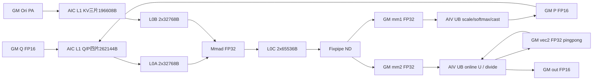
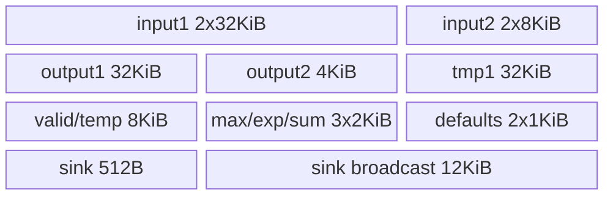
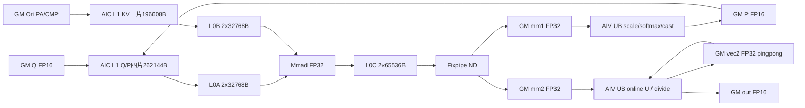
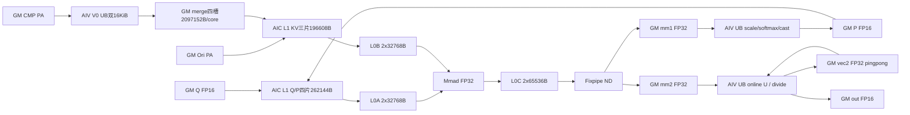
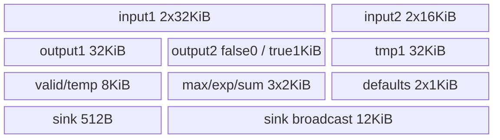
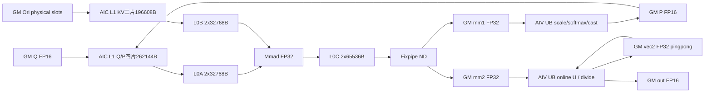
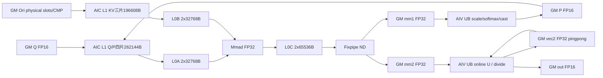

# SGL 共享KV稀疏注意力 A2/A3 ACLNN 算子知识

## 算子速览

| 项目 | 内容 |
|---|---|
| 实际入口 | 公开 `aclnnSglSparseAttnSharedkvGetWorkspaceSize/aclnnSglSparseAttnSharedkv`，固定commit dda6d36b0cdb4081e102d14c0a2fb276fc416e69 |
| 计算语义 | 共享K=V；Ori滑窗或物理slot集合，CFA再并入压缩前缀，SCFA再并入压缩topK集合；sink作为零value虚拟token参与分母。源码集合选择与API文档只明确覆盖SWA分开记录 |
| 输入输出 | Q FP16/BF16 BSND/TND；PA_ND KV，N2=1、D512；Torch N1=64；INT32 metadata 1024元素；输出同Q，LSE公开仅false/空[0] |
| 执行类型 | 单Kernel `KERNEL_TYPE_MIX_AIC_1_2`，AIC_CUBE MM1/MM2与AIV_VECTOR V1/V2，SCFA另含V0 gather；不是多个Kernel |
| Kernel 路线 | R-001..R-018逐dtype、Q布局、mode及TND Ori-slot分支；R-019为raw Host非PA key的无输出终点 |
| 核心资源 | 各AIC L1=458752B、L0A/B各65536B、L0C131072B；各AIV SWA/CFA UB180736B、SCFA193024B（raw LSE true另1024B）；workspace见公式 |
| 来源闭包 | source_closed：公开入口/OpDef→Parser/Checker/Tiling→显式POD→12个entry key→6个实际body→公共分页helper→active CMake均可追溯。CANN生成bridge、硬件intrinsic和通用softmax是显式库边界 |
| 验证状态 | 已完成源码闭包检查；本次知识提取未执行编译、真机、数值或性能测试。draft：**SWA/CFA在非首S2且当前AIV分块>8行时previous-U超过16KiB UB；SCFA忽略Ori稀疏索引、Ori PA子块偏移遗漏、CMP未写tail；raw LSE与Infer冲突。默认单块SWA不触发前述previous-U问题；不据此推荐安全复用。** |

## 接口与语义

### 计算语义

令每批实际Q长为 Lq、实际Ori KV长为 Lo，query行s、head h、共享KV头为0，D=512。公开SWA定义 a=Lo−Lq+s、l=max(a−left,0)、r=min(a+right,Lo−1)，集合 O=[l,r]；负/空区间为空。公开数学式是
`z_j=softmax_scale·dot(Q[s,h,:],KV[j,:]); out=Σ_j exp(z_j)KV[j,:]/(exp(sink[h])+Σ_j exp(z_j))`。
K与V为同一KV存储，不存在独立value参数。sink不乘value，输入不修改。顺序是低精度输入→Cube FP32点积→FP32 scale/在线softmax→P cast为输入dtype→Cube FP32 P·KV→FP32在线重标和累加→除sum→输出cast。

以下是固定源码Host可达集合选择，不升级成API已承诺的压缩能力：SWA mode0仅Ori；CFA mode1为Ori并入压缩前缀 C=[0,floor((Lo−Lq+s+1)/ratio))，ratio为4或128；SCFA mode2的计划长度 min(K,floor((Lo−Lq+s+1)/ratio))，K=512/1024，V0从cmp_sparse_indices取压缩token逻辑下标再经CMP页表gather。CMP和Ori是拼接的token序列，源码未做去重。重复索引具有重复权重，不能擅自换为集合去重。

TND且提供ori_sparse_indices时，SWA/CFA使用从首个负值截断的非负前缀，最多 min(width,Lo)项；每个非负值是**物理token slot**，直接除Ori blockSize得到物理页，绕过ori_block_table，且替代滑窗。Host不验证slot上界。SCFA虽然Host记录该输入，却在Init中明确忽略，仍用窗口；此差异是缺陷知识，不是另一数学目标。

源码sink实现还须按实参复用：CopySinksIn以每head 8个FP32广播，SliceAndContactSinksValue的WholeReduceMax mask=64、repeat≤128、srcBlkStride=1/srcRepStride=1，不是直接读取sink[h]；固定调用表达式与文档逐头公式之间不能凭名称假定完全等价，本次未做数值验证。空行Device显式写out=0，raw请求LSE时写0；它不是数学logsumexp(sink)保证。

### 输入、输出与属性

| 参数 | shape/layout | dtype | 约束、默认值与语义 |
|---|---|---|---|
| q | BSND[B,S1,N1,512] / TND[T,N1,512] | FP16/BF16 | 同NPU连续；Torch精确N1=64；raw Host仅N1%4==0、N2=1、G%4==0，未施加sink UB的N1≤128上界 |
| ori_kv | PA_ND[blocks,Bs,1,512] | 同Q | 必需非空；Bs>0、≤1024、%16==0；共享K/V，C++捕获stride(0) |
| cmp_kv | PA_ND[cmpBlocks,cmpBs,1,512] | 同Q | supplied descriptor即present，含dim0为0的空tensor；选择CFA/SCFA，需cmp页表；不能以空tensor替代None保持SWA |
| ori_sparse_indices | TND[T,1,width] | INT32 | 仅TND+PA；width>0、%128==0、≤2048，query T/N2匹配；SWA/CFA为物理slot，SCFA忽略 |
| cmp_sparse_indices | BSND[B,S1,1,K] / TND[T,1,K] | INT32 | 提供且cmpKV存在选SCFA；K512/1024；SCFA每对索引首值负时仅终止当前AIV子区、第二值负时仅过滤；causal限过滤是Device行为，Host不读取值 |
| ori_block_table | [B,maxBlocks] | INT32 | PA必需，rank2；Host未完整核对首维/页号值；slot分支仍要求但不使用Ori页表定位 |
| cmp_block_table | [B,cmpMaxBlocks] | INT32 | CFA/SCFA必需；列>0，首维按BSND B或TND内部bSize−1核对 |
| cu_seqlens_q | [B+1] | INT32 | TND必需，BSND禁止；Device读取cu[b],cu[b+1]，Host不验证单调/值域 |
| cu_seqlens_ori_kv | 原接口累计长度 | INT32可选 | 当前PA实例不读取；raw KV TND解析需要，但无entry case |
| cu_seqlens_cmp_kv | 原接口累计长度 | INT32可选 | 当前PA实例不读取；raw KV TND压缩模板需要，但无entry case |
| seqused_q | [B] | INT32可选 | TND禁止；BSND省略用静态S1；部分raw shape校验为no-op，Device值不验证 |
| seqused_kv | [B] | INT32 | PA必需，元素数匹配实际B；Device有效Ori长，非CMP独立长度 |
| sinks | [N1] | FP32 | 必需非空；每AIV先搬入固定128元素buffer，raw大N1无安全承诺 |
| metadata | numel1024 | INT32 | 必需；caller提供分核内容；不是仅有shape就能生成正确调度。Device按uint32读有符号输入位模式 |
| softmax_scale | scalar | float32 | Python/Torch默认0.0，Torch≥0；OpDef默认1.0；raw Host未检查有限性/非负 |
| cmp_ratio | scalar | int64→POD int64 | Python0，OpDef1；CFA/SCFA强制4或128，SWA inactive |
| ori_mask_mode | scalar | int64→uint64→Device uint32 | 仅4 |
| cmp_mask_mode | scalar | int64→uint64→Device uint32 | 仅3，SWA也检查 |
| ori_kv_stride | scalar，元素 | int64→Device uint32 | Torch取oriKV.stride(0)，检查0..UINT32_MAX；raw无相应范围guard |
| cmp_kv_stride | scalar，元素 | int64→Device uint32 | Torch取cmpKV.stride(0)，None为0；Host stride checker为no-op |
| ori_win_left | scalar | int64→Device int32 | Python128，OpDef/POD默认127；非负，Torch仅上界UINT32_MAX，未保护Device int32窄化 |
| ori_win_right | scalar | 同left | 默认0，同窄化边界 |
| layout_q | string | BSND/TND | 默认BSND；TND的内部Host bSize=cuQ元素数B+1，不要当真实batch写入metadata |
| layout_kv | string | PA_ND | Torch/public仅PA_ND；raw Parser还接收BSND/TND但router无case |
| return_softmax_lse | scalar | bool | 公开/Torch仅false。raw Host未拒true但Infer恒[0]，Device可能写越空输出，不能公开使用 |
| attn_out | 同Q shape | 同Q | at::empty_like；仅metadata覆盖且真实写入/清零的域有值 |
| softmax_lse | [0] | FP32 | C++用1元素storage narrow为0保留指针；不是可容纳真LSE的buffer |

### 入口与版本

本卡覆盖同一公开Sgl ACLNN pair；[同源API](../../../../apis/sgl_kernel_npu/sgl_sparse_attn_sharedkv.md)给接口范围，[旧模型Concept](../../../../concepts/kernels/sparse_attn_sharedkv.md)属于另一cann-recipes-infer固定来源及SparseFlashMLA/量化集成，不能拿它的PA_BBND或metadata ABI覆盖本native PA_ND实现。量化SharedKV有独立入口，不在本卡。

公开EN文档硬件表为ascendc arch22 Supported、arch35 Not supported；Python_ARCH22、CMake SUPPORTED_ARCHS2201、architectures.json的ascend910b/ascend910_93与Host910B/910_93一致，形成A2/A3证据链。目录arch32只是实现命名。文档明确“current implementation covers SWA”及reference不覆盖CMP；本卡对CFA/SCFA只称**源码可达**，不声称公开功能已通过验证。950 torch_native支持不等于本native支持。

固定README.md:27与CI pr-test-kernels.yml:183等提供本任务CANN9.1.0版本依据；不推导其它版本或实际运行。native构建使用csrc/attention/sparse_attn_sharedkv当前复制body，legacy csrc/sparse_attn_sharedkv不参与此target；不将旧ge_helper内存补成当前ACLNN接线。

## Host/Launcher 执行流程

### 参数校验与前处理

Python get_impl_by_name选择auto/ascendc，只在ARCH22注册；不可用报错，无跨后端回退。C++按q dtype/NPU/contiguous/rank→Ori、sink、metadata存在→layoutPA/BSND或TND/LSEfalse→页表、usedKV、CMP存在关系、cuQ布局关系→window/scale→dtype/metadata1024→取两种stride和N1=64→全部INT32 optional→u32整数属性范围→逐tensor同设备/连续检查。**不自动contiguous**。检查失败TORCH_CHECK，后续descriptor/query/launch不发生。

Host Parser顺序Parse→GetOpName/GetNpuInfo/GetOpParaInfo/required→dtype/Qlayout/KVlayout→GetSASTemplateMode→SetSASShape→N1/N2/G/B/T/S1/S2/D/sparseCount/sink/actual信息→GenerateInfo。Checker Process按单参数→存在→feature→多参数一致性；bSize>0、Q/Ori非空、D512、N2=1、N1/G为4倍数、mask4/3、正PA块16倍数≤1024、ratio4/128（压缩）等。no-op函数不自动升级为校验；Host不读metadata、页表、索引、累计长度和used值。OpDef/Infer及CANN generated ACLNN inner bridge是边界，不能假设其补做未见的owned guard。

### 参数、Workspace 与生命周期

C++按14输入/2输出建立shared_ptr aclTensor描述符；GetWorkspaceSize符号动态加载，query失败立即TORCH_CHECK；workspaceSize≤INT64_MAX后at::empty Byte分配，**未清零**。out empty_like，LSE空view。当前NPU stream上对全部输入/optional/out/workspace record_stream；launch lambda捕获tensor、descriptor、输出、layout字符串、workspace、executor、stream，RunOpApi执行pair第二阶段，失败TORCH_CHECK。CANN executor的内部释放和generated bridge属框架边界，未编造本仓手动Destroy/重用逻辑。

令C=平台AIC数，A=平台AIV数，G=N1/N2，M16=align16(min(G*S1,G))，E=512*M16元素。非空正常域M16=align16(G)。Host顺序算S2 tile512→G的Mbase→Dalign512→E→四片workspace；Device从GetUserWorkspace后的user指针起分片：
`o0=0; o1=8CE; o2=12CE; o3=20CE; o4=28CE`字节。
mm1 FP32 8CE，vec1输入dtype 4CE，mm2 FP32 8CE，vec2 FP32 8CE。
SWA/CFA user=28CE；SCFA再加merge4*C*512*512*2=2097152C和validSize4*128*4*(2C)=4096C，合计28CE+2101248C。外层workspace[0]=libapi+user **只加一次**；entry GetUserWorkspace剥离系统区。slice owner为单次executor/stream，函数对象内TBuf仅单launch生存。workspace未初始化，不能把未写位置当0。

### 启动图与失败传播

一个CANN AICORE节点：TilingSglSparseAttnSharedkv→Parser/Checker→DoOpTiling→raw容量检查→memcpy(sizeof POD)/SetDataSize→blockDim=CalcTschBlockDim(A,C,A)、outer tilingKey0→sgl_sparse_attn_sharedkv。Kernel MIX1:2，AIC c=GetBlockIdx，AIV c=floor(GetBlockIdx/2)、子核parity=GetBlockIdx%2。metadata决定每core是否执行及BN2/M/S2区间，Host没有自动metadata producer launch。FA分片协议是caller输入，不是遗漏的内部节点。

```text
query/Infer/Host failure -> GRAPH_FAILED -> C++ query TORCH_CHECK -> no execute
query success -> workspace/owners -> same-stream execute -> one MIX entry
 AIC: Init metadata/POD/L1/L0 -> MM1 -> flag7 -> wait8 -> MM2 -> flag9
 AIV SWA/CFA: Init UB/sinks -> wait7 -> V1 -> flag8 -> wait9 -> V2
 AIV SCFA: V0 gather -> flag6 -> wait7 -> V1 -> flag8 -> wait9 -> V2
 AIC SCFA: wait6 before CMP MM1; credits flag3 seeded4, return per final-query MM2
unknown dispatch -> switch falls through -> no output writer, no Trap/fallback
```

## Route 与参数设计

### 分核与资源计算

Host只分配资源与POD，不生成caller metadata。FA metadata启用核按起止BN2/M/S2遍历；N2固定1故BN2=b。Mbase=G，每个gS1Loop处理一条query的G heads，再以256 heads为nBuffer子片，以128为L1 Mtile。S2每块512、MM1 Ntile128；D=512拆2个K_L1=256、各2个K_L0=128。MM2输出D按128列4片，K为实际S2块，以L1 256/L0 128拆，末K分别align16。Q/P L1四个65536B buffer，KV三缓冲，各AIC L1=448KiB；L0A/B各2*32KiB，L0C2*64KiB。未见Host按GetCoreMemSize校验UB/L1/L0容量，不能写成已证明平台余量。

正常Torch G64时M16=64，E32768；每AIC四片user917504B=896KiB，SCFA总3018752B（917504+2097152+4096）。SWA/CFA每AIV UB180736B，SCFA193024B/true194048B，逐片见Route。分核表中S2起止允许部分KV，但所有实例FLASH_DECODE=false，没有FD汇总节点；如果caller把一条query拆多core，partial online结果会直接写同out，不能声称split-KV归约正确。metadata必须保证完整行唯一owner或由外部协议承担，不擅自补FD。

### Route 选择

公共谓词P：A2/A3/2201；Q/Ori同dtypeFP16或BF16、Q BSND/TND、KV PA_ND、D512、N2=1、G%4=0，Q/Ori非空，Bs/压缩Bs在(0,1024]且%16==0，sink FP32[N1]、metadata INT32 numel1024、页表/usedKV满足Host存在及shape检查；ori_mask4/cmp_mask3、非负窗口；TND有cuQ无seqQ，BSND无cuQ。Torch附加N1=64、u32 attrs/stride范围、LSEfalse、同设备连续。R表的mode0为CMP absent且CMPindices absent；mode1 CMP present且indices absent；mode2两者present、K512/1024；mode1/2 ratio4/128和CMP页表必需。各Route均有metadata enable0无计算分支和有效/空行分支。raw true仅以风险条件分支记账，不视为公开支持功能。

| 顺序 | Route | Key/模板 | 精确选择条件与优先级 | 不适用去向 |
|---:|---|---|---|---|
| 1 | R-001 SWA BSND | 0x00000200; mode0 | P，FP16，Q=BSND，mode0，oriIndices absent | 对应另一个dtype/layout/mode/slot行；任何公共guard失败为query失败 |
| 2 | R-002 CFA BSND | 0x00000201; mode1 | P，FP16，Q=BSND，mode1，oriIndices absent | 对应另一个dtype/layout/mode/slot行；任何公共guard失败为query失败 |
| 3 | R-003 SCFA BSND | 0x00000202; mode2 | P，FP16，Q=BSND，mode2，oriIndices absent | 对应另一个dtype/layout/mode/slot行；任何公共guard失败为query失败 |
| 4 | R-004 SWA TND | 0x00010200; mode0 | P，FP16，Q=TND，mode0，oriIndices absent | 对应另一个dtype/layout/mode/slot行；任何公共guard失败为query失败 |
| 5 | R-005 SWA TND Ori-slot | 0x00010200; mode0 | P，FP16，Q=TND，mode0，oriIndices present且TND[ T,1,width ]、width正128倍数≤2048 | 对应另一个dtype/layout/mode/slot行；任何公共guard失败为query失败 |
| 6 | R-006 CFA TND | 0x00010201; mode1 | P，FP16，Q=TND，mode1，oriIndices absent | 对应另一个dtype/layout/mode/slot行；任何公共guard失败为query失败 |
| 7 | R-007 CFA TND Ori-slot | 0x00010201; mode1 | P，FP16，Q=TND，mode1，oriIndices present且TND[ T,1,width ]、width正128倍数≤2048 | 对应另一个dtype/layout/mode/slot行；任何公共guard失败为query失败 |
| 8 | R-008 SCFA TND | 0x00010202; mode2 | P，FP16，Q=TND，mode2，oriIndices absent | 对应另一个dtype/layout/mode/slot行；任何公共guard失败为query失败 |
| 9 | R-009 SCFA TND Ori-slot | 0x00010202; mode2 | P，FP16，Q=TND，mode2，oriIndices present且TND[ T,1,width ]、width正128倍数≤2048 | 对应另一个dtype/layout/mode/slot行；任何公共guard失败为query失败 |
| 10 | R-010 SWA BSND | 0x01000200; mode0 | P，BF16，Q=BSND，mode0，oriIndices absent | 对应另一个dtype/layout/mode/slot行；任何公共guard失败为query失败 |
| 11 | R-011 CFA BSND | 0x01000201; mode1 | P，BF16，Q=BSND，mode1，oriIndices absent | 对应另一个dtype/layout/mode/slot行；任何公共guard失败为query失败 |
| 12 | R-012 SCFA BSND | 0x01000202; mode2 | P，BF16，Q=BSND，mode2，oriIndices absent | 对应另一个dtype/layout/mode/slot行；任何公共guard失败为query失败 |
| 13 | R-013 SWA TND | 0x01010200; mode0 | P，BF16，Q=TND，mode0，oriIndices absent | 对应另一个dtype/layout/mode/slot行；任何公共guard失败为query失败 |
| 14 | R-014 SWA TND Ori-slot | 0x01010200; mode0 | P，BF16，Q=TND，mode0，oriIndices present且TND[ T,1,width ]、width正128倍数≤2048 | 对应另一个dtype/layout/mode/slot行；任何公共guard失败为query失败 |
| 15 | R-015 CFA TND | 0x01010201; mode1 | P，BF16，Q=TND，mode1，oriIndices absent | 对应另一个dtype/layout/mode/slot行；任何公共guard失败为query失败 |
| 16 | R-016 CFA TND Ori-slot | 0x01010201; mode1 | P，BF16，Q=TND，mode1，oriIndices present且TND[ T,1,width ]、width正128倍数≤2048 | 对应另一个dtype/layout/mode/slot行；任何公共guard失败为query失败 |
| 17 | R-017 SCFA TND | 0x01010202; mode2 | P，BF16，Q=TND，mode2，oriIndices absent | 对应另一个dtype/layout/mode/slot行；任何公共guard失败为query失败 |
| 18 | R-018 SCFA TND Ori-slot | 0x01010202; mode2 | P，BF16，Q=TND，mode2，oriIndices present且TND[ T,1,width ]、width正128倍数≤2048 | 对应另一个dtype/layout/mode/slot行；任何公共guard失败为query失败 |
| 19 | R-019 raw非PA终点 | raw KVlayout=0/1产生的24个key | raw Parser允许BSND/TND，且通过各自Host校验；Torch先拒绝，公开不支持 | entry无case，无输出writer；无fallback |

```text
required / dtype / layout / shape failure -> GRAPH_FAILED
ori absent -> fail
cmp present:
  cmpIndices present -> mode2(SCFA)
  else -> mode1(CFA)
else:
  cmpIndices present -> fail
  else -> mode0(SWA)
if oriIndices present:
  require Q TND, KV PA_ND, width positive %128==0 <=2048
key = dtype_bit24 | qLayout_bit16 | kvLayout_byte8 | mode
KV PA_ND: switch 12 keys -> (dtype,Q,mode) -> oriIndices dynamic branch
KV BSND/TND: no case -> R-019
```

### 模板/实现执行矩阵

| Route | key/selector | dtype/shape/platform 完整命中条件 | 执行族与 kernel 节点 | 实际模板/body | 内存与同步特征 | tail/fallback |
|---|---|---|---|---|---|---|
| R-001 | 0x00000200; oriIndices=false | P；FP16/BSND/mode0；CMP absent | 单MIX， C1→V1→C2→V2 | SASType<half,half,half,false,SAS_LAYOUT::BSND,SAS_LAYOUT::PA_ND,0>→SparseAttnSharedkvSwa/SWACubeBlock/SWAVectorBlock | user28CE；7/8/9；L1 448KiB；UB180736B | S2/16aligned tail，M按256/128；Ori窗口；无后端fallback |
| R-002 | 0x00000201; oriIndices=false | P；FP16/BSND/mode1；ratio4/128，CMP存在 | 单MIX， C1→V1→C2→V2 | SASType<half,half,half,false,SAS_LAYOUT::BSND,SAS_LAYOUT::PA_ND,1>→SparseAttnSharedkvSwa/SWACubeBlock/SWAVectorBlock | user28CE；7/8/9；L1 448KiB；UB180736B | S2/16aligned tail，M按256/128；Ori窗口；无后端fallback |
| R-003 | 0x00000202; oriIndices=false | P；FP16/BSND/mode2；ratio4/128，CMP存在，topK512/1024 | 单MIX，V0→C1→V1→C2→V2 | SASType<half,half,half,false,SAS_LAYOUT::BSND,SAS_LAYOUT::PA_ND,2>→SparseAttnSharedkvScfa/SASCubeBlock/SASVectorBlock | user28CE+2101248C，flag3/6；7/8/9；L1 448KiB；UB193024(+rawLSE1024)B | S2/16aligned tail，M按256/128；Ori窗口；无后端fallback |
| R-004 | 0x00010200; oriIndices=false | P；FP16/TND/mode0；CMP absent | 单MIX， C1→V1→C2→V2 | SASType<half,half,half,false,SAS_LAYOUT::TND,SAS_LAYOUT::PA_ND,0>→SparseAttnSharedkvSwa/SWACubeBlock/SWAVectorBlock | user28CE；7/8/9；L1 448KiB；UB180736B | S2/16aligned tail，M按256/128；Ori窗口；无后端fallback |
| R-005 | 0x00010200; oriIndices=true | P；FP16/TND/mode0；CMP absent | 单MIX， C1→V1→C2→V2 | SASType<half,half,half,false,SAS_LAYOUT::TND,SAS_LAYOUT::PA_ND,0>→SparseAttnSharedkvSwa/SWACubeBlock/SWAVectorBlock | user28CE；7/8/9；L1 448KiB；UB180736B | S2/16aligned tail，M按256/128；物理slot前缀；无后端fallback |
| R-006 | 0x00010201; oriIndices=false | P；FP16/TND/mode1；ratio4/128，CMP存在 | 单MIX， C1→V1→C2→V2 | SASType<half,half,half,false,SAS_LAYOUT::TND,SAS_LAYOUT::PA_ND,1>→SparseAttnSharedkvSwa/SWACubeBlock/SWAVectorBlock | user28CE；7/8/9；L1 448KiB；UB180736B | S2/16aligned tail，M按256/128；Ori窗口；无后端fallback |
| R-007 | 0x00010201; oriIndices=true | P；FP16/TND/mode1；ratio4/128，CMP存在 | 单MIX， C1→V1→C2→V2 | SASType<half,half,half,false,SAS_LAYOUT::TND,SAS_LAYOUT::PA_ND,1>→SparseAttnSharedkvSwa/SWACubeBlock/SWAVectorBlock | user28CE；7/8/9；L1 448KiB；UB180736B | S2/16aligned tail，M按256/128；物理slot前缀；无后端fallback |
| R-008 | 0x00010202; oriIndices=false | P；FP16/TND/mode2；ratio4/128，CMP存在，topK512/1024 | 单MIX，V0→C1→V1→C2→V2 | SASType<half,half,half,false,SAS_LAYOUT::TND,SAS_LAYOUT::PA_ND,2>→SparseAttnSharedkvScfa/SASCubeBlock/SASVectorBlock | user28CE+2101248C，flag3/6；7/8/9；L1 448KiB；UB193024(+rawLSE1024)B | S2/16aligned tail，M按256/128；Ori窗口；无后端fallback |
| R-009 | 0x00010202; oriIndices=true | P；FP16/TND/mode2；ratio4/128，CMP存在，topK512/1024 | 单MIX，V0→C1→V1→C2→V2 | SASType<half,half,half,false,SAS_LAYOUT::TND,SAS_LAYOUT::PA_ND,2>→SparseAttnSharedkvScfa/SASCubeBlock/SASVectorBlock | user28CE+2101248C，flag3/6；7/8/9；L1 448KiB；UB193024(+rawLSE1024)B | S2/16aligned tail，M按256/128；Ori slot被忽略；无后端fallback |
| R-010 | 0x01000200; oriIndices=false | P；BF16/BSND/mode0；CMP absent | 单MIX， C1→V1→C2→V2 | SASType<bfloat16_t,bfloat16_t,bfloat16_t,false,SAS_LAYOUT::BSND,SAS_LAYOUT::PA_ND,0>→SparseAttnSharedkvSwa/SWACubeBlock/SWAVectorBlock | user28CE；7/8/9；L1 448KiB；UB180736B | S2/16aligned tail，M按256/128；Ori窗口；无后端fallback |
| R-011 | 0x01000201; oriIndices=false | P；BF16/BSND/mode1；ratio4/128，CMP存在 | 单MIX， C1→V1→C2→V2 | SASType<bfloat16_t,bfloat16_t,bfloat16_t,false,SAS_LAYOUT::BSND,SAS_LAYOUT::PA_ND,1>→SparseAttnSharedkvSwa/SWACubeBlock/SWAVectorBlock | user28CE；7/8/9；L1 448KiB；UB180736B | S2/16aligned tail，M按256/128；Ori窗口；无后端fallback |
| R-012 | 0x01000202; oriIndices=false | P；BF16/BSND/mode2；ratio4/128，CMP存在，topK512/1024 | 单MIX，V0→C1→V1→C2→V2 | SASType<bfloat16_t,bfloat16_t,bfloat16_t,false,SAS_LAYOUT::BSND,SAS_LAYOUT::PA_ND,2>→SparseAttnSharedkvScfa/SASCubeBlock/SASVectorBlock | user28CE+2101248C，flag3/6；7/8/9；L1 448KiB；UB193024(+rawLSE1024)B | S2/16aligned tail，M按256/128；Ori窗口；无后端fallback |
| R-013 | 0x01010200; oriIndices=false | P；BF16/TND/mode0；CMP absent | 单MIX， C1→V1→C2→V2 | SASType<bfloat16_t,bfloat16_t,bfloat16_t,false,SAS_LAYOUT::TND,SAS_LAYOUT::PA_ND,0>→SparseAttnSharedkvSwa/SWACubeBlock/SWAVectorBlock | user28CE；7/8/9；L1 448KiB；UB180736B | S2/16aligned tail，M按256/128；Ori窗口；无后端fallback |
| R-014 | 0x01010200; oriIndices=true | P；BF16/TND/mode0；CMP absent | 单MIX， C1→V1→C2→V2 | SASType<bfloat16_t,bfloat16_t,bfloat16_t,false,SAS_LAYOUT::TND,SAS_LAYOUT::PA_ND,0>→SparseAttnSharedkvSwa/SWACubeBlock/SWAVectorBlock | user28CE；7/8/9；L1 448KiB；UB180736B | S2/16aligned tail，M按256/128；物理slot前缀；无后端fallback |
| R-015 | 0x01010201; oriIndices=false | P；BF16/TND/mode1；ratio4/128，CMP存在 | 单MIX， C1→V1→C2→V2 | SASType<bfloat16_t,bfloat16_t,bfloat16_t,false,SAS_LAYOUT::TND,SAS_LAYOUT::PA_ND,1>→SparseAttnSharedkvSwa/SWACubeBlock/SWAVectorBlock | user28CE；7/8/9；L1 448KiB；UB180736B | S2/16aligned tail，M按256/128；Ori窗口；无后端fallback |
| R-016 | 0x01010201; oriIndices=true | P；BF16/TND/mode1；ratio4/128，CMP存在 | 单MIX， C1→V1→C2→V2 | SASType<bfloat16_t,bfloat16_t,bfloat16_t,false,SAS_LAYOUT::TND,SAS_LAYOUT::PA_ND,1>→SparseAttnSharedkvSwa/SWACubeBlock/SWAVectorBlock | user28CE；7/8/9；L1 448KiB；UB180736B | S2/16aligned tail，M按256/128；物理slot前缀；无后端fallback |
| R-017 | 0x01010202; oriIndices=false | P；BF16/TND/mode2；ratio4/128，CMP存在，topK512/1024 | 单MIX，V0→C1→V1→C2→V2 | SASType<bfloat16_t,bfloat16_t,bfloat16_t,false,SAS_LAYOUT::TND,SAS_LAYOUT::PA_ND,2>→SparseAttnSharedkvScfa/SASCubeBlock/SASVectorBlock | user28CE+2101248C，flag3/6；7/8/9；L1 448KiB；UB193024(+rawLSE1024)B | S2/16aligned tail，M按256/128；Ori窗口；无后端fallback |
| R-018 | 0x01010202; oriIndices=true | P；BF16/TND/mode2；ratio4/128，CMP存在，topK512/1024 | 单MIX，V0→C1→V1→C2→V2 | SASType<bfloat16_t,bfloat16_t,bfloat16_t,false,SAS_LAYOUT::TND,SAS_LAYOUT::PA_ND,2>→SparseAttnSharedkvScfa/SASCubeBlock/SASVectorBlock | user28CE+2101248C，flag3/6；7/8/9；L1 448KiB；UB193024(+rawLSE1024)B | S2/16aligned tail，M按256/128；Ori slot被忽略；无后端fallback |
| R-019 | 24 raw非PA key | raw Host可接受的非PA布局组合 | 无计算节点，仅entry壳 | switch无case | 不调用body，不分配Device TBuf | out/LSE无写入，不能当可用route |

### 隐藏性能 Guard

| Guard | Host/Tiling 条件 | Device/资源原因 | 影响 Route | 不满足时去向 | 源码符号 |
|---|---|---|---|---|---|
| 平台 | 910B/910_93且AIC/AIV>0，编译2201 | MIX1:2与arch32 body接线 | 1..18 | query失败/未编译 | GetNpuInfo/CMake |
| D/N2/G | D512,N2=1,N1%4=0,G%4=0；Torch另G64 | 固定512维，head分片、sink UB | 1..18 | query失败；raw缺少G≤128容量guard，不能安全外推 | CheckFeatureShape/Torch qHeads |
| PA block | 0<Bs≤1024且%16==0，CMP同 | ND2NZ/页边界分段、16aligned load | 1..18 | query失败 | CheckSingleParaOriKv/CmpKv |
| Ori index | Q TND+KV PA,width正128倍数≤2048 | 最多512块+128子块slot搬运 | 5/7/9/14/16/18 | query失败；SCFA即使通过也忽略 | CheckSingleParaOriSparseIndices |
| CMP ratio/K | ratio4/128，K512/1024 | causal prefix及固定512 gather | CFA/SCFA | query失败 | CheckSingleParaCmpRatio/CmpSparseIndices |
| LSE | Torch/public要求false；raw未拒 | Infer空[0]与Device true写冲突 | 全部 | Torch失败；raw危险分支无fallback | torch_adapter/InferShape/ProcessLse |
| 整数窄化 | Torch仅u32上限，raw stride checker no-op | Device stride uint32、windows int32 | 全部 | 未见安全fallback；可能窄化后偏移不同 | InitTilingData/CheckSinglePara*Stride |
| UB/L1/L0 | Host未按可用容量筛选 | 固定分配及G相关访问 | 全部 | 不能声称已验证容量guard | InitBuffers/DoOpTiling |
| metadata内容 | 仅shape1024/I32检查 | core分片、终止S2、唯一输出owner | 全部 | 无内容校验，enable0不写；非法端点可能越界/多核覆盖 | InitCalcParamsEach/ProcessBalance |
| SCFA有效gather数 | 无Host值检查；Device拒负/≥causal限 | merge未写tail却以计划长度消费 | SCFA | 没有清尾或mask fallback | GetKeyGmOffset/ProcessVec0L |
| 未知key | raw非PA布局可被Parser接受 | entry仅PA12case | R-019 | switch落空，无错误trap | MakeSASDispatchKey/entry |

### POD/ABI

POD为显式标准C++ struct，Host零初始化成员后memcpy整结构，Device重解释相同GM。**固定源没有数值sizeof/alignof/offsetof断言或编译报告**；下表A布局是按uint32/float 4B、int64/uint64 8B、bool1B及自然对齐推导的候选ABI，不冒充已编译测量。若工具链打包不同，以实际 `sizeof(SparseAttnSharedkvTilingData)`与同头编译为准，不能硬编码候选数替代memcpy。A: base size136/align8，cmp size32/align8，whole size176/align8；base偏移0，cmp136，dispatch168，尾padding4。显式宽度为源类型事实，bool字节/对齐是A的前提。每字段下列边界包含inactive读取。

| 结构 | 字段 | 类型/位宽 | ABI 布局 | 单位 | Host/launcher producer | Device consumer | 边界 |
|---|---|---|---|---|---|---|---|
| SparseAttnSharedkvSwaParams | batchSize | uint32_t/32 | A:offset 0；见ABI前提 | batch或TND前缀项 | DoOpTiling:info.bSize | InitTilingData→ConstInfo.batchSize；InitOutputSingleCore（needInit默认false） | BSND B；TND B+1，不用它替metadata生成批次 |
| SparseAttnSharedkvSwaParams | qSeqSize | uint32_t/32 | A:offset 4；见ABI前提 | query token | DoOpTiling:info.s1Size | InitTilingData/GetActualSeqLenQ/BSND offsets | BSND S1；TND总T，仅cuQ差为每批长 |
| SparseAttnSharedkvSwaParams | kvSeqSize | uint32_t/32 | A:offset 8；见ABI前提 | Ori token | DoOpTiling:info.s2Size | InitTilingData/GetActualSeqLenKV/PA prefix | PA oriMaxBlocks*oriBs；Device实际长取usedKV |
| SparseAttnSharedkvSwaParams | paBlockSize | int64_t/64 | A:offset 16；见ABI前提 | token/block | DoOpTiling:info.blockSize | InitTilingData→kvCacheBlockSize | PA复制实际用oriBlockSize/cmpBlockSize；不得当活跃页大小替代 |
| SparseAttnSharedkvSwaParams | oriBlockSize | int64_t/64 | A:offset 24；见ABI前提 | token/block | DoOpTiling:info.oriBlockSize | InitTilingData→paOriBlockSize→DataCopyPA/BySlots | 正16倍数≤1024，进Device uint64 |
| SparseAttnSharedkvSwaParams | cmpBlockSize | int64_t/64 | A:offset 32；见ABI前提 | token/block | DoOpTiling:info.cmpBlockSize | InitTilingData→paCmpBlockSize | SWA inactive，CFA/SCFA正16倍数≤1024 |
| SparseAttnSharedkvSwaParams | oriMaxBlockNumPerBatch | uint32_t/32 | A:offset 40；见ABI前提 | 页表列 | DoOpTiling:info.oriMaxBlockNumPerBatch | DataCopyPA shape.maxblockNumPerBatch | slot分支不用表；Host不检查所有页号/索引值 |
| SparseAttnSharedkvSwaParams | nNumOfQInOneGroup | uint32_t/32 | A:offset 44；见ABI前提 | heads | DoOpTiling:info.gSize | ConstInfo.gSize/qHeadNum，Mbase和输出偏移 | Torch64；raw正4倍数无128上界 |
| SparseAttnSharedkvSwaParams | actualLenDimsQ | uint32_t/32 | A:offset 48；见ABI前提 | I32元素 | DoOpTiling:info.actualLenDimsQ | InitActualSeqLen→cuQ/seqQ view size | TND B+1，BSND0或shapeSize；Device不检查值 |
| SparseAttnSharedkvSwaParams | actualLenDimsKV | uint32_t/32 | A:offset 52；见ABI前提 | I32元素 | DoOpTiling:info.actualLenDimsKV | InitActualSeqLen→seqKV view | PA真实B；读取bIdx由metadata决定 |
| SparseAttnSharedkvSwaParams | softmaxScale | float/32 | A:offset 56；见ABI前提 | scale | DoOpTiling:info.softmaxScale=*attr | Vector ElewiseCompute Muls | 在FP32 MM1后、softmax前；NaN/Inf raw不校验 |
| SparseAttnSharedkvSwaParams | outputLayout | uint32_t/32 | A:offset 60；见ABI前提 | enum | DoOpTiling:uint32(info.outLayout) | InitTilingData→outputLayout；output/LSE offsets | BSND0/TND1；输入Qlayout决定entry模板 |
| SparseAttnSharedkvSwaParams | oriMaskMode | uint64_t/64 | A:offset 64；见ABI前提 | mask enum | DoOpTiling:info.oriMaskMode | InitTilingData窄化到uint32 | Host必须4；body窗口表达式不再按mode切换 |
| SparseAttnSharedkvSwaParams | oriKvStride | int64_t/64 | A:offset 72；见ABI前提 | dtype元素 | DoOpTiling:info.oriKvStride=*attr | ConstInfo uint32→DataCopyPA/BySlots | Torch 0..UINT32_MAX；raw no-op checker |
| SparseAttnSharedkvSwaParams | oriWinLeft | int64_t/64 | A:offset 80；见ABI前提 | token | DoOpTiling:info.oriWinLeft=*attr | ConstInfo int32→oriMaskLeft | 非负；Torch允许u32上界仍可能int32窄化；slot SWA/CFA不使用窗口 |
| SparseAttnSharedkvSwaParams | oriWinRight | int64_t/64 | A:offset 88；见ABI前提 | token | DoOpTiling:info.oriWinRight=*attr | ConstInfo int32→oriMaskRight | 同left边界；SCFA始终用窗口 |
| SparseAttnSharedkvSwaParams | sparseBlockSize | int64_t/64 | A:offset 96；见ABI前提 | token/index | DoOpTiling:info.sparseBlockSize，默认1 | SWA Init不读取；SCFA强制ConstInfo.sparseBlockSize=1 | inactive字段仍序列化，不可从此推导其它sparse块尺寸 |
| SparseAttnSharedkvSwaParams | hasOriSparseIndices | bool/语言bool | A:offset 104；见ABI前提 | bool | DoOpTiling:info.hasOriSparseIndices | SWA Init→prefix与BySlots分支；SCFA未读取 | 仅TND PA允许；SCFA true仍被忽略 |
| SparseAttnSharedkvSwaParams | oriSparseIndexWidth | uint32_t/32 | A:offset 108；见ABI前提 | slot/row | DoOpTiling:info.oriSparseIndexWidth | SWA GetOriSparseActualSeqLen/BySlots offset | 正128倍数≤2048；false默认0；SCFA inactive |
| SparseAttnSharedkvSwaParams | usedCoreNum | uint32_t/32 | A:offset 112；见ABI前提 | AIC core | DoOpTiling:aicNum | 各workspace region stride/core slice | 未按metadata启用数缩减；硬件AIC数 |
| SparseAttnSharedkvSwaParams | mmResUbSize | uint32_t/32 | A:offset 116；见ABI前提 | 元素 | DoOpTiling:512*align16(min(G*S1,G)) | mm1/vec1 offsets和两级body | 虽名UbSize实际GM工作片元素；乘法溢出未guard |
| SparseAttnSharedkvSwaParams | bmm2ResUbSize | uint32_t/32 | A:offset 120；见ABI前提 | 元素 | DoOpTiling:align32(D)*align16(min(G*S1,G)) | mm2/vec2 offsets | D512故与E相等；非真实UB容量 |
| SparseAttnSharedkvSwaParams | mBaseSize | uint32_t/32 | A:offset 124；见ABI前提 | heads/query tile | DoOpTiling:SplitBalanced mBaseSize_=G | POD写出；Device实际重算constInfo.mBaseSize=gSize | source-visible冗余，不擅自改字段 |
| SparseAttnSharedkvSwaParams | s2BaseSize | uint32_t/32 | A:offset 128；见ABI前提 | token | DoOpTiling:SplitBalanced sInnerSize_=512 | InitTilingData→s2BaseSize→S2 loops | 所有key固定512 |
| SparseAttnSharedkvSwaParams | returnSoftmaxLse | bool/语言bool | A:offset 132；见ABI前提 | bool | DoOpTiling:info.returnSoftmaxLse=*attr | Vector ProcessLse/空行LSE；SCFA outputBuff2条件分配 | 公开false；rawtrue与Infer[0]冲突 |
| SparseAttnSharedkvCmpParams | cmpMaxBlockNumPerBatch | uint32_t/32 | A:内部offset 0，整POD136 | 页表列 | DoOpTiling:info.cmpMaxBlockNumPerBatch | CFA DataCopyPA/SCFA GetKeyGmOffset | SWA inactive |
| SparseAttnSharedkvCmpParams | sparseBlockCount | uint32_t/32 | A:内部offset 4，整POD140 | index/row | DoOpTiling:info.sparseBlockCount | SCFA GetSparseActualSeqLen/GetRealS2Idx | SCFA512或1024；CFA/SWA inactive |
| SparseAttnSharedkvCmpParams | cmpRatio | int64_t/64 | A:内部offset 8，整POD144 | ratio | DoOpTiling:info.cmpRatio=*attr | CFA/SCFA floor threshold | 4/128压缩；SWA inactive |
| SparseAttnSharedkvCmpParams | cmpMaskMode | uint64_t/64 | A:内部offset 16，整POD152 | mask enum | DoOpTiling:info.cmpMaskMode=*attr | CFA/SCFA Init窄uint32 | Host全模式要求3；后续用causal表达式 |
| SparseAttnSharedkvCmpParams | cmpKvStride | int64_t/64 | A:内部offset 24，整POD160 | dtype元素 | DoOpTiling:info.cmpKvStride=*attr | CFA DataCopyPA/SCFA GetKeyGmOffset | Torchu32范围，raw无范围guard；SWA inactive |
| SparseAttnSharedkvTilingData | baseParams | struct | A:offset0,size136,align8 | aggregate | DoOpTiling/SplitBalanced逐字段写 | 两套InitTilingData | aggregate包含上列25字段，尾padding3B |
| SparseAttnSharedkvTilingData | cmpParams | struct | A:offset136,size32,align8 | aggregate | DoOpTiling逐字段写 | CFA/SCFA InitTilingData | SWA inactive但初始化后同样传递 |
| SparseAttnSharedkvTilingData | dispatchKey | uint32_t/32 | A:offset168；whole size176/align8 | bitfield key | MakeSASDispatchKey(dtype,qLayout,kvLayout,perfMode) | entry switch tilingData.dispatchKey | dtype<<24,Q<<16,KV<<8,mode；outer CANN tilingKey0不是此key |

metadata不是Host Tiling输出，而是API GM输入：固定header以36个AIC记录和72个FD记录命名，SasMetaData=36*8+72*8=864个uint32=3456B，输入1024*4=4096B，剩160项无本body消费者。下列每字段单列，int32输入按uint32位模式读；未见值域、core≤36或分片不重叠检查，不把shape大小当正确调度证据。

| 结构 | 字段 | 类型/位宽 | ABI 布局 | 单位 | Host/launcher producer | Device consumer | 边界 |
|---|---|---|---|---|---|---|---|
| metadata FA[36][8] | CORE_ENABLE[0] | uint32/32 | byte(8*c+0)*4 | bool | API caller | Process GetValue后0早退 | InitCalcParamsEach在早退之前已读端点 |
| metadata FA | BN2_START[1] | uint32/32 | byte(8*c+1)*4 | batch*N2索引 | caller | InitCalcParamsEach/ProcessBalance | core0强制默认0，非0核读取 |
| metadata FA | M_START[2] | uint32/32 | byte(8*c+2)*4 | gS1Loop(query tile)索引 | caller | gS1Start→loopIdx*G | core0默认0 |
| metadata FA | S2_START[3] | uint32/32 | byte(8*c+3)*4 | 512token tile | caller | constInfo.s2Start | 每core首任务使用，后续清0 |
| metadata FA | BN2_END[4] | uint32/32 | byte(8*c+4)*4 | batch*N2索引 | caller | bN2End及半开端点适配 | gS1End或s2End非0可能加1 |
| metadata FA | M_END[5] | uint32/32 | byte(8*c+5)*4 | gS1Loop索引 | caller | 最后BN2的gS1LoopEnd | 0代表最后BN2全域 |
| metadata FA | S2_END[6] | uint32/32 | byte(8*c+6)*4 | S2 tile exclusive end | caller | 最后任务s2LoopEnd | SWA min实际tile数；SCFA未同样min，过大可越界 |
| metadata FA | FIRST_FD_WORKSPACE_IDX[7] | uint32/32 | byte(8*c+7)*4 | FD index | caller/本卡无producer | 当前body不读取 | FLASH_DECODE=false |
| metadata FD[72][8] | CORE_ENABLE[0] | uint32/32 | byte(288+8*v+0)*4 | bool | caller/无内部节点 | 不读取 | 无FD launch |
| metadata FD | BN2_IDX[1] | uint32/32 | byte(288+8*v+1)*4 | BN2 index | caller | 不读取 | dormant |
| metadata FD | M_IDX[2] | uint32/32 | byte(288+8*v+2)*4 | M index | caller | 不读取 | dormant |
| metadata FD | WORKSPACE_IDX[3] | uint32/32 | byte(288+8*v+3)*4 | index | caller | 不读取 | accumOutGm未SetGlobalBuffer，FD编译false不触发 |
| metadata FD | WORKSPACE_NUM[4] | uint32/32 | byte(288+8*v+4)*4 | count | caller | 不读取 | 不以记录名补FD汇总 |
| metadata FD | M_START[5] | uint32/32 | byte(288+8*v+5)*4 | M index | caller | 不读取 | dormant |
| metadata FD | M_NUM[6] | uint32/32 | byte(288+8*v+6)*4 | M count | caller | 不读取 | dormant |
| metadata FD | reserved[7] | uint32/32 | byte(288+8*v+7)*4 | N/A | caller | 不读取 | 原struct占位，无定义字段名 |

RunInfo/ConstInfo/MSplitInfo是同Device函数内对象，不跨Host ABI；{}初值与CalcParams、InitTilingData赋值共同形成数据流，不能把未覆盖producer当Host POD。PAShape各uint32字段从POD窄化后与当前子块构造，DataCopyPA/BySlots显式消费blockSize/headNum/headDim/kvStride/maxblockNumPerBatch/actHeadDim/copyRowNum/copyRowNumAlign。

### Route 源码闭包

| Route | Key/selector | Host/Tiling producer | POD/参数 | Kernel entry/router | Kernel body/直接依赖 | 构建接线 |
|---|---|---|---|---|---|---|
| R-001 | 0x00000200，Ori index=false | op_host/sparse_attn_sharedkv_tiling.cpp::GetSASTemplateMode/Check*/DoOpTiling | SparseAttnSharedkvTilingData；mode0，BSND，FP16，hasOri=false | op_kernel/sparse_attn_sharedkv.cpp::LaunchSparseAttnSharedkv<half,BSND,0> | arch32/sparse_attn_sharedkv_swa_kernel.h及对应block_cube.h/block_vector.h；common.h DataCopyPA；metadata.h | CMakeLists.txt ID sparse_attn_sharedkv/AICORE/SglSparseAttnSharedkv/SUPPORTED_ARCHS2201，cann_ops生成bridge |
| R-002 | 0x00000201，Ori index=false | op_host/sparse_attn_sharedkv_tiling.cpp::GetSASTemplateMode/Check*/DoOpTiling | SparseAttnSharedkvTilingData；mode1，BSND，FP16，hasOri=false | op_kernel/sparse_attn_sharedkv.cpp::LaunchSparseAttnSharedkv<half,BSND,1> | arch32/sparse_attn_sharedkv_swa_kernel.h及对应block_cube.h/block_vector.h；common.h DataCopyPA；metadata.h | CMakeLists.txt ID sparse_attn_sharedkv/AICORE/SglSparseAttnSharedkv/SUPPORTED_ARCHS2201，cann_ops生成bridge |
| R-003 | 0x00000202，Ori index=false | op_host/sparse_attn_sharedkv_tiling.cpp::GetSASTemplateMode/Check*/DoOpTiling | SparseAttnSharedkvTilingData；mode2，BSND，FP16，hasOri=false | op_kernel/sparse_attn_sharedkv.cpp::LaunchSparseAttnSharedkv<half,BSND,2> | arch32/sparse_attn_sharedkv_scfa_kernel.h及对应block_cube.h/block_vector.h；common.h DataCopyPA；metadata.h | CMakeLists.txt ID sparse_attn_sharedkv/AICORE/SglSparseAttnSharedkv/SUPPORTED_ARCHS2201，cann_ops生成bridge |
| R-004 | 0x00010200，Ori index=false | op_host/sparse_attn_sharedkv_tiling.cpp::GetSASTemplateMode/Check*/DoOpTiling | SparseAttnSharedkvTilingData；mode0，TND，FP16，hasOri=false | op_kernel/sparse_attn_sharedkv.cpp::LaunchSparseAttnSharedkv<half,TND,0> | arch32/sparse_attn_sharedkv_swa_kernel.h及对应block_cube.h/block_vector.h；common.h DataCopyPA；metadata.h | CMakeLists.txt ID sparse_attn_sharedkv/AICORE/SglSparseAttnSharedkv/SUPPORTED_ARCHS2201，cann_ops生成bridge |
| R-005 | 0x00010200，Ori index=true | op_host/sparse_attn_sharedkv_tiling.cpp::GetSASTemplateMode/Check*/DoOpTiling | SparseAttnSharedkvTilingData；mode0，TND，FP16，hasOri=true | op_kernel/sparse_attn_sharedkv.cpp::LaunchSparseAttnSharedkv<half,TND,0> | arch32/sparse_attn_sharedkv_swa_kernel.h及对应block_cube.h/block_vector.h；common.h DataCopyPA/BySlots；metadata.h | CMakeLists.txt ID sparse_attn_sharedkv/AICORE/SglSparseAttnSharedkv/SUPPORTED_ARCHS2201，cann_ops生成bridge |
| R-006 | 0x00010201，Ori index=false | op_host/sparse_attn_sharedkv_tiling.cpp::GetSASTemplateMode/Check*/DoOpTiling | SparseAttnSharedkvTilingData；mode1，TND，FP16，hasOri=false | op_kernel/sparse_attn_sharedkv.cpp::LaunchSparseAttnSharedkv<half,TND,1> | arch32/sparse_attn_sharedkv_swa_kernel.h及对应block_cube.h/block_vector.h；common.h DataCopyPA；metadata.h | CMakeLists.txt ID sparse_attn_sharedkv/AICORE/SglSparseAttnSharedkv/SUPPORTED_ARCHS2201，cann_ops生成bridge |
| R-007 | 0x00010201，Ori index=true | op_host/sparse_attn_sharedkv_tiling.cpp::GetSASTemplateMode/Check*/DoOpTiling | SparseAttnSharedkvTilingData；mode1，TND，FP16，hasOri=true | op_kernel/sparse_attn_sharedkv.cpp::LaunchSparseAttnSharedkv<half,TND,1> | arch32/sparse_attn_sharedkv_swa_kernel.h及对应block_cube.h/block_vector.h；common.h DataCopyPA/BySlots；metadata.h | CMakeLists.txt ID sparse_attn_sharedkv/AICORE/SglSparseAttnSharedkv/SUPPORTED_ARCHS2201，cann_ops生成bridge |
| R-008 | 0x00010202，Ori index=false | op_host/sparse_attn_sharedkv_tiling.cpp::GetSASTemplateMode/Check*/DoOpTiling | SparseAttnSharedkvTilingData；mode2，TND，FP16，hasOri=false | op_kernel/sparse_attn_sharedkv.cpp::LaunchSparseAttnSharedkv<half,TND,2> | arch32/sparse_attn_sharedkv_scfa_kernel.h及对应block_cube.h/block_vector.h；common.h DataCopyPA；metadata.h | CMakeLists.txt ID sparse_attn_sharedkv/AICORE/SglSparseAttnSharedkv/SUPPORTED_ARCHS2201，cann_ops生成bridge |
| R-009 | 0x00010202，Ori index=true | op_host/sparse_attn_sharedkv_tiling.cpp::GetSASTemplateMode/Check*/DoOpTiling | SparseAttnSharedkvTilingData；mode2，TND，FP16，hasOri=true | op_kernel/sparse_attn_sharedkv.cpp::LaunchSparseAttnSharedkv<half,TND,2> | arch32/sparse_attn_sharedkv_scfa_kernel.h及对应block_cube.h/block_vector.h；common.h DataCopyPA；metadata.h | CMakeLists.txt ID sparse_attn_sharedkv/AICORE/SglSparseAttnSharedkv/SUPPORTED_ARCHS2201，cann_ops生成bridge |
| R-010 | 0x01000200，Ori index=false | op_host/sparse_attn_sharedkv_tiling.cpp::GetSASTemplateMode/Check*/DoOpTiling | SparseAttnSharedkvTilingData；mode0，BSND，BF16，hasOri=false | op_kernel/sparse_attn_sharedkv.cpp::LaunchSparseAttnSharedkv<bfloat16_t,BSND,0> | arch32/sparse_attn_sharedkv_swa_kernel.h及对应block_cube.h/block_vector.h；common.h DataCopyPA；metadata.h | CMakeLists.txt ID sparse_attn_sharedkv/AICORE/SglSparseAttnSharedkv/SUPPORTED_ARCHS2201，cann_ops生成bridge |
| R-011 | 0x01000201，Ori index=false | op_host/sparse_attn_sharedkv_tiling.cpp::GetSASTemplateMode/Check*/DoOpTiling | SparseAttnSharedkvTilingData；mode1，BSND，BF16，hasOri=false | op_kernel/sparse_attn_sharedkv.cpp::LaunchSparseAttnSharedkv<bfloat16_t,BSND,1> | arch32/sparse_attn_sharedkv_swa_kernel.h及对应block_cube.h/block_vector.h；common.h DataCopyPA；metadata.h | CMakeLists.txt ID sparse_attn_sharedkv/AICORE/SglSparseAttnSharedkv/SUPPORTED_ARCHS2201，cann_ops生成bridge |
| R-012 | 0x01000202，Ori index=false | op_host/sparse_attn_sharedkv_tiling.cpp::GetSASTemplateMode/Check*/DoOpTiling | SparseAttnSharedkvTilingData；mode2，BSND，BF16，hasOri=false | op_kernel/sparse_attn_sharedkv.cpp::LaunchSparseAttnSharedkv<bfloat16_t,BSND,2> | arch32/sparse_attn_sharedkv_scfa_kernel.h及对应block_cube.h/block_vector.h；common.h DataCopyPA；metadata.h | CMakeLists.txt ID sparse_attn_sharedkv/AICORE/SglSparseAttnSharedkv/SUPPORTED_ARCHS2201，cann_ops生成bridge |
| R-013 | 0x01010200，Ori index=false | op_host/sparse_attn_sharedkv_tiling.cpp::GetSASTemplateMode/Check*/DoOpTiling | SparseAttnSharedkvTilingData；mode0，TND，BF16，hasOri=false | op_kernel/sparse_attn_sharedkv.cpp::LaunchSparseAttnSharedkv<bfloat16_t,TND,0> | arch32/sparse_attn_sharedkv_swa_kernel.h及对应block_cube.h/block_vector.h；common.h DataCopyPA；metadata.h | CMakeLists.txt ID sparse_attn_sharedkv/AICORE/SglSparseAttnSharedkv/SUPPORTED_ARCHS2201，cann_ops生成bridge |
| R-014 | 0x01010200，Ori index=true | op_host/sparse_attn_sharedkv_tiling.cpp::GetSASTemplateMode/Check*/DoOpTiling | SparseAttnSharedkvTilingData；mode0，TND，BF16，hasOri=true | op_kernel/sparse_attn_sharedkv.cpp::LaunchSparseAttnSharedkv<bfloat16_t,TND,0> | arch32/sparse_attn_sharedkv_swa_kernel.h及对应block_cube.h/block_vector.h；common.h DataCopyPA/BySlots；metadata.h | CMakeLists.txt ID sparse_attn_sharedkv/AICORE/SglSparseAttnSharedkv/SUPPORTED_ARCHS2201，cann_ops生成bridge |
| R-015 | 0x01010201，Ori index=false | op_host/sparse_attn_sharedkv_tiling.cpp::GetSASTemplateMode/Check*/DoOpTiling | SparseAttnSharedkvTilingData；mode1，TND，BF16，hasOri=false | op_kernel/sparse_attn_sharedkv.cpp::LaunchSparseAttnSharedkv<bfloat16_t,TND,1> | arch32/sparse_attn_sharedkv_swa_kernel.h及对应block_cube.h/block_vector.h；common.h DataCopyPA；metadata.h | CMakeLists.txt ID sparse_attn_sharedkv/AICORE/SglSparseAttnSharedkv/SUPPORTED_ARCHS2201，cann_ops生成bridge |
| R-016 | 0x01010201，Ori index=true | op_host/sparse_attn_sharedkv_tiling.cpp::GetSASTemplateMode/Check*/DoOpTiling | SparseAttnSharedkvTilingData；mode1，TND，BF16，hasOri=true | op_kernel/sparse_attn_sharedkv.cpp::LaunchSparseAttnSharedkv<bfloat16_t,TND,1> | arch32/sparse_attn_sharedkv_swa_kernel.h及对应block_cube.h/block_vector.h；common.h DataCopyPA/BySlots；metadata.h | CMakeLists.txt ID sparse_attn_sharedkv/AICORE/SglSparseAttnSharedkv/SUPPORTED_ARCHS2201，cann_ops生成bridge |
| R-017 | 0x01010202，Ori index=false | op_host/sparse_attn_sharedkv_tiling.cpp::GetSASTemplateMode/Check*/DoOpTiling | SparseAttnSharedkvTilingData；mode2，TND，BF16，hasOri=false | op_kernel/sparse_attn_sharedkv.cpp::LaunchSparseAttnSharedkv<bfloat16_t,TND,2> | arch32/sparse_attn_sharedkv_scfa_kernel.h及对应block_cube.h/block_vector.h；common.h DataCopyPA；metadata.h | CMakeLists.txt ID sparse_attn_sharedkv/AICORE/SglSparseAttnSharedkv/SUPPORTED_ARCHS2201，cann_ops生成bridge |
| R-018 | 0x01010202，Ori index=true | op_host/sparse_attn_sharedkv_tiling.cpp::GetSASTemplateMode/Check*/DoOpTiling | SparseAttnSharedkvTilingData；mode2，TND，BF16，hasOri=true | op_kernel/sparse_attn_sharedkv.cpp::LaunchSparseAttnSharedkv<bfloat16_t,TND,2> | arch32/sparse_attn_sharedkv_scfa_kernel.h及对应block_cube.h/block_vector.h；common.h DataCopyPA；metadata.h | CMakeLists.txt ID sparse_attn_sharedkv/AICORE/SglSparseAttnSharedkv/SUPPORTED_ARCHS2201，cann_ops生成bridge |
| R-019 | raw kvLayout=0/1 | 同Parser/DoOpTiling，可生成非PA key | 同POD，KV字节0/1 | entry switch无匹配 | 无被调用body/输出writer，终点可见 | target仅PA switch编译，不存在自动非PA替代 |

## Kernel 实现

### 公共执行流程

entry使用REGISTER_TILING_DEFAULT/GET_TILING_DATA读取dispatch，仍将原tiling GM指针交给Init；GetUserWorkspace取operator区域。12个key静态实例化SASType<Input,Input,Input,false,Qlayout,PA_ND,mode>。SCFA(mode2)选Scfa类，SWA/CFA选Swa类。Init按core映射读取POD和metadata，设置GM view和workspace，然后构造当前AIC或AIV TBuf；Process才读enable，0早退。active kernel没有SIMT、NDDMA独立节点、通信、atomic、跨launch融合，也没有通用Matmul scheduler：实际是本body手工M/N/K loops + LoadData/Mmad/Fixpipe。SDK InitOutput、DataCopy、SoftmaxFlashV2等为通用primitive边界，当前实参/配置/同步/尾块均在下述owned body可见。

所有正常计算路线均用3项RunInfo ring表示当前MM1、一拍前V1/MM2、两拍前V2；workspace pingpong depth2。最后metadata任务额外2个调度拍排空；中间query不排空，保存前任务的RunInfo。V1/V2处理nBuffer<=256行并由两个AIV按16head边界拆分；小于等于16时偶核处理全部、奇核vecDealM=0但仍参加cross flag。所有out写入使用同Q扁平偏移；没有全域默认初始化，constInfo.needInit为{}默认false且无置true。

下面每Route分别保留当前dtype、layout、集合/地址、资源、同步、尾块和静态风险。异常路径不把未写workspace变成确定数值，也不把source_closed解释为数值正确或内存安全。

### Route R-001：FP16 BSND SWA

#### 适用条件

P ∧ dtype=FP16 ∧ Qlayout=BSND ∧ mode=0 ∧ ori_sparse_indices absent；其余P包括A2/A3、N2=1、D512、PA块16倍数≤1024、mask4/3、metadata/sink/页表/实际长。Torch额外G64、LSEfalse、tensor连续同NPU；raw G仅4倍数，容量边界见表。CMP和CMP indices均absent；这是文档明确覆盖的SWA实现路线。

##### 选择证据

| 层级 | 文件 | 符号 | 源码谓词/参数 | 结果/下一跳 |
|---|---|---|---|---|
| API/Torch | torch_adapter.cpp | sgl_sparse_attn_sharedkv | FP16、BSND、layoutKV=PA_ND、returnLSEfalse、N1=64；optional supplied即present | query pair |
| Host | op_host/sparse_attn_sharedkv_tiling.cpp | GetSASTemplateMode/CheckSingleParaOriSparseIndices | cmp.desc==null && cmpIndices.tensor==null；Ori indices absent | mode0，hasOri=false |
| Tiling | op_host/sparse_attn_sharedkv_tiling.cpp | DoOpTiling/MakeSASDispatchKey | dtypeBit=0，Q=0，KV2，mode0 | 0x00000200 |
| Router | op_kernel/sparse_attn_sharedkv.cpp | LaunchSparseAttnSharedkv<half,BSND,0> | SASType<half,half,half,false,SAS_LAYOUT::BSND,SAS_LAYOUT::PA_ND,0> | SparseAttnSharedkvSwa→SWACubeBlock/SWAVectorBlock |

#### Device 数据流

##### 函数级调用链

```text
sgl_sparse_attn_sharedkv -> LaunchSparseAttnSharedkv<half,BSND,0>
 -> SparseAttnSharedkvSwa<SASType<half,half,half,false,SAS_LAYOUT::BSND,SAS_LAYOUT::PA_ND,0>>::Init
    InitTilingData -> InitActualSeqLen -> InitCalcParamsEach(metadata)
    GM/workspace views -> SWACubeBlock.InitParams/InitBuffers OR SWAVectorBlock.InitParams/InitBuffers
 -> Process: read metadata enable; disabled -> return
    AIV AllocEventID/InitSoftmaxDefaultBuffer(CopySinksIn)
    AIC AllocEventID
 -> ProcessBalance: BN2 -> gS1Loop -> S2Loop -> PreloadPipeline
    CalcParams -> ComputeMm1 -> SWACubeBlock.ComputeMm1
      CopyInMm1AToL1 / DataCopyPA Ori
      LoadDataMm1A/B -> Mmad<float accumulator> -> Fixpipe mm1ResGm -> flag7
    SWAVectorBlock.ProcessVec1L -> wait7 -> ProcessVec1SingleBuf
      SliceAndContactSinksValue -> DealBmm1ResBaseBlock -> ElewiseCompute
      SoftmaxFlashV2Compute -> Cast P(half,CAST_ROUND) -> vec1ResGm -> flag8
    ComputeMm2 -> wait8 -> SWACubeBlock.ComputeMm2
      CopyInMm2AToL1(P) / KV -> LoadData3D(A/Btranspose) -> Mmad FP32
      Fixpipe mm2ResGm -> flag9
    SWAVectorBlock.ProcessVec2L -> wait9 -> DealBmm2ResBaseBlock
      previous vec2Res * softmaxExp + current mm2; last divide softmaxSum
      Bmm2CastAndCopyOut -> DataCopyPad attentionOutGm
 -> FreeEventID waits for local buffer use
```

##### 源码等价伪码

```text
// 源码等价伪码；只描述条件到达后的操作，不宣称静态风险路径有确定结果。
c=AIC.blockIdx or AIV.blockIdx/2; v=AIV.blockIdx%2
Init POD + metadata endpoints (core0 starts forced0); allocate own-side buffers
if metadata[8*c+0]==0: return
AIV load/broadcast sink; local default sum=1, max=-2e38
for BN2 in metadata-adapted [start,end): b=BN2; n2=0
  Lq=seqQ[b]（缺省S1）; Qbase=(b*S1+s)*G*512
  Lo=sequsedKV[b]
  for s in metadata gS1 range:
    oriLeft=max(Lo−Lq+s−left,0); oriRight=min(Lo−Lq+s+right,Lo−1)
    OriCount=max(oriRight−oriLeft+1,0)
    CmpCount=0
    if invalid right-aligned query: Lo=CmpCount=0 (source does not universally clear old oriMask bounds)
    if CmpCount==0 and noOriWindow OR Lq==0:
      AIV InitAllZeroOutput(row,G*512); rawLSEtrue -> write0
      if not metadata final task: continue
    no=ceil(OriCount/512); nc=0
    s2End=min(metadata final nonzero s2End else no+nc,no+nc)
    first=metadata.s2Start; extra=metadata final ? 2 : 0
    for j in [first,s2End+extra):
      task=CalcParams(valid=j<s2End, G heads, origin if j<no, tailLen, N32=align32(tailLen))
      current valid -> AIC MM1(FP16 Q · sharedKV^T,FP32)
      previous valid -> AIV wait7 / FP32scale+onlineSoftmax / cast FP16P / set8
                       AIC wait8 / MM2(P · sameKV,FP32) / set9
      two-ago valid -> AIV wait9
        u=currentMM2 + (first?0:alpha*previous_u)
        if last S2: out=cast_FP16(u/sum), CAST_ROUND
        else: write u to vec2ResGm pingpong FP32
      retire two-ago; increment loop; cmpLoop remains0
    reset s2Start=0; after batch reset gS1Start=0
No FD/second-launch epilogue
```

有效域为Ori连续滑窗，无CMP。BSND输出偏移按静态S1；seqQ小于S1的未调度行不是自动清0。
MM1 Ori逻辑地址j*512+oriLeft+nL1*128，MM2为j*512+oriLeft+kL1*128；无CMP访问。

#### 内存与数据搬运

##### 资源与搬运表

| 层级/缓冲区 | offset/地址公式 | extent/容量公式 | dtype/layout | producer | consumer | owner/lifetime | 对齐/复用 |
|---|---|---|---|---|---|---|---|
| GM Q/out | ((b*S1+s)*G+h)*512元素 | Q/out静态tensor域 | FP16 ND | caller / V2 final | MM1 / caller | tensor retained to stream completion | out同Q；无原地修改 |
| GM Ori | oriTable[b*maxBlocks+logical/Bs]*oriStride+(logical%Bs)*512+d元素 | caller cache，不由kernel分配 | FP16 PA_ND | caller | MM1/MM2 | 输入tensor | 按页尾拆DataCopyPA；页号/slot值无上界检查 |
| GM CMP | N/A，不访问 | N/A | FP16 PA_ND | caller | N/A | 输入tensor | SWA不设置cmp GM view |
| workspace mm1 | region0=0；core c*2E*4，pingpong p*E*4 | 8CE B；每core2E FP32 | FP32 ND[M16,512]；活跃row strideN32 | AIC MM1 Fixpipe | AIV V1 | executor/stream；task l%2 | 16row/N对齐；V1只取实际M与N |
| workspace vec1 | region1=8CE；core c*2E*2，p*E*2 | 4CE B | FP16 ND；strideN32 | AIV P cast/MTE3 | AIC MM2 | 同上 | 同task ring，flag8 |
| workspace mm2 | region2=12CE；core c*2E*4，p*E*4 | 8CE B | FP32 ND[M16,512] | AIC MM2 Fixpipe | AIV V2 | 同上 | D512，flag9 |
| workspace vec2 | region3=20CE；core c*2E*4，p*E*4 | 8CE B | FP32 ND[M16,512] | AIV V2非last | 下task V2 previous | 跨S2在线累加 | 读(l−1)%2再写l%2；first不读旧值 |
| workspace merge | N/A | N/A，无merge片 | N/A | N/A | N/A | N/A | Ori由Cube直接PA搬运 |
| workspace validSize | N/A | N/A | N/A | N/A | N/A | N/A | N/A |
| L1 bufQPL1 | A1基址+ka*65536；MM1尾加(1−kL1)*(128−M16tail)*256*2 | 4*65536=262144B | FP16 NZ | Q/P GM ND2NZ | LoadData A→L0A | 每AIC TPipe | ka=map[mIdx%2]+k1，map={0,2}；Q/P阶段复用 |
| L1 bufKVL1 | A1第二分配+kb*65536，kb=++kvIter%3 | 3*65536=196608B | FP16 NZ | PA ND2NZ | LoadData B→L0B | 每AIC TPipe | 三缓冲；MTE1_MTE2 event防覆盖 |
| L0A | (abIter%2)*32768B | 2*32768=65536B | FP16 fractal | LoadData3DV2 A | Mmad | 每AIC | AB共用迭代与event3/4 |
| L0B | (abIter%2)*32768B | 65536B | FP16 fractal | MM1 LoadData2D不转；MM2 LoadData3D转置 | Mmad | 每AIC | 双缓冲 |
| L0C | (cIter%2)*65536B | 131072B | FP32 fractal→ND | Mmad累加 | Fixpipe | 每AIC | unitFlag final11/other10控制出数 |
| UB input1 | 0/32768B的两个片 | 65536B | FP32 logits/MM2/previous U | MTE2 | Vector | 每AIV TBuf | pingpong；V2 previous另用input2 |
| UB input2 | 单片起始0（分配2*8192） | 16384B | FP32 previous U | MTE2 | V2重标 | 每AIV TBuf | 非首S2且实际分块>8行时，V2 previous需>16384B；G64分块16行需32768B，见风险 |
| UB output1 | TBuf0 | 32768B | P cast / FP32临时 / 最终out | Vector | MTE3 | 每AIV | 多阶段互斥复用，MTE3_V4 |
| UB output2 | TBuf0 | 4096B（false仍分配） | FP32 LSE | Log(sum)+max | MTE3 | 每AIV | publicfalse不调用ProcessLse |
| UB tmp1 | TBuf0 | 32768B | softmax tmp bytes / FP32 currentU | Vector | Vector | 每AIV | V1和V2不同调度阶段复用 |
| UB valid/temp | TBuf0，广播exp/sum从float[384]即1536B | 8192B | INT32/FP32 alias | Brcb | RowMuls/RowDivs | 每AIV | 当前无有效数mask producer |
| UB max/exp/sum | 各p*1024B+row*4 | 各2*1024=2048B，合6144B | FP32非广播m×1 | SoftmaxFlashV2 | 下S2/V2 | 每AIV | nBufferStartM/2进入baseOffset，raw大G可越固定256行容量 |
| UB defaults | max1024B，sum1024B | 2048B | FP32 | sink Slice/默认−2e38、sum1 | first softmax | 每AIV | max每nBuffer slice，sum初始1 |
| UB sinks | sinksBuff512B；brcbBuff12288B | 128*4+128*4*8*3=12800B | FP32原值/8倍广播 | CopySinksIn/Brcb | WholeReduceMax | 每AIV | raw G>128会超过原sinkbuffer |
| 寄存器/标量 | metadata、offsets、M/N/K、RunInfo[3]、ConstInfo | 编译器决定，固定源无寄存器字节报告 | 标量/地址 | Init/CalcParams | loops/intrinsic | 函数对象/线程上下文 | 不伪造寄存器占用 |

##### 分层内存布局





图中MM1与MM2两次Mmad复用同一L1/L0资源，不是并行额外分配；SCFA V0仅CMP数据走merge，Ori仍Cube直接读取，不把Ori也画为V0实际搬运。SIMT/NDDMA/通信层级N/A。

##### 字节账、交接边与复用顺序

```text
C=platform AIC，E=512*align16(min(G*S1,G))，p=l%2
user = 8CE(mm1)+4CE(P)+8CE(mm2)+8CE(U)
workspace_query = libapi + user
L1 = 4*65536 + 3*65536 = 458752B/core
L0A=65536B, L0B=65536B, L0C=131072B (各独立层级，不挪作UB)
UB = 65536 + 16384 + 32768 + 4096
   +32768 +8192 +3*2048 +2*1024 +512 +12288
   = 180736 B/AIV
Host 未查询可用UB做 guard；不得将上式写成已验证UB_total<=平台可用UB
G64时每core user917504B。SWA/CFA input2分配16384B；仅在同query分配>=2个有效S2块、当前非first、当前AIV分块>8行时越extent。G64每AIV32行、每次16行需32768B。默认无indices SWA窗口128/0仅<=129 token/1块，排除此触发；窗口或slot有效前缀>512、或CFA Ori+CMP合计>=2块且metadata确实覆盖时才可到达。
```

| 边/复用子区 | producer | offset/extent | dtype/layout | consumer | ordering/sync | owner/lifetime | 安全条件 |
|---|---|---|---|---|---|---|---|
| MM1→V1 | AIC Fixpipe | region0+c*8E+p*4E；当前M*N32*4 | FP32 ND | AIV两子核不重叠M行 | set7 mode2 PIPE_FIX / wait7；每nBuffer各一次 | executor region，task l%2 | 最后排空2拍；metadata任务不能超实际域 |
| V1→MM2 | AIV Cast+MTE3 | region1+c*4E+p*2E；M*N32*2 | FP16 ND | AIC P ND2NZ | set8 mode2 PIPE_MTE3 / wait8 | 同task | 两子核均参与；无效行/列受实际长度约束 |
| MM2→V2 | AIC Fixpipe | region2+c*8E+p*4E；M16*512*4 | FP32 ND | AIV V2分M行 | set9 mode2 PIPE_FIX / wait9 | 同task | p环复用依赖pipeline，不能删等待 |
| U跨S2 | AIV V2 | region3+c*8E+p*4E；实际M*512*4 | FP32 ND | 下任务V2 previous | MTE3_MTE2 fetched event set/wait；本地MTE/Vector events | 同一row跨S2，first不读、last写out | 非首块previous借input2只有16KiB；当前分块>8行才超extent（G64每次16行），event不修容量 |
| Q/P L1复用 | MTE2 ND2NZ | ka*65536；尾padding偏移见上 | FP16 NZ | MTE1 LoadData | QP events2/3/4/5，MTE1_MTE2→MTE2_MTE1 | 每AIC四片 | MM1跨N复用Q；MM2跨D复用P，最后N释放 |
| KV L1复用 | GM→L1 MTE2 | kb*65536 | FP16 NZ | MTE1 | KV events6/7/1；三片循环 | 每AIC三片 | 实际子块最大128*256*2=65536 |
| AB L0复用 | LoadData MTE1 | pAB*32768 | FP16 | Mmad | M_MTE1 event3/4初始set、每轮wait；MTE1_M set/wait | 每AIC双片 | Mmad完成后set回 |
| C L0→GM | Mmad | pC*65536 | FP32 | Fixpipe | unitFlag accumulation10/final11，Fixpipe11；小tile PipeBarrier PIPE_M | 每AIC两片 | cmatrixInit首K；尾K使用actual k不是完整128 |


#### 同步、精度与尾块

##### 同步与数值边界表

| 阶段 | primitive/机制 | producer | consumer/等待点 | 保护对象 | 精度/尾块 |
|---|---|---|---|---|---|
| MM1搬运 | ND2NZ：ndNum1,nValue实际rows,dValue256,srcDValue512,dstNzC0Stride=align16(rows) | GM Q/Ori | LoadData | L1 NZ | Q tail通过(128−mAlign)*256元素放置；PA按页尾分段 |
| MM1计算 | LoadData3DV2 A不转、2D B不转，Mmad | L0A/B FP16 | L0C FP32 | K=2×256×2×128 | m/n align16；k128；首次K init，final unit11，其余10 |
| MM1输出 | FixpipeParamsV220 n/m为aligned，dstStride=N32,ndNum1,unit11 | L0C | GM logits+flag7 | region0 | 按实际列数传给softmax避免尾列参与 |
| V1 | Muls FP32(scale)→SoftmaxFlashV2<float,true,true,false,false,SAS_SOFTMAX_FLASHV2_CFG_WITHOUT_BRC> | GM logits | P cast | FP32 m/sum/alpha各p*1KiB | config={false,0,0,SOFTMAX_OUTPUT_WITHOUT_BRC}；SoftMaxShapeInfo{rows,N32,rows,actualN}，tmp32KiB；sum初值1/sink max |
| P cast | Cast CAST_ROUND | FP32 exp/logit工作值 | FP16 P | region1 | FP16舍入由CAST_ROUND指定 |
| MM2 | ND2NZ P；LoadData3DV2 B enTranspose=1；Mmad FP32 | P与同一共享KV | FP32 U块 | L1/L0/region2 | D四个128列；S2 K以256/128拆，最后actualK+align16；Fixpipe dstStride512 |
| V2 | Brcb alpha/sum→RowMuls/Add/RowDivs | mm2 + previousU | out/vec2 | UB temp以及region3 | FP32重标累加和除法；每次最多16行×512；RowDivs按64FP32 repeat、行/列较小次数选循环 |
| 最终cast | CAST_ROUND→DataCopyPad | FP32 U/sum | GM out | 32KiB output1 | 每行blockLen512*2=1024B，blockCount实际rows；输出layout通过扁平Qoffset，无额外Transpose kernel |
| 本地events | input1 V_MTE2 2/3、MTE2_V2；output MTE3_V4/5、V_MTE3对应ID；sink MTE2_V6 | DMA/Vector | 对应WaitFlag | UB可覆盖时点 | Alloc预置、Free等待；SCFA input2另用MTE3_MTE2 4/5 |
| 空域/尾拍 | enable0早退；有效长0/空集合InitAllZeroOutput；最后任务extra2 | metadata/CalcParams | row out或排空 | RunInfo[3]、双workspace | needInit默认false；无全域清0；SCFA异常索引不构成安全fallback |
| LSE raw分支 | ProcessLse Log(sum)+max、MTE3；空行0 | V1统计 | 空[0]输出指针 | Infer无法提供所需extent | 公开false/Torch拒true；不得把1元素backing当完整LSE容量 |


#### 关键实现

##### 符号证据表

| 阶段 | 文件 | 符号/模板实例 | 实现事实 |
|---|---|---|---|
| Host/Tiling producer | op_host/sparse_attn_sharedkv_tiling.cpp | GetSASTemplateMode/Check*/SplitBalanced/DoOpTiling | P ∧ dtype=FP16 ∧ Qlayout=BSND ∧ mode=0 ∧ ori_sparse_indices absent，0x00000200；E及workspace |
| Kernel entry/router | op_kernel/sparse_attn_sharedkv.cpp | LaunchSparseAttnSharedkv<half,BSND,0> | 实例SASType<half,half,half,false,SAS_LAYOUT::BSND,SAS_LAYOUT::PA_ND,0>，FLASH_DECODE=false |
| Device调度 | op_kernel/arch32/sparse_attn_sharedkv_swa_kernel.h | SparseAttnSharedkvSwa::Init/Process/ProcessBalance/CalcParams/PreloadPipeline | metadata区间、3RunInfo环、2拍排空、Ori连续滑窗，无CMP |
| Cube body | op_kernel/arch32/sparse_attn_sharedkv_swa_block_cube.h | SWACubeBlock::ComputeMm1/ComputeMm2/LoadDataMm1A/B/CopyInMm2AToL1 | 手工128/256/512 tile、4QP+3KV L1、Mmad FP32和Fixpipe |
| Vector body | op_kernel/arch32/sparse_attn_sharedkv_swa_block_vector.h | SWAVectorBlock::ProcessVec1L/ProcessVec2L/SoftmaxFlashV2Compute/DealBmm2ResBaseBlock | SWA/CFA input2容量风险、在线softmax/U、round与输出 |
| 公共helper | op_kernel/sparse_attn_sharedkv_common.h | DataCopyPA/SASType/ConstInfo | PA页表拆段，BYTES与元素单位不能混换 |

### Route R-002：FP16 BSND CFA

#### 适用条件

P ∧ dtype=FP16 ∧ Qlayout=BSND ∧ mode=1 ∧ ori_sparse_indices absent；其余P包括A2/A3、N2=1、D512、PA块16倍数≤1024、mask4/3、metadata/sink/页表/实际长。Torch额外G64、LSEfalse、tensor连续同NPU；raw G仅4倍数，容量边界见表。CMP present、ratio4/128、CMP table存在；这是Host/entry源码可达的压缩路线；文档未给其公开可用保证。

##### 选择证据

| 层级 | 文件 | 符号 | 源码谓词/参数 | 结果/下一跳 |
|---|---|---|---|---|
| API/Torch | torch_adapter.cpp | sgl_sparse_attn_sharedkv | FP16、BSND、layoutKV=PA_ND、returnLSEfalse、N1=64；optional supplied即present | query pair |
| Host | op_host/sparse_attn_sharedkv_tiling.cpp | GetSASTemplateMode/CheckSingleParaOriSparseIndices | cmp.desc!=null && cmpIndices.tensor==null；Ori indices absent | mode1，hasOri=false |
| Tiling | op_host/sparse_attn_sharedkv_tiling.cpp | DoOpTiling/MakeSASDispatchKey | dtypeBit=0，Q=0，KV2，mode1 | 0x00000201 |
| Router | op_kernel/sparse_attn_sharedkv.cpp | LaunchSparseAttnSharedkv<half,BSND,1> | SASType<half,half,half,false,SAS_LAYOUT::BSND,SAS_LAYOUT::PA_ND,1> | SparseAttnSharedkvSwa→SWACubeBlock/SWAVectorBlock |

#### Device 数据流

##### 函数级调用链

```text
sgl_sparse_attn_sharedkv -> LaunchSparseAttnSharedkv<half,BSND,1>
 -> SparseAttnSharedkvSwa<SASType<half,half,half,false,SAS_LAYOUT::BSND,SAS_LAYOUT::PA_ND,1>>::Init
    InitTilingData -> InitActualSeqLen -> InitCalcParamsEach(metadata)
    GM/workspace views -> SWACubeBlock.InitParams/InitBuffers OR SWAVectorBlock.InitParams/InitBuffers
 -> Process: read metadata enable; disabled -> return
    AIV AllocEventID/InitSoftmaxDefaultBuffer(CopySinksIn)
    AIC AllocEventID
 -> ProcessBalance: BN2 -> gS1Loop -> S2Loop -> PreloadPipeline
    CalcParams -> ComputeMm1 -> SWACubeBlock.ComputeMm1
      CopyInMm1AToL1 / DataCopyPA Ori/CMP
      LoadDataMm1A/B -> Mmad<float accumulator> -> Fixpipe mm1ResGm -> flag7
    SWAVectorBlock.ProcessVec1L -> wait7 -> ProcessVec1SingleBuf
      SliceAndContactSinksValue -> DealBmm1ResBaseBlock -> ElewiseCompute
      SoftmaxFlashV2Compute -> Cast P(half,CAST_ROUND) -> vec1ResGm -> flag8
    ComputeMm2 -> wait8 -> SWACubeBlock.ComputeMm2
      CopyInMm2AToL1(P) / KV -> LoadData3D(A/Btranspose) -> Mmad FP32
      Fixpipe mm2ResGm -> flag9
    SWAVectorBlock.ProcessVec2L -> wait9 -> DealBmm2ResBaseBlock
      previous vec2Res * softmaxExp + current mm2; last divide softmaxSum
      Bmm2CastAndCopyOut -> DataCopyPad attentionOutGm
 -> FreeEventID waits for local buffer use
```

##### 源码等价伪码

```text
// 源码等价伪码；只描述条件到达后的操作，不宣称静态风险路径有确定结果。
c=AIC.blockIdx or AIV.blockIdx/2; v=AIV.blockIdx%2
Init POD + metadata endpoints (core0 starts forced0); allocate own-side buffers
if metadata[8*c+0]==0: return
AIV load/broadcast sink; local default sum=1, max=-2e38
for BN2 in metadata-adapted [start,end): b=BN2; n2=0
  Lq=seqQ[b]（缺省S1）; Qbase=(b*S1+s)*G*512
  Lo=sequsedKV[b]
  for s in metadata gS1 range:
    oriLeft=max(Lo−Lq+s−left,0); oriRight=min(Lo−Lq+s+right,Lo−1)
    OriCount=max(oriRight−oriLeft+1,0)
    CmpLimit=trunc((Lo−Lq+s+1)/ratio); CmpCount=CmpLimit
    if invalid right-aligned query: Lo=CmpCount=0 (source does not universally clear old oriMask bounds)
    if CmpCount==0 and noOriWindow OR Lq==0:
      AIV InitAllZeroOutput(row,G*512); rawLSEtrue -> write0
      if not metadata final task: continue
    no=ceil(OriCount/512); nc=ceil(CmpCount/512)
    s2End=min(metadata final nonzero s2End else no+nc,no+nc)
    first=metadata.s2Start; extra=metadata final ? 2 : 0
    for j in [first,s2End+extra):
      task=CalcParams(valid=j<s2End, G heads, origin if j<no, tailLen, N32=align32(tailLen))
      current valid -> AIC MM1(FP16 Q · sharedKV^T,FP32)
      previous valid -> AIV wait7 / FP32scale+onlineSoftmax / cast FP16P / set8
                       AIC wait8 / MM2(P · sameKV,FP32) / set9
      two-ago valid -> AIV wait9
        u=currentMM2 + (first?0:alpha*previous_u)
        if last S2: out=cast_FP16(u/sum), CAST_ROUND
        else: write u to vec2ResGm pingpong FP32
      retire two-ago; increment loop; cmpLoop remains0
    reset s2Start=0; after batch reset gS1Start=0
No FD/second-launch epilogue
```

有效域为Ori连续滑窗，随后CMP causal前缀0..floor((Lo−Lq+s+1)/ratio)−1。BSND输出偏移按静态S1；seqQ小于S1的未调度行不是自动清0。
MM1 Ori逻辑地址j*512+oriLeft+nL1*128，MM2为j*512+oriLeft+kL1*128；CFA CMP以relativeS2Idx代替j，start=0，经独立CMP页表。

#### 内存与数据搬运

##### 资源与搬运表

| 层级/缓冲区 | offset/地址公式 | extent/容量公式 | dtype/layout | producer | consumer | owner/lifetime | 对齐/复用 |
|---|---|---|---|---|---|---|---|
| GM Q/out | ((b*S1+s)*G+h)*512元素 | Q/out静态tensor域 | FP16 ND | caller / V2 final | MM1 / caller | tensor retained to stream completion | out同Q；无原地修改 |
| GM Ori | oriTable[b*maxBlocks+logical/Bs]*oriStride+(logical%Bs)*512+d元素 | caller cache，不由kernel分配 | FP16 PA_ND | caller | MM1/MM2 | 输入tensor | 按页尾拆DataCopyPA；页号/slot值无上界检查 |
| GM CMP | cmpTable[b*maxCmp+index/cmpBs]*cmpStride+(index%cmpBs)*512+d | caller cache | FP16 PA_ND | caller | CubeMM1/MM2 | 输入tensor | index causal过滤/前缀与实际cache容量不是同一检查 |
| workspace mm1 | region0=0；core c*2E*4，pingpong p*E*4 | 8CE B；每core2E FP32 | FP32 ND[M16,512]；活跃row strideN32 | AIC MM1 Fixpipe | AIV V1 | executor/stream；task l%2 | 16row/N对齐；V1只取实际M与N |
| workspace vec1 | region1=8CE；core c*2E*2，p*E*2 | 4CE B | FP16 ND；strideN32 | AIV P cast/MTE3 | AIC MM2 | 同上 | 同task ring，flag8 |
| workspace mm2 | region2=12CE；core c*2E*4，p*E*4 | 8CE B | FP32 ND[M16,512] | AIC MM2 Fixpipe | AIV V2 | 同上 | D512，flag9 |
| workspace vec2 | region3=20CE；core c*2E*4，p*E*4 | 8CE B | FP32 ND[M16,512] | AIV V2非last | 下task V2 previous | 跨S2在线累加 | 读(l−1)%2再写l%2；first不读旧值 |
| workspace merge | N/A | N/A，无merge片 | N/A | N/A | N/A | N/A | Ori/CMP由Cube直接PA搬运 |
| workspace validSize | N/A | N/A | N/A | N/A | N/A | N/A | N/A |
| L1 bufQPL1 | A1基址+ka*65536；MM1尾加(1−kL1)*(128−M16tail)*256*2 | 4*65536=262144B | FP16 NZ | Q/P GM ND2NZ | LoadData A→L0A | 每AIC TPipe | ka=map[mIdx%2]+k1，map={0,2}；Q/P阶段复用 |
| L1 bufKVL1 | A1第二分配+kb*65536，kb=++kvIter%3 | 3*65536=196608B | FP16 NZ | PA ND2NZ | LoadData B→L0B | 每AIC TPipe | 三缓冲；MTE1_MTE2 event防覆盖 |
| L0A | (abIter%2)*32768B | 2*32768=65536B | FP16 fractal | LoadData3DV2 A | Mmad | 每AIC | AB共用迭代与event3/4 |
| L0B | (abIter%2)*32768B | 65536B | FP16 fractal | MM1 LoadData2D不转；MM2 LoadData3D转置 | Mmad | 每AIC | 双缓冲 |
| L0C | (cIter%2)*65536B | 131072B | FP32 fractal→ND | Mmad累加 | Fixpipe | 每AIC | unitFlag final11/other10控制出数 |
| UB input1 | 0/32768B的两个片 | 65536B | FP32 logits/MM2/previous U | MTE2 | Vector | 每AIV TBuf | pingpong；V2 previous另用input2 |
| UB input2 | 单片起始0（分配2*8192） | 16384B | FP32 previous U | MTE2 | V2重标 | 每AIV TBuf | 非首S2且实际分块>8行时，V2 previous需>16384B；G64分块16行需32768B，见风险 |
| UB output1 | TBuf0 | 32768B | P cast / FP32临时 / 最终out | Vector | MTE3 | 每AIV | 多阶段互斥复用，MTE3_V4 |
| UB output2 | TBuf0 | 4096B（false仍分配） | FP32 LSE | Log(sum)+max | MTE3 | 每AIV | publicfalse不调用ProcessLse |
| UB tmp1 | TBuf0 | 32768B | softmax tmp bytes / FP32 currentU | Vector | Vector | 每AIV | V1和V2不同调度阶段复用 |
| UB valid/temp | TBuf0，广播exp/sum从float[384]即1536B | 8192B | INT32/FP32 alias | Brcb | RowMuls/RowDivs | 每AIV | 当前无有效数mask producer |
| UB max/exp/sum | 各p*1024B+row*4 | 各2*1024=2048B，合6144B | FP32非广播m×1 | SoftmaxFlashV2 | 下S2/V2 | 每AIV | nBufferStartM/2进入baseOffset，raw大G可越固定256行容量 |
| UB defaults | max1024B，sum1024B | 2048B | FP32 | sink Slice/默认−2e38、sum1 | first softmax | 每AIV | max每nBuffer slice，sum初始1 |
| UB sinks | sinksBuff512B；brcbBuff12288B | 128*4+128*4*8*3=12800B | FP32原值/8倍广播 | CopySinksIn/Brcb | WholeReduceMax | 每AIV | raw G>128会超过原sinkbuffer |
| 寄存器/标量 | metadata、offsets、M/N/K、RunInfo[3]、ConstInfo | 编译器决定，固定源无寄存器字节报告 | 标量/地址 | Init/CalcParams | loops/intrinsic | 函数对象/线程上下文 | 不伪造寄存器占用 |

##### 分层内存布局




图中MM1与MM2两次Mmad复用同一L1/L0资源，不是并行额外分配；SCFA V0仅CMP数据走merge，Ori仍Cube直接读取，不把Ori也画为V0实际搬运。SIMT/NDDMA/通信层级N/A。

##### 字节账、交接边与复用顺序

```text
C=platform AIC，E=512*align16(min(G*S1,G))，p=l%2
user = 8CE(mm1)+4CE(P)+8CE(mm2)+8CE(U)
workspace_query = libapi + user
L1 = 4*65536 + 3*65536 = 458752B/core
L0A=65536B, L0B=65536B, L0C=131072B (各独立层级，不挪作UB)
UB = 65536 + 16384 + 32768 + 4096
   +32768 +8192 +3*2048 +2*1024 +512 +12288
   = 180736 B/AIV
Host 未查询可用UB做 guard；不得将上式写成已验证UB_total<=平台可用UB
G64时每core user917504B。SWA/CFA input2分配16384B；仅在同query分配>=2个有效S2块、当前非first、当前AIV分块>8行时越extent。G64每AIV32行、每次16行需32768B。默认无indices SWA窗口128/0仅<=129 token/1块，排除此触发；窗口或slot有效前缀>512、或CFA Ori+CMP合计>=2块且metadata确实覆盖时才可到达。
```

| 边/复用子区 | producer | offset/extent | dtype/layout | consumer | ordering/sync | owner/lifetime | 安全条件 |
|---|---|---|---|---|---|---|---|
| MM1→V1 | AIC Fixpipe | region0+c*8E+p*4E；当前M*N32*4 | FP32 ND | AIV两子核不重叠M行 | set7 mode2 PIPE_FIX / wait7；每nBuffer各一次 | executor region，task l%2 | 最后排空2拍；metadata任务不能超实际域 |
| V1→MM2 | AIV Cast+MTE3 | region1+c*4E+p*2E；M*N32*2 | FP16 ND | AIC P ND2NZ | set8 mode2 PIPE_MTE3 / wait8 | 同task | 两子核均参与；无效行/列受实际长度约束 |
| MM2→V2 | AIC Fixpipe | region2+c*8E+p*4E；M16*512*4 | FP32 ND | AIV V2分M行 | set9 mode2 PIPE_FIX / wait9 | 同task | p环复用依赖pipeline，不能删等待 |
| U跨S2 | AIV V2 | region3+c*8E+p*4E；实际M*512*4 | FP32 ND | 下任务V2 previous | MTE3_MTE2 fetched event set/wait；本地MTE/Vector events | 同一row跨S2，first不读、last写out | 非首块previous借input2只有16KiB；当前分块>8行才超extent（G64每次16行），event不修容量 |
| Q/P L1复用 | MTE2 ND2NZ | ka*65536；尾padding偏移见上 | FP16 NZ | MTE1 LoadData | QP events2/3/4/5，MTE1_MTE2→MTE2_MTE1 | 每AIC四片 | MM1跨N复用Q；MM2跨D复用P，最后N释放 |
| KV L1复用 | GM→L1 MTE2 | kb*65536 | FP16 NZ | MTE1 | KV events6/7/1；三片循环 | 每AIC三片 | 实际子块最大128*256*2=65536 |
| AB L0复用 | LoadData MTE1 | pAB*32768 | FP16 | Mmad | M_MTE1 event3/4初始set、每轮wait；MTE1_M set/wait | 每AIC双片 | Mmad完成后set回 |
| C L0→GM | Mmad | pC*65536 | FP32 | Fixpipe | unitFlag accumulation10/final11，Fixpipe11；小tile PipeBarrier PIPE_M | 每AIC两片 | cmatrixInit首K；尾K使用actual k不是完整128 |


#### 同步、精度与尾块

##### 同步与数值边界表

| 阶段 | primitive/机制 | producer | consumer/等待点 | 保护对象 | 精度/尾块 |
|---|---|---|---|---|---|
| MM1搬运 | ND2NZ：ndNum1,nValue实际rows,dValue256,srcDValue512,dstNzC0Stride=align16(rows) | GM Q/Ori/CMP | LoadData | L1 NZ | Q tail通过(128−mAlign)*256元素放置；PA按页尾分段 |
| MM1计算 | LoadData3DV2 A不转、2D B不转，Mmad | L0A/B FP16 | L0C FP32 | K=2×256×2×128 | m/n align16；k128；首次K init，final unit11，其余10 |
| MM1输出 | FixpipeParamsV220 n/m为aligned，dstStride=N32,ndNum1,unit11 | L0C | GM logits+flag7 | region0 | 按实际列数传给softmax避免尾列参与 |
| V1 | Muls FP32(scale)→SoftmaxFlashV2<float,true,true,false,false,SAS_SOFTMAX_FLASHV2_CFG_WITHOUT_BRC> | GM logits | P cast | FP32 m/sum/alpha各p*1KiB | config={false,0,0,SOFTMAX_OUTPUT_WITHOUT_BRC}；SoftMaxShapeInfo{rows,N32,rows,actualN}，tmp32KiB；sum初值1/sink max |
| P cast | Cast CAST_ROUND | FP32 exp/logit工作值 | FP16 P | region1 | FP16舍入由CAST_ROUND指定 |
| MM2 | ND2NZ P；LoadData3DV2 B enTranspose=1；Mmad FP32 | P与同一共享KV | FP32 U块 | L1/L0/region2 | D四个128列；S2 K以256/128拆，最后actualK+align16；Fixpipe dstStride512 |
| V2 | Brcb alpha/sum→RowMuls/Add/RowDivs | mm2 + previousU | out/vec2 | UB temp以及region3 | FP32重标累加和除法；每次最多16行×512；RowDivs按64FP32 repeat、行/列较小次数选循环 |
| 最终cast | CAST_ROUND→DataCopyPad | FP32 U/sum | GM out | 32KiB output1 | 每行blockLen512*2=1024B，blockCount实际rows；输出layout通过扁平Qoffset，无额外Transpose kernel |
| 本地events | input1 V_MTE2 2/3、MTE2_V2；output MTE3_V4/5、V_MTE3对应ID；sink MTE2_V6 | DMA/Vector | 对应WaitFlag | UB可覆盖时点 | Alloc预置、Free等待；SCFA input2另用MTE3_MTE2 4/5 |
| 空域/尾拍 | enable0早退；有效长0/空集合InitAllZeroOutput；最后任务extra2 | metadata/CalcParams | row out或排空 | RunInfo[3]、双workspace | needInit默认false；无全域清0；SCFA异常索引不构成安全fallback |
| LSE raw分支 | ProcessLse Log(sum)+max、MTE3；空行0 | V1统计 | 空[0]输出指针 | Infer无法提供所需extent | 公开false/Torch拒true；不得把1元素backing当完整LSE容量 |


#### 关键实现

##### 符号证据表

| 阶段 | 文件 | 符号/模板实例 | 实现事实 |
|---|---|---|---|
| Host/Tiling producer | op_host/sparse_attn_sharedkv_tiling.cpp | GetSASTemplateMode/Check*/SplitBalanced/DoOpTiling | P ∧ dtype=FP16 ∧ Qlayout=BSND ∧ mode=1 ∧ ori_sparse_indices absent，0x00000201；E及workspace |
| Kernel entry/router | op_kernel/sparse_attn_sharedkv.cpp | LaunchSparseAttnSharedkv<half,BSND,1> | 实例SASType<half,half,half,false,SAS_LAYOUT::BSND,SAS_LAYOUT::PA_ND,1>，FLASH_DECODE=false |
| Device调度 | op_kernel/arch32/sparse_attn_sharedkv_swa_kernel.h | SparseAttnSharedkvSwa::Init/Process/ProcessBalance/CalcParams/PreloadPipeline | metadata区间、3RunInfo环、2拍排空、Ori连续滑窗，随后CMP causal前缀0..floor((Lo−Lq+s+1)/ratio)−1 |
| Cube body | op_kernel/arch32/sparse_attn_sharedkv_swa_block_cube.h | SWACubeBlock::ComputeMm1/ComputeMm2/LoadDataMm1A/B/CopyInMm2AToL1 | 手工128/256/512 tile、4QP+3KV L1、Mmad FP32和Fixpipe |
| Vector body | op_kernel/arch32/sparse_attn_sharedkv_swa_block_vector.h | SWAVectorBlock::ProcessVec1L/ProcessVec2L/SoftmaxFlashV2Compute/DealBmm2ResBaseBlock | SWA/CFA input2容量风险、在线softmax/U、round与输出 |
| 公共helper | op_kernel/sparse_attn_sharedkv_common.h | DataCopyPA/SASType/ConstInfo | PA页表拆段，BYTES与元素单位不能混换 |

### Route R-003：FP16 BSND SCFA

#### 适用条件

P ∧ dtype=FP16 ∧ Qlayout=BSND ∧ mode=2 ∧ ori_sparse_indices absent；其余P包括A2/A3、N2=1、D512、PA块16倍数≤1024、mask4/3、metadata/sink/页表/实际长。Torch额外G64、LSEfalse、tensor连续同NPU；raw G仅4倍数，容量边界见表。CMP present、ratio4/128、CMP table存在；CMP indices K512/1024。这是Host/entry源码可达的压缩路线；文档未给其公开可用保证。

##### 选择证据

| 层级 | 文件 | 符号 | 源码谓词/参数 | 结果/下一跳 |
|---|---|---|---|---|
| API/Torch | torch_adapter.cpp | sgl_sparse_attn_sharedkv | FP16、BSND、layoutKV=PA_ND、returnLSEfalse、N1=64；optional supplied即present | query pair |
| Host | op_host/sparse_attn_sharedkv_tiling.cpp | GetSASTemplateMode/CheckSingleParaOriSparseIndices | cmp.desc!=null && cmpIndices.tensor!=null；Ori indices absent | mode2，hasOri=false |
| Tiling | op_host/sparse_attn_sharedkv_tiling.cpp | DoOpTiling/MakeSASDispatchKey | dtypeBit=0，Q=0，KV2，mode2 | 0x00000202 |
| Router | op_kernel/sparse_attn_sharedkv.cpp | LaunchSparseAttnSharedkv<half,BSND,2> | SASType<half,half,half,false,SAS_LAYOUT::BSND,SAS_LAYOUT::PA_ND,2> | SparseAttnSharedkvScfa→SASCubeBlock/SASVectorBlock |

#### Device 数据流

##### 函数级调用链

```text
sgl_sparse_attn_sharedkv -> LaunchSparseAttnSharedkv<half,BSND,2>
 -> SparseAttnSharedkvScfa<SASType<half,half,half,false,SAS_LAYOUT::BSND,SAS_LAYOUT::PA_ND,2>>::Init
    InitTilingData -> InitActualSeqLen -> InitCalcParamsEach(metadata)
    GM/workspace views -> SASCubeBlock.InitParams/InitBuffers OR SASVectorBlock.InitParams/InitBuffers
 -> Process: read metadata enable; disabled -> return
    AIV AllocEventID/InitSoftmaxDefaultBuffer(CopySinksIn)
    AIC AllocEventID
 -> ProcessBalance: BN2 -> gS1Loop -> S2Loop -> PreloadPipeline
    CalcParams -> V0 ProcessVec0L -> GetRealS2Idx/GetKeyGmOffset/CopyInKv/CopyOutMrgeResult -> flag6
    ComputeMm1 -> SASCubeBlock.ComputeMm1
      CopyInMm1AToL1 / DataCopyPA Ori / DataCopy merged CMP
      LoadDataMm1A/B -> Mmad<float accumulator> -> Fixpipe mm1ResGm -> flag7
    SASVectorBlock.ProcessVec1L -> wait7 -> ProcessVec1SingleBuf
      SliceAndContactSinksValue -> DealBmm1ResBaseBlock -> ElewiseCompute
      SoftmaxFlashV2Compute -> Cast P(half,CAST_ROUND) -> vec1ResGm -> flag8
    ComputeMm2 -> wait8 -> SASCubeBlock.ComputeMm2
      CopyInMm2AToL1(P) / KV -> LoadData3D(A/Btranspose) -> Mmad FP32
      Fixpipe mm2ResGm -> flag9
    SASVectorBlock.ProcessVec2L -> wait9 -> DealBmm2ResBaseBlock
      previous vec2Res * softmaxExp + current mm2; last divide softmaxSum
      Bmm2CastAndCopyOut -> DataCopyPad attentionOutGm
 -> FreeEventID waits for local buffer use
```

##### 源码等价伪码

```text
// 源码等价伪码；只描述条件到达后的操作，不宣称静态风险路径有确定结果。
c=AIC.blockIdx or AIV.blockIdx/2; v=AIV.blockIdx%2
Init POD + metadata endpoints (core0 starts forced0); allocate own-side buffers
if metadata[8*c+0]==0: return
AIV load/broadcast sink; local default sum=1, max=-2e38
for BN2 in metadata-adapted [start,end): b=BN2; n2=0
  Lq=seqQ[b]（缺省S1）; Qbase=(b*S1+s)*G*512
  Lo=sequsedKV[b]
  for s in metadata gS1 range:
    oriLeft=max(Lo−Lq+s−left,0); oriRight=min(Lo−Lq+s+right,Lo−1)
    OriCount=max(oriRight−oriLeft+1,0)
    CmpLimit=trunc((Lo−Lq+s+1)/ratio); CmpCount=min(K,CmpLimit)
    if invalid right-aligned query: Lo=CmpCount=0 (source does not universally clear old oriMask bounds)
    if CmpCount==0 and noOriWindow OR Lq==0:
      AIV InitAllZeroOutput(row,G*512); rawLSEtrue -> write0
      if not metadata final task: continue
    no=ceil(OriCount/512); nc=ceil(CmpCount/512)
    s2End=metadata final nonzero s2End else no+nc (no min clamp)
    first=metadata.s2Start; extra=metadata final ? 2 : 0
    for j in [first,s2End+extra):
      task=CalcParams(valid=j<s2End, G heads, origin if j<no, tailLen, N32=align32(tailLen))
      if valid:
        AIV first task wait flag3 credit
        if CMP: v0Start=(j==2 && j+1==s2End)?512:0; v0Deal=512
        else: v0Start=v0Deal=0
        AIV gather two-index pairs into 16KiB-half UB chunks, compact valid rows
          negative first index -> flush + break; >=CmpLimit -> skip; no clear/mask tail
          merged GM slot=cmpLoop%4, rows[0..255]/[256..511] by subcore
        CMP AIV set6(PIPE_MTE3), AIC wait6
      current valid -> AIC MM1(FP16 Q · sharedKV^T,FP32)
      previous valid -> AIV wait7 / FP32scale+onlineSoftmax / cast FP16P / set8
                       AIC wait8 / MM2(P · sameKV,FP32) / set9 / final row returns flag3
      two-ago valid -> AIV wait9
        u=currentMM2 + (first?0:alpha*previous_u)
        if last S2: out=cast_FP16(u/sum), CAST_ROUND
        else: write u to vec2ResGm pingpong FP32
      retire two-ago; increment loop; valid CMP increments cmpLoop
    reset s2Start=0; after batch reset gS1Start=0
AIV drains four flag3 credits at end
```

有效域为Ori连续滑窗，随后CMP topK计划长min(K,floor((Lo−Lq+s+1)/ratio))；实际gather不足计划长度没有修正。BSND输出偏移按静态S1；seqQ小于S1的未调度行不是自动清0。
SCFA Ori PA MM1 的curS2Offset未加nL1*128，MM2未加kL1*128；当单S2窗口跨128行子片时会重复首段。CMP读取的是gather后的GM行，不是直接原CMP缓存。

#### 内存与数据搬运

##### 资源与搬运表

| 层级/缓冲区 | offset/地址公式 | extent/容量公式 | dtype/layout | producer | consumer | owner/lifetime | 对齐/复用 |
|---|---|---|---|---|---|---|---|
| GM Q/out | ((b*S1+s)*G+h)*512元素 | Q/out静态tensor域 | FP16 ND | caller / V2 final | MM1 / caller | tensor retained to stream completion | out同Q；无原地修改 |
| GM Ori | oriTable[b*maxBlocks+logical/Bs]*oriStride+(logical%Bs)*512+d元素 | caller cache，不由kernel分配 | FP16 PA_ND | caller | MM1/MM2 | 输入tensor | 按页尾拆DataCopyPA；页号/slot值无上界检查 |
| GM CMP | cmpTable[b*maxCmp+index/cmpBs]*cmpStride+(index%cmpBs)*512+d | caller cache | FP16 PA_ND | caller | V0 gather | 输入tensor | index causal过滤/前缀与实际cache容量不是同一检查 |
| workspace mm1 | region0=0；core c*2E*4，pingpong p*E*4 | 8CE B；每core2E FP32 | FP32 ND[M16,512]；活跃row strideN32 | AIC MM1 Fixpipe | AIV V1 | executor/stream；task l%2 | 16row/N对齐；V1只取实际M与N |
| workspace vec1 | region1=8CE；core c*2E*2，p*E*2 | 4CE B | FP16 ND；strideN32 | AIV P cast/MTE3 | AIC MM2 | 同上 | 同task ring，flag8 |
| workspace mm2 | region2=12CE；core c*2E*4，p*E*4 | 8CE B | FP32 ND[M16,512] | AIC MM2 Fixpipe | AIV V2 | 同上 | D512，flag9 |
| workspace vec2 | region3=20CE；core c*2E*4，p*E*4 | 8CE B | FP32 ND[M16,512] | AIV V2非last | 下task V2 previous | 跨S2在线累加 | 读(l−1)%2再写l%2；first不读旧值 |
| workspace merge | region4=28CE；c*2097152；(cmpLoop%4)*524288+row*1024 | 2097152C B，每core4*[512,512]*2 | FP16 row512 ND | 两AIV V0 | AIC CMP MM1/MM2 | executor，四槽缓存 | 每子核256行；只写有效压紧行，tail没有清零 |
| workspace validSize | region5=28CE+2097152C；c*4096 | 4096C B，perAIV 4*128 INT32 | INT32 | 仅SetGlobalBuffer/InitVec0，未见值写入 | 当前body未读有效计数 | 保留分配但不能当mask producer | 不能据此修复merge无效tail |
| L1 bufQPL1 | A1基址+ka*65536；MM1尾加(1−kL1)*(128−M16tail)*256*2 | 4*65536=262144B | FP16 NZ | Q/P GM ND2NZ | LoadData A→L0A | 每AIC TPipe | ka=map[mIdx%2]+k1，map={0,2}；Q/P阶段复用 |
| L1 bufKVL1 | A1第二分配+kb*65536，kb=++kvIter%3 | 3*65536=196608B | FP16 NZ | OriPA/CMPmerge | LoadData B→L0B | 每AIC TPipe | 三缓冲；MTE1_MTE2 event防覆盖 |
| L0A | (abIter%2)*32768B | 2*32768=65536B | FP16 fractal | LoadData3DV2 A | Mmad | 每AIC | AB共用迭代与event3/4 |
| L0B | (abIter%2)*32768B | 65536B | FP16 fractal | MM1 LoadData2D不转；MM2 LoadData3D转置 | Mmad | 每AIC | 双缓冲 |
| L0C | (cIter%2)*65536B | 131072B | FP32 fractal→ND | Mmad累加 | Fixpipe | 每AIC | unitFlag final11/other10控制出数 |
| UB input1 | 0/32768B的两个片 | 65536B | FP32 logits/MM2/previous U | MTE2 | Vector | 每AIV TBuf | pingpong；V2 previous也借另一input1半片 |
| UB input2 | 0/16384B两片 | 32768B | FP16 V0 merged rows | MTE2 | MTE3 GM merge | 每AIV TBuf | 每半16行×512×2=16384B |
| UB output1 | TBuf0 | 32768B | P cast / FP32临时 / 最终out | Vector | MTE3 | 每AIV | 多阶段互斥复用，MTE3_V4 |
| UB output2 | TBuf0 | rawLSEtrue1024B，false不分配 | FP32 LSE | Log(sum)+max | MTE3 | 每AIV | publicfalse不调用ProcessLse |
| UB tmp1 | TBuf0 | 32768B | softmax tmp bytes / FP32 currentU | Vector | Vector | 每AIV | V1和V2不同调度阶段复用 |
| UB valid/temp | TBuf0，广播exp/sum从float[384]即1536B | 8192B | INT32/FP32 alias | Brcb | RowMuls/RowDivs | 每AIV | 当前无有效数mask producer |
| UB max/exp/sum | 各p*1024B+row*4 | 各2*1024=2048B，合6144B | FP32非广播m×1 | SoftmaxFlashV2 | 下S2/V2 | 每AIV | nBufferStartM/2进入baseOffset，raw大G可越固定256行容量 |
| UB defaults | max1024B，sum1024B | 2048B | FP32 | sink Slice/默认−2e38、sum1 | first softmax | 每AIV | max每nBuffer slice，sum初始1 |
| UB sinks | sinksBuff512B；brcbBuff12288B | 128*4+128*4*8*3=12800B | FP32原值/8倍广播 | CopySinksIn/Brcb | WholeReduceMax | 每AIV | raw G>128会超过原sinkbuffer |
| 寄存器/标量 | metadata、offsets、M/N/K、RunInfo[3]、ConstInfo | 编译器决定，固定源无寄存器字节报告 | 标量/地址 | Init/CalcParams | loops/intrinsic | 函数对象/线程上下文 | 不伪造寄存器占用 |

##### 分层内存布局





图中MM1与MM2两次Mmad复用同一L1/L0资源，不是并行额外分配；SCFA V0仅CMP数据走merge，Ori仍Cube直接读取，不把Ori也画为V0实际搬运。SIMT/NDDMA/通信层级N/A。

##### 字节账、交接边与复用顺序

```text
C=platform AIC，E=512*align16(min(G*S1,G))，p=l%2
user = 8CE(mm1)+4CE(P)+8CE(mm2)+8CE(U)+2097152C(merge)+4096C(valid)
workspace_query = libapi + user
L1 = 4*65536 + 3*65536 = 458752B/core
L0A=65536B, L0B=65536B, L0C=131072B (各独立层级，不挪作UB)
UB = 65536 + 32768 + 32768 + 1024*rawLseTrue
   +32768 +8192 +3*2048 +2*1024 +512 +12288
   = 193024+1024*rawLseTrue B/AIV
Host 未查询可用UB做 guard；不得将上式写成已验证UB_total<=平台可用UB
GM merge four-slot pMerge=cmpLoop%4，每槽524288B；有效行短于计划消费时其余字节未定义。
```

| 边/复用子区 | producer | offset/extent | dtype/layout | consumer | ordering/sync | owner/lifetime | 安全条件 |
|---|---|---|---|---|---|---|---|
| MM1→V1 | AIC Fixpipe | region0+c*8E+p*4E；当前M*N32*4 | FP32 ND | AIV两子核不重叠M行 | set7 mode2 PIPE_FIX / wait7；每nBuffer各一次 | executor region，task l%2 | 最后排空2拍；metadata任务不能超实际域 |
| V1→MM2 | AIV Cast+MTE3 | region1+c*4E+p*2E；M*N32*2 | FP16 ND | AIC P ND2NZ | set8 mode2 PIPE_MTE3 / wait8 | 同task | 两子核均参与；无效行/列受实际长度约束 |
| MM2→V2 | AIC Fixpipe | region2+c*8E+p*4E；M16*512*4 | FP32 ND | AIV V2分M行 | set9 mode2 PIPE_FIX / wait9 | 同task | p环复用依赖pipeline，不能删等待 |
| U跨S2 | AIV V2 | region3+c*8E+p*4E；实际M*512*4 | FP32 ND | 下任务V2 previous | MTE3_MTE2 fetched event set/wait；本地MTE/Vector events | 同一row跨S2，first不读、last写out | previous借input1半片32KiB，16行fits |
| Q/P L1复用 | MTE2 ND2NZ | ka*65536；尾padding偏移见上 | FP16 NZ | MTE1 LoadData | QP events2/3/4/5，MTE1_MTE2→MTE2_MTE1 | 每AIC四片 | MM1跨N复用Q；MM2跨D复用P，最后N释放 |
| KV L1复用 | GM→L1 MTE2 | kb*65536 | FP16 NZ | MTE1 | KV events6/7/1；三片循环 | 每AIC三片 | 实际子块最大128*256*2=65536 |
| AB L0复用 | LoadData MTE1 | pAB*32768 | FP16 | Mmad | M_MTE1 event3/4初始set、每轮wait；MTE1_M set/wait | 每AIC双片 | Mmad完成后set回 |
| C L0→GM | Mmad | pC*65536 | FP32 | Fixpipe | unitFlag accumulation10/final11，Fixpipe11；小tile PipeBarrier PIPE_M | 每AIC两片 | cmatrixInit首K；尾K使用actual k不是完整128 |
| V0→CMP C1/C2 | AIV CopyOutMrgeResult | region4+c*2097152+(cmpLoop%4)*524288+subRow*1024 | FP16 row512 | AIC CMP MM1/2 | V0 set6 PIPE_MTE3 / C1 wait6；flag3预置4、每query首wait/最终MM2返还、尾drain4 | 四槽merge | 缺少有效数发布与清尾；ring信用以query而非逐CMP槽计数，不扩成已验证通用缓存协议 |
| V0 UB半片 | MTE2 gather | (mergeMte3Idx%2)*16384+(mte2−mte3)*1024 | FP16 ≤16行 | MTE3写merge | MTE3_MTE2 event4/5 wait，MTE2_MTE3 set/wait4/5，flush后返还 | 每AIV两半片 | 无效index不增加mte2计数；consumer却未读取真实计数 |

#### 同步、精度与尾块

##### 同步与数值边界表

| 阶段 | primitive/机制 | producer | consumer/等待点 | 保护对象 | 精度/尾块 |
|---|---|---|---|---|---|
| MM1搬运 | ND2NZ：ndNum1,nValue实际rows,dValue256,srcDValue512,dstNzC0Stride=align16(rows) | GM Q/Ori/CMP | LoadData | L1 NZ | Q tail通过(128−mAlign)*256元素放置；PA按页尾分段 |
| MM1计算 | LoadData3DV2 A不转、2D B不转，Mmad | L0A/B FP16 | L0C FP32 | K=2×256×2×128 | m/n align16；k128；首次K init，final unit11，其余10 |
| MM1输出 | FixpipeParamsV220 n/m为aligned，dstStride=N32,ndNum1,unit11 | L0C | GM logits+flag7 | region0 | 按实际列数传给softmax避免尾列参与 |
| V1 | Muls FP32(scale)→SoftmaxFlashV2<float,true,true,false,false,SAS_SOFTMAX_FLASHV2_CFG_WITHOUT_BRC> | GM logits | P cast | FP32 m/sum/alpha各p*1KiB | config={false,0,0,SOFTMAX_OUTPUT_WITHOUT_BRC}；SoftMaxShapeInfo{rows,N32,rows,actualN}，tmp32KiB；sum初值1/sink max |
| P cast | Cast CAST_ROUND | FP32 exp/logit工作值 | FP16 P | region1 | FP16舍入由CAST_ROUND指定 |
| MM2 | ND2NZ P；LoadData3DV2 B enTranspose=1；Mmad FP32 | P与同一共享KV | FP32 U块 | L1/L0/region2 | D四个128列；S2 K以256/128拆，最后actualK+align16；Fixpipe dstStride512 |
| V2 | Brcb alpha/sum→RowMuls/Add/RowDivs | mm2 + previousU | out/vec2 | UB temp以及region3 | FP32重标累加和除法；每次最多16行×512；RowDivs按64FP32 repeat、行/列较小次数选循环 |
| 最终cast | CAST_ROUND→DataCopyPad | FP32 U/sum | GM out | 32KiB output1 | 每行blockLen512*2=1024B，blockCount实际rows；输出layout通过扁平Qoffset，无额外Transpose kernel |
| 本地events | input1 V_MTE2 2/3、MTE2_V2；output MTE3_V4/5、V_MTE3对应ID；sink MTE2_V6 | DMA/Vector | 对应WaitFlag | UB可覆盖时点 | Alloc预置、Free等待；SCFA input2另用MTE3_MTE2 4/5 |
| 空域/尾拍 | enable0早退；有效长0/空集合InitAllZeroOutput；最后任务extra2 | metadata/CalcParams | row out或排空 | RunInfo[3]、双workspace | needInit默认false；无全域清0；SCFA异常索引不构成安全fallback |
| LSE raw分支 | ProcessLse Log(sum)+max、MTE3；空行0 | V1统计 | 空[0]输出指针 | Infer无法提供所需extent | 公开false/Torch拒true；不得把1元素backing当完整LSE容量 |
| V0实际尾 | GetKeyGmOffset拒负/≥CmpLimit；双index DMA或两次单DMA | CMP cache | GM merge→Cube | 未写尾区 | v0Deal固定512，validSize无值生产；缺少pad/mask导致不确定读取，不能宣称正确softmax |

#### 关键实现

##### 符号证据表

| 阶段 | 文件 | 符号/模板实例 | 实现事实 |
|---|---|---|---|
| Host/Tiling producer | op_host/sparse_attn_sharedkv_tiling.cpp | GetSASTemplateMode/Check*/SplitBalanced/DoOpTiling | P ∧ dtype=FP16 ∧ Qlayout=BSND ∧ mode=2 ∧ ori_sparse_indices absent，0x00000202；E及workspace |
| Kernel entry/router | op_kernel/sparse_attn_sharedkv.cpp | LaunchSparseAttnSharedkv<half,BSND,2> | 实例SASType<half,half,half,false,SAS_LAYOUT::BSND,SAS_LAYOUT::PA_ND,2>，FLASH_DECODE=false |
| Device调度 | op_kernel/arch32/sparse_attn_sharedkv_scfa_kernel.h | SparseAttnSharedkvScfa::Init/Process/ProcessBalance/CalcParams/PreloadPipeline | metadata区间、3RunInfo环、2拍排空、Ori连续滑窗，随后CMP topK计划长min(K,floor((Lo−Lq+s+1)/ratio))；实际gather不足计划长度没有修正 |
| Cube body | op_kernel/arch32/sparse_attn_sharedkv_scfa_block_cube.h | SASCubeBlock::ComputeMm1/ComputeMm2/LoadDataMm1A/B/CopyInMm2AToL1 | 手工128/256/512 tile、4QP+3KV L1、Mmad FP32和Fixpipe |
| Vector body | op_kernel/arch32/sparse_attn_sharedkv_scfa_block_vector.h | SASVectorBlock::ProcessVec0L/ProcessVec1L/ProcessVec2L/SoftmaxFlashV2Compute/DealBmm2ResBaseBlock | CMP gather、在线softmax/U、round与输出 |
| 公共helper | op_kernel/sparse_attn_sharedkv_common.h | DataCopyPA/SASType/ConstInfo | PA页表拆段，BYTES与元素单位不能混换 |

### Route R-004：FP16 TND SWA

#### 适用条件

P ∧ dtype=FP16 ∧ Qlayout=TND ∧ mode=0 ∧ ori_sparse_indices absent；其余P包括A2/A3、N2=1、D512、PA块16倍数≤1024、mask4/3、metadata/sink/页表/实际长。Torch额外G64、LSEfalse、tensor连续同NPU；raw G仅4倍数，容量边界见表。CMP和CMP indices均absent；这是文档明确覆盖的SWA实现路线。

##### 选择证据

| 层级 | 文件 | 符号 | 源码谓词/参数 | 结果/下一跳 |
|---|---|---|---|---|
| API/Torch | torch_adapter.cpp | sgl_sparse_attn_sharedkv | FP16、TND、layoutKV=PA_ND、returnLSEfalse、N1=64；optional supplied即present | query pair |
| Host | op_host/sparse_attn_sharedkv_tiling.cpp | GetSASTemplateMode/CheckSingleParaOriSparseIndices | cmp.desc==null && cmpIndices.tensor==null；Ori indices absent | mode0，hasOri=false |
| Tiling | op_host/sparse_attn_sharedkv_tiling.cpp | DoOpTiling/MakeSASDispatchKey | dtypeBit=0，Q=1，KV2，mode0 | 0x00010200 |
| Router | op_kernel/sparse_attn_sharedkv.cpp | LaunchSparseAttnSharedkv<half,TND,0> | SASType<half,half,half,false,SAS_LAYOUT::TND,SAS_LAYOUT::PA_ND,0> | SparseAttnSharedkvSwa→SWACubeBlock/SWAVectorBlock |

#### Device 数据流

##### 函数级调用链

```text
sgl_sparse_attn_sharedkv -> LaunchSparseAttnSharedkv<half,TND,0>
 -> SparseAttnSharedkvSwa<SASType<half,half,half,false,SAS_LAYOUT::TND,SAS_LAYOUT::PA_ND,0>>::Init
    InitTilingData -> InitActualSeqLen -> InitCalcParamsEach(metadata)
    GM/workspace views -> SWACubeBlock.InitParams/InitBuffers OR SWAVectorBlock.InitParams/InitBuffers
 -> Process: read metadata enable; disabled -> return
    AIV AllocEventID/InitSoftmaxDefaultBuffer(CopySinksIn)
    AIC AllocEventID
 -> ProcessBalance: BN2 -> gS1Loop -> S2Loop -> PreloadPipeline
    CalcParams -> ComputeMm1 -> SWACubeBlock.ComputeMm1
      CopyInMm1AToL1 / DataCopyPA Ori
      LoadDataMm1A/B -> Mmad<float accumulator> -> Fixpipe mm1ResGm -> flag7
    SWAVectorBlock.ProcessVec1L -> wait7 -> ProcessVec1SingleBuf
      SliceAndContactSinksValue -> DealBmm1ResBaseBlock -> ElewiseCompute
      SoftmaxFlashV2Compute -> Cast P(half,CAST_ROUND) -> vec1ResGm -> flag8
    ComputeMm2 -> wait8 -> SWACubeBlock.ComputeMm2
      CopyInMm2AToL1(P) / KV -> LoadData3D(A/Btranspose) -> Mmad FP32
      Fixpipe mm2ResGm -> flag9
    SWAVectorBlock.ProcessVec2L -> wait9 -> DealBmm2ResBaseBlock
      previous vec2Res * softmaxExp + current mm2; last divide softmaxSum
      Bmm2CastAndCopyOut -> DataCopyPad attentionOutGm
 -> FreeEventID waits for local buffer use
```

##### 源码等价伪码

```text
// 源码等价伪码；只描述条件到达后的操作，不宣称静态风险路径有确定结果。
c=AIC.blockIdx or AIV.blockIdx/2; v=AIV.blockIdx%2
Init POD + metadata endpoints (core0 starts forced0); allocate own-side buffers
if metadata[8*c+0]==0: return
AIV load/broadcast sink; local default sum=1, max=-2e38
for BN2 in metadata-adapted [start,end): b=BN2; n2=0
  tBase=cuQ[b]; Lq=cuQ[b+1]−cuQ[b]; Qbase=(tBase+s)*G*512
  Lo=sequsedKV[b]
  for s in metadata gS1 range:
    oriLeft=max(Lo−Lq+s−left,0); oriRight=min(Lo−Lq+s+right,Lo−1)
    OriCount=max(oriRight−oriLeft+1,0)
    CmpCount=0
    if invalid right-aligned query: Lo=CmpCount=0 (source does not universally clear old oriMask bounds)
    if CmpCount==0 and noOriWindow OR Lq==0:
      AIV InitAllZeroOutput(row,G*512); rawLSEtrue -> write0
      if not metadata final task: continue
    no=ceil(OriCount/512); nc=0
    s2End=min(metadata final nonzero s2End else no+nc,no+nc)
    first=metadata.s2Start; extra=metadata final ? 2 : 0
    for j in [first,s2End+extra):
      task=CalcParams(valid=j<s2End, G heads, origin if j<no, tailLen, N32=align32(tailLen))
      current valid -> AIC MM1(FP16 Q · sharedKV^T,FP32)
      previous valid -> AIV wait7 / FP32scale+onlineSoftmax / cast FP16P / set8
                       AIC wait8 / MM2(P · sameKV,FP32) / set9
      two-ago valid -> AIV wait9
        u=currentMM2 + (first?0:alpha*previous_u)
        if last S2: out=cast_FP16(u/sum), CAST_ROUND
        else: write u to vec2ResGm pingpong FP32
      retire two-ago; increment loop; cmpLoop remains0
    reset s2Start=0; after batch reset gS1Start=0
No FD/second-launch epilogue
```

有效域为Ori连续滑窗，无CMP。cuQ值单调及总T、metadata真实batch范围由caller保证，不能拿Host bSize=B+1作为Device循环上界。
MM1 Ori逻辑地址j*512+oriLeft+nL1*128，MM2为j*512+oriLeft+kL1*128；无CMP访问。

#### 内存与数据搬运

##### 资源与搬运表

| 层级/缓冲区 | offset/地址公式 | extent/容量公式 | dtype/layout | producer | consumer | owner/lifetime | 对齐/复用 |
|---|---|---|---|---|---|---|---|
| GM Q/out | (cuQ[b]+s)*G*512+h*512元素 | Q/out静态tensor域 | FP16 ND | caller / V2 final | MM1 / caller | tensor retained to stream completion | out同Q；无原地修改 |
| GM Ori | oriTable[b*maxBlocks+logical/Bs]*oriStride+(logical%Bs)*512+d元素 | caller cache，不由kernel分配 | FP16 PA_ND | caller | MM1/MM2 | 输入tensor | 按页尾拆DataCopyPA；页号/slot值无上界检查 |
| GM CMP | N/A，不访问 | N/A | FP16 PA_ND | caller | N/A | 输入tensor | SWA不设置cmp GM view |
| workspace mm1 | region0=0；core c*2E*4，pingpong p*E*4 | 8CE B；每core2E FP32 | FP32 ND[M16,512]；活跃row strideN32 | AIC MM1 Fixpipe | AIV V1 | executor/stream；task l%2 | 16row/N对齐；V1只取实际M与N |
| workspace vec1 | region1=8CE；core c*2E*2，p*E*2 | 4CE B | FP16 ND；strideN32 | AIV P cast/MTE3 | AIC MM2 | 同上 | 同task ring，flag8 |
| workspace mm2 | region2=12CE；core c*2E*4，p*E*4 | 8CE B | FP32 ND[M16,512] | AIC MM2 Fixpipe | AIV V2 | 同上 | D512，flag9 |
| workspace vec2 | region3=20CE；core c*2E*4，p*E*4 | 8CE B | FP32 ND[M16,512] | AIV V2非last | 下task V2 previous | 跨S2在线累加 | 读(l−1)%2再写l%2；first不读旧值 |
| workspace merge | N/A | N/A，无merge片 | N/A | N/A | N/A | N/A | Ori由Cube直接PA搬运 |
| workspace validSize | N/A | N/A | N/A | N/A | N/A | N/A | N/A |
| L1 bufQPL1 | A1基址+ka*65536；MM1尾加(1−kL1)*(128−M16tail)*256*2 | 4*65536=262144B | FP16 NZ | Q/P GM ND2NZ | LoadData A→L0A | 每AIC TPipe | ka=map[mIdx%2]+k1，map={0,2}；Q/P阶段复用 |
| L1 bufKVL1 | A1第二分配+kb*65536，kb=++kvIter%3 | 3*65536=196608B | FP16 NZ | PA ND2NZ | LoadData B→L0B | 每AIC TPipe | 三缓冲；MTE1_MTE2 event防覆盖 |
| L0A | (abIter%2)*32768B | 2*32768=65536B | FP16 fractal | LoadData3DV2 A | Mmad | 每AIC | AB共用迭代与event3/4 |
| L0B | (abIter%2)*32768B | 65536B | FP16 fractal | MM1 LoadData2D不转；MM2 LoadData3D转置 | Mmad | 每AIC | 双缓冲 |
| L0C | (cIter%2)*65536B | 131072B | FP32 fractal→ND | Mmad累加 | Fixpipe | 每AIC | unitFlag final11/other10控制出数 |
| UB input1 | 0/32768B的两个片 | 65536B | FP32 logits/MM2/previous U | MTE2 | Vector | 每AIV TBuf | pingpong；V2 previous另用input2 |
| UB input2 | 单片起始0（分配2*8192） | 16384B | FP32 previous U | MTE2 | V2重标 | 每AIV TBuf | 非首S2且实际分块>8行时，V2 previous需>16384B；G64分块16行需32768B，见风险 |
| UB output1 | TBuf0 | 32768B | P cast / FP32临时 / 最终out | Vector | MTE3 | 每AIV | 多阶段互斥复用，MTE3_V4 |
| UB output2 | TBuf0 | 4096B（false仍分配） | FP32 LSE | Log(sum)+max | MTE3 | 每AIV | publicfalse不调用ProcessLse |
| UB tmp1 | TBuf0 | 32768B | softmax tmp bytes / FP32 currentU | Vector | Vector | 每AIV | V1和V2不同调度阶段复用 |
| UB valid/temp | TBuf0，广播exp/sum从float[384]即1536B | 8192B | INT32/FP32 alias | Brcb | RowMuls/RowDivs | 每AIV | 当前无有效数mask producer |
| UB max/exp/sum | 各p*1024B+row*4 | 各2*1024=2048B，合6144B | FP32非广播m×1 | SoftmaxFlashV2 | 下S2/V2 | 每AIV | nBufferStartM/2进入baseOffset，raw大G可越固定256行容量 |
| UB defaults | max1024B，sum1024B | 2048B | FP32 | sink Slice/默认−2e38、sum1 | first softmax | 每AIV | max每nBuffer slice，sum初始1 |
| UB sinks | sinksBuff512B；brcbBuff12288B | 128*4+128*4*8*3=12800B | FP32原值/8倍广播 | CopySinksIn/Brcb | WholeReduceMax | 每AIV | raw G>128会超过原sinkbuffer |
| 寄存器/标量 | metadata、offsets、M/N/K、RunInfo[3]、ConstInfo | 编译器决定，固定源无寄存器字节报告 | 标量/地址 | Init/CalcParams | loops/intrinsic | 函数对象/线程上下文 | 不伪造寄存器占用 |

##### 分层内存布局


图中MM1与MM2两次Mmad复用同一L1/L0资源，不是并行额外分配；SCFA V0仅CMP数据走merge，Ori仍Cube直接读取，不把Ori也画为V0实际搬运。SIMT/NDDMA/通信层级N/A。

##### 字节账、交接边与复用顺序

```text
C=platform AIC，E=512*align16(min(G*S1,G))，p=l%2
user = 8CE(mm1)+4CE(P)+8CE(mm2)+8CE(U)
workspace_query = libapi + user
L1 = 4*65536 + 3*65536 = 458752B/core
L0A=65536B, L0B=65536B, L0C=131072B (各独立层级，不挪作UB)
UB = 65536 + 16384 + 32768 + 4096
   +32768 +8192 +3*2048 +2*1024 +512 +12288
   = 180736 B/AIV
Host 未查询可用UB做 guard；不得将上式写成已验证UB_total<=平台可用UB
G64时每core user917504B。SWA/CFA input2分配16384B；仅在同query分配>=2个有效S2块、当前非first、当前AIV分块>8行时越extent。G64每AIV32行、每次16行需32768B。默认无indices SWA窗口128/0仅<=129 token/1块，排除此触发；窗口或slot有效前缀>512、或CFA Ori+CMP合计>=2块且metadata确实覆盖时才可到达。
```

| 边/复用子区 | producer | offset/extent | dtype/layout | consumer | ordering/sync | owner/lifetime | 安全条件 |
|---|---|---|---|---|---|---|---|
| MM1→V1 | AIC Fixpipe | region0+c*8E+p*4E；当前M*N32*4 | FP32 ND | AIV两子核不重叠M行 | set7 mode2 PIPE_FIX / wait7；每nBuffer各一次 | executor region，task l%2 | 最后排空2拍；metadata任务不能超实际域 |
| V1→MM2 | AIV Cast+MTE3 | region1+c*4E+p*2E；M*N32*2 | FP16 ND | AIC P ND2NZ | set8 mode2 PIPE_MTE3 / wait8 | 同task | 两子核均参与；无效行/列受实际长度约束 |
| MM2→V2 | AIC Fixpipe | region2+c*8E+p*4E；M16*512*4 | FP32 ND | AIV V2分M行 | set9 mode2 PIPE_FIX / wait9 | 同task | p环复用依赖pipeline，不能删等待 |
| U跨S2 | AIV V2 | region3+c*8E+p*4E；实际M*512*4 | FP32 ND | 下任务V2 previous | MTE3_MTE2 fetched event set/wait；本地MTE/Vector events | 同一row跨S2，first不读、last写out | 非首块previous借input2只有16KiB；当前分块>8行才超extent（G64每次16行），event不修容量 |
| Q/P L1复用 | MTE2 ND2NZ | ka*65536；尾padding偏移见上 | FP16 NZ | MTE1 LoadData | QP events2/3/4/5，MTE1_MTE2→MTE2_MTE1 | 每AIC四片 | MM1跨N复用Q；MM2跨D复用P，最后N释放 |
| KV L1复用 | GM→L1 MTE2 | kb*65536 | FP16 NZ | MTE1 | KV events6/7/1；三片循环 | 每AIC三片 | 实际子块最大128*256*2=65536 |
| AB L0复用 | LoadData MTE1 | pAB*32768 | FP16 | Mmad | M_MTE1 event3/4初始set、每轮wait；MTE1_M set/wait | 每AIC双片 | Mmad完成后set回 |
| C L0→GM | Mmad | pC*65536 | FP32 | Fixpipe | unitFlag accumulation10/final11，Fixpipe11；小tile PipeBarrier PIPE_M | 每AIC两片 | cmatrixInit首K；尾K使用actual k不是完整128 |


#### 同步、精度与尾块

##### 同步与数值边界表

| 阶段 | primitive/机制 | producer | consumer/等待点 | 保护对象 | 精度/尾块 |
|---|---|---|---|---|---|
| MM1搬运 | ND2NZ：ndNum1,nValue实际rows,dValue256,srcDValue512,dstNzC0Stride=align16(rows) | GM Q/Ori | LoadData | L1 NZ | Q tail通过(128−mAlign)*256元素放置；PA按页尾分段 |
| MM1计算 | LoadData3DV2 A不转、2D B不转，Mmad | L0A/B FP16 | L0C FP32 | K=2×256×2×128 | m/n align16；k128；首次K init，final unit11，其余10 |
| MM1输出 | FixpipeParamsV220 n/m为aligned，dstStride=N32,ndNum1,unit11 | L0C | GM logits+flag7 | region0 | 按实际列数传给softmax避免尾列参与 |
| V1 | Muls FP32(scale)→SoftmaxFlashV2<float,true,true,false,false,SAS_SOFTMAX_FLASHV2_CFG_WITHOUT_BRC> | GM logits | P cast | FP32 m/sum/alpha各p*1KiB | config={false,0,0,SOFTMAX_OUTPUT_WITHOUT_BRC}；SoftMaxShapeInfo{rows,N32,rows,actualN}，tmp32KiB；sum初值1/sink max |
| P cast | Cast CAST_ROUND | FP32 exp/logit工作值 | FP16 P | region1 | FP16舍入由CAST_ROUND指定 |
| MM2 | ND2NZ P；LoadData3DV2 B enTranspose=1；Mmad FP32 | P与同一共享KV | FP32 U块 | L1/L0/region2 | D四个128列；S2 K以256/128拆，最后actualK+align16；Fixpipe dstStride512 |
| V2 | Brcb alpha/sum→RowMuls/Add/RowDivs | mm2 + previousU | out/vec2 | UB temp以及region3 | FP32重标累加和除法；每次最多16行×512；RowDivs按64FP32 repeat、行/列较小次数选循环 |
| 最终cast | CAST_ROUND→DataCopyPad | FP32 U/sum | GM out | 32KiB output1 | 每行blockLen512*2=1024B，blockCount实际rows；输出layout通过扁平Qoffset，无额外Transpose kernel |
| 本地events | input1 V_MTE2 2/3、MTE2_V2；output MTE3_V4/5、V_MTE3对应ID；sink MTE2_V6 | DMA/Vector | 对应WaitFlag | UB可覆盖时点 | Alloc预置、Free等待；SCFA input2另用MTE3_MTE2 4/5 |
| 空域/尾拍 | enable0早退；有效长0/空集合InitAllZeroOutput；最后任务extra2 | metadata/CalcParams | row out或排空 | RunInfo[3]、双workspace | needInit默认false；无全域清0；SCFA异常索引不构成安全fallback |
| LSE raw分支 | ProcessLse Log(sum)+max、MTE3；空行0 | V1统计 | 空[0]输出指针 | Infer无法提供所需extent | 公开false/Torch拒true；不得把1元素backing当完整LSE容量 |


#### 关键实现

##### 符号证据表

| 阶段 | 文件 | 符号/模板实例 | 实现事实 |
|---|---|---|---|
| Host/Tiling producer | op_host/sparse_attn_sharedkv_tiling.cpp | GetSASTemplateMode/Check*/SplitBalanced/DoOpTiling | P ∧ dtype=FP16 ∧ Qlayout=TND ∧ mode=0 ∧ ori_sparse_indices absent，0x00010200；E及workspace |
| Kernel entry/router | op_kernel/sparse_attn_sharedkv.cpp | LaunchSparseAttnSharedkv<half,TND,0> | 实例SASType<half,half,half,false,SAS_LAYOUT::TND,SAS_LAYOUT::PA_ND,0>，FLASH_DECODE=false |
| Device调度 | op_kernel/arch32/sparse_attn_sharedkv_swa_kernel.h | SparseAttnSharedkvSwa::Init/Process/ProcessBalance/CalcParams/PreloadPipeline | metadata区间、3RunInfo环、2拍排空、Ori连续滑窗，无CMP |
| Cube body | op_kernel/arch32/sparse_attn_sharedkv_swa_block_cube.h | SWACubeBlock::ComputeMm1/ComputeMm2/LoadDataMm1A/B/CopyInMm2AToL1 | 手工128/256/512 tile、4QP+3KV L1、Mmad FP32和Fixpipe |
| Vector body | op_kernel/arch32/sparse_attn_sharedkv_swa_block_vector.h | SWAVectorBlock::ProcessVec1L/ProcessVec2L/SoftmaxFlashV2Compute/DealBmm2ResBaseBlock | SWA/CFA input2容量风险、在线softmax/U、round与输出 |
| 公共helper | op_kernel/sparse_attn_sharedkv_common.h | DataCopyPA/SASType/ConstInfo | PA页表拆段，BYTES与元素单位不能混换 |

### Route R-005：FP16 TND SWA Ori索引输入

#### 适用条件

P ∧ dtype=FP16 ∧ Qlayout=TND ∧ mode=0 ∧ ori_sparse_indices present；其余P包括A2/A3、N2=1、D512、PA块16倍数≤1024、mask4/3、metadata/sink/页表/实际长。Torch额外G64、LSEfalse、tensor连续同NPU；raw G仅4倍数，容量边界见表。CMP和CMP indices均absent；Ori indices仅Q TND，width正128倍数≤2048。这是文档明确覆盖的SWA实现路线。

##### 选择证据

| 层级 | 文件 | 符号 | 源码谓词/参数 | 结果/下一跳 |
|---|---|---|---|---|
| API/Torch | torch_adapter.cpp | sgl_sparse_attn_sharedkv | FP16、TND、layoutKV=PA_ND、returnLSEfalse、N1=64；optional supplied即present | query pair |
| Host | op_host/sparse_attn_sharedkv_tiling.cpp | GetSASTemplateMode/CheckSingleParaOriSparseIndices | cmp.desc==null && cmpIndices.tensor==null；Ori indices present且TND/PA、width guard | mode0，hasOri=true |
| Tiling | op_host/sparse_attn_sharedkv_tiling.cpp | DoOpTiling/MakeSASDispatchKey | dtypeBit=0，Q=1，KV2，mode0 | 0x00010200 |
| Router | op_kernel/sparse_attn_sharedkv.cpp | LaunchSparseAttnSharedkv<half,TND,0> | SASType<half,half,half,false,SAS_LAYOUT::TND,SAS_LAYOUT::PA_ND,0> | SparseAttnSharedkvSwa→SWACubeBlock/SWAVectorBlock |

#### Device 数据流

##### 函数级调用链

```text
sgl_sparse_attn_sharedkv -> LaunchSparseAttnSharedkv<half,TND,0>
 -> SparseAttnSharedkvSwa<SASType<half,half,half,false,SAS_LAYOUT::TND,SAS_LAYOUT::PA_ND,0>>::Init
    InitTilingData -> InitActualSeqLen -> InitCalcParamsEach(metadata)
    GM/workspace views -> SWACubeBlock.InitParams/InitBuffers OR SWAVectorBlock.InitParams/InitBuffers
 -> Process: read metadata enable; disabled -> return
    AIV AllocEventID/InitSoftmaxDefaultBuffer(CopySinksIn)
    AIC AllocEventID
 -> ProcessBalance: BN2 -> gS1Loop -> S2Loop -> PreloadPipeline
    CalcParams -> ComputeMm1 -> SWACubeBlock.ComputeMm1
      CopyInMm1AToL1 / DataCopyPABySlots
      LoadDataMm1A/B -> Mmad<float accumulator> -> Fixpipe mm1ResGm -> flag7
    SWAVectorBlock.ProcessVec1L -> wait7 -> ProcessVec1SingleBuf
      SliceAndContactSinksValue -> DealBmm1ResBaseBlock -> ElewiseCompute
      SoftmaxFlashV2Compute -> Cast P(half,CAST_ROUND) -> vec1ResGm -> flag8
    ComputeMm2 -> wait8 -> SWACubeBlock.ComputeMm2
      CopyInMm2AToL1(P) / KV -> LoadData3D(A/Btranspose) -> Mmad FP32
      Fixpipe mm2ResGm -> flag9
    SWAVectorBlock.ProcessVec2L -> wait9 -> DealBmm2ResBaseBlock
      previous vec2Res * softmaxExp + current mm2; last divide softmaxSum
      Bmm2CastAndCopyOut -> DataCopyPad attentionOutGm
 -> FreeEventID waits for local buffer use
```

##### 源码等价伪码

```text
// 源码等价伪码；只描述条件到达后的操作，不宣称静态风险路径有确定结果。
c=AIC.blockIdx or AIV.blockIdx/2; v=AIV.blockIdx%2
Init POD + metadata endpoints (core0 starts forced0); allocate own-side buffers
if metadata[8*c+0]==0: return
AIV load/broadcast sink; local default sum=1, max=-2e38
for BN2 in metadata-adapted [start,end): b=BN2; n2=0
  tBase=cuQ[b]; Lq=cuQ[b+1]−cuQ[b]; Qbase=(tBase+s)*G*512
  Lo=sequsedKV[b]
  for s in metadata gS1 range:
    scan oriIndices[(cuQ[b]+s)*width+i] until negative, i<min(width,Lo)
    oriLeft=0; oriRight=prefixLen−1; OriCount=prefixLen
    CmpCount=0
    if invalid right-aligned query: Lo=CmpCount=0 (source does not universally clear old oriMask bounds)
    if CmpCount==0 and noOriWindow OR Lq==0:
      AIV InitAllZeroOutput(row,G*512); rawLSEtrue -> write0
      if not metadata final task: continue
    no=ceil(OriCount/512); nc=0
    s2End=min(metadata final nonzero s2End else no+nc,no+nc)
    first=metadata.s2Start; extra=metadata final ? 2 : 0
    for j in [first,s2End+extra):
      task=CalcParams(valid=j<s2End, G heads, origin if j<no, tailLen, N32=align32(tailLen))
      current valid -> AIC MM1(FP16 Q · sharedKV^T,FP32)
      previous valid -> AIV wait7 / FP32scale+onlineSoftmax / cast FP16P / set8
                       AIC wait8 / MM2(P · sameKV,FP32) / set9
      two-ago valid -> AIV wait9
        u=currentMM2 + (first?0:alpha*previous_u)
        if last S2: out=cast_FP16(u/sum), CAST_ROUND
        else: write u to vec2ResGm pingpong FP32
      retire two-ago; increment loop; cmpLoop remains0
    reset s2Start=0; after batch reset gS1Start=0
No FD/second-launch epilogue
```

有效域为物理slot非负前缀（截首负值，长≤min(width,Lo)），无CMP。cuQ值单调及总T、metadata真实batch范围由caller保证，不能拿Host bSize=B+1作为Device循环上界。
MM1 slotStart=j*512+nL1*128，Dstart=kL1*256；MM2 slotStart=j*512+kL1*128，Dstart=nL1*128；两个乘法使用同slot序列。

#### 内存与数据搬运

##### 资源与搬运表

| 层级/缓冲区 | offset/地址公式 | extent/容量公式 | dtype/layout | producer | consumer | owner/lifetime | 对齐/复用 |
|---|---|---|---|---|---|---|---|
| GM Q/out | (cuQ[b]+s)*G*512+h*512元素 | Q/out静态tensor域 | FP16 ND | caller / V2 final | MM1 / caller | tensor retained to stream completion | out同Q；无原地修改 |
| GM Ori | slot/Bs*oriStride+(slot%Bs)*512+d元素 | caller cache，不由kernel分配 | FP16 PA_ND | caller | MM1/MM2 | 输入tensor | slot直接物理定位，忽略页表；页号/slot值无上界检查 |
| GM CMP | N/A，不访问 | N/A | FP16 PA_ND | caller | N/A | 输入tensor | SWA不设置cmp GM view |
| workspace mm1 | region0=0；core c*2E*4，pingpong p*E*4 | 8CE B；每core2E FP32 | FP32 ND[M16,512]；活跃row strideN32 | AIC MM1 Fixpipe | AIV V1 | executor/stream；task l%2 | 16row/N对齐；V1只取实际M与N |
| workspace vec1 | region1=8CE；core c*2E*2，p*E*2 | 4CE B | FP16 ND；strideN32 | AIV P cast/MTE3 | AIC MM2 | 同上 | 同task ring，flag8 |
| workspace mm2 | region2=12CE；core c*2E*4，p*E*4 | 8CE B | FP32 ND[M16,512] | AIC MM2 Fixpipe | AIV V2 | 同上 | D512，flag9 |
| workspace vec2 | region3=20CE；core c*2E*4，p*E*4 | 8CE B | FP32 ND[M16,512] | AIV V2非last | 下task V2 previous | 跨S2在线累加 | 读(l−1)%2再写l%2；first不读旧值 |
| workspace merge | N/A | N/A，无merge片 | N/A | N/A | N/A | N/A | Ori由Cube直接PA搬运 |
| workspace validSize | N/A | N/A | N/A | N/A | N/A | N/A | N/A |
| L1 bufQPL1 | A1基址+ka*65536；MM1尾加(1−kL1)*(128−M16tail)*256*2 | 4*65536=262144B | FP16 NZ | Q/P GM ND2NZ | LoadData A→L0A | 每AIC TPipe | ka=map[mIdx%2]+k1，map={0,2}；Q/P阶段复用 |
| L1 bufKVL1 | A1第二分配+kb*65536，kb=++kvIter%3 | 3*65536=196608B | FP16 NZ | slot gather | LoadData B→L0B | 每AIC TPipe | 三缓冲；MTE1_MTE2 event防覆盖 |
| L0A | (abIter%2)*32768B | 2*32768=65536B | FP16 fractal | LoadData3DV2 A | Mmad | 每AIC | AB共用迭代与event3/4 |
| L0B | (abIter%2)*32768B | 65536B | FP16 fractal | MM1 LoadData2D不转；MM2 LoadData3D转置 | Mmad | 每AIC | 双缓冲 |
| L0C | (cIter%2)*65536B | 131072B | FP32 fractal→ND | Mmad累加 | Fixpipe | 每AIC | unitFlag final11/other10控制出数 |
| UB input1 | 0/32768B的两个片 | 65536B | FP32 logits/MM2/previous U | MTE2 | Vector | 每AIV TBuf | pingpong；V2 previous另用input2 |
| UB input2 | 单片起始0（分配2*8192） | 16384B | FP32 previous U | MTE2 | V2重标 | 每AIV TBuf | 非首S2且实际分块>8行时，V2 previous需>16384B；G64分块16行需32768B，见风险 |
| UB output1 | TBuf0 | 32768B | P cast / FP32临时 / 最终out | Vector | MTE3 | 每AIV | 多阶段互斥复用，MTE3_V4 |
| UB output2 | TBuf0 | 4096B（false仍分配） | FP32 LSE | Log(sum)+max | MTE3 | 每AIV | publicfalse不调用ProcessLse |
| UB tmp1 | TBuf0 | 32768B | softmax tmp bytes / FP32 currentU | Vector | Vector | 每AIV | V1和V2不同调度阶段复用 |
| UB valid/temp | TBuf0，广播exp/sum从float[384]即1536B | 8192B | INT32/FP32 alias | Brcb | RowMuls/RowDivs | 每AIV | 当前无有效数mask producer |
| UB max/exp/sum | 各p*1024B+row*4 | 各2*1024=2048B，合6144B | FP32非广播m×1 | SoftmaxFlashV2 | 下S2/V2 | 每AIV | nBufferStartM/2进入baseOffset，raw大G可越固定256行容量 |
| UB defaults | max1024B，sum1024B | 2048B | FP32 | sink Slice/默认−2e38、sum1 | first softmax | 每AIV | max每nBuffer slice，sum初始1 |
| UB sinks | sinksBuff512B；brcbBuff12288B | 128*4+128*4*8*3=12800B | FP32原值/8倍广播 | CopySinksIn/Brcb | WholeReduceMax | 每AIV | raw G>128会超过原sinkbuffer |
| 寄存器/标量 | metadata、offsets、M/N/K、RunInfo[3]、ConstInfo | 编译器决定，固定源无寄存器字节报告 | 标量/地址 | Init/CalcParams | loops/intrinsic | 函数对象/线程上下文 | 不伪造寄存器占用 |

##### 分层内存布局




图中MM1与MM2两次Mmad复用同一L1/L0资源，不是并行额外分配；SCFA V0仅CMP数据走merge，Ori仍Cube直接读取，不把Ori也画为V0实际搬运。SIMT/NDDMA/通信层级N/A。

##### 字节账、交接边与复用顺序

```text
C=platform AIC，E=512*align16(min(G*S1,G))，p=l%2
user = 8CE(mm1)+4CE(P)+8CE(mm2)+8CE(U)
workspace_query = libapi + user
L1 = 4*65536 + 3*65536 = 458752B/core
L0A=65536B, L0B=65536B, L0C=131072B (各独立层级，不挪作UB)
UB = 65536 + 16384 + 32768 + 4096
   +32768 +8192 +3*2048 +2*1024 +512 +12288
   = 180736 B/AIV
Host 未查询可用UB做 guard；不得将上式写成已验证UB_total<=平台可用UB
G64时每core user917504B。SWA/CFA input2分配16384B；仅在同query分配>=2个有效S2块、当前非first、当前AIV分块>8行时越extent。G64每AIV32行、每次16行需32768B。默认无indices SWA窗口128/0仅<=129 token/1块，排除此触发；窗口或slot有效前缀>512、或CFA Ori+CMP合计>=2块且metadata确实覆盖时才可到达。
```

| 边/复用子区 | producer | offset/extent | dtype/layout | consumer | ordering/sync | owner/lifetime | 安全条件 |
|---|---|---|---|---|---|---|---|
| MM1→V1 | AIC Fixpipe | region0+c*8E+p*4E；当前M*N32*4 | FP32 ND | AIV两子核不重叠M行 | set7 mode2 PIPE_FIX / wait7；每nBuffer各一次 | executor region，task l%2 | 最后排空2拍；metadata任务不能超实际域 |
| V1→MM2 | AIV Cast+MTE3 | region1+c*4E+p*2E；M*N32*2 | FP16 ND | AIC P ND2NZ | set8 mode2 PIPE_MTE3 / wait8 | 同task | 两子核均参与；无效行/列受实际长度约束 |
| MM2→V2 | AIC Fixpipe | region2+c*8E+p*4E；M16*512*4 | FP32 ND | AIV V2分M行 | set9 mode2 PIPE_FIX / wait9 | 同task | p环复用依赖pipeline，不能删等待 |
| U跨S2 | AIV V2 | region3+c*8E+p*4E；实际M*512*4 | FP32 ND | 下任务V2 previous | MTE3_MTE2 fetched event set/wait；本地MTE/Vector events | 同一row跨S2，first不读、last写out | 非首块previous借input2只有16KiB；当前分块>8行才超extent（G64每次16行），event不修容量 |
| Q/P L1复用 | MTE2 ND2NZ | ka*65536；尾padding偏移见上 | FP16 NZ | MTE1 LoadData | QP events2/3/4/5，MTE1_MTE2→MTE2_MTE1 | 每AIC四片 | MM1跨N复用Q；MM2跨D复用P，最后N释放 |
| KV L1复用 | GM→L1 MTE2 | kb*65536 | FP16 NZ | MTE1 | KV events6/7/1；三片循环 | 每AIC三片 | 实际子块最大128*256*2=65536 |
| AB L0复用 | LoadData MTE1 | pAB*32768 | FP16 | Mmad | M_MTE1 event3/4初始set、每轮wait；MTE1_M set/wait | 每AIC双片 | Mmad完成后set回 |
| C L0→GM | Mmad | pC*65536 | FP32 | Fixpipe | unitFlag accumulation10/final11，Fixpipe11；小tile PipeBarrier PIPE_M | 每AIC两片 | cmatrixInit首K；尾K使用actual k不是完整128 |


#### 同步、精度与尾块

##### 同步与数值边界表

| 阶段 | primitive/机制 | producer | consumer/等待点 | 保护对象 | 精度/尾块 |
|---|---|---|---|---|---|
| MM1搬运 | ND2NZ：ndNum1,nValue实际rows,dValue256,srcDValue512,dstNzC0Stride=align16(rows) | GM Q/Ori | LoadData | L1 NZ | Q tail通过(128−mAlign)*256元素放置；slot逐行ND2NZ |
| MM1计算 | LoadData3DV2 A不转、2D B不转，Mmad | L0A/B FP16 | L0C FP32 | K=2×256×2×128 | m/n align16；k128；首次K init，final unit11，其余10 |
| MM1输出 | FixpipeParamsV220 n/m为aligned，dstStride=N32,ndNum1,unit11 | L0C | GM logits+flag7 | region0 | 按实际列数传给softmax避免尾列参与 |
| V1 | Muls FP32(scale)→SoftmaxFlashV2<float,true,true,false,false,SAS_SOFTMAX_FLASHV2_CFG_WITHOUT_BRC> | GM logits | P cast | FP32 m/sum/alpha各p*1KiB | config={false,0,0,SOFTMAX_OUTPUT_WITHOUT_BRC}；SoftMaxShapeInfo{rows,N32,rows,actualN}，tmp32KiB；sum初值1/sink max |
| P cast | Cast CAST_ROUND | FP32 exp/logit工作值 | FP16 P | region1 | FP16舍入由CAST_ROUND指定 |
| MM2 | ND2NZ P；LoadData3DV2 B enTranspose=1；Mmad FP32 | P与同一共享KV | FP32 U块 | L1/L0/region2 | D四个128列；S2 K以256/128拆，最后actualK+align16；Fixpipe dstStride512 |
| V2 | Brcb alpha/sum→RowMuls/Add/RowDivs | mm2 + previousU | out/vec2 | UB temp以及region3 | FP32重标累加和除法；每次最多16行×512；RowDivs按64FP32 repeat、行/列较小次数选循环 |
| 最终cast | CAST_ROUND→DataCopyPad | FP32 U/sum | GM out | 32KiB output1 | 每行blockLen512*2=1024B，blockCount实际rows；输出layout通过扁平Qoffset，无额外Transpose kernel |
| 本地events | input1 V_MTE2 2/3、MTE2_V2；output MTE3_V4/5、V_MTE3对应ID；sink MTE2_V6 | DMA/Vector | 对应WaitFlag | UB可覆盖时点 | Alloc预置、Free等待；SCFA input2另用MTE3_MTE2 4/5 |
| 空域/尾拍 | enable0早退；有效长0/空集合InitAllZeroOutput；最后任务extra2 | metadata/CalcParams | row out或排空 | RunInfo[3]、双workspace | needInit默认false；无全域清0；SCFA异常索引不构成安全fallback |
| LSE raw分支 | ProcessLse Log(sum)+max、MTE3；空行0 | V1统计 | 空[0]输出指针 | Infer无法提供所需extent | 公开false/Torch拒true；不得把1元素backing当完整LSE容量 |


#### 关键实现

##### 符号证据表

| 阶段 | 文件 | 符号/模板实例 | 实现事实 |
|---|---|---|---|
| Host/Tiling producer | op_host/sparse_attn_sharedkv_tiling.cpp | GetSASTemplateMode/Check*/SplitBalanced/DoOpTiling | P ∧ dtype=FP16 ∧ Qlayout=TND ∧ mode=0 ∧ ori_sparse_indices present，0x00010200；E及workspace |
| Kernel entry/router | op_kernel/sparse_attn_sharedkv.cpp | LaunchSparseAttnSharedkv<half,TND,0> | 实例SASType<half,half,half,false,SAS_LAYOUT::TND,SAS_LAYOUT::PA_ND,0>，FLASH_DECODE=false |
| Device调度 | op_kernel/arch32/sparse_attn_sharedkv_swa_kernel.h | SparseAttnSharedkvSwa::Init/Process/ProcessBalance/CalcParams/PreloadPipeline | metadata区间、3RunInfo环、2拍排空、物理slot非负前缀（截首负值，长≤min(width,Lo)），无CMP |
| Cube body | op_kernel/arch32/sparse_attn_sharedkv_swa_block_cube.h | SWACubeBlock::ComputeMm1/ComputeMm2/LoadDataMm1A/B/CopyInMm2AToL1 | 手工128/256/512 tile、4QP+3KV L1、Mmad FP32和Fixpipe |
| Vector body | op_kernel/arch32/sparse_attn_sharedkv_swa_block_vector.h | SWAVectorBlock::ProcessVec1L/ProcessVec2L/SoftmaxFlashV2Compute/DealBmm2ResBaseBlock | SWA/CFA input2容量风险、在线softmax/U、round与输出 |
| 公共helper | op_kernel/sparse_attn_sharedkv_common.h | DataCopyPA/DataCopyPABySlots/SASType/ConstInfo | 物理slot两次乘法一致访问，BYTES与元素单位不能混换 |

### Route R-006：FP16 TND CFA

#### 适用条件

P ∧ dtype=FP16 ∧ Qlayout=TND ∧ mode=1 ∧ ori_sparse_indices absent；其余P包括A2/A3、N2=1、D512、PA块16倍数≤1024、mask4/3、metadata/sink/页表/实际长。Torch额外G64、LSEfalse、tensor连续同NPU；raw G仅4倍数，容量边界见表。CMP present、ratio4/128、CMP table存在；这是Host/entry源码可达的压缩路线；文档未给其公开可用保证。

##### 选择证据

| 层级 | 文件 | 符号 | 源码谓词/参数 | 结果/下一跳 |
|---|---|---|---|---|
| API/Torch | torch_adapter.cpp | sgl_sparse_attn_sharedkv | FP16、TND、layoutKV=PA_ND、returnLSEfalse、N1=64；optional supplied即present | query pair |
| Host | op_host/sparse_attn_sharedkv_tiling.cpp | GetSASTemplateMode/CheckSingleParaOriSparseIndices | cmp.desc!=null && cmpIndices.tensor==null；Ori indices absent | mode1，hasOri=false |
| Tiling | op_host/sparse_attn_sharedkv_tiling.cpp | DoOpTiling/MakeSASDispatchKey | dtypeBit=0，Q=1，KV2，mode1 | 0x00010201 |
| Router | op_kernel/sparse_attn_sharedkv.cpp | LaunchSparseAttnSharedkv<half,TND,1> | SASType<half,half,half,false,SAS_LAYOUT::TND,SAS_LAYOUT::PA_ND,1> | SparseAttnSharedkvSwa→SWACubeBlock/SWAVectorBlock |

#### Device 数据流

##### 函数级调用链

```text
sgl_sparse_attn_sharedkv -> LaunchSparseAttnSharedkv<half,TND,1>
 -> SparseAttnSharedkvSwa<SASType<half,half,half,false,SAS_LAYOUT::TND,SAS_LAYOUT::PA_ND,1>>::Init
    InitTilingData -> InitActualSeqLen -> InitCalcParamsEach(metadata)
    GM/workspace views -> SWACubeBlock.InitParams/InitBuffers OR SWAVectorBlock.InitParams/InitBuffers
 -> Process: read metadata enable; disabled -> return
    AIV AllocEventID/InitSoftmaxDefaultBuffer(CopySinksIn)
    AIC AllocEventID
 -> ProcessBalance: BN2 -> gS1Loop -> S2Loop -> PreloadPipeline
    CalcParams -> ComputeMm1 -> SWACubeBlock.ComputeMm1
      CopyInMm1AToL1 / DataCopyPA Ori/CMP
      LoadDataMm1A/B -> Mmad<float accumulator> -> Fixpipe mm1ResGm -> flag7
    SWAVectorBlock.ProcessVec1L -> wait7 -> ProcessVec1SingleBuf
      SliceAndContactSinksValue -> DealBmm1ResBaseBlock -> ElewiseCompute
      SoftmaxFlashV2Compute -> Cast P(half,CAST_ROUND) -> vec1ResGm -> flag8
    ComputeMm2 -> wait8 -> SWACubeBlock.ComputeMm2
      CopyInMm2AToL1(P) / KV -> LoadData3D(A/Btranspose) -> Mmad FP32
      Fixpipe mm2ResGm -> flag9
    SWAVectorBlock.ProcessVec2L -> wait9 -> DealBmm2ResBaseBlock
      previous vec2Res * softmaxExp + current mm2; last divide softmaxSum
      Bmm2CastAndCopyOut -> DataCopyPad attentionOutGm
 -> FreeEventID waits for local buffer use
```

##### 源码等价伪码

```text
// 源码等价伪码；只描述条件到达后的操作，不宣称静态风险路径有确定结果。
c=AIC.blockIdx or AIV.blockIdx/2; v=AIV.blockIdx%2
Init POD + metadata endpoints (core0 starts forced0); allocate own-side buffers
if metadata[8*c+0]==0: return
AIV load/broadcast sink; local default sum=1, max=-2e38
for BN2 in metadata-adapted [start,end): b=BN2; n2=0
  tBase=cuQ[b]; Lq=cuQ[b+1]−cuQ[b]; Qbase=(tBase+s)*G*512
  Lo=sequsedKV[b]
  for s in metadata gS1 range:
    oriLeft=max(Lo−Lq+s−left,0); oriRight=min(Lo−Lq+s+right,Lo−1)
    OriCount=max(oriRight−oriLeft+1,0)
    CmpLimit=trunc((Lo−Lq+s+1)/ratio); CmpCount=CmpLimit
    if invalid right-aligned query: Lo=CmpCount=0 (source does not universally clear old oriMask bounds)
    if CmpCount==0 and noOriWindow OR Lq==0:
      AIV InitAllZeroOutput(row,G*512); rawLSEtrue -> write0
      if not metadata final task: continue
    no=ceil(OriCount/512); nc=ceil(CmpCount/512)
    s2End=min(metadata final nonzero s2End else no+nc,no+nc)
    first=metadata.s2Start; extra=metadata final ? 2 : 0
    for j in [first,s2End+extra):
      task=CalcParams(valid=j<s2End, G heads, origin if j<no, tailLen, N32=align32(tailLen))
      current valid -> AIC MM1(FP16 Q · sharedKV^T,FP32)
      previous valid -> AIV wait7 / FP32scale+onlineSoftmax / cast FP16P / set8
                       AIC wait8 / MM2(P · sameKV,FP32) / set9
      two-ago valid -> AIV wait9
        u=currentMM2 + (first?0:alpha*previous_u)
        if last S2: out=cast_FP16(u/sum), CAST_ROUND
        else: write u to vec2ResGm pingpong FP32
      retire two-ago; increment loop; cmpLoop remains0
    reset s2Start=0; after batch reset gS1Start=0
No FD/second-launch epilogue
```

有效域为Ori连续滑窗，随后CMP causal前缀0..floor((Lo−Lq+s+1)/ratio)−1。cuQ值单调及总T、metadata真实batch范围由caller保证，不能拿Host bSize=B+1作为Device循环上界。
MM1 Ori逻辑地址j*512+oriLeft+nL1*128，MM2为j*512+oriLeft+kL1*128；CFA CMP以relativeS2Idx代替j，start=0，经独立CMP页表。

#### 内存与数据搬运

##### 资源与搬运表

| 层级/缓冲区 | offset/地址公式 | extent/容量公式 | dtype/layout | producer | consumer | owner/lifetime | 对齐/复用 |
|---|---|---|---|---|---|---|---|
| GM Q/out | (cuQ[b]+s)*G*512+h*512元素 | Q/out静态tensor域 | FP16 ND | caller / V2 final | MM1 / caller | tensor retained to stream completion | out同Q；无原地修改 |
| GM Ori | oriTable[b*maxBlocks+logical/Bs]*oriStride+(logical%Bs)*512+d元素 | caller cache，不由kernel分配 | FP16 PA_ND | caller | MM1/MM2 | 输入tensor | 按页尾拆DataCopyPA；页号/slot值无上界检查 |
| GM CMP | cmpTable[b*maxCmp+index/cmpBs]*cmpStride+(index%cmpBs)*512+d | caller cache | FP16 PA_ND | caller | CubeMM1/MM2 | 输入tensor | index causal过滤/前缀与实际cache容量不是同一检查 |
| workspace mm1 | region0=0；core c*2E*4，pingpong p*E*4 | 8CE B；每core2E FP32 | FP32 ND[M16,512]；活跃row strideN32 | AIC MM1 Fixpipe | AIV V1 | executor/stream；task l%2 | 16row/N对齐；V1只取实际M与N |
| workspace vec1 | region1=8CE；core c*2E*2，p*E*2 | 4CE B | FP16 ND；strideN32 | AIV P cast/MTE3 | AIC MM2 | 同上 | 同task ring，flag8 |
| workspace mm2 | region2=12CE；core c*2E*4，p*E*4 | 8CE B | FP32 ND[M16,512] | AIC MM2 Fixpipe | AIV V2 | 同上 | D512，flag9 |
| workspace vec2 | region3=20CE；core c*2E*4，p*E*4 | 8CE B | FP32 ND[M16,512] | AIV V2非last | 下task V2 previous | 跨S2在线累加 | 读(l−1)%2再写l%2；first不读旧值 |
| workspace merge | N/A | N/A，无merge片 | N/A | N/A | N/A | N/A | Ori/CMP由Cube直接PA搬运 |
| workspace validSize | N/A | N/A | N/A | N/A | N/A | N/A | N/A |
| L1 bufQPL1 | A1基址+ka*65536；MM1尾加(1−kL1)*(128−M16tail)*256*2 | 4*65536=262144B | FP16 NZ | Q/P GM ND2NZ | LoadData A→L0A | 每AIC TPipe | ka=map[mIdx%2]+k1，map={0,2}；Q/P阶段复用 |
| L1 bufKVL1 | A1第二分配+kb*65536，kb=++kvIter%3 | 3*65536=196608B | FP16 NZ | PA ND2NZ | LoadData B→L0B | 每AIC TPipe | 三缓冲；MTE1_MTE2 event防覆盖 |
| L0A | (abIter%2)*32768B | 2*32768=65536B | FP16 fractal | LoadData3DV2 A | Mmad | 每AIC | AB共用迭代与event3/4 |
| L0B | (abIter%2)*32768B | 65536B | FP16 fractal | MM1 LoadData2D不转；MM2 LoadData3D转置 | Mmad | 每AIC | 双缓冲 |
| L0C | (cIter%2)*65536B | 131072B | FP32 fractal→ND | Mmad累加 | Fixpipe | 每AIC | unitFlag final11/other10控制出数 |
| UB input1 | 0/32768B的两个片 | 65536B | FP32 logits/MM2/previous U | MTE2 | Vector | 每AIV TBuf | pingpong；V2 previous另用input2 |
| UB input2 | 单片起始0（分配2*8192） | 16384B | FP32 previous U | MTE2 | V2重标 | 每AIV TBuf | 非首S2且实际分块>8行时，V2 previous需>16384B；G64分块16行需32768B，见风险 |
| UB output1 | TBuf0 | 32768B | P cast / FP32临时 / 最终out | Vector | MTE3 | 每AIV | 多阶段互斥复用，MTE3_V4 |
| UB output2 | TBuf0 | 4096B（false仍分配） | FP32 LSE | Log(sum)+max | MTE3 | 每AIV | publicfalse不调用ProcessLse |
| UB tmp1 | TBuf0 | 32768B | softmax tmp bytes / FP32 currentU | Vector | Vector | 每AIV | V1和V2不同调度阶段复用 |
| UB valid/temp | TBuf0，广播exp/sum从float[384]即1536B | 8192B | INT32/FP32 alias | Brcb | RowMuls/RowDivs | 每AIV | 当前无有效数mask producer |
| UB max/exp/sum | 各p*1024B+row*4 | 各2*1024=2048B，合6144B | FP32非广播m×1 | SoftmaxFlashV2 | 下S2/V2 | 每AIV | nBufferStartM/2进入baseOffset，raw大G可越固定256行容量 |
| UB defaults | max1024B，sum1024B | 2048B | FP32 | sink Slice/默认−2e38、sum1 | first softmax | 每AIV | max每nBuffer slice，sum初始1 |
| UB sinks | sinksBuff512B；brcbBuff12288B | 128*4+128*4*8*3=12800B | FP32原值/8倍广播 | CopySinksIn/Brcb | WholeReduceMax | 每AIV | raw G>128会超过原sinkbuffer |
| 寄存器/标量 | metadata、offsets、M/N/K、RunInfo[3]、ConstInfo | 编译器决定，固定源无寄存器字节报告 | 标量/地址 | Init/CalcParams | loops/intrinsic | 函数对象/线程上下文 | 不伪造寄存器占用 |

##### 分层内存布局


图中MM1与MM2两次Mmad复用同一L1/L0资源，不是并行额外分配；SCFA V0仅CMP数据走merge，Ori仍Cube直接读取，不把Ori也画为V0实际搬运。SIMT/NDDMA/通信层级N/A。

##### 字节账、交接边与复用顺序

```text
C=platform AIC，E=512*align16(min(G*S1,G))，p=l%2
user = 8CE(mm1)+4CE(P)+8CE(mm2)+8CE(U)
workspace_query = libapi + user
L1 = 4*65536 + 3*65536 = 458752B/core
L0A=65536B, L0B=65536B, L0C=131072B (各独立层级，不挪作UB)
UB = 65536 + 16384 + 32768 + 4096
   +32768 +8192 +3*2048 +2*1024 +512 +12288
   = 180736 B/AIV
Host 未查询可用UB做 guard；不得将上式写成已验证UB_total<=平台可用UB
G64时每core user917504B。SWA/CFA input2分配16384B；仅在同query分配>=2个有效S2块、当前非first、当前AIV分块>8行时越extent。G64每AIV32行、每次16行需32768B。默认无indices SWA窗口128/0仅<=129 token/1块，排除此触发；窗口或slot有效前缀>512、或CFA Ori+CMP合计>=2块且metadata确实覆盖时才可到达。
```

| 边/复用子区 | producer | offset/extent | dtype/layout | consumer | ordering/sync | owner/lifetime | 安全条件 |
|---|---|---|---|---|---|---|---|
| MM1→V1 | AIC Fixpipe | region0+c*8E+p*4E；当前M*N32*4 | FP32 ND | AIV两子核不重叠M行 | set7 mode2 PIPE_FIX / wait7；每nBuffer各一次 | executor region，task l%2 | 最后排空2拍；metadata任务不能超实际域 |
| V1→MM2 | AIV Cast+MTE3 | region1+c*4E+p*2E；M*N32*2 | FP16 ND | AIC P ND2NZ | set8 mode2 PIPE_MTE3 / wait8 | 同task | 两子核均参与；无效行/列受实际长度约束 |
| MM2→V2 | AIC Fixpipe | region2+c*8E+p*4E；M16*512*4 | FP32 ND | AIV V2分M行 | set9 mode2 PIPE_FIX / wait9 | 同task | p环复用依赖pipeline，不能删等待 |
| U跨S2 | AIV V2 | region3+c*8E+p*4E；实际M*512*4 | FP32 ND | 下任务V2 previous | MTE3_MTE2 fetched event set/wait；本地MTE/Vector events | 同一row跨S2，first不读、last写out | 非首块previous借input2只有16KiB；当前分块>8行才超extent（G64每次16行），event不修容量 |
| Q/P L1复用 | MTE2 ND2NZ | ka*65536；尾padding偏移见上 | FP16 NZ | MTE1 LoadData | QP events2/3/4/5，MTE1_MTE2→MTE2_MTE1 | 每AIC四片 | MM1跨N复用Q；MM2跨D复用P，最后N释放 |
| KV L1复用 | GM→L1 MTE2 | kb*65536 | FP16 NZ | MTE1 | KV events6/7/1；三片循环 | 每AIC三片 | 实际子块最大128*256*2=65536 |
| AB L0复用 | LoadData MTE1 | pAB*32768 | FP16 | Mmad | M_MTE1 event3/4初始set、每轮wait；MTE1_M set/wait | 每AIC双片 | Mmad完成后set回 |
| C L0→GM | Mmad | pC*65536 | FP32 | Fixpipe | unitFlag accumulation10/final11，Fixpipe11；小tile PipeBarrier PIPE_M | 每AIC两片 | cmatrixInit首K；尾K使用actual k不是完整128 |


#### 同步、精度与尾块

##### 同步与数值边界表

| 阶段 | primitive/机制 | producer | consumer/等待点 | 保护对象 | 精度/尾块 |
|---|---|---|---|---|---|
| MM1搬运 | ND2NZ：ndNum1,nValue实际rows,dValue256,srcDValue512,dstNzC0Stride=align16(rows) | GM Q/Ori/CMP | LoadData | L1 NZ | Q tail通过(128−mAlign)*256元素放置；PA按页尾分段 |
| MM1计算 | LoadData3DV2 A不转、2D B不转，Mmad | L0A/B FP16 | L0C FP32 | K=2×256×2×128 | m/n align16；k128；首次K init，final unit11，其余10 |
| MM1输出 | FixpipeParamsV220 n/m为aligned，dstStride=N32,ndNum1,unit11 | L0C | GM logits+flag7 | region0 | 按实际列数传给softmax避免尾列参与 |
| V1 | Muls FP32(scale)→SoftmaxFlashV2<float,true,true,false,false,SAS_SOFTMAX_FLASHV2_CFG_WITHOUT_BRC> | GM logits | P cast | FP32 m/sum/alpha各p*1KiB | config={false,0,0,SOFTMAX_OUTPUT_WITHOUT_BRC}；SoftMaxShapeInfo{rows,N32,rows,actualN}，tmp32KiB；sum初值1/sink max |
| P cast | Cast CAST_ROUND | FP32 exp/logit工作值 | FP16 P | region1 | FP16舍入由CAST_ROUND指定 |
| MM2 | ND2NZ P；LoadData3DV2 B enTranspose=1；Mmad FP32 | P与同一共享KV | FP32 U块 | L1/L0/region2 | D四个128列；S2 K以256/128拆，最后actualK+align16；Fixpipe dstStride512 |
| V2 | Brcb alpha/sum→RowMuls/Add/RowDivs | mm2 + previousU | out/vec2 | UB temp以及region3 | FP32重标累加和除法；每次最多16行×512；RowDivs按64FP32 repeat、行/列较小次数选循环 |
| 最终cast | CAST_ROUND→DataCopyPad | FP32 U/sum | GM out | 32KiB output1 | 每行blockLen512*2=1024B，blockCount实际rows；输出layout通过扁平Qoffset，无额外Transpose kernel |
| 本地events | input1 V_MTE2 2/3、MTE2_V2；output MTE3_V4/5、V_MTE3对应ID；sink MTE2_V6 | DMA/Vector | 对应WaitFlag | UB可覆盖时点 | Alloc预置、Free等待；SCFA input2另用MTE3_MTE2 4/5 |
| 空域/尾拍 | enable0早退；有效长0/空集合InitAllZeroOutput；最后任务extra2 | metadata/CalcParams | row out或排空 | RunInfo[3]、双workspace | needInit默认false；无全域清0；SCFA异常索引不构成安全fallback |
| LSE raw分支 | ProcessLse Log(sum)+max、MTE3；空行0 | V1统计 | 空[0]输出指针 | Infer无法提供所需extent | 公开false/Torch拒true；不得把1元素backing当完整LSE容量 |


#### 关键实现

##### 符号证据表

| 阶段 | 文件 | 符号/模板实例 | 实现事实 |
|---|---|---|---|
| Host/Tiling producer | op_host/sparse_attn_sharedkv_tiling.cpp | GetSASTemplateMode/Check*/SplitBalanced/DoOpTiling | P ∧ dtype=FP16 ∧ Qlayout=TND ∧ mode=1 ∧ ori_sparse_indices absent，0x00010201；E及workspace |
| Kernel entry/router | op_kernel/sparse_attn_sharedkv.cpp | LaunchSparseAttnSharedkv<half,TND,1> | 实例SASType<half,half,half,false,SAS_LAYOUT::TND,SAS_LAYOUT::PA_ND,1>，FLASH_DECODE=false |
| Device调度 | op_kernel/arch32/sparse_attn_sharedkv_swa_kernel.h | SparseAttnSharedkvSwa::Init/Process/ProcessBalance/CalcParams/PreloadPipeline | metadata区间、3RunInfo环、2拍排空、Ori连续滑窗，随后CMP causal前缀0..floor((Lo−Lq+s+1)/ratio)−1 |
| Cube body | op_kernel/arch32/sparse_attn_sharedkv_swa_block_cube.h | SWACubeBlock::ComputeMm1/ComputeMm2/LoadDataMm1A/B/CopyInMm2AToL1 | 手工128/256/512 tile、4QP+3KV L1、Mmad FP32和Fixpipe |
| Vector body | op_kernel/arch32/sparse_attn_sharedkv_swa_block_vector.h | SWAVectorBlock::ProcessVec1L/ProcessVec2L/SoftmaxFlashV2Compute/DealBmm2ResBaseBlock | SWA/CFA input2容量风险、在线softmax/U、round与输出 |
| 公共helper | op_kernel/sparse_attn_sharedkv_common.h | DataCopyPA/SASType/ConstInfo | PA页表拆段，BYTES与元素单位不能混换 |

### Route R-007：FP16 TND CFA Ori索引输入

#### 适用条件

P ∧ dtype=FP16 ∧ Qlayout=TND ∧ mode=1 ∧ ori_sparse_indices present；其余P包括A2/A3、N2=1、D512、PA块16倍数≤1024、mask4/3、metadata/sink/页表/实际长。Torch额外G64、LSEfalse、tensor连续同NPU；raw G仅4倍数，容量边界见表。CMP present、ratio4/128、CMP table存在；Ori indices仅Q TND，width正128倍数≤2048。这是Host/entry源码可达的压缩路线；文档未给其公开可用保证。

##### 选择证据

| 层级 | 文件 | 符号 | 源码谓词/参数 | 结果/下一跳 |
|---|---|---|---|---|
| API/Torch | torch_adapter.cpp | sgl_sparse_attn_sharedkv | FP16、TND、layoutKV=PA_ND、returnLSEfalse、N1=64；optional supplied即present | query pair |
| Host | op_host/sparse_attn_sharedkv_tiling.cpp | GetSASTemplateMode/CheckSingleParaOriSparseIndices | cmp.desc!=null && cmpIndices.tensor==null；Ori indices present且TND/PA、width guard | mode1，hasOri=true |
| Tiling | op_host/sparse_attn_sharedkv_tiling.cpp | DoOpTiling/MakeSASDispatchKey | dtypeBit=0，Q=1，KV2，mode1 | 0x00010201 |
| Router | op_kernel/sparse_attn_sharedkv.cpp | LaunchSparseAttnSharedkv<half,TND,1> | SASType<half,half,half,false,SAS_LAYOUT::TND,SAS_LAYOUT::PA_ND,1> | SparseAttnSharedkvSwa→SWACubeBlock/SWAVectorBlock |

#### Device 数据流

##### 函数级调用链

```text
sgl_sparse_attn_sharedkv -> LaunchSparseAttnSharedkv<half,TND,1>
 -> SparseAttnSharedkvSwa<SASType<half,half,half,false,SAS_LAYOUT::TND,SAS_LAYOUT::PA_ND,1>>::Init
    InitTilingData -> InitActualSeqLen -> InitCalcParamsEach(metadata)
    GM/workspace views -> SWACubeBlock.InitParams/InitBuffers OR SWAVectorBlock.InitParams/InitBuffers
 -> Process: read metadata enable; disabled -> return
    AIV AllocEventID/InitSoftmaxDefaultBuffer(CopySinksIn)
    AIC AllocEventID
 -> ProcessBalance: BN2 -> gS1Loop -> S2Loop -> PreloadPipeline
    CalcParams -> ComputeMm1 -> SWACubeBlock.ComputeMm1
      CopyInMm1AToL1 / DataCopyPABySlots
      LoadDataMm1A/B -> Mmad<float accumulator> -> Fixpipe mm1ResGm -> flag7
    SWAVectorBlock.ProcessVec1L -> wait7 -> ProcessVec1SingleBuf
      SliceAndContactSinksValue -> DealBmm1ResBaseBlock -> ElewiseCompute
      SoftmaxFlashV2Compute -> Cast P(half,CAST_ROUND) -> vec1ResGm -> flag8
    ComputeMm2 -> wait8 -> SWACubeBlock.ComputeMm2
      CopyInMm2AToL1(P) / KV -> LoadData3D(A/Btranspose) -> Mmad FP32
      Fixpipe mm2ResGm -> flag9
    SWAVectorBlock.ProcessVec2L -> wait9 -> DealBmm2ResBaseBlock
      previous vec2Res * softmaxExp + current mm2; last divide softmaxSum
      Bmm2CastAndCopyOut -> DataCopyPad attentionOutGm
 -> FreeEventID waits for local buffer use
```

##### 源码等价伪码

```text
// 源码等价伪码；只描述条件到达后的操作，不宣称静态风险路径有确定结果。
c=AIC.blockIdx or AIV.blockIdx/2; v=AIV.blockIdx%2
Init POD + metadata endpoints (core0 starts forced0); allocate own-side buffers
if metadata[8*c+0]==0: return
AIV load/broadcast sink; local default sum=1, max=-2e38
for BN2 in metadata-adapted [start,end): b=BN2; n2=0
  tBase=cuQ[b]; Lq=cuQ[b+1]−cuQ[b]; Qbase=(tBase+s)*G*512
  Lo=sequsedKV[b]
  for s in metadata gS1 range:
    scan oriIndices[(cuQ[b]+s)*width+i] until negative, i<min(width,Lo)
    oriLeft=0; oriRight=prefixLen−1; OriCount=prefixLen
    CmpLimit=trunc((Lo−Lq+s+1)/ratio); CmpCount=CmpLimit
    if invalid right-aligned query: Lo=CmpCount=0 (source does not universally clear old oriMask bounds)
    if CmpCount==0 and noOriWindow OR Lq==0:
      AIV InitAllZeroOutput(row,G*512); rawLSEtrue -> write0
      if not metadata final task: continue
    no=ceil(OriCount/512); nc=ceil(CmpCount/512)
    s2End=min(metadata final nonzero s2End else no+nc,no+nc)
    first=metadata.s2Start; extra=metadata final ? 2 : 0
    for j in [first,s2End+extra):
      task=CalcParams(valid=j<s2End, G heads, origin if j<no, tailLen, N32=align32(tailLen))
      current valid -> AIC MM1(FP16 Q · sharedKV^T,FP32)
      previous valid -> AIV wait7 / FP32scale+onlineSoftmax / cast FP16P / set8
                       AIC wait8 / MM2(P · sameKV,FP32) / set9
      two-ago valid -> AIV wait9
        u=currentMM2 + (first?0:alpha*previous_u)
        if last S2: out=cast_FP16(u/sum), CAST_ROUND
        else: write u to vec2ResGm pingpong FP32
      retire two-ago; increment loop; cmpLoop remains0
    reset s2Start=0; after batch reset gS1Start=0
No FD/second-launch epilogue
```

有效域为物理slot非负前缀（截首负值，长≤min(width,Lo)），随后CMP causal前缀0..floor((Lo−Lq+s+1)/ratio)−1。cuQ值单调及总T、metadata真实batch范围由caller保证，不能拿Host bSize=B+1作为Device循环上界。
MM1 slotStart=j*512+nL1*128，Dstart=kL1*256；MM2 slotStart=j*512+kL1*128，Dstart=nL1*128；两个乘法使用同slot序列。

#### 内存与数据搬运

##### 资源与搬运表

| 层级/缓冲区 | offset/地址公式 | extent/容量公式 | dtype/layout | producer | consumer | owner/lifetime | 对齐/复用 |
|---|---|---|---|---|---|---|---|
| GM Q/out | (cuQ[b]+s)*G*512+h*512元素 | Q/out静态tensor域 | FP16 ND | caller / V2 final | MM1 / caller | tensor retained to stream completion | out同Q；无原地修改 |
| GM Ori | slot/Bs*oriStride+(slot%Bs)*512+d元素 | caller cache，不由kernel分配 | FP16 PA_ND | caller | MM1/MM2 | 输入tensor | slot直接物理定位，忽略页表；页号/slot值无上界检查 |
| GM CMP | cmpTable[b*maxCmp+index/cmpBs]*cmpStride+(index%cmpBs)*512+d | caller cache | FP16 PA_ND | caller | CubeMM1/MM2 | 输入tensor | index causal过滤/前缀与实际cache容量不是同一检查 |
| workspace mm1 | region0=0；core c*2E*4，pingpong p*E*4 | 8CE B；每core2E FP32 | FP32 ND[M16,512]；活跃row strideN32 | AIC MM1 Fixpipe | AIV V1 | executor/stream；task l%2 | 16row/N对齐；V1只取实际M与N |
| workspace vec1 | region1=8CE；core c*2E*2，p*E*2 | 4CE B | FP16 ND；strideN32 | AIV P cast/MTE3 | AIC MM2 | 同上 | 同task ring，flag8 |
| workspace mm2 | region2=12CE；core c*2E*4，p*E*4 | 8CE B | FP32 ND[M16,512] | AIC MM2 Fixpipe | AIV V2 | 同上 | D512，flag9 |
| workspace vec2 | region3=20CE；core c*2E*4，p*E*4 | 8CE B | FP32 ND[M16,512] | AIV V2非last | 下task V2 previous | 跨S2在线累加 | 读(l−1)%2再写l%2；first不读旧值 |
| workspace merge | N/A | N/A，无merge片 | N/A | N/A | N/A | N/A | Ori/CMP由Cube直接PA搬运 |
| workspace validSize | N/A | N/A | N/A | N/A | N/A | N/A | N/A |
| L1 bufQPL1 | A1基址+ka*65536；MM1尾加(1−kL1)*(128−M16tail)*256*2 | 4*65536=262144B | FP16 NZ | Q/P GM ND2NZ | LoadData A→L0A | 每AIC TPipe | ka=map[mIdx%2]+k1，map={0,2}；Q/P阶段复用 |
| L1 bufKVL1 | A1第二分配+kb*65536，kb=++kvIter%3 | 3*65536=196608B | FP16 NZ | slot gather | LoadData B→L0B | 每AIC TPipe | 三缓冲；MTE1_MTE2 event防覆盖 |
| L0A | (abIter%2)*32768B | 2*32768=65536B | FP16 fractal | LoadData3DV2 A | Mmad | 每AIC | AB共用迭代与event3/4 |
| L0B | (abIter%2)*32768B | 65536B | FP16 fractal | MM1 LoadData2D不转；MM2 LoadData3D转置 | Mmad | 每AIC | 双缓冲 |
| L0C | (cIter%2)*65536B | 131072B | FP32 fractal→ND | Mmad累加 | Fixpipe | 每AIC | unitFlag final11/other10控制出数 |
| UB input1 | 0/32768B的两个片 | 65536B | FP32 logits/MM2/previous U | MTE2 | Vector | 每AIV TBuf | pingpong；V2 previous另用input2 |
| UB input2 | 单片起始0（分配2*8192） | 16384B | FP32 previous U | MTE2 | V2重标 | 每AIV TBuf | 非首S2且实际分块>8行时，V2 previous需>16384B；G64分块16行需32768B，见风险 |
| UB output1 | TBuf0 | 32768B | P cast / FP32临时 / 最终out | Vector | MTE3 | 每AIV | 多阶段互斥复用，MTE3_V4 |
| UB output2 | TBuf0 | 4096B（false仍分配） | FP32 LSE | Log(sum)+max | MTE3 | 每AIV | publicfalse不调用ProcessLse |
| UB tmp1 | TBuf0 | 32768B | softmax tmp bytes / FP32 currentU | Vector | Vector | 每AIV | V1和V2不同调度阶段复用 |
| UB valid/temp | TBuf0，广播exp/sum从float[384]即1536B | 8192B | INT32/FP32 alias | Brcb | RowMuls/RowDivs | 每AIV | 当前无有效数mask producer |
| UB max/exp/sum | 各p*1024B+row*4 | 各2*1024=2048B，合6144B | FP32非广播m×1 | SoftmaxFlashV2 | 下S2/V2 | 每AIV | nBufferStartM/2进入baseOffset，raw大G可越固定256行容量 |
| UB defaults | max1024B，sum1024B | 2048B | FP32 | sink Slice/默认−2e38、sum1 | first softmax | 每AIV | max每nBuffer slice，sum初始1 |
| UB sinks | sinksBuff512B；brcbBuff12288B | 128*4+128*4*8*3=12800B | FP32原值/8倍广播 | CopySinksIn/Brcb | WholeReduceMax | 每AIV | raw G>128会超过原sinkbuffer |
| 寄存器/标量 | metadata、offsets、M/N/K、RunInfo[3]、ConstInfo | 编译器决定，固定源无寄存器字节报告 | 标量/地址 | Init/CalcParams | loops/intrinsic | 函数对象/线程上下文 | 不伪造寄存器占用 |

##### 分层内存布局




图中MM1与MM2两次Mmad复用同一L1/L0资源，不是并行额外分配；SCFA V0仅CMP数据走merge，Ori仍Cube直接读取，不把Ori也画为V0实际搬运。SIMT/NDDMA/通信层级N/A。

##### 字节账、交接边与复用顺序

```text
C=platform AIC，E=512*align16(min(G*S1,G))，p=l%2
user = 8CE(mm1)+4CE(P)+8CE(mm2)+8CE(U)
workspace_query = libapi + user
L1 = 4*65536 + 3*65536 = 458752B/core
L0A=65536B, L0B=65536B, L0C=131072B (各独立层级，不挪作UB)
UB = 65536 + 16384 + 32768 + 4096
   +32768 +8192 +3*2048 +2*1024 +512 +12288
   = 180736 B/AIV
Host 未查询可用UB做 guard；不得将上式写成已验证UB_total<=平台可用UB
G64时每core user917504B。SWA/CFA input2分配16384B；仅在同query分配>=2个有效S2块、当前非first、当前AIV分块>8行时越extent。G64每AIV32行、每次16行需32768B。默认无indices SWA窗口128/0仅<=129 token/1块，排除此触发；窗口或slot有效前缀>512、或CFA Ori+CMP合计>=2块且metadata确实覆盖时才可到达。
```

| 边/复用子区 | producer | offset/extent | dtype/layout | consumer | ordering/sync | owner/lifetime | 安全条件 |
|---|---|---|---|---|---|---|---|
| MM1→V1 | AIC Fixpipe | region0+c*8E+p*4E；当前M*N32*4 | FP32 ND | AIV两子核不重叠M行 | set7 mode2 PIPE_FIX / wait7；每nBuffer各一次 | executor region，task l%2 | 最后排空2拍；metadata任务不能超实际域 |
| V1→MM2 | AIV Cast+MTE3 | region1+c*4E+p*2E；M*N32*2 | FP16 ND | AIC P ND2NZ | set8 mode2 PIPE_MTE3 / wait8 | 同task | 两子核均参与；无效行/列受实际长度约束 |
| MM2→V2 | AIC Fixpipe | region2+c*8E+p*4E；M16*512*4 | FP32 ND | AIV V2分M行 | set9 mode2 PIPE_FIX / wait9 | 同task | p环复用依赖pipeline，不能删等待 |
| U跨S2 | AIV V2 | region3+c*8E+p*4E；实际M*512*4 | FP32 ND | 下任务V2 previous | MTE3_MTE2 fetched event set/wait；本地MTE/Vector events | 同一row跨S2，first不读、last写out | 非首块previous借input2只有16KiB；当前分块>8行才超extent（G64每次16行），event不修容量 |
| Q/P L1复用 | MTE2 ND2NZ | ka*65536；尾padding偏移见上 | FP16 NZ | MTE1 LoadData | QP events2/3/4/5，MTE1_MTE2→MTE2_MTE1 | 每AIC四片 | MM1跨N复用Q；MM2跨D复用P，最后N释放 |
| KV L1复用 | GM→L1 MTE2 | kb*65536 | FP16 NZ | MTE1 | KV events6/7/1；三片循环 | 每AIC三片 | 实际子块最大128*256*2=65536 |
| AB L0复用 | LoadData MTE1 | pAB*32768 | FP16 | Mmad | M_MTE1 event3/4初始set、每轮wait；MTE1_M set/wait | 每AIC双片 | Mmad完成后set回 |
| C L0→GM | Mmad | pC*65536 | FP32 | Fixpipe | unitFlag accumulation10/final11，Fixpipe11；小tile PipeBarrier PIPE_M | 每AIC两片 | cmatrixInit首K；尾K使用actual k不是完整128 |


#### 同步、精度与尾块

##### 同步与数值边界表

| 阶段 | primitive/机制 | producer | consumer/等待点 | 保护对象 | 精度/尾块 |
|---|---|---|---|---|---|
| MM1搬运 | ND2NZ：ndNum1,nValue实际rows,dValue256,srcDValue512,dstNzC0Stride=align16(rows) | GM Q/Ori/CMP | LoadData | L1 NZ | Q tail通过(128−mAlign)*256元素放置；slot逐行ND2NZ |
| MM1计算 | LoadData3DV2 A不转、2D B不转，Mmad | L0A/B FP16 | L0C FP32 | K=2×256×2×128 | m/n align16；k128；首次K init，final unit11，其余10 |
| MM1输出 | FixpipeParamsV220 n/m为aligned，dstStride=N32,ndNum1,unit11 | L0C | GM logits+flag7 | region0 | 按实际列数传给softmax避免尾列参与 |
| V1 | Muls FP32(scale)→SoftmaxFlashV2<float,true,true,false,false,SAS_SOFTMAX_FLASHV2_CFG_WITHOUT_BRC> | GM logits | P cast | FP32 m/sum/alpha各p*1KiB | config={false,0,0,SOFTMAX_OUTPUT_WITHOUT_BRC}；SoftMaxShapeInfo{rows,N32,rows,actualN}，tmp32KiB；sum初值1/sink max |
| P cast | Cast CAST_ROUND | FP32 exp/logit工作值 | FP16 P | region1 | FP16舍入由CAST_ROUND指定 |
| MM2 | ND2NZ P；LoadData3DV2 B enTranspose=1；Mmad FP32 | P与同一共享KV | FP32 U块 | L1/L0/region2 | D四个128列；S2 K以256/128拆，最后actualK+align16；Fixpipe dstStride512 |
| V2 | Brcb alpha/sum→RowMuls/Add/RowDivs | mm2 + previousU | out/vec2 | UB temp以及region3 | FP32重标累加和除法；每次最多16行×512；RowDivs按64FP32 repeat、行/列较小次数选循环 |
| 最终cast | CAST_ROUND→DataCopyPad | FP32 U/sum | GM out | 32KiB output1 | 每行blockLen512*2=1024B，blockCount实际rows；输出layout通过扁平Qoffset，无额外Transpose kernel |
| 本地events | input1 V_MTE2 2/3、MTE2_V2；output MTE3_V4/5、V_MTE3对应ID；sink MTE2_V6 | DMA/Vector | 对应WaitFlag | UB可覆盖时点 | Alloc预置、Free等待；SCFA input2另用MTE3_MTE2 4/5 |
| 空域/尾拍 | enable0早退；有效长0/空集合InitAllZeroOutput；最后任务extra2 | metadata/CalcParams | row out或排空 | RunInfo[3]、双workspace | needInit默认false；无全域清0；SCFA异常索引不构成安全fallback |
| LSE raw分支 | ProcessLse Log(sum)+max、MTE3；空行0 | V1统计 | 空[0]输出指针 | Infer无法提供所需extent | 公开false/Torch拒true；不得把1元素backing当完整LSE容量 |


#### 关键实现

##### 符号证据表

| 阶段 | 文件 | 符号/模板实例 | 实现事实 |
|---|---|---|---|
| Host/Tiling producer | op_host/sparse_attn_sharedkv_tiling.cpp | GetSASTemplateMode/Check*/SplitBalanced/DoOpTiling | P ∧ dtype=FP16 ∧ Qlayout=TND ∧ mode=1 ∧ ori_sparse_indices present，0x00010201；E及workspace |
| Kernel entry/router | op_kernel/sparse_attn_sharedkv.cpp | LaunchSparseAttnSharedkv<half,TND,1> | 实例SASType<half,half,half,false,SAS_LAYOUT::TND,SAS_LAYOUT::PA_ND,1>，FLASH_DECODE=false |
| Device调度 | op_kernel/arch32/sparse_attn_sharedkv_swa_kernel.h | SparseAttnSharedkvSwa::Init/Process/ProcessBalance/CalcParams/PreloadPipeline | metadata区间、3RunInfo环、2拍排空、物理slot非负前缀（截首负值，长≤min(width,Lo)），随后CMP causal前缀0..floor((Lo−Lq+s+1)/ratio)−1 |
| Cube body | op_kernel/arch32/sparse_attn_sharedkv_swa_block_cube.h | SWACubeBlock::ComputeMm1/ComputeMm2/LoadDataMm1A/B/CopyInMm2AToL1 | 手工128/256/512 tile、4QP+3KV L1、Mmad FP32和Fixpipe |
| Vector body | op_kernel/arch32/sparse_attn_sharedkv_swa_block_vector.h | SWAVectorBlock::ProcessVec1L/ProcessVec2L/SoftmaxFlashV2Compute/DealBmm2ResBaseBlock | SWA/CFA input2容量风险、在线softmax/U、round与输出 |
| 公共helper | op_kernel/sparse_attn_sharedkv_common.h | DataCopyPA/DataCopyPABySlots/SASType/ConstInfo | 物理slot两次乘法一致访问，BYTES与元素单位不能混换 |

### Route R-008：FP16 TND SCFA

#### 适用条件

P ∧ dtype=FP16 ∧ Qlayout=TND ∧ mode=2 ∧ ori_sparse_indices absent；其余P包括A2/A3、N2=1、D512、PA块16倍数≤1024、mask4/3、metadata/sink/页表/实际长。Torch额外G64、LSEfalse、tensor连续同NPU；raw G仅4倍数，容量边界见表。CMP present、ratio4/128、CMP table存在；CMP indices K512/1024。这是Host/entry源码可达的压缩路线；文档未给其公开可用保证。

##### 选择证据

| 层级 | 文件 | 符号 | 源码谓词/参数 | 结果/下一跳 |
|---|---|---|---|---|
| API/Torch | torch_adapter.cpp | sgl_sparse_attn_sharedkv | FP16、TND、layoutKV=PA_ND、returnLSEfalse、N1=64；optional supplied即present | query pair |
| Host | op_host/sparse_attn_sharedkv_tiling.cpp | GetSASTemplateMode/CheckSingleParaOriSparseIndices | cmp.desc!=null && cmpIndices.tensor!=null；Ori indices absent | mode2，hasOri=false |
| Tiling | op_host/sparse_attn_sharedkv_tiling.cpp | DoOpTiling/MakeSASDispatchKey | dtypeBit=0，Q=1，KV2，mode2 | 0x00010202 |
| Router | op_kernel/sparse_attn_sharedkv.cpp | LaunchSparseAttnSharedkv<half,TND,2> | SASType<half,half,half,false,SAS_LAYOUT::TND,SAS_LAYOUT::PA_ND,2> | SparseAttnSharedkvScfa→SASCubeBlock/SASVectorBlock |

#### Device 数据流

##### 函数级调用链

```text
sgl_sparse_attn_sharedkv -> LaunchSparseAttnSharedkv<half,TND,2>
 -> SparseAttnSharedkvScfa<SASType<half,half,half,false,SAS_LAYOUT::TND,SAS_LAYOUT::PA_ND,2>>::Init
    InitTilingData -> InitActualSeqLen -> InitCalcParamsEach(metadata)
    GM/workspace views -> SASCubeBlock.InitParams/InitBuffers OR SASVectorBlock.InitParams/InitBuffers
 -> Process: read metadata enable; disabled -> return
    AIV AllocEventID/InitSoftmaxDefaultBuffer(CopySinksIn)
    AIC AllocEventID
 -> ProcessBalance: BN2 -> gS1Loop -> S2Loop -> PreloadPipeline
    CalcParams -> V0 ProcessVec0L -> GetRealS2Idx/GetKeyGmOffset/CopyInKv/CopyOutMrgeResult -> flag6
    ComputeMm1 -> SASCubeBlock.ComputeMm1
      CopyInMm1AToL1 / DataCopyPA Ori / DataCopy merged CMP
      LoadDataMm1A/B -> Mmad<float accumulator> -> Fixpipe mm1ResGm -> flag7
    SASVectorBlock.ProcessVec1L -> wait7 -> ProcessVec1SingleBuf
      SliceAndContactSinksValue -> DealBmm1ResBaseBlock -> ElewiseCompute
      SoftmaxFlashV2Compute -> Cast P(half,CAST_ROUND) -> vec1ResGm -> flag8
    ComputeMm2 -> wait8 -> SASCubeBlock.ComputeMm2
      CopyInMm2AToL1(P) / KV -> LoadData3D(A/Btranspose) -> Mmad FP32
      Fixpipe mm2ResGm -> flag9
    SASVectorBlock.ProcessVec2L -> wait9 -> DealBmm2ResBaseBlock
      previous vec2Res * softmaxExp + current mm2; last divide softmaxSum
      Bmm2CastAndCopyOut -> DataCopyPad attentionOutGm
 -> FreeEventID waits for local buffer use
```

##### 源码等价伪码

```text
// 源码等价伪码；只描述条件到达后的操作，不宣称静态风险路径有确定结果。
c=AIC.blockIdx or AIV.blockIdx/2; v=AIV.blockIdx%2
Init POD + metadata endpoints (core0 starts forced0); allocate own-side buffers
if metadata[8*c+0]==0: return
AIV load/broadcast sink; local default sum=1, max=-2e38
for BN2 in metadata-adapted [start,end): b=BN2; n2=0
  tBase=cuQ[b]; Lq=cuQ[b+1]−cuQ[b]; Qbase=(tBase+s)*G*512
  Lo=sequsedKV[b]
  for s in metadata gS1 range:
    oriLeft=max(Lo−Lq+s−left,0); oriRight=min(Lo−Lq+s+right,Lo−1)
    OriCount=max(oriRight−oriLeft+1,0)
    CmpLimit=trunc((Lo−Lq+s+1)/ratio); CmpCount=min(K,CmpLimit)
    if invalid right-aligned query: Lo=CmpCount=0 (source does not universally clear old oriMask bounds)
    if CmpCount==0 and noOriWindow OR Lq==0:
      AIV InitAllZeroOutput(row,G*512); rawLSEtrue -> write0
      if not metadata final task: continue
    no=ceil(OriCount/512); nc=ceil(CmpCount/512)
    s2End=metadata final nonzero s2End else no+nc (no min clamp)
    first=metadata.s2Start; extra=metadata final ? 2 : 0
    for j in [first,s2End+extra):
      task=CalcParams(valid=j<s2End, G heads, origin if j<no, tailLen, N32=align32(tailLen))
      if valid:
        AIV first task wait flag3 credit
        if CMP: v0Start=(j==2 && j+1==s2End)?512:0; v0Deal=512
        else: v0Start=v0Deal=0
        AIV gather two-index pairs into 16KiB-half UB chunks, compact valid rows
          negative first index -> flush + break; >=CmpLimit -> skip; no clear/mask tail
          merged GM slot=cmpLoop%4, rows[0..255]/[256..511] by subcore
        CMP AIV set6(PIPE_MTE3), AIC wait6
      current valid -> AIC MM1(FP16 Q · sharedKV^T,FP32)
      previous valid -> AIV wait7 / FP32scale+onlineSoftmax / cast FP16P / set8
                       AIC wait8 / MM2(P · sameKV,FP32) / set9 / final row returns flag3
      two-ago valid -> AIV wait9
        u=currentMM2 + (first?0:alpha*previous_u)
        if last S2: out=cast_FP16(u/sum), CAST_ROUND
        else: write u to vec2ResGm pingpong FP32
      retire two-ago; increment loop; valid CMP increments cmpLoop
    reset s2Start=0; after batch reset gS1Start=0
AIV drains four flag3 credits at end
```

有效域为Ori连续滑窗，随后CMP topK计划长min(K,floor((Lo−Lq+s+1)/ratio))；实际gather不足计划长度没有修正。cuQ值单调及总T、metadata真实batch范围由caller保证，不能拿Host bSize=B+1作为Device循环上界。
SCFA Ori PA MM1 的curS2Offset未加nL1*128，MM2未加kL1*128；当单S2窗口跨128行子片时会重复首段。CMP读取的是gather后的GM行，不是直接原CMP缓存。

#### 内存与数据搬运

##### 资源与搬运表

| 层级/缓冲区 | offset/地址公式 | extent/容量公式 | dtype/layout | producer | consumer | owner/lifetime | 对齐/复用 |
|---|---|---|---|---|---|---|---|
| GM Q/out | (cuQ[b]+s)*G*512+h*512元素 | Q/out静态tensor域 | FP16 ND | caller / V2 final | MM1 / caller | tensor retained to stream completion | out同Q；无原地修改 |
| GM Ori | oriTable[b*maxBlocks+logical/Bs]*oriStride+(logical%Bs)*512+d元素 | caller cache，不由kernel分配 | FP16 PA_ND | caller | MM1/MM2 | 输入tensor | 按页尾拆DataCopyPA；页号/slot值无上界检查 |
| GM CMP | cmpTable[b*maxCmp+index/cmpBs]*cmpStride+(index%cmpBs)*512+d | caller cache | FP16 PA_ND | caller | V0 gather | 输入tensor | index causal过滤/前缀与实际cache容量不是同一检查 |
| workspace mm1 | region0=0；core c*2E*4，pingpong p*E*4 | 8CE B；每core2E FP32 | FP32 ND[M16,512]；活跃row strideN32 | AIC MM1 Fixpipe | AIV V1 | executor/stream；task l%2 | 16row/N对齐；V1只取实际M与N |
| workspace vec1 | region1=8CE；core c*2E*2，p*E*2 | 4CE B | FP16 ND；strideN32 | AIV P cast/MTE3 | AIC MM2 | 同上 | 同task ring，flag8 |
| workspace mm2 | region2=12CE；core c*2E*4，p*E*4 | 8CE B | FP32 ND[M16,512] | AIC MM2 Fixpipe | AIV V2 | 同上 | D512，flag9 |
| workspace vec2 | region3=20CE；core c*2E*4，p*E*4 | 8CE B | FP32 ND[M16,512] | AIV V2非last | 下task V2 previous | 跨S2在线累加 | 读(l−1)%2再写l%2；first不读旧值 |
| workspace merge | region4=28CE；c*2097152；(cmpLoop%4)*524288+row*1024 | 2097152C B，每core4*[512,512]*2 | FP16 row512 ND | 两AIV V0 | AIC CMP MM1/MM2 | executor，四槽缓存 | 每子核256行；只写有效压紧行，tail没有清零 |
| workspace validSize | region5=28CE+2097152C；c*4096 | 4096C B，perAIV 4*128 INT32 | INT32 | 仅SetGlobalBuffer/InitVec0，未见值写入 | 当前body未读有效计数 | 保留分配但不能当mask producer | 不能据此修复merge无效tail |
| L1 bufQPL1 | A1基址+ka*65536；MM1尾加(1−kL1)*(128−M16tail)*256*2 | 4*65536=262144B | FP16 NZ | Q/P GM ND2NZ | LoadData A→L0A | 每AIC TPipe | ka=map[mIdx%2]+k1，map={0,2}；Q/P阶段复用 |
| L1 bufKVL1 | A1第二分配+kb*65536，kb=++kvIter%3 | 3*65536=196608B | FP16 NZ | OriPA/CMPmerge | LoadData B→L0B | 每AIC TPipe | 三缓冲；MTE1_MTE2 event防覆盖 |
| L0A | (abIter%2)*32768B | 2*32768=65536B | FP16 fractal | LoadData3DV2 A | Mmad | 每AIC | AB共用迭代与event3/4 |
| L0B | (abIter%2)*32768B | 65536B | FP16 fractal | MM1 LoadData2D不转；MM2 LoadData3D转置 | Mmad | 每AIC | 双缓冲 |
| L0C | (cIter%2)*65536B | 131072B | FP32 fractal→ND | Mmad累加 | Fixpipe | 每AIC | unitFlag final11/other10控制出数 |
| UB input1 | 0/32768B的两个片 | 65536B | FP32 logits/MM2/previous U | MTE2 | Vector | 每AIV TBuf | pingpong；V2 previous也借另一input1半片 |
| UB input2 | 0/16384B两片 | 32768B | FP16 V0 merged rows | MTE2 | MTE3 GM merge | 每AIV TBuf | 每半16行×512×2=16384B |
| UB output1 | TBuf0 | 32768B | P cast / FP32临时 / 最终out | Vector | MTE3 | 每AIV | 多阶段互斥复用，MTE3_V4 |
| UB output2 | TBuf0 | rawLSEtrue1024B，false不分配 | FP32 LSE | Log(sum)+max | MTE3 | 每AIV | publicfalse不调用ProcessLse |
| UB tmp1 | TBuf0 | 32768B | softmax tmp bytes / FP32 currentU | Vector | Vector | 每AIV | V1和V2不同调度阶段复用 |
| UB valid/temp | TBuf0，广播exp/sum从float[384]即1536B | 8192B | INT32/FP32 alias | Brcb | RowMuls/RowDivs | 每AIV | 当前无有效数mask producer |
| UB max/exp/sum | 各p*1024B+row*4 | 各2*1024=2048B，合6144B | FP32非广播m×1 | SoftmaxFlashV2 | 下S2/V2 | 每AIV | nBufferStartM/2进入baseOffset，raw大G可越固定256行容量 |
| UB defaults | max1024B，sum1024B | 2048B | FP32 | sink Slice/默认−2e38、sum1 | first softmax | 每AIV | max每nBuffer slice，sum初始1 |
| UB sinks | sinksBuff512B；brcbBuff12288B | 128*4+128*4*8*3=12800B | FP32原值/8倍广播 | CopySinksIn/Brcb | WholeReduceMax | 每AIV | raw G>128会超过原sinkbuffer |
| 寄存器/标量 | metadata、offsets、M/N/K、RunInfo[3]、ConstInfo | 编译器决定，固定源无寄存器字节报告 | 标量/地址 | Init/CalcParams | loops/intrinsic | 函数对象/线程上下文 | 不伪造寄存器占用 |

##### 分层内存布局


图中MM1与MM2两次Mmad复用同一L1/L0资源，不是并行额外分配；SCFA V0仅CMP数据走merge，Ori仍Cube直接读取，不把Ori也画为V0实际搬运。SIMT/NDDMA/通信层级N/A。

##### 字节账、交接边与复用顺序

```text
C=platform AIC，E=512*align16(min(G*S1,G))，p=l%2
user = 8CE(mm1)+4CE(P)+8CE(mm2)+8CE(U)+2097152C(merge)+4096C(valid)
workspace_query = libapi + user
L1 = 4*65536 + 3*65536 = 458752B/core
L0A=65536B, L0B=65536B, L0C=131072B (各独立层级，不挪作UB)
UB = 65536 + 32768 + 32768 + 1024*rawLseTrue
   +32768 +8192 +3*2048 +2*1024 +512 +12288
   = 193024+1024*rawLseTrue B/AIV
Host 未查询可用UB做 guard；不得将上式写成已验证UB_total<=平台可用UB
GM merge four-slot pMerge=cmpLoop%4，每槽524288B；有效行短于计划消费时其余字节未定义。
```

| 边/复用子区 | producer | offset/extent | dtype/layout | consumer | ordering/sync | owner/lifetime | 安全条件 |
|---|---|---|---|---|---|---|---|
| MM1→V1 | AIC Fixpipe | region0+c*8E+p*4E；当前M*N32*4 | FP32 ND | AIV两子核不重叠M行 | set7 mode2 PIPE_FIX / wait7；每nBuffer各一次 | executor region，task l%2 | 最后排空2拍；metadata任务不能超实际域 |
| V1→MM2 | AIV Cast+MTE3 | region1+c*4E+p*2E；M*N32*2 | FP16 ND | AIC P ND2NZ | set8 mode2 PIPE_MTE3 / wait8 | 同task | 两子核均参与；无效行/列受实际长度约束 |
| MM2→V2 | AIC Fixpipe | region2+c*8E+p*4E；M16*512*4 | FP32 ND | AIV V2分M行 | set9 mode2 PIPE_FIX / wait9 | 同task | p环复用依赖pipeline，不能删等待 |
| U跨S2 | AIV V2 | region3+c*8E+p*4E；实际M*512*4 | FP32 ND | 下任务V2 previous | MTE3_MTE2 fetched event set/wait；本地MTE/Vector events | 同一row跨S2，first不读、last写out | previous借input1半片32KiB，16行fits |
| Q/P L1复用 | MTE2 ND2NZ | ka*65536；尾padding偏移见上 | FP16 NZ | MTE1 LoadData | QP events2/3/4/5，MTE1_MTE2→MTE2_MTE1 | 每AIC四片 | MM1跨N复用Q；MM2跨D复用P，最后N释放 |
| KV L1复用 | GM→L1 MTE2 | kb*65536 | FP16 NZ | MTE1 | KV events6/7/1；三片循环 | 每AIC三片 | 实际子块最大128*256*2=65536 |
| AB L0复用 | LoadData MTE1 | pAB*32768 | FP16 | Mmad | M_MTE1 event3/4初始set、每轮wait；MTE1_M set/wait | 每AIC双片 | Mmad完成后set回 |
| C L0→GM | Mmad | pC*65536 | FP32 | Fixpipe | unitFlag accumulation10/final11，Fixpipe11；小tile PipeBarrier PIPE_M | 每AIC两片 | cmatrixInit首K；尾K使用actual k不是完整128 |
| V0→CMP C1/C2 | AIV CopyOutMrgeResult | region4+c*2097152+(cmpLoop%4)*524288+subRow*1024 | FP16 row512 | AIC CMP MM1/2 | V0 set6 PIPE_MTE3 / C1 wait6；flag3预置4、每query首wait/最终MM2返还、尾drain4 | 四槽merge | 缺少有效数发布与清尾；ring信用以query而非逐CMP槽计数，不扩成已验证通用缓存协议 |
| V0 UB半片 | MTE2 gather | (mergeMte3Idx%2)*16384+(mte2−mte3)*1024 | FP16 ≤16行 | MTE3写merge | MTE3_MTE2 event4/5 wait，MTE2_MTE3 set/wait4/5，flush后返还 | 每AIV两半片 | 无效index不增加mte2计数；consumer却未读取真实计数 |

#### 同步、精度与尾块

##### 同步与数值边界表

| 阶段 | primitive/机制 | producer | consumer/等待点 | 保护对象 | 精度/尾块 |
|---|---|---|---|---|---|
| MM1搬运 | ND2NZ：ndNum1,nValue实际rows,dValue256,srcDValue512,dstNzC0Stride=align16(rows) | GM Q/Ori/CMP | LoadData | L1 NZ | Q tail通过(128−mAlign)*256元素放置；PA按页尾分段 |
| MM1计算 | LoadData3DV2 A不转、2D B不转，Mmad | L0A/B FP16 | L0C FP32 | K=2×256×2×128 | m/n align16；k128；首次K init，final unit11，其余10 |
| MM1输出 | FixpipeParamsV220 n/m为aligned，dstStride=N32,ndNum1,unit11 | L0C | GM logits+flag7 | region0 | 按实际列数传给softmax避免尾列参与 |
| V1 | Muls FP32(scale)→SoftmaxFlashV2<float,true,true,false,false,SAS_SOFTMAX_FLASHV2_CFG_WITHOUT_BRC> | GM logits | P cast | FP32 m/sum/alpha各p*1KiB | config={false,0,0,SOFTMAX_OUTPUT_WITHOUT_BRC}；SoftMaxShapeInfo{rows,N32,rows,actualN}，tmp32KiB；sum初值1/sink max |
| P cast | Cast CAST_ROUND | FP32 exp/logit工作值 | FP16 P | region1 | FP16舍入由CAST_ROUND指定 |
| MM2 | ND2NZ P；LoadData3DV2 B enTranspose=1；Mmad FP32 | P与同一共享KV | FP32 U块 | L1/L0/region2 | D四个128列；S2 K以256/128拆，最后actualK+align16；Fixpipe dstStride512 |
| V2 | Brcb alpha/sum→RowMuls/Add/RowDivs | mm2 + previousU | out/vec2 | UB temp以及region3 | FP32重标累加和除法；每次最多16行×512；RowDivs按64FP32 repeat、行/列较小次数选循环 |
| 最终cast | CAST_ROUND→DataCopyPad | FP32 U/sum | GM out | 32KiB output1 | 每行blockLen512*2=1024B，blockCount实际rows；输出layout通过扁平Qoffset，无额外Transpose kernel |
| 本地events | input1 V_MTE2 2/3、MTE2_V2；output MTE3_V4/5、V_MTE3对应ID；sink MTE2_V6 | DMA/Vector | 对应WaitFlag | UB可覆盖时点 | Alloc预置、Free等待；SCFA input2另用MTE3_MTE2 4/5 |
| 空域/尾拍 | enable0早退；有效长0/空集合InitAllZeroOutput；最后任务extra2 | metadata/CalcParams | row out或排空 | RunInfo[3]、双workspace | needInit默认false；无全域清0；SCFA异常索引不构成安全fallback |
| LSE raw分支 | ProcessLse Log(sum)+max、MTE3；空行0 | V1统计 | 空[0]输出指针 | Infer无法提供所需extent | 公开false/Torch拒true；不得把1元素backing当完整LSE容量 |
| V0实际尾 | GetKeyGmOffset拒负/≥CmpLimit；双index DMA或两次单DMA | CMP cache | GM merge→Cube | 未写尾区 | v0Deal固定512，validSize无值生产；缺少pad/mask导致不确定读取，不能宣称正确softmax |

#### 关键实现

##### 符号证据表

| 阶段 | 文件 | 符号/模板实例 | 实现事实 |
|---|---|---|---|
| Host/Tiling producer | op_host/sparse_attn_sharedkv_tiling.cpp | GetSASTemplateMode/Check*/SplitBalanced/DoOpTiling | P ∧ dtype=FP16 ∧ Qlayout=TND ∧ mode=2 ∧ ori_sparse_indices absent，0x00010202；E及workspace |
| Kernel entry/router | op_kernel/sparse_attn_sharedkv.cpp | LaunchSparseAttnSharedkv<half,TND,2> | 实例SASType<half,half,half,false,SAS_LAYOUT::TND,SAS_LAYOUT::PA_ND,2>，FLASH_DECODE=false |
| Device调度 | op_kernel/arch32/sparse_attn_sharedkv_scfa_kernel.h | SparseAttnSharedkvScfa::Init/Process/ProcessBalance/CalcParams/PreloadPipeline | metadata区间、3RunInfo环、2拍排空、Ori连续滑窗，随后CMP topK计划长min(K,floor((Lo−Lq+s+1)/ratio))；实际gather不足计划长度没有修正 |
| Cube body | op_kernel/arch32/sparse_attn_sharedkv_scfa_block_cube.h | SASCubeBlock::ComputeMm1/ComputeMm2/LoadDataMm1A/B/CopyInMm2AToL1 | 手工128/256/512 tile、4QP+3KV L1、Mmad FP32和Fixpipe |
| Vector body | op_kernel/arch32/sparse_attn_sharedkv_scfa_block_vector.h | SASVectorBlock::ProcessVec0L/ProcessVec1L/ProcessVec2L/SoftmaxFlashV2Compute/DealBmm2ResBaseBlock | CMP gather、在线softmax/U、round与输出 |
| 公共helper | op_kernel/sparse_attn_sharedkv_common.h | DataCopyPA/SASType/ConstInfo | PA页表拆段，BYTES与元素单位不能混换 |

### Route R-009：FP16 TND SCFA Ori索引输入

#### 适用条件

P ∧ dtype=FP16 ∧ Qlayout=TND ∧ mode=2 ∧ ori_sparse_indices present；其余P包括A2/A3、N2=1、D512、PA块16倍数≤1024、mask4/3、metadata/sink/页表/实际长。Torch额外G64、LSEfalse、tensor连续同NPU；raw G仅4倍数，容量边界见表。CMP present、ratio4/128、CMP table存在；CMP indices K512/1024。Ori indices仅Q TND，width正128倍数≤2048。这是Host/entry源码可达的压缩路线；文档未给其公开可用保证。

##### 选择证据

| 层级 | 文件 | 符号 | 源码谓词/参数 | 结果/下一跳 |
|---|---|---|---|---|
| API/Torch | torch_adapter.cpp | sgl_sparse_attn_sharedkv | FP16、TND、layoutKV=PA_ND、returnLSEfalse、N1=64；optional supplied即present | query pair |
| Host | op_host/sparse_attn_sharedkv_tiling.cpp | GetSASTemplateMode/CheckSingleParaOriSparseIndices | cmp.desc!=null && cmpIndices.tensor!=null；Ori indices present且TND/PA、width guard | mode2，hasOri=true |
| Tiling | op_host/sparse_attn_sharedkv_tiling.cpp | DoOpTiling/MakeSASDispatchKey | dtypeBit=0，Q=1，KV2，mode2 | 0x00010202 |
| Router | op_kernel/sparse_attn_sharedkv.cpp | LaunchSparseAttnSharedkv<half,TND,2> | SASType<half,half,half,false,SAS_LAYOUT::TND,SAS_LAYOUT::PA_ND,2> | SparseAttnSharedkvScfa→SASCubeBlock/SASVectorBlock |

#### Device 数据流

##### 函数级调用链

```text
sgl_sparse_attn_sharedkv -> LaunchSparseAttnSharedkv<half,TND,2>
 -> SparseAttnSharedkvScfa<SASType<half,half,half,false,SAS_LAYOUT::TND,SAS_LAYOUT::PA_ND,2>>::Init
    InitTilingData -> InitActualSeqLen -> InitCalcParamsEach(metadata)
    GM/workspace views -> SASCubeBlock.InitParams/InitBuffers OR SASVectorBlock.InitParams/InitBuffers
 -> Process: read metadata enable; disabled -> return
    AIV AllocEventID/InitSoftmaxDefaultBuffer(CopySinksIn)
    AIC AllocEventID
 -> ProcessBalance: BN2 -> gS1Loop -> S2Loop -> PreloadPipeline
    CalcParams -> V0 ProcessVec0L -> GetRealS2Idx/GetKeyGmOffset/CopyInKv/CopyOutMrgeResult -> flag6
    ComputeMm1 -> SASCubeBlock.ComputeMm1
      CopyInMm1AToL1 / DataCopyPA Ori / DataCopy merged CMP
      LoadDataMm1A/B -> Mmad<float accumulator> -> Fixpipe mm1ResGm -> flag7
    SASVectorBlock.ProcessVec1L -> wait7 -> ProcessVec1SingleBuf
      SliceAndContactSinksValue -> DealBmm1ResBaseBlock -> ElewiseCompute
      SoftmaxFlashV2Compute -> Cast P(half,CAST_ROUND) -> vec1ResGm -> flag8
    ComputeMm2 -> wait8 -> SASCubeBlock.ComputeMm2
      CopyInMm2AToL1(P) / KV -> LoadData3D(A/Btranspose) -> Mmad FP32
      Fixpipe mm2ResGm -> flag9
    SASVectorBlock.ProcessVec2L -> wait9 -> DealBmm2ResBaseBlock
      previous vec2Res * softmaxExp + current mm2; last divide softmaxSum
      Bmm2CastAndCopyOut -> DataCopyPad attentionOutGm
 -> FreeEventID waits for local buffer use
```

##### 源码等价伪码

```text
// 源码等价伪码；只描述条件到达后的操作，不宣称静态风险路径有确定结果。
c=AIC.blockIdx or AIV.blockIdx/2; v=AIV.blockIdx%2
Init POD + metadata endpoints (core0 starts forced0); allocate own-side buffers
if metadata[8*c+0]==0: return
AIV load/broadcast sink; local default sum=1, max=-2e38
for BN2 in metadata-adapted [start,end): b=BN2; n2=0
  tBase=cuQ[b]; Lq=cuQ[b+1]−cuQ[b]; Qbase=(tBase+s)*G*512
  Lo=sequsedKV[b]
  for s in metadata gS1 range:
    oriLeft=max(Lo−Lq+s−left,0); oriRight=min(Lo−Lq+s+right,Lo−1)
    OriCount=max(oriRight−oriLeft+1,0)
    CmpLimit=trunc((Lo−Lq+s+1)/ratio); CmpCount=min(K,CmpLimit)
    if invalid right-aligned query: Lo=CmpCount=0 (source does not universally clear old oriMask bounds)
    if CmpCount==0 and noOriWindow OR Lq==0:
      AIV InitAllZeroOutput(row,G*512); rawLSEtrue -> write0
      if not metadata final task: continue
    no=ceil(OriCount/512); nc=ceil(CmpCount/512)
    s2End=metadata final nonzero s2End else no+nc (no min clamp)
    first=metadata.s2Start; extra=metadata final ? 2 : 0
    for j in [first,s2End+extra):
      task=CalcParams(valid=j<s2End, G heads, origin if j<no, tailLen, N32=align32(tailLen))
      if valid:
        AIV first task wait flag3 credit
        if CMP: v0Start=(j==2 && j+1==s2End)?512:0; v0Deal=512
        else: v0Start=v0Deal=0
        AIV gather two-index pairs into 16KiB-half UB chunks, compact valid rows
          negative first index -> flush + break; >=CmpLimit -> skip; no clear/mask tail
          merged GM slot=cmpLoop%4, rows[0..255]/[256..511] by subcore
        CMP AIV set6(PIPE_MTE3), AIC wait6
      current valid -> AIC MM1(FP16 Q · sharedKV^T,FP32)
      previous valid -> AIV wait7 / FP32scale+onlineSoftmax / cast FP16P / set8
                       AIC wait8 / MM2(P · sameKV,FP32) / set9 / final row returns flag3
      two-ago valid -> AIV wait9
        u=currentMM2 + (first?0:alpha*previous_u)
        if last S2: out=cast_FP16(u/sum), CAST_ROUND
        else: write u to vec2ResGm pingpong FP32
      retire two-ago; increment loop; valid CMP increments cmpLoop
    reset s2Start=0; after batch reset gS1Start=0
AIV drains four flag3 credits at end
```

有效域为Host Ori index present但Device忽略，仍连续滑窗，随后CMP topK计划长min(K,floor((Lo−Lq+s+1)/ratio))；实际gather不足计划长度没有修正。cuQ值单调及总T、metadata真实batch范围由caller保证，不能拿Host bSize=B+1作为Device循环上界。
SCFA Ori PA MM1 的curS2Offset未加nL1*128，MM2未加kL1*128；当单S2窗口跨128行子片时会重复首段。CMP读取的是gather后的GM行，不是直接原CMP缓存。

#### 内存与数据搬运

##### 资源与搬运表

| 层级/缓冲区 | offset/地址公式 | extent/容量公式 | dtype/layout | producer | consumer | owner/lifetime | 对齐/复用 |
|---|---|---|---|---|---|---|---|
| GM Q/out | (cuQ[b]+s)*G*512+h*512元素 | Q/out静态tensor域 | FP16 ND | caller / V2 final | MM1 / caller | tensor retained to stream completion | out同Q；无原地修改 |
| GM Ori | oriTable[b*maxBlocks+logical/Bs]*oriStride+(logical%Bs)*512+d元素 | caller cache，不由kernel分配 | FP16 PA_ND | caller | MM1/MM2 | 输入tensor | 按页尾拆DataCopyPA；页号/slot值无上界检查 |
| GM CMP | cmpTable[b*maxCmp+index/cmpBs]*cmpStride+(index%cmpBs)*512+d | caller cache | FP16 PA_ND | caller | V0 gather | 输入tensor | index causal过滤/前缀与实际cache容量不是同一检查 |
| workspace mm1 | region0=0；core c*2E*4，pingpong p*E*4 | 8CE B；每core2E FP32 | FP32 ND[M16,512]；活跃row strideN32 | AIC MM1 Fixpipe | AIV V1 | executor/stream；task l%2 | 16row/N对齐；V1只取实际M与N |
| workspace vec1 | region1=8CE；core c*2E*2，p*E*2 | 4CE B | FP16 ND；strideN32 | AIV P cast/MTE3 | AIC MM2 | 同上 | 同task ring，flag8 |
| workspace mm2 | region2=12CE；core c*2E*4，p*E*4 | 8CE B | FP32 ND[M16,512] | AIC MM2 Fixpipe | AIV V2 | 同上 | D512，flag9 |
| workspace vec2 | region3=20CE；core c*2E*4，p*E*4 | 8CE B | FP32 ND[M16,512] | AIV V2非last | 下task V2 previous | 跨S2在线累加 | 读(l−1)%2再写l%2；first不读旧值 |
| workspace merge | region4=28CE；c*2097152；(cmpLoop%4)*524288+row*1024 | 2097152C B，每core4*[512,512]*2 | FP16 row512 ND | 两AIV V0 | AIC CMP MM1/MM2 | executor，四槽缓存 | 每子核256行；只写有效压紧行，tail没有清零 |
| workspace validSize | region5=28CE+2097152C；c*4096 | 4096C B，perAIV 4*128 INT32 | INT32 | 仅SetGlobalBuffer/InitVec0，未见值写入 | 当前body未读有效计数 | 保留分配但不能当mask producer | 不能据此修复merge无效tail |
| L1 bufQPL1 | A1基址+ka*65536；MM1尾加(1−kL1)*(128−M16tail)*256*2 | 4*65536=262144B | FP16 NZ | Q/P GM ND2NZ | LoadData A→L0A | 每AIC TPipe | ka=map[mIdx%2]+k1，map={0,2}；Q/P阶段复用 |
| L1 bufKVL1 | A1第二分配+kb*65536，kb=++kvIter%3 | 3*65536=196608B | FP16 NZ | OriPA/CMPmerge | LoadData B→L0B | 每AIC TPipe | 三缓冲；MTE1_MTE2 event防覆盖 |
| L0A | (abIter%2)*32768B | 2*32768=65536B | FP16 fractal | LoadData3DV2 A | Mmad | 每AIC | AB共用迭代与event3/4 |
| L0B | (abIter%2)*32768B | 65536B | FP16 fractal | MM1 LoadData2D不转；MM2 LoadData3D转置 | Mmad | 每AIC | 双缓冲 |
| L0C | (cIter%2)*65536B | 131072B | FP32 fractal→ND | Mmad累加 | Fixpipe | 每AIC | unitFlag final11/other10控制出数 |
| UB input1 | 0/32768B的两个片 | 65536B | FP32 logits/MM2/previous U | MTE2 | Vector | 每AIV TBuf | pingpong；V2 previous也借另一input1半片 |
| UB input2 | 0/16384B两片 | 32768B | FP16 V0 merged rows | MTE2 | MTE3 GM merge | 每AIV TBuf | 每半16行×512×2=16384B |
| UB output1 | TBuf0 | 32768B | P cast / FP32临时 / 最终out | Vector | MTE3 | 每AIV | 多阶段互斥复用，MTE3_V4 |
| UB output2 | TBuf0 | rawLSEtrue1024B，false不分配 | FP32 LSE | Log(sum)+max | MTE3 | 每AIV | publicfalse不调用ProcessLse |
| UB tmp1 | TBuf0 | 32768B | softmax tmp bytes / FP32 currentU | Vector | Vector | 每AIV | V1和V2不同调度阶段复用 |
| UB valid/temp | TBuf0，广播exp/sum从float[384]即1536B | 8192B | INT32/FP32 alias | Brcb | RowMuls/RowDivs | 每AIV | 当前无有效数mask producer |
| UB max/exp/sum | 各p*1024B+row*4 | 各2*1024=2048B，合6144B | FP32非广播m×1 | SoftmaxFlashV2 | 下S2/V2 | 每AIV | nBufferStartM/2进入baseOffset，raw大G可越固定256行容量 |
| UB defaults | max1024B，sum1024B | 2048B | FP32 | sink Slice/默认−2e38、sum1 | first softmax | 每AIV | max每nBuffer slice，sum初始1 |
| UB sinks | sinksBuff512B；brcbBuff12288B | 128*4+128*4*8*3=12800B | FP32原值/8倍广播 | CopySinksIn/Brcb | WholeReduceMax | 每AIV | raw G>128会超过原sinkbuffer |
| 寄存器/标量 | metadata、offsets、M/N/K、RunInfo[3]、ConstInfo | 编译器决定，固定源无寄存器字节报告 | 标量/地址 | Init/CalcParams | loops/intrinsic | 函数对象/线程上下文 | 不伪造寄存器占用 |

##### 分层内存布局


图中MM1与MM2两次Mmad复用同一L1/L0资源，不是并行额外分配；SCFA V0仅CMP数据走merge，Ori仍Cube直接读取，不把Ori也画为V0实际搬运。SIMT/NDDMA/通信层级N/A。

##### 字节账、交接边与复用顺序

```text
C=platform AIC，E=512*align16(min(G*S1,G))，p=l%2
user = 8CE(mm1)+4CE(P)+8CE(mm2)+8CE(U)+2097152C(merge)+4096C(valid)
workspace_query = libapi + user
L1 = 4*65536 + 3*65536 = 458752B/core
L0A=65536B, L0B=65536B, L0C=131072B (各独立层级，不挪作UB)
UB = 65536 + 32768 + 32768 + 1024*rawLseTrue
   +32768 +8192 +3*2048 +2*1024 +512 +12288
   = 193024+1024*rawLseTrue B/AIV
Host 未查询可用UB做 guard；不得将上式写成已验证UB_total<=平台可用UB
GM merge four-slot pMerge=cmpLoop%4，每槽524288B；有效行短于计划消费时其余字节未定义。
```

| 边/复用子区 | producer | offset/extent | dtype/layout | consumer | ordering/sync | owner/lifetime | 安全条件 |
|---|---|---|---|---|---|---|---|
| MM1→V1 | AIC Fixpipe | region0+c*8E+p*4E；当前M*N32*4 | FP32 ND | AIV两子核不重叠M行 | set7 mode2 PIPE_FIX / wait7；每nBuffer各一次 | executor region，task l%2 | 最后排空2拍；metadata任务不能超实际域 |
| V1→MM2 | AIV Cast+MTE3 | region1+c*4E+p*2E；M*N32*2 | FP16 ND | AIC P ND2NZ | set8 mode2 PIPE_MTE3 / wait8 | 同task | 两子核均参与；无效行/列受实际长度约束 |
| MM2→V2 | AIC Fixpipe | region2+c*8E+p*4E；M16*512*4 | FP32 ND | AIV V2分M行 | set9 mode2 PIPE_FIX / wait9 | 同task | p环复用依赖pipeline，不能删等待 |
| U跨S2 | AIV V2 | region3+c*8E+p*4E；实际M*512*4 | FP32 ND | 下任务V2 previous | MTE3_MTE2 fetched event set/wait；本地MTE/Vector events | 同一row跨S2，first不读、last写out | previous借input1半片32KiB，16行fits |
| Q/P L1复用 | MTE2 ND2NZ | ka*65536；尾padding偏移见上 | FP16 NZ | MTE1 LoadData | QP events2/3/4/5，MTE1_MTE2→MTE2_MTE1 | 每AIC四片 | MM1跨N复用Q；MM2跨D复用P，最后N释放 |
| KV L1复用 | GM→L1 MTE2 | kb*65536 | FP16 NZ | MTE1 | KV events6/7/1；三片循环 | 每AIC三片 | 实际子块最大128*256*2=65536 |
| AB L0复用 | LoadData MTE1 | pAB*32768 | FP16 | Mmad | M_MTE1 event3/4初始set、每轮wait；MTE1_M set/wait | 每AIC双片 | Mmad完成后set回 |
| C L0→GM | Mmad | pC*65536 | FP32 | Fixpipe | unitFlag accumulation10/final11，Fixpipe11；小tile PipeBarrier PIPE_M | 每AIC两片 | cmatrixInit首K；尾K使用actual k不是完整128 |
| V0→CMP C1/C2 | AIV CopyOutMrgeResult | region4+c*2097152+(cmpLoop%4)*524288+subRow*1024 | FP16 row512 | AIC CMP MM1/2 | V0 set6 PIPE_MTE3 / C1 wait6；flag3预置4、每query首wait/最终MM2返还、尾drain4 | 四槽merge | 缺少有效数发布与清尾；ring信用以query而非逐CMP槽计数，不扩成已验证通用缓存协议 |
| V0 UB半片 | MTE2 gather | (mergeMte3Idx%2)*16384+(mte2−mte3)*1024 | FP16 ≤16行 | MTE3写merge | MTE3_MTE2 event4/5 wait，MTE2_MTE3 set/wait4/5，flush后返还 | 每AIV两半片 | 无效index不增加mte2计数；consumer却未读取真实计数 |

#### 同步、精度与尾块

##### 同步与数值边界表

| 阶段 | primitive/机制 | producer | consumer/等待点 | 保护对象 | 精度/尾块 |
|---|---|---|---|---|---|
| MM1搬运 | ND2NZ：ndNum1,nValue实际rows,dValue256,srcDValue512,dstNzC0Stride=align16(rows) | GM Q/Ori/CMP | LoadData | L1 NZ | Q tail通过(128−mAlign)*256元素放置；PA按页尾分段 |
| MM1计算 | LoadData3DV2 A不转、2D B不转，Mmad | L0A/B FP16 | L0C FP32 | K=2×256×2×128 | m/n align16；k128；首次K init，final unit11，其余10 |
| MM1输出 | FixpipeParamsV220 n/m为aligned，dstStride=N32,ndNum1,unit11 | L0C | GM logits+flag7 | region0 | 按实际列数传给softmax避免尾列参与 |
| V1 | Muls FP32(scale)→SoftmaxFlashV2<float,true,true,false,false,SAS_SOFTMAX_FLASHV2_CFG_WITHOUT_BRC> | GM logits | P cast | FP32 m/sum/alpha各p*1KiB | config={false,0,0,SOFTMAX_OUTPUT_WITHOUT_BRC}；SoftMaxShapeInfo{rows,N32,rows,actualN}，tmp32KiB；sum初值1/sink max |
| P cast | Cast CAST_ROUND | FP32 exp/logit工作值 | FP16 P | region1 | FP16舍入由CAST_ROUND指定 |
| MM2 | ND2NZ P；LoadData3DV2 B enTranspose=1；Mmad FP32 | P与同一共享KV | FP32 U块 | L1/L0/region2 | D四个128列；S2 K以256/128拆，最后actualK+align16；Fixpipe dstStride512 |
| V2 | Brcb alpha/sum→RowMuls/Add/RowDivs | mm2 + previousU | out/vec2 | UB temp以及region3 | FP32重标累加和除法；每次最多16行×512；RowDivs按64FP32 repeat、行/列较小次数选循环 |
| 最终cast | CAST_ROUND→DataCopyPad | FP32 U/sum | GM out | 32KiB output1 | 每行blockLen512*2=1024B，blockCount实际rows；输出layout通过扁平Qoffset，无额外Transpose kernel |
| 本地events | input1 V_MTE2 2/3、MTE2_V2；output MTE3_V4/5、V_MTE3对应ID；sink MTE2_V6 | DMA/Vector | 对应WaitFlag | UB可覆盖时点 | Alloc预置、Free等待；SCFA input2另用MTE3_MTE2 4/5 |
| 空域/尾拍 | enable0早退；有效长0/空集合InitAllZeroOutput；最后任务extra2 | metadata/CalcParams | row out或排空 | RunInfo[3]、双workspace | needInit默认false；无全域清0；SCFA异常索引不构成安全fallback |
| LSE raw分支 | ProcessLse Log(sum)+max、MTE3；空行0 | V1统计 | 空[0]输出指针 | Infer无法提供所需extent | 公开false/Torch拒true；不得把1元素backing当完整LSE容量 |
| V0实际尾 | GetKeyGmOffset拒负/≥CmpLimit；双index DMA或两次单DMA | CMP cache | GM merge→Cube | 未写尾区 | v0Deal固定512，validSize无值生产；缺少pad/mask导致不确定读取，不能宣称正确softmax |

#### 关键实现

##### 符号证据表

| 阶段 | 文件 | 符号/模板实例 | 实现事实 |
|---|---|---|---|
| Host/Tiling producer | op_host/sparse_attn_sharedkv_tiling.cpp | GetSASTemplateMode/Check*/SplitBalanced/DoOpTiling | P ∧ dtype=FP16 ∧ Qlayout=TND ∧ mode=2 ∧ ori_sparse_indices present，0x00010202；E及workspace |
| Kernel entry/router | op_kernel/sparse_attn_sharedkv.cpp | LaunchSparseAttnSharedkv<half,TND,2> | 实例SASType<half,half,half,false,SAS_LAYOUT::TND,SAS_LAYOUT::PA_ND,2>，FLASH_DECODE=false |
| Device调度 | op_kernel/arch32/sparse_attn_sharedkv_scfa_kernel.h | SparseAttnSharedkvScfa::Init/Process/ProcessBalance/CalcParams/PreloadPipeline | metadata区间、3RunInfo环、2拍排空、Host Ori index present但Device忽略，仍连续滑窗，随后CMP topK计划长min(K,floor((Lo−Lq+s+1)/ratio))；实际gather不足计划长度没有修正 |
| Cube body | op_kernel/arch32/sparse_attn_sharedkv_scfa_block_cube.h | SASCubeBlock::ComputeMm1/ComputeMm2/LoadDataMm1A/B/CopyInMm2AToL1 | 手工128/256/512 tile、4QP+3KV L1、Mmad FP32和Fixpipe |
| Vector body | op_kernel/arch32/sparse_attn_sharedkv_scfa_block_vector.h | SASVectorBlock::ProcessVec0L/ProcessVec1L/ProcessVec2L/SoftmaxFlashV2Compute/DealBmm2ResBaseBlock | CMP gather、在线softmax/U、round与输出 |
| 公共helper | op_kernel/sparse_attn_sharedkv_common.h | DataCopyPA/SASType/ConstInfo | PA页表拆段，BYTES与元素单位不能混换 |

### Route R-010：BF16 BSND SWA

#### 适用条件

P ∧ dtype=BF16 ∧ Qlayout=BSND ∧ mode=0 ∧ ori_sparse_indices absent；其余P包括A2/A3、N2=1、D512、PA块16倍数≤1024、mask4/3、metadata/sink/页表/实际长。Torch额外G64、LSEfalse、tensor连续同NPU；raw G仅4倍数，容量边界见表。CMP和CMP indices均absent；这是文档明确覆盖的SWA实现路线。

##### 选择证据

| 层级 | 文件 | 符号 | 源码谓词/参数 | 结果/下一跳 |
|---|---|---|---|---|
| API/Torch | torch_adapter.cpp | sgl_sparse_attn_sharedkv | BF16、BSND、layoutKV=PA_ND、returnLSEfalse、N1=64；optional supplied即present | query pair |
| Host | op_host/sparse_attn_sharedkv_tiling.cpp | GetSASTemplateMode/CheckSingleParaOriSparseIndices | cmp.desc==null && cmpIndices.tensor==null；Ori indices absent | mode0，hasOri=false |
| Tiling | op_host/sparse_attn_sharedkv_tiling.cpp | DoOpTiling/MakeSASDispatchKey | dtypeBit=1，Q=0，KV2，mode0 | 0x01000200 |
| Router | op_kernel/sparse_attn_sharedkv.cpp | LaunchSparseAttnSharedkv<bfloat16_t,BSND,0> | SASType<bfloat16_t,bfloat16_t,bfloat16_t,false,SAS_LAYOUT::BSND,SAS_LAYOUT::PA_ND,0> | SparseAttnSharedkvSwa→SWACubeBlock/SWAVectorBlock |

#### Device 数据流

##### 函数级调用链

```text
sgl_sparse_attn_sharedkv -> LaunchSparseAttnSharedkv<bfloat16_t,BSND,0>
 -> SparseAttnSharedkvSwa<SASType<bfloat16_t,bfloat16_t,bfloat16_t,false,SAS_LAYOUT::BSND,SAS_LAYOUT::PA_ND,0>>::Init
    InitTilingData -> InitActualSeqLen -> InitCalcParamsEach(metadata)
    GM/workspace views -> SWACubeBlock.InitParams/InitBuffers OR SWAVectorBlock.InitParams/InitBuffers
 -> Process: read metadata enable; disabled -> return
    AIV AllocEventID/InitSoftmaxDefaultBuffer(CopySinksIn)
    AIC AllocEventID
 -> ProcessBalance: BN2 -> gS1Loop -> S2Loop -> PreloadPipeline
    CalcParams -> ComputeMm1 -> SWACubeBlock.ComputeMm1
      CopyInMm1AToL1 / DataCopyPA Ori
      LoadDataMm1A/B -> Mmad<float accumulator> -> Fixpipe mm1ResGm -> flag7
    SWAVectorBlock.ProcessVec1L -> wait7 -> ProcessVec1SingleBuf
      SliceAndContactSinksValue -> DealBmm1ResBaseBlock -> ElewiseCompute
      SoftmaxFlashV2Compute -> Cast P(bfloat16_t,CAST_ROUND) -> vec1ResGm -> flag8
    ComputeMm2 -> wait8 -> SWACubeBlock.ComputeMm2
      CopyInMm2AToL1(P) / KV -> LoadData3D(A/Btranspose) -> Mmad FP32
      Fixpipe mm2ResGm -> flag9
    SWAVectorBlock.ProcessVec2L -> wait9 -> DealBmm2ResBaseBlock
      previous vec2Res * softmaxExp + current mm2; last divide softmaxSum
      Bmm2CastAndCopyOut -> DataCopyPad attentionOutGm
 -> FreeEventID waits for local buffer use
```

##### 源码等价伪码

```text
// 源码等价伪码；只描述条件到达后的操作，不宣称静态风险路径有确定结果。
c=AIC.blockIdx or AIV.blockIdx/2; v=AIV.blockIdx%2
Init POD + metadata endpoints (core0 starts forced0); allocate own-side buffers
if metadata[8*c+0]==0: return
AIV load/broadcast sink; local default sum=1, max=-2e38
for BN2 in metadata-adapted [start,end): b=BN2; n2=0
  Lq=seqQ[b]（缺省S1）; Qbase=(b*S1+s)*G*512
  Lo=sequsedKV[b]
  for s in metadata gS1 range:
    oriLeft=max(Lo−Lq+s−left,0); oriRight=min(Lo−Lq+s+right,Lo−1)
    OriCount=max(oriRight−oriLeft+1,0)
    CmpCount=0
    if invalid right-aligned query: Lo=CmpCount=0 (source does not universally clear old oriMask bounds)
    if CmpCount==0 and noOriWindow OR Lq==0:
      AIV InitAllZeroOutput(row,G*512); rawLSEtrue -> write0
      if not metadata final task: continue
    no=ceil(OriCount/512); nc=0
    s2End=min(metadata final nonzero s2End else no+nc,no+nc)
    first=metadata.s2Start; extra=metadata final ? 2 : 0
    for j in [first,s2End+extra):
      task=CalcParams(valid=j<s2End, G heads, origin if j<no, tailLen, N32=align32(tailLen))
      current valid -> AIC MM1(BF16 Q · sharedKV^T,FP32)
      previous valid -> AIV wait7 / FP32scale+onlineSoftmax / cast BF16P / set8
                       AIC wait8 / MM2(P · sameKV,FP32) / set9
      two-ago valid -> AIV wait9
        u=currentMM2 + (first?0:alpha*previous_u)
        if last S2: out=cast_BF16(u/sum), CAST_RINT
        else: write u to vec2ResGm pingpong FP32
      retire two-ago; increment loop; cmpLoop remains0
    reset s2Start=0; after batch reset gS1Start=0
No FD/second-launch epilogue
```

有效域为Ori连续滑窗，无CMP。BSND输出偏移按静态S1；seqQ小于S1的未调度行不是自动清0。
MM1 Ori逻辑地址j*512+oriLeft+nL1*128，MM2为j*512+oriLeft+kL1*128；无CMP访问。

#### 内存与数据搬运

##### 资源与搬运表

| 层级/缓冲区 | offset/地址公式 | extent/容量公式 | dtype/layout | producer | consumer | owner/lifetime | 对齐/复用 |
|---|---|---|---|---|---|---|---|
| GM Q/out | ((b*S1+s)*G+h)*512元素 | Q/out静态tensor域 | BF16 ND | caller / V2 final | MM1 / caller | tensor retained to stream completion | out同Q；无原地修改 |
| GM Ori | oriTable[b*maxBlocks+logical/Bs]*oriStride+(logical%Bs)*512+d元素 | caller cache，不由kernel分配 | BF16 PA_ND | caller | MM1/MM2 | 输入tensor | 按页尾拆DataCopyPA；页号/slot值无上界检查 |
| GM CMP | N/A，不访问 | N/A | BF16 PA_ND | caller | N/A | 输入tensor | SWA不设置cmp GM view |
| workspace mm1 | region0=0；core c*2E*4，pingpong p*E*4 | 8CE B；每core2E FP32 | FP32 ND[M16,512]；活跃row strideN32 | AIC MM1 Fixpipe | AIV V1 | executor/stream；task l%2 | 16row/N对齐；V1只取实际M与N |
| workspace vec1 | region1=8CE；core c*2E*2，p*E*2 | 4CE B | BF16 ND；strideN32 | AIV P cast/MTE3 | AIC MM2 | 同上 | 同task ring，flag8 |
| workspace mm2 | region2=12CE；core c*2E*4，p*E*4 | 8CE B | FP32 ND[M16,512] | AIC MM2 Fixpipe | AIV V2 | 同上 | D512，flag9 |
| workspace vec2 | region3=20CE；core c*2E*4，p*E*4 | 8CE B | FP32 ND[M16,512] | AIV V2非last | 下task V2 previous | 跨S2在线累加 | 读(l−1)%2再写l%2；first不读旧值 |
| workspace merge | N/A | N/A，无merge片 | N/A | N/A | N/A | N/A | Ori由Cube直接PA搬运 |
| workspace validSize | N/A | N/A | N/A | N/A | N/A | N/A | N/A |
| L1 bufQPL1 | A1基址+ka*65536；MM1尾加(1−kL1)*(128−M16tail)*256*2 | 4*65536=262144B | BF16 NZ | Q/P GM ND2NZ | LoadData A→L0A | 每AIC TPipe | ka=map[mIdx%2]+k1，map={0,2}；Q/P阶段复用 |
| L1 bufKVL1 | A1第二分配+kb*65536，kb=++kvIter%3 | 3*65536=196608B | BF16 NZ | PA ND2NZ | LoadData B→L0B | 每AIC TPipe | 三缓冲；MTE1_MTE2 event防覆盖 |
| L0A | (abIter%2)*32768B | 2*32768=65536B | BF16 fractal | LoadData3DV2 A | Mmad | 每AIC | AB共用迭代与event3/4 |
| L0B | (abIter%2)*32768B | 65536B | BF16 fractal | MM1 LoadData2D不转；MM2 LoadData3D转置 | Mmad | 每AIC | 双缓冲 |
| L0C | (cIter%2)*65536B | 131072B | FP32 fractal→ND | Mmad累加 | Fixpipe | 每AIC | unitFlag final11/other10控制出数 |
| UB input1 | 0/32768B的两个片 | 65536B | FP32 logits/MM2/previous U | MTE2 | Vector | 每AIV TBuf | pingpong；V2 previous另用input2 |
| UB input2 | 单片起始0（分配2*8192） | 16384B | FP32 previous U | MTE2 | V2重标 | 每AIV TBuf | 非首S2且实际分块>8行时，V2 previous需>16384B；G64分块16行需32768B，见风险 |
| UB output1 | TBuf0 | 32768B | P cast / FP32临时 / 最终out | Vector | MTE3 | 每AIV | 多阶段互斥复用，MTE3_V4 |
| UB output2 | TBuf0 | 4096B（false仍分配） | FP32 LSE | Log(sum)+max | MTE3 | 每AIV | publicfalse不调用ProcessLse |
| UB tmp1 | TBuf0 | 32768B | softmax tmp bytes / FP32 currentU | Vector | Vector | 每AIV | V1和V2不同调度阶段复用 |
| UB valid/temp | TBuf0，广播exp/sum从float[384]即1536B | 8192B | INT32/FP32 alias | Brcb | RowMuls/RowDivs | 每AIV | 当前无有效数mask producer |
| UB max/exp/sum | 各p*1024B+row*4 | 各2*1024=2048B，合6144B | FP32非广播m×1 | SoftmaxFlashV2 | 下S2/V2 | 每AIV | nBufferStartM/2进入baseOffset，raw大G可越固定256行容量 |
| UB defaults | max1024B，sum1024B | 2048B | FP32 | sink Slice/默认−2e38、sum1 | first softmax | 每AIV | max每nBuffer slice，sum初始1 |
| UB sinks | sinksBuff512B；brcbBuff12288B | 128*4+128*4*8*3=12800B | FP32原值/8倍广播 | CopySinksIn/Brcb | WholeReduceMax | 每AIV | raw G>128会超过原sinkbuffer |
| 寄存器/标量 | metadata、offsets、M/N/K、RunInfo[3]、ConstInfo | 编译器决定，固定源无寄存器字节报告 | 标量/地址 | Init/CalcParams | loops/intrinsic | 函数对象/线程上下文 | 不伪造寄存器占用 |

##### 分层内存布局


图中MM1与MM2两次Mmad复用同一L1/L0资源，不是并行额外分配；SCFA V0仅CMP数据走merge，Ori仍Cube直接读取，不把Ori也画为V0实际搬运。SIMT/NDDMA/通信层级N/A。

##### 字节账、交接边与复用顺序

```text
C=platform AIC，E=512*align16(min(G*S1,G))，p=l%2
user = 8CE(mm1)+4CE(P)+8CE(mm2)+8CE(U)
workspace_query = libapi + user
L1 = 4*65536 + 3*65536 = 458752B/core
L0A=65536B, L0B=65536B, L0C=131072B (各独立层级，不挪作UB)
UB = 65536 + 16384 + 32768 + 4096
   +32768 +8192 +3*2048 +2*1024 +512 +12288
   = 180736 B/AIV
Host 未查询可用UB做 guard；不得将上式写成已验证UB_total<=平台可用UB
G64时每core user917504B。SWA/CFA input2分配16384B；仅在同query分配>=2个有效S2块、当前非first、当前AIV分块>8行时越extent。G64每AIV32行、每次16行需32768B。默认无indices SWA窗口128/0仅<=129 token/1块，排除此触发；窗口或slot有效前缀>512、或CFA Ori+CMP合计>=2块且metadata确实覆盖时才可到达。
```

| 边/复用子区 | producer | offset/extent | dtype/layout | consumer | ordering/sync | owner/lifetime | 安全条件 |
|---|---|---|---|---|---|---|---|
| MM1→V1 | AIC Fixpipe | region0+c*8E+p*4E；当前M*N32*4 | FP32 ND | AIV两子核不重叠M行 | set7 mode2 PIPE_FIX / wait7；每nBuffer各一次 | executor region，task l%2 | 最后排空2拍；metadata任务不能超实际域 |
| V1→MM2 | AIV Cast+MTE3 | region1+c*4E+p*2E；M*N32*2 | BF16 ND | AIC P ND2NZ | set8 mode2 PIPE_MTE3 / wait8 | 同task | 两子核均参与；无效行/列受实际长度约束 |
| MM2→V2 | AIC Fixpipe | region2+c*8E+p*4E；M16*512*4 | FP32 ND | AIV V2分M行 | set9 mode2 PIPE_FIX / wait9 | 同task | p环复用依赖pipeline，不能删等待 |
| U跨S2 | AIV V2 | region3+c*8E+p*4E；实际M*512*4 | FP32 ND | 下任务V2 previous | MTE3_MTE2 fetched event set/wait；本地MTE/Vector events | 同一row跨S2，first不读、last写out | 非首块previous借input2只有16KiB；当前分块>8行才超extent（G64每次16行），event不修容量 |
| Q/P L1复用 | MTE2 ND2NZ | ka*65536；尾padding偏移见上 | BF16 NZ | MTE1 LoadData | QP events2/3/4/5，MTE1_MTE2→MTE2_MTE1 | 每AIC四片 | MM1跨N复用Q；MM2跨D复用P，最后N释放 |
| KV L1复用 | GM→L1 MTE2 | kb*65536 | BF16 NZ | MTE1 | KV events6/7/1；三片循环 | 每AIC三片 | 实际子块最大128*256*2=65536 |
| AB L0复用 | LoadData MTE1 | pAB*32768 | BF16 | Mmad | M_MTE1 event3/4初始set、每轮wait；MTE1_M set/wait | 每AIC双片 | Mmad完成后set回 |
| C L0→GM | Mmad | pC*65536 | FP32 | Fixpipe | unitFlag accumulation10/final11，Fixpipe11；小tile PipeBarrier PIPE_M | 每AIC两片 | cmatrixInit首K；尾K使用actual k不是完整128 |


#### 同步、精度与尾块

##### 同步与数值边界表

| 阶段 | primitive/机制 | producer | consumer/等待点 | 保护对象 | 精度/尾块 |
|---|---|---|---|---|---|
| MM1搬运 | ND2NZ：ndNum1,nValue实际rows,dValue256,srcDValue512,dstNzC0Stride=align16(rows) | GM Q/Ori | LoadData | L1 NZ | Q tail通过(128−mAlign)*256元素放置；PA按页尾分段 |
| MM1计算 | LoadData3DV2 A不转、2D B不转，Mmad | L0A/B BF16 | L0C FP32 | K=2×256×2×128 | m/n align16；k128；首次K init，final unit11，其余10 |
| MM1输出 | FixpipeParamsV220 n/m为aligned，dstStride=N32,ndNum1,unit11 | L0C | GM logits+flag7 | region0 | 按实际列数传给softmax避免尾列参与 |
| V1 | Muls FP32(scale)→SoftmaxFlashV2<float,true,true,false,false,SAS_SOFTMAX_FLASHV2_CFG_WITHOUT_BRC> | GM logits | P cast | FP32 m/sum/alpha各p*1KiB | config={false,0,0,SOFTMAX_OUTPUT_WITHOUT_BRC}；SoftMaxShapeInfo{rows,N32,rows,actualN}，tmp32KiB；sum初值1/sink max |
| P cast | Cast CAST_ROUND | FP32 exp/logit工作值 | BF16 P | region1 | P处仍CAST_ROUND，不能擅改为最终out的CAST_RINT |
| MM2 | ND2NZ P；LoadData3DV2 B enTranspose=1；Mmad FP32 | P与同一共享KV | FP32 U块 | L1/L0/region2 | D四个128列；S2 K以256/128拆，最后actualK+align16；Fixpipe dstStride512 |
| V2 | Brcb alpha/sum→RowMuls/Add/RowDivs | mm2 + previousU | out/vec2 | UB temp以及region3 | FP32重标累加和除法；每次最多16行×512；RowDivs按64FP32 repeat、行/列较小次数选循环 |
| 最终cast | CAST_RINT→DataCopyPad | FP32 U/sum | GM out | 32KiB output1 | 每行blockLen512*2=1024B，blockCount实际rows；输出layout通过扁平Qoffset，无额外Transpose kernel |
| 本地events | input1 V_MTE2 2/3、MTE2_V2；output MTE3_V4/5、V_MTE3对应ID；sink MTE2_V6 | DMA/Vector | 对应WaitFlag | UB可覆盖时点 | Alloc预置、Free等待；SCFA input2另用MTE3_MTE2 4/5 |
| 空域/尾拍 | enable0早退；有效长0/空集合InitAllZeroOutput；最后任务extra2 | metadata/CalcParams | row out或排空 | RunInfo[3]、双workspace | needInit默认false；无全域清0；SCFA异常索引不构成安全fallback |
| LSE raw分支 | ProcessLse Log(sum)+max、MTE3；空行0 | V1统计 | 空[0]输出指针 | Infer无法提供所需extent | 公开false/Torch拒true；不得把1元素backing当完整LSE容量 |


#### 关键实现

##### 符号证据表

| 阶段 | 文件 | 符号/模板实例 | 实现事实 |
|---|---|---|---|
| Host/Tiling producer | op_host/sparse_attn_sharedkv_tiling.cpp | GetSASTemplateMode/Check*/SplitBalanced/DoOpTiling | P ∧ dtype=BF16 ∧ Qlayout=BSND ∧ mode=0 ∧ ori_sparse_indices absent，0x01000200；E及workspace |
| Kernel entry/router | op_kernel/sparse_attn_sharedkv.cpp | LaunchSparseAttnSharedkv<bfloat16_t,BSND,0> | 实例SASType<bfloat16_t,bfloat16_t,bfloat16_t,false,SAS_LAYOUT::BSND,SAS_LAYOUT::PA_ND,0>，FLASH_DECODE=false |
| Device调度 | op_kernel/arch32/sparse_attn_sharedkv_swa_kernel.h | SparseAttnSharedkvSwa::Init/Process/ProcessBalance/CalcParams/PreloadPipeline | metadata区间、3RunInfo环、2拍排空、Ori连续滑窗，无CMP |
| Cube body | op_kernel/arch32/sparse_attn_sharedkv_swa_block_cube.h | SWACubeBlock::ComputeMm1/ComputeMm2/LoadDataMm1A/B/CopyInMm2AToL1 | 手工128/256/512 tile、4QP+3KV L1、Mmad FP32和Fixpipe |
| Vector body | op_kernel/arch32/sparse_attn_sharedkv_swa_block_vector.h | SWAVectorBlock::ProcessVec1L/ProcessVec2L/SoftmaxFlashV2Compute/DealBmm2ResBaseBlock | SWA/CFA input2容量风险、在线softmax/U、round与输出 |
| 公共helper | op_kernel/sparse_attn_sharedkv_common.h | DataCopyPA/SASType/ConstInfo | PA页表拆段，BYTES与元素单位不能混换 |

### Route R-011：BF16 BSND CFA

#### 适用条件

P ∧ dtype=BF16 ∧ Qlayout=BSND ∧ mode=1 ∧ ori_sparse_indices absent；其余P包括A2/A3、N2=1、D512、PA块16倍数≤1024、mask4/3、metadata/sink/页表/实际长。Torch额外G64、LSEfalse、tensor连续同NPU；raw G仅4倍数，容量边界见表。CMP present、ratio4/128、CMP table存在；这是Host/entry源码可达的压缩路线；文档未给其公开可用保证。

##### 选择证据

| 层级 | 文件 | 符号 | 源码谓词/参数 | 结果/下一跳 |
|---|---|---|---|---|
| API/Torch | torch_adapter.cpp | sgl_sparse_attn_sharedkv | BF16、BSND、layoutKV=PA_ND、returnLSEfalse、N1=64；optional supplied即present | query pair |
| Host | op_host/sparse_attn_sharedkv_tiling.cpp | GetSASTemplateMode/CheckSingleParaOriSparseIndices | cmp.desc!=null && cmpIndices.tensor==null；Ori indices absent | mode1，hasOri=false |
| Tiling | op_host/sparse_attn_sharedkv_tiling.cpp | DoOpTiling/MakeSASDispatchKey | dtypeBit=1，Q=0，KV2，mode1 | 0x01000201 |
| Router | op_kernel/sparse_attn_sharedkv.cpp | LaunchSparseAttnSharedkv<bfloat16_t,BSND,1> | SASType<bfloat16_t,bfloat16_t,bfloat16_t,false,SAS_LAYOUT::BSND,SAS_LAYOUT::PA_ND,1> | SparseAttnSharedkvSwa→SWACubeBlock/SWAVectorBlock |

#### Device 数据流

##### 函数级调用链

```text
sgl_sparse_attn_sharedkv -> LaunchSparseAttnSharedkv<bfloat16_t,BSND,1>
 -> SparseAttnSharedkvSwa<SASType<bfloat16_t,bfloat16_t,bfloat16_t,false,SAS_LAYOUT::BSND,SAS_LAYOUT::PA_ND,1>>::Init
    InitTilingData -> InitActualSeqLen -> InitCalcParamsEach(metadata)
    GM/workspace views -> SWACubeBlock.InitParams/InitBuffers OR SWAVectorBlock.InitParams/InitBuffers
 -> Process: read metadata enable; disabled -> return
    AIV AllocEventID/InitSoftmaxDefaultBuffer(CopySinksIn)
    AIC AllocEventID
 -> ProcessBalance: BN2 -> gS1Loop -> S2Loop -> PreloadPipeline
    CalcParams -> ComputeMm1 -> SWACubeBlock.ComputeMm1
      CopyInMm1AToL1 / DataCopyPA Ori/CMP
      LoadDataMm1A/B -> Mmad<float accumulator> -> Fixpipe mm1ResGm -> flag7
    SWAVectorBlock.ProcessVec1L -> wait7 -> ProcessVec1SingleBuf
      SliceAndContactSinksValue -> DealBmm1ResBaseBlock -> ElewiseCompute
      SoftmaxFlashV2Compute -> Cast P(bfloat16_t,CAST_ROUND) -> vec1ResGm -> flag8
    ComputeMm2 -> wait8 -> SWACubeBlock.ComputeMm2
      CopyInMm2AToL1(P) / KV -> LoadData3D(A/Btranspose) -> Mmad FP32
      Fixpipe mm2ResGm -> flag9
    SWAVectorBlock.ProcessVec2L -> wait9 -> DealBmm2ResBaseBlock
      previous vec2Res * softmaxExp + current mm2; last divide softmaxSum
      Bmm2CastAndCopyOut -> DataCopyPad attentionOutGm
 -> FreeEventID waits for local buffer use
```

##### 源码等价伪码

```text
// 源码等价伪码；只描述条件到达后的操作，不宣称静态风险路径有确定结果。
c=AIC.blockIdx or AIV.blockIdx/2; v=AIV.blockIdx%2
Init POD + metadata endpoints (core0 starts forced0); allocate own-side buffers
if metadata[8*c+0]==0: return
AIV load/broadcast sink; local default sum=1, max=-2e38
for BN2 in metadata-adapted [start,end): b=BN2; n2=0
  Lq=seqQ[b]（缺省S1）; Qbase=(b*S1+s)*G*512
  Lo=sequsedKV[b]
  for s in metadata gS1 range:
    oriLeft=max(Lo−Lq+s−left,0); oriRight=min(Lo−Lq+s+right,Lo−1)
    OriCount=max(oriRight−oriLeft+1,0)
    CmpLimit=trunc((Lo−Lq+s+1)/ratio); CmpCount=CmpLimit
    if invalid right-aligned query: Lo=CmpCount=0 (source does not universally clear old oriMask bounds)
    if CmpCount==0 and noOriWindow OR Lq==0:
      AIV InitAllZeroOutput(row,G*512); rawLSEtrue -> write0
      if not metadata final task: continue
    no=ceil(OriCount/512); nc=ceil(CmpCount/512)
    s2End=min(metadata final nonzero s2End else no+nc,no+nc)
    first=metadata.s2Start; extra=metadata final ? 2 : 0
    for j in [first,s2End+extra):
      task=CalcParams(valid=j<s2End, G heads, origin if j<no, tailLen, N32=align32(tailLen))
      current valid -> AIC MM1(BF16 Q · sharedKV^T,FP32)
      previous valid -> AIV wait7 / FP32scale+onlineSoftmax / cast BF16P / set8
                       AIC wait8 / MM2(P · sameKV,FP32) / set9
      two-ago valid -> AIV wait9
        u=currentMM2 + (first?0:alpha*previous_u)
        if last S2: out=cast_BF16(u/sum), CAST_RINT
        else: write u to vec2ResGm pingpong FP32
      retire two-ago; increment loop; cmpLoop remains0
    reset s2Start=0; after batch reset gS1Start=0
No FD/second-launch epilogue
```

有效域为Ori连续滑窗，随后CMP causal前缀0..floor((Lo−Lq+s+1)/ratio)−1。BSND输出偏移按静态S1；seqQ小于S1的未调度行不是自动清0。
MM1 Ori逻辑地址j*512+oriLeft+nL1*128，MM2为j*512+oriLeft+kL1*128；CFA CMP以relativeS2Idx代替j，start=0，经独立CMP页表。

#### 内存与数据搬运

##### 资源与搬运表

| 层级/缓冲区 | offset/地址公式 | extent/容量公式 | dtype/layout | producer | consumer | owner/lifetime | 对齐/复用 |
|---|---|---|---|---|---|---|---|
| GM Q/out | ((b*S1+s)*G+h)*512元素 | Q/out静态tensor域 | BF16 ND | caller / V2 final | MM1 / caller | tensor retained to stream completion | out同Q；无原地修改 |
| GM Ori | oriTable[b*maxBlocks+logical/Bs]*oriStride+(logical%Bs)*512+d元素 | caller cache，不由kernel分配 | BF16 PA_ND | caller | MM1/MM2 | 输入tensor | 按页尾拆DataCopyPA；页号/slot值无上界检查 |
| GM CMP | cmpTable[b*maxCmp+index/cmpBs]*cmpStride+(index%cmpBs)*512+d | caller cache | BF16 PA_ND | caller | CubeMM1/MM2 | 输入tensor | index causal过滤/前缀与实际cache容量不是同一检查 |
| workspace mm1 | region0=0；core c*2E*4，pingpong p*E*4 | 8CE B；每core2E FP32 | FP32 ND[M16,512]；活跃row strideN32 | AIC MM1 Fixpipe | AIV V1 | executor/stream；task l%2 | 16row/N对齐；V1只取实际M与N |
| workspace vec1 | region1=8CE；core c*2E*2，p*E*2 | 4CE B | BF16 ND；strideN32 | AIV P cast/MTE3 | AIC MM2 | 同上 | 同task ring，flag8 |
| workspace mm2 | region2=12CE；core c*2E*4，p*E*4 | 8CE B | FP32 ND[M16,512] | AIC MM2 Fixpipe | AIV V2 | 同上 | D512，flag9 |
| workspace vec2 | region3=20CE；core c*2E*4，p*E*4 | 8CE B | FP32 ND[M16,512] | AIV V2非last | 下task V2 previous | 跨S2在线累加 | 读(l−1)%2再写l%2；first不读旧值 |
| workspace merge | N/A | N/A，无merge片 | N/A | N/A | N/A | N/A | Ori/CMP由Cube直接PA搬运 |
| workspace validSize | N/A | N/A | N/A | N/A | N/A | N/A | N/A |
| L1 bufQPL1 | A1基址+ka*65536；MM1尾加(1−kL1)*(128−M16tail)*256*2 | 4*65536=262144B | BF16 NZ | Q/P GM ND2NZ | LoadData A→L0A | 每AIC TPipe | ka=map[mIdx%2]+k1，map={0,2}；Q/P阶段复用 |
| L1 bufKVL1 | A1第二分配+kb*65536，kb=++kvIter%3 | 3*65536=196608B | BF16 NZ | PA ND2NZ | LoadData B→L0B | 每AIC TPipe | 三缓冲；MTE1_MTE2 event防覆盖 |
| L0A | (abIter%2)*32768B | 2*32768=65536B | BF16 fractal | LoadData3DV2 A | Mmad | 每AIC | AB共用迭代与event3/4 |
| L0B | (abIter%2)*32768B | 65536B | BF16 fractal | MM1 LoadData2D不转；MM2 LoadData3D转置 | Mmad | 每AIC | 双缓冲 |
| L0C | (cIter%2)*65536B | 131072B | FP32 fractal→ND | Mmad累加 | Fixpipe | 每AIC | unitFlag final11/other10控制出数 |
| UB input1 | 0/32768B的两个片 | 65536B | FP32 logits/MM2/previous U | MTE2 | Vector | 每AIV TBuf | pingpong；V2 previous另用input2 |
| UB input2 | 单片起始0（分配2*8192） | 16384B | FP32 previous U | MTE2 | V2重标 | 每AIV TBuf | 非首S2且实际分块>8行时，V2 previous需>16384B；G64分块16行需32768B，见风险 |
| UB output1 | TBuf0 | 32768B | P cast / FP32临时 / 最终out | Vector | MTE3 | 每AIV | 多阶段互斥复用，MTE3_V4 |
| UB output2 | TBuf0 | 4096B（false仍分配） | FP32 LSE | Log(sum)+max | MTE3 | 每AIV | publicfalse不调用ProcessLse |
| UB tmp1 | TBuf0 | 32768B | softmax tmp bytes / FP32 currentU | Vector | Vector | 每AIV | V1和V2不同调度阶段复用 |
| UB valid/temp | TBuf0，广播exp/sum从float[384]即1536B | 8192B | INT32/FP32 alias | Brcb | RowMuls/RowDivs | 每AIV | 当前无有效数mask producer |
| UB max/exp/sum | 各p*1024B+row*4 | 各2*1024=2048B，合6144B | FP32非广播m×1 | SoftmaxFlashV2 | 下S2/V2 | 每AIV | nBufferStartM/2进入baseOffset，raw大G可越固定256行容量 |
| UB defaults | max1024B，sum1024B | 2048B | FP32 | sink Slice/默认−2e38、sum1 | first softmax | 每AIV | max每nBuffer slice，sum初始1 |
| UB sinks | sinksBuff512B；brcbBuff12288B | 128*4+128*4*8*3=12800B | FP32原值/8倍广播 | CopySinksIn/Brcb | WholeReduceMax | 每AIV | raw G>128会超过原sinkbuffer |
| 寄存器/标量 | metadata、offsets、M/N/K、RunInfo[3]、ConstInfo | 编译器决定，固定源无寄存器字节报告 | 标量/地址 | Init/CalcParams | loops/intrinsic | 函数对象/线程上下文 | 不伪造寄存器占用 |

##### 分层内存布局

```mermaid
flowchart LR
  Q["GM Q BF16"] --> QP["AIC L1 Q/P四片262144B"]
  KV["GM Ori PA/CMP"] --> KVL["AIC L1 KV三片196608B"]
  QP --> A["L0A 2x32768B"]
  KVL --> B["L0B 2x32768B"]
  A --> M["Mmad FP32"]
  B --> M
  M --> C["L0C 2x65536B"]
  C --> Fix["Fixpipe ND"]
  Fix --> MM1["GM mm1 FP32"]
  MM1 --> V1["AIV UB scale/softmax/cast"]
  V1 --> P["GM P BF16"]
  P --> QP
  Fix --> MM2["GM mm2 FP32"]
  MM2 --> V2["AIV UB online U / divide"]
  V2 --> Acc["GM vec2 FP32 pingpong"]
  Acc --> V2
  V2 --> OUT["GM out BF16"]
```

```mermaid
block-beta
 columns 3
 I1["input1 2x32KiB"]:2 I2["input2 2x8KiB"]
 O1["output1 32KiB"] O2["output2 4KiB"] Tmp["tmp1 32KiB"]
 VT["valid/temp 8KiB"] Sm["max/exp/sum 3x2KiB"] Def["defaults 2x1KiB"]
 Sink["sink 512B"]:1 Brc["sink broadcast 12KiB"]:2
```

图中MM1与MM2两次Mmad复用同一L1/L0资源，不是并行额外分配；SCFA V0仅CMP数据走merge，Ori仍Cube直接读取，不把Ori也画为V0实际搬运。SIMT/NDDMA/通信层级N/A。

##### 字节账、交接边与复用顺序

```text
C=platform AIC，E=512*align16(min(G*S1,G))，p=l%2
user = 8CE(mm1)+4CE(P)+8CE(mm2)+8CE(U)
workspace_query = libapi + user
L1 = 4*65536 + 3*65536 = 458752B/core
L0A=65536B, L0B=65536B, L0C=131072B (各独立层级，不挪作UB)
UB = 65536 + 16384 + 32768 + 4096
   +32768 +8192 +3*2048 +2*1024 +512 +12288
   = 180736 B/AIV
Host 未查询可用UB做 guard；不得将上式写成已验证UB_total<=平台可用UB
G64时每core user917504B。SWA/CFA input2分配16384B；仅在同query分配>=2个有效S2块、当前非first、当前AIV分块>8行时越extent。G64每AIV32行、每次16行需32768B。默认无indices SWA窗口128/0仅<=129 token/1块，排除此触发；窗口或slot有效前缀>512、或CFA Ori+CMP合计>=2块且metadata确实覆盖时才可到达。
```

| 边/复用子区 | producer | offset/extent | dtype/layout | consumer | ordering/sync | owner/lifetime | 安全条件 |
|---|---|---|---|---|---|---|---|
| MM1→V1 | AIC Fixpipe | region0+c*8E+p*4E；当前M*N32*4 | FP32 ND | AIV两子核不重叠M行 | set7 mode2 PIPE_FIX / wait7；每nBuffer各一次 | executor region，task l%2 | 最后排空2拍；metadata任务不能超实际域 |
| V1→MM2 | AIV Cast+MTE3 | region1+c*4E+p*2E；M*N32*2 | BF16 ND | AIC P ND2NZ | set8 mode2 PIPE_MTE3 / wait8 | 同task | 两子核均参与；无效行/列受实际长度约束 |
| MM2→V2 | AIC Fixpipe | region2+c*8E+p*4E；M16*512*4 | FP32 ND | AIV V2分M行 | set9 mode2 PIPE_FIX / wait9 | 同task | p环复用依赖pipeline，不能删等待 |
| U跨S2 | AIV V2 | region3+c*8E+p*4E；实际M*512*4 | FP32 ND | 下任务V2 previous | MTE3_MTE2 fetched event set/wait；本地MTE/Vector events | 同一row跨S2，first不读、last写out | 非首块previous借input2只有16KiB；当前分块>8行才超extent（G64每次16行），event不修容量 |
| Q/P L1复用 | MTE2 ND2NZ | ka*65536；尾padding偏移见上 | BF16 NZ | MTE1 LoadData | QP events2/3/4/5，MTE1_MTE2→MTE2_MTE1 | 每AIC四片 | MM1跨N复用Q；MM2跨D复用P，最后N释放 |
| KV L1复用 | GM→L1 MTE2 | kb*65536 | BF16 NZ | MTE1 | KV events6/7/1；三片循环 | 每AIC三片 | 实际子块最大128*256*2=65536 |
| AB L0复用 | LoadData MTE1 | pAB*32768 | BF16 | Mmad | M_MTE1 event3/4初始set、每轮wait；MTE1_M set/wait | 每AIC双片 | Mmad完成后set回 |
| C L0→GM | Mmad | pC*65536 | FP32 | Fixpipe | unitFlag accumulation10/final11，Fixpipe11；小tile PipeBarrier PIPE_M | 每AIC两片 | cmatrixInit首K；尾K使用actual k不是完整128 |


#### 同步、精度与尾块

##### 同步与数值边界表

| 阶段 | primitive/机制 | producer | consumer/等待点 | 保护对象 | 精度/尾块 |
|---|---|---|---|---|---|
| MM1搬运 | ND2NZ：ndNum1,nValue实际rows,dValue256,srcDValue512,dstNzC0Stride=align16(rows) | GM Q/Ori/CMP | LoadData | L1 NZ | Q tail通过(128−mAlign)*256元素放置；PA按页尾分段 |
| MM1计算 | LoadData3DV2 A不转、2D B不转，Mmad | L0A/B BF16 | L0C FP32 | K=2×256×2×128 | m/n align16；k128；首次K init，final unit11，其余10 |
| MM1输出 | FixpipeParamsV220 n/m为aligned，dstStride=N32,ndNum1,unit11 | L0C | GM logits+flag7 | region0 | 按实际列数传给softmax避免尾列参与 |
| V1 | Muls FP32(scale)→SoftmaxFlashV2<float,true,true,false,false,SAS_SOFTMAX_FLASHV2_CFG_WITHOUT_BRC> | GM logits | P cast | FP32 m/sum/alpha各p*1KiB | config={false,0,0,SOFTMAX_OUTPUT_WITHOUT_BRC}；SoftMaxShapeInfo{rows,N32,rows,actualN}，tmp32KiB；sum初值1/sink max |
| P cast | Cast CAST_ROUND | FP32 exp/logit工作值 | BF16 P | region1 | P处仍CAST_ROUND，不能擅改为最终out的CAST_RINT |
| MM2 | ND2NZ P；LoadData3DV2 B enTranspose=1；Mmad FP32 | P与同一共享KV | FP32 U块 | L1/L0/region2 | D四个128列；S2 K以256/128拆，最后actualK+align16；Fixpipe dstStride512 |
| V2 | Brcb alpha/sum→RowMuls/Add/RowDivs | mm2 + previousU | out/vec2 | UB temp以及region3 | FP32重标累加和除法；每次最多16行×512；RowDivs按64FP32 repeat、行/列较小次数选循环 |
| 最终cast | CAST_RINT→DataCopyPad | FP32 U/sum | GM out | 32KiB output1 | 每行blockLen512*2=1024B，blockCount实际rows；输出layout通过扁平Qoffset，无额外Transpose kernel |
| 本地events | input1 V_MTE2 2/3、MTE2_V2；output MTE3_V4/5、V_MTE3对应ID；sink MTE2_V6 | DMA/Vector | 对应WaitFlag | UB可覆盖时点 | Alloc预置、Free等待；SCFA input2另用MTE3_MTE2 4/5 |
| 空域/尾拍 | enable0早退；有效长0/空集合InitAllZeroOutput；最后任务extra2 | metadata/CalcParams | row out或排空 | RunInfo[3]、双workspace | needInit默认false；无全域清0；SCFA异常索引不构成安全fallback |
| LSE raw分支 | ProcessLse Log(sum)+max、MTE3；空行0 | V1统计 | 空[0]输出指针 | Infer无法提供所需extent | 公开false/Torch拒true；不得把1元素backing当完整LSE容量 |


#### 关键实现

##### 符号证据表

| 阶段 | 文件 | 符号/模板实例 | 实现事实 |
|---|---|---|---|
| Host/Tiling producer | op_host/sparse_attn_sharedkv_tiling.cpp | GetSASTemplateMode/Check*/SplitBalanced/DoOpTiling | P ∧ dtype=BF16 ∧ Qlayout=BSND ∧ mode=1 ∧ ori_sparse_indices absent，0x01000201；E及workspace |
| Kernel entry/router | op_kernel/sparse_attn_sharedkv.cpp | LaunchSparseAttnSharedkv<bfloat16_t,BSND,1> | 实例SASType<bfloat16_t,bfloat16_t,bfloat16_t,false,SAS_LAYOUT::BSND,SAS_LAYOUT::PA_ND,1>，FLASH_DECODE=false |
| Device调度 | op_kernel/arch32/sparse_attn_sharedkv_swa_kernel.h | SparseAttnSharedkvSwa::Init/Process/ProcessBalance/CalcParams/PreloadPipeline | metadata区间、3RunInfo环、2拍排空、Ori连续滑窗，随后CMP causal前缀0..floor((Lo−Lq+s+1)/ratio)−1 |
| Cube body | op_kernel/arch32/sparse_attn_sharedkv_swa_block_cube.h | SWACubeBlock::ComputeMm1/ComputeMm2/LoadDataMm1A/B/CopyInMm2AToL1 | 手工128/256/512 tile、4QP+3KV L1、Mmad FP32和Fixpipe |
| Vector body | op_kernel/arch32/sparse_attn_sharedkv_swa_block_vector.h | SWAVectorBlock::ProcessVec1L/ProcessVec2L/SoftmaxFlashV2Compute/DealBmm2ResBaseBlock | SWA/CFA input2容量风险、在线softmax/U、round与输出 |
| 公共helper | op_kernel/sparse_attn_sharedkv_common.h | DataCopyPA/SASType/ConstInfo | PA页表拆段，BYTES与元素单位不能混换 |

### Route R-012：BF16 BSND SCFA

#### 适用条件

P ∧ dtype=BF16 ∧ Qlayout=BSND ∧ mode=2 ∧ ori_sparse_indices absent；其余P包括A2/A3、N2=1、D512、PA块16倍数≤1024、mask4/3、metadata/sink/页表/实际长。Torch额外G64、LSEfalse、tensor连续同NPU；raw G仅4倍数，容量边界见表。CMP present、ratio4/128、CMP table存在；CMP indices K512/1024。这是Host/entry源码可达的压缩路线；文档未给其公开可用保证。

##### 选择证据

| 层级 | 文件 | 符号 | 源码谓词/参数 | 结果/下一跳 |
|---|---|---|---|---|
| API/Torch | torch_adapter.cpp | sgl_sparse_attn_sharedkv | BF16、BSND、layoutKV=PA_ND、returnLSEfalse、N1=64；optional supplied即present | query pair |
| Host | op_host/sparse_attn_sharedkv_tiling.cpp | GetSASTemplateMode/CheckSingleParaOriSparseIndices | cmp.desc!=null && cmpIndices.tensor!=null；Ori indices absent | mode2，hasOri=false |
| Tiling | op_host/sparse_attn_sharedkv_tiling.cpp | DoOpTiling/MakeSASDispatchKey | dtypeBit=1，Q=0，KV2，mode2 | 0x01000202 |
| Router | op_kernel/sparse_attn_sharedkv.cpp | LaunchSparseAttnSharedkv<bfloat16_t,BSND,2> | SASType<bfloat16_t,bfloat16_t,bfloat16_t,false,SAS_LAYOUT::BSND,SAS_LAYOUT::PA_ND,2> | SparseAttnSharedkvScfa→SASCubeBlock/SASVectorBlock |

#### Device 数据流

##### 函数级调用链

```text
sgl_sparse_attn_sharedkv -> LaunchSparseAttnSharedkv<bfloat16_t,BSND,2>
 -> SparseAttnSharedkvScfa<SASType<bfloat16_t,bfloat16_t,bfloat16_t,false,SAS_LAYOUT::BSND,SAS_LAYOUT::PA_ND,2>>::Init
    InitTilingData -> InitActualSeqLen -> InitCalcParamsEach(metadata)
    GM/workspace views -> SASCubeBlock.InitParams/InitBuffers OR SASVectorBlock.InitParams/InitBuffers
 -> Process: read metadata enable; disabled -> return
    AIV AllocEventID/InitSoftmaxDefaultBuffer(CopySinksIn)
    AIC AllocEventID
 -> ProcessBalance: BN2 -> gS1Loop -> S2Loop -> PreloadPipeline
    CalcParams -> V0 ProcessVec0L -> GetRealS2Idx/GetKeyGmOffset/CopyInKv/CopyOutMrgeResult -> flag6
    ComputeMm1 -> SASCubeBlock.ComputeMm1
      CopyInMm1AToL1 / DataCopyPA Ori / DataCopy merged CMP
      LoadDataMm1A/B -> Mmad<float accumulator> -> Fixpipe mm1ResGm -> flag7
    SASVectorBlock.ProcessVec1L -> wait7 -> ProcessVec1SingleBuf
      SliceAndContactSinksValue -> DealBmm1ResBaseBlock -> ElewiseCompute
      SoftmaxFlashV2Compute -> Cast P(bfloat16_t,CAST_ROUND) -> vec1ResGm -> flag8
    ComputeMm2 -> wait8 -> SASCubeBlock.ComputeMm2
      CopyInMm2AToL1(P) / KV -> LoadData3D(A/Btranspose) -> Mmad FP32
      Fixpipe mm2ResGm -> flag9
    SASVectorBlock.ProcessVec2L -> wait9 -> DealBmm2ResBaseBlock
      previous vec2Res * softmaxExp + current mm2; last divide softmaxSum
      Bmm2CastAndCopyOut -> DataCopyPad attentionOutGm
 -> FreeEventID waits for local buffer use
```

##### 源码等价伪码

```text
// 源码等价伪码；只描述条件到达后的操作，不宣称静态风险路径有确定结果。
c=AIC.blockIdx or AIV.blockIdx/2; v=AIV.blockIdx%2
Init POD + metadata endpoints (core0 starts forced0); allocate own-side buffers
if metadata[8*c+0]==0: return
AIV load/broadcast sink; local default sum=1, max=-2e38
for BN2 in metadata-adapted [start,end): b=BN2; n2=0
  Lq=seqQ[b]（缺省S1）; Qbase=(b*S1+s)*G*512
  Lo=sequsedKV[b]
  for s in metadata gS1 range:
    oriLeft=max(Lo−Lq+s−left,0); oriRight=min(Lo−Lq+s+right,Lo−1)
    OriCount=max(oriRight−oriLeft+1,0)
    CmpLimit=trunc((Lo−Lq+s+1)/ratio); CmpCount=min(K,CmpLimit)
    if invalid right-aligned query: Lo=CmpCount=0 (source does not universally clear old oriMask bounds)
    if CmpCount==0 and noOriWindow OR Lq==0:
      AIV InitAllZeroOutput(row,G*512); rawLSEtrue -> write0
      if not metadata final task: continue
    no=ceil(OriCount/512); nc=ceil(CmpCount/512)
    s2End=metadata final nonzero s2End else no+nc (no min clamp)
    first=metadata.s2Start; extra=metadata final ? 2 : 0
    for j in [first,s2End+extra):
      task=CalcParams(valid=j<s2End, G heads, origin if j<no, tailLen, N32=align32(tailLen))
      if valid:
        AIV first task wait flag3 credit
        if CMP: v0Start=(j==2 && j+1==s2End)?512:0; v0Deal=512
        else: v0Start=v0Deal=0
        AIV gather two-index pairs into 16KiB-half UB chunks, compact valid rows
          negative first index -> flush + break; >=CmpLimit -> skip; no clear/mask tail
          merged GM slot=cmpLoop%4, rows[0..255]/[256..511] by subcore
        CMP AIV set6(PIPE_MTE3), AIC wait6
      current valid -> AIC MM1(BF16 Q · sharedKV^T,FP32)
      previous valid -> AIV wait7 / FP32scale+onlineSoftmax / cast BF16P / set8
                       AIC wait8 / MM2(P · sameKV,FP32) / set9 / final row returns flag3
      two-ago valid -> AIV wait9
        u=currentMM2 + (first?0:alpha*previous_u)
        if last S2: out=cast_BF16(u/sum), CAST_RINT
        else: write u to vec2ResGm pingpong FP32
      retire two-ago; increment loop; valid CMP increments cmpLoop
    reset s2Start=0; after batch reset gS1Start=0
AIV drains four flag3 credits at end
```

有效域为Ori连续滑窗，随后CMP topK计划长min(K,floor((Lo−Lq+s+1)/ratio))；实际gather不足计划长度没有修正。BSND输出偏移按静态S1；seqQ小于S1的未调度行不是自动清0。
SCFA Ori PA MM1 的curS2Offset未加nL1*128，MM2未加kL1*128；当单S2窗口跨128行子片时会重复首段。CMP读取的是gather后的GM行，不是直接原CMP缓存。

#### 内存与数据搬运

##### 资源与搬运表

| 层级/缓冲区 | offset/地址公式 | extent/容量公式 | dtype/layout | producer | consumer | owner/lifetime | 对齐/复用 |
|---|---|---|---|---|---|---|---|
| GM Q/out | ((b*S1+s)*G+h)*512元素 | Q/out静态tensor域 | BF16 ND | caller / V2 final | MM1 / caller | tensor retained to stream completion | out同Q；无原地修改 |
| GM Ori | oriTable[b*maxBlocks+logical/Bs]*oriStride+(logical%Bs)*512+d元素 | caller cache，不由kernel分配 | BF16 PA_ND | caller | MM1/MM2 | 输入tensor | 按页尾拆DataCopyPA；页号/slot值无上界检查 |
| GM CMP | cmpTable[b*maxCmp+index/cmpBs]*cmpStride+(index%cmpBs)*512+d | caller cache | BF16 PA_ND | caller | V0 gather | 输入tensor | index causal过滤/前缀与实际cache容量不是同一检查 |
| workspace mm1 | region0=0；core c*2E*4，pingpong p*E*4 | 8CE B；每core2E FP32 | FP32 ND[M16,512]；活跃row strideN32 | AIC MM1 Fixpipe | AIV V1 | executor/stream；task l%2 | 16row/N对齐；V1只取实际M与N |
| workspace vec1 | region1=8CE；core c*2E*2，p*E*2 | 4CE B | BF16 ND；strideN32 | AIV P cast/MTE3 | AIC MM2 | 同上 | 同task ring，flag8 |
| workspace mm2 | region2=12CE；core c*2E*4，p*E*4 | 8CE B | FP32 ND[M16,512] | AIC MM2 Fixpipe | AIV V2 | 同上 | D512，flag9 |
| workspace vec2 | region3=20CE；core c*2E*4，p*E*4 | 8CE B | FP32 ND[M16,512] | AIV V2非last | 下task V2 previous | 跨S2在线累加 | 读(l−1)%2再写l%2；first不读旧值 |
| workspace merge | region4=28CE；c*2097152；(cmpLoop%4)*524288+row*1024 | 2097152C B，每core4*[512,512]*2 | BF16 row512 ND | 两AIV V0 | AIC CMP MM1/MM2 | executor，四槽缓存 | 每子核256行；只写有效压紧行，tail没有清零 |
| workspace validSize | region5=28CE+2097152C；c*4096 | 4096C B，perAIV 4*128 INT32 | INT32 | 仅SetGlobalBuffer/InitVec0，未见值写入 | 当前body未读有效计数 | 保留分配但不能当mask producer | 不能据此修复merge无效tail |
| L1 bufQPL1 | A1基址+ka*65536；MM1尾加(1−kL1)*(128−M16tail)*256*2 | 4*65536=262144B | BF16 NZ | Q/P GM ND2NZ | LoadData A→L0A | 每AIC TPipe | ka=map[mIdx%2]+k1，map={0,2}；Q/P阶段复用 |
| L1 bufKVL1 | A1第二分配+kb*65536，kb=++kvIter%3 | 3*65536=196608B | BF16 NZ | OriPA/CMPmerge | LoadData B→L0B | 每AIC TPipe | 三缓冲；MTE1_MTE2 event防覆盖 |
| L0A | (abIter%2)*32768B | 2*32768=65536B | BF16 fractal | LoadData3DV2 A | Mmad | 每AIC | AB共用迭代与event3/4 |
| L0B | (abIter%2)*32768B | 65536B | BF16 fractal | MM1 LoadData2D不转；MM2 LoadData3D转置 | Mmad | 每AIC | 双缓冲 |
| L0C | (cIter%2)*65536B | 131072B | FP32 fractal→ND | Mmad累加 | Fixpipe | 每AIC | unitFlag final11/other10控制出数 |
| UB input1 | 0/32768B的两个片 | 65536B | FP32 logits/MM2/previous U | MTE2 | Vector | 每AIV TBuf | pingpong；V2 previous也借另一input1半片 |
| UB input2 | 0/16384B两片 | 32768B | BF16 V0 merged rows | MTE2 | MTE3 GM merge | 每AIV TBuf | 每半16行×512×2=16384B |
| UB output1 | TBuf0 | 32768B | P cast / FP32临时 / 最终out | Vector | MTE3 | 每AIV | 多阶段互斥复用，MTE3_V4 |
| UB output2 | TBuf0 | rawLSEtrue1024B，false不分配 | FP32 LSE | Log(sum)+max | MTE3 | 每AIV | publicfalse不调用ProcessLse |
| UB tmp1 | TBuf0 | 32768B | softmax tmp bytes / FP32 currentU | Vector | Vector | 每AIV | V1和V2不同调度阶段复用 |
| UB valid/temp | TBuf0，广播exp/sum从float[384]即1536B | 8192B | INT32/FP32 alias | Brcb | RowMuls/RowDivs | 每AIV | 当前无有效数mask producer |
| UB max/exp/sum | 各p*1024B+row*4 | 各2*1024=2048B，合6144B | FP32非广播m×1 | SoftmaxFlashV2 | 下S2/V2 | 每AIV | nBufferStartM/2进入baseOffset，raw大G可越固定256行容量 |
| UB defaults | max1024B，sum1024B | 2048B | FP32 | sink Slice/默认−2e38、sum1 | first softmax | 每AIV | max每nBuffer slice，sum初始1 |
| UB sinks | sinksBuff512B；brcbBuff12288B | 128*4+128*4*8*3=12800B | FP32原值/8倍广播 | CopySinksIn/Brcb | WholeReduceMax | 每AIV | raw G>128会超过原sinkbuffer |
| 寄存器/标量 | metadata、offsets、M/N/K、RunInfo[3]、ConstInfo | 编译器决定，固定源无寄存器字节报告 | 标量/地址 | Init/CalcParams | loops/intrinsic | 函数对象/线程上下文 | 不伪造寄存器占用 |

##### 分层内存布局

```mermaid
flowchart LR
  Q["GM Q BF16"] --> QP["AIC L1 Q/P四片262144B"]
  Ori["GM Ori PA"] --> KVL["AIC L1 KV三片196608B"]
  Cmp["GM CMP PA"] --> V0["AIV V0 UB双16KiB"] --> Merge["GM merge四槽2097152B/core"] --> KVL
  QP --> A["L0A 2x32768B"]
  KVL --> B["L0B 2x32768B"]
  A --> M["Mmad FP32"]
  B --> M
  M --> C["L0C 2x65536B"]
  C --> Fix["Fixpipe ND"]
  Fix --> MM1["GM mm1 FP32"]
  MM1 --> V1["AIV UB scale/softmax/cast"]
  V1 --> P["GM P BF16"]
  P --> QP
  Fix --> MM2["GM mm2 FP32"]
  MM2 --> V2["AIV UB online U / divide"]
  V2 --> Acc["GM vec2 FP32 pingpong"]
  Acc --> V2
  V2 --> OUT["GM out BF16"]
```

```mermaid
block-beta
 columns 3
 I1["input1 2x32KiB"]:2 I2["input2 2x16KiB"]
 O1["output1 32KiB"] O2["output2 false0 / true1KiB"] Tmp["tmp1 32KiB"]
 VT["valid/temp 8KiB"] Sm["max/exp/sum 3x2KiB"] Def["defaults 2x1KiB"]
 Sink["sink 512B"]:1 Brc["sink broadcast 12KiB"]:2
```

图中MM1与MM2两次Mmad复用同一L1/L0资源，不是并行额外分配；SCFA V0仅CMP数据走merge，Ori仍Cube直接读取，不把Ori也画为V0实际搬运。SIMT/NDDMA/通信层级N/A。

##### 字节账、交接边与复用顺序

```text
C=platform AIC，E=512*align16(min(G*S1,G))，p=l%2
user = 8CE(mm1)+4CE(P)+8CE(mm2)+8CE(U)+2097152C(merge)+4096C(valid)
workspace_query = libapi + user
L1 = 4*65536 + 3*65536 = 458752B/core
L0A=65536B, L0B=65536B, L0C=131072B (各独立层级，不挪作UB)
UB = 65536 + 32768 + 32768 + 1024*rawLseTrue
   +32768 +8192 +3*2048 +2*1024 +512 +12288
   = 193024+1024*rawLseTrue B/AIV
Host 未查询可用UB做 guard；不得将上式写成已验证UB_total<=平台可用UB
GM merge four-slot pMerge=cmpLoop%4，每槽524288B；有效行短于计划消费时其余字节未定义。
```

| 边/复用子区 | producer | offset/extent | dtype/layout | consumer | ordering/sync | owner/lifetime | 安全条件 |
|---|---|---|---|---|---|---|---|
| MM1→V1 | AIC Fixpipe | region0+c*8E+p*4E；当前M*N32*4 | FP32 ND | AIV两子核不重叠M行 | set7 mode2 PIPE_FIX / wait7；每nBuffer各一次 | executor region，task l%2 | 最后排空2拍；metadata任务不能超实际域 |
| V1→MM2 | AIV Cast+MTE3 | region1+c*4E+p*2E；M*N32*2 | BF16 ND | AIC P ND2NZ | set8 mode2 PIPE_MTE3 / wait8 | 同task | 两子核均参与；无效行/列受实际长度约束 |
| MM2→V2 | AIC Fixpipe | region2+c*8E+p*4E；M16*512*4 | FP32 ND | AIV V2分M行 | set9 mode2 PIPE_FIX / wait9 | 同task | p环复用依赖pipeline，不能删等待 |
| U跨S2 | AIV V2 | region3+c*8E+p*4E；实际M*512*4 | FP32 ND | 下任务V2 previous | MTE3_MTE2 fetched event set/wait；本地MTE/Vector events | 同一row跨S2，first不读、last写out | previous借input1半片32KiB，16行fits |
| Q/P L1复用 | MTE2 ND2NZ | ka*65536；尾padding偏移见上 | BF16 NZ | MTE1 LoadData | QP events2/3/4/5，MTE1_MTE2→MTE2_MTE1 | 每AIC四片 | MM1跨N复用Q；MM2跨D复用P，最后N释放 |
| KV L1复用 | GM→L1 MTE2 | kb*65536 | BF16 NZ | MTE1 | KV events6/7/1；三片循环 | 每AIC三片 | 实际子块最大128*256*2=65536 |
| AB L0复用 | LoadData MTE1 | pAB*32768 | BF16 | Mmad | M_MTE1 event3/4初始set、每轮wait；MTE1_M set/wait | 每AIC双片 | Mmad完成后set回 |
| C L0→GM | Mmad | pC*65536 | FP32 | Fixpipe | unitFlag accumulation10/final11，Fixpipe11；小tile PipeBarrier PIPE_M | 每AIC两片 | cmatrixInit首K；尾K使用actual k不是完整128 |
| V0→CMP C1/C2 | AIV CopyOutMrgeResult | region4+c*2097152+(cmpLoop%4)*524288+subRow*1024 | BF16 row512 | AIC CMP MM1/2 | V0 set6 PIPE_MTE3 / C1 wait6；flag3预置4、每query首wait/最终MM2返还、尾drain4 | 四槽merge | 缺少有效数发布与清尾；ring信用以query而非逐CMP槽计数，不扩成已验证通用缓存协议 |
| V0 UB半片 | MTE2 gather | (mergeMte3Idx%2)*16384+(mte2−mte3)*1024 | BF16 ≤16行 | MTE3写merge | MTE3_MTE2 event4/5 wait，MTE2_MTE3 set/wait4/5，flush后返还 | 每AIV两半片 | 无效index不增加mte2计数；consumer却未读取真实计数 |

#### 同步、精度与尾块

##### 同步与数值边界表

| 阶段 | primitive/机制 | producer | consumer/等待点 | 保护对象 | 精度/尾块 |
|---|---|---|---|---|---|
| MM1搬运 | ND2NZ：ndNum1,nValue实际rows,dValue256,srcDValue512,dstNzC0Stride=align16(rows) | GM Q/Ori/CMP | LoadData | L1 NZ | Q tail通过(128−mAlign)*256元素放置；PA按页尾分段 |
| MM1计算 | LoadData3DV2 A不转、2D B不转，Mmad | L0A/B BF16 | L0C FP32 | K=2×256×2×128 | m/n align16；k128；首次K init，final unit11，其余10 |
| MM1输出 | FixpipeParamsV220 n/m为aligned，dstStride=N32,ndNum1,unit11 | L0C | GM logits+flag7 | region0 | 按实际列数传给softmax避免尾列参与 |
| V1 | Muls FP32(scale)→SoftmaxFlashV2<float,true,true,false,false,SAS_SOFTMAX_FLASHV2_CFG_WITHOUT_BRC> | GM logits | P cast | FP32 m/sum/alpha各p*1KiB | config={false,0,0,SOFTMAX_OUTPUT_WITHOUT_BRC}；SoftMaxShapeInfo{rows,N32,rows,actualN}，tmp32KiB；sum初值1/sink max |
| P cast | Cast CAST_ROUND | FP32 exp/logit工作值 | BF16 P | region1 | P处仍CAST_ROUND，不能擅改为最终out的CAST_RINT |
| MM2 | ND2NZ P；LoadData3DV2 B enTranspose=1；Mmad FP32 | P与同一共享KV | FP32 U块 | L1/L0/region2 | D四个128列；S2 K以256/128拆，最后actualK+align16；Fixpipe dstStride512 |
| V2 | Brcb alpha/sum→RowMuls/Add/RowDivs | mm2 + previousU | out/vec2 | UB temp以及region3 | FP32重标累加和除法；每次最多16行×512；RowDivs按64FP32 repeat、行/列较小次数选循环 |
| 最终cast | CAST_RINT→DataCopyPad | FP32 U/sum | GM out | 32KiB output1 | 每行blockLen512*2=1024B，blockCount实际rows；输出layout通过扁平Qoffset，无额外Transpose kernel |
| 本地events | input1 V_MTE2 2/3、MTE2_V2；output MTE3_V4/5、V_MTE3对应ID；sink MTE2_V6 | DMA/Vector | 对应WaitFlag | UB可覆盖时点 | Alloc预置、Free等待；SCFA input2另用MTE3_MTE2 4/5 |
| 空域/尾拍 | enable0早退；有效长0/空集合InitAllZeroOutput；最后任务extra2 | metadata/CalcParams | row out或排空 | RunInfo[3]、双workspace | needInit默认false；无全域清0；SCFA异常索引不构成安全fallback |
| LSE raw分支 | ProcessLse Log(sum)+max、MTE3；空行0 | V1统计 | 空[0]输出指针 | Infer无法提供所需extent | 公开false/Torch拒true；不得把1元素backing当完整LSE容量 |
| V0实际尾 | GetKeyGmOffset拒负/≥CmpLimit；双index DMA或两次单DMA | CMP cache | GM merge→Cube | 未写尾区 | v0Deal固定512，validSize无值生产；缺少pad/mask导致不确定读取，不能宣称正确softmax |

#### 关键实现

##### 符号证据表

| 阶段 | 文件 | 符号/模板实例 | 实现事实 |
|---|---|---|---|
| Host/Tiling producer | op_host/sparse_attn_sharedkv_tiling.cpp | GetSASTemplateMode/Check*/SplitBalanced/DoOpTiling | P ∧ dtype=BF16 ∧ Qlayout=BSND ∧ mode=2 ∧ ori_sparse_indices absent，0x01000202；E及workspace |
| Kernel entry/router | op_kernel/sparse_attn_sharedkv.cpp | LaunchSparseAttnSharedkv<bfloat16_t,BSND,2> | 实例SASType<bfloat16_t,bfloat16_t,bfloat16_t,false,SAS_LAYOUT::BSND,SAS_LAYOUT::PA_ND,2>，FLASH_DECODE=false |
| Device调度 | op_kernel/arch32/sparse_attn_sharedkv_scfa_kernel.h | SparseAttnSharedkvScfa::Init/Process/ProcessBalance/CalcParams/PreloadPipeline | metadata区间、3RunInfo环、2拍排空、Ori连续滑窗，随后CMP topK计划长min(K,floor((Lo−Lq+s+1)/ratio))；实际gather不足计划长度没有修正 |
| Cube body | op_kernel/arch32/sparse_attn_sharedkv_scfa_block_cube.h | SASCubeBlock::ComputeMm1/ComputeMm2/LoadDataMm1A/B/CopyInMm2AToL1 | 手工128/256/512 tile、4QP+3KV L1、Mmad FP32和Fixpipe |
| Vector body | op_kernel/arch32/sparse_attn_sharedkv_scfa_block_vector.h | SASVectorBlock::ProcessVec0L/ProcessVec1L/ProcessVec2L/SoftmaxFlashV2Compute/DealBmm2ResBaseBlock | CMP gather、在线softmax/U、round与输出 |
| 公共helper | op_kernel/sparse_attn_sharedkv_common.h | DataCopyPA/SASType/ConstInfo | PA页表拆段，BYTES与元素单位不能混换 |

### Route R-013：BF16 TND SWA

#### 适用条件

P ∧ dtype=BF16 ∧ Qlayout=TND ∧ mode=0 ∧ ori_sparse_indices absent；其余P包括A2/A3、N2=1、D512、PA块16倍数≤1024、mask4/3、metadata/sink/页表/实际长。Torch额外G64、LSEfalse、tensor连续同NPU；raw G仅4倍数，容量边界见表。CMP和CMP indices均absent；这是文档明确覆盖的SWA实现路线。

##### 选择证据

| 层级 | 文件 | 符号 | 源码谓词/参数 | 结果/下一跳 |
|---|---|---|---|---|
| API/Torch | torch_adapter.cpp | sgl_sparse_attn_sharedkv | BF16、TND、layoutKV=PA_ND、returnLSEfalse、N1=64；optional supplied即present | query pair |
| Host | op_host/sparse_attn_sharedkv_tiling.cpp | GetSASTemplateMode/CheckSingleParaOriSparseIndices | cmp.desc==null && cmpIndices.tensor==null；Ori indices absent | mode0，hasOri=false |
| Tiling | op_host/sparse_attn_sharedkv_tiling.cpp | DoOpTiling/MakeSASDispatchKey | dtypeBit=1，Q=1，KV2，mode0 | 0x01010200 |
| Router | op_kernel/sparse_attn_sharedkv.cpp | LaunchSparseAttnSharedkv<bfloat16_t,TND,0> | SASType<bfloat16_t,bfloat16_t,bfloat16_t,false,SAS_LAYOUT::TND,SAS_LAYOUT::PA_ND,0> | SparseAttnSharedkvSwa→SWACubeBlock/SWAVectorBlock |

#### Device 数据流

##### 函数级调用链

```text
sgl_sparse_attn_sharedkv -> LaunchSparseAttnSharedkv<bfloat16_t,TND,0>
 -> SparseAttnSharedkvSwa<SASType<bfloat16_t,bfloat16_t,bfloat16_t,false,SAS_LAYOUT::TND,SAS_LAYOUT::PA_ND,0>>::Init
    InitTilingData -> InitActualSeqLen -> InitCalcParamsEach(metadata)
    GM/workspace views -> SWACubeBlock.InitParams/InitBuffers OR SWAVectorBlock.InitParams/InitBuffers
 -> Process: read metadata enable; disabled -> return
    AIV AllocEventID/InitSoftmaxDefaultBuffer(CopySinksIn)
    AIC AllocEventID
 -> ProcessBalance: BN2 -> gS1Loop -> S2Loop -> PreloadPipeline
    CalcParams -> ComputeMm1 -> SWACubeBlock.ComputeMm1
      CopyInMm1AToL1 / DataCopyPA Ori
      LoadDataMm1A/B -> Mmad<float accumulator> -> Fixpipe mm1ResGm -> flag7
    SWAVectorBlock.ProcessVec1L -> wait7 -> ProcessVec1SingleBuf
      SliceAndContactSinksValue -> DealBmm1ResBaseBlock -> ElewiseCompute
      SoftmaxFlashV2Compute -> Cast P(bfloat16_t,CAST_ROUND) -> vec1ResGm -> flag8
    ComputeMm2 -> wait8 -> SWACubeBlock.ComputeMm2
      CopyInMm2AToL1(P) / KV -> LoadData3D(A/Btranspose) -> Mmad FP32
      Fixpipe mm2ResGm -> flag9
    SWAVectorBlock.ProcessVec2L -> wait9 -> DealBmm2ResBaseBlock
      previous vec2Res * softmaxExp + current mm2; last divide softmaxSum
      Bmm2CastAndCopyOut -> DataCopyPad attentionOutGm
 -> FreeEventID waits for local buffer use
```

##### 源码等价伪码

```text
// 源码等价伪码；只描述条件到达后的操作，不宣称静态风险路径有确定结果。
c=AIC.blockIdx or AIV.blockIdx/2; v=AIV.blockIdx%2
Init POD + metadata endpoints (core0 starts forced0); allocate own-side buffers
if metadata[8*c+0]==0: return
AIV load/broadcast sink; local default sum=1, max=-2e38
for BN2 in metadata-adapted [start,end): b=BN2; n2=0
  tBase=cuQ[b]; Lq=cuQ[b+1]−cuQ[b]; Qbase=(tBase+s)*G*512
  Lo=sequsedKV[b]
  for s in metadata gS1 range:
    oriLeft=max(Lo−Lq+s−left,0); oriRight=min(Lo−Lq+s+right,Lo−1)
    OriCount=max(oriRight−oriLeft+1,0)
    CmpCount=0
    if invalid right-aligned query: Lo=CmpCount=0 (source does not universally clear old oriMask bounds)
    if CmpCount==0 and noOriWindow OR Lq==0:
      AIV InitAllZeroOutput(row,G*512); rawLSEtrue -> write0
      if not metadata final task: continue
    no=ceil(OriCount/512); nc=0
    s2End=min(metadata final nonzero s2End else no+nc,no+nc)
    first=metadata.s2Start; extra=metadata final ? 2 : 0
    for j in [first,s2End+extra):
      task=CalcParams(valid=j<s2End, G heads, origin if j<no, tailLen, N32=align32(tailLen))
      current valid -> AIC MM1(BF16 Q · sharedKV^T,FP32)
      previous valid -> AIV wait7 / FP32scale+onlineSoftmax / cast BF16P / set8
                       AIC wait8 / MM2(P · sameKV,FP32) / set9
      two-ago valid -> AIV wait9
        u=currentMM2 + (first?0:alpha*previous_u)
        if last S2: out=cast_BF16(u/sum), CAST_RINT
        else: write u to vec2ResGm pingpong FP32
      retire two-ago; increment loop; cmpLoop remains0
    reset s2Start=0; after batch reset gS1Start=0
No FD/second-launch epilogue
```

有效域为Ori连续滑窗，无CMP。cuQ值单调及总T、metadata真实batch范围由caller保证，不能拿Host bSize=B+1作为Device循环上界。
MM1 Ori逻辑地址j*512+oriLeft+nL1*128，MM2为j*512+oriLeft+kL1*128；无CMP访问。

#### 内存与数据搬运

##### 资源与搬运表

| 层级/缓冲区 | offset/地址公式 | extent/容量公式 | dtype/layout | producer | consumer | owner/lifetime | 对齐/复用 |
|---|---|---|---|---|---|---|---|
| GM Q/out | (cuQ[b]+s)*G*512+h*512元素 | Q/out静态tensor域 | BF16 ND | caller / V2 final | MM1 / caller | tensor retained to stream completion | out同Q；无原地修改 |
| GM Ori | oriTable[b*maxBlocks+logical/Bs]*oriStride+(logical%Bs)*512+d元素 | caller cache，不由kernel分配 | BF16 PA_ND | caller | MM1/MM2 | 输入tensor | 按页尾拆DataCopyPA；页号/slot值无上界检查 |
| GM CMP | N/A，不访问 | N/A | BF16 PA_ND | caller | N/A | 输入tensor | SWA不设置cmp GM view |
| workspace mm1 | region0=0；core c*2E*4，pingpong p*E*4 | 8CE B；每core2E FP32 | FP32 ND[M16,512]；活跃row strideN32 | AIC MM1 Fixpipe | AIV V1 | executor/stream；task l%2 | 16row/N对齐；V1只取实际M与N |
| workspace vec1 | region1=8CE；core c*2E*2，p*E*2 | 4CE B | BF16 ND；strideN32 | AIV P cast/MTE3 | AIC MM2 | 同上 | 同task ring，flag8 |
| workspace mm2 | region2=12CE；core c*2E*4，p*E*4 | 8CE B | FP32 ND[M16,512] | AIC MM2 Fixpipe | AIV V2 | 同上 | D512，flag9 |
| workspace vec2 | region3=20CE；core c*2E*4，p*E*4 | 8CE B | FP32 ND[M16,512] | AIV V2非last | 下task V2 previous | 跨S2在线累加 | 读(l−1)%2再写l%2；first不读旧值 |
| workspace merge | N/A | N/A，无merge片 | N/A | N/A | N/A | N/A | Ori由Cube直接PA搬运 |
| workspace validSize | N/A | N/A | N/A | N/A | N/A | N/A | N/A |
| L1 bufQPL1 | A1基址+ka*65536；MM1尾加(1−kL1)*(128−M16tail)*256*2 | 4*65536=262144B | BF16 NZ | Q/P GM ND2NZ | LoadData A→L0A | 每AIC TPipe | ka=map[mIdx%2]+k1，map={0,2}；Q/P阶段复用 |
| L1 bufKVL1 | A1第二分配+kb*65536，kb=++kvIter%3 | 3*65536=196608B | BF16 NZ | PA ND2NZ | LoadData B→L0B | 每AIC TPipe | 三缓冲；MTE1_MTE2 event防覆盖 |
| L0A | (abIter%2)*32768B | 2*32768=65536B | BF16 fractal | LoadData3DV2 A | Mmad | 每AIC | AB共用迭代与event3/4 |
| L0B | (abIter%2)*32768B | 65536B | BF16 fractal | MM1 LoadData2D不转；MM2 LoadData3D转置 | Mmad | 每AIC | 双缓冲 |
| L0C | (cIter%2)*65536B | 131072B | FP32 fractal→ND | Mmad累加 | Fixpipe | 每AIC | unitFlag final11/other10控制出数 |
| UB input1 | 0/32768B的两个片 | 65536B | FP32 logits/MM2/previous U | MTE2 | Vector | 每AIV TBuf | pingpong；V2 previous另用input2 |
| UB input2 | 单片起始0（分配2*8192） | 16384B | FP32 previous U | MTE2 | V2重标 | 每AIV TBuf | 非首S2且实际分块>8行时，V2 previous需>16384B；G64分块16行需32768B，见风险 |
| UB output1 | TBuf0 | 32768B | P cast / FP32临时 / 最终out | Vector | MTE3 | 每AIV | 多阶段互斥复用，MTE3_V4 |
| UB output2 | TBuf0 | 4096B（false仍分配） | FP32 LSE | Log(sum)+max | MTE3 | 每AIV | publicfalse不调用ProcessLse |
| UB tmp1 | TBuf0 | 32768B | softmax tmp bytes / FP32 currentU | Vector | Vector | 每AIV | V1和V2不同调度阶段复用 |
| UB valid/temp | TBuf0，广播exp/sum从float[384]即1536B | 8192B | INT32/FP32 alias | Brcb | RowMuls/RowDivs | 每AIV | 当前无有效数mask producer |
| UB max/exp/sum | 各p*1024B+row*4 | 各2*1024=2048B，合6144B | FP32非广播m×1 | SoftmaxFlashV2 | 下S2/V2 | 每AIV | nBufferStartM/2进入baseOffset，raw大G可越固定256行容量 |
| UB defaults | max1024B，sum1024B | 2048B | FP32 | sink Slice/默认−2e38、sum1 | first softmax | 每AIV | max每nBuffer slice，sum初始1 |
| UB sinks | sinksBuff512B；brcbBuff12288B | 128*4+128*4*8*3=12800B | FP32原值/8倍广播 | CopySinksIn/Brcb | WholeReduceMax | 每AIV | raw G>128会超过原sinkbuffer |
| 寄存器/标量 | metadata、offsets、M/N/K、RunInfo[3]、ConstInfo | 编译器决定，固定源无寄存器字节报告 | 标量/地址 | Init/CalcParams | loops/intrinsic | 函数对象/线程上下文 | 不伪造寄存器占用 |

##### 分层内存布局

```mermaid
flowchart LR
  Q["GM Q BF16"] --> QP["AIC L1 Q/P四片262144B"]
  KV["GM Ori PA"] --> KVL["AIC L1 KV三片196608B"]
  QP --> A["L0A 2x32768B"]
  KVL --> B["L0B 2x32768B"]
  A --> M["Mmad FP32"]
  B --> M
  M --> C["L0C 2x65536B"]
  C --> Fix["Fixpipe ND"]
  Fix --> MM1["GM mm1 FP32"]
  MM1 --> V1["AIV UB scale/softmax/cast"]
  V1 --> P["GM P BF16"]
  P --> QP
  Fix --> MM2["GM mm2 FP32"]
  MM2 --> V2["AIV UB online U / divide"]
  V2 --> Acc["GM vec2 FP32 pingpong"]
  Acc --> V2
  V2 --> OUT["GM out BF16"]
```

```mermaid
block-beta
 columns 3
 I1["input1 2x32KiB"]:2 I2["input2 2x8KiB"]
 O1["output1 32KiB"] O2["output2 4KiB"] Tmp["tmp1 32KiB"]
 VT["valid/temp 8KiB"] Sm["max/exp/sum 3x2KiB"] Def["defaults 2x1KiB"]
 Sink["sink 512B"]:1 Brc["sink broadcast 12KiB"]:2
```

图中MM1与MM2两次Mmad复用同一L1/L0资源，不是并行额外分配；SCFA V0仅CMP数据走merge，Ori仍Cube直接读取，不把Ori也画为V0实际搬运。SIMT/NDDMA/通信层级N/A。

##### 字节账、交接边与复用顺序

```text
C=platform AIC，E=512*align16(min(G*S1,G))，p=l%2
user = 8CE(mm1)+4CE(P)+8CE(mm2)+8CE(U)
workspace_query = libapi + user
L1 = 4*65536 + 3*65536 = 458752B/core
L0A=65536B, L0B=65536B, L0C=131072B (各独立层级，不挪作UB)
UB = 65536 + 16384 + 32768 + 4096
   +32768 +8192 +3*2048 +2*1024 +512 +12288
   = 180736 B/AIV
Host 未查询可用UB做 guard；不得将上式写成已验证UB_total<=平台可用UB
G64时每core user917504B。SWA/CFA input2分配16384B；仅在同query分配>=2个有效S2块、当前非first、当前AIV分块>8行时越extent。G64每AIV32行、每次16行需32768B。默认无indices SWA窗口128/0仅<=129 token/1块，排除此触发；窗口或slot有效前缀>512、或CFA Ori+CMP合计>=2块且metadata确实覆盖时才可到达。
```

| 边/复用子区 | producer | offset/extent | dtype/layout | consumer | ordering/sync | owner/lifetime | 安全条件 |
|---|---|---|---|---|---|---|---|
| MM1→V1 | AIC Fixpipe | region0+c*8E+p*4E；当前M*N32*4 | FP32 ND | AIV两子核不重叠M行 | set7 mode2 PIPE_FIX / wait7；每nBuffer各一次 | executor region，task l%2 | 最后排空2拍；metadata任务不能超实际域 |
| V1→MM2 | AIV Cast+MTE3 | region1+c*4E+p*2E；M*N32*2 | BF16 ND | AIC P ND2NZ | set8 mode2 PIPE_MTE3 / wait8 | 同task | 两子核均参与；无效行/列受实际长度约束 |
| MM2→V2 | AIC Fixpipe | region2+c*8E+p*4E；M16*512*4 | FP32 ND | AIV V2分M行 | set9 mode2 PIPE_FIX / wait9 | 同task | p环复用依赖pipeline，不能删等待 |
| U跨S2 | AIV V2 | region3+c*8E+p*4E；实际M*512*4 | FP32 ND | 下任务V2 previous | MTE3_MTE2 fetched event set/wait；本地MTE/Vector events | 同一row跨S2，first不读、last写out | 非首块previous借input2只有16KiB；当前分块>8行才超extent（G64每次16行），event不修容量 |
| Q/P L1复用 | MTE2 ND2NZ | ka*65536；尾padding偏移见上 | BF16 NZ | MTE1 LoadData | QP events2/3/4/5，MTE1_MTE2→MTE2_MTE1 | 每AIC四片 | MM1跨N复用Q；MM2跨D复用P，最后N释放 |
| KV L1复用 | GM→L1 MTE2 | kb*65536 | BF16 NZ | MTE1 | KV events6/7/1；三片循环 | 每AIC三片 | 实际子块最大128*256*2=65536 |
| AB L0复用 | LoadData MTE1 | pAB*32768 | BF16 | Mmad | M_MTE1 event3/4初始set、每轮wait；MTE1_M set/wait | 每AIC双片 | Mmad完成后set回 |
| C L0→GM | Mmad | pC*65536 | FP32 | Fixpipe | unitFlag accumulation10/final11，Fixpipe11；小tile PipeBarrier PIPE_M | 每AIC两片 | cmatrixInit首K；尾K使用actual k不是完整128 |


#### 同步、精度与尾块

##### 同步与数值边界表

| 阶段 | primitive/机制 | producer | consumer/等待点 | 保护对象 | 精度/尾块 |
|---|---|---|---|---|---|
| MM1搬运 | ND2NZ：ndNum1,nValue实际rows,dValue256,srcDValue512,dstNzC0Stride=align16(rows) | GM Q/Ori | LoadData | L1 NZ | Q tail通过(128−mAlign)*256元素放置；PA按页尾分段 |
| MM1计算 | LoadData3DV2 A不转、2D B不转，Mmad | L0A/B BF16 | L0C FP32 | K=2×256×2×128 | m/n align16；k128；首次K init，final unit11，其余10 |
| MM1输出 | FixpipeParamsV220 n/m为aligned，dstStride=N32,ndNum1,unit11 | L0C | GM logits+flag7 | region0 | 按实际列数传给softmax避免尾列参与 |
| V1 | Muls FP32(scale)→SoftmaxFlashV2<float,true,true,false,false,SAS_SOFTMAX_FLASHV2_CFG_WITHOUT_BRC> | GM logits | P cast | FP32 m/sum/alpha各p*1KiB | config={false,0,0,SOFTMAX_OUTPUT_WITHOUT_BRC}；SoftMaxShapeInfo{rows,N32,rows,actualN}，tmp32KiB；sum初值1/sink max |
| P cast | Cast CAST_ROUND | FP32 exp/logit工作值 | BF16 P | region1 | P处仍CAST_ROUND，不能擅改为最终out的CAST_RINT |
| MM2 | ND2NZ P；LoadData3DV2 B enTranspose=1；Mmad FP32 | P与同一共享KV | FP32 U块 | L1/L0/region2 | D四个128列；S2 K以256/128拆，最后actualK+align16；Fixpipe dstStride512 |
| V2 | Brcb alpha/sum→RowMuls/Add/RowDivs | mm2 + previousU | out/vec2 | UB temp以及region3 | FP32重标累加和除法；每次最多16行×512；RowDivs按64FP32 repeat、行/列较小次数选循环 |
| 最终cast | CAST_RINT→DataCopyPad | FP32 U/sum | GM out | 32KiB output1 | 每行blockLen512*2=1024B，blockCount实际rows；输出layout通过扁平Qoffset，无额外Transpose kernel |
| 本地events | input1 V_MTE2 2/3、MTE2_V2；output MTE3_V4/5、V_MTE3对应ID；sink MTE2_V6 | DMA/Vector | 对应WaitFlag | UB可覆盖时点 | Alloc预置、Free等待；SCFA input2另用MTE3_MTE2 4/5 |
| 空域/尾拍 | enable0早退；有效长0/空集合InitAllZeroOutput；最后任务extra2 | metadata/CalcParams | row out或排空 | RunInfo[3]、双workspace | needInit默认false；无全域清0；SCFA异常索引不构成安全fallback |
| LSE raw分支 | ProcessLse Log(sum)+max、MTE3；空行0 | V1统计 | 空[0]输出指针 | Infer无法提供所需extent | 公开false/Torch拒true；不得把1元素backing当完整LSE容量 |


#### 关键实现

##### 符号证据表

| 阶段 | 文件 | 符号/模板实例 | 实现事实 |
|---|---|---|---|
| Host/Tiling producer | op_host/sparse_attn_sharedkv_tiling.cpp | GetSASTemplateMode/Check*/SplitBalanced/DoOpTiling | P ∧ dtype=BF16 ∧ Qlayout=TND ∧ mode=0 ∧ ori_sparse_indices absent，0x01010200；E及workspace |
| Kernel entry/router | op_kernel/sparse_attn_sharedkv.cpp | LaunchSparseAttnSharedkv<bfloat16_t,TND,0> | 实例SASType<bfloat16_t,bfloat16_t,bfloat16_t,false,SAS_LAYOUT::TND,SAS_LAYOUT::PA_ND,0>，FLASH_DECODE=false |
| Device调度 | op_kernel/arch32/sparse_attn_sharedkv_swa_kernel.h | SparseAttnSharedkvSwa::Init/Process/ProcessBalance/CalcParams/PreloadPipeline | metadata区间、3RunInfo环、2拍排空、Ori连续滑窗，无CMP |
| Cube body | op_kernel/arch32/sparse_attn_sharedkv_swa_block_cube.h | SWACubeBlock::ComputeMm1/ComputeMm2/LoadDataMm1A/B/CopyInMm2AToL1 | 手工128/256/512 tile、4QP+3KV L1、Mmad FP32和Fixpipe |
| Vector body | op_kernel/arch32/sparse_attn_sharedkv_swa_block_vector.h | SWAVectorBlock::ProcessVec1L/ProcessVec2L/SoftmaxFlashV2Compute/DealBmm2ResBaseBlock | SWA/CFA input2容量风险、在线softmax/U、round与输出 |
| 公共helper | op_kernel/sparse_attn_sharedkv_common.h | DataCopyPA/SASType/ConstInfo | PA页表拆段，BYTES与元素单位不能混换 |

### Route R-014：BF16 TND SWA Ori索引输入

#### 适用条件

P ∧ dtype=BF16 ∧ Qlayout=TND ∧ mode=0 ∧ ori_sparse_indices present；其余P包括A2/A3、N2=1、D512、PA块16倍数≤1024、mask4/3、metadata/sink/页表/实际长。Torch额外G64、LSEfalse、tensor连续同NPU；raw G仅4倍数，容量边界见表。CMP和CMP indices均absent；Ori indices仅Q TND，width正128倍数≤2048。这是文档明确覆盖的SWA实现路线。

##### 选择证据

| 层级 | 文件 | 符号 | 源码谓词/参数 | 结果/下一跳 |
|---|---|---|---|---|
| API/Torch | torch_adapter.cpp | sgl_sparse_attn_sharedkv | BF16、TND、layoutKV=PA_ND、returnLSEfalse、N1=64；optional supplied即present | query pair |
| Host | op_host/sparse_attn_sharedkv_tiling.cpp | GetSASTemplateMode/CheckSingleParaOriSparseIndices | cmp.desc==null && cmpIndices.tensor==null；Ori indices present且TND/PA、width guard | mode0，hasOri=true |
| Tiling | op_host/sparse_attn_sharedkv_tiling.cpp | DoOpTiling/MakeSASDispatchKey | dtypeBit=1，Q=1，KV2，mode0 | 0x01010200 |
| Router | op_kernel/sparse_attn_sharedkv.cpp | LaunchSparseAttnSharedkv<bfloat16_t,TND,0> | SASType<bfloat16_t,bfloat16_t,bfloat16_t,false,SAS_LAYOUT::TND,SAS_LAYOUT::PA_ND,0> | SparseAttnSharedkvSwa→SWACubeBlock/SWAVectorBlock |

#### Device 数据流

##### 函数级调用链

```text
sgl_sparse_attn_sharedkv -> LaunchSparseAttnSharedkv<bfloat16_t,TND,0>
 -> SparseAttnSharedkvSwa<SASType<bfloat16_t,bfloat16_t,bfloat16_t,false,SAS_LAYOUT::TND,SAS_LAYOUT::PA_ND,0>>::Init
    InitTilingData -> InitActualSeqLen -> InitCalcParamsEach(metadata)
    GM/workspace views -> SWACubeBlock.InitParams/InitBuffers OR SWAVectorBlock.InitParams/InitBuffers
 -> Process: read metadata enable; disabled -> return
    AIV AllocEventID/InitSoftmaxDefaultBuffer(CopySinksIn)
    AIC AllocEventID
 -> ProcessBalance: BN2 -> gS1Loop -> S2Loop -> PreloadPipeline
    CalcParams -> ComputeMm1 -> SWACubeBlock.ComputeMm1
      CopyInMm1AToL1 / DataCopyPABySlots
      LoadDataMm1A/B -> Mmad<float accumulator> -> Fixpipe mm1ResGm -> flag7
    SWAVectorBlock.ProcessVec1L -> wait7 -> ProcessVec1SingleBuf
      SliceAndContactSinksValue -> DealBmm1ResBaseBlock -> ElewiseCompute
      SoftmaxFlashV2Compute -> Cast P(bfloat16_t,CAST_ROUND) -> vec1ResGm -> flag8
    ComputeMm2 -> wait8 -> SWACubeBlock.ComputeMm2
      CopyInMm2AToL1(P) / KV -> LoadData3D(A/Btranspose) -> Mmad FP32
      Fixpipe mm2ResGm -> flag9
    SWAVectorBlock.ProcessVec2L -> wait9 -> DealBmm2ResBaseBlock
      previous vec2Res * softmaxExp + current mm2; last divide softmaxSum
      Bmm2CastAndCopyOut -> DataCopyPad attentionOutGm
 -> FreeEventID waits for local buffer use
```

##### 源码等价伪码

```text
// 源码等价伪码；只描述条件到达后的操作，不宣称静态风险路径有确定结果。
c=AIC.blockIdx or AIV.blockIdx/2; v=AIV.blockIdx%2
Init POD + metadata endpoints (core0 starts forced0); allocate own-side buffers
if metadata[8*c+0]==0: return
AIV load/broadcast sink; local default sum=1, max=-2e38
for BN2 in metadata-adapted [start,end): b=BN2; n2=0
  tBase=cuQ[b]; Lq=cuQ[b+1]−cuQ[b]; Qbase=(tBase+s)*G*512
  Lo=sequsedKV[b]
  for s in metadata gS1 range:
    scan oriIndices[(cuQ[b]+s)*width+i] until negative, i<min(width,Lo)
    oriLeft=0; oriRight=prefixLen−1; OriCount=prefixLen
    CmpCount=0
    if invalid right-aligned query: Lo=CmpCount=0 (source does not universally clear old oriMask bounds)
    if CmpCount==0 and noOriWindow OR Lq==0:
      AIV InitAllZeroOutput(row,G*512); rawLSEtrue -> write0
      if not metadata final task: continue
    no=ceil(OriCount/512); nc=0
    s2End=min(metadata final nonzero s2End else no+nc,no+nc)
    first=metadata.s2Start; extra=metadata final ? 2 : 0
    for j in [first,s2End+extra):
      task=CalcParams(valid=j<s2End, G heads, origin if j<no, tailLen, N32=align32(tailLen))
      current valid -> AIC MM1(BF16 Q · sharedKV^T,FP32)
      previous valid -> AIV wait7 / FP32scale+onlineSoftmax / cast BF16P / set8
                       AIC wait8 / MM2(P · sameKV,FP32) / set9
      two-ago valid -> AIV wait9
        u=currentMM2 + (first?0:alpha*previous_u)
        if last S2: out=cast_BF16(u/sum), CAST_RINT
        else: write u to vec2ResGm pingpong FP32
      retire two-ago; increment loop; cmpLoop remains0
    reset s2Start=0; after batch reset gS1Start=0
No FD/second-launch epilogue
```

有效域为物理slot非负前缀（截首负值，长≤min(width,Lo)），无CMP。cuQ值单调及总T、metadata真实batch范围由caller保证，不能拿Host bSize=B+1作为Device循环上界。
MM1 slotStart=j*512+nL1*128，Dstart=kL1*256；MM2 slotStart=j*512+kL1*128，Dstart=nL1*128；两个乘法使用同slot序列。

#### 内存与数据搬运

##### 资源与搬运表

| 层级/缓冲区 | offset/地址公式 | extent/容量公式 | dtype/layout | producer | consumer | owner/lifetime | 对齐/复用 |
|---|---|---|---|---|---|---|---|
| GM Q/out | (cuQ[b]+s)*G*512+h*512元素 | Q/out静态tensor域 | BF16 ND | caller / V2 final | MM1 / caller | tensor retained to stream completion | out同Q；无原地修改 |
| GM Ori | slot/Bs*oriStride+(slot%Bs)*512+d元素 | caller cache，不由kernel分配 | BF16 PA_ND | caller | MM1/MM2 | 输入tensor | slot直接物理定位，忽略页表；页号/slot值无上界检查 |
| GM CMP | N/A，不访问 | N/A | BF16 PA_ND | caller | N/A | 输入tensor | SWA不设置cmp GM view |
| workspace mm1 | region0=0；core c*2E*4，pingpong p*E*4 | 8CE B；每core2E FP32 | FP32 ND[M16,512]；活跃row strideN32 | AIC MM1 Fixpipe | AIV V1 | executor/stream；task l%2 | 16row/N对齐；V1只取实际M与N |
| workspace vec1 | region1=8CE；core c*2E*2，p*E*2 | 4CE B | BF16 ND；strideN32 | AIV P cast/MTE3 | AIC MM2 | 同上 | 同task ring，flag8 |
| workspace mm2 | region2=12CE；core c*2E*4，p*E*4 | 8CE B | FP32 ND[M16,512] | AIC MM2 Fixpipe | AIV V2 | 同上 | D512，flag9 |
| workspace vec2 | region3=20CE；core c*2E*4，p*E*4 | 8CE B | FP32 ND[M16,512] | AIV V2非last | 下task V2 previous | 跨S2在线累加 | 读(l−1)%2再写l%2；first不读旧值 |
| workspace merge | N/A | N/A，无merge片 | N/A | N/A | N/A | N/A | Ori由Cube直接PA搬运 |
| workspace validSize | N/A | N/A | N/A | N/A | N/A | N/A | N/A |
| L1 bufQPL1 | A1基址+ka*65536；MM1尾加(1−kL1)*(128−M16tail)*256*2 | 4*65536=262144B | BF16 NZ | Q/P GM ND2NZ | LoadData A→L0A | 每AIC TPipe | ka=map[mIdx%2]+k1，map={0,2}；Q/P阶段复用 |
| L1 bufKVL1 | A1第二分配+kb*65536，kb=++kvIter%3 | 3*65536=196608B | BF16 NZ | slot gather | LoadData B→L0B | 每AIC TPipe | 三缓冲；MTE1_MTE2 event防覆盖 |
| L0A | (abIter%2)*32768B | 2*32768=65536B | BF16 fractal | LoadData3DV2 A | Mmad | 每AIC | AB共用迭代与event3/4 |
| L0B | (abIter%2)*32768B | 65536B | BF16 fractal | MM1 LoadData2D不转；MM2 LoadData3D转置 | Mmad | 每AIC | 双缓冲 |
| L0C | (cIter%2)*65536B | 131072B | FP32 fractal→ND | Mmad累加 | Fixpipe | 每AIC | unitFlag final11/other10控制出数 |
| UB input1 | 0/32768B的两个片 | 65536B | FP32 logits/MM2/previous U | MTE2 | Vector | 每AIV TBuf | pingpong；V2 previous另用input2 |
| UB input2 | 单片起始0（分配2*8192） | 16384B | FP32 previous U | MTE2 | V2重标 | 每AIV TBuf | 非首S2且实际分块>8行时，V2 previous需>16384B；G64分块16行需32768B，见风险 |
| UB output1 | TBuf0 | 32768B | P cast / FP32临时 / 最终out | Vector | MTE3 | 每AIV | 多阶段互斥复用，MTE3_V4 |
| UB output2 | TBuf0 | 4096B（false仍分配） | FP32 LSE | Log(sum)+max | MTE3 | 每AIV | publicfalse不调用ProcessLse |
| UB tmp1 | TBuf0 | 32768B | softmax tmp bytes / FP32 currentU | Vector | Vector | 每AIV | V1和V2不同调度阶段复用 |
| UB valid/temp | TBuf0，广播exp/sum从float[384]即1536B | 8192B | INT32/FP32 alias | Brcb | RowMuls/RowDivs | 每AIV | 当前无有效数mask producer |
| UB max/exp/sum | 各p*1024B+row*4 | 各2*1024=2048B，合6144B | FP32非广播m×1 | SoftmaxFlashV2 | 下S2/V2 | 每AIV | nBufferStartM/2进入baseOffset，raw大G可越固定256行容量 |
| UB defaults | max1024B，sum1024B | 2048B | FP32 | sink Slice/默认−2e38、sum1 | first softmax | 每AIV | max每nBuffer slice，sum初始1 |
| UB sinks | sinksBuff512B；brcbBuff12288B | 128*4+128*4*8*3=12800B | FP32原值/8倍广播 | CopySinksIn/Brcb | WholeReduceMax | 每AIV | raw G>128会超过原sinkbuffer |
| 寄存器/标量 | metadata、offsets、M/N/K、RunInfo[3]、ConstInfo | 编译器决定，固定源无寄存器字节报告 | 标量/地址 | Init/CalcParams | loops/intrinsic | 函数对象/线程上下文 | 不伪造寄存器占用 |

##### 分层内存布局

```mermaid
flowchart LR
  Q["GM Q BF16"] --> QP["AIC L1 Q/P四片262144B"]
  KV["GM Ori physical slots"] --> KVL["AIC L1 KV三片196608B"]
  QP --> A["L0A 2x32768B"]
  KVL --> B["L0B 2x32768B"]
  A --> M["Mmad FP32"]
  B --> M
  M --> C["L0C 2x65536B"]
  C --> Fix["Fixpipe ND"]
  Fix --> MM1["GM mm1 FP32"]
  MM1 --> V1["AIV UB scale/softmax/cast"]
  V1 --> P["GM P BF16"]
  P --> QP
  Fix --> MM2["GM mm2 FP32"]
  MM2 --> V2["AIV UB online U / divide"]
  V2 --> Acc["GM vec2 FP32 pingpong"]
  Acc --> V2
  V2 --> OUT["GM out BF16"]
```

```mermaid
block-beta
 columns 3
 I1["input1 2x32KiB"]:2 I2["input2 2x8KiB"]
 O1["output1 32KiB"] O2["output2 4KiB"] Tmp["tmp1 32KiB"]
 VT["valid/temp 8KiB"] Sm["max/exp/sum 3x2KiB"] Def["defaults 2x1KiB"]
 Sink["sink 512B"]:1 Brc["sink broadcast 12KiB"]:2
```

图中MM1与MM2两次Mmad复用同一L1/L0资源，不是并行额外分配；SCFA V0仅CMP数据走merge，Ori仍Cube直接读取，不把Ori也画为V0实际搬运。SIMT/NDDMA/通信层级N/A。

##### 字节账、交接边与复用顺序

```text
C=platform AIC，E=512*align16(min(G*S1,G))，p=l%2
user = 8CE(mm1)+4CE(P)+8CE(mm2)+8CE(U)
workspace_query = libapi + user
L1 = 4*65536 + 3*65536 = 458752B/core
L0A=65536B, L0B=65536B, L0C=131072B (各独立层级，不挪作UB)
UB = 65536 + 16384 + 32768 + 4096
   +32768 +8192 +3*2048 +2*1024 +512 +12288
   = 180736 B/AIV
Host 未查询可用UB做 guard；不得将上式写成已验证UB_total<=平台可用UB
G64时每core user917504B。SWA/CFA input2分配16384B；仅在同query分配>=2个有效S2块、当前非first、当前AIV分块>8行时越extent。G64每AIV32行、每次16行需32768B。默认无indices SWA窗口128/0仅<=129 token/1块，排除此触发；窗口或slot有效前缀>512、或CFA Ori+CMP合计>=2块且metadata确实覆盖时才可到达。
```

| 边/复用子区 | producer | offset/extent | dtype/layout | consumer | ordering/sync | owner/lifetime | 安全条件 |
|---|---|---|---|---|---|---|---|
| MM1→V1 | AIC Fixpipe | region0+c*8E+p*4E；当前M*N32*4 | FP32 ND | AIV两子核不重叠M行 | set7 mode2 PIPE_FIX / wait7；每nBuffer各一次 | executor region，task l%2 | 最后排空2拍；metadata任务不能超实际域 |
| V1→MM2 | AIV Cast+MTE3 | region1+c*4E+p*2E；M*N32*2 | BF16 ND | AIC P ND2NZ | set8 mode2 PIPE_MTE3 / wait8 | 同task | 两子核均参与；无效行/列受实际长度约束 |
| MM2→V2 | AIC Fixpipe | region2+c*8E+p*4E；M16*512*4 | FP32 ND | AIV V2分M行 | set9 mode2 PIPE_FIX / wait9 | 同task | p环复用依赖pipeline，不能删等待 |
| U跨S2 | AIV V2 | region3+c*8E+p*4E；实际M*512*4 | FP32 ND | 下任务V2 previous | MTE3_MTE2 fetched event set/wait；本地MTE/Vector events | 同一row跨S2，first不读、last写out | 非首块previous借input2只有16KiB；当前分块>8行才超extent（G64每次16行），event不修容量 |
| Q/P L1复用 | MTE2 ND2NZ | ka*65536；尾padding偏移见上 | BF16 NZ | MTE1 LoadData | QP events2/3/4/5，MTE1_MTE2→MTE2_MTE1 | 每AIC四片 | MM1跨N复用Q；MM2跨D复用P，最后N释放 |
| KV L1复用 | GM→L1 MTE2 | kb*65536 | BF16 NZ | MTE1 | KV events6/7/1；三片循环 | 每AIC三片 | 实际子块最大128*256*2=65536 |
| AB L0复用 | LoadData MTE1 | pAB*32768 | BF16 | Mmad | M_MTE1 event3/4初始set、每轮wait；MTE1_M set/wait | 每AIC双片 | Mmad完成后set回 |
| C L0→GM | Mmad | pC*65536 | FP32 | Fixpipe | unitFlag accumulation10/final11，Fixpipe11；小tile PipeBarrier PIPE_M | 每AIC两片 | cmatrixInit首K；尾K使用actual k不是完整128 |


#### 同步、精度与尾块

##### 同步与数值边界表

| 阶段 | primitive/机制 | producer | consumer/等待点 | 保护对象 | 精度/尾块 |
|---|---|---|---|---|---|
| MM1搬运 | ND2NZ：ndNum1,nValue实际rows,dValue256,srcDValue512,dstNzC0Stride=align16(rows) | GM Q/Ori | LoadData | L1 NZ | Q tail通过(128−mAlign)*256元素放置；slot逐行ND2NZ |
| MM1计算 | LoadData3DV2 A不转、2D B不转，Mmad | L0A/B BF16 | L0C FP32 | K=2×256×2×128 | m/n align16；k128；首次K init，final unit11，其余10 |
| MM1输出 | FixpipeParamsV220 n/m为aligned，dstStride=N32,ndNum1,unit11 | L0C | GM logits+flag7 | region0 | 按实际列数传给softmax避免尾列参与 |
| V1 | Muls FP32(scale)→SoftmaxFlashV2<float,true,true,false,false,SAS_SOFTMAX_FLASHV2_CFG_WITHOUT_BRC> | GM logits | P cast | FP32 m/sum/alpha各p*1KiB | config={false,0,0,SOFTMAX_OUTPUT_WITHOUT_BRC}；SoftMaxShapeInfo{rows,N32,rows,actualN}，tmp32KiB；sum初值1/sink max |
| P cast | Cast CAST_ROUND | FP32 exp/logit工作值 | BF16 P | region1 | P处仍CAST_ROUND，不能擅改为最终out的CAST_RINT |
| MM2 | ND2NZ P；LoadData3DV2 B enTranspose=1；Mmad FP32 | P与同一共享KV | FP32 U块 | L1/L0/region2 | D四个128列；S2 K以256/128拆，最后actualK+align16；Fixpipe dstStride512 |
| V2 | Brcb alpha/sum→RowMuls/Add/RowDivs | mm2 + previousU | out/vec2 | UB temp以及region3 | FP32重标累加和除法；每次最多16行×512；RowDivs按64FP32 repeat、行/列较小次数选循环 |
| 最终cast | CAST_RINT→DataCopyPad | FP32 U/sum | GM out | 32KiB output1 | 每行blockLen512*2=1024B，blockCount实际rows；输出layout通过扁平Qoffset，无额外Transpose kernel |
| 本地events | input1 V_MTE2 2/3、MTE2_V2；output MTE3_V4/5、V_MTE3对应ID；sink MTE2_V6 | DMA/Vector | 对应WaitFlag | UB可覆盖时点 | Alloc预置、Free等待；SCFA input2另用MTE3_MTE2 4/5 |
| 空域/尾拍 | enable0早退；有效长0/空集合InitAllZeroOutput；最后任务extra2 | metadata/CalcParams | row out或排空 | RunInfo[3]、双workspace | needInit默认false；无全域清0；SCFA异常索引不构成安全fallback |
| LSE raw分支 | ProcessLse Log(sum)+max、MTE3；空行0 | V1统计 | 空[0]输出指针 | Infer无法提供所需extent | 公开false/Torch拒true；不得把1元素backing当完整LSE容量 |


#### 关键实现

##### 符号证据表

| 阶段 | 文件 | 符号/模板实例 | 实现事实 |
|---|---|---|---|
| Host/Tiling producer | op_host/sparse_attn_sharedkv_tiling.cpp | GetSASTemplateMode/Check*/SplitBalanced/DoOpTiling | P ∧ dtype=BF16 ∧ Qlayout=TND ∧ mode=0 ∧ ori_sparse_indices present，0x01010200；E及workspace |
| Kernel entry/router | op_kernel/sparse_attn_sharedkv.cpp | LaunchSparseAttnSharedkv<bfloat16_t,TND,0> | 实例SASType<bfloat16_t,bfloat16_t,bfloat16_t,false,SAS_LAYOUT::TND,SAS_LAYOUT::PA_ND,0>，FLASH_DECODE=false |
| Device调度 | op_kernel/arch32/sparse_attn_sharedkv_swa_kernel.h | SparseAttnSharedkvSwa::Init/Process/ProcessBalance/CalcParams/PreloadPipeline | metadata区间、3RunInfo环、2拍排空、物理slot非负前缀（截首负值，长≤min(width,Lo)），无CMP |
| Cube body | op_kernel/arch32/sparse_attn_sharedkv_swa_block_cube.h | SWACubeBlock::ComputeMm1/ComputeMm2/LoadDataMm1A/B/CopyInMm2AToL1 | 手工128/256/512 tile、4QP+3KV L1、Mmad FP32和Fixpipe |
| Vector body | op_kernel/arch32/sparse_attn_sharedkv_swa_block_vector.h | SWAVectorBlock::ProcessVec1L/ProcessVec2L/SoftmaxFlashV2Compute/DealBmm2ResBaseBlock | SWA/CFA input2容量风险、在线softmax/U、round与输出 |
| 公共helper | op_kernel/sparse_attn_sharedkv_common.h | DataCopyPA/DataCopyPABySlots/SASType/ConstInfo | 物理slot两次乘法一致访问，BYTES与元素单位不能混换 |

### Route R-015：BF16 TND CFA

#### 适用条件

P ∧ dtype=BF16 ∧ Qlayout=TND ∧ mode=1 ∧ ori_sparse_indices absent；其余P包括A2/A3、N2=1、D512、PA块16倍数≤1024、mask4/3、metadata/sink/页表/实际长。Torch额外G64、LSEfalse、tensor连续同NPU；raw G仅4倍数，容量边界见表。CMP present、ratio4/128、CMP table存在；这是Host/entry源码可达的压缩路线；文档未给其公开可用保证。

##### 选择证据

| 层级 | 文件 | 符号 | 源码谓词/参数 | 结果/下一跳 |
|---|---|---|---|---|
| API/Torch | torch_adapter.cpp | sgl_sparse_attn_sharedkv | BF16、TND、layoutKV=PA_ND、returnLSEfalse、N1=64；optional supplied即present | query pair |
| Host | op_host/sparse_attn_sharedkv_tiling.cpp | GetSASTemplateMode/CheckSingleParaOriSparseIndices | cmp.desc!=null && cmpIndices.tensor==null；Ori indices absent | mode1，hasOri=false |
| Tiling | op_host/sparse_attn_sharedkv_tiling.cpp | DoOpTiling/MakeSASDispatchKey | dtypeBit=1，Q=1，KV2，mode1 | 0x01010201 |
| Router | op_kernel/sparse_attn_sharedkv.cpp | LaunchSparseAttnSharedkv<bfloat16_t,TND,1> | SASType<bfloat16_t,bfloat16_t,bfloat16_t,false,SAS_LAYOUT::TND,SAS_LAYOUT::PA_ND,1> | SparseAttnSharedkvSwa→SWACubeBlock/SWAVectorBlock |

#### Device 数据流

##### 函数级调用链

```text
sgl_sparse_attn_sharedkv -> LaunchSparseAttnSharedkv<bfloat16_t,TND,1>
 -> SparseAttnSharedkvSwa<SASType<bfloat16_t,bfloat16_t,bfloat16_t,false,SAS_LAYOUT::TND,SAS_LAYOUT::PA_ND,1>>::Init
    InitTilingData -> InitActualSeqLen -> InitCalcParamsEach(metadata)
    GM/workspace views -> SWACubeBlock.InitParams/InitBuffers OR SWAVectorBlock.InitParams/InitBuffers
 -> Process: read metadata enable; disabled -> return
    AIV AllocEventID/InitSoftmaxDefaultBuffer(CopySinksIn)
    AIC AllocEventID
 -> ProcessBalance: BN2 -> gS1Loop -> S2Loop -> PreloadPipeline
    CalcParams -> ComputeMm1 -> SWACubeBlock.ComputeMm1
      CopyInMm1AToL1 / DataCopyPA Ori/CMP
      LoadDataMm1A/B -> Mmad<float accumulator> -> Fixpipe mm1ResGm -> flag7
    SWAVectorBlock.ProcessVec1L -> wait7 -> ProcessVec1SingleBuf
      SliceAndContactSinksValue -> DealBmm1ResBaseBlock -> ElewiseCompute
      SoftmaxFlashV2Compute -> Cast P(bfloat16_t,CAST_ROUND) -> vec1ResGm -> flag8
    ComputeMm2 -> wait8 -> SWACubeBlock.ComputeMm2
      CopyInMm2AToL1(P) / KV -> LoadData3D(A/Btranspose) -> Mmad FP32
      Fixpipe mm2ResGm -> flag9
    SWAVectorBlock.ProcessVec2L -> wait9 -> DealBmm2ResBaseBlock
      previous vec2Res * softmaxExp + current mm2; last divide softmaxSum
      Bmm2CastAndCopyOut -> DataCopyPad attentionOutGm
 -> FreeEventID waits for local buffer use
```

##### 源码等价伪码

```text
// 源码等价伪码；只描述条件到达后的操作，不宣称静态风险路径有确定结果。
c=AIC.blockIdx or AIV.blockIdx/2; v=AIV.blockIdx%2
Init POD + metadata endpoints (core0 starts forced0); allocate own-side buffers
if metadata[8*c+0]==0: return
AIV load/broadcast sink; local default sum=1, max=-2e38
for BN2 in metadata-adapted [start,end): b=BN2; n2=0
  tBase=cuQ[b]; Lq=cuQ[b+1]−cuQ[b]; Qbase=(tBase+s)*G*512
  Lo=sequsedKV[b]
  for s in metadata gS1 range:
    oriLeft=max(Lo−Lq+s−left,0); oriRight=min(Lo−Lq+s+right,Lo−1)
    OriCount=max(oriRight−oriLeft+1,0)
    CmpLimit=trunc((Lo−Lq+s+1)/ratio); CmpCount=CmpLimit
    if invalid right-aligned query: Lo=CmpCount=0 (source does not universally clear old oriMask bounds)
    if CmpCount==0 and noOriWindow OR Lq==0:
      AIV InitAllZeroOutput(row,G*512); rawLSEtrue -> write0
      if not metadata final task: continue
    no=ceil(OriCount/512); nc=ceil(CmpCount/512)
    s2End=min(metadata final nonzero s2End else no+nc,no+nc)
    first=metadata.s2Start; extra=metadata final ? 2 : 0
    for j in [first,s2End+extra):
      task=CalcParams(valid=j<s2End, G heads, origin if j<no, tailLen, N32=align32(tailLen))
      current valid -> AIC MM1(BF16 Q · sharedKV^T,FP32)
      previous valid -> AIV wait7 / FP32scale+onlineSoftmax / cast BF16P / set8
                       AIC wait8 / MM2(P · sameKV,FP32) / set9
      two-ago valid -> AIV wait9
        u=currentMM2 + (first?0:alpha*previous_u)
        if last S2: out=cast_BF16(u/sum), CAST_RINT
        else: write u to vec2ResGm pingpong FP32
      retire two-ago; increment loop; cmpLoop remains0
    reset s2Start=0; after batch reset gS1Start=0
No FD/second-launch epilogue
```

有效域为Ori连续滑窗，随后CMP causal前缀0..floor((Lo−Lq+s+1)/ratio)−1。cuQ值单调及总T、metadata真实batch范围由caller保证，不能拿Host bSize=B+1作为Device循环上界。
MM1 Ori逻辑地址j*512+oriLeft+nL1*128，MM2为j*512+oriLeft+kL1*128；CFA CMP以relativeS2Idx代替j，start=0，经独立CMP页表。

#### 内存与数据搬运

##### 资源与搬运表

| 层级/缓冲区 | offset/地址公式 | extent/容量公式 | dtype/layout | producer | consumer | owner/lifetime | 对齐/复用 |
|---|---|---|---|---|---|---|---|
| GM Q/out | (cuQ[b]+s)*G*512+h*512元素 | Q/out静态tensor域 | BF16 ND | caller / V2 final | MM1 / caller | tensor retained to stream completion | out同Q；无原地修改 |
| GM Ori | oriTable[b*maxBlocks+logical/Bs]*oriStride+(logical%Bs)*512+d元素 | caller cache，不由kernel分配 | BF16 PA_ND | caller | MM1/MM2 | 输入tensor | 按页尾拆DataCopyPA；页号/slot值无上界检查 |
| GM CMP | cmpTable[b*maxCmp+index/cmpBs]*cmpStride+(index%cmpBs)*512+d | caller cache | BF16 PA_ND | caller | CubeMM1/MM2 | 输入tensor | index causal过滤/前缀与实际cache容量不是同一检查 |
| workspace mm1 | region0=0；core c*2E*4，pingpong p*E*4 | 8CE B；每core2E FP32 | FP32 ND[M16,512]；活跃row strideN32 | AIC MM1 Fixpipe | AIV V1 | executor/stream；task l%2 | 16row/N对齐；V1只取实际M与N |
| workspace vec1 | region1=8CE；core c*2E*2，p*E*2 | 4CE B | BF16 ND；strideN32 | AIV P cast/MTE3 | AIC MM2 | 同上 | 同task ring，flag8 |
| workspace mm2 | region2=12CE；core c*2E*4，p*E*4 | 8CE B | FP32 ND[M16,512] | AIC MM2 Fixpipe | AIV V2 | 同上 | D512，flag9 |
| workspace vec2 | region3=20CE；core c*2E*4，p*E*4 | 8CE B | FP32 ND[M16,512] | AIV V2非last | 下task V2 previous | 跨S2在线累加 | 读(l−1)%2再写l%2；first不读旧值 |
| workspace merge | N/A | N/A，无merge片 | N/A | N/A | N/A | N/A | Ori/CMP由Cube直接PA搬运 |
| workspace validSize | N/A | N/A | N/A | N/A | N/A | N/A | N/A |
| L1 bufQPL1 | A1基址+ka*65536；MM1尾加(1−kL1)*(128−M16tail)*256*2 | 4*65536=262144B | BF16 NZ | Q/P GM ND2NZ | LoadData A→L0A | 每AIC TPipe | ka=map[mIdx%2]+k1，map={0,2}；Q/P阶段复用 |
| L1 bufKVL1 | A1第二分配+kb*65536，kb=++kvIter%3 | 3*65536=196608B | BF16 NZ | PA ND2NZ | LoadData B→L0B | 每AIC TPipe | 三缓冲；MTE1_MTE2 event防覆盖 |
| L0A | (abIter%2)*32768B | 2*32768=65536B | BF16 fractal | LoadData3DV2 A | Mmad | 每AIC | AB共用迭代与event3/4 |
| L0B | (abIter%2)*32768B | 65536B | BF16 fractal | MM1 LoadData2D不转；MM2 LoadData3D转置 | Mmad | 每AIC | 双缓冲 |
| L0C | (cIter%2)*65536B | 131072B | FP32 fractal→ND | Mmad累加 | Fixpipe | 每AIC | unitFlag final11/other10控制出数 |
| UB input1 | 0/32768B的两个片 | 65536B | FP32 logits/MM2/previous U | MTE2 | Vector | 每AIV TBuf | pingpong；V2 previous另用input2 |
| UB input2 | 单片起始0（分配2*8192） | 16384B | FP32 previous U | MTE2 | V2重标 | 每AIV TBuf | 非首S2且实际分块>8行时，V2 previous需>16384B；G64分块16行需32768B，见风险 |
| UB output1 | TBuf0 | 32768B | P cast / FP32临时 / 最终out | Vector | MTE3 | 每AIV | 多阶段互斥复用，MTE3_V4 |
| UB output2 | TBuf0 | 4096B（false仍分配） | FP32 LSE | Log(sum)+max | MTE3 | 每AIV | publicfalse不调用ProcessLse |
| UB tmp1 | TBuf0 | 32768B | softmax tmp bytes / FP32 currentU | Vector | Vector | 每AIV | V1和V2不同调度阶段复用 |
| UB valid/temp | TBuf0，广播exp/sum从float[384]即1536B | 8192B | INT32/FP32 alias | Brcb | RowMuls/RowDivs | 每AIV | 当前无有效数mask producer |
| UB max/exp/sum | 各p*1024B+row*4 | 各2*1024=2048B，合6144B | FP32非广播m×1 | SoftmaxFlashV2 | 下S2/V2 | 每AIV | nBufferStartM/2进入baseOffset，raw大G可越固定256行容量 |
| UB defaults | max1024B，sum1024B | 2048B | FP32 | sink Slice/默认−2e38、sum1 | first softmax | 每AIV | max每nBuffer slice，sum初始1 |
| UB sinks | sinksBuff512B；brcbBuff12288B | 128*4+128*4*8*3=12800B | FP32原值/8倍广播 | CopySinksIn/Brcb | WholeReduceMax | 每AIV | raw G>128会超过原sinkbuffer |
| 寄存器/标量 | metadata、offsets、M/N/K、RunInfo[3]、ConstInfo | 编译器决定，固定源无寄存器字节报告 | 标量/地址 | Init/CalcParams | loops/intrinsic | 函数对象/线程上下文 | 不伪造寄存器占用 |

##### 分层内存布局

```mermaid
flowchart LR
  Q["GM Q BF16"] --> QP["AIC L1 Q/P四片262144B"]
  KV["GM Ori PA/CMP"] --> KVL["AIC L1 KV三片196608B"]
  QP --> A["L0A 2x32768B"]
  KVL --> B["L0B 2x32768B"]
  A --> M["Mmad FP32"]
  B --> M
  M --> C["L0C 2x65536B"]
  C --> Fix["Fixpipe ND"]
  Fix --> MM1["GM mm1 FP32"]
  MM1 --> V1["AIV UB scale/softmax/cast"]
  V1 --> P["GM P BF16"]
  P --> QP
  Fix --> MM2["GM mm2 FP32"]
  MM2 --> V2["AIV UB online U / divide"]
  V2 --> Acc["GM vec2 FP32 pingpong"]
  Acc --> V2
  V2 --> OUT["GM out BF16"]
```

```mermaid
block-beta
 columns 3
 I1["input1 2x32KiB"]:2 I2["input2 2x8KiB"]
 O1["output1 32KiB"] O2["output2 4KiB"] Tmp["tmp1 32KiB"]
 VT["valid/temp 8KiB"] Sm["max/exp/sum 3x2KiB"] Def["defaults 2x1KiB"]
 Sink["sink 512B"]:1 Brc["sink broadcast 12KiB"]:2
```

图中MM1与MM2两次Mmad复用同一L1/L0资源，不是并行额外分配；SCFA V0仅CMP数据走merge，Ori仍Cube直接读取，不把Ori也画为V0实际搬运。SIMT/NDDMA/通信层级N/A。

##### 字节账、交接边与复用顺序

```text
C=platform AIC，E=512*align16(min(G*S1,G))，p=l%2
user = 8CE(mm1)+4CE(P)+8CE(mm2)+8CE(U)
workspace_query = libapi + user
L1 = 4*65536 + 3*65536 = 458752B/core
L0A=65536B, L0B=65536B, L0C=131072B (各独立层级，不挪作UB)
UB = 65536 + 16384 + 32768 + 4096
   +32768 +8192 +3*2048 +2*1024 +512 +12288
   = 180736 B/AIV
Host 未查询可用UB做 guard；不得将上式写成已验证UB_total<=平台可用UB
G64时每core user917504B。SWA/CFA input2分配16384B；仅在同query分配>=2个有效S2块、当前非first、当前AIV分块>8行时越extent。G64每AIV32行、每次16行需32768B。默认无indices SWA窗口128/0仅<=129 token/1块，排除此触发；窗口或slot有效前缀>512、或CFA Ori+CMP合计>=2块且metadata确实覆盖时才可到达。
```

| 边/复用子区 | producer | offset/extent | dtype/layout | consumer | ordering/sync | owner/lifetime | 安全条件 |
|---|---|---|---|---|---|---|---|
| MM1→V1 | AIC Fixpipe | region0+c*8E+p*4E；当前M*N32*4 | FP32 ND | AIV两子核不重叠M行 | set7 mode2 PIPE_FIX / wait7；每nBuffer各一次 | executor region，task l%2 | 最后排空2拍；metadata任务不能超实际域 |
| V1→MM2 | AIV Cast+MTE3 | region1+c*4E+p*2E；M*N32*2 | BF16 ND | AIC P ND2NZ | set8 mode2 PIPE_MTE3 / wait8 | 同task | 两子核均参与；无效行/列受实际长度约束 |
| MM2→V2 | AIC Fixpipe | region2+c*8E+p*4E；M16*512*4 | FP32 ND | AIV V2分M行 | set9 mode2 PIPE_FIX / wait9 | 同task | p环复用依赖pipeline，不能删等待 |
| U跨S2 | AIV V2 | region3+c*8E+p*4E；实际M*512*4 | FP32 ND | 下任务V2 previous | MTE3_MTE2 fetched event set/wait；本地MTE/Vector events | 同一row跨S2，first不读、last写out | 非首块previous借input2只有16KiB；当前分块>8行才超extent（G64每次16行），event不修容量 |
| Q/P L1复用 | MTE2 ND2NZ | ka*65536；尾padding偏移见上 | BF16 NZ | MTE1 LoadData | QP events2/3/4/5，MTE1_MTE2→MTE2_MTE1 | 每AIC四片 | MM1跨N复用Q；MM2跨D复用P，最后N释放 |
| KV L1复用 | GM→L1 MTE2 | kb*65536 | BF16 NZ | MTE1 | KV events6/7/1；三片循环 | 每AIC三片 | 实际子块最大128*256*2=65536 |
| AB L0复用 | LoadData MTE1 | pAB*32768 | BF16 | Mmad | M_MTE1 event3/4初始set、每轮wait；MTE1_M set/wait | 每AIC双片 | Mmad完成后set回 |
| C L0→GM | Mmad | pC*65536 | FP32 | Fixpipe | unitFlag accumulation10/final11，Fixpipe11；小tile PipeBarrier PIPE_M | 每AIC两片 | cmatrixInit首K；尾K使用actual k不是完整128 |


#### 同步、精度与尾块

##### 同步与数值边界表

| 阶段 | primitive/机制 | producer | consumer/等待点 | 保护对象 | 精度/尾块 |
|---|---|---|---|---|---|
| MM1搬运 | ND2NZ：ndNum1,nValue实际rows,dValue256,srcDValue512,dstNzC0Stride=align16(rows) | GM Q/Ori/CMP | LoadData | L1 NZ | Q tail通过(128−mAlign)*256元素放置；PA按页尾分段 |
| MM1计算 | LoadData3DV2 A不转、2D B不转，Mmad | L0A/B BF16 | L0C FP32 | K=2×256×2×128 | m/n align16；k128；首次K init，final unit11，其余10 |
| MM1输出 | FixpipeParamsV220 n/m为aligned，dstStride=N32,ndNum1,unit11 | L0C | GM logits+flag7 | region0 | 按实际列数传给softmax避免尾列参与 |
| V1 | Muls FP32(scale)→SoftmaxFlashV2<float,true,true,false,false,SAS_SOFTMAX_FLASHV2_CFG_WITHOUT_BRC> | GM logits | P cast | FP32 m/sum/alpha各p*1KiB | config={false,0,0,SOFTMAX_OUTPUT_WITHOUT_BRC}；SoftMaxShapeInfo{rows,N32,rows,actualN}，tmp32KiB；sum初值1/sink max |
| P cast | Cast CAST_ROUND | FP32 exp/logit工作值 | BF16 P | region1 | P处仍CAST_ROUND，不能擅改为最终out的CAST_RINT |
| MM2 | ND2NZ P；LoadData3DV2 B enTranspose=1；Mmad FP32 | P与同一共享KV | FP32 U块 | L1/L0/region2 | D四个128列；S2 K以256/128拆，最后actualK+align16；Fixpipe dstStride512 |
| V2 | Brcb alpha/sum→RowMuls/Add/RowDivs | mm2 + previousU | out/vec2 | UB temp以及region3 | FP32重标累加和除法；每次最多16行×512；RowDivs按64FP32 repeat、行/列较小次数选循环 |
| 最终cast | CAST_RINT→DataCopyPad | FP32 U/sum | GM out | 32KiB output1 | 每行blockLen512*2=1024B，blockCount实际rows；输出layout通过扁平Qoffset，无额外Transpose kernel |
| 本地events | input1 V_MTE2 2/3、MTE2_V2；output MTE3_V4/5、V_MTE3对应ID；sink MTE2_V6 | DMA/Vector | 对应WaitFlag | UB可覆盖时点 | Alloc预置、Free等待；SCFA input2另用MTE3_MTE2 4/5 |
| 空域/尾拍 | enable0早退；有效长0/空集合InitAllZeroOutput；最后任务extra2 | metadata/CalcParams | row out或排空 | RunInfo[3]、双workspace | needInit默认false；无全域清0；SCFA异常索引不构成安全fallback |
| LSE raw分支 | ProcessLse Log(sum)+max、MTE3；空行0 | V1统计 | 空[0]输出指针 | Infer无法提供所需extent | 公开false/Torch拒true；不得把1元素backing当完整LSE容量 |


#### 关键实现

##### 符号证据表

| 阶段 | 文件 | 符号/模板实例 | 实现事实 |
|---|---|---|---|
| Host/Tiling producer | op_host/sparse_attn_sharedkv_tiling.cpp | GetSASTemplateMode/Check*/SplitBalanced/DoOpTiling | P ∧ dtype=BF16 ∧ Qlayout=TND ∧ mode=1 ∧ ori_sparse_indices absent，0x01010201；E及workspace |
| Kernel entry/router | op_kernel/sparse_attn_sharedkv.cpp | LaunchSparseAttnSharedkv<bfloat16_t,TND,1> | 实例SASType<bfloat16_t,bfloat16_t,bfloat16_t,false,SAS_LAYOUT::TND,SAS_LAYOUT::PA_ND,1>，FLASH_DECODE=false |
| Device调度 | op_kernel/arch32/sparse_attn_sharedkv_swa_kernel.h | SparseAttnSharedkvSwa::Init/Process/ProcessBalance/CalcParams/PreloadPipeline | metadata区间、3RunInfo环、2拍排空、Ori连续滑窗，随后CMP causal前缀0..floor((Lo−Lq+s+1)/ratio)−1 |
| Cube body | op_kernel/arch32/sparse_attn_sharedkv_swa_block_cube.h | SWACubeBlock::ComputeMm1/ComputeMm2/LoadDataMm1A/B/CopyInMm2AToL1 | 手工128/256/512 tile、4QP+3KV L1、Mmad FP32和Fixpipe |
| Vector body | op_kernel/arch32/sparse_attn_sharedkv_swa_block_vector.h | SWAVectorBlock::ProcessVec1L/ProcessVec2L/SoftmaxFlashV2Compute/DealBmm2ResBaseBlock | SWA/CFA input2容量风险、在线softmax/U、round与输出 |
| 公共helper | op_kernel/sparse_attn_sharedkv_common.h | DataCopyPA/SASType/ConstInfo | PA页表拆段，BYTES与元素单位不能混换 |

### Route R-016：BF16 TND CFA Ori索引输入

#### 适用条件

P ∧ dtype=BF16 ∧ Qlayout=TND ∧ mode=1 ∧ ori_sparse_indices present；其余P包括A2/A3、N2=1、D512、PA块16倍数≤1024、mask4/3、metadata/sink/页表/实际长。Torch额外G64、LSEfalse、tensor连续同NPU；raw G仅4倍数，容量边界见表。CMP present、ratio4/128、CMP table存在；Ori indices仅Q TND，width正128倍数≤2048。这是Host/entry源码可达的压缩路线；文档未给其公开可用保证。

##### 选择证据

| 层级 | 文件 | 符号 | 源码谓词/参数 | 结果/下一跳 |
|---|---|---|---|---|
| API/Torch | torch_adapter.cpp | sgl_sparse_attn_sharedkv | BF16、TND、layoutKV=PA_ND、returnLSEfalse、N1=64；optional supplied即present | query pair |
| Host | op_host/sparse_attn_sharedkv_tiling.cpp | GetSASTemplateMode/CheckSingleParaOriSparseIndices | cmp.desc!=null && cmpIndices.tensor==null；Ori indices present且TND/PA、width guard | mode1，hasOri=true |
| Tiling | op_host/sparse_attn_sharedkv_tiling.cpp | DoOpTiling/MakeSASDispatchKey | dtypeBit=1，Q=1，KV2，mode1 | 0x01010201 |
| Router | op_kernel/sparse_attn_sharedkv.cpp | LaunchSparseAttnSharedkv<bfloat16_t,TND,1> | SASType<bfloat16_t,bfloat16_t,bfloat16_t,false,SAS_LAYOUT::TND,SAS_LAYOUT::PA_ND,1> | SparseAttnSharedkvSwa→SWACubeBlock/SWAVectorBlock |

#### Device 数据流

##### 函数级调用链

```text
sgl_sparse_attn_sharedkv -> LaunchSparseAttnSharedkv<bfloat16_t,TND,1>
 -> SparseAttnSharedkvSwa<SASType<bfloat16_t,bfloat16_t,bfloat16_t,false,SAS_LAYOUT::TND,SAS_LAYOUT::PA_ND,1>>::Init
    InitTilingData -> InitActualSeqLen -> InitCalcParamsEach(metadata)
    GM/workspace views -> SWACubeBlock.InitParams/InitBuffers OR SWAVectorBlock.InitParams/InitBuffers
 -> Process: read metadata enable; disabled -> return
    AIV AllocEventID/InitSoftmaxDefaultBuffer(CopySinksIn)
    AIC AllocEventID
 -> ProcessBalance: BN2 -> gS1Loop -> S2Loop -> PreloadPipeline
    CalcParams -> ComputeMm1 -> SWACubeBlock.ComputeMm1
      CopyInMm1AToL1 / DataCopyPABySlots
      LoadDataMm1A/B -> Mmad<float accumulator> -> Fixpipe mm1ResGm -> flag7
    SWAVectorBlock.ProcessVec1L -> wait7 -> ProcessVec1SingleBuf
      SliceAndContactSinksValue -> DealBmm1ResBaseBlock -> ElewiseCompute
      SoftmaxFlashV2Compute -> Cast P(bfloat16_t,CAST_ROUND) -> vec1ResGm -> flag8
    ComputeMm2 -> wait8 -> SWACubeBlock.ComputeMm2
      CopyInMm2AToL1(P) / KV -> LoadData3D(A/Btranspose) -> Mmad FP32
      Fixpipe mm2ResGm -> flag9
    SWAVectorBlock.ProcessVec2L -> wait9 -> DealBmm2ResBaseBlock
      previous vec2Res * softmaxExp + current mm2; last divide softmaxSum
      Bmm2CastAndCopyOut -> DataCopyPad attentionOutGm
 -> FreeEventID waits for local buffer use
```

##### 源码等价伪码

```text
// 源码等价伪码；只描述条件到达后的操作，不宣称静态风险路径有确定结果。
c=AIC.blockIdx or AIV.blockIdx/2; v=AIV.blockIdx%2
Init POD + metadata endpoints (core0 starts forced0); allocate own-side buffers
if metadata[8*c+0]==0: return
AIV load/broadcast sink; local default sum=1, max=-2e38
for BN2 in metadata-adapted [start,end): b=BN2; n2=0
  tBase=cuQ[b]; Lq=cuQ[b+1]−cuQ[b]; Qbase=(tBase+s)*G*512
  Lo=sequsedKV[b]
  for s in metadata gS1 range:
    scan oriIndices[(cuQ[b]+s)*width+i] until negative, i<min(width,Lo)
    oriLeft=0; oriRight=prefixLen−1; OriCount=prefixLen
    CmpLimit=trunc((Lo−Lq+s+1)/ratio); CmpCount=CmpLimit
    if invalid right-aligned query: Lo=CmpCount=0 (source does not universally clear old oriMask bounds)
    if CmpCount==0 and noOriWindow OR Lq==0:
      AIV InitAllZeroOutput(row,G*512); rawLSEtrue -> write0
      if not metadata final task: continue
    no=ceil(OriCount/512); nc=ceil(CmpCount/512)
    s2End=min(metadata final nonzero s2End else no+nc,no+nc)
    first=metadata.s2Start; extra=metadata final ? 2 : 0
    for j in [first,s2End+extra):
      task=CalcParams(valid=j<s2End, G heads, origin if j<no, tailLen, N32=align32(tailLen))
      current valid -> AIC MM1(BF16 Q · sharedKV^T,FP32)
      previous valid -> AIV wait7 / FP32scale+onlineSoftmax / cast BF16P / set8
                       AIC wait8 / MM2(P · sameKV,FP32) / set9
      two-ago valid -> AIV wait9
        u=currentMM2 + (first?0:alpha*previous_u)
        if last S2: out=cast_BF16(u/sum), CAST_RINT
        else: write u to vec2ResGm pingpong FP32
      retire two-ago; increment loop; cmpLoop remains0
    reset s2Start=0; after batch reset gS1Start=0
No FD/second-launch epilogue
```

有效域为物理slot非负前缀（截首负值，长≤min(width,Lo)），随后CMP causal前缀0..floor((Lo−Lq+s+1)/ratio)−1。cuQ值单调及总T、metadata真实batch范围由caller保证，不能拿Host bSize=B+1作为Device循环上界。
MM1 slotStart=j*512+nL1*128，Dstart=kL1*256；MM2 slotStart=j*512+kL1*128，Dstart=nL1*128；两个乘法使用同slot序列。

#### 内存与数据搬运

##### 资源与搬运表

| 层级/缓冲区 | offset/地址公式 | extent/容量公式 | dtype/layout | producer | consumer | owner/lifetime | 对齐/复用 |
|---|---|---|---|---|---|---|---|
| GM Q/out | (cuQ[b]+s)*G*512+h*512元素 | Q/out静态tensor域 | BF16 ND | caller / V2 final | MM1 / caller | tensor retained to stream completion | out同Q；无原地修改 |
| GM Ori | slot/Bs*oriStride+(slot%Bs)*512+d元素 | caller cache，不由kernel分配 | BF16 PA_ND | caller | MM1/MM2 | 输入tensor | slot直接物理定位，忽略页表；页号/slot值无上界检查 |
| GM CMP | cmpTable[b*maxCmp+index/cmpBs]*cmpStride+(index%cmpBs)*512+d | caller cache | BF16 PA_ND | caller | CubeMM1/MM2 | 输入tensor | index causal过滤/前缀与实际cache容量不是同一检查 |
| workspace mm1 | region0=0；core c*2E*4，pingpong p*E*4 | 8CE B；每core2E FP32 | FP32 ND[M16,512]；活跃row strideN32 | AIC MM1 Fixpipe | AIV V1 | executor/stream；task l%2 | 16row/N对齐；V1只取实际M与N |
| workspace vec1 | region1=8CE；core c*2E*2，p*E*2 | 4CE B | BF16 ND；strideN32 | AIV P cast/MTE3 | AIC MM2 | 同上 | 同task ring，flag8 |
| workspace mm2 | region2=12CE；core c*2E*4，p*E*4 | 8CE B | FP32 ND[M16,512] | AIC MM2 Fixpipe | AIV V2 | 同上 | D512，flag9 |
| workspace vec2 | region3=20CE；core c*2E*4，p*E*4 | 8CE B | FP32 ND[M16,512] | AIV V2非last | 下task V2 previous | 跨S2在线累加 | 读(l−1)%2再写l%2；first不读旧值 |
| workspace merge | N/A | N/A，无merge片 | N/A | N/A | N/A | N/A | Ori/CMP由Cube直接PA搬运 |
| workspace validSize | N/A | N/A | N/A | N/A | N/A | N/A | N/A |
| L1 bufQPL1 | A1基址+ka*65536；MM1尾加(1−kL1)*(128−M16tail)*256*2 | 4*65536=262144B | BF16 NZ | Q/P GM ND2NZ | LoadData A→L0A | 每AIC TPipe | ka=map[mIdx%2]+k1，map={0,2}；Q/P阶段复用 |
| L1 bufKVL1 | A1第二分配+kb*65536，kb=++kvIter%3 | 3*65536=196608B | BF16 NZ | slot gather | LoadData B→L0B | 每AIC TPipe | 三缓冲；MTE1_MTE2 event防覆盖 |
| L0A | (abIter%2)*32768B | 2*32768=65536B | BF16 fractal | LoadData3DV2 A | Mmad | 每AIC | AB共用迭代与event3/4 |
| L0B | (abIter%2)*32768B | 65536B | BF16 fractal | MM1 LoadData2D不转；MM2 LoadData3D转置 | Mmad | 每AIC | 双缓冲 |
| L0C | (cIter%2)*65536B | 131072B | FP32 fractal→ND | Mmad累加 | Fixpipe | 每AIC | unitFlag final11/other10控制出数 |
| UB input1 | 0/32768B的两个片 | 65536B | FP32 logits/MM2/previous U | MTE2 | Vector | 每AIV TBuf | pingpong；V2 previous另用input2 |
| UB input2 | 单片起始0（分配2*8192） | 16384B | FP32 previous U | MTE2 | V2重标 | 每AIV TBuf | 非首S2且实际分块>8行时，V2 previous需>16384B；G64分块16行需32768B，见风险 |
| UB output1 | TBuf0 | 32768B | P cast / FP32临时 / 最终out | Vector | MTE3 | 每AIV | 多阶段互斥复用，MTE3_V4 |
| UB output2 | TBuf0 | 4096B（false仍分配） | FP32 LSE | Log(sum)+max | MTE3 | 每AIV | publicfalse不调用ProcessLse |
| UB tmp1 | TBuf0 | 32768B | softmax tmp bytes / FP32 currentU | Vector | Vector | 每AIV | V1和V2不同调度阶段复用 |
| UB valid/temp | TBuf0，广播exp/sum从float[384]即1536B | 8192B | INT32/FP32 alias | Brcb | RowMuls/RowDivs | 每AIV | 当前无有效数mask producer |
| UB max/exp/sum | 各p*1024B+row*4 | 各2*1024=2048B，合6144B | FP32非广播m×1 | SoftmaxFlashV2 | 下S2/V2 | 每AIV | nBufferStartM/2进入baseOffset，raw大G可越固定256行容量 |
| UB defaults | max1024B，sum1024B | 2048B | FP32 | sink Slice/默认−2e38、sum1 | first softmax | 每AIV | max每nBuffer slice，sum初始1 |
| UB sinks | sinksBuff512B；brcbBuff12288B | 128*4+128*4*8*3=12800B | FP32原值/8倍广播 | CopySinksIn/Brcb | WholeReduceMax | 每AIV | raw G>128会超过原sinkbuffer |
| 寄存器/标量 | metadata、offsets、M/N/K、RunInfo[3]、ConstInfo | 编译器决定，固定源无寄存器字节报告 | 标量/地址 | Init/CalcParams | loops/intrinsic | 函数对象/线程上下文 | 不伪造寄存器占用 |

##### 分层内存布局

```mermaid
flowchart LR
  Q["GM Q BF16"] --> QP["AIC L1 Q/P四片262144B"]
  KV["GM Ori physical slots/CMP"] --> KVL["AIC L1 KV三片196608B"]
  QP --> A["L0A 2x32768B"]
  KVL --> B["L0B 2x32768B"]
  A --> M["Mmad FP32"]
  B --> M
  M --> C["L0C 2x65536B"]
  C --> Fix["Fixpipe ND"]
  Fix --> MM1["GM mm1 FP32"]
  MM1 --> V1["AIV UB scale/softmax/cast"]
  V1 --> P["GM P BF16"]
  P --> QP
  Fix --> MM2["GM mm2 FP32"]
  MM2 --> V2["AIV UB online U / divide"]
  V2 --> Acc["GM vec2 FP32 pingpong"]
  Acc --> V2
  V2 --> OUT["GM out BF16"]
```

```mermaid
block-beta
 columns 3
 I1["input1 2x32KiB"]:2 I2["input2 2x8KiB"]
 O1["output1 32KiB"] O2["output2 4KiB"] Tmp["tmp1 32KiB"]
 VT["valid/temp 8KiB"] Sm["max/exp/sum 3x2KiB"] Def["defaults 2x1KiB"]
 Sink["sink 512B"]:1 Brc["sink broadcast 12KiB"]:2
```

图中MM1与MM2两次Mmad复用同一L1/L0资源，不是并行额外分配；SCFA V0仅CMP数据走merge，Ori仍Cube直接读取，不把Ori也画为V0实际搬运。SIMT/NDDMA/通信层级N/A。

##### 字节账、交接边与复用顺序

```text
C=platform AIC，E=512*align16(min(G*S1,G))，p=l%2
user = 8CE(mm1)+4CE(P)+8CE(mm2)+8CE(U)
workspace_query = libapi + user
L1 = 4*65536 + 3*65536 = 458752B/core
L0A=65536B, L0B=65536B, L0C=131072B (各独立层级，不挪作UB)
UB = 65536 + 16384 + 32768 + 4096
   +32768 +8192 +3*2048 +2*1024 +512 +12288
   = 180736 B/AIV
Host 未查询可用UB做 guard；不得将上式写成已验证UB_total<=平台可用UB
G64时每core user917504B。SWA/CFA input2分配16384B；仅在同query分配>=2个有效S2块、当前非first、当前AIV分块>8行时越extent。G64每AIV32行、每次16行需32768B。默认无indices SWA窗口128/0仅<=129 token/1块，排除此触发；窗口或slot有效前缀>512、或CFA Ori+CMP合计>=2块且metadata确实覆盖时才可到达。
```

| 边/复用子区 | producer | offset/extent | dtype/layout | consumer | ordering/sync | owner/lifetime | 安全条件 |
|---|---|---|---|---|---|---|---|
| MM1→V1 | AIC Fixpipe | region0+c*8E+p*4E；当前M*N32*4 | FP32 ND | AIV两子核不重叠M行 | set7 mode2 PIPE_FIX / wait7；每nBuffer各一次 | executor region，task l%2 | 最后排空2拍；metadata任务不能超实际域 |
| V1→MM2 | AIV Cast+MTE3 | region1+c*4E+p*2E；M*N32*2 | BF16 ND | AIC P ND2NZ | set8 mode2 PIPE_MTE3 / wait8 | 同task | 两子核均参与；无效行/列受实际长度约束 |
| MM2→V2 | AIC Fixpipe | region2+c*8E+p*4E；M16*512*4 | FP32 ND | AIV V2分M行 | set9 mode2 PIPE_FIX / wait9 | 同task | p环复用依赖pipeline，不能删等待 |
| U跨S2 | AIV V2 | region3+c*8E+p*4E；实际M*512*4 | FP32 ND | 下任务V2 previous | MTE3_MTE2 fetched event set/wait；本地MTE/Vector events | 同一row跨S2，first不读、last写out | 非首块previous借input2只有16KiB；当前分块>8行才超extent（G64每次16行），event不修容量 |
| Q/P L1复用 | MTE2 ND2NZ | ka*65536；尾padding偏移见上 | BF16 NZ | MTE1 LoadData | QP events2/3/4/5，MTE1_MTE2→MTE2_MTE1 | 每AIC四片 | MM1跨N复用Q；MM2跨D复用P，最后N释放 |
| KV L1复用 | GM→L1 MTE2 | kb*65536 | BF16 NZ | MTE1 | KV events6/7/1；三片循环 | 每AIC三片 | 实际子块最大128*256*2=65536 |
| AB L0复用 | LoadData MTE1 | pAB*32768 | BF16 | Mmad | M_MTE1 event3/4初始set、每轮wait；MTE1_M set/wait | 每AIC双片 | Mmad完成后set回 |
| C L0→GM | Mmad | pC*65536 | FP32 | Fixpipe | unitFlag accumulation10/final11，Fixpipe11；小tile PipeBarrier PIPE_M | 每AIC两片 | cmatrixInit首K；尾K使用actual k不是完整128 |


#### 同步、精度与尾块

##### 同步与数值边界表

| 阶段 | primitive/机制 | producer | consumer/等待点 | 保护对象 | 精度/尾块 |
|---|---|---|---|---|---|
| MM1搬运 | ND2NZ：ndNum1,nValue实际rows,dValue256,srcDValue512,dstNzC0Stride=align16(rows) | GM Q/Ori/CMP | LoadData | L1 NZ | Q tail通过(128−mAlign)*256元素放置；slot逐行ND2NZ |
| MM1计算 | LoadData3DV2 A不转、2D B不转，Mmad | L0A/B BF16 | L0C FP32 | K=2×256×2×128 | m/n align16；k128；首次K init，final unit11，其余10 |
| MM1输出 | FixpipeParamsV220 n/m为aligned，dstStride=N32,ndNum1,unit11 | L0C | GM logits+flag7 | region0 | 按实际列数传给softmax避免尾列参与 |
| V1 | Muls FP32(scale)→SoftmaxFlashV2<float,true,true,false,false,SAS_SOFTMAX_FLASHV2_CFG_WITHOUT_BRC> | GM logits | P cast | FP32 m/sum/alpha各p*1KiB | config={false,0,0,SOFTMAX_OUTPUT_WITHOUT_BRC}；SoftMaxShapeInfo{rows,N32,rows,actualN}，tmp32KiB；sum初值1/sink max |
| P cast | Cast CAST_ROUND | FP32 exp/logit工作值 | BF16 P | region1 | P处仍CAST_ROUND，不能擅改为最终out的CAST_RINT |
| MM2 | ND2NZ P；LoadData3DV2 B enTranspose=1；Mmad FP32 | P与同一共享KV | FP32 U块 | L1/L0/region2 | D四个128列；S2 K以256/128拆，最后actualK+align16；Fixpipe dstStride512 |
| V2 | Brcb alpha/sum→RowMuls/Add/RowDivs | mm2 + previousU | out/vec2 | UB temp以及region3 | FP32重标累加和除法；每次最多16行×512；RowDivs按64FP32 repeat、行/列较小次数选循环 |
| 最终cast | CAST_RINT→DataCopyPad | FP32 U/sum | GM out | 32KiB output1 | 每行blockLen512*2=1024B，blockCount实际rows；输出layout通过扁平Qoffset，无额外Transpose kernel |
| 本地events | input1 V_MTE2 2/3、MTE2_V2；output MTE3_V4/5、V_MTE3对应ID；sink MTE2_V6 | DMA/Vector | 对应WaitFlag | UB可覆盖时点 | Alloc预置、Free等待；SCFA input2另用MTE3_MTE2 4/5 |
| 空域/尾拍 | enable0早退；有效长0/空集合InitAllZeroOutput；最后任务extra2 | metadata/CalcParams | row out或排空 | RunInfo[3]、双workspace | needInit默认false；无全域清0；SCFA异常索引不构成安全fallback |
| LSE raw分支 | ProcessLse Log(sum)+max、MTE3；空行0 | V1统计 | 空[0]输出指针 | Infer无法提供所需extent | 公开false/Torch拒true；不得把1元素backing当完整LSE容量 |


#### 关键实现

##### 符号证据表

| 阶段 | 文件 | 符号/模板实例 | 实现事实 |
|---|---|---|---|
| Host/Tiling producer | op_host/sparse_attn_sharedkv_tiling.cpp | GetSASTemplateMode/Check*/SplitBalanced/DoOpTiling | P ∧ dtype=BF16 ∧ Qlayout=TND ∧ mode=1 ∧ ori_sparse_indices present，0x01010201；E及workspace |
| Kernel entry/router | op_kernel/sparse_attn_sharedkv.cpp | LaunchSparseAttnSharedkv<bfloat16_t,TND,1> | 实例SASType<bfloat16_t,bfloat16_t,bfloat16_t,false,SAS_LAYOUT::TND,SAS_LAYOUT::PA_ND,1>，FLASH_DECODE=false |
| Device调度 | op_kernel/arch32/sparse_attn_sharedkv_swa_kernel.h | SparseAttnSharedkvSwa::Init/Process/ProcessBalance/CalcParams/PreloadPipeline | metadata区间、3RunInfo环、2拍排空、物理slot非负前缀（截首负值，长≤min(width,Lo)），随后CMP causal前缀0..floor((Lo−Lq+s+1)/ratio)−1 |
| Cube body | op_kernel/arch32/sparse_attn_sharedkv_swa_block_cube.h | SWACubeBlock::ComputeMm1/ComputeMm2/LoadDataMm1A/B/CopyInMm2AToL1 | 手工128/256/512 tile、4QP+3KV L1、Mmad FP32和Fixpipe |
| Vector body | op_kernel/arch32/sparse_attn_sharedkv_swa_block_vector.h | SWAVectorBlock::ProcessVec1L/ProcessVec2L/SoftmaxFlashV2Compute/DealBmm2ResBaseBlock | SWA/CFA input2容量风险、在线softmax/U、round与输出 |
| 公共helper | op_kernel/sparse_attn_sharedkv_common.h | DataCopyPA/DataCopyPABySlots/SASType/ConstInfo | 物理slot两次乘法一致访问，BYTES与元素单位不能混换 |

### Route R-017：BF16 TND SCFA

#### 适用条件

P ∧ dtype=BF16 ∧ Qlayout=TND ∧ mode=2 ∧ ori_sparse_indices absent；其余P包括A2/A3、N2=1、D512、PA块16倍数≤1024、mask4/3、metadata/sink/页表/实际长。Torch额外G64、LSEfalse、tensor连续同NPU；raw G仅4倍数，容量边界见表。CMP present、ratio4/128、CMP table存在；CMP indices K512/1024。这是Host/entry源码可达的压缩路线；文档未给其公开可用保证。

##### 选择证据

| 层级 | 文件 | 符号 | 源码谓词/参数 | 结果/下一跳 |
|---|---|---|---|---|
| API/Torch | torch_adapter.cpp | sgl_sparse_attn_sharedkv | BF16、TND、layoutKV=PA_ND、returnLSEfalse、N1=64；optional supplied即present | query pair |
| Host | op_host/sparse_attn_sharedkv_tiling.cpp | GetSASTemplateMode/CheckSingleParaOriSparseIndices | cmp.desc!=null && cmpIndices.tensor!=null；Ori indices absent | mode2，hasOri=false |
| Tiling | op_host/sparse_attn_sharedkv_tiling.cpp | DoOpTiling/MakeSASDispatchKey | dtypeBit=1，Q=1，KV2，mode2 | 0x01010202 |
| Router | op_kernel/sparse_attn_sharedkv.cpp | LaunchSparseAttnSharedkv<bfloat16_t,TND,2> | SASType<bfloat16_t,bfloat16_t,bfloat16_t,false,SAS_LAYOUT::TND,SAS_LAYOUT::PA_ND,2> | SparseAttnSharedkvScfa→SASCubeBlock/SASVectorBlock |

#### Device 数据流

##### 函数级调用链

```text
sgl_sparse_attn_sharedkv -> LaunchSparseAttnSharedkv<bfloat16_t,TND,2>
 -> SparseAttnSharedkvScfa<SASType<bfloat16_t,bfloat16_t,bfloat16_t,false,SAS_LAYOUT::TND,SAS_LAYOUT::PA_ND,2>>::Init
    InitTilingData -> InitActualSeqLen -> InitCalcParamsEach(metadata)
    GM/workspace views -> SASCubeBlock.InitParams/InitBuffers OR SASVectorBlock.InitParams/InitBuffers
 -> Process: read metadata enable; disabled -> return
    AIV AllocEventID/InitSoftmaxDefaultBuffer(CopySinksIn)
    AIC AllocEventID
 -> ProcessBalance: BN2 -> gS1Loop -> S2Loop -> PreloadPipeline
    CalcParams -> V0 ProcessVec0L -> GetRealS2Idx/GetKeyGmOffset/CopyInKv/CopyOutMrgeResult -> flag6
    ComputeMm1 -> SASCubeBlock.ComputeMm1
      CopyInMm1AToL1 / DataCopyPA Ori / DataCopy merged CMP
      LoadDataMm1A/B -> Mmad<float accumulator> -> Fixpipe mm1ResGm -> flag7
    SASVectorBlock.ProcessVec1L -> wait7 -> ProcessVec1SingleBuf
      SliceAndContactSinksValue -> DealBmm1ResBaseBlock -> ElewiseCompute
      SoftmaxFlashV2Compute -> Cast P(bfloat16_t,CAST_ROUND) -> vec1ResGm -> flag8
    ComputeMm2 -> wait8 -> SASCubeBlock.ComputeMm2
      CopyInMm2AToL1(P) / KV -> LoadData3D(A/Btranspose) -> Mmad FP32
      Fixpipe mm2ResGm -> flag9
    SASVectorBlock.ProcessVec2L -> wait9 -> DealBmm2ResBaseBlock
      previous vec2Res * softmaxExp + current mm2; last divide softmaxSum
      Bmm2CastAndCopyOut -> DataCopyPad attentionOutGm
 -> FreeEventID waits for local buffer use
```

##### 源码等价伪码

```text
// 源码等价伪码；只描述条件到达后的操作，不宣称静态风险路径有确定结果。
c=AIC.blockIdx or AIV.blockIdx/2; v=AIV.blockIdx%2
Init POD + metadata endpoints (core0 starts forced0); allocate own-side buffers
if metadata[8*c+0]==0: return
AIV load/broadcast sink; local default sum=1, max=-2e38
for BN2 in metadata-adapted [start,end): b=BN2; n2=0
  tBase=cuQ[b]; Lq=cuQ[b+1]−cuQ[b]; Qbase=(tBase+s)*G*512
  Lo=sequsedKV[b]
  for s in metadata gS1 range:
    oriLeft=max(Lo−Lq+s−left,0); oriRight=min(Lo−Lq+s+right,Lo−1)
    OriCount=max(oriRight−oriLeft+1,0)
    CmpLimit=trunc((Lo−Lq+s+1)/ratio); CmpCount=min(K,CmpLimit)
    if invalid right-aligned query: Lo=CmpCount=0 (source does not universally clear old oriMask bounds)
    if CmpCount==0 and noOriWindow OR Lq==0:
      AIV InitAllZeroOutput(row,G*512); rawLSEtrue -> write0
      if not metadata final task: continue
    no=ceil(OriCount/512); nc=ceil(CmpCount/512)
    s2End=metadata final nonzero s2End else no+nc (no min clamp)
    first=metadata.s2Start; extra=metadata final ? 2 : 0
    for j in [first,s2End+extra):
      task=CalcParams(valid=j<s2End, G heads, origin if j<no, tailLen, N32=align32(tailLen))
      if valid:
        AIV first task wait flag3 credit
        if CMP: v0Start=(j==2 && j+1==s2End)?512:0; v0Deal=512
        else: v0Start=v0Deal=0
        AIV gather two-index pairs into 16KiB-half UB chunks, compact valid rows
          negative first index -> flush + break; >=CmpLimit -> skip; no clear/mask tail
          merged GM slot=cmpLoop%4, rows[0..255]/[256..511] by subcore
        CMP AIV set6(PIPE_MTE3), AIC wait6
      current valid -> AIC MM1(BF16 Q · sharedKV^T,FP32)
      previous valid -> AIV wait7 / FP32scale+onlineSoftmax / cast BF16P / set8
                       AIC wait8 / MM2(P · sameKV,FP32) / set9 / final row returns flag3
      two-ago valid -> AIV wait9
        u=currentMM2 + (first?0:alpha*previous_u)
        if last S2: out=cast_BF16(u/sum), CAST_RINT
        else: write u to vec2ResGm pingpong FP32
      retire two-ago; increment loop; valid CMP increments cmpLoop
    reset s2Start=0; after batch reset gS1Start=0
AIV drains four flag3 credits at end
```

有效域为Ori连续滑窗，随后CMP topK计划长min(K,floor((Lo−Lq+s+1)/ratio))；实际gather不足计划长度没有修正。cuQ值单调及总T、metadata真实batch范围由caller保证，不能拿Host bSize=B+1作为Device循环上界。
SCFA Ori PA MM1 的curS2Offset未加nL1*128，MM2未加kL1*128；当单S2窗口跨128行子片时会重复首段。CMP读取的是gather后的GM行，不是直接原CMP缓存。

#### 内存与数据搬运

##### 资源与搬运表

| 层级/缓冲区 | offset/地址公式 | extent/容量公式 | dtype/layout | producer | consumer | owner/lifetime | 对齐/复用 |
|---|---|---|---|---|---|---|---|
| GM Q/out | (cuQ[b]+s)*G*512+h*512元素 | Q/out静态tensor域 | BF16 ND | caller / V2 final | MM1 / caller | tensor retained to stream completion | out同Q；无原地修改 |
| GM Ori | oriTable[b*maxBlocks+logical/Bs]*oriStride+(logical%Bs)*512+d元素 | caller cache，不由kernel分配 | BF16 PA_ND | caller | MM1/MM2 | 输入tensor | 按页尾拆DataCopyPA；页号/slot值无上界检查 |
| GM CMP | cmpTable[b*maxCmp+index/cmpBs]*cmpStride+(index%cmpBs)*512+d | caller cache | BF16 PA_ND | caller | V0 gather | 输入tensor | index causal过滤/前缀与实际cache容量不是同一检查 |
| workspace mm1 | region0=0；core c*2E*4，pingpong p*E*4 | 8CE B；每core2E FP32 | FP32 ND[M16,512]；活跃row strideN32 | AIC MM1 Fixpipe | AIV V1 | executor/stream；task l%2 | 16row/N对齐；V1只取实际M与N |
| workspace vec1 | region1=8CE；core c*2E*2，p*E*2 | 4CE B | BF16 ND；strideN32 | AIV P cast/MTE3 | AIC MM2 | 同上 | 同task ring，flag8 |
| workspace mm2 | region2=12CE；core c*2E*4，p*E*4 | 8CE B | FP32 ND[M16,512] | AIC MM2 Fixpipe | AIV V2 | 同上 | D512，flag9 |
| workspace vec2 | region3=20CE；core c*2E*4，p*E*4 | 8CE B | FP32 ND[M16,512] | AIV V2非last | 下task V2 previous | 跨S2在线累加 | 读(l−1)%2再写l%2；first不读旧值 |
| workspace merge | region4=28CE；c*2097152；(cmpLoop%4)*524288+row*1024 | 2097152C B，每core4*[512,512]*2 | BF16 row512 ND | 两AIV V0 | AIC CMP MM1/MM2 | executor，四槽缓存 | 每子核256行；只写有效压紧行，tail没有清零 |
| workspace validSize | region5=28CE+2097152C；c*4096 | 4096C B，perAIV 4*128 INT32 | INT32 | 仅SetGlobalBuffer/InitVec0，未见值写入 | 当前body未读有效计数 | 保留分配但不能当mask producer | 不能据此修复merge无效tail |
| L1 bufQPL1 | A1基址+ka*65536；MM1尾加(1−kL1)*(128−M16tail)*256*2 | 4*65536=262144B | BF16 NZ | Q/P GM ND2NZ | LoadData A→L0A | 每AIC TPipe | ka=map[mIdx%2]+k1，map={0,2}；Q/P阶段复用 |
| L1 bufKVL1 | A1第二分配+kb*65536，kb=++kvIter%3 | 3*65536=196608B | BF16 NZ | OriPA/CMPmerge | LoadData B→L0B | 每AIC TPipe | 三缓冲；MTE1_MTE2 event防覆盖 |
| L0A | (abIter%2)*32768B | 2*32768=65536B | BF16 fractal | LoadData3DV2 A | Mmad | 每AIC | AB共用迭代与event3/4 |
| L0B | (abIter%2)*32768B | 65536B | BF16 fractal | MM1 LoadData2D不转；MM2 LoadData3D转置 | Mmad | 每AIC | 双缓冲 |
| L0C | (cIter%2)*65536B | 131072B | FP32 fractal→ND | Mmad累加 | Fixpipe | 每AIC | unitFlag final11/other10控制出数 |
| UB input1 | 0/32768B的两个片 | 65536B | FP32 logits/MM2/previous U | MTE2 | Vector | 每AIV TBuf | pingpong；V2 previous也借另一input1半片 |
| UB input2 | 0/16384B两片 | 32768B | BF16 V0 merged rows | MTE2 | MTE3 GM merge | 每AIV TBuf | 每半16行×512×2=16384B |
| UB output1 | TBuf0 | 32768B | P cast / FP32临时 / 最终out | Vector | MTE3 | 每AIV | 多阶段互斥复用，MTE3_V4 |
| UB output2 | TBuf0 | rawLSEtrue1024B，false不分配 | FP32 LSE | Log(sum)+max | MTE3 | 每AIV | publicfalse不调用ProcessLse |
| UB tmp1 | TBuf0 | 32768B | softmax tmp bytes / FP32 currentU | Vector | Vector | 每AIV | V1和V2不同调度阶段复用 |
| UB valid/temp | TBuf0，广播exp/sum从float[384]即1536B | 8192B | INT32/FP32 alias | Brcb | RowMuls/RowDivs | 每AIV | 当前无有效数mask producer |
| UB max/exp/sum | 各p*1024B+row*4 | 各2*1024=2048B，合6144B | FP32非广播m×1 | SoftmaxFlashV2 | 下S2/V2 | 每AIV | nBufferStartM/2进入baseOffset，raw大G可越固定256行容量 |
| UB defaults | max1024B，sum1024B | 2048B | FP32 | sink Slice/默认−2e38、sum1 | first softmax | 每AIV | max每nBuffer slice，sum初始1 |
| UB sinks | sinksBuff512B；brcbBuff12288B | 128*4+128*4*8*3=12800B | FP32原值/8倍广播 | CopySinksIn/Brcb | WholeReduceMax | 每AIV | raw G>128会超过原sinkbuffer |
| 寄存器/标量 | metadata、offsets、M/N/K、RunInfo[3]、ConstInfo | 编译器决定，固定源无寄存器字节报告 | 标量/地址 | Init/CalcParams | loops/intrinsic | 函数对象/线程上下文 | 不伪造寄存器占用 |

##### 分层内存布局

```mermaid
flowchart LR
  Q["GM Q BF16"] --> QP["AIC L1 Q/P四片262144B"]
  Ori["GM Ori PA"] --> KVL["AIC L1 KV三片196608B"]
  Cmp["GM CMP PA"] --> V0["AIV V0 UB双16KiB"] --> Merge["GM merge四槽2097152B/core"] --> KVL
  QP --> A["L0A 2x32768B"]
  KVL --> B["L0B 2x32768B"]
  A --> M["Mmad FP32"]
  B --> M
  M --> C["L0C 2x65536B"]
  C --> Fix["Fixpipe ND"]
  Fix --> MM1["GM mm1 FP32"]
  MM1 --> V1["AIV UB scale/softmax/cast"]
  V1 --> P["GM P BF16"]
  P --> QP
  Fix --> MM2["GM mm2 FP32"]
  MM2 --> V2["AIV UB online U / divide"]
  V2 --> Acc["GM vec2 FP32 pingpong"]
  Acc --> V2
  V2 --> OUT["GM out BF16"]
```

```mermaid
block-beta
 columns 3
 I1["input1 2x32KiB"]:2 I2["input2 2x16KiB"]
 O1["output1 32KiB"] O2["output2 false0 / true1KiB"] Tmp["tmp1 32KiB"]
 VT["valid/temp 8KiB"] Sm["max/exp/sum 3x2KiB"] Def["defaults 2x1KiB"]
 Sink["sink 512B"]:1 Brc["sink broadcast 12KiB"]:2
```

图中MM1与MM2两次Mmad复用同一L1/L0资源，不是并行额外分配；SCFA V0仅CMP数据走merge，Ori仍Cube直接读取，不把Ori也画为V0实际搬运。SIMT/NDDMA/通信层级N/A。

##### 字节账、交接边与复用顺序

```text
C=platform AIC，E=512*align16(min(G*S1,G))，p=l%2
user = 8CE(mm1)+4CE(P)+8CE(mm2)+8CE(U)+2097152C(merge)+4096C(valid)
workspace_query = libapi + user
L1 = 4*65536 + 3*65536 = 458752B/core
L0A=65536B, L0B=65536B, L0C=131072B (各独立层级，不挪作UB)
UB = 65536 + 32768 + 32768 + 1024*rawLseTrue
   +32768 +8192 +3*2048 +2*1024 +512 +12288
   = 193024+1024*rawLseTrue B/AIV
Host 未查询可用UB做 guard；不得将上式写成已验证UB_total<=平台可用UB
GM merge four-slot pMerge=cmpLoop%4，每槽524288B；有效行短于计划消费时其余字节未定义。
```

| 边/复用子区 | producer | offset/extent | dtype/layout | consumer | ordering/sync | owner/lifetime | 安全条件 |
|---|---|---|---|---|---|---|---|
| MM1→V1 | AIC Fixpipe | region0+c*8E+p*4E；当前M*N32*4 | FP32 ND | AIV两子核不重叠M行 | set7 mode2 PIPE_FIX / wait7；每nBuffer各一次 | executor region，task l%2 | 最后排空2拍；metadata任务不能超实际域 |
| V1→MM2 | AIV Cast+MTE3 | region1+c*4E+p*2E；M*N32*2 | BF16 ND | AIC P ND2NZ | set8 mode2 PIPE_MTE3 / wait8 | 同task | 两子核均参与；无效行/列受实际长度约束 |
| MM2→V2 | AIC Fixpipe | region2+c*8E+p*4E；M16*512*4 | FP32 ND | AIV V2分M行 | set9 mode2 PIPE_FIX / wait9 | 同task | p环复用依赖pipeline，不能删等待 |
| U跨S2 | AIV V2 | region3+c*8E+p*4E；实际M*512*4 | FP32 ND | 下任务V2 previous | MTE3_MTE2 fetched event set/wait；本地MTE/Vector events | 同一row跨S2，first不读、last写out | previous借input1半片32KiB，16行fits |
| Q/P L1复用 | MTE2 ND2NZ | ka*65536；尾padding偏移见上 | BF16 NZ | MTE1 LoadData | QP events2/3/4/5，MTE1_MTE2→MTE2_MTE1 | 每AIC四片 | MM1跨N复用Q；MM2跨D复用P，最后N释放 |
| KV L1复用 | GM→L1 MTE2 | kb*65536 | BF16 NZ | MTE1 | KV events6/7/1；三片循环 | 每AIC三片 | 实际子块最大128*256*2=65536 |
| AB L0复用 | LoadData MTE1 | pAB*32768 | BF16 | Mmad | M_MTE1 event3/4初始set、每轮wait；MTE1_M set/wait | 每AIC双片 | Mmad完成后set回 |
| C L0→GM | Mmad | pC*65536 | FP32 | Fixpipe | unitFlag accumulation10/final11，Fixpipe11；小tile PipeBarrier PIPE_M | 每AIC两片 | cmatrixInit首K；尾K使用actual k不是完整128 |
| V0→CMP C1/C2 | AIV CopyOutMrgeResult | region4+c*2097152+(cmpLoop%4)*524288+subRow*1024 | BF16 row512 | AIC CMP MM1/2 | V0 set6 PIPE_MTE3 / C1 wait6；flag3预置4、每query首wait/最终MM2返还、尾drain4 | 四槽merge | 缺少有效数发布与清尾；ring信用以query而非逐CMP槽计数，不扩成已验证通用缓存协议 |
| V0 UB半片 | MTE2 gather | (mergeMte3Idx%2)*16384+(mte2−mte3)*1024 | BF16 ≤16行 | MTE3写merge | MTE3_MTE2 event4/5 wait，MTE2_MTE3 set/wait4/5，flush后返还 | 每AIV两半片 | 无效index不增加mte2计数；consumer却未读取真实计数 |

#### 同步、精度与尾块

##### 同步与数值边界表

| 阶段 | primitive/机制 | producer | consumer/等待点 | 保护对象 | 精度/尾块 |
|---|---|---|---|---|---|
| MM1搬运 | ND2NZ：ndNum1,nValue实际rows,dValue256,srcDValue512,dstNzC0Stride=align16(rows) | GM Q/Ori/CMP | LoadData | L1 NZ | Q tail通过(128−mAlign)*256元素放置；PA按页尾分段 |
| MM1计算 | LoadData3DV2 A不转、2D B不转，Mmad | L0A/B BF16 | L0C FP32 | K=2×256×2×128 | m/n align16；k128；首次K init，final unit11，其余10 |
| MM1输出 | FixpipeParamsV220 n/m为aligned，dstStride=N32,ndNum1,unit11 | L0C | GM logits+flag7 | region0 | 按实际列数传给softmax避免尾列参与 |
| V1 | Muls FP32(scale)→SoftmaxFlashV2<float,true,true,false,false,SAS_SOFTMAX_FLASHV2_CFG_WITHOUT_BRC> | GM logits | P cast | FP32 m/sum/alpha各p*1KiB | config={false,0,0,SOFTMAX_OUTPUT_WITHOUT_BRC}；SoftMaxShapeInfo{rows,N32,rows,actualN}，tmp32KiB；sum初值1/sink max |
| P cast | Cast CAST_ROUND | FP32 exp/logit工作值 | BF16 P | region1 | P处仍CAST_ROUND，不能擅改为最终out的CAST_RINT |
| MM2 | ND2NZ P；LoadData3DV2 B enTranspose=1；Mmad FP32 | P与同一共享KV | FP32 U块 | L1/L0/region2 | D四个128列；S2 K以256/128拆，最后actualK+align16；Fixpipe dstStride512 |
| V2 | Brcb alpha/sum→RowMuls/Add/RowDivs | mm2 + previousU | out/vec2 | UB temp以及region3 | FP32重标累加和除法；每次最多16行×512；RowDivs按64FP32 repeat、行/列较小次数选循环 |
| 最终cast | CAST_RINT→DataCopyPad | FP32 U/sum | GM out | 32KiB output1 | 每行blockLen512*2=1024B，blockCount实际rows；输出layout通过扁平Qoffset，无额外Transpose kernel |
| 本地events | input1 V_MTE2 2/3、MTE2_V2；output MTE3_V4/5、V_MTE3对应ID；sink MTE2_V6 | DMA/Vector | 对应WaitFlag | UB可覆盖时点 | Alloc预置、Free等待；SCFA input2另用MTE3_MTE2 4/5 |
| 空域/尾拍 | enable0早退；有效长0/空集合InitAllZeroOutput；最后任务extra2 | metadata/CalcParams | row out或排空 | RunInfo[3]、双workspace | needInit默认false；无全域清0；SCFA异常索引不构成安全fallback |
| LSE raw分支 | ProcessLse Log(sum)+max、MTE3；空行0 | V1统计 | 空[0]输出指针 | Infer无法提供所需extent | 公开false/Torch拒true；不得把1元素backing当完整LSE容量 |
| V0实际尾 | GetKeyGmOffset拒负/≥CmpLimit；双index DMA或两次单DMA | CMP cache | GM merge→Cube | 未写尾区 | v0Deal固定512，validSize无值生产；缺少pad/mask导致不确定读取，不能宣称正确softmax |

#### 关键实现

##### 符号证据表

| 阶段 | 文件 | 符号/模板实例 | 实现事实 |
|---|---|---|---|
| Host/Tiling producer | op_host/sparse_attn_sharedkv_tiling.cpp | GetSASTemplateMode/Check*/SplitBalanced/DoOpTiling | P ∧ dtype=BF16 ∧ Qlayout=TND ∧ mode=2 ∧ ori_sparse_indices absent，0x01010202；E及workspace |
| Kernel entry/router | op_kernel/sparse_attn_sharedkv.cpp | LaunchSparseAttnSharedkv<bfloat16_t,TND,2> | 实例SASType<bfloat16_t,bfloat16_t,bfloat16_t,false,SAS_LAYOUT::TND,SAS_LAYOUT::PA_ND,2>，FLASH_DECODE=false |
| Device调度 | op_kernel/arch32/sparse_attn_sharedkv_scfa_kernel.h | SparseAttnSharedkvScfa::Init/Process/ProcessBalance/CalcParams/PreloadPipeline | metadata区间、3RunInfo环、2拍排空、Ori连续滑窗，随后CMP topK计划长min(K,floor((Lo−Lq+s+1)/ratio))；实际gather不足计划长度没有修正 |
| Cube body | op_kernel/arch32/sparse_attn_sharedkv_scfa_block_cube.h | SASCubeBlock::ComputeMm1/ComputeMm2/LoadDataMm1A/B/CopyInMm2AToL1 | 手工128/256/512 tile、4QP+3KV L1、Mmad FP32和Fixpipe |
| Vector body | op_kernel/arch32/sparse_attn_sharedkv_scfa_block_vector.h | SASVectorBlock::ProcessVec0L/ProcessVec1L/ProcessVec2L/SoftmaxFlashV2Compute/DealBmm2ResBaseBlock | CMP gather、在线softmax/U、round与输出 |
| 公共helper | op_kernel/sparse_attn_sharedkv_common.h | DataCopyPA/SASType/ConstInfo | PA页表拆段，BYTES与元素单位不能混换 |

### Route R-018：BF16 TND SCFA Ori索引输入

#### 适用条件

P ∧ dtype=BF16 ∧ Qlayout=TND ∧ mode=2 ∧ ori_sparse_indices present；其余P包括A2/A3、N2=1、D512、PA块16倍数≤1024、mask4/3、metadata/sink/页表/实际长。Torch额外G64、LSEfalse、tensor连续同NPU；raw G仅4倍数，容量边界见表。CMP present、ratio4/128、CMP table存在；CMP indices K512/1024。Ori indices仅Q TND，width正128倍数≤2048。这是Host/entry源码可达的压缩路线；文档未给其公开可用保证。

##### 选择证据

| 层级 | 文件 | 符号 | 源码谓词/参数 | 结果/下一跳 |
|---|---|---|---|---|
| API/Torch | torch_adapter.cpp | sgl_sparse_attn_sharedkv | BF16、TND、layoutKV=PA_ND、returnLSEfalse、N1=64；optional supplied即present | query pair |
| Host | op_host/sparse_attn_sharedkv_tiling.cpp | GetSASTemplateMode/CheckSingleParaOriSparseIndices | cmp.desc!=null && cmpIndices.tensor!=null；Ori indices present且TND/PA、width guard | mode2，hasOri=true |
| Tiling | op_host/sparse_attn_sharedkv_tiling.cpp | DoOpTiling/MakeSASDispatchKey | dtypeBit=1，Q=1，KV2，mode2 | 0x01010202 |
| Router | op_kernel/sparse_attn_sharedkv.cpp | LaunchSparseAttnSharedkv<bfloat16_t,TND,2> | SASType<bfloat16_t,bfloat16_t,bfloat16_t,false,SAS_LAYOUT::TND,SAS_LAYOUT::PA_ND,2> | SparseAttnSharedkvScfa→SASCubeBlock/SASVectorBlock |

#### Device 数据流

##### 函数级调用链

```text
sgl_sparse_attn_sharedkv -> LaunchSparseAttnSharedkv<bfloat16_t,TND,2>
 -> SparseAttnSharedkvScfa<SASType<bfloat16_t,bfloat16_t,bfloat16_t,false,SAS_LAYOUT::TND,SAS_LAYOUT::PA_ND,2>>::Init
    InitTilingData -> InitActualSeqLen -> InitCalcParamsEach(metadata)
    GM/workspace views -> SASCubeBlock.InitParams/InitBuffers OR SASVectorBlock.InitParams/InitBuffers
 -> Process: read metadata enable; disabled -> return
    AIV AllocEventID/InitSoftmaxDefaultBuffer(CopySinksIn)
    AIC AllocEventID
 -> ProcessBalance: BN2 -> gS1Loop -> S2Loop -> PreloadPipeline
    CalcParams -> V0 ProcessVec0L -> GetRealS2Idx/GetKeyGmOffset/CopyInKv/CopyOutMrgeResult -> flag6
    ComputeMm1 -> SASCubeBlock.ComputeMm1
      CopyInMm1AToL1 / DataCopyPA Ori / DataCopy merged CMP
      LoadDataMm1A/B -> Mmad<float accumulator> -> Fixpipe mm1ResGm -> flag7
    SASVectorBlock.ProcessVec1L -> wait7 -> ProcessVec1SingleBuf
      SliceAndContactSinksValue -> DealBmm1ResBaseBlock -> ElewiseCompute
      SoftmaxFlashV2Compute -> Cast P(bfloat16_t,CAST_ROUND) -> vec1ResGm -> flag8
    ComputeMm2 -> wait8 -> SASCubeBlock.ComputeMm2
      CopyInMm2AToL1(P) / KV -> LoadData3D(A/Btranspose) -> Mmad FP32
      Fixpipe mm2ResGm -> flag9
    SASVectorBlock.ProcessVec2L -> wait9 -> DealBmm2ResBaseBlock
      previous vec2Res * softmaxExp + current mm2; last divide softmaxSum
      Bmm2CastAndCopyOut -> DataCopyPad attentionOutGm
 -> FreeEventID waits for local buffer use
```

##### 源码等价伪码

```text
// 源码等价伪码；只描述条件到达后的操作，不宣称静态风险路径有确定结果。
c=AIC.blockIdx or AIV.blockIdx/2; v=AIV.blockIdx%2
Init POD + metadata endpoints (core0 starts forced0); allocate own-side buffers
if metadata[8*c+0]==0: return
AIV load/broadcast sink; local default sum=1, max=-2e38
for BN2 in metadata-adapted [start,end): b=BN2; n2=0
  tBase=cuQ[b]; Lq=cuQ[b+1]−cuQ[b]; Qbase=(tBase+s)*G*512
  Lo=sequsedKV[b]
  for s in metadata gS1 range:
    oriLeft=max(Lo−Lq+s−left,0); oriRight=min(Lo−Lq+s+right,Lo−1)
    OriCount=max(oriRight−oriLeft+1,0)
    CmpLimit=trunc((Lo−Lq+s+1)/ratio); CmpCount=min(K,CmpLimit)
    if invalid right-aligned query: Lo=CmpCount=0 (source does not universally clear old oriMask bounds)
    if CmpCount==0 and noOriWindow OR Lq==0:
      AIV InitAllZeroOutput(row,G*512); rawLSEtrue -> write0
      if not metadata final task: continue
    no=ceil(OriCount/512); nc=ceil(CmpCount/512)
    s2End=metadata final nonzero s2End else no+nc (no min clamp)
    first=metadata.s2Start; extra=metadata final ? 2 : 0
    for j in [first,s2End+extra):
      task=CalcParams(valid=j<s2End, G heads, origin if j<no, tailLen, N32=align32(tailLen))
      if valid:
        AIV first task wait flag3 credit
        if CMP: v0Start=(j==2 && j+1==s2End)?512:0; v0Deal=512
        else: v0Start=v0Deal=0
        AIV gather two-index pairs into 16KiB-half UB chunks, compact valid rows
          negative first index -> flush + break; >=CmpLimit -> skip; no clear/mask tail
          merged GM slot=cmpLoop%4, rows[0..255]/[256..511] by subcore
        CMP AIV set6(PIPE_MTE3), AIC wait6
      current valid -> AIC MM1(BF16 Q · sharedKV^T,FP32)
      previous valid -> AIV wait7 / FP32scale+onlineSoftmax / cast BF16P / set8
                       AIC wait8 / MM2(P · sameKV,FP32) / set9 / final row returns flag3
      two-ago valid -> AIV wait9
        u=currentMM2 + (first?0:alpha*previous_u)
        if last S2: out=cast_BF16(u/sum), CAST_RINT
        else: write u to vec2ResGm pingpong FP32
      retire two-ago; increment loop; valid CMP increments cmpLoop
    reset s2Start=0; after batch reset gS1Start=0
AIV drains four flag3 credits at end
```

有效域为Host Ori index present但Device忽略，仍连续滑窗，随后CMP topK计划长min(K,floor((Lo−Lq+s+1)/ratio))；实际gather不足计划长度没有修正。cuQ值单调及总T、metadata真实batch范围由caller保证，不能拿Host bSize=B+1作为Device循环上界。
SCFA Ori PA MM1 的curS2Offset未加nL1*128，MM2未加kL1*128；当单S2窗口跨128行子片时会重复首段。CMP读取的是gather后的GM行，不是直接原CMP缓存。

#### 内存与数据搬运

##### 资源与搬运表

| 层级/缓冲区 | offset/地址公式 | extent/容量公式 | dtype/layout | producer | consumer | owner/lifetime | 对齐/复用 |
|---|---|---|---|---|---|---|---|
| GM Q/out | (cuQ[b]+s)*G*512+h*512元素 | Q/out静态tensor域 | BF16 ND | caller / V2 final | MM1 / caller | tensor retained to stream completion | out同Q；无原地修改 |
| GM Ori | oriTable[b*maxBlocks+logical/Bs]*oriStride+(logical%Bs)*512+d元素 | caller cache，不由kernel分配 | BF16 PA_ND | caller | MM1/MM2 | 输入tensor | 按页尾拆DataCopyPA；页号/slot值无上界检查 |
| GM CMP | cmpTable[b*maxCmp+index/cmpBs]*cmpStride+(index%cmpBs)*512+d | caller cache | BF16 PA_ND | caller | V0 gather | 输入tensor | index causal过滤/前缀与实际cache容量不是同一检查 |
| workspace mm1 | region0=0；core c*2E*4，pingpong p*E*4 | 8CE B；每core2E FP32 | FP32 ND[M16,512]；活跃row strideN32 | AIC MM1 Fixpipe | AIV V1 | executor/stream；task l%2 | 16row/N对齐；V1只取实际M与N |
| workspace vec1 | region1=8CE；core c*2E*2，p*E*2 | 4CE B | BF16 ND；strideN32 | AIV P cast/MTE3 | AIC MM2 | 同上 | 同task ring，flag8 |
| workspace mm2 | region2=12CE；core c*2E*4，p*E*4 | 8CE B | FP32 ND[M16,512] | AIC MM2 Fixpipe | AIV V2 | 同上 | D512，flag9 |
| workspace vec2 | region3=20CE；core c*2E*4，p*E*4 | 8CE B | FP32 ND[M16,512] | AIV V2非last | 下task V2 previous | 跨S2在线累加 | 读(l−1)%2再写l%2；first不读旧值 |
| workspace merge | region4=28CE；c*2097152；(cmpLoop%4)*524288+row*1024 | 2097152C B，每core4*[512,512]*2 | BF16 row512 ND | 两AIV V0 | AIC CMP MM1/MM2 | executor，四槽缓存 | 每子核256行；只写有效压紧行，tail没有清零 |
| workspace validSize | region5=28CE+2097152C；c*4096 | 4096C B，perAIV 4*128 INT32 | INT32 | 仅SetGlobalBuffer/InitVec0，未见值写入 | 当前body未读有效计数 | 保留分配但不能当mask producer | 不能据此修复merge无效tail |
| L1 bufQPL1 | A1基址+ka*65536；MM1尾加(1−kL1)*(128−M16tail)*256*2 | 4*65536=262144B | BF16 NZ | Q/P GM ND2NZ | LoadData A→L0A | 每AIC TPipe | ka=map[mIdx%2]+k1，map={0,2}；Q/P阶段复用 |
| L1 bufKVL1 | A1第二分配+kb*65536，kb=++kvIter%3 | 3*65536=196608B | BF16 NZ | OriPA/CMPmerge | LoadData B→L0B | 每AIC TPipe | 三缓冲；MTE1_MTE2 event防覆盖 |
| L0A | (abIter%2)*32768B | 2*32768=65536B | BF16 fractal | LoadData3DV2 A | Mmad | 每AIC | AB共用迭代与event3/4 |
| L0B | (abIter%2)*32768B | 65536B | BF16 fractal | MM1 LoadData2D不转；MM2 LoadData3D转置 | Mmad | 每AIC | 双缓冲 |
| L0C | (cIter%2)*65536B | 131072B | FP32 fractal→ND | Mmad累加 | Fixpipe | 每AIC | unitFlag final11/other10控制出数 |
| UB input1 | 0/32768B的两个片 | 65536B | FP32 logits/MM2/previous U | MTE2 | Vector | 每AIV TBuf | pingpong；V2 previous也借另一input1半片 |
| UB input2 | 0/16384B两片 | 32768B | BF16 V0 merged rows | MTE2 | MTE3 GM merge | 每AIV TBuf | 每半16行×512×2=16384B |
| UB output1 | TBuf0 | 32768B | P cast / FP32临时 / 最终out | Vector | MTE3 | 每AIV | 多阶段互斥复用，MTE3_V4 |
| UB output2 | TBuf0 | rawLSEtrue1024B，false不分配 | FP32 LSE | Log(sum)+max | MTE3 | 每AIV | publicfalse不调用ProcessLse |
| UB tmp1 | TBuf0 | 32768B | softmax tmp bytes / FP32 currentU | Vector | Vector | 每AIV | V1和V2不同调度阶段复用 |
| UB valid/temp | TBuf0，广播exp/sum从float[384]即1536B | 8192B | INT32/FP32 alias | Brcb | RowMuls/RowDivs | 每AIV | 当前无有效数mask producer |
| UB max/exp/sum | 各p*1024B+row*4 | 各2*1024=2048B，合6144B | FP32非广播m×1 | SoftmaxFlashV2 | 下S2/V2 | 每AIV | nBufferStartM/2进入baseOffset，raw大G可越固定256行容量 |
| UB defaults | max1024B，sum1024B | 2048B | FP32 | sink Slice/默认−2e38、sum1 | first softmax | 每AIV | max每nBuffer slice，sum初始1 |
| UB sinks | sinksBuff512B；brcbBuff12288B | 128*4+128*4*8*3=12800B | FP32原值/8倍广播 | CopySinksIn/Brcb | WholeReduceMax | 每AIV | raw G>128会超过原sinkbuffer |
| 寄存器/标量 | metadata、offsets、M/N/K、RunInfo[3]、ConstInfo | 编译器决定，固定源无寄存器字节报告 | 标量/地址 | Init/CalcParams | loops/intrinsic | 函数对象/线程上下文 | 不伪造寄存器占用 |

##### 分层内存布局

```mermaid
flowchart LR
  Q["GM Q BF16"] --> QP["AIC L1 Q/P四片262144B"]
  Ori["GM Ori PA"] --> KVL["AIC L1 KV三片196608B"]
  Cmp["GM CMP PA"] --> V0["AIV V0 UB双16KiB"] --> Merge["GM merge四槽2097152B/core"] --> KVL
  QP --> A["L0A 2x32768B"]
  KVL --> B["L0B 2x32768B"]
  A --> M["Mmad FP32"]
  B --> M
  M --> C["L0C 2x65536B"]
  C --> Fix["Fixpipe ND"]
  Fix --> MM1["GM mm1 FP32"]
  MM1 --> V1["AIV UB scale/softmax/cast"]
  V1 --> P["GM P BF16"]
  P --> QP
  Fix --> MM2["GM mm2 FP32"]
  MM2 --> V2["AIV UB online U / divide"]
  V2 --> Acc["GM vec2 FP32 pingpong"]
  Acc --> V2
  V2 --> OUT["GM out BF16"]
```

```mermaid
block-beta
 columns 3
 I1["input1 2x32KiB"]:2 I2["input2 2x16KiB"]
 O1["output1 32KiB"] O2["output2 false0 / true1KiB"] Tmp["tmp1 32KiB"]
 VT["valid/temp 8KiB"] Sm["max/exp/sum 3x2KiB"] Def["defaults 2x1KiB"]
 Sink["sink 512B"]:1 Brc["sink broadcast 12KiB"]:2
```

图中MM1与MM2两次Mmad复用同一L1/L0资源，不是并行额外分配；SCFA V0仅CMP数据走merge，Ori仍Cube直接读取，不把Ori也画为V0实际搬运。SIMT/NDDMA/通信层级N/A。

##### 字节账、交接边与复用顺序

```text
C=platform AIC，E=512*align16(min(G*S1,G))，p=l%2
user = 8CE(mm1)+4CE(P)+8CE(mm2)+8CE(U)+2097152C(merge)+4096C(valid)
workspace_query = libapi + user
L1 = 4*65536 + 3*65536 = 458752B/core
L0A=65536B, L0B=65536B, L0C=131072B (各独立层级，不挪作UB)
UB = 65536 + 32768 + 32768 + 1024*rawLseTrue
   +32768 +8192 +3*2048 +2*1024 +512 +12288
   = 193024+1024*rawLseTrue B/AIV
Host 未查询可用UB做 guard；不得将上式写成已验证UB_total<=平台可用UB
GM merge four-slot pMerge=cmpLoop%4，每槽524288B；有效行短于计划消费时其余字节未定义。
```

| 边/复用子区 | producer | offset/extent | dtype/layout | consumer | ordering/sync | owner/lifetime | 安全条件 |
|---|---|---|---|---|---|---|---|
| MM1→V1 | AIC Fixpipe | region0+c*8E+p*4E；当前M*N32*4 | FP32 ND | AIV两子核不重叠M行 | set7 mode2 PIPE_FIX / wait7；每nBuffer各一次 | executor region，task l%2 | 最后排空2拍；metadata任务不能超实际域 |
| V1→MM2 | AIV Cast+MTE3 | region1+c*4E+p*2E；M*N32*2 | BF16 ND | AIC P ND2NZ | set8 mode2 PIPE_MTE3 / wait8 | 同task | 两子核均参与；无效行/列受实际长度约束 |
| MM2→V2 | AIC Fixpipe | region2+c*8E+p*4E；M16*512*4 | FP32 ND | AIV V2分M行 | set9 mode2 PIPE_FIX / wait9 | 同task | p环复用依赖pipeline，不能删等待 |
| U跨S2 | AIV V2 | region3+c*8E+p*4E；实际M*512*4 | FP32 ND | 下任务V2 previous | MTE3_MTE2 fetched event set/wait；本地MTE/Vector events | 同一row跨S2，first不读、last写out | previous借input1半片32KiB，16行fits |
| Q/P L1复用 | MTE2 ND2NZ | ka*65536；尾padding偏移见上 | BF16 NZ | MTE1 LoadData | QP events2/3/4/5，MTE1_MTE2→MTE2_MTE1 | 每AIC四片 | MM1跨N复用Q；MM2跨D复用P，最后N释放 |
| KV L1复用 | GM→L1 MTE2 | kb*65536 | BF16 NZ | MTE1 | KV events6/7/1；三片循环 | 每AIC三片 | 实际子块最大128*256*2=65536 |
| AB L0复用 | LoadData MTE1 | pAB*32768 | BF16 | Mmad | M_MTE1 event3/4初始set、每轮wait；MTE1_M set/wait | 每AIC双片 | Mmad完成后set回 |
| C L0→GM | Mmad | pC*65536 | FP32 | Fixpipe | unitFlag accumulation10/final11，Fixpipe11；小tile PipeBarrier PIPE_M | 每AIC两片 | cmatrixInit首K；尾K使用actual k不是完整128 |
| V0→CMP C1/C2 | AIV CopyOutMrgeResult | region4+c*2097152+(cmpLoop%4)*524288+subRow*1024 | BF16 row512 | AIC CMP MM1/2 | V0 set6 PIPE_MTE3 / C1 wait6；flag3预置4、每query首wait/最终MM2返还、尾drain4 | 四槽merge | 缺少有效数发布与清尾；ring信用以query而非逐CMP槽计数，不扩成已验证通用缓存协议 |
| V0 UB半片 | MTE2 gather | (mergeMte3Idx%2)*16384+(mte2−mte3)*1024 | BF16 ≤16行 | MTE3写merge | MTE3_MTE2 event4/5 wait，MTE2_MTE3 set/wait4/5，flush后返还 | 每AIV两半片 | 无效index不增加mte2计数；consumer却未读取真实计数 |

#### 同步、精度与尾块

##### 同步与数值边界表

| 阶段 | primitive/机制 | producer | consumer/等待点 | 保护对象 | 精度/尾块 |
|---|---|---|---|---|---|
| MM1搬运 | ND2NZ：ndNum1,nValue实际rows,dValue256,srcDValue512,dstNzC0Stride=align16(rows) | GM Q/Ori/CMP | LoadData | L1 NZ | Q tail通过(128−mAlign)*256元素放置；PA按页尾分段 |
| MM1计算 | LoadData3DV2 A不转、2D B不转，Mmad | L0A/B BF16 | L0C FP32 | K=2×256×2×128 | m/n align16；k128；首次K init，final unit11，其余10 |
| MM1输出 | FixpipeParamsV220 n/m为aligned，dstStride=N32,ndNum1,unit11 | L0C | GM logits+flag7 | region0 | 按实际列数传给softmax避免尾列参与 |
| V1 | Muls FP32(scale)→SoftmaxFlashV2<float,true,true,false,false,SAS_SOFTMAX_FLASHV2_CFG_WITHOUT_BRC> | GM logits | P cast | FP32 m/sum/alpha各p*1KiB | config={false,0,0,SOFTMAX_OUTPUT_WITHOUT_BRC}；SoftMaxShapeInfo{rows,N32,rows,actualN}，tmp32KiB；sum初值1/sink max |
| P cast | Cast CAST_ROUND | FP32 exp/logit工作值 | BF16 P | region1 | P处仍CAST_ROUND，不能擅改为最终out的CAST_RINT |
| MM2 | ND2NZ P；LoadData3DV2 B enTranspose=1；Mmad FP32 | P与同一共享KV | FP32 U块 | L1/L0/region2 | D四个128列；S2 K以256/128拆，最后actualK+align16；Fixpipe dstStride512 |
| V2 | Brcb alpha/sum→RowMuls/Add/RowDivs | mm2 + previousU | out/vec2 | UB temp以及region3 | FP32重标累加和除法；每次最多16行×512；RowDivs按64FP32 repeat、行/列较小次数选循环 |
| 最终cast | CAST_RINT→DataCopyPad | FP32 U/sum | GM out | 32KiB output1 | 每行blockLen512*2=1024B，blockCount实际rows；输出layout通过扁平Qoffset，无额外Transpose kernel |
| 本地events | input1 V_MTE2 2/3、MTE2_V2；output MTE3_V4/5、V_MTE3对应ID；sink MTE2_V6 | DMA/Vector | 对应WaitFlag | UB可覆盖时点 | Alloc预置、Free等待；SCFA input2另用MTE3_MTE2 4/5 |
| 空域/尾拍 | enable0早退；有效长0/空集合InitAllZeroOutput；最后任务extra2 | metadata/CalcParams | row out或排空 | RunInfo[3]、双workspace | needInit默认false；无全域清0；SCFA异常索引不构成安全fallback |
| LSE raw分支 | ProcessLse Log(sum)+max、MTE3；空行0 | V1统计 | 空[0]输出指针 | Infer无法提供所需extent | 公开false/Torch拒true；不得把1元素backing当完整LSE容量 |
| V0实际尾 | GetKeyGmOffset拒负/≥CmpLimit；双index DMA或两次单DMA | CMP cache | GM merge→Cube | 未写尾区 | v0Deal固定512，validSize无值生产；缺少pad/mask导致不确定读取，不能宣称正确softmax |

#### 关键实现

##### 符号证据表

| 阶段 | 文件 | 符号/模板实例 | 实现事实 |
|---|---|---|---|
| Host/Tiling producer | op_host/sparse_attn_sharedkv_tiling.cpp | GetSASTemplateMode/Check*/SplitBalanced/DoOpTiling | P ∧ dtype=BF16 ∧ Qlayout=TND ∧ mode=2 ∧ ori_sparse_indices present，0x01010202；E及workspace |
| Kernel entry/router | op_kernel/sparse_attn_sharedkv.cpp | LaunchSparseAttnSharedkv<bfloat16_t,TND,2> | 实例SASType<bfloat16_t,bfloat16_t,bfloat16_t,false,SAS_LAYOUT::TND,SAS_LAYOUT::PA_ND,2>，FLASH_DECODE=false |
| Device调度 | op_kernel/arch32/sparse_attn_sharedkv_scfa_kernel.h | SparseAttnSharedkvScfa::Init/Process/ProcessBalance/CalcParams/PreloadPipeline | metadata区间、3RunInfo环、2拍排空、Host Ori index present但Device忽略，仍连续滑窗，随后CMP topK计划长min(K,floor((Lo−Lq+s+1)/ratio))；实际gather不足计划长度没有修正 |
| Cube body | op_kernel/arch32/sparse_attn_sharedkv_scfa_block_cube.h | SASCubeBlock::ComputeMm1/ComputeMm2/LoadDataMm1A/B/CopyInMm2AToL1 | 手工128/256/512 tile、4QP+3KV L1、Mmad FP32和Fixpipe |
| Vector body | op_kernel/arch32/sparse_attn_sharedkv_scfa_block_vector.h | SASVectorBlock::ProcessVec0L/ProcessVec1L/ProcessVec2L/SoftmaxFlashV2Compute/DealBmm2ResBaseBlock | CMP gather、在线softmax/U、round与输出 |
| 公共helper | op_kernel/sparse_attn_sharedkv_common.h | DataCopyPA/SASType/ConstInfo | PA页表拆段，BYTES与元素单位不能混换 |

### Route R-019：raw 非PA布局的无输出终点

#### 适用条件

只在绕过Torch公开PA_ND限制、使用raw ACLNN时有机会到达：Parser GetKvLayout/CheckLayoutSupport允许KV BSND0或TND1，通过各自cu/shape契约后MakeSASDispatchKey生成非PA key；以下24值均无entry case：`0x00000000`、`0x00000001`、`0x00000002`、`0x00000100`、`0x00000101`、`0x00000102`、`0x00010000`、`0x00010001`、`0x00010002`、`0x00010100`、`0x00010101`、`0x00010102`、`0x01000000`、`0x01000001`、`0x01000002`、`0x01000100`、`0x01000101`、`0x01000102`、`0x01010000`、`0x01010001`、`0x01010002`、`0x01010100`、`0x01010101`、`0x01010102`。列出key表示router终点，不表示每个raw组合都能无条件通过前面所有校验。公开文档明确layout_kv PA_ND only，因此这不是推荐使用路线。

##### 选择证据

| 层级 | 文件 | 符号 | 源码谓词/参数 | 结果/下一跳 |
|---|---|---|---|---|
| Torch | torch_adapter.cpp | sgl_sparse_attn_sharedkv | layout_kv!=PA_ND | TORCH_CHECK，在Host前终止 |
| raw Host | op_host/sparse_attn_sharedkv_tiling.cpp | GetKvLayout/CheckLayoutSupport | KV BSND/TND属于解析支持表；其它存在/shape检查通过才继续 | qLayout/dtype/mode与KV0/1编码 |
| Router | op_kernel/sparse_attn_sharedkv.cpp | switch(tilingData.dispatchKey) | 只有KVbyte=2的12个case，非PA无case且没有default Trap | 函数返回，无body writer |

#### Device 数据流

##### 函数级调用链

```text
raw GetWorkspaceSize -> Parser/Checker/DoOpTiling -> POD key with KV0/1
 -> execute -> sgl_sparse_attn_sharedkv
    TPipe shell / GET_TILING_DATA / optional GetUserWorkspace
    switch no matching case -> return
```

##### 源码等价伪码

```text
// 可见失败终点，不补造运行时错误码
if public Torch: reject KV not PA_ND
else raw Host may accept own nonPA shape contracts
host allocates user=28CE+(mode2?2101248C:0)
entry reads dispatchKey
no case for KVbyte0 or1 -> no LaunchSparseAttnSharedkv
no Init/Process/InitOutput -> no attentionOut/LSE write
```

#### 内存与数据搬运

##### 资源与搬运表

| 层级/缓冲区 | offset/地址公式 | extent/容量公式 | dtype/layout | producer | consumer | owner/lifetime | 对齐/复用 |
|---|---|---|---|---|---|---|---|
| GM输入/out | API描述符 | 原tensor域 | 原dtype/layout | caller/框架 | entry仅tiling读取 | executor/stream | out没有有效writer |
| GM tiling | raw data GM | sizeof(SparseAttnSharedkvTilingData) | POD | Host memcpy | GET_TILING_DATA switch | 执行器 | ABI前提见表 |
| workspace | libapi前缀后user | 28CE+(mode2?2101248C:0)B | Byte allocation | Host | 不调用计算body，unused | executor/stream | 未清零不影响“无输出”事实 |
| L1/L0A/L0B/L0C/UB | N/A | 无route InitBuffers | N/A | N/A | N/A | TPipe entry壳不等于资源Init | 无替代计算 |
| 寄存器 | dispatch scalar | 编译器决定 | uint32 | POD读取 | switch | entry | 无报告，不造占用 |

##### 分层内存布局

```mermaid
flowchart LR
 H["Host POD非PA key"] --> E["GET_TILING_DATA / switch"]
 E --> X["无case：return"]
 O["GM out未写"]
```

无Vector子段，UB block-beta为N/A；本失败Route不补Cube节点。

##### 字节账、交接边与复用顺序

```text
query workspace=libapi+28CE+(mode2?2101248C:0)
Device body L1/L0/UB allocation=0 (none invoked)
跨AIC/AIV数据边=N/A；仅Host POD→entry读取
```

| 边/复用子区 | producer | offset/extent | dtype/layout | consumer | ordering/sync | owner/lifetime | 安全条件 |
|---|---|---|---|---|---|---|---|
| POD→entry | Host memcpy/框架 | sizeof struct | POD | switch | 框架同stream调用边界 | executor至执行完成 | key不命中即无输出，不据此声称接口执行失败码 |

#### 同步、精度与尾块

##### 同步与数值边界表

| 阶段 | primitive/机制 | producer | consumer/等待点 | 保护对象 | 精度/尾块 |
|---|---|---|---|---|---|
| entry | key switch | Host | entry读取 | POD | 无body、无crossflag、无cast、无tail |
| 输出 | 无writer | N/A | 调用者 | out/LSE | 不可读作0；无数值结果保证 |

#### 关键实现

##### 符号证据表

| 阶段 | 文件 | 符号/模板实例 | 实现事实 |
|---|---|---|---|
| Host/Tiling producer | op_host/sparse_attn_sharedkv_tiling.cpp | GetKvLayout/MakeSASDispatchKey | 原始parser允许非PA编码 |
| Kernel entry/router | op_kernel/sparse_attn_sharedkv.cpp | sgl_sparse_attn_sharedkv | 12case仅PA，非PA无case、无default |
| Device body/helper | op_kernel/sparse_attn_sharedkv.cpp | LaunchSparseAttnSharedkv | 此Route不调用，不能拿未实例化BSND/TND helper body代替执行 |

## 算子特定优化

### Trick T-001：七片L1的分段复用

#### 触发与源码依据

- 适用 Route：R-001..R-018。
- 触发条件：当前12个PA key；两套Cube相同L1 4QP/3KV，128×256半精度tile。
- Golden 来源：[csrc/attention/sparse_attn_sharedkv/op_kernel/arch32/sparse_attn_sharedkv_swa_block_cube.h:206–209](https://github.com/sgl-project/sgl-kernel-npu/blob/dda6d36b0cdb4081e102d14c0a2fb276fc416e69/csrc/attention/sparse_attn_sharedkv/op_kernel/arch32/sparse_attn_sharedkv_swa_block_cube.h#L206-L209)。

**官方源码（固定 Commit 连续逐字摘录）**：

```cpp
    pipe->InitBuffer(bufQPL1, L1_BLOCK_SIZE * 4);
    l1QPTensor = bufQPL1.Get<Q_T>();
    pipe->InitBuffer(bufKVL1, L1_BLOCK_SIZE * 3);
    l1KVTensor = bufKVL1.Get<KV_T>();
```

#### 机制与设计原因

每片64KiB，4片Q/P、3片KV；QP依GetQPL1RealIdx把两个K256半片相邻，MM1 Mtail还加(1−kL1)*(128−align16(Mtail))*256元素偏移，令两段有效Q相接；MM2后复用同QP片，避免另配L1。MTE1_MTE2事件保护覆盖。固定四/三片是容量与流水设计事实，未提供性能测量。

#### 迁移边界

- 适用：R-001..R-018所列固定实例的源码机制。
- 前提：128/256/512 tile、输入2B、AIC本地L1及7个event；不能删QP tail偏移；两套Cube有独立body，SCFA Ori地址缺陷不因L1相同消失。
- 失效：不满足以上dtype/layout/selector/容量条件时，按Host失败或相应另一Route处理；原实现没有自动修正fallback。
- 未验证：本次知识提取未执行编译、真机、数值或性能测试。

#### 错误做法

固定仓未提供可验证性能反例；不能把448KiB分配推导为任意平台容量已验证。

### Trick T-002：三RunInfo调度与双workspace环

#### 触发与源码依据

- 适用 Route：R-001/2/4/5/6/7/10/11/13/14/15/16；SCFA同形另含V0。
- 触发条件：SWA/CFA Init preLoad2、cache3、最后任务extra2。
- Golden 来源：[csrc/attention/sparse_attn_sharedkv/op_kernel/arch32/sparse_attn_sharedkv_swa_kernel.h:793–819](https://github.com/sgl-project/sgl-kernel-npu/blob/dda6d36b0cdb4081e102d14c0a2fb276fc416e69/csrc/attention/sparse_attn_sharedkv/op_kernel/arch32/sparse_attn_sharedkv_swa_kernel.h#L793-L819)。

**官方源码（固定 Commit 连续逐字摘录）**：

```cpp
__aicore__ inline void SparseAttnSharedkvSwa<SAST>::PreloadPipeline(uint32_t loop, uint32_t cmpLoop, uint64_t s2Start,
                                                                    uint64_t s2LoopIdx,
                                                                    RunInfo extraInfo[SAS_PRELOAD_TASK_CACHE_SIZE])
{
    RunInfo &extraInfo0 = extraInfo[loop % SAS_PRELOAD_TASK_CACHE_SIZE];        // Current task.
    RunInfo &extraInfo2 = extraInfo[(loop + 2) % SAS_PRELOAD_TASK_CACHE_SIZE];  // Previous task.
    RunInfo &extraInfo1 = extraInfo[(loop + 1) % SAS_PRELOAD_TASK_CACHE_SIZE];  // Task from two iterations earlier.

    CalcParams(loop, cmpLoop, s2Start, s2LoopIdx, extraInfo0);
    if (extraInfo0.isValid) {
        if ASCEND_IS_AIC {
            ComputeMm1(extraInfo0);
        }
    }
    if (extraInfo2.isValid) {
        if ASCEND_IS_AIV {
            vectorBlock.ProcessVec1L(extraInfo2);
        }
        if ASCEND_IS_AIC {
            ComputeMm2(extraInfo2);
        }
    }
    if (extraInfo1.isValid) {
        if ASCEND_IS_AIV {
            vectorBlock.ProcessVec2L(extraInfo1);
        }
        extraInfo1.isValid = false;
```

#### 机制与设计原因

l%3当前做MM1、(l+2)%3为上一拍做V1/MM2、(l+1)%3为前两拍做V2；GM p=l%2。两个AIV对nBuffer各拆M，set/wait7/8/9建立生产消费。跨query保持RunInfo，只有最终任务排空，减少显式排空拍数；不等价于多Kernel launch。

#### 迁移边界

- 适用：R-001/2/4/5/6/7/10/11/13/14/15/16；SCFA同形另含V0所列固定实例的源码机制。
- 前提：metadata端点、first/last标记和pipeline相位必须相同；改环深必须一起改workspace、统计buffer与flush；SWA/CFA input2的容量缺陷另见边界。
- 失效：不满足以上dtype/layout/selector/容量条件时，按Host失败或相应另一Route处理；原实现没有自动修正fallback。
- 未验证：本次知识提取未执行编译、真机、数值或性能测试。

#### 错误做法

固定源末任务extra2与前两拍isValid清除给出具体约束；去掉flush将不能从此源码证明最终V2执行。

### Trick T-003：Ori物理slot直接PA gather

#### 触发与源码依据

- 适用 Route：R-005/R-007/R-014/R-016。
- 触发条件：TND+PA、hasOriSparseIndices=true、width正128倍数≤2048、SWA/CFA。
- Golden 来源：[csrc/attention/sparse_attn_sharedkv/op_kernel/arch32/sparse_attn_sharedkv_swa_block_cube.h:382–402](https://github.com/sgl-project/sgl-kernel-npu/blob/dda6d36b0cdb4081e102d14c0a2fb276fc416e69/csrc/attention/sparse_attn_sharedkv/op_kernel/arch32/sparse_attn_sharedkv_swa_block_cube.h#L382-L402)。

**官方源码（固定 Commit 连续逐字摘录）**：

```cpp
                    if (constInfo.hasOriSparseIndices) {
                        Position startPos;
                        startPos.bIdx = info.bIdx;
                        startPos.n2Idx = info.n2Idx;
                        startPos.s2Idx = 0;
                        startPos.dIdx = kL1 * 256;
                        PAShape shape;
                        shape.blockSize = constInfo.paOriBlockSize;
                        shape.headNum = constInfo.kvHeadNum;
                        shape.headDim = constInfo.headDim;
                        shape.kvStride = constInfo.oriKvStride;
                        shape.actHeadDim = 256;
                        shape.maxblockNumPerBatch = constInfo.oriMaxBlockNumPerBatch;
                        shape.copyRowNum = nL1Size;
                        shape.copyRowNumAlign = nL1SizeAlign;
                        uint64_t sparseIndexBaseOffset =
                            (info.qTokenOffset * constInfo.kvHeadNum + info.n2Idx) * constInfo.oriSparseIndexWidth;
                        uint32_t sparseIndexStart = info.s2Idx * constInfo.s2BaseSize + nL1 * N_SPLIT_SIZE;
                        DataCopyPABySlots<KV_T>(bL1Tensor, oriKvGm, oriSparseIndicesGm, shape, startPos,
                                                sparseIndexBaseOffset, sparseIndexStart);
                    } else {
```

#### 机制与设计原因

从每query对应slot列表取物理tokenID，除Bs定位物理页，完全绕过Ori页表。MM1每N128/D256子块、MM2每K128/D128子块都用同slotStart，保留K=V的共享存储语义。prefix遇首负值截断，使后续slot不参与循环。

#### 迁移边界

- 适用：R-005/R-007/R-014/R-016所列固定实例的源码机制。
- 前提：必须区分物理slot与逻辑token；必须验证caller cache容量，不能把slot当页表逻辑序号；SCFA忽略此输入不能迁移该机制。
- 失效：不满足以上dtype/layout/selector/容量条件时，按Host失败或相应另一Route处理；原实现没有自动修正fallback。
- 未验证：本次知识提取未执行编译、真机、数值或性能测试。

#### 错误做法

SCFA::Init的(void)oriSparseIndices是固定源码反例：不能仅因为HosthasOri=true就声称所有模板都实现slot。

### Trick T-004：压缩topK两索引合并DMA与异常拆分

#### 触发与源码依据

- 适用 Route：R-003/R-008/R-009/R-012/R-017/R-018。
- 触发条件：SCFA PA、cmp sparseBlockSize固定1；两个index都先过causal限/非负检查。
- Golden 来源：[csrc/attention/sparse_attn_sharedkv/op_kernel/arch32/sparse_attn_sharedkv_scfa_block_vector.h:606–649](https://github.com/sgl-project/sgl-kernel-npu/blob/dda6d36b0cdb4081e102d14c0a2fb276fc416e69/csrc/attention/sparse_attn_sharedkv/op_kernel/arch32/sparse_attn_sharedkv_scfa_block_vector.h#L606-L649)。

**官方源码（固定 Commit 连续逐字摘录）**：

```cpp
    }

    int64_t keySrcStride = 0;
    if constexpr (KV_LAYOUT_T == SAS_LAYOUT::PA_ND) {
        int64_t blkTableSrcStride = ((keyOffset1 > keyOffset2 ? (keyOffset1 - keyOffset2) : (keyOffset2 - keyOffset1)) -
                                     constInfo.sparseBlockSize * constInfo.headDim);
        keySrcStride = blkTableSrcStride * sizeof(KV_T);
    } else if constexpr (KV_LAYOUT_T == SAS_LAYOUT::BSND) {
        keySrcStride = ((keyOffset1 > keyOffset2 ? (keyOffset1 - keyOffset2) : (keyOffset2 - keyOffset1)) -
                        constInfo.sparseBlockSize) *
                       constInfo.headDim * sizeof(KV_T);
    } else if constexpr (KV_LAYOUT_T == SAS_LAYOUT::TND) {
        keySrcStride = ((keyOffset1 > keyOffset2 ? (keyOffset1 - keyOffset2) : (keyOffset2 - keyOffset1)) -
                        constInfo.sparseBlockSize) *
                       constInfo.headDim * sizeof(KV_T);
    }
    if (unlikely(keySrcStride >= INT32_MAX || keySrcStride < 0 || realS2Idx1 + constInfo.sparseBlockSize >= s2IdLimit ||
                 realS2Idx2 + constInfo.sparseBlockSize >= s2IdLimit)) {
        // For exceptional cases such as stride overflow, negative stride, or oversized S2, fall back to two copy
        // instructions. Two blocks must be copied.
        CopyInSingleKv(mte2Size, mte3Size, mergeMte3Idx, realS2Idx1, keyOffset1, s2IdLimit, runInfo);
        CopyInSingleKv(mte2Size, mte3Size, mergeMte3Idx, realS2Idx2, keyOffset2, s2IdLimit, runInfo);
    } else {
        DataCopyExtParams intriParams;
        intriParams.blockLen = constInfo.sparseBlockSize * constInfo.headDim * sizeof(KV_T);
        intriParams.blockCount = (keyOffset1 >= 0) + (keyOffset2 >= 0);
        intriParams.dstStride = 0;
        intriParams.srcStride = keySrcStride;
        DataCopyPadExtParams<KV_T> padParams;

        int64_t startGmOffset = keyOffset1 > -1 ? keyOffset1 : keyOffset2;
        if (keyOffset2 > -1 && keyOffset2 < keyOffset1) {
            startGmOffset = keyOffset2;
        }
        if constexpr (KV_LAYOUT_T == SAS_LAYOUT::PA_ND) {
            DataCopyPad(kvMergUb_[mergeMte3Idx % 2 * INPUT2_BUFFER_OFFSET / sizeof(KV_T) +
                                  (mte2Size - mte3Size) * constInfo.headDim],
                        cmpKvGm_[startGmOffset], intriParams, padParams);
        } else {
            DataCopyPad(kvMergUb_[mergeMte3Idx % 2 * INPUT2_BUFFER_OFFSET / sizeof(KV_T) +
                                  (mte2Size - mte3Size) * constInfo.headDim],
                        cmpKvGm_[startGmOffset * constInfo.headDim], intriParams, padParams);
        }
        mte2Size += ((keyOffset1 > -1) + (keyOffset2 > -1)) * constInfo.sparseBlockSize;
```

#### 机制与设计原因

计算两token物理element-offset差减512，再乘2得DMA srcStride字节；非负且<INT32_MAX、末token不触限时一次blockCount为1或2的DataCopyPad，从较小物理地址开始搬。异常stride/尾token使用两次CopyInSingleKv。只服务共享KV行gather，不含量化。相邻两个输入被物理地址排序，但attention token次序无位置相关额外算子时可保持相同加权集合；本次未验证数值。

#### 迁移边界

- 适用：R-003/R-008/R-009/R-012/R-017/R-018所列固定实例的源码机制。
- 前提：每行512*2B、input2每半16KiB最多16行，MTE3_MTE2 4/5防覆盖；不能推广到独立V/索引附属信息必须保序场景。无效tail未清不因合并DMA变安全。
- 失效：不满足以上dtype/layout/selector/容量条件时，按Host失败或相应另一Route处理；原实现没有自动修正fallback。
- 未验证：本次知识提取未执行编译、真机、数值或性能测试。

#### 错误做法

源码明确stride>=INT32_MAX或<0等进入两次单copy；跳过这些guard将不符合本实现。

### Trick T-005：SCFA V0与Cube的发布协议

#### 触发与源码依据

- 适用 Route：R-003/R-008/R-009/R-012/R-017/R-018。
- 触发条件：SCFA所有实际PA key；CMP task才set/wait6，首任务wait3 credit。
- Golden 来源：[csrc/attention/sparse_attn_sharedkv/op_kernel/arch32/sparse_attn_sharedkv_scfa_kernel.h:788–823](https://github.com/sgl-project/sgl-kernel-npu/blob/dda6d36b0cdb4081e102d14c0a2fb276fc416e69/csrc/attention/sparse_attn_sharedkv/op_kernel/arch32/sparse_attn_sharedkv_scfa_kernel.h#L788-L823)。

**官方源码（固定 Commit 连续逐字摘录）**：

```cpp
        CrossCoreWaitFlag(3);
        CrossCoreWaitFlag(3);
        CrossCoreWaitFlag(3);
        CrossCoreWaitFlag(3);
    }
}

template <typename SAST>
__aicore__ inline void SparseAttnSharedkvScfa<SAST>::PreloadPipeline(uint32_t loop, uint32_t cmpLoop, uint64_t s2Start,
                                                                     uint64_t s2LoopIdx,
                                                                     RunInfo extraInfo[SAS_PRELOAD_TASK_CACHE_SIZE])
{
    RunInfo &extraInfo0 = extraInfo[loop % SAS_PRELOAD_TASK_CACHE_SIZE];        // Current task.
    RunInfo &extraInfo2 = extraInfo[(loop + 2) % SAS_PRELOAD_TASK_CACHE_SIZE];  // Previous task.
    RunInfo &extraInfo1 = extraInfo[(loop + 1) % SAS_PRELOAD_TASK_CACHE_SIZE];  // Task from two iterations earlier.

    CalcParams(loop, cmpLoop, s2Start, s2LoopIdx, extraInfo0);
    if (extraInfo0.isValid) {
        if ASCEND_IS_AIC {
            if (!extraInfo0.isOri) {
                CrossCoreWaitFlag(constInfo.syncV0C1);
            }
            ComputeMm1(extraInfo0);
        } else {
            if (extraInfo0.isFirstSInnerLoop) {
                CrossCoreWaitFlag(3);
            }
            vectorBlock.ProcessVec0L(extraInfo0);
            if (!extraInfo0.isOri) {
                CrossCoreSetFlag<ConstInfo::SAS_SYNC_MODE2, PIPE_MTE3>(constInfo.syncV0C1);
            }
        }
    }
    if (extraInfo2.isValid) {
        if ASCEND_IS_AIV {
            vectorBlock.ProcessVec1L(extraInfo2);
```

#### 机制与设计原因

AIV gather后以PIPE_MTE3发布flag6，AIC在CMP MM1前wait6；flag3由AIC预置4个，每query首任务AIV消耗一个，最后MM2返还，尾等待4个；merge以cmpLoop%4复用。协议是源码可见的query信用机制，不能推导为任意CMP数量的通用安全ring。

#### 迁移边界

- 适用：R-003/R-008/R-009/R-012/R-017/R-018所列固定实例的源码机制。
- 前提：同步ID3/6与7/8/9不能混；双AIV同core映射；plan实际尾数、有效行统计问题需修复并验证再安全复用。
- 失效：不满足以上dtype/layout/selector/容量条件时，按Host失败或相应另一Route处理；原实现没有自动修正fallback。
- 未验证：本次知识提取未执行编译、真机、数值或性能测试。

#### 错误做法

固定仓未提供独立环缓存验证反例；现有merge尾部无producer是读取风险，不能用flag就绪推定字节已全部写入。

### Trick T-006：非广播FP32在线softmax状态

#### 触发与源码依据

- 适用 Route：R-001..R-018。
- 触发条件：实际S2块N32≤512、AIV每次≤8192 FP32 elements、preLoad2。
- Golden 来源：[csrc/attention/sparse_attn_sharedkv/op_kernel/arch32/sparse_attn_sharedkv_scfa_block_vector.h:425–458](https://github.com/sgl-project/sgl-kernel-npu/blob/dda6d36b0cdb4081e102d14c0a2fb276fc416e69/csrc/attention/sparse_attn_sharedkv/op_kernel/arch32/sparse_attn_sharedkv_scfa_block_vector.h#L425-L458)。

**官方源码（固定 Commit 连续逐字摘录）**：

```cpp
__aicore__ inline void SASVectorBlock<SAST>::SoftmaxFlashV2Compute(const RunInfo &info, const MSplitInfo &mSplitInfo,
                                                                   LocalTensor<T> &mmResUb,
                                                                   LocalTensor<uint8_t> &softmaxTmpUb,
                                                                   uint32_t startRow, uint32_t dealRowCount,
                                                                   uint32_t columnCount, uint32_t actualColumnCount)
{
    LocalTensor<T> inSumTensor;
    LocalTensor<T> inMaxTensor;
    uint32_t baseOffset = mSplitInfo.nBufferStartM / 2 + startRow;
    uint32_t outIdx = info.loop % (constInfo.preLoadNum);
    uint32_t softmaxOutOffset = outIdx * SOFTMAX_TMP_BUFFER_OFFSET / sizeof(T) + baseOffset;
    if (info.isFirstSInnerLoop) {
        inMaxTensor = softmaxMaxDefaultUb[startRow];
        inSumTensor = softmaxSumDefaultUb;
    } else {
        uint32_t inIdx = (info.loop - 1) % (constInfo.preLoadNum);
        inMaxTensor = softmaxMaxUb[inIdx * SOFTMAX_TMP_BUFFER_OFFSET / sizeof(T) + baseOffset];
        inSumTensor = softmaxSumUb[inIdx * SOFTMAX_TMP_BUFFER_OFFSET / sizeof(T) + baseOffset];
    }
    if (actualColumnCount != 0) {
        SoftMaxShapeInfo srcShape{dealRowCount, columnCount, dealRowCount, actualColumnCount};
        SoftMaxTiling newTiling =
            SoftMaxFlashV2TilingFunc(srcShape, sizeof(T), sizeof(T), softmaxTmpUb.GetSize(), true, false);
        SoftmaxFlashV2<T, true, true, false, false, SAS_SOFTMAX_FLASHV2_CFG_WITHOUT_BRC>(
            mmResUb, softmaxSumUb[softmaxOutOffset], softmaxMaxUb[softmaxOutOffset], mmResUb,
            softmaxExpUb[softmaxOutOffset], inSumTensor, inMaxTensor, softmaxTmpUb, newTiling, srcShape);
    } else {
        uint32_t dealRowCountAlign = SASAlign(dealRowCount, FP32_BLOCK_ELEMENT_NUM);
        DataCopy(softmaxSumUb[softmaxOutOffset], inSumTensor, dealRowCountAlign);
        PipeBarrier<PIPE_V>();
        DataCopy(softmaxMaxUb[softmaxOutOffset], inMaxTensor, dealRowCountAlign);
    }
}

```

#### 机制与设计原因

配置SOFTMAX_OUTPUT_WITHOUT_BRC，max/sum/alpha各m×1，只在V2需要时Brcb到每行8个FP32。first sum1与sink max形成虚拟零value token；后续max/sum承接上一S2，U以alpha重标累加，最后除sum。把P先cast为输入dtype以供Cube第二乘；最终BF16输出另CAST_RINT。

#### 迁移边界

- 适用：R-001..R-018所列固定实例的源码机制。
- 前提：当前SoftmaxFlashV2完整实参、actualN和tmp32KiB必须保留；不能把P的CAST_ROUND改说成BF16输出舍入，也不能忽略sink reduce实参与API公式潜在差别。
- 失效：不满足以上dtype/layout/selector/容量条件时，按Host失败或相应另一Route处理；原实现没有自动修正fallback。
- 未验证：本次知识提取未执行编译、真机、数值或性能测试。

#### 错误做法

SWA/CFA previous U一次32KiB而input2仅16KiB是固定资源反例；即使统计buffer足够也不能声称整个路线安全。

### Trick T-007：M尾块的Q半片连续放置

#### 触发与源码依据

- 适用 Route：R-001..R-018的两套Cube MM1（摘录为SWACubeBlock，SASCubeBlock同形）。
- 触发条件：当前nBuffer的最后M_L1片，实际M不足128；align16后的Mtail决定偏移，K_L1=256分两半。
- Golden 来源：[csrc/attention/sparse_attn_sharedkv/op_kernel/arch32/sparse_attn_sharedkv_swa_block_cube.h:574–583](https://github.com/sgl-project/sgl-kernel-npu/blob/dda6d36b0cdb4081e102d14c0a2fb276fc416e69/csrc/attention/sparse_attn_sharedkv/op_kernel/arch32/sparse_attn_sharedkv_swa_block_cube.h#L574-L583)。

**官方源码（固定 Commit 连续逐字摘录）**：

```cpp
                uint32_t aL1PaddingSize =
                    0;  // Pad the left matrix at the tail so the two 32-KB memory regions are contiguous.
                if (mL1 == (mL1Loops - 1)) {
                    mL1Size = mSize - (mL1Loops - 1) * M_SPLIT_SIZE;
                    mL1SizeAlign = SASAlign(mL1Size, 16U);
                    aL1PaddingSize = (M_SPLIT_SIZE - mL1SizeAlign) * 256;
                }
                uint32_t mIdx = qpL1BufIter + mL1;
                ka = GetQPL1RealIdx(mIdx, kL1);
                LocalTensor<Q_T> aL1Tensor = l1QPTensor[ka * L1_BLOCK_OFFSET + (1 - kL1) * aL1PaddingSize];
```

#### 机制与设计原因

四片QP每片64KiB。M128×K256×2B正好64KiB；Mtail较小时第一半K在ka片内向后移(128−MtailAlign)*256元素，第二半放在相邻ka+1片的首部，使同一个M块两半有效区接续。GetQPL1RealIdx的{0,2}+kL1保证相邻关系；只有kL1==0乘偏移，第二半不移。这是地址布局机制，未测量带宽收益。

#### 迁移边界

- 适用：固定M128/K256、输入FP16/BF16、16元素对齐的MM1 Q加载。
- 前提：QP四片分配与map={0,2}、两个K_L1分片、各片事件成对释放一致。
- 失效：改变tile、dtype字节或只复制一个Q半片时必须重算，不能照搬偏移；本实现没有其它tile fallback。
- 未验证：本次知识提取未执行编译、真机、数值或性能测试。

#### 错误做法

固定仓未提供可验证反例；不能删除尾偏移后仍用此源码声称两半有效Q连续。

## 模板与实现对比

| 对比维度 | SWA（R-001/4/5/10/13/14） | CFA（R-002/6/7/11/15/16） | SCFA（R-003/8/9/12/17/18） | 设计选择依据 |
|---|---|---|---|---|
| 命中条件/优先级 | CMP与CMPindices均无 | CMP有、indices无、ratio4/128 | CMP和indices均有、K512/1024 | GetSASTemplateMode依descriptor/tensor存在，不以numel为准 |
| 执行族/节点图 | AIC C1/C2、AIV V1/V2，同MIX | 同SWA，新增CMP连续前缀 | AIV V0→C1→V1→C2→V2 | 一次MIX launch，分别保留AIC/AIV阶段 |
| M/N/K、tile 与 scheduler | M=G，每256/128分片；S2=512，N128，K512→256/128 | 同，Ori完再CMP | 同Cube tile，但CMP先gather；Ori PA子片地址遗漏 | owned手工loops，不是通用Matmul scheduler |
| workspace/L1/L0/UB | user28CE；L1 448KiB，A/B L0各64KiB、C128KiB；UB180736B/AIV | 同SWA | 多2097152C+4096C user；UB193024B（rawtrue+1024） | 4merge槽、input2 32KiB、LSE条件buffer，与SWA不同 |
| AIC/AIV 或 kernel 交接 | region0/1/2，flag7/8/9 | 同SWA | 再加V0 merge、flag6和query credits3 | 无跨Kernel edge，没有FD汇总 |
| 同步、精度与 tail | FP32 MM/online，低精度P；最终BF16RINT/FP16ROUND；S2/M尾 | 同；CMP长度causal prefix | 同数值pipeline；CMP固定512 gather未与真实有效数闭合成安全写域 | currentbody可见不等于数学/内存安全 |
| Ori index | TND directphysical slots替代窗口 | 同SWA | 接受后忽略，仍窗口 | HosthasOri字段不保证每个body都读 |
| fallback/失败边界 | guard失败query报错；指定非首块条件存在previous UB超extent风险 | 同SWA，默认窗口+正CMP也可形成第二块 | Ori>128分页子块、CMP tail/offset等静态风险 | 无自动切换torch_native或另一模板 |
| 非PA原始入口 | R-019，无entry case | 同 | 同 | public/Torch提前拒绝；raw可能无输出终点 |

## 平台差异

| 项目 | A2 | A3 | Ascend 950 |
|---|---|---|---|
| 支持状态 | 公开arch22 ascendc Supported，scope限PA/SWA公开契约 | 同arch22 | 公开arch35 ascendc Not supported，不落950算子卡 |
| Host/Launcher | 2201；910B；CalcTschBlockDim(A,C,A) | 2201；910_93；同Host按平台核数计算 | 当前target不接线，不能借torch_native支持推导native支持 |
| Kernel/资源 | arch32同6body；C/A取实际平台，未按UB可用量guard | 同body与符号公式，未假定核数一致 | N/A，本卡不引用950实现作为支持证据 |

## 限制与失败边界

- **生命周期与可信强度**：draft、source_closed仅表示固定源的owned节点、参数与构建均能追溯；不代表编译成功、真机或数值/性能验证。所有静态缺陷是代码路径推导，不猜未写workspace或窄化后变量的确定值，不把源码冲突外推为部署事故。
- **SWA/CFA previous-U容量条件**：swa_block_vector.h:182分配inputBuff2=2*8192=16384B；ProcessVec2Inner把M按8192/512=16行分块，DealBmm2ResBaseBlock非first分支以rows*512*4写入该buffer。真实触发条件为metadata启用且同一query分配至少两个有效S2 tile、当前tile非first，并且当前AIV的dealRowCount>8。Torch G64时每AIV32行，分2次16行，非first每次32768B，超extent16384B。默认SWA窗口128/0、无Ori indices时有效window≤129，只有一个S2块，**排除此缺陷**；更大有效窗口>512、或TND slot非负前缀>512才出现第二块。CFA在Ori非空且CMP实际计划长>0，或单一来源超过512，且metadata确实给该core至少2块时可触发。enable0、空域、只分配1块以及rows≤8不触发这次previous读取越界。SCFA previous使用inputBuff1另一32768B半片，不把此缺陷套给SCFA。
- **SCFA忽略Ori slots**：scfa_kernel.h::Init中(void)oriSparseIndices，InitTilingData不读取hasOri/width；因此R-009/R-018按窗口访问Ori。公开允许optional参数不等于所有模板实现相同语义。
- **SCFA Ori PA子块地址**：scfa_block_cube.h::ComputeMm1 Ori PA的curS2Offset=j*512+oriStart未加nL1*128，ComputeMm2的同名offset未加kL1*128；当实际Ori窗口块跨第二个128token子片且query被执行时，相应子片重复从该S2块首段取值。窗口≤128不会进入这些第二子片，不能说所有SCFA窗口均触发；默认left128可能形成129，是否触发取实际Lo/Lq/s/边界。SWA/CFA另一个body含这两个偏移，不能跨body归因。
- **SCFA gather未写tail**：GetRealS2Idx只解析单个值；ProcessVec0L对每对索引仅在第一个值为负时结束当前AIV子区，第二个负值由CopyInKv过滤但不终止后续pair；两个AIV子区独立；GetKeyGmOffset拒负或≥CmpLimit；CopyInKv只压紧valid token，CopyOutMrgeResult只写mte2−mte3行，未发布kvValidSize或清0/mask尾。Cube/softmax仍按计划min(K,CmpLimit)及固定v0Deal512消费，遇无效或尾部短、每子核不足计划数时可能读未写/陈旧merge字节。workspace由at::empty分配，不保证0；flag6只证明已提交的MTE3完成，不证明全512行已写。不能用分配了validSize片就声称有计数协议。
- **SCFA CMP第二片offset**：CalcParams只在j为整个query第2号S2且last时令v0S2Start512，其余CMP片起0；没有通用relativeS2Idx*512。实际Ori片数/压缩片数变化时可能错取CMP索引前半；当K512但Ori片数2且只有一CMP片时还可能从topK行外512开始读。仅在该具体j/last/长度组合推导风险，不捏造触发频率。
- **SCFA metadata S2尾**：Swa类将最后s2End min实际splitNum；Scfa类没有这个min。caller给出过大端点时可生成超实际Ori/CMP范围的任务；Host仅检查metadata shape/dtype。所有FLASH_DECODE=false，FD字段/accumOutGm dormant；不能输入任意split-KV metadata后声称有跨core合并。
- **raw ACLNN边界**：Host对N1只有4倍数但sink原buffer128元素、广播统计容量固定；raw大G存在extent问题。Torch限制G64避免该单项，但不修复其它缺陷。窗口int64→int32和stride int64→uint32有窄化，Torchu32范围仍允许window>INT32_MAX；Host no-op校验不能保证所有raw整数安全。乘法/shape→uint32窄化与E/索引偏移未见完整溢出guard。
- **LSE**：公开/Torch仅false。raw true沿Host可写POD并到ProcessLse/空行LSE写出，但Infer无条件[0]，不具备输出extent。不能通过补大buffer就冒充本公開API已支持true。empty view保留1元素storage只为指针，不容纳G个LSE。
- **metadata与值域**：1024I32是外部参数格式，caller负责实际分片、batch、单调长度/页表/slot/压缩索引范围。core0忽略start字段，其余core在enable判断之前已读取端点；固定FA36/FD72常量不是Host根据核数自动生成的表。负INT32被uint32读可能成为大端点；无值验证fallback。
- **文档/实现覆盖分离**：公开文档明确SWA+PA_ND，reference仅SWA；CFA/SCFA为同pair源码可达路线，本文不把它们称为公开已验证能力。量化、另一SparseFlashMLA/旧模型Concept属于不同来源/入口。未读取其它入口的失败不用于归责本卡，反之亦然。
- **真正外部边界**：CANN生成ACLNN inner bridge、libapi前缀、OpCommand/stream框架和AscendC通用intrinsic/SoftmaxFlashV2是库边界；当前实例完整类型、tile、POD、workspace、ordering/tail来自固定owned源。没有缺失自有core节点或未恢复核心外部算子导致的闭包缺口。本次未执行编译、真机、数值或性能测试，也未伪造verified。

## 源码索引

### 链路索引

| 链路阶段 | 文件 | 关键符号 | 支撑内容 |
|---|---|---|---|
| 公开入口/平台 | [docs/api/en/operators/attention/sparse_attn_sharedkv.md](https://github.com/sgl-project/sgl-kernel-npu/blob/dda6d36b0cdb4081e102d14c0a2fb276fc416e69/docs/api/en/operators/attention/sparse_attn_sharedkv.md) | sparse_attn_sharedkv | 公开arch22支持、SWA公式、限制与参考覆盖 |
| Python入口 | [python/sgl_kernel_npu/sgl_kernel_npu/operators/attention/sparse_attn_sharedkv.py](https://github.com/sgl-project/sgl-kernel-npu/blob/dda6d36b0cdb4081e102d14c0a2fb276fc416e69/python/sgl_kernel_npu/sgl_kernel_npu/operators/attention/sparse_attn_sharedkv.py) | sparse_attn_sharedkv/_ascendc_impl | auto/ascendc的ARCH22注册与参数传递 |
| 入口桥接 | [csrc/attention/sparse_attn_sharedkv/torch_adapter.cpp](https://github.com/sgl-project/sgl-kernel-npu/blob/dda6d36b0cdb4081e102d14c0a2fb276fc416e69/csrc/attention/sparse_attn_sharedkv/torch_adapter.cpp) | sgl_sparse_attn_sharedkv | ACLNN pair、校验、descriptor、stream和生命周期 |
| OpDef | [csrc/attention/sparse_attn_sharedkv/op_host/sparse_attn_sharedkv_def.cpp](https://github.com/sgl-project/sgl-kernel-npu/blob/dda6d36b0cdb4081e102d14c0a2fb276fc416e69/csrc/attention/sparse_attn_sharedkv/op_host/sparse_attn_sharedkv_def.cpp) | SglSparseAttnSharedkv | 14输入、2输出、11属性及配置注册 |
| 推导 | [csrc/attention/sparse_attn_sharedkv/op_host/sparse_attn_sharedkv_infer.cpp](https://github.com/sgl-project/sgl-kernel-npu/blob/dda6d36b0cdb4081e102d14c0a2fb276fc416e69/csrc/attention/sparse_attn_sharedkv/op_host/sparse_attn_sharedkv_infer.cpp) | InferShape/InferDataType | 输出同Q、LSE恒[0] |
| Host声明 | [csrc/attention/sparse_attn_sharedkv/op_host/sparse_attn_sharedkv_tiling.h](https://github.com/sgl-project/sgl-kernel-npu/blob/dda6d36b0cdb4081e102d14c0a2fb276fc416e69/csrc/attention/sparse_attn_sharedkv/op_host/sparse_attn_sharedkv_tiling.h) | SASInfoParser/SASTilingCheck/SparseAttnSharedkvTiling | 索引、约束、形状与tile成员 |
| Host/Tiling | [csrc/attention/sparse_attn_sharedkv/op_host/sparse_attn_sharedkv_tiling.cpp](https://github.com/sgl-project/sgl-kernel-npu/blob/dda6d36b0cdb4081e102d14c0a2fb276fc416e69/csrc/attention/sparse_attn_sharedkv/op_host/sparse_attn_sharedkv_tiling.cpp) | TilingSglSparseAttnSharedkv | Parser→Checker→DoOpTiling→memcpy和workspace |
| POD | [csrc/attention/sparse_attn_sharedkv/op_kernel/sparse_attn_sharedkv_tiling_data.h](https://github.com/sgl-project/sgl-kernel-npu/blob/dda6d36b0cdb4081e102d14c0a2fb276fc416e69/csrc/attention/sparse_attn_sharedkv/op_kernel/sparse_attn_sharedkv_tiling_data.h) | SparseAttnSharedkvTilingData/MakeSASDispatchKey | 逐字段ABI、key |
| 调度ABI | [csrc/attention/sparse_attn_sharedkv/op_kernel/sparse_attn_sharedkv_metadata.h](https://github.com/sgl-project/sgl-kernel-npu/blob/dda6d36b0cdb4081e102d14c0a2fb276fc416e69/csrc/attention/sparse_attn_sharedkv/op_kernel/sparse_attn_sharedkv_metadata.h) | GetAttrAbsIndex/detail::SasMetaData | 1024 INT32外部输入的工作分片布局 |
| Device公共实现 | [csrc/attention/sparse_attn_sharedkv/op_kernel/sparse_attn_sharedkv_common.h](https://github.com/sgl-project/sgl-kernel-npu/blob/dda6d36b0cdb4081e102d14c0a2fb276fc416e69/csrc/attention/sparse_attn_sharedkv/op_kernel/sparse_attn_sharedkv_common.h) | SASType/DataCopyPA/DataCopyPABySlots/RunInfo/ConstInfo | 布局、分页、slot、运行参数及softmax配置 |
| Kernel entry/router | [csrc/attention/sparse_attn_sharedkv/op_kernel/sparse_attn_sharedkv.cpp](https://github.com/sgl-project/sgl-kernel-npu/blob/dda6d36b0cdb4081e102d14c0a2fb276fc416e69/csrc/attention/sparse_attn_sharedkv/op_kernel/sparse_attn_sharedkv.cpp) | sgl_sparse_attn_sharedkv/LaunchSparseAttnSharedkv | 单MIX entry与12个PA key |
| Kernel调度 | [csrc/attention/sparse_attn_sharedkv/op_kernel/arch32/sparse_attn_sharedkv_swa_kernel.h](https://github.com/sgl-project/sgl-kernel-npu/blob/dda6d36b0cdb4081e102d14c0a2fb276fc416e69/csrc/attention/sparse_attn_sharedkv/op_kernel/arch32/sparse_attn_sharedkv_swa_kernel.h) | SparseAttnSharedkvSwa | Init/ProcessBalance/CalcParams/PreloadPipeline |
| Cube body | [csrc/attention/sparse_attn_sharedkv/op_kernel/arch32/sparse_attn_sharedkv_swa_block_cube.h](https://github.com/sgl-project/sgl-kernel-npu/blob/dda6d36b0cdb4081e102d14c0a2fb276fc416e69/csrc/attention/sparse_attn_sharedkv/op_kernel/arch32/sparse_attn_sharedkv_swa_block_cube.h) | SWACubeBlock | GM→ND2NZ L1→LoadData L0→Mmad FP32→Fixpipe |
| Vector body | [csrc/attention/sparse_attn_sharedkv/op_kernel/arch32/sparse_attn_sharedkv_swa_block_vector.h](https://github.com/sgl-project/sgl-kernel-npu/blob/dda6d36b0cdb4081e102d14c0a2fb276fc416e69/csrc/attention/sparse_attn_sharedkv/op_kernel/arch32/sparse_attn_sharedkv_swa_block_vector.h) | SWAVectorBlock | sink/FP32在线softmax/低精度P/FP32累加/输出，SCFA含gather |
| Kernel调度 | [csrc/attention/sparse_attn_sharedkv/op_kernel/arch32/sparse_attn_sharedkv_scfa_kernel.h](https://github.com/sgl-project/sgl-kernel-npu/blob/dda6d36b0cdb4081e102d14c0a2fb276fc416e69/csrc/attention/sparse_attn_sharedkv/op_kernel/arch32/sparse_attn_sharedkv_scfa_kernel.h) | SparseAttnSharedkvScfa | Init/ProcessBalance/CalcParams/PreloadPipeline |
| Cube body | [csrc/attention/sparse_attn_sharedkv/op_kernel/arch32/sparse_attn_sharedkv_scfa_block_cube.h](https://github.com/sgl-project/sgl-kernel-npu/blob/dda6d36b0cdb4081e102d14c0a2fb276fc416e69/csrc/attention/sparse_attn_sharedkv/op_kernel/arch32/sparse_attn_sharedkv_scfa_block_cube.h) | SASCubeBlock | GM→ND2NZ L1→LoadData L0→Mmad FP32→Fixpipe |
| Vector body | [csrc/attention/sparse_attn_sharedkv/op_kernel/arch32/sparse_attn_sharedkv_scfa_block_vector.h](https://github.com/sgl-project/sgl-kernel-npu/blob/dda6d36b0cdb4081e102d14c0a2fb276fc416e69/csrc/attention/sparse_attn_sharedkv/op_kernel/arch32/sparse_attn_sharedkv_scfa_block_vector.h) | SASVectorBlock | sink/FP32在线softmax/低精度P/FP32累加/输出，SCFA含gather |
| 算子构建 | [csrc/attention/sparse_attn_sharedkv/CMakeLists.txt](https://github.com/sgl-project/sgl-kernel-npu/blob/dda6d36b0cdb4081e102d14c0a2fb276fc416e69/csrc/attention/sparse_attn_sharedkv/CMakeLists.txt) | sgl_register_operator | AICORE、SglSparseAttnSharedkv、2201、owned源 |
| 框架辅助 | [csrc/aclnn_torch_adapter/aclnn_runtime.h](https://github.com/sgl-project/sgl-kernel-npu/blob/dda6d36b0cdb4081e102d14c0a2fb276fc416e69/csrc/aclnn_torch_adapter/aclnn_runtime.h) | op_api_symbol/tensor_descriptor | 库符号加载和ACL描述符共享所有权 |
| 构建注册 | [csrc/cmake/operators.cmake](https://github.com/sgl-project/sgl-kernel-npu/blob/dda6d36b0cdb4081e102d14c0a2fb276fc416e69/csrc/cmake/operators.cmake) | sgl_register_operator | 属性收集和operator选择 |
| CANN构建 | [csrc/cmake/cann_ops.cmake](https://github.com/sgl-project/sgl-kernel-npu/blob/dda6d36b0cdb4081e102d14c0a2fb276fc416e69/csrc/cmake/cann_ops.cmake) | CANN build wiring | OpDef/infer/tiling、生成ACLNN桥和kernel目标 |
| 域接线 | [csrc/cmake/domains.cmake](https://github.com/sgl-project/sgl-kernel-npu/blob/dda6d36b0cdb4081e102d14c0a2fb276fc416e69/csrc/cmake/domains.cmake) | attention | attention子目录发现 |
| 顶层构建 | [csrc/CMakeLists.txt](https://github.com/sgl-project/sgl-kernel-npu/blob/dda6d36b0cdb4081e102d14c0a2fb276fc416e69/csrc/CMakeLists.txt) | AICORE/torch targets | 构建模式、运行适配器接线 |
| 平台映射 | [csrc/cmake/architectures.json](https://github.com/sgl-project/sgl-kernel-npu/blob/dda6d36b0cdb4081e102d14c0a2fb276fc416e69/csrc/cmake/architectures.json) | 2201 | ascend910b/ascend910_93 |
| 支持说明 | [python/sgl_kernel_npu/README.md](https://github.com/sgl-project/sgl-kernel-npu/blob/dda6d36b0cdb4081e102d14c0a2fb276fc416e69/python/sgl_kernel_npu/README.md) | architectures/build | 2201→A2/A3与CANN版本 |
| 版本证据 | [README.md](https://github.com/sgl-project/sgl-kernel-npu/blob/dda6d36b0cdb4081e102d14c0a2fb276fc416e69/README.md) | CANN and CI coverage | 9.1.0适用任务版本 |
| 固定CI证据 | [.github/workflows/pr-test-kernels.yml](https://github.com/sgl-project/sgl-kernel-npu/blob/dda6d36b0cdb4081e102d14c0a2fb276fc416e69/.github/workflows/pr-test-kernels.yml) | cann_version | 9.1.0，未在本次运行 |

每行一个固定文件，均列于Frontmatter sources；外部通用primitive边界不以未读取的另一版本SDK填补。源码索引不把legacy目录名或目录数当逻辑算子数量。

### 实现复用检查

| 检查项 | 可复用事实 | 不得改变的约束 | 源码符号 |
|---|---|---|---|
| ABI/POD | 显式struct和dispatch位、逐字段producer/consumer、metadata逐word布局 | Host/Device同头；保留字段顺序/宽度与inactive字段；候选A布局需真实工具链确认，不能用手算替代sizeof | tiling_data.h/metadata.h/DoOpTiling/InitTilingData |
| 调用顺序 | query→workspace/owners→same-stream execute→单MIX阶段图 | generated桥和executor框架边界；callback捕获owner至stream完成；不能自增内部metadata launch | torch_adapter.cpp/TilingSglSparseAttnSharedkv/entry |
| workspace/内存 | 28CE和SCFA额外2101248C；L1/L0/UB实际分配与alias账 | 默认未清零；input2容量风险要修复验证后复用；不能把validSize预留当已写producer | DoOpTiling/Init/InitBuffers/DealBmm2ResBaseBlock |
| 同步 | 7→8→9、SCFA6与3，MTE/Vector和L0事件 | flagID/pipe/轮数/first-last/2拍排空绑定；event不修复未写tail/地址错误 | PreloadPipeline/ComputeMm1/2/ProcessVec0/1/2L |
| 精度与尾块 | FP32点积/online状态/U，低精度P，BF16outRINT，FP16outROUND | actualN与N32/16align区别、row DMA字节单位、sink reducer实参、S2 tail/空域 | SoftmaxFlashV2Compute/Mmad/Fixpipe/RowDivs/Bmm2CastAndCopyOut |
| 失败边界 | query/execute报错、unknownkey无输出、enable0、不支持LSE/950 | 不补后端fallback，不把SCFA忽略索引/地址遗漏/未写tail当正确数学结果，不伪造运行验证 | Host checker/entry switch/SCFA Init/ComputeMm1/2/V0 |
