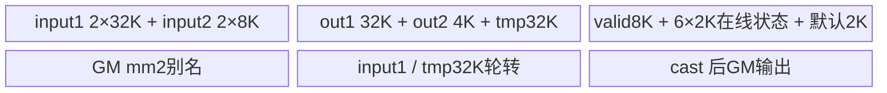
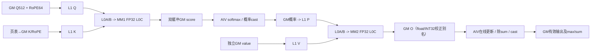

# SGL 稀疏 FlashAttention A2/A3 ACLNN 算子知识

## 算子速览

| 项目 | 内容 |
|---|---|
| 实际入口 | aclnnSglSparseFlashAttentionGetWorkspaceSize / aclnnSglSparseFlashAttention；SglSparseFlashAttention OpDef |
| 计算语义 | 公开目标为稀疏索引所选的 softmax(scale*(Q512*K512ᵀ+Qrope64*Krope64ᵀ))*V512；C_TEMPLATE读取独立V；V_TEMPLATE（block<=4且非空KV）实际MM2使用收集K |
| 输入输出 | FP16/BF16 Q/K/V/RoPE；INT32索引/actual长度/页表；D512+Dr64、KV头1、Q头1..64或128；out同Q，optional max/sum为FP32 |
| 执行类型 | 单sgl_sparse_flash_attention，MIX_AIC_1_2：AIC_CUBE两次矩阵乘；AIV_VECTOR负责聚合、softmax、在线更新、最终cast；950为RegBase VF；无独立SIMT/通信节点 |
| Kernel 路线 | R-001–R-032逐payload key与dtype/G/layout/template展开；原始key低16位与dtype位16分别解析；没有FlashDecode Host producer |
| 核心资源 | GM score/P/O双缓冲和V四cache；L1 504KiB，L0A/B各64KiB、C128KiB，UB170KiB |
| 来源闭包 | source_closed：公开API→Python/torch adapter→ACLNN pair→OpDef/Infer→Parser/Checker/Tiling→Host宏序列化/Device显式POD→router→两侧当前body及本地helper/Matmul/VF→CMake闭合；generated bridge与通用SDK指令为边界 |
| 复用风险 | draft。小block V路线实际MM2复用K而非独立V，C路线稀疏游标读取与raw空KV路径存在静态风险；下文body为控制流到达且前置字段有效时的符号化分析，不表示全部公开输入正确/安全 |
| 验证状态 | 已完成源码闭包检查；本次知识提取未执行编译、真机、数值或性能测试 |

## 接口与语义

### 计算语义

N2=1，G=N1/N2∈{1..64,128}。对query token s及其G个头，将 sparse_indices[s,0,k]*sparse_block_size 加块内offset展开为选中KV位置；-1表示有效索引前缀终点。公开语义忽略不可见位置；mode0可见长度为actualKV，mode3为右下对齐因果边界actualKV−actualQ+s+1。pre_tokens/next_tokens仅INT64_MAX，不支持自定义窗口。先计算512维NoPE与64维RoPE点积相加，再乘FP32 scale，softmax沿选中的KV行，最后与512维V相乘。无RoPE现场生成、量化scale或额外激活。

在线softmax的数学递推为 m'=max(m,max(score))，alpha=exp(m−m')，l'=alpha*l+sum exp(score−m')，o'=alpha*o+exp(score−m')*V，最后out=o/l。A2/A3在SoftmaxFlashV2之外采用Amla的n/cof低精校正及FP32/int32同址指数位更新，因此不能把实现仅概括为普通alpha乘法。softmax_max与softmax_sum分别保存max和sum，而不是LSE；自然对数LSE为max+log(sum)。950针对mode0且returnSoftmaxLse的全无本地索引行，会先清out/max/sum为0并跳过计算，max0+log(sum0)=−∞。其它全空/哨兵尾块语义须按各body的写入与初始化判断，不把未生产workspace当有效零值。

**公开目标与实际数据源必须分开。** C_TEMPLATE的MM2通过valueGm/DataCopyPA读取独立V。V_TEMPLATE的MergeKv只绑定key/keyRope，GM缓存是**K512平面后接RoPE64平面**，不是逐行576交错；ComputeMm2 V分支从该K平面读右矩阵，独立valueGm在该分支不读。因此任意K!=V的独立V语义不能从这些路线获得正确性保证；没有“调用了value参数所以必然参与MM2”的推论。C/V是同一逻辑算子的实现路线，此处记录源可见缺陷，不另造数学独立算子。

### 输入、输出与属性

| 参数 | shape/layout | dtype | 约束、默认值与语义 |
|---|---|---|---|
| query | BSND[B,S1,G,512] 或 TND[T1,G,512] | FP16/BF16 | NPU；C++ adapter自动contiguous；B>0，TND T1>0；G1..64或128 |
| key | BSND[B,S2,1,512]、TND[T2,1,512]、PA[Bn,Bs,1,512] | 与query相同（公开契约） | 512维NoPE；分页block物理存储 |
| value | 与key同shape | 与query相同 | C++要求必选且非空；native无value=nullptr→key替换；实际MM2数据源按Route限定 |
| sparse_indices | BSND[B,S1,1,K] 或 TND[T1,1,K] | INT32 | 有效非负前缀后跟-1；K为shape末轴；adapter要求numel>0；Host未逐值校验 |
| block_table | PA[B,maxBlocks] | INT32可选 | PA必须存在、2D、第二轴>0；非PA必须None；实际physical ID范围由调用者保证 |
| actual_seq_lengths_query | [B] | INT32可选 | TND必需，是累计结束位置，**不含额外0元素**；BSND可省略用S1，提供时为有效长度 |
| actual_seq_lengths_kv | [B] | INT32可选 | TND为累计结束位置；PA/BSND为每请求有效长度；PA与TND KV必须提供；Host检查shape元素数，不检查设备值单调/范围 |
| query_rope | 与Q存储轴相同，末64 | query dtype | MLA必须提供；Host在设置shape时已解引用，不能将缺失值视为安全fallback |
| key_rope | 与K存储轴相同，末64 | key dtype | 必须提供 |
| scale_value | scalar | Python double→C++ float→POD float32 | softmax之前缩放；未见有限性检查 |
| sparse_block_size | scalar | int64 | [1,128]内2次幂；V1/2/4，C8..128；PA要求整除Bs |
| layout_query | string | 默认BSND | BSND/TND |
| layout_kv | string | 默认BSND | BSND/TND/PA_BSND；非PA必须与Q布局相同 |
| sparse_mode | scalar | int64，默认3 | 0或3 |
| pre_tokens | scalar | int64，默认INT64_MAX | 必须保持INT64_MAX |
| next_tokens | scalar | int64，默认INT64_MAX | 必须保持INT64_MAX |
| attention_mode | scalar | int64，默认2 | 仅2，MLA分离RoPE |
| return_softmax_lse | scalar | bool，默认false | true输出max/sum；当前native Host没有“PA禁止true”检查，不能继承其它入口版本限制 |
| attention_out | 同Q shape | query dtype | out由at::empty分配，只有实际Device写入/清零过的行有值 |
| softmax_max | BSND[B,1,S1,G] 或 TND[1,T1,G] | FP32 | true有效；false为有1元素storage的narrow空view以保留非空数据指针 |
| softmax_sum | 同max | FP32 | 同上；不是logsumexp成品 |

### 入口与版本

本卡仅覆盖固定kernel repo公开Sgl pair。Python auto/ascendc注册到torch.ops.npu.sparse_flash_attention，不可用即报错；torch_native为另一个PyTorch实现，不是native失败fallback，未执行。现有[同源API](../../../../apis/sgl_kernel_npu/sgl_sparse_flash_attention.md)描述公开契约；[另一公开入口A2/A3实现](../../../../../../ops/ascendc/operators/aclnn/transformer/attention/sparse_flash_attention.md)和[其950实现](../../../../../../ops/ascendc/operators/aclnn/transformer/attention/sparse_flash_attention_950.md)属于ops-transformer固定源的aclnnSparseFlashAttention，不能把value空替换、临时TensorHolder、旧POD宏缺失或PA返回限制搬入本Sgl入口。

公开EN API表列arch22(2201)、arch35(3510) ascendc Supported；python README与architectures.json将2201对应ascend910b/ascend910_93（A2/A3），3510对应ascend950。CMake SUPPORTED_ARCHS2201/3510与真实Host/Device同向。CANN9.1.0来自固定README/CI镜像；本任务未实际运行任何版本。legacy csrc/sparse_flash_attention保持不改，native构建使用csrc/attention/sparse_flash_attention的当前复制实现与局部框架适配；只以active include/selector为来源。

## Host/Launcher 执行流程

### 参数校验与前处理

Python原样分发。C++先对所有tensor/optional做contiguous，随后拒Q/K/V/indices numel0，检查indices与metadata INT32，Q/K/V dtype一致、RoPE与对应Q/K dtype一致，逐tensor同设备/连续。MakeOutputs要求Q为NPU FP16/BF16、layout_query BSND/TND及对应rank；分配out同Q、LSE按Q/K头数构造，false时分配一元素storage再narrow长度0。DeviceGuard覆盖输出/descriptor/query/execute过程。输入CPU或错误dtype/shape为TORCH_CHECK，无后继kernel。

Host TilingSglSparseFlashAttention检查context/platform后：Parser::Parse按GetOpName→GetNpuInfo→GetOpParaInfo→required存在→dtype/layout→SetSFAShape→N1/N2/G/B/T/S/D/PA信息→actual-shape信息→GenerateInfo；Checker::Process按单参数→存在/RoPE→feature→多参数shape/dtype/输出/actual/table；之后DoOpTiling。支持NpuArch DAV_2201/DAV_3510；PA Bs∈(0,1024]、%16==0且%sparseBlockSize==0；G域1..64或128，KV头1，D512/Dr64。actual长度仅检查dtype及shape元素数==B，不读取索引/长度设备值。缺省按静态S，TND读取前缀差。

Parser required只列部分attrs，对pre/next/attentionMode/return等后续解引用依赖OpDef默认补全；不应据此推导手造缺失描述符/属性的raw ACLNN调用一定安全失败。OpDef/Infer与CANN generated bridge是框架接线边界，当前owned Host检查不足不会由猜测的框架行为补齐。

### 参数、Workspace 与生命周期

adapter构造所有aclTensor共享descriptor，静态加载query/execute符号，layout字符串以可写std::string.data交给generated签名。query失败TORCH_CHECK，workspaceSize≤INT64_MAX后at::empty Byte分配（**没有Compressor的zeros行为**）。当前stream record_stream输入、临时contiguous副本、输出、workspace、optional；lambda捕获tensor集合、descriptor集合、布局字符串、workspace、executor与stream，保证延迟Host任务期间存储。execute失败TORCH_CHECK；executor生命周期为CANN框架边界，无本仓手写复用/销毁。

Host内部GetWorkspaceSize已经包含libapiSize；外层TilingSglSparseFlashAttention仍令 workspace[0]=platform.GetLibApiWorkSpaceSize()+tiling.GetWorkspaceSizeBytes()，因此当前公开query预算是**2*libapiSize+operator user预算**。entry的GetUserWorkspace移除一份系统前缀；多出的libapi字节是保守闲置尾部，不能误写为Device额外计算slice。Device user offsets见各代下节。POD用SaveToBuffer序列化并设置raw data size；Device获取同一GM地址，950 AIV另复制完整144B到本地，AIC只从SSBUF读取其AIV发布的CVSharedParams。

### 启动图与失败传播

一个AICORE CANN注册节点：Host Parse/Check/Tiling→POD、workspace、CalcTschBlockDim(2*usedAIC,usedAIC,2*usedAIC)→sgl_sparse_flash_attention，KERNEL_TYPE_MIX_AIC_1_2。没有SplitKV/FlashDecode额外launch；splitKVFlag初始false且无置true producer。Host任何GRAPH_FAILED/GRAPH_PARAM_INVALID在adapter query失败终止；execute返回失败立即终止，没有后继算子自动补算。

```text
Host query -> Infer/Parser/Checker -> InitParams/Split/Fill/Workspace/Key
 -> outer CANN key0 + baseParams.dispatchKey
 -> one MIX entry
    2201: SparseFlashAttentionMla<SFAType<...>>::Init/Process
    3510: SparseFlashAttentionKernelMla<CubeService-or-Dummy,VectorService-or-Dummy>
      AIV publishes SharedParams to SSBUF and flag15(mode4 PIPE_S)
      AIC waits and copies SharedParams; same launch body stages
unknown low16 dispatch key: default break => no output writer/no Trap
```

## Route 与参数设计

### 分核与资源计算

Parser根据BSND/TND/PA读取原始轴；TND B=actualQ.shape元素数、qSeqSize=T1、seqSize=T2；PA seqSize=maxBlocks*Bs（容量，不是实际KV）。Host InitParams先用**原始**S2与sparseBlockSize选择V1/C0，再ZeroTensorProcess将S2=0改写1024（注释“kernel使用真实0”与实际POD赋值冲突）；其后CalcInnerSize sInner=min(改写后S2,512)，align32；splitKVFlag=false，FD分支不命中。

Mcap=min(G*S1,128)，M16=align16(Mcap)，mmRes=S2a*M16，bmm2Res=512*M16，qPreProc字节0。Host inner.mBaseSize=G，inner.s2BaseSize=sInner，usedCoreNum=AIC数。A2 Device按actualQ总token数均衡分query基本任务（每任务G行），无任务core退出；每个AIC配两个AIV按M的16行边界分半，G≤16时第二AIV可0行。950忽略Host inner tile定64行M/128列S2，G128用相邻AIC各64头并共享cache，coreNum/2参与分query；两AIV各约M/2行，Vec0按S2二段或splitG四段。

A2/A3 Host用户预算=2*AIC*(4*mmRes+2*mmRes+4*bmmRes+4*128+4*128)+4*AIC*512*576*2+4*(2*AIC)*128*4。最终query再加两份libapiSize。Device真实片从user0起：mm1=8*AIC*mmRes B，prob=4*AIC*mmRes B，mm2=8*AIC*bmmRes B（以INT32别名原地校正）；V路线紧接merge=4*AIC*512*576*2 B，随后valid=4*(2*AIC)*128*4 B。Host另外预留的nUpdate/sum两项在当前Device没有独立切片，未在merge前插空，是保守尾部闲置。C路线不绑定merge/valid但Host仍预留。每AIC L1为4*72KiB Q/P+3*72KiB K/V=504KiB，L0A/B各2*32KiB，C2*64KiB。UB为64+16+32+4+32+8+6*2+2=170KiB，6*2KiB分别n/cof/aMlaSum/max/exp/sum，最后2KiB是max/sum默认值。

### Route 选择

| 顺序 | Route | Key/模板 | 精确选择条件与优先级 | 不适用去向 |
|---:|---|---|---|---|
| 1 | R-001 C直接 BSND/BSND FP16 G1..64 | payload0，low16=0，mode0，split0 | 原S2==0或block>4；Q=BSND，KV=BSND，FP16，G1..64；全局checks已通过 | 其他tuple继续；不支持Host失败；unknown key entry break |
| 2 | R-002 C直接 BSND/BSND FP16 G128 | payload16384，low16=16384，mode0，split1 | 原S2==0或block>4；Q=BSND，KV=BSND，FP16，G128；全局checks已通过 | 其他tuple继续；不支持Host失败；unknown key entry break |
| 3 | R-003 C直接 BSND/BSND BF16 G1..64 | payload65536，low16=0，mode0，split0 | 原S2==0或block>4；Q=BSND，KV=BSND，BF16，G1..64；全局checks已通过 | 其他tuple继续；不支持Host失败；unknown key entry break |
| 4 | R-004 C直接 BSND/BSND BF16 G128 | payload81920，low16=16384，mode0，split1 | 原S2==0或block>4；Q=BSND，KV=BSND，BF16，G128；全局checks已通过 | 其他tuple继续；不支持Host失败；unknown key entry break |
| 5 | R-005 C直接 BSND/PA_BSND FP16 G1..64 | payload130，low16=130，mode0，split0 | 原S2==0或block>4；Q=BSND，KV=PA_BSND，FP16，G1..64；全局checks已通过 | 其他tuple继续；不支持Host失败；unknown key entry break |
| 6 | R-006 C直接 BSND/PA_BSND FP16 G128 | payload16514，low16=16514，mode0，split1 | 原S2==0或block>4；Q=BSND，KV=PA_BSND，FP16，G128；全局checks已通过 | 其他tuple继续；不支持Host失败；unknown key entry break |
| 7 | R-007 C直接 BSND/PA_BSND BF16 G1..64 | payload65666，low16=130，mode0，split0 | 原S2==0或block>4；Q=BSND，KV=PA_BSND，BF16，G1..64；全局checks已通过 | 其他tuple继续；不支持Host失败；unknown key entry break |
| 8 | R-008 C直接 BSND/PA_BSND BF16 G128 | payload82050，low16=16514，mode0，split1 | 原S2==0或block>4；Q=BSND，KV=PA_BSND，BF16，G128；全局checks已通过 | 其他tuple继续；不支持Host失败；unknown key entry break |
| 9 | R-009 C直接 TND/TND FP16 G1..64 | payload68，low16=68，mode0，split0 | 原S2==0或block>4；Q=TND，KV=TND，FP16，G1..64；全局checks已通过 | 其他tuple继续；不支持Host失败；unknown key entry break |
| 10 | R-010 C直接 TND/TND FP16 G128 | payload16452，low16=16452，mode0，split1 | 原S2==0或block>4；Q=TND，KV=TND，FP16，G128；全局checks已通过 | 其他tuple继续；不支持Host失败；unknown key entry break |
| 11 | R-011 C直接 TND/TND BF16 G1..64 | payload65604，low16=68，mode0，split0 | 原S2==0或block>4；Q=TND，KV=TND，BF16，G1..64；全局checks已通过 | 其他tuple继续；不支持Host失败；unknown key entry break |
| 12 | R-012 C直接 TND/TND BF16 G128 | payload81988，low16=16452，mode0，split1 | 原S2==0或block>4；Q=TND，KV=TND，BF16，G128；全局checks已通过 | 其他tuple继续；不支持Host失败；unknown key entry break |
| 13 | R-013 C直接 TND/PA_BSND FP16 G1..64 | payload134，low16=134，mode0，split0 | 原S2==0或block>4；Q=TND，KV=PA_BSND，FP16，G1..64；全局checks已通过 | 其他tuple继续；不支持Host失败；unknown key entry break |
| 14 | R-014 C直接 TND/PA_BSND FP16 G128 | payload16518，low16=16518，mode0，split1 | 原S2==0或block>4；Q=TND，KV=PA_BSND，FP16，G128；全局checks已通过 | 其他tuple继续；不支持Host失败；unknown key entry break |
| 15 | R-015 C直接 TND/PA_BSND BF16 G1..64 | payload65670，low16=134，mode0，split0 | 原S2==0或block>4；Q=TND，KV=PA_BSND，BF16，G1..64；全局checks已通过 | 其他tuple继续；不支持Host失败；unknown key entry break |
| 16 | R-016 C直接 TND/PA_BSND BF16 G128 | payload82054，low16=16518，mode0，split1 | 原S2==0或block>4；Q=TND，KV=PA_BSND，BF16，G128；全局checks已通过 | 其他tuple继续；不支持Host失败；unknown key entry break |
| 17 | R-017 V聚合 BSND/BSND FP16 G1..64 | payload1024，low16=1024，mode1，split0 | 原S2!=0且block<=4；Q=BSND，KV=BSND，FP16，G1..64；全局checks已通过 | 其他tuple继续；不支持Host失败；unknown key entry break |
| 18 | R-018 V聚合 BSND/BSND FP16 G128 | payload17408，low16=17408，mode1，split1 | 原S2!=0且block<=4；Q=BSND，KV=BSND，FP16，G128；全局checks已通过 | 其他tuple继续；不支持Host失败；unknown key entry break |
| 19 | R-019 V聚合 BSND/BSND BF16 G1..64 | payload66560，low16=1024，mode1，split0 | 原S2!=0且block<=4；Q=BSND，KV=BSND，BF16，G1..64；全局checks已通过 | 其他tuple继续；不支持Host失败；unknown key entry break |
| 20 | R-020 V聚合 BSND/BSND BF16 G128 | payload82944，low16=17408，mode1，split1 | 原S2!=0且block<=4；Q=BSND，KV=BSND，BF16，G128；全局checks已通过 | 其他tuple继续；不支持Host失败；unknown key entry break |
| 21 | R-021 V聚合 BSND/PA_BSND FP16 G1..64 | payload1154，low16=1154，mode1，split0 | 原S2!=0且block<=4；Q=BSND，KV=PA_BSND，FP16，G1..64；全局checks已通过 | 其他tuple继续；不支持Host失败；unknown key entry break |
| 22 | R-022 V聚合 BSND/PA_BSND FP16 G128 | payload17538，low16=17538，mode1，split1 | 原S2!=0且block<=4；Q=BSND，KV=PA_BSND，FP16，G128；全局checks已通过 | 其他tuple继续；不支持Host失败；unknown key entry break |
| 23 | R-023 V聚合 BSND/PA_BSND BF16 G1..64 | payload66690，low16=1154，mode1，split0 | 原S2!=0且block<=4；Q=BSND，KV=PA_BSND，BF16，G1..64；全局checks已通过 | 其他tuple继续；不支持Host失败；unknown key entry break |
| 24 | R-024 V聚合 BSND/PA_BSND BF16 G128 | payload83074，low16=17538，mode1，split1 | 原S2!=0且block<=4；Q=BSND，KV=PA_BSND，BF16，G128；全局checks已通过 | 其他tuple继续；不支持Host失败；unknown key entry break |
| 25 | R-025 V聚合 TND/TND FP16 G1..64 | payload1092，low16=1092，mode1，split0 | 原S2!=0且block<=4；Q=TND，KV=TND，FP16，G1..64；全局checks已通过 | 其他tuple继续；不支持Host失败；unknown key entry break |
| 26 | R-026 V聚合 TND/TND FP16 G128 | payload17476，low16=17476，mode1，split1 | 原S2!=0且block<=4；Q=TND，KV=TND，FP16，G128；全局checks已通过 | 其他tuple继续；不支持Host失败；unknown key entry break |
| 27 | R-027 V聚合 TND/TND BF16 G1..64 | payload66628，low16=1092，mode1，split0 | 原S2!=0且block<=4；Q=TND，KV=TND，BF16，G1..64；全局checks已通过 | 其他tuple继续；不支持Host失败；unknown key entry break |
| 28 | R-028 V聚合 TND/TND BF16 G128 | payload83012，low16=17476，mode1，split1 | 原S2!=0且block<=4；Q=TND，KV=TND，BF16，G128；全局checks已通过 | 其他tuple继续；不支持Host失败；unknown key entry break |
| 29 | R-029 V聚合 TND/PA_BSND FP16 G1..64 | payload1158，low16=1158，mode1，split0 | 原S2!=0且block<=4；Q=TND，KV=PA_BSND，FP16，G1..64；全局checks已通过 | 其他tuple继续；不支持Host失败；unknown key entry break |
| 30 | R-030 V聚合 TND/PA_BSND FP16 G128 | payload17542，low16=17542，mode1，split1 | 原S2!=0且block<=4；Q=TND，KV=PA_BSND，FP16，G128；全局checks已通过 | 其他tuple继续；不支持Host失败；unknown key entry break |
| 31 | R-031 V聚合 TND/PA_BSND BF16 G1..64 | payload66694，low16=1158，mode1，split0 | 原S2!=0且block<=4；Q=TND，KV=PA_BSND，BF16，G1..64；全局checks已通过 | 其他tuple继续；不支持Host失败；unknown key entry break |
| 32 | R-032 V聚合 TND/PA_BSND BF16 G128 | payload83078，low16=17542，mode1，split1 | 原S2!=0且block<=4；Q=TND，KV=PA_BSND，BF16，G128；全局checks已通过 | 其他tuple继续；不支持Host失败；unknown key entry break |

```text
all Host interface/shape/platform checks pass
mode = (originalS2!=0 && sparse_block_size<=4) ? 1 : 0
if originalS2==0: info.S2=1024  # chosen mode remains0
page = KVlayout==PA_BSND
base = (BSND/BSND:0, BSND/PA:130, TND/TND:68, TND/PA:134)
splitG = G>64  # public admitted value only128
payload = base | mode<<10 | splitG<<14 | (Q_BF16?1<<16:0)
outer CANN key=0; router reads low16 and dtype16 separately
```

A2的splitG位未传给SFAType，仍逐key列明G128的实际M域；950将其传给service模板，改变配对核、共享workspace与flag15平衡。raw ACLNN可能绕过Torch非空限制：当前Host未检查BSND S1>0或S2>0，因此列出源可见的零容量路径；不等同公开推荐输入或运行安全。特别950 mode0只可能来自原S2=0（sparseBlockSize已被限定1），其body仍可追溯，不能隐去或把它声称正常CFA保证。

### 模板/实现执行矩阵

| Route | key/selector | dtype/shape/platform 完整命中条件 | 执行族与 kernel 节点 | 实际模板/body | 内存与同步特征 | tail/fallback |
|---|---|---|---|---|---|---|
| R-001 | 0 | A2/A3，C直接 BSND/BSND FP16 G1..64；D512/Dr64/N2=1，mode0/3，窗口INT64_MAX，PA guard及全局域 | 单sgl_sparse_flash_attention MIX_CV，AIC MM1→AIV V1→AIC MM2→AIV V2 | SparseFlashAttentionMla<SFAType<half,same,same,false,Q0,KV0,0>>；split位未进入type | GM score/P/O双缓冲，直接KV | actualQ/S2与索引mask；无FD fallback；VF六子selector见下文 |
| R-002 | 16384 | A2/A3，C直接 BSND/BSND FP16 G128；D512/Dr64/N2=1，mode0/3，窗口INT64_MAX，PA guard及全局域 | 单sgl_sparse_flash_attention MIX_CV，AIC MM1→AIV V1→AIC MM2→AIV V2 | SparseFlashAttentionMla<SFAType<half,same,same,false,Q0,KV0,0>>；split位未进入type | GM score/P/O双缓冲，直接KV | actualQ/S2与索引mask；无FD fallback；VF六子selector见下文 |
| R-003 | 65536 | A2/A3，C直接 BSND/BSND BF16 G1..64；D512/Dr64/N2=1，mode0/3，窗口INT64_MAX，PA guard及全局域 | 单sgl_sparse_flash_attention MIX_CV，AIC MM1→AIV V1→AIC MM2→AIV V2 | SparseFlashAttentionMla<SFAType<bf16,same,same,false,Q0,KV0,0>>；split位未进入type | GM score/P/O双缓冲，直接KV | actualQ/S2与索引mask；无FD fallback；VF六子selector见下文 |
| R-004 | 81920 | A2/A3，C直接 BSND/BSND BF16 G128；D512/Dr64/N2=1，mode0/3，窗口INT64_MAX，PA guard及全局域 | 单sgl_sparse_flash_attention MIX_CV，AIC MM1→AIV V1→AIC MM2→AIV V2 | SparseFlashAttentionMla<SFAType<bf16,same,same,false,Q0,KV0,0>>；split位未进入type | GM score/P/O双缓冲，直接KV | actualQ/S2与索引mask；无FD fallback；VF六子selector见下文 |
| R-005 | 130 | A2/A3，C直接 BSND/PA_BSND FP16 G1..64；D512/Dr64/N2=1，mode0/3，窗口INT64_MAX，PA guard及全局域 | 单sgl_sparse_flash_attention MIX_CV，AIC MM1→AIV V1→AIC MM2→AIV V2 | SparseFlashAttentionMla<SFAType<half,same,same,false,Q0,KV2,0>>；split位未进入type | GM score/P/O双缓冲，直接KV | actualQ/S2与索引mask；无FD fallback；VF六子selector见下文 |
| R-006 | 16514 | A2/A3，C直接 BSND/PA_BSND FP16 G128；D512/Dr64/N2=1，mode0/3，窗口INT64_MAX，PA guard及全局域 | 单sgl_sparse_flash_attention MIX_CV，AIC MM1→AIV V1→AIC MM2→AIV V2 | SparseFlashAttentionMla<SFAType<half,same,same,false,Q0,KV2,0>>；split位未进入type | GM score/P/O双缓冲，直接KV | actualQ/S2与索引mask；无FD fallback；VF六子selector见下文 |
| R-007 | 65666 | A2/A3，C直接 BSND/PA_BSND BF16 G1..64；D512/Dr64/N2=1，mode0/3，窗口INT64_MAX，PA guard及全局域 | 单sgl_sparse_flash_attention MIX_CV，AIC MM1→AIV V1→AIC MM2→AIV V2 | SparseFlashAttentionMla<SFAType<bf16,same,same,false,Q0,KV2,0>>；split位未进入type | GM score/P/O双缓冲，直接KV | actualQ/S2与索引mask；无FD fallback；VF六子selector见下文 |
| R-008 | 82050 | A2/A3，C直接 BSND/PA_BSND BF16 G128；D512/Dr64/N2=1，mode0/3，窗口INT64_MAX，PA guard及全局域 | 单sgl_sparse_flash_attention MIX_CV，AIC MM1→AIV V1→AIC MM2→AIV V2 | SparseFlashAttentionMla<SFAType<bf16,same,same,false,Q0,KV2,0>>；split位未进入type | GM score/P/O双缓冲，直接KV | actualQ/S2与索引mask；无FD fallback；VF六子selector见下文 |
| R-009 | 68 | A2/A3，C直接 TND/TND FP16 G1..64；D512/Dr64/N2=1，mode0/3，窗口INT64_MAX，PA guard及全局域 | 单sgl_sparse_flash_attention MIX_CV，AIC MM1→AIV V1→AIC MM2→AIV V2 | SparseFlashAttentionMla<SFAType<half,same,same,false,Q1,KV1,0>>；split位未进入type | GM score/P/O双缓冲，直接KV | actualQ/S2与索引mask；无FD fallback；VF六子selector见下文 |
| R-010 | 16452 | A2/A3，C直接 TND/TND FP16 G128；D512/Dr64/N2=1，mode0/3，窗口INT64_MAX，PA guard及全局域 | 单sgl_sparse_flash_attention MIX_CV，AIC MM1→AIV V1→AIC MM2→AIV V2 | SparseFlashAttentionMla<SFAType<half,same,same,false,Q1,KV1,0>>；split位未进入type | GM score/P/O双缓冲，直接KV | actualQ/S2与索引mask；无FD fallback；VF六子selector见下文 |
| R-011 | 65604 | A2/A3，C直接 TND/TND BF16 G1..64；D512/Dr64/N2=1，mode0/3，窗口INT64_MAX，PA guard及全局域 | 单sgl_sparse_flash_attention MIX_CV，AIC MM1→AIV V1→AIC MM2→AIV V2 | SparseFlashAttentionMla<SFAType<bf16,same,same,false,Q1,KV1,0>>；split位未进入type | GM score/P/O双缓冲，直接KV | actualQ/S2与索引mask；无FD fallback；VF六子selector见下文 |
| R-012 | 81988 | A2/A3，C直接 TND/TND BF16 G128；D512/Dr64/N2=1，mode0/3，窗口INT64_MAX，PA guard及全局域 | 单sgl_sparse_flash_attention MIX_CV，AIC MM1→AIV V1→AIC MM2→AIV V2 | SparseFlashAttentionMla<SFAType<bf16,same,same,false,Q1,KV1,0>>；split位未进入type | GM score/P/O双缓冲，直接KV | actualQ/S2与索引mask；无FD fallback；VF六子selector见下文 |
| R-013 | 134 | A2/A3，C直接 TND/PA_BSND FP16 G1..64；D512/Dr64/N2=1，mode0/3，窗口INT64_MAX，PA guard及全局域 | 单sgl_sparse_flash_attention MIX_CV，AIC MM1→AIV V1→AIC MM2→AIV V2 | SparseFlashAttentionMla<SFAType<half,same,same,false,Q1,KV2,0>>；split位未进入type | GM score/P/O双缓冲，直接KV | actualQ/S2与索引mask；无FD fallback；VF六子selector见下文 |
| R-014 | 16518 | A2/A3，C直接 TND/PA_BSND FP16 G128；D512/Dr64/N2=1，mode0/3，窗口INT64_MAX，PA guard及全局域 | 单sgl_sparse_flash_attention MIX_CV，AIC MM1→AIV V1→AIC MM2→AIV V2 | SparseFlashAttentionMla<SFAType<half,same,same,false,Q1,KV2,0>>；split位未进入type | GM score/P/O双缓冲，直接KV | actualQ/S2与索引mask；无FD fallback；VF六子selector见下文 |
| R-015 | 65670 | A2/A3，C直接 TND/PA_BSND BF16 G1..64；D512/Dr64/N2=1，mode0/3，窗口INT64_MAX，PA guard及全局域 | 单sgl_sparse_flash_attention MIX_CV，AIC MM1→AIV V1→AIC MM2→AIV V2 | SparseFlashAttentionMla<SFAType<bf16,same,same,false,Q1,KV2,0>>；split位未进入type | GM score/P/O双缓冲，直接KV | actualQ/S2与索引mask；无FD fallback；VF六子selector见下文 |
| R-016 | 82054 | A2/A3，C直接 TND/PA_BSND BF16 G128；D512/Dr64/N2=1，mode0/3，窗口INT64_MAX，PA guard及全局域 | 单sgl_sparse_flash_attention MIX_CV，AIC MM1→AIV V1→AIC MM2→AIV V2 | SparseFlashAttentionMla<SFAType<bf16,same,same,false,Q1,KV2,0>>；split位未进入type | GM score/P/O双缓冲，直接KV | actualQ/S2与索引mask；无FD fallback；VF六子selector见下文 |
| R-017 | 1024 | A2/A3，V聚合 BSND/BSND FP16 G1..64；D512/Dr64/N2=1，mode0/3，窗口INT64_MAX，PA guard及全局域 | 单sgl_sparse_flash_attention MIX_CV，AIV Vec0→AIC MM1→AIV V1→AIC MM2→AIV V2 | SparseFlashAttentionMla<SFAType<half,same,same,false,Q0,KV0,1>>；split位未进入type | GM score/P/O双缓冲，K/RoPE四cache | actualQ/S2与索引mask；无FD fallback；VF六子selector见下文 |
| R-018 | 17408 | A2/A3，V聚合 BSND/BSND FP16 G128；D512/Dr64/N2=1，mode0/3，窗口INT64_MAX，PA guard及全局域 | 单sgl_sparse_flash_attention MIX_CV，AIV Vec0→AIC MM1→AIV V1→AIC MM2→AIV V2 | SparseFlashAttentionMla<SFAType<half,same,same,false,Q0,KV0,1>>；split位未进入type | GM score/P/O双缓冲，K/RoPE四cache | actualQ/S2与索引mask；无FD fallback；VF六子selector见下文 |
| R-019 | 66560 | A2/A3，V聚合 BSND/BSND BF16 G1..64；D512/Dr64/N2=1，mode0/3，窗口INT64_MAX，PA guard及全局域 | 单sgl_sparse_flash_attention MIX_CV，AIV Vec0→AIC MM1→AIV V1→AIC MM2→AIV V2 | SparseFlashAttentionMla<SFAType<bf16,same,same,false,Q0,KV0,1>>；split位未进入type | GM score/P/O双缓冲，K/RoPE四cache | actualQ/S2与索引mask；无FD fallback；VF六子selector见下文 |
| R-020 | 82944 | A2/A3，V聚合 BSND/BSND BF16 G128；D512/Dr64/N2=1，mode0/3，窗口INT64_MAX，PA guard及全局域 | 单sgl_sparse_flash_attention MIX_CV，AIV Vec0→AIC MM1→AIV V1→AIC MM2→AIV V2 | SparseFlashAttentionMla<SFAType<bf16,same,same,false,Q0,KV0,1>>；split位未进入type | GM score/P/O双缓冲，K/RoPE四cache | actualQ/S2与索引mask；无FD fallback；VF六子selector见下文 |
| R-021 | 1154 | A2/A3，V聚合 BSND/PA_BSND FP16 G1..64；D512/Dr64/N2=1，mode0/3，窗口INT64_MAX，PA guard及全局域 | 单sgl_sparse_flash_attention MIX_CV，AIV Vec0→AIC MM1→AIV V1→AIC MM2→AIV V2 | SparseFlashAttentionMla<SFAType<half,same,same,false,Q0,KV2,1>>；split位未进入type | GM score/P/O双缓冲，K/RoPE四cache | actualQ/S2与索引mask；无FD fallback；VF六子selector见下文 |
| R-022 | 17538 | A2/A3，V聚合 BSND/PA_BSND FP16 G128；D512/Dr64/N2=1，mode0/3，窗口INT64_MAX，PA guard及全局域 | 单sgl_sparse_flash_attention MIX_CV，AIV Vec0→AIC MM1→AIV V1→AIC MM2→AIV V2 | SparseFlashAttentionMla<SFAType<half,same,same,false,Q0,KV2,1>>；split位未进入type | GM score/P/O双缓冲，K/RoPE四cache | actualQ/S2与索引mask；无FD fallback；VF六子selector见下文 |
| R-023 | 66690 | A2/A3，V聚合 BSND/PA_BSND BF16 G1..64；D512/Dr64/N2=1，mode0/3，窗口INT64_MAX，PA guard及全局域 | 单sgl_sparse_flash_attention MIX_CV，AIV Vec0→AIC MM1→AIV V1→AIC MM2→AIV V2 | SparseFlashAttentionMla<SFAType<bf16,same,same,false,Q0,KV2,1>>；split位未进入type | GM score/P/O双缓冲，K/RoPE四cache | actualQ/S2与索引mask；无FD fallback；VF六子selector见下文 |
| R-024 | 83074 | A2/A3，V聚合 BSND/PA_BSND BF16 G128；D512/Dr64/N2=1，mode0/3，窗口INT64_MAX，PA guard及全局域 | 单sgl_sparse_flash_attention MIX_CV，AIV Vec0→AIC MM1→AIV V1→AIC MM2→AIV V2 | SparseFlashAttentionMla<SFAType<bf16,same,same,false,Q0,KV2,1>>；split位未进入type | GM score/P/O双缓冲，K/RoPE四cache | actualQ/S2与索引mask；无FD fallback；VF六子selector见下文 |
| R-025 | 1092 | A2/A3，V聚合 TND/TND FP16 G1..64；D512/Dr64/N2=1，mode0/3，窗口INT64_MAX，PA guard及全局域 | 单sgl_sparse_flash_attention MIX_CV，AIV Vec0→AIC MM1→AIV V1→AIC MM2→AIV V2 | SparseFlashAttentionMla<SFAType<half,same,same,false,Q1,KV1,1>>；split位未进入type | GM score/P/O双缓冲，K/RoPE四cache | actualQ/S2与索引mask；无FD fallback；VF六子selector见下文 |
| R-026 | 17476 | A2/A3，V聚合 TND/TND FP16 G128；D512/Dr64/N2=1，mode0/3，窗口INT64_MAX，PA guard及全局域 | 单sgl_sparse_flash_attention MIX_CV，AIV Vec0→AIC MM1→AIV V1→AIC MM2→AIV V2 | SparseFlashAttentionMla<SFAType<half,same,same,false,Q1,KV1,1>>；split位未进入type | GM score/P/O双缓冲，K/RoPE四cache | actualQ/S2与索引mask；无FD fallback；VF六子selector见下文 |
| R-027 | 66628 | A2/A3，V聚合 TND/TND BF16 G1..64；D512/Dr64/N2=1，mode0/3，窗口INT64_MAX，PA guard及全局域 | 单sgl_sparse_flash_attention MIX_CV，AIV Vec0→AIC MM1→AIV V1→AIC MM2→AIV V2 | SparseFlashAttentionMla<SFAType<bf16,same,same,false,Q1,KV1,1>>；split位未进入type | GM score/P/O双缓冲，K/RoPE四cache | actualQ/S2与索引mask；无FD fallback；VF六子selector见下文 |
| R-028 | 83012 | A2/A3，V聚合 TND/TND BF16 G128；D512/Dr64/N2=1，mode0/3，窗口INT64_MAX，PA guard及全局域 | 单sgl_sparse_flash_attention MIX_CV，AIV Vec0→AIC MM1→AIV V1→AIC MM2→AIV V2 | SparseFlashAttentionMla<SFAType<bf16,same,same,false,Q1,KV1,1>>；split位未进入type | GM score/P/O双缓冲，K/RoPE四cache | actualQ/S2与索引mask；无FD fallback；VF六子selector见下文 |
| R-029 | 1158 | A2/A3，V聚合 TND/PA_BSND FP16 G1..64；D512/Dr64/N2=1，mode0/3，窗口INT64_MAX，PA guard及全局域 | 单sgl_sparse_flash_attention MIX_CV，AIV Vec0→AIC MM1→AIV V1→AIC MM2→AIV V2 | SparseFlashAttentionMla<SFAType<half,same,same,false,Q1,KV2,1>>；split位未进入type | GM score/P/O双缓冲，K/RoPE四cache | actualQ/S2与索引mask；无FD fallback；VF六子selector见下文 |
| R-030 | 17542 | A2/A3，V聚合 TND/PA_BSND FP16 G128；D512/Dr64/N2=1，mode0/3，窗口INT64_MAX，PA guard及全局域 | 单sgl_sparse_flash_attention MIX_CV，AIV Vec0→AIC MM1→AIV V1→AIC MM2→AIV V2 | SparseFlashAttentionMla<SFAType<half,same,same,false,Q1,KV2,1>>；split位未进入type | GM score/P/O双缓冲，K/RoPE四cache | actualQ/S2与索引mask；无FD fallback；VF六子selector见下文 |
| R-031 | 66694 | A2/A3，V聚合 TND/PA_BSND BF16 G1..64；D512/Dr64/N2=1，mode0/3，窗口INT64_MAX，PA guard及全局域 | 单sgl_sparse_flash_attention MIX_CV，AIV Vec0→AIC MM1→AIV V1→AIC MM2→AIV V2 | SparseFlashAttentionMla<SFAType<bf16,same,same,false,Q1,KV2,1>>；split位未进入type | GM score/P/O双缓冲，K/RoPE四cache | actualQ/S2与索引mask；无FD fallback；VF六子selector见下文 |
| R-032 | 83078 | A2/A3，V聚合 TND/PA_BSND BF16 G128；D512/Dr64/N2=1，mode0/3，窗口INT64_MAX，PA guard及全局域 | 单sgl_sparse_flash_attention MIX_CV，AIV Vec0→AIC MM1→AIV V1→AIC MM2→AIV V2 | SparseFlashAttentionMla<SFAType<bf16,same,same,false,Q1,KV2,1>>；split位未进入type | GM score/P/O双缓冲，K/RoPE四cache | actualQ/S2与索引mask；无FD fallback；VF六子selector见下文 |

950每条Route另展开S2 VF子selector：第一次S2块isUpdate=false，后续true；s2Real=128、0<s2Real≤64、64<s2Real<128三种范围，分别映射aligned128、unaligned64、unaligned128的no_update/update六body。isFd=false、fullQuant=false，FP8/INT8 helper未实例化；没有偷偷合入量化算子。

### 隐藏性能 Guard

| Guard | Host/Tiling 条件 | Device/资源原因 | 影响 Route | 不满足时去向 | 源码符号 |
|---|---|---|---|---|---|
| D/Dr/G | D512，Dr64，KV头1，G1..64或128 | 手写576宽投影、512输出、至多128头 | 全部 | Host失败 | CheckFeatureMlaNoQuantShape |
| SFA block | 1..128幂二；950仅1 | C直接拷块或V聚合；950只处理token索引 | 全部 | Host失败 | CheckSingleParaSparseBlockSize |
| C/V | 原S2!=0 && block<=4→1；否则0 | 小块先AIV收集；大块AIC直接取 | 全部 | 另一模板；zero KV保留风险 | InitParams/ZeroTensorProcess |
| PA | Bs正且≤1024、16对齐、整除block；table/actualKV必选 | physical页映射和页尾分段 | PA Route | Host失败 | GetMaxBlockNumPerBatch/CheckFeatureMlaNoquantPa |
| 合并DMA | pair源stride在[0,INT32_MAX)，A2另检查整块不越visible边界 | blockCount2两位置批量搬运 | V/CFA | 两次CopyInSingleKv | CopyInKv/CopyInKvSparse |
| Gsplit | G>64只对应128 | 950邻AIC各64头、共享3cache；A2仅key变化 | split1 Route | split0 | GenTilingKey/CalSparseCalSize |
| 固定片上资源 | L1504KiB；L0A64/B64/C128KiB；UB174080B | 4/3 L1槽、MM pingpong、Vector score/merge/scratch共存 | 所有非空实际任务 | 本仓没有更小tile资源fallback | InitBuffers/InitMMResBuf/InitLocalBuffer |
| VF范围 | s2Real==128 / ≤64 / 64..127；first/update | tail mask与在线max/sum的真实specialization | 950 | 对应另VF，s2Real0应跳计算 | ProcessVec1Vf |
| 原始空KV | Torch拒key/value numel0；Host没有S2>0检查 | zero→1024与GM实际空容量冲突 | mode0原S2=0 | 无安全fallback；draft源码终点 | MakeOutputs/InitParams/ZeroTensorProcess |
| 未知key | 非4个base加mode/split组合 | switch没有default computation | 全部 | default break，无写输出 | sgl_sparse_flash_attention |

### POD/ABI

Device显式alignas(8)POD是本仓可见真实结构，含size static_assert；Host tiling.h仍使用CANN宏定义setter/SaveToBuffer。Host宏实现属于框架ABI边界，本次未编译测量其buffer；下表Device offset按声明的uint64/int64对齐8静态推导，不能把框架序列化自动声称本次ABI实测。Base sizeof104/align8、SplitKV16/align8、SingleCore8/align8、TensorSize8/align8、Inner8/align8、整体144/align8。Host setter顺序与Device字段顺序一致；dispatchKey新字段不能丢。

| 结构 | 字段 | 类型/位宽 | ABI 布局 | 单位 | Host/launcher producer | Device consumer | 边界 |
|---|---|---|---|---|---|---|---|
| SparseFlashAttentionBaseParamsMla | batchSize | uint32/32 | offsetof=0 | batch | FillTilingBaseParamsMla: bSize | actual请求循环 | 顶层base+0；公开shape/attr域；字段窄化见限制 |
| SparseFlashAttentionBaseParamsMla | seqSize | uint32/32 | offsetof=4 | token容量 | FillTilingBaseParamsMla: s2Size（zero时已改1024） | kvSeqSize/shared.s2Size | 顶层base+0；公开shape/attr域；字段窄化见限制 |
| SparseFlashAttentionBaseParamsMla | qSeqSize | uint32/32 | offsetof=8 | token容量 | FillTilingBaseParamsMla: s1Size，TND为T1 | Q/输出pitch | 顶层base+0；公开shape/attr域；字段窄化见限制 |
| SparseFlashAttentionBaseParamsMla | blockSize | int64/64 | offsetof=16 | token/page | FillTilingBaseParamsMla: key.dim1(Bs)，非PA0 | PA地址/页尾 | 顶层base+0；公开shape/attr域；字段窄化见限制 |
| SparseFlashAttentionBaseParamsMla | maxBlockNumPerBatch | uint32/32 | offsetof=24 | 页表列 | FillTilingBaseParamsMla: table.dim1，非PA0 | page表pitch | 顶层base+0；公开shape/attr域；字段窄化见限制 |
| SparseFlashAttentionBaseParamsMla | scaleValue | float/32 | offsetof=28 | 标量 | FillTilingBaseParamsMla: float attr | A2 ElewiseCompute/950 softmaxScale | 顶层base+0；公开shape/attr域；字段窄化见限制 |
| SparseFlashAttentionBaseParamsMla | nNumOfQInOneGroup | uint32/32 | offsetof=32 | head | FillTilingBaseParamsMla: N1/N2 | G行数/分核 | 顶层base+0；公开shape/attr域；字段窄化见限制 |
| SparseFlashAttentionBaseParamsMla | actualLenDimsQ | uint32/32 | offsetof=36 | metadata元素 | FillTilingBaseParamsMla: actualQ.shapeSize或0 | A2绑定GM长度；950兼容 | 顶层base+0；公开shape/attr域；字段窄化见限制 |
| SparseFlashAttentionBaseParamsMla | actualLenDimsKV | uint32/32 | offsetof=40 | metadata元素 | FillTilingBaseParamsMla: actualKV.shapeSize或0 | A2绑定GM长度；950兼容 | 顶层base+0；公开shape/attr域；字段窄化见限制 |
| SparseFlashAttentionBaseParamsMla | outputLayout | uint32/32 | offsetof=44 | enum | FillTilingBaseParamsMla: outLayout0BSND/1TND | 输出地址/shared.layoutType | 顶层base+0；公开shape/attr域；字段窄化见限制 |
| SparseFlashAttentionBaseParamsMla | sparseMode | uint32/32 | offsetof=48 | enum | FillTilingBaseParamsMla: attr0/3 | visible threshold | 顶层base+0；公开shape/attr域；字段窄化见限制 |
| SparseFlashAttentionBaseParamsMla | preTokens | int64/64 | offsetof=56 | token | FillTilingBaseParamsMla: attr INT64_MAX | A2常量元数据；950窗口常量自行赋 | 顶层base+0；公开shape/attr域；字段窄化见限制 |
| SparseFlashAttentionBaseParamsMla | nextTokens | int64/64 | offsetof=64 | token | FillTilingBaseParamsMla: attr INT64_MAX | 同上 | 顶层base+0；公开shape/attr域；字段窄化见限制 |
| SparseFlashAttentionBaseParamsMla | attentionMode | uint32/32 | offsetof=72 | enum | FillTilingBaseParamsMla: attr2 | MLA常量元数据 | 顶层base+0；公开shape/attr域；字段窄化见限制 |
| SparseFlashAttentionBaseParamsMla | returnSoftmaxLse | uint32/32 | offsetof=76 | bool flag | FillTilingBaseParamsMla: attr bool | max/sum写guard/950mode0前缀裁剪 | 顶层base+0；公开shape/attr域；字段窄化见限制 |
| SparseFlashAttentionBaseParamsMla | sparseBlockSize | int64/64 | offsetof=80 | token/index | FillTilingBaseParamsMla: attr block | A2索引展开；950固定1 | 顶层base+0；公开shape/attr域；字段窄化见限制 |
| SparseFlashAttentionBaseParamsMla | sparseBlockCount | uint32/32 | offsetof=88 | index槽 | FillTilingBaseParamsMla: indices末轴 | 稀疏循环/前缀容量 | 顶层base+0；公开shape/attr域；字段窄化见限制 |
| SparseFlashAttentionBaseParamsMla | isActualLenDimsNull | uint32/32 | offsetof=92 | bool flag | FillTilingBaseParamsMla: actualQ tensor ?0:1 | 950缺省长度路径；A2实际看dims | 顶层base+0；公开shape/attr域；字段窄化见限制 |
| SparseFlashAttentionBaseParamsMla | isActualLenDimsKVNull | uint32/32 | offsetof=96 | bool flag | FillTilingBaseParamsMla: actualKV tensor ?0:1 | 950缺省KV路径 | 顶层base+0；公开shape/attr域；字段窄化见限制 |
| SparseFlashAttentionBaseParamsMla | dispatchKey | uint32/32 | offsetof=100 | bitfield | FillTilingBaseParamsMla: DoOpTiling:低16 key | BF16<<16 | entry完整dispatch | 顶层base+0；公开shape/attr域；字段窄化见限制 |
| SparseFlashAttentionSplitKVParamsMla | s2 | uint32/32 | offsetof=0 | 份数 | FillTilingSplitKVMla: splitKVFlag=false→0 | FD消费者inactive | 顶层104+本偏移；必须保留0，不生成FD route |
| SparseFlashAttentionSplitKVParamsMla | accumOutSize | uint32/32 | offsetof=4 | FP32元素 | FillTilingSplitKVMla: AIC*2*N2*128*512 | 仅FD分支 | 顶层104+本偏移；非零预算字段但FD不读 |
| SparseFlashAttentionSplitKVParamsMla | logSumExpSize | uint32/32 | offsetof=8 | FP32元素 | FillTilingSplitKVMla: 2*AIC*2*N2*128*(32/4) | 仅FD分支 | 顶层104+本偏移；同上 |
| SparseFlashAttentionSingleCoreParamsMla | usedCoreNum | uint32/32 | offsetof=0 | AIC core | FillTilingSingleCoreParamsMla: AIC | Init/actualQ总任务减少active数 | 顶层120，尾pad4 |
| SparseFlashAttentionSingleCoreTensorSizeMla | mmResUbSize | uint32/32 | offsetof=0 | 元素 | CalcUbBmm→FillTiling: S2a*align16(min(G*S1,128)) | arch22 mm1/prob WS | 顶层128；950不依它分配当前buffer |
| SparseFlashAttentionSingleCoreTensorSizeMla | bmm2ResUbSize | uint32/32 | offsetof=4 | 元素 | CalcUbBmm→FillTiling: 512*align16(min(G*S1,128)) | arch22 mm2 WS | 顶层128；950不依它分配当前buffer |
| SparseFlashAttentionInnerSplitParams | mBaseSize | uint32/32 | offsetof=0 | 行/token | SplitBalanced: G | arch22每query任务G行 | 顶层136；950当前固定M64/S2=128 |
| SparseFlashAttentionInnerSplitParams | s2BaseSize | uint32/32 | offsetof=4 | 行/token | SplitBalanced: min(改写S2,512) | arch22稀疏S2 tile | 顶层136；950当前固定M64/S2=128 |
| SparseFlashAttentionTilingDataMla | baseParams | SparseFlashAttentionBaseParamsMla | offsetof=0 | 嵌套字节 | FillTiling/DoOpTiling | entry与Init | extent=104；顶层144/align8，raw capacity≥Host GetDataSize |
| SparseFlashAttentionTilingDataMla | splitKVParams | SparseFlashAttentionSplitKVParamsMla | offsetof=104 | 嵌套字节 | FillTiling/DoOpTiling | entry与Init | extent=16；顶层144/align8，raw capacity≥Host GetDataSize |
| SparseFlashAttentionTilingDataMla | singleCoreParams | SparseFlashAttentionSingleCoreParamsMla | offsetof=120 | 嵌套字节 | FillTiling/DoOpTiling | entry与Init | extent=8；顶层144/align8，raw capacity≥Host GetDataSize |
| SparseFlashAttentionTilingDataMla | singleCoreTensorSize | SparseFlashAttentionSingleCoreTensorSizeMla | offsetof=128 | 嵌套字节 | FillTiling/DoOpTiling | entry与Init | extent=8；顶层144/align8，raw capacity≥Host GetDataSize |
| SparseFlashAttentionTilingDataMla | innerSplitParams | SparseFlashAttentionInnerSplitParams | offsetof=136 | 嵌套字节 | FillTiling/DoOpTiling | entry与Init | extent=8；顶层144/align8，raw capacity≥Host GetDataSize |

本代无AIV→AIC SSBUF结构。RunInfo/ConstInfo/TempLoopInfo/MSplitInfo为Device本地派生状态，来源是POD+actual/index；CalcParams写每任务b/g/s1/s2、topK游标、threshold、地址与first/last，PreloadPipeline持三条RunInfo。没有把Host未读的metadata值写成Host producer。

### Route 源码闭包

| Route | Key/selector | Host/Tiling producer | POD/参数 | Kernel entry/router | Kernel body/直接依赖 | 构建接线 |
|---|---|---|---|---|---|---|
| R-001 | payload0 | SFAInfoParser/SFATilingCheck→SFAMlaTiling::DoOpTiling/InitParams/GenTilingKey | Host tiling.h setter→Device tiling_data.h 144B；直接GM POD | sparse_flash_attention.cpp SFA_CASE(0)→Run<0,0,0,0,0,0,false> | arch22/kernel_mla/service_cube_mla/service_vector_mla；common SFAType/RunInfo，手写两MM/softmax/Amla | CMakeLists ID sparse_flash_attention，ARCH2201，common+utils/kernel include，auto-sync off/VF membar保留 |
| R-002 | payload16384 | SFAInfoParser/SFATilingCheck→SFAMlaTiling::DoOpTiling/InitParams/GenTilingKey | Host tiling.h setter→Device tiling_data.h 144B；直接GM POD | sparse_flash_attention.cpp SFA_CASE(0)→Run<0,0,0,0,0,1,false> | arch22/kernel_mla/service_cube_mla/service_vector_mla；common SFAType/RunInfo，手写两MM/softmax/Amla | CMakeLists ID sparse_flash_attention，ARCH2201，common+utils/kernel include，auto-sync off/VF membar保留 |
| R-003 | payload65536 | SFAInfoParser/SFATilingCheck→SFAMlaTiling::DoOpTiling/InitParams/GenTilingKey | Host tiling.h setter→Device tiling_data.h 144B；直接GM POD | sparse_flash_attention.cpp SFA_CASE(0)→Run<0,0,0,0,0,0,true> | arch22/kernel_mla/service_cube_mla/service_vector_mla；common SFAType/RunInfo，手写两MM/softmax/Amla | CMakeLists ID sparse_flash_attention，ARCH2201，common+utils/kernel include，auto-sync off/VF membar保留 |
| R-004 | payload81920 | SFAInfoParser/SFATilingCheck→SFAMlaTiling::DoOpTiling/InitParams/GenTilingKey | Host tiling.h setter→Device tiling_data.h 144B；直接GM POD | sparse_flash_attention.cpp SFA_CASE(0)→Run<0,0,0,0,0,1,true> | arch22/kernel_mla/service_cube_mla/service_vector_mla；common SFAType/RunInfo，手写两MM/softmax/Amla | CMakeLists ID sparse_flash_attention，ARCH2201，common+utils/kernel include，auto-sync off/VF membar保留 |
| R-005 | payload130 | SFAInfoParser/SFATilingCheck→SFAMlaTiling::DoOpTiling/InitParams/GenTilingKey | Host tiling.h setter→Device tiling_data.h 144B；直接GM POD | sparse_flash_attention.cpp SFA_CASE(130)→Run<0,1,0,2,0,0,false> | arch22/kernel_mla/service_cube_mla/service_vector_mla；common SFAType/RunInfo，手写两MM/softmax/Amla | CMakeLists ID sparse_flash_attention，ARCH2201，common+utils/kernel include，auto-sync off/VF membar保留 |
| R-006 | payload16514 | SFAInfoParser/SFATilingCheck→SFAMlaTiling::DoOpTiling/InitParams/GenTilingKey | Host tiling.h setter→Device tiling_data.h 144B；直接GM POD | sparse_flash_attention.cpp SFA_CASE(130)→Run<0,1,0,2,0,1,false> | arch22/kernel_mla/service_cube_mla/service_vector_mla；common SFAType/RunInfo，手写两MM/softmax/Amla | CMakeLists ID sparse_flash_attention，ARCH2201，common+utils/kernel include，auto-sync off/VF membar保留 |
| R-007 | payload65666 | SFAInfoParser/SFATilingCheck→SFAMlaTiling::DoOpTiling/InitParams/GenTilingKey | Host tiling.h setter→Device tiling_data.h 144B；直接GM POD | sparse_flash_attention.cpp SFA_CASE(130)→Run<0,1,0,2,0,0,true> | arch22/kernel_mla/service_cube_mla/service_vector_mla；common SFAType/RunInfo，手写两MM/softmax/Amla | CMakeLists ID sparse_flash_attention，ARCH2201，common+utils/kernel include，auto-sync off/VF membar保留 |
| R-008 | payload82050 | SFAInfoParser/SFATilingCheck→SFAMlaTiling::DoOpTiling/InitParams/GenTilingKey | Host tiling.h setter→Device tiling_data.h 144B；直接GM POD | sparse_flash_attention.cpp SFA_CASE(130)→Run<0,1,0,2,0,1,true> | arch22/kernel_mla/service_cube_mla/service_vector_mla；common SFAType/RunInfo，手写两MM/softmax/Amla | CMakeLists ID sparse_flash_attention，ARCH2201，common+utils/kernel include，auto-sync off/VF membar保留 |
| R-009 | payload68 | SFAInfoParser/SFATilingCheck→SFAMlaTiling::DoOpTiling/InitParams/GenTilingKey | Host tiling.h setter→Device tiling_data.h 144B；直接GM POD | sparse_flash_attention.cpp SFA_CASE(68)→Run<0,0,1,1,0,0,false> | arch22/kernel_mla/service_cube_mla/service_vector_mla；common SFAType/RunInfo，手写两MM/softmax/Amla | CMakeLists ID sparse_flash_attention，ARCH2201，common+utils/kernel include，auto-sync off/VF membar保留 |
| R-010 | payload16452 | SFAInfoParser/SFATilingCheck→SFAMlaTiling::DoOpTiling/InitParams/GenTilingKey | Host tiling.h setter→Device tiling_data.h 144B；直接GM POD | sparse_flash_attention.cpp SFA_CASE(68)→Run<0,0,1,1,0,1,false> | arch22/kernel_mla/service_cube_mla/service_vector_mla；common SFAType/RunInfo，手写两MM/softmax/Amla | CMakeLists ID sparse_flash_attention，ARCH2201，common+utils/kernel include，auto-sync off/VF membar保留 |
| R-011 | payload65604 | SFAInfoParser/SFATilingCheck→SFAMlaTiling::DoOpTiling/InitParams/GenTilingKey | Host tiling.h setter→Device tiling_data.h 144B；直接GM POD | sparse_flash_attention.cpp SFA_CASE(68)→Run<0,0,1,1,0,0,true> | arch22/kernel_mla/service_cube_mla/service_vector_mla；common SFAType/RunInfo，手写两MM/softmax/Amla | CMakeLists ID sparse_flash_attention，ARCH2201，common+utils/kernel include，auto-sync off/VF membar保留 |
| R-012 | payload81988 | SFAInfoParser/SFATilingCheck→SFAMlaTiling::DoOpTiling/InitParams/GenTilingKey | Host tiling.h setter→Device tiling_data.h 144B；直接GM POD | sparse_flash_attention.cpp SFA_CASE(68)→Run<0,0,1,1,0,1,true> | arch22/kernel_mla/service_cube_mla/service_vector_mla；common SFAType/RunInfo，手写两MM/softmax/Amla | CMakeLists ID sparse_flash_attention，ARCH2201，common+utils/kernel include，auto-sync off/VF membar保留 |
| R-013 | payload134 | SFAInfoParser/SFATilingCheck→SFAMlaTiling::DoOpTiling/InitParams/GenTilingKey | Host tiling.h setter→Device tiling_data.h 144B；直接GM POD | sparse_flash_attention.cpp SFA_CASE(134)→Run<0,1,1,2,0,0,false> | arch22/kernel_mla/service_cube_mla/service_vector_mla；common SFAType/RunInfo，手写两MM/softmax/Amla | CMakeLists ID sparse_flash_attention，ARCH2201，common+utils/kernel include，auto-sync off/VF membar保留 |
| R-014 | payload16518 | SFAInfoParser/SFATilingCheck→SFAMlaTiling::DoOpTiling/InitParams/GenTilingKey | Host tiling.h setter→Device tiling_data.h 144B；直接GM POD | sparse_flash_attention.cpp SFA_CASE(134)→Run<0,1,1,2,0,1,false> | arch22/kernel_mla/service_cube_mla/service_vector_mla；common SFAType/RunInfo，手写两MM/softmax/Amla | CMakeLists ID sparse_flash_attention，ARCH2201，common+utils/kernel include，auto-sync off/VF membar保留 |
| R-015 | payload65670 | SFAInfoParser/SFATilingCheck→SFAMlaTiling::DoOpTiling/InitParams/GenTilingKey | Host tiling.h setter→Device tiling_data.h 144B；直接GM POD | sparse_flash_attention.cpp SFA_CASE(134)→Run<0,1,1,2,0,0,true> | arch22/kernel_mla/service_cube_mla/service_vector_mla；common SFAType/RunInfo，手写两MM/softmax/Amla | CMakeLists ID sparse_flash_attention，ARCH2201，common+utils/kernel include，auto-sync off/VF membar保留 |
| R-016 | payload82054 | SFAInfoParser/SFATilingCheck→SFAMlaTiling::DoOpTiling/InitParams/GenTilingKey | Host tiling.h setter→Device tiling_data.h 144B；直接GM POD | sparse_flash_attention.cpp SFA_CASE(134)→Run<0,1,1,2,0,1,true> | arch22/kernel_mla/service_cube_mla/service_vector_mla；common SFAType/RunInfo，手写两MM/softmax/Amla | CMakeLists ID sparse_flash_attention，ARCH2201，common+utils/kernel include，auto-sync off/VF membar保留 |
| R-017 | payload1024 | SFAInfoParser/SFATilingCheck→SFAMlaTiling::DoOpTiling/InitParams/GenTilingKey | Host tiling.h setter→Device tiling_data.h 144B；直接GM POD | sparse_flash_attention.cpp SFA_CASE(0)→Run<0,0,0,0,1,0,false> | arch22/kernel_mla/service_cube_mla/service_vector_mla；common SFAType/RunInfo，手写两MM/softmax/Amla | CMakeLists ID sparse_flash_attention，ARCH2201，common+utils/kernel include，auto-sync off/VF membar保留 |
| R-018 | payload17408 | SFAInfoParser/SFATilingCheck→SFAMlaTiling::DoOpTiling/InitParams/GenTilingKey | Host tiling.h setter→Device tiling_data.h 144B；直接GM POD | sparse_flash_attention.cpp SFA_CASE(0)→Run<0,0,0,0,1,1,false> | arch22/kernel_mla/service_cube_mla/service_vector_mla；common SFAType/RunInfo，手写两MM/softmax/Amla | CMakeLists ID sparse_flash_attention，ARCH2201，common+utils/kernel include，auto-sync off/VF membar保留 |
| R-019 | payload66560 | SFAInfoParser/SFATilingCheck→SFAMlaTiling::DoOpTiling/InitParams/GenTilingKey | Host tiling.h setter→Device tiling_data.h 144B；直接GM POD | sparse_flash_attention.cpp SFA_CASE(0)→Run<0,0,0,0,1,0,true> | arch22/kernel_mla/service_cube_mla/service_vector_mla；common SFAType/RunInfo，手写两MM/softmax/Amla | CMakeLists ID sparse_flash_attention，ARCH2201，common+utils/kernel include，auto-sync off/VF membar保留 |
| R-020 | payload82944 | SFAInfoParser/SFATilingCheck→SFAMlaTiling::DoOpTiling/InitParams/GenTilingKey | Host tiling.h setter→Device tiling_data.h 144B；直接GM POD | sparse_flash_attention.cpp SFA_CASE(0)→Run<0,0,0,0,1,1,true> | arch22/kernel_mla/service_cube_mla/service_vector_mla；common SFAType/RunInfo，手写两MM/softmax/Amla | CMakeLists ID sparse_flash_attention，ARCH2201，common+utils/kernel include，auto-sync off/VF membar保留 |
| R-021 | payload1154 | SFAInfoParser/SFATilingCheck→SFAMlaTiling::DoOpTiling/InitParams/GenTilingKey | Host tiling.h setter→Device tiling_data.h 144B；直接GM POD | sparse_flash_attention.cpp SFA_CASE(130)→Run<0,1,0,2,1,0,false> | arch22/kernel_mla/service_cube_mla/service_vector_mla；common SFAType/RunInfo，手写两MM/softmax/Amla | CMakeLists ID sparse_flash_attention，ARCH2201，common+utils/kernel include，auto-sync off/VF membar保留 |
| R-022 | payload17538 | SFAInfoParser/SFATilingCheck→SFAMlaTiling::DoOpTiling/InitParams/GenTilingKey | Host tiling.h setter→Device tiling_data.h 144B；直接GM POD | sparse_flash_attention.cpp SFA_CASE(130)→Run<0,1,0,2,1,1,false> | arch22/kernel_mla/service_cube_mla/service_vector_mla；common SFAType/RunInfo，手写两MM/softmax/Amla | CMakeLists ID sparse_flash_attention，ARCH2201，common+utils/kernel include，auto-sync off/VF membar保留 |
| R-023 | payload66690 | SFAInfoParser/SFATilingCheck→SFAMlaTiling::DoOpTiling/InitParams/GenTilingKey | Host tiling.h setter→Device tiling_data.h 144B；直接GM POD | sparse_flash_attention.cpp SFA_CASE(130)→Run<0,1,0,2,1,0,true> | arch22/kernel_mla/service_cube_mla/service_vector_mla；common SFAType/RunInfo，手写两MM/softmax/Amla | CMakeLists ID sparse_flash_attention，ARCH2201，common+utils/kernel include，auto-sync off/VF membar保留 |
| R-024 | payload83074 | SFAInfoParser/SFATilingCheck→SFAMlaTiling::DoOpTiling/InitParams/GenTilingKey | Host tiling.h setter→Device tiling_data.h 144B；直接GM POD | sparse_flash_attention.cpp SFA_CASE(130)→Run<0,1,0,2,1,1,true> | arch22/kernel_mla/service_cube_mla/service_vector_mla；common SFAType/RunInfo，手写两MM/softmax/Amla | CMakeLists ID sparse_flash_attention，ARCH2201，common+utils/kernel include，auto-sync off/VF membar保留 |
| R-025 | payload1092 | SFAInfoParser/SFATilingCheck→SFAMlaTiling::DoOpTiling/InitParams/GenTilingKey | Host tiling.h setter→Device tiling_data.h 144B；直接GM POD | sparse_flash_attention.cpp SFA_CASE(68)→Run<0,0,1,1,1,0,false> | arch22/kernel_mla/service_cube_mla/service_vector_mla；common SFAType/RunInfo，手写两MM/softmax/Amla | CMakeLists ID sparse_flash_attention，ARCH2201，common+utils/kernel include，auto-sync off/VF membar保留 |
| R-026 | payload17476 | SFAInfoParser/SFATilingCheck→SFAMlaTiling::DoOpTiling/InitParams/GenTilingKey | Host tiling.h setter→Device tiling_data.h 144B；直接GM POD | sparse_flash_attention.cpp SFA_CASE(68)→Run<0,0,1,1,1,1,false> | arch22/kernel_mla/service_cube_mla/service_vector_mla；common SFAType/RunInfo，手写两MM/softmax/Amla | CMakeLists ID sparse_flash_attention，ARCH2201，common+utils/kernel include，auto-sync off/VF membar保留 |
| R-027 | payload66628 | SFAInfoParser/SFATilingCheck→SFAMlaTiling::DoOpTiling/InitParams/GenTilingKey | Host tiling.h setter→Device tiling_data.h 144B；直接GM POD | sparse_flash_attention.cpp SFA_CASE(68)→Run<0,0,1,1,1,0,true> | arch22/kernel_mla/service_cube_mla/service_vector_mla；common SFAType/RunInfo，手写两MM/softmax/Amla | CMakeLists ID sparse_flash_attention，ARCH2201，common+utils/kernel include，auto-sync off/VF membar保留 |
| R-028 | payload83012 | SFAInfoParser/SFATilingCheck→SFAMlaTiling::DoOpTiling/InitParams/GenTilingKey | Host tiling.h setter→Device tiling_data.h 144B；直接GM POD | sparse_flash_attention.cpp SFA_CASE(68)→Run<0,0,1,1,1,1,true> | arch22/kernel_mla/service_cube_mla/service_vector_mla；common SFAType/RunInfo，手写两MM/softmax/Amla | CMakeLists ID sparse_flash_attention，ARCH2201，common+utils/kernel include，auto-sync off/VF membar保留 |
| R-029 | payload1158 | SFAInfoParser/SFATilingCheck→SFAMlaTiling::DoOpTiling/InitParams/GenTilingKey | Host tiling.h setter→Device tiling_data.h 144B；直接GM POD | sparse_flash_attention.cpp SFA_CASE(134)→Run<0,1,1,2,1,0,false> | arch22/kernel_mla/service_cube_mla/service_vector_mla；common SFAType/RunInfo，手写两MM/softmax/Amla | CMakeLists ID sparse_flash_attention，ARCH2201，common+utils/kernel include，auto-sync off/VF membar保留 |
| R-030 | payload17542 | SFAInfoParser/SFATilingCheck→SFAMlaTiling::DoOpTiling/InitParams/GenTilingKey | Host tiling.h setter→Device tiling_data.h 144B；直接GM POD | sparse_flash_attention.cpp SFA_CASE(134)→Run<0,1,1,2,1,1,false> | arch22/kernel_mla/service_cube_mla/service_vector_mla；common SFAType/RunInfo，手写两MM/softmax/Amla | CMakeLists ID sparse_flash_attention，ARCH2201，common+utils/kernel include，auto-sync off/VF membar保留 |
| R-031 | payload66694 | SFAInfoParser/SFATilingCheck→SFAMlaTiling::DoOpTiling/InitParams/GenTilingKey | Host tiling.h setter→Device tiling_data.h 144B；直接GM POD | sparse_flash_attention.cpp SFA_CASE(134)→Run<0,1,1,2,1,0,true> | arch22/kernel_mla/service_cube_mla/service_vector_mla；common SFAType/RunInfo，手写两MM/softmax/Amla | CMakeLists ID sparse_flash_attention，ARCH2201，common+utils/kernel include，auto-sync off/VF membar保留 |
| R-032 | payload83078 | SFAInfoParser/SFATilingCheck→SFAMlaTiling::DoOpTiling/InitParams/GenTilingKey | Host tiling.h setter→Device tiling_data.h 144B；直接GM POD | sparse_flash_attention.cpp SFA_CASE(134)→Run<0,1,1,2,1,1,true> | arch22/kernel_mla/service_cube_mla/service_vector_mla；common SFAType/RunInfo，手写两MM/softmax/Amla | CMakeLists ID sparse_flash_attention，ARCH2201，common+utils/kernel include，auto-sync off/VF membar保留 |

## Kernel 实现

### 公共执行流程

entry9输入顺序query,key,value,sparseIndices,blocktable,actualSeqQ,actualSeqKV,queryRope,keyRope，随后attentionOut,softmaxMax,softmaxSum,workspace,tiling。payload低16四布局base+mode/split，位16为BF16；Q/K/输出类型均按此dtype实例化。本代直接传GM POD，实例化SFAType不包含page与splitG独立实参，page从KV_LAYOUT派生，splitG低16位只影响key不影响type；实际G128仍从POD消费。本卡无外部自有核心算子调用；手写Mmad/本地MatmulK/N与六VF body可见。AscendC DataCopy/ND2NZ/LoadData/Mmad/Fixpipe/Vector/MicroAPI、CANN executor/生成bridge是标注的通用原语边界，不以此跳过本算子的地址、资源、同步或tail分析。


### Route R-001：C直接 BSND/BSND FP16 G1..64

#### 适用条件

##### 选择证据

| 层级 | 文件 | 符号 | 源码谓词/参数 | 结果/下一跳 |
|---|---|---|---|---|
| Host | op_host/sparse_flash_attention_tiling.cpp | InitParams/GenTilingKey | 原S2==0 或 sparseBlockSize>4；Q=BSND，KV=BSND，FP16，1<=G<=64，全局shape/dtype/mode/PA检查成功 | dispatchKey=0（低16=0，dtype位=0） |
| Router | op_kernel/sparse_flash_attention.cpp | SFA_CASE(0)/RunSparseFlashAttention | 低16=0+0*1024+0*16384 | SparseFlashAttentionMla<SFAType<half,half,half,false,SFA_LAYOUT::BSND,SFA_LAYOUT::BSND,C_TEMPLATE>> |
| 当前body | op_kernel/arch22/sparse_flash_attention_kernel_mla.h | Init/Process | 单MIX，flashDecode=false | AIC与AIV同图；split位不进入SFAType，G从POD读取 |

#### Device 数据流

##### 函数级调用链

```text
sgl_sparse_flash_attention -> RunSparseFlashAttention<0,0,0,0,0,0,false>
 -> SparseFlashAttentionMla<SFAType<...>>::Init
 -> InitTilingData -> InitActualSeqLen -> InitCalcParamsEach -> workspace绑定 -> InitBuffers
 -> ProcessBalance -> GetActualSeqLen/GetSparseActualSeqLen -> CalcSinnerTopKBegin
 -> current task ComputeMm1
 -> previous task ProcessVec1L / ComputeMm2
 -> task-2 ProcessVec2L -> final cast/GM max,sum and out
 -> tail flush 2 stages / release local event credits
```

##### 源码等价伪码

```text
# 源码等价伪码；初始化读到未定义成员或空GM越界时，不推定后续必执行
schedule: 每query task为G行、inner.mBase=G，按actualQ总token均衡给AIC；MM1 M/N上限128，L1 K=2×288（256 NoPE+32 RoPE 与32 RoPE+256 NoPE），L0 K=96三段；MM2 N=4×128、L1 K≤256、L0 K≤128；AIV前半按16行边界，G≤16由第0AIV全做，第二AIV0行
queryBase=b*S1
queryAddr=((queryBase+s)*G+head)*512，qRope同式末轴64
visible = mode0 ? actualKV : actualKV-actualQ+s+1
selected sparse positions expand index*block+intra，-1是终止标记
for assigned query task:
  for each sparse S2 tile (<=Host s2Base<=512), ring slots task%3:
  AIC CalcTopKBlockInfo逐block与page尾分段读取K及RoPE
  MM1: Q/K NoPE/RoPE按两份288重排，GM->L1 NZ->L0A/B->Mmad FP32->FixpipeV220->mm1[loop%2]
  V1: wait7；每tile<=8192FP32元素，scale；按actual稀疏长度裁尾
      SoftmaxFlashV2<float,true,true,false,false,WITHOUT_BRC> 得max/sum和online概率
      Amla: n=round(-max/ln2)，用FP16/BF16舍入的exp(max+n*ln2)校正概率；
            n差值max(...,-30)与cof误差调整，乘2^23后CAST_ROUND成INT32 correction
      probability CAST_ROUND->prob[loop%2]，signal8；wait4后给mm2首组填FP32 2^-80或INT32 atomic-add correction，signal5
  MM2: MM2按同一sparse位置读取独立valueGm；分页则DataCopyPA(valueGm); P/V GM->L1->L0->FP32 Mmad；wait5后SetAtomicAdd<float> Fixpipe到mm2[queryOrdinal%2]
  V2: wait9；只最后S2 tile读mm2，abs>1e10的元素选0，除aMlaSum，BF16 RINT/FP16 ROUND，写GM
 current/previous/previous2 pipeline最后补2空拍；V聚合flag3四槽free必须全部回收
```

#### 内存与数据搬运

##### 资源与搬运表

| 层级/缓冲区 | offset/地址公式 | extent/容量公式 | dtype/layout | producer | consumer | owner/lifetime | 对齐/复用 |
|---|---|---|---|---|---|---|---|
| GM Q/RoPE | ((queryBase+s)*G+g)*512/64 | 每任务G或64头 | half ND | caller | Cube copy | caller至stream完成 | contiguous；Q两部分拼接点积 |
| GM K/V/RoPE | physical=b*S2+logical；每行512/512/64元素 | visible/physical容量 | half ND | caller | AIC直接K/RoPE和V | caller | physical ID与索引值域由调用方保证 |
| GM workspace | mm1 base=0+8*mmRes*core；prob base=8*AIC*mmRes+4*mmRes*core；mm2 base=12*AIC*mmRes+8*bmmRes*core；C_TEMPLATE不绑定merge/valid，Host仍保留空间 | mm1/prob/mm2双缓冲；merge四缓冲与valid | FP32 score、Xtype P、FP32 O；merge为两平面 | Cube/Vector | peer stage | execute user workspace | Host多出libapi与reserved correction空间不作为计算片 |
| L1 | Q/P4槽各73728B，KV3槽各73728B | 504KiB=516096B | NZ half | ND2NZ/概率copy | LoadData | AIC TPipe/跨族L1 | Q/P4与KV3独立事件轮转；tail M16对齐 |
| L0A | slot*32KiB | 2*32KiB=64KiB | half fractal | LoadData | Mmad | 每MM tile | pingpong M/MTE1 |
| L0B | slot*32KiB | 2*32KiB=64KiB | half fractal | LoadData | Mmad | 同上 | arch22 MM1由LoadDataMm1A/B及Mmad实现QKᵀ，LoadDataMm1B.ifTranspose=false；MM2由LoadData3D.enTranspose=1搬运右矩阵实现PV；当前链不使用MMParam |
| L0C | slot*64KiB | 2*64KiB=128KiB | FP32 NZ | Mmad | Fixpipe | K累加到最后tile | unitFlag2中间/3末K |
| AIV UB | input1 64K +input2 16K+out1 32K+out2 4K+tmp32K+valid8K+6*2K状态+2*1K默认 | 174080B=170KiB | FP32与half/INT32 | Fixpipe/GMcopy/VF | Vector/VF/MTE3 | 各AIV TPipe全launch | input1双32K用于merge/score/O；input2双8K用于rope；tmp32K分块scratch |
| 寄存器 | Vector repeat64float、mask与Brcb | 编译器分配 | FP32为主 | softmax/online更新 | store/cast | 单VF/Vector段 | repeatStride<256时行列选择；否则逐行 |
| SSBUF | N/A | 0 | uint32 word copy | 无 | 无 | Init到参数被复制 | A2从GM POD直接读 |

##### 分层内存布局




##### 字节账、交接边与复用顺序

```text
workspace_total=2*libapiSize+2*AIC*(mmRes*4+mmRes*2+bmmRes*4+128*4+128*4)+4*AIC*512*576*2+4*(2*AIC)*128*4
L1=7*72KiB=504KiB；L0A/B各64KiB；L0C128KiB
UB=64+16+32+4+32+8+12+2=170KiB
本Host未查询/比较逐buffer UB/L1/L0可用上界，不能给出已执行的UB_total<=平台可用UB保证；
该不等式是迁移前必须满足的资源条件。没有同source低资源fallback。
```

| 边/复用子区 | producer | offset/extent | dtype/layout | consumer | ordering/sync | owner/lifetime | 安全条件 |
|---|---|---|---|---|---|---|---|
| 收集K→MM1 | 直接AIC GM→L1 | 每个sparse block/page段 | half | MM1 | L1 MTE2/MTE1事件 | 到MM1与MM2读完 | 逻辑值域正确，未填cache不当零值 |
| MM1→V1 | Fixpipe | score core db*mmRes*4 | FP32 ND | ProcessVec1 | mode2 flag7 PIPE_FIX→AIV wait | task slot到softmax读完 | S2有效mask与M半片一致 |
| V1→MM2 P | softmax cast/copy | prob base+(loop%2)*mmRes*2 | half NZ/ND | MM2 | flag8，概率MTE3完成 | task同right slot/双buffer | 保留Amla概率校正 |
| MM2→V2 O | Mmad/Fixpipe | mm2 queryOrdinal%2 *bmmRes*4 | FP32 | ProcessVec2 | 先flag5等INT32校正，float atomic Fixpipe后flag9；flag4保护下轮校正 | 到last/update读完 | MM2按同一sparse位置读取独立valueGm；分页则DataCopyPA(valueGm) |
| 线上状态/最终输出 | V1/V2 | max/sum按query槽，alpha按task%2；out按queryBase/G/512 | FP32→half | 下一S2/V2/GM | PIPE_V、MTE2/V/MTE3事件 | query所有S2块至末块 | 仅最后块输出；全空/zero风险不从式子推定 |
| local buffer | InitBuffers/BufferManager | 上述slice | 多dtype | pipe | mode2 flag7 MM1→V1、8 V1→MM2、9 MM2→V2、4 MM2结束→下轮V1 int32 correction、5 nUpdate→MM2 atomic写；V聚合另flag3 free四credits与flag6 ready | TPipe至entry结束 | AllocEventID与FreeEventID等待credits配对 |

#### 同步、精度与尾块

##### 同步与数值边界表

| 阶段 | primitive/机制 | producer | consumer/等待点 | 保护对象 | 精度/尾块 |
|---|---|---|---|---|---|
| Cube当前实例 | LoadData3DV2/LoadData2D，M/N16pad；小分形数<10时PIPE_M barrier | L1搬运 | Mmad | L0A/B与C | FP16/BF16乘，FP32累加；K576=2*288，每288=3*96；MM2 K实际tail，unitFlag2/3 |
| softmax | SoftmaxFlashV2 FP32 WITHOUT_BRC配置 + Amla修正 | score | 概率与max/sum | FP32状态/低精概率 | invalid聚合行置−2e38，默认max−2e38/sum0；概率CAST_ROUND |
| 在线O | nUpdate INT32 atomic改FP32指数位 + FP32 atomic MM2累加 | V1/MM2 | V2 | 累积O | deltaN截断−30，2^23位权，cof误差项；首2^-80防特殊值，abs>1e10选0后除aMlaSum |
| output | BF16 CAST_RINT / FP16 CAST_ROUND | FP32 O | GM | attentionOut/max/sum | 每V2tile≤16行*512，按实际row裁剪 |
| 任务尾 | 两个drain拍、actualQ/KV/索引终止 | scheduler | 所有在途stage | slot生命周期 | -1前缀与可见范围依实际body；raw零KV/不合法值没有安全fallback |

#### 关键实现

##### 符号证据表

| 阶段 | 文件 | 符号/模板实例 | 实现事实 |
|---|---|---|---|
| Host/Tiling producer | op_host/sparse_flash_attention_tiling.cpp | InitParams/CalcInnerSize/FillTiling/GenTilingKey | 原S2==0 或 sparseBlockSize>4；payload0 |
| Kernel entry/router | op_kernel/sparse_flash_attention.cpp | RunSparseFlashAttention<0,0,0,0,0,0,false> | SparseFlashAttentionMla<SFAType<half,half,half,false,SFA_LAYOUT::BSND,SFA_LAYOUT::BSND,C_TEMPLATE>> |
| Device body/helper | op_kernel/arch22/sparse_flash_attention_kernel_mla.h | Init/InitCalcParamsEach/ProcessBalance/PreloadPipeline | 每query task为G行、inner.mBase=G，按actualQ总token均衡给AIC；MM1 M/N上限128，L1 K=2×288（256 NoPE+32 RoPE 与32 RoPE+256 NoPE），L0 K=96三段；MM2 N=4×128、L1 K≤256、L0 K≤128；AIV前半按16行边界，G≤16由第0AIV全做，第二AIV0行 |
| Device body/helper | op_kernel/arch22/sparse_flash_attention_service_cube_mla.h | ComputeMm1/ComputeMm2/CalcTopKBlockInfo/DataCopyPA | 当前两MM路径及MM2按同一sparse位置读取独立valueGm；分页则DataCopyPA(valueGm) |
| Device body/helper | op_kernel/arch22/sparse_flash_attention_service_vector_mla.h | MergeKv/SoftmaxFlashV2Compute/AmlaVecCompute/ProcessAmlaNupdate/Bmm2CastAndCopyOut | 当前聚合、精度与同步；所有实际body已读取 |

### Route R-002：C直接 BSND/BSND FP16 G128

#### 适用条件

##### 选择证据

| 层级 | 文件 | 符号 | 源码谓词/参数 | 结果/下一跳 |
|---|---|---|---|---|
| Host | op_host/sparse_flash_attention_tiling.cpp | InitParams/GenTilingKey | 原S2==0 或 sparseBlockSize>4；Q=BSND，KV=BSND，FP16，G128，全局shape/dtype/mode/PA检查成功 | dispatchKey=16384（低16=16384，dtype位=0） |
| Router | op_kernel/sparse_flash_attention.cpp | SFA_CASE(0)/RunSparseFlashAttention | 低16=0+0*1024+1*16384 | SparseFlashAttentionMla<SFAType<half,half,half,false,SFA_LAYOUT::BSND,SFA_LAYOUT::BSND,C_TEMPLATE>> |
| 当前body | op_kernel/arch22/sparse_flash_attention_kernel_mla.h | Init/Process | 单MIX，flashDecode=false | AIC与AIV同图；split位不进入SFAType，G从POD读取 |

#### Device 数据流

##### 函数级调用链

```text
sgl_sparse_flash_attention -> RunSparseFlashAttention<0,0,0,0,0,1,false>
 -> SparseFlashAttentionMla<SFAType<...>>::Init
 -> InitTilingData -> InitActualSeqLen -> InitCalcParamsEach -> workspace绑定 -> InitBuffers
 -> ProcessBalance -> GetActualSeqLen/GetSparseActualSeqLen -> CalcSinnerTopKBegin
 -> current task ComputeMm1
 -> previous task ProcessVec1L / ComputeMm2
 -> task-2 ProcessVec2L -> final cast/GM max,sum and out
 -> tail flush 2 stages / release local event credits
```

##### 源码等价伪码

```text
# 源码等价伪码；初始化读到未定义成员或空GM越界时，不推定后续必执行
schedule: 每query task为G行、inner.mBase=G，按actualQ总token均衡给AIC；MM1 M/N上限128，L1 K=2×288（256 NoPE+32 RoPE 与32 RoPE+256 NoPE），L0 K=96三段；MM2 N=4×128、L1 K≤256、L0 K≤128；AIV前半按16行边界，G≤16由第0AIV全做，第二AIV0行
queryBase=b*S1
queryAddr=((queryBase+s)*G+head)*512，qRope同式末轴64
visible = mode0 ? actualKV : actualKV-actualQ+s+1
selected sparse positions expand index*block+intra，-1是终止标记
for assigned query task:
  for each sparse S2 tile (<=Host s2Base<=512), ring slots task%3:
  AIC CalcTopKBlockInfo逐block与page尾分段读取K及RoPE
  MM1: Q/K NoPE/RoPE按两份288重排，GM->L1 NZ->L0A/B->Mmad FP32->FixpipeV220->mm1[loop%2]
  V1: wait7；每tile<=8192FP32元素，scale；按actual稀疏长度裁尾
      SoftmaxFlashV2<float,true,true,false,false,WITHOUT_BRC> 得max/sum和online概率
      Amla: n=round(-max/ln2)，用FP16/BF16舍入的exp(max+n*ln2)校正概率；
            n差值max(...,-30)与cof误差调整，乘2^23后CAST_ROUND成INT32 correction
      probability CAST_ROUND->prob[loop%2]，signal8；wait4后给mm2首组填FP32 2^-80或INT32 atomic-add correction，signal5
  MM2: MM2按同一sparse位置读取独立valueGm；分页则DataCopyPA(valueGm); P/V GM->L1->L0->FP32 Mmad；wait5后SetAtomicAdd<float> Fixpipe到mm2[queryOrdinal%2]
  V2: wait9；只最后S2 tile读mm2，abs>1e10的元素选0，除aMlaSum，BF16 RINT/FP16 ROUND，写GM
 current/previous/previous2 pipeline最后补2空拍；V聚合flag3四槽free必须全部回收
```

#### 内存与数据搬运

##### 资源与搬运表

| 层级/缓冲区 | offset/地址公式 | extent/容量公式 | dtype/layout | producer | consumer | owner/lifetime | 对齐/复用 |
|---|---|---|---|---|---|---|---|
| GM Q/RoPE | ((queryBase+s)*G+g)*512/64 | 每任务G或64头 | half ND | caller | Cube copy | caller至stream完成 | contiguous；Q两部分拼接点积 |
| GM K/V/RoPE | physical=b*S2+logical；每行512/512/64元素 | visible/physical容量 | half ND | caller | AIC直接K/RoPE和V | caller | physical ID与索引值域由调用方保证 |
| GM workspace | mm1 base=0+8*mmRes*core；prob base=8*AIC*mmRes+4*mmRes*core；mm2 base=12*AIC*mmRes+8*bmmRes*core；C_TEMPLATE不绑定merge/valid，Host仍保留空间 | mm1/prob/mm2双缓冲；merge四缓冲与valid | FP32 score、Xtype P、FP32 O；merge为两平面 | Cube/Vector | peer stage | execute user workspace | Host多出libapi与reserved correction空间不作为计算片 |
| L1 | Q/P4槽各73728B，KV3槽各73728B | 504KiB=516096B | NZ half | ND2NZ/概率copy | LoadData | AIC TPipe/跨族L1 | Q/P4与KV3独立事件轮转；tail M16对齐 |
| L0A | slot*32KiB | 2*32KiB=64KiB | half fractal | LoadData | Mmad | 每MM tile | pingpong M/MTE1 |
| L0B | slot*32KiB | 2*32KiB=64KiB | half fractal | LoadData | Mmad | 同上 | arch22 MM1由LoadDataMm1A/B及Mmad实现QKᵀ，LoadDataMm1B.ifTranspose=false；MM2由LoadData3D.enTranspose=1搬运右矩阵实现PV；当前链不使用MMParam |
| L0C | slot*64KiB | 2*64KiB=128KiB | FP32 NZ | Mmad | Fixpipe | K累加到最后tile | unitFlag2中间/3末K |
| AIV UB | input1 64K +input2 16K+out1 32K+out2 4K+tmp32K+valid8K+6*2K状态+2*1K默认 | 174080B=170KiB | FP32与half/INT32 | Fixpipe/GMcopy/VF | Vector/VF/MTE3 | 各AIV TPipe全launch | input1双32K用于merge/score/O；input2双8K用于rope；tmp32K分块scratch |
| 寄存器 | Vector repeat64float、mask与Brcb | 编译器分配 | FP32为主 | softmax/online更新 | store/cast | 单VF/Vector段 | repeatStride<256时行列选择；否则逐行 |
| SSBUF | N/A | 0 | uint32 word copy | 无 | 无 | Init到参数被复制 | A2从GM POD直接读 |

##### 分层内存布局


##### 字节账、交接边与复用顺序

```text
workspace_total=2*libapiSize+2*AIC*(mmRes*4+mmRes*2+bmmRes*4+128*4+128*4)+4*AIC*512*576*2+4*(2*AIC)*128*4
L1=7*72KiB=504KiB；L0A/B各64KiB；L0C128KiB
UB=64+16+32+4+32+8+12+2=170KiB
本Host未查询/比较逐buffer UB/L1/L0可用上界，不能给出已执行的UB_total<=平台可用UB保证；
该不等式是迁移前必须满足的资源条件。没有同source低资源fallback。
```

| 边/复用子区 | producer | offset/extent | dtype/layout | consumer | ordering/sync | owner/lifetime | 安全条件 |
|---|---|---|---|---|---|---|---|
| 收集K→MM1 | 直接AIC GM→L1 | 每个sparse block/page段 | half | MM1 | L1 MTE2/MTE1事件 | 到MM1与MM2读完 | 逻辑值域正确，未填cache不当零值 |
| MM1→V1 | Fixpipe | score core db*mmRes*4 | FP32 ND | ProcessVec1 | mode2 flag7 PIPE_FIX→AIV wait | task slot到softmax读完 | S2有效mask与M半片一致 |
| V1→MM2 P | softmax cast/copy | prob base+(loop%2)*mmRes*2 | half NZ/ND | MM2 | flag8，概率MTE3完成 | task同right slot/双buffer | 保留Amla概率校正 |
| MM2→V2 O | Mmad/Fixpipe | mm2 queryOrdinal%2 *bmmRes*4 | FP32 | ProcessVec2 | 先flag5等INT32校正，float atomic Fixpipe后flag9；flag4保护下轮校正 | 到last/update读完 | MM2按同一sparse位置读取独立valueGm；分页则DataCopyPA(valueGm) |
| 线上状态/最终输出 | V1/V2 | max/sum按query槽，alpha按task%2；out按queryBase/G/512 | FP32→half | 下一S2/V2/GM | PIPE_V、MTE2/V/MTE3事件 | query所有S2块至末块 | 仅最后块输出；全空/zero风险不从式子推定 |
| local buffer | InitBuffers/BufferManager | 上述slice | 多dtype | pipe | mode2 flag7 MM1→V1、8 V1→MM2、9 MM2→V2、4 MM2结束→下轮V1 int32 correction、5 nUpdate→MM2 atomic写；V聚合另flag3 free四credits与flag6 ready | TPipe至entry结束 | AllocEventID与FreeEventID等待credits配对 |

#### 同步、精度与尾块

##### 同步与数值边界表

| 阶段 | primitive/机制 | producer | consumer/等待点 | 保护对象 | 精度/尾块 |
|---|---|---|---|---|---|
| Cube当前实例 | LoadData3DV2/LoadData2D，M/N16pad；小分形数<10时PIPE_M barrier | L1搬运 | Mmad | L0A/B与C | FP16/BF16乘，FP32累加；K576=2*288，每288=3*96；MM2 K实际tail，unitFlag2/3 |
| softmax | SoftmaxFlashV2 FP32 WITHOUT_BRC配置 + Amla修正 | score | 概率与max/sum | FP32状态/低精概率 | invalid聚合行置−2e38，默认max−2e38/sum0；概率CAST_ROUND |
| 在线O | nUpdate INT32 atomic改FP32指数位 + FP32 atomic MM2累加 | V1/MM2 | V2 | 累积O | deltaN截断−30，2^23位权，cof误差项；首2^-80防特殊值，abs>1e10选0后除aMlaSum |
| output | BF16 CAST_RINT / FP16 CAST_ROUND | FP32 O | GM | attentionOut/max/sum | 每V2tile≤16行*512，按实际row裁剪 |
| 任务尾 | 两个drain拍、actualQ/KV/索引终止 | scheduler | 所有在途stage | slot生命周期 | -1前缀与可见范围依实际body；raw零KV/不合法值没有安全fallback |

#### 关键实现

##### 符号证据表

| 阶段 | 文件 | 符号/模板实例 | 实现事实 |
|---|---|---|---|
| Host/Tiling producer | op_host/sparse_flash_attention_tiling.cpp | InitParams/CalcInnerSize/FillTiling/GenTilingKey | 原S2==0 或 sparseBlockSize>4；payload16384 |
| Kernel entry/router | op_kernel/sparse_flash_attention.cpp | RunSparseFlashAttention<0,0,0,0,0,1,false> | SparseFlashAttentionMla<SFAType<half,half,half,false,SFA_LAYOUT::BSND,SFA_LAYOUT::BSND,C_TEMPLATE>> |
| Device body/helper | op_kernel/arch22/sparse_flash_attention_kernel_mla.h | Init/InitCalcParamsEach/ProcessBalance/PreloadPipeline | 每query task为G行、inner.mBase=G，按actualQ总token均衡给AIC；MM1 M/N上限128，L1 K=2×288（256 NoPE+32 RoPE 与32 RoPE+256 NoPE），L0 K=96三段；MM2 N=4×128、L1 K≤256、L0 K≤128；AIV前半按16行边界，G≤16由第0AIV全做，第二AIV0行 |
| Device body/helper | op_kernel/arch22/sparse_flash_attention_service_cube_mla.h | ComputeMm1/ComputeMm2/CalcTopKBlockInfo/DataCopyPA | 当前两MM路径及MM2按同一sparse位置读取独立valueGm；分页则DataCopyPA(valueGm) |
| Device body/helper | op_kernel/arch22/sparse_flash_attention_service_vector_mla.h | MergeKv/SoftmaxFlashV2Compute/AmlaVecCompute/ProcessAmlaNupdate/Bmm2CastAndCopyOut | 当前聚合、精度与同步；所有实际body已读取 |

### Route R-003：C直接 BSND/BSND BF16 G1..64

#### 适用条件

##### 选择证据

| 层级 | 文件 | 符号 | 源码谓词/参数 | 结果/下一跳 |
|---|---|---|---|---|
| Host | op_host/sparse_flash_attention_tiling.cpp | InitParams/GenTilingKey | 原S2==0 或 sparseBlockSize>4；Q=BSND，KV=BSND，BF16，1<=G<=64，全局shape/dtype/mode/PA检查成功 | dispatchKey=65536（低16=0，dtype位=1） |
| Router | op_kernel/sparse_flash_attention.cpp | SFA_CASE(0)/RunSparseFlashAttention | 低16=0+0*1024+0*16384 | SparseFlashAttentionMla<SFAType<bfloat16_t,bfloat16_t,bfloat16_t,false,SFA_LAYOUT::BSND,SFA_LAYOUT::BSND,C_TEMPLATE>> |
| 当前body | op_kernel/arch22/sparse_flash_attention_kernel_mla.h | Init/Process | 单MIX，flashDecode=false | AIC与AIV同图；split位不进入SFAType，G从POD读取 |

#### Device 数据流

##### 函数级调用链

```text
sgl_sparse_flash_attention -> RunSparseFlashAttention<0,0,0,0,0,0,true>
 -> SparseFlashAttentionMla<SFAType<...>>::Init
 -> InitTilingData -> InitActualSeqLen -> InitCalcParamsEach -> workspace绑定 -> InitBuffers
 -> ProcessBalance -> GetActualSeqLen/GetSparseActualSeqLen -> CalcSinnerTopKBegin
 -> current task ComputeMm1
 -> previous task ProcessVec1L / ComputeMm2
 -> task-2 ProcessVec2L -> final cast/GM max,sum and out
 -> tail flush 2 stages / release local event credits
```

##### 源码等价伪码

```text
# 源码等价伪码；初始化读到未定义成员或空GM越界时，不推定后续必执行
schedule: 每query task为G行、inner.mBase=G，按actualQ总token均衡给AIC；MM1 M/N上限128，L1 K=2×288（256 NoPE+32 RoPE 与32 RoPE+256 NoPE），L0 K=96三段；MM2 N=4×128、L1 K≤256、L0 K≤128；AIV前半按16行边界，G≤16由第0AIV全做，第二AIV0行
queryBase=b*S1
queryAddr=((queryBase+s)*G+head)*512，qRope同式末轴64
visible = mode0 ? actualKV : actualKV-actualQ+s+1
selected sparse positions expand index*block+intra，-1是终止标记
for assigned query task:
  for each sparse S2 tile (<=Host s2Base<=512), ring slots task%3:
  AIC CalcTopKBlockInfo逐block与page尾分段读取K及RoPE
  MM1: Q/K NoPE/RoPE按两份288重排，GM->L1 NZ->L0A/B->Mmad FP32->FixpipeV220->mm1[loop%2]
  V1: wait7；每tile<=8192FP32元素，scale；按actual稀疏长度裁尾
      SoftmaxFlashV2<float,true,true,false,false,WITHOUT_BRC> 得max/sum和online概率
      Amla: n=round(-max/ln2)，用FP16/BF16舍入的exp(max+n*ln2)校正概率；
            n差值max(...,-30)与cof误差调整，乘2^23后CAST_ROUND成INT32 correction
      probability CAST_ROUND->prob[loop%2]，signal8；wait4后给mm2首组填FP32 2^-80或INT32 atomic-add correction，signal5
  MM2: MM2按同一sparse位置读取独立valueGm；分页则DataCopyPA(valueGm); P/V GM->L1->L0->FP32 Mmad；wait5后SetAtomicAdd<float> Fixpipe到mm2[queryOrdinal%2]
  V2: wait9；只最后S2 tile读mm2，abs>1e10的元素选0，除aMlaSum，BF16 RINT/FP16 ROUND，写GM
 current/previous/previous2 pipeline最后补2空拍；V聚合flag3四槽free必须全部回收
```

#### 内存与数据搬运

##### 资源与搬运表

| 层级/缓冲区 | offset/地址公式 | extent/容量公式 | dtype/layout | producer | consumer | owner/lifetime | 对齐/复用 |
|---|---|---|---|---|---|---|---|
| GM Q/RoPE | ((queryBase+s)*G+g)*512/64 | 每任务G或64头 | bfloat16_t ND | caller | Cube copy | caller至stream完成 | contiguous；Q两部分拼接点积 |
| GM K/V/RoPE | physical=b*S2+logical；每行512/512/64元素 | visible/physical容量 | bfloat16_t ND | caller | AIC直接K/RoPE和V | caller | physical ID与索引值域由调用方保证 |
| GM workspace | mm1 base=0+8*mmRes*core；prob base=8*AIC*mmRes+4*mmRes*core；mm2 base=12*AIC*mmRes+8*bmmRes*core；C_TEMPLATE不绑定merge/valid，Host仍保留空间 | mm1/prob/mm2双缓冲；merge四缓冲与valid | FP32 score、Xtype P、FP32 O；merge为两平面 | Cube/Vector | peer stage | execute user workspace | Host多出libapi与reserved correction空间不作为计算片 |
| L1 | Q/P4槽各73728B，KV3槽各73728B | 504KiB=516096B | NZ bfloat16_t | ND2NZ/概率copy | LoadData | AIC TPipe/跨族L1 | Q/P4与KV3独立事件轮转；tail M16对齐 |
| L0A | slot*32KiB | 2*32KiB=64KiB | bfloat16_t fractal | LoadData | Mmad | 每MM tile | pingpong M/MTE1 |
| L0B | slot*32KiB | 2*32KiB=64KiB | bfloat16_t fractal | LoadData | Mmad | 同上 | arch22 MM1由LoadDataMm1A/B及Mmad实现QKᵀ，LoadDataMm1B.ifTranspose=false；MM2由LoadData3D.enTranspose=1搬运右矩阵实现PV；当前链不使用MMParam |
| L0C | slot*64KiB | 2*64KiB=128KiB | FP32 NZ | Mmad | Fixpipe | K累加到最后tile | unitFlag2中间/3末K |
| AIV UB | input1 64K +input2 16K+out1 32K+out2 4K+tmp32K+valid8K+6*2K状态+2*1K默认 | 174080B=170KiB | FP32与bfloat16_t/INT32 | Fixpipe/GMcopy/VF | Vector/VF/MTE3 | 各AIV TPipe全launch | input1双32K用于merge/score/O；input2双8K用于rope；tmp32K分块scratch |
| 寄存器 | Vector repeat64float、mask与Brcb | 编译器分配 | FP32为主 | softmax/online更新 | store/cast | 单VF/Vector段 | repeatStride<256时行列选择；否则逐行 |
| SSBUF | N/A | 0 | uint32 word copy | 无 | 无 | Init到参数被复制 | A2从GM POD直接读 |

##### 分层内存布局


##### 字节账、交接边与复用顺序

```text
workspace_total=2*libapiSize+2*AIC*(mmRes*4+mmRes*2+bmmRes*4+128*4+128*4)+4*AIC*512*576*2+4*(2*AIC)*128*4
L1=7*72KiB=504KiB；L0A/B各64KiB；L0C128KiB
UB=64+16+32+4+32+8+12+2=170KiB
本Host未查询/比较逐buffer UB/L1/L0可用上界，不能给出已执行的UB_total<=平台可用UB保证；
该不等式是迁移前必须满足的资源条件。没有同source低资源fallback。
```

| 边/复用子区 | producer | offset/extent | dtype/layout | consumer | ordering/sync | owner/lifetime | 安全条件 |
|---|---|---|---|---|---|---|---|
| 收集K→MM1 | 直接AIC GM→L1 | 每个sparse block/page段 | bfloat16_t | MM1 | L1 MTE2/MTE1事件 | 到MM1与MM2读完 | 逻辑值域正确，未填cache不当零值 |
| MM1→V1 | Fixpipe | score core db*mmRes*4 | FP32 ND | ProcessVec1 | mode2 flag7 PIPE_FIX→AIV wait | task slot到softmax读完 | S2有效mask与M半片一致 |
| V1→MM2 P | softmax cast/copy | prob base+(loop%2)*mmRes*2 | bfloat16_t NZ/ND | MM2 | flag8，概率MTE3完成 | task同right slot/双buffer | 保留Amla概率校正 |
| MM2→V2 O | Mmad/Fixpipe | mm2 queryOrdinal%2 *bmmRes*4 | FP32 | ProcessVec2 | 先flag5等INT32校正，float atomic Fixpipe后flag9；flag4保护下轮校正 | 到last/update读完 | MM2按同一sparse位置读取独立valueGm；分页则DataCopyPA(valueGm) |
| 线上状态/最终输出 | V1/V2 | max/sum按query槽，alpha按task%2；out按queryBase/G/512 | FP32→bfloat16_t | 下一S2/V2/GM | PIPE_V、MTE2/V/MTE3事件 | query所有S2块至末块 | 仅最后块输出；全空/zero风险不从式子推定 |
| local buffer | InitBuffers/BufferManager | 上述slice | 多dtype | pipe | mode2 flag7 MM1→V1、8 V1→MM2、9 MM2→V2、4 MM2结束→下轮V1 int32 correction、5 nUpdate→MM2 atomic写；V聚合另flag3 free四credits与flag6 ready | TPipe至entry结束 | AllocEventID与FreeEventID等待credits配对 |

#### 同步、精度与尾块

##### 同步与数值边界表

| 阶段 | primitive/机制 | producer | consumer/等待点 | 保护对象 | 精度/尾块 |
|---|---|---|---|---|---|
| Cube当前实例 | LoadData3DV2/LoadData2D，M/N16pad；小分形数<10时PIPE_M barrier | L1搬运 | Mmad | L0A/B与C | FP16/BF16乘，FP32累加；K576=2*288，每288=3*96；MM2 K实际tail，unitFlag2/3 |
| softmax | SoftmaxFlashV2 FP32 WITHOUT_BRC配置 + Amla修正 | score | 概率与max/sum | FP32状态/低精概率 | invalid聚合行置−2e38，默认max−2e38/sum0；概率CAST_ROUND |
| 在线O | nUpdate INT32 atomic改FP32指数位 + FP32 atomic MM2累加 | V1/MM2 | V2 | 累积O | deltaN截断−30，2^23位权，cof误差项；首2^-80防特殊值，abs>1e10选0后除aMlaSum |
| output | BF16 CAST_RINT / FP16 CAST_ROUND | FP32 O | GM | attentionOut/max/sum | 每V2tile≤16行*512，按实际row裁剪 |
| 任务尾 | 两个drain拍、actualQ/KV/索引终止 | scheduler | 所有在途stage | slot生命周期 | -1前缀与可见范围依实际body；raw零KV/不合法值没有安全fallback |

#### 关键实现

##### 符号证据表

| 阶段 | 文件 | 符号/模板实例 | 实现事实 |
|---|---|---|---|
| Host/Tiling producer | op_host/sparse_flash_attention_tiling.cpp | InitParams/CalcInnerSize/FillTiling/GenTilingKey | 原S2==0 或 sparseBlockSize>4；payload65536 |
| Kernel entry/router | op_kernel/sparse_flash_attention.cpp | RunSparseFlashAttention<0,0,0,0,0,0,true> | SparseFlashAttentionMla<SFAType<bfloat16_t,bfloat16_t,bfloat16_t,false,SFA_LAYOUT::BSND,SFA_LAYOUT::BSND,C_TEMPLATE>> |
| Device body/helper | op_kernel/arch22/sparse_flash_attention_kernel_mla.h | Init/InitCalcParamsEach/ProcessBalance/PreloadPipeline | 每query task为G行、inner.mBase=G，按actualQ总token均衡给AIC；MM1 M/N上限128，L1 K=2×288（256 NoPE+32 RoPE 与32 RoPE+256 NoPE），L0 K=96三段；MM2 N=4×128、L1 K≤256、L0 K≤128；AIV前半按16行边界，G≤16由第0AIV全做，第二AIV0行 |
| Device body/helper | op_kernel/arch22/sparse_flash_attention_service_cube_mla.h | ComputeMm1/ComputeMm2/CalcTopKBlockInfo/DataCopyPA | 当前两MM路径及MM2按同一sparse位置读取独立valueGm；分页则DataCopyPA(valueGm) |
| Device body/helper | op_kernel/arch22/sparse_flash_attention_service_vector_mla.h | MergeKv/SoftmaxFlashV2Compute/AmlaVecCompute/ProcessAmlaNupdate/Bmm2CastAndCopyOut | 当前聚合、精度与同步；所有实际body已读取 |

### Route R-004：C直接 BSND/BSND BF16 G128

#### 适用条件

##### 选择证据

| 层级 | 文件 | 符号 | 源码谓词/参数 | 结果/下一跳 |
|---|---|---|---|---|
| Host | op_host/sparse_flash_attention_tiling.cpp | InitParams/GenTilingKey | 原S2==0 或 sparseBlockSize>4；Q=BSND，KV=BSND，BF16，G128，全局shape/dtype/mode/PA检查成功 | dispatchKey=81920（低16=16384，dtype位=1） |
| Router | op_kernel/sparse_flash_attention.cpp | SFA_CASE(0)/RunSparseFlashAttention | 低16=0+0*1024+1*16384 | SparseFlashAttentionMla<SFAType<bfloat16_t,bfloat16_t,bfloat16_t,false,SFA_LAYOUT::BSND,SFA_LAYOUT::BSND,C_TEMPLATE>> |
| 当前body | op_kernel/arch22/sparse_flash_attention_kernel_mla.h | Init/Process | 单MIX，flashDecode=false | AIC与AIV同图；split位不进入SFAType，G从POD读取 |

#### Device 数据流

##### 函数级调用链

```text
sgl_sparse_flash_attention -> RunSparseFlashAttention<0,0,0,0,0,1,true>
 -> SparseFlashAttentionMla<SFAType<...>>::Init
 -> InitTilingData -> InitActualSeqLen -> InitCalcParamsEach -> workspace绑定 -> InitBuffers
 -> ProcessBalance -> GetActualSeqLen/GetSparseActualSeqLen -> CalcSinnerTopKBegin
 -> current task ComputeMm1
 -> previous task ProcessVec1L / ComputeMm2
 -> task-2 ProcessVec2L -> final cast/GM max,sum and out
 -> tail flush 2 stages / release local event credits
```

##### 源码等价伪码

```text
# 源码等价伪码；初始化读到未定义成员或空GM越界时，不推定后续必执行
schedule: 每query task为G行、inner.mBase=G，按actualQ总token均衡给AIC；MM1 M/N上限128，L1 K=2×288（256 NoPE+32 RoPE 与32 RoPE+256 NoPE），L0 K=96三段；MM2 N=4×128、L1 K≤256、L0 K≤128；AIV前半按16行边界，G≤16由第0AIV全做，第二AIV0行
queryBase=b*S1
queryAddr=((queryBase+s)*G+head)*512，qRope同式末轴64
visible = mode0 ? actualKV : actualKV-actualQ+s+1
selected sparse positions expand index*block+intra，-1是终止标记
for assigned query task:
  for each sparse S2 tile (<=Host s2Base<=512), ring slots task%3:
  AIC CalcTopKBlockInfo逐block与page尾分段读取K及RoPE
  MM1: Q/K NoPE/RoPE按两份288重排，GM->L1 NZ->L0A/B->Mmad FP32->FixpipeV220->mm1[loop%2]
  V1: wait7；每tile<=8192FP32元素，scale；按actual稀疏长度裁尾
      SoftmaxFlashV2<float,true,true,false,false,WITHOUT_BRC> 得max/sum和online概率
      Amla: n=round(-max/ln2)，用FP16/BF16舍入的exp(max+n*ln2)校正概率；
            n差值max(...,-30)与cof误差调整，乘2^23后CAST_ROUND成INT32 correction
      probability CAST_ROUND->prob[loop%2]，signal8；wait4后给mm2首组填FP32 2^-80或INT32 atomic-add correction，signal5
  MM2: MM2按同一sparse位置读取独立valueGm；分页则DataCopyPA(valueGm); P/V GM->L1->L0->FP32 Mmad；wait5后SetAtomicAdd<float> Fixpipe到mm2[queryOrdinal%2]
  V2: wait9；只最后S2 tile读mm2，abs>1e10的元素选0，除aMlaSum，BF16 RINT/FP16 ROUND，写GM
 current/previous/previous2 pipeline最后补2空拍；V聚合flag3四槽free必须全部回收
```

#### 内存与数据搬运

##### 资源与搬运表

| 层级/缓冲区 | offset/地址公式 | extent/容量公式 | dtype/layout | producer | consumer | owner/lifetime | 对齐/复用 |
|---|---|---|---|---|---|---|---|
| GM Q/RoPE | ((queryBase+s)*G+g)*512/64 | 每任务G或64头 | bfloat16_t ND | caller | Cube copy | caller至stream完成 | contiguous；Q两部分拼接点积 |
| GM K/V/RoPE | physical=b*S2+logical；每行512/512/64元素 | visible/physical容量 | bfloat16_t ND | caller | AIC直接K/RoPE和V | caller | physical ID与索引值域由调用方保证 |
| GM workspace | mm1 base=0+8*mmRes*core；prob base=8*AIC*mmRes+4*mmRes*core；mm2 base=12*AIC*mmRes+8*bmmRes*core；C_TEMPLATE不绑定merge/valid，Host仍保留空间 | mm1/prob/mm2双缓冲；merge四缓冲与valid | FP32 score、Xtype P、FP32 O；merge为两平面 | Cube/Vector | peer stage | execute user workspace | Host多出libapi与reserved correction空间不作为计算片 |
| L1 | Q/P4槽各73728B，KV3槽各73728B | 504KiB=516096B | NZ bfloat16_t | ND2NZ/概率copy | LoadData | AIC TPipe/跨族L1 | Q/P4与KV3独立事件轮转；tail M16对齐 |
| L0A | slot*32KiB | 2*32KiB=64KiB | bfloat16_t fractal | LoadData | Mmad | 每MM tile | pingpong M/MTE1 |
| L0B | slot*32KiB | 2*32KiB=64KiB | bfloat16_t fractal | LoadData | Mmad | 同上 | arch22 MM1由LoadDataMm1A/B及Mmad实现QKᵀ，LoadDataMm1B.ifTranspose=false；MM2由LoadData3D.enTranspose=1搬运右矩阵实现PV；当前链不使用MMParam |
| L0C | slot*64KiB | 2*64KiB=128KiB | FP32 NZ | Mmad | Fixpipe | K累加到最后tile | unitFlag2中间/3末K |
| AIV UB | input1 64K +input2 16K+out1 32K+out2 4K+tmp32K+valid8K+6*2K状态+2*1K默认 | 174080B=170KiB | FP32与bfloat16_t/INT32 | Fixpipe/GMcopy/VF | Vector/VF/MTE3 | 各AIV TPipe全launch | input1双32K用于merge/score/O；input2双8K用于rope；tmp32K分块scratch |
| 寄存器 | Vector repeat64float、mask与Brcb | 编译器分配 | FP32为主 | softmax/online更新 | store/cast | 单VF/Vector段 | repeatStride<256时行列选择；否则逐行 |
| SSBUF | N/A | 0 | uint32 word copy | 无 | 无 | Init到参数被复制 | A2从GM POD直接读 |

##### 分层内存布局


##### 字节账、交接边与复用顺序

```text
workspace_total=2*libapiSize+2*AIC*(mmRes*4+mmRes*2+bmmRes*4+128*4+128*4)+4*AIC*512*576*2+4*(2*AIC)*128*4
L1=7*72KiB=504KiB；L0A/B各64KiB；L0C128KiB
UB=64+16+32+4+32+8+12+2=170KiB
本Host未查询/比较逐buffer UB/L1/L0可用上界，不能给出已执行的UB_total<=平台可用UB保证；
该不等式是迁移前必须满足的资源条件。没有同source低资源fallback。
```

| 边/复用子区 | producer | offset/extent | dtype/layout | consumer | ordering/sync | owner/lifetime | 安全条件 |
|---|---|---|---|---|---|---|---|
| 收集K→MM1 | 直接AIC GM→L1 | 每个sparse block/page段 | bfloat16_t | MM1 | L1 MTE2/MTE1事件 | 到MM1与MM2读完 | 逻辑值域正确，未填cache不当零值 |
| MM1→V1 | Fixpipe | score core db*mmRes*4 | FP32 ND | ProcessVec1 | mode2 flag7 PIPE_FIX→AIV wait | task slot到softmax读完 | S2有效mask与M半片一致 |
| V1→MM2 P | softmax cast/copy | prob base+(loop%2)*mmRes*2 | bfloat16_t NZ/ND | MM2 | flag8，概率MTE3完成 | task同right slot/双buffer | 保留Amla概率校正 |
| MM2→V2 O | Mmad/Fixpipe | mm2 queryOrdinal%2 *bmmRes*4 | FP32 | ProcessVec2 | 先flag5等INT32校正，float atomic Fixpipe后flag9；flag4保护下轮校正 | 到last/update读完 | MM2按同一sparse位置读取独立valueGm；分页则DataCopyPA(valueGm) |
| 线上状态/最终输出 | V1/V2 | max/sum按query槽，alpha按task%2；out按queryBase/G/512 | FP32→bfloat16_t | 下一S2/V2/GM | PIPE_V、MTE2/V/MTE3事件 | query所有S2块至末块 | 仅最后块输出；全空/zero风险不从式子推定 |
| local buffer | InitBuffers/BufferManager | 上述slice | 多dtype | pipe | mode2 flag7 MM1→V1、8 V1→MM2、9 MM2→V2、4 MM2结束→下轮V1 int32 correction、5 nUpdate→MM2 atomic写；V聚合另flag3 free四credits与flag6 ready | TPipe至entry结束 | AllocEventID与FreeEventID等待credits配对 |

#### 同步、精度与尾块

##### 同步与数值边界表

| 阶段 | primitive/机制 | producer | consumer/等待点 | 保护对象 | 精度/尾块 |
|---|---|---|---|---|---|
| Cube当前实例 | LoadData3DV2/LoadData2D，M/N16pad；小分形数<10时PIPE_M barrier | L1搬运 | Mmad | L0A/B与C | FP16/BF16乘，FP32累加；K576=2*288，每288=3*96；MM2 K实际tail，unitFlag2/3 |
| softmax | SoftmaxFlashV2 FP32 WITHOUT_BRC配置 + Amla修正 | score | 概率与max/sum | FP32状态/低精概率 | invalid聚合行置−2e38，默认max−2e38/sum0；概率CAST_ROUND |
| 在线O | nUpdate INT32 atomic改FP32指数位 + FP32 atomic MM2累加 | V1/MM2 | V2 | 累积O | deltaN截断−30，2^23位权，cof误差项；首2^-80防特殊值，abs>1e10选0后除aMlaSum |
| output | BF16 CAST_RINT / FP16 CAST_ROUND | FP32 O | GM | attentionOut/max/sum | 每V2tile≤16行*512，按实际row裁剪 |
| 任务尾 | 两个drain拍、actualQ/KV/索引终止 | scheduler | 所有在途stage | slot生命周期 | -1前缀与可见范围依实际body；raw零KV/不合法值没有安全fallback |

#### 关键实现

##### 符号证据表

| 阶段 | 文件 | 符号/模板实例 | 实现事实 |
|---|---|---|---|
| Host/Tiling producer | op_host/sparse_flash_attention_tiling.cpp | InitParams/CalcInnerSize/FillTiling/GenTilingKey | 原S2==0 或 sparseBlockSize>4；payload81920 |
| Kernel entry/router | op_kernel/sparse_flash_attention.cpp | RunSparseFlashAttention<0,0,0,0,0,1,true> | SparseFlashAttentionMla<SFAType<bfloat16_t,bfloat16_t,bfloat16_t,false,SFA_LAYOUT::BSND,SFA_LAYOUT::BSND,C_TEMPLATE>> |
| Device body/helper | op_kernel/arch22/sparse_flash_attention_kernel_mla.h | Init/InitCalcParamsEach/ProcessBalance/PreloadPipeline | 每query task为G行、inner.mBase=G，按actualQ总token均衡给AIC；MM1 M/N上限128，L1 K=2×288（256 NoPE+32 RoPE 与32 RoPE+256 NoPE），L0 K=96三段；MM2 N=4×128、L1 K≤256、L0 K≤128；AIV前半按16行边界，G≤16由第0AIV全做，第二AIV0行 |
| Device body/helper | op_kernel/arch22/sparse_flash_attention_service_cube_mla.h | ComputeMm1/ComputeMm2/CalcTopKBlockInfo/DataCopyPA | 当前两MM路径及MM2按同一sparse位置读取独立valueGm；分页则DataCopyPA(valueGm) |
| Device body/helper | op_kernel/arch22/sparse_flash_attention_service_vector_mla.h | MergeKv/SoftmaxFlashV2Compute/AmlaVecCompute/ProcessAmlaNupdate/Bmm2CastAndCopyOut | 当前聚合、精度与同步；所有实际body已读取 |

### Route R-005：C直接 BSND/PA_BSND FP16 G1..64

#### 适用条件

##### 选择证据

| 层级 | 文件 | 符号 | 源码谓词/参数 | 结果/下一跳 |
|---|---|---|---|---|
| Host | op_host/sparse_flash_attention_tiling.cpp | InitParams/GenTilingKey | 原S2==0 或 sparseBlockSize>4；Q=BSND，KV=PA_BSND，FP16，1<=G<=64，全局shape/dtype/mode/PA检查成功 | dispatchKey=130（低16=130，dtype位=0） |
| Router | op_kernel/sparse_flash_attention.cpp | SFA_CASE(130)/RunSparseFlashAttention | 低16=130+0*1024+0*16384 | SparseFlashAttentionMla<SFAType<half,half,half,false,SFA_LAYOUT::BSND,SFA_LAYOUT::PA_BSND,C_TEMPLATE>> |
| 当前body | op_kernel/arch22/sparse_flash_attention_kernel_mla.h | Init/Process | 单MIX，flashDecode=false | AIC与AIV同图；split位不进入SFAType，G从POD读取 |

#### Device 数据流

##### 函数级调用链

```text
sgl_sparse_flash_attention -> RunSparseFlashAttention<0,1,0,2,0,0,false>
 -> SparseFlashAttentionMla<SFAType<...>>::Init
 -> InitTilingData -> InitActualSeqLen -> InitCalcParamsEach -> workspace绑定 -> InitBuffers
 -> ProcessBalance -> GetActualSeqLen/GetSparseActualSeqLen -> CalcSinnerTopKBegin
 -> current task ComputeMm1
 -> previous task ProcessVec1L / ComputeMm2
 -> task-2 ProcessVec2L -> final cast/GM max,sum and out
 -> tail flush 2 stages / release local event credits
```

##### 源码等价伪码

```text
# 源码等价伪码；初始化读到未定义成员或空GM越界时，不推定后续必执行
schedule: 每query task为G行、inner.mBase=G，按actualQ总token均衡给AIC；MM1 M/N上限128，L1 K=2×288（256 NoPE+32 RoPE 与32 RoPE+256 NoPE），L0 K=96三段；MM2 N=4×128、L1 K≤256、L0 K≤128；AIV前半按16行边界，G≤16由第0AIV全做，第二AIV0行
queryBase=b*S1
queryAddr=((queryBase+s)*G+head)*512，qRope同式末轴64
visible = mode0 ? actualKV : actualKV-actualQ+s+1
selected sparse positions expand index*block+intra，-1是终止标记
for assigned query task:
  for each sparse S2 tile (<=Host s2Base<=512), ring slots task%3:
  AIC CalcTopKBlockInfo逐block与page尾分段读取K及RoPE
  MM1: Q/K NoPE/RoPE按两份288重排，GM->L1 NZ->L0A/B->Mmad FP32->FixpipeV220->mm1[loop%2]
  V1: wait7；每tile<=8192FP32元素，scale；按actual稀疏长度裁尾
      SoftmaxFlashV2<float,true,true,false,false,WITHOUT_BRC> 得max/sum和online概率
      Amla: n=round(-max/ln2)，用FP16/BF16舍入的exp(max+n*ln2)校正概率；
            n差值max(...,-30)与cof误差调整，乘2^23后CAST_ROUND成INT32 correction
      probability CAST_ROUND->prob[loop%2]，signal8；wait4后给mm2首组填FP32 2^-80或INT32 atomic-add correction，signal5
  MM2: MM2按同一sparse位置读取独立valueGm；分页则DataCopyPA(valueGm); P/V GM->L1->L0->FP32 Mmad；wait5后SetAtomicAdd<float> Fixpipe到mm2[queryOrdinal%2]
  V2: wait9；只最后S2 tile读mm2，abs>1e10的元素选0，除aMlaSum，BF16 RINT/FP16 ROUND，写GM
 current/previous/previous2 pipeline最后补2空拍；V聚合flag3四槽free必须全部回收
```

#### 内存与数据搬运

##### 资源与搬运表

| 层级/缓冲区 | offset/地址公式 | extent/容量公式 | dtype/layout | producer | consumer | owner/lifetime | 对齐/复用 |
|---|---|---|---|---|---|---|---|
| GM Q/RoPE | ((queryBase+s)*G+g)*512/64 | 每任务G或64头 | half ND | caller | Cube copy | caller至stream完成 | contiguous；Q两部分拼接点积 |
| GM K/V/RoPE | physical=table[b*maxBlocks+floor(logical/Bs)]*Bs+logical%Bs；每行512/512/64元素 | visible/physical容量 | half ND | caller | AIC直接K/RoPE和V | caller | physical ID与索引值域由调用方保证 |
| GM workspace | mm1 base=0+8*mmRes*core；prob base=8*AIC*mmRes+4*mmRes*core；mm2 base=12*AIC*mmRes+8*bmmRes*core；C_TEMPLATE不绑定merge/valid，Host仍保留空间 | mm1/prob/mm2双缓冲；merge四缓冲与valid | FP32 score、Xtype P、FP32 O；merge为两平面 | Cube/Vector | peer stage | execute user workspace | Host多出libapi与reserved correction空间不作为计算片 |
| L1 | Q/P4槽各73728B，KV3槽各73728B | 504KiB=516096B | NZ half | ND2NZ/概率copy | LoadData | AIC TPipe/跨族L1 | Q/P4与KV3独立事件轮转；tail M16对齐 |
| L0A | slot*32KiB | 2*32KiB=64KiB | half fractal | LoadData | Mmad | 每MM tile | pingpong M/MTE1 |
| L0B | slot*32KiB | 2*32KiB=64KiB | half fractal | LoadData | Mmad | 同上 | arch22 MM1由LoadDataMm1A/B及Mmad实现QKᵀ，LoadDataMm1B.ifTranspose=false；MM2由LoadData3D.enTranspose=1搬运右矩阵实现PV；当前链不使用MMParam |
| L0C | slot*64KiB | 2*64KiB=128KiB | FP32 NZ | Mmad | Fixpipe | K累加到最后tile | unitFlag2中间/3末K |
| AIV UB | input1 64K +input2 16K+out1 32K+out2 4K+tmp32K+valid8K+6*2K状态+2*1K默认 | 174080B=170KiB | FP32与half/INT32 | Fixpipe/GMcopy/VF | Vector/VF/MTE3 | 各AIV TPipe全launch | input1双32K用于merge/score/O；input2双8K用于rope；tmp32K分块scratch |
| 寄存器 | Vector repeat64float、mask与Brcb | 编译器分配 | FP32为主 | softmax/online更新 | store/cast | 单VF/Vector段 | repeatStride<256时行列选择；否则逐行 |
| SSBUF | N/A | 0 | uint32 word copy | 无 | 无 | Init到参数被复制 | A2从GM POD直接读 |

##### 分层内存布局




##### 字节账、交接边与复用顺序

```text
workspace_total=2*libapiSize+2*AIC*(mmRes*4+mmRes*2+bmmRes*4+128*4+128*4)+4*AIC*512*576*2+4*(2*AIC)*128*4
L1=7*72KiB=504KiB；L0A/B各64KiB；L0C128KiB
UB=64+16+32+4+32+8+12+2=170KiB
本Host未查询/比较逐buffer UB/L1/L0可用上界，不能给出已执行的UB_total<=平台可用UB保证；
该不等式是迁移前必须满足的资源条件。没有同source低资源fallback。
```

| 边/复用子区 | producer | offset/extent | dtype/layout | consumer | ordering/sync | owner/lifetime | 安全条件 |
|---|---|---|---|---|---|---|---|
| 收集K→MM1 | 直接AIC GM→L1 | 每个sparse block/page段 | half | MM1 | L1 MTE2/MTE1事件 | 到MM1与MM2读完 | 页表ID合法，页尾拆段，未填cache不当零值 |
| MM1→V1 | Fixpipe | score core db*mmRes*4 | FP32 ND | ProcessVec1 | mode2 flag7 PIPE_FIX→AIV wait | task slot到softmax读完 | S2有效mask与M半片一致 |
| V1→MM2 P | softmax cast/copy | prob base+(loop%2)*mmRes*2 | half NZ/ND | MM2 | flag8，概率MTE3完成 | task同right slot/双buffer | 保留Amla概率校正 |
| MM2→V2 O | Mmad/Fixpipe | mm2 queryOrdinal%2 *bmmRes*4 | FP32 | ProcessVec2 | 先flag5等INT32校正，float atomic Fixpipe后flag9；flag4保护下轮校正 | 到last/update读完 | MM2按同一sparse位置读取独立valueGm；分页则DataCopyPA(valueGm) |
| 线上状态/最终输出 | V1/V2 | max/sum按query槽，alpha按task%2；out按queryBase/G/512 | FP32→half | 下一S2/V2/GM | PIPE_V、MTE2/V/MTE3事件 | query所有S2块至末块 | 仅最后块输出；全空/zero风险不从式子推定 |
| local buffer | InitBuffers/BufferManager | 上述slice | 多dtype | pipe | mode2 flag7 MM1→V1、8 V1→MM2、9 MM2→V2、4 MM2结束→下轮V1 int32 correction、5 nUpdate→MM2 atomic写；V聚合另flag3 free四credits与flag6 ready | TPipe至entry结束 | AllocEventID与FreeEventID等待credits配对 |

#### 同步、精度与尾块

##### 同步与数值边界表

| 阶段 | primitive/机制 | producer | consumer/等待点 | 保护对象 | 精度/尾块 |
|---|---|---|---|---|---|
| Cube当前实例 | LoadData3DV2/LoadData2D，M/N16pad；小分形数<10时PIPE_M barrier | L1搬运 | Mmad | L0A/B与C | FP16/BF16乘，FP32累加；K576=2*288，每288=3*96；MM2 K实际tail，unitFlag2/3 |
| softmax | SoftmaxFlashV2 FP32 WITHOUT_BRC配置 + Amla修正 | score | 概率与max/sum | FP32状态/低精概率 | invalid聚合行置−2e38，默认max−2e38/sum0；概率CAST_ROUND |
| 在线O | nUpdate INT32 atomic改FP32指数位 + FP32 atomic MM2累加 | V1/MM2 | V2 | 累积O | deltaN截断−30，2^23位权，cof误差项；首2^-80防特殊值，abs>1e10选0后除aMlaSum |
| output | BF16 CAST_RINT / FP16 CAST_ROUND | FP32 O | GM | attentionOut/max/sum | 每V2tile≤16行*512，按实际row裁剪 |
| 任务尾 | 两个drain拍、actualQ/KV/索引终止 | scheduler | 所有在途stage | slot生命周期 | -1前缀与可见范围依实际body；raw零KV/不合法值没有安全fallback |

#### 关键实现

##### 符号证据表

| 阶段 | 文件 | 符号/模板实例 | 实现事实 |
|---|---|---|---|
| Host/Tiling producer | op_host/sparse_flash_attention_tiling.cpp | InitParams/CalcInnerSize/FillTiling/GenTilingKey | 原S2==0 或 sparseBlockSize>4；payload130 |
| Kernel entry/router | op_kernel/sparse_flash_attention.cpp | RunSparseFlashAttention<0,1,0,2,0,0,false> | SparseFlashAttentionMla<SFAType<half,half,half,false,SFA_LAYOUT::BSND,SFA_LAYOUT::PA_BSND,C_TEMPLATE>> |
| Device body/helper | op_kernel/arch22/sparse_flash_attention_kernel_mla.h | Init/InitCalcParamsEach/ProcessBalance/PreloadPipeline | 每query task为G行、inner.mBase=G，按actualQ总token均衡给AIC；MM1 M/N上限128，L1 K=2×288（256 NoPE+32 RoPE 与32 RoPE+256 NoPE），L0 K=96三段；MM2 N=4×128、L1 K≤256、L0 K≤128；AIV前半按16行边界，G≤16由第0AIV全做，第二AIV0行 |
| Device body/helper | op_kernel/arch22/sparse_flash_attention_service_cube_mla.h | ComputeMm1/ComputeMm2/CalcTopKBlockInfo/DataCopyPA | 当前两MM路径及MM2按同一sparse位置读取独立valueGm；分页则DataCopyPA(valueGm) |
| Device body/helper | op_kernel/arch22/sparse_flash_attention_service_vector_mla.h | MergeKv/SoftmaxFlashV2Compute/AmlaVecCompute/ProcessAmlaNupdate/Bmm2CastAndCopyOut | 当前聚合、精度与同步；所有实际body已读取 |

### Route R-006：C直接 BSND/PA_BSND FP16 G128

#### 适用条件

##### 选择证据

| 层级 | 文件 | 符号 | 源码谓词/参数 | 结果/下一跳 |
|---|---|---|---|---|
| Host | op_host/sparse_flash_attention_tiling.cpp | InitParams/GenTilingKey | 原S2==0 或 sparseBlockSize>4；Q=BSND，KV=PA_BSND，FP16，G128，全局shape/dtype/mode/PA检查成功 | dispatchKey=16514（低16=16514，dtype位=0） |
| Router | op_kernel/sparse_flash_attention.cpp | SFA_CASE(130)/RunSparseFlashAttention | 低16=130+0*1024+1*16384 | SparseFlashAttentionMla<SFAType<half,half,half,false,SFA_LAYOUT::BSND,SFA_LAYOUT::PA_BSND,C_TEMPLATE>> |
| 当前body | op_kernel/arch22/sparse_flash_attention_kernel_mla.h | Init/Process | 单MIX，flashDecode=false | AIC与AIV同图；split位不进入SFAType，G从POD读取 |

#### Device 数据流

##### 函数级调用链

```text
sgl_sparse_flash_attention -> RunSparseFlashAttention<0,1,0,2,0,1,false>
 -> SparseFlashAttentionMla<SFAType<...>>::Init
 -> InitTilingData -> InitActualSeqLen -> InitCalcParamsEach -> workspace绑定 -> InitBuffers
 -> ProcessBalance -> GetActualSeqLen/GetSparseActualSeqLen -> CalcSinnerTopKBegin
 -> current task ComputeMm1
 -> previous task ProcessVec1L / ComputeMm2
 -> task-2 ProcessVec2L -> final cast/GM max,sum and out
 -> tail flush 2 stages / release local event credits
```

##### 源码等价伪码

```text
# 源码等价伪码；初始化读到未定义成员或空GM越界时，不推定后续必执行
schedule: 每query task为G行、inner.mBase=G，按actualQ总token均衡给AIC；MM1 M/N上限128，L1 K=2×288（256 NoPE+32 RoPE 与32 RoPE+256 NoPE），L0 K=96三段；MM2 N=4×128、L1 K≤256、L0 K≤128；AIV前半按16行边界，G≤16由第0AIV全做，第二AIV0行
queryBase=b*S1
queryAddr=((queryBase+s)*G+head)*512，qRope同式末轴64
visible = mode0 ? actualKV : actualKV-actualQ+s+1
selected sparse positions expand index*block+intra，-1是终止标记
for assigned query task:
  for each sparse S2 tile (<=Host s2Base<=512), ring slots task%3:
  AIC CalcTopKBlockInfo逐block与page尾分段读取K及RoPE
  MM1: Q/K NoPE/RoPE按两份288重排，GM->L1 NZ->L0A/B->Mmad FP32->FixpipeV220->mm1[loop%2]
  V1: wait7；每tile<=8192FP32元素，scale；按actual稀疏长度裁尾
      SoftmaxFlashV2<float,true,true,false,false,WITHOUT_BRC> 得max/sum和online概率
      Amla: n=round(-max/ln2)，用FP16/BF16舍入的exp(max+n*ln2)校正概率；
            n差值max(...,-30)与cof误差调整，乘2^23后CAST_ROUND成INT32 correction
      probability CAST_ROUND->prob[loop%2]，signal8；wait4后给mm2首组填FP32 2^-80或INT32 atomic-add correction，signal5
  MM2: MM2按同一sparse位置读取独立valueGm；分页则DataCopyPA(valueGm); P/V GM->L1->L0->FP32 Mmad；wait5后SetAtomicAdd<float> Fixpipe到mm2[queryOrdinal%2]
  V2: wait9；只最后S2 tile读mm2，abs>1e10的元素选0，除aMlaSum，BF16 RINT/FP16 ROUND，写GM
 current/previous/previous2 pipeline最后补2空拍；V聚合flag3四槽free必须全部回收
```

#### 内存与数据搬运

##### 资源与搬运表

| 层级/缓冲区 | offset/地址公式 | extent/容量公式 | dtype/layout | producer | consumer | owner/lifetime | 对齐/复用 |
|---|---|---|---|---|---|---|---|
| GM Q/RoPE | ((queryBase+s)*G+g)*512/64 | 每任务G或64头 | half ND | caller | Cube copy | caller至stream完成 | contiguous；Q两部分拼接点积 |
| GM K/V/RoPE | physical=table[b*maxBlocks+floor(logical/Bs)]*Bs+logical%Bs；每行512/512/64元素 | visible/physical容量 | half ND | caller | AIC直接K/RoPE和V | caller | physical ID与索引值域由调用方保证 |
| GM workspace | mm1 base=0+8*mmRes*core；prob base=8*AIC*mmRes+4*mmRes*core；mm2 base=12*AIC*mmRes+8*bmmRes*core；C_TEMPLATE不绑定merge/valid，Host仍保留空间 | mm1/prob/mm2双缓冲；merge四缓冲与valid | FP32 score、Xtype P、FP32 O；merge为两平面 | Cube/Vector | peer stage | execute user workspace | Host多出libapi与reserved correction空间不作为计算片 |
| L1 | Q/P4槽各73728B，KV3槽各73728B | 504KiB=516096B | NZ half | ND2NZ/概率copy | LoadData | AIC TPipe/跨族L1 | Q/P4与KV3独立事件轮转；tail M16对齐 |
| L0A | slot*32KiB | 2*32KiB=64KiB | half fractal | LoadData | Mmad | 每MM tile | pingpong M/MTE1 |
| L0B | slot*32KiB | 2*32KiB=64KiB | half fractal | LoadData | Mmad | 同上 | arch22 MM1由LoadDataMm1A/B及Mmad实现QKᵀ，LoadDataMm1B.ifTranspose=false；MM2由LoadData3D.enTranspose=1搬运右矩阵实现PV；当前链不使用MMParam |
| L0C | slot*64KiB | 2*64KiB=128KiB | FP32 NZ | Mmad | Fixpipe | K累加到最后tile | unitFlag2中间/3末K |
| AIV UB | input1 64K +input2 16K+out1 32K+out2 4K+tmp32K+valid8K+6*2K状态+2*1K默认 | 174080B=170KiB | FP32与half/INT32 | Fixpipe/GMcopy/VF | Vector/VF/MTE3 | 各AIV TPipe全launch | input1双32K用于merge/score/O；input2双8K用于rope；tmp32K分块scratch |
| 寄存器 | Vector repeat64float、mask与Brcb | 编译器分配 | FP32为主 | softmax/online更新 | store/cast | 单VF/Vector段 | repeatStride<256时行列选择；否则逐行 |
| SSBUF | N/A | 0 | uint32 word copy | 无 | 无 | Init到参数被复制 | A2从GM POD直接读 |

##### 分层内存布局


##### 字节账、交接边与复用顺序

```text
workspace_total=2*libapiSize+2*AIC*(mmRes*4+mmRes*2+bmmRes*4+128*4+128*4)+4*AIC*512*576*2+4*(2*AIC)*128*4
L1=7*72KiB=504KiB；L0A/B各64KiB；L0C128KiB
UB=64+16+32+4+32+8+12+2=170KiB
本Host未查询/比较逐buffer UB/L1/L0可用上界，不能给出已执行的UB_total<=平台可用UB保证；
该不等式是迁移前必须满足的资源条件。没有同source低资源fallback。
```

| 边/复用子区 | producer | offset/extent | dtype/layout | consumer | ordering/sync | owner/lifetime | 安全条件 |
|---|---|---|---|---|---|---|---|
| 收集K→MM1 | 直接AIC GM→L1 | 每个sparse block/page段 | half | MM1 | L1 MTE2/MTE1事件 | 到MM1与MM2读完 | 页表ID合法，页尾拆段，未填cache不当零值 |
| MM1→V1 | Fixpipe | score core db*mmRes*4 | FP32 ND | ProcessVec1 | mode2 flag7 PIPE_FIX→AIV wait | task slot到softmax读完 | S2有效mask与M半片一致 |
| V1→MM2 P | softmax cast/copy | prob base+(loop%2)*mmRes*2 | half NZ/ND | MM2 | flag8，概率MTE3完成 | task同right slot/双buffer | 保留Amla概率校正 |
| MM2→V2 O | Mmad/Fixpipe | mm2 queryOrdinal%2 *bmmRes*4 | FP32 | ProcessVec2 | 先flag5等INT32校正，float atomic Fixpipe后flag9；flag4保护下轮校正 | 到last/update读完 | MM2按同一sparse位置读取独立valueGm；分页则DataCopyPA(valueGm) |
| 线上状态/最终输出 | V1/V2 | max/sum按query槽，alpha按task%2；out按queryBase/G/512 | FP32→half | 下一S2/V2/GM | PIPE_V、MTE2/V/MTE3事件 | query所有S2块至末块 | 仅最后块输出；全空/zero风险不从式子推定 |
| local buffer | InitBuffers/BufferManager | 上述slice | 多dtype | pipe | mode2 flag7 MM1→V1、8 V1→MM2、9 MM2→V2、4 MM2结束→下轮V1 int32 correction、5 nUpdate→MM2 atomic写；V聚合另flag3 free四credits与flag6 ready | TPipe至entry结束 | AllocEventID与FreeEventID等待credits配对 |

#### 同步、精度与尾块

##### 同步与数值边界表

| 阶段 | primitive/机制 | producer | consumer/等待点 | 保护对象 | 精度/尾块 |
|---|---|---|---|---|---|
| Cube当前实例 | LoadData3DV2/LoadData2D，M/N16pad；小分形数<10时PIPE_M barrier | L1搬运 | Mmad | L0A/B与C | FP16/BF16乘，FP32累加；K576=2*288，每288=3*96；MM2 K实际tail，unitFlag2/3 |
| softmax | SoftmaxFlashV2 FP32 WITHOUT_BRC配置 + Amla修正 | score | 概率与max/sum | FP32状态/低精概率 | invalid聚合行置−2e38，默认max−2e38/sum0；概率CAST_ROUND |
| 在线O | nUpdate INT32 atomic改FP32指数位 + FP32 atomic MM2累加 | V1/MM2 | V2 | 累积O | deltaN截断−30，2^23位权，cof误差项；首2^-80防特殊值，abs>1e10选0后除aMlaSum |
| output | BF16 CAST_RINT / FP16 CAST_ROUND | FP32 O | GM | attentionOut/max/sum | 每V2tile≤16行*512，按实际row裁剪 |
| 任务尾 | 两个drain拍、actualQ/KV/索引终止 | scheduler | 所有在途stage | slot生命周期 | -1前缀与可见范围依实际body；raw零KV/不合法值没有安全fallback |

#### 关键实现

##### 符号证据表

| 阶段 | 文件 | 符号/模板实例 | 实现事实 |
|---|---|---|---|
| Host/Tiling producer | op_host/sparse_flash_attention_tiling.cpp | InitParams/CalcInnerSize/FillTiling/GenTilingKey | 原S2==0 或 sparseBlockSize>4；payload16514 |
| Kernel entry/router | op_kernel/sparse_flash_attention.cpp | RunSparseFlashAttention<0,1,0,2,0,1,false> | SparseFlashAttentionMla<SFAType<half,half,half,false,SFA_LAYOUT::BSND,SFA_LAYOUT::PA_BSND,C_TEMPLATE>> |
| Device body/helper | op_kernel/arch22/sparse_flash_attention_kernel_mla.h | Init/InitCalcParamsEach/ProcessBalance/PreloadPipeline | 每query task为G行、inner.mBase=G，按actualQ总token均衡给AIC；MM1 M/N上限128，L1 K=2×288（256 NoPE+32 RoPE 与32 RoPE+256 NoPE），L0 K=96三段；MM2 N=4×128、L1 K≤256、L0 K≤128；AIV前半按16行边界，G≤16由第0AIV全做，第二AIV0行 |
| Device body/helper | op_kernel/arch22/sparse_flash_attention_service_cube_mla.h | ComputeMm1/ComputeMm2/CalcTopKBlockInfo/DataCopyPA | 当前两MM路径及MM2按同一sparse位置读取独立valueGm；分页则DataCopyPA(valueGm) |
| Device body/helper | op_kernel/arch22/sparse_flash_attention_service_vector_mla.h | MergeKv/SoftmaxFlashV2Compute/AmlaVecCompute/ProcessAmlaNupdate/Bmm2CastAndCopyOut | 当前聚合、精度与同步；所有实际body已读取 |

### Route R-007：C直接 BSND/PA_BSND BF16 G1..64

#### 适用条件

##### 选择证据

| 层级 | 文件 | 符号 | 源码谓词/参数 | 结果/下一跳 |
|---|---|---|---|---|
| Host | op_host/sparse_flash_attention_tiling.cpp | InitParams/GenTilingKey | 原S2==0 或 sparseBlockSize>4；Q=BSND，KV=PA_BSND，BF16，1<=G<=64，全局shape/dtype/mode/PA检查成功 | dispatchKey=65666（低16=130，dtype位=1） |
| Router | op_kernel/sparse_flash_attention.cpp | SFA_CASE(130)/RunSparseFlashAttention | 低16=130+0*1024+0*16384 | SparseFlashAttentionMla<SFAType<bfloat16_t,bfloat16_t,bfloat16_t,false,SFA_LAYOUT::BSND,SFA_LAYOUT::PA_BSND,C_TEMPLATE>> |
| 当前body | op_kernel/arch22/sparse_flash_attention_kernel_mla.h | Init/Process | 单MIX，flashDecode=false | AIC与AIV同图；split位不进入SFAType，G从POD读取 |

#### Device 数据流

##### 函数级调用链

```text
sgl_sparse_flash_attention -> RunSparseFlashAttention<0,1,0,2,0,0,true>
 -> SparseFlashAttentionMla<SFAType<...>>::Init
 -> InitTilingData -> InitActualSeqLen -> InitCalcParamsEach -> workspace绑定 -> InitBuffers
 -> ProcessBalance -> GetActualSeqLen/GetSparseActualSeqLen -> CalcSinnerTopKBegin
 -> current task ComputeMm1
 -> previous task ProcessVec1L / ComputeMm2
 -> task-2 ProcessVec2L -> final cast/GM max,sum and out
 -> tail flush 2 stages / release local event credits
```

##### 源码等价伪码

```text
# 源码等价伪码；初始化读到未定义成员或空GM越界时，不推定后续必执行
schedule: 每query task为G行、inner.mBase=G，按actualQ总token均衡给AIC；MM1 M/N上限128，L1 K=2×288（256 NoPE+32 RoPE 与32 RoPE+256 NoPE），L0 K=96三段；MM2 N=4×128、L1 K≤256、L0 K≤128；AIV前半按16行边界，G≤16由第0AIV全做，第二AIV0行
queryBase=b*S1
queryAddr=((queryBase+s)*G+head)*512，qRope同式末轴64
visible = mode0 ? actualKV : actualKV-actualQ+s+1
selected sparse positions expand index*block+intra，-1是终止标记
for assigned query task:
  for each sparse S2 tile (<=Host s2Base<=512), ring slots task%3:
  AIC CalcTopKBlockInfo逐block与page尾分段读取K及RoPE
  MM1: Q/K NoPE/RoPE按两份288重排，GM->L1 NZ->L0A/B->Mmad FP32->FixpipeV220->mm1[loop%2]
  V1: wait7；每tile<=8192FP32元素，scale；按actual稀疏长度裁尾
      SoftmaxFlashV2<float,true,true,false,false,WITHOUT_BRC> 得max/sum和online概率
      Amla: n=round(-max/ln2)，用FP16/BF16舍入的exp(max+n*ln2)校正概率；
            n差值max(...,-30)与cof误差调整，乘2^23后CAST_ROUND成INT32 correction
      probability CAST_ROUND->prob[loop%2]，signal8；wait4后给mm2首组填FP32 2^-80或INT32 atomic-add correction，signal5
  MM2: MM2按同一sparse位置读取独立valueGm；分页则DataCopyPA(valueGm); P/V GM->L1->L0->FP32 Mmad；wait5后SetAtomicAdd<float> Fixpipe到mm2[queryOrdinal%2]
  V2: wait9；只最后S2 tile读mm2，abs>1e10的元素选0，除aMlaSum，BF16 RINT/FP16 ROUND，写GM
 current/previous/previous2 pipeline最后补2空拍；V聚合flag3四槽free必须全部回收
```

#### 内存与数据搬运

##### 资源与搬运表

| 层级/缓冲区 | offset/地址公式 | extent/容量公式 | dtype/layout | producer | consumer | owner/lifetime | 对齐/复用 |
|---|---|---|---|---|---|---|---|
| GM Q/RoPE | ((queryBase+s)*G+g)*512/64 | 每任务G或64头 | bfloat16_t ND | caller | Cube copy | caller至stream完成 | contiguous；Q两部分拼接点积 |
| GM K/V/RoPE | physical=table[b*maxBlocks+floor(logical/Bs)]*Bs+logical%Bs；每行512/512/64元素 | visible/physical容量 | bfloat16_t ND | caller | AIC直接K/RoPE和V | caller | physical ID与索引值域由调用方保证 |
| GM workspace | mm1 base=0+8*mmRes*core；prob base=8*AIC*mmRes+4*mmRes*core；mm2 base=12*AIC*mmRes+8*bmmRes*core；C_TEMPLATE不绑定merge/valid，Host仍保留空间 | mm1/prob/mm2双缓冲；merge四缓冲与valid | FP32 score、Xtype P、FP32 O；merge为两平面 | Cube/Vector | peer stage | execute user workspace | Host多出libapi与reserved correction空间不作为计算片 |
| L1 | Q/P4槽各73728B，KV3槽各73728B | 504KiB=516096B | NZ bfloat16_t | ND2NZ/概率copy | LoadData | AIC TPipe/跨族L1 | Q/P4与KV3独立事件轮转；tail M16对齐 |
| L0A | slot*32KiB | 2*32KiB=64KiB | bfloat16_t fractal | LoadData | Mmad | 每MM tile | pingpong M/MTE1 |
| L0B | slot*32KiB | 2*32KiB=64KiB | bfloat16_t fractal | LoadData | Mmad | 同上 | arch22 MM1由LoadDataMm1A/B及Mmad实现QKᵀ，LoadDataMm1B.ifTranspose=false；MM2由LoadData3D.enTranspose=1搬运右矩阵实现PV；当前链不使用MMParam |
| L0C | slot*64KiB | 2*64KiB=128KiB | FP32 NZ | Mmad | Fixpipe | K累加到最后tile | unitFlag2中间/3末K |
| AIV UB | input1 64K +input2 16K+out1 32K+out2 4K+tmp32K+valid8K+6*2K状态+2*1K默认 | 174080B=170KiB | FP32与bfloat16_t/INT32 | Fixpipe/GMcopy/VF | Vector/VF/MTE3 | 各AIV TPipe全launch | input1双32K用于merge/score/O；input2双8K用于rope；tmp32K分块scratch |
| 寄存器 | Vector repeat64float、mask与Brcb | 编译器分配 | FP32为主 | softmax/online更新 | store/cast | 单VF/Vector段 | repeatStride<256时行列选择；否则逐行 |
| SSBUF | N/A | 0 | uint32 word copy | 无 | 无 | Init到参数被复制 | A2从GM POD直接读 |

##### 分层内存布局


##### 字节账、交接边与复用顺序

```text
workspace_total=2*libapiSize+2*AIC*(mmRes*4+mmRes*2+bmmRes*4+128*4+128*4)+4*AIC*512*576*2+4*(2*AIC)*128*4
L1=7*72KiB=504KiB；L0A/B各64KiB；L0C128KiB
UB=64+16+32+4+32+8+12+2=170KiB
本Host未查询/比较逐buffer UB/L1/L0可用上界，不能给出已执行的UB_total<=平台可用UB保证；
该不等式是迁移前必须满足的资源条件。没有同source低资源fallback。
```

| 边/复用子区 | producer | offset/extent | dtype/layout | consumer | ordering/sync | owner/lifetime | 安全条件 |
|---|---|---|---|---|---|---|---|
| 收集K→MM1 | 直接AIC GM→L1 | 每个sparse block/page段 | bfloat16_t | MM1 | L1 MTE2/MTE1事件 | 到MM1与MM2读完 | 页表ID合法，页尾拆段，未填cache不当零值 |
| MM1→V1 | Fixpipe | score core db*mmRes*4 | FP32 ND | ProcessVec1 | mode2 flag7 PIPE_FIX→AIV wait | task slot到softmax读完 | S2有效mask与M半片一致 |
| V1→MM2 P | softmax cast/copy | prob base+(loop%2)*mmRes*2 | bfloat16_t NZ/ND | MM2 | flag8，概率MTE3完成 | task同right slot/双buffer | 保留Amla概率校正 |
| MM2→V2 O | Mmad/Fixpipe | mm2 queryOrdinal%2 *bmmRes*4 | FP32 | ProcessVec2 | 先flag5等INT32校正，float atomic Fixpipe后flag9；flag4保护下轮校正 | 到last/update读完 | MM2按同一sparse位置读取独立valueGm；分页则DataCopyPA(valueGm) |
| 线上状态/最终输出 | V1/V2 | max/sum按query槽，alpha按task%2；out按queryBase/G/512 | FP32→bfloat16_t | 下一S2/V2/GM | PIPE_V、MTE2/V/MTE3事件 | query所有S2块至末块 | 仅最后块输出；全空/zero风险不从式子推定 |
| local buffer | InitBuffers/BufferManager | 上述slice | 多dtype | pipe | mode2 flag7 MM1→V1、8 V1→MM2、9 MM2→V2、4 MM2结束→下轮V1 int32 correction、5 nUpdate→MM2 atomic写；V聚合另flag3 free四credits与flag6 ready | TPipe至entry结束 | AllocEventID与FreeEventID等待credits配对 |

#### 同步、精度与尾块

##### 同步与数值边界表

| 阶段 | primitive/机制 | producer | consumer/等待点 | 保护对象 | 精度/尾块 |
|---|---|---|---|---|---|
| Cube当前实例 | LoadData3DV2/LoadData2D，M/N16pad；小分形数<10时PIPE_M barrier | L1搬运 | Mmad | L0A/B与C | FP16/BF16乘，FP32累加；K576=2*288，每288=3*96；MM2 K实际tail，unitFlag2/3 |
| softmax | SoftmaxFlashV2 FP32 WITHOUT_BRC配置 + Amla修正 | score | 概率与max/sum | FP32状态/低精概率 | invalid聚合行置−2e38，默认max−2e38/sum0；概率CAST_ROUND |
| 在线O | nUpdate INT32 atomic改FP32指数位 + FP32 atomic MM2累加 | V1/MM2 | V2 | 累积O | deltaN截断−30，2^23位权，cof误差项；首2^-80防特殊值，abs>1e10选0后除aMlaSum |
| output | BF16 CAST_RINT / FP16 CAST_ROUND | FP32 O | GM | attentionOut/max/sum | 每V2tile≤16行*512，按实际row裁剪 |
| 任务尾 | 两个drain拍、actualQ/KV/索引终止 | scheduler | 所有在途stage | slot生命周期 | -1前缀与可见范围依实际body；raw零KV/不合法值没有安全fallback |

#### 关键实现

##### 符号证据表

| 阶段 | 文件 | 符号/模板实例 | 实现事实 |
|---|---|---|---|
| Host/Tiling producer | op_host/sparse_flash_attention_tiling.cpp | InitParams/CalcInnerSize/FillTiling/GenTilingKey | 原S2==0 或 sparseBlockSize>4；payload65666 |
| Kernel entry/router | op_kernel/sparse_flash_attention.cpp | RunSparseFlashAttention<0,1,0,2,0,0,true> | SparseFlashAttentionMla<SFAType<bfloat16_t,bfloat16_t,bfloat16_t,false,SFA_LAYOUT::BSND,SFA_LAYOUT::PA_BSND,C_TEMPLATE>> |
| Device body/helper | op_kernel/arch22/sparse_flash_attention_kernel_mla.h | Init/InitCalcParamsEach/ProcessBalance/PreloadPipeline | 每query task为G行、inner.mBase=G，按actualQ总token均衡给AIC；MM1 M/N上限128，L1 K=2×288（256 NoPE+32 RoPE 与32 RoPE+256 NoPE），L0 K=96三段；MM2 N=4×128、L1 K≤256、L0 K≤128；AIV前半按16行边界，G≤16由第0AIV全做，第二AIV0行 |
| Device body/helper | op_kernel/arch22/sparse_flash_attention_service_cube_mla.h | ComputeMm1/ComputeMm2/CalcTopKBlockInfo/DataCopyPA | 当前两MM路径及MM2按同一sparse位置读取独立valueGm；分页则DataCopyPA(valueGm) |
| Device body/helper | op_kernel/arch22/sparse_flash_attention_service_vector_mla.h | MergeKv/SoftmaxFlashV2Compute/AmlaVecCompute/ProcessAmlaNupdate/Bmm2CastAndCopyOut | 当前聚合、精度与同步；所有实际body已读取 |

### Route R-008：C直接 BSND/PA_BSND BF16 G128

#### 适用条件

##### 选择证据

| 层级 | 文件 | 符号 | 源码谓词/参数 | 结果/下一跳 |
|---|---|---|---|---|
| Host | op_host/sparse_flash_attention_tiling.cpp | InitParams/GenTilingKey | 原S2==0 或 sparseBlockSize>4；Q=BSND，KV=PA_BSND，BF16，G128，全局shape/dtype/mode/PA检查成功 | dispatchKey=82050（低16=16514，dtype位=1） |
| Router | op_kernel/sparse_flash_attention.cpp | SFA_CASE(130)/RunSparseFlashAttention | 低16=130+0*1024+1*16384 | SparseFlashAttentionMla<SFAType<bfloat16_t,bfloat16_t,bfloat16_t,false,SFA_LAYOUT::BSND,SFA_LAYOUT::PA_BSND,C_TEMPLATE>> |
| 当前body | op_kernel/arch22/sparse_flash_attention_kernel_mla.h | Init/Process | 单MIX，flashDecode=false | AIC与AIV同图；split位不进入SFAType，G从POD读取 |

#### Device 数据流

##### 函数级调用链

```text
sgl_sparse_flash_attention -> RunSparseFlashAttention<0,1,0,2,0,1,true>
 -> SparseFlashAttentionMla<SFAType<...>>::Init
 -> InitTilingData -> InitActualSeqLen -> InitCalcParamsEach -> workspace绑定 -> InitBuffers
 -> ProcessBalance -> GetActualSeqLen/GetSparseActualSeqLen -> CalcSinnerTopKBegin
 -> current task ComputeMm1
 -> previous task ProcessVec1L / ComputeMm2
 -> task-2 ProcessVec2L -> final cast/GM max,sum and out
 -> tail flush 2 stages / release local event credits
```

##### 源码等价伪码

```text
# 源码等价伪码；初始化读到未定义成员或空GM越界时，不推定后续必执行
schedule: 每query task为G行、inner.mBase=G，按actualQ总token均衡给AIC；MM1 M/N上限128，L1 K=2×288（256 NoPE+32 RoPE 与32 RoPE+256 NoPE），L0 K=96三段；MM2 N=4×128、L1 K≤256、L0 K≤128；AIV前半按16行边界，G≤16由第0AIV全做，第二AIV0行
queryBase=b*S1
queryAddr=((queryBase+s)*G+head)*512，qRope同式末轴64
visible = mode0 ? actualKV : actualKV-actualQ+s+1
selected sparse positions expand index*block+intra，-1是终止标记
for assigned query task:
  for each sparse S2 tile (<=Host s2Base<=512), ring slots task%3:
  AIC CalcTopKBlockInfo逐block与page尾分段读取K及RoPE
  MM1: Q/K NoPE/RoPE按两份288重排，GM->L1 NZ->L0A/B->Mmad FP32->FixpipeV220->mm1[loop%2]
  V1: wait7；每tile<=8192FP32元素，scale；按actual稀疏长度裁尾
      SoftmaxFlashV2<float,true,true,false,false,WITHOUT_BRC> 得max/sum和online概率
      Amla: n=round(-max/ln2)，用FP16/BF16舍入的exp(max+n*ln2)校正概率；
            n差值max(...,-30)与cof误差调整，乘2^23后CAST_ROUND成INT32 correction
      probability CAST_ROUND->prob[loop%2]，signal8；wait4后给mm2首组填FP32 2^-80或INT32 atomic-add correction，signal5
  MM2: MM2按同一sparse位置读取独立valueGm；分页则DataCopyPA(valueGm); P/V GM->L1->L0->FP32 Mmad；wait5后SetAtomicAdd<float> Fixpipe到mm2[queryOrdinal%2]
  V2: wait9；只最后S2 tile读mm2，abs>1e10的元素选0，除aMlaSum，BF16 RINT/FP16 ROUND，写GM
 current/previous/previous2 pipeline最后补2空拍；V聚合flag3四槽free必须全部回收
```

#### 内存与数据搬运

##### 资源与搬运表

| 层级/缓冲区 | offset/地址公式 | extent/容量公式 | dtype/layout | producer | consumer | owner/lifetime | 对齐/复用 |
|---|---|---|---|---|---|---|---|
| GM Q/RoPE | ((queryBase+s)*G+g)*512/64 | 每任务G或64头 | bfloat16_t ND | caller | Cube copy | caller至stream完成 | contiguous；Q两部分拼接点积 |
| GM K/V/RoPE | physical=table[b*maxBlocks+floor(logical/Bs)]*Bs+logical%Bs；每行512/512/64元素 | visible/physical容量 | bfloat16_t ND | caller | AIC直接K/RoPE和V | caller | physical ID与索引值域由调用方保证 |
| GM workspace | mm1 base=0+8*mmRes*core；prob base=8*AIC*mmRes+4*mmRes*core；mm2 base=12*AIC*mmRes+8*bmmRes*core；C_TEMPLATE不绑定merge/valid，Host仍保留空间 | mm1/prob/mm2双缓冲；merge四缓冲与valid | FP32 score、Xtype P、FP32 O；merge为两平面 | Cube/Vector | peer stage | execute user workspace | Host多出libapi与reserved correction空间不作为计算片 |
| L1 | Q/P4槽各73728B，KV3槽各73728B | 504KiB=516096B | NZ bfloat16_t | ND2NZ/概率copy | LoadData | AIC TPipe/跨族L1 | Q/P4与KV3独立事件轮转；tail M16对齐 |
| L0A | slot*32KiB | 2*32KiB=64KiB | bfloat16_t fractal | LoadData | Mmad | 每MM tile | pingpong M/MTE1 |
| L0B | slot*32KiB | 2*32KiB=64KiB | bfloat16_t fractal | LoadData | Mmad | 同上 | arch22 MM1由LoadDataMm1A/B及Mmad实现QKᵀ，LoadDataMm1B.ifTranspose=false；MM2由LoadData3D.enTranspose=1搬运右矩阵实现PV；当前链不使用MMParam |
| L0C | slot*64KiB | 2*64KiB=128KiB | FP32 NZ | Mmad | Fixpipe | K累加到最后tile | unitFlag2中间/3末K |
| AIV UB | input1 64K +input2 16K+out1 32K+out2 4K+tmp32K+valid8K+6*2K状态+2*1K默认 | 174080B=170KiB | FP32与bfloat16_t/INT32 | Fixpipe/GMcopy/VF | Vector/VF/MTE3 | 各AIV TPipe全launch | input1双32K用于merge/score/O；input2双8K用于rope；tmp32K分块scratch |
| 寄存器 | Vector repeat64float、mask与Brcb | 编译器分配 | FP32为主 | softmax/online更新 | store/cast | 单VF/Vector段 | repeatStride<256时行列选择；否则逐行 |
| SSBUF | N/A | 0 | uint32 word copy | 无 | 无 | Init到参数被复制 | A2从GM POD直接读 |

##### 分层内存布局


##### 字节账、交接边与复用顺序

```text
workspace_total=2*libapiSize+2*AIC*(mmRes*4+mmRes*2+bmmRes*4+128*4+128*4)+4*AIC*512*576*2+4*(2*AIC)*128*4
L1=7*72KiB=504KiB；L0A/B各64KiB；L0C128KiB
UB=64+16+32+4+32+8+12+2=170KiB
本Host未查询/比较逐buffer UB/L1/L0可用上界，不能给出已执行的UB_total<=平台可用UB保证；
该不等式是迁移前必须满足的资源条件。没有同source低资源fallback。
```

| 边/复用子区 | producer | offset/extent | dtype/layout | consumer | ordering/sync | owner/lifetime | 安全条件 |
|---|---|---|---|---|---|---|---|
| 收集K→MM1 | 直接AIC GM→L1 | 每个sparse block/page段 | bfloat16_t | MM1 | L1 MTE2/MTE1事件 | 到MM1与MM2读完 | 页表ID合法，页尾拆段，未填cache不当零值 |
| MM1→V1 | Fixpipe | score core db*mmRes*4 | FP32 ND | ProcessVec1 | mode2 flag7 PIPE_FIX→AIV wait | task slot到softmax读完 | S2有效mask与M半片一致 |
| V1→MM2 P | softmax cast/copy | prob base+(loop%2)*mmRes*2 | bfloat16_t NZ/ND | MM2 | flag8，概率MTE3完成 | task同right slot/双buffer | 保留Amla概率校正 |
| MM2→V2 O | Mmad/Fixpipe | mm2 queryOrdinal%2 *bmmRes*4 | FP32 | ProcessVec2 | 先flag5等INT32校正，float atomic Fixpipe后flag9；flag4保护下轮校正 | 到last/update读完 | MM2按同一sparse位置读取独立valueGm；分页则DataCopyPA(valueGm) |
| 线上状态/最终输出 | V1/V2 | max/sum按query槽，alpha按task%2；out按queryBase/G/512 | FP32→bfloat16_t | 下一S2/V2/GM | PIPE_V、MTE2/V/MTE3事件 | query所有S2块至末块 | 仅最后块输出；全空/zero风险不从式子推定 |
| local buffer | InitBuffers/BufferManager | 上述slice | 多dtype | pipe | mode2 flag7 MM1→V1、8 V1→MM2、9 MM2→V2、4 MM2结束→下轮V1 int32 correction、5 nUpdate→MM2 atomic写；V聚合另flag3 free四credits与flag6 ready | TPipe至entry结束 | AllocEventID与FreeEventID等待credits配对 |

#### 同步、精度与尾块

##### 同步与数值边界表

| 阶段 | primitive/机制 | producer | consumer/等待点 | 保护对象 | 精度/尾块 |
|---|---|---|---|---|---|
| Cube当前实例 | LoadData3DV2/LoadData2D，M/N16pad；小分形数<10时PIPE_M barrier | L1搬运 | Mmad | L0A/B与C | FP16/BF16乘，FP32累加；K576=2*288，每288=3*96；MM2 K实际tail，unitFlag2/3 |
| softmax | SoftmaxFlashV2 FP32 WITHOUT_BRC配置 + Amla修正 | score | 概率与max/sum | FP32状态/低精概率 | invalid聚合行置−2e38，默认max−2e38/sum0；概率CAST_ROUND |
| 在线O | nUpdate INT32 atomic改FP32指数位 + FP32 atomic MM2累加 | V1/MM2 | V2 | 累积O | deltaN截断−30，2^23位权，cof误差项；首2^-80防特殊值，abs>1e10选0后除aMlaSum |
| output | BF16 CAST_RINT / FP16 CAST_ROUND | FP32 O | GM | attentionOut/max/sum | 每V2tile≤16行*512，按实际row裁剪 |
| 任务尾 | 两个drain拍、actualQ/KV/索引终止 | scheduler | 所有在途stage | slot生命周期 | -1前缀与可见范围依实际body；raw零KV/不合法值没有安全fallback |

#### 关键实现

##### 符号证据表

| 阶段 | 文件 | 符号/模板实例 | 实现事实 |
|---|---|---|---|
| Host/Tiling producer | op_host/sparse_flash_attention_tiling.cpp | InitParams/CalcInnerSize/FillTiling/GenTilingKey | 原S2==0 或 sparseBlockSize>4；payload82050 |
| Kernel entry/router | op_kernel/sparse_flash_attention.cpp | RunSparseFlashAttention<0,1,0,2,0,1,true> | SparseFlashAttentionMla<SFAType<bfloat16_t,bfloat16_t,bfloat16_t,false,SFA_LAYOUT::BSND,SFA_LAYOUT::PA_BSND,C_TEMPLATE>> |
| Device body/helper | op_kernel/arch22/sparse_flash_attention_kernel_mla.h | Init/InitCalcParamsEach/ProcessBalance/PreloadPipeline | 每query task为G行、inner.mBase=G，按actualQ总token均衡给AIC；MM1 M/N上限128，L1 K=2×288（256 NoPE+32 RoPE 与32 RoPE+256 NoPE），L0 K=96三段；MM2 N=4×128、L1 K≤256、L0 K≤128；AIV前半按16行边界，G≤16由第0AIV全做，第二AIV0行 |
| Device body/helper | op_kernel/arch22/sparse_flash_attention_service_cube_mla.h | ComputeMm1/ComputeMm2/CalcTopKBlockInfo/DataCopyPA | 当前两MM路径及MM2按同一sparse位置读取独立valueGm；分页则DataCopyPA(valueGm) |
| Device body/helper | op_kernel/arch22/sparse_flash_attention_service_vector_mla.h | MergeKv/SoftmaxFlashV2Compute/AmlaVecCompute/ProcessAmlaNupdate/Bmm2CastAndCopyOut | 当前聚合、精度与同步；所有实际body已读取 |

### Route R-009：C直接 TND/TND FP16 G1..64

#### 适用条件

##### 选择证据

| 层级 | 文件 | 符号 | 源码谓词/参数 | 结果/下一跳 |
|---|---|---|---|---|
| Host | op_host/sparse_flash_attention_tiling.cpp | InitParams/GenTilingKey | 原S2==0 或 sparseBlockSize>4；Q=TND，KV=TND，FP16，1<=G<=64，全局shape/dtype/mode/PA检查成功 | dispatchKey=68（低16=68，dtype位=0） |
| Router | op_kernel/sparse_flash_attention.cpp | SFA_CASE(68)/RunSparseFlashAttention | 低16=68+0*1024+0*16384 | SparseFlashAttentionMla<SFAType<half,half,half,false,SFA_LAYOUT::TND,SFA_LAYOUT::TND,C_TEMPLATE>> |
| 当前body | op_kernel/arch22/sparse_flash_attention_kernel_mla.h | Init/Process | 单MIX，flashDecode=false | AIC与AIV同图；split位不进入SFAType，G从POD读取 |

#### Device 数据流

##### 函数级调用链

```text
sgl_sparse_flash_attention -> RunSparseFlashAttention<0,0,1,1,0,0,false>
 -> SparseFlashAttentionMla<SFAType<...>>::Init
 -> InitTilingData -> InitActualSeqLen -> InitCalcParamsEach -> workspace绑定 -> InitBuffers
 -> ProcessBalance -> GetActualSeqLen/GetSparseActualSeqLen -> CalcSinnerTopKBegin
 -> current task ComputeMm1
 -> previous task ProcessVec1L / ComputeMm2
 -> task-2 ProcessVec2L -> final cast/GM max,sum and out
 -> tail flush 2 stages / release local event credits
```

##### 源码等价伪码

```text
# 源码等价伪码；初始化读到未定义成员或空GM越界时，不推定后续必执行
schedule: 每query task为G行、inner.mBase=G，按actualQ总token均衡给AIC；MM1 M/N上限128，L1 K=2×288（256 NoPE+32 RoPE 与32 RoPE+256 NoPE），L0 K=96三段；MM2 N=4×128、L1 K≤256、L0 K≤128；AIV前半按16行边界，G≤16由第0AIV全做，第二AIV0行
queryBase=(b?actualQ[b-1]:0)
queryAddr=((queryBase+s)*G+head)*512，qRope同式末轴64
visible = mode0 ? actualKV : actualKV-actualQ+s+1
selected sparse positions expand index*block+intra，-1是终止标记
for assigned query task:
  for each sparse S2 tile (<=Host s2Base<=512), ring slots task%3:
  AIC CalcTopKBlockInfo逐block与page尾分段读取K及RoPE
  MM1: Q/K NoPE/RoPE按两份288重排，GM->L1 NZ->L0A/B->Mmad FP32->FixpipeV220->mm1[loop%2]
  V1: wait7；每tile<=8192FP32元素，scale；按actual稀疏长度裁尾
      SoftmaxFlashV2<float,true,true,false,false,WITHOUT_BRC> 得max/sum和online概率
      Amla: n=round(-max/ln2)，用FP16/BF16舍入的exp(max+n*ln2)校正概率；
            n差值max(...,-30)与cof误差调整，乘2^23后CAST_ROUND成INT32 correction
      probability CAST_ROUND->prob[loop%2]，signal8；wait4后给mm2首组填FP32 2^-80或INT32 atomic-add correction，signal5
  MM2: MM2按同一sparse位置读取独立valueGm；分页则DataCopyPA(valueGm); P/V GM->L1->L0->FP32 Mmad；wait5后SetAtomicAdd<float> Fixpipe到mm2[queryOrdinal%2]
  V2: wait9；只最后S2 tile读mm2，abs>1e10的元素选0，除aMlaSum，BF16 RINT/FP16 ROUND，写GM
 current/previous/previous2 pipeline最后补2空拍；V聚合flag3四槽free必须全部回收
```

#### 内存与数据搬运

##### 资源与搬运表

| 层级/缓冲区 | offset/地址公式 | extent/容量公式 | dtype/layout | producer | consumer | owner/lifetime | 对齐/复用 |
|---|---|---|---|---|---|---|---|
| GM Q/RoPE | ((queryBase+s)*G+g)*512/64 | 每任务G或64头 | half ND | caller | Cube copy | caller至stream完成 | contiguous；Q两部分拼接点积 |
| GM K/V/RoPE | physical=(b?actualKV[b-1]:0)+logical；每行512/512/64元素 | visible/physical容量 | half ND | caller | AIC直接K/RoPE和V | caller | physical ID与索引值域由调用方保证 |
| GM workspace | mm1 base=0+8*mmRes*core；prob base=8*AIC*mmRes+4*mmRes*core；mm2 base=12*AIC*mmRes+8*bmmRes*core；C_TEMPLATE不绑定merge/valid，Host仍保留空间 | mm1/prob/mm2双缓冲；merge四缓冲与valid | FP32 score、Xtype P、FP32 O；merge为两平面 | Cube/Vector | peer stage | execute user workspace | Host多出libapi与reserved correction空间不作为计算片 |
| L1 | Q/P4槽各73728B，KV3槽各73728B | 504KiB=516096B | NZ half | ND2NZ/概率copy | LoadData | AIC TPipe/跨族L1 | Q/P4与KV3独立事件轮转；tail M16对齐 |
| L0A | slot*32KiB | 2*32KiB=64KiB | half fractal | LoadData | Mmad | 每MM tile | pingpong M/MTE1 |
| L0B | slot*32KiB | 2*32KiB=64KiB | half fractal | LoadData | Mmad | 同上 | arch22 MM1由LoadDataMm1A/B及Mmad实现QKᵀ，LoadDataMm1B.ifTranspose=false；MM2由LoadData3D.enTranspose=1搬运右矩阵实现PV；当前链不使用MMParam |
| L0C | slot*64KiB | 2*64KiB=128KiB | FP32 NZ | Mmad | Fixpipe | K累加到最后tile | unitFlag2中间/3末K |
| AIV UB | input1 64K +input2 16K+out1 32K+out2 4K+tmp32K+valid8K+6*2K状态+2*1K默认 | 174080B=170KiB | FP32与half/INT32 | Fixpipe/GMcopy/VF | Vector/VF/MTE3 | 各AIV TPipe全launch | input1双32K用于merge/score/O；input2双8K用于rope；tmp32K分块scratch |
| 寄存器 | Vector repeat64float、mask与Brcb | 编译器分配 | FP32为主 | softmax/online更新 | store/cast | 单VF/Vector段 | repeatStride<256时行列选择；否则逐行 |
| SSBUF | N/A | 0 | uint32 word copy | 无 | 无 | Init到参数被复制 | A2从GM POD直接读 |

##### 分层内存布局


##### 字节账、交接边与复用顺序

```text
workspace_total=2*libapiSize+2*AIC*(mmRes*4+mmRes*2+bmmRes*4+128*4+128*4)+4*AIC*512*576*2+4*(2*AIC)*128*4
L1=7*72KiB=504KiB；L0A/B各64KiB；L0C128KiB
UB=64+16+32+4+32+8+12+2=170KiB
本Host未查询/比较逐buffer UB/L1/L0可用上界，不能给出已执行的UB_total<=平台可用UB保证；
该不等式是迁移前必须满足的资源条件。没有同source低资源fallback。
```

| 边/复用子区 | producer | offset/extent | dtype/layout | consumer | ordering/sync | owner/lifetime | 安全条件 |
|---|---|---|---|---|---|---|---|
| 收集K→MM1 | 直接AIC GM→L1 | 每个sparse block/page段 | half | MM1 | L1 MTE2/MTE1事件 | 到MM1与MM2读完 | 逻辑值域正确，未填cache不当零值 |
| MM1→V1 | Fixpipe | score core db*mmRes*4 | FP32 ND | ProcessVec1 | mode2 flag7 PIPE_FIX→AIV wait | task slot到softmax读完 | S2有效mask与M半片一致 |
| V1→MM2 P | softmax cast/copy | prob base+(loop%2)*mmRes*2 | half NZ/ND | MM2 | flag8，概率MTE3完成 | task同right slot/双buffer | 保留Amla概率校正 |
| MM2→V2 O | Mmad/Fixpipe | mm2 queryOrdinal%2 *bmmRes*4 | FP32 | ProcessVec2 | 先flag5等INT32校正，float atomic Fixpipe后flag9；flag4保护下轮校正 | 到last/update读完 | MM2按同一sparse位置读取独立valueGm；分页则DataCopyPA(valueGm) |
| 线上状态/最终输出 | V1/V2 | max/sum按query槽，alpha按task%2；out按queryBase/G/512 | FP32→half | 下一S2/V2/GM | PIPE_V、MTE2/V/MTE3事件 | query所有S2块至末块 | 仅最后块输出；全空/zero风险不从式子推定 |
| local buffer | InitBuffers/BufferManager | 上述slice | 多dtype | pipe | mode2 flag7 MM1→V1、8 V1→MM2、9 MM2→V2、4 MM2结束→下轮V1 int32 correction、5 nUpdate→MM2 atomic写；V聚合另flag3 free四credits与flag6 ready | TPipe至entry结束 | AllocEventID与FreeEventID等待credits配对 |

#### 同步、精度与尾块

##### 同步与数值边界表

| 阶段 | primitive/机制 | producer | consumer/等待点 | 保护对象 | 精度/尾块 |
|---|---|---|---|---|---|
| Cube当前实例 | LoadData3DV2/LoadData2D，M/N16pad；小分形数<10时PIPE_M barrier | L1搬运 | Mmad | L0A/B与C | FP16/BF16乘，FP32累加；K576=2*288，每288=3*96；MM2 K实际tail，unitFlag2/3 |
| softmax | SoftmaxFlashV2 FP32 WITHOUT_BRC配置 + Amla修正 | score | 概率与max/sum | FP32状态/低精概率 | invalid聚合行置−2e38，默认max−2e38/sum0；概率CAST_ROUND |
| 在线O | nUpdate INT32 atomic改FP32指数位 + FP32 atomic MM2累加 | V1/MM2 | V2 | 累积O | deltaN截断−30，2^23位权，cof误差项；首2^-80防特殊值，abs>1e10选0后除aMlaSum |
| output | BF16 CAST_RINT / FP16 CAST_ROUND | FP32 O | GM | attentionOut/max/sum | 每V2tile≤16行*512，按实际row裁剪 |
| 任务尾 | 两个drain拍、actualQ/KV/索引终止 | scheduler | 所有在途stage | slot生命周期 | -1前缀与可见范围依实际body；raw零KV/不合法值没有安全fallback |

#### 关键实现

##### 符号证据表

| 阶段 | 文件 | 符号/模板实例 | 实现事实 |
|---|---|---|---|
| Host/Tiling producer | op_host/sparse_flash_attention_tiling.cpp | InitParams/CalcInnerSize/FillTiling/GenTilingKey | 原S2==0 或 sparseBlockSize>4；payload68 |
| Kernel entry/router | op_kernel/sparse_flash_attention.cpp | RunSparseFlashAttention<0,0,1,1,0,0,false> | SparseFlashAttentionMla<SFAType<half,half,half,false,SFA_LAYOUT::TND,SFA_LAYOUT::TND,C_TEMPLATE>> |
| Device body/helper | op_kernel/arch22/sparse_flash_attention_kernel_mla.h | Init/InitCalcParamsEach/ProcessBalance/PreloadPipeline | 每query task为G行、inner.mBase=G，按actualQ总token均衡给AIC；MM1 M/N上限128，L1 K=2×288（256 NoPE+32 RoPE 与32 RoPE+256 NoPE），L0 K=96三段；MM2 N=4×128、L1 K≤256、L0 K≤128；AIV前半按16行边界，G≤16由第0AIV全做，第二AIV0行 |
| Device body/helper | op_kernel/arch22/sparse_flash_attention_service_cube_mla.h | ComputeMm1/ComputeMm2/CalcTopKBlockInfo/DataCopyPA | 当前两MM路径及MM2按同一sparse位置读取独立valueGm；分页则DataCopyPA(valueGm) |
| Device body/helper | op_kernel/arch22/sparse_flash_attention_service_vector_mla.h | MergeKv/SoftmaxFlashV2Compute/AmlaVecCompute/ProcessAmlaNupdate/Bmm2CastAndCopyOut | 当前聚合、精度与同步；所有实际body已读取 |

### Route R-010：C直接 TND/TND FP16 G128

#### 适用条件

##### 选择证据

| 层级 | 文件 | 符号 | 源码谓词/参数 | 结果/下一跳 |
|---|---|---|---|---|
| Host | op_host/sparse_flash_attention_tiling.cpp | InitParams/GenTilingKey | 原S2==0 或 sparseBlockSize>4；Q=TND，KV=TND，FP16，G128，全局shape/dtype/mode/PA检查成功 | dispatchKey=16452（低16=16452，dtype位=0） |
| Router | op_kernel/sparse_flash_attention.cpp | SFA_CASE(68)/RunSparseFlashAttention | 低16=68+0*1024+1*16384 | SparseFlashAttentionMla<SFAType<half,half,half,false,SFA_LAYOUT::TND,SFA_LAYOUT::TND,C_TEMPLATE>> |
| 当前body | op_kernel/arch22/sparse_flash_attention_kernel_mla.h | Init/Process | 单MIX，flashDecode=false | AIC与AIV同图；split位不进入SFAType，G从POD读取 |

#### Device 数据流

##### 函数级调用链

```text
sgl_sparse_flash_attention -> RunSparseFlashAttention<0,0,1,1,0,1,false>
 -> SparseFlashAttentionMla<SFAType<...>>::Init
 -> InitTilingData -> InitActualSeqLen -> InitCalcParamsEach -> workspace绑定 -> InitBuffers
 -> ProcessBalance -> GetActualSeqLen/GetSparseActualSeqLen -> CalcSinnerTopKBegin
 -> current task ComputeMm1
 -> previous task ProcessVec1L / ComputeMm2
 -> task-2 ProcessVec2L -> final cast/GM max,sum and out
 -> tail flush 2 stages / release local event credits
```

##### 源码等价伪码

```text
# 源码等价伪码；初始化读到未定义成员或空GM越界时，不推定后续必执行
schedule: 每query task为G行、inner.mBase=G，按actualQ总token均衡给AIC；MM1 M/N上限128，L1 K=2×288（256 NoPE+32 RoPE 与32 RoPE+256 NoPE），L0 K=96三段；MM2 N=4×128、L1 K≤256、L0 K≤128；AIV前半按16行边界，G≤16由第0AIV全做，第二AIV0行
queryBase=(b?actualQ[b-1]:0)
queryAddr=((queryBase+s)*G+head)*512，qRope同式末轴64
visible = mode0 ? actualKV : actualKV-actualQ+s+1
selected sparse positions expand index*block+intra，-1是终止标记
for assigned query task:
  for each sparse S2 tile (<=Host s2Base<=512), ring slots task%3:
  AIC CalcTopKBlockInfo逐block与page尾分段读取K及RoPE
  MM1: Q/K NoPE/RoPE按两份288重排，GM->L1 NZ->L0A/B->Mmad FP32->FixpipeV220->mm1[loop%2]
  V1: wait7；每tile<=8192FP32元素，scale；按actual稀疏长度裁尾
      SoftmaxFlashV2<float,true,true,false,false,WITHOUT_BRC> 得max/sum和online概率
      Amla: n=round(-max/ln2)，用FP16/BF16舍入的exp(max+n*ln2)校正概率；
            n差值max(...,-30)与cof误差调整，乘2^23后CAST_ROUND成INT32 correction
      probability CAST_ROUND->prob[loop%2]，signal8；wait4后给mm2首组填FP32 2^-80或INT32 atomic-add correction，signal5
  MM2: MM2按同一sparse位置读取独立valueGm；分页则DataCopyPA(valueGm); P/V GM->L1->L0->FP32 Mmad；wait5后SetAtomicAdd<float> Fixpipe到mm2[queryOrdinal%2]
  V2: wait9；只最后S2 tile读mm2，abs>1e10的元素选0，除aMlaSum，BF16 RINT/FP16 ROUND，写GM
 current/previous/previous2 pipeline最后补2空拍；V聚合flag3四槽free必须全部回收
```

#### 内存与数据搬运

##### 资源与搬运表

| 层级/缓冲区 | offset/地址公式 | extent/容量公式 | dtype/layout | producer | consumer | owner/lifetime | 对齐/复用 |
|---|---|---|---|---|---|---|---|
| GM Q/RoPE | ((queryBase+s)*G+g)*512/64 | 每任务G或64头 | half ND | caller | Cube copy | caller至stream完成 | contiguous；Q两部分拼接点积 |
| GM K/V/RoPE | physical=(b?actualKV[b-1]:0)+logical；每行512/512/64元素 | visible/physical容量 | half ND | caller | AIC直接K/RoPE和V | caller | physical ID与索引值域由调用方保证 |
| GM workspace | mm1 base=0+8*mmRes*core；prob base=8*AIC*mmRes+4*mmRes*core；mm2 base=12*AIC*mmRes+8*bmmRes*core；C_TEMPLATE不绑定merge/valid，Host仍保留空间 | mm1/prob/mm2双缓冲；merge四缓冲与valid | FP32 score、Xtype P、FP32 O；merge为两平面 | Cube/Vector | peer stage | execute user workspace | Host多出libapi与reserved correction空间不作为计算片 |
| L1 | Q/P4槽各73728B，KV3槽各73728B | 504KiB=516096B | NZ half | ND2NZ/概率copy | LoadData | AIC TPipe/跨族L1 | Q/P4与KV3独立事件轮转；tail M16对齐 |
| L0A | slot*32KiB | 2*32KiB=64KiB | half fractal | LoadData | Mmad | 每MM tile | pingpong M/MTE1 |
| L0B | slot*32KiB | 2*32KiB=64KiB | half fractal | LoadData | Mmad | 同上 | arch22 MM1由LoadDataMm1A/B及Mmad实现QKᵀ，LoadDataMm1B.ifTranspose=false；MM2由LoadData3D.enTranspose=1搬运右矩阵实现PV；当前链不使用MMParam |
| L0C | slot*64KiB | 2*64KiB=128KiB | FP32 NZ | Mmad | Fixpipe | K累加到最后tile | unitFlag2中间/3末K |
| AIV UB | input1 64K +input2 16K+out1 32K+out2 4K+tmp32K+valid8K+6*2K状态+2*1K默认 | 174080B=170KiB | FP32与half/INT32 | Fixpipe/GMcopy/VF | Vector/VF/MTE3 | 各AIV TPipe全launch | input1双32K用于merge/score/O；input2双8K用于rope；tmp32K分块scratch |
| 寄存器 | Vector repeat64float、mask与Brcb | 编译器分配 | FP32为主 | softmax/online更新 | store/cast | 单VF/Vector段 | repeatStride<256时行列选择；否则逐行 |
| SSBUF | N/A | 0 | uint32 word copy | 无 | 无 | Init到参数被复制 | A2从GM POD直接读 |

##### 分层内存布局


##### 字节账、交接边与复用顺序

```text
workspace_total=2*libapiSize+2*AIC*(mmRes*4+mmRes*2+bmmRes*4+128*4+128*4)+4*AIC*512*576*2+4*(2*AIC)*128*4
L1=7*72KiB=504KiB；L0A/B各64KiB；L0C128KiB
UB=64+16+32+4+32+8+12+2=170KiB
本Host未查询/比较逐buffer UB/L1/L0可用上界，不能给出已执行的UB_total<=平台可用UB保证；
该不等式是迁移前必须满足的资源条件。没有同source低资源fallback。
```

| 边/复用子区 | producer | offset/extent | dtype/layout | consumer | ordering/sync | owner/lifetime | 安全条件 |
|---|---|---|---|---|---|---|---|
| 收集K→MM1 | 直接AIC GM→L1 | 每个sparse block/page段 | half | MM1 | L1 MTE2/MTE1事件 | 到MM1与MM2读完 | 逻辑值域正确，未填cache不当零值 |
| MM1→V1 | Fixpipe | score core db*mmRes*4 | FP32 ND | ProcessVec1 | mode2 flag7 PIPE_FIX→AIV wait | task slot到softmax读完 | S2有效mask与M半片一致 |
| V1→MM2 P | softmax cast/copy | prob base+(loop%2)*mmRes*2 | half NZ/ND | MM2 | flag8，概率MTE3完成 | task同right slot/双buffer | 保留Amla概率校正 |
| MM2→V2 O | Mmad/Fixpipe | mm2 queryOrdinal%2 *bmmRes*4 | FP32 | ProcessVec2 | 先flag5等INT32校正，float atomic Fixpipe后flag9；flag4保护下轮校正 | 到last/update读完 | MM2按同一sparse位置读取独立valueGm；分页则DataCopyPA(valueGm) |
| 线上状态/最终输出 | V1/V2 | max/sum按query槽，alpha按task%2；out按queryBase/G/512 | FP32→half | 下一S2/V2/GM | PIPE_V、MTE2/V/MTE3事件 | query所有S2块至末块 | 仅最后块输出；全空/zero风险不从式子推定 |
| local buffer | InitBuffers/BufferManager | 上述slice | 多dtype | pipe | mode2 flag7 MM1→V1、8 V1→MM2、9 MM2→V2、4 MM2结束→下轮V1 int32 correction、5 nUpdate→MM2 atomic写；V聚合另flag3 free四credits与flag6 ready | TPipe至entry结束 | AllocEventID与FreeEventID等待credits配对 |

#### 同步、精度与尾块

##### 同步与数值边界表

| 阶段 | primitive/机制 | producer | consumer/等待点 | 保护对象 | 精度/尾块 |
|---|---|---|---|---|---|
| Cube当前实例 | LoadData3DV2/LoadData2D，M/N16pad；小分形数<10时PIPE_M barrier | L1搬运 | Mmad | L0A/B与C | FP16/BF16乘，FP32累加；K576=2*288，每288=3*96；MM2 K实际tail，unitFlag2/3 |
| softmax | SoftmaxFlashV2 FP32 WITHOUT_BRC配置 + Amla修正 | score | 概率与max/sum | FP32状态/低精概率 | invalid聚合行置−2e38，默认max−2e38/sum0；概率CAST_ROUND |
| 在线O | nUpdate INT32 atomic改FP32指数位 + FP32 atomic MM2累加 | V1/MM2 | V2 | 累积O | deltaN截断−30，2^23位权，cof误差项；首2^-80防特殊值，abs>1e10选0后除aMlaSum |
| output | BF16 CAST_RINT / FP16 CAST_ROUND | FP32 O | GM | attentionOut/max/sum | 每V2tile≤16行*512，按实际row裁剪 |
| 任务尾 | 两个drain拍、actualQ/KV/索引终止 | scheduler | 所有在途stage | slot生命周期 | -1前缀与可见范围依实际body；raw零KV/不合法值没有安全fallback |

#### 关键实现

##### 符号证据表

| 阶段 | 文件 | 符号/模板实例 | 实现事实 |
|---|---|---|---|
| Host/Tiling producer | op_host/sparse_flash_attention_tiling.cpp | InitParams/CalcInnerSize/FillTiling/GenTilingKey | 原S2==0 或 sparseBlockSize>4；payload16452 |
| Kernel entry/router | op_kernel/sparse_flash_attention.cpp | RunSparseFlashAttention<0,0,1,1,0,1,false> | SparseFlashAttentionMla<SFAType<half,half,half,false,SFA_LAYOUT::TND,SFA_LAYOUT::TND,C_TEMPLATE>> |
| Device body/helper | op_kernel/arch22/sparse_flash_attention_kernel_mla.h | Init/InitCalcParamsEach/ProcessBalance/PreloadPipeline | 每query task为G行、inner.mBase=G，按actualQ总token均衡给AIC；MM1 M/N上限128，L1 K=2×288（256 NoPE+32 RoPE 与32 RoPE+256 NoPE），L0 K=96三段；MM2 N=4×128、L1 K≤256、L0 K≤128；AIV前半按16行边界，G≤16由第0AIV全做，第二AIV0行 |
| Device body/helper | op_kernel/arch22/sparse_flash_attention_service_cube_mla.h | ComputeMm1/ComputeMm2/CalcTopKBlockInfo/DataCopyPA | 当前两MM路径及MM2按同一sparse位置读取独立valueGm；分页则DataCopyPA(valueGm) |
| Device body/helper | op_kernel/arch22/sparse_flash_attention_service_vector_mla.h | MergeKv/SoftmaxFlashV2Compute/AmlaVecCompute/ProcessAmlaNupdate/Bmm2CastAndCopyOut | 当前聚合、精度与同步；所有实际body已读取 |

### Route R-011：C直接 TND/TND BF16 G1..64

#### 适用条件

##### 选择证据

| 层级 | 文件 | 符号 | 源码谓词/参数 | 结果/下一跳 |
|---|---|---|---|---|
| Host | op_host/sparse_flash_attention_tiling.cpp | InitParams/GenTilingKey | 原S2==0 或 sparseBlockSize>4；Q=TND，KV=TND，BF16，1<=G<=64，全局shape/dtype/mode/PA检查成功 | dispatchKey=65604（低16=68，dtype位=1） |
| Router | op_kernel/sparse_flash_attention.cpp | SFA_CASE(68)/RunSparseFlashAttention | 低16=68+0*1024+0*16384 | SparseFlashAttentionMla<SFAType<bfloat16_t,bfloat16_t,bfloat16_t,false,SFA_LAYOUT::TND,SFA_LAYOUT::TND,C_TEMPLATE>> |
| 当前body | op_kernel/arch22/sparse_flash_attention_kernel_mla.h | Init/Process | 单MIX，flashDecode=false | AIC与AIV同图；split位不进入SFAType，G从POD读取 |

#### Device 数据流

##### 函数级调用链

```text
sgl_sparse_flash_attention -> RunSparseFlashAttention<0,0,1,1,0,0,true>
 -> SparseFlashAttentionMla<SFAType<...>>::Init
 -> InitTilingData -> InitActualSeqLen -> InitCalcParamsEach -> workspace绑定 -> InitBuffers
 -> ProcessBalance -> GetActualSeqLen/GetSparseActualSeqLen -> CalcSinnerTopKBegin
 -> current task ComputeMm1
 -> previous task ProcessVec1L / ComputeMm2
 -> task-2 ProcessVec2L -> final cast/GM max,sum and out
 -> tail flush 2 stages / release local event credits
```

##### 源码等价伪码

```text
# 源码等价伪码；初始化读到未定义成员或空GM越界时，不推定后续必执行
schedule: 每query task为G行、inner.mBase=G，按actualQ总token均衡给AIC；MM1 M/N上限128，L1 K=2×288（256 NoPE+32 RoPE 与32 RoPE+256 NoPE），L0 K=96三段；MM2 N=4×128、L1 K≤256、L0 K≤128；AIV前半按16行边界，G≤16由第0AIV全做，第二AIV0行
queryBase=(b?actualQ[b-1]:0)
queryAddr=((queryBase+s)*G+head)*512，qRope同式末轴64
visible = mode0 ? actualKV : actualKV-actualQ+s+1
selected sparse positions expand index*block+intra，-1是终止标记
for assigned query task:
  for each sparse S2 tile (<=Host s2Base<=512), ring slots task%3:
  AIC CalcTopKBlockInfo逐block与page尾分段读取K及RoPE
  MM1: Q/K NoPE/RoPE按两份288重排，GM->L1 NZ->L0A/B->Mmad FP32->FixpipeV220->mm1[loop%2]
  V1: wait7；每tile<=8192FP32元素，scale；按actual稀疏长度裁尾
      SoftmaxFlashV2<float,true,true,false,false,WITHOUT_BRC> 得max/sum和online概率
      Amla: n=round(-max/ln2)，用FP16/BF16舍入的exp(max+n*ln2)校正概率；
            n差值max(...,-30)与cof误差调整，乘2^23后CAST_ROUND成INT32 correction
      probability CAST_ROUND->prob[loop%2]，signal8；wait4后给mm2首组填FP32 2^-80或INT32 atomic-add correction，signal5
  MM2: MM2按同一sparse位置读取独立valueGm；分页则DataCopyPA(valueGm); P/V GM->L1->L0->FP32 Mmad；wait5后SetAtomicAdd<float> Fixpipe到mm2[queryOrdinal%2]
  V2: wait9；只最后S2 tile读mm2，abs>1e10的元素选0，除aMlaSum，BF16 RINT/FP16 ROUND，写GM
 current/previous/previous2 pipeline最后补2空拍；V聚合flag3四槽free必须全部回收
```

#### 内存与数据搬运

##### 资源与搬运表

| 层级/缓冲区 | offset/地址公式 | extent/容量公式 | dtype/layout | producer | consumer | owner/lifetime | 对齐/复用 |
|---|---|---|---|---|---|---|---|
| GM Q/RoPE | ((queryBase+s)*G+g)*512/64 | 每任务G或64头 | bfloat16_t ND | caller | Cube copy | caller至stream完成 | contiguous；Q两部分拼接点积 |
| GM K/V/RoPE | physical=(b?actualKV[b-1]:0)+logical；每行512/512/64元素 | visible/physical容量 | bfloat16_t ND | caller | AIC直接K/RoPE和V | caller | physical ID与索引值域由调用方保证 |
| GM workspace | mm1 base=0+8*mmRes*core；prob base=8*AIC*mmRes+4*mmRes*core；mm2 base=12*AIC*mmRes+8*bmmRes*core；C_TEMPLATE不绑定merge/valid，Host仍保留空间 | mm1/prob/mm2双缓冲；merge四缓冲与valid | FP32 score、Xtype P、FP32 O；merge为两平面 | Cube/Vector | peer stage | execute user workspace | Host多出libapi与reserved correction空间不作为计算片 |
| L1 | Q/P4槽各73728B，KV3槽各73728B | 504KiB=516096B | NZ bfloat16_t | ND2NZ/概率copy | LoadData | AIC TPipe/跨族L1 | Q/P4与KV3独立事件轮转；tail M16对齐 |
| L0A | slot*32KiB | 2*32KiB=64KiB | bfloat16_t fractal | LoadData | Mmad | 每MM tile | pingpong M/MTE1 |
| L0B | slot*32KiB | 2*32KiB=64KiB | bfloat16_t fractal | LoadData | Mmad | 同上 | arch22 MM1由LoadDataMm1A/B及Mmad实现QKᵀ，LoadDataMm1B.ifTranspose=false；MM2由LoadData3D.enTranspose=1搬运右矩阵实现PV；当前链不使用MMParam |
| L0C | slot*64KiB | 2*64KiB=128KiB | FP32 NZ | Mmad | Fixpipe | K累加到最后tile | unitFlag2中间/3末K |
| AIV UB | input1 64K +input2 16K+out1 32K+out2 4K+tmp32K+valid8K+6*2K状态+2*1K默认 | 174080B=170KiB | FP32与bfloat16_t/INT32 | Fixpipe/GMcopy/VF | Vector/VF/MTE3 | 各AIV TPipe全launch | input1双32K用于merge/score/O；input2双8K用于rope；tmp32K分块scratch |
| 寄存器 | Vector repeat64float、mask与Brcb | 编译器分配 | FP32为主 | softmax/online更新 | store/cast | 单VF/Vector段 | repeatStride<256时行列选择；否则逐行 |
| SSBUF | N/A | 0 | uint32 word copy | 无 | 无 | Init到参数被复制 | A2从GM POD直接读 |

##### 分层内存布局

```mermaid
flowchart LR
  Q["GM Q512 + RoPE64"] --> QL["L1 Q"]
  K["连续GM K/RoPE"] --> KL["L1 K"]
  QL --> MM1["L0A/B -> MM1 FP32 L0C"]
  KL --> MM1
  MM1 --> SCORE["双缓冲GM score"]
  SCORE --> SOFT["AIV softmax / 概率cast"]
  SOFT --> P["GM概率 -> L1 P"]
  P --> MM2["L0A/B -> MM2 FP32 L0C"]
  VG["独立GM value"] --> VL["L1 V"] --> MM2
  MM2 --> O["GM O（float/INT32校正别名）"]
  O --> LAST["AIV在线更新 / 除sum / cast"] --> OUT["GM有效输出及max/sum"]
```

```mermaid
block-beta
  columns 3
  IN["input1 2×32K + input2 2×8K"]
  SOFT["out1 32K + out2 4K + tmp32K"]
  STATE["valid8K + 6×2K在线状态 + 默认2K"]
  MM2["GM mm2别名"]
  ACC["input1 / tmp32K轮转"]
  OUTPUT["cast 后GM输出"]
```

##### 字节账、交接边与复用顺序

```text
workspace_total=2*libapiSize+2*AIC*(mmRes*4+mmRes*2+bmmRes*4+128*4+128*4)+4*AIC*512*576*2+4*(2*AIC)*128*4
L1=7*72KiB=504KiB；L0A/B各64KiB；L0C128KiB
UB=64+16+32+4+32+8+12+2=170KiB
本Host未查询/比较逐buffer UB/L1/L0可用上界，不能给出已执行的UB_total<=平台可用UB保证；
该不等式是迁移前必须满足的资源条件。没有同source低资源fallback。
```

| 边/复用子区 | producer | offset/extent | dtype/layout | consumer | ordering/sync | owner/lifetime | 安全条件 |
|---|---|---|---|---|---|---|---|
| 收集K→MM1 | 直接AIC GM→L1 | 每个sparse block/page段 | bfloat16_t | MM1 | L1 MTE2/MTE1事件 | 到MM1与MM2读完 | 逻辑值域正确，未填cache不当零值 |
| MM1→V1 | Fixpipe | score core db*mmRes*4 | FP32 ND | ProcessVec1 | mode2 flag7 PIPE_FIX→AIV wait | task slot到softmax读完 | S2有效mask与M半片一致 |
| V1→MM2 P | softmax cast/copy | prob base+(loop%2)*mmRes*2 | bfloat16_t NZ/ND | MM2 | flag8，概率MTE3完成 | task同right slot/双buffer | 保留Amla概率校正 |
| MM2→V2 O | Mmad/Fixpipe | mm2 queryOrdinal%2 *bmmRes*4 | FP32 | ProcessVec2 | 先flag5等INT32校正，float atomic Fixpipe后flag9；flag4保护下轮校正 | 到last/update读完 | MM2按同一sparse位置读取独立valueGm；分页则DataCopyPA(valueGm) |
| 线上状态/最终输出 | V1/V2 | max/sum按query槽，alpha按task%2；out按queryBase/G/512 | FP32→bfloat16_t | 下一S2/V2/GM | PIPE_V、MTE2/V/MTE3事件 | query所有S2块至末块 | 仅最后块输出；全空/zero风险不从式子推定 |
| local buffer | InitBuffers/BufferManager | 上述slice | 多dtype | pipe | mode2 flag7 MM1→V1、8 V1→MM2、9 MM2→V2、4 MM2结束→下轮V1 int32 correction、5 nUpdate→MM2 atomic写；V聚合另flag3 free四credits与flag6 ready | TPipe至entry结束 | AllocEventID与FreeEventID等待credits配对 |

#### 同步、精度与尾块

##### 同步与数值边界表

| 阶段 | primitive/机制 | producer | consumer/等待点 | 保护对象 | 精度/尾块 |
|---|---|---|---|---|---|
| Cube当前实例 | LoadData3DV2/LoadData2D，M/N16pad；小分形数<10时PIPE_M barrier | L1搬运 | Mmad | L0A/B与C | FP16/BF16乘，FP32累加；K576=2*288，每288=3*96；MM2 K实际tail，unitFlag2/3 |
| softmax | SoftmaxFlashV2 FP32 WITHOUT_BRC配置 + Amla修正 | score | 概率与max/sum | FP32状态/低精概率 | invalid聚合行置−2e38，默认max−2e38/sum0；概率CAST_ROUND |
| 在线O | nUpdate INT32 atomic改FP32指数位 + FP32 atomic MM2累加 | V1/MM2 | V2 | 累积O | deltaN截断−30，2^23位权，cof误差项；首2^-80防特殊值，abs>1e10选0后除aMlaSum |
| output | BF16 CAST_RINT / FP16 CAST_ROUND | FP32 O | GM | attentionOut/max/sum | 每V2tile≤16行*512，按实际row裁剪 |
| 任务尾 | 两个drain拍、actualQ/KV/索引终止 | scheduler | 所有在途stage | slot生命周期 | -1前缀与可见范围依实际body；raw零KV/不合法值没有安全fallback |

#### 关键实现

##### 符号证据表

| 阶段 | 文件 | 符号/模板实例 | 实现事实 |
|---|---|---|---|
| Host/Tiling producer | op_host/sparse_flash_attention_tiling.cpp | InitParams/CalcInnerSize/FillTiling/GenTilingKey | 原S2==0 或 sparseBlockSize>4；payload65604 |
| Kernel entry/router | op_kernel/sparse_flash_attention.cpp | RunSparseFlashAttention<0,0,1,1,0,0,true> | SparseFlashAttentionMla<SFAType<bfloat16_t,bfloat16_t,bfloat16_t,false,SFA_LAYOUT::TND,SFA_LAYOUT::TND,C_TEMPLATE>> |
| Device body/helper | op_kernel/arch22/sparse_flash_attention_kernel_mla.h | Init/InitCalcParamsEach/ProcessBalance/PreloadPipeline | 每query task为G行、inner.mBase=G，按actualQ总token均衡给AIC；MM1 M/N上限128，L1 K=2×288（256 NoPE+32 RoPE 与32 RoPE+256 NoPE），L0 K=96三段；MM2 N=4×128、L1 K≤256、L0 K≤128；AIV前半按16行边界，G≤16由第0AIV全做，第二AIV0行 |
| Device body/helper | op_kernel/arch22/sparse_flash_attention_service_cube_mla.h | ComputeMm1/ComputeMm2/CalcTopKBlockInfo/DataCopyPA | 当前两MM路径及MM2按同一sparse位置读取独立valueGm；分页则DataCopyPA(valueGm) |
| Device body/helper | op_kernel/arch22/sparse_flash_attention_service_vector_mla.h | MergeKv/SoftmaxFlashV2Compute/AmlaVecCompute/ProcessAmlaNupdate/Bmm2CastAndCopyOut | 当前聚合、精度与同步；所有实际body已读取 |

### Route R-012：C直接 TND/TND BF16 G128

#### 适用条件

##### 选择证据

| 层级 | 文件 | 符号 | 源码谓词/参数 | 结果/下一跳 |
|---|---|---|---|---|
| Host | op_host/sparse_flash_attention_tiling.cpp | InitParams/GenTilingKey | 原S2==0 或 sparseBlockSize>4；Q=TND，KV=TND，BF16，G128，全局shape/dtype/mode/PA检查成功 | dispatchKey=81988（低16=16452，dtype位=1） |
| Router | op_kernel/sparse_flash_attention.cpp | SFA_CASE(68)/RunSparseFlashAttention | 低16=68+0*1024+1*16384 | SparseFlashAttentionMla<SFAType<bfloat16_t,bfloat16_t,bfloat16_t,false,SFA_LAYOUT::TND,SFA_LAYOUT::TND,C_TEMPLATE>> |
| 当前body | op_kernel/arch22/sparse_flash_attention_kernel_mla.h | Init/Process | 单MIX，flashDecode=false | AIC与AIV同图；split位不进入SFAType，G从POD读取 |

#### Device 数据流

##### 函数级调用链

```text
sgl_sparse_flash_attention -> RunSparseFlashAttention<0,0,1,1,0,1,true>
 -> SparseFlashAttentionMla<SFAType<...>>::Init
 -> InitTilingData -> InitActualSeqLen -> InitCalcParamsEach -> workspace绑定 -> InitBuffers
 -> ProcessBalance -> GetActualSeqLen/GetSparseActualSeqLen -> CalcSinnerTopKBegin
 -> current task ComputeMm1
 -> previous task ProcessVec1L / ComputeMm2
 -> task-2 ProcessVec2L -> final cast/GM max,sum and out
 -> tail flush 2 stages / release local event credits
```

##### 源码等价伪码

```text
# 源码等价伪码；初始化读到未定义成员或空GM越界时，不推定后续必执行
schedule: 每query task为G行、inner.mBase=G，按actualQ总token均衡给AIC；MM1 M/N上限128，L1 K=2×288（256 NoPE+32 RoPE 与32 RoPE+256 NoPE），L0 K=96三段；MM2 N=4×128、L1 K≤256、L0 K≤128；AIV前半按16行边界，G≤16由第0AIV全做，第二AIV0行
queryBase=(b?actualQ[b-1]:0)
queryAddr=((queryBase+s)*G+head)*512，qRope同式末轴64
visible = mode0 ? actualKV : actualKV-actualQ+s+1
selected sparse positions expand index*block+intra，-1是终止标记
for assigned query task:
  for each sparse S2 tile (<=Host s2Base<=512), ring slots task%3:
  AIC CalcTopKBlockInfo逐block与page尾分段读取K及RoPE
  MM1: Q/K NoPE/RoPE按两份288重排，GM->L1 NZ->L0A/B->Mmad FP32->FixpipeV220->mm1[loop%2]
  V1: wait7；每tile<=8192FP32元素，scale；按actual稀疏长度裁尾
      SoftmaxFlashV2<float,true,true,false,false,WITHOUT_BRC> 得max/sum和online概率
      Amla: n=round(-max/ln2)，用FP16/BF16舍入的exp(max+n*ln2)校正概率；
            n差值max(...,-30)与cof误差调整，乘2^23后CAST_ROUND成INT32 correction
      probability CAST_ROUND->prob[loop%2]，signal8；wait4后给mm2首组填FP32 2^-80或INT32 atomic-add correction，signal5
  MM2: MM2按同一sparse位置读取独立valueGm；分页则DataCopyPA(valueGm); P/V GM->L1->L0->FP32 Mmad；wait5后SetAtomicAdd<float> Fixpipe到mm2[queryOrdinal%2]
  V2: wait9；只最后S2 tile读mm2，abs>1e10的元素选0，除aMlaSum，BF16 RINT/FP16 ROUND，写GM
 current/previous/previous2 pipeline最后补2空拍；V聚合flag3四槽free必须全部回收
```

#### 内存与数据搬运

##### 资源与搬运表

| 层级/缓冲区 | offset/地址公式 | extent/容量公式 | dtype/layout | producer | consumer | owner/lifetime | 对齐/复用 |
|---|---|---|---|---|---|---|---|
| GM Q/RoPE | ((queryBase+s)*G+g)*512/64 | 每任务G或64头 | bfloat16_t ND | caller | Cube copy | caller至stream完成 | contiguous；Q两部分拼接点积 |
| GM K/V/RoPE | physical=(b?actualKV[b-1]:0)+logical；每行512/512/64元素 | visible/physical容量 | bfloat16_t ND | caller | AIC直接K/RoPE和V | caller | physical ID与索引值域由调用方保证 |
| GM workspace | mm1 base=0+8*mmRes*core；prob base=8*AIC*mmRes+4*mmRes*core；mm2 base=12*AIC*mmRes+8*bmmRes*core；C_TEMPLATE不绑定merge/valid，Host仍保留空间 | mm1/prob/mm2双缓冲；merge四缓冲与valid | FP32 score、Xtype P、FP32 O；merge为两平面 | Cube/Vector | peer stage | execute user workspace | Host多出libapi与reserved correction空间不作为计算片 |
| L1 | Q/P4槽各73728B，KV3槽各73728B | 504KiB=516096B | NZ bfloat16_t | ND2NZ/概率copy | LoadData | AIC TPipe/跨族L1 | Q/P4与KV3独立事件轮转；tail M16对齐 |
| L0A | slot*32KiB | 2*32KiB=64KiB | bfloat16_t fractal | LoadData | Mmad | 每MM tile | pingpong M/MTE1 |
| L0B | slot*32KiB | 2*32KiB=64KiB | bfloat16_t fractal | LoadData | Mmad | 同上 | arch22 MM1由LoadDataMm1A/B及Mmad实现QKᵀ，LoadDataMm1B.ifTranspose=false；MM2由LoadData3D.enTranspose=1搬运右矩阵实现PV；当前链不使用MMParam |
| L0C | slot*64KiB | 2*64KiB=128KiB | FP32 NZ | Mmad | Fixpipe | K累加到最后tile | unitFlag2中间/3末K |
| AIV UB | input1 64K +input2 16K+out1 32K+out2 4K+tmp32K+valid8K+6*2K状态+2*1K默认 | 174080B=170KiB | FP32与bfloat16_t/INT32 | Fixpipe/GMcopy/VF | Vector/VF/MTE3 | 各AIV TPipe全launch | input1双32K用于merge/score/O；input2双8K用于rope；tmp32K分块scratch |
| 寄存器 | Vector repeat64float、mask与Brcb | 编译器分配 | FP32为主 | softmax/online更新 | store/cast | 单VF/Vector段 | repeatStride<256时行列选择；否则逐行 |
| SSBUF | N/A | 0 | uint32 word copy | 无 | 无 | Init到参数被复制 | A2从GM POD直接读 |

##### 分层内存布局

```mermaid
flowchart LR
  Q["GM Q512 + RoPE64"] --> QL["L1 Q"]
  K["连续GM K/RoPE"] --> KL["L1 K"]
  QL --> MM1["L0A/B -> MM1 FP32 L0C"]
  KL --> MM1
  MM1 --> SCORE["双缓冲GM score"]
  SCORE --> SOFT["AIV softmax / 概率cast"]
  SOFT --> P["GM概率 -> L1 P"]
  P --> MM2["L0A/B -> MM2 FP32 L0C"]
  VG["独立GM value"] --> VL["L1 V"] --> MM2
  MM2 --> O["GM O（float/INT32校正别名）"]
  O --> LAST["AIV在线更新 / 除sum / cast"] --> OUT["GM有效输出及max/sum"]
```

```mermaid
block-beta
  columns 3
  IN["input1 2×32K + input2 2×8K"]
  SOFT["out1 32K + out2 4K + tmp32K"]
  STATE["valid8K + 6×2K在线状态 + 默认2K"]
  MM2["GM mm2别名"]
  ACC["input1 / tmp32K轮转"]
  OUTPUT["cast 后GM输出"]
```

##### 字节账、交接边与复用顺序

```text
workspace_total=2*libapiSize+2*AIC*(mmRes*4+mmRes*2+bmmRes*4+128*4+128*4)+4*AIC*512*576*2+4*(2*AIC)*128*4
L1=7*72KiB=504KiB；L0A/B各64KiB；L0C128KiB
UB=64+16+32+4+32+8+12+2=170KiB
本Host未查询/比较逐buffer UB/L1/L0可用上界，不能给出已执行的UB_total<=平台可用UB保证；
该不等式是迁移前必须满足的资源条件。没有同source低资源fallback。
```

| 边/复用子区 | producer | offset/extent | dtype/layout | consumer | ordering/sync | owner/lifetime | 安全条件 |
|---|---|---|---|---|---|---|---|
| 收集K→MM1 | 直接AIC GM→L1 | 每个sparse block/page段 | bfloat16_t | MM1 | L1 MTE2/MTE1事件 | 到MM1与MM2读完 | 逻辑值域正确，未填cache不当零值 |
| MM1→V1 | Fixpipe | score core db*mmRes*4 | FP32 ND | ProcessVec1 | mode2 flag7 PIPE_FIX→AIV wait | task slot到softmax读完 | S2有效mask与M半片一致 |
| V1→MM2 P | softmax cast/copy | prob base+(loop%2)*mmRes*2 | bfloat16_t NZ/ND | MM2 | flag8，概率MTE3完成 | task同right slot/双buffer | 保留Amla概率校正 |
| MM2→V2 O | Mmad/Fixpipe | mm2 queryOrdinal%2 *bmmRes*4 | FP32 | ProcessVec2 | 先flag5等INT32校正，float atomic Fixpipe后flag9；flag4保护下轮校正 | 到last/update读完 | MM2按同一sparse位置读取独立valueGm；分页则DataCopyPA(valueGm) |
| 线上状态/最终输出 | V1/V2 | max/sum按query槽，alpha按task%2；out按queryBase/G/512 | FP32→bfloat16_t | 下一S2/V2/GM | PIPE_V、MTE2/V/MTE3事件 | query所有S2块至末块 | 仅最后块输出；全空/zero风险不从式子推定 |
| local buffer | InitBuffers/BufferManager | 上述slice | 多dtype | pipe | mode2 flag7 MM1→V1、8 V1→MM2、9 MM2→V2、4 MM2结束→下轮V1 int32 correction、5 nUpdate→MM2 atomic写；V聚合另flag3 free四credits与flag6 ready | TPipe至entry结束 | AllocEventID与FreeEventID等待credits配对 |

#### 同步、精度与尾块

##### 同步与数值边界表

| 阶段 | primitive/机制 | producer | consumer/等待点 | 保护对象 | 精度/尾块 |
|---|---|---|---|---|---|
| Cube当前实例 | LoadData3DV2/LoadData2D，M/N16pad；小分形数<10时PIPE_M barrier | L1搬运 | Mmad | L0A/B与C | FP16/BF16乘，FP32累加；K576=2*288，每288=3*96；MM2 K实际tail，unitFlag2/3 |
| softmax | SoftmaxFlashV2 FP32 WITHOUT_BRC配置 + Amla修正 | score | 概率与max/sum | FP32状态/低精概率 | invalid聚合行置−2e38，默认max−2e38/sum0；概率CAST_ROUND |
| 在线O | nUpdate INT32 atomic改FP32指数位 + FP32 atomic MM2累加 | V1/MM2 | V2 | 累积O | deltaN截断−30，2^23位权，cof误差项；首2^-80防特殊值，abs>1e10选0后除aMlaSum |
| output | BF16 CAST_RINT / FP16 CAST_ROUND | FP32 O | GM | attentionOut/max/sum | 每V2tile≤16行*512，按实际row裁剪 |
| 任务尾 | 两个drain拍、actualQ/KV/索引终止 | scheduler | 所有在途stage | slot生命周期 | -1前缀与可见范围依实际body；raw零KV/不合法值没有安全fallback |

#### 关键实现

##### 符号证据表

| 阶段 | 文件 | 符号/模板实例 | 实现事实 |
|---|---|---|---|
| Host/Tiling producer | op_host/sparse_flash_attention_tiling.cpp | InitParams/CalcInnerSize/FillTiling/GenTilingKey | 原S2==0 或 sparseBlockSize>4；payload81988 |
| Kernel entry/router | op_kernel/sparse_flash_attention.cpp | RunSparseFlashAttention<0,0,1,1,0,1,true> | SparseFlashAttentionMla<SFAType<bfloat16_t,bfloat16_t,bfloat16_t,false,SFA_LAYOUT::TND,SFA_LAYOUT::TND,C_TEMPLATE>> |
| Device body/helper | op_kernel/arch22/sparse_flash_attention_kernel_mla.h | Init/InitCalcParamsEach/ProcessBalance/PreloadPipeline | 每query task为G行、inner.mBase=G，按actualQ总token均衡给AIC；MM1 M/N上限128，L1 K=2×288（256 NoPE+32 RoPE 与32 RoPE+256 NoPE），L0 K=96三段；MM2 N=4×128、L1 K≤256、L0 K≤128；AIV前半按16行边界，G≤16由第0AIV全做，第二AIV0行 |
| Device body/helper | op_kernel/arch22/sparse_flash_attention_service_cube_mla.h | ComputeMm1/ComputeMm2/CalcTopKBlockInfo/DataCopyPA | 当前两MM路径及MM2按同一sparse位置读取独立valueGm；分页则DataCopyPA(valueGm) |
| Device body/helper | op_kernel/arch22/sparse_flash_attention_service_vector_mla.h | MergeKv/SoftmaxFlashV2Compute/AmlaVecCompute/ProcessAmlaNupdate/Bmm2CastAndCopyOut | 当前聚合、精度与同步；所有实际body已读取 |

### Route R-013：C直接 TND/PA_BSND FP16 G1..64

#### 适用条件

##### 选择证据

| 层级 | 文件 | 符号 | 源码谓词/参数 | 结果/下一跳 |
|---|---|---|---|---|
| Host | op_host/sparse_flash_attention_tiling.cpp | InitParams/GenTilingKey | 原S2==0 或 sparseBlockSize>4；Q=TND，KV=PA_BSND，FP16，1<=G<=64，全局shape/dtype/mode/PA检查成功 | dispatchKey=134（低16=134，dtype位=0） |
| Router | op_kernel/sparse_flash_attention.cpp | SFA_CASE(134)/RunSparseFlashAttention | 低16=134+0*1024+0*16384 | SparseFlashAttentionMla<SFAType<half,half,half,false,SFA_LAYOUT::TND,SFA_LAYOUT::PA_BSND,C_TEMPLATE>> |
| 当前body | op_kernel/arch22/sparse_flash_attention_kernel_mla.h | Init/Process | 单MIX，flashDecode=false | AIC与AIV同图；split位不进入SFAType，G从POD读取 |

#### Device 数据流

##### 函数级调用链

```text
sgl_sparse_flash_attention -> RunSparseFlashAttention<0,1,1,2,0,0,false>
 -> SparseFlashAttentionMla<SFAType<...>>::Init
 -> InitTilingData -> InitActualSeqLen -> InitCalcParamsEach -> workspace绑定 -> InitBuffers
 -> ProcessBalance -> GetActualSeqLen/GetSparseActualSeqLen -> CalcSinnerTopKBegin
 -> current task ComputeMm1
 -> previous task ProcessVec1L / ComputeMm2
 -> task-2 ProcessVec2L -> final cast/GM max,sum and out
 -> tail flush 2 stages / release local event credits
```

##### 源码等价伪码

```text
# 源码等价伪码；初始化读到未定义成员或空GM越界时，不推定后续必执行
schedule: 每query task为G行、inner.mBase=G，按actualQ总token均衡给AIC；MM1 M/N上限128，L1 K=2×288（256 NoPE+32 RoPE 与32 RoPE+256 NoPE），L0 K=96三段；MM2 N=4×128、L1 K≤256、L0 K≤128；AIV前半按16行边界，G≤16由第0AIV全做，第二AIV0行
queryBase=(b?actualQ[b-1]:0)
queryAddr=((queryBase+s)*G+head)*512，qRope同式末轴64
visible = mode0 ? actualKV : actualKV-actualQ+s+1
selected sparse positions expand index*block+intra，-1是终止标记
for assigned query task:
  for each sparse S2 tile (<=Host s2Base<=512), ring slots task%3:
  AIC CalcTopKBlockInfo逐block与page尾分段读取K及RoPE
  MM1: Q/K NoPE/RoPE按两份288重排，GM->L1 NZ->L0A/B->Mmad FP32->FixpipeV220->mm1[loop%2]
  V1: wait7；每tile<=8192FP32元素，scale；按actual稀疏长度裁尾
      SoftmaxFlashV2<float,true,true,false,false,WITHOUT_BRC> 得max/sum和online概率
      Amla: n=round(-max/ln2)，用FP16/BF16舍入的exp(max+n*ln2)校正概率；
            n差值max(...,-30)与cof误差调整，乘2^23后CAST_ROUND成INT32 correction
      probability CAST_ROUND->prob[loop%2]，signal8；wait4后给mm2首组填FP32 2^-80或INT32 atomic-add correction，signal5
  MM2: MM2按同一sparse位置读取独立valueGm；分页则DataCopyPA(valueGm); P/V GM->L1->L0->FP32 Mmad；wait5后SetAtomicAdd<float> Fixpipe到mm2[queryOrdinal%2]
  V2: wait9；只最后S2 tile读mm2，abs>1e10的元素选0，除aMlaSum，BF16 RINT/FP16 ROUND，写GM
 current/previous/previous2 pipeline最后补2空拍；V聚合flag3四槽free必须全部回收
```

#### 内存与数据搬运

##### 资源与搬运表

| 层级/缓冲区 | offset/地址公式 | extent/容量公式 | dtype/layout | producer | consumer | owner/lifetime | 对齐/复用 |
|---|---|---|---|---|---|---|---|
| GM Q/RoPE | ((queryBase+s)*G+g)*512/64 | 每任务G或64头 | half ND | caller | Cube copy | caller至stream完成 | contiguous；Q两部分拼接点积 |
| GM K/V/RoPE | physical=table[b*maxBlocks+floor(logical/Bs)]*Bs+logical%Bs；每行512/512/64元素 | visible/physical容量 | half ND | caller | AIC直接K/RoPE和V | caller | physical ID与索引值域由调用方保证 |
| GM workspace | mm1 base=0+8*mmRes*core；prob base=8*AIC*mmRes+4*mmRes*core；mm2 base=12*AIC*mmRes+8*bmmRes*core；C_TEMPLATE不绑定merge/valid，Host仍保留空间 | mm1/prob/mm2双缓冲；merge四缓冲与valid | FP32 score、Xtype P、FP32 O；merge为两平面 | Cube/Vector | peer stage | execute user workspace | Host多出libapi与reserved correction空间不作为计算片 |
| L1 | Q/P4槽各73728B，KV3槽各73728B | 504KiB=516096B | NZ half | ND2NZ/概率copy | LoadData | AIC TPipe/跨族L1 | Q/P4与KV3独立事件轮转；tail M16对齐 |
| L0A | slot*32KiB | 2*32KiB=64KiB | half fractal | LoadData | Mmad | 每MM tile | pingpong M/MTE1 |
| L0B | slot*32KiB | 2*32KiB=64KiB | half fractal | LoadData | Mmad | 同上 | arch22 MM1由LoadDataMm1A/B及Mmad实现QKᵀ，LoadDataMm1B.ifTranspose=false；MM2由LoadData3D.enTranspose=1搬运右矩阵实现PV；当前链不使用MMParam |
| L0C | slot*64KiB | 2*64KiB=128KiB | FP32 NZ | Mmad | Fixpipe | K累加到最后tile | unitFlag2中间/3末K |
| AIV UB | input1 64K +input2 16K+out1 32K+out2 4K+tmp32K+valid8K+6*2K状态+2*1K默认 | 174080B=170KiB | FP32与half/INT32 | Fixpipe/GMcopy/VF | Vector/VF/MTE3 | 各AIV TPipe全launch | input1双32K用于merge/score/O；input2双8K用于rope；tmp32K分块scratch |
| 寄存器 | Vector repeat64float、mask与Brcb | 编译器分配 | FP32为主 | softmax/online更新 | store/cast | 单VF/Vector段 | repeatStride<256时行列选择；否则逐行 |
| SSBUF | N/A | 0 | uint32 word copy | 无 | 无 | Init到参数被复制 | A2从GM POD直接读 |

##### 分层内存布局

```mermaid
flowchart LR
  Q["GM Q512 + RoPE64"] --> QL["L1 Q"]
  K["页表→GM K/RoPE"] --> KL["L1 K"]
  QL --> MM1["L0A/B -> MM1 FP32 L0C"]
  KL --> MM1
  MM1 --> SCORE["双缓冲GM score"]
  SCORE --> SOFT["AIV softmax / 概率cast"]
  SOFT --> P["GM概率 -> L1 P"]
  P --> MM2["L0A/B -> MM2 FP32 L0C"]
  VG["独立GM value"] --> VL["L1 V"] --> MM2
  MM2 --> O["GM O（float/INT32校正别名）"]
  O --> LAST["AIV在线更新 / 除sum / cast"] --> OUT["GM有效输出及max/sum"]
```

```mermaid
block-beta
  columns 3
  IN["input1 2×32K + input2 2×8K"]
  SOFT["out1 32K + out2 4K + tmp32K"]
  STATE["valid8K + 6×2K在线状态 + 默认2K"]
  MM2["GM mm2别名"]
  ACC["input1 / tmp32K轮转"]
  OUTPUT["cast 后GM输出"]
```

##### 字节账、交接边与复用顺序

```text
workspace_total=2*libapiSize+2*AIC*(mmRes*4+mmRes*2+bmmRes*4+128*4+128*4)+4*AIC*512*576*2+4*(2*AIC)*128*4
L1=7*72KiB=504KiB；L0A/B各64KiB；L0C128KiB
UB=64+16+32+4+32+8+12+2=170KiB
本Host未查询/比较逐buffer UB/L1/L0可用上界，不能给出已执行的UB_total<=平台可用UB保证；
该不等式是迁移前必须满足的资源条件。没有同source低资源fallback。
```

| 边/复用子区 | producer | offset/extent | dtype/layout | consumer | ordering/sync | owner/lifetime | 安全条件 |
|---|---|---|---|---|---|---|---|
| 收集K→MM1 | 直接AIC GM→L1 | 每个sparse block/page段 | half | MM1 | L1 MTE2/MTE1事件 | 到MM1与MM2读完 | 页表ID合法，页尾拆段，未填cache不当零值 |
| MM1→V1 | Fixpipe | score core db*mmRes*4 | FP32 ND | ProcessVec1 | mode2 flag7 PIPE_FIX→AIV wait | task slot到softmax读完 | S2有效mask与M半片一致 |
| V1→MM2 P | softmax cast/copy | prob base+(loop%2)*mmRes*2 | half NZ/ND | MM2 | flag8，概率MTE3完成 | task同right slot/双buffer | 保留Amla概率校正 |
| MM2→V2 O | Mmad/Fixpipe | mm2 queryOrdinal%2 *bmmRes*4 | FP32 | ProcessVec2 | 先flag5等INT32校正，float atomic Fixpipe后flag9；flag4保护下轮校正 | 到last/update读完 | MM2按同一sparse位置读取独立valueGm；分页则DataCopyPA(valueGm) |
| 线上状态/最终输出 | V1/V2 | max/sum按query槽，alpha按task%2；out按queryBase/G/512 | FP32→half | 下一S2/V2/GM | PIPE_V、MTE2/V/MTE3事件 | query所有S2块至末块 | 仅最后块输出；全空/zero风险不从式子推定 |
| local buffer | InitBuffers/BufferManager | 上述slice | 多dtype | pipe | mode2 flag7 MM1→V1、8 V1→MM2、9 MM2→V2、4 MM2结束→下轮V1 int32 correction、5 nUpdate→MM2 atomic写；V聚合另flag3 free四credits与flag6 ready | TPipe至entry结束 | AllocEventID与FreeEventID等待credits配对 |

#### 同步、精度与尾块

##### 同步与数值边界表

| 阶段 | primitive/机制 | producer | consumer/等待点 | 保护对象 | 精度/尾块 |
|---|---|---|---|---|---|
| Cube当前实例 | LoadData3DV2/LoadData2D，M/N16pad；小分形数<10时PIPE_M barrier | L1搬运 | Mmad | L0A/B与C | FP16/BF16乘，FP32累加；K576=2*288，每288=3*96；MM2 K实际tail，unitFlag2/3 |
| softmax | SoftmaxFlashV2 FP32 WITHOUT_BRC配置 + Amla修正 | score | 概率与max/sum | FP32状态/低精概率 | invalid聚合行置−2e38，默认max−2e38/sum0；概率CAST_ROUND |
| 在线O | nUpdate INT32 atomic改FP32指数位 + FP32 atomic MM2累加 | V1/MM2 | V2 | 累积O | deltaN截断−30，2^23位权，cof误差项；首2^-80防特殊值，abs>1e10选0后除aMlaSum |
| output | BF16 CAST_RINT / FP16 CAST_ROUND | FP32 O | GM | attentionOut/max/sum | 每V2tile≤16行*512，按实际row裁剪 |
| 任务尾 | 两个drain拍、actualQ/KV/索引终止 | scheduler | 所有在途stage | slot生命周期 | -1前缀与可见范围依实际body；raw零KV/不合法值没有安全fallback |

#### 关键实现

##### 符号证据表

| 阶段 | 文件 | 符号/模板实例 | 实现事实 |
|---|---|---|---|
| Host/Tiling producer | op_host/sparse_flash_attention_tiling.cpp | InitParams/CalcInnerSize/FillTiling/GenTilingKey | 原S2==0 或 sparseBlockSize>4；payload134 |
| Kernel entry/router | op_kernel/sparse_flash_attention.cpp | RunSparseFlashAttention<0,1,1,2,0,0,false> | SparseFlashAttentionMla<SFAType<half,half,half,false,SFA_LAYOUT::TND,SFA_LAYOUT::PA_BSND,C_TEMPLATE>> |
| Device body/helper | op_kernel/arch22/sparse_flash_attention_kernel_mla.h | Init/InitCalcParamsEach/ProcessBalance/PreloadPipeline | 每query task为G行、inner.mBase=G，按actualQ总token均衡给AIC；MM1 M/N上限128，L1 K=2×288（256 NoPE+32 RoPE 与32 RoPE+256 NoPE），L0 K=96三段；MM2 N=4×128、L1 K≤256、L0 K≤128；AIV前半按16行边界，G≤16由第0AIV全做，第二AIV0行 |
| Device body/helper | op_kernel/arch22/sparse_flash_attention_service_cube_mla.h | ComputeMm1/ComputeMm2/CalcTopKBlockInfo/DataCopyPA | 当前两MM路径及MM2按同一sparse位置读取独立valueGm；分页则DataCopyPA(valueGm) |
| Device body/helper | op_kernel/arch22/sparse_flash_attention_service_vector_mla.h | MergeKv/SoftmaxFlashV2Compute/AmlaVecCompute/ProcessAmlaNupdate/Bmm2CastAndCopyOut | 当前聚合、精度与同步；所有实际body已读取 |

### Route R-014：C直接 TND/PA_BSND FP16 G128

#### 适用条件

##### 选择证据

| 层级 | 文件 | 符号 | 源码谓词/参数 | 结果/下一跳 |
|---|---|---|---|---|
| Host | op_host/sparse_flash_attention_tiling.cpp | InitParams/GenTilingKey | 原S2==0 或 sparseBlockSize>4；Q=TND，KV=PA_BSND，FP16，G128，全局shape/dtype/mode/PA检查成功 | dispatchKey=16518（低16=16518，dtype位=0） |
| Router | op_kernel/sparse_flash_attention.cpp | SFA_CASE(134)/RunSparseFlashAttention | 低16=134+0*1024+1*16384 | SparseFlashAttentionMla<SFAType<half,half,half,false,SFA_LAYOUT::TND,SFA_LAYOUT::PA_BSND,C_TEMPLATE>> |
| 当前body | op_kernel/arch22/sparse_flash_attention_kernel_mla.h | Init/Process | 单MIX，flashDecode=false | AIC与AIV同图；split位不进入SFAType，G从POD读取 |

#### Device 数据流

##### 函数级调用链

```text
sgl_sparse_flash_attention -> RunSparseFlashAttention<0,1,1,2,0,1,false>
 -> SparseFlashAttentionMla<SFAType<...>>::Init
 -> InitTilingData -> InitActualSeqLen -> InitCalcParamsEach -> workspace绑定 -> InitBuffers
 -> ProcessBalance -> GetActualSeqLen/GetSparseActualSeqLen -> CalcSinnerTopKBegin
 -> current task ComputeMm1
 -> previous task ProcessVec1L / ComputeMm2
 -> task-2 ProcessVec2L -> final cast/GM max,sum and out
 -> tail flush 2 stages / release local event credits
```

##### 源码等价伪码

```text
# 源码等价伪码；初始化读到未定义成员或空GM越界时，不推定后续必执行
schedule: 每query task为G行、inner.mBase=G，按actualQ总token均衡给AIC；MM1 M/N上限128，L1 K=2×288（256 NoPE+32 RoPE 与32 RoPE+256 NoPE），L0 K=96三段；MM2 N=4×128、L1 K≤256、L0 K≤128；AIV前半按16行边界，G≤16由第0AIV全做，第二AIV0行
queryBase=(b?actualQ[b-1]:0)
queryAddr=((queryBase+s)*G+head)*512，qRope同式末轴64
visible = mode0 ? actualKV : actualKV-actualQ+s+1
selected sparse positions expand index*block+intra，-1是终止标记
for assigned query task:
  for each sparse S2 tile (<=Host s2Base<=512), ring slots task%3:
  AIC CalcTopKBlockInfo逐block与page尾分段读取K及RoPE
  MM1: Q/K NoPE/RoPE按两份288重排，GM->L1 NZ->L0A/B->Mmad FP32->FixpipeV220->mm1[loop%2]
  V1: wait7；每tile<=8192FP32元素，scale；按actual稀疏长度裁尾
      SoftmaxFlashV2<float,true,true,false,false,WITHOUT_BRC> 得max/sum和online概率
      Amla: n=round(-max/ln2)，用FP16/BF16舍入的exp(max+n*ln2)校正概率；
            n差值max(...,-30)与cof误差调整，乘2^23后CAST_ROUND成INT32 correction
      probability CAST_ROUND->prob[loop%2]，signal8；wait4后给mm2首组填FP32 2^-80或INT32 atomic-add correction，signal5
  MM2: MM2按同一sparse位置读取独立valueGm；分页则DataCopyPA(valueGm); P/V GM->L1->L0->FP32 Mmad；wait5后SetAtomicAdd<float> Fixpipe到mm2[queryOrdinal%2]
  V2: wait9；只最后S2 tile读mm2，abs>1e10的元素选0，除aMlaSum，BF16 RINT/FP16 ROUND，写GM
 current/previous/previous2 pipeline最后补2空拍；V聚合flag3四槽free必须全部回收
```

#### 内存与数据搬运

##### 资源与搬运表

| 层级/缓冲区 | offset/地址公式 | extent/容量公式 | dtype/layout | producer | consumer | owner/lifetime | 对齐/复用 |
|---|---|---|---|---|---|---|---|
| GM Q/RoPE | ((queryBase+s)*G+g)*512/64 | 每任务G或64头 | half ND | caller | Cube copy | caller至stream完成 | contiguous；Q两部分拼接点积 |
| GM K/V/RoPE | physical=table[b*maxBlocks+floor(logical/Bs)]*Bs+logical%Bs；每行512/512/64元素 | visible/physical容量 | half ND | caller | AIC直接K/RoPE和V | caller | physical ID与索引值域由调用方保证 |
| GM workspace | mm1 base=0+8*mmRes*core；prob base=8*AIC*mmRes+4*mmRes*core；mm2 base=12*AIC*mmRes+8*bmmRes*core；C_TEMPLATE不绑定merge/valid，Host仍保留空间 | mm1/prob/mm2双缓冲；merge四缓冲与valid | FP32 score、Xtype P、FP32 O；merge为两平面 | Cube/Vector | peer stage | execute user workspace | Host多出libapi与reserved correction空间不作为计算片 |
| L1 | Q/P4槽各73728B，KV3槽各73728B | 504KiB=516096B | NZ half | ND2NZ/概率copy | LoadData | AIC TPipe/跨族L1 | Q/P4与KV3独立事件轮转；tail M16对齐 |
| L0A | slot*32KiB | 2*32KiB=64KiB | half fractal | LoadData | Mmad | 每MM tile | pingpong M/MTE1 |
| L0B | slot*32KiB | 2*32KiB=64KiB | half fractal | LoadData | Mmad | 同上 | arch22 MM1由LoadDataMm1A/B及Mmad实现QKᵀ，LoadDataMm1B.ifTranspose=false；MM2由LoadData3D.enTranspose=1搬运右矩阵实现PV；当前链不使用MMParam |
| L0C | slot*64KiB | 2*64KiB=128KiB | FP32 NZ | Mmad | Fixpipe | K累加到最后tile | unitFlag2中间/3末K |
| AIV UB | input1 64K +input2 16K+out1 32K+out2 4K+tmp32K+valid8K+6*2K状态+2*1K默认 | 174080B=170KiB | FP32与half/INT32 | Fixpipe/GMcopy/VF | Vector/VF/MTE3 | 各AIV TPipe全launch | input1双32K用于merge/score/O；input2双8K用于rope；tmp32K分块scratch |
| 寄存器 | Vector repeat64float、mask与Brcb | 编译器分配 | FP32为主 | softmax/online更新 | store/cast | 单VF/Vector段 | repeatStride<256时行列选择；否则逐行 |
| SSBUF | N/A | 0 | uint32 word copy | 无 | 无 | Init到参数被复制 | A2从GM POD直接读 |

##### 分层内存布局

```mermaid
flowchart LR
  Q["GM Q512 + RoPE64"] --> QL["L1 Q"]
  K["页表→GM K/RoPE"] --> KL["L1 K"]
  QL --> MM1["L0A/B -> MM1 FP32 L0C"]
  KL --> MM1
  MM1 --> SCORE["双缓冲GM score"]
  SCORE --> SOFT["AIV softmax / 概率cast"]
  SOFT --> P["GM概率 -> L1 P"]
  P --> MM2["L0A/B -> MM2 FP32 L0C"]
  VG["独立GM value"] --> VL["L1 V"] --> MM2
  MM2 --> O["GM O（float/INT32校正别名）"]
  O --> LAST["AIV在线更新 / 除sum / cast"] --> OUT["GM有效输出及max/sum"]
```

```mermaid
block-beta
  columns 3
  IN["input1 2×32K + input2 2×8K"]
  SOFT["out1 32K + out2 4K + tmp32K"]
  STATE["valid8K + 6×2K在线状态 + 默认2K"]
  MM2["GM mm2别名"]
  ACC["input1 / tmp32K轮转"]
  OUTPUT["cast 后GM输出"]
```

##### 字节账、交接边与复用顺序

```text
workspace_total=2*libapiSize+2*AIC*(mmRes*4+mmRes*2+bmmRes*4+128*4+128*4)+4*AIC*512*576*2+4*(2*AIC)*128*4
L1=7*72KiB=504KiB；L0A/B各64KiB；L0C128KiB
UB=64+16+32+4+32+8+12+2=170KiB
本Host未查询/比较逐buffer UB/L1/L0可用上界，不能给出已执行的UB_total<=平台可用UB保证；
该不等式是迁移前必须满足的资源条件。没有同source低资源fallback。
```

| 边/复用子区 | producer | offset/extent | dtype/layout | consumer | ordering/sync | owner/lifetime | 安全条件 |
|---|---|---|---|---|---|---|---|
| 收集K→MM1 | 直接AIC GM→L1 | 每个sparse block/page段 | half | MM1 | L1 MTE2/MTE1事件 | 到MM1与MM2读完 | 页表ID合法，页尾拆段，未填cache不当零值 |
| MM1→V1 | Fixpipe | score core db*mmRes*4 | FP32 ND | ProcessVec1 | mode2 flag7 PIPE_FIX→AIV wait | task slot到softmax读完 | S2有效mask与M半片一致 |
| V1→MM2 P | softmax cast/copy | prob base+(loop%2)*mmRes*2 | half NZ/ND | MM2 | flag8，概率MTE3完成 | task同right slot/双buffer | 保留Amla概率校正 |
| MM2→V2 O | Mmad/Fixpipe | mm2 queryOrdinal%2 *bmmRes*4 | FP32 | ProcessVec2 | 先flag5等INT32校正，float atomic Fixpipe后flag9；flag4保护下轮校正 | 到last/update读完 | MM2按同一sparse位置读取独立valueGm；分页则DataCopyPA(valueGm) |
| 线上状态/最终输出 | V1/V2 | max/sum按query槽，alpha按task%2；out按queryBase/G/512 | FP32→half | 下一S2/V2/GM | PIPE_V、MTE2/V/MTE3事件 | query所有S2块至末块 | 仅最后块输出；全空/zero风险不从式子推定 |
| local buffer | InitBuffers/BufferManager | 上述slice | 多dtype | pipe | mode2 flag7 MM1→V1、8 V1→MM2、9 MM2→V2、4 MM2结束→下轮V1 int32 correction、5 nUpdate→MM2 atomic写；V聚合另flag3 free四credits与flag6 ready | TPipe至entry结束 | AllocEventID与FreeEventID等待credits配对 |

#### 同步、精度与尾块

##### 同步与数值边界表

| 阶段 | primitive/机制 | producer | consumer/等待点 | 保护对象 | 精度/尾块 |
|---|---|---|---|---|---|
| Cube当前实例 | LoadData3DV2/LoadData2D，M/N16pad；小分形数<10时PIPE_M barrier | L1搬运 | Mmad | L0A/B与C | FP16/BF16乘，FP32累加；K576=2*288，每288=3*96；MM2 K实际tail，unitFlag2/3 |
| softmax | SoftmaxFlashV2 FP32 WITHOUT_BRC配置 + Amla修正 | score | 概率与max/sum | FP32状态/低精概率 | invalid聚合行置−2e38，默认max−2e38/sum0；概率CAST_ROUND |
| 在线O | nUpdate INT32 atomic改FP32指数位 + FP32 atomic MM2累加 | V1/MM2 | V2 | 累积O | deltaN截断−30，2^23位权，cof误差项；首2^-80防特殊值，abs>1e10选0后除aMlaSum |
| output | BF16 CAST_RINT / FP16 CAST_ROUND | FP32 O | GM | attentionOut/max/sum | 每V2tile≤16行*512，按实际row裁剪 |
| 任务尾 | 两个drain拍、actualQ/KV/索引终止 | scheduler | 所有在途stage | slot生命周期 | -1前缀与可见范围依实际body；raw零KV/不合法值没有安全fallback |

#### 关键实现

##### 符号证据表

| 阶段 | 文件 | 符号/模板实例 | 实现事实 |
|---|---|---|---|
| Host/Tiling producer | op_host/sparse_flash_attention_tiling.cpp | InitParams/CalcInnerSize/FillTiling/GenTilingKey | 原S2==0 或 sparseBlockSize>4；payload16518 |
| Kernel entry/router | op_kernel/sparse_flash_attention.cpp | RunSparseFlashAttention<0,1,1,2,0,1,false> | SparseFlashAttentionMla<SFAType<half,half,half,false,SFA_LAYOUT::TND,SFA_LAYOUT::PA_BSND,C_TEMPLATE>> |
| Device body/helper | op_kernel/arch22/sparse_flash_attention_kernel_mla.h | Init/InitCalcParamsEach/ProcessBalance/PreloadPipeline | 每query task为G行、inner.mBase=G，按actualQ总token均衡给AIC；MM1 M/N上限128，L1 K=2×288（256 NoPE+32 RoPE 与32 RoPE+256 NoPE），L0 K=96三段；MM2 N=4×128、L1 K≤256、L0 K≤128；AIV前半按16行边界，G≤16由第0AIV全做，第二AIV0行 |
| Device body/helper | op_kernel/arch22/sparse_flash_attention_service_cube_mla.h | ComputeMm1/ComputeMm2/CalcTopKBlockInfo/DataCopyPA | 当前两MM路径及MM2按同一sparse位置读取独立valueGm；分页则DataCopyPA(valueGm) |
| Device body/helper | op_kernel/arch22/sparse_flash_attention_service_vector_mla.h | MergeKv/SoftmaxFlashV2Compute/AmlaVecCompute/ProcessAmlaNupdate/Bmm2CastAndCopyOut | 当前聚合、精度与同步；所有实际body已读取 |

### Route R-015：C直接 TND/PA_BSND BF16 G1..64

#### 适用条件

##### 选择证据

| 层级 | 文件 | 符号 | 源码谓词/参数 | 结果/下一跳 |
|---|---|---|---|---|
| Host | op_host/sparse_flash_attention_tiling.cpp | InitParams/GenTilingKey | 原S2==0 或 sparseBlockSize>4；Q=TND，KV=PA_BSND，BF16，1<=G<=64，全局shape/dtype/mode/PA检查成功 | dispatchKey=65670（低16=134，dtype位=1） |
| Router | op_kernel/sparse_flash_attention.cpp | SFA_CASE(134)/RunSparseFlashAttention | 低16=134+0*1024+0*16384 | SparseFlashAttentionMla<SFAType<bfloat16_t,bfloat16_t,bfloat16_t,false,SFA_LAYOUT::TND,SFA_LAYOUT::PA_BSND,C_TEMPLATE>> |
| 当前body | op_kernel/arch22/sparse_flash_attention_kernel_mla.h | Init/Process | 单MIX，flashDecode=false | AIC与AIV同图；split位不进入SFAType，G从POD读取 |

#### Device 数据流

##### 函数级调用链

```text
sgl_sparse_flash_attention -> RunSparseFlashAttention<0,1,1,2,0,0,true>
 -> SparseFlashAttentionMla<SFAType<...>>::Init
 -> InitTilingData -> InitActualSeqLen -> InitCalcParamsEach -> workspace绑定 -> InitBuffers
 -> ProcessBalance -> GetActualSeqLen/GetSparseActualSeqLen -> CalcSinnerTopKBegin
 -> current task ComputeMm1
 -> previous task ProcessVec1L / ComputeMm2
 -> task-2 ProcessVec2L -> final cast/GM max,sum and out
 -> tail flush 2 stages / release local event credits
```

##### 源码等价伪码

```text
# 源码等价伪码；初始化读到未定义成员或空GM越界时，不推定后续必执行
schedule: 每query task为G行、inner.mBase=G，按actualQ总token均衡给AIC；MM1 M/N上限128，L1 K=2×288（256 NoPE+32 RoPE 与32 RoPE+256 NoPE），L0 K=96三段；MM2 N=4×128、L1 K≤256、L0 K≤128；AIV前半按16行边界，G≤16由第0AIV全做，第二AIV0行
queryBase=(b?actualQ[b-1]:0)
queryAddr=((queryBase+s)*G+head)*512，qRope同式末轴64
visible = mode0 ? actualKV : actualKV-actualQ+s+1
selected sparse positions expand index*block+intra，-1是终止标记
for assigned query task:
  for each sparse S2 tile (<=Host s2Base<=512), ring slots task%3:
  AIC CalcTopKBlockInfo逐block与page尾分段读取K及RoPE
  MM1: Q/K NoPE/RoPE按两份288重排，GM->L1 NZ->L0A/B->Mmad FP32->FixpipeV220->mm1[loop%2]
  V1: wait7；每tile<=8192FP32元素，scale；按actual稀疏长度裁尾
      SoftmaxFlashV2<float,true,true,false,false,WITHOUT_BRC> 得max/sum和online概率
      Amla: n=round(-max/ln2)，用FP16/BF16舍入的exp(max+n*ln2)校正概率；
            n差值max(...,-30)与cof误差调整，乘2^23后CAST_ROUND成INT32 correction
      probability CAST_ROUND->prob[loop%2]，signal8；wait4后给mm2首组填FP32 2^-80或INT32 atomic-add correction，signal5
  MM2: MM2按同一sparse位置读取独立valueGm；分页则DataCopyPA(valueGm); P/V GM->L1->L0->FP32 Mmad；wait5后SetAtomicAdd<float> Fixpipe到mm2[queryOrdinal%2]
  V2: wait9；只最后S2 tile读mm2，abs>1e10的元素选0，除aMlaSum，BF16 RINT/FP16 ROUND，写GM
 current/previous/previous2 pipeline最后补2空拍；V聚合flag3四槽free必须全部回收
```

#### 内存与数据搬运

##### 资源与搬运表

| 层级/缓冲区 | offset/地址公式 | extent/容量公式 | dtype/layout | producer | consumer | owner/lifetime | 对齐/复用 |
|---|---|---|---|---|---|---|---|
| GM Q/RoPE | ((queryBase+s)*G+g)*512/64 | 每任务G或64头 | bfloat16_t ND | caller | Cube copy | caller至stream完成 | contiguous；Q两部分拼接点积 |
| GM K/V/RoPE | physical=table[b*maxBlocks+floor(logical/Bs)]*Bs+logical%Bs；每行512/512/64元素 | visible/physical容量 | bfloat16_t ND | caller | AIC直接K/RoPE和V | caller | physical ID与索引值域由调用方保证 |
| GM workspace | mm1 base=0+8*mmRes*core；prob base=8*AIC*mmRes+4*mmRes*core；mm2 base=12*AIC*mmRes+8*bmmRes*core；C_TEMPLATE不绑定merge/valid，Host仍保留空间 | mm1/prob/mm2双缓冲；merge四缓冲与valid | FP32 score、Xtype P、FP32 O；merge为两平面 | Cube/Vector | peer stage | execute user workspace | Host多出libapi与reserved correction空间不作为计算片 |
| L1 | Q/P4槽各73728B，KV3槽各73728B | 504KiB=516096B | NZ bfloat16_t | ND2NZ/概率copy | LoadData | AIC TPipe/跨族L1 | Q/P4与KV3独立事件轮转；tail M16对齐 |
| L0A | slot*32KiB | 2*32KiB=64KiB | bfloat16_t fractal | LoadData | Mmad | 每MM tile | pingpong M/MTE1 |
| L0B | slot*32KiB | 2*32KiB=64KiB | bfloat16_t fractal | LoadData | Mmad | 同上 | arch22 MM1由LoadDataMm1A/B及Mmad实现QKᵀ，LoadDataMm1B.ifTranspose=false；MM2由LoadData3D.enTranspose=1搬运右矩阵实现PV；当前链不使用MMParam |
| L0C | slot*64KiB | 2*64KiB=128KiB | FP32 NZ | Mmad | Fixpipe | K累加到最后tile | unitFlag2中间/3末K |
| AIV UB | input1 64K +input2 16K+out1 32K+out2 4K+tmp32K+valid8K+6*2K状态+2*1K默认 | 174080B=170KiB | FP32与bfloat16_t/INT32 | Fixpipe/GMcopy/VF | Vector/VF/MTE3 | 各AIV TPipe全launch | input1双32K用于merge/score/O；input2双8K用于rope；tmp32K分块scratch |
| 寄存器 | Vector repeat64float、mask与Brcb | 编译器分配 | FP32为主 | softmax/online更新 | store/cast | 单VF/Vector段 | repeatStride<256时行列选择；否则逐行 |
| SSBUF | N/A | 0 | uint32 word copy | 无 | 无 | Init到参数被复制 | A2从GM POD直接读 |

##### 分层内存布局

```mermaid
flowchart LR
  Q["GM Q512 + RoPE64"] --> QL["L1 Q"]
  K["页表→GM K/RoPE"] --> KL["L1 K"]
  QL --> MM1["L0A/B -> MM1 FP32 L0C"]
  KL --> MM1
  MM1 --> SCORE["双缓冲GM score"]
  SCORE --> SOFT["AIV softmax / 概率cast"]
  SOFT --> P["GM概率 -> L1 P"]
  P --> MM2["L0A/B -> MM2 FP32 L0C"]
  VG["独立GM value"] --> VL["L1 V"] --> MM2
  MM2 --> O["GM O（float/INT32校正别名）"]
  O --> LAST["AIV在线更新 / 除sum / cast"] --> OUT["GM有效输出及max/sum"]
```

```mermaid
block-beta
  columns 3
  IN["input1 2×32K + input2 2×8K"]
  SOFT["out1 32K + out2 4K + tmp32K"]
  STATE["valid8K + 6×2K在线状态 + 默认2K"]
  MM2["GM mm2别名"]
  ACC["input1 / tmp32K轮转"]
  OUTPUT["cast 后GM输出"]
```

##### 字节账、交接边与复用顺序

```text
workspace_total=2*libapiSize+2*AIC*(mmRes*4+mmRes*2+bmmRes*4+128*4+128*4)+4*AIC*512*576*2+4*(2*AIC)*128*4
L1=7*72KiB=504KiB；L0A/B各64KiB；L0C128KiB
UB=64+16+32+4+32+8+12+2=170KiB
本Host未查询/比较逐buffer UB/L1/L0可用上界，不能给出已执行的UB_total<=平台可用UB保证；
该不等式是迁移前必须满足的资源条件。没有同source低资源fallback。
```

| 边/复用子区 | producer | offset/extent | dtype/layout | consumer | ordering/sync | owner/lifetime | 安全条件 |
|---|---|---|---|---|---|---|---|
| 收集K→MM1 | 直接AIC GM→L1 | 每个sparse block/page段 | bfloat16_t | MM1 | L1 MTE2/MTE1事件 | 到MM1与MM2读完 | 页表ID合法，页尾拆段，未填cache不当零值 |
| MM1→V1 | Fixpipe | score core db*mmRes*4 | FP32 ND | ProcessVec1 | mode2 flag7 PIPE_FIX→AIV wait | task slot到softmax读完 | S2有效mask与M半片一致 |
| V1→MM2 P | softmax cast/copy | prob base+(loop%2)*mmRes*2 | bfloat16_t NZ/ND | MM2 | flag8，概率MTE3完成 | task同right slot/双buffer | 保留Amla概率校正 |
| MM2→V2 O | Mmad/Fixpipe | mm2 queryOrdinal%2 *bmmRes*4 | FP32 | ProcessVec2 | 先flag5等INT32校正，float atomic Fixpipe后flag9；flag4保护下轮校正 | 到last/update读完 | MM2按同一sparse位置读取独立valueGm；分页则DataCopyPA(valueGm) |
| 线上状态/最终输出 | V1/V2 | max/sum按query槽，alpha按task%2；out按queryBase/G/512 | FP32→bfloat16_t | 下一S2/V2/GM | PIPE_V、MTE2/V/MTE3事件 | query所有S2块至末块 | 仅最后块输出；全空/zero风险不从式子推定 |
| local buffer | InitBuffers/BufferManager | 上述slice | 多dtype | pipe | mode2 flag7 MM1→V1、8 V1→MM2、9 MM2→V2、4 MM2结束→下轮V1 int32 correction、5 nUpdate→MM2 atomic写；V聚合另flag3 free四credits与flag6 ready | TPipe至entry结束 | AllocEventID与FreeEventID等待credits配对 |

#### 同步、精度与尾块

##### 同步与数值边界表

| 阶段 | primitive/机制 | producer | consumer/等待点 | 保护对象 | 精度/尾块 |
|---|---|---|---|---|---|
| Cube当前实例 | LoadData3DV2/LoadData2D，M/N16pad；小分形数<10时PIPE_M barrier | L1搬运 | Mmad | L0A/B与C | FP16/BF16乘，FP32累加；K576=2*288，每288=3*96；MM2 K实际tail，unitFlag2/3 |
| softmax | SoftmaxFlashV2 FP32 WITHOUT_BRC配置 + Amla修正 | score | 概率与max/sum | FP32状态/低精概率 | invalid聚合行置−2e38，默认max−2e38/sum0；概率CAST_ROUND |
| 在线O | nUpdate INT32 atomic改FP32指数位 + FP32 atomic MM2累加 | V1/MM2 | V2 | 累积O | deltaN截断−30，2^23位权，cof误差项；首2^-80防特殊值，abs>1e10选0后除aMlaSum |
| output | BF16 CAST_RINT / FP16 CAST_ROUND | FP32 O | GM | attentionOut/max/sum | 每V2tile≤16行*512，按实际row裁剪 |
| 任务尾 | 两个drain拍、actualQ/KV/索引终止 | scheduler | 所有在途stage | slot生命周期 | -1前缀与可见范围依实际body；raw零KV/不合法值没有安全fallback |

#### 关键实现

##### 符号证据表

| 阶段 | 文件 | 符号/模板实例 | 实现事实 |
|---|---|---|---|
| Host/Tiling producer | op_host/sparse_flash_attention_tiling.cpp | InitParams/CalcInnerSize/FillTiling/GenTilingKey | 原S2==0 或 sparseBlockSize>4；payload65670 |
| Kernel entry/router | op_kernel/sparse_flash_attention.cpp | RunSparseFlashAttention<0,1,1,2,0,0,true> | SparseFlashAttentionMla<SFAType<bfloat16_t,bfloat16_t,bfloat16_t,false,SFA_LAYOUT::TND,SFA_LAYOUT::PA_BSND,C_TEMPLATE>> |
| Device body/helper | op_kernel/arch22/sparse_flash_attention_kernel_mla.h | Init/InitCalcParamsEach/ProcessBalance/PreloadPipeline | 每query task为G行、inner.mBase=G，按actualQ总token均衡给AIC；MM1 M/N上限128，L1 K=2×288（256 NoPE+32 RoPE 与32 RoPE+256 NoPE），L0 K=96三段；MM2 N=4×128、L1 K≤256、L0 K≤128；AIV前半按16行边界，G≤16由第0AIV全做，第二AIV0行 |
| Device body/helper | op_kernel/arch22/sparse_flash_attention_service_cube_mla.h | ComputeMm1/ComputeMm2/CalcTopKBlockInfo/DataCopyPA | 当前两MM路径及MM2按同一sparse位置读取独立valueGm；分页则DataCopyPA(valueGm) |
| Device body/helper | op_kernel/arch22/sparse_flash_attention_service_vector_mla.h | MergeKv/SoftmaxFlashV2Compute/AmlaVecCompute/ProcessAmlaNupdate/Bmm2CastAndCopyOut | 当前聚合、精度与同步；所有实际body已读取 |

### Route R-016：C直接 TND/PA_BSND BF16 G128

#### 适用条件

##### 选择证据

| 层级 | 文件 | 符号 | 源码谓词/参数 | 结果/下一跳 |
|---|---|---|---|---|
| Host | op_host/sparse_flash_attention_tiling.cpp | InitParams/GenTilingKey | 原S2==0 或 sparseBlockSize>4；Q=TND，KV=PA_BSND，BF16，G128，全局shape/dtype/mode/PA检查成功 | dispatchKey=82054（低16=16518，dtype位=1） |
| Router | op_kernel/sparse_flash_attention.cpp | SFA_CASE(134)/RunSparseFlashAttention | 低16=134+0*1024+1*16384 | SparseFlashAttentionMla<SFAType<bfloat16_t,bfloat16_t,bfloat16_t,false,SFA_LAYOUT::TND,SFA_LAYOUT::PA_BSND,C_TEMPLATE>> |
| 当前body | op_kernel/arch22/sparse_flash_attention_kernel_mla.h | Init/Process | 单MIX，flashDecode=false | AIC与AIV同图；split位不进入SFAType，G从POD读取 |

#### Device 数据流

##### 函数级调用链

```text
sgl_sparse_flash_attention -> RunSparseFlashAttention<0,1,1,2,0,1,true>
 -> SparseFlashAttentionMla<SFAType<...>>::Init
 -> InitTilingData -> InitActualSeqLen -> InitCalcParamsEach -> workspace绑定 -> InitBuffers
 -> ProcessBalance -> GetActualSeqLen/GetSparseActualSeqLen -> CalcSinnerTopKBegin
 -> current task ComputeMm1
 -> previous task ProcessVec1L / ComputeMm2
 -> task-2 ProcessVec2L -> final cast/GM max,sum and out
 -> tail flush 2 stages / release local event credits
```

##### 源码等价伪码

```text
# 源码等价伪码；初始化读到未定义成员或空GM越界时，不推定后续必执行
schedule: 每query task为G行、inner.mBase=G，按actualQ总token均衡给AIC；MM1 M/N上限128，L1 K=2×288（256 NoPE+32 RoPE 与32 RoPE+256 NoPE），L0 K=96三段；MM2 N=4×128、L1 K≤256、L0 K≤128；AIV前半按16行边界，G≤16由第0AIV全做，第二AIV0行
queryBase=(b?actualQ[b-1]:0)
queryAddr=((queryBase+s)*G+head)*512，qRope同式末轴64
visible = mode0 ? actualKV : actualKV-actualQ+s+1
selected sparse positions expand index*block+intra，-1是终止标记
for assigned query task:
  for each sparse S2 tile (<=Host s2Base<=512), ring slots task%3:
  AIC CalcTopKBlockInfo逐block与page尾分段读取K及RoPE
  MM1: Q/K NoPE/RoPE按两份288重排，GM->L1 NZ->L0A/B->Mmad FP32->FixpipeV220->mm1[loop%2]
  V1: wait7；每tile<=8192FP32元素，scale；按actual稀疏长度裁尾
      SoftmaxFlashV2<float,true,true,false,false,WITHOUT_BRC> 得max/sum和online概率
      Amla: n=round(-max/ln2)，用FP16/BF16舍入的exp(max+n*ln2)校正概率；
            n差值max(...,-30)与cof误差调整，乘2^23后CAST_ROUND成INT32 correction
      probability CAST_ROUND->prob[loop%2]，signal8；wait4后给mm2首组填FP32 2^-80或INT32 atomic-add correction，signal5
  MM2: MM2按同一sparse位置读取独立valueGm；分页则DataCopyPA(valueGm); P/V GM->L1->L0->FP32 Mmad；wait5后SetAtomicAdd<float> Fixpipe到mm2[queryOrdinal%2]
  V2: wait9；只最后S2 tile读mm2，abs>1e10的元素选0，除aMlaSum，BF16 RINT/FP16 ROUND，写GM
 current/previous/previous2 pipeline最后补2空拍；V聚合flag3四槽free必须全部回收
```

#### 内存与数据搬运

##### 资源与搬运表

| 层级/缓冲区 | offset/地址公式 | extent/容量公式 | dtype/layout | producer | consumer | owner/lifetime | 对齐/复用 |
|---|---|---|---|---|---|---|---|
| GM Q/RoPE | ((queryBase+s)*G+g)*512/64 | 每任务G或64头 | bfloat16_t ND | caller | Cube copy | caller至stream完成 | contiguous；Q两部分拼接点积 |
| GM K/V/RoPE | physical=table[b*maxBlocks+floor(logical/Bs)]*Bs+logical%Bs；每行512/512/64元素 | visible/physical容量 | bfloat16_t ND | caller | AIC直接K/RoPE和V | caller | physical ID与索引值域由调用方保证 |
| GM workspace | mm1 base=0+8*mmRes*core；prob base=8*AIC*mmRes+4*mmRes*core；mm2 base=12*AIC*mmRes+8*bmmRes*core；C_TEMPLATE不绑定merge/valid，Host仍保留空间 | mm1/prob/mm2双缓冲；merge四缓冲与valid | FP32 score、Xtype P、FP32 O；merge为两平面 | Cube/Vector | peer stage | execute user workspace | Host多出libapi与reserved correction空间不作为计算片 |
| L1 | Q/P4槽各73728B，KV3槽各73728B | 504KiB=516096B | NZ bfloat16_t | ND2NZ/概率copy | LoadData | AIC TPipe/跨族L1 | Q/P4与KV3独立事件轮转；tail M16对齐 |
| L0A | slot*32KiB | 2*32KiB=64KiB | bfloat16_t fractal | LoadData | Mmad | 每MM tile | pingpong M/MTE1 |
| L0B | slot*32KiB | 2*32KiB=64KiB | bfloat16_t fractal | LoadData | Mmad | 同上 | arch22 MM1由LoadDataMm1A/B及Mmad实现QKᵀ，LoadDataMm1B.ifTranspose=false；MM2由LoadData3D.enTranspose=1搬运右矩阵实现PV；当前链不使用MMParam |
| L0C | slot*64KiB | 2*64KiB=128KiB | FP32 NZ | Mmad | Fixpipe | K累加到最后tile | unitFlag2中间/3末K |
| AIV UB | input1 64K +input2 16K+out1 32K+out2 4K+tmp32K+valid8K+6*2K状态+2*1K默认 | 174080B=170KiB | FP32与bfloat16_t/INT32 | Fixpipe/GMcopy/VF | Vector/VF/MTE3 | 各AIV TPipe全launch | input1双32K用于merge/score/O；input2双8K用于rope；tmp32K分块scratch |
| 寄存器 | Vector repeat64float、mask与Brcb | 编译器分配 | FP32为主 | softmax/online更新 | store/cast | 单VF/Vector段 | repeatStride<256时行列选择；否则逐行 |
| SSBUF | N/A | 0 | uint32 word copy | 无 | 无 | Init到参数被复制 | A2从GM POD直接读 |

##### 分层内存布局

```mermaid
flowchart LR
  Q["GM Q512 + RoPE64"] --> QL["L1 Q"]
  K["页表→GM K/RoPE"] --> KL["L1 K"]
  QL --> MM1["L0A/B -> MM1 FP32 L0C"]
  KL --> MM1
  MM1 --> SCORE["双缓冲GM score"]
  SCORE --> SOFT["AIV softmax / 概率cast"]
  SOFT --> P["GM概率 -> L1 P"]
  P --> MM2["L0A/B -> MM2 FP32 L0C"]
  VG["独立GM value"] --> VL["L1 V"] --> MM2
  MM2 --> O["GM O（float/INT32校正别名）"]
  O --> LAST["AIV在线更新 / 除sum / cast"] --> OUT["GM有效输出及max/sum"]
```

```mermaid
block-beta
  columns 3
  IN["input1 2×32K + input2 2×8K"]
  SOFT["out1 32K + out2 4K + tmp32K"]
  STATE["valid8K + 6×2K在线状态 + 默认2K"]
  MM2["GM mm2别名"]
  ACC["input1 / tmp32K轮转"]
  OUTPUT["cast 后GM输出"]
```

##### 字节账、交接边与复用顺序

```text
workspace_total=2*libapiSize+2*AIC*(mmRes*4+mmRes*2+bmmRes*4+128*4+128*4)+4*AIC*512*576*2+4*(2*AIC)*128*4
L1=7*72KiB=504KiB；L0A/B各64KiB；L0C128KiB
UB=64+16+32+4+32+8+12+2=170KiB
本Host未查询/比较逐buffer UB/L1/L0可用上界，不能给出已执行的UB_total<=平台可用UB保证；
该不等式是迁移前必须满足的资源条件。没有同source低资源fallback。
```

| 边/复用子区 | producer | offset/extent | dtype/layout | consumer | ordering/sync | owner/lifetime | 安全条件 |
|---|---|---|---|---|---|---|---|
| 收集K→MM1 | 直接AIC GM→L1 | 每个sparse block/page段 | bfloat16_t | MM1 | L1 MTE2/MTE1事件 | 到MM1与MM2读完 | 页表ID合法，页尾拆段，未填cache不当零值 |
| MM1→V1 | Fixpipe | score core db*mmRes*4 | FP32 ND | ProcessVec1 | mode2 flag7 PIPE_FIX→AIV wait | task slot到softmax读完 | S2有效mask与M半片一致 |
| V1→MM2 P | softmax cast/copy | prob base+(loop%2)*mmRes*2 | bfloat16_t NZ/ND | MM2 | flag8，概率MTE3完成 | task同right slot/双buffer | 保留Amla概率校正 |
| MM2→V2 O | Mmad/Fixpipe | mm2 queryOrdinal%2 *bmmRes*4 | FP32 | ProcessVec2 | 先flag5等INT32校正，float atomic Fixpipe后flag9；flag4保护下轮校正 | 到last/update读完 | MM2按同一sparse位置读取独立valueGm；分页则DataCopyPA(valueGm) |
| 线上状态/最终输出 | V1/V2 | max/sum按query槽，alpha按task%2；out按queryBase/G/512 | FP32→bfloat16_t | 下一S2/V2/GM | PIPE_V、MTE2/V/MTE3事件 | query所有S2块至末块 | 仅最后块输出；全空/zero风险不从式子推定 |
| local buffer | InitBuffers/BufferManager | 上述slice | 多dtype | pipe | mode2 flag7 MM1→V1、8 V1→MM2、9 MM2→V2、4 MM2结束→下轮V1 int32 correction、5 nUpdate→MM2 atomic写；V聚合另flag3 free四credits与flag6 ready | TPipe至entry结束 | AllocEventID与FreeEventID等待credits配对 |

#### 同步、精度与尾块

##### 同步与数值边界表

| 阶段 | primitive/机制 | producer | consumer/等待点 | 保护对象 | 精度/尾块 |
|---|---|---|---|---|---|
| Cube当前实例 | LoadData3DV2/LoadData2D，M/N16pad；小分形数<10时PIPE_M barrier | L1搬运 | Mmad | L0A/B与C | FP16/BF16乘，FP32累加；K576=2*288，每288=3*96；MM2 K实际tail，unitFlag2/3 |
| softmax | SoftmaxFlashV2 FP32 WITHOUT_BRC配置 + Amla修正 | score | 概率与max/sum | FP32状态/低精概率 | invalid聚合行置−2e38，默认max−2e38/sum0；概率CAST_ROUND |
| 在线O | nUpdate INT32 atomic改FP32指数位 + FP32 atomic MM2累加 | V1/MM2 | V2 | 累积O | deltaN截断−30，2^23位权，cof误差项；首2^-80防特殊值，abs>1e10选0后除aMlaSum |
| output | BF16 CAST_RINT / FP16 CAST_ROUND | FP32 O | GM | attentionOut/max/sum | 每V2tile≤16行*512，按实际row裁剪 |
| 任务尾 | 两个drain拍、actualQ/KV/索引终止 | scheduler | 所有在途stage | slot生命周期 | -1前缀与可见范围依实际body；raw零KV/不合法值没有安全fallback |

#### 关键实现

##### 符号证据表

| 阶段 | 文件 | 符号/模板实例 | 实现事实 |
|---|---|---|---|
| Host/Tiling producer | op_host/sparse_flash_attention_tiling.cpp | InitParams/CalcInnerSize/FillTiling/GenTilingKey | 原S2==0 或 sparseBlockSize>4；payload82054 |
| Kernel entry/router | op_kernel/sparse_flash_attention.cpp | RunSparseFlashAttention<0,1,1,2,0,1,true> | SparseFlashAttentionMla<SFAType<bfloat16_t,bfloat16_t,bfloat16_t,false,SFA_LAYOUT::TND,SFA_LAYOUT::PA_BSND,C_TEMPLATE>> |
| Device body/helper | op_kernel/arch22/sparse_flash_attention_kernel_mla.h | Init/InitCalcParamsEach/ProcessBalance/PreloadPipeline | 每query task为G行、inner.mBase=G，按actualQ总token均衡给AIC；MM1 M/N上限128，L1 K=2×288（256 NoPE+32 RoPE 与32 RoPE+256 NoPE），L0 K=96三段；MM2 N=4×128、L1 K≤256、L0 K≤128；AIV前半按16行边界，G≤16由第0AIV全做，第二AIV0行 |
| Device body/helper | op_kernel/arch22/sparse_flash_attention_service_cube_mla.h | ComputeMm1/ComputeMm2/CalcTopKBlockInfo/DataCopyPA | 当前两MM路径及MM2按同一sparse位置读取独立valueGm；分页则DataCopyPA(valueGm) |
| Device body/helper | op_kernel/arch22/sparse_flash_attention_service_vector_mla.h | MergeKv/SoftmaxFlashV2Compute/AmlaVecCompute/ProcessAmlaNupdate/Bmm2CastAndCopyOut | 当前聚合、精度与同步；所有实际body已读取 |

### Route R-017：V聚合 BSND/BSND FP16 G1..64

#### 适用条件

##### 选择证据

| 层级 | 文件 | 符号 | 源码谓词/参数 | 结果/下一跳 |
|---|---|---|---|---|
| Host | op_host/sparse_flash_attention_tiling.cpp | InitParams/GenTilingKey | 原S2!=0且sparseBlockSize<=4；Q=BSND，KV=BSND，FP16，1<=G<=64，全局shape/dtype/mode/PA检查成功 | dispatchKey=1024（低16=1024，dtype位=0） |
| Router | op_kernel/sparse_flash_attention.cpp | SFA_CASE(0)/RunSparseFlashAttention | 低16=0+1*1024+0*16384 | SparseFlashAttentionMla<SFAType<half,half,half,false,SFA_LAYOUT::BSND,SFA_LAYOUT::BSND,V_TEMPLATE>> |
| 当前body | op_kernel/arch22/sparse_flash_attention_kernel_mla.h | Init/Process | 单MIX，flashDecode=false | AIC与AIV同图；split位不进入SFAType，G从POD读取 |

#### Device 数据流

##### 函数级调用链

```text
sgl_sparse_flash_attention -> RunSparseFlashAttention<0,0,0,0,1,0,false>
 -> SparseFlashAttentionMla<SFAType<...>>::Init
 -> InitTilingData -> InitActualSeqLen -> InitCalcParamsEach -> workspace绑定 -> InitBuffers
 -> ProcessBalance -> GetActualSeqLen/GetSparseActualSeqLen -> CalcSinnerTopKBegin
 -> current task MergeKv -> ComputeMm1
 -> previous task ProcessVec1L / ComputeMm2
 -> task-2 ProcessVec2L -> final cast/GM max,sum and out
 -> tail flush 2 stages / release local event credits
```

##### 源码等价伪码

```text
# 源码等价伪码；初始化读到未定义成员或空GM越界时，不推定后续必执行
schedule: 每query task为G行、inner.mBase=G，按actualQ总token均衡给AIC；MM1 M/N上限128，L1 K=2×288（256 NoPE+32 RoPE 与32 RoPE+256 NoPE），L0 K=96三段；MM2 N=4×128、L1 K≤256、L0 K≤128；AIV前半按16行边界，G≤16由第0AIV全做，第二AIV0行
queryBase=b*S1
queryAddr=((queryBase+s)*G+head)*512，qRope同式末轴64
visible = mode0 ? actualKV : actualKV-actualQ+s+1
selected sparse positions expand index*block+intra，-1是终止标记
for assigned query task:
  for each sparse S2 tile (<=Host s2Base<=512), ring slots task%3:
  两AIV MergeKv：各处理若干pair，key512与RoPE64分别存GM的独立平面；缺失行pad0并发布valid计数，flag6通知AIC
  MM1: Q/K NoPE/RoPE按两份288重排，GM->L1 NZ->L0A/B->Mmad FP32->FixpipeV220->mm1[loop%2]
  V1: wait7；每tile<=8192FP32元素，scale；valid区外置-2e38
      SoftmaxFlashV2<float,true,true,false,false,WITHOUT_BRC> 得max/sum和online概率
      Amla: n=round(-max/ln2)，用FP16/BF16舍入的exp(max+n*ln2)校正概率；
            n差值max(...,-30)与cof误差调整，乘2^23后CAST_ROUND成INT32 correction
      probability CAST_ROUND->prob[loop%2]，signal8；wait4后给mm2首组填FP32 2^-80或INT32 atomic-add correction，signal5
  MM2: MM2从聚合的K NoPE平面/前512维取右矩阵；本Route无独立V GM读取; P/V GM->L1->L0->FP32 Mmad；wait5后SetAtomicAdd<float> Fixpipe到mm2[queryOrdinal%2]
  V2: wait9；只最后S2 tile读mm2，abs>1e10的元素选0，除aMlaSum，BF16 RINT/FP16 ROUND，写GM
 current/previous/previous2 pipeline最后补2空拍；V聚合flag3四槽free必须全部回收
```

#### 内存与数据搬运

##### 资源与搬运表

| 层级/缓冲区 | offset/地址公式 | extent/容量公式 | dtype/layout | producer | consumer | owner/lifetime | 对齐/复用 |
|---|---|---|---|---|---|---|---|
| GM Q/RoPE | ((queryBase+s)*G+g)*512/64 | 每任务G或64头 | half ND | caller | Cube copy | caller至stream完成 | contiguous；Q两部分拼接点积 |
| GM K/V/RoPE | physical=b*S2+logical；每行512/512/64元素 | visible/physical容量 | half ND | caller | AIV聚合（只K/RoPE） | caller | physical ID与索引值域由调用方保证 |
| GM workspace | mm1 base=0+8*mmRes*core；prob base=8*AIC*mmRes+4*mmRes*core；mm2 base=12*AIC*mmRes+8*bmmRes*core；merge base=12*AIC*mmRes+8*AIC*bmmRes+4*512*576*2*core，slot=(loop%4)*512*576*2 bytes，K平面512*512元素，RoPE平面随后512*64元素；valid base在全core merge之后，slot每2*AIV子片128 INT32 | mm1/prob/mm2双缓冲；merge四缓冲与valid | FP32 score、Xtype P、FP32 O；merge为两平面 | Cube/Vector | peer stage | execute user workspace | Host多出libapi与reserved correction空间不作为计算片 |
| L1 | Q/P4槽各73728B，KV3槽各73728B | 504KiB=516096B | NZ half | ND2NZ/概率copy | LoadData | AIC TPipe/跨族L1 | Q/P4与KV3独立事件轮转；tail M16对齐 |
| L0A | slot*32KiB | 2*32KiB=64KiB | half fractal | LoadData | Mmad | 每MM tile | pingpong M/MTE1 |
| L0B | slot*32KiB | 2*32KiB=64KiB | half fractal | LoadData | Mmad | 同上 | arch22 MM1由LoadDataMm1A/B及Mmad实现QKᵀ，LoadDataMm1B.ifTranspose=false；MM2由LoadData3D.enTranspose=1搬运右矩阵实现PV；当前链不使用MMParam |
| L0C | slot*64KiB | 2*64KiB=128KiB | FP32 NZ | Mmad | Fixpipe | K累加到最后tile | unitFlag2中间/3末K |
| AIV UB | input1 64K +input2 16K+out1 32K+out2 4K+tmp32K+valid8K+6*2K状态+2*1K默认 | 174080B=170KiB | FP32与half/INT32 | Fixpipe/GMcopy/VF | Vector/VF/MTE3 | 各AIV TPipe全launch | input1双32K用于merge/score/O；input2双8K用于rope；tmp32K分块scratch |
| 寄存器 | Vector repeat64float、mask与Brcb | 编译器分配 | FP32为主 | softmax/online更新 | store/cast | 单VF/Vector段 | repeatStride<256时行列选择；否则逐行 |
| SSBUF | N/A | 0 | uint32 word copy | 无 | 无 | Init到参数被复制 | A2从GM POD直接读 |

##### 分层内存布局

```mermaid
flowchart LR
  Q["GM Q512 + RoPE64"] --> QL["L1 Q"]
  K["连续GM K/RoPE"] --> V0["AIV聚合UB"] --> CACHE["GM 四槽K/rope分平面"] --> KL["L1 K"]
  QL --> MM1["L0A/B -> MM1 FP32 L0C"]
  KL --> MM1
  MM1 --> SCORE["双缓冲GM score"]
  SCORE --> SOFT["AIV softmax / 概率cast"]
  SOFT --> P["GM概率 -> L1 P"]
  P --> MM2["L0A/B -> MM2 FP32 L0C"]
  KL --> MM2
  MM2 --> O["GM O（float/INT32校正别名）"]
  O --> LAST["AIV在线更新 / 除sum / cast"] --> OUT["GM有效输出及max/sum"]
```

```mermaid
block-beta
  columns 3
  IN["input1 2×32K + input2 2×8K"]
  SOFT["out1 32K + out2 4K + tmp32K"]
  STATE["valid8K + 6×2K在线状态 + 默认2K"]
  MM2["GM mm2别名"]
  ACC["input1 / tmp32K轮转"]
  OUTPUT["cast 后GM输出"]
```

##### 字节账、交接边与复用顺序

```text
workspace_total=2*libapiSize+2*AIC*(mmRes*4+mmRes*2+bmmRes*4+128*4+128*4)+4*AIC*512*576*2+4*(2*AIC)*128*4
L1=7*72KiB=504KiB；L0A/B各64KiB；L0C128KiB
UB=64+16+32+4+32+8+12+2=170KiB
本Host未查询/比较逐buffer UB/L1/L0可用上界，不能给出已执行的UB_total<=平台可用UB保证；
该不等式是迁移前必须满足的资源条件。没有同source低资源fallback。
```

| 边/复用子区 | producer | offset/extent | dtype/layout | consumer | ordering/sync | owner/lifetime | 安全条件 |
|---|---|---|---|---|---|---|---|
| 收集K→MM1 | MergeKv | core4slot，K平面+RoPE平面 | half | MM1 | mode2 flag3 free/6 ready，MTE3后publish | 到MM1与MM2读完 | 逻辑值域正确，未填cache不当零值 |
| MM1→V1 | Fixpipe | score core db*mmRes*4 | FP32 ND | ProcessVec1 | mode2 flag7 PIPE_FIX→AIV wait | task slot到softmax读完 | S2有效mask与M半片一致 |
| V1→MM2 P | softmax cast/copy | prob base+(loop%2)*mmRes*2 | half NZ/ND | MM2 | flag8，概率MTE3完成 | task同right slot/双buffer | 保留Amla概率校正 |
| MM2→V2 O | Mmad/Fixpipe | mm2 queryOrdinal%2 *bmmRes*4 | FP32 | ProcessVec2 | 先flag5等INT32校正，float atomic Fixpipe后flag9；flag4保护下轮校正 | 到last/update读完 | MM2从聚合的K NoPE平面/前512维取右矩阵；本Route无独立V GM读取 |
| 线上状态/最终输出 | V1/V2 | max/sum按query槽，alpha按task%2；out按queryBase/G/512 | FP32→half | 下一S2/V2/GM | PIPE_V、MTE2/V/MTE3事件 | query所有S2块至末块 | 仅最后块输出；全空/zero风险不从式子推定 |
| local buffer | InitBuffers/BufferManager | 上述slice | 多dtype | pipe | mode2 flag7 MM1→V1、8 V1→MM2、9 MM2→V2、4 MM2结束→下轮V1 int32 correction、5 nUpdate→MM2 atomic写；V聚合另flag3 free四credits与flag6 ready | TPipe至entry结束 | AllocEventID与FreeEventID等待credits配对 |

#### 同步、精度与尾块

##### 同步与数值边界表

| 阶段 | primitive/机制 | producer | consumer/等待点 | 保护对象 | 精度/尾块 |
|---|---|---|---|---|---|
| Cube当前实例 | LoadData3DV2/LoadData2D，M/N16pad；小分形数<10时PIPE_M barrier | L1搬运 | Mmad | L0A/B与C | FP16/BF16乘，FP32累加；K576=2*288，每288=3*96；MM2 K实际tail，unitFlag2/3 |
| softmax | SoftmaxFlashV2 FP32 WITHOUT_BRC配置 + Amla修正 | score | 概率与max/sum | FP32状态/低精概率 | invalid聚合行置−2e38，默认max−2e38/sum0；概率CAST_ROUND |
| 在线O | nUpdate INT32 atomic改FP32指数位 + FP32 atomic MM2累加 | V1/MM2 | V2 | 累积O | deltaN截断−30，2^23位权，cof误差项；首2^-80防特殊值，abs>1e10选0后除aMlaSum |
| output | BF16 CAST_RINT / FP16 CAST_ROUND | FP32 O | GM | attentionOut/max/sum | 每V2tile≤16行*512，按实际row裁剪 |
| 任务尾 | 两个drain拍、actualQ/KV/索引终止 | scheduler | 所有在途stage | slot生命周期 | -1前缀与可见范围依实际body；raw零KV/不合法值没有安全fallback |

#### 关键实现

##### 符号证据表

| 阶段 | 文件 | 符号/模板实例 | 实现事实 |
|---|---|---|---|
| Host/Tiling producer | op_host/sparse_flash_attention_tiling.cpp | InitParams/CalcInnerSize/FillTiling/GenTilingKey | 原S2!=0且sparseBlockSize<=4；payload1024 |
| Kernel entry/router | op_kernel/sparse_flash_attention.cpp | RunSparseFlashAttention<0,0,0,0,1,0,false> | SparseFlashAttentionMla<SFAType<half,half,half,false,SFA_LAYOUT::BSND,SFA_LAYOUT::BSND,V_TEMPLATE>> |
| Device body/helper | op_kernel/arch22/sparse_flash_attention_kernel_mla.h | Init/InitCalcParamsEach/ProcessBalance/PreloadPipeline | 每query task为G行、inner.mBase=G，按actualQ总token均衡给AIC；MM1 M/N上限128，L1 K=2×288（256 NoPE+32 RoPE 与32 RoPE+256 NoPE），L0 K=96三段；MM2 N=4×128、L1 K≤256、L0 K≤128；AIV前半按16行边界，G≤16由第0AIV全做，第二AIV0行 |
| Device body/helper | op_kernel/arch22/sparse_flash_attention_service_cube_mla.h | ComputeMm1/ComputeMm2/CalcTopKBlockInfo/DataCopyPA | 当前两MM路径及MM2从聚合的K NoPE平面/前512维取右矩阵；本Route无独立V GM读取 |
| Device body/helper | op_kernel/arch22/sparse_flash_attention_service_vector_mla.h | MergeKv/SoftmaxFlashV2Compute/AmlaVecCompute/ProcessAmlaNupdate/Bmm2CastAndCopyOut | 当前聚合、精度与同步；所有实际body已读取 |

### Route R-018：V聚合 BSND/BSND FP16 G128

#### 适用条件

##### 选择证据

| 层级 | 文件 | 符号 | 源码谓词/参数 | 结果/下一跳 |
|---|---|---|---|---|
| Host | op_host/sparse_flash_attention_tiling.cpp | InitParams/GenTilingKey | 原S2!=0且sparseBlockSize<=4；Q=BSND，KV=BSND，FP16，G128，全局shape/dtype/mode/PA检查成功 | dispatchKey=17408（低16=17408，dtype位=0） |
| Router | op_kernel/sparse_flash_attention.cpp | SFA_CASE(0)/RunSparseFlashAttention | 低16=0+1*1024+1*16384 | SparseFlashAttentionMla<SFAType<half,half,half,false,SFA_LAYOUT::BSND,SFA_LAYOUT::BSND,V_TEMPLATE>> |
| 当前body | op_kernel/arch22/sparse_flash_attention_kernel_mla.h | Init/Process | 单MIX，flashDecode=false | AIC与AIV同图；split位不进入SFAType，G从POD读取 |

#### Device 数据流

##### 函数级调用链

```text
sgl_sparse_flash_attention -> RunSparseFlashAttention<0,0,0,0,1,1,false>
 -> SparseFlashAttentionMla<SFAType<...>>::Init
 -> InitTilingData -> InitActualSeqLen -> InitCalcParamsEach -> workspace绑定 -> InitBuffers
 -> ProcessBalance -> GetActualSeqLen/GetSparseActualSeqLen -> CalcSinnerTopKBegin
 -> current task MergeKv -> ComputeMm1
 -> previous task ProcessVec1L / ComputeMm2
 -> task-2 ProcessVec2L -> final cast/GM max,sum and out
 -> tail flush 2 stages / release local event credits
```

##### 源码等价伪码

```text
# 源码等价伪码；初始化读到未定义成员或空GM越界时，不推定后续必执行
schedule: 每query task为G行、inner.mBase=G，按actualQ总token均衡给AIC；MM1 M/N上限128，L1 K=2×288（256 NoPE+32 RoPE 与32 RoPE+256 NoPE），L0 K=96三段；MM2 N=4×128、L1 K≤256、L0 K≤128；AIV前半按16行边界，G≤16由第0AIV全做，第二AIV0行
queryBase=b*S1
queryAddr=((queryBase+s)*G+head)*512，qRope同式末轴64
visible = mode0 ? actualKV : actualKV-actualQ+s+1
selected sparse positions expand index*block+intra，-1是终止标记
for assigned query task:
  for each sparse S2 tile (<=Host s2Base<=512), ring slots task%3:
  两AIV MergeKv：各处理若干pair，key512与RoPE64分别存GM的独立平面；缺失行pad0并发布valid计数，flag6通知AIC
  MM1: Q/K NoPE/RoPE按两份288重排，GM->L1 NZ->L0A/B->Mmad FP32->FixpipeV220->mm1[loop%2]
  V1: wait7；每tile<=8192FP32元素，scale；valid区外置-2e38
      SoftmaxFlashV2<float,true,true,false,false,WITHOUT_BRC> 得max/sum和online概率
      Amla: n=round(-max/ln2)，用FP16/BF16舍入的exp(max+n*ln2)校正概率；
            n差值max(...,-30)与cof误差调整，乘2^23后CAST_ROUND成INT32 correction
      probability CAST_ROUND->prob[loop%2]，signal8；wait4后给mm2首组填FP32 2^-80或INT32 atomic-add correction，signal5
  MM2: MM2从聚合的K NoPE平面/前512维取右矩阵；本Route无独立V GM读取; P/V GM->L1->L0->FP32 Mmad；wait5后SetAtomicAdd<float> Fixpipe到mm2[queryOrdinal%2]
  V2: wait9；只最后S2 tile读mm2，abs>1e10的元素选0，除aMlaSum，BF16 RINT/FP16 ROUND，写GM
 current/previous/previous2 pipeline最后补2空拍；V聚合flag3四槽free必须全部回收
```

#### 内存与数据搬运

##### 资源与搬运表

| 层级/缓冲区 | offset/地址公式 | extent/容量公式 | dtype/layout | producer | consumer | owner/lifetime | 对齐/复用 |
|---|---|---|---|---|---|---|---|
| GM Q/RoPE | ((queryBase+s)*G+g)*512/64 | 每任务G或64头 | half ND | caller | Cube copy | caller至stream完成 | contiguous；Q两部分拼接点积 |
| GM K/V/RoPE | physical=b*S2+logical；每行512/512/64元素 | visible/physical容量 | half ND | caller | AIV聚合（只K/RoPE） | caller | physical ID与索引值域由调用方保证 |
| GM workspace | mm1 base=0+8*mmRes*core；prob base=8*AIC*mmRes+4*mmRes*core；mm2 base=12*AIC*mmRes+8*bmmRes*core；merge base=12*AIC*mmRes+8*AIC*bmmRes+4*512*576*2*core，slot=(loop%4)*512*576*2 bytes，K平面512*512元素，RoPE平面随后512*64元素；valid base在全core merge之后，slot每2*AIV子片128 INT32 | mm1/prob/mm2双缓冲；merge四缓冲与valid | FP32 score、Xtype P、FP32 O；merge为两平面 | Cube/Vector | peer stage | execute user workspace | Host多出libapi与reserved correction空间不作为计算片 |
| L1 | Q/P4槽各73728B，KV3槽各73728B | 504KiB=516096B | NZ half | ND2NZ/概率copy | LoadData | AIC TPipe/跨族L1 | Q/P4与KV3独立事件轮转；tail M16对齐 |
| L0A | slot*32KiB | 2*32KiB=64KiB | half fractal | LoadData | Mmad | 每MM tile | pingpong M/MTE1 |
| L0B | slot*32KiB | 2*32KiB=64KiB | half fractal | LoadData | Mmad | 同上 | arch22 MM1由LoadDataMm1A/B及Mmad实现QKᵀ，LoadDataMm1B.ifTranspose=false；MM2由LoadData3D.enTranspose=1搬运右矩阵实现PV；当前链不使用MMParam |
| L0C | slot*64KiB | 2*64KiB=128KiB | FP32 NZ | Mmad | Fixpipe | K累加到最后tile | unitFlag2中间/3末K |
| AIV UB | input1 64K +input2 16K+out1 32K+out2 4K+tmp32K+valid8K+6*2K状态+2*1K默认 | 174080B=170KiB | FP32与half/INT32 | Fixpipe/GMcopy/VF | Vector/VF/MTE3 | 各AIV TPipe全launch | input1双32K用于merge/score/O；input2双8K用于rope；tmp32K分块scratch |
| 寄存器 | Vector repeat64float、mask与Brcb | 编译器分配 | FP32为主 | softmax/online更新 | store/cast | 单VF/Vector段 | repeatStride<256时行列选择；否则逐行 |
| SSBUF | N/A | 0 | uint32 word copy | 无 | 无 | Init到参数被复制 | A2从GM POD直接读 |

##### 分层内存布局

```mermaid
flowchart LR
  Q["GM Q512 + RoPE64"] --> QL["L1 Q"]
  K["连续GM K/RoPE"] --> V0["AIV聚合UB"] --> CACHE["GM 四槽K/rope分平面"] --> KL["L1 K"]
  QL --> MM1["L0A/B -> MM1 FP32 L0C"]
  KL --> MM1
  MM1 --> SCORE["双缓冲GM score"]
  SCORE --> SOFT["AIV softmax / 概率cast"]
  SOFT --> P["GM概率 -> L1 P"]
  P --> MM2["L0A/B -> MM2 FP32 L0C"]
  KL --> MM2
  MM2 --> O["GM O（float/INT32校正别名）"]
  O --> LAST["AIV在线更新 / 除sum / cast"] --> OUT["GM有效输出及max/sum"]
```

```mermaid
block-beta
  columns 3
  IN["input1 2×32K + input2 2×8K"]
  SOFT["out1 32K + out2 4K + tmp32K"]
  STATE["valid8K + 6×2K在线状态 + 默认2K"]
  MM2["GM mm2别名"]
  ACC["input1 / tmp32K轮转"]
  OUTPUT["cast 后GM输出"]
```

##### 字节账、交接边与复用顺序

```text
workspace_total=2*libapiSize+2*AIC*(mmRes*4+mmRes*2+bmmRes*4+128*4+128*4)+4*AIC*512*576*2+4*(2*AIC)*128*4
L1=7*72KiB=504KiB；L0A/B各64KiB；L0C128KiB
UB=64+16+32+4+32+8+12+2=170KiB
本Host未查询/比较逐buffer UB/L1/L0可用上界，不能给出已执行的UB_total<=平台可用UB保证；
该不等式是迁移前必须满足的资源条件。没有同source低资源fallback。
```

| 边/复用子区 | producer | offset/extent | dtype/layout | consumer | ordering/sync | owner/lifetime | 安全条件 |
|---|---|---|---|---|---|---|---|
| 收集K→MM1 | MergeKv | core4slot，K平面+RoPE平面 | half | MM1 | mode2 flag3 free/6 ready，MTE3后publish | 到MM1与MM2读完 | 逻辑值域正确，未填cache不当零值 |
| MM1→V1 | Fixpipe | score core db*mmRes*4 | FP32 ND | ProcessVec1 | mode2 flag7 PIPE_FIX→AIV wait | task slot到softmax读完 | S2有效mask与M半片一致 |
| V1→MM2 P | softmax cast/copy | prob base+(loop%2)*mmRes*2 | half NZ/ND | MM2 | flag8，概率MTE3完成 | task同right slot/双buffer | 保留Amla概率校正 |
| MM2→V2 O | Mmad/Fixpipe | mm2 queryOrdinal%2 *bmmRes*4 | FP32 | ProcessVec2 | 先flag5等INT32校正，float atomic Fixpipe后flag9；flag4保护下轮校正 | 到last/update读完 | MM2从聚合的K NoPE平面/前512维取右矩阵；本Route无独立V GM读取 |
| 线上状态/最终输出 | V1/V2 | max/sum按query槽，alpha按task%2；out按queryBase/G/512 | FP32→half | 下一S2/V2/GM | PIPE_V、MTE2/V/MTE3事件 | query所有S2块至末块 | 仅最后块输出；全空/zero风险不从式子推定 |
| local buffer | InitBuffers/BufferManager | 上述slice | 多dtype | pipe | mode2 flag7 MM1→V1、8 V1→MM2、9 MM2→V2、4 MM2结束→下轮V1 int32 correction、5 nUpdate→MM2 atomic写；V聚合另flag3 free四credits与flag6 ready | TPipe至entry结束 | AllocEventID与FreeEventID等待credits配对 |

#### 同步、精度与尾块

##### 同步与数值边界表

| 阶段 | primitive/机制 | producer | consumer/等待点 | 保护对象 | 精度/尾块 |
|---|---|---|---|---|---|
| Cube当前实例 | LoadData3DV2/LoadData2D，M/N16pad；小分形数<10时PIPE_M barrier | L1搬运 | Mmad | L0A/B与C | FP16/BF16乘，FP32累加；K576=2*288，每288=3*96；MM2 K实际tail，unitFlag2/3 |
| softmax | SoftmaxFlashV2 FP32 WITHOUT_BRC配置 + Amla修正 | score | 概率与max/sum | FP32状态/低精概率 | invalid聚合行置−2e38，默认max−2e38/sum0；概率CAST_ROUND |
| 在线O | nUpdate INT32 atomic改FP32指数位 + FP32 atomic MM2累加 | V1/MM2 | V2 | 累积O | deltaN截断−30，2^23位权，cof误差项；首2^-80防特殊值，abs>1e10选0后除aMlaSum |
| output | BF16 CAST_RINT / FP16 CAST_ROUND | FP32 O | GM | attentionOut/max/sum | 每V2tile≤16行*512，按实际row裁剪 |
| 任务尾 | 两个drain拍、actualQ/KV/索引终止 | scheduler | 所有在途stage | slot生命周期 | -1前缀与可见范围依实际body；raw零KV/不合法值没有安全fallback |

#### 关键实现

##### 符号证据表

| 阶段 | 文件 | 符号/模板实例 | 实现事实 |
|---|---|---|---|
| Host/Tiling producer | op_host/sparse_flash_attention_tiling.cpp | InitParams/CalcInnerSize/FillTiling/GenTilingKey | 原S2!=0且sparseBlockSize<=4；payload17408 |
| Kernel entry/router | op_kernel/sparse_flash_attention.cpp | RunSparseFlashAttention<0,0,0,0,1,1,false> | SparseFlashAttentionMla<SFAType<half,half,half,false,SFA_LAYOUT::BSND,SFA_LAYOUT::BSND,V_TEMPLATE>> |
| Device body/helper | op_kernel/arch22/sparse_flash_attention_kernel_mla.h | Init/InitCalcParamsEach/ProcessBalance/PreloadPipeline | 每query task为G行、inner.mBase=G，按actualQ总token均衡给AIC；MM1 M/N上限128，L1 K=2×288（256 NoPE+32 RoPE 与32 RoPE+256 NoPE），L0 K=96三段；MM2 N=4×128、L1 K≤256、L0 K≤128；AIV前半按16行边界，G≤16由第0AIV全做，第二AIV0行 |
| Device body/helper | op_kernel/arch22/sparse_flash_attention_service_cube_mla.h | ComputeMm1/ComputeMm2/CalcTopKBlockInfo/DataCopyPA | 当前两MM路径及MM2从聚合的K NoPE平面/前512维取右矩阵；本Route无独立V GM读取 |
| Device body/helper | op_kernel/arch22/sparse_flash_attention_service_vector_mla.h | MergeKv/SoftmaxFlashV2Compute/AmlaVecCompute/ProcessAmlaNupdate/Bmm2CastAndCopyOut | 当前聚合、精度与同步；所有实际body已读取 |

### Route R-019：V聚合 BSND/BSND BF16 G1..64

#### 适用条件

##### 选择证据

| 层级 | 文件 | 符号 | 源码谓词/参数 | 结果/下一跳 |
|---|---|---|---|---|
| Host | op_host/sparse_flash_attention_tiling.cpp | InitParams/GenTilingKey | 原S2!=0且sparseBlockSize<=4；Q=BSND，KV=BSND，BF16，1<=G<=64，全局shape/dtype/mode/PA检查成功 | dispatchKey=66560（低16=1024，dtype位=1） |
| Router | op_kernel/sparse_flash_attention.cpp | SFA_CASE(0)/RunSparseFlashAttention | 低16=0+1*1024+0*16384 | SparseFlashAttentionMla<SFAType<bfloat16_t,bfloat16_t,bfloat16_t,false,SFA_LAYOUT::BSND,SFA_LAYOUT::BSND,V_TEMPLATE>> |
| 当前body | op_kernel/arch22/sparse_flash_attention_kernel_mla.h | Init/Process | 单MIX，flashDecode=false | AIC与AIV同图；split位不进入SFAType，G从POD读取 |

#### Device 数据流

##### 函数级调用链

```text
sgl_sparse_flash_attention -> RunSparseFlashAttention<0,0,0,0,1,0,true>
 -> SparseFlashAttentionMla<SFAType<...>>::Init
 -> InitTilingData -> InitActualSeqLen -> InitCalcParamsEach -> workspace绑定 -> InitBuffers
 -> ProcessBalance -> GetActualSeqLen/GetSparseActualSeqLen -> CalcSinnerTopKBegin
 -> current task MergeKv -> ComputeMm1
 -> previous task ProcessVec1L / ComputeMm2
 -> task-2 ProcessVec2L -> final cast/GM max,sum and out
 -> tail flush 2 stages / release local event credits
```

##### 源码等价伪码

```text
# 源码等价伪码；初始化读到未定义成员或空GM越界时，不推定后续必执行
schedule: 每query task为G行、inner.mBase=G，按actualQ总token均衡给AIC；MM1 M/N上限128，L1 K=2×288（256 NoPE+32 RoPE 与32 RoPE+256 NoPE），L0 K=96三段；MM2 N=4×128、L1 K≤256、L0 K≤128；AIV前半按16行边界，G≤16由第0AIV全做，第二AIV0行
queryBase=b*S1
queryAddr=((queryBase+s)*G+head)*512，qRope同式末轴64
visible = mode0 ? actualKV : actualKV-actualQ+s+1
selected sparse positions expand index*block+intra，-1是终止标记
for assigned query task:
  for each sparse S2 tile (<=Host s2Base<=512), ring slots task%3:
  两AIV MergeKv：各处理若干pair，key512与RoPE64分别存GM的独立平面；缺失行pad0并发布valid计数，flag6通知AIC
  MM1: Q/K NoPE/RoPE按两份288重排，GM->L1 NZ->L0A/B->Mmad FP32->FixpipeV220->mm1[loop%2]
  V1: wait7；每tile<=8192FP32元素，scale；valid区外置-2e38
      SoftmaxFlashV2<float,true,true,false,false,WITHOUT_BRC> 得max/sum和online概率
      Amla: n=round(-max/ln2)，用FP16/BF16舍入的exp(max+n*ln2)校正概率；
            n差值max(...,-30)与cof误差调整，乘2^23后CAST_ROUND成INT32 correction
      probability CAST_ROUND->prob[loop%2]，signal8；wait4后给mm2首组填FP32 2^-80或INT32 atomic-add correction，signal5
  MM2: MM2从聚合的K NoPE平面/前512维取右矩阵；本Route无独立V GM读取; P/V GM->L1->L0->FP32 Mmad；wait5后SetAtomicAdd<float> Fixpipe到mm2[queryOrdinal%2]
  V2: wait9；只最后S2 tile读mm2，abs>1e10的元素选0，除aMlaSum，BF16 RINT/FP16 ROUND，写GM
 current/previous/previous2 pipeline最后补2空拍；V聚合flag3四槽free必须全部回收
```

#### 内存与数据搬运

##### 资源与搬运表

| 层级/缓冲区 | offset/地址公式 | extent/容量公式 | dtype/layout | producer | consumer | owner/lifetime | 对齐/复用 |
|---|---|---|---|---|---|---|---|
| GM Q/RoPE | ((queryBase+s)*G+g)*512/64 | 每任务G或64头 | bfloat16_t ND | caller | Cube copy | caller至stream完成 | contiguous；Q两部分拼接点积 |
| GM K/V/RoPE | physical=b*S2+logical；每行512/512/64元素 | visible/physical容量 | bfloat16_t ND | caller | AIV聚合（只K/RoPE） | caller | physical ID与索引值域由调用方保证 |
| GM workspace | mm1 base=0+8*mmRes*core；prob base=8*AIC*mmRes+4*mmRes*core；mm2 base=12*AIC*mmRes+8*bmmRes*core；merge base=12*AIC*mmRes+8*AIC*bmmRes+4*512*576*2*core，slot=(loop%4)*512*576*2 bytes，K平面512*512元素，RoPE平面随后512*64元素；valid base在全core merge之后，slot每2*AIV子片128 INT32 | mm1/prob/mm2双缓冲；merge四缓冲与valid | FP32 score、Xtype P、FP32 O；merge为两平面 | Cube/Vector | peer stage | execute user workspace | Host多出libapi与reserved correction空间不作为计算片 |
| L1 | Q/P4槽各73728B，KV3槽各73728B | 504KiB=516096B | NZ bfloat16_t | ND2NZ/概率copy | LoadData | AIC TPipe/跨族L1 | Q/P4与KV3独立事件轮转；tail M16对齐 |
| L0A | slot*32KiB | 2*32KiB=64KiB | bfloat16_t fractal | LoadData | Mmad | 每MM tile | pingpong M/MTE1 |
| L0B | slot*32KiB | 2*32KiB=64KiB | bfloat16_t fractal | LoadData | Mmad | 同上 | arch22 MM1由LoadDataMm1A/B及Mmad实现QKᵀ，LoadDataMm1B.ifTranspose=false；MM2由LoadData3D.enTranspose=1搬运右矩阵实现PV；当前链不使用MMParam |
| L0C | slot*64KiB | 2*64KiB=128KiB | FP32 NZ | Mmad | Fixpipe | K累加到最后tile | unitFlag2中间/3末K |
| AIV UB | input1 64K +input2 16K+out1 32K+out2 4K+tmp32K+valid8K+6*2K状态+2*1K默认 | 174080B=170KiB | FP32与bfloat16_t/INT32 | Fixpipe/GMcopy/VF | Vector/VF/MTE3 | 各AIV TPipe全launch | input1双32K用于merge/score/O；input2双8K用于rope；tmp32K分块scratch |
| 寄存器 | Vector repeat64float、mask与Brcb | 编译器分配 | FP32为主 | softmax/online更新 | store/cast | 单VF/Vector段 | repeatStride<256时行列选择；否则逐行 |
| SSBUF | N/A | 0 | uint32 word copy | 无 | 无 | Init到参数被复制 | A2从GM POD直接读 |

##### 分层内存布局

```mermaid
flowchart LR
  Q["GM Q512 + RoPE64"] --> QL["L1 Q"]
  K["连续GM K/RoPE"] --> V0["AIV聚合UB"] --> CACHE["GM 四槽K/rope分平面"] --> KL["L1 K"]
  QL --> MM1["L0A/B -> MM1 FP32 L0C"]
  KL --> MM1
  MM1 --> SCORE["双缓冲GM score"]
  SCORE --> SOFT["AIV softmax / 概率cast"]
  SOFT --> P["GM概率 -> L1 P"]
  P --> MM2["L0A/B -> MM2 FP32 L0C"]
  KL --> MM2
  MM2 --> O["GM O（float/INT32校正别名）"]
  O --> LAST["AIV在线更新 / 除sum / cast"] --> OUT["GM有效输出及max/sum"]
```

```mermaid
block-beta
  columns 3
  IN["input1 2×32K + input2 2×8K"]
  SOFT["out1 32K + out2 4K + tmp32K"]
  STATE["valid8K + 6×2K在线状态 + 默认2K"]
  MM2["GM mm2别名"]
  ACC["input1 / tmp32K轮转"]
  OUTPUT["cast 后GM输出"]
```

##### 字节账、交接边与复用顺序

```text
workspace_total=2*libapiSize+2*AIC*(mmRes*4+mmRes*2+bmmRes*4+128*4+128*4)+4*AIC*512*576*2+4*(2*AIC)*128*4
L1=7*72KiB=504KiB；L0A/B各64KiB；L0C128KiB
UB=64+16+32+4+32+8+12+2=170KiB
本Host未查询/比较逐buffer UB/L1/L0可用上界，不能给出已执行的UB_total<=平台可用UB保证；
该不等式是迁移前必须满足的资源条件。没有同source低资源fallback。
```

| 边/复用子区 | producer | offset/extent | dtype/layout | consumer | ordering/sync | owner/lifetime | 安全条件 |
|---|---|---|---|---|---|---|---|
| 收集K→MM1 | MergeKv | core4slot，K平面+RoPE平面 | bfloat16_t | MM1 | mode2 flag3 free/6 ready，MTE3后publish | 到MM1与MM2读完 | 逻辑值域正确，未填cache不当零值 |
| MM1→V1 | Fixpipe | score core db*mmRes*4 | FP32 ND | ProcessVec1 | mode2 flag7 PIPE_FIX→AIV wait | task slot到softmax读完 | S2有效mask与M半片一致 |
| V1→MM2 P | softmax cast/copy | prob base+(loop%2)*mmRes*2 | bfloat16_t NZ/ND | MM2 | flag8，概率MTE3完成 | task同right slot/双buffer | 保留Amla概率校正 |
| MM2→V2 O | Mmad/Fixpipe | mm2 queryOrdinal%2 *bmmRes*4 | FP32 | ProcessVec2 | 先flag5等INT32校正，float atomic Fixpipe后flag9；flag4保护下轮校正 | 到last/update读完 | MM2从聚合的K NoPE平面/前512维取右矩阵；本Route无独立V GM读取 |
| 线上状态/最终输出 | V1/V2 | max/sum按query槽，alpha按task%2；out按queryBase/G/512 | FP32→bfloat16_t | 下一S2/V2/GM | PIPE_V、MTE2/V/MTE3事件 | query所有S2块至末块 | 仅最后块输出；全空/zero风险不从式子推定 |
| local buffer | InitBuffers/BufferManager | 上述slice | 多dtype | pipe | mode2 flag7 MM1→V1、8 V1→MM2、9 MM2→V2、4 MM2结束→下轮V1 int32 correction、5 nUpdate→MM2 atomic写；V聚合另flag3 free四credits与flag6 ready | TPipe至entry结束 | AllocEventID与FreeEventID等待credits配对 |

#### 同步、精度与尾块

##### 同步与数值边界表

| 阶段 | primitive/机制 | producer | consumer/等待点 | 保护对象 | 精度/尾块 |
|---|---|---|---|---|---|
| Cube当前实例 | LoadData3DV2/LoadData2D，M/N16pad；小分形数<10时PIPE_M barrier | L1搬运 | Mmad | L0A/B与C | FP16/BF16乘，FP32累加；K576=2*288，每288=3*96；MM2 K实际tail，unitFlag2/3 |
| softmax | SoftmaxFlashV2 FP32 WITHOUT_BRC配置 + Amla修正 | score | 概率与max/sum | FP32状态/低精概率 | invalid聚合行置−2e38，默认max−2e38/sum0；概率CAST_ROUND |
| 在线O | nUpdate INT32 atomic改FP32指数位 + FP32 atomic MM2累加 | V1/MM2 | V2 | 累积O | deltaN截断−30，2^23位权，cof误差项；首2^-80防特殊值，abs>1e10选0后除aMlaSum |
| output | BF16 CAST_RINT / FP16 CAST_ROUND | FP32 O | GM | attentionOut/max/sum | 每V2tile≤16行*512，按实际row裁剪 |
| 任务尾 | 两个drain拍、actualQ/KV/索引终止 | scheduler | 所有在途stage | slot生命周期 | -1前缀与可见范围依实际body；raw零KV/不合法值没有安全fallback |

#### 关键实现

##### 符号证据表

| 阶段 | 文件 | 符号/模板实例 | 实现事实 |
|---|---|---|---|
| Host/Tiling producer | op_host/sparse_flash_attention_tiling.cpp | InitParams/CalcInnerSize/FillTiling/GenTilingKey | 原S2!=0且sparseBlockSize<=4；payload66560 |
| Kernel entry/router | op_kernel/sparse_flash_attention.cpp | RunSparseFlashAttention<0,0,0,0,1,0,true> | SparseFlashAttentionMla<SFAType<bfloat16_t,bfloat16_t,bfloat16_t,false,SFA_LAYOUT::BSND,SFA_LAYOUT::BSND,V_TEMPLATE>> |
| Device body/helper | op_kernel/arch22/sparse_flash_attention_kernel_mla.h | Init/InitCalcParamsEach/ProcessBalance/PreloadPipeline | 每query task为G行、inner.mBase=G，按actualQ总token均衡给AIC；MM1 M/N上限128，L1 K=2×288（256 NoPE+32 RoPE 与32 RoPE+256 NoPE），L0 K=96三段；MM2 N=4×128、L1 K≤256、L0 K≤128；AIV前半按16行边界，G≤16由第0AIV全做，第二AIV0行 |
| Device body/helper | op_kernel/arch22/sparse_flash_attention_service_cube_mla.h | ComputeMm1/ComputeMm2/CalcTopKBlockInfo/DataCopyPA | 当前两MM路径及MM2从聚合的K NoPE平面/前512维取右矩阵；本Route无独立V GM读取 |
| Device body/helper | op_kernel/arch22/sparse_flash_attention_service_vector_mla.h | MergeKv/SoftmaxFlashV2Compute/AmlaVecCompute/ProcessAmlaNupdate/Bmm2CastAndCopyOut | 当前聚合、精度与同步；所有实际body已读取 |

### Route R-020：V聚合 BSND/BSND BF16 G128

#### 适用条件

##### 选择证据

| 层级 | 文件 | 符号 | 源码谓词/参数 | 结果/下一跳 |
|---|---|---|---|---|
| Host | op_host/sparse_flash_attention_tiling.cpp | InitParams/GenTilingKey | 原S2!=0且sparseBlockSize<=4；Q=BSND，KV=BSND，BF16，G128，全局shape/dtype/mode/PA检查成功 | dispatchKey=82944（低16=17408，dtype位=1） |
| Router | op_kernel/sparse_flash_attention.cpp | SFA_CASE(0)/RunSparseFlashAttention | 低16=0+1*1024+1*16384 | SparseFlashAttentionMla<SFAType<bfloat16_t,bfloat16_t,bfloat16_t,false,SFA_LAYOUT::BSND,SFA_LAYOUT::BSND,V_TEMPLATE>> |
| 当前body | op_kernel/arch22/sparse_flash_attention_kernel_mla.h | Init/Process | 单MIX，flashDecode=false | AIC与AIV同图；split位不进入SFAType，G从POD读取 |

#### Device 数据流

##### 函数级调用链

```text
sgl_sparse_flash_attention -> RunSparseFlashAttention<0,0,0,0,1,1,true>
 -> SparseFlashAttentionMla<SFAType<...>>::Init
 -> InitTilingData -> InitActualSeqLen -> InitCalcParamsEach -> workspace绑定 -> InitBuffers
 -> ProcessBalance -> GetActualSeqLen/GetSparseActualSeqLen -> CalcSinnerTopKBegin
 -> current task MergeKv -> ComputeMm1
 -> previous task ProcessVec1L / ComputeMm2
 -> task-2 ProcessVec2L -> final cast/GM max,sum and out
 -> tail flush 2 stages / release local event credits
```

##### 源码等价伪码

```text
# 源码等价伪码；初始化读到未定义成员或空GM越界时，不推定后续必执行
schedule: 每query task为G行、inner.mBase=G，按actualQ总token均衡给AIC；MM1 M/N上限128，L1 K=2×288（256 NoPE+32 RoPE 与32 RoPE+256 NoPE），L0 K=96三段；MM2 N=4×128、L1 K≤256、L0 K≤128；AIV前半按16行边界，G≤16由第0AIV全做，第二AIV0行
queryBase=b*S1
queryAddr=((queryBase+s)*G+head)*512，qRope同式末轴64
visible = mode0 ? actualKV : actualKV-actualQ+s+1
selected sparse positions expand index*block+intra，-1是终止标记
for assigned query task:
  for each sparse S2 tile (<=Host s2Base<=512), ring slots task%3:
  两AIV MergeKv：各处理若干pair，key512与RoPE64分别存GM的独立平面；缺失行pad0并发布valid计数，flag6通知AIC
  MM1: Q/K NoPE/RoPE按两份288重排，GM->L1 NZ->L0A/B->Mmad FP32->FixpipeV220->mm1[loop%2]
  V1: wait7；每tile<=8192FP32元素，scale；valid区外置-2e38
      SoftmaxFlashV2<float,true,true,false,false,WITHOUT_BRC> 得max/sum和online概率
      Amla: n=round(-max/ln2)，用FP16/BF16舍入的exp(max+n*ln2)校正概率；
            n差值max(...,-30)与cof误差调整，乘2^23后CAST_ROUND成INT32 correction
      probability CAST_ROUND->prob[loop%2]，signal8；wait4后给mm2首组填FP32 2^-80或INT32 atomic-add correction，signal5
  MM2: MM2从聚合的K NoPE平面/前512维取右矩阵；本Route无独立V GM读取; P/V GM->L1->L0->FP32 Mmad；wait5后SetAtomicAdd<float> Fixpipe到mm2[queryOrdinal%2]
  V2: wait9；只最后S2 tile读mm2，abs>1e10的元素选0，除aMlaSum，BF16 RINT/FP16 ROUND，写GM
 current/previous/previous2 pipeline最后补2空拍；V聚合flag3四槽free必须全部回收
```

#### 内存与数据搬运

##### 资源与搬运表

| 层级/缓冲区 | offset/地址公式 | extent/容量公式 | dtype/layout | producer | consumer | owner/lifetime | 对齐/复用 |
|---|---|---|---|---|---|---|---|
| GM Q/RoPE | ((queryBase+s)*G+g)*512/64 | 每任务G或64头 | bfloat16_t ND | caller | Cube copy | caller至stream完成 | contiguous；Q两部分拼接点积 |
| GM K/V/RoPE | physical=b*S2+logical；每行512/512/64元素 | visible/physical容量 | bfloat16_t ND | caller | AIV聚合（只K/RoPE） | caller | physical ID与索引值域由调用方保证 |
| GM workspace | mm1 base=0+8*mmRes*core；prob base=8*AIC*mmRes+4*mmRes*core；mm2 base=12*AIC*mmRes+8*bmmRes*core；merge base=12*AIC*mmRes+8*AIC*bmmRes+4*512*576*2*core，slot=(loop%4)*512*576*2 bytes，K平面512*512元素，RoPE平面随后512*64元素；valid base在全core merge之后，slot每2*AIV子片128 INT32 | mm1/prob/mm2双缓冲；merge四缓冲与valid | FP32 score、Xtype P、FP32 O；merge为两平面 | Cube/Vector | peer stage | execute user workspace | Host多出libapi与reserved correction空间不作为计算片 |
| L1 | Q/P4槽各73728B，KV3槽各73728B | 504KiB=516096B | NZ bfloat16_t | ND2NZ/概率copy | LoadData | AIC TPipe/跨族L1 | Q/P4与KV3独立事件轮转；tail M16对齐 |
| L0A | slot*32KiB | 2*32KiB=64KiB | bfloat16_t fractal | LoadData | Mmad | 每MM tile | pingpong M/MTE1 |
| L0B | slot*32KiB | 2*32KiB=64KiB | bfloat16_t fractal | LoadData | Mmad | 同上 | arch22 MM1由LoadDataMm1A/B及Mmad实现QKᵀ，LoadDataMm1B.ifTranspose=false；MM2由LoadData3D.enTranspose=1搬运右矩阵实现PV；当前链不使用MMParam |
| L0C | slot*64KiB | 2*64KiB=128KiB | FP32 NZ | Mmad | Fixpipe | K累加到最后tile | unitFlag2中间/3末K |
| AIV UB | input1 64K +input2 16K+out1 32K+out2 4K+tmp32K+valid8K+6*2K状态+2*1K默认 | 174080B=170KiB | FP32与bfloat16_t/INT32 | Fixpipe/GMcopy/VF | Vector/VF/MTE3 | 各AIV TPipe全launch | input1双32K用于merge/score/O；input2双8K用于rope；tmp32K分块scratch |
| 寄存器 | Vector repeat64float、mask与Brcb | 编译器分配 | FP32为主 | softmax/online更新 | store/cast | 单VF/Vector段 | repeatStride<256时行列选择；否则逐行 |
| SSBUF | N/A | 0 | uint32 word copy | 无 | 无 | Init到参数被复制 | A2从GM POD直接读 |

##### 分层内存布局

```mermaid
flowchart LR
  Q["GM Q512 + RoPE64"] --> QL["L1 Q"]
  K["连续GM K/RoPE"] --> V0["AIV聚合UB"] --> CACHE["GM 四槽K/rope分平面"] --> KL["L1 K"]
  QL --> MM1["L0A/B -> MM1 FP32 L0C"]
  KL --> MM1
  MM1 --> SCORE["双缓冲GM score"]
  SCORE --> SOFT["AIV softmax / 概率cast"]
  SOFT --> P["GM概率 -> L1 P"]
  P --> MM2["L0A/B -> MM2 FP32 L0C"]
  KL --> MM2
  MM2 --> O["GM O（float/INT32校正别名）"]
  O --> LAST["AIV在线更新 / 除sum / cast"] --> OUT["GM有效输出及max/sum"]
```

```mermaid
block-beta
  columns 3
  IN["input1 2×32K + input2 2×8K"]
  SOFT["out1 32K + out2 4K + tmp32K"]
  STATE["valid8K + 6×2K在线状态 + 默认2K"]
  MM2["GM mm2别名"]
  ACC["input1 / tmp32K轮转"]
  OUTPUT["cast 后GM输出"]
```

##### 字节账、交接边与复用顺序

```text
workspace_total=2*libapiSize+2*AIC*(mmRes*4+mmRes*2+bmmRes*4+128*4+128*4)+4*AIC*512*576*2+4*(2*AIC)*128*4
L1=7*72KiB=504KiB；L0A/B各64KiB；L0C128KiB
UB=64+16+32+4+32+8+12+2=170KiB
本Host未查询/比较逐buffer UB/L1/L0可用上界，不能给出已执行的UB_total<=平台可用UB保证；
该不等式是迁移前必须满足的资源条件。没有同source低资源fallback。
```

| 边/复用子区 | producer | offset/extent | dtype/layout | consumer | ordering/sync | owner/lifetime | 安全条件 |
|---|---|---|---|---|---|---|---|
| 收集K→MM1 | MergeKv | core4slot，K平面+RoPE平面 | bfloat16_t | MM1 | mode2 flag3 free/6 ready，MTE3后publish | 到MM1与MM2读完 | 逻辑值域正确，未填cache不当零值 |
| MM1→V1 | Fixpipe | score core db*mmRes*4 | FP32 ND | ProcessVec1 | mode2 flag7 PIPE_FIX→AIV wait | task slot到softmax读完 | S2有效mask与M半片一致 |
| V1→MM2 P | softmax cast/copy | prob base+(loop%2)*mmRes*2 | bfloat16_t NZ/ND | MM2 | flag8，概率MTE3完成 | task同right slot/双buffer | 保留Amla概率校正 |
| MM2→V2 O | Mmad/Fixpipe | mm2 queryOrdinal%2 *bmmRes*4 | FP32 | ProcessVec2 | 先flag5等INT32校正，float atomic Fixpipe后flag9；flag4保护下轮校正 | 到last/update读完 | MM2从聚合的K NoPE平面/前512维取右矩阵；本Route无独立V GM读取 |
| 线上状态/最终输出 | V1/V2 | max/sum按query槽，alpha按task%2；out按queryBase/G/512 | FP32→bfloat16_t | 下一S2/V2/GM | PIPE_V、MTE2/V/MTE3事件 | query所有S2块至末块 | 仅最后块输出；全空/zero风险不从式子推定 |
| local buffer | InitBuffers/BufferManager | 上述slice | 多dtype | pipe | mode2 flag7 MM1→V1、8 V1→MM2、9 MM2→V2、4 MM2结束→下轮V1 int32 correction、5 nUpdate→MM2 atomic写；V聚合另flag3 free四credits与flag6 ready | TPipe至entry结束 | AllocEventID与FreeEventID等待credits配对 |

#### 同步、精度与尾块

##### 同步与数值边界表

| 阶段 | primitive/机制 | producer | consumer/等待点 | 保护对象 | 精度/尾块 |
|---|---|---|---|---|---|
| Cube当前实例 | LoadData3DV2/LoadData2D，M/N16pad；小分形数<10时PIPE_M barrier | L1搬运 | Mmad | L0A/B与C | FP16/BF16乘，FP32累加；K576=2*288，每288=3*96；MM2 K实际tail，unitFlag2/3 |
| softmax | SoftmaxFlashV2 FP32 WITHOUT_BRC配置 + Amla修正 | score | 概率与max/sum | FP32状态/低精概率 | invalid聚合行置−2e38，默认max−2e38/sum0；概率CAST_ROUND |
| 在线O | nUpdate INT32 atomic改FP32指数位 + FP32 atomic MM2累加 | V1/MM2 | V2 | 累积O | deltaN截断−30，2^23位权，cof误差项；首2^-80防特殊值，abs>1e10选0后除aMlaSum |
| output | BF16 CAST_RINT / FP16 CAST_ROUND | FP32 O | GM | attentionOut/max/sum | 每V2tile≤16行*512，按实际row裁剪 |
| 任务尾 | 两个drain拍、actualQ/KV/索引终止 | scheduler | 所有在途stage | slot生命周期 | -1前缀与可见范围依实际body；raw零KV/不合法值没有安全fallback |

#### 关键实现

##### 符号证据表

| 阶段 | 文件 | 符号/模板实例 | 实现事实 |
|---|---|---|---|
| Host/Tiling producer | op_host/sparse_flash_attention_tiling.cpp | InitParams/CalcInnerSize/FillTiling/GenTilingKey | 原S2!=0且sparseBlockSize<=4；payload82944 |
| Kernel entry/router | op_kernel/sparse_flash_attention.cpp | RunSparseFlashAttention<0,0,0,0,1,1,true> | SparseFlashAttentionMla<SFAType<bfloat16_t,bfloat16_t,bfloat16_t,false,SFA_LAYOUT::BSND,SFA_LAYOUT::BSND,V_TEMPLATE>> |
| Device body/helper | op_kernel/arch22/sparse_flash_attention_kernel_mla.h | Init/InitCalcParamsEach/ProcessBalance/PreloadPipeline | 每query task为G行、inner.mBase=G，按actualQ总token均衡给AIC；MM1 M/N上限128，L1 K=2×288（256 NoPE+32 RoPE 与32 RoPE+256 NoPE），L0 K=96三段；MM2 N=4×128、L1 K≤256、L0 K≤128；AIV前半按16行边界，G≤16由第0AIV全做，第二AIV0行 |
| Device body/helper | op_kernel/arch22/sparse_flash_attention_service_cube_mla.h | ComputeMm1/ComputeMm2/CalcTopKBlockInfo/DataCopyPA | 当前两MM路径及MM2从聚合的K NoPE平面/前512维取右矩阵；本Route无独立V GM读取 |
| Device body/helper | op_kernel/arch22/sparse_flash_attention_service_vector_mla.h | MergeKv/SoftmaxFlashV2Compute/AmlaVecCompute/ProcessAmlaNupdate/Bmm2CastAndCopyOut | 当前聚合、精度与同步；所有实际body已读取 |

### Route R-021：V聚合 BSND/PA_BSND FP16 G1..64

#### 适用条件

##### 选择证据

| 层级 | 文件 | 符号 | 源码谓词/参数 | 结果/下一跳 |
|---|---|---|---|---|
| Host | op_host/sparse_flash_attention_tiling.cpp | InitParams/GenTilingKey | 原S2!=0且sparseBlockSize<=4；Q=BSND，KV=PA_BSND，FP16，1<=G<=64，全局shape/dtype/mode/PA检查成功 | dispatchKey=1154（低16=1154，dtype位=0） |
| Router | op_kernel/sparse_flash_attention.cpp | SFA_CASE(130)/RunSparseFlashAttention | 低16=130+1*1024+0*16384 | SparseFlashAttentionMla<SFAType<half,half,half,false,SFA_LAYOUT::BSND,SFA_LAYOUT::PA_BSND,V_TEMPLATE>> |
| 当前body | op_kernel/arch22/sparse_flash_attention_kernel_mla.h | Init/Process | 单MIX，flashDecode=false | AIC与AIV同图；split位不进入SFAType，G从POD读取 |

#### Device 数据流

##### 函数级调用链

```text
sgl_sparse_flash_attention -> RunSparseFlashAttention<0,1,0,2,1,0,false>
 -> SparseFlashAttentionMla<SFAType<...>>::Init
 -> InitTilingData -> InitActualSeqLen -> InitCalcParamsEach -> workspace绑定 -> InitBuffers
 -> ProcessBalance -> GetActualSeqLen/GetSparseActualSeqLen -> CalcSinnerTopKBegin
 -> current task MergeKv -> ComputeMm1
 -> previous task ProcessVec1L / ComputeMm2
 -> task-2 ProcessVec2L -> final cast/GM max,sum and out
 -> tail flush 2 stages / release local event credits
```

##### 源码等价伪码

```text
# 源码等价伪码；初始化读到未定义成员或空GM越界时，不推定后续必执行
schedule: 每query task为G行、inner.mBase=G，按actualQ总token均衡给AIC；MM1 M/N上限128，L1 K=2×288（256 NoPE+32 RoPE 与32 RoPE+256 NoPE），L0 K=96三段；MM2 N=4×128、L1 K≤256、L0 K≤128；AIV前半按16行边界，G≤16由第0AIV全做，第二AIV0行
queryBase=b*S1
queryAddr=((queryBase+s)*G+head)*512，qRope同式末轴64
visible = mode0 ? actualKV : actualKV-actualQ+s+1
selected sparse positions expand index*block+intra，-1是终止标记
for assigned query task:
  for each sparse S2 tile (<=Host s2Base<=512), ring slots task%3:
  两AIV MergeKv：各处理若干pair，key512与RoPE64分别存GM的独立平面；缺失行pad0并发布valid计数，flag6通知AIC
  MM1: Q/K NoPE/RoPE按两份288重排，GM->L1 NZ->L0A/B->Mmad FP32->FixpipeV220->mm1[loop%2]
  V1: wait7；每tile<=8192FP32元素，scale；valid区外置-2e38
      SoftmaxFlashV2<float,true,true,false,false,WITHOUT_BRC> 得max/sum和online概率
      Amla: n=round(-max/ln2)，用FP16/BF16舍入的exp(max+n*ln2)校正概率；
            n差值max(...,-30)与cof误差调整，乘2^23后CAST_ROUND成INT32 correction
      probability CAST_ROUND->prob[loop%2]，signal8；wait4后给mm2首组填FP32 2^-80或INT32 atomic-add correction，signal5
  MM2: MM2从聚合的K NoPE平面/前512维取右矩阵；本Route无独立V GM读取; P/V GM->L1->L0->FP32 Mmad；wait5后SetAtomicAdd<float> Fixpipe到mm2[queryOrdinal%2]
  V2: wait9；只最后S2 tile读mm2，abs>1e10的元素选0，除aMlaSum，BF16 RINT/FP16 ROUND，写GM
 current/previous/previous2 pipeline最后补2空拍；V聚合flag3四槽free必须全部回收
```

#### 内存与数据搬运

##### 资源与搬运表

| 层级/缓冲区 | offset/地址公式 | extent/容量公式 | dtype/layout | producer | consumer | owner/lifetime | 对齐/复用 |
|---|---|---|---|---|---|---|---|
| GM Q/RoPE | ((queryBase+s)*G+g)*512/64 | 每任务G或64头 | half ND | caller | Cube copy | caller至stream完成 | contiguous；Q两部分拼接点积 |
| GM K/V/RoPE | physical=table[b*maxBlocks+floor(logical/Bs)]*Bs+logical%Bs；每行512/512/64元素 | visible/physical容量 | half ND | caller | AIV聚合（只K/RoPE） | caller | physical ID与索引值域由调用方保证 |
| GM workspace | mm1 base=0+8*mmRes*core；prob base=8*AIC*mmRes+4*mmRes*core；mm2 base=12*AIC*mmRes+8*bmmRes*core；merge base=12*AIC*mmRes+8*AIC*bmmRes+4*512*576*2*core，slot=(loop%4)*512*576*2 bytes，K平面512*512元素，RoPE平面随后512*64元素；valid base在全core merge之后，slot每2*AIV子片128 INT32 | mm1/prob/mm2双缓冲；merge四缓冲与valid | FP32 score、Xtype P、FP32 O；merge为两平面 | Cube/Vector | peer stage | execute user workspace | Host多出libapi与reserved correction空间不作为计算片 |
| L1 | Q/P4槽各73728B，KV3槽各73728B | 504KiB=516096B | NZ half | ND2NZ/概率copy | LoadData | AIC TPipe/跨族L1 | Q/P4与KV3独立事件轮转；tail M16对齐 |
| L0A | slot*32KiB | 2*32KiB=64KiB | half fractal | LoadData | Mmad | 每MM tile | pingpong M/MTE1 |
| L0B | slot*32KiB | 2*32KiB=64KiB | half fractal | LoadData | Mmad | 同上 | arch22 MM1由LoadDataMm1A/B及Mmad实现QKᵀ，LoadDataMm1B.ifTranspose=false；MM2由LoadData3D.enTranspose=1搬运右矩阵实现PV；当前链不使用MMParam |
| L0C | slot*64KiB | 2*64KiB=128KiB | FP32 NZ | Mmad | Fixpipe | K累加到最后tile | unitFlag2中间/3末K |
| AIV UB | input1 64K +input2 16K+out1 32K+out2 4K+tmp32K+valid8K+6*2K状态+2*1K默认 | 174080B=170KiB | FP32与half/INT32 | Fixpipe/GMcopy/VF | Vector/VF/MTE3 | 各AIV TPipe全launch | input1双32K用于merge/score/O；input2双8K用于rope；tmp32K分块scratch |
| 寄存器 | Vector repeat64float、mask与Brcb | 编译器分配 | FP32为主 | softmax/online更新 | store/cast | 单VF/Vector段 | repeatStride<256时行列选择；否则逐行 |
| SSBUF | N/A | 0 | uint32 word copy | 无 | 无 | Init到参数被复制 | A2从GM POD直接读 |

##### 分层内存布局

```mermaid
flowchart LR
  Q["GM Q512 + RoPE64"] --> QL["L1 Q"]
  K["页表→GM K/RoPE"] --> V0["AIV聚合UB"] --> CACHE["GM 四槽K/rope分平面"] --> KL["L1 K"]
  QL --> MM1["L0A/B -> MM1 FP32 L0C"]
  KL --> MM1
  MM1 --> SCORE["双缓冲GM score"]
  SCORE --> SOFT["AIV softmax / 概率cast"]
  SOFT --> P["GM概率 -> L1 P"]
  P --> MM2["L0A/B -> MM2 FP32 L0C"]
  KL --> MM2
  MM2 --> O["GM O（float/INT32校正别名）"]
  O --> LAST["AIV在线更新 / 除sum / cast"] --> OUT["GM有效输出及max/sum"]
```

```mermaid
block-beta
  columns 3
  IN["input1 2×32K + input2 2×8K"]
  SOFT["out1 32K + out2 4K + tmp32K"]
  STATE["valid8K + 6×2K在线状态 + 默认2K"]
  MM2["GM mm2别名"]
  ACC["input1 / tmp32K轮转"]
  OUTPUT["cast 后GM输出"]
```

##### 字节账、交接边与复用顺序

```text
workspace_total=2*libapiSize+2*AIC*(mmRes*4+mmRes*2+bmmRes*4+128*4+128*4)+4*AIC*512*576*2+4*(2*AIC)*128*4
L1=7*72KiB=504KiB；L0A/B各64KiB；L0C128KiB
UB=64+16+32+4+32+8+12+2=170KiB
本Host未查询/比较逐buffer UB/L1/L0可用上界，不能给出已执行的UB_total<=平台可用UB保证；
该不等式是迁移前必须满足的资源条件。没有同source低资源fallback。
```

| 边/复用子区 | producer | offset/extent | dtype/layout | consumer | ordering/sync | owner/lifetime | 安全条件 |
|---|---|---|---|---|---|---|---|
| 收集K→MM1 | MergeKv | core4slot，K平面+RoPE平面 | half | MM1 | mode2 flag3 free/6 ready，MTE3后publish | 到MM1与MM2读完 | 页表ID合法，页尾拆段，未填cache不当零值 |
| MM1→V1 | Fixpipe | score core db*mmRes*4 | FP32 ND | ProcessVec1 | mode2 flag7 PIPE_FIX→AIV wait | task slot到softmax读完 | S2有效mask与M半片一致 |
| V1→MM2 P | softmax cast/copy | prob base+(loop%2)*mmRes*2 | half NZ/ND | MM2 | flag8，概率MTE3完成 | task同right slot/双buffer | 保留Amla概率校正 |
| MM2→V2 O | Mmad/Fixpipe | mm2 queryOrdinal%2 *bmmRes*4 | FP32 | ProcessVec2 | 先flag5等INT32校正，float atomic Fixpipe后flag9；flag4保护下轮校正 | 到last/update读完 | MM2从聚合的K NoPE平面/前512维取右矩阵；本Route无独立V GM读取 |
| 线上状态/最终输出 | V1/V2 | max/sum按query槽，alpha按task%2；out按queryBase/G/512 | FP32→half | 下一S2/V2/GM | PIPE_V、MTE2/V/MTE3事件 | query所有S2块至末块 | 仅最后块输出；全空/zero风险不从式子推定 |
| local buffer | InitBuffers/BufferManager | 上述slice | 多dtype | pipe | mode2 flag7 MM1→V1、8 V1→MM2、9 MM2→V2、4 MM2结束→下轮V1 int32 correction、5 nUpdate→MM2 atomic写；V聚合另flag3 free四credits与flag6 ready | TPipe至entry结束 | AllocEventID与FreeEventID等待credits配对 |

#### 同步、精度与尾块

##### 同步与数值边界表

| 阶段 | primitive/机制 | producer | consumer/等待点 | 保护对象 | 精度/尾块 |
|---|---|---|---|---|---|
| Cube当前实例 | LoadData3DV2/LoadData2D，M/N16pad；小分形数<10时PIPE_M barrier | L1搬运 | Mmad | L0A/B与C | FP16/BF16乘，FP32累加；K576=2*288，每288=3*96；MM2 K实际tail，unitFlag2/3 |
| softmax | SoftmaxFlashV2 FP32 WITHOUT_BRC配置 + Amla修正 | score | 概率与max/sum | FP32状态/低精概率 | invalid聚合行置−2e38，默认max−2e38/sum0；概率CAST_ROUND |
| 在线O | nUpdate INT32 atomic改FP32指数位 + FP32 atomic MM2累加 | V1/MM2 | V2 | 累积O | deltaN截断−30，2^23位权，cof误差项；首2^-80防特殊值，abs>1e10选0后除aMlaSum |
| output | BF16 CAST_RINT / FP16 CAST_ROUND | FP32 O | GM | attentionOut/max/sum | 每V2tile≤16行*512，按实际row裁剪 |
| 任务尾 | 两个drain拍、actualQ/KV/索引终止 | scheduler | 所有在途stage | slot生命周期 | -1前缀与可见范围依实际body；raw零KV/不合法值没有安全fallback |

#### 关键实现

##### 符号证据表

| 阶段 | 文件 | 符号/模板实例 | 实现事实 |
|---|---|---|---|
| Host/Tiling producer | op_host/sparse_flash_attention_tiling.cpp | InitParams/CalcInnerSize/FillTiling/GenTilingKey | 原S2!=0且sparseBlockSize<=4；payload1154 |
| Kernel entry/router | op_kernel/sparse_flash_attention.cpp | RunSparseFlashAttention<0,1,0,2,1,0,false> | SparseFlashAttentionMla<SFAType<half,half,half,false,SFA_LAYOUT::BSND,SFA_LAYOUT::PA_BSND,V_TEMPLATE>> |
| Device body/helper | op_kernel/arch22/sparse_flash_attention_kernel_mla.h | Init/InitCalcParamsEach/ProcessBalance/PreloadPipeline | 每query task为G行、inner.mBase=G，按actualQ总token均衡给AIC；MM1 M/N上限128，L1 K=2×288（256 NoPE+32 RoPE 与32 RoPE+256 NoPE），L0 K=96三段；MM2 N=4×128、L1 K≤256、L0 K≤128；AIV前半按16行边界，G≤16由第0AIV全做，第二AIV0行 |
| Device body/helper | op_kernel/arch22/sparse_flash_attention_service_cube_mla.h | ComputeMm1/ComputeMm2/CalcTopKBlockInfo/DataCopyPA | 当前两MM路径及MM2从聚合的K NoPE平面/前512维取右矩阵；本Route无独立V GM读取 |
| Device body/helper | op_kernel/arch22/sparse_flash_attention_service_vector_mla.h | MergeKv/SoftmaxFlashV2Compute/AmlaVecCompute/ProcessAmlaNupdate/Bmm2CastAndCopyOut | 当前聚合、精度与同步；所有实际body已读取 |

### Route R-022：V聚合 BSND/PA_BSND FP16 G128

#### 适用条件

##### 选择证据

| 层级 | 文件 | 符号 | 源码谓词/参数 | 结果/下一跳 |
|---|---|---|---|---|
| Host | op_host/sparse_flash_attention_tiling.cpp | InitParams/GenTilingKey | 原S2!=0且sparseBlockSize<=4；Q=BSND，KV=PA_BSND，FP16，G128，全局shape/dtype/mode/PA检查成功 | dispatchKey=17538（低16=17538，dtype位=0） |
| Router | op_kernel/sparse_flash_attention.cpp | SFA_CASE(130)/RunSparseFlashAttention | 低16=130+1*1024+1*16384 | SparseFlashAttentionMla<SFAType<half,half,half,false,SFA_LAYOUT::BSND,SFA_LAYOUT::PA_BSND,V_TEMPLATE>> |
| 当前body | op_kernel/arch22/sparse_flash_attention_kernel_mla.h | Init/Process | 单MIX，flashDecode=false | AIC与AIV同图；split位不进入SFAType，G从POD读取 |

#### Device 数据流

##### 函数级调用链

```text
sgl_sparse_flash_attention -> RunSparseFlashAttention<0,1,0,2,1,1,false>
 -> SparseFlashAttentionMla<SFAType<...>>::Init
 -> InitTilingData -> InitActualSeqLen -> InitCalcParamsEach -> workspace绑定 -> InitBuffers
 -> ProcessBalance -> GetActualSeqLen/GetSparseActualSeqLen -> CalcSinnerTopKBegin
 -> current task MergeKv -> ComputeMm1
 -> previous task ProcessVec1L / ComputeMm2
 -> task-2 ProcessVec2L -> final cast/GM max,sum and out
 -> tail flush 2 stages / release local event credits
```

##### 源码等价伪码

```text
# 源码等价伪码；初始化读到未定义成员或空GM越界时，不推定后续必执行
schedule: 每query task为G行、inner.mBase=G，按actualQ总token均衡给AIC；MM1 M/N上限128，L1 K=2×288（256 NoPE+32 RoPE 与32 RoPE+256 NoPE），L0 K=96三段；MM2 N=4×128、L1 K≤256、L0 K≤128；AIV前半按16行边界，G≤16由第0AIV全做，第二AIV0行
queryBase=b*S1
queryAddr=((queryBase+s)*G+head)*512，qRope同式末轴64
visible = mode0 ? actualKV : actualKV-actualQ+s+1
selected sparse positions expand index*block+intra，-1是终止标记
for assigned query task:
  for each sparse S2 tile (<=Host s2Base<=512), ring slots task%3:
  两AIV MergeKv：各处理若干pair，key512与RoPE64分别存GM的独立平面；缺失行pad0并发布valid计数，flag6通知AIC
  MM1: Q/K NoPE/RoPE按两份288重排，GM->L1 NZ->L0A/B->Mmad FP32->FixpipeV220->mm1[loop%2]
  V1: wait7；每tile<=8192FP32元素，scale；valid区外置-2e38
      SoftmaxFlashV2<float,true,true,false,false,WITHOUT_BRC> 得max/sum和online概率
      Amla: n=round(-max/ln2)，用FP16/BF16舍入的exp(max+n*ln2)校正概率；
            n差值max(...,-30)与cof误差调整，乘2^23后CAST_ROUND成INT32 correction
      probability CAST_ROUND->prob[loop%2]，signal8；wait4后给mm2首组填FP32 2^-80或INT32 atomic-add correction，signal5
  MM2: MM2从聚合的K NoPE平面/前512维取右矩阵；本Route无独立V GM读取; P/V GM->L1->L0->FP32 Mmad；wait5后SetAtomicAdd<float> Fixpipe到mm2[queryOrdinal%2]
  V2: wait9；只最后S2 tile读mm2，abs>1e10的元素选0，除aMlaSum，BF16 RINT/FP16 ROUND，写GM
 current/previous/previous2 pipeline最后补2空拍；V聚合flag3四槽free必须全部回收
```

#### 内存与数据搬运

##### 资源与搬运表

| 层级/缓冲区 | offset/地址公式 | extent/容量公式 | dtype/layout | producer | consumer | owner/lifetime | 对齐/复用 |
|---|---|---|---|---|---|---|---|
| GM Q/RoPE | ((queryBase+s)*G+g)*512/64 | 每任务G或64头 | half ND | caller | Cube copy | caller至stream完成 | contiguous；Q两部分拼接点积 |
| GM K/V/RoPE | physical=table[b*maxBlocks+floor(logical/Bs)]*Bs+logical%Bs；每行512/512/64元素 | visible/physical容量 | half ND | caller | AIV聚合（只K/RoPE） | caller | physical ID与索引值域由调用方保证 |
| GM workspace | mm1 base=0+8*mmRes*core；prob base=8*AIC*mmRes+4*mmRes*core；mm2 base=12*AIC*mmRes+8*bmmRes*core；merge base=12*AIC*mmRes+8*AIC*bmmRes+4*512*576*2*core，slot=(loop%4)*512*576*2 bytes，K平面512*512元素，RoPE平面随后512*64元素；valid base在全core merge之后，slot每2*AIV子片128 INT32 | mm1/prob/mm2双缓冲；merge四缓冲与valid | FP32 score、Xtype P、FP32 O；merge为两平面 | Cube/Vector | peer stage | execute user workspace | Host多出libapi与reserved correction空间不作为计算片 |
| L1 | Q/P4槽各73728B，KV3槽各73728B | 504KiB=516096B | NZ half | ND2NZ/概率copy | LoadData | AIC TPipe/跨族L1 | Q/P4与KV3独立事件轮转；tail M16对齐 |
| L0A | slot*32KiB | 2*32KiB=64KiB | half fractal | LoadData | Mmad | 每MM tile | pingpong M/MTE1 |
| L0B | slot*32KiB | 2*32KiB=64KiB | half fractal | LoadData | Mmad | 同上 | arch22 MM1由LoadDataMm1A/B及Mmad实现QKᵀ，LoadDataMm1B.ifTranspose=false；MM2由LoadData3D.enTranspose=1搬运右矩阵实现PV；当前链不使用MMParam |
| L0C | slot*64KiB | 2*64KiB=128KiB | FP32 NZ | Mmad | Fixpipe | K累加到最后tile | unitFlag2中间/3末K |
| AIV UB | input1 64K +input2 16K+out1 32K+out2 4K+tmp32K+valid8K+6*2K状态+2*1K默认 | 174080B=170KiB | FP32与half/INT32 | Fixpipe/GMcopy/VF | Vector/VF/MTE3 | 各AIV TPipe全launch | input1双32K用于merge/score/O；input2双8K用于rope；tmp32K分块scratch |
| 寄存器 | Vector repeat64float、mask与Brcb | 编译器分配 | FP32为主 | softmax/online更新 | store/cast | 单VF/Vector段 | repeatStride<256时行列选择；否则逐行 |
| SSBUF | N/A | 0 | uint32 word copy | 无 | 无 | Init到参数被复制 | A2从GM POD直接读 |

##### 分层内存布局

```mermaid
flowchart LR
  Q["GM Q512 + RoPE64"] --> QL["L1 Q"]
  K["页表→GM K/RoPE"] --> V0["AIV聚合UB"] --> CACHE["GM 四槽K/rope分平面"] --> KL["L1 K"]
  QL --> MM1["L0A/B -> MM1 FP32 L0C"]
  KL --> MM1
  MM1 --> SCORE["双缓冲GM score"]
  SCORE --> SOFT["AIV softmax / 概率cast"]
  SOFT --> P["GM概率 -> L1 P"]
  P --> MM2["L0A/B -> MM2 FP32 L0C"]
  KL --> MM2
  MM2 --> O["GM O（float/INT32校正别名）"]
  O --> LAST["AIV在线更新 / 除sum / cast"] --> OUT["GM有效输出及max/sum"]
```

```mermaid
block-beta
  columns 3
  IN["input1 2×32K + input2 2×8K"]
  SOFT["out1 32K + out2 4K + tmp32K"]
  STATE["valid8K + 6×2K在线状态 + 默认2K"]
  MM2["GM mm2别名"]
  ACC["input1 / tmp32K轮转"]
  OUTPUT["cast 后GM输出"]
```

##### 字节账、交接边与复用顺序

```text
workspace_total=2*libapiSize+2*AIC*(mmRes*4+mmRes*2+bmmRes*4+128*4+128*4)+4*AIC*512*576*2+4*(2*AIC)*128*4
L1=7*72KiB=504KiB；L0A/B各64KiB；L0C128KiB
UB=64+16+32+4+32+8+12+2=170KiB
本Host未查询/比较逐buffer UB/L1/L0可用上界，不能给出已执行的UB_total<=平台可用UB保证；
该不等式是迁移前必须满足的资源条件。没有同source低资源fallback。
```

| 边/复用子区 | producer | offset/extent | dtype/layout | consumer | ordering/sync | owner/lifetime | 安全条件 |
|---|---|---|---|---|---|---|---|
| 收集K→MM1 | MergeKv | core4slot，K平面+RoPE平面 | half | MM1 | mode2 flag3 free/6 ready，MTE3后publish | 到MM1与MM2读完 | 页表ID合法，页尾拆段，未填cache不当零值 |
| MM1→V1 | Fixpipe | score core db*mmRes*4 | FP32 ND | ProcessVec1 | mode2 flag7 PIPE_FIX→AIV wait | task slot到softmax读完 | S2有效mask与M半片一致 |
| V1→MM2 P | softmax cast/copy | prob base+(loop%2)*mmRes*2 | half NZ/ND | MM2 | flag8，概率MTE3完成 | task同right slot/双buffer | 保留Amla概率校正 |
| MM2→V2 O | Mmad/Fixpipe | mm2 queryOrdinal%2 *bmmRes*4 | FP32 | ProcessVec2 | 先flag5等INT32校正，float atomic Fixpipe后flag9；flag4保护下轮校正 | 到last/update读完 | MM2从聚合的K NoPE平面/前512维取右矩阵；本Route无独立V GM读取 |
| 线上状态/最终输出 | V1/V2 | max/sum按query槽，alpha按task%2；out按queryBase/G/512 | FP32→half | 下一S2/V2/GM | PIPE_V、MTE2/V/MTE3事件 | query所有S2块至末块 | 仅最后块输出；全空/zero风险不从式子推定 |
| local buffer | InitBuffers/BufferManager | 上述slice | 多dtype | pipe | mode2 flag7 MM1→V1、8 V1→MM2、9 MM2→V2、4 MM2结束→下轮V1 int32 correction、5 nUpdate→MM2 atomic写；V聚合另flag3 free四credits与flag6 ready | TPipe至entry结束 | AllocEventID与FreeEventID等待credits配对 |

#### 同步、精度与尾块

##### 同步与数值边界表

| 阶段 | primitive/机制 | producer | consumer/等待点 | 保护对象 | 精度/尾块 |
|---|---|---|---|---|---|
| Cube当前实例 | LoadData3DV2/LoadData2D，M/N16pad；小分形数<10时PIPE_M barrier | L1搬运 | Mmad | L0A/B与C | FP16/BF16乘，FP32累加；K576=2*288，每288=3*96；MM2 K实际tail，unitFlag2/3 |
| softmax | SoftmaxFlashV2 FP32 WITHOUT_BRC配置 + Amla修正 | score | 概率与max/sum | FP32状态/低精概率 | invalid聚合行置−2e38，默认max−2e38/sum0；概率CAST_ROUND |
| 在线O | nUpdate INT32 atomic改FP32指数位 + FP32 atomic MM2累加 | V1/MM2 | V2 | 累积O | deltaN截断−30，2^23位权，cof误差项；首2^-80防特殊值，abs>1e10选0后除aMlaSum |
| output | BF16 CAST_RINT / FP16 CAST_ROUND | FP32 O | GM | attentionOut/max/sum | 每V2tile≤16行*512，按实际row裁剪 |
| 任务尾 | 两个drain拍、actualQ/KV/索引终止 | scheduler | 所有在途stage | slot生命周期 | -1前缀与可见范围依实际body；raw零KV/不合法值没有安全fallback |

#### 关键实现

##### 符号证据表

| 阶段 | 文件 | 符号/模板实例 | 实现事实 |
|---|---|---|---|
| Host/Tiling producer | op_host/sparse_flash_attention_tiling.cpp | InitParams/CalcInnerSize/FillTiling/GenTilingKey | 原S2!=0且sparseBlockSize<=4；payload17538 |
| Kernel entry/router | op_kernel/sparse_flash_attention.cpp | RunSparseFlashAttention<0,1,0,2,1,1,false> | SparseFlashAttentionMla<SFAType<half,half,half,false,SFA_LAYOUT::BSND,SFA_LAYOUT::PA_BSND,V_TEMPLATE>> |
| Device body/helper | op_kernel/arch22/sparse_flash_attention_kernel_mla.h | Init/InitCalcParamsEach/ProcessBalance/PreloadPipeline | 每query task为G行、inner.mBase=G，按actualQ总token均衡给AIC；MM1 M/N上限128，L1 K=2×288（256 NoPE+32 RoPE 与32 RoPE+256 NoPE），L0 K=96三段；MM2 N=4×128、L1 K≤256、L0 K≤128；AIV前半按16行边界，G≤16由第0AIV全做，第二AIV0行 |
| Device body/helper | op_kernel/arch22/sparse_flash_attention_service_cube_mla.h | ComputeMm1/ComputeMm2/CalcTopKBlockInfo/DataCopyPA | 当前两MM路径及MM2从聚合的K NoPE平面/前512维取右矩阵；本Route无独立V GM读取 |
| Device body/helper | op_kernel/arch22/sparse_flash_attention_service_vector_mla.h | MergeKv/SoftmaxFlashV2Compute/AmlaVecCompute/ProcessAmlaNupdate/Bmm2CastAndCopyOut | 当前聚合、精度与同步；所有实际body已读取 |

### Route R-023：V聚合 BSND/PA_BSND BF16 G1..64

#### 适用条件

##### 选择证据

| 层级 | 文件 | 符号 | 源码谓词/参数 | 结果/下一跳 |
|---|---|---|---|---|
| Host | op_host/sparse_flash_attention_tiling.cpp | InitParams/GenTilingKey | 原S2!=0且sparseBlockSize<=4；Q=BSND，KV=PA_BSND，BF16，1<=G<=64，全局shape/dtype/mode/PA检查成功 | dispatchKey=66690（低16=1154，dtype位=1） |
| Router | op_kernel/sparse_flash_attention.cpp | SFA_CASE(130)/RunSparseFlashAttention | 低16=130+1*1024+0*16384 | SparseFlashAttentionMla<SFAType<bfloat16_t,bfloat16_t,bfloat16_t,false,SFA_LAYOUT::BSND,SFA_LAYOUT::PA_BSND,V_TEMPLATE>> |
| 当前body | op_kernel/arch22/sparse_flash_attention_kernel_mla.h | Init/Process | 单MIX，flashDecode=false | AIC与AIV同图；split位不进入SFAType，G从POD读取 |

#### Device 数据流

##### 函数级调用链

```text
sgl_sparse_flash_attention -> RunSparseFlashAttention<0,1,0,2,1,0,true>
 -> SparseFlashAttentionMla<SFAType<...>>::Init
 -> InitTilingData -> InitActualSeqLen -> InitCalcParamsEach -> workspace绑定 -> InitBuffers
 -> ProcessBalance -> GetActualSeqLen/GetSparseActualSeqLen -> CalcSinnerTopKBegin
 -> current task MergeKv -> ComputeMm1
 -> previous task ProcessVec1L / ComputeMm2
 -> task-2 ProcessVec2L -> final cast/GM max,sum and out
 -> tail flush 2 stages / release local event credits
```

##### 源码等价伪码

```text
# 源码等价伪码；初始化读到未定义成员或空GM越界时，不推定后续必执行
schedule: 每query task为G行、inner.mBase=G，按actualQ总token均衡给AIC；MM1 M/N上限128，L1 K=2×288（256 NoPE+32 RoPE 与32 RoPE+256 NoPE），L0 K=96三段；MM2 N=4×128、L1 K≤256、L0 K≤128；AIV前半按16行边界，G≤16由第0AIV全做，第二AIV0行
queryBase=b*S1
queryAddr=((queryBase+s)*G+head)*512，qRope同式末轴64
visible = mode0 ? actualKV : actualKV-actualQ+s+1
selected sparse positions expand index*block+intra，-1是终止标记
for assigned query task:
  for each sparse S2 tile (<=Host s2Base<=512), ring slots task%3:
  两AIV MergeKv：各处理若干pair，key512与RoPE64分别存GM的独立平面；缺失行pad0并发布valid计数，flag6通知AIC
  MM1: Q/K NoPE/RoPE按两份288重排，GM->L1 NZ->L0A/B->Mmad FP32->FixpipeV220->mm1[loop%2]
  V1: wait7；每tile<=8192FP32元素，scale；valid区外置-2e38
      SoftmaxFlashV2<float,true,true,false,false,WITHOUT_BRC> 得max/sum和online概率
      Amla: n=round(-max/ln2)，用FP16/BF16舍入的exp(max+n*ln2)校正概率；
            n差值max(...,-30)与cof误差调整，乘2^23后CAST_ROUND成INT32 correction
      probability CAST_ROUND->prob[loop%2]，signal8；wait4后给mm2首组填FP32 2^-80或INT32 atomic-add correction，signal5
  MM2: MM2从聚合的K NoPE平面/前512维取右矩阵；本Route无独立V GM读取; P/V GM->L1->L0->FP32 Mmad；wait5后SetAtomicAdd<float> Fixpipe到mm2[queryOrdinal%2]
  V2: wait9；只最后S2 tile读mm2，abs>1e10的元素选0，除aMlaSum，BF16 RINT/FP16 ROUND，写GM
 current/previous/previous2 pipeline最后补2空拍；V聚合flag3四槽free必须全部回收
```

#### 内存与数据搬运

##### 资源与搬运表

| 层级/缓冲区 | offset/地址公式 | extent/容量公式 | dtype/layout | producer | consumer | owner/lifetime | 对齐/复用 |
|---|---|---|---|---|---|---|---|
| GM Q/RoPE | ((queryBase+s)*G+g)*512/64 | 每任务G或64头 | bfloat16_t ND | caller | Cube copy | caller至stream完成 | contiguous；Q两部分拼接点积 |
| GM K/V/RoPE | physical=table[b*maxBlocks+floor(logical/Bs)]*Bs+logical%Bs；每行512/512/64元素 | visible/physical容量 | bfloat16_t ND | caller | AIV聚合（只K/RoPE） | caller | physical ID与索引值域由调用方保证 |
| GM workspace | mm1 base=0+8*mmRes*core；prob base=8*AIC*mmRes+4*mmRes*core；mm2 base=12*AIC*mmRes+8*bmmRes*core；merge base=12*AIC*mmRes+8*AIC*bmmRes+4*512*576*2*core，slot=(loop%4)*512*576*2 bytes，K平面512*512元素，RoPE平面随后512*64元素；valid base在全core merge之后，slot每2*AIV子片128 INT32 | mm1/prob/mm2双缓冲；merge四缓冲与valid | FP32 score、Xtype P、FP32 O；merge为两平面 | Cube/Vector | peer stage | execute user workspace | Host多出libapi与reserved correction空间不作为计算片 |
| L1 | Q/P4槽各73728B，KV3槽各73728B | 504KiB=516096B | NZ bfloat16_t | ND2NZ/概率copy | LoadData | AIC TPipe/跨族L1 | Q/P4与KV3独立事件轮转；tail M16对齐 |
| L0A | slot*32KiB | 2*32KiB=64KiB | bfloat16_t fractal | LoadData | Mmad | 每MM tile | pingpong M/MTE1 |
| L0B | slot*32KiB | 2*32KiB=64KiB | bfloat16_t fractal | LoadData | Mmad | 同上 | arch22 MM1由LoadDataMm1A/B及Mmad实现QKᵀ，LoadDataMm1B.ifTranspose=false；MM2由LoadData3D.enTranspose=1搬运右矩阵实现PV；当前链不使用MMParam |
| L0C | slot*64KiB | 2*64KiB=128KiB | FP32 NZ | Mmad | Fixpipe | K累加到最后tile | unitFlag2中间/3末K |
| AIV UB | input1 64K +input2 16K+out1 32K+out2 4K+tmp32K+valid8K+6*2K状态+2*1K默认 | 174080B=170KiB | FP32与bfloat16_t/INT32 | Fixpipe/GMcopy/VF | Vector/VF/MTE3 | 各AIV TPipe全launch | input1双32K用于merge/score/O；input2双8K用于rope；tmp32K分块scratch |
| 寄存器 | Vector repeat64float、mask与Brcb | 编译器分配 | FP32为主 | softmax/online更新 | store/cast | 单VF/Vector段 | repeatStride<256时行列选择；否则逐行 |
| SSBUF | N/A | 0 | uint32 word copy | 无 | 无 | Init到参数被复制 | A2从GM POD直接读 |

##### 分层内存布局

```mermaid
flowchart LR
  Q["GM Q512 + RoPE64"] --> QL["L1 Q"]
  K["页表→GM K/RoPE"] --> V0["AIV聚合UB"] --> CACHE["GM 四槽K/rope分平面"] --> KL["L1 K"]
  QL --> MM1["L0A/B -> MM1 FP32 L0C"]
  KL --> MM1
  MM1 --> SCORE["双缓冲GM score"]
  SCORE --> SOFT["AIV softmax / 概率cast"]
  SOFT --> P["GM概率 -> L1 P"]
  P --> MM2["L0A/B -> MM2 FP32 L0C"]
  KL --> MM2
  MM2 --> O["GM O（float/INT32校正别名）"]
  O --> LAST["AIV在线更新 / 除sum / cast"] --> OUT["GM有效输出及max/sum"]
```

```mermaid
block-beta
  columns 3
  IN["input1 2×32K + input2 2×8K"]
  SOFT["out1 32K + out2 4K + tmp32K"]
  STATE["valid8K + 6×2K在线状态 + 默认2K"]
  MM2["GM mm2别名"]
  ACC["input1 / tmp32K轮转"]
  OUTPUT["cast 后GM输出"]
```

##### 字节账、交接边与复用顺序

```text
workspace_total=2*libapiSize+2*AIC*(mmRes*4+mmRes*2+bmmRes*4+128*4+128*4)+4*AIC*512*576*2+4*(2*AIC)*128*4
L1=7*72KiB=504KiB；L0A/B各64KiB；L0C128KiB
UB=64+16+32+4+32+8+12+2=170KiB
本Host未查询/比较逐buffer UB/L1/L0可用上界，不能给出已执行的UB_total<=平台可用UB保证；
该不等式是迁移前必须满足的资源条件。没有同source低资源fallback。
```

| 边/复用子区 | producer | offset/extent | dtype/layout | consumer | ordering/sync | owner/lifetime | 安全条件 |
|---|---|---|---|---|---|---|---|
| 收集K→MM1 | MergeKv | core4slot，K平面+RoPE平面 | bfloat16_t | MM1 | mode2 flag3 free/6 ready，MTE3后publish | 到MM1与MM2读完 | 页表ID合法，页尾拆段，未填cache不当零值 |
| MM1→V1 | Fixpipe | score core db*mmRes*4 | FP32 ND | ProcessVec1 | mode2 flag7 PIPE_FIX→AIV wait | task slot到softmax读完 | S2有效mask与M半片一致 |
| V1→MM2 P | softmax cast/copy | prob base+(loop%2)*mmRes*2 | bfloat16_t NZ/ND | MM2 | flag8，概率MTE3完成 | task同right slot/双buffer | 保留Amla概率校正 |
| MM2→V2 O | Mmad/Fixpipe | mm2 queryOrdinal%2 *bmmRes*4 | FP32 | ProcessVec2 | 先flag5等INT32校正，float atomic Fixpipe后flag9；flag4保护下轮校正 | 到last/update读完 | MM2从聚合的K NoPE平面/前512维取右矩阵；本Route无独立V GM读取 |
| 线上状态/最终输出 | V1/V2 | max/sum按query槽，alpha按task%2；out按queryBase/G/512 | FP32→bfloat16_t | 下一S2/V2/GM | PIPE_V、MTE2/V/MTE3事件 | query所有S2块至末块 | 仅最后块输出；全空/zero风险不从式子推定 |
| local buffer | InitBuffers/BufferManager | 上述slice | 多dtype | pipe | mode2 flag7 MM1→V1、8 V1→MM2、9 MM2→V2、4 MM2结束→下轮V1 int32 correction、5 nUpdate→MM2 atomic写；V聚合另flag3 free四credits与flag6 ready | TPipe至entry结束 | AllocEventID与FreeEventID等待credits配对 |

#### 同步、精度与尾块

##### 同步与数值边界表

| 阶段 | primitive/机制 | producer | consumer/等待点 | 保护对象 | 精度/尾块 |
|---|---|---|---|---|---|
| Cube当前实例 | LoadData3DV2/LoadData2D，M/N16pad；小分形数<10时PIPE_M barrier | L1搬运 | Mmad | L0A/B与C | FP16/BF16乘，FP32累加；K576=2*288，每288=3*96；MM2 K实际tail，unitFlag2/3 |
| softmax | SoftmaxFlashV2 FP32 WITHOUT_BRC配置 + Amla修正 | score | 概率与max/sum | FP32状态/低精概率 | invalid聚合行置−2e38，默认max−2e38/sum0；概率CAST_ROUND |
| 在线O | nUpdate INT32 atomic改FP32指数位 + FP32 atomic MM2累加 | V1/MM2 | V2 | 累积O | deltaN截断−30，2^23位权，cof误差项；首2^-80防特殊值，abs>1e10选0后除aMlaSum |
| output | BF16 CAST_RINT / FP16 CAST_ROUND | FP32 O | GM | attentionOut/max/sum | 每V2tile≤16行*512，按实际row裁剪 |
| 任务尾 | 两个drain拍、actualQ/KV/索引终止 | scheduler | 所有在途stage | slot生命周期 | -1前缀与可见范围依实际body；raw零KV/不合法值没有安全fallback |

#### 关键实现

##### 符号证据表

| 阶段 | 文件 | 符号/模板实例 | 实现事实 |
|---|---|---|---|
| Host/Tiling producer | op_host/sparse_flash_attention_tiling.cpp | InitParams/CalcInnerSize/FillTiling/GenTilingKey | 原S2!=0且sparseBlockSize<=4；payload66690 |
| Kernel entry/router | op_kernel/sparse_flash_attention.cpp | RunSparseFlashAttention<0,1,0,2,1,0,true> | SparseFlashAttentionMla<SFAType<bfloat16_t,bfloat16_t,bfloat16_t,false,SFA_LAYOUT::BSND,SFA_LAYOUT::PA_BSND,V_TEMPLATE>> |
| Device body/helper | op_kernel/arch22/sparse_flash_attention_kernel_mla.h | Init/InitCalcParamsEach/ProcessBalance/PreloadPipeline | 每query task为G行、inner.mBase=G，按actualQ总token均衡给AIC；MM1 M/N上限128，L1 K=2×288（256 NoPE+32 RoPE 与32 RoPE+256 NoPE），L0 K=96三段；MM2 N=4×128、L1 K≤256、L0 K≤128；AIV前半按16行边界，G≤16由第0AIV全做，第二AIV0行 |
| Device body/helper | op_kernel/arch22/sparse_flash_attention_service_cube_mla.h | ComputeMm1/ComputeMm2/CalcTopKBlockInfo/DataCopyPA | 当前两MM路径及MM2从聚合的K NoPE平面/前512维取右矩阵；本Route无独立V GM读取 |
| Device body/helper | op_kernel/arch22/sparse_flash_attention_service_vector_mla.h | MergeKv/SoftmaxFlashV2Compute/AmlaVecCompute/ProcessAmlaNupdate/Bmm2CastAndCopyOut | 当前聚合、精度与同步；所有实际body已读取 |

### Route R-024：V聚合 BSND/PA_BSND BF16 G128

#### 适用条件

##### 选择证据

| 层级 | 文件 | 符号 | 源码谓词/参数 | 结果/下一跳 |
|---|---|---|---|---|
| Host | op_host/sparse_flash_attention_tiling.cpp | InitParams/GenTilingKey | 原S2!=0且sparseBlockSize<=4；Q=BSND，KV=PA_BSND，BF16，G128，全局shape/dtype/mode/PA检查成功 | dispatchKey=83074（低16=17538，dtype位=1） |
| Router | op_kernel/sparse_flash_attention.cpp | SFA_CASE(130)/RunSparseFlashAttention | 低16=130+1*1024+1*16384 | SparseFlashAttentionMla<SFAType<bfloat16_t,bfloat16_t,bfloat16_t,false,SFA_LAYOUT::BSND,SFA_LAYOUT::PA_BSND,V_TEMPLATE>> |
| 当前body | op_kernel/arch22/sparse_flash_attention_kernel_mla.h | Init/Process | 单MIX，flashDecode=false | AIC与AIV同图；split位不进入SFAType，G从POD读取 |

#### Device 数据流

##### 函数级调用链

```text
sgl_sparse_flash_attention -> RunSparseFlashAttention<0,1,0,2,1,1,true>
 -> SparseFlashAttentionMla<SFAType<...>>::Init
 -> InitTilingData -> InitActualSeqLen -> InitCalcParamsEach -> workspace绑定 -> InitBuffers
 -> ProcessBalance -> GetActualSeqLen/GetSparseActualSeqLen -> CalcSinnerTopKBegin
 -> current task MergeKv -> ComputeMm1
 -> previous task ProcessVec1L / ComputeMm2
 -> task-2 ProcessVec2L -> final cast/GM max,sum and out
 -> tail flush 2 stages / release local event credits
```

##### 源码等价伪码

```text
# 源码等价伪码；初始化读到未定义成员或空GM越界时，不推定后续必执行
schedule: 每query task为G行、inner.mBase=G，按actualQ总token均衡给AIC；MM1 M/N上限128，L1 K=2×288（256 NoPE+32 RoPE 与32 RoPE+256 NoPE），L0 K=96三段；MM2 N=4×128、L1 K≤256、L0 K≤128；AIV前半按16行边界，G≤16由第0AIV全做，第二AIV0行
queryBase=b*S1
queryAddr=((queryBase+s)*G+head)*512，qRope同式末轴64
visible = mode0 ? actualKV : actualKV-actualQ+s+1
selected sparse positions expand index*block+intra，-1是终止标记
for assigned query task:
  for each sparse S2 tile (<=Host s2Base<=512), ring slots task%3:
  两AIV MergeKv：各处理若干pair，key512与RoPE64分别存GM的独立平面；缺失行pad0并发布valid计数，flag6通知AIC
  MM1: Q/K NoPE/RoPE按两份288重排，GM->L1 NZ->L0A/B->Mmad FP32->FixpipeV220->mm1[loop%2]
  V1: wait7；每tile<=8192FP32元素，scale；valid区外置-2e38
      SoftmaxFlashV2<float,true,true,false,false,WITHOUT_BRC> 得max/sum和online概率
      Amla: n=round(-max/ln2)，用FP16/BF16舍入的exp(max+n*ln2)校正概率；
            n差值max(...,-30)与cof误差调整，乘2^23后CAST_ROUND成INT32 correction
      probability CAST_ROUND->prob[loop%2]，signal8；wait4后给mm2首组填FP32 2^-80或INT32 atomic-add correction，signal5
  MM2: MM2从聚合的K NoPE平面/前512维取右矩阵；本Route无独立V GM读取; P/V GM->L1->L0->FP32 Mmad；wait5后SetAtomicAdd<float> Fixpipe到mm2[queryOrdinal%2]
  V2: wait9；只最后S2 tile读mm2，abs>1e10的元素选0，除aMlaSum，BF16 RINT/FP16 ROUND，写GM
 current/previous/previous2 pipeline最后补2空拍；V聚合flag3四槽free必须全部回收
```

#### 内存与数据搬运

##### 资源与搬运表

| 层级/缓冲区 | offset/地址公式 | extent/容量公式 | dtype/layout | producer | consumer | owner/lifetime | 对齐/复用 |
|---|---|---|---|---|---|---|---|
| GM Q/RoPE | ((queryBase+s)*G+g)*512/64 | 每任务G或64头 | bfloat16_t ND | caller | Cube copy | caller至stream完成 | contiguous；Q两部分拼接点积 |
| GM K/V/RoPE | physical=table[b*maxBlocks+floor(logical/Bs)]*Bs+logical%Bs；每行512/512/64元素 | visible/physical容量 | bfloat16_t ND | caller | AIV聚合（只K/RoPE） | caller | physical ID与索引值域由调用方保证 |
| GM workspace | mm1 base=0+8*mmRes*core；prob base=8*AIC*mmRes+4*mmRes*core；mm2 base=12*AIC*mmRes+8*bmmRes*core；merge base=12*AIC*mmRes+8*AIC*bmmRes+4*512*576*2*core，slot=(loop%4)*512*576*2 bytes，K平面512*512元素，RoPE平面随后512*64元素；valid base在全core merge之后，slot每2*AIV子片128 INT32 | mm1/prob/mm2双缓冲；merge四缓冲与valid | FP32 score、Xtype P、FP32 O；merge为两平面 | Cube/Vector | peer stage | execute user workspace | Host多出libapi与reserved correction空间不作为计算片 |
| L1 | Q/P4槽各73728B，KV3槽各73728B | 504KiB=516096B | NZ bfloat16_t | ND2NZ/概率copy | LoadData | AIC TPipe/跨族L1 | Q/P4与KV3独立事件轮转；tail M16对齐 |
| L0A | slot*32KiB | 2*32KiB=64KiB | bfloat16_t fractal | LoadData | Mmad | 每MM tile | pingpong M/MTE1 |
| L0B | slot*32KiB | 2*32KiB=64KiB | bfloat16_t fractal | LoadData | Mmad | 同上 | arch22 MM1由LoadDataMm1A/B及Mmad实现QKᵀ，LoadDataMm1B.ifTranspose=false；MM2由LoadData3D.enTranspose=1搬运右矩阵实现PV；当前链不使用MMParam |
| L0C | slot*64KiB | 2*64KiB=128KiB | FP32 NZ | Mmad | Fixpipe | K累加到最后tile | unitFlag2中间/3末K |
| AIV UB | input1 64K +input2 16K+out1 32K+out2 4K+tmp32K+valid8K+6*2K状态+2*1K默认 | 174080B=170KiB | FP32与bfloat16_t/INT32 | Fixpipe/GMcopy/VF | Vector/VF/MTE3 | 各AIV TPipe全launch | input1双32K用于merge/score/O；input2双8K用于rope；tmp32K分块scratch |
| 寄存器 | Vector repeat64float、mask与Brcb | 编译器分配 | FP32为主 | softmax/online更新 | store/cast | 单VF/Vector段 | repeatStride<256时行列选择；否则逐行 |
| SSBUF | N/A | 0 | uint32 word copy | 无 | 无 | Init到参数被复制 | A2从GM POD直接读 |

##### 分层内存布局

```mermaid
flowchart LR
  Q["GM Q512 + RoPE64"] --> QL["L1 Q"]
  K["页表→GM K/RoPE"] --> V0["AIV聚合UB"] --> CACHE["GM 四槽K/rope分平面"] --> KL["L1 K"]
  QL --> MM1["L0A/B -> MM1 FP32 L0C"]
  KL --> MM1
  MM1 --> SCORE["双缓冲GM score"]
  SCORE --> SOFT["AIV softmax / 概率cast"]
  SOFT --> P["GM概率 -> L1 P"]
  P --> MM2["L0A/B -> MM2 FP32 L0C"]
  KL --> MM2
  MM2 --> O["GM O（float/INT32校正别名）"]
  O --> LAST["AIV在线更新 / 除sum / cast"] --> OUT["GM有效输出及max/sum"]
```

```mermaid
block-beta
  columns 3
  IN["input1 2×32K + input2 2×8K"]
  SOFT["out1 32K + out2 4K + tmp32K"]
  STATE["valid8K + 6×2K在线状态 + 默认2K"]
  MM2["GM mm2别名"]
  ACC["input1 / tmp32K轮转"]
  OUTPUT["cast 后GM输出"]
```

##### 字节账、交接边与复用顺序

```text
workspace_total=2*libapiSize+2*AIC*(mmRes*4+mmRes*2+bmmRes*4+128*4+128*4)+4*AIC*512*576*2+4*(2*AIC)*128*4
L1=7*72KiB=504KiB；L0A/B各64KiB；L0C128KiB
UB=64+16+32+4+32+8+12+2=170KiB
本Host未查询/比较逐buffer UB/L1/L0可用上界，不能给出已执行的UB_total<=平台可用UB保证；
该不等式是迁移前必须满足的资源条件。没有同source低资源fallback。
```

| 边/复用子区 | producer | offset/extent | dtype/layout | consumer | ordering/sync | owner/lifetime | 安全条件 |
|---|---|---|---|---|---|---|---|
| 收集K→MM1 | MergeKv | core4slot，K平面+RoPE平面 | bfloat16_t | MM1 | mode2 flag3 free/6 ready，MTE3后publish | 到MM1与MM2读完 | 页表ID合法，页尾拆段，未填cache不当零值 |
| MM1→V1 | Fixpipe | score core db*mmRes*4 | FP32 ND | ProcessVec1 | mode2 flag7 PIPE_FIX→AIV wait | task slot到softmax读完 | S2有效mask与M半片一致 |
| V1→MM2 P | softmax cast/copy | prob base+(loop%2)*mmRes*2 | bfloat16_t NZ/ND | MM2 | flag8，概率MTE3完成 | task同right slot/双buffer | 保留Amla概率校正 |
| MM2→V2 O | Mmad/Fixpipe | mm2 queryOrdinal%2 *bmmRes*4 | FP32 | ProcessVec2 | 先flag5等INT32校正，float atomic Fixpipe后flag9；flag4保护下轮校正 | 到last/update读完 | MM2从聚合的K NoPE平面/前512维取右矩阵；本Route无独立V GM读取 |
| 线上状态/最终输出 | V1/V2 | max/sum按query槽，alpha按task%2；out按queryBase/G/512 | FP32→bfloat16_t | 下一S2/V2/GM | PIPE_V、MTE2/V/MTE3事件 | query所有S2块至末块 | 仅最后块输出；全空/zero风险不从式子推定 |
| local buffer | InitBuffers/BufferManager | 上述slice | 多dtype | pipe | mode2 flag7 MM1→V1、8 V1→MM2、9 MM2→V2、4 MM2结束→下轮V1 int32 correction、5 nUpdate→MM2 atomic写；V聚合另flag3 free四credits与flag6 ready | TPipe至entry结束 | AllocEventID与FreeEventID等待credits配对 |

#### 同步、精度与尾块

##### 同步与数值边界表

| 阶段 | primitive/机制 | producer | consumer/等待点 | 保护对象 | 精度/尾块 |
|---|---|---|---|---|---|
| Cube当前实例 | LoadData3DV2/LoadData2D，M/N16pad；小分形数<10时PIPE_M barrier | L1搬运 | Mmad | L0A/B与C | FP16/BF16乘，FP32累加；K576=2*288，每288=3*96；MM2 K实际tail，unitFlag2/3 |
| softmax | SoftmaxFlashV2 FP32 WITHOUT_BRC配置 + Amla修正 | score | 概率与max/sum | FP32状态/低精概率 | invalid聚合行置−2e38，默认max−2e38/sum0；概率CAST_ROUND |
| 在线O | nUpdate INT32 atomic改FP32指数位 + FP32 atomic MM2累加 | V1/MM2 | V2 | 累积O | deltaN截断−30，2^23位权，cof误差项；首2^-80防特殊值，abs>1e10选0后除aMlaSum |
| output | BF16 CAST_RINT / FP16 CAST_ROUND | FP32 O | GM | attentionOut/max/sum | 每V2tile≤16行*512，按实际row裁剪 |
| 任务尾 | 两个drain拍、actualQ/KV/索引终止 | scheduler | 所有在途stage | slot生命周期 | -1前缀与可见范围依实际body；raw零KV/不合法值没有安全fallback |

#### 关键实现

##### 符号证据表

| 阶段 | 文件 | 符号/模板实例 | 实现事实 |
|---|---|---|---|
| Host/Tiling producer | op_host/sparse_flash_attention_tiling.cpp | InitParams/CalcInnerSize/FillTiling/GenTilingKey | 原S2!=0且sparseBlockSize<=4；payload83074 |
| Kernel entry/router | op_kernel/sparse_flash_attention.cpp | RunSparseFlashAttention<0,1,0,2,1,1,true> | SparseFlashAttentionMla<SFAType<bfloat16_t,bfloat16_t,bfloat16_t,false,SFA_LAYOUT::BSND,SFA_LAYOUT::PA_BSND,V_TEMPLATE>> |
| Device body/helper | op_kernel/arch22/sparse_flash_attention_kernel_mla.h | Init/InitCalcParamsEach/ProcessBalance/PreloadPipeline | 每query task为G行、inner.mBase=G，按actualQ总token均衡给AIC；MM1 M/N上限128，L1 K=2×288（256 NoPE+32 RoPE 与32 RoPE+256 NoPE），L0 K=96三段；MM2 N=4×128、L1 K≤256、L0 K≤128；AIV前半按16行边界，G≤16由第0AIV全做，第二AIV0行 |
| Device body/helper | op_kernel/arch22/sparse_flash_attention_service_cube_mla.h | ComputeMm1/ComputeMm2/CalcTopKBlockInfo/DataCopyPA | 当前两MM路径及MM2从聚合的K NoPE平面/前512维取右矩阵；本Route无独立V GM读取 |
| Device body/helper | op_kernel/arch22/sparse_flash_attention_service_vector_mla.h | MergeKv/SoftmaxFlashV2Compute/AmlaVecCompute/ProcessAmlaNupdate/Bmm2CastAndCopyOut | 当前聚合、精度与同步；所有实际body已读取 |

### Route R-025：V聚合 TND/TND FP16 G1..64

#### 适用条件

##### 选择证据

| 层级 | 文件 | 符号 | 源码谓词/参数 | 结果/下一跳 |
|---|---|---|---|---|
| Host | op_host/sparse_flash_attention_tiling.cpp | InitParams/GenTilingKey | 原S2!=0且sparseBlockSize<=4；Q=TND，KV=TND，FP16，1<=G<=64，全局shape/dtype/mode/PA检查成功 | dispatchKey=1092（低16=1092，dtype位=0） |
| Router | op_kernel/sparse_flash_attention.cpp | SFA_CASE(68)/RunSparseFlashAttention | 低16=68+1*1024+0*16384 | SparseFlashAttentionMla<SFAType<half,half,half,false,SFA_LAYOUT::TND,SFA_LAYOUT::TND,V_TEMPLATE>> |
| 当前body | op_kernel/arch22/sparse_flash_attention_kernel_mla.h | Init/Process | 单MIX，flashDecode=false | AIC与AIV同图；split位不进入SFAType，G从POD读取 |

#### Device 数据流

##### 函数级调用链

```text
sgl_sparse_flash_attention -> RunSparseFlashAttention<0,0,1,1,1,0,false>
 -> SparseFlashAttentionMla<SFAType<...>>::Init
 -> InitTilingData -> InitActualSeqLen -> InitCalcParamsEach -> workspace绑定 -> InitBuffers
 -> ProcessBalance -> GetActualSeqLen/GetSparseActualSeqLen -> CalcSinnerTopKBegin
 -> current task MergeKv -> ComputeMm1
 -> previous task ProcessVec1L / ComputeMm2
 -> task-2 ProcessVec2L -> final cast/GM max,sum and out
 -> tail flush 2 stages / release local event credits
```

##### 源码等价伪码

```text
# 源码等价伪码；初始化读到未定义成员或空GM越界时，不推定后续必执行
schedule: 每query task为G行、inner.mBase=G，按actualQ总token均衡给AIC；MM1 M/N上限128，L1 K=2×288（256 NoPE+32 RoPE 与32 RoPE+256 NoPE），L0 K=96三段；MM2 N=4×128、L1 K≤256、L0 K≤128；AIV前半按16行边界，G≤16由第0AIV全做，第二AIV0行
queryBase=(b?actualQ[b-1]:0)
queryAddr=((queryBase+s)*G+head)*512，qRope同式末轴64
visible = mode0 ? actualKV : actualKV-actualQ+s+1
selected sparse positions expand index*block+intra，-1是终止标记
for assigned query task:
  for each sparse S2 tile (<=Host s2Base<=512), ring slots task%3:
  两AIV MergeKv：各处理若干pair，key512与RoPE64分别存GM的独立平面；缺失行pad0并发布valid计数，flag6通知AIC
  MM1: Q/K NoPE/RoPE按两份288重排，GM->L1 NZ->L0A/B->Mmad FP32->FixpipeV220->mm1[loop%2]
  V1: wait7；每tile<=8192FP32元素，scale；valid区外置-2e38
      SoftmaxFlashV2<float,true,true,false,false,WITHOUT_BRC> 得max/sum和online概率
      Amla: n=round(-max/ln2)，用FP16/BF16舍入的exp(max+n*ln2)校正概率；
            n差值max(...,-30)与cof误差调整，乘2^23后CAST_ROUND成INT32 correction
      probability CAST_ROUND->prob[loop%2]，signal8；wait4后给mm2首组填FP32 2^-80或INT32 atomic-add correction，signal5
  MM2: MM2从聚合的K NoPE平面/前512维取右矩阵；本Route无独立V GM读取; P/V GM->L1->L0->FP32 Mmad；wait5后SetAtomicAdd<float> Fixpipe到mm2[queryOrdinal%2]
  V2: wait9；只最后S2 tile读mm2，abs>1e10的元素选0，除aMlaSum，BF16 RINT/FP16 ROUND，写GM
 current/previous/previous2 pipeline最后补2空拍；V聚合flag3四槽free必须全部回收
```

#### 内存与数据搬运

##### 资源与搬运表

| 层级/缓冲区 | offset/地址公式 | extent/容量公式 | dtype/layout | producer | consumer | owner/lifetime | 对齐/复用 |
|---|---|---|---|---|---|---|---|
| GM Q/RoPE | ((queryBase+s)*G+g)*512/64 | 每任务G或64头 | half ND | caller | Cube copy | caller至stream完成 | contiguous；Q两部分拼接点积 |
| GM K/V/RoPE | physical=(b?actualKV[b-1]:0)+logical；每行512/512/64元素 | visible/physical容量 | half ND | caller | AIV聚合（只K/RoPE） | caller | physical ID与索引值域由调用方保证 |
| GM workspace | mm1 base=0+8*mmRes*core；prob base=8*AIC*mmRes+4*mmRes*core；mm2 base=12*AIC*mmRes+8*bmmRes*core；merge base=12*AIC*mmRes+8*AIC*bmmRes+4*512*576*2*core，slot=(loop%4)*512*576*2 bytes，K平面512*512元素，RoPE平面随后512*64元素；valid base在全core merge之后，slot每2*AIV子片128 INT32 | mm1/prob/mm2双缓冲；merge四缓冲与valid | FP32 score、Xtype P、FP32 O；merge为两平面 | Cube/Vector | peer stage | execute user workspace | Host多出libapi与reserved correction空间不作为计算片 |
| L1 | Q/P4槽各73728B，KV3槽各73728B | 504KiB=516096B | NZ half | ND2NZ/概率copy | LoadData | AIC TPipe/跨族L1 | Q/P4与KV3独立事件轮转；tail M16对齐 |
| L0A | slot*32KiB | 2*32KiB=64KiB | half fractal | LoadData | Mmad | 每MM tile | pingpong M/MTE1 |
| L0B | slot*32KiB | 2*32KiB=64KiB | half fractal | LoadData | Mmad | 同上 | arch22 MM1由LoadDataMm1A/B及Mmad实现QKᵀ，LoadDataMm1B.ifTranspose=false；MM2由LoadData3D.enTranspose=1搬运右矩阵实现PV；当前链不使用MMParam |
| L0C | slot*64KiB | 2*64KiB=128KiB | FP32 NZ | Mmad | Fixpipe | K累加到最后tile | unitFlag2中间/3末K |
| AIV UB | input1 64K +input2 16K+out1 32K+out2 4K+tmp32K+valid8K+6*2K状态+2*1K默认 | 174080B=170KiB | FP32与half/INT32 | Fixpipe/GMcopy/VF | Vector/VF/MTE3 | 各AIV TPipe全launch | input1双32K用于merge/score/O；input2双8K用于rope；tmp32K分块scratch |
| 寄存器 | Vector repeat64float、mask与Brcb | 编译器分配 | FP32为主 | softmax/online更新 | store/cast | 单VF/Vector段 | repeatStride<256时行列选择；否则逐行 |
| SSBUF | N/A | 0 | uint32 word copy | 无 | 无 | Init到参数被复制 | A2从GM POD直接读 |

##### 分层内存布局

```mermaid
flowchart LR
  Q["GM Q512 + RoPE64"] --> QL["L1 Q"]
  K["连续GM K/RoPE"] --> V0["AIV聚合UB"] --> CACHE["GM 四槽K/rope分平面"] --> KL["L1 K"]
  QL --> MM1["L0A/B -> MM1 FP32 L0C"]
  KL --> MM1
  MM1 --> SCORE["双缓冲GM score"]
  SCORE --> SOFT["AIV softmax / 概率cast"]
  SOFT --> P["GM概率 -> L1 P"]
  P --> MM2["L0A/B -> MM2 FP32 L0C"]
  KL --> MM2
  MM2 --> O["GM O（float/INT32校正别名）"]
  O --> LAST["AIV在线更新 / 除sum / cast"] --> OUT["GM有效输出及max/sum"]
```

```mermaid
block-beta
  columns 3
  IN["input1 2×32K + input2 2×8K"]
  SOFT["out1 32K + out2 4K + tmp32K"]
  STATE["valid8K + 6×2K在线状态 + 默认2K"]
  MM2["GM mm2别名"]
  ACC["input1 / tmp32K轮转"]
  OUTPUT["cast 后GM输出"]
```

##### 字节账、交接边与复用顺序

```text
workspace_total=2*libapiSize+2*AIC*(mmRes*4+mmRes*2+bmmRes*4+128*4+128*4)+4*AIC*512*576*2+4*(2*AIC)*128*4
L1=7*72KiB=504KiB；L0A/B各64KiB；L0C128KiB
UB=64+16+32+4+32+8+12+2=170KiB
本Host未查询/比较逐buffer UB/L1/L0可用上界，不能给出已执行的UB_total<=平台可用UB保证；
该不等式是迁移前必须满足的资源条件。没有同source低资源fallback。
```

| 边/复用子区 | producer | offset/extent | dtype/layout | consumer | ordering/sync | owner/lifetime | 安全条件 |
|---|---|---|---|---|---|---|---|
| 收集K→MM1 | MergeKv | core4slot，K平面+RoPE平面 | half | MM1 | mode2 flag3 free/6 ready，MTE3后publish | 到MM1与MM2读完 | 逻辑值域正确，未填cache不当零值 |
| MM1→V1 | Fixpipe | score core db*mmRes*4 | FP32 ND | ProcessVec1 | mode2 flag7 PIPE_FIX→AIV wait | task slot到softmax读完 | S2有效mask与M半片一致 |
| V1→MM2 P | softmax cast/copy | prob base+(loop%2)*mmRes*2 | half NZ/ND | MM2 | flag8，概率MTE3完成 | task同right slot/双buffer | 保留Amla概率校正 |
| MM2→V2 O | Mmad/Fixpipe | mm2 queryOrdinal%2 *bmmRes*4 | FP32 | ProcessVec2 | 先flag5等INT32校正，float atomic Fixpipe后flag9；flag4保护下轮校正 | 到last/update读完 | MM2从聚合的K NoPE平面/前512维取右矩阵；本Route无独立V GM读取 |
| 线上状态/最终输出 | V1/V2 | max/sum按query槽，alpha按task%2；out按queryBase/G/512 | FP32→half | 下一S2/V2/GM | PIPE_V、MTE2/V/MTE3事件 | query所有S2块至末块 | 仅最后块输出；全空/zero风险不从式子推定 |
| local buffer | InitBuffers/BufferManager | 上述slice | 多dtype | pipe | mode2 flag7 MM1→V1、8 V1→MM2、9 MM2→V2、4 MM2结束→下轮V1 int32 correction、5 nUpdate→MM2 atomic写；V聚合另flag3 free四credits与flag6 ready | TPipe至entry结束 | AllocEventID与FreeEventID等待credits配对 |

#### 同步、精度与尾块

##### 同步与数值边界表

| 阶段 | primitive/机制 | producer | consumer/等待点 | 保护对象 | 精度/尾块 |
|---|---|---|---|---|---|
| Cube当前实例 | LoadData3DV2/LoadData2D，M/N16pad；小分形数<10时PIPE_M barrier | L1搬运 | Mmad | L0A/B与C | FP16/BF16乘，FP32累加；K576=2*288，每288=3*96；MM2 K实际tail，unitFlag2/3 |
| softmax | SoftmaxFlashV2 FP32 WITHOUT_BRC配置 + Amla修正 | score | 概率与max/sum | FP32状态/低精概率 | invalid聚合行置−2e38，默认max−2e38/sum0；概率CAST_ROUND |
| 在线O | nUpdate INT32 atomic改FP32指数位 + FP32 atomic MM2累加 | V1/MM2 | V2 | 累积O | deltaN截断−30，2^23位权，cof误差项；首2^-80防特殊值，abs>1e10选0后除aMlaSum |
| output | BF16 CAST_RINT / FP16 CAST_ROUND | FP32 O | GM | attentionOut/max/sum | 每V2tile≤16行*512，按实际row裁剪 |
| 任务尾 | 两个drain拍、actualQ/KV/索引终止 | scheduler | 所有在途stage | slot生命周期 | -1前缀与可见范围依实际body；raw零KV/不合法值没有安全fallback |

#### 关键实现

##### 符号证据表

| 阶段 | 文件 | 符号/模板实例 | 实现事实 |
|---|---|---|---|
| Host/Tiling producer | op_host/sparse_flash_attention_tiling.cpp | InitParams/CalcInnerSize/FillTiling/GenTilingKey | 原S2!=0且sparseBlockSize<=4；payload1092 |
| Kernel entry/router | op_kernel/sparse_flash_attention.cpp | RunSparseFlashAttention<0,0,1,1,1,0,false> | SparseFlashAttentionMla<SFAType<half,half,half,false,SFA_LAYOUT::TND,SFA_LAYOUT::TND,V_TEMPLATE>> |
| Device body/helper | op_kernel/arch22/sparse_flash_attention_kernel_mla.h | Init/InitCalcParamsEach/ProcessBalance/PreloadPipeline | 每query task为G行、inner.mBase=G，按actualQ总token均衡给AIC；MM1 M/N上限128，L1 K=2×288（256 NoPE+32 RoPE 与32 RoPE+256 NoPE），L0 K=96三段；MM2 N=4×128、L1 K≤256、L0 K≤128；AIV前半按16行边界，G≤16由第0AIV全做，第二AIV0行 |
| Device body/helper | op_kernel/arch22/sparse_flash_attention_service_cube_mla.h | ComputeMm1/ComputeMm2/CalcTopKBlockInfo/DataCopyPA | 当前两MM路径及MM2从聚合的K NoPE平面/前512维取右矩阵；本Route无独立V GM读取 |
| Device body/helper | op_kernel/arch22/sparse_flash_attention_service_vector_mla.h | MergeKv/SoftmaxFlashV2Compute/AmlaVecCompute/ProcessAmlaNupdate/Bmm2CastAndCopyOut | 当前聚合、精度与同步；所有实际body已读取 |

### Route R-026：V聚合 TND/TND FP16 G128

#### 适用条件

##### 选择证据

| 层级 | 文件 | 符号 | 源码谓词/参数 | 结果/下一跳 |
|---|---|---|---|---|
| Host | op_host/sparse_flash_attention_tiling.cpp | InitParams/GenTilingKey | 原S2!=0且sparseBlockSize<=4；Q=TND，KV=TND，FP16，G128，全局shape/dtype/mode/PA检查成功 | dispatchKey=17476（低16=17476，dtype位=0） |
| Router | op_kernel/sparse_flash_attention.cpp | SFA_CASE(68)/RunSparseFlashAttention | 低16=68+1*1024+1*16384 | SparseFlashAttentionMla<SFAType<half,half,half,false,SFA_LAYOUT::TND,SFA_LAYOUT::TND,V_TEMPLATE>> |
| 当前body | op_kernel/arch22/sparse_flash_attention_kernel_mla.h | Init/Process | 单MIX，flashDecode=false | AIC与AIV同图；split位不进入SFAType，G从POD读取 |

#### Device 数据流

##### 函数级调用链

```text
sgl_sparse_flash_attention -> RunSparseFlashAttention<0,0,1,1,1,1,false>
 -> SparseFlashAttentionMla<SFAType<...>>::Init
 -> InitTilingData -> InitActualSeqLen -> InitCalcParamsEach -> workspace绑定 -> InitBuffers
 -> ProcessBalance -> GetActualSeqLen/GetSparseActualSeqLen -> CalcSinnerTopKBegin
 -> current task MergeKv -> ComputeMm1
 -> previous task ProcessVec1L / ComputeMm2
 -> task-2 ProcessVec2L -> final cast/GM max,sum and out
 -> tail flush 2 stages / release local event credits
```

##### 源码等价伪码

```text
# 源码等价伪码；初始化读到未定义成员或空GM越界时，不推定后续必执行
schedule: 每query task为G行、inner.mBase=G，按actualQ总token均衡给AIC；MM1 M/N上限128，L1 K=2×288（256 NoPE+32 RoPE 与32 RoPE+256 NoPE），L0 K=96三段；MM2 N=4×128、L1 K≤256、L0 K≤128；AIV前半按16行边界，G≤16由第0AIV全做，第二AIV0行
queryBase=(b?actualQ[b-1]:0)
queryAddr=((queryBase+s)*G+head)*512，qRope同式末轴64
visible = mode0 ? actualKV : actualKV-actualQ+s+1
selected sparse positions expand index*block+intra，-1是终止标记
for assigned query task:
  for each sparse S2 tile (<=Host s2Base<=512), ring slots task%3:
  两AIV MergeKv：各处理若干pair，key512与RoPE64分别存GM的独立平面；缺失行pad0并发布valid计数，flag6通知AIC
  MM1: Q/K NoPE/RoPE按两份288重排，GM->L1 NZ->L0A/B->Mmad FP32->FixpipeV220->mm1[loop%2]
  V1: wait7；每tile<=8192FP32元素，scale；valid区外置-2e38
      SoftmaxFlashV2<float,true,true,false,false,WITHOUT_BRC> 得max/sum和online概率
      Amla: n=round(-max/ln2)，用FP16/BF16舍入的exp(max+n*ln2)校正概率；
            n差值max(...,-30)与cof误差调整，乘2^23后CAST_ROUND成INT32 correction
      probability CAST_ROUND->prob[loop%2]，signal8；wait4后给mm2首组填FP32 2^-80或INT32 atomic-add correction，signal5
  MM2: MM2从聚合的K NoPE平面/前512维取右矩阵；本Route无独立V GM读取; P/V GM->L1->L0->FP32 Mmad；wait5后SetAtomicAdd<float> Fixpipe到mm2[queryOrdinal%2]
  V2: wait9；只最后S2 tile读mm2，abs>1e10的元素选0，除aMlaSum，BF16 RINT/FP16 ROUND，写GM
 current/previous/previous2 pipeline最后补2空拍；V聚合flag3四槽free必须全部回收
```

#### 内存与数据搬运

##### 资源与搬运表

| 层级/缓冲区 | offset/地址公式 | extent/容量公式 | dtype/layout | producer | consumer | owner/lifetime | 对齐/复用 |
|---|---|---|---|---|---|---|---|
| GM Q/RoPE | ((queryBase+s)*G+g)*512/64 | 每任务G或64头 | half ND | caller | Cube copy | caller至stream完成 | contiguous；Q两部分拼接点积 |
| GM K/V/RoPE | physical=(b?actualKV[b-1]:0)+logical；每行512/512/64元素 | visible/physical容量 | half ND | caller | AIV聚合（只K/RoPE） | caller | physical ID与索引值域由调用方保证 |
| GM workspace | mm1 base=0+8*mmRes*core；prob base=8*AIC*mmRes+4*mmRes*core；mm2 base=12*AIC*mmRes+8*bmmRes*core；merge base=12*AIC*mmRes+8*AIC*bmmRes+4*512*576*2*core，slot=(loop%4)*512*576*2 bytes，K平面512*512元素，RoPE平面随后512*64元素；valid base在全core merge之后，slot每2*AIV子片128 INT32 | mm1/prob/mm2双缓冲；merge四缓冲与valid | FP32 score、Xtype P、FP32 O；merge为两平面 | Cube/Vector | peer stage | execute user workspace | Host多出libapi与reserved correction空间不作为计算片 |
| L1 | Q/P4槽各73728B，KV3槽各73728B | 504KiB=516096B | NZ half | ND2NZ/概率copy | LoadData | AIC TPipe/跨族L1 | Q/P4与KV3独立事件轮转；tail M16对齐 |
| L0A | slot*32KiB | 2*32KiB=64KiB | half fractal | LoadData | Mmad | 每MM tile | pingpong M/MTE1 |
| L0B | slot*32KiB | 2*32KiB=64KiB | half fractal | LoadData | Mmad | 同上 | arch22 MM1由LoadDataMm1A/B及Mmad实现QKᵀ，LoadDataMm1B.ifTranspose=false；MM2由LoadData3D.enTranspose=1搬运右矩阵实现PV；当前链不使用MMParam |
| L0C | slot*64KiB | 2*64KiB=128KiB | FP32 NZ | Mmad | Fixpipe | K累加到最后tile | unitFlag2中间/3末K |
| AIV UB | input1 64K +input2 16K+out1 32K+out2 4K+tmp32K+valid8K+6*2K状态+2*1K默认 | 174080B=170KiB | FP32与half/INT32 | Fixpipe/GMcopy/VF | Vector/VF/MTE3 | 各AIV TPipe全launch | input1双32K用于merge/score/O；input2双8K用于rope；tmp32K分块scratch |
| 寄存器 | Vector repeat64float、mask与Brcb | 编译器分配 | FP32为主 | softmax/online更新 | store/cast | 单VF/Vector段 | repeatStride<256时行列选择；否则逐行 |
| SSBUF | N/A | 0 | uint32 word copy | 无 | 无 | Init到参数被复制 | A2从GM POD直接读 |

##### 分层内存布局

```mermaid
flowchart LR
  Q["GM Q512 + RoPE64"] --> QL["L1 Q"]
  K["连续GM K/RoPE"] --> V0["AIV聚合UB"] --> CACHE["GM 四槽K/rope分平面"] --> KL["L1 K"]
  QL --> MM1["L0A/B -> MM1 FP32 L0C"]
  KL --> MM1
  MM1 --> SCORE["双缓冲GM score"]
  SCORE --> SOFT["AIV softmax / 概率cast"]
  SOFT --> P["GM概率 -> L1 P"]
  P --> MM2["L0A/B -> MM2 FP32 L0C"]
  KL --> MM2
  MM2 --> O["GM O（float/INT32校正别名）"]
  O --> LAST["AIV在线更新 / 除sum / cast"] --> OUT["GM有效输出及max/sum"]
```

```mermaid
block-beta
  columns 3
  IN["input1 2×32K + input2 2×8K"]
  SOFT["out1 32K + out2 4K + tmp32K"]
  STATE["valid8K + 6×2K在线状态 + 默认2K"]
  MM2["GM mm2别名"]
  ACC["input1 / tmp32K轮转"]
  OUTPUT["cast 后GM输出"]
```

##### 字节账、交接边与复用顺序

```text
workspace_total=2*libapiSize+2*AIC*(mmRes*4+mmRes*2+bmmRes*4+128*4+128*4)+4*AIC*512*576*2+4*(2*AIC)*128*4
L1=7*72KiB=504KiB；L0A/B各64KiB；L0C128KiB
UB=64+16+32+4+32+8+12+2=170KiB
本Host未查询/比较逐buffer UB/L1/L0可用上界，不能给出已执行的UB_total<=平台可用UB保证；
该不等式是迁移前必须满足的资源条件。没有同source低资源fallback。
```

| 边/复用子区 | producer | offset/extent | dtype/layout | consumer | ordering/sync | owner/lifetime | 安全条件 |
|---|---|---|---|---|---|---|---|
| 收集K→MM1 | MergeKv | core4slot，K平面+RoPE平面 | half | MM1 | mode2 flag3 free/6 ready，MTE3后publish | 到MM1与MM2读完 | 逻辑值域正确，未填cache不当零值 |
| MM1→V1 | Fixpipe | score core db*mmRes*4 | FP32 ND | ProcessVec1 | mode2 flag7 PIPE_FIX→AIV wait | task slot到softmax读完 | S2有效mask与M半片一致 |
| V1→MM2 P | softmax cast/copy | prob base+(loop%2)*mmRes*2 | half NZ/ND | MM2 | flag8，概率MTE3完成 | task同right slot/双buffer | 保留Amla概率校正 |
| MM2→V2 O | Mmad/Fixpipe | mm2 queryOrdinal%2 *bmmRes*4 | FP32 | ProcessVec2 | 先flag5等INT32校正，float atomic Fixpipe后flag9；flag4保护下轮校正 | 到last/update读完 | MM2从聚合的K NoPE平面/前512维取右矩阵；本Route无独立V GM读取 |
| 线上状态/最终输出 | V1/V2 | max/sum按query槽，alpha按task%2；out按queryBase/G/512 | FP32→half | 下一S2/V2/GM | PIPE_V、MTE2/V/MTE3事件 | query所有S2块至末块 | 仅最后块输出；全空/zero风险不从式子推定 |
| local buffer | InitBuffers/BufferManager | 上述slice | 多dtype | pipe | mode2 flag7 MM1→V1、8 V1→MM2、9 MM2→V2、4 MM2结束→下轮V1 int32 correction、5 nUpdate→MM2 atomic写；V聚合另flag3 free四credits与flag6 ready | TPipe至entry结束 | AllocEventID与FreeEventID等待credits配对 |

#### 同步、精度与尾块

##### 同步与数值边界表

| 阶段 | primitive/机制 | producer | consumer/等待点 | 保护对象 | 精度/尾块 |
|---|---|---|---|---|---|
| Cube当前实例 | LoadData3DV2/LoadData2D，M/N16pad；小分形数<10时PIPE_M barrier | L1搬运 | Mmad | L0A/B与C | FP16/BF16乘，FP32累加；K576=2*288，每288=3*96；MM2 K实际tail，unitFlag2/3 |
| softmax | SoftmaxFlashV2 FP32 WITHOUT_BRC配置 + Amla修正 | score | 概率与max/sum | FP32状态/低精概率 | invalid聚合行置−2e38，默认max−2e38/sum0；概率CAST_ROUND |
| 在线O | nUpdate INT32 atomic改FP32指数位 + FP32 atomic MM2累加 | V1/MM2 | V2 | 累积O | deltaN截断−30，2^23位权，cof误差项；首2^-80防特殊值，abs>1e10选0后除aMlaSum |
| output | BF16 CAST_RINT / FP16 CAST_ROUND | FP32 O | GM | attentionOut/max/sum | 每V2tile≤16行*512，按实际row裁剪 |
| 任务尾 | 两个drain拍、actualQ/KV/索引终止 | scheduler | 所有在途stage | slot生命周期 | -1前缀与可见范围依实际body；raw零KV/不合法值没有安全fallback |

#### 关键实现

##### 符号证据表

| 阶段 | 文件 | 符号/模板实例 | 实现事实 |
|---|---|---|---|
| Host/Tiling producer | op_host/sparse_flash_attention_tiling.cpp | InitParams/CalcInnerSize/FillTiling/GenTilingKey | 原S2!=0且sparseBlockSize<=4；payload17476 |
| Kernel entry/router | op_kernel/sparse_flash_attention.cpp | RunSparseFlashAttention<0,0,1,1,1,1,false> | SparseFlashAttentionMla<SFAType<half,half,half,false,SFA_LAYOUT::TND,SFA_LAYOUT::TND,V_TEMPLATE>> |
| Device body/helper | op_kernel/arch22/sparse_flash_attention_kernel_mla.h | Init/InitCalcParamsEach/ProcessBalance/PreloadPipeline | 每query task为G行、inner.mBase=G，按actualQ总token均衡给AIC；MM1 M/N上限128，L1 K=2×288（256 NoPE+32 RoPE 与32 RoPE+256 NoPE），L0 K=96三段；MM2 N=4×128、L1 K≤256、L0 K≤128；AIV前半按16行边界，G≤16由第0AIV全做，第二AIV0行 |
| Device body/helper | op_kernel/arch22/sparse_flash_attention_service_cube_mla.h | ComputeMm1/ComputeMm2/CalcTopKBlockInfo/DataCopyPA | 当前两MM路径及MM2从聚合的K NoPE平面/前512维取右矩阵；本Route无独立V GM读取 |
| Device body/helper | op_kernel/arch22/sparse_flash_attention_service_vector_mla.h | MergeKv/SoftmaxFlashV2Compute/AmlaVecCompute/ProcessAmlaNupdate/Bmm2CastAndCopyOut | 当前聚合、精度与同步；所有实际body已读取 |

### Route R-027：V聚合 TND/TND BF16 G1..64

#### 适用条件

##### 选择证据

| 层级 | 文件 | 符号 | 源码谓词/参数 | 结果/下一跳 |
|---|---|---|---|---|
| Host | op_host/sparse_flash_attention_tiling.cpp | InitParams/GenTilingKey | 原S2!=0且sparseBlockSize<=4；Q=TND，KV=TND，BF16，1<=G<=64，全局shape/dtype/mode/PA检查成功 | dispatchKey=66628（低16=1092，dtype位=1） |
| Router | op_kernel/sparse_flash_attention.cpp | SFA_CASE(68)/RunSparseFlashAttention | 低16=68+1*1024+0*16384 | SparseFlashAttentionMla<SFAType<bfloat16_t,bfloat16_t,bfloat16_t,false,SFA_LAYOUT::TND,SFA_LAYOUT::TND,V_TEMPLATE>> |
| 当前body | op_kernel/arch22/sparse_flash_attention_kernel_mla.h | Init/Process | 单MIX，flashDecode=false | AIC与AIV同图；split位不进入SFAType，G从POD读取 |

#### Device 数据流

##### 函数级调用链

```text
sgl_sparse_flash_attention -> RunSparseFlashAttention<0,0,1,1,1,0,true>
 -> SparseFlashAttentionMla<SFAType<...>>::Init
 -> InitTilingData -> InitActualSeqLen -> InitCalcParamsEach -> workspace绑定 -> InitBuffers
 -> ProcessBalance -> GetActualSeqLen/GetSparseActualSeqLen -> CalcSinnerTopKBegin
 -> current task MergeKv -> ComputeMm1
 -> previous task ProcessVec1L / ComputeMm2
 -> task-2 ProcessVec2L -> final cast/GM max,sum and out
 -> tail flush 2 stages / release local event credits
```

##### 源码等价伪码

```text
# 源码等价伪码；初始化读到未定义成员或空GM越界时，不推定后续必执行
schedule: 每query task为G行、inner.mBase=G，按actualQ总token均衡给AIC；MM1 M/N上限128，L1 K=2×288（256 NoPE+32 RoPE 与32 RoPE+256 NoPE），L0 K=96三段；MM2 N=4×128、L1 K≤256、L0 K≤128；AIV前半按16行边界，G≤16由第0AIV全做，第二AIV0行
queryBase=(b?actualQ[b-1]:0)
queryAddr=((queryBase+s)*G+head)*512，qRope同式末轴64
visible = mode0 ? actualKV : actualKV-actualQ+s+1
selected sparse positions expand index*block+intra，-1是终止标记
for assigned query task:
  for each sparse S2 tile (<=Host s2Base<=512), ring slots task%3:
  两AIV MergeKv：各处理若干pair，key512与RoPE64分别存GM的独立平面；缺失行pad0并发布valid计数，flag6通知AIC
  MM1: Q/K NoPE/RoPE按两份288重排，GM->L1 NZ->L0A/B->Mmad FP32->FixpipeV220->mm1[loop%2]
  V1: wait7；每tile<=8192FP32元素，scale；valid区外置-2e38
      SoftmaxFlashV2<float,true,true,false,false,WITHOUT_BRC> 得max/sum和online概率
      Amla: n=round(-max/ln2)，用FP16/BF16舍入的exp(max+n*ln2)校正概率；
            n差值max(...,-30)与cof误差调整，乘2^23后CAST_ROUND成INT32 correction
      probability CAST_ROUND->prob[loop%2]，signal8；wait4后给mm2首组填FP32 2^-80或INT32 atomic-add correction，signal5
  MM2: MM2从聚合的K NoPE平面/前512维取右矩阵；本Route无独立V GM读取; P/V GM->L1->L0->FP32 Mmad；wait5后SetAtomicAdd<float> Fixpipe到mm2[queryOrdinal%2]
  V2: wait9；只最后S2 tile读mm2，abs>1e10的元素选0，除aMlaSum，BF16 RINT/FP16 ROUND，写GM
 current/previous/previous2 pipeline最后补2空拍；V聚合flag3四槽free必须全部回收
```

#### 内存与数据搬运

##### 资源与搬运表

| 层级/缓冲区 | offset/地址公式 | extent/容量公式 | dtype/layout | producer | consumer | owner/lifetime | 对齐/复用 |
|---|---|---|---|---|---|---|---|
| GM Q/RoPE | ((queryBase+s)*G+g)*512/64 | 每任务G或64头 | bfloat16_t ND | caller | Cube copy | caller至stream完成 | contiguous；Q两部分拼接点积 |
| GM K/V/RoPE | physical=(b?actualKV[b-1]:0)+logical；每行512/512/64元素 | visible/physical容量 | bfloat16_t ND | caller | AIV聚合（只K/RoPE） | caller | physical ID与索引值域由调用方保证 |
| GM workspace | mm1 base=0+8*mmRes*core；prob base=8*AIC*mmRes+4*mmRes*core；mm2 base=12*AIC*mmRes+8*bmmRes*core；merge base=12*AIC*mmRes+8*AIC*bmmRes+4*512*576*2*core，slot=(loop%4)*512*576*2 bytes，K平面512*512元素，RoPE平面随后512*64元素；valid base在全core merge之后，slot每2*AIV子片128 INT32 | mm1/prob/mm2双缓冲；merge四缓冲与valid | FP32 score、Xtype P、FP32 O；merge为两平面 | Cube/Vector | peer stage | execute user workspace | Host多出libapi与reserved correction空间不作为计算片 |
| L1 | Q/P4槽各73728B，KV3槽各73728B | 504KiB=516096B | NZ bfloat16_t | ND2NZ/概率copy | LoadData | AIC TPipe/跨族L1 | Q/P4与KV3独立事件轮转；tail M16对齐 |
| L0A | slot*32KiB | 2*32KiB=64KiB | bfloat16_t fractal | LoadData | Mmad | 每MM tile | pingpong M/MTE1 |
| L0B | slot*32KiB | 2*32KiB=64KiB | bfloat16_t fractal | LoadData | Mmad | 同上 | arch22 MM1由LoadDataMm1A/B及Mmad实现QKᵀ，LoadDataMm1B.ifTranspose=false；MM2由LoadData3D.enTranspose=1搬运右矩阵实现PV；当前链不使用MMParam |
| L0C | slot*64KiB | 2*64KiB=128KiB | FP32 NZ | Mmad | Fixpipe | K累加到最后tile | unitFlag2中间/3末K |
| AIV UB | input1 64K +input2 16K+out1 32K+out2 4K+tmp32K+valid8K+6*2K状态+2*1K默认 | 174080B=170KiB | FP32与bfloat16_t/INT32 | Fixpipe/GMcopy/VF | Vector/VF/MTE3 | 各AIV TPipe全launch | input1双32K用于merge/score/O；input2双8K用于rope；tmp32K分块scratch |
| 寄存器 | Vector repeat64float、mask与Brcb | 编译器分配 | FP32为主 | softmax/online更新 | store/cast | 单VF/Vector段 | repeatStride<256时行列选择；否则逐行 |
| SSBUF | N/A | 0 | uint32 word copy | 无 | 无 | Init到参数被复制 | A2从GM POD直接读 |

##### 分层内存布局

```mermaid
flowchart LR
  Q["GM Q512 + RoPE64"] --> QL["L1 Q"]
  K["连续GM K/RoPE"] --> V0["AIV聚合UB"] --> CACHE["GM 四槽K/rope分平面"] --> KL["L1 K"]
  QL --> MM1["L0A/B -> MM1 FP32 L0C"]
  KL --> MM1
  MM1 --> SCORE["双缓冲GM score"]
  SCORE --> SOFT["AIV softmax / 概率cast"]
  SOFT --> P["GM概率 -> L1 P"]
  P --> MM2["L0A/B -> MM2 FP32 L0C"]
  KL --> MM2
  MM2 --> O["GM O（float/INT32校正别名）"]
  O --> LAST["AIV在线更新 / 除sum / cast"] --> OUT["GM有效输出及max/sum"]
```

```mermaid
block-beta
  columns 3
  IN["input1 2×32K + input2 2×8K"]
  SOFT["out1 32K + out2 4K + tmp32K"]
  STATE["valid8K + 6×2K在线状态 + 默认2K"]
  MM2["GM mm2别名"]
  ACC["input1 / tmp32K轮转"]
  OUTPUT["cast 后GM输出"]
```

##### 字节账、交接边与复用顺序

```text
workspace_total=2*libapiSize+2*AIC*(mmRes*4+mmRes*2+bmmRes*4+128*4+128*4)+4*AIC*512*576*2+4*(2*AIC)*128*4
L1=7*72KiB=504KiB；L0A/B各64KiB；L0C128KiB
UB=64+16+32+4+32+8+12+2=170KiB
本Host未查询/比较逐buffer UB/L1/L0可用上界，不能给出已执行的UB_total<=平台可用UB保证；
该不等式是迁移前必须满足的资源条件。没有同source低资源fallback。
```

| 边/复用子区 | producer | offset/extent | dtype/layout | consumer | ordering/sync | owner/lifetime | 安全条件 |
|---|---|---|---|---|---|---|---|
| 收集K→MM1 | MergeKv | core4slot，K平面+RoPE平面 | bfloat16_t | MM1 | mode2 flag3 free/6 ready，MTE3后publish | 到MM1与MM2读完 | 逻辑值域正确，未填cache不当零值 |
| MM1→V1 | Fixpipe | score core db*mmRes*4 | FP32 ND | ProcessVec1 | mode2 flag7 PIPE_FIX→AIV wait | task slot到softmax读完 | S2有效mask与M半片一致 |
| V1→MM2 P | softmax cast/copy | prob base+(loop%2)*mmRes*2 | bfloat16_t NZ/ND | MM2 | flag8，概率MTE3完成 | task同right slot/双buffer | 保留Amla概率校正 |
| MM2→V2 O | Mmad/Fixpipe | mm2 queryOrdinal%2 *bmmRes*4 | FP32 | ProcessVec2 | 先flag5等INT32校正，float atomic Fixpipe后flag9；flag4保护下轮校正 | 到last/update读完 | MM2从聚合的K NoPE平面/前512维取右矩阵；本Route无独立V GM读取 |
| 线上状态/最终输出 | V1/V2 | max/sum按query槽，alpha按task%2；out按queryBase/G/512 | FP32→bfloat16_t | 下一S2/V2/GM | PIPE_V、MTE2/V/MTE3事件 | query所有S2块至末块 | 仅最后块输出；全空/zero风险不从式子推定 |
| local buffer | InitBuffers/BufferManager | 上述slice | 多dtype | pipe | mode2 flag7 MM1→V1、8 V1→MM2、9 MM2→V2、4 MM2结束→下轮V1 int32 correction、5 nUpdate→MM2 atomic写；V聚合另flag3 free四credits与flag6 ready | TPipe至entry结束 | AllocEventID与FreeEventID等待credits配对 |

#### 同步、精度与尾块

##### 同步与数值边界表

| 阶段 | primitive/机制 | producer | consumer/等待点 | 保护对象 | 精度/尾块 |
|---|---|---|---|---|---|
| Cube当前实例 | LoadData3DV2/LoadData2D，M/N16pad；小分形数<10时PIPE_M barrier | L1搬运 | Mmad | L0A/B与C | FP16/BF16乘，FP32累加；K576=2*288，每288=3*96；MM2 K实际tail，unitFlag2/3 |
| softmax | SoftmaxFlashV2 FP32 WITHOUT_BRC配置 + Amla修正 | score | 概率与max/sum | FP32状态/低精概率 | invalid聚合行置−2e38，默认max−2e38/sum0；概率CAST_ROUND |
| 在线O | nUpdate INT32 atomic改FP32指数位 + FP32 atomic MM2累加 | V1/MM2 | V2 | 累积O | deltaN截断−30，2^23位权，cof误差项；首2^-80防特殊值，abs>1e10选0后除aMlaSum |
| output | BF16 CAST_RINT / FP16 CAST_ROUND | FP32 O | GM | attentionOut/max/sum | 每V2tile≤16行*512，按实际row裁剪 |
| 任务尾 | 两个drain拍、actualQ/KV/索引终止 | scheduler | 所有在途stage | slot生命周期 | -1前缀与可见范围依实际body；raw零KV/不合法值没有安全fallback |

#### 关键实现

##### 符号证据表

| 阶段 | 文件 | 符号/模板实例 | 实现事实 |
|---|---|---|---|
| Host/Tiling producer | op_host/sparse_flash_attention_tiling.cpp | InitParams/CalcInnerSize/FillTiling/GenTilingKey | 原S2!=0且sparseBlockSize<=4；payload66628 |
| Kernel entry/router | op_kernel/sparse_flash_attention.cpp | RunSparseFlashAttention<0,0,1,1,1,0,true> | SparseFlashAttentionMla<SFAType<bfloat16_t,bfloat16_t,bfloat16_t,false,SFA_LAYOUT::TND,SFA_LAYOUT::TND,V_TEMPLATE>> |
| Device body/helper | op_kernel/arch22/sparse_flash_attention_kernel_mla.h | Init/InitCalcParamsEach/ProcessBalance/PreloadPipeline | 每query task为G行、inner.mBase=G，按actualQ总token均衡给AIC；MM1 M/N上限128，L1 K=2×288（256 NoPE+32 RoPE 与32 RoPE+256 NoPE），L0 K=96三段；MM2 N=4×128、L1 K≤256、L0 K≤128；AIV前半按16行边界，G≤16由第0AIV全做，第二AIV0行 |
| Device body/helper | op_kernel/arch22/sparse_flash_attention_service_cube_mla.h | ComputeMm1/ComputeMm2/CalcTopKBlockInfo/DataCopyPA | 当前两MM路径及MM2从聚合的K NoPE平面/前512维取右矩阵；本Route无独立V GM读取 |
| Device body/helper | op_kernel/arch22/sparse_flash_attention_service_vector_mla.h | MergeKv/SoftmaxFlashV2Compute/AmlaVecCompute/ProcessAmlaNupdate/Bmm2CastAndCopyOut | 当前聚合、精度与同步；所有实际body已读取 |

### Route R-028：V聚合 TND/TND BF16 G128

#### 适用条件

##### 选择证据

| 层级 | 文件 | 符号 | 源码谓词/参数 | 结果/下一跳 |
|---|---|---|---|---|
| Host | op_host/sparse_flash_attention_tiling.cpp | InitParams/GenTilingKey | 原S2!=0且sparseBlockSize<=4；Q=TND，KV=TND，BF16，G128，全局shape/dtype/mode/PA检查成功 | dispatchKey=83012（低16=17476，dtype位=1） |
| Router | op_kernel/sparse_flash_attention.cpp | SFA_CASE(68)/RunSparseFlashAttention | 低16=68+1*1024+1*16384 | SparseFlashAttentionMla<SFAType<bfloat16_t,bfloat16_t,bfloat16_t,false,SFA_LAYOUT::TND,SFA_LAYOUT::TND,V_TEMPLATE>> |
| 当前body | op_kernel/arch22/sparse_flash_attention_kernel_mla.h | Init/Process | 单MIX，flashDecode=false | AIC与AIV同图；split位不进入SFAType，G从POD读取 |

#### Device 数据流

##### 函数级调用链

```text
sgl_sparse_flash_attention -> RunSparseFlashAttention<0,0,1,1,1,1,true>
 -> SparseFlashAttentionMla<SFAType<...>>::Init
 -> InitTilingData -> InitActualSeqLen -> InitCalcParamsEach -> workspace绑定 -> InitBuffers
 -> ProcessBalance -> GetActualSeqLen/GetSparseActualSeqLen -> CalcSinnerTopKBegin
 -> current task MergeKv -> ComputeMm1
 -> previous task ProcessVec1L / ComputeMm2
 -> task-2 ProcessVec2L -> final cast/GM max,sum and out
 -> tail flush 2 stages / release local event credits
```

##### 源码等价伪码

```text
# 源码等价伪码；初始化读到未定义成员或空GM越界时，不推定后续必执行
schedule: 每query task为G行、inner.mBase=G，按actualQ总token均衡给AIC；MM1 M/N上限128，L1 K=2×288（256 NoPE+32 RoPE 与32 RoPE+256 NoPE），L0 K=96三段；MM2 N=4×128、L1 K≤256、L0 K≤128；AIV前半按16行边界，G≤16由第0AIV全做，第二AIV0行
queryBase=(b?actualQ[b-1]:0)
queryAddr=((queryBase+s)*G+head)*512，qRope同式末轴64
visible = mode0 ? actualKV : actualKV-actualQ+s+1
selected sparse positions expand index*block+intra，-1是终止标记
for assigned query task:
  for each sparse S2 tile (<=Host s2Base<=512), ring slots task%3:
  两AIV MergeKv：各处理若干pair，key512与RoPE64分别存GM的独立平面；缺失行pad0并发布valid计数，flag6通知AIC
  MM1: Q/K NoPE/RoPE按两份288重排，GM->L1 NZ->L0A/B->Mmad FP32->FixpipeV220->mm1[loop%2]
  V1: wait7；每tile<=8192FP32元素，scale；valid区外置-2e38
      SoftmaxFlashV2<float,true,true,false,false,WITHOUT_BRC> 得max/sum和online概率
      Amla: n=round(-max/ln2)，用FP16/BF16舍入的exp(max+n*ln2)校正概率；
            n差值max(...,-30)与cof误差调整，乘2^23后CAST_ROUND成INT32 correction
      probability CAST_ROUND->prob[loop%2]，signal8；wait4后给mm2首组填FP32 2^-80或INT32 atomic-add correction，signal5
  MM2: MM2从聚合的K NoPE平面/前512维取右矩阵；本Route无独立V GM读取; P/V GM->L1->L0->FP32 Mmad；wait5后SetAtomicAdd<float> Fixpipe到mm2[queryOrdinal%2]
  V2: wait9；只最后S2 tile读mm2，abs>1e10的元素选0，除aMlaSum，BF16 RINT/FP16 ROUND，写GM
 current/previous/previous2 pipeline最后补2空拍；V聚合flag3四槽free必须全部回收
```

#### 内存与数据搬运

##### 资源与搬运表

| 层级/缓冲区 | offset/地址公式 | extent/容量公式 | dtype/layout | producer | consumer | owner/lifetime | 对齐/复用 |
|---|---|---|---|---|---|---|---|
| GM Q/RoPE | ((queryBase+s)*G+g)*512/64 | 每任务G或64头 | bfloat16_t ND | caller | Cube copy | caller至stream完成 | contiguous；Q两部分拼接点积 |
| GM K/V/RoPE | physical=(b?actualKV[b-1]:0)+logical；每行512/512/64元素 | visible/physical容量 | bfloat16_t ND | caller | AIV聚合（只K/RoPE） | caller | physical ID与索引值域由调用方保证 |
| GM workspace | mm1 base=0+8*mmRes*core；prob base=8*AIC*mmRes+4*mmRes*core；mm2 base=12*AIC*mmRes+8*bmmRes*core；merge base=12*AIC*mmRes+8*AIC*bmmRes+4*512*576*2*core，slot=(loop%4)*512*576*2 bytes，K平面512*512元素，RoPE平面随后512*64元素；valid base在全core merge之后，slot每2*AIV子片128 INT32 | mm1/prob/mm2双缓冲；merge四缓冲与valid | FP32 score、Xtype P、FP32 O；merge为两平面 | Cube/Vector | peer stage | execute user workspace | Host多出libapi与reserved correction空间不作为计算片 |
| L1 | Q/P4槽各73728B，KV3槽各73728B | 504KiB=516096B | NZ bfloat16_t | ND2NZ/概率copy | LoadData | AIC TPipe/跨族L1 | Q/P4与KV3独立事件轮转；tail M16对齐 |
| L0A | slot*32KiB | 2*32KiB=64KiB | bfloat16_t fractal | LoadData | Mmad | 每MM tile | pingpong M/MTE1 |
| L0B | slot*32KiB | 2*32KiB=64KiB | bfloat16_t fractal | LoadData | Mmad | 同上 | arch22 MM1由LoadDataMm1A/B及Mmad实现QKᵀ，LoadDataMm1B.ifTranspose=false；MM2由LoadData3D.enTranspose=1搬运右矩阵实现PV；当前链不使用MMParam |
| L0C | slot*64KiB | 2*64KiB=128KiB | FP32 NZ | Mmad | Fixpipe | K累加到最后tile | unitFlag2中间/3末K |
| AIV UB | input1 64K +input2 16K+out1 32K+out2 4K+tmp32K+valid8K+6*2K状态+2*1K默认 | 174080B=170KiB | FP32与bfloat16_t/INT32 | Fixpipe/GMcopy/VF | Vector/VF/MTE3 | 各AIV TPipe全launch | input1双32K用于merge/score/O；input2双8K用于rope；tmp32K分块scratch |
| 寄存器 | Vector repeat64float、mask与Brcb | 编译器分配 | FP32为主 | softmax/online更新 | store/cast | 单VF/Vector段 | repeatStride<256时行列选择；否则逐行 |
| SSBUF | N/A | 0 | uint32 word copy | 无 | 无 | Init到参数被复制 | A2从GM POD直接读 |

##### 分层内存布局

```mermaid
flowchart LR
  Q["GM Q512 + RoPE64"] --> QL["L1 Q"]
  K["连续GM K/RoPE"] --> V0["AIV聚合UB"] --> CACHE["GM 四槽K/rope分平面"] --> KL["L1 K"]
  QL --> MM1["L0A/B -> MM1 FP32 L0C"]
  KL --> MM1
  MM1 --> SCORE["双缓冲GM score"]
  SCORE --> SOFT["AIV softmax / 概率cast"]
  SOFT --> P["GM概率 -> L1 P"]
  P --> MM2["L0A/B -> MM2 FP32 L0C"]
  KL --> MM2
  MM2 --> O["GM O（float/INT32校正别名）"]
  O --> LAST["AIV在线更新 / 除sum / cast"] --> OUT["GM有效输出及max/sum"]
```

```mermaid
block-beta
  columns 3
  IN["input1 2×32K + input2 2×8K"]
  SOFT["out1 32K + out2 4K + tmp32K"]
  STATE["valid8K + 6×2K在线状态 + 默认2K"]
  MM2["GM mm2别名"]
  ACC["input1 / tmp32K轮转"]
  OUTPUT["cast 后GM输出"]
```

##### 字节账、交接边与复用顺序

```text
workspace_total=2*libapiSize+2*AIC*(mmRes*4+mmRes*2+bmmRes*4+128*4+128*4)+4*AIC*512*576*2+4*(2*AIC)*128*4
L1=7*72KiB=504KiB；L0A/B各64KiB；L0C128KiB
UB=64+16+32+4+32+8+12+2=170KiB
本Host未查询/比较逐buffer UB/L1/L0可用上界，不能给出已执行的UB_total<=平台可用UB保证；
该不等式是迁移前必须满足的资源条件。没有同source低资源fallback。
```

| 边/复用子区 | producer | offset/extent | dtype/layout | consumer | ordering/sync | owner/lifetime | 安全条件 |
|---|---|---|---|---|---|---|---|
| 收集K→MM1 | MergeKv | core4slot，K平面+RoPE平面 | bfloat16_t | MM1 | mode2 flag3 free/6 ready，MTE3后publish | 到MM1与MM2读完 | 逻辑值域正确，未填cache不当零值 |
| MM1→V1 | Fixpipe | score core db*mmRes*4 | FP32 ND | ProcessVec1 | mode2 flag7 PIPE_FIX→AIV wait | task slot到softmax读完 | S2有效mask与M半片一致 |
| V1→MM2 P | softmax cast/copy | prob base+(loop%2)*mmRes*2 | bfloat16_t NZ/ND | MM2 | flag8，概率MTE3完成 | task同right slot/双buffer | 保留Amla概率校正 |
| MM2→V2 O | Mmad/Fixpipe | mm2 queryOrdinal%2 *bmmRes*4 | FP32 | ProcessVec2 | 先flag5等INT32校正，float atomic Fixpipe后flag9；flag4保护下轮校正 | 到last/update读完 | MM2从聚合的K NoPE平面/前512维取右矩阵；本Route无独立V GM读取 |
| 线上状态/最终输出 | V1/V2 | max/sum按query槽，alpha按task%2；out按queryBase/G/512 | FP32→bfloat16_t | 下一S2/V2/GM | PIPE_V、MTE2/V/MTE3事件 | query所有S2块至末块 | 仅最后块输出；全空/zero风险不从式子推定 |
| local buffer | InitBuffers/BufferManager | 上述slice | 多dtype | pipe | mode2 flag7 MM1→V1、8 V1→MM2、9 MM2→V2、4 MM2结束→下轮V1 int32 correction、5 nUpdate→MM2 atomic写；V聚合另flag3 free四credits与flag6 ready | TPipe至entry结束 | AllocEventID与FreeEventID等待credits配对 |

#### 同步、精度与尾块

##### 同步与数值边界表

| 阶段 | primitive/机制 | producer | consumer/等待点 | 保护对象 | 精度/尾块 |
|---|---|---|---|---|---|
| Cube当前实例 | LoadData3DV2/LoadData2D，M/N16pad；小分形数<10时PIPE_M barrier | L1搬运 | Mmad | L0A/B与C | FP16/BF16乘，FP32累加；K576=2*288，每288=3*96；MM2 K实际tail，unitFlag2/3 |
| softmax | SoftmaxFlashV2 FP32 WITHOUT_BRC配置 + Amla修正 | score | 概率与max/sum | FP32状态/低精概率 | invalid聚合行置−2e38，默认max−2e38/sum0；概率CAST_ROUND |
| 在线O | nUpdate INT32 atomic改FP32指数位 + FP32 atomic MM2累加 | V1/MM2 | V2 | 累积O | deltaN截断−30，2^23位权，cof误差项；首2^-80防特殊值，abs>1e10选0后除aMlaSum |
| output | BF16 CAST_RINT / FP16 CAST_ROUND | FP32 O | GM | attentionOut/max/sum | 每V2tile≤16行*512，按实际row裁剪 |
| 任务尾 | 两个drain拍、actualQ/KV/索引终止 | scheduler | 所有在途stage | slot生命周期 | -1前缀与可见范围依实际body；raw零KV/不合法值没有安全fallback |

#### 关键实现

##### 符号证据表

| 阶段 | 文件 | 符号/模板实例 | 实现事实 |
|---|---|---|---|
| Host/Tiling producer | op_host/sparse_flash_attention_tiling.cpp | InitParams/CalcInnerSize/FillTiling/GenTilingKey | 原S2!=0且sparseBlockSize<=4；payload83012 |
| Kernel entry/router | op_kernel/sparse_flash_attention.cpp | RunSparseFlashAttention<0,0,1,1,1,1,true> | SparseFlashAttentionMla<SFAType<bfloat16_t,bfloat16_t,bfloat16_t,false,SFA_LAYOUT::TND,SFA_LAYOUT::TND,V_TEMPLATE>> |
| Device body/helper | op_kernel/arch22/sparse_flash_attention_kernel_mla.h | Init/InitCalcParamsEach/ProcessBalance/PreloadPipeline | 每query task为G行、inner.mBase=G，按actualQ总token均衡给AIC；MM1 M/N上限128，L1 K=2×288（256 NoPE+32 RoPE 与32 RoPE+256 NoPE），L0 K=96三段；MM2 N=4×128、L1 K≤256、L0 K≤128；AIV前半按16行边界，G≤16由第0AIV全做，第二AIV0行 |
| Device body/helper | op_kernel/arch22/sparse_flash_attention_service_cube_mla.h | ComputeMm1/ComputeMm2/CalcTopKBlockInfo/DataCopyPA | 当前两MM路径及MM2从聚合的K NoPE平面/前512维取右矩阵；本Route无独立V GM读取 |
| Device body/helper | op_kernel/arch22/sparse_flash_attention_service_vector_mla.h | MergeKv/SoftmaxFlashV2Compute/AmlaVecCompute/ProcessAmlaNupdate/Bmm2CastAndCopyOut | 当前聚合、精度与同步；所有实际body已读取 |

### Route R-029：V聚合 TND/PA_BSND FP16 G1..64

#### 适用条件

##### 选择证据

| 层级 | 文件 | 符号 | 源码谓词/参数 | 结果/下一跳 |
|---|---|---|---|---|
| Host | op_host/sparse_flash_attention_tiling.cpp | InitParams/GenTilingKey | 原S2!=0且sparseBlockSize<=4；Q=TND，KV=PA_BSND，FP16，1<=G<=64，全局shape/dtype/mode/PA检查成功 | dispatchKey=1158（低16=1158，dtype位=0） |
| Router | op_kernel/sparse_flash_attention.cpp | SFA_CASE(134)/RunSparseFlashAttention | 低16=134+1*1024+0*16384 | SparseFlashAttentionMla<SFAType<half,half,half,false,SFA_LAYOUT::TND,SFA_LAYOUT::PA_BSND,V_TEMPLATE>> |
| 当前body | op_kernel/arch22/sparse_flash_attention_kernel_mla.h | Init/Process | 单MIX，flashDecode=false | AIC与AIV同图；split位不进入SFAType，G从POD读取 |

#### Device 数据流

##### 函数级调用链

```text
sgl_sparse_flash_attention -> RunSparseFlashAttention<0,1,1,2,1,0,false>
 -> SparseFlashAttentionMla<SFAType<...>>::Init
 -> InitTilingData -> InitActualSeqLen -> InitCalcParamsEach -> workspace绑定 -> InitBuffers
 -> ProcessBalance -> GetActualSeqLen/GetSparseActualSeqLen -> CalcSinnerTopKBegin
 -> current task MergeKv -> ComputeMm1
 -> previous task ProcessVec1L / ComputeMm2
 -> task-2 ProcessVec2L -> final cast/GM max,sum and out
 -> tail flush 2 stages / release local event credits
```

##### 源码等价伪码

```text
# 源码等价伪码；初始化读到未定义成员或空GM越界时，不推定后续必执行
schedule: 每query task为G行、inner.mBase=G，按actualQ总token均衡给AIC；MM1 M/N上限128，L1 K=2×288（256 NoPE+32 RoPE 与32 RoPE+256 NoPE），L0 K=96三段；MM2 N=4×128、L1 K≤256、L0 K≤128；AIV前半按16行边界，G≤16由第0AIV全做，第二AIV0行
queryBase=(b?actualQ[b-1]:0)
queryAddr=((queryBase+s)*G+head)*512，qRope同式末轴64
visible = mode0 ? actualKV : actualKV-actualQ+s+1
selected sparse positions expand index*block+intra，-1是终止标记
for assigned query task:
  for each sparse S2 tile (<=Host s2Base<=512), ring slots task%3:
  两AIV MergeKv：各处理若干pair，key512与RoPE64分别存GM的独立平面；缺失行pad0并发布valid计数，flag6通知AIC
  MM1: Q/K NoPE/RoPE按两份288重排，GM->L1 NZ->L0A/B->Mmad FP32->FixpipeV220->mm1[loop%2]
  V1: wait7；每tile<=8192FP32元素，scale；valid区外置-2e38
      SoftmaxFlashV2<float,true,true,false,false,WITHOUT_BRC> 得max/sum和online概率
      Amla: n=round(-max/ln2)，用FP16/BF16舍入的exp(max+n*ln2)校正概率；
            n差值max(...,-30)与cof误差调整，乘2^23后CAST_ROUND成INT32 correction
      probability CAST_ROUND->prob[loop%2]，signal8；wait4后给mm2首组填FP32 2^-80或INT32 atomic-add correction，signal5
  MM2: MM2从聚合的K NoPE平面/前512维取右矩阵；本Route无独立V GM读取; P/V GM->L1->L0->FP32 Mmad；wait5后SetAtomicAdd<float> Fixpipe到mm2[queryOrdinal%2]
  V2: wait9；只最后S2 tile读mm2，abs>1e10的元素选0，除aMlaSum，BF16 RINT/FP16 ROUND，写GM
 current/previous/previous2 pipeline最后补2空拍；V聚合flag3四槽free必须全部回收
```

#### 内存与数据搬运

##### 资源与搬运表

| 层级/缓冲区 | offset/地址公式 | extent/容量公式 | dtype/layout | producer | consumer | owner/lifetime | 对齐/复用 |
|---|---|---|---|---|---|---|---|
| GM Q/RoPE | ((queryBase+s)*G+g)*512/64 | 每任务G或64头 | half ND | caller | Cube copy | caller至stream完成 | contiguous；Q两部分拼接点积 |
| GM K/V/RoPE | physical=table[b*maxBlocks+floor(logical/Bs)]*Bs+logical%Bs；每行512/512/64元素 | visible/physical容量 | half ND | caller | AIV聚合（只K/RoPE） | caller | physical ID与索引值域由调用方保证 |
| GM workspace | mm1 base=0+8*mmRes*core；prob base=8*AIC*mmRes+4*mmRes*core；mm2 base=12*AIC*mmRes+8*bmmRes*core；merge base=12*AIC*mmRes+8*AIC*bmmRes+4*512*576*2*core，slot=(loop%4)*512*576*2 bytes，K平面512*512元素，RoPE平面随后512*64元素；valid base在全core merge之后，slot每2*AIV子片128 INT32 | mm1/prob/mm2双缓冲；merge四缓冲与valid | FP32 score、Xtype P、FP32 O；merge为两平面 | Cube/Vector | peer stage | execute user workspace | Host多出libapi与reserved correction空间不作为计算片 |
| L1 | Q/P4槽各73728B，KV3槽各73728B | 504KiB=516096B | NZ half | ND2NZ/概率copy | LoadData | AIC TPipe/跨族L1 | Q/P4与KV3独立事件轮转；tail M16对齐 |
| L0A | slot*32KiB | 2*32KiB=64KiB | half fractal | LoadData | Mmad | 每MM tile | pingpong M/MTE1 |
| L0B | slot*32KiB | 2*32KiB=64KiB | half fractal | LoadData | Mmad | 同上 | arch22 MM1由LoadDataMm1A/B及Mmad实现QKᵀ，LoadDataMm1B.ifTranspose=false；MM2由LoadData3D.enTranspose=1搬运右矩阵实现PV；当前链不使用MMParam |
| L0C | slot*64KiB | 2*64KiB=128KiB | FP32 NZ | Mmad | Fixpipe | K累加到最后tile | unitFlag2中间/3末K |
| AIV UB | input1 64K +input2 16K+out1 32K+out2 4K+tmp32K+valid8K+6*2K状态+2*1K默认 | 174080B=170KiB | FP32与half/INT32 | Fixpipe/GMcopy/VF | Vector/VF/MTE3 | 各AIV TPipe全launch | input1双32K用于merge/score/O；input2双8K用于rope；tmp32K分块scratch |
| 寄存器 | Vector repeat64float、mask与Brcb | 编译器分配 | FP32为主 | softmax/online更新 | store/cast | 单VF/Vector段 | repeatStride<256时行列选择；否则逐行 |
| SSBUF | N/A | 0 | uint32 word copy | 无 | 无 | Init到参数被复制 | A2从GM POD直接读 |

##### 分层内存布局

```mermaid
flowchart LR
  Q["GM Q512 + RoPE64"] --> QL["L1 Q"]
  K["页表→GM K/RoPE"] --> V0["AIV聚合UB"] --> CACHE["GM 四槽K/rope分平面"] --> KL["L1 K"]
  QL --> MM1["L0A/B -> MM1 FP32 L0C"]
  KL --> MM1
  MM1 --> SCORE["双缓冲GM score"]
  SCORE --> SOFT["AIV softmax / 概率cast"]
  SOFT --> P["GM概率 -> L1 P"]
  P --> MM2["L0A/B -> MM2 FP32 L0C"]
  KL --> MM2
  MM2 --> O["GM O（float/INT32校正别名）"]
  O --> LAST["AIV在线更新 / 除sum / cast"] --> OUT["GM有效输出及max/sum"]
```

```mermaid
block-beta
  columns 3
  IN["input1 2×32K + input2 2×8K"]
  SOFT["out1 32K + out2 4K + tmp32K"]
  STATE["valid8K + 6×2K在线状态 + 默认2K"]
  MM2["GM mm2别名"]
  ACC["input1 / tmp32K轮转"]
  OUTPUT["cast 后GM输出"]
```

##### 字节账、交接边与复用顺序

```text
workspace_total=2*libapiSize+2*AIC*(mmRes*4+mmRes*2+bmmRes*4+128*4+128*4)+4*AIC*512*576*2+4*(2*AIC)*128*4
L1=7*72KiB=504KiB；L0A/B各64KiB；L0C128KiB
UB=64+16+32+4+32+8+12+2=170KiB
本Host未查询/比较逐buffer UB/L1/L0可用上界，不能给出已执行的UB_total<=平台可用UB保证；
该不等式是迁移前必须满足的资源条件。没有同source低资源fallback。
```

| 边/复用子区 | producer | offset/extent | dtype/layout | consumer | ordering/sync | owner/lifetime | 安全条件 |
|---|---|---|---|---|---|---|---|
| 收集K→MM1 | MergeKv | core4slot，K平面+RoPE平面 | half | MM1 | mode2 flag3 free/6 ready，MTE3后publish | 到MM1与MM2读完 | 页表ID合法，页尾拆段，未填cache不当零值 |
| MM1→V1 | Fixpipe | score core db*mmRes*4 | FP32 ND | ProcessVec1 | mode2 flag7 PIPE_FIX→AIV wait | task slot到softmax读完 | S2有效mask与M半片一致 |
| V1→MM2 P | softmax cast/copy | prob base+(loop%2)*mmRes*2 | half NZ/ND | MM2 | flag8，概率MTE3完成 | task同right slot/双buffer | 保留Amla概率校正 |
| MM2→V2 O | Mmad/Fixpipe | mm2 queryOrdinal%2 *bmmRes*4 | FP32 | ProcessVec2 | 先flag5等INT32校正，float atomic Fixpipe后flag9；flag4保护下轮校正 | 到last/update读完 | MM2从聚合的K NoPE平面/前512维取右矩阵；本Route无独立V GM读取 |
| 线上状态/最终输出 | V1/V2 | max/sum按query槽，alpha按task%2；out按queryBase/G/512 | FP32→half | 下一S2/V2/GM | PIPE_V、MTE2/V/MTE3事件 | query所有S2块至末块 | 仅最后块输出；全空/zero风险不从式子推定 |
| local buffer | InitBuffers/BufferManager | 上述slice | 多dtype | pipe | mode2 flag7 MM1→V1、8 V1→MM2、9 MM2→V2、4 MM2结束→下轮V1 int32 correction、5 nUpdate→MM2 atomic写；V聚合另flag3 free四credits与flag6 ready | TPipe至entry结束 | AllocEventID与FreeEventID等待credits配对 |

#### 同步、精度与尾块

##### 同步与数值边界表

| 阶段 | primitive/机制 | producer | consumer/等待点 | 保护对象 | 精度/尾块 |
|---|---|---|---|---|---|
| Cube当前实例 | LoadData3DV2/LoadData2D，M/N16pad；小分形数<10时PIPE_M barrier | L1搬运 | Mmad | L0A/B与C | FP16/BF16乘，FP32累加；K576=2*288，每288=3*96；MM2 K实际tail，unitFlag2/3 |
| softmax | SoftmaxFlashV2 FP32 WITHOUT_BRC配置 + Amla修正 | score | 概率与max/sum | FP32状态/低精概率 | invalid聚合行置−2e38，默认max−2e38/sum0；概率CAST_ROUND |
| 在线O | nUpdate INT32 atomic改FP32指数位 + FP32 atomic MM2累加 | V1/MM2 | V2 | 累积O | deltaN截断−30，2^23位权，cof误差项；首2^-80防特殊值，abs>1e10选0后除aMlaSum |
| output | BF16 CAST_RINT / FP16 CAST_ROUND | FP32 O | GM | attentionOut/max/sum | 每V2tile≤16行*512，按实际row裁剪 |
| 任务尾 | 两个drain拍、actualQ/KV/索引终止 | scheduler | 所有在途stage | slot生命周期 | -1前缀与可见范围依实际body；raw零KV/不合法值没有安全fallback |

#### 关键实现

##### 符号证据表

| 阶段 | 文件 | 符号/模板实例 | 实现事实 |
|---|---|---|---|
| Host/Tiling producer | op_host/sparse_flash_attention_tiling.cpp | InitParams/CalcInnerSize/FillTiling/GenTilingKey | 原S2!=0且sparseBlockSize<=4；payload1158 |
| Kernel entry/router | op_kernel/sparse_flash_attention.cpp | RunSparseFlashAttention<0,1,1,2,1,0,false> | SparseFlashAttentionMla<SFAType<half,half,half,false,SFA_LAYOUT::TND,SFA_LAYOUT::PA_BSND,V_TEMPLATE>> |
| Device body/helper | op_kernel/arch22/sparse_flash_attention_kernel_mla.h | Init/InitCalcParamsEach/ProcessBalance/PreloadPipeline | 每query task为G行、inner.mBase=G，按actualQ总token均衡给AIC；MM1 M/N上限128，L1 K=2×288（256 NoPE+32 RoPE 与32 RoPE+256 NoPE），L0 K=96三段；MM2 N=4×128、L1 K≤256、L0 K≤128；AIV前半按16行边界，G≤16由第0AIV全做，第二AIV0行 |
| Device body/helper | op_kernel/arch22/sparse_flash_attention_service_cube_mla.h | ComputeMm1/ComputeMm2/CalcTopKBlockInfo/DataCopyPA | 当前两MM路径及MM2从聚合的K NoPE平面/前512维取右矩阵；本Route无独立V GM读取 |
| Device body/helper | op_kernel/arch22/sparse_flash_attention_service_vector_mla.h | MergeKv/SoftmaxFlashV2Compute/AmlaVecCompute/ProcessAmlaNupdate/Bmm2CastAndCopyOut | 当前聚合、精度与同步；所有实际body已读取 |

### Route R-030：V聚合 TND/PA_BSND FP16 G128

#### 适用条件

##### 选择证据

| 层级 | 文件 | 符号 | 源码谓词/参数 | 结果/下一跳 |
|---|---|---|---|---|
| Host | op_host/sparse_flash_attention_tiling.cpp | InitParams/GenTilingKey | 原S2!=0且sparseBlockSize<=4；Q=TND，KV=PA_BSND，FP16，G128，全局shape/dtype/mode/PA检查成功 | dispatchKey=17542（低16=17542，dtype位=0） |
| Router | op_kernel/sparse_flash_attention.cpp | SFA_CASE(134)/RunSparseFlashAttention | 低16=134+1*1024+1*16384 | SparseFlashAttentionMla<SFAType<half,half,half,false,SFA_LAYOUT::TND,SFA_LAYOUT::PA_BSND,V_TEMPLATE>> |
| 当前body | op_kernel/arch22/sparse_flash_attention_kernel_mla.h | Init/Process | 单MIX，flashDecode=false | AIC与AIV同图；split位不进入SFAType，G从POD读取 |

#### Device 数据流

##### 函数级调用链

```text
sgl_sparse_flash_attention -> RunSparseFlashAttention<0,1,1,2,1,1,false>
 -> SparseFlashAttentionMla<SFAType<...>>::Init
 -> InitTilingData -> InitActualSeqLen -> InitCalcParamsEach -> workspace绑定 -> InitBuffers
 -> ProcessBalance -> GetActualSeqLen/GetSparseActualSeqLen -> CalcSinnerTopKBegin
 -> current task MergeKv -> ComputeMm1
 -> previous task ProcessVec1L / ComputeMm2
 -> task-2 ProcessVec2L -> final cast/GM max,sum and out
 -> tail flush 2 stages / release local event credits
```

##### 源码等价伪码

```text
# 源码等价伪码；初始化读到未定义成员或空GM越界时，不推定后续必执行
schedule: 每query task为G行、inner.mBase=G，按actualQ总token均衡给AIC；MM1 M/N上限128，L1 K=2×288（256 NoPE+32 RoPE 与32 RoPE+256 NoPE），L0 K=96三段；MM2 N=4×128、L1 K≤256、L0 K≤128；AIV前半按16行边界，G≤16由第0AIV全做，第二AIV0行
queryBase=(b?actualQ[b-1]:0)
queryAddr=((queryBase+s)*G+head)*512，qRope同式末轴64
visible = mode0 ? actualKV : actualKV-actualQ+s+1
selected sparse positions expand index*block+intra，-1是终止标记
for assigned query task:
  for each sparse S2 tile (<=Host s2Base<=512), ring slots task%3:
  两AIV MergeKv：各处理若干pair，key512与RoPE64分别存GM的独立平面；缺失行pad0并发布valid计数，flag6通知AIC
  MM1: Q/K NoPE/RoPE按两份288重排，GM->L1 NZ->L0A/B->Mmad FP32->FixpipeV220->mm1[loop%2]
  V1: wait7；每tile<=8192FP32元素，scale；valid区外置-2e38
      SoftmaxFlashV2<float,true,true,false,false,WITHOUT_BRC> 得max/sum和online概率
      Amla: n=round(-max/ln2)，用FP16/BF16舍入的exp(max+n*ln2)校正概率；
            n差值max(...,-30)与cof误差调整，乘2^23后CAST_ROUND成INT32 correction
      probability CAST_ROUND->prob[loop%2]，signal8；wait4后给mm2首组填FP32 2^-80或INT32 atomic-add correction，signal5
  MM2: MM2从聚合的K NoPE平面/前512维取右矩阵；本Route无独立V GM读取; P/V GM->L1->L0->FP32 Mmad；wait5后SetAtomicAdd<float> Fixpipe到mm2[queryOrdinal%2]
  V2: wait9；只最后S2 tile读mm2，abs>1e10的元素选0，除aMlaSum，BF16 RINT/FP16 ROUND，写GM
 current/previous/previous2 pipeline最后补2空拍；V聚合flag3四槽free必须全部回收
```

#### 内存与数据搬运

##### 资源与搬运表

| 层级/缓冲区 | offset/地址公式 | extent/容量公式 | dtype/layout | producer | consumer | owner/lifetime | 对齐/复用 |
|---|---|---|---|---|---|---|---|
| GM Q/RoPE | ((queryBase+s)*G+g)*512/64 | 每任务G或64头 | half ND | caller | Cube copy | caller至stream完成 | contiguous；Q两部分拼接点积 |
| GM K/V/RoPE | physical=table[b*maxBlocks+floor(logical/Bs)]*Bs+logical%Bs；每行512/512/64元素 | visible/physical容量 | half ND | caller | AIV聚合（只K/RoPE） | caller | physical ID与索引值域由调用方保证 |
| GM workspace | mm1 base=0+8*mmRes*core；prob base=8*AIC*mmRes+4*mmRes*core；mm2 base=12*AIC*mmRes+8*bmmRes*core；merge base=12*AIC*mmRes+8*AIC*bmmRes+4*512*576*2*core，slot=(loop%4)*512*576*2 bytes，K平面512*512元素，RoPE平面随后512*64元素；valid base在全core merge之后，slot每2*AIV子片128 INT32 | mm1/prob/mm2双缓冲；merge四缓冲与valid | FP32 score、Xtype P、FP32 O；merge为两平面 | Cube/Vector | peer stage | execute user workspace | Host多出libapi与reserved correction空间不作为计算片 |
| L1 | Q/P4槽各73728B，KV3槽各73728B | 504KiB=516096B | NZ half | ND2NZ/概率copy | LoadData | AIC TPipe/跨族L1 | Q/P4与KV3独立事件轮转；tail M16对齐 |
| L0A | slot*32KiB | 2*32KiB=64KiB | half fractal | LoadData | Mmad | 每MM tile | pingpong M/MTE1 |
| L0B | slot*32KiB | 2*32KiB=64KiB | half fractal | LoadData | Mmad | 同上 | arch22 MM1由LoadDataMm1A/B及Mmad实现QKᵀ，LoadDataMm1B.ifTranspose=false；MM2由LoadData3D.enTranspose=1搬运右矩阵实现PV；当前链不使用MMParam |
| L0C | slot*64KiB | 2*64KiB=128KiB | FP32 NZ | Mmad | Fixpipe | K累加到最后tile | unitFlag2中间/3末K |
| AIV UB | input1 64K +input2 16K+out1 32K+out2 4K+tmp32K+valid8K+6*2K状态+2*1K默认 | 174080B=170KiB | FP32与half/INT32 | Fixpipe/GMcopy/VF | Vector/VF/MTE3 | 各AIV TPipe全launch | input1双32K用于merge/score/O；input2双8K用于rope；tmp32K分块scratch |
| 寄存器 | Vector repeat64float、mask与Brcb | 编译器分配 | FP32为主 | softmax/online更新 | store/cast | 单VF/Vector段 | repeatStride<256时行列选择；否则逐行 |
| SSBUF | N/A | 0 | uint32 word copy | 无 | 无 | Init到参数被复制 | A2从GM POD直接读 |

##### 分层内存布局

```mermaid
flowchart LR
  Q["GM Q512 + RoPE64"] --> QL["L1 Q"]
  K["页表→GM K/RoPE"] --> V0["AIV聚合UB"] --> CACHE["GM 四槽K/rope分平面"] --> KL["L1 K"]
  QL --> MM1["L0A/B -> MM1 FP32 L0C"]
  KL --> MM1
  MM1 --> SCORE["双缓冲GM score"]
  SCORE --> SOFT["AIV softmax / 概率cast"]
  SOFT --> P["GM概率 -> L1 P"]
  P --> MM2["L0A/B -> MM2 FP32 L0C"]
  KL --> MM2
  MM2 --> O["GM O（float/INT32校正别名）"]
  O --> LAST["AIV在线更新 / 除sum / cast"] --> OUT["GM有效输出及max/sum"]
```

```mermaid
block-beta
  columns 3
  IN["input1 2×32K + input2 2×8K"]
  SOFT["out1 32K + out2 4K + tmp32K"]
  STATE["valid8K + 6×2K在线状态 + 默认2K"]
  MM2["GM mm2别名"]
  ACC["input1 / tmp32K轮转"]
  OUTPUT["cast 后GM输出"]
```

##### 字节账、交接边与复用顺序

```text
workspace_total=2*libapiSize+2*AIC*(mmRes*4+mmRes*2+bmmRes*4+128*4+128*4)+4*AIC*512*576*2+4*(2*AIC)*128*4
L1=7*72KiB=504KiB；L0A/B各64KiB；L0C128KiB
UB=64+16+32+4+32+8+12+2=170KiB
本Host未查询/比较逐buffer UB/L1/L0可用上界，不能给出已执行的UB_total<=平台可用UB保证；
该不等式是迁移前必须满足的资源条件。没有同source低资源fallback。
```

| 边/复用子区 | producer | offset/extent | dtype/layout | consumer | ordering/sync | owner/lifetime | 安全条件 |
|---|---|---|---|---|---|---|---|
| 收集K→MM1 | MergeKv | core4slot，K平面+RoPE平面 | half | MM1 | mode2 flag3 free/6 ready，MTE3后publish | 到MM1与MM2读完 | 页表ID合法，页尾拆段，未填cache不当零值 |
| MM1→V1 | Fixpipe | score core db*mmRes*4 | FP32 ND | ProcessVec1 | mode2 flag7 PIPE_FIX→AIV wait | task slot到softmax读完 | S2有效mask与M半片一致 |
| V1→MM2 P | softmax cast/copy | prob base+(loop%2)*mmRes*2 | half NZ/ND | MM2 | flag8，概率MTE3完成 | task同right slot/双buffer | 保留Amla概率校正 |
| MM2→V2 O | Mmad/Fixpipe | mm2 queryOrdinal%2 *bmmRes*4 | FP32 | ProcessVec2 | 先flag5等INT32校正，float atomic Fixpipe后flag9；flag4保护下轮校正 | 到last/update读完 | MM2从聚合的K NoPE平面/前512维取右矩阵；本Route无独立V GM读取 |
| 线上状态/最终输出 | V1/V2 | max/sum按query槽，alpha按task%2；out按queryBase/G/512 | FP32→half | 下一S2/V2/GM | PIPE_V、MTE2/V/MTE3事件 | query所有S2块至末块 | 仅最后块输出；全空/zero风险不从式子推定 |
| local buffer | InitBuffers/BufferManager | 上述slice | 多dtype | pipe | mode2 flag7 MM1→V1、8 V1→MM2、9 MM2→V2、4 MM2结束→下轮V1 int32 correction、5 nUpdate→MM2 atomic写；V聚合另flag3 free四credits与flag6 ready | TPipe至entry结束 | AllocEventID与FreeEventID等待credits配对 |

#### 同步、精度与尾块

##### 同步与数值边界表

| 阶段 | primitive/机制 | producer | consumer/等待点 | 保护对象 | 精度/尾块 |
|---|---|---|---|---|---|
| Cube当前实例 | LoadData3DV2/LoadData2D，M/N16pad；小分形数<10时PIPE_M barrier | L1搬运 | Mmad | L0A/B与C | FP16/BF16乘，FP32累加；K576=2*288，每288=3*96；MM2 K实际tail，unitFlag2/3 |
| softmax | SoftmaxFlashV2 FP32 WITHOUT_BRC配置 + Amla修正 | score | 概率与max/sum | FP32状态/低精概率 | invalid聚合行置−2e38，默认max−2e38/sum0；概率CAST_ROUND |
| 在线O | nUpdate INT32 atomic改FP32指数位 + FP32 atomic MM2累加 | V1/MM2 | V2 | 累积O | deltaN截断−30，2^23位权，cof误差项；首2^-80防特殊值，abs>1e10选0后除aMlaSum |
| output | BF16 CAST_RINT / FP16 CAST_ROUND | FP32 O | GM | attentionOut/max/sum | 每V2tile≤16行*512，按实际row裁剪 |
| 任务尾 | 两个drain拍、actualQ/KV/索引终止 | scheduler | 所有在途stage | slot生命周期 | -1前缀与可见范围依实际body；raw零KV/不合法值没有安全fallback |

#### 关键实现

##### 符号证据表

| 阶段 | 文件 | 符号/模板实例 | 实现事实 |
|---|---|---|---|
| Host/Tiling producer | op_host/sparse_flash_attention_tiling.cpp | InitParams/CalcInnerSize/FillTiling/GenTilingKey | 原S2!=0且sparseBlockSize<=4；payload17542 |
| Kernel entry/router | op_kernel/sparse_flash_attention.cpp | RunSparseFlashAttention<0,1,1,2,1,1,false> | SparseFlashAttentionMla<SFAType<half,half,half,false,SFA_LAYOUT::TND,SFA_LAYOUT::PA_BSND,V_TEMPLATE>> |
| Device body/helper | op_kernel/arch22/sparse_flash_attention_kernel_mla.h | Init/InitCalcParamsEach/ProcessBalance/PreloadPipeline | 每query task为G行、inner.mBase=G，按actualQ总token均衡给AIC；MM1 M/N上限128，L1 K=2×288（256 NoPE+32 RoPE 与32 RoPE+256 NoPE），L0 K=96三段；MM2 N=4×128、L1 K≤256、L0 K≤128；AIV前半按16行边界，G≤16由第0AIV全做，第二AIV0行 |
| Device body/helper | op_kernel/arch22/sparse_flash_attention_service_cube_mla.h | ComputeMm1/ComputeMm2/CalcTopKBlockInfo/DataCopyPA | 当前两MM路径及MM2从聚合的K NoPE平面/前512维取右矩阵；本Route无独立V GM读取 |
| Device body/helper | op_kernel/arch22/sparse_flash_attention_service_vector_mla.h | MergeKv/SoftmaxFlashV2Compute/AmlaVecCompute/ProcessAmlaNupdate/Bmm2CastAndCopyOut | 当前聚合、精度与同步；所有实际body已读取 |

### Route R-031：V聚合 TND/PA_BSND BF16 G1..64

#### 适用条件

##### 选择证据

| 层级 | 文件 | 符号 | 源码谓词/参数 | 结果/下一跳 |
|---|---|---|---|---|
| Host | op_host/sparse_flash_attention_tiling.cpp | InitParams/GenTilingKey | 原S2!=0且sparseBlockSize<=4；Q=TND，KV=PA_BSND，BF16，1<=G<=64，全局shape/dtype/mode/PA检查成功 | dispatchKey=66694（低16=1158，dtype位=1） |
| Router | op_kernel/sparse_flash_attention.cpp | SFA_CASE(134)/RunSparseFlashAttention | 低16=134+1*1024+0*16384 | SparseFlashAttentionMla<SFAType<bfloat16_t,bfloat16_t,bfloat16_t,false,SFA_LAYOUT::TND,SFA_LAYOUT::PA_BSND,V_TEMPLATE>> |
| 当前body | op_kernel/arch22/sparse_flash_attention_kernel_mla.h | Init/Process | 单MIX，flashDecode=false | AIC与AIV同图；split位不进入SFAType，G从POD读取 |

#### Device 数据流

##### 函数级调用链

```text
sgl_sparse_flash_attention -> RunSparseFlashAttention<0,1,1,2,1,0,true>
 -> SparseFlashAttentionMla<SFAType<...>>::Init
 -> InitTilingData -> InitActualSeqLen -> InitCalcParamsEach -> workspace绑定 -> InitBuffers
 -> ProcessBalance -> GetActualSeqLen/GetSparseActualSeqLen -> CalcSinnerTopKBegin
 -> current task MergeKv -> ComputeMm1
 -> previous task ProcessVec1L / ComputeMm2
 -> task-2 ProcessVec2L -> final cast/GM max,sum and out
 -> tail flush 2 stages / release local event credits
```

##### 源码等价伪码

```text
# 源码等价伪码；初始化读到未定义成员或空GM越界时，不推定后续必执行
schedule: 每query task为G行、inner.mBase=G，按actualQ总token均衡给AIC；MM1 M/N上限128，L1 K=2×288（256 NoPE+32 RoPE 与32 RoPE+256 NoPE），L0 K=96三段；MM2 N=4×128、L1 K≤256、L0 K≤128；AIV前半按16行边界，G≤16由第0AIV全做，第二AIV0行
queryBase=(b?actualQ[b-1]:0)
queryAddr=((queryBase+s)*G+head)*512，qRope同式末轴64
visible = mode0 ? actualKV : actualKV-actualQ+s+1
selected sparse positions expand index*block+intra，-1是终止标记
for assigned query task:
  for each sparse S2 tile (<=Host s2Base<=512), ring slots task%3:
  两AIV MergeKv：各处理若干pair，key512与RoPE64分别存GM的独立平面；缺失行pad0并发布valid计数，flag6通知AIC
  MM1: Q/K NoPE/RoPE按两份288重排，GM->L1 NZ->L0A/B->Mmad FP32->FixpipeV220->mm1[loop%2]
  V1: wait7；每tile<=8192FP32元素，scale；valid区外置-2e38
      SoftmaxFlashV2<float,true,true,false,false,WITHOUT_BRC> 得max/sum和online概率
      Amla: n=round(-max/ln2)，用FP16/BF16舍入的exp(max+n*ln2)校正概率；
            n差值max(...,-30)与cof误差调整，乘2^23后CAST_ROUND成INT32 correction
      probability CAST_ROUND->prob[loop%2]，signal8；wait4后给mm2首组填FP32 2^-80或INT32 atomic-add correction，signal5
  MM2: MM2从聚合的K NoPE平面/前512维取右矩阵；本Route无独立V GM读取; P/V GM->L1->L0->FP32 Mmad；wait5后SetAtomicAdd<float> Fixpipe到mm2[queryOrdinal%2]
  V2: wait9；只最后S2 tile读mm2，abs>1e10的元素选0，除aMlaSum，BF16 RINT/FP16 ROUND，写GM
 current/previous/previous2 pipeline最后补2空拍；V聚合flag3四槽free必须全部回收
```

#### 内存与数据搬运

##### 资源与搬运表

| 层级/缓冲区 | offset/地址公式 | extent/容量公式 | dtype/layout | producer | consumer | owner/lifetime | 对齐/复用 |
|---|---|---|---|---|---|---|---|
| GM Q/RoPE | ((queryBase+s)*G+g)*512/64 | 每任务G或64头 | bfloat16_t ND | caller | Cube copy | caller至stream完成 | contiguous；Q两部分拼接点积 |
| GM K/V/RoPE | physical=table[b*maxBlocks+floor(logical/Bs)]*Bs+logical%Bs；每行512/512/64元素 | visible/physical容量 | bfloat16_t ND | caller | AIV聚合（只K/RoPE） | caller | physical ID与索引值域由调用方保证 |
| GM workspace | mm1 base=0+8*mmRes*core；prob base=8*AIC*mmRes+4*mmRes*core；mm2 base=12*AIC*mmRes+8*bmmRes*core；merge base=12*AIC*mmRes+8*AIC*bmmRes+4*512*576*2*core，slot=(loop%4)*512*576*2 bytes，K平面512*512元素，RoPE平面随后512*64元素；valid base在全core merge之后，slot每2*AIV子片128 INT32 | mm1/prob/mm2双缓冲；merge四缓冲与valid | FP32 score、Xtype P、FP32 O；merge为两平面 | Cube/Vector | peer stage | execute user workspace | Host多出libapi与reserved correction空间不作为计算片 |
| L1 | Q/P4槽各73728B，KV3槽各73728B | 504KiB=516096B | NZ bfloat16_t | ND2NZ/概率copy | LoadData | AIC TPipe/跨族L1 | Q/P4与KV3独立事件轮转；tail M16对齐 |
| L0A | slot*32KiB | 2*32KiB=64KiB | bfloat16_t fractal | LoadData | Mmad | 每MM tile | pingpong M/MTE1 |
| L0B | slot*32KiB | 2*32KiB=64KiB | bfloat16_t fractal | LoadData | Mmad | 同上 | arch22 MM1由LoadDataMm1A/B及Mmad实现QKᵀ，LoadDataMm1B.ifTranspose=false；MM2由LoadData3D.enTranspose=1搬运右矩阵实现PV；当前链不使用MMParam |
| L0C | slot*64KiB | 2*64KiB=128KiB | FP32 NZ | Mmad | Fixpipe | K累加到最后tile | unitFlag2中间/3末K |
| AIV UB | input1 64K +input2 16K+out1 32K+out2 4K+tmp32K+valid8K+6*2K状态+2*1K默认 | 174080B=170KiB | FP32与bfloat16_t/INT32 | Fixpipe/GMcopy/VF | Vector/VF/MTE3 | 各AIV TPipe全launch | input1双32K用于merge/score/O；input2双8K用于rope；tmp32K分块scratch |
| 寄存器 | Vector repeat64float、mask与Brcb | 编译器分配 | FP32为主 | softmax/online更新 | store/cast | 单VF/Vector段 | repeatStride<256时行列选择；否则逐行 |
| SSBUF | N/A | 0 | uint32 word copy | 无 | 无 | Init到参数被复制 | A2从GM POD直接读 |

##### 分层内存布局

```mermaid
flowchart LR
  Q["GM Q512 + RoPE64"] --> QL["L1 Q"]
  K["页表→GM K/RoPE"] --> V0["AIV聚合UB"] --> CACHE["GM 四槽K/rope分平面"] --> KL["L1 K"]
  QL --> MM1["L0A/B -> MM1 FP32 L0C"]
  KL --> MM1
  MM1 --> SCORE["双缓冲GM score"]
  SCORE --> SOFT["AIV softmax / 概率cast"]
  SOFT --> P["GM概率 -> L1 P"]
  P --> MM2["L0A/B -> MM2 FP32 L0C"]
  KL --> MM2
  MM2 --> O["GM O（float/INT32校正别名）"]
  O --> LAST["AIV在线更新 / 除sum / cast"] --> OUT["GM有效输出及max/sum"]
```

```mermaid
block-beta
  columns 3
  IN["input1 2×32K + input2 2×8K"]
  SOFT["out1 32K + out2 4K + tmp32K"]
  STATE["valid8K + 6×2K在线状态 + 默认2K"]
  MM2["GM mm2别名"]
  ACC["input1 / tmp32K轮转"]
  OUTPUT["cast 后GM输出"]
```

##### 字节账、交接边与复用顺序

```text
workspace_total=2*libapiSize+2*AIC*(mmRes*4+mmRes*2+bmmRes*4+128*4+128*4)+4*AIC*512*576*2+4*(2*AIC)*128*4
L1=7*72KiB=504KiB；L0A/B各64KiB；L0C128KiB
UB=64+16+32+4+32+8+12+2=170KiB
本Host未查询/比较逐buffer UB/L1/L0可用上界，不能给出已执行的UB_total<=平台可用UB保证；
该不等式是迁移前必须满足的资源条件。没有同source低资源fallback。
```

| 边/复用子区 | producer | offset/extent | dtype/layout | consumer | ordering/sync | owner/lifetime | 安全条件 |
|---|---|---|---|---|---|---|---|
| 收集K→MM1 | MergeKv | core4slot，K平面+RoPE平面 | bfloat16_t | MM1 | mode2 flag3 free/6 ready，MTE3后publish | 到MM1与MM2读完 | 页表ID合法，页尾拆段，未填cache不当零值 |
| MM1→V1 | Fixpipe | score core db*mmRes*4 | FP32 ND | ProcessVec1 | mode2 flag7 PIPE_FIX→AIV wait | task slot到softmax读完 | S2有效mask与M半片一致 |
| V1→MM2 P | softmax cast/copy | prob base+(loop%2)*mmRes*2 | bfloat16_t NZ/ND | MM2 | flag8，概率MTE3完成 | task同right slot/双buffer | 保留Amla概率校正 |
| MM2→V2 O | Mmad/Fixpipe | mm2 queryOrdinal%2 *bmmRes*4 | FP32 | ProcessVec2 | 先flag5等INT32校正，float atomic Fixpipe后flag9；flag4保护下轮校正 | 到last/update读完 | MM2从聚合的K NoPE平面/前512维取右矩阵；本Route无独立V GM读取 |
| 线上状态/最终输出 | V1/V2 | max/sum按query槽，alpha按task%2；out按queryBase/G/512 | FP32→bfloat16_t | 下一S2/V2/GM | PIPE_V、MTE2/V/MTE3事件 | query所有S2块至末块 | 仅最后块输出；全空/zero风险不从式子推定 |
| local buffer | InitBuffers/BufferManager | 上述slice | 多dtype | pipe | mode2 flag7 MM1→V1、8 V1→MM2、9 MM2→V2、4 MM2结束→下轮V1 int32 correction、5 nUpdate→MM2 atomic写；V聚合另flag3 free四credits与flag6 ready | TPipe至entry结束 | AllocEventID与FreeEventID等待credits配对 |

#### 同步、精度与尾块

##### 同步与数值边界表

| 阶段 | primitive/机制 | producer | consumer/等待点 | 保护对象 | 精度/尾块 |
|---|---|---|---|---|---|
| Cube当前实例 | LoadData3DV2/LoadData2D，M/N16pad；小分形数<10时PIPE_M barrier | L1搬运 | Mmad | L0A/B与C | FP16/BF16乘，FP32累加；K576=2*288，每288=3*96；MM2 K实际tail，unitFlag2/3 |
| softmax | SoftmaxFlashV2 FP32 WITHOUT_BRC配置 + Amla修正 | score | 概率与max/sum | FP32状态/低精概率 | invalid聚合行置−2e38，默认max−2e38/sum0；概率CAST_ROUND |
| 在线O | nUpdate INT32 atomic改FP32指数位 + FP32 atomic MM2累加 | V1/MM2 | V2 | 累积O | deltaN截断−30，2^23位权，cof误差项；首2^-80防特殊值，abs>1e10选0后除aMlaSum |
| output | BF16 CAST_RINT / FP16 CAST_ROUND | FP32 O | GM | attentionOut/max/sum | 每V2tile≤16行*512，按实际row裁剪 |
| 任务尾 | 两个drain拍、actualQ/KV/索引终止 | scheduler | 所有在途stage | slot生命周期 | -1前缀与可见范围依实际body；raw零KV/不合法值没有安全fallback |

#### 关键实现

##### 符号证据表

| 阶段 | 文件 | 符号/模板实例 | 实现事实 |
|---|---|---|---|
| Host/Tiling producer | op_host/sparse_flash_attention_tiling.cpp | InitParams/CalcInnerSize/FillTiling/GenTilingKey | 原S2!=0且sparseBlockSize<=4；payload66694 |
| Kernel entry/router | op_kernel/sparse_flash_attention.cpp | RunSparseFlashAttention<0,1,1,2,1,0,true> | SparseFlashAttentionMla<SFAType<bfloat16_t,bfloat16_t,bfloat16_t,false,SFA_LAYOUT::TND,SFA_LAYOUT::PA_BSND,V_TEMPLATE>> |
| Device body/helper | op_kernel/arch22/sparse_flash_attention_kernel_mla.h | Init/InitCalcParamsEach/ProcessBalance/PreloadPipeline | 每query task为G行、inner.mBase=G，按actualQ总token均衡给AIC；MM1 M/N上限128，L1 K=2×288（256 NoPE+32 RoPE 与32 RoPE+256 NoPE），L0 K=96三段；MM2 N=4×128、L1 K≤256、L0 K≤128；AIV前半按16行边界，G≤16由第0AIV全做，第二AIV0行 |
| Device body/helper | op_kernel/arch22/sparse_flash_attention_service_cube_mla.h | ComputeMm1/ComputeMm2/CalcTopKBlockInfo/DataCopyPA | 当前两MM路径及MM2从聚合的K NoPE平面/前512维取右矩阵；本Route无独立V GM读取 |
| Device body/helper | op_kernel/arch22/sparse_flash_attention_service_vector_mla.h | MergeKv/SoftmaxFlashV2Compute/AmlaVecCompute/ProcessAmlaNupdate/Bmm2CastAndCopyOut | 当前聚合、精度与同步；所有实际body已读取 |

### Route R-032：V聚合 TND/PA_BSND BF16 G128

#### 适用条件

##### 选择证据

| 层级 | 文件 | 符号 | 源码谓词/参数 | 结果/下一跳 |
|---|---|---|---|---|
| Host | op_host/sparse_flash_attention_tiling.cpp | InitParams/GenTilingKey | 原S2!=0且sparseBlockSize<=4；Q=TND，KV=PA_BSND，BF16，G128，全局shape/dtype/mode/PA检查成功 | dispatchKey=83078（低16=17542，dtype位=1） |
| Router | op_kernel/sparse_flash_attention.cpp | SFA_CASE(134)/RunSparseFlashAttention | 低16=134+1*1024+1*16384 | SparseFlashAttentionMla<SFAType<bfloat16_t,bfloat16_t,bfloat16_t,false,SFA_LAYOUT::TND,SFA_LAYOUT::PA_BSND,V_TEMPLATE>> |
| 当前body | op_kernel/arch22/sparse_flash_attention_kernel_mla.h | Init/Process | 单MIX，flashDecode=false | AIC与AIV同图；split位不进入SFAType，G从POD读取 |

#### Device 数据流

##### 函数级调用链

```text
sgl_sparse_flash_attention -> RunSparseFlashAttention<0,1,1,2,1,1,true>
 -> SparseFlashAttentionMla<SFAType<...>>::Init
 -> InitTilingData -> InitActualSeqLen -> InitCalcParamsEach -> workspace绑定 -> InitBuffers
 -> ProcessBalance -> GetActualSeqLen/GetSparseActualSeqLen -> CalcSinnerTopKBegin
 -> current task MergeKv -> ComputeMm1
 -> previous task ProcessVec1L / ComputeMm2
 -> task-2 ProcessVec2L -> final cast/GM max,sum and out
 -> tail flush 2 stages / release local event credits
```

##### 源码等价伪码

```text
# 源码等价伪码；初始化读到未定义成员或空GM越界时，不推定后续必执行
schedule: 每query task为G行、inner.mBase=G，按actualQ总token均衡给AIC；MM1 M/N上限128，L1 K=2×288（256 NoPE+32 RoPE 与32 RoPE+256 NoPE），L0 K=96三段；MM2 N=4×128、L1 K≤256、L0 K≤128；AIV前半按16行边界，G≤16由第0AIV全做，第二AIV0行
queryBase=(b?actualQ[b-1]:0)
queryAddr=((queryBase+s)*G+head)*512，qRope同式末轴64
visible = mode0 ? actualKV : actualKV-actualQ+s+1
selected sparse positions expand index*block+intra，-1是终止标记
for assigned query task:
  for each sparse S2 tile (<=Host s2Base<=512), ring slots task%3:
  两AIV MergeKv：各处理若干pair，key512与RoPE64分别存GM的独立平面；缺失行pad0并发布valid计数，flag6通知AIC
  MM1: Q/K NoPE/RoPE按两份288重排，GM->L1 NZ->L0A/B->Mmad FP32->FixpipeV220->mm1[loop%2]
  V1: wait7；每tile<=8192FP32元素，scale；valid区外置-2e38
      SoftmaxFlashV2<float,true,true,false,false,WITHOUT_BRC> 得max/sum和online概率
      Amla: n=round(-max/ln2)，用FP16/BF16舍入的exp(max+n*ln2)校正概率；
            n差值max(...,-30)与cof误差调整，乘2^23后CAST_ROUND成INT32 correction
      probability CAST_ROUND->prob[loop%2]，signal8；wait4后给mm2首组填FP32 2^-80或INT32 atomic-add correction，signal5
  MM2: MM2从聚合的K NoPE平面/前512维取右矩阵；本Route无独立V GM读取; P/V GM->L1->L0->FP32 Mmad；wait5后SetAtomicAdd<float> Fixpipe到mm2[queryOrdinal%2]
  V2: wait9；只最后S2 tile读mm2，abs>1e10的元素选0，除aMlaSum，BF16 RINT/FP16 ROUND，写GM
 current/previous/previous2 pipeline最后补2空拍；V聚合flag3四槽free必须全部回收
```

#### 内存与数据搬运

##### 资源与搬运表

| 层级/缓冲区 | offset/地址公式 | extent/容量公式 | dtype/layout | producer | consumer | owner/lifetime | 对齐/复用 |
|---|---|---|---|---|---|---|---|
| GM Q/RoPE | ((queryBase+s)*G+g)*512/64 | 每任务G或64头 | bfloat16_t ND | caller | Cube copy | caller至stream完成 | contiguous；Q两部分拼接点积 |
| GM K/V/RoPE | physical=table[b*maxBlocks+floor(logical/Bs)]*Bs+logical%Bs；每行512/512/64元素 | visible/physical容量 | bfloat16_t ND | caller | AIV聚合（只K/RoPE） | caller | physical ID与索引值域由调用方保证 |
| GM workspace | mm1 base=0+8*mmRes*core；prob base=8*AIC*mmRes+4*mmRes*core；mm2 base=12*AIC*mmRes+8*bmmRes*core；merge base=12*AIC*mmRes+8*AIC*bmmRes+4*512*576*2*core，slot=(loop%4)*512*576*2 bytes，K平面512*512元素，RoPE平面随后512*64元素；valid base在全core merge之后，slot每2*AIV子片128 INT32 | mm1/prob/mm2双缓冲；merge四缓冲与valid | FP32 score、Xtype P、FP32 O；merge为两平面 | Cube/Vector | peer stage | execute user workspace | Host多出libapi与reserved correction空间不作为计算片 |
| L1 | Q/P4槽各73728B，KV3槽各73728B | 504KiB=516096B | NZ bfloat16_t | ND2NZ/概率copy | LoadData | AIC TPipe/跨族L1 | Q/P4与KV3独立事件轮转；tail M16对齐 |
| L0A | slot*32KiB | 2*32KiB=64KiB | bfloat16_t fractal | LoadData | Mmad | 每MM tile | pingpong M/MTE1 |
| L0B | slot*32KiB | 2*32KiB=64KiB | bfloat16_t fractal | LoadData | Mmad | 同上 | arch22 MM1由LoadDataMm1A/B及Mmad实现QKᵀ，LoadDataMm1B.ifTranspose=false；MM2由LoadData3D.enTranspose=1搬运右矩阵实现PV；当前链不使用MMParam |
| L0C | slot*64KiB | 2*64KiB=128KiB | FP32 NZ | Mmad | Fixpipe | K累加到最后tile | unitFlag2中间/3末K |
| AIV UB | input1 64K +input2 16K+out1 32K+out2 4K+tmp32K+valid8K+6*2K状态+2*1K默认 | 174080B=170KiB | FP32与bfloat16_t/INT32 | Fixpipe/GMcopy/VF | Vector/VF/MTE3 | 各AIV TPipe全launch | input1双32K用于merge/score/O；input2双8K用于rope；tmp32K分块scratch |
| 寄存器 | Vector repeat64float、mask与Brcb | 编译器分配 | FP32为主 | softmax/online更新 | store/cast | 单VF/Vector段 | repeatStride<256时行列选择；否则逐行 |
| SSBUF | N/A | 0 | uint32 word copy | 无 | 无 | Init到参数被复制 | A2从GM POD直接读 |

##### 分层内存布局

```mermaid
flowchart LR
  Q["GM Q512 + RoPE64"] --> QL["L1 Q"]
  K["页表→GM K/RoPE"] --> V0["AIV聚合UB"] --> CACHE["GM 四槽K/rope分平面"] --> KL["L1 K"]
  QL --> MM1["L0A/B -> MM1 FP32 L0C"]
  KL --> MM1
  MM1 --> SCORE["双缓冲GM score"]
  SCORE --> SOFT["AIV softmax / 概率cast"]
  SOFT --> P["GM概率 -> L1 P"]
  P --> MM2["L0A/B -> MM2 FP32 L0C"]
  KL --> MM2
  MM2 --> O["GM O（float/INT32校正别名）"]
  O --> LAST["AIV在线更新 / 除sum / cast"] --> OUT["GM有效输出及max/sum"]
```

```mermaid
block-beta
  columns 3
  IN["input1 2×32K + input2 2×8K"]
  SOFT["out1 32K + out2 4K + tmp32K"]
  STATE["valid8K + 6×2K在线状态 + 默认2K"]
  MM2["GM mm2别名"]
  ACC["input1 / tmp32K轮转"]
  OUTPUT["cast 后GM输出"]
```

##### 字节账、交接边与复用顺序

```text
workspace_total=2*libapiSize+2*AIC*(mmRes*4+mmRes*2+bmmRes*4+128*4+128*4)+4*AIC*512*576*2+4*(2*AIC)*128*4
L1=7*72KiB=504KiB；L0A/B各64KiB；L0C128KiB
UB=64+16+32+4+32+8+12+2=170KiB
本Host未查询/比较逐buffer UB/L1/L0可用上界，不能给出已执行的UB_total<=平台可用UB保证；
该不等式是迁移前必须满足的资源条件。没有同source低资源fallback。
```

| 边/复用子区 | producer | offset/extent | dtype/layout | consumer | ordering/sync | owner/lifetime | 安全条件 |
|---|---|---|---|---|---|---|---|
| 收集K→MM1 | MergeKv | core4slot，K平面+RoPE平面 | bfloat16_t | MM1 | mode2 flag3 free/6 ready，MTE3后publish | 到MM1与MM2读完 | 页表ID合法，页尾拆段，未填cache不当零值 |
| MM1→V1 | Fixpipe | score core db*mmRes*4 | FP32 ND | ProcessVec1 | mode2 flag7 PIPE_FIX→AIV wait | task slot到softmax读完 | S2有效mask与M半片一致 |
| V1→MM2 P | softmax cast/copy | prob base+(loop%2)*mmRes*2 | bfloat16_t NZ/ND | MM2 | flag8，概率MTE3完成 | task同right slot/双buffer | 保留Amla概率校正 |
| MM2→V2 O | Mmad/Fixpipe | mm2 queryOrdinal%2 *bmmRes*4 | FP32 | ProcessVec2 | 先flag5等INT32校正，float atomic Fixpipe后flag9；flag4保护下轮校正 | 到last/update读完 | MM2从聚合的K NoPE平面/前512维取右矩阵；本Route无独立V GM读取 |
| 线上状态/最终输出 | V1/V2 | max/sum按query槽，alpha按task%2；out按queryBase/G/512 | FP32→bfloat16_t | 下一S2/V2/GM | PIPE_V、MTE2/V/MTE3事件 | query所有S2块至末块 | 仅最后块输出；全空/zero风险不从式子推定 |
| local buffer | InitBuffers/BufferManager | 上述slice | 多dtype | pipe | mode2 flag7 MM1→V1、8 V1→MM2、9 MM2→V2、4 MM2结束→下轮V1 int32 correction、5 nUpdate→MM2 atomic写；V聚合另flag3 free四credits与flag6 ready | TPipe至entry结束 | AllocEventID与FreeEventID等待credits配对 |

#### 同步、精度与尾块

##### 同步与数值边界表

| 阶段 | primitive/机制 | producer | consumer/等待点 | 保护对象 | 精度/尾块 |
|---|---|---|---|---|---|
| Cube当前实例 | LoadData3DV2/LoadData2D，M/N16pad；小分形数<10时PIPE_M barrier | L1搬运 | Mmad | L0A/B与C | FP16/BF16乘，FP32累加；K576=2*288，每288=3*96；MM2 K实际tail，unitFlag2/3 |
| softmax | SoftmaxFlashV2 FP32 WITHOUT_BRC配置 + Amla修正 | score | 概率与max/sum | FP32状态/低精概率 | invalid聚合行置−2e38，默认max−2e38/sum0；概率CAST_ROUND |
| 在线O | nUpdate INT32 atomic改FP32指数位 + FP32 atomic MM2累加 | V1/MM2 | V2 | 累积O | deltaN截断−30，2^23位权，cof误差项；首2^-80防特殊值，abs>1e10选0后除aMlaSum |
| output | BF16 CAST_RINT / FP16 CAST_ROUND | FP32 O | GM | attentionOut/max/sum | 每V2tile≤16行*512，按实际row裁剪 |
| 任务尾 | 两个drain拍、actualQ/KV/索引终止 | scheduler | 所有在途stage | slot生命周期 | -1前缀与可见范围依实际body；raw零KV/不合法值没有安全fallback |

#### 关键实现

##### 符号证据表

| 阶段 | 文件 | 符号/模板实例 | 实现事实 |
|---|---|---|---|
| Host/Tiling producer | op_host/sparse_flash_attention_tiling.cpp | InitParams/CalcInnerSize/FillTiling/GenTilingKey | 原S2!=0且sparseBlockSize<=4；payload83078 |
| Kernel entry/router | op_kernel/sparse_flash_attention.cpp | RunSparseFlashAttention<0,1,1,2,1,1,true> | SparseFlashAttentionMla<SFAType<bfloat16_t,bfloat16_t,bfloat16_t,false,SFA_LAYOUT::TND,SFA_LAYOUT::PA_BSND,V_TEMPLATE>> |
| Device body/helper | op_kernel/arch22/sparse_flash_attention_kernel_mla.h | Init/InitCalcParamsEach/ProcessBalance/PreloadPipeline | 每query task为G行、inner.mBase=G，按actualQ总token均衡给AIC；MM1 M/N上限128，L1 K=2×288（256 NoPE+32 RoPE 与32 RoPE+256 NoPE），L0 K=96三段；MM2 N=4×128、L1 K≤256、L0 K≤128；AIV前半按16行边界，G≤16由第0AIV全做，第二AIV0行 |
| Device body/helper | op_kernel/arch22/sparse_flash_attention_service_cube_mla.h | ComputeMm1/ComputeMm2/CalcTopKBlockInfo/DataCopyPA | 当前两MM路径及MM2从聚合的K NoPE平面/前512维取右矩阵；本Route无独立V GM读取 |
| Device body/helper | op_kernel/arch22/sparse_flash_attention_service_vector_mla.h | MergeKv/SoftmaxFlashV2Compute/AmlaVecCompute/ProcessAmlaNupdate/Bmm2CastAndCopyOut | 当前聚合、精度与同步；所有实际body已读取 |

## 算子特定优化


### Trick T-001：小稀疏块由AIV先聚合

#### 触发与源码依据

- 适用 Route：本卡满足下列触发条件的全部Route。
- 触发条件：originalS2!=0 && sparseBlockSize<=4；A2/A3 V1，否则C0
- Golden 来源：[csrc/attention/sparse_flash_attention/op_host/sparse_flash_attention_tiling.cpp:228–235](https://github.com/sgl-project/sgl-kernel-npu/blob/dda6d36b0cdb4081e102d14c0a2fb276fc416e69/csrc/attention/sparse_flash_attention/op_host/sparse_flash_attention_tiling.cpp#L228-L235)

**官方源码（固定 Commit 连续逐字摘录）**：

```cpp
void SFAMlaTiling::InitParams()
{
    if (sfaInfo_->s2Size != 0 && sfaInfo_->sparseBlockSize <= 4) {  // 4:当前支持范围
        perfMode_ = SFAPerfMode::V_TEMPLATE_MODE;
    } else {
        perfMode_ = SFAPerfMode::C_TEMPLATE_MODE;
    }

```

#### 机制与设计原因

小块从离散GM地址先聚合到四槽GM缓存，使AIC以连续ND→NZ取数；C路径由AIC直接逐block/page读取。当前聚合只加载K/RoPE，因此MM2也复用K平面，独立V语义风险必须随路线一起迁移。

#### 迁移边界

- 适用：同平台和同语义的小稀疏块由AIV先聚合。
- 前提：四cache、valid-size、flag3/6、平面布局与实际数据源必须同步保留。
- 失效：不满足guard时遵循当前源码后继实现或失败返回，不能单独扩大本specialization的shape域。
- 未验证：本次知识提取未执行编译、真机、数值或性能测试。

#### 错误做法

固定仓未提供可验证反例；删除同步/slot或改变数据源后的正确性、性能没有本次运行证据，不得声称安全收益。

### Trick T-002：三拍流水重叠且末尾排空

#### 触发与源码依据

- 适用 Route：本卡满足下列触发条件的全部Route。
- 触发条件：有有效query/S2任务；isEnd增加2个空拍；每个task slot%3
- Golden 来源：[csrc/attention/sparse_flash_attention/op_kernel/arch22/sparse_flash_attention_kernel_mla.h:869–904](https://github.com/sgl-project/sgl-kernel-npu/blob/dda6d36b0cdb4081e102d14c0a2fb276fc416e69/csrc/attention/sparse_flash_attention/op_kernel/arch22/sparse_flash_attention_kernel_mla.h#L869-L904)

**官方源码（固定 Commit 连续逐字摘录）**：

```cpp
    RunInfo &extraInfo2 = extraInfo[(loop + 2) % SFA_PRELOAD_TASK_CACHE_SIZE];  // 上一轮任务
    RunInfo &extraInfo1 = extraInfo[(loop + 1) % SFA_PRELOAD_TASK_CACHE_SIZE];  // 上两轮任务

    CalcParams(loop, s2Start, s2LoopIdx, extraInfo0);
    CalcSinnerTopKBegin(extraInfo0, curTopKIdx, curOffsetInSparseBlock);

    if (extraInfo0.isValid) {
        if ASCEND_IS_AIC {
            if constexpr (TEMPLATE_MODE == V_TEMPLATE) {
                CrossCoreWaitFlag(constInfo.syncV0C1);
            }
            ComputeMm1(extraInfo0);
        } else {
            if constexpr (TEMPLATE_MODE == V_TEMPLATE) {
                CrossCoreWaitFlag(3);
                vectorService.MergeKv(extraInfo0);
                CrossCoreSetFlag<ConstInfo::SFA_SYNC_MODE2, PIPE_MTE3>(constInfo.syncV0C1);
            }
        }
    }
    if (extraInfo2.isValid) {
        if ASCEND_IS_AIV {
            vectorService.ProcessVec1L(extraInfo2);
        }
        if ASCEND_IS_AIC {
            ComputeMm2(extraInfo2);
            if constexpr (TEMPLATE_MODE == V_TEMPLATE) {
                CrossCoreSetFlag<ConstInfo::SFA_SYNC_MODE2, PIPE_MTE2>(3);
            }
        }
    }
    if (extraInfo1.isValid) {
        if ASCEND_IS_AIV {
            vectorService.ProcessVec2L(extraInfo1);
        }
        extraInfo1.isValid = false;
```

#### 机制与设计原因

当前任务MM1（V时先MergeKv）、前一任务Vec1/MM2、前两任务Vec2交错。GM score/prob双缓冲、merge四缓冲和queryOrdinal%2的O槽用途不同，不能用一个dbIdx代替全部。

#### 迁移边界

- 适用：同平台和同语义的三拍流水重叠且末尾排空。
- 前提：ready/free flags7/8/9/4/5以及V3/6、两拍drain、独立MM2 atomic校正依赖。
- 失效：不满足guard时遵循当前源码后继实现或失败返回，不能单独扩大本specialization的shape域。
- 未验证：本次知识提取未执行编译、真机、数值或性能测试。

#### 错误做法

固定仓未提供可验证反例；删除同步/slot或改变数据源后的正确性、性能没有本次运行证据，不得声称安全收益。

### Trick T-003：概率低精舍入的Amla校正

#### 触发与源码依据

- 适用 Route：本卡满足下列触发条件的全部Route。
- 触发条件：所有A2/A3非空softmax块，在SoftmaxFlashV2之后；KV_T=half或bf16
- Golden 来源：[csrc/attention/sparse_flash_attention/op_kernel/arch22/sparse_flash_attention_service_vector_mla.h:603–618](https://github.com/sgl-project/sgl-kernel-npu/blob/dda6d36b0cdb4081e102d14c0a2fb276fc416e69/csrc/attention/sparse_flash_attention/op_kernel/arch22/sparse_flash_attention_service_vector_mla.h#L603-L618)

**官方源码（固定 Commit 连续逐字摘录）**：

```cpp
    Cast(nUpdateTmp2, nTmp_KvT, RoundMode::CAST_NONE, calCount);  // fp16/bf16->fp32
    PipeBarrier<PIPE_V>();
    if (info.s2Idx + 1 == info.curSInnerLoopTimes) {
        Mul(aMlaSumUb[softmaxOutOffset], softmaxSumUb[softmaxOutOffset], nUpdateTmp2, calCount);
    }
    if (actualColumnCount == 0) {
        WaitFlag<AscendC::HardEvent::MTE3_V>(SYNC_OUTPUT_BUF2_FLAG);
        SetFlag<AscendC::HardEvent::MTE3_V>(SYNC_OUTPUT_BUF2_FLAG);
        return;
    }
    LocalTensor<T> nTmp3 = nTmp[6 * SOFTMAX_TMP_BUFFER_OFFSET / sizeof(T)];
    Brcb(nTmp3, nUpdateTmp2, (dealRowCount + 7) / 8, {1, 8});
    PipeBarrier<PIPE_V>();
    RowMuls(mmResUb, mmResUb, nTmp3, dealRowCount, columnCount, actualColumnCount);

    Div(tmpCofUb, nTmp, nUpdateTmp2, calCount);  // cof(i)=tmpS32/tmpS16
```

#### 机制与设计原因

源码把max换成以ln2为基的整数量n，额外指数系数先CAST_ROUND至KV_T再回float，以匹配低精概率与MM2累加；cof和INT32指数位校正使跨块O可原地累加，不能简化为普通O*=alpha后忽略位级更新。

#### 迁移边界

- 适用：同平台和同语义的概率低精舍入的Amla校正。
- 前提：FP32/int32同址别名、2^23指数位权、delta n下界−30、首2^-80与最终aMlaSum除法完整保留。
- 失效：不满足guard时遵循当前源码后继实现或失败返回，不能单独扩大本specialization的shape域。
- 未验证：本次知识提取未执行编译、真机、数值或性能测试。

#### 错误做法

固定仓未提供可验证反例；删除同步/slot或改变数据源后的正确性、性能没有本次运行证据，不得声称安全收益。

## 模板与实现对比

| 对比维度 | C0直接读取 | V1小block聚合 | 设计选择依据 |
|---|---|---|---|
| 命中条件/优先级 | S2=0或block>4 | S2!=0、block<=4 | 原S2先选择，再zero改写；layout/dtype/G另逐key展开 |
| 执行族/节点图 | AIC直接K/V→两MM及Vector | 另有Vec0→四cache→同计算图 | 都为单MIX，topology与执行族分开 |
| M/N/K、tile 与 scheduler | M/N128、K288×2/96，MM2K256/128 | 同两MMtile，先合并K/rope | 专用D512+Dr64，无通用维度fallback |
| workspace/L1/L0/UB | 统一预算，C不消费merge/valid | 实用4cache+valid，其他共用 | Host预算与Device实际切片须分开 |
| AIC/AIV 或 kernel 交接 | 7/8/9/4/5 | 再加3/6聚合协议 | 双buffer/三或四cache的owner不同 |
| 同步、精度与 tail | Amla位级校正、BF16RINT/FP16Round | 相同但MM2右源为K | CPU参考不具备这些舍入/累积顺序 |
| fallback/失败边界 | 参数不支持Host失败；unknown key无写 | pair DMA stride不合法→两次单搬；独立V语义风险 | 不造隐式torch fallback或FD launch |

## 平台差异

| 项目 | A2 | A3 | Ascend 950 |
|---|---|---|---|
| 支持状态 | EN API arch22 Supported，2201→ascend910b | EN API arch22 Supported，2201→ascend910_93 | EN API arch35 Supported，3510→ascend950；本卡仅A2/A3，950另卡 |
| Host/Launcher | DAV_2201，block1..128幂二 | 同A2；本固定body未额外区分两产品 | DAV_3510，block1；G128邻AIC配对 |
| Kernel/资源 | arch22 C/V、GM中间结果与atomic指数位校正 | 同A2 | arch35 RegBase，GM三cache，L1复用P，跨核UB Fixpipe，SSBUF参数 |

## 限制与失败边界

- draft表示当前源码存在可复用正确性/安全风险；source_closed只证明可追溯。本次未编译、真机、数值、性能或内存安全测试，不承诺这些问题是否在特定编译器中被优化消除、是否触发或运行输出为何值。
- **实际V源偏差**：V_TEMPLATE（原S2非0且block1/2/4）MergeKv只收集key/keyRope，ComputeMm2 V分支从kvMergeGm的K512平面取右矩阵。C_TEMPLATE（block8..128及原空KV）独立valueGm读取存在，不能把V路线缺陷无条件扩展到C路线。公开API目标与当前计算路径冲突，不能推荐K/V不同的输入沿这些路线安全复用。非量化参数中的同名key/value不自动意味着地址alias。
- metadata与索引/页表内容不在Host检验；调用者应提供单调合法的TND累计结束位置、对应实际容量的长度、有效非负索引前缀和-1尾、无越界physical页ID。schema shape正确不构成设备地址安全证明。
- C_TEMPLATE CalcSinnerTopKBegin先读取topKGm[base+curTopKIdx]，后判断curTopKIdx==validCount；当游标推进到数组/有效前缀末端且还进入后续S2/drain计算时存在读前缺guard的静态路径。初次索引乘法与负/超长元数据转换同样需要限界，不编造具体读值或实际故障。
- ZeroTensorProcess之后POD seqSize按1024写入而非保留0；其余Device本地状态亦需跟踪真实producer，不能拿新框架分配未初始化workspace作默认0。当前native不同于旧入口的临时TensorHolder问题：此adapter捕获descriptor集合到launch，不能沿用旧生命周期缺陷。
- 原始S2=0：Torch wrapper拒绝，但Host selector仍可能产生mode0，再把POD seqSize改1024；注释称保留真实0与实际赋值不一致。原GM仍空却按1024继续的路径没有安全fallback，不推定正确清零。950 mode0/PA因PA正Bs/maxBlocks与block1 guard不可能由Host正常生成；只列非PA原空KV的mode0，其他编译键为dormant。
- raw BSND Q的S1=0也未单独被feature拒绝，Device可能得到totalBaseNum0/used0并不提交数学输出；不把Torch拒空逻辑当作raw ACLNN通用检查。支持范围以公开契约与正文约束为准，不扩大成空tensor安全推荐。
- 32/64位维度、shape乘积、sparseBlockCount、actual长度、threshold有缩窄或有符号/无符号转换；极大B/T/K与负metadata无法从有限H/D约束推定安全。scale无finite检查，softmax全无效行行为受初始化/mask/body影响。
- Host query重复加libapi导致保守额外分配；Device实际user片只偏移一份系统区。A2 Host预留nUpdate/sum额外GM预算而当前Device直接alias mm2 INT32，不应虚构两个实际独立slice。950中buffer管理只顺序分配、没有capacity bounds check；当前Process未显式Uninit各policy，不补造调用。
- splitKVFlag没有置true producer，FlashDecode/FD workspace及合并节点不构成当前Route；FP8/INT8/fullquant、sinks helper没有公开输入/当前实例，不合并进本算子。unknown low16key只default break，可能无输出写，非Trap和非fallback。
- generated ACLNN bridge、CANN宏SaveToBuffer、SDK ND2NZ/LoadData/Mmad/Fixpipe/Vector/VF等是明确框架/指令边界；当前owned selector、所有真正可达body及本地helper已闭合，不存在以未找到核心body替代的摘要。

## 源码索引

### 链路索引

| 链路阶段 | 文件 | 关键符号 | 支撑内容 |
|---|---|---|---|
| 公开API | [docs/api/en/operators/attention/sparse_flash_attention.md](https://github.com/sgl-project/sgl-kernel-npu/blob/dda6d36b0cdb4081e102d14c0a2fb276fc416e69/docs/api/en/operators/attention/sparse_flash_attention.md) | Hardware support/Signature/Description | 公开支持与契约 |
| 平台 | [python/sgl_kernel_npu/README.md](https://github.com/sgl-project/sgl-kernel-npu/blob/dda6d36b0cdb4081e102d14c0a2fb276fc416e69/python/sgl_kernel_npu/README.md) | arch22/arch35 | 产品映射 |
| 平台接线 | [csrc/cmake/architectures.json](https://github.com/sgl-project/sgl-kernel-npu/blob/dda6d36b0cdb4081e102d14c0a2fb276fc416e69/csrc/cmake/architectures.json) | 2201/3510 | compute_units |
| 任务版本 | [README.md](https://github.com/sgl-project/sgl-kernel-npu/blob/dda6d36b0cdb4081e102d14c0a2fb276fc416e69/README.md) | CANN9.1.0 | 固定版本证据 |
| CI版本 | [.github/workflows/pr-test-kernels.yml](https://github.com/sgl-project/sgl-kernel-npu/blob/dda6d36b0cdb4081e102d14c0a2fb276fc416e69/.github/workflows/pr-test-kernels.yml) | CANN9.1.0 image | 未运行的固定CI配置 |
| 公开包装 | [python/sgl_kernel_npu/sgl_kernel_npu/operators/attention/sparse_flash_attention.py](https://github.com/sgl-project/sgl-kernel-npu/blob/dda6d36b0cdb4081e102d14c0a2fb276fc416e69/python/sgl_kernel_npu/sgl_kernel_npu/operators/attention/sparse_flash_attention.py) | sparse_flash_attention/_ascendc_impl | 无隐式fallback |
| ACLNN adapter | [csrc/attention/sparse_flash_attention/torch_adapter.cpp](https://github.com/sgl-project/sgl-kernel-npu/blob/dda6d36b0cdb4081e102d14c0a2fb276fc416e69/csrc/attention/sparse_flash_attention/torch_adapter.cpp) | sgl_sparse_flash_attention/MakeOutputs | contiguous、query/execute、capture与stream |
| Runtime原语 | [csrc/aclnn_torch_adapter/aclnn_runtime.h](https://github.com/sgl-project/sgl-kernel-npu/blob/dda6d36b0cdb4081e102d14c0a2fb276fc416e69/csrc/aclnn_torch_adapter/aclnn_runtime.h) | op_api_symbol/tensor_descriptor | 动态符号与descriptor所有权 |
| OpDef | [csrc/attention/sparse_flash_attention/op_host/sparse_flash_attention_def.cpp](https://github.com/sgl-project/sgl-kernel-npu/blob/dda6d36b0cdb4081e102d14c0a2fb276fc416e69/csrc/attention/sparse_flash_attention/op_host/sparse_flash_attention_def.cpp) | SglSparseFlashAttention | dtype/输入/属性/输出注册 |
| Infer | [csrc/attention/sparse_flash_attention/op_host/sparse_flash_attention_infer.cpp](https://github.com/sgl-project/sgl-kernel-npu/blob/dda6d36b0cdb4081e102d14c0a2fb276fc416e69/csrc/attention/sparse_flash_attention/op_host/sparse_flash_attention_infer.cpp) | InferShape/InferDataType | out/max/sum形状 |
| Host | [csrc/attention/sparse_flash_attention/op_host/sparse_flash_attention_tiling.cpp](https://github.com/sgl-project/sgl-kernel-npu/blob/dda6d36b0cdb4081e102d14c0a2fb276fc416e69/csrc/attention/sparse_flash_attention/op_host/sparse_flash_attention_tiling.cpp) | SFAInfoParser/SFATilingCheck/SFAMlaTiling/TilingSglSparseFlashAttention | 检查、selector、预算与字段 |
| Host ABI | [csrc/attention/sparse_flash_attention/op_host/sparse_flash_attention_tiling.h](https://github.com/sgl-project/sgl-kernel-npu/blob/dda6d36b0cdb4081e102d14c0a2fb276fc416e69/csrc/attention/sparse_flash_attention/op_host/sparse_flash_attention_tiling.h) | BEGIN_TILING_DATA_DEF/SFATilingInfo | 宏序列化producer |
| Host错误 | [csrc/attention/sparse_flash_attention/op_host/ops_err.h](https://github.com/sgl-project/sgl-kernel-npu/blob/dda6d36b0cdb4081e102d14c0a2fb276fc416e69/csrc/attention/sparse_flash_attention/op_host/ops_err.h) | OP_CHECK_IF/Log | 错误终止 |
| Device POD | [csrc/attention/sparse_flash_attention/op_kernel/sparse_flash_attention_tiling_data.h](https://github.com/sgl-project/sgl-kernel-npu/blob/dda6d36b0cdb4081e102d14c0a2fb276fc416e69/csrc/attention/sparse_flash_attention/op_kernel/sparse_flash_attention_tiling_data.h) | SparseFlashAttentionTilingDataMla | 显式144B/align8 |
| Key | [csrc/attention/sparse_flash_attention/op_kernel/sparse_flash_attention_template_tiling_key.h](https://github.com/sgl-project/sgl-kernel-npu/blob/dda6d36b0cdb4081e102d14c0a2fb276fc416e69/csrc/attention/sparse_flash_attention/op_kernel/sparse_flash_attention_template_tiling_key.h) | GET_TPL_TILING_KEY | 低16编码 |
| Router | [csrc/attention/sparse_flash_attention/op_kernel/sparse_flash_attention.cpp](https://github.com/sgl-project/sgl-kernel-npu/blob/dda6d36b0cdb4081e102d14c0a2fb276fc416e69/csrc/attention/sparse_flash_attention/op_kernel/sparse_flash_attention.cpp) | sgl_sparse_flash_attention/RunSparseFlashAttention/SFA_CASE | 真实template实例/dtype16 |
| Device | [csrc/attention/sparse_flash_attention/op_kernel/arch22/sparse_flash_attention_kernel_mla.h](https://github.com/sgl-project/sgl-kernel-npu/blob/dda6d36b0cdb4081e102d14c0a2fb276fc416e69/csrc/attention/sparse_flash_attention/op_kernel/arch22/sparse_flash_attention_kernel_mla.h) | SparseFlashAttentionMla | 当前body/地址/同步/资源 |
| Device | [csrc/attention/sparse_flash_attention/op_kernel/arch22/sparse_flash_attention_service_cube_mla.h](https://github.com/sgl-project/sgl-kernel-npu/blob/dda6d36b0cdb4081e102d14c0a2fb276fc416e69/csrc/attention/sparse_flash_attention/op_kernel/arch22/sparse_flash_attention_service_cube_mla.h) | SFAMatmulService | 当前body/地址/同步/资源 |
| Device | [csrc/attention/sparse_flash_attention/op_kernel/arch22/sparse_flash_attention_service_vector_mla.h](https://github.com/sgl-project/sgl-kernel-npu/blob/dda6d36b0cdb4081e102d14c0a2fb276fc416e69/csrc/attention/sparse_flash_attention/op_kernel/arch22/sparse_flash_attention_service_vector_mla.h) | SFAVectorService | 当前body/地址/同步/资源 |
| Device公共 | [csrc/attention/sparse_flash_attention/op_kernel/sparse_flash_attention_common.h](https://github.com/sgl-project/sgl-kernel-npu/blob/dda6d36b0cdb4081e102d14c0a2fb276fc416e69/csrc/attention/sparse_flash_attention/op_kernel/sparse_flash_attention_common.h) | SFAType/ConstInfo/RunInfo/MSplitInfo | 类型/flag字段 |
| 构建 | [csrc/attention/sparse_flash_attention/CMakeLists.txt](https://github.com/sgl-project/sgl-kernel-npu/blob/dda6d36b0cdb4081e102d14c0a2fb276fc416e69/csrc/attention/sparse_flash_attention/CMakeLists.txt) | sgl_register_operator | ARCH2201/3510及auto-sync off/VF membar选项 |
| 注册 | [csrc/cmake/operators.cmake](https://github.com/sgl-project/sgl-kernel-npu/blob/dda6d36b0cdb4081e102d14c0a2fb276fc416e69/csrc/cmake/operators.cmake) | sgl_register_operator/sgl_resolve_operator | 固定域注册 |
| CANN构建 | [csrc/cmake/cann_ops.cmake](https://github.com/sgl-project/sgl-kernel-npu/blob/dda6d36b0cdb4081e102d14c0a2fb276fc416e69/csrc/cmake/cann_ops.cmake) | sgl_generate_cann_interfaces/sgl_add_cann_kernels | 生成bridge/平台entry |
| 域构建 | [csrc/cmake/domains.cmake](https://github.com/sgl-project/sgl-kernel-npu/blob/dda6d36b0cdb4081e102d14c0a2fb276fc416e69/csrc/cmake/domains.cmake) | sgl_add_operator_domains/sgl_discover_operators | attention构建 |
| 根接线 | [csrc/CMakeLists.txt](https://github.com/sgl-project/sgl-kernel-npu/blob/dda6d36b0cdb4081e102d14c0a2fb276fc416e69/csrc/CMakeLists.txt) | CANN operator build | 注册框架入口 |

每行一个文件，均列sources并固定40位commit；不使用另一仓同名实现替换本entry的约束、POD或body。

### 实现复用检查

| 检查项 | 可复用事实 | 不得改变的约束 | 源码符号 |
|---|---|---|---|
| ABI/POD | 显式144B Device POD与Host各setter；950另有CVSharedParams | dispatchKey/dtype位、嵌套对齐、FD inactive；bitfield跨端同TU但不能编造packing，未写字段不得当0 | tiling_data.h/tiling.h/util_regbase.h |
| 调用顺序 | query→empty workspace→同stream execute；单MIX三拍 | contiguous副本/descriptor capture、record_stream；两拍flush | torch_adapter/Process |
| workspace/内存 | 当前slice、owner与L1/UB复用 | 保守预算≠实际offset；V cache为分平面；mm2 float/int32真正别名；Host保留额外空间不改变Deviceoffset | GetWorkspaceSize/Init/InitMMResBuf |
| 同步 | mode2 flags3..9与本地event | ID/pipe/初始化credit、tail轮次和参与核必须一致 | PreloadPipeline/Buffer/ProcessMainLoop |
| 精度与尾块 | FP32累加/softmax，低精概率，在线更新后输出 | Amla n/cof、INT32 exponent correction、abs1e10筛除、BF16RINT/FP16Round | Cube/Vector/VF current bodies |
| 失败边界 | 真实Host错误、raw空KV风险、实际V偏差、初始化/索引风险 | 不把可见缺陷改称缺源，不伪造运行验证或安全fallback | Parser/Checker/entry/body |
