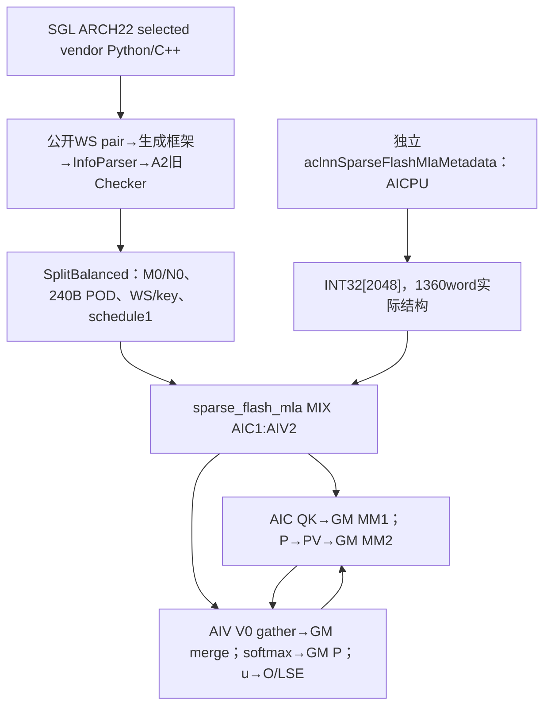
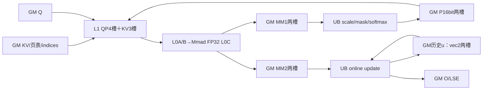
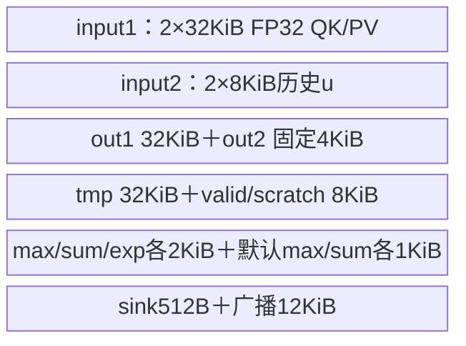
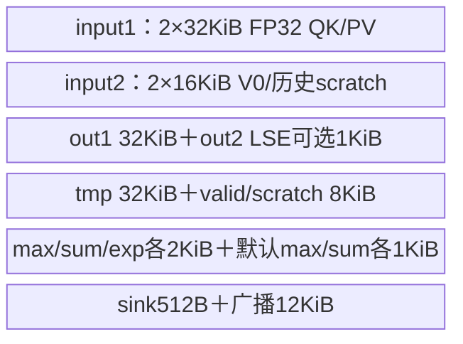
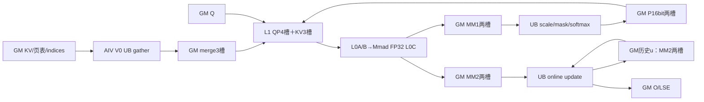
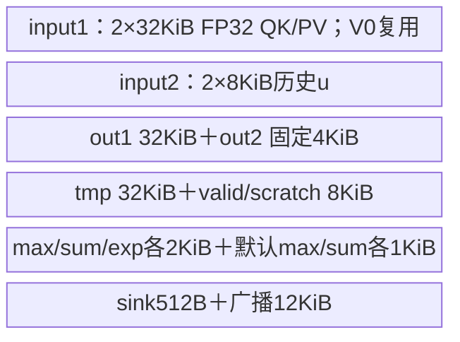

# SparseFlashMla 稀疏共享 KV 注意力 A2/A3 ACLNN 算子知识

## 算子速览

| 项目 | 内容 |
|---|---|
| 实际入口 | `aclnnSparseFlashMlaGetWorkspaceSize/aclnnSparseFlashMla`；固定SGL selected CANN9.2/e7 bundle |
| 计算语义 | 共享K=V、D512；原始窗口与连续/TopK压缩KV或原始slot列表形成同一注意力候选多重集，FP32 online softmax加每头sink |
| 输入输出 | Q/KV/O同FP16或BF16；KV头1、G为1…128的2幂；四个Q/KV布局组合；O同Q shape，LSE FP32 |
| 执行类型 | 单`sparse_flash_mla` MIX_CV launch，AIC QK/PV，两个AIV做gather/softmax/更新；独立AICPU metadata为前驱接口 |
| Kernel 路线 | R-001 SWA、R-002 HCA、R-003 CSA G>1、R-004 CSA G1、R-005 DSpark TND/PA；R-006未预编译selector终点；R-007有效空/无效行 |
| 核心资源 | S2tile512；SWA/HCA M256、CSA/DSpark M=G；L1=7×64KiB=458752B，L0A/B64KiB、L0C128KiB；SWA UB180736B、CSA UB193024+[LSE]1024B |
| 来源闭包 | source_closed：SGL→vendor Python/C++→公开pair/生成框架边界→A2真实Host/POD→MIX entry→全部arch22主体；配套metadata字段生产消费与固定SDK/注册框架贯通 |
| 验证状态 | 仅静态源码提取，未安装、编译、真机、数值、图或性能测试。draft保留可见合同差异/条件风险，不构成安全复用承诺 |

当前来源中TND原始KV长度buffer绑定、TND seqused与metadata优先级、历史输出32KiB搬入16KiB UB子区、CSA无效索引压紧后列数、batch-consistency的FD生产/消费差异都需按后文限制复验。不能把来源闭合当成这些路线已验证正确。

## 接口与语义

### 计算语义

对请求b、Query token i、头h，令q_b为有效Query长度，o_b/c_b为原始/压缩有效长度，压缩率r，余数e_b。普通原始窗口为
`Jori=[max(0,o_b-q_b+i-127), min(o_b-1,o_b-q_b+i)]`；
压缩因果上限取
`tcmp=floor((c_b*r+e_b-q_b+i+1)/r)`。
HCA取压缩j∈[0,min(c_b,tcmp))；CSA从当前token的cmp_sparse_indices前缀取合法j<tcmp，重复索引按条目重复参加，不能无证去重。DSpark取ori_sparse_indices前min(ori_topk_length,K)个逻辑原始slot，负数/超ori长度在其实际Vector路线屏蔽。普通SWA没有压缩集合。

候选KV以多重集连接，不新增投影、RoPE或压缩数学；512通道包含已准备的448nope+64rope。理想语义为
`score_j=α*FP32(Q·KV_j), Z=exp(sink_h)+Σ exp(score_j), O=Σ exp(score_j)*KV_j/Z`，
LSE=log Z。sink是一个零value的logit，不乘α。实际FP32 QK/PV与online状态：max取旧值/当前块max，p=exp(score-newmax)，旧u与sum乘exp(oldmax-newmax)后累加；FP32 sum在p cast前产生，p先CAST_ROUND到Q的16bit dtype再送PV。末块除sum；BF16 O CAST_RINT、FP16 O CAST_ROUND。

A2/A3的FLASH_DECODE编译参数恒0，主kernel不执行FD加权，也不读取FD记录。不能将源码中被if constexpr排除的FD helper写成当前可达实现。源码对部分无效行写O0/LSE0，与完整sink数学的LSE=sink可能不同；有效空分支和未写区分见R-007。

### 输入、输出与属性

| 参数 | shape/layout | dtype | 约束、默认值与语义 |
|---|---|---|---|
| q | [B,S,G,512] BSND或[T,G,512] TND | FP16/BF16 | C++拒绝numel0/任一维≤0；G∈{1,2,4,8,16,32,64,128} |
| ori_kv | [B,So,1,512]、[To,1,512]、[Po,Ho,1,512] | 同q | 所有模板必须有；布局BSND/TND/PA_BBND |
| cmp_kv | 与ori同layout，独立长度/页Hc | 同q | HCA/CSA有，SWA/DSpark无；r为逻辑恢复倍率，不在本算子压缩数据 |
| cmp_sparse_indices | [B,S,1,K]或[T,1,K] | INT32 | CSA必有，K∈[1,8192]；索引合法性/左对齐前缀与实际列数边界见限制 |
| ori_sparse_indices | [T,1,K]为当前预编译DSpark域 | INT32 | e7 CANN Doc支持，SGL Doc称不支持；Host还有其它layout key但不在DSpark预编译SEL |
| ori_topk_length | [T,1]，Host另检查BSND[B,S,1] | INT32 | DSpark必有；值0…K，实际使用min(value,K)，非正值取0；普通模板不消费 |
| cmp_topk_length | None或空Tensor | INT32 | A2 Parser拒绝非空，Device不消费；不能据950合同扩张 |
| ori/cmp_block_table | [B,Lori/Lcmp] | INT32 | PA必须对应存在侧；每页16对齐[16,1024]；有效页号/长度存储覆盖由调用者保证 |
| cu_seqlens_q/ori/cmp | 对应TND[B+1] | INT32 | 首0/非递减并与真实存储一致。主Host检查不完全等于CPU内容检查；TND原始KV绑定问题见限制 |
| seqused_q/ori/cmp | [B]或None | INT32 | BSND/PA覆盖有效长度；TND主Device读取cu差，producer先读used，故不能把短used无条件当已闭合一致域 |
| cmp_residual_kv | [B] | INT32 | CANN Doc仅cmpMask3且r!=1可传且必传；r1/无cmp时不传；主Host旧链存在更宽放行，不增加数值合同 |
| sinks | [G] | FP32 | A2/A3实际必传且非空；每头初始max、初始sum1 |
| metadata | [2048] | INT32 | 必传，同e7配套producer；实际结构1360word、对齐尾688word未初始化；本主核只消费FA0…6 |
| softmax_scale | double入口→GE float | FP32计算 | 默认1；不自动1/√512，不无证宣称非有限值可用 |
| cmp_ratio | int64入口/Host部分u32读取 | attr | CSA1/2/4，HCA128；普通SWA不使用该值，SGL建议1不是Host硬guard |
| ori_mask_mode/win | int64入口/Host u32/i32指针 | attr | 普通SWA/HCA/CSA为4、127/0；DSpark为0、左右非负但slot本身决定选择 |
| cmp_mask_mode | attr | int64入口 | HCA/CSA必须3；SWA未消费 |
| layout_q/layout_kv | strings | N/A | BSND/BSND、TND/TND、BSND/PA_BBND、TND/PA_BBND；非PA同名配对 |
| topk_value_mode | attr | int64入口 | A2/A3只1逻辑token index；不混950物理offset模式2 |
| return_softmax_lse | bool | attr | 真时LSE [B,1,S,G]或[1,T,G]，假时真实C++[0]；Fake却[]标量，保留差异 |
| attn_out / softmax_lse | O与Q同shape；LSE上述 | O同q/FP32 | C++新分配，输入只读，不原地；生命周期到当前stream完成 |

公开调用与环境层复用[现有Sparse Flash MLA API](../../../../apis/sgl_kernel_npu/sgl_sparse_flash_mla_and_metadata.md)。本卡将SGL合同与e7实际接线分开：SGL Doc旧声明不支持ori_sparse_indices，当前CANN Doc则明列DSpark，不能删除这个发布层差异或把它写成SGL已验证功能。

### 入口与版本

SGL `auto`只注册ARCH22并要求detect_cann_version()==9.2.0，随后转显式cann_ops_transformers_cann920；显式后端同ARCH22，但自身不重复版本检查。profile固定e7da，Python从wheel内`_third_party.sgl_ops_transformer.ops`导入，未找到vendor报错，无Torch数学fallback。独立torch_native不在本selected CANN闭包内。

vendor Python OpBuilder注册schema/Meta/PrivateUse1→C++ SparseFlashMla→ACLNN_CMD公开pair。主pair的生成bridge/contiguous/executor为注册框架边界，没有假造一个手写op_api入口。自有A2 InfoParser/旧SMLATilingCheck/DoOpTiling到所有arch22 Device体均可见；非2201才使用另一套SparseFlashMlaChecker，不把后者guard当A2事实。

固定CANN e7 version9.2、SDK a63d9.2、metadef000cd91... version9.2为这次源码证据；未安装或核验实际wheel/opbase/注册框架二进制与它们相同。CANN另有950/960源码和OpDef注册，本任务仅SGL实际ARCH22 A2/A3，不产950卡、不称CANN该接口在950不支持。

## Host/Launcher 执行流程

### 参数校验与前处理

1. SGL selected adapter直接传18个tensor/10attr，不从函数名自行合并torch_native数学。C++ CheckQueryShape先验Q物理非空/rank；empty_like(q)产O，开启LSE时读KV头生成shape，否则FP32[0]。Fake关闭LSE使用torch.empty([])，是1元素标量，不能叫空tensor。
2. OpDef Q、indices、table、长度、residual、topkLength、sink、metadata AutoContiguous；两个KV IgnoreContiguous。输出copy/运行提交由生成executor管理，具体框架copy Device body不在本提取中。所有显式buffer owner和stream需保留。
3. InfoParser顺序GetOpName/NpuInfo/Para→布局→mode→shape/轴→长度→CheckContiguous→GenerateInfo。NpuInfo只认2201/3510/9201/9202且C/V非0；本卡取2201。非PA Q/KV必须同名；TND Q以cuQ.numel−1取B；输入原始KV始终必需。
4. perfMode由存在性选择：cmpKV+cmpindices→CSA；cmpKV无cmpindices→HCA；两者都无→SWA。A2 oriindices只许SWA、oriMask0，Host同时记录hasOriSparseIndices与末维宽K。K轴枚举与D同值3，不误认找不到K轴。
5. 实际A2 SMLATilingCheck::Process依次CheckSinglePara/ParaExistence/Feature/MultiConsistency。它验证G二幂、KV头1、D512、dtype一致、rank/layout、metadata2048、sink[G]、CSA K≤8192、压缩率与窗口；主Host不逐个读取设备页号、长度值、indices或metadata任务内容。
6. A2普通窗口guard强制oriMask4、127/0；HCA/CSA cmpMask3；DSpark oriMask0、window左右非负、oriTopkLength必有且shape吻合。非空cmpTopkLength在Parser已拒绝。Host对DSpark其它layout仍可能生成不在预编译SEL的key，按R-006收口。
7. KV实际stride0依次尝试GetOptionalInputStride、InputIsView/GetInputStride，均不可用则按storageShape连续推导并warning；CheckContiguous只比较checkStartIdx（PA1、非PA0）与rank，不逐轴重新证明所有内层stride。公开要求PA仅0轴非连续、其余连续且stride非0，Host漏检不扩大合同。strides向量元素为u32，而ori/cmpKvStride0读取辅助最终u64；需区分两条来源。

### 参数、Workspace 与生命周期

记C/V为Host实际AIC/AIV资源，N为Device GetBlockNum、Bdim为Host CalcTschBlockDim(V,C,V)，正常MIX1:2需N=C且两个AIV配一AIC；源码不把该硬件关系作为独立guard。M0=普通SWA/HCA256，CSA/DSpark G；x=min(G*S1physical,M0)，R=512*align16(x)，两个POD元数mmResUbSize和bmm2ResUbSize都为R。TND的S1physical是总T，不等于单batch有效q。

```text
W_host = Wlib + 28*C*R + [CSA or DSpark]*3*C*512*512*2
          # Wlib=GetLibApiWorkSpaceSize()实际值，非通用常数
user MM1 FP32 [0, 8*N*R)
user P   B16  [8*N*R,12*N*R)
user MM2 FP32 [12*N*R,20*N*R)
user u   FP32 [20*N*R,28*N*R)
user merge B16 [28*N*R,28*N*R+3*N*512*512*2)  # 仅CSA/DSpark
```

每个core各段再加aicIdx*2*R元素，slot=loop%2；merge各core加aicIdx*3*512*512元素、slot=cmpLoop%3。Host C与Device N不一致时不能直接套容量相等；以上乘法和保存u32需可表示。CSA末尾局部offset虽加4个merge槽，但后面未用该offset，实际地址均%3，不能据这一未消费数值判实际使用第4槽。

SDK C220 GetUserWorkspace在非CPU忽略实参，使用注入`__get_kfc_workspace_addr()`或g_sysWorkspaceReserved加RESERVED_WORKSPACE（该架构16MiB）；CPU返回实参。Host Wlib是实际API返回值，不能无条件与保留常数等同。公开pair workspaceSize还可能含生成框架副本，不无证等同W_host。

metadata独立query/execute，owner是其输出Tensor；同stream先生产后主调用，跨stream须显式完成依赖。主输入、连续副本、metadata、O/LSE、user workspace与executor须保留到stream完成。Host返回Tensor不代表NPU同步；query失败不execute，execute状态由ACLNN框架传播。源码没有失败回滚成有效O的恢复路线。

### 启动图与失败传播



单launch，QK/softmax/PV/u用GM中间段交接，没有另起Host kernel。metadata enable0令该core在Process直接return，但Init阶段已建立buffer视图。TPipe在entry栈上构造，析构Destroy带PIPE_ALL（非SuperKernel条件）；FreeEventID先drain对应本核握手。不把调度mode1当Device全核barrier。

## Route 与参数设计

### 分核与资源计算

Host SplitBalanced固定N0=512；SWA/HCA M0=(256/G)*G=256（G已是2幂），CSA M0=G，DSpark另覆写为G。QK/PV自身分M128、N128、KL1=256、KL0=128；QK K512为2×2段，PV输出512为4×128，当前S2≤512，tail按16 LoadData/Fixpipe补齐。Mmad unitFlag=2/3表示累加/最后块可FIX，小块(m/16)*(n/16)<10加PIPE_M。

两个AIV的M切分：m≤16时sub0取m、sub1零行；否则sub0=ceil(ceil(m/16)/2)*16，sub1余数。零行仍走跨核flag，只有Vector有效计算return。Vector1每片≤8192 float（32KiB），mSplit=floor8(8192/align32(n))再限有效行；Vector2≤16行×512。Q与O合并M均为S1G次序，地址BSND=((b*S+i)*G+h)*512，TND=((cuQ[b]+i)*G+h)*512。

配套CPU producer读取used优先于cu差/物理max，soc判断Ascend910使用M0=G（稀疏）或256（普通）、S2base512。它输出FA游标及可选FD记录；isBatchConsistency=true会置supportFd=true，调度可按S2块拆并生成FD。本A2主key仍FLASH_DECODE0且忽略BATCH_CONSISTENCY模板实参，必须保留这一生产消费差异，不能自动声称level3已完整归并。

### Route 选择

B表示Host deterministic_level==3的布尔值；F始终0、splitG始终0、vecPhyAddr始终0、topkMode始终1。dtype由OpDef与entry编译宏选择，不编码在key十实参内。以下逐个展开真实selector，同一body/资源的dtype和布局变体在实现段共用管线，所有地址差异另列，不复制相同内存表。

| 顺序 | Route | Key/模板 | 精确选择条件与优先级 | 不适用去向 |
|---:|---|---|---|---|
| 1 | R-001 | FP16/`GET_TPL_TILING_KEY(0,0,0,0,0,0,0,0,1,0)` | 无cmpKV/无cmpindices/无oriindices，oriMask4/127/0；全部G二幂；Qlayout0/KVlayout0；B=0 | 另一存在性/tuple；非法值失败 |
| 2 | R-001 | FP16/`GET_TPL_TILING_KEY(0,0,0,0,0,0,1,0,1,0)` | 无cmpKV/无cmpindices/无oriindices，oriMask4/127/0；全部G二幂；Qlayout0/KVlayout0；B=1 | 另一存在性/tuple；非法值失败 |
| 3 | R-001 | FP16/`GET_TPL_TILING_KEY(0,0,2,0,0,0,0,0,1,0)` | 无cmpKV/无cmpindices/无oriindices，oriMask4/127/0；全部G二幂；Qlayout0/KVlayout2；B=0 | 另一存在性/tuple；非法值失败 |
| 4 | R-001 | FP16/`GET_TPL_TILING_KEY(0,0,2,0,0,0,1,0,1,0)` | 无cmpKV/无cmpindices/无oriindices，oriMask4/127/0；全部G二幂；Qlayout0/KVlayout2；B=1 | 另一存在性/tuple；非法值失败 |
| 5 | R-001 | FP16/`GET_TPL_TILING_KEY(0,1,1,0,0,0,0,0,1,0)` | 无cmpKV/无cmpindices/无oriindices，oriMask4/127/0；全部G二幂；Qlayout1/KVlayout1；B=0 | 另一存在性/tuple；非法值失败 |
| 6 | R-001 | FP16/`GET_TPL_TILING_KEY(0,1,1,0,0,0,1,0,1,0)` | 无cmpKV/无cmpindices/无oriindices，oriMask4/127/0；全部G二幂；Qlayout1/KVlayout1；B=1 | 另一存在性/tuple；非法值失败 |
| 7 | R-001 | FP16/`GET_TPL_TILING_KEY(0,1,2,0,0,0,0,0,1,0)` | 无cmpKV/无cmpindices/无oriindices，oriMask4/127/0；全部G二幂；Qlayout1/KVlayout2；B=0 | 另一存在性/tuple；非法值失败 |
| 8 | R-001 | FP16/`GET_TPL_TILING_KEY(0,1,2,0,0,0,1,0,1,0)` | 无cmpKV/无cmpindices/无oriindices，oriMask4/127/0；全部G二幂；Qlayout1/KVlayout2；B=1 | 另一存在性/tuple；非法值失败 |
| 9 | R-001 | BF16/`GET_TPL_TILING_KEY(0,0,0,0,0,0,0,0,1,0)` | 无cmpKV/无cmpindices/无oriindices，oriMask4/127/0；全部G二幂；Qlayout0/KVlayout0；B=0 | 另一存在性/tuple；非法值失败 |
| 10 | R-001 | BF16/`GET_TPL_TILING_KEY(0,0,0,0,0,0,1,0,1,0)` | 无cmpKV/无cmpindices/无oriindices，oriMask4/127/0；全部G二幂；Qlayout0/KVlayout0；B=1 | 另一存在性/tuple；非法值失败 |
| 11 | R-001 | BF16/`GET_TPL_TILING_KEY(0,0,2,0,0,0,0,0,1,0)` | 无cmpKV/无cmpindices/无oriindices，oriMask4/127/0；全部G二幂；Qlayout0/KVlayout2；B=0 | 另一存在性/tuple；非法值失败 |
| 12 | R-001 | BF16/`GET_TPL_TILING_KEY(0,0,2,0,0,0,1,0,1,0)` | 无cmpKV/无cmpindices/无oriindices，oriMask4/127/0；全部G二幂；Qlayout0/KVlayout2；B=1 | 另一存在性/tuple；非法值失败 |
| 13 | R-001 | BF16/`GET_TPL_TILING_KEY(0,1,1,0,0,0,0,0,1,0)` | 无cmpKV/无cmpindices/无oriindices，oriMask4/127/0；全部G二幂；Qlayout1/KVlayout1；B=0 | 另一存在性/tuple；非法值失败 |
| 14 | R-001 | BF16/`GET_TPL_TILING_KEY(0,1,1,0,0,0,1,0,1,0)` | 无cmpKV/无cmpindices/无oriindices，oriMask4/127/0；全部G二幂；Qlayout1/KVlayout1；B=1 | 另一存在性/tuple；非法值失败 |
| 15 | R-001 | BF16/`GET_TPL_TILING_KEY(0,1,2,0,0,0,0,0,1,0)` | 无cmpKV/无cmpindices/无oriindices，oriMask4/127/0；全部G二幂；Qlayout1/KVlayout2；B=0 | 另一存在性/tuple；非法值失败 |
| 16 | R-001 | BF16/`GET_TPL_TILING_KEY(0,1,2,0,0,0,1,0,1,0)` | 无cmpKV/无cmpindices/无oriindices，oriMask4/127/0；全部G二幂；Qlayout1/KVlayout2；B=1 | 另一存在性/tuple；非法值失败 |
| 17 | R-002 | FP16/`GET_TPL_TILING_KEY(0,0,0,1,0,0,0,0,1,0)` | 有cmpKV/无cmpindices/无oriindices，ratio128、cmpMask3；全部G二幂；Qlayout0/KVlayout0；B=0 | 另一存在性/tuple；非法值失败 |
| 18 | R-002 | FP16/`GET_TPL_TILING_KEY(0,0,0,1,0,0,1,0,1,0)` | 有cmpKV/无cmpindices/无oriindices，ratio128、cmpMask3；全部G二幂；Qlayout0/KVlayout0；B=1 | 另一存在性/tuple；非法值失败 |
| 19 | R-002 | FP16/`GET_TPL_TILING_KEY(0,0,2,1,0,0,0,0,1,0)` | 有cmpKV/无cmpindices/无oriindices，ratio128、cmpMask3；全部G二幂；Qlayout0/KVlayout2；B=0 | 另一存在性/tuple；非法值失败 |
| 20 | R-002 | FP16/`GET_TPL_TILING_KEY(0,0,2,1,0,0,1,0,1,0)` | 有cmpKV/无cmpindices/无oriindices，ratio128、cmpMask3；全部G二幂；Qlayout0/KVlayout2；B=1 | 另一存在性/tuple；非法值失败 |
| 21 | R-002 | FP16/`GET_TPL_TILING_KEY(0,1,1,1,0,0,0,0,1,0)` | 有cmpKV/无cmpindices/无oriindices，ratio128、cmpMask3；全部G二幂；Qlayout1/KVlayout1；B=0 | 另一存在性/tuple；非法值失败 |
| 22 | R-002 | FP16/`GET_TPL_TILING_KEY(0,1,1,1,0,0,1,0,1,0)` | 有cmpKV/无cmpindices/无oriindices，ratio128、cmpMask3；全部G二幂；Qlayout1/KVlayout1；B=1 | 另一存在性/tuple；非法值失败 |
| 23 | R-002 | FP16/`GET_TPL_TILING_KEY(0,1,2,1,0,0,0,0,1,0)` | 有cmpKV/无cmpindices/无oriindices，ratio128、cmpMask3；全部G二幂；Qlayout1/KVlayout2；B=0 | 另一存在性/tuple；非法值失败 |
| 24 | R-002 | FP16/`GET_TPL_TILING_KEY(0,1,2,1,0,0,1,0,1,0)` | 有cmpKV/无cmpindices/无oriindices，ratio128、cmpMask3；全部G二幂；Qlayout1/KVlayout2；B=1 | 另一存在性/tuple；非法值失败 |
| 25 | R-002 | BF16/`GET_TPL_TILING_KEY(0,0,0,1,0,0,0,0,1,0)` | 有cmpKV/无cmpindices/无oriindices，ratio128、cmpMask3；全部G二幂；Qlayout0/KVlayout0；B=0 | 另一存在性/tuple；非法值失败 |
| 26 | R-002 | BF16/`GET_TPL_TILING_KEY(0,0,0,1,0,0,1,0,1,0)` | 有cmpKV/无cmpindices/无oriindices，ratio128、cmpMask3；全部G二幂；Qlayout0/KVlayout0；B=1 | 另一存在性/tuple；非法值失败 |
| 27 | R-002 | BF16/`GET_TPL_TILING_KEY(0,0,2,1,0,0,0,0,1,0)` | 有cmpKV/无cmpindices/无oriindices，ratio128、cmpMask3；全部G二幂；Qlayout0/KVlayout2；B=0 | 另一存在性/tuple；非法值失败 |
| 28 | R-002 | BF16/`GET_TPL_TILING_KEY(0,0,2,1,0,0,1,0,1,0)` | 有cmpKV/无cmpindices/无oriindices，ratio128、cmpMask3；全部G二幂；Qlayout0/KVlayout2；B=1 | 另一存在性/tuple；非法值失败 |
| 29 | R-002 | BF16/`GET_TPL_TILING_KEY(0,1,1,1,0,0,0,0,1,0)` | 有cmpKV/无cmpindices/无oriindices，ratio128、cmpMask3；全部G二幂；Qlayout1/KVlayout1；B=0 | 另一存在性/tuple；非法值失败 |
| 30 | R-002 | BF16/`GET_TPL_TILING_KEY(0,1,1,1,0,0,1,0,1,0)` | 有cmpKV/无cmpindices/无oriindices，ratio128、cmpMask3；全部G二幂；Qlayout1/KVlayout1；B=1 | 另一存在性/tuple；非法值失败 |
| 31 | R-002 | BF16/`GET_TPL_TILING_KEY(0,1,2,1,0,0,0,0,1,0)` | 有cmpKV/无cmpindices/无oriindices，ratio128、cmpMask3；全部G二幂；Qlayout1/KVlayout2；B=0 | 另一存在性/tuple；非法值失败 |
| 32 | R-002 | BF16/`GET_TPL_TILING_KEY(0,1,2,1,0,0,1,0,1,0)` | 有cmpKV/无cmpindices/无oriindices，ratio128、cmpMask3；全部G二幂；Qlayout1/KVlayout2；B=1 | 另一存在性/tuple；非法值失败 |
| 33 | R-003 | FP16/`GET_TPL_TILING_KEY(0,0,0,2,0,0,0,0,1,0)` | 有cmpKV+cmpindices，无oriindices，ratio1/2/4、cmpMask3，G>1；G=2…128二幂；Qlayout0/KVlayout0；B=0 | 另一存在性/tuple；非法值失败 |
| 34 | R-003 | FP16/`GET_TPL_TILING_KEY(0,0,0,2,0,0,1,0,1,0)` | 有cmpKV+cmpindices，无oriindices，ratio1/2/4、cmpMask3，G>1；G=2…128二幂；Qlayout0/KVlayout0；B=1 | 另一存在性/tuple；非法值失败 |
| 35 | R-003 | FP16/`GET_TPL_TILING_KEY(0,0,2,2,0,0,0,0,1,0)` | 有cmpKV+cmpindices，无oriindices，ratio1/2/4、cmpMask3，G>1；G=2…128二幂；Qlayout0/KVlayout2；B=0 | 另一存在性/tuple；非法值失败 |
| 36 | R-003 | FP16/`GET_TPL_TILING_KEY(0,0,2,2,0,0,1,0,1,0)` | 有cmpKV+cmpindices，无oriindices，ratio1/2/4、cmpMask3，G>1；G=2…128二幂；Qlayout0/KVlayout2；B=1 | 另一存在性/tuple；非法值失败 |
| 37 | R-003 | FP16/`GET_TPL_TILING_KEY(0,1,1,2,0,0,0,0,1,0)` | 有cmpKV+cmpindices，无oriindices，ratio1/2/4、cmpMask3，G>1；G=2…128二幂；Qlayout1/KVlayout1；B=0 | 另一存在性/tuple；非法值失败 |
| 38 | R-003 | FP16/`GET_TPL_TILING_KEY(0,1,1,2,0,0,1,0,1,0)` | 有cmpKV+cmpindices，无oriindices，ratio1/2/4、cmpMask3，G>1；G=2…128二幂；Qlayout1/KVlayout1；B=1 | 另一存在性/tuple；非法值失败 |
| 39 | R-003 | FP16/`GET_TPL_TILING_KEY(0,1,2,2,0,0,0,0,1,0)` | 有cmpKV+cmpindices，无oriindices，ratio1/2/4、cmpMask3，G>1；G=2…128二幂；Qlayout1/KVlayout2；B=0 | 另一存在性/tuple；非法值失败 |
| 40 | R-003 | FP16/`GET_TPL_TILING_KEY(0,1,2,2,0,0,1,0,1,0)` | 有cmpKV+cmpindices，无oriindices，ratio1/2/4、cmpMask3，G>1；G=2…128二幂；Qlayout1/KVlayout2；B=1 | 另一存在性/tuple；非法值失败 |
| 41 | R-003 | BF16/`GET_TPL_TILING_KEY(0,0,0,2,0,0,0,0,1,0)` | 有cmpKV+cmpindices，无oriindices，ratio1/2/4、cmpMask3，G>1；G=2…128二幂；Qlayout0/KVlayout0；B=0 | 另一存在性/tuple；非法值失败 |
| 42 | R-003 | BF16/`GET_TPL_TILING_KEY(0,0,0,2,0,0,1,0,1,0)` | 有cmpKV+cmpindices，无oriindices，ratio1/2/4、cmpMask3，G>1；G=2…128二幂；Qlayout0/KVlayout0；B=1 | 另一存在性/tuple；非法值失败 |
| 43 | R-003 | BF16/`GET_TPL_TILING_KEY(0,0,2,2,0,0,0,0,1,0)` | 有cmpKV+cmpindices，无oriindices，ratio1/2/4、cmpMask3，G>1；G=2…128二幂；Qlayout0/KVlayout2；B=0 | 另一存在性/tuple；非法值失败 |
| 44 | R-003 | BF16/`GET_TPL_TILING_KEY(0,0,2,2,0,0,1,0,1,0)` | 有cmpKV+cmpindices，无oriindices，ratio1/2/4、cmpMask3，G>1；G=2…128二幂；Qlayout0/KVlayout2；B=1 | 另一存在性/tuple；非法值失败 |
| 45 | R-003 | BF16/`GET_TPL_TILING_KEY(0,1,1,2,0,0,0,0,1,0)` | 有cmpKV+cmpindices，无oriindices，ratio1/2/4、cmpMask3，G>1；G=2…128二幂；Qlayout1/KVlayout1；B=0 | 另一存在性/tuple；非法值失败 |
| 46 | R-003 | BF16/`GET_TPL_TILING_KEY(0,1,1,2,0,0,1,0,1,0)` | 有cmpKV+cmpindices，无oriindices，ratio1/2/4、cmpMask3，G>1；G=2…128二幂；Qlayout1/KVlayout1；B=1 | 另一存在性/tuple；非法值失败 |
| 47 | R-003 | BF16/`GET_TPL_TILING_KEY(0,1,2,2,0,0,0,0,1,0)` | 有cmpKV+cmpindices，无oriindices，ratio1/2/4、cmpMask3，G>1；G=2…128二幂；Qlayout1/KVlayout2；B=0 | 另一存在性/tuple；非法值失败 |
| 48 | R-003 | BF16/`GET_TPL_TILING_KEY(0,1,2,2,0,0,1,0,1,0)` | 有cmpKV+cmpindices，无oriindices，ratio1/2/4、cmpMask3，G>1；G=2…128二幂；Qlayout1/KVlayout2；B=1 | 另一存在性/tuple；非法值失败 |
| 49 | R-004 | FP16/`GET_TPL_TILING_KEY(0,0,0,2,0,1,0,0,1,0)` | 同CSA且G=1；G=1；Qlayout0/KVlayout0；B=0 | 另一存在性/tuple；非法值失败 |
| 50 | R-004 | FP16/`GET_TPL_TILING_KEY(0,0,0,2,0,1,1,0,1,0)` | 同CSA且G=1；G=1；Qlayout0/KVlayout0；B=1 | 另一存在性/tuple；非法值失败 |
| 51 | R-004 | FP16/`GET_TPL_TILING_KEY(0,0,2,2,0,1,0,0,1,0)` | 同CSA且G=1；G=1；Qlayout0/KVlayout2；B=0 | 另一存在性/tuple；非法值失败 |
| 52 | R-004 | FP16/`GET_TPL_TILING_KEY(0,0,2,2,0,1,1,0,1,0)` | 同CSA且G=1；G=1；Qlayout0/KVlayout2；B=1 | 另一存在性/tuple；非法值失败 |
| 53 | R-004 | FP16/`GET_TPL_TILING_KEY(0,1,1,2,0,1,0,0,1,0)` | 同CSA且G=1；G=1；Qlayout1/KVlayout1；B=0 | 另一存在性/tuple；非法值失败 |
| 54 | R-004 | FP16/`GET_TPL_TILING_KEY(0,1,1,2,0,1,1,0,1,0)` | 同CSA且G=1；G=1；Qlayout1/KVlayout1；B=1 | 另一存在性/tuple；非法值失败 |
| 55 | R-004 | FP16/`GET_TPL_TILING_KEY(0,1,2,2,0,1,0,0,1,0)` | 同CSA且G=1；G=1；Qlayout1/KVlayout2；B=0 | 另一存在性/tuple；非法值失败 |
| 56 | R-004 | FP16/`GET_TPL_TILING_KEY(0,1,2,2,0,1,1,0,1,0)` | 同CSA且G=1；G=1；Qlayout1/KVlayout2；B=1 | 另一存在性/tuple；非法值失败 |
| 57 | R-004 | BF16/`GET_TPL_TILING_KEY(0,0,0,2,0,1,0,0,1,0)` | 同CSA且G=1；G=1；Qlayout0/KVlayout0；B=0 | 另一存在性/tuple；非法值失败 |
| 58 | R-004 | BF16/`GET_TPL_TILING_KEY(0,0,0,2,0,1,1,0,1,0)` | 同CSA且G=1；G=1；Qlayout0/KVlayout0；B=1 | 另一存在性/tuple；非法值失败 |
| 59 | R-004 | BF16/`GET_TPL_TILING_KEY(0,0,2,2,0,1,0,0,1,0)` | 同CSA且G=1；G=1；Qlayout0/KVlayout2；B=0 | 另一存在性/tuple；非法值失败 |
| 60 | R-004 | BF16/`GET_TPL_TILING_KEY(0,0,2,2,0,1,1,0,1,0)` | 同CSA且G=1；G=1；Qlayout0/KVlayout2；B=1 | 另一存在性/tuple；非法值失败 |
| 61 | R-004 | BF16/`GET_TPL_TILING_KEY(0,1,1,2,0,1,0,0,1,0)` | 同CSA且G=1；G=1；Qlayout1/KVlayout1；B=0 | 另一存在性/tuple；非法值失败 |
| 62 | R-004 | BF16/`GET_TPL_TILING_KEY(0,1,1,2,0,1,1,0,1,0)` | 同CSA且G=1；G=1；Qlayout1/KVlayout1；B=1 | 另一存在性/tuple；非法值失败 |
| 63 | R-004 | BF16/`GET_TPL_TILING_KEY(0,1,2,2,0,1,0,0,1,0)` | 同CSA且G=1；G=1；Qlayout1/KVlayout2；B=0 | 另一存在性/tuple；非法值失败 |
| 64 | R-004 | BF16/`GET_TPL_TILING_KEY(0,1,2,2,0,1,1,0,1,0)` | 同CSA且G=1；G=1；Qlayout1/KVlayout2；B=1 | 另一存在性/tuple；非法值失败 |
| 65 | R-005 | FP16/`GET_TPL_TILING_KEY(0,1,2,0,0,0,0,0,1,1)` | 仅oriKV+oriindices+oriTopkLength，TND/PA、oriMask0、左右window非负；全部G二幂；Qlayout1/KVlayout2；B=0 | 另一存在性/tuple；非法值失败 |
| 66 | R-005 | FP16/`GET_TPL_TILING_KEY(0,1,2,0,0,0,1,0,1,1)` | 仅oriKV+oriindices+oriTopkLength，TND/PA、oriMask0、左右window非负；全部G二幂；Qlayout1/KVlayout2；B=1 | 另一存在性/tuple；非法值失败 |
| 67 | R-005 | BF16/`GET_TPL_TILING_KEY(0,1,2,0,0,0,0,0,1,1)` | 仅oriKV+oriindices+oriTopkLength，TND/PA、oriMask0、左右window非负；全部G二幂；Qlayout1/KVlayout2；B=0 | 另一存在性/tuple；非法值失败 |
| 68 | R-005 | BF16/`GET_TPL_TILING_KEY(0,1,2,0,0,0,1,0,1,1)` | 仅oriKV+oriindices+oriTopkLength，TND/PA、oriMask0、左右window非负；全部G二幂；Qlayout1/KVlayout2；B=1 | 另一存在性/tuple；非法值失败 |
| 69 | R-006 Host selector无预编译项 | DSpark且(Q,KV)∈{(0,0),(0,2),(1,1)} | 旧Host没有该组合拒绝，但TPL_SEL IS_DSPARK1只列(1,2) | 非Debug可编码该key但固定SEL无对应实例；Debug组合检查返回INVALID_KEY；不补造Device fallback |
| 70 | R-007 空任务/无效行 | 当前selector内实际长度与metadata | coreEnable0、q/ori有效0、ori右对齐前无效行或topk0等 | 真实清零/skip/drain；未写部分不伪称有效输出 |

```text
ARCH22 + parser/checker -> oriKV required
  cmpKV? yes -> cmpindices? yes -> CSA (G1 R004, G>1 R003)
                       no -> HCA R002
         no -> cmpindices? yes -> Host fail
                           no -> oriindices? no -> SWA R001
                                              yes -> oriMask0/topkLength -> DSpark
                                                     TND/PA -> R005
                                                     other tuple -> R006
  each actualbody -> metadata coreEnable/length/mask -> R007 or FA pipeline
```

### 模板/实现执行矩阵

记`S(T,Q,K,M,H,D)`为完整`SMLAType<T,T,T,false,static_cast<SMLA_LAYOUT>(Q),static_cast<SMLA_LAYOUT>(K),M,static_cast<bool>(H),static_cast<bool>(D)>`。A2 entry不把BATCH_CONSISTENCY、SPLIT_G、IS_VEC_S2PHYADDR、TOPK_VALUE_MODE转成该类型参数，尽管B改变key；不能把未转发值称改变Device调度。

| Route | key/selector | dtype/shape/platform 完整命中条件 | 执行族与 kernel 节点 | 实际模板/body | 内存与同步特征 | tail/fallback |
|---|---|---|---|---|---|---|
| R-001 | 上表该组全部逐项key | A2/A3、FP16/BF16、D512、KV1、全部G二幂、无cmpKV/无cmpindices/无oriindices，oriMask4/127/0 | 单MIX_CV，AIC QK→V1→AIC PV→V2 | SparseFlashMlaSwa<S(T,Q,K,0,0,0)>；SWACubeBlock/SWAVectorBlock | M256/N512；L1458752/L0A,B65536/C131072；SWA UB180736；原始窗口、无gather | 16对齐Cube、32对齐Vector列、有效行输出；TND/UB/metadata风险见限制 |
| R-002 | 上表该组全部逐项key | A2/A3、FP16/BF16、D512、KV1、全部G二幂、有cmpKV/无cmpindices/无oriindices，ratio128、cmpMask3 | 单MIX_CV，AIC QK→V1→AIC PV→V2 | SparseFlashMlaSwa<S(T,Q,K,1,0,0)>；SWACubeBlock/SWAVectorBlock | M256/N512；L1458752/L0A,B65536/C131072；SWA UB180736；ori/cmp混合tile及逐行两套mask | 16对齐Cube、32对齐Vector列、有效行输出；TND/UB/metadata风险见限制 |
| R-003 | 上表该组全部逐项key | A2/A3、FP16/BF16、D512、KV1、G=2…128二幂、有cmpKV+cmpindices，无oriindices，ratio1/2/4、cmpMask3，G>1 | 单MIX_CV，V0 gather→AIC QK→V1→AIC PV→V2 | SparseFlashMlaCsa<S(T,Q,K,2,0,0)>；SMLACubeBlock/SMLAVectorBlock | MG/N512；L1458752/L0A,B65536/C131072；CSA UB193024+[LSE]1024；V0压缩gather，历史u用vec2GM | 16对齐Cube、32对齐Vector列、有效行输出；TND/UB/metadata风险见限制 |
| R-004 | 上表该组全部逐项key | A2/A3、FP16/BF16、D512、KV1、G=1、同CSA且G=1 | 单MIX_CV，V0 gather→AIC QK→V1→AIC PV→V2 | SparseFlashMlaCsa<S(T,Q,K,2,1,0)>；SMLACubeBlock/SMLAVectorBlock | M1/N512；L1458752/L0A,B65536/C131072；CSA UB193024+[LSE]1024；显式mode2 wait/FIX_M，历史u复用MM2GM | 16对齐Cube、32对齐Vector列、有效行输出；TND/UB/metadata风险见限制 |
| R-005 | 上表该组全部逐项key | A2/A3、FP16/BF16、D512、KV1、全部G二幂、仅oriKV+oriindices+oriTopkLength，TND/PA、oriMask0、左右window非负 | 单MIX_CV，V0 gather→AIC QK→V1→AIC PV→V2 | SparseFlashMlaSwa<S(T,Q,K,0,0,1)>；SWACubeBlock/SWAVectorBlock | MG/N512；L1458752/L0A,B65536/C131072；SWA UB180736；V0原始gather＋slot mask，K分页读 | 16对齐Cube、32对齐Vector列、有效行输出；TND/UB/metadata风险见限制 |
| R-006 | 12个Host dtype×B×不支持layout组合 | DSpark1但非TND/PA | 无对应预编译Device节点 | TPL_SEL明确排除 | 不能补造kernel/resources | 非Debug后续生成框架匹配结果未运行；Debug返回INVALID_KEY，Host未另查；无自有fallback |
| R-007 | 同合法typed selector内运行时 | enable0/空有效长度/无效行 | 当前task可纯Vector清零或不执行 | InitAllZeroOutput/ProcessBalance/hasLoad | 其它task仍同launch资源；预清不是无条件发生 | 未写区保留未定义输出，不推全0/全LSE=sink |

### 隐藏性能 Guard

| Guard | Host/Tiling 条件 | Device/资源原因 | 影响 Route | 不满足时去向 | 源码符号 |
|---|---|---|---|---|---|
| G二幂/维512/KV1 | FeatureShape | M0整除、固定512矩阵通道与sink广播 | R001…005 | Host失败 | CheckFeatureShape/SplitBalanced |
| 单头CSA | mode2&&G==1 | QK延后到旧PV后、FIX_M及mode2 wait；复用MM2历史 | R004 | G>1 R003 | headRatioOne/PreloadPipeline/DealBmm2ResBaseBlock |
| 原始window | 无oriindices时mode4、127/0 | SWA跨M union最多(256/G)+127≤383列，普通ori阶段不超过一512tile | R001…004 | Host失败 | CheckFeatureShape/ProcessBalance |
| TopK宽与scalar gather | CSA K1…8192；DSpark需width/topkLength | Vector0按512切，每次≤16行merge；不能将2048metadata当indices容量 | R003…005 | Host拒绝/索引合法前提 | CheckSingleParaCmpSparseIndices/ProcessVec0L |
| 分页/stride | H16对齐[16,1024]，PA仅轴0非连续 | Page copy按页切；PAShape.kvStride u32，Host可保存u64 | 所有PA | Host限制；高位窄化另须检查 | CheckSinglePara*BlockTable/DataCopyPA |
| 预编译selector | DSpark只TND/PA | 当前SMLAType::isDspark与row gather依赖PA | R005/R006 | 非对应组合没有fallback | ASCENDC_TPL_SEL |
| UB基础块 | V1 d*nA32≤8192 float，V2 d≤16 | FP32 input/tmp各32KiB | 全计算路线 | 内层split，非改Hosttile | ProcessVec1SingleBuf/ProcessVec2Inner |
| 历史u子区 | SWA Vec2非first，d*512*4 | input2仅16384B，d>8跨声明范围 | HCA/DSpark多S2子路线 | 无源码减d到8 guard；draft风险 | SWAVectorBlock::DealBmm2ResBaseBlock |
| metadata资源/模式 | C/V与当前launch一致；原始/压缩长度、indices宽、window一致 | FA游标是主循环边界，主Host不读内容；B=1 producer支持FD但主key0 | 全部 | 不支持伪造表/跨环境复用推断 | GenMetadata/InitCalcParamsEach |

### POD/ABI

这不是Host类对象的sizeof布局。固定metadef宏的FieldHandler按字段自身sizeof补齐offset、嵌套结构按8B对齐，构造末补8B；InitData以`new (std::nothrow) uint8_t[tiling.data_size_]()`的数组值初始化语义分配清零字节区，子结构由SetDataPtr指向父buffer，scalar成员默认0。set同时写成员及序列化区；SaveToBuffer仅memcpy data_size，无返回错误码，失败只log。由这套固定宏推得base184B/align8、cmp56B/align8、总240B；Host对象含vector/ptr/reserve，不可memcpy其sizeof当Device POD。

| 结构 | 字段 | 类型/位宽 | ABI 布局 | 单位 | Host/launcher producer | Device consumer | 边界 |
|---|---|---|---|---|---|---|---|
| SparseFlashMlabase | batchSize | u32 | 序列化+0B | 请求 | DoOpTiling/set_batchSize：bSize | InitTilingData batchSize | B>0 |
| SparseFlashMlabase | qSeqSize | u32 | 序列化+4B | token | DoOpTiling/set_qSeqSize：s1Size | qSeqSize/连续Q stride；TND总T | 保存需可表示 |
| SparseFlashMlabase | kvSeqSize | u32 | 序列化+8B | token | DoOpTiling/set_kvSeqSize：s2Size | ori最大存储长度/默认stride | TND为总To |
| SparseFlashMlabase | paBlockSize | i64 | 序列化+16B | token/页 | DoOpTiling/set_paBlockSize：tilingInfo.blockSize初值0，未改变 | kvCacheBlockSize；实际PAcopy用oriBlockSize | 0不是实际页H |
| SparseFlashMlabase | oriBlockSize | i64 | 序列化+24B | token/页 | DoOpTiling/set_oriBlockSize：oriBlockSize | PA原始除法/余数 | 16对齐[16,1024] |
| SparseFlashMlabase | cmpBlockSize | i64 | 序列化+32B | token/页 | DoOpTiling/set_cmpBlockSize：cmpBlockSize | PA压缩除法/余数 | 同上 |
| SparseFlashMlabase | oriMaxBlockNumPerBatch | u32 | 序列化+40B | 页/请求 | DoOpTiling/set_oriMaxBlockNumPerBatch：ori表shape1 | 原始页表行stride | 实际coverage需调用者保证 |
| SparseFlashMlabase | nNumOfQInOneGroup | u32 | 序列化+44B | 头 | DoOpTiling/set_nNumOfQInOneGroup：gSize | gSize/QHeadNum | 2幂1…128 |
| SparseFlashMlabase | actualLenDimsQ | u32 | 序列化+48B | 元素 | DoOpTiling/set_actualLenDimsQ：TNDcuQ.numel−1；其它usedQ.numel | InitActualSeqLen bindQ | TND实际bufferB+1；GetValue读b+1 |
| SparseFlashMlabase | actualLenDimsKV | u32 | 序列化+52B | 元素 | DoOpTiling/set_actualLenDimsKV：PA usedOri.numel；BSND actualLenDimsOriKV；TND保留0 | InitActualSeqLen条件绑定ori长度 | TND随后仍读cuOri：真实缺陷条件 |
| SparseFlashMlabase | softmaxScale | f32 | 序列化+56B | logit倍数 | DoOpTiling/set_softmaxScale：softmaxScale | Muls | FP32 |
| SparseFlashMlabase | outputLayout | u32 | 序列化+60B | enum | DoOpTiling/set_outputLayout：outLayout | O/LSE地址 | 同Q0/1 |
| SparseFlashMlabase | oriMaskMode | u64 | 序列化+64B | mode | DoOpTiling/set_oriMaskMode：oriMaskMode | ConstInfo/mask | 普通4或DSpark0 |
| SparseFlashMlabase | oriKvStride0 | i64 | 序列化+72B | KV元素 | DoOpTiling/set_oriKvStride0：GetOptionalInputStride0 | u64 ConstInfo→PAShape u32或64地址 | 正stride、u32窄化条件 |
| SparseFlashMlabase | oriWinLeft | i64 | 序列化+80B | token | DoOpTiling/set_oriWinLeft：oriWinLeft | oriMaskLeft/SetInfInBlk | 普通127 |
| SparseFlashMlabase | oriWinRight | i64 | 序列化+88B | token | DoOpTiling/set_oriWinRight：oriWinRight | oriMaskRight/SetInfInBlk | 普通0 |
| SparseFlashMlabase | sparseBlockSize | i64 | 序列化+96B | token/索引 | DoOpTiling/set_sparseBlockSize：固定1 | DSpark sparse粒度 | 当前1 |
| SparseFlashMlabase | oriSparseBlockCount | u32 | 序列化+104B | 索引数 | DoOpTiling/set_oriSparseBlockCount：仅A5/A6 set；A2默认0 | A2不消费该字段，另oriSparseIndexWidth | inactive必须保留 |
| SparseFlashMlabase | topkValueMode | i64 | 序列化+112B | mode | DoOpTiling/set_topkValueMode：仅A5/A6 set；A2默认0 | A2类型不消费，以Host/key1确定 | 不当实际mode0 |
| SparseFlashMlabase | usedCoreNum | u32 | 序列化+120B | AIC核 | DoOpTiling/set_usedCoreNum：实际C | SWA ConstInfo.usedCoreNum | 与launch/表一致 |
| SparseFlashMlabase | mmResUbSize | u32 | 序列化+124B | 元素/slot | DoOpTiling/set_mmResUbSize：SplitBalanced R | MM1/P GM切片 | 不是UB字节 |
| SparseFlashMlabase | bmm2ResUbSize | u32 | 序列化+128B | 元素/slot | DoOpTiling/set_bmm2ResUbSize：SplitBalanced R | MM2/u GM切片 | 不是UB字节 |
| SparseFlashMlabase | returnSoftmaxLse | u32 | 序列化+132B | bool | DoOpTiling/set_returnSoftmaxLse：returnLSE | Vector ProcessLse | 0/1 |
| SparseFlashMlabase | mBaseSize | u32 | 序列化+136B | M行 | DoOpTiling/set_mBaseSize：普通256或CSA/DSpark G | SWA使用；CSA显式G | 当前tile |
| SparseFlashMlabase | s2BaseSize | u32 | 序列化+140B | S2列 | DoOpTiling/set_s2BaseSize：固定512 | S2循环 | 非128 |
| SparseFlashMlabase | actualLenDimsOriKV | u32 | 序列化+144B | 元素 | DoOpTiling/set_actualLenDimsOriKV：usedOri.numel或0 | A2主体未用它绑定cuOri | 不能替actualLenDimsKV |
| SparseFlashMlabase | actualLenDimsCmpKV | u32 | 序列化+148B | 元素 | DoOpTiling/set_actualLenDimsCmpKV：usedCmp.numel或0 | InitActualSeqLen条件bindCmp | TND无usedCmp时不绑定cuCmp |
| SparseFlashMlabase | cmpResidualKVSize | u32 | 序列化+152B | 元素 | DoOpTiling/set_cmpResidualKVSize：residual.numel或0 | bindResidual/GetCmpMaskS2Size | 合法B |
| SparseFlashMlabase | kvHeadNum | u32 | 序列化+156B | 头 | DoOpTiling/set_kvHeadNum：Host未set，metadef默认0 | Device0→1，否则原值 | 固定源可证明fallback1 |
| SparseFlashMlabase | oriKeyStride0 | u32 | 序列化+160B | 元素 | DoOpTiling/set_oriKeyStride0：A2显式0 | A2不消费 | A5字段 |
| SparseFlashMlabase | hasOriSparseIndices | u32 | 序列化+164B | bool | DoOpTiling/set_hasOriSparseIndices：hasOriSparseIndices | SWA constInfo；IS_DSPARK也在key | 0/1 |
| SparseFlashMlabase | oriSparseIndexWidth | u32 | 序列化+168B | 索引数 | DoOpTiling/set_oriSparseIndexWidth：oriindices末K | DSpark perquery stride/minlength | 保存需可表示 |
| SparseFlashMlabase | oriP | u32 | 序列化+172B | magic除法移位 | DoOpTiling/set_oriP：A2未算，传初值0 | A2不消费 | A6字段 |
| SparseFlashMlabase | oriMLow | u32 | 序列化+176B | magic低32 | DoOpTiling/set_oriMLow：A2初值0 | A2不消费 | 同上 |
| SparseFlashMlabase | oriMHigh | u32 | 序列化+180B | magic高32 | DoOpTiling/set_oriMHigh：A2初值0 | A2不消费 | 同上 |
| SparseFlashMlacmp | cmpMaxBlockNumPerBatch | u32 | 序列化+184B | 页/请求 | DoOpTiling/set_cmpMaxBlockNumPerBatch：cmp表shape1 | 压缩页表行stride | 存在cmp/PA时有效 |
| SparseFlashMlacmp | sparseBlockCount | u32 | 序列化+188B | 索引数 | DoOpTiling/set_sparseBlockCount：A2 cmpSparseBlockCount | CSA topK宽/offset | 1…8192 |
| SparseFlashMlacmp | cmpRatio | i64 | 序列化+192B | 倍率 | DoOpTiling/set_cmpRatio：cmpRatio | HCA/CSA阈值 | 1/2/4或128 |
| SparseFlashMlacmp | cmpMaskMode | u64 | 序列化+200B | mode | DoOpTiling/set_cmpMaskMode：cmpMaskMode | ConstInfo cmpMaskMode | HCA/CSA3 |
| SparseFlashMlacmp | cmpKvStride0 | i64 | 序列化+208B | KV元素 | DoOpTiling/set_cmpKvStride0：GetOptionalInputStride0(CMP) | 压缩PA/BSND地址 | PAShape u32窄化，V0可64 |
| SparseFlashMlacmp | cmpSparseBlockCount | u32 | 序列化+216B | 索引数 | DoOpTiling/set_cmpSparseBlockCount：A2不set默认0 | A2不消费 | A5字段 |
| SparseFlashMlacmp | cmpKvSeqSize | u32 | 序列化+220B | token | DoOpTiling/set_cmpKvSeqSize：cmpS2Size（所有架构均set） | GetActualSeqLenCmpKV fallback | 含实际TND/PA容量解释 |
| SparseFlashMlacmp | cmpKeyStride0 | u32 | 序列化+224B | 元素 | DoOpTiling/set_cmpKeyStride0：A2显式0 | A2不消费 | A5字段 |
| SparseFlashMlacmp | cmpP | u32 | 序列化+228B | magic移位 | DoOpTiling/set_cmpP：A2初值0 | A2不消费 | A6字段 |
| SparseFlashMlacmp | cmpMLow | u32 | 序列化+232B | magic低32 | DoOpTiling/set_cmpMLow：A2初值0 | A2不消费 | 同上 |
| SparseFlashMlacmp | cmpMHigh | u32 | 序列化+236B | magic高32 | DoOpTiling/set_cmpMHigh：A2初值0 | A2不消费 | 同上 |

POD padding位于[12,16)、[108,112)，按当前metadef零初始化；它们不是逻辑字段。240B是固定序列化规则推导，没有编译测量。SaveToBuffer容量不足只log且DoOpTiling没有检查该void接口结果，真实框架必须提供≥240B容量。

metadata没有header，FA[80][9]紧跟FD[80][8]，均uint32存于INT32 buffer；`FA(c,k)=9*c+k`，`FD(v,k)=720+8*v+k`为word索引。producer `*metadataPtr={}`只清1360word/5440B，输出8192B中的尾688word/2752B不定义。本A2主核只用下表FA0…6，不外推FD或尾部消费。

| 结构 | 字段 | 类型/位宽 | ABI 布局 | 单位 | Host/launcher producer | Device consumer | 边界 |
|---|---|---|---|---|---|---|---|
| metadataFA | coreEnable | u32 | FA(core,0)×4B | bool | CPU::GenMetadata：i<usedCoreNum→1，否则0 | Process hasLoad | 实际AIC记录 |
| metadataFA | BN2start | u32 | FA(core,1)×4B | 请求×KV头 | CPU::GenMetadata：前core bN2End，core0=0 | InitCalcParamsEach，core0保留0 | 左端点 |
| metadataFA | Mstart | u32 | FA(core,2)×4B | M块 | CPU::GenMetadata：前core gS1End，core0=0 | 同上 | M0对应当前模板 |
| metadataFA | S2start | u32 | FA(core,3)×4B | S2块 | CPU::GenMetadata：前core s2End，core0=0 | 同上/ProcessBalance | 非FD普通匹配表通常0；B1可非0 |
| metadataFA | BN2end | u32 | FA(core,4)×4B | 请求×KV头 | CPU::GenMetadata：splitRes.bN2End[i] | ProcessBalance | 代码将end三元组转BN2循环界 |
| metadataFA | Mend | u32 | FA(core,5)×4B | M块 | CPU::GenMetadata：splitRes.gS1End[i] | 同上 | 实际边界 |
| metadataFA | S2end | u32 | FA(core,6)×4B | S2块 | CPU::GenMetadata：splitRes.s2End[i] | CSA可能限s2LoopEnd；SWA读取但不应用该end | 不能假FD归并 |
| metadataFA | firstFDworkspace | u32 | FA(core,7)×4B | slot | CPU::GenMetadata：firstFdDataWorkspaceIdx[i] | 当前A2不读取 | 保留inactive |
| metadataFA | S2max | u32 | FA(core,8)×4B | S2轮次 | CPU::GenMetadata：普通isSplitG=false分支不set，清0 | 当前A2不读取 | 非A2 isSplitG另set |
| metadataFD | coreEnable | u32 | FD(core,0)×4B | bool | CPU::GenMetadata：i<fdUsedVecNum | 当前A2全部不消费 | 不造FD body |
| metadataFD | BN2 | u32 | FD(core,1)×4B | 请求×KV头 | CPU::GenMetadata：fdBN2Idx[fdIdx[i]] | 当前A2不消费 | same |
| metadataFD | M | u32 | FD(core,2)×4B | M块 | CPU::GenMetadata：fdMIdx[fdIdx[i]] | 当前A2不消费 | same |
| metadataFD | workspace | u32 | FD(core,3)×4B | slot | CPU::GenMetadata：fdWorkspaceIdx[fdIdx[i]] | 当前A2不消费 | same |
| metadataFD | parts | u32 | FD(core,4)×4B | 片数 | CPU::GenMetadata：fdS2SplitNum[fdIdx[i]] | 当前A2不消费 | same |
| metadataFD | mStart | u32 | FD(core,5)×4B | row | CPU::GenMetadata：fdMStart[i] | 当前A2不消费 | same |
| metadataFD | mNum | u32 | FD(core,6)×4B | row数 | CPU::GenMetadata：fdMNum[i] | 当前A2不消费 | same |
| metadataFD | reserved | u32 | FD(core,7)×4B | 保留 | CPU::GenMetadata：结构初始化0 | 当前A2不消费 | same |

### Route 源码闭包

| Route | Key/selector | Host/Tiling producer | POD/参数 | Kernel entry/router | Kernel body/直接依赖 | 构建接线 |
|---|---|---|---|---|---|---|
| R-001 | 上表精确该族16项key | sparse_flash_mla_tiling.cpp::InfoParser→SMLATilingCheck→DoOpTiling | 240B base/cmp、FA9word/core | sparse_flash_mla.cpp→SparseFlashMlaSwa<S(T,Q,K,0,0,0)> | arch22 swa_kernel、block_cube、block_vector、common_arch22；SDK M1Update/TPipe/events | OpDef910b/910_93；CMake ACLNN/tiling自动接线，模板SEL |
| R-002 | 上表精确该族16项key | sparse_flash_mla_tiling.cpp::InfoParser→SMLATilingCheck→DoOpTiling | 240B base/cmp、FA9word/core | sparse_flash_mla.cpp→SparseFlashMlaSwa<S(T,Q,K,1,0,0)> | arch22 swa_kernel、block_cube、block_vector、common_arch22；SDK M1Update/TPipe/events | OpDef910b/910_93；CMake ACLNN/tiling自动接线，模板SEL |
| R-003 | 上表精确该族16项key | sparse_flash_mla_tiling.cpp::InfoParser→SMLATilingCheck→DoOpTiling | 240B base/cmp、FA9word/core | sparse_flash_mla.cpp→SparseFlashMlaCsa<S(T,Q,K,2,0,0)> | arch22 csa_kernel、block_cube、block_vector、common_arch22；SDK M1Update/TPipe/events | OpDef910b/910_93；CMake ACLNN/tiling自动接线，模板SEL |
| R-004 | 上表精确该族16项key | sparse_flash_mla_tiling.cpp::InfoParser→SMLATilingCheck→DoOpTiling | 240B base/cmp、FA9word/core | sparse_flash_mla.cpp→SparseFlashMlaCsa<S(T,Q,K,2,1,0)> | arch22 csa_kernel、block_cube、block_vector、common_arch22；SDK M1Update/TPipe/events | OpDef910b/910_93；CMake ACLNN/tiling自动接线，模板SEL |
| R-005 | 上表精确该族4项key | sparse_flash_mla_tiling.cpp::InfoParser→SMLATilingCheck→DoOpTiling | 240B base/cmp、FA9word/core | sparse_flash_mla.cpp→SparseFlashMlaSwa<S(T,Q,K,0,0,1)> | arch22 swa_kernel、block_cube、block_vector、common_arch22；SDK M1Update/TPipe/events | OpDef910b/910_93；CMake ACLNN/tiling自动接线，模板SEL |
| R-006 | DSpark非(1,2)tuple | 同Host可能产key | 同POD | TPL_SEL没有实例 | 非Debug可产key但SEL无实例，Debug组合检查INVALID_KEY；无自有数学fallback | 不虚构未编译Device |
| R-007 | 计算族内部enable/长度谓词 | 相同Host | FA enable与有效长度 | Process/ProcessBalance | InitAllZeroOutput、skip与preload drain | 同一MIX binary |

## Kernel 实现

### 公共执行流程

entry在A2构造TPipe（InitSocState+ResetPool），GetUserWorkspace，复制生成240B tiling，实例化相应SMLAType/主体，Init后Process。SDK GetBlockIdx在AIV=rawAICblock*subblockdim+subblockid，标准MIX1:2下aicIdx=flatIdx/2、sub=flatIdx%2；AIC直接raw编号。metadata FA0决定Process是否有load，core0的start来自默认0，其他core从前述FA字段读取。

主循环按BN2/M/S2游标分配，同一核心3个RunInfo环与preload2保持：当前QK、上一块V1/PV、上两块V2；末task补2轮drain。QK和PV的GM工作区两槽loop%2；gather merge三槽cmpLoop%3。AIC和AIV通过mode2 flags6(V0→QK)、7(QK→V1)、8(P→PV)、9(PV→V2)控制GM交接；CSA另有4次flag3种子/first-M等待/last-PV归还/尾drain保护其重用。

AIC L1分4个QP槽和3个KV槽，每槽64KiB；QP映射idxMap{0,2}把同M的两个256通道块放成相邻区，QK沿N重复使用Q，PV沿D重复使用P。L0A/B各两32KiB、L0C两64KiB，L0C依Mmad/Fixpipe unitFlag握手。当前n/m对齐只影响物理tile，不改变逻辑候选条目数；输出DataCopyPad按真实行数/512通道写。

AIV V1读FP32 MM1、scale、实现族mask，SDK SoftmaxFlashV2<float,true,true,false,false,WITHOUT_BRC>以FP32 max/sum/exp在线更新，P cast16bit写GM。固定SDK采用M1PostProcess→M1UpdateImplProcess：NewReduceMax/Sum只reduce oriSrcK有效n，Brcb/Sub/Exp/V屏障，更新sum=exp(oldmax-newmax)*oldsum+rowsum(P)。调用者tmp32KiB传入，不走隐式stack scratch分配；config.isCheckTiling=false，准确使用主核刚生成的tiling。V2在GM保存历史u，末块除sum、cast到O；LSE仅最后S2写logsum+max。关闭LSE时不消费该输出。

可复用[SoftmaxFlashV2](../../../../../../ops/ascendc/apis/simd_api/adv_api/activation_functions/soft_max_interface/softmax_flash_v2.md)及[tiling接口](../../../../../../ops/ascendc/apis/simd_api/adv_api/activation_functions/soft_max_interface/softmax_flash_v2_tiling_interface.md)的primitive合同，本文再绑定a63d实际M1实现。Softmax本身不是外部Torch/ACLNN核心数学。生成AutoContiguous/属性存储/调度提交是框架边界，未声称其自有Device实现也在本仓。

### Route R-001：普通 SWA

#### 适用条件

无cmpKV/无cmpindices/无oriindices，oriMask4/127/0；全部G二幂，Q/KV/O同FP16或BF16，D512/KV头1；当前族全部selector见前表。普通layout为四对，DSpark只有TND/PA。TND实际绑定和两阶段长度优先级风险仍适用于相应tuple，列出可达路线不构成正确性支持扩张。

##### 选择证据

| 层级 | 文件 | 符号 | 源码谓词/参数 | 结果/下一跳 |
|---|---|---|---|---|
| Parser | op_host/sparse_flash_mla_tiling.cpp | GetSMLATemplateMode | 无cmpKV/无cmpindices/无oriindices，oriMask4/127/0 | mode0、hasOriIndices=0 |
| Host | 同文件 | SplitBalanced/DoOpTiling | M256/N512、headRatioOne0、isDspark0 | 本族逐项key、240B tiling与GM切片 |
| Router | op_kernel/sparse_flash_mla.cpp | A2 SMLA_OP_IMPL | dtype三者一致；TEMPLATE_MODE0、HEAD_RATIO_ONE0、IS_DSPARK0 | SparseFlashMlaSwa<S(T,Q,K,0,0,0)> |

#### Device 数据流

##### 函数级调用链

```text
sparse_flash_mla -> SparseFlashMlaSwa::Init
 -> InitTilingData / InitActualSeqLen / InitCalcParamsEach / InitBuffers
 -> Process -> hasLoad -> AllocEventID / InitSoftmaxDefaultBuffer -> ProcessBalance
 -> CalcParams / PreloadPipeline (RunInfo[3], preload2)
 -> SWACubeBlock::ComputeMm1
 -> SWAVectorBlock::ProcessVec1L -> ProcessVec1SingleBuf -> DealBmm1ResBaseBlock
    -> ElewiseCompute(mask) / SetInfInBlk -> SoftmaxFlashV2Compute -> SDK M1Update -> P GM
 -> SWACubeBlock::ComputeMm2 -> GM MM2
 -> SWAVectorBlock::ProcessVec2L -> ProcessVec2Inner -> DealBmm2ResBaseBlock
    -> RowMuls/Add/RowDivs -> Bmm2ResCopyOut -> Bmm2CastAndCopyOut -> DataCopyPad O
 -> last S2 ProcessLse -> log(sum)+max -> GM LSE
 -> FreeEventID -> TPipe destructor Destroy/PIPE_ALL
```

##### 源码等价伪码

```text
# 伪码；FA metadata→BN2/M256→原始窗口union→QK→逐行band mask→P→PV→u→O
oriLeft=max(o_b-q_b+s1Start-127,0); oriRight=min(o_b-q_b+s1End,o_b-1)
for single ori tile (union columns<=383):
  Cube QK from original dense/PA KV -> GM MM1
  Vector mask per token i to [o_b-q_b+i-127,o_b-q_b+i]; online softmax with sink
  Cube PV same original values -> GM MM2
  Vector first local S2 and last -> divide sum, O/LSE
# M128 subblocks最多2个；无压缩KV、无V0 gather、无FD
```

普通SWA原始union最多383列，因此不达到第二个512列S2块；BSNDori copy没有显式S2*512项，在这个实际普通范围中不是遗漏下一tile地址的证据。

#### 内存与数据搬运

##### 资源与搬运表

| 层级/缓冲区 | offset/地址公式 | extent/容量公式 | dtype/layout | producer | consumer | owner/lifetime | 对齐/复用 |
|---|---|---|---|---|---|---|---|
| GM Q/O/LSE | Q/O=((b*S+i)*G+h)*512或((cuQ[b]+i)*G+h)*512；LSE=(b*S+i)*G+h或(cuQ[b]+i)*G+h | Q/O numel*2B，LSE开启numel*4B | B16 ND/FP32 | 调用者Q、Vector O/LSE | MTE2/Cube/下游 | Q只读；O/LSE新owner，stream完成前存活 | 不alias输入；有效row范围 |
| GM KV | BSND b*stride0+j*512+d；TND(cuKV[b]+j)*512+d；PA table[b*L+j/H]*stride0+(j%H)*512+d | 真实shape/storage覆盖；每token1024B | 同Q、K=V | 输入owner | Cube或gatherV0 | 整launch只读 | TND绑定/PAShape u32限制见正文 |
| user workspace | MM1@0、P@8NR、MM2@12NR、u@20NR、merge@28NR B | 28CR（不含Wlib；Device以N替C） | FP32/16bit | AIC FIX、V MTE3 | V MTE2、AIC MTE2 | executor至stream完成 | 两槽R元；merge三槽512²；无merge workspace；tmp32KiB供SDK softmax/当前PV，中间u有28NR工作区但普通SWA通常单S2不需历史搬入。 |
| L1 QP/KV | QP[0,262144)，KV[262144,458752) | 4*65536+3*65536=458752B | B16 NZ | GM ND2NZ MTE2 | MTE1→L0A/B | TPipe静态TBuf，全launch | QP成对相邻，KV三槽 |
| L0A/B/C | A/B各0/32768 pingpong；C0/65536 | 65536/65536/131072B | B16/B16/FP32 | LoadData→Mmad | Mmad→Fixpipe | TPipe每层独立pool | M/N/K16对齐，unitFlag2/3 |
| UB SWA/HCA/DSpark | input1@0 65536B；input2@65536 16384B；out1@81920 32768B；out2@114688 4096B；tmp@118784 32768B；valid@151552 8192B；max/exp/sum@159744/161792/163840各2048B；默认max/sum@165888/166912各1024B；sink@167936 512B；brcb@168448 12288B | 180736B | FP32/16bit/INT32分阶段视图 | TPipe顺序InitBuffer，分配对齐32B | V1/V2；DSpark V0复用input1 | 全launch，TPipe析构回收 | 这是固定SDK ResetPool后顺序分配推导，不是编译报告 |
| Reg/Vector mask | 传统Vector repeat，FP32每repeat64元素 | 精确寄存器分配固定源码无编译报告 | FP32/uint64 mask | Vector arithmetic | 同pipe后续指令 | 一次基础块调用 | Mask只作用指定计算，GM/UB DMA按实际count |

##### 分层内存布局





##### 字节账、交接边与复用顺序

```text
W_host=Wlib+28*C*R; Device段使用N=GetBlockNum，需N=C或另按实际容量重算
L1=(4+3)*(64*512*2)=458752 <= 524288
L0A/B=2*32768=65536 each; L0C=2*65536=131072
UB=64KiB+16KiB+32KiB+4KiB+32KiB+8KiB+6KiB+2KiB+512B+12KiB=180736 <= 当前c220 UB192KiB
V1 scratch=32768B，其中SDK splitM*(8+64)*4 <=32768，调用方shape m*nA32<=8192 float
每tile名义GM交接MM1 m*nA32*4、P m*nA32*2、MM2 m*512*4；历史u另读/写m*512*4
不建立merge GM/UB gather边
```

| 边/复用子区 | producer | offset/extent | dtype/layout | consumer | ordering/sync | owner/lifetime | 安全条件 |
|---|---|---|---|---|---|---|---|
| QK GM→V1 | Cube Fixpipe | core2R＋slotR，m*nA32*4B | FP32 ND | Vector1 MTE2 | flag7 FIX→wait；本核V_MTE2/MTE2_V | workspace | tailn用actualnreduce，不将padding算候选 |
| P GM→PV | Vector1 Cast/MTE3 | 同R切片16bit | ND→NZ | Cube MTE2/MTE1 | flag8 MTE3→Cube wait；QP七槽事件 | workspace/L1 | 输入P与Q dtype相同，sum仍FP32 |
| PV GM→V2 | Cube Fixpipe | MM2 slotR，m*512*4B | FP32 | Vector2 | flag9；默认wait接口 | workspace | 当前任务全部被preload drain消费 |
| 历史u | Vector2前任务或首PV | vec2前slotR，m*512*4B | FP32 | 当前Vector2 | MTE3_MTE2 Set/Wait后搬入，V事件保护UB | workspace；vec2独立段 | SWA input2对象仅16KiB，d>8跨入out1但未越整个UB；保留对象extent限制 |

| TPipe pool复用 | 当前V/Copy完成 | 按InitBuffer序列32B对齐 | 多个TBuf | 后续阶段 | V1/V2 MTE2/V/MTE3 event | kernel析构回收 | 不把计费峰值与所有跨声明DMA都混为安全证明 |

#### 同步、精度与尾块

##### 同步与数值边界表

| 阶段 | primitive/机制 | producer | consumer/等待点 | 保护对象 | 精度/尾块 |
|---|---|---|---|---|---|
| L1/L0 | HardEvent MTE1_MTE2七ID2,3,4,5,6,7,1；M_MTE1 IDs3/4 | MTE2/MTE1/M | MTE1/M/FIX | QP/KV与L0AB双槽 | QK K512 FP32、PV有效K，M/N物理A16 |
| GM跨族 | ffts_cross_core_sync(mode2)→wait_flag_dev | CubeFIX/VectorMTE3 | 7/8/9 | GM生产消费可见性 | 不是同pipe凭顺序即可，无FD全核barrier |
| 本族特殊同步 | flags7/8/9，MTE2/V/MTE3本核event；无V0flag6生产消费。 | 源码所列对应pipe | 固定wait点 | 原始窗口、无gather | 不为零行省略必需flag |
| softmax | SDK M1Update、PIPE_V/MaskCount恢复 | FP32 max/exp/sum | P cast/PV | 2槽状态与tmp32KiB | −2e38有限mask、P CAST_ROUND；有效n与nA32分离 |
| 输出 | RowMuls/Add/RowDivs/CAST | 当前PV及旧u | O MTE3/LSE | 32KiB基础块及output1 | BF16 RINT/FP16 ROUND；d≤16，O只有效行；无效/空另见R007 |
| 结束 | FreeEventID drain，TPipe::Destroy PIPE_ALL | 本核阶段 | entry结束 | buffer/event生命周期 | stream仍异步；未运行不作数值保证 |

#### 关键实现

##### 符号证据表

| 阶段 | 文件 | 符号/模板实例 | 实现事实 |
|---|---|---|---|
| Host/Tiling producer | attention/sparse_flash_mla/op_host/sparse_flash_mla_tiling.cpp | GetSMLATemplateMode/SplitBalanced/DoOpTiling | mode0/headRatioOne0/isDspark0，本族全部selector |
| Kernel entry/router | attention/sparse_flash_mla/op_kernel/sparse_flash_mla.cpp | SMLA_OP_IMPL(SparseFlashMlaSwa,...) | 实体S(T,Q,K,0,0,0)，无FLASH_DECODE |
| Device body | attention/sparse_flash_mla/op_kernel/arch22/sparse_flash_mla_swa_kernel.h | SparseFlashMlaSwa::ProcessBalance/PreloadPipeline | FA metadata→BN2/M256→原始窗口union→QK→逐行band mask→P→PV→u→O |
| Device Cube | attention/sparse_flash_mla/op_kernel/arch22/sparse_flash_mla_swa_block_cube.h | SWACubeBlock::ComputeMm1/2 | 七槽L1、Cube分块/页表或merge寻址、FP32 FixpipeGM |
| Device Vector | attention/sparse_flash_mla/op_kernel/arch22/sparse_flash_mla_swa_block_vector.h | SWAVectorBlock::ProcessVec0/1/2L | 原始窗口、无gather，mask/round与实际owner如上 |

### Route R-002：HCA 连续压缩集合

#### 适用条件

有cmpKV/无cmpindices/无oriindices，ratio128、cmpMask3；全部G二幂，Q/KV/O同FP16或BF16，D512/KV头1；当前族全部selector见前表。普通layout为四对，DSpark只有TND/PA。TND实际绑定和两阶段长度优先级风险仍适用于相应tuple，列出可达路线不构成正确性支持扩张。

##### 选择证据

| 层级 | 文件 | 符号 | 源码谓词/参数 | 结果/下一跳 |
|---|---|---|---|---|
| Parser | op_host/sparse_flash_mla_tiling.cpp | GetSMLATemplateMode | 有cmpKV/无cmpindices/无oriindices，ratio128、cmpMask3 | mode1、hasOriIndices=0 |
| Host | 同文件 | SplitBalanced/DoOpTiling | M256/N512、headRatioOne0、isDspark0 | 本族逐项key、240B tiling与GM切片 |
| Router | op_kernel/sparse_flash_mla.cpp | A2 SMLA_OP_IMPL | dtype三者一致；TEMPLATE_MODE1、HEAD_RATIO_ONE0、IS_DSPARK0 | SparseFlashMlaSwa<S(T,Q,K,1,0,0)> |

#### Device 数据流

##### 函数级调用链

```text
sparse_flash_mla -> SparseFlashMlaSwa::Init
 -> InitTilingData / InitActualSeqLen / InitCalcParamsEach / InitBuffers
 -> Process -> hasLoad -> AllocEventID / InitSoftmaxDefaultBuffer -> ProcessBalance
 -> CalcParams / PreloadPipeline (RunInfo[3], preload2)
 -> SWACubeBlock::ComputeMm1
 -> SWAVectorBlock::ProcessVec1L -> ProcessVec1SingleBuf -> DealBmm1ResBaseBlock
    -> ElewiseCompute(mask) / SetInfInBlk -> SoftmaxFlashV2Compute -> SDK M1Update -> P GM
 -> SWACubeBlock::ComputeMm2 -> GM MM2
 -> SWAVectorBlock::ProcessVec2L -> ProcessVec2Inner -> DealBmm2ResBaseBlock
    -> RowMuls/Add/RowDivs -> Bmm2ResCopyOut -> Bmm2CastAndCopyOut -> DataCopyPad O
 -> last S2 ProcessLse -> log(sum)+max -> GM LSE
 -> FreeEventID -> TPipe destructor Destroy/PIPE_ALL
```

##### 源码等价伪码

```text
# 伪码；FA→BN2/M256→原始窗口+连续压缩prefix→ori/mix/cmp tile→mask→两矩阵乘/online→O
oriLen=oriRight-oriLeft+1
if validCmp==0: oriLoops=ceil(oriLen/512); mixLoops=cmpLoops=0
else:
  oriLoops=oriLen/512; mixLoops=(oriLen%512!=0)
  cmpMixSize=min(512-oriLen%512,validCmp) if mix else0
  cmpLoops=ceil((validCmp-cmpMixSize)/512)
for oriOnly / oriCmpMix / cmpOnly tile:
  copy corresponding ori/contiguous cmp slices into same NZ L1 tile
  QK; per-row ori band and cmp causality mask; FP32 online softmax; P cast
  PV reads identical joined values; u=PV+exp*old_u; last divide and cast
# cmpOnly key start=relativeS2Idx*512+cmpMixSize，不是包含ori轮次的全局s2Idx
```

HCA末ori不足512时直接在同一L1 tile后接压缩prefix，mask分别处理两侧。压缩阈值按cmpLen*128+residual恢复，不能仅用oriLen/128替代。后续cmpOnly采用relativeS2Idx。

#### 内存与数据搬运

##### 资源与搬运表

| 层级/缓冲区 | offset/地址公式 | extent/容量公式 | dtype/layout | producer | consumer | owner/lifetime | 对齐/复用 |
|---|---|---|---|---|---|---|---|
| GM Q/O/LSE | Q/O=((b*S+i)*G+h)*512或((cuQ[b]+i)*G+h)*512；LSE=(b*S+i)*G+h或(cuQ[b]+i)*G+h | Q/O numel*2B，LSE开启numel*4B | B16 ND/FP32 | 调用者Q、Vector O/LSE | MTE2/Cube/下游 | Q只读；O/LSE新owner，stream完成前存活 | 不alias输入；有效row范围 |
| GM KV | BSND b*stride0+j*512+d；TND(cuKV[b]+j)*512+d；PA table[b*L+j/H]*stride0+(j%H)*512+d | 真实shape/storage覆盖；每token1024B | 同Q、K=V | 输入owner | Cube或gatherV0 | 整launch只读 | TND绑定/PAShape u32限制见正文 |
| user workspace | MM1@0、P@8NR、MM2@12NR、u@20NR、merge@28NR B | 28CR（不含Wlib；Device以N替C） | FP32/16bit | AIC FIX、V MTE3 | V MTE2、AIC MTE2 | executor至stream完成 | 两槽R元；merge三槽512²；没有Vector0/merge GM；跨S2历史u从vec2GM读入SWA input2对象，d>8时跨16KiB子区，实际高16KiB进入out1前半；MTE3_MTE2在历史搬入前排空此前MTE3，避免无证称所有场景都发生竞争。 |
| L1 QP/KV | QP[0,262144)，KV[262144,458752) | 4*65536+3*65536=458752B | B16 NZ | GM ND2NZ MTE2 | MTE1→L0A/B | TPipe静态TBuf，全launch | QP成对相邻，KV三槽 |
| L0A/B/C | A/B各0/32768 pingpong；C0/65536 | 65536/65536/131072B | B16/B16/FP32 | LoadData→Mmad | Mmad→Fixpipe | TPipe每层独立pool | M/N/K16对齐，unitFlag2/3 |
| UB SWA/HCA/DSpark | input1@0 65536B；input2@65536 16384B；out1@81920 32768B；out2@114688 4096B；tmp@118784 32768B；valid@151552 8192B；max/exp/sum@159744/161792/163840各2048B；默认max/sum@165888/166912各1024B；sink@167936 512B；brcb@168448 12288B | 180736B | FP32/16bit/INT32分阶段视图 | TPipe顺序InitBuffer，分配对齐32B | V1/V2；DSpark V0复用input1 | 全launch，TPipe析构回收 | 这是固定SDK ResetPool后顺序分配推导，不是编译报告 |
| Reg/Vector mask | 传统Vector repeat，FP32每repeat64元素 | 精确寄存器分配固定源码无编译报告 | FP32/uint64 mask | Vector arithmetic | 同pipe后续指令 | 一次基础块调用 | Mask只作用指定计算，GM/UB DMA按实际count |

##### 分层内存布局


##### 字节账、交接边与复用顺序

```text
W_host=Wlib+28*C*R; Device段使用N=GetBlockNum，需N=C或另按实际容量重算
L1=(4+3)*(64*512*2)=458752 <= 524288
L0A/B=2*32768=65536 each; L0C=2*65536=131072
UB=64KiB+16KiB+32KiB+4KiB+32KiB+8KiB+6KiB+2KiB+512B+12KiB=180736 <= 当前c220 UB192KiB
V1 scratch=32768B，其中SDK splitM*(8+64)*4 <=32768，调用方shape m*nA32<=8192 float
每tile名义GM交接MM1 m*nA32*4、P m*nA32*2、MM2 m*512*4；历史u另读/写m*512*4
不建立merge GM/UB gather边
```

| 边/复用子区 | producer | offset/extent | dtype/layout | consumer | ordering/sync | owner/lifetime | 安全条件 |
|---|---|---|---|---|---|---|---|
| QK GM→V1 | Cube Fixpipe | core2R＋slotR，m*nA32*4B | FP32 ND | Vector1 MTE2 | flag7 FIX→wait；本核V_MTE2/MTE2_V | workspace | tailn用actualnreduce，不将padding算候选 |
| P GM→PV | Vector1 Cast/MTE3 | 同R切片16bit | ND→NZ | Cube MTE2/MTE1 | flag8 MTE3→Cube wait；QP七槽事件 | workspace/L1 | 输入P与Q dtype相同，sum仍FP32 |
| PV GM→V2 | Cube Fixpipe | MM2 slotR，m*512*4B | FP32 | Vector2 | flag9；默认wait接口 | workspace | 当前任务全部被preload drain消费 |
| 历史u | Vector2前任务或首PV | vec2前slotR，m*512*4B | FP32 | 当前Vector2 | MTE3_MTE2 Set/Wait后搬入，V事件保护UB | workspace；vec2独立段 | SWA input2对象仅16KiB，d>8跨入out1但未越整个UB；保留对象extent限制 |

| TPipe pool复用 | 当前V/Copy完成 | 按InitBuffer序列32B对齐 | 多个TBuf | 后续阶段 | V1/V2 MTE2/V/MTE3 event | kernel析构回收 | 不把计费峰值与所有跨声明DMA都混为安全证明 |

#### 同步、精度与尾块

##### 同步与数值边界表

| 阶段 | primitive/机制 | producer | consumer/等待点 | 保护对象 | 精度/尾块 |
|---|---|---|---|---|---|
| L1/L0 | HardEvent MTE1_MTE2七ID2,3,4,5,6,7,1；M_MTE1 IDs3/4 | MTE2/MTE1/M | MTE1/M/FIX | QP/KV与L0AB双槽 | QK K512 FP32、PV有效K，M/N物理A16 |
| GM跨族 | ffts_cross_core_sync(mode2)→wait_flag_dev | CubeFIX/VectorMTE3 | 7/8/9 | GM生产消费可见性 | 不是同pipe凭顺序即可，无FD全核barrier |
| 本族特殊同步 | flags7/8/9；跨S2旧u前FetchEventID(MTE3_MTE2)+Set/Wait；当前计算与out1重用顺序需保留。 | 源码所列对应pipe | 固定wait点 | ori/cmp混合tile及逐行两套mask | 不为零行省略必需flag |
| softmax | SDK M1Update、PIPE_V/MaskCount恢复 | FP32 max/exp/sum | P cast/PV | 2槽状态与tmp32KiB | −2e38有限mask、P CAST_ROUND；有效n与nA32分离 |
| 输出 | RowMuls/Add/RowDivs/CAST | 当前PV及旧u | O MTE3/LSE | 32KiB基础块及output1 | BF16 RINT/FP16 ROUND；d≤16，O只有效行；无效/空另见R007 |
| 结束 | FreeEventID drain，TPipe::Destroy PIPE_ALL | 本核阶段 | entry结束 | buffer/event生命周期 | stream仍异步；未运行不作数值保证 |

#### 关键实现

##### 符号证据表

| 阶段 | 文件 | 符号/模板实例 | 实现事实 |
|---|---|---|---|
| Host/Tiling producer | attention/sparse_flash_mla/op_host/sparse_flash_mla_tiling.cpp | GetSMLATemplateMode/SplitBalanced/DoOpTiling | mode1/headRatioOne0/isDspark0，本族全部selector |
| Kernel entry/router | attention/sparse_flash_mla/op_kernel/sparse_flash_mla.cpp | SMLA_OP_IMPL(SparseFlashMlaSwa,...) | 实体S(T,Q,K,1,0,0)，无FLASH_DECODE |
| Device body | attention/sparse_flash_mla/op_kernel/arch22/sparse_flash_mla_swa_kernel.h | SparseFlashMlaSwa::ProcessBalance/PreloadPipeline | FA→BN2/M256→原始窗口+连续压缩prefix→ori/mix/cmp tile→mask→两矩阵乘/online→O |
| Device Cube | attention/sparse_flash_mla/op_kernel/arch22/sparse_flash_mla_swa_block_cube.h | SWACubeBlock::ComputeMm1/2 | 七槽L1、Cube分块/页表或merge寻址、FP32 FixpipeGM |
| Device Vector | attention/sparse_flash_mla/op_kernel/arch22/sparse_flash_mla_swa_block_vector.h | SWAVectorBlock::ProcessVec0/1/2L | ori/cmp混合tile及逐行两套mask，mask/round与实际owner如上 |

### Route R-003：CSA 多头压缩稀疏集合

#### 适用条件

有cmpKV+cmpindices，无oriindices，ratio1/2/4、cmpMask3，G>1；G=2…128二幂，Q/KV/O同FP16或BF16，D512/KV头1；当前族全部selector见前表。普通layout为四对，DSpark只有TND/PA。TND实际绑定和两阶段长度优先级风险仍适用于相应tuple，列出可达路线不构成正确性支持扩张。

##### 选择证据

| 层级 | 文件 | 符号 | 源码谓词/参数 | 结果/下一跳 |
|---|---|---|---|---|
| Parser | op_host/sparse_flash_mla_tiling.cpp | GetSMLATemplateMode | 有cmpKV+cmpindices，无oriindices，ratio1/2/4、cmpMask3，G>1 | mode2、hasOriIndices=0 |
| Host | 同文件 | SplitBalanced/DoOpTiling | MG/N512、headRatioOne0、isDspark0 | 本族逐项key、240B tiling与GM切片 |
| Router | op_kernel/sparse_flash_mla.cpp | A2 SMLA_OP_IMPL | dtype三者一致；TEMPLATE_MODE2、HEAD_RATIO_ONE0、IS_DSPARK0 | SparseFlashMlaCsa<S(T,Q,K,2,0,0)> |

#### Device 数据流

##### 函数级调用链

```text
sparse_flash_mla -> SparseFlashMlaCsa::Init
 -> InitTilingData / InitActualSeqLen / InitCalcParamsEach / InitBuffers
 -> Process -> hasLoad -> AllocEventID / InitSoftmaxDefaultBuffer -> ProcessBalance
 -> CalcParams / PreloadPipeline (RunInfo[3], preload2)
 -> SMLAVectorBlock::ProcessVec0L -> GM merge -> SMLACubeBlock::ComputeMm1
 -> SMLAVectorBlock::ProcessVec1L -> ProcessVec1SingleBuf -> DealBmm1ResBaseBlock
    -> ElewiseCompute(scale) -> SoftmaxFlashV2Compute -> SDK M1Update -> P GM
 -> SMLACubeBlock::ComputeMm2 -> GM MM2
 -> SMLAVectorBlock::ProcessVec2L -> ProcessVec2Inner -> DealBmm2ResBaseBlock
    -> RowMuls/Add/RowDivs -> Bmm2ResCopyOut -> Bmm2CastAndCopyOut -> DataCopyPad O
 -> last S2 ProcessLse -> log(sum)+max -> GM LSE
 -> FreeEventID -> TPipe destructor Destroy/PIPE_ALL
```

##### 源码等价伪码

```text
# 伪码；FA→每token M=G→ori窗口QK；V0压缩TopK gather→3槽GM merge→QK→softmax/PV→vec2GM历史u→O
mBase=G (>1), one query token perM
cmpCount=min(actualCmp,K, max(floor((cmpLen*r+resid-q+i+1)/r),0))
for ori tile then each cmp512 tile:
  V0: twoAIV split current index slice; gather valid KV pairs -> GM merge[cmpLoop%3]
  Cube wait flag6 for cmp, QK reads original or merge tile
  V1: scale; SDK online softmax using sink on first S2; P16 -> GM
  Cube wait8; P*sameKV -> GM MM2; lastPV returnsflag3
  V2: old_u from vec2GM previous slot; rescale/add; nonlast writevec2, last normalize/cast
# negative/too-large IDs can be skipped/terminate V0, but no valid-count consumer changes QK n
```

G>1时按当前QK→前块PV次序；每M第一S2的V0等待flag3许可，压缩V0产flag6。CSA V1本体只scale，没有按cmpindices把未写merge尾逐列mask。

#### 内存与数据搬运

##### 资源与搬运表

| 层级/缓冲区 | offset/地址公式 | extent/容量公式 | dtype/layout | producer | consumer | owner/lifetime | 对齐/复用 |
|---|---|---|---|---|---|---|---|
| GM Q/O/LSE | Q/O=((b*S+i)*G+h)*512或((cuQ[b]+i)*G+h)*512；LSE=(b*S+i)*G+h或(cuQ[b]+i)*G+h | Q/O numel*2B，LSE开启numel*4B | B16 ND/FP32 | 调用者Q、Vector O/LSE | MTE2/Cube/下游 | Q只读；O/LSE新owner，stream完成前存活 | 不alias输入；有效row范围 |
| GM KV | BSND b*stride0+j*512+d；TND(cuKV[b]+j)*512+d；PA table[b*L+j/H]*stride0+(j%H)*512+d | 真实shape/storage覆盖；每token1024B | 同Q、K=V | 输入owner | Cube或gatherV0 | 整launch只读 | TND绑定/PAShape u32限制见正文 |
| user workspace | MM1@0、P@8NR、MM2@12NR、u@20NR、merge@28NR B | 28CR+3C*512*512*2（不含Wlib；Device以N替C） | FP32/16bit | AIC FIX、V MTE3 | V MTE2、AIC MTE2 | executor至stream完成 | 两槽R元；merge三槽512²；额外merge=3*N*512*512*2B，单槽524288B；V0 input2两16KiB按≤16KV行flush；标记v0ValidSizeBuff实为scratch，在当前源码未传有效compacted列数。 |
| L1 QP/KV | QP[0,262144)，KV[262144,458752) | 4*65536+3*65536=458752B | B16 NZ | GM ND2NZ MTE2 | MTE1→L0A/B | TPipe静态TBuf，全launch | QP成对相邻，KV三槽 |
| L0A/B/C | A/B各0/32768 pingpong；C0/65536 | 65536/65536/131072B | B16/B16/FP32 | LoadData→Mmad | Mmad→Fixpipe | TPipe每层独立pool | M/N/K16对齐，unitFlag2/3 |
| UB CSA | input1@0 65536B；input2@65536 32768B；out1@98304 32768B；[LSE]out2@131072 1024B；tmp@131072+δ 32768B；valid@163840+δ 8192B；max/exp/sum@172032/174080/176128+δ各2048B；默认max/sum@178176/179200+δ各1024B；sink@180224+δ 512B；brcb@180736+δ 12288B | 193024+δ B，δ=[LSE]*1024 | FP32/16bit | TPipe InitBuffer | V0/V1/V2 | 全launch | input2双16KiB用于V0；G1历史取input1另一半 |
| Reg/Vector mask | 传统Vector repeat，FP32每repeat64元素 | 精确寄存器分配固定源码无编译报告 | FP32/uint64 mask | Vector arithmetic | 同pipe后续指令 | 一次基础块调用 | Mask只作用指定计算，GM/UB DMA按实际count |

##### 分层内存布局




##### 字节账、交接边与复用顺序

```text
W_host=Wlib+28*C*R+3*C*512*512*2; Device段使用N=GetBlockNum，需N=C或另按实际容量重算
L1=(4+3)*(64*512*2)=458752 <= 524288
L0A/B=2*32768=65536 each; L0C=2*65536=131072
UB=64KiB+32KiB+32KiB+[LSE]*1KiB+32KiB+8KiB+6KiB+2KiB+512B+12KiB=193024+[LSE]*1024 <= 当前c220 UB192KiB
V1 scratch=32768B，其中SDK splitM*(8+64)*4 <=32768，调用方shape m*nA32<=8192 float
每tile名义GM交接MM1 m*nA32*4、P m*nA32*2、MM2 m*512*4；历史u另读/写m*512*4
merge单槽512*512*2=524288B，单core三槽1572864B；V0实际拷贝取每次合法/占位行数*1024B
```

| 边/复用子区 | producer | offset/extent | dtype/layout | consumer | ordering/sync | owner/lifetime | 安全条件 |
|---|---|---|---|---|---|---|---|
| QK GM→V1 | Cube Fixpipe | core2R＋slotR，m*nA32*4B | FP32 ND | Vector1 MTE2 | flag7 FIX→wait；本核V_MTE2/MTE2_V | workspace | tailn用actualnreduce，不将padding算候选 |
| P GM→PV | Vector1 Cast/MTE3 | 同R切片16bit | ND→NZ | Cube MTE2/MTE1 | flag8 MTE3→Cube wait；QP七槽事件 | workspace/L1 | 输入P与Q dtype相同，sum仍FP32 |
| PV GM→V2 | Cube Fixpipe | MM2 slotR，m*512*4B | FP32 | Vector2 | flag9；默认wait接口 | workspace | 当前任务全部被preload drain消费 |
| 历史u | Vector2前任务或首PV | vec2前slotR，m*512*4B | FP32 | 当前Vector2 | MTE3_MTE2 Set/Wait后搬入，V事件保护UB | workspace；vec2独立段 | CSA input1半32KiB足16行 |
| V0 merge→QK/PV | SMLAVectorBlock::ProcessVec0L | core3*512²＋cmpLoop%3*512²元素 | B16逐行KV | Cube MTE2 | flag6 MTE3→Cube wait；CSA4个flag3保护复用 | merge三槽 | indices与实际长度/page有效；未写占位/压紧尾不能假定已初始化 |
| TPipe pool复用 | 当前V/Copy完成 | 按InitBuffer序列32B对齐 | 多个TBuf | 后续阶段 | V1/V2 MTE2/V/MTE3 event | kernel析构回收 | 不把计费峰值与所有跨声明DMA都混为安全证明 |

#### 同步、精度与尾块

##### 同步与数值边界表

| 阶段 | primitive/机制 | producer | consumer/等待点 | 保护对象 | 精度/尾块 |
|---|---|---|---|---|---|
| L1/L0 | HardEvent MTE1_MTE2七ID2,3,4,5,6,7,1；M_MTE1 IDs3/4 | MTE2/MTE1/M | MTE1/M/FIX | QP/KV与L0AB双槽 | QK K512 FP32、PV有效K，M/N物理A16 |
| GM跨族 | ffts_cross_core_sync(mode2)→wait_flag_dev | CubeFIX/VectorMTE3 | 7/8/9、6 | GM生产消费可见性 | 不是同pipe凭顺序即可，无FD全核barrier |
| 本族特殊同步 | mode2 flags6/7/8/9，4个flag3种子及末块归还、尾部4次wait；默认CrossCoreWaitFlag为mode0/PIPE_S的接口转wait_flag_dev，不伪造全核屏障。 | 源码所列对应pipe | 固定wait点 | V0压缩gather，历史u用vec2GM | 不为零行省略必需flag |
| softmax | SDK M1Update、PIPE_V/MaskCount恢复 | FP32 max/exp/sum | P cast/PV | 2槽状态与tmp32KiB | −2e38有限mask、P CAST_ROUND；有效n与nA32分离 |
| 输出 | RowMuls/Add/RowDivs/CAST | 当前PV及旧u | O MTE3/LSE | 32KiB基础块及output1 | BF16 RINT/FP16 ROUND；d≤16，O只有效行；无效/空另见R007 |
| 结束 | FreeEventID drain，TPipe::Destroy PIPE_ALL | 本核阶段 | entry结束 | buffer/event生命周期 | stream仍异步；未运行不作数值保证 |

#### 关键实现

##### 符号证据表

| 阶段 | 文件 | 符号/模板实例 | 实现事实 |
|---|---|---|---|
| Host/Tiling producer | attention/sparse_flash_mla/op_host/sparse_flash_mla_tiling.cpp | GetSMLATemplateMode/SplitBalanced/DoOpTiling | mode2/headRatioOne0/isDspark0，本族全部selector |
| Kernel entry/router | attention/sparse_flash_mla/op_kernel/sparse_flash_mla.cpp | SMLA_OP_IMPL(SparseFlashMlaCsa,...) | 实体S(T,Q,K,2,0,0)，无FLASH_DECODE |
| Device body | attention/sparse_flash_mla/op_kernel/arch22/sparse_flash_mla_csa_kernel.h | SparseFlashMlaCsa::ProcessBalance/PreloadPipeline | FA→每token M=G→ori窗口QK；V0压缩TopK gather→3槽GM merge→QK→softmax/PV→vec2GM历史u→O |
| Device Cube | attention/sparse_flash_mla/op_kernel/arch22/sparse_flash_mla_csa_block_cube.h | SMLACubeBlock::ComputeMm1/2 | 七槽L1、Cube分块/页表或merge寻址、FP32 FixpipeGM |
| Device Vector | attention/sparse_flash_mla/op_kernel/arch22/sparse_flash_mla_csa_block_vector.h | SMLAVectorBlock::ProcessVec0/1/2L | V0压缩gather，历史u用vec2GM，mask/round与实际owner如上 |

### Route R-004：CSA 单头流水特殊化

#### 适用条件

同CSA且G=1；G=1，Q/KV/O同FP16或BF16，D512/KV头1；当前族全部selector见前表。普通layout为四对，DSpark只有TND/PA。TND实际绑定和两阶段长度优先级风险仍适用于相应tuple，列出可达路线不构成正确性支持扩张。

##### 选择证据

| 层级 | 文件 | 符号 | 源码谓词/参数 | 结果/下一跳 |
|---|---|---|---|---|
| Parser | op_host/sparse_flash_mla_tiling.cpp | GetSMLATemplateMode | 同CSA且G=1 | mode2、hasOriIndices=0 |
| Host | 同文件 | SplitBalanced/DoOpTiling | M1/N512、headRatioOne1、isDspark0 | 本族逐项key、240B tiling与GM切片 |
| Router | op_kernel/sparse_flash_mla.cpp | A2 SMLA_OP_IMPL | dtype三者一致；TEMPLATE_MODE2、HEAD_RATIO_ONE1、IS_DSPARK0 | SparseFlashMlaCsa<S(T,Q,K,2,1,0)> |

#### Device 数据流

##### 函数级调用链

```text
sparse_flash_mla -> SparseFlashMlaCsa::Init
 -> InitTilingData / InitActualSeqLen / InitCalcParamsEach / InitBuffers
 -> Process -> hasLoad -> AllocEventID / InitSoftmaxDefaultBuffer -> ProcessBalance
 -> CalcParams / PreloadPipeline (RunInfo[3], preload2)
 -> SMLAVectorBlock::ProcessVec0L -> GM merge -> SMLACubeBlock::ComputeMm1
 -> SMLAVectorBlock::ProcessVec1L -> ProcessVec1SingleBuf -> DealBmm1ResBaseBlock
    -> ElewiseCompute(scale) -> SoftmaxFlashV2Compute -> SDK M1Update -> P GM
 -> SMLACubeBlock::ComputeMm2 -> GM MM2
 -> SMLAVectorBlock::ProcessVec2L -> ProcessVec2Inner -> DealBmm2ResBaseBlock
    -> RowMuls/Add/RowDivs -> Bmm2ResCopyOut -> Bmm2CastAndCopyOut -> DataCopyPad O
 -> last S2 ProcessLse -> log(sum)+max -> GM LSE
 -> FreeEventID -> TPipe destructor Destroy/PIPE_ALL
```

##### 源码等价伪码

```text
# 伪码；CSA G1：当前V0→前块softmax/PV→前两块V2→当前QK，历史u复用MM2
mBase=G=1; sub0 has1 row,sub1 has0 but still participates in flags
V0 current gather andflag6 whencmp
V1/PV previous task; FIX_M Set/Wait after Cube QK/PV; explicit mode2 pipe waits
V2 previousprevious:
  first PV partial already in MM2GM; if nonfirst read previousMM2GM
  rescale/add; nonlast nonfirst write currentMM2GM and drainMTE3; last normalize/cast
finally Cube current QK (after oldPV/V2), preserving MM2 slot lifetime
# same CSA index/data contract; no head-ratio rewrite into a separate math
```

G1与G>1共享数学及Cube tile，但改变调用顺序、等待pipe及旧u的owner，从vec2GM改成MM2GM；因此单独Route，不能压成只换dtype名称的行。

#### 内存与数据搬运

##### 资源与搬运表

| 层级/缓冲区 | offset/地址公式 | extent/容量公式 | dtype/layout | producer | consumer | owner/lifetime | 对齐/复用 |
|---|---|---|---|---|---|---|---|
| GM Q/O/LSE | Q/O=((b*S+i)*G+h)*512或((cuQ[b]+i)*G+h)*512；LSE=(b*S+i)*G+h或(cuQ[b]+i)*G+h | Q/O numel*2B，LSE开启numel*4B | B16 ND/FP32 | 调用者Q、Vector O/LSE | MTE2/Cube/下游 | Q只读；O/LSE新owner，stream完成前存活 | 不alias输入；有效row范围 |
| GM KV | BSND b*stride0+j*512+d；TND(cuKV[b]+j)*512+d；PA table[b*L+j/H]*stride0+(j%H)*512+d | 真实shape/storage覆盖；每token1024B | 同Q、K=V | 输入owner | Cube或gatherV0 | 整launch只读 | TND绑定/PAShape u32限制见正文 |
| user workspace | MM1@0、P@8NR、MM2@12NR、u@20NR、merge@28NR B | 28CR+3C*512*512*2（不含Wlib；Device以N替C） | FP32/16bit | AIC FIX、V MTE3 | V MTE2、AIC MTE2 | executor至stream完成 | 两槽R元；merge三槽512²；Host仍分配完整vec2段但G1历史u不使用它。MM2GM既为Cube当前PV产物，又为V2前片累积结果，四flag3许可和顺序保护该别名。 |
| L1 QP/KV | QP[0,262144)，KV[262144,458752) | 4*65536+3*65536=458752B | B16 NZ | GM ND2NZ MTE2 | MTE1→L0A/B | TPipe静态TBuf，全launch | QP成对相邻，KV三槽 |
| L0A/B/C | A/B各0/32768 pingpong；C0/65536 | 65536/65536/131072B | B16/B16/FP32 | LoadData→Mmad | Mmad→Fixpipe | TPipe每层独立pool | M/N/K16对齐，unitFlag2/3 |
| UB CSA | input1@0 65536B；input2@65536 32768B；out1@98304 32768B；[LSE]out2@131072 1024B；tmp@131072+δ 32768B；valid@163840+δ 8192B；max/exp/sum@172032/174080/176128+δ各2048B；默认max/sum@178176/179200+δ各1024B；sink@180224+δ 512B；brcb@180736+δ 12288B | 193024+δ B，δ=[LSE]*1024 | FP32/16bit | TPipe InitBuffer | V0/V1/V2 | 全launch | input2双16KiB用于V0；G1历史取input1另一半 |
| Reg/Vector mask | 传统Vector repeat，FP32每repeat64元素 | 精确寄存器分配固定源码无编译报告 | FP32/uint64 mask | Vector arithmetic | 同pipe后续指令 | 一次基础块调用 | Mask只作用指定计算，GM/UB DMA按实际count |

##### 分层内存布局




##### 字节账、交接边与复用顺序

```text
W_host=Wlib+28*C*R+3*C*512*512*2; Device段使用N=GetBlockNum，需N=C或另按实际容量重算
L1=(4+3)*(64*512*2)=458752 <= 524288
L0A/B=2*32768=65536 each; L0C=2*65536=131072
UB=64KiB+32KiB+32KiB+[LSE]*1KiB+32KiB+8KiB+6KiB+2KiB+512B+12KiB=193024+[LSE]*1024 <= 当前c220 UB192KiB
V1 scratch=32768B，其中SDK splitM*(8+64)*4 <=32768，调用方shape m*nA32<=8192 float
每tile名义GM交接MM1 m*nA32*4、P m*nA32*2、MM2 m*512*4；历史u另读/写m*512*4
merge单槽512*512*2=524288B，单core三槽1572864B；V0实际拷贝取每次合法/占位行数*1024B
```

| 边/复用子区 | producer | offset/extent | dtype/layout | consumer | ordering/sync | owner/lifetime | 安全条件 |
|---|---|---|---|---|---|---|---|
| QK GM→V1 | Cube Fixpipe | core2R＋slotR，m*nA32*4B | FP32 ND | Vector1 MTE2 | flag7 FIX→wait；本核V_MTE2/MTE2_V | workspace | tailn用actualnreduce，不将padding算候选 |
| P GM→PV | Vector1 Cast/MTE3 | 同R切片16bit | ND→NZ | Cube MTE2/MTE1 | flag8 MTE3→Cube wait；QP七槽事件 | workspace/L1 | 输入P与Q dtype相同，sum仍FP32 |
| PV GM→V2 | Cube Fixpipe | MM2 slotR，m*512*4B | FP32 | Vector2 | flag9；显式mode2 PIPE_FIX及FIX_M | workspace | 当前任务全部被preload drain消费 |
| 历史u | Vector2前任务或首PV | MM2前slotR，m*512*4B | FP32 | 当前Vector2 | MTE3_MTE2 Set/Wait后搬入，V事件保护UB | workspace；MM2双重owner | CSA input1半32KiB足16行 |
| V0 merge→QK/PV | SMLAVectorBlock::ProcessVec0L | core3*512²＋cmpLoop%3*512²元素 | B16逐行KV | Cube MTE2 | flag6 MTE3→Cube wait；当前QK后置 | merge三槽 | indices与实际长度/page有效；未写占位/压紧尾不能假定已初始化 |
| TPipe pool复用 | 当前V/Copy完成 | 按InitBuffer序列32B对齐 | 多个TBuf | 后续阶段 | V1/V2 MTE2/V/MTE3 event | kernel析构回收 | 不把计费峰值与所有跨声明DMA都混为安全证明 |

#### 同步、精度与尾块

##### 同步与数值边界表

| 阶段 | primitive/机制 | producer | consumer/等待点 | 保护对象 | 精度/尾块 |
|---|---|---|---|---|---|
| L1/L0 | HardEvent MTE1_MTE2七ID2,3,4,5,6,7,1；M_MTE1 IDs3/4 | MTE2/MTE1/M | MTE1/M/FIX | QP/KV与L0AB双槽 | QK K512 FP32、PV有效K，M/N物理A16 |
| GM跨族 | ffts_cross_core_sync(mode2)→wait_flag_dev | CubeFIX/VectorMTE3 | 7/8/9、6 | GM生产消费可见性 | 不是同pipe凭顺序即可，无FD全核barrier |
| 本族特殊同步 | ComputeMm1/2附FIX_M事件，V1/V2显式CrossCoreWaitFlag<2,PIPE_FIX>，PV wait<2,PIPE_MTE3>；sub1零行也发P-ready。 | 源码所列对应pipe | 固定wait点 | 显式mode2 wait/FIX_M，历史u复用MM2GM | 不为零行省略必需flag |
| softmax | SDK M1Update、PIPE_V/MaskCount恢复 | FP32 max/exp/sum | P cast/PV | 2槽状态与tmp32KiB | −2e38有限mask、P CAST_ROUND；有效n与nA32分离 |
| 输出 | RowMuls/Add/RowDivs/CAST | 当前PV及旧u | O MTE3/LSE | 32KiB基础块及output1 | BF16 RINT/FP16 ROUND；d≤16，O只有效行；无效/空另见R007 |
| 结束 | FreeEventID drain，TPipe::Destroy PIPE_ALL | 本核阶段 | entry结束 | buffer/event生命周期 | stream仍异步；未运行不作数值保证 |

#### 关键实现

##### 符号证据表

| 阶段 | 文件 | 符号/模板实例 | 实现事实 |
|---|---|---|---|
| Host/Tiling producer | attention/sparse_flash_mla/op_host/sparse_flash_mla_tiling.cpp | GetSMLATemplateMode/SplitBalanced/DoOpTiling | mode2/headRatioOne1/isDspark0，本族全部selector |
| Kernel entry/router | attention/sparse_flash_mla/op_kernel/sparse_flash_mla.cpp | SMLA_OP_IMPL(SparseFlashMlaCsa,...) | 实体S(T,Q,K,2,1,0)，无FLASH_DECODE |
| Device body | attention/sparse_flash_mla/op_kernel/arch22/sparse_flash_mla_csa_kernel.h | SparseFlashMlaCsa::ProcessBalance/PreloadPipeline | CSA G1：当前V0→前块softmax/PV→前两块V2→当前QK，历史u复用MM2 |
| Device Cube | attention/sparse_flash_mla/op_kernel/arch22/sparse_flash_mla_csa_block_cube.h | SMLACubeBlock::ComputeMm1/2 | 七槽L1、Cube分块/页表或merge寻址、FP32 FixpipeGM |
| Device Vector | attention/sparse_flash_mla/op_kernel/arch22/sparse_flash_mla_csa_block_vector.h | SMLAVectorBlock::ProcessVec0/1/2L | 显式mode2 wait/FIX_M，历史u复用MM2GM，mask/round与实际owner如上 |

### Route R-005：DSpark 原始slot选择

#### 适用条件

仅oriKV+oriindices+oriTopkLength，TND/PA、oriMask0、左右window非负；全部G二幂，Q/KV/O同FP16或BF16，D512/KV头1；当前族全部selector见前表。普通layout为四对，DSpark只有TND/PA。TND实际绑定和两阶段长度优先级风险仍适用于相应tuple，列出可达路线不构成正确性支持扩张。

##### 选择证据

| 层级 | 文件 | 符号 | 源码谓词/参数 | 结果/下一跳 |
|---|---|---|---|---|
| Parser | op_host/sparse_flash_mla_tiling.cpp | GetSMLATemplateMode | 仅oriKV+oriindices+oriTopkLength，TND/PA、oriMask0、左右window非负 | mode0、hasOriIndices=1 |
| Host | 同文件 | SplitBalanced/DoOpTiling | MG/N512、headRatioOne0、isDspark1 | 本族逐项key、240B tiling与GM切片 |
| Router | op_kernel/sparse_flash_mla.cpp | A2 SMLA_OP_IMPL | dtype三者一致；TEMPLATE_MODE0、HEAD_RATIO_ONE0、IS_DSPARK1 | SparseFlashMlaSwa<S(T,Q,K,0,0,1)> |

#### Device 数据流

##### 函数级调用链

```text
sparse_flash_mla -> SparseFlashMlaSwa::Init
 -> InitTilingData / InitActualSeqLen / InitCalcParamsEach / InitBuffers
 -> Process -> hasLoad -> AllocEventID / InitSoftmaxDefaultBuffer -> ProcessBalance
 -> CalcParams / PreloadPipeline (RunInfo[3], preload2)
 -> SWAVectorBlock::ProcessVec0L -> GM merge -> SWACubeBlock::ComputeMm1
 -> SWAVectorBlock::ProcessVec1L -> ProcessVec1SingleBuf -> DealBmm1ResBaseBlock
    -> ElewiseCompute(mask) / SetInfInBlk -> SoftmaxFlashV2Compute -> SDK M1Update -> P GM
 -> SWACubeBlock::ComputeMm2 -> GM MM2
 -> SWAVectorBlock::ProcessVec2L -> ProcessVec2Inner -> DealBmm2ResBaseBlock
    -> RowMuls/Add/RowDivs -> Bmm2ResCopyOut -> Bmm2CastAndCopyOut -> DataCopyPad O
 -> last S2 ProcessLse -> log(sum)+max -> GM LSE
 -> FreeEventID -> TPipe destructor Destroy/PIPE_ALL
```

##### 源码等价伪码

```text
# 伪码；TND/PA DSpark：topkLength→原始slot V0 gather→3槽GM merge→QK→slot合法性mask→PV→O
mBase=G; token=cuQ[b]+i
count=min(max(oriTopkLength[token],0),K); S2loops=ceil(count/512)
V0:
  wait both input1 V_MTE2 flags; load current index slice actualcount, rightpad−1 toalign8
  for pairs of logical original slots:
    invalid slot preserves merge row position; valid slots gather from PA pages
    flush <=16 rows from input1 pingpong to merge[cmpLoop%3]; drainMTE3 before releasinginput1
Cube QK/PV read merge rows in same fixedpositions
V1 reloads original indices via scalar-safe events; negative/or>=oriLen and topk tail -> finite−2e38
FP32 online update then output; no topk-zero output write is invented
```

当前e7 CANN Doc明定TND/PA；SGL Doc和API已有文案仍旧称不支持。DSpark oriMask0，window非负值是Host合同但实际选取由slot/topkLength决定。两张原Catlass卡使用旧e45生成实现/1024协议，不能当当前e7 body覆盖。

#### 内存与数据搬运

##### 资源与搬运表

| 层级/缓冲区 | offset/地址公式 | extent/容量公式 | dtype/layout | producer | consumer | owner/lifetime | 对齐/复用 |
|---|---|---|---|---|---|---|---|
| GM Q/O/LSE | Q/O=((b*S+i)*G+h)*512或((cuQ[b]+i)*G+h)*512；LSE=(b*S+i)*G+h或(cuQ[b]+i)*G+h | Q/O numel*2B，LSE开启numel*4B | B16 ND/FP32 | 调用者Q、Vector O/LSE | MTE2/Cube/下游 | Q只读；O/LSE新owner，stream完成前存活 | 不alias输入；有效row范围 |
| GM KV | BSND b*stride0+j*512+d；TND(cuKV[b]+j)*512+d；PA table[b*L+j/H]*stride0+(j%H)*512+d | 真实shape/storage覆盖；每token1024B | 同Q、K=V | 输入owner | Cube或gatherV0 | 整launch只读 | TND绑定/PAShape u32限制见正文 |
| user workspace | MM1@0、P@8NR、MM2@12NR、u@20NR、merge@28NR B | 28CR+3C*512*512*2（不含Wlib；Device以N替C） | FP32/16bit | AIC FIX、V MTE3 | V MTE2、AIC MTE2 | executor至stream完成 | 两槽R元；merge三槽512²；V0复用SWA input1两32KiB，而非input2；8KiB validBuf放当前≤512个INT32索引，tmpBuf在V1按索引scalar读取与softmax交替；输入GMDMA只取真实validCount，尾补−1在UB完成，不要求GM额外padding。 |
| L1 QP/KV | QP[0,262144)，KV[262144,458752) | 4*65536+3*65536=458752B | B16 NZ | GM ND2NZ MTE2 | MTE1→L0A/B | TPipe静态TBuf，全launch | QP成对相邻，KV三槽 |
| L0A/B/C | A/B各0/32768 pingpong；C0/65536 | 65536/65536/131072B | B16/B16/FP32 | LoadData→Mmad | Mmad→Fixpipe | TPipe每层独立pool | M/N/K16对齐，unitFlag2/3 |
| UB SWA/HCA/DSpark | input1@0 65536B；input2@65536 16384B；out1@81920 32768B；out2@114688 4096B；tmp@118784 32768B；valid@151552 8192B；max/exp/sum@159744/161792/163840各2048B；默认max/sum@165888/166912各1024B；sink@167936 512B；brcb@168448 12288B | 180736B | FP32/16bit/INT32分阶段视图 | TPipe顺序InitBuffer，分配对齐32B | V1/V2；DSpark V0复用input1 | 全launch，TPipe析构回收 | 这是固定SDK ResetPool后顺序分配推导，不是编译报告 |
| Reg/Vector mask | 传统Vector repeat，FP32每repeat64元素 | 精确寄存器分配固定源码无编译报告 | FP32/uint64 mask | Vector arithmetic | 同pipe后续指令 | 一次基础块调用 | Mask只作用指定计算，GM/UB DMA按实际count |

##### 分层内存布局




##### 字节账、交接边与复用顺序

```text
W_host=Wlib+28*C*R+3*C*512*512*2; Device段使用N=GetBlockNum，需N=C或另按实际容量重算
L1=(4+3)*(64*512*2)=458752 <= 524288
L0A/B=2*32768=65536 each; L0C=2*65536=131072
UB=64KiB+16KiB+32KiB+4KiB+32KiB+8KiB+6KiB+2KiB+512B+12KiB=180736 <= 当前c220 UB192KiB
V1 scratch=32768B，其中SDK splitM*(8+64)*4 <=32768，调用方shape m*nA32<=8192 float
每tile名义GM交接MM1 m*nA32*4、P m*nA32*2、MM2 m*512*4；历史u另读/写m*512*4
merge单槽512*512*2=524288B，单core三槽1572864B；V0实际拷贝取每次合法/占位行数*1024B
```

| 边/复用子区 | producer | offset/extent | dtype/layout | consumer | ordering/sync | owner/lifetime | 安全条件 |
|---|---|---|---|---|---|---|---|
| QK GM→V1 | Cube Fixpipe | core2R＋slotR，m*nA32*4B | FP32 ND | Vector1 MTE2 | flag7 FIX→wait；本核V_MTE2/MTE2_V | workspace | tailn用actualnreduce，不将padding算候选 |
| P GM→PV | Vector1 Cast/MTE3 | 同R切片16bit | ND→NZ | Cube MTE2/MTE1 | flag8 MTE3→Cube wait；QP七槽事件 | workspace/L1 | 输入P与Q dtype相同，sum仍FP32 |
| PV GM→V2 | Cube Fixpipe | MM2 slotR，m*512*4B | FP32 | Vector2 | flag9；默认wait接口 | workspace | 当前任务全部被preload drain消费 |
| 历史u | Vector2前任务或首PV | vec2前slotR，m*512*4B | FP32 | 当前Vector2 | MTE3_MTE2 Set/Wait后搬入，V事件保护UB | workspace；vec2独立段 | SWA input2对象仅16KiB，d>8跨入out1但未越整个UB；保留对象extent限制 |
| V0 merge→QK/PV | SWAVectorBlock::ProcessVec0L | core3*512²＋cmpLoop%3*512²元素 | B16逐行KV | Cube MTE2 | flag6 MTE3→Cube wait；当前QK后置 | merge三槽 | indices与实际长度/page有效；未写占位/压紧尾不能假定已初始化 |
| TPipe pool复用 | 当前V/Copy完成 | 按InitBuffer序列32B对齐 | 多个TBuf | 后续阶段 | V0 drain MTE3后归还input1两flag | kernel析构回收 | 不把计费峰值与所有跨声明DMA都混为安全证明 |

#### 同步、精度与尾块

##### 同步与数值边界表

| 阶段 | primitive/机制 | producer | consumer/等待点 | 保护对象 | 精度/尾块 |
|---|---|---|---|---|---|
| L1/L0 | HardEvent MTE1_MTE2七ID2,3,4,5,6,7,1；M_MTE1 IDs3/4 | MTE2/MTE1/M | MTE1/M/FIX | QP/KV与L0AB双槽 | QK K512 FP32、PV有效K，M/N物理A16 |
| GM跨族 | ffts_cross_core_sync(mode2)→wait_flag_dev | CubeFIX/VectorMTE3 | 7/8/9、6 | GM生产消费可见性 | 不是同pipe凭顺序即可，无FD全核barrier |
| 本族特殊同步 | V0先wait两V_MTE2，MTE2→MTE3后copyout、MTE3→MTE2 drain，再归还input1；LoadIndices有S_MTE2/MTE2_S，V1之后S_V；延后当前QK到旧任务之后。 | 源码所列对应pipe | 固定wait点 | V0原始gather＋slot mask，K分页读 | 不为零行省略必需flag |
| softmax | SDK M1Update、PIPE_V/MaskCount恢复 | FP32 max/exp/sum | P cast/PV | 2槽状态与tmp32KiB | −2e38有限mask、P CAST_ROUND；有效n与nA32分离 |
| 输出 | RowMuls/Add/RowDivs/CAST | 当前PV及旧u | O MTE3/LSE | 32KiB基础块及output1 | BF16 RINT/FP16 ROUND；d≤16，O只有效行；无效/空另见R007 |
| 结束 | FreeEventID drain，TPipe::Destroy PIPE_ALL | 本核阶段 | entry结束 | buffer/event生命周期 | stream仍异步；未运行不作数值保证 |

#### 关键实现

##### 符号证据表

| 阶段 | 文件 | 符号/模板实例 | 实现事实 |
|---|---|---|---|
| Host/Tiling producer | attention/sparse_flash_mla/op_host/sparse_flash_mla_tiling.cpp | GetSMLATemplateMode/SplitBalanced/DoOpTiling | mode0/headRatioOne0/isDspark1，本族全部selector |
| Kernel entry/router | attention/sparse_flash_mla/op_kernel/sparse_flash_mla.cpp | SMLA_OP_IMPL(SparseFlashMlaSwa,...) | 实体S(T,Q,K,0,0,1)，无FLASH_DECODE |
| Device body | attention/sparse_flash_mla/op_kernel/arch22/sparse_flash_mla_swa_kernel.h | SparseFlashMlaSwa::ProcessBalance/PreloadPipeline | TND/PA DSpark：topkLength→原始slot V0 gather→3槽GM merge→QK→slot合法性mask→PV→O |
| Device Cube | attention/sparse_flash_mla/op_kernel/arch22/sparse_flash_mla_swa_block_cube.h | SWACubeBlock::ComputeMm1/2 | 七槽L1、Cube分块/页表或merge寻址、FP32 FixpipeGM |
| Device Vector | attention/sparse_flash_mla/op_kernel/arch22/sparse_flash_mla_swa_block_vector.h | SWAVectorBlock::ProcessVec0/1/2L | V0原始gather＋slot mask，K分页读，mask/round与实际owner如上 |


### Route R-006：Host 过检但未预编译的 DSpark 组合

#### 适用条件

DSpark 存在性、dtype 和普通 shape 检查通过，但 (Q_LAYOUT,KV_LAYOUT) 为 (0,0)/(0,2)/(1,1)，而非公开 CANN Doc 和固定 ASCENDC_TPL_SEL 列出的 (1,2)。两 dtype 与 B=0/1 各自可能产生上述 tuple，共12个 Host 组合。本段记录真实边界，不把它们列为可复用计算实现。

##### 选择证据

| 层级 | 文件 | 符号 | 源码谓词/参数 | 结果/下一跳 |
|---|---|---|---|---|
| Host | op_host/sparse_flash_mla_tiling.cpp | GetSMLATemplateMode/DoOpTiling | 有oriindices、无cmp，isDspark=1；旧check没有强制TND/PA配对 | 调用相应GET_TPL_TILING_KEY |
| SDK 非Debug | include/utils/tiling/template_argument.h | FastEncodeTilingKeyDirect | 每个UINT值属于DECL | 按DECL位宽编码，不校验整组SEL |
| SDK Debug | impl/utils/tiling/template_argument.cpp | EncodeTilingKey→CheckInputTilingParamValid | 找不到满足所有实参的SEL行 | INVALID_TILING_KEY=UINT64_MAX；Host没有额外检查此返回值 |
| 预编译选择 | op_kernel/sparse_flash_mla_template_tiling_key.h | ASCENDC_TPL_SEL | IS_DSPARK1只允许Q1/KV2/mode0 | 上述12项无声明实例，不存在源码fallback |

#### Device 数据流

##### 函数级调用链

~~~text
SMLAInfoParser / SMLATilingCheck
 -> DoOpTiling -> GET_TPL_TILING_KEY
    -> nonDebug FastEncodeTilingKeyDirect: DECL编码成功
    -> Debug EncodeTilingKey: SEL组合检查 -> INVALID_KEY
 -> SetTilingKey / SaveToBuffer / 返回
 -> executor/生成二进制匹配边界
    当前SEL没有这个Device实例；不虚构可达Device body或运行错误码
~~~

##### 源码等价伪码

~~~text
# 伪码；失败边界，不是可执行注意力fallback
if isDspark and (QL,KV) != (1,2):
    if ASCENDC_DEBUG:
        key = INVALID_TILING_KEY
    else:
        key = encode_decl_values(0,QL,KV,0,0,0,B,0,1,1)
    Host仍写key/tiling
    compiled_SEL没有这组tuple
    后续框架匹配/报错形态不在本次运行证据中
~~~

#### 内存与数据搬运

##### 资源与搬运表

| 层级/缓冲区 | offset/地址公式 | extent/容量公式 | dtype/layout | producer | consumer | owner/lifetime | 对齐/复用 |
|---|---|---|---|---|---|---|---|
| Host tiling | POD前述offset | 240B | 字段序列化 | DoOpTiling | 生成框架 | tiling context | 同前；不等于存在Device实例 |
| GM input/output/workspace | O/LSE仍可能先由C++建立；Host WS公式仍计算 | 同接口及Host公式 | 原始dtype/布局 | 输入owner/C++/executor | 该tuple没有固定SEL实例 | executor/stream边界 | 不称已发生DMA |
| L1/L0/UB/Reg | N/A | 无对应实例，无法赋予实际分配 | N/A | N/A | N/A | N/A | 不复用R005资源冒充已启动 |

##### 分层内存布局

~~~mermaid
flowchart LR
  P["Host参数与240B tiling"] --> K["DECL编码／Debug SEL检查"]
  K --> F["生成框架匹配边界：固定SEL无实例"]
~~~

##### 字节账、交接边与复用顺序

~~~text
已知Host: tiling=240B；W_host仍按DSpark公式请求
未知运行结果: 是否在执行前被框架拒绝及具体错误码
Device L1/L0/UB/GM DMA = 不存在可绑定的固定SEL实例，不能给成功执行字节账
~~~

| 边/复用子区 | producer | offset/extent | dtype/layout | consumer | ordering/sync | owner/lifetime | 安全条件 |
|---|---|---|---|---|---|---|---|
| Host key→框架 | FastEncode/EncodeTilingKey | u64 key | scalar | 生成框架 | Host顺序 | context/executor | 必须命中实际SEL才有实现合同 |
| Device跨族边 | N/A | N/A | N/A | N/A | N/A | N/A | 不补造 |

#### 同步、精度与尾块

##### 同步与数值边界表

| 阶段 | primitive/机制 | producer | consumer/等待点 | 保护对象 | 精度/尾块 |
|---|---|---|---|---|---|
| key生成 | DECL编码或Debug组合检查 | Host | executor | 选择器 | 与FP16/BF16数学无关 |
| Device | N/A | N/A | N/A | 无固定实例 | 无数值或tail保证；不能退回dense |

#### 关键实现

##### 符号证据表

| 阶段 | 文件 | 符号/模板实例 | 实现事实 |
|---|---|---|---|
| Host/Tiling producer | attention/sparse_flash_mla/op_host/sparse_flash_mla_tiling.cpp | DoOpTiling | 未另查INVALID_KEY |
| Kernel entry/router | attention/sparse_flash_mla/op_kernel/sparse_flash_mla_template_tiling_key.h | IS_DSPARK1 SEL | 仅TND/PA |
| SDK helper | include/utils/tiling/template_argument.h | FastEncodeTilingKeyDirect | 非Debug不查SEL组合 |
| SDK helper | impl/utils/tiling/template_argument.cpp | CheckInputTilingParamValid/EncodeTilingKey | Debug查组合并返回INVALID_KEY |

### Route R-007：禁用任务、有效空域与无效行

#### 适用条件

同R001…005合法typed实例内，metadata的FA enable=0，或实际Q/KV/候选长度为0、普通右对齐出现无效Query行。输出并非统一的“空注意力标准值”：需逐个遵循真实写出/跳过路径。

##### 选择证据

| 层级 | 文件 | 符号 | 源码谓词/参数 | 结果/下一跳 |
|---|---|---|---|---|
| Device Process | swa_kernel.h/csa_kernel.h | Process | FA(core,0)==0 | Init已执行，Process直接return，不写O/LSE |
| SWA/HCA | swa_kernel.h | ProcessBalance | !IS_DSPARK且qLen>oriLen | 前qLen−oriLen行InitAllZeroOutput，O0/LSE0 |
| SWA/HCA/DSpark | swa_kernel.h | ProcessBalance/CalcParams | curActSeqLenIsZero，或DSpark topkLength=0导致s2LoopTimes0 | 非末任务可continue；末任务只额外preload2轮drain，不凭空创建当前PV |
| CSA | csa_kernel.h | ProcessBalance | (actCmp==0&&actOri==0)||actQ==0 | 逐query InitAllZeroOutput；非末continue，末任务drain |
| SDK | impl/basic_api/kernel_operator_common_intf_impl.h | InitOutput | AIV、所传extent | PopStack→Duplicate0→V_MTE3→DataCopyPad；AIC直接return |

#### Device 数据流

##### 函数级调用链

~~~text
entry -> Init（参数/GlobalTensor/TPipe缓冲区）
 -> Process
    -> FA enable0: return
    -> ProcessBalance
       -> 普通SWA/HCA无效行 / CSA curActSeqLenIsZero
          -> InitAllZeroOutput
             -> matmul::InitOutput == AscendC::InitOutput
                -> PopStackBuffer<LCM>
                -> DuplicateImpl(0) -> V_MTE3 Set/Wait
                -> DataCopyPadUB2GMImpl 主块及真实tail
       -> 跳过当前计算或末尾PreloadPipeline drain旧任务
 -> FreeEventID / TPipe析构
~~~

##### 源码等价伪码

~~~text
# 伪码，区分“确实清零”和“根本未写”
Init分配/绑定后:
if FA.enable==0: return
if SWAorHCA and q>ori:
    both AIV call zero(O[0:q-ori], LSE[0:q-ori] if enabled)
if CSA and ((ori==0 and cmp==0) or q==0):
    zero当前query的G*512个O、G个LSE；TND q==0函数直接return
    非末任务continue；末任务只drain旧RunInfo
if DSpark and q>0 and ori>0 and topkLength==0:
    无无效行清零；当前S2loop=0；不产生当前O/LSE
SDK zero:
  Qend=TPipe UB maxAddr; E=TOTAL_UB_SIZE-sizeof(KfcMsg)
  popSize=min(floor((E-Qend)/sizeof(T)),255*32/sizeof(T))
  Duplicate当前popSize个0; V_MTE3 Set/Wait
  for round in size/popSize: copy popSize元素到GM
  if size%popSize: copy真实tail字节
~~~

#### 内存与数据搬运

##### 资源与搬运表

| 层级/缓冲区 | offset/地址公式 | extent/容量公式 | dtype/layout | producer | consumer | owner/lifetime | 对齐/复用 |
|---|---|---|---|---|---|---|---|
| GM O | BSND ((b*S+i)*G+h)*512；TND ((cuQ[b]+i)*G+h)*512 | 清零域每row G*512*2B | FP16/BF16 ND | InitOutput MTE3 | 输出owner | C++新O至stream完成 | 当前KV头1；两个AIV可对同域写0，不把源码改述为分片互斥 |
| GM LSE | BSND (b*S+i)*G+h；TND(cuQ[b]+i)*G+h | 开启时每row G*4B | FP32 | InitOutput MTE3 | 输出owner | 新LSE至stream完成 | 实际清0，不是sink或+Inf |
| user GM WS | 与所选计算族相同 | 28CR及可选merge | FP32/B16 | Init绑定 | drain旧任务时可消费 | executor | 当前空任务不产生新MM1/P/MM2 |
| L1/L0 | Init仍建此前缓冲区 | L1458752B；L0A/B65536、C131072B | 同计算族 | InitBuffers | 旧任务drain或不使用 | TPipe全launch | 不因Process早退写为零分配 |
| UB pool | 同族U：SWA180736、CSA193024+[LSE]1024B | 固定静态计费 | 多视图 | InitBuffers | 主体/drain | TPipe | 不替代PopStack空间 |
| UB临时零区 | [U,E)，E=196608−sizeof(KfcMsg) | 单次使用min(E−U,8160)B内完整元素 | 同输出T或FP32 | PopStackBuffer视图/Vector Duplicate | MTE3 | 当前InitOutput调用 | 非额外InitBuffer；maxAddr不推进；需要E>U与有效popSize；不按旧注释把KfcMsg假定为64B |
| Reg | mask/repeat与scalar round/tail | 编译分配未测 | scalar/vector | InitOutput | Copy | 单调用 | size uint32，乘法必须不溢出 |

##### 分层内存布局

~~~mermaid
flowchart LR
  FA["metadata FA/长度"] --> BR["Process早退／清零／drain"]
  BR --> Z["UB剩余区 Duplicate0"]
  Z --> O["GM指定O/LSE域"]
  BR --> OLD["仅drain已存在RunInfo"]
~~~

~~~mermaid
block-beta
 columns 1
 POOL["[0,U)：已InitBuffer计算缓冲区"]
 ZERO["[U,E)：PopStack可见剩余UB，单块最多8160B"]
 RES["[E,196608)：sizeof(KfcMsg)保留"]
~~~

##### 字节账、交接边与复用顺序

~~~text
正常清零写出量=无效/空query行数*(G*512*2 + [LSE]*G*4)B
请求的size先按源码uint32表达式求值，只有乘积可表示时等于上式数学量
UB临时不叠加至U之外再申请：使用剩余[E−U]B内视图
E−U(SWA)=15872−sizeof(KfcMsg)
E−U(CSA)=3584−[LSE]*1024−sizeof(KfcMsg)
enable0或DSpark零topk未写的当前域：当前O/LSE有效传输量0；无初始值保证
~~~

| 边/复用子区 | producer | offset/extent | dtype/layout | consumer | ordering/sync | owner/lifetime | 安全条件 |
|---|---|---|---|---|---|---|---|
| UB零值→GM | DuplicateImpl | min剩余UB/8160B | 输出T | UB2GM | V_MTE3 Set/Wait | PopStack临时视图 | SDK未检查ret，须保证有效剩余空间；非嵌套占用 |
| 空任务→旧任务drain | PreloadPipeline | RunInfo环旧slot | 与前族相同 | V1/PV/V2 | 同flags7/8/9 | 原有workspace | 只有isValid旧task被消费 |
| 返回→释放 | FreeEventID/TPipe::Destroy | 全pool/event | N/A | entry结束 | 本核pipe drain | kernel/stream | 未发生host同步等待的结论不外推 |

#### 同步、精度与尾块

##### 同步与数值边界表

| 阶段 | primitive/机制 | producer | consumer/等待点 | 保护对象 | 精度/尾块 |
|---|---|---|---|---|---|
| 清零 | Duplicate+V_MTE3+DataCopyPad | Vector | MTE3 | PopStack零区 | 按真实size/tail字节写；所有dtype的数值0 |
| 两AIV清零 | 同一源码调用而非subblock分片 | 两个AIV | 相同GM域 | O/LSE | 只记录同值覆盖事实，不宣称互斥 |
| 跳过 | hasLoad/curActSeqLenIsZero | scalar | 无当前计算 | 当前O/LSE | 未写域不保证0；DSpark topk0尤其如此 |
| 末任务drain | preload2、旧task isValid | QK/P/V已有任务 | V1/PV/V2 | 旧workspace/UB | 保留必需交接flag；不会给当前空任务制造数值结果 |

#### 关键实现

##### 符号证据表

| 阶段 | 文件 | 符号/模板实例 | 实现事实 |
|---|---|---|---|
| Host/Tiling producer | attention/sparse_flash_mla/op_host/sparse_flash_mla_tiling.cpp | DoOpTiling | 不读取metadata内容或预清所有输出 |
| Kernel entry/router | attention/sparse_flash_mla/op_kernel/sparse_flash_mla.cpp | SMLA_OP_IMPL | 同typed实例，非独立zero kernel |
| Device body | attention/sparse_flash_mla/op_kernel/arch22/sparse_flash_mla_swa_kernel.h | Process/ProcessBalance/InitAllZeroOutput | !IS_DSPARK无效行、DSpark零topk未写 |
| Device body | attention/sparse_flash_mla/op_kernel/arch22/sparse_flash_mla_csa_kernel.h | ProcessBalance/InitAllZeroOutput | 逐query清0；TND q0直接return |
| helper | attention/sparse_flash_mla/op_kernel/arch22/sparse_flash_mla_common_arch22.h | CeilDiv | 分母0显式返回0，不把空域表达式推成必然除0 |
| SDK helper | impl/basic_api/kernel_operator_common_intf_impl.h | InitOutput | PopStack/Vector/MTE3 |
| SDK helper | impl/basic_api/kernel_pop_stack_buffer.h | GetEndAddress/PopStackBuffer | 实际UB剩余及sizeof(KfcMsg)边界 |


## 算子特定优化

### Trick T-001：按集合布局改变M轴粒度

#### 触发与源码依据

- 适用 Route：R001…005。
- 触发条件：A2/A3；普通SWA/HCA的G为1…128二幂；CSA或DSpark每query一组索引。
- Golden 来源：[连续源码 2405–2424](https://gitcode.com/cann/ops-transformer/blob/e7da18105f08b06e01ef0fff78f439098d483746/attention/sparse_flash_mla/op_host/sparse_flash_mla_tiling.cpp#L2405-L2424)。

**官方源码（固定 Commit 连续逐字摘录）**：

```cpp
void SparseFlashMlaTiling::SplitBalanced(SMLATilingInfo* tilingInfo)
{
    sInnerSizeAlign_ = Align(sInnerSize_, BYTE_BLOCK);
    if (tilingInfo->npuArch == NpuArch::DAV_2201) {
        mBaseSize_ = tilingInfo->perfMode == SMLATemplateMode::CSA_TEMPLATE_MODE ?
                         tilingInfo->gSize :
                         (256 / tilingInfo->gSize) * tilingInfo->gSize; // 256：DAV_2201架构下的基础计算块大小
        // DSpark ori_sparse_indices are per query token; keep one S1 row per M block.
        if (tilingInfo->hasOriSparseIndices && tilingInfo->perfMode == SMLATemplateMode::SWA_TEMPLATE_MODE) {
            mBaseSize_ = tilingInfo->gSize;
        }
    }
    headDimAlign_ = Align(tilingInfo->qHeadDim, BYTE_BLOCK);
    CalcUbBmm(tilingInfo);

    tilingData_.baseParams.set_mBaseSize(mBaseSize_);
    tilingData_.baseParams.set_s2BaseSize(sInnerSize_);
    tilingData_.baseParams.set_mmResUbSize(mmResUbSize_);
    tilingData_.baseParams.set_bmm2ResUbSize(bmm2ResUbSize_);
}
```

#### 机制与设计原因

普通M256把相邻Query及G头合成矩阵；CSA与DSpark的索引按query定义，因此M改G，不能把不同query的slot列表当同一候选集合。CalcUbBmm随后按真实M计算R，workspace与metadata的M游标也必须一起匹配。

#### 迁移边界

- 适用：上述真实Route与触发域。
- 前提：metadata的M0、Host R/WS、Device mBase一起修改；所有算术可表示。
- 失效：超出该域须重新设计对应地址、资源或流水，不能当其它平台已验证实现。
- 未验证：本次知识提取未执行编译、真机、数值或性能测试。

#### 错误做法

跨query混用列表或只改M不改metadata会破坏producer/consumer游标协议。这些是源码机制对应的静态边界，不是本次复现的故障。

### Trick T-002：七槽L1与独立L0双缓冲

#### 触发与源码依据

- 适用 Route：R001…005。
- 触发条件：同Q/KV B16、D512、N512、Cube K_L1=256/K_L0=128。
- Golden 来源：[连续源码 205–220](https://gitcode.com/cann/ops-transformer/blob/e7da18105f08b06e01ef0fff78f439098d483746/attention/sparse_flash_mla/op_kernel/arch22/sparse_flash_mla_swa_block_cube.h#L205-L220)。

**官方源码（固定 Commit 连续逐字摘录）**：

```cpp
__aicore__ inline void SWACubeBlock<SMLAT>::InitBuffers(TPipe* pipe)
{
    pipe->InitBuffer(bufQPL1, L1_BLOCK_SIZE * 4);
    l1QPTensor = bufQPL1.Get<Q_T>();
    pipe->InitBuffer(bufKVL1, L1_BLOCK_SIZE * 3);
    l1KVTensor = bufKVL1.Get<KV_T>();
    // L0A
    pipe->InitBuffer(tmpBufL0A, L0A_PP_SIZE * 2); // 64K
    aL0TensorPingPong = tmpBufL0A.Get<KV_T>();
    // L0B
    pipe->InitBuffer(tmpBufL0B, L0B_PP_SIZE * 2); // 64K
    bL0TensorPingPong = tmpBufL0B.Get<KV_T>();
    // L0C
    pipe->InitBuffer(tmpBufL0C, L0C_PP_SIZE * 2); // 128K
    cL0TensorPingPong = tmpBufL0C.Get<MM_OUT_T>();
}
```

#### 机制与设计原因

4个QP槽及3个KV槽共458752B L1；QK/PV之间按实际idxMap和7个MTE1_MTE2事件复用。L0A/B各64KiB、C128KiB独立于L1；不能把7×64KiB再计进UB，或认为所有槽都可同时任意覆盖。

#### 迁移边界

- 适用：上述真实Route与触发域。
- 前提：同平台资源和事件ID、QP映射/生存期；不能扩D或任意扩大M。
- 失效：超出该域须重新设计对应地址、资源或流水，不能当其它平台已验证实现。
- 未验证：本次知识提取未执行编译、真机、数值或性能测试。

#### 错误做法

超过L1或破坏槽事件需要重做tiling/同步，不能借用其它内存层容量。这些是源码机制对应的静态边界，不是本次复现的故障。

### Trick T-003：HCA原始尾块与压缩前缀拼接

#### 触发与源码依据

- 适用 Route：R002。
- 触发条件：HCA且一个128列L1块同时覆盖原始尾部与压缩前缀；本摘录为BSND地址分支。
- Golden 来源：[连续源码 557–579](https://gitcode.com/cann/ops-transformer/blob/e7da18105f08b06e01ef0fff78f439098d483746/attention/sparse_flash_mla/op_kernel/arch22/sparse_flash_mla_swa_block_cube.h#L557-L579)。

**官方源码（固定 Commit 连续逐字摘录）**：

```cpp
                    if (oriSizeCur > 0) {
                        nd2nzPara.nValue = oriSizeCur;
                        uint64_t batchStride = (constInfo.oriKvStride0 == 0) ?
                                                   static_cast<uint64_t>(constInfo.kvSeqSize) * seqStride :
                                                   constInfo.oriKvStride0;
                        uint64_t curS2 = info.s2StartPoint + nL1 * N_SPLIT_SIZE;
                        uint64_t offset = (uint64_t)info.bIdx * batchStride + (uint64_t)curS2 * seqStride +
                                          (uint64_t)info.n2Idx * headStride + kL1 * D_SPLIT_SIZE;
                        DataCopy(bL1Tensor, oriKvGm[offset], nd2nzPara);
                    }
                    if (cmpSizeCur > 0) {
                        nd2nzPara.nValue = cmpSizeCur;
                        uint64_t batchStride = (constInfo.cmpKvStride0 == 0) ?
                                                   static_cast<uint64_t>(constInfo.cmpSeqSize) * seqStride :
                                                   constInfo.cmpKvStride0;
                        uint32_t cmpMixsizeCur = N_SPLIT_SIZE - info.actualSingleProcessSInnerOriSize % N_SPLIT_SIZE;
                        uint32_t oriOnlyLoopTimes = info.actualSingleProcessSInnerOriSize / N_SPLIT_SIZE;
                        uint32_t cmpLoopTimes = nL1 - oriOnlyLoopTimes;
                        uint64_t curS2 = (cmpLoopTimes == 0) ? 0 : (cmpMixsizeCur + (cmpLoopTimes - 1) * N_SPLIT_SIZE);
                        uint64_t offset = (uint64_t)info.bIdx * batchStride + curS2 * seqStride +
                                          (uint64_t)info.n2Idx * headStride + kL1 * D_SPLIT_SIZE;
                        DataCopy(bL1Tensor[oriSizeCur * 16], cmpKvGm[offset], nd2nzPara);
                    }
```

#### 机制与设计原因

oriSizeCur与cmpSizeCur在同一NZ矩阵按oriSizeCur*16元素偏移拼接，缩短分开的不足128列搬运/计算。压缩相对位置由cmpMixsizeCur与cmpLoopTimes推导，Vector仍对原始窗口和压缩因果界分别屏蔽；不是把压缩ID当原始token位置。

#### 迁移边界

- 适用：上述真实Route与触发域。
- 前提：相同布局对应真实stride；PA/TND要用各自copy分支，不照抄BSND偏移。
- 失效：超出该域须重新设计对应地址、资源或流水，不能当其它平台已验证实现。
- 未验证：本次知识提取未执行编译、真机、数值或性能测试。

#### 错误做法

用一套ori因果mask套cmp部分，或忽略拼接偏移会改变候选集合。这些是源码机制对应的静态边界，不是本次复现的故障。

### Trick T-004：成对稀疏KV的stride合并及真实fallback

#### 触发与源码依据

- 适用 Route：R003/R004。
- 触发条件：CSA V0当前两个索引的物理offset可求；sparseBlockSize1、headDim512。
- Golden 来源：[连续源码 594–632](https://gitcode.com/cann/ops-transformer/blob/e7da18105f08b06e01ef0fff78f439098d483746/attention/sparse_flash_mla/op_kernel/arch22/sparse_flash_mla_csa_block_vector.h#L594-L632)。

**官方源码（固定 Commit 连续逐字摘录）**：

```cpp
__aicore__ inline void SMLAVectorBlock<SMLAT>::CopyInKv(int64_t& mte2Size, int64_t mte3Size, int64_t mergeMte3Idx,
                                                        int64_t realS2Idx1, int64_t realS2Idx2, const RunInfo& runInfo)
{
    int64_t s2IdLimit = runInfo.cmpS2IdLimit;

    int64_t keyOffset1 = GetKeyGmOffset(realS2Idx1, runInfo, s2IdLimit);
    int64_t keyOffset2 = GetKeyGmOffset(realS2Idx2, runInfo, s2IdLimit);
    if (unlikely(keyOffset1 < 0 && keyOffset2 < 0)) {
        return;
    }

    int64_t keySrcStride = 0;
    keySrcStride = ((keyOffset1 > keyOffset2 ? (keyOffset1 - keyOffset2) : (keyOffset2 - keyOffset1)) -
                    constInfo.sparseBlockSize * constInfo.headDim) *
                   sizeof(KV_T);
    if (unlikely(keySrcStride >= INT32_MAX || keySrcStride < 0 || realS2Idx1 + constInfo.sparseBlockSize >= s2IdLimit ||
                 realS2Idx2 + constInfo.sparseBlockSize >= s2IdLimit)) {
        // stride溢出、stride为负数、s2超长等异常场景，还原成2条搬运指令
        // 因为需要拷贝两块
        CopyInSingleKv(mte2Size, mte3Size, mergeMte3Idx, realS2Idx1, keyOffset1, s2IdLimit, runInfo);
        CopyInSingleKv(mte2Size, mte3Size, mergeMte3Idx, realS2Idx2, keyOffset2, s2IdLimit, runInfo);
    } else {
        DataCopyExtParams intriParams;
        intriParams.blockLen = constInfo.sparseBlockSize * constInfo.headDim * sizeof(KV_T);
        intriParams.blockCount = (keyOffset1 >= 0) + (keyOffset2 >= 0);
        intriParams.dstStride = 0;
        intriParams.srcStride = keySrcStride;
        DataCopyPadExtParams<KV_T> padParams{false, 0, 0, 0};

        int64_t startGmOffset = keyOffset1 > -1 ? keyOffset1 : keyOffset2;
        if (keyOffset2 > -1 && keyOffset2 < keyOffset1) {
            startGmOffset = keyOffset2;
        }
        DataCopyPad(kvMergUb_[mergeMte3Idx % 2 * INPUT2_BUFFER_OFFSET / sizeof(KV_T) +
                              (mte2Size - mte3Size) * constInfo.headDim],
                    cmpKvGm_[startGmOffset], intriParams, padParams);
        mte2Size += ((keyOffset1 > -1) + (keyOffset2 > -1)) * constInfo.sparseBlockSize;
    }
}
```

#### 机制与设计原因

正常分支一次DataCopyPad使用blockCount0/1/2与真实源stride；物理offset顺序决定起点，K与V共享同一重排。负stride、stride>=INT32_MAX或靠因果边缘时回退两次CopyInSingleKv。无效条目被压紧而n列数未反向更新，是后文限制，不能把这个优化当无效索引正确性证明。

#### 迁移边界

- 适用：上述真实Route与触发域。
- 前提：实际KV/page范围合法且压缩候选数与写入merge条目一致；稀疏顺序不影响K/V对的同一置换。
- 失效：超出该域须重新设计对应地址、资源或流水，不能当其它平台已验证实现。
- 未验证：本次知识提取未执行编译、真机、数值或性能测试。

#### 错误做法

固定源码明确提供两次单拷贝fallback，不可删除该范围检查来强行合并DMA。这些是源码机制对应的静态边界，不是本次复现的故障。

### Trick T-005：单头CSA延后QK与历史PV复用

#### 触发与源码依据

- 适用 Route：R004。
- 触发条件：mode2且G==1；HEAD_RATIO_ONE=true，与G>1的调度顺序不同。
- Golden 来源：[连续源码 898–935](https://gitcode.com/cann/ops-transformer/blob/e7da18105f08b06e01ef0fff78f439098d483746/attention/sparse_flash_mla/op_kernel/arch22/sparse_flash_mla_csa_kernel.h#L898-L935)。

**官方源码（固定 Commit 连续逐字摘录）**：

```cpp
    } else {
        if (extraInfo0.isValid) {
            if ASCEND_IS_AIV {
                if (extraInfo0.isFirstSInnerLoop) {
                    CrossCoreWaitFlag(3);
                }
                vectorBlock.ProcessVec0L(extraInfo0);
                if (!extraInfo0.isOriOnly) {
                    CrossCoreSetFlag<ConstInfo::SMLA_SYNC_MODE2, PIPE_MTE3>(constInfo.syncV0C1);
                }
            }
        }
        if (extraInfo2.isValid) {
            if ASCEND_IS_AIV {
                vectorBlock.ProcessVec1L(extraInfo2);
            }
            if ASCEND_IS_AIC {
                ComputeMm2(extraInfo2);
                if (extraInfo2.isLastS2Loop) {
                    CrossCoreSetFlag<ConstInfo::SMLA_SYNC_MODE2, PIPE_MTE2>(3);
                }
            }
        }
        if (extraInfo1.isValid) {
            if ASCEND_IS_AIV {
                vectorBlock.ProcessVec2L(extraInfo1);
            }
            extraInfo1.isValid = false;
        }
        if (extraInfo0.isValid) {
            if ASCEND_IS_AIC {
                if (!extraInfo0.isOriOnly) {
                    CrossCoreWaitFlag<ConstInfo::SMLA_SYNC_MODE2, PIPE_MTE3>(constInfo.syncV0C1);
                }
                ComputeMm1(extraInfo0);
            }
        }
    }
```

#### 机制与设计原因

G1分支先处理当前V0、旧V1/PV与更旧V2，再发当前QK；ComputeMm1/2另有FIX_M，相关wait显式mode2。DealBmm2ResBaseBlock在G1从MM2 GM复用历史u，减少独立vec2写回；必须与这套顺序和first/nonlast判定一起移植，不能只替换GM指针。

#### 迁移边界

- 适用：上述真实Route与触发域。
- 前提：保留四次flag3信号预算、G1 FIX_M及MM2 owner；Host必须正确选headRatioOne。
- 失效：超出该域须重新设计对应地址、资源或流水，不能当其它平台已验证实现。
- 未验证：本次知识提取未执行编译、真机、数值或性能测试。

#### 错误做法

直接套用G>1的QK先发顺序，会改变固定源码保护的GM/L0交接。这些是源码机制对应的静态边界，不是本次复现的故障。

### Trick T-006：DSpark复用input1且显式归还

#### 触发与源码依据

- 适用 Route：R005。
- 触发条件：IS_DSPARK=true、TND/PA；当前索引切片非空；input1随后还要供V1/V2使用。
- Golden 来源：[连续源码 430–465](https://gitcode.com/cann/ops-transformer/blob/e7da18105f08b06e01ef0fff78f439098d483746/attention/sparse_flash_mla/op_kernel/arch22/sparse_flash_mla_swa_block_vector.h#L430-L465)。

**官方源码（固定 Commit 连续逐字摘录）**：

```cpp
    WaitFlag<AscendC::HardEvent::V_MTE2>(SYNC_INPUT_BUF1_FLAG);
    WaitFlag<AscendC::HardEvent::V_MTE2>(SYNC_INPUT_BUF1_PONG_FLAG);

    LocalTensor<int32_t> sliceUb = v0ValidSizeBuff.Get<int32_t>();
    LoadOriSparseIndicesGmToUb(runInfo.qTokenOffset, runInfo.n2IdxReal,
                               sparseColStart + static_cast<uint32_t>(s2GmStartOffset),
                               static_cast<int32_t>(s2GmLimit - s2GmStartOffset), sliceUb);

    int64_t s2LocalSize = s2GmLimit - s2GmStartOffset;
    int64_t mte2Size = 0;
    int64_t mte3Size = 0;
    bool needWaitMte3ToMte2 = true;
    for (int64_t s2GmOffsetArray = 0; s2GmOffsetArray < s2LocalSize; s2GmOffsetArray += 2 * constInfo.sparseBlockSize) {
        if (needWaitMte3ToMte2) {
            WaitFlag<AscendC::HardEvent::MTE3_MTE2>(mergeMte3Idx % 2 + SYNC_INPUT_BUF2_FLAG);
            needWaitMte3ToMte2 = false;
        }
        int32_t logicalIdx0 = sliceUb.GetValue(static_cast<uint32_t>(s2GmOffsetArray));
        int32_t logicalIdx1 = -1;
        if (s2GmOffsetArray + constInfo.sparseBlockSize < s2LocalSize) {
            logicalIdx1 = sliceUb.GetValue(static_cast<uint32_t>(s2GmOffsetArray + constInfo.sparseBlockSize));
        }
        CopyInOriSparseKv(mte2Size, mte3Size, mergeMte3Idx, logicalIdx0, logicalIdx1, runInfo);
        if ((mte2Size - mte3Size + 2 * constInfo.sparseBlockSize > 16) ||
            s2GmOffsetArray + 2 * constInfo.sparseBlockSize >= s2LocalSize) {
            CopyOutOriSparseMerge(mte2Size, mte3Size, s2GmStartOffset, mergeMte3Idx, runInfo);
            mte3Size = mte2Size;
            SetFlag<AscendC::HardEvent::MTE3_MTE2>(mergeMte3Idx % 2 + SYNC_INPUT_BUF2_FLAG);
            mergeMte3Idx++;
            needWaitMte3ToMte2 = true;
        }
    }
    // CopyOutOriSparseMerge drains V0's MTE3 read before V1/V2 reuse inputBuff1.
    SetFlag<AscendC::HardEvent::V_MTE2>(SYNC_INPUT_BUF1_FLAG);
    SetFlag<AscendC::HardEvent::V_MTE2>(SYNC_INPUT_BUF1_PONG_FLAG);
}
```

#### 机制与设计原因

V0先等待input1两半的V_MTE2，再用32KiB半区累积≤16个KV行；CopyOutOriSparseMerge内部完成MTE3读取的drain，末尾归还两flag。8KiB valid区保存实际索引，GM只搬真实count并在UB补−1，不把Vector align8转换成GM padding要求。

#### 迁移边界

- 适用：上述真实Route与触发域。
- 前提：保持V1/V2释放input1以及V0归还；invalid slots物理内容不保证初始化，不能据mask推整体finite。
- 失效：超出该域须重新设计对应地址、资源或流水，不能当其它平台已验证实现。
- 未验证：本次知识提取未执行编译、真机、数值或性能测试。

#### 错误做法

删除V0入口wait/出口drain，会取消固定源码对input1复用的同步保护。这些是源码机制对应的静态边界，不是本次复现的故障。


## 模板与实现对比

| 对比维度 | R-001 SWA | R-002 HCA | R-003 CSA多头 | R-004 CSA单头 | R-005 DSpark | 设计选择依据 |
|---|---|---|---|---|---|---|
| 命中条件/优先级 | 只有普通ori | cmp且无cmpindices | cmp+cmpindices，G>1 | 同CSA G1 | oriindices+topkLength，TND/PA | Parser按存在性选mode，HRO/DS各自key |
| 执行族/节点图 | AIC QK→V1→AIC PV→V2 | 同SWA | V0→QK→V1→PV→V2 | 同CSA但当前QK后置 | V0→QK→V1→PV→V2 | 单MIX_CV，不是多Kernel按阶段重启动 |
| M/N/K、tile与scheduler | M256/N512/D512 | 同SWA，ori/cmp混合块 | M=G、N512 | M1、N512 | M=G、N512 | query级indices与连续集合的矩阵化区别 |
| workspace/L1/L0/UB | 28CR；UB180736B | 同SWA | +3C*512²*2；UB193024+[LSE]1024B | 同CSA；历史u用MM2 | 同merge公式；UB180736B | L1458752、L0A/B65536、C131072B全族相同；不把GM的R误认UB分配 |
| AIC/AIV交接 | flags7/8/9 | 同SWA | 额外flag6与flag3预算 | 显式mode2及FIX_M | 额外flag6、input1复用wait/drain | QK/PV中间量GM切片与UB/L1生存期 |
| 同步、精度与tail | ori窗口、FP32状态、P16 | 两套mask后同online | V0压紧、V1仅scale | 同CSA，历史路径不同 | 固定slot与Vector合法性mask | 物理A16/A32仅对齐；O有效行输出 |
| fallback/失败边界 | TND绑定、metadata差异 | 另有多S2 input2 extent限制 | invalid/−1压紧尾未重计n | 同CSA | 零topk未写、R006非预编译组合 | R007不是统一数值fallback；R006不是另一个实现 |

R006在固定SEL之外，无可绑定body；R007只保留上述真实body里的清零/早退/排空行为，不参与Cube资源重选。dtype两种及四布局组合共用这些实现族，但Q/O行偏移、KV TND/BSND/PA寻址、FP16/BF16输出round差异均按前述逐项保留。

## 平台差异

| 项目 | A2 | A3 | Ascend 950 |
|---|---|---|---|
| 支持状态 | SGL公开文档列出，当前卡范围 | SGL公开文档列出，当前卡范围 | CANN OpDef有config，当前SGL frozen job不纳入950body；不推“950不支持” |
| Host/Launcher | DAV_2201、旧SMLATilingCheck、C/V查询与CalcTschBlockDim | 同一DAV_2201路线；实际C/V取本机平台值 | 新checker/arch35及FD/其它量化能力须另行分析 |
| Kernel/资源 | arch22、c220 SDK；MIX1 AIC:2AIV；上述字节表 | 同body/资源公式，核数不能由A2常数替代 | 不复制本卡L1/UB/flag表当作950合同 |
| metadata | 2048word输入，FA9/FD8协议；主核只读FA0…6 | 同协议；内容须绑定当前资源和属性 | 当前Root metadata API保留更多平台事实；不扩大本卡闭包 |

固定e7的version.cmake为9.2.0；SGL profile确指向e7。SDK a63d及metadef 000cd91均有明确9.2来源。它们可复验本文静态宏/primitive行为，但不是“已安装wheel/运行时二进制恰好来自这三份源码”的证明，也没有本次安装、构建或真机事件。

## 限制与失败边界

- 复用之前需逐域处理可见静态限制；draft表示本卡保存真实实现知识，不是安全实现推荐。source_closed只表示固定公开域的Host可达自有body、字段/内存/同步已追到源码；不等于数值正确性或性能验收。
- TND原始KV绑定：GetActualseqInfo只在PA/BSND设置actualLenDimsKV，TND保留0；InitActualSeqLen据该字段决定是否绑定ori长度GlobalTensor，随后TND GetActualSeqLenKV仍调用cuOri的GetValue。这是同固定source/default组合的静态未绑定读取条件，不声称已运行崩溃。TND压缩长度绑定亦依赖usedCmp.numel，cuCmp非空但usedCmp缺省时不绑定；不能把输入cu数组存在当成Device已绑定。
- TND Q/KV的主核有效长度取cu差值，metadata CPU producer在seqused存在时优先使用seqused。seqused小于cu差值可令FA任务与主核实际处理长度不同；必须按当前版本匹配，不能把主Host的shape检查当成内容一致性证明。
- batchConsistency的B位参与key，却不传给A2的SMLAType；FLASH_DECODE固定false。metadata CPU在isBatchConsistency=true时可开supportFd并生产S2切分/FD记录。SWA显式tndIsS2SplitCore=false，CSA虽记录split但当前无FD实例；不能据FD记录存在就声称这些A2路线实现跨核归并，也不据静态差异推定具体部署必失败。
- HCA/DSpark非首S2时，SWAVectorBlock::DealBmm2ResBaseBlock可能把d*512个FP32旧u搬入仅16384B的inputBuff2；内层d最高16，d>8名义请求超该对象extent、覆盖相邻out1前部。按固定TPipe顺序布局推导，最大范围仍位于已分配UB内，且拷贝前有MTE3_MTE2 Set/Wait排空前输出读取；不能扩大为整个UB越界或无证断言race/真机故障。普通SWA窗口union≤383列，只一个512tile，不按该假设给普通SWA添加多S2风险。
- CSA Vector0可跳过无效/负索引并压紧KV，−1首条目还可提前结束；后续nactual仍是min(actualCmp,K,因果界)，没有消费实际压紧validCount。若写入merge的有效行少于其计算列数，未写尾列仍可能被Cube消费。此为带精确条件的静态不一致；不把−1解释成已证明数值正确的自动短序列，也不自行修正源代码。
- DSpark按slot保留位置，非法slot未写对应merge行、Vector1使用有限−2e38屏蔽；不能据mask断言未初始化/非finite物理值完全不会影响所有运算。ori_topk_length允许0时，q>0且oriLen>0的当前S2循环为0，没有普通无效行清零，当前O/LSE未写。输出来自empty_like/empty，不保证初值；R007实际清零时LSE为0。
- DSpark当前CANN Doc与SEL只TND/PA；SGL公开旧文档和已有API沿用“ori稀疏不支持”的口径存在发布差异。本文记录固定e7新增可达body，不反向宣布SGL所有发布wheel已支持。其它layout过检时，SDK非Debug只按DECL编码、Debug才按SEL检查；无对应预编译项的后续框架匹配结果未运行，不能写成Host固定必报某错误。
- 对齐与storage：PA页表值必须在实际KV页容量内；indices/logical有效长度与各自storage覆盖均由调用者保证。InputShape的u32 stride vector、POD u32维度、Cube PAShape.kvStride u32、output/InitOutput的u32 extent各有可表示上界。Host保存u64 stride不消除后续窄化；含align、乘加、字节账的数学式均限定实际各中间结果未发生整数溢出/截断的域，不能按任意大shape外推。
- Host Wlib取GetLibApiWorkSpaceSize，不等于SDK系统保留16MiB常量。Device以GetBlockNum构造WS各段，Host以平台C计费；需实际launch N=C并满足当前MIX核号契约，不能单凭raw get_block_idx替代AIV展平编号。metadata至多80FA/80FD记录，本卡不凭平台名推定所有未来核数都落在容量内。
- metadata实际struct1360word清零、尾688word无定义；主核当前不读取尾区，不能作为其它版本ABI。表必须与当前Q/KV有效长度、M0、压缩率、窗口、indices宽和C/V完全对应。本文只闭合字段生成/消费和相关调度差异，未把完整AICPU工程验收另算成已完成Operator。
- 生成框架负责AutoContiguous/executor/动态ACLNN symbol提交；其包身份与实现不在本次自有Device数学闭包内。KV仅IgnoreContiguous，实际stride检查只检查指定起始轴而非证明任意view内轴合法。输出O是empty_like，非alias输入；关闭LSE实际C++为shape[0]，Meta/Fake为torch.empty([])零维scalar，不能混成一致的空输出合同。
- 固定metadef推导的240B为序列化ABI，不是Host类sizeof。字段默认0可由宏/InitData证明，kvHeadNum因此触发Device0→1 fallback；不可猜成未定义值。SaveToBuffer容量不足只日志、Host未查void结果，context须提供≥240B。固定框架来源不保证部署安装包相同。
- 本次未执行Query、lint、构建、上游代码、测试、真机、数值或性能检查；来源摘录与静态路径不构成这些运行事件。导航、来源凭证、索引和交付门禁由外层统一处理。

## 源码索引

### 链路索引

| 链路阶段 | 文件 | 关键符号 | 支撑内容 |
|---|---|---|---|
| sgl/primary | [docs/api/zh/operators/attention/sparse_flash_mla.md](https://github.com/sgl-project/sgl-kernel-npu/blob/dda6d36b0cdb4081e102d14c0a2fb276fc416e69/docs/api/zh/operators/attention/sparse_flash_mla.md) | SGL公开范围 | SWA/CSA/HCA、A2/A3及旧ori稀疏声明 |
| sgl/implementation | [python/sgl_kernel_npu/sgl_kernel_npu/operators/attention/sparse_flash_mla.py](https://github.com/sgl-project/sgl-kernel-npu/blob/dda6d36b0cdb4081e102d14c0a2fb276fc416e69/python/sgl_kernel_npu/sgl_kernel_npu/operators/attention/sparse_flash_mla.py) | sparse_flash_mla/_auto_impl/_cann_impl | selected backend及完整实参 |
| sgl/implementation | [third_party/profiles/cann-9.2.0/ops_transformer.json](https://github.com/sgl-project/sgl-kernel-npu/blob/dda6d36b0cdb4081e102d14c0a2fb276fc416e69/third_party/profiles/cann-9.2.0/ops_transformer.json) | 固定repo/revision | 实际e7 bundle |
| sgl/supporting | [python/sgl_kernel_npu/README.md](https://github.com/sgl-project/sgl-kernel-npu/blob/dda6d36b0cdb4081e102d14c0a2fb276fc416e69/python/sgl_kernel_npu/README.md) | 平台/CANN版本表 | 接入背景 |
| cann/primary | [attention/sparse_flash_mla/docs/aclnnSparseFlashMla.md](https://gitcode.com/cann/ops-transformer/blob/e7da18105f08b06e01ef0fff78f439098d483746/attention/sparse_flash_mla/docs/aclnnSparseFlashMla.md) | aclnnSparseFlashMla公开pair | 当前CANN合同含DSpark范围 |
| cann/implementation | [attention/sparse_flash_mla/torch_extension/sparse_flash_mla.py](https://gitcode.com/cann/ops-transformer/blob/e7da18105f08b06e01ef0fff78f439098d483746/attention/sparse_flash_mla/torch_extension/sparse_flash_mla.py) | SparseFlashMlaOpBuilder/PrivateUse1/Meta | Python绑定、Fake形状 |
| cann/implementation | [attention/sparse_flash_mla/torch_extension/csrc/sparse_flash_mla.cpp](https://gitcode.com/cann/ops-transformer/blob/e7da18105f08b06e01ef0fff78f439098d483746/attention/sparse_flash_mla/torch_extension/csrc/sparse_flash_mla.cpp) | SparseFlashMla/MakeSparseFlashMlaOutputs | C++新输出与ACLNN_CMD |
| cann/implementation | [torch_extension/cann_ops_transformer/common/aclnn_common.h](https://gitcode.com/cann/ops-transformer/blob/e7da18105f08b06e01ef0fff78f439098d483746/torch_extension/cann_ops_transformer/common/aclnn_common.h) | ACLNN_CMD | 动态pair解析/当前stream |
| cann/implementation | [attention/sparse_flash_mla/op_host/sparse_flash_mla_def.cpp](https://gitcode.com/cann/ops-transformer/blob/e7da18105f08b06e01ef0fff78f439098d483746/attention/sparse_flash_mla/op_host/sparse_flash_mla_def.cpp) | SparseFlashMla OpDef | 输入连续策略与产品config |
| cann/implementation | [attention/sparse_flash_mla/op_host/sparse_flash_mla_infershape.cpp](https://gitcode.com/cann/ops-transformer/blob/e7da18105f08b06e01ef0fff78f439098d483746/attention/sparse_flash_mla/op_host/sparse_flash_mla_infershape.cpp) | InferShapeSparseFlashMla | shape入口 |
| cann/implementation | [attention/sparse_flash_mla/op_host/common/smla_infershape_common.h](https://gitcode.com/cann/ops-transformer/blob/e7da18105f08b06e01ef0fff78f439098d483746/attention/sparse_flash_mla/op_host/common/smla_infershape_common.h) | SMLAInferShape/SMLASetSoftmaxLseShape | O/LSE推导 |
| cann/header | [attention/sparse_flash_mla/op_host/common/smla_host_common_defs.h](https://gitcode.com/cann/ops-transformer/blob/e7da18105f08b06e01ef0fff78f439098d483746/attention/sparse_flash_mla/op_host/common/smla_host_common_defs.h) | SMLALayout/SMLAAxis/SMLATemplateMode | 枚举K=D别名 |
| cann/header | [attention/sparse_flash_mla/op_host/sparse_flash_mla_tiling.h](https://gitcode.com/cann/ops-transformer/blob/e7da18105f08b06e01ef0fff78f439098d483746/attention/sparse_flash_mla/op_host/sparse_flash_mla_tiling.h) | SparseFlashMlaSwaParams/CmpParams/TilingData | 序列化字段 |
| cann/implementation | [attention/sparse_flash_mla/op_host/sparse_flash_mla_tiling.cpp](https://gitcode.com/cann/ops-transformer/blob/e7da18105f08b06e01ef0fff78f439098d483746/attention/sparse_flash_mla/op_host/sparse_flash_mla_tiling.cpp) | SMLAInfoParser/SMLATilingCheck/SparseFlashMlaTiling | A2/A3实际完整检查及key/WS |
| cann/implementation | [attention/sparse_flash_mla/op_host/checkers/checker_adapter.h](https://gitcode.com/cann/ops-transformer/blob/e7da18105f08b06e01ef0fff78f439098d483746/attention/sparse_flash_mla/op_host/checkers/checker_adapter.h) | PopulateOptionalTensorParam | Parser实际可选输入对象 |
| cann/header | [attention/sparse_flash_mla/op_host/checkers/checker_context.h](https://gitcode.com/cann/ops-transformer/blob/e7da18105f08b06e01ef0fff78f439098d483746/attention/sparse_flash_mla/op_host/checkers/checker_context.h) | TensorParam | 参数desc/shape存在性容器 |
| cann/implementation | [attention/sparse_flash_mla/op_host/CMakeLists.txt](https://gitcode.com/cann/ops-transformer/blob/e7da18105f08b06e01ef0fff78f439098d483746/attention/sparse_flash_mla/op_host/CMakeLists.txt) | add_modules_sources/add_tiling_modules | ACLNN/tiling自动构建与禁autosync |
| cann/implementation | [attention/sparse_flash_mla/CMakeLists.txt](https://gitcode.com/cann/ops-transformer/blob/e7da18105f08b06e01ef0fff78f439098d483746/attention/sparse_flash_mla/CMakeLists.txt) | add_subdirectory | 算子模块接线 |
| cann/implementation | [attention/sparse_flash_mla/op_kernel/sparse_flash_mla.cpp](https://gitcode.com/cann/ops-transformer/blob/e7da18105f08b06e01ef0fff78f439098d483746/attention/sparse_flash_mla/op_kernel/sparse_flash_mla.cpp) | sparse_flash_mla/SMLA_OP_IMPL | 实际MIX entry/router |
| cann/header | [attention/sparse_flash_mla/op_kernel/sparse_flash_mla_template_tiling_key.h](https://gitcode.com/cann/ops-transformer/blob/e7da18105f08b06e01ef0fff78f439098d483746/attention/sparse_flash_mla/op_kernel/sparse_flash_mla_template_tiling_key.h) | ASCENDC_TPL_ARGS_DECL/SEL | A2索引mode1、DSPARK选择范围 |
| cann/header | [attention/sparse_flash_mla/op_kernel/arch22/sparse_flash_mla_common_arch22.h](https://gitcode.com/cann/ops-transformer/blob/e7da18105f08b06e01ef0fff78f439098d483746/attention/sparse_flash_mla/op_kernel/arch22/sparse_flash_mla_common_arch22.h) | SMLAType/ConstInfo/RunInfo/DataCopyPA | 当前A2/A3类型与分页依赖 |
| cann/header | [attention/sparse_flash_mla/op_kernel/arch22/sparse_flash_mla_arch22_metadata.h](https://gitcode.com/cann/ops-transformer/blob/e7da18105f08b06e01ef0fff78f439098d483746/attention/sparse_flash_mla/op_kernel/arch22/sparse_flash_mla_arch22_metadata.h) | SasMetadata/GetAttrAbsIndex | A2 9/8word消费协议 |
| cann/implementation | [attention/sparse_flash_mla/op_kernel/arch22/sparse_flash_mla_swa_kernel.h](https://gitcode.com/cann/ops-transformer/blob/e7da18105f08b06e01ef0fff78f439098d483746/attention/sparse_flash_mla/op_kernel/arch22/sparse_flash_mla_swa_kernel.h) | SparseFlashMlaSwa::Init/ProcessBalance/PreloadPipeline | SWA/HCA/DSpark调度 |
| cann/implementation | [attention/sparse_flash_mla/op_kernel/arch22/sparse_flash_mla_swa_block_cube.h](https://gitcode.com/cann/ops-transformer/blob/e7da18105f08b06e01ef0fff78f439098d483746/attention/sparse_flash_mla/op_kernel/arch22/sparse_flash_mla_swa_block_cube.h) | SWACubeBlock::ComputeMm1/2 | SWA/HCA/DSpark Cube与七L1槽 |
| cann/implementation | [attention/sparse_flash_mla/op_kernel/arch22/sparse_flash_mla_swa_block_vector.h](https://gitcode.com/cann/ops-transformer/blob/e7da18105f08b06e01ef0fff78f439098d483746/attention/sparse_flash_mla/op_kernel/arch22/sparse_flash_mla_swa_block_vector.h) | SWAVectorBlock::ProcessVec0/1/2L | 实际mask、DSpark gather、online update |
| cann/implementation | [attention/sparse_flash_mla/op_kernel/arch22/sparse_flash_mla_csa_kernel.h](https://gitcode.com/cann/ops-transformer/blob/e7da18105f08b06e01ef0fff78f439098d483746/attention/sparse_flash_mla/op_kernel/arch22/sparse_flash_mla_csa_kernel.h) | SparseFlashMlaCsa::Init/ProcessBalance/PreloadPipeline | CSA与G1区别 |
| cann/implementation | [attention/sparse_flash_mla/op_kernel/arch22/sparse_flash_mla_csa_block_cube.h](https://gitcode.com/cann/ops-transformer/blob/e7da18105f08b06e01ef0fff78f439098d483746/attention/sparse_flash_mla/op_kernel/arch22/sparse_flash_mla_csa_block_cube.h) | SMLACubeBlock::ComputeMm1/2 | CSA Cube |
| cann/implementation | [attention/sparse_flash_mla/op_kernel/arch22/sparse_flash_mla_csa_block_vector.h](https://gitcode.com/cann/ops-transformer/blob/e7da18105f08b06e01ef0fff78f439098d483746/attention/sparse_flash_mla/op_kernel/arch22/sparse_flash_mla_csa_block_vector.h) | SMLAVectorBlock::ProcessVec0/1/2L | 压缩gather、softmax及G1历史复用 |
| cann/header | [attention/sparse_flash_mla/op_kernel/sparse_flash_mla_kernel_metadata.h](https://gitcode.com/cann/ops-transformer/blob/e7da18105f08b06e01ef0fff78f439098d483746/attention/sparse_flash_mla/op_kernel/sparse_flash_mla_kernel_metadata.h) | SmlaMetadata | producer正式1360word结构 |
| cann/header | [attention/sparse_flash_mla/op_kernel/arch35/common/smla_metadata_common.h](https://gitcode.com/cann/ops-transformer/blob/e7da18105f08b06e01ef0fff78f439098d483746/attention/sparse_flash_mla/op_kernel/arch35/common/smla_metadata_common.h) | AIC/AIV_CORE_MAX_NUM/FA/FD_* | 共享producer常量，非采用950body |
| cann/implementation | [attention/sparse_flash_mla_metadata/op_kernel_aicpu/sparse_flash_mla_metadata_aicpu.cpp](https://gitcode.com/cann/ops-transformer/blob/e7da18105f08b06e01ef0fff78f439098d483746/attention/sparse_flash_mla_metadata/op_kernel_aicpu/sparse_flash_mla_metadata_aicpu.cpp) | Prepare/ParamsInit/GetS1SeqSize/GenMetadata | 字段producer及主核差异 |
| cann/header | [attention/sparse_flash_mla_metadata/op_kernel_aicpu/sparse_flash_mla_metadata_aicpu.h](https://gitcode.com/cann/ops-transformer/blob/e7da18105f08b06e01ef0fff78f439098d483746/attention/sparse_flash_mla_metadata/op_kernel_aicpu/sparse_flash_mla_metadata_aicpu.h) | SplitResult/FlashDecodeResult | 字段来源和supportFd默认 |
| cann/supporting | [version.cmake](https://gitcode.com/cann/ops-transformer/blob/e7da18105f08b06e01ef0fff78f439098d483746/version.cmake) | CANN package9.2 | 版本证据 |
| sdk/primary | [include/adv_api/activation/softmaxflashv2.h](https://gitcode.com/cann/asc-devkit/blob/a63d5261c7c8077a0081e867f43a0e884fec066b/include/adv_api/activation/softmaxflashv2.h) | SoftmaxFlashV2/SoftMaxFlashV2TilingFunc | 当前SDK公开primitive |
| sdk/implementation | [impl/adv_api/detail/activation/softmax/softmax_flashv2_base_impl.h](https://gitcode.com/cann/asc-devkit/blob/a63d5261c7c8077a0081e867f43a0e884fec066b/impl/adv_api/detail/activation/softmax/softmax_flashv2_base_impl.h) | SoftmaxFlashV2Impl/SoftMaxFlashV2TilingFuncImpl | WITHOUT_BRC与scratch计费 |
| sdk/implementation | [impl/adv_api/detail/activation/softmax/membase/v220/softmax_flashv2_impl.h](https://gitcode.com/cann/asc-devkit/blob/a63d5261c7c8077a0081e867f43a0e884fec066b/impl/adv_api/detail/activation/softmax/membase/v220/softmax_flashv2_impl.h) | SoftmaxFlashV2M1PostProcess/M1UpdateImplProcess | FP32 max/exp/sum实际更新 |
| sdk/implementation | [impl/adv_api/detail/activation/softmax/membase/v220/softmax_common_impl/softmax_common_nd_reduce.h](https://gitcode.com/cann/asc-devkit/blob/a63d5261c7c8077a0081e867f43a0e884fec066b/impl/adv_api/detail/activation/softmax/membase/v220/softmax_common_impl/softmax_common_nd_reduce.h) | NewReduceMax/SumLastNDImpl | 实际n与对齐n分离 |
| sdk/header | [include/basic_api/kernel_operator_block_sync_intf.h](https://gitcode.com/cann/asc-devkit/blob/a63d5261c7c8077a0081e867f43a0e884fec066b/include/basic_api/kernel_operator_block_sync_intf.h) | CrossCoreSetFlag/Wait/SyncAll | mode默认/pipe契约 |
| sdk/implementation | [impl/basic_api/kernel_operator_block_sync_intf_impl.h](https://gitcode.com/cann/asc-devkit/blob/a63d5261c7c8077a0081e867f43a0e884fec066b/impl/basic_api/kernel_operator_block_sync_intf_impl.h) | CrossCoreSetFlag/WaitFlag | 转发NotifyEventImpl |
| sdk/implementation | [impl/basic_api/dav_c220/kernel_operator_sync_impl.h](https://gitcode.com/cann/asc-devkit/blob/a63d5261c7c8077a0081e867f43a0e884fec066b/impl/basic_api/dav_c220/kernel_operator_sync_impl.h) | NotifyEventImpl/WaitEventImpl | ffts_cross_core_sync/wait_flag_dev |
| sdk/implementation | [impl/basic_api/dav_c220/kernel_operator_sys_var_impl.h](https://gitcode.com/cann/asc-devkit/blob/a63d5261c7c8077a0081e867f43a0e884fec066b/impl/basic_api/dav_c220/kernel_operator_sys_var_impl.h) | GetBlockIdxImpl/GetSubBlock*Impl | AIV展平核号 |
| sdk/implementation | [impl/basic_api/dav_c220/kernel_operator_common_impl.h](https://gitcode.com/cann/asc-devkit/blob/a63d5261c7c8077a0081e867f43a0e884fec066b/impl/basic_api/dav_c220/kernel_operator_common_impl.h) | GetUserWorkspace | 注入基址+reserve |
| sdk/header | [impl/basic_api/utils/kernel_utils_constants.h](https://gitcode.com/cann/asc-devkit/blob/a63d5261c7c8077a0081e867f43a0e884fec066b/impl/basic_api/utils/kernel_utils_constants.h) | RESERVED_WORKSPACE/UB/L1/L0 | 架构资源常量 |
| sdk/implementation | [impl/basic_api/kernel_tpipe_impl.h](https://gitcode.com/cann/asc-devkit/blob/a63d5261c7c8077a0081e867f43a0e884fec066b/impl/basic_api/kernel_tpipe_impl.h) | TPipe::InitBuffer/ResetPool/Destroy | 32B对齐顺序分配与析构屏障 |
| sdk/header | [include/utils/tiling/template_argument.h](https://gitcode.com/cann/asc-devkit/blob/a63d5261c7c8077a0081e867f43a0e884fec066b/include/utils/tiling/template_argument.h) | GET_TPL_TILING_KEY/FastEncodeTilingKeyDirect | 非Debug只编码DECL，Debug转完整组合检查 |
| sdk/implementation | [impl/utils/tiling/template_argument.cpp](https://gitcode.com/cann/asc-devkit/blob/a63d5261c7c8077a0081e867f43a0e884fec066b/impl/utils/tiling/template_argument.cpp) | EncodeTilingKey/CheckInputTilingParamValid | Debug SEL组合验证及INVALID_KEY |
| sdk/header | [include/basic_api/kernel_operator_common_intf.h](https://gitcode.com/cann/asc-devkit/blob/a63d5261c7c8077a0081e867f43a0e884fec066b/include/basic_api/kernel_operator_common_intf.h) | InitOutput | Vector清零primitive公开声明 |
| sdk/implementation | [impl/basic_api/kernel_operator_common_intf_impl.h](https://gitcode.com/cann/asc-devkit/blob/a63d5261c7c8077a0081e867f43a0e884fec066b/impl/basic_api/kernel_operator_common_intf_impl.h) | InitOutput | PopStack临时区、Duplicate及UB2GM尾块 |
| sdk/implementation | [impl/basic_api/kernel_pop_stack_buffer.h](https://gitcode.com/cann/asc-devkit/blob/a63d5261c7c8077a0081e867f43a0e884fec066b/impl/basic_api/kernel_pop_stack_buffer.h) | PopStackBuffer/GetEndAddress | 剩余UB临时视图及KfcMsg保留 |
| sdk/header | [include/adv_api/matmul/matmul.h](https://gitcode.com/cann/asc-devkit/blob/a63d5261c7c8077a0081e867f43a0e884fec066b/include/adv_api/matmul/matmul.h) | namespace matmul = AscendC | InitOutput非Matmul Cube调用 |
| sdk/header | [impl/basic_api/dav_c220/kfc/kfc_comm.h](https://gitcode.com/cann/asc-devkit/blob/a63d5261c7c8077a0081e867f43a0e884fec066b/impl/basic_api/dav_c220/kfc/kfc_comm.h) | KfcMsg | PopStack末端扣除sizeof，不按旧64B注释推断 |
| meta/primary | [inc/external/register/tilingdata_base.h](https://gitcode.com/cann/metadef/blob/000cd91b8f809ac55f4c51bd9fdee3ace8db1589/inc/external/register/tilingdata_base.h) | BEGIN_TILING_DATA_DEF/TILING_DATA_FIELD_DEF* | 字段默认与嵌套序列化契约 |
| meta/header | [pkg_inc/base/asc/tilingdata_base_impl.h](https://gitcode.com/cann/metadef/blob/000cd91b8f809ac55f4c51bd9fdee3ace8db1589/pkg_inc/base/asc/tilingdata_base_impl.h) | TilingDefImpl | 实现声明 |
| meta/implementation | [base/asc/tilingdata_base_impl.cc](https://gitcode.com/cann/metadef/blob/000cd91b8f809ac55f4c51bd9fdee3ace8db1589/base/asc/tilingdata_base_impl.cc) | InitData/SetDataPtr/CheckAlign/SaveToBuffer | 零初始化、字段偏移与memcpy |
| meta/supporting | [version.cmake](https://gitcode.com/cann/metadef/blob/000cd91b8f809ac55f4c51bd9fdee3ace8db1589/version.cmake) | set_cann_package9.2.0 | 框架版本 |


### 实现复用检查

| 检查项 | 可复用事实 | 不得改变的约束 | 源码符号 |
|---|---|---|---|
| ABI/POD | 固定metadef展开240B，base184/cmp56；metadata FA9/FD8共1360word | 每字段位宽/offset/单位、默认/inactive字段与尾区定义范围 | TILING_DATA_FIELD_DEF/InitData/GenMetadata/InitTilingData |
| 调用顺序 | SGL selected CANN→vendor bridge→pair→Host→单MIX；独立metadata前驱先完成 | 同stream可见性、输入/metadata owner至主kernel完成；不能混旧1024word Catlass协议 | _cann_impl/ACLNN_CMD/PreloadPipeline |
| workspace/内存 | MM1/P/MM2/u 28CR和可选merge3C槽；7槽L1、L0双槽、两套UB表 | 字节与元素区别、HostC/DeviceN、slot%2/%3及跨声明extent风险 | GetWorkspaceSize/InitBuffers/InitCalcParamsEach |
| 同步 | flags6/7/8/9、CSA flag3、L1/L0 events、V0 UB归还及结束drain | mode/pipe/ID预算、G1后置QK与FIX_M；不能以同stream替代核间可见性 | PreloadPipeline/AllocEventID/FreeEventID/NotifyEventImpl |
| 精度与尾块 | FP32 QK/online/PV；P16 CAST_ROUND，BF16 O RINT；有效n与A32分离 | 两套mask/slot语义、sink默认max+sum1、tail只写有效行 | ElewiseCompute/SoftmaxFlashV2Compute/ProcessVec2Inner |
| 失败边界 | 普通guard拒绝、R006未预编译组合、R007精确清零/未写终点 | TND绑定、metadata/FD、CSA压紧计数、DSpark0topk与UB对象extent不得隐去 | GetActualseqInfo/InitActualSeqLen/ProcessBalance/CopyInKv |
