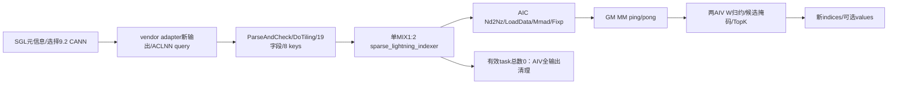
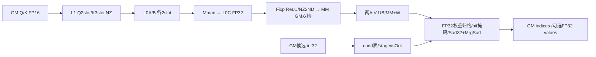
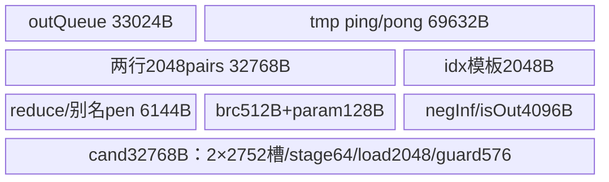
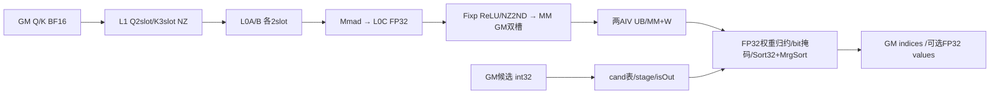
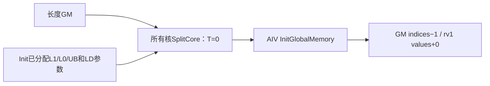

# SparseLightningIndexer A3 ACLNN 算子知识

## 算子速览

| 项目 | 内容 |
|---|---|
| 实际入口 | SGL `indexer.sparse_lightning_indexer` 的 auto / cann_ops_transformers_cann920 → `aclnnSparseLightningIndexerGetWorkspaceSize/aclnnSparseLightningIndexer` |
| 计算语义 | FP16/BF16 QK 点积升 FP32、ReLU、FP32 W 加权沿头求和，再在每行候选压缩块并集中选 TopK；不产生候选块 |
| 输入输出 | Q BSND/TND，K BSND/TND/PA_BBND，N2=1、D=128、G=1..64；候选 int32、C=64..2048 且 64 对齐；topk=1..2048；values 可空 |
| 执行类型 | 单 `sparse_lightning_indexer` MIX_CV，`KERNEL_TYPE_MIX_AIC_1_2`：AIC_CUBE Mmad/Fixp → GM 双缓冲 → 两 AIV_VECTOR 掩码/归并排序；无独立核心外部算子 |
| Kernel 路线 | R-001…008 两 dtype×四合法 layout 对；R-009 同 key 的零有效任务清理；候选表快路径、容量回退和 block-size 展开在每个主 Route 内显式覆盖 |
| 核心资源 | 每 AIC L1=327680B、L0A/B 各65536B、L0C=131072B；每 AIV 主 UB=181120B，Reset 后 LD UB=147456B；Host W=16MiB+(3MiB+2048)×AIC核数 |
| 来源闭包 | `source_closed`：固定 SGL dda6、ops-transformer e7da、SDK a63d 的绑定/Host/19字段/entry/全部可达 body/helper/build 已闭合；生成 ACLNN 和编译器/Runtime primitive 为明示边界 |
| 验证状态 | draft；同步 flag 默认值、PA 非连续地址、TND/PA 前缀表达式、资源与整数边界需保留；本次未编译、真机、数值或性能测试 |

## 接口与语义

### 计算语义

令压缩后 K 的 batch 内位置为 p，Q 每行 G 个头，D=128。普通有限值域的目标分数为
`score[b,i,p]=Σ_{h=0}^{G-1} W[b,i,h] * max(Σ_d Q[b,i,h,d]*K[b,p,0,d],0)`。
ReLU 由 Cube Fixp 的 `reluPre=1` 在 GM 提交前完成；先 Relu 再 W，相乘后没有再 Relu，也没有 softmax。Q/K 输入精度是 FP16/BF16，Mmad 累积和交接 FP32，W 全程 FP32；按外层头组16、组内二分归约顺序求和，不能替换成任意重排后声称逐位相同。

设 r=cmpRatio。有效原始 K 长度 O 来自压缩长度×r+余数，物理有效 K 长度 L=O/r（整数除法）。无因果 mask 时可达前缀 vl=L；mask3 时行 i 的 vl 为源码 int32 表达式 `(O-Qvalid+i+1)/r`，按 C++ 有符号整数除法向零截断、随后由 `cuRealAcSeq>0 && cuS2Len>0` 决定是否消费；不要把负数域未经限定地替换为数学 floor。只有 p<vl、p<L 且 floor(p/candidateBlockSize) 出现在该行候选集合时保留真实分数及原位置索引，其余变为 (-inf,-1)。排序流与2048槽初始 (-inf,-1) 累加器归并，再截前 topk，候选不足的 padding 为索引 -1、values +0；returnValue0 返回 FP32 [0] 空 Tensor。

负值/窗口外块号忽略、重复块号幂等，不把候选宽度 C 当有效候选数，不消费预留 candidateBlockLength。块号属于压缩后 batch 内相对位置域，不加 outputIdxOffset，source 与 consumer 必须同 r、块大小、同次 forward 和兼容 K。排序 primitive 对同分、NaN/±inf 的顺序不是本卡承诺；源码 int 位域无效化保留候选内任意 score 位型，但文档以 score>-inf 定义 nvalid 的公式不能直接作为 NaN/真实 -inf 情况的逐槽实现等价证明。

### 输入、输出与属性

| 参数 | shape/layout | dtype | 约束、默认值与语义 |
|---|---|---|---|
| q | BSND [B,Sq,G,128] 或 TND [Tq,G,128] | FP16/BF16 | 非空连续、G1..64；batch有效长度不超过相应物理域 |
| k | BSND [B,Sk,1,128]；TND [Tk,1,128]；PA_BBND [P,page,1,128] | 与q相同 | 非空；非PA连续；PA仅第0轴可非连续的公开合同与实际紧致取址差异见限制 |
| w | q.shape[:-1] | FP32 | 连续、同q.device；可正可负，不重做权重投影 |
| candidateBlockIndices | [B,Sq,1,C] 或 [Tq,1,C] | int32 | 同设备连续，C∈64..2048、C%64=0；候选集合输入 |
| cuSeqlensQ | [B+1] | int32 | TND必传前缀、首项0、末项Tq；BSND可选 [0,各batch有效长度…]，不是同一种差分方式 |
| cuSeqlensK | [B+1] | int32 | KTND必传累计前缀；KBSND拒绝；PA公开约定不传；TND/PA源码求值限制见后文 |
| sequsedK | [B] | int32 | PA必传；BSND可选；KTND实际 GetActualSeqLenKey 优先用 cuK 差分，不因另传 usedK 改优先级 |
| cmpResidualK | [B] | int32 | r!=1且mask3必传；其它组合 Host 要求空；内容 0≤residual<r 为调用方约束 |
| blockTable | [B,maxPages] | int32 | 仅PA必传，非PA拒绝；page∈16..1024、page%16=0；页号和物理存储容量由调用方保证 |
| sequsedQ/outputIdxOffset/metadata | 预留输入 | int32如有 | 本入口 arch22 Host 均拒绝非空指针；实际调用应为 None，metadata 不是“传入后忽略” |
| candidateBlockLength | None 或空 Tensor | int32 | 非空 numel 被拒；Kernel 不绑定/不读 |
| topk/maxSeqlenQ | 标量 | int64属性 | topk1..2048；maxSeqlenQ仅−1，后者不写入POD/Device |
| layoutQ/layoutK | 字符串 | — | 只允许 BSND/BSND、TND/TND、BSND/PA_BBND、TND/PA_BBND；非PA须同名配对 |
| maskMode/cmpRatio/returnValue | 标量 | int64属性 | mask0/3；r∈1,2,4,8,16,32,64,128；rv0/1 |
| candidateBlockSize | 标量 | int64属性 | s∈2,4,8,16,32,64，默认8；与上游source配置一致 |
| sparseIndicesOut | [B,Sq,1,topk] 或 [Tq,1,topk] | int32 | adapter新分配；有效 batch 相对位置，padding−1 |
| sparseValuesOut | 同indices或[0] | FP32 | rv1同shape，无效槽0；rv0空，不写GM；caller持有返回Tensor |

### 入口与版本

已全文读并复用[候选块/稀疏消费者API](../../../../apis/sgl_kernel_npu/sgl_lightning_indexer_v2_candidates.md)。该卡公开函数族与本卡共享合同，metadata 和 layout 的实现收口以本卡固定 e7da Host 为准。SGL selected CANN 入口注册 ARCH22、精确检查 detect_cann_version()==9.2.0，profile把 ops-transformer 固定到 e7da18105f08b06e01ef0fff78f439098d483746；该依赖 version.cmake 自述9.2.0。SDK固定 a63d5261c7c8077a0081e867f43a0e884fec066b，只用于同版本 primitive 源码解释，不保证部署中所有同名9.2二进制逐字相同。Common9.1不是本任务版本。

SGL文档CANN后端A3支持、950明确不支持；vendor公开ACLNN文档A2/A3支持、950不支持，OpDef仅910b/910_93，Host要求DAV2201。本卡冻结SGL A3入口，既不扩成A2目标，也不以独立torch_native的950支持替代CANN平台证据。未发现本入口更高公开后缀版本；`aclnnLightningIndexerV3` 是上游候选生产者，不是本算子改名或本卡核心节点。

## Host/Launcher 执行流程

### 参数校验与前处理

SGL先按 layout 检查 rank/dtype/D128/N2=1/G1..64/Wshape/同设备/连续、topk一般域，再由候选 validator 收紧 topk≤2048、C范围和块大小；可选索引/metadata只能int32同设备，但这只是 Python 元信息检查，不保证 vendor 接收。随后检查压缩因果必有余数、候选前导shape与连续。registry选auto/explicit CANN，精确9.2后缓存导入 bundled `sgl_ops_transformer.ops.sparse_lightning_indexer`；torch_native为独立显式后端，本卡不闭合它也不作为失败fallback。

profile staging复制所选Python、C++和common，重写Python包导入到SGL bundled命名空间，不把Torch op schema改成其它算法。vendor builder注册schema/Meta/PrivateUse1，`_sparse_li_check_args`后以builder.load返回模块调用C++。builder优先vendor include/lib、再CANN、再torch_npu，源fingerprint只覆盖.cpp不覆盖header；缓存命中不能替代固定源码/二进制一致性证明。arg_check仅按可解析pybind doc检查明显类型错误，无设备数学。缺包/导入/JIT错误上抛，本轮没有执行这些操作。

C++检查非空Q/K/候选、候选int32与C、s、topk、rv、预留length后，按query.options新建int32 indices与FP32 values。Host parser顺序为平台/指针→dtype→layout→optional→rank→N1/N2/G→batch/Sq/D/Sk→候选shape→其余shape/stride。metadata、sequsedQ、outputIdxOffset指针非空在Host失败；非PA异名layout失败。压缩余数、prefix/page-table shape/dtype和取值约束逐层存在差异；Host不读回设备内容来证明单调性、合法页号或足够storage。

OpDef q/w/多数optional AutoContiguous，K顶层 IgnoreContiguous、具体910b/910_93配置又K.AutoContiguous。生成bridge可能插普通布局复制，属于明确框架边界；本体无自有TransData或Torch数学fallback，不凭该声明臆造实际分配与修复路径。

### 参数、Workspace 与生命周期

`ACLNN_CMD` DecodeDevice取首Tensor设备、OptionalDeviceGuard、current NPU stream；解析精确两段符号，优先 ASCEND_CUSTOM_OPP_PATH/LD_LIBRARY_PATH custom库，后libopapi_transformer.so，再libopapi.so。ConvertType按sizes/strides/storage_offset/storage.data建立aclTensor，base rank3标NCL、rank4标NCHW；OpDef ND准入/普通复制由生成bridge处理。属性字符串为C++局部std::string的c_str，query调用期间有效；生成executor若保留参数所需副本由框架负责。

query返回W/executor，失败先ReleaseConvertTypes后抛错。W>0且W≤INT64_MAX才新分配byte workspace；这里workspace_tensor赋给外层变量，**没有recipes旧宏的内层同名遮蔽**。lambda捕获raw workspace_addr、W、stream、executor及converted descriptors，未捕获Tensor owner；cmd.Run前外层Tensor仍在作用域。RunOpApi/OpCommand排队及异步Device完成后的allocator/stream保活仍是框架边界，不把局部作用域证明扩大到GPU完成期。第二段后先释放描述符/可选huge mem再检查状态；caller输入及新输出需维持可用到流上完成。

Host Wlib=GetLibApiWorkSpaceSize；固定SDK DAV2201返回16MiB。Host再加每物理AIC (2MiB mm +1MiB LD结果 +2048B LD参数)。Device GetUserWorkspace在普通NPU路径取KFC系统base+RESERVED_WORKSPACE，SDK2201常量16MiB；这是已读到的两份同值来源，CPUdebug返回传入workspace而不跳过。真实query W可能含生成框架额外开销，不可只分配Device实际触达部分；下节逐 slice 比较保留非溢出域前提。

### 启动图与失败传播



| 节点/边 | 精确对象 | 参数/顺序 | 失败与owner |
|---|---|---|---|
| Host | SparseLightningIndexer→ACLNN_CMD两段 | 同current stream；query在run之前 | 参数/query错误阻断run，无数学降级 |
| Tiling | TilingForSparseLightningIndexer/DoTiling | SetBlockDim(CalcTschBlockDim(AIV,AIC,AIV))；ScheduleMode1；19字段 | GRAPH_FAILED由生成executor向上报告 |
| K1 | sparse_lightning_indexer(q,k,w,8optional,candidates,length,outpair,workspace,tiling) | MIX_AIC_1_2；同一个Kernel含AIC和AIV分支 | 未知/不匹配dtype不执行有效body；合法输入由Host穷尽8keys |
| C→V | 每AIC FP32 MM双缓冲 | Fixp后mode2 PIPE_FIX Set；AIV Wait再MTE2读 | same-kernel跨族GM边；实际flagId0，不能写成4 |
| V→C | MM槽复用 | AIV MTE2读完后mode2 PIPE_MTE2 Set；AIC Wait | 实际flagId0；每AIV先种2个token，退出AIC回收2个 |
| 收尾 | 主循环后 ProcessDecode | 所有已启动AIV（含无主计算任务者）Reset/InitLD、ICachePreLoad(2)、SyncAll()；AIC不执行此分支 | LD数学不可达，但资源重置/全局同步可达 |
| 输出/临时 | adapter持有新out；外层workspace Tensor | descriptors在第二段返回后释放；Device异步流生命周期由框架管理 | 未运行、无真机成功或失败结果 |

## Route 与参数设计

### 分核与资源计算

记C=AIC物理核数，V=AIV物理核数，N=Host blockDim，M=A16(4G)，A_k(x)=ceil(x/k)*k。SDK CalcTschNumBlocks：C/V为0或C>V时返回sliceNum；否则ρ=V/C，N=ceil(sliceNum/ρ)，ρ=2且N>C则返回0；本算子sliceNum=V。固定通常MIX1:2条件V=2C给N=C，但不把某机24/48注释当平台常量。原始 `get_block_idx()` 是成组block index，AscendC::GetBlockIdx在AIV为raw×get_subblockdim()+get_subblockid()，AIC为raw；MIX1:2时v=2a+sub，源码aiCoreIdx=v/2。GetBlockNum常规为get_block_num，superkernel宏分支为配置值。

每batch任务数=ceil(Qvalid/4)×[L>0]，N2恒1。Σ为T，SplitCore以T/N商余分配完整4行Query组，每任务遍历自身所有S2 tile，不做S2跨核分片；usedCoreNum变min(N,T)。这个除法在T=0前仍以原N为除数，故需N>0，Host未另外检验CalcTsch结果0。active核独占batch/query连续区间，前余数核多1任务；零长度BSND batch纳入清理覆盖。非active核ProcessMain早退，但仍参与后续Reset/SyncAll；T=0走R-009而不调用ProcessDecode。

tile S1=4、S2=512、D128；M=align16(4G)≤256。Cube每S2再切256列K-L1，L0取128×128×128；Q-L1仅该Query组的首个S2 tile搬入、跨S2复用。两AIV按当前有效行数分上ceil(n/2)/下floor(n/2)，每AIV最多2行；G沿16一组，mm stride=A32(actual S2列数) **是FP32元素数、不是32B对齐字节数**，因此128B粒度。所有公式要求Host uint32 shape/stride、Device uint32长度/int32行前缀/uint16 DMA长度转换和乘积未溢出/截断。

Host名义分配：
`W=16MiB + C*(512*512*4*2 + 2*8*2*8192*4 +2*8*16*8)=16MiB+C*(3145728+2048)`。
Device用户区划分：
`MM=[0,N*2*M*512*4)`；`LDres=[MMend,MMend+N*4*2*2*2048*4)`；
`LDparam=[LDresEnd,LDresEnd+N*4*2*16*8)`。
每核MM=4096M B，LDres=131072B/核，LDparam=1024B/核，总用户区=N*(4096M+132096)。G≤64且N=C时≤1180672C，Host名义上界3147776C更大；不要把保留LD结果全区误称为实际写满，只有参数初始化可达、LD结果/归并数学不执行。布局完全由Device M计算，不能按Host512去定位后两区。

### Route 选择

| 顺序 | Route | Key/模板 | 精确选择条件与优先级 | 不适用去向 |
|---:|---|---|---|---|
| 1 | R-001 FP16 BSND/BSND | GET_TPL(1,1,3,0,0,0,0) | A3/9.2，QK=FP16、N2=1/D128/G1..64，layout=BSND/BSND、PAGE=0，全部Host合同通过且T>0 | dtype/layout不同选对应行；Host拒绝无合法key；T0到R-009 |
| 2 | R-002 FP16 TND/TND | GET_TPL(1,1,3,0,1,1,0) | A3/9.2，QK=FP16、N2=1/D128/G1..64，layout=TND/TND、PAGE=0，全部Host合同通过且T>0 | dtype/layout不同选对应行；Host拒绝无合法key；T0到R-009 |
| 3 | R-003 FP16 BSND/PA_BBND | GET_TPL(1,1,3,1,0,2,0) | A3/9.2，QK=FP16、N2=1/D128/G1..64，layout=BSND/PA_BBND、PAGE=1，全部Host合同通过且T>0 | dtype/layout不同选对应行；Host拒绝无合法key；T0到R-009 |
| 4 | R-004 FP16 TND/PA_BBND | GET_TPL(1,1,3,1,1,2,0) | A3/9.2，QK=FP16、N2=1/D128/G1..64，layout=TND/PA_BBND、PAGE=1，全部Host合同通过且T>0 | dtype/layout不同选对应行；Host拒绝无合法key；T0到R-009 |
| 5 | R-005 BF16 BSND/BSND | GET_TPL(27,27,3,0,0,0,0) | A3/9.2，QK=BF16、N2=1/D128/G1..64，layout=BSND/BSND、PAGE=0，全部Host合同通过且T>0 | dtype/layout不同选对应行；Host拒绝无合法key；T0到R-009 |
| 6 | R-006 BF16 TND/TND | GET_TPL(27,27,3,0,1,1,0) | A3/9.2，QK=BF16、N2=1/D128/G1..64，layout=TND/TND、PAGE=0，全部Host合同通过且T>0 | dtype/layout不同选对应行；Host拒绝无合法key；T0到R-009 |
| 7 | R-007 BF16 BSND/PA_BBND | GET_TPL(27,27,3,1,0,2,0) | A3/9.2，QK=BF16、N2=1/D128/G1..64，layout=BSND/PA_BBND、PAGE=1，全部Host合同通过且T>0 | dtype/layout不同选对应行；Host拒绝无合法key；T0到R-009 |
| 8 | R-008 BF16 TND/PA_BBND | GET_TPL(27,27,3,1,1,2,0) | A3/9.2，QK=BF16、N2=1/D128/G1..64，layout=TND/PA_BBND、PAGE=1，全部Host合同通过且T>0 | dtype/layout不同选对应行；Host拒绝无合法key；T0到R-009 |
| 9 | R-009 零有效任务 | R-001…008任一key，T=0 | q/k物理非空但所有batch Qvalid=0或L=0，N>0 | T>0回本key主Route；不是q/k空tensor准入 |

```text
SGL selected CANN9.2/A3 → dtype/shape/候选检查 → vendor Host
  reject metadata/sequsedQ/outputOffset非None、非PA Q/K异名、其它非法合同
  QK FP16 → dtype tuple (1,1,3,...,0)
  QK BF16 → dtype tuple (27,27,3,...,0)
  layout=BSND/BSND → PAGE0/QL0/KL0
  layout=TND/TND → PAGE0/QL1/KL1
  layout=BSND/PA → PAGE1/QL0/KL2
  layout=TND/PA → PAGE1/QL1/KL2
  entry::Init → SplitCore::T
    T0 → ProcessInvalid（R-009）
    T>0 → 主MIX（各8实例）；inactive核跳主循环但不跳ProcessDecode收尾
      每候选行：blkCnt=ceil(L/512)*(512/s)
        默认SLI_CAND_MASK_LEGACY=0 且blkCnt≤2752 → 每行建表
          s8 → int Adds到固定stage/Brcb8repeat
          s16/32/64 → scalar stage/V_S/S_V/Brcb8repeat
          s2/4 → scalar展开/V_S/S_V
        其余 → LegacyTile：行首load+int→FP32 cast，逐tile标量匹配
      SortAllVecCopy512 → MergeSortVecCopy2048 → 行末Extract/CopyOut
  noS2Split=true → isLD=false、needCopyWsGm分支不执行；InitLDBuffers/SyncAll仍执行
```

### 模板/实现执行矩阵

| Route | key/selector | dtype/shape/platform 完整命中条件 | 执行族与 kernel 节点 | 实际模板/body | 内存与同步特征 | tail/fallback |
|---|---|---|---|---|---|---|
| R-001 | (1,1,3,0,0,0,0) | FP16、BSND/BSND；共同A3合同、T>0、s2..64、rv0/1、mask0/3 | 单MIX1:2：AIC Mmad→Fixp→GM→2AIV | SparseLightningIndexerKernel<SparseLIType<half,half,int32_t,float,uint32_t,false,SLI_LAYOUT::BSND,SLI_LAYOUT::BSND,true>>；Cube/Vector services | L1 320KiB、L0A/B64KiB各、L0C128KiB、UB181120B；flag0双向GM环 | M/S2/头组/tok尾；候选表快/慢三展开；rv1额外值提交；无over2K/LD数学 |
| R-002 | (1,1,3,0,1,1,0) | FP16、TND/TND；共同A3合同、T>0、s2..64、rv0/1、mask0/3 | 单MIX1:2：AIC Mmad→Fixp→GM→2AIV | SparseLightningIndexerKernel<SparseLIType<half,half,int32_t,float,uint32_t,false,SLI_LAYOUT::TND,SLI_LAYOUT::TND,true>>；Cube/Vector services | L1 320KiB、L0A/B64KiB各、L0C128KiB、UB181120B；flag0双向GM环 | M/S2/头组/tok尾；候选表快/慢三展开；rv1额外值提交；无over2K/LD数学 |
| R-003 | (1,1,3,1,0,2,0) | FP16、BSND/PA_BBND；共同A3合同、T>0、s2..64、rv0/1、mask0/3 | 单MIX1:2：AIC Mmad→Fixp→GM→2AIV | SparseLightningIndexerKernel<SparseLIType<half,half,int32_t,float,uint32_t,true,SLI_LAYOUT::BSND,SLI_LAYOUT::PA_BBND,true>>；Cube/Vector services | L1 320KiB、L0A/B64KiB各、L0C128KiB、UB181120B；flag0双向GM环 | M/S2/头组/tok尾；候选表快/慢三展开；rv1额外值提交；无over2K/LD数学 |
| R-004 | (1,1,3,1,1,2,0) | FP16、TND/PA_BBND；共同A3合同、T>0、s2..64、rv0/1、mask0/3 | 单MIX1:2：AIC Mmad→Fixp→GM→2AIV | SparseLightningIndexerKernel<SparseLIType<half,half,int32_t,float,uint32_t,true,SLI_LAYOUT::TND,SLI_LAYOUT::PA_BBND,true>>；Cube/Vector services | L1 320KiB、L0A/B64KiB各、L0C128KiB、UB181120B；flag0双向GM环 | M/S2/头组/tok尾；候选表快/慢三展开；rv1额外值提交；无over2K/LD数学 |
| R-005 | (27,27,3,0,0,0,0) | BF16、BSND/BSND；共同A3合同、T>0、s2..64、rv0/1、mask0/3 | 单MIX1:2：AIC Mmad→Fixp→GM→2AIV | SparseLightningIndexerKernel<SparseLIType<bfloat16_t,bfloat16_t,int32_t,float,uint32_t,false,SLI_LAYOUT::BSND,SLI_LAYOUT::BSND,true>>；Cube/Vector services | L1 320KiB、L0A/B64KiB各、L0C128KiB、UB181120B；flag0双向GM环 | M/S2/头组/tok尾；候选表快/慢三展开；rv1额外值提交；无over2K/LD数学 |
| R-006 | (27,27,3,0,1,1,0) | BF16、TND/TND；共同A3合同、T>0、s2..64、rv0/1、mask0/3 | 单MIX1:2：AIC Mmad→Fixp→GM→2AIV | SparseLightningIndexerKernel<SparseLIType<bfloat16_t,bfloat16_t,int32_t,float,uint32_t,false,SLI_LAYOUT::TND,SLI_LAYOUT::TND,true>>；Cube/Vector services | L1 320KiB、L0A/B64KiB各、L0C128KiB、UB181120B；flag0双向GM环 | M/S2/头组/tok尾；候选表快/慢三展开；rv1额外值提交；无over2K/LD数学 |
| R-007 | (27,27,3,1,0,2,0) | BF16、BSND/PA_BBND；共同A3合同、T>0、s2..64、rv0/1、mask0/3 | 单MIX1:2：AIC Mmad→Fixp→GM→2AIV | SparseLightningIndexerKernel<SparseLIType<bfloat16_t,bfloat16_t,int32_t,float,uint32_t,true,SLI_LAYOUT::BSND,SLI_LAYOUT::PA_BBND,true>>；Cube/Vector services | L1 320KiB、L0A/B64KiB各、L0C128KiB、UB181120B；flag0双向GM环 | M/S2/头组/tok尾；候选表快/慢三展开；rv1额外值提交；无over2K/LD数学 |
| R-008 | (27,27,3,1,1,2,0) | BF16、TND/PA_BBND；共同A3合同、T>0、s2..64、rv0/1、mask0/3 | 单MIX1:2：AIC Mmad→Fixp→GM→2AIV | SparseLightningIndexerKernel<SparseLIType<bfloat16_t,bfloat16_t,int32_t,float,uint32_t,true,SLI_LAYOUT::TND,SLI_LAYOUT::PA_BBND,true>>；Cube/Vector services | L1 320KiB、L0A/B64KiB各、L0C128KiB、UB181120B；flag0双向GM环 | M/S2/头组/tok尾；候选表快/慢三展开；rv1额外值提交；无over2K/LD数学 |
| R-009 | 上述任一key，T0 | 物理非空、有效任务总数0、N>0 | 单MIX entry只执行AIV输出清理，AIC不Mmad | SparseLightningIndexerKernel::ProcessInvalid | Init仍分配主UB/L1/L0并初始化LDparam；GetBlockNum()*2分输出 | indices−1、rv1全0；不走ProcessDecode；无其它空输入fallback |

### 隐藏性能 Guard

| Guard | Host/Tiling 条件 | Device/资源原因 | 影响 Route | 不满足时去向 | 源码符号 |
|---|---|---|---|---|---|
| 平台 | SGLARCH22+9.2；HostDAV2201 | MIX1:2、c220指令、OpDef910b/910_93 | 全部 | registry/Host拒绝；无CANN950Route | _cann_impl/GetNpuInfo |
| G/D | SGL G1..64，HostD128/N2=1；HostGetGSize未重复G≤64硬拒 | M=A16(4G)≤256、固定L1/L0子块 | 全部 | SGL先拒；不能将裸ACLNN未充分guard当任意G复用 | validate_lightning_indexer_inputs/GetGSize/InitBuffers |
| layout/optional | 非PA同名；PA需要页表+usedK；TND相应cu | prefix取址与PA页遍历；None边界不同 | 全部 | HostGRAPH_FAILED；metadata非None失败 | GetQueryKeyAndOutLayout/GetAndCheckOptionalInput |
| topk/C/s | K≤2048、C64对齐且≤2048、s为2..64幂 | virTopK2048、load2048int32、512可被s整除 | 全部 | wrapper/Host拒绝；没有over2K fallback | _sparse_li_check_args/候选Host |
| 候选表容量 | blkCnt=ceil(L/512)*(512/s)≤2752且legacy宏0 | 每AIV两行各2752槽，stage/load互不重叠 | R-001…008 | LegacyTile逐tile扫描，语义/FP32块号精度需另限 | BuildCandidateMask |
| s展开 | s8 / s>8 / s<8 | 固定stage规避动态行分区Brcb源；S/V所有者转换 | R-001…008 | 各自分支，无NDDMA/SIMT替代 | ExpandCandMaskToPosition |
| 实际核数 | Host查C,V非零；SDKCalcTsch可返回0但本Host未再拒 | SplitCore先以N做除法；MIX idx与N/used不同 | 全部 | 没有明确资源fallback；需N>0及配置契约 | DoTiling/SplitCore |
| 分层容量 | 未查询比较UB/L1/L0需求 | UB181120B；L1 327680B；L0A/B65536B、L0C131072B | 全部 | 固定实现无缩tile路线；SDKdebug检查≠Hostcapacityguard | InitBuffers/TPipe::InitBuffer |
| PA stride | Host允许0轴非紧致并保存keyStride0 | PA body用blockId*page*128，不读该字段；需紧致GM或生成bridge实际重排 | PA Routes | 不自行修复/不假定已发生重排；保留draft | CheckKeyContiguous/GenerateInfo/KeyNd2NzForPA |
| TND/PA prefix | Q=TND且b>0，cuK可None | CalcRunInfo按Qlayout求Kprefix，PA之后不用该值 | TND/PA Routes | 仅记录源表达式对未绑定GlobalTensor的潜在求值；编译死值消除/实际执行未测 | CalcRunInfo/InitActualSeqLen |
| 整数及数据值 | Host metadata-only，不读回prefix/pageIDs；部分shape窄化u32 | 页号、长度、stride、MMextent、候选blockID和int32位运算 | 全部 | caller保证；未知值不等同合法/空；无溢出安全回退 | ParseAndCheck/GlobalTensor/BuildCandidateMaskLegacyTile |

### POD/ABI

`SparseLITilingData` 宏字段19个，16×u32+3×i64，名义字段负载88B。Host生成类、SaveToBuffer协议、Device生成结构的真实sizeof/alignof/offsetof依赖版本一致的注册/编译生成桥，固定三仓未展开这些宏到实际字节offset；不把88B当已测类sizeof，也不凭C++常规对齐猜96B。以下顺序是源码声明序，不是手工ABI偏移。ConstInfo/RunInfo/SplitCoreInfo是Device局部控制结构，不通过Host ABI传输。

| 结构 | 字段 | 类型/位宽 | ABI 布局 | 单位 | Host/launcher producer | Device consumer | 边界 |
|---|---|---|---|---|---|---|---|
| SparseLITilingData | bSize | uint32/32 | 声明序0；真实offset生成边界 | batch | GetBatchSize：q.B或cuQ.numel−1 | InitTilingData.batchSize/GetTotalBaseBlockNum | B≥1；cu内容不由shape校验保证 |
| SparseLITilingData | n2Size | uint32/32 | 声明序1；真实offset生成边界 | 头 | 声明存在、DoTiling未set | Device不读，kHeadNum恒1 | inactive；不能依赖序列化默认值 |
| SparseLITilingData | gSize | uint32/32 | 声明序2；真实offset生成边界 | Query头/Key头 | GetGSize=n1/n2 | qHeadNum/gSize、mBase=4G、分组16 | SGL1..64；Host未重复上界 |
| SparseLITilingData | s1Size | uint32/32 | 声明序3；真实offset生成边界 | Query token | GetS1Size：BSND.Sq或TND.Tq | qSeqSize、缺cu默认长度、输出clear | TND值是总T，不是每batch长度 |
| SparseLITilingData | s2Size | uint32/32 | 声明序4；真实offset生成边界 | K token上界 | 非PA Sk/Tk；PA maxPages*page | kSeqSize与缺length默认值 | 有效长度另从cu/used；乘积转换需可表达 |
| SparseLITilingData | topk | uint32/32 | 声明序5；真实offset生成边界 | 输出槽/行 | 属性topk，1..2048 | sparseCount、virTopK恒2048、CopyOut | 实际topk不改变全2048归并 |
| SparseLITilingData | maxSeqlenQ | uint32/32 | 声明序6；真实offset生成边界 | token | 属性仅−1，但DoTiling未set该字段 | Device不读 | inactive；不要把−1解释为u32实际成员值 |
| SparseLITilingData | usedCoreNum | uint32/32 | 声明序7；真实offset生成边界 | 成组block | CalcTschBlockDim(V,C,V) | Init后SplitCore改本地min(N,T) | 初始N必须>0；非物理AIV数 |
| SparseLITilingData | blockSize | uint32/32 | 声明序8；真实offset生成边界 | page token | PA K.dim1；非PA默认0 | kCacheBlockSize，PA分段边界 | 与candidateBlockSize完全不同 |
| SparseLITilingData | maxBlockNumPerBatch | uint32/32 | 声明序9；真实offset生成边界 | 页表列 | PA blockTable.dim1；非PA0 | 页表索引batch stride | 非PA不消费 |
| SparseLITilingData | maskMode | uint32/32 | 声明序10；真实offset生成边界 | 枚举 | 属性0/3 | attenMaskFlag=(mask==3) | 非bitmap；不传外部mask矩阵 |
| SparseLITilingData | preTokens | int64/64 | 声明序11；真实offset生成边界 | token | SparseLITilingInfo默认INT64_MAX | 复制constInfo但活跃算法未消费 | inactive；不是另一个滑窗Route |
| SparseLITilingData | nextTokens | int64/64 | 声明序12；真实offset生成边界 | token | SparseLITilingInfo默认INT64_MAX | 复制constInfo但活跃算法未消费 | inactive |
| SparseLITilingData | cmpRatio | int64/64 | 声明序13；真实offset生成边界 | 压缩倍率 | 属性r1..128幂 | GetActualSeqLenKey、mask整除 | Device多处窄化uint32/int32；当前r范围可表达 |
| SparseLITilingData | batchSupperFlag | uint32/32 | 声明序14；真实offset生成边界 | flag | GenerateInfo默认0→DoTiling | Device未读 | inactive，不凭名称发明superbatch |
| SparseLITilingData | keyStride0 | uint32/32 | 声明序15；真实offset生成边界 | K元素 | GetRequiredInputStrides首元素或0 | 本体未拷贝/PA取址未用 | 非紧致PA合同缺少已证consumer |
| SparseLITilingData | returnValue | uint32/32 | 声明序16；真实offset生成边界 | flag | 属性0/1 | 可选values GM绑定、mask、CopyOut/clear | rv0 values空且无GM写 |
| SparseLITilingData | candidateTopkBlocks | uint32/32 | 声明序17；真实offset生成边界 | 候选槽/行 | 候选shape末维C | GM行stride、load/Cast/扫描 | 64..2048、64对齐；非有效候选数 |
| SparseLITilingData | candidateBlockSize | uint32/32 | 声明序18；真实offset生成边界 | 压缩K token/块 | 属性s或默认8 | blkCnt、table展开、tile窗口 | 2..64幂；source-consumer必须一致 |

### Route 源码闭包

| Route | Key/selector | Host/Tiling producer | POD/参数 | Kernel entry/router | Kernel body/直接依赖 | 构建接线 |
|---|---|---|---|---|---|---|
| R-001 | (1,1,3,0,0,0,0) | sparse_lightning_indexer_tiling.cpp::ParseAndCheck/DoTiling | SparseLITilingData19字段；M4G/S2=512 | op_kernel/sparse_lightning_indexer.cpp→SparseLIType<half,half,int32_t,float,uint32_t,false,SLI_LAYOUT::BSND,SLI_LAYOUT::BSND,true> | kernel_arch22::Init/SplitCore/ProcessMain/ProcessDecode；service_cube/vector；vector.h已读实际helper | op_host/CMakeLists.txt→add_modules_sources；OpDef910_93/arch22；entry模板SEL |
| R-002 | (1,1,3,0,1,1,0) | sparse_lightning_indexer_tiling.cpp::ParseAndCheck/DoTiling | SparseLITilingData19字段；M4G/S2=512 | op_kernel/sparse_lightning_indexer.cpp→SparseLIType<half,half,int32_t,float,uint32_t,false,SLI_LAYOUT::TND,SLI_LAYOUT::TND,true> | kernel_arch22::Init/SplitCore/ProcessMain/ProcessDecode；service_cube/vector；vector.h已读实际helper | op_host/CMakeLists.txt→add_modules_sources；OpDef910_93/arch22；entry模板SEL |
| R-003 | (1,1,3,1,0,2,0) | sparse_lightning_indexer_tiling.cpp::ParseAndCheck/DoTiling | SparseLITilingData19字段；M4G/S2=512 | op_kernel/sparse_lightning_indexer.cpp→SparseLIType<half,half,int32_t,float,uint32_t,true,SLI_LAYOUT::BSND,SLI_LAYOUT::PA_BBND,true> | kernel_arch22::Init/SplitCore/ProcessMain/ProcessDecode；service_cube/vector；vector.h已读实际helper | op_host/CMakeLists.txt→add_modules_sources；OpDef910_93/arch22；entry模板SEL |
| R-004 | (1,1,3,1,1,2,0) | sparse_lightning_indexer_tiling.cpp::ParseAndCheck/DoTiling | SparseLITilingData19字段；M4G/S2=512 | op_kernel/sparse_lightning_indexer.cpp→SparseLIType<half,half,int32_t,float,uint32_t,true,SLI_LAYOUT::TND,SLI_LAYOUT::PA_BBND,true> | kernel_arch22::Init/SplitCore/ProcessMain/ProcessDecode；service_cube/vector；vector.h已读实际helper | op_host/CMakeLists.txt→add_modules_sources；OpDef910_93/arch22；entry模板SEL |
| R-005 | (27,27,3,0,0,0,0) | sparse_lightning_indexer_tiling.cpp::ParseAndCheck/DoTiling | SparseLITilingData19字段；M4G/S2=512 | op_kernel/sparse_lightning_indexer.cpp→SparseLIType<bfloat16_t,bfloat16_t,int32_t,float,uint32_t,false,SLI_LAYOUT::BSND,SLI_LAYOUT::BSND,true> | kernel_arch22::Init/SplitCore/ProcessMain/ProcessDecode；service_cube/vector；vector.h已读实际helper | op_host/CMakeLists.txt→add_modules_sources；OpDef910_93/arch22；entry模板SEL |
| R-006 | (27,27,3,0,1,1,0) | sparse_lightning_indexer_tiling.cpp::ParseAndCheck/DoTiling | SparseLITilingData19字段；M4G/S2=512 | op_kernel/sparse_lightning_indexer.cpp→SparseLIType<bfloat16_t,bfloat16_t,int32_t,float,uint32_t,false,SLI_LAYOUT::TND,SLI_LAYOUT::TND,true> | kernel_arch22::Init/SplitCore/ProcessMain/ProcessDecode；service_cube/vector；vector.h已读实际helper | op_host/CMakeLists.txt→add_modules_sources；OpDef910_93/arch22；entry模板SEL |
| R-007 | (27,27,3,1,0,2,0) | sparse_lightning_indexer_tiling.cpp::ParseAndCheck/DoTiling | SparseLITilingData19字段；M4G/S2=512 | op_kernel/sparse_lightning_indexer.cpp→SparseLIType<bfloat16_t,bfloat16_t,int32_t,float,uint32_t,true,SLI_LAYOUT::BSND,SLI_LAYOUT::PA_BBND,true> | kernel_arch22::Init/SplitCore/ProcessMain/ProcessDecode；service_cube/vector；vector.h已读实际helper | op_host/CMakeLists.txt→add_modules_sources；OpDef910_93/arch22；entry模板SEL |
| R-008 | (27,27,3,1,1,2,0) | sparse_lightning_indexer_tiling.cpp::ParseAndCheck/DoTiling | SparseLITilingData19字段；M4G/S2=512 | op_kernel/sparse_lightning_indexer.cpp→SparseLIType<bfloat16_t,bfloat16_t,int32_t,float,uint32_t,true,SLI_LAYOUT::TND,SLI_LAYOUT::PA_BBND,true> | kernel_arch22::Init/SplitCore/ProcessMain/ProcessDecode；service_cube/vector；vector.h已读实际helper | op_host/CMakeLists.txt→add_modules_sources；OpDef910_93/arch22；entry模板SEL |
| R-009 | 所有8keys，T0 | 相同Host，设备length内容导出T0 | 同19字段/输入GMprefix | entry相同Init→ProcessInvalid | InitBuffers/vec1Param初始化→全域indices/values清理；ProcessDecode不执行 | 同一MIX binary，无单独clear kernel |

## Kernel 实现

### 公共执行流程

入口声明MIX1:2后取user workspace、解码POD。InitTilingData固定D128/N2=1/s1Base4/s2Base512；InitActualSeqLen只对非空cu/used绑定GlobalTensor，cmpResidualK可选绑定。SplitCore在所有核读取长度GM并计算自己的区间；随后划分MM/LDres/LDparam、AIV绑定weights/candidates/out，AIC绑定Q/K/页表，分别InitBuffers。候选length/metadata/sequsedQ/outputOffset不进入实际Device读取。先Init再Process，因此zero-task仍有buffer分配和LDparam写入。

同一active AIC与两AIV处理相同query组、每个S2 tile循环：AIC等待GM槽可复用token→Nd2Nz/LoadData/Mmad/Fixp；AIV等待结果token→MTE2分16头搬MM和W→DoScale+DoReduce→候选无效化→Sort32/MrgSort→与已有2048槽归并→末tile输出。MM双缓冲按runInfo.loop%2选槽；loop是每核tile循环计数，不是batch号。AIV发V→C token在MTE2 pipe上保护MM读取完成；输出排序和GM提交仍在各AIV本地流水中。

两方向ConstInfo.syncC1V1/syncV1C1默认均0，Init不赋值，Vector.InitParams仅复制const引用；class常量4/5未用。SDK CrossCoreSetFlag(mode2,PIPE_FIX/PIPE_MTE2)编码(1+((2&3)<<4)+((0&15)<<8))并调用ffts_cross_core_sync，Wait转wait_flag_dev(0)。本文据实际0记录协议，既不擅改成4/5，也不无硬件计数/通路契约证据断言相同ID必然死锁。

全图只有一个Kernel，无跨Kernel数值中间边。主路线的ProcessMain返回后，AIV `pipe->Reset()` 回收已有free事件、重置pool，重建147456B LD缓冲；随后所有已启动AIV（含无主计算任务的AIV）执行ICachePreLoad(2)/SyncAll<true>()；整段由ASCEND_IS_AIV保护，AIC不参与。noS2Split令isLD恒false，故无ProcessLD归并数学、无LDres结果搬入搬出；这不等于这段Reset/InitLD/全局同步不可达。另R-009从ProcessInvalid后直接return，无该收尾。

### Route R-001：FP16 BSND/BSND

#### 适用条件

##### 选择证据

| 层级 | 文件 | 符号 | 源码谓词/参数 | 结果/下一跳 |
|---|---|---|---|---|
| SGL/API | operators/indexer/sparse_lightning_indexer.py | sparse_lightning_indexer/_cann_impl | selected CANN、A3、exact9.2；QK FP16、G1..64/D128；共同合同 | vendor SparseLightningIndexer |
| Host | op_host/sparse_lightning_indexer_tiling.cpp | ParseAndCheck/DoTiling | Q=BSND、K=BSND、PAGE=0、N2=1；T由Device有效长度导出 | key tuple (1,1,3,0,0,0,0) |
| router | op_kernel/sparse_lightning_indexer_template_tiling_key.h / sparse_lightning_indexer.cpp | ASCENDC_TPL_SEL/INVOKE_SLI_OP_IMPL | DTQ/K=1、DTOUT3、QL0/KL0、W_FLAG0；entry根据ORIG_DTYPE_Q | SparseLIType<half,half,int32_t,float,uint32_t,false,SLI_LAYOUT::BSND,SLI_LAYOUT::BSND,true> |
| Device | kernel_arch22.h | SplitCore/Process | T>0；当前aiCoreIdx<min(N,T)时主循环 | active MIX；闲核仅收尾；T0到R-009 |

本Route非PA Q/K同名布局，所有K stride由Host要求紧致；不能以G=1将它泛化为PA或跨layout。
Q BSND以shape Sq或cuQ[b+1]直接长度定位，若传cuQ，不能误用累计差分。


#### Device 数据流

##### 函数级调用链

```text
sparse_lightning_indexer<(1,1,3,0,0,0,0)>
 → SparseLightningIndexerKernel<SparseLIType<half,half,int32_t,float,uint32_t,false,SLI_LAYOUT::BSND,SLI_LAYOUT::BSND,true>>::Init
   → InitTilingData → InitActualSeqLen → SplitCore → InitBuffers
 → Process → ProcessMain → CalcGS1LoopParams/CalcS2LoopParams/CalcRunInfo
   AIC: CrossCoreWait(0) → ComputeMm1 → KeyNd2Nz/QueryNd2Nz
        → LoadQueryToL0a/LoadKeyToL0b → ComputeL0c(Mmad) → Fixp(ReLU/NZ→ND/GM) → Set(0)
   AIV: CrossCoreWait(0) → ProcessVec → CopyIn → DoScale/DoReduce
        → BuildCandidateMask → 表快路径三展开或LegacyTile
        → int bits无效化 → SortAllVecCopy → MergeSortVecCopy
        → Extract/CopyOut indices / [rv1 values mask+CopyOut] → Set(0)
 → FreeEventID → 所有已启动AIV（含idle）Reset/InitLDBuffers→ICachePreLoad/SyncAll<true>；AIC无此收尾
```

##### 源码等价伪码

```text
# 伪码；保留源地址单位为元素，乘dtype字节数后才是byte
qBase=b*Sq; qGM=(qBase+4*qGroup)*G*128
非PA BSND：kGM=b*Sk*128+(tile512+chunk256+fract128)*128
for each owned batch/query-group:
  qRows=min(4,Qvalid-4*qGroup); Mvalid=qRows*G
  for each visited S2 tile (512,因果上界按4行组计算):
    AIC waits reusable MM token; choose slot=loop%2
    for Kchunk≤256:
      load K via 连续batch/packed前缀 Nd2Nz
      if first S2 && Kchunk0: load Q to ping/pong L1
      for M128,N128: LoadData → Mmad(m=A16(Msub),n=Nsub,k128,init=true)
                       → Fixp FP32/ReLU to MM[slot,Mrow,A32(tileN)]
    AIV waits result; own ceil/floor half qRows
    for each own row:
      for Ggroup≤16: CopyIn MM Ggroup×A32(tileN) and W Ggroup
                     → broadcast8/Mul → grouped accumulation
      DoReduce → score[512]=-inf padded + exact valid score[cuS2Len]
      idx valid=p, padded=-1
      build candidate isOut[512] (fast table or legacy scalar)
      score_bits += isOut*(0xFF800000-score_bits); idx -= isOut*(idx+1)
      Sort32 + 4-way merges(512 pairs)
      merge with global2048 pairs and retain first2048
      if final reachable tile: extract first topk idx; optional rv1 mask by idx then values
    AIV signals reusable MM token on PIPE_MTE2
  BSND invalid Q padding / zero-length rows → (-1,rv1:+0)
after all main work: drain manual local events and 2 crosscore tokens
AIV Reset+LD buffer init; all launched AIV (including idle AIV) SyncAll<true>(); AIC does not enter this tail; ProcessLD math not entered
```

#### 内存与数据搬运

##### 资源与搬运表

| 层级/缓冲区 | offset/地址公式 | extent/容量公式 | dtype/layout | producer | consumer | owner/lifetime | 对齐/复用 |
|---|---|---|---|---|---|---|---|
| GM Q | (b*Sq+4qg)*G*128 | 有效qRows*G*128*2B/组 | FP16ND | caller | QueryNd2Nz | caller存储跨stream完成 | 首S2搬入后该Q组复用 |
| GM K | (KbatchPrefix+p)*128 | 有效tileN*128*2B/组 | FP16 ND | caller | KeyNd2Nz | caller/布局bridge如有 | 连续rank3/4，stride已校验 |
| GM W/候选/out | W=(qBase+i)*G；candidate=(qBase+i)*C；out=(qBase+i)*topk | 4G /4C /4topk B/行，rv1再4topk | FP32/int32 | caller/adapter | AIV MTE2/scalar/MTE3 | 输入owner；新out归caller | C64对齐load；topk可非64整倍数 |
| workspace MM | user+a*4096M+slot*M*512*4 | 每AIC4096M B | FP32 ND，行stride A32(tileN) | AIC Fixp | 两AIV CopyIn | ACLNN workspace owner跨完成 | 双槽；A16(Mvalid)填充行、列padding不可当有效score |
| workspace LDres/param | MMend；再N*131072B | N*131072 / N*1024 B | FP32 pairs /int64参数 | param InitBuffers写−1 | LD数学不消费 | 同workspace | 预留不是实传输量；param所有硬件AIV初始化 |
| L1 Q/K | TPipe A1/B1同L1pool；Q[2,256,128]、K[3,256,128] | 131072+196608=327680B | FP16NZ | MTE2 Nd2Nz | MTE1 LoadData | 当前AIC TPipe | Q2slot/K3slot，局部event保护 |
| L0A/L0B/L0C | 各slot%2；128*128单slot | 65536/65536/131072B | FP16/FP16/FP32 | MTE1 / Mmad | Mmad / Fixp | 当前AIC TPipe | K128不做Ksplit；cmatrixInit=true |
| UB主阶段 | outQueue33024 +tmp69632 +sort32768 +index2048 +reduce6144 +brc512 +param128 +cand32768 +const4096 | 181120B/AIV，逐项均32B整倍数 | FP32/int32视图 | TPipe | ProcessVec | 每AIV独立，最多两行累加器 | pen别名reduce第3段；非额外分配 |
| UB LD收尾 | pipe.Reset后65536+65536+8192+8192 | 147456B/AIV，替换主阶段非相加 | FP32/int32 | TPipe.InitLDBuffers | ProcessLD不入，仅分配 | 同pipe重置后 | 主阶段指针之后不再消费 |
| 寄存器 | 标量shape/prefix/pageID/loop/events | 固定源码未给编译后字节数 | scalar | Device控制流 | 相应API | 局部 | 不虚构编译寄存器分配 |

##### 分层内存布局





##### 字节账、交接边与复用顺序

```text
WHost=16MiB+C*3147776B （SDK与Host计算均在未溢出域）
WUser=N*(4096*A16(4G)+131072+1024)B
L1=327680B; L0A=L0B=65536B; L0C=131072B
UB_main=181120B; UB_afterReset=147456B; peak=max=181120B
必要容量：UB_available>=181120B；L1/L0各不小于上述值，Host没有比较guard
每有效S2 tile：GM K有效读2*128*tileN B，Q仅Query组首tile读2*128*G*qRows B
MM写4*A16(Mvalid)*tileN B；AIV读4*Mvalid*A32(tileN)B含不消费的列pad
W读每行4G B/该tile，candidate首tile每行4C B，out写每行4topk*(1+rv) B
候选掩码在Cube之后，不能宣称跳过非候选K的GEMM/DMA
```

| 边/复用子区 | producer | offset/extent | dtype/layout | consumer | ordering/sync | owner/lifetime | 安全条件 |
|---|---|---|---|---|---|---|---|
| MM GM slot | Fixp | a*4096M+slot*M*512*4；按Mrow×A32(tileN) | FP32ND | CopyIn | C→V Set(0,PIPE_FIX)/Wait(0)；V→C Set(0,PIPE_MTE2)/Wait(0) | workspace跨K1完成 | 两AIV读完才可覆盖，实际flag均0保留 |
| Q/K/L0 ring | Nd2Nz/LoadData/Mmad | Q2、K3、L0各2固定slot | NZ/FP32 | MTE1/M/FIX | MTE1_MTE2 Q5/6、K2/3/4；M_MTE1 3/4；转换event2 | TPipe当前阶段 | 类型/方向区分event同数值，不能只按数字合并 |
| tmp/outQueue | MTE2 CopyIn/V归约/V排序 | tmp两34816B；outQueue33024B一次只alloc一个张量 | FP32 | DoScale/DoReduce/Sort/Extract | 手工V_MTE2 0/1/2、MTE2_V0/1；TQue+PIPE_V | AIV UB | 排序时Gloop已结束；rv1mask用独立tmp区不改在飞idx |
| candidate | GM DataCopyPad→S置表→V展开 | 两表[0,5504)f32；stage[5504,5568)；load[5568,7616)；guard[7616,8192) | int32视图 | bit无效化 | S_MTE2/MTE2_S、V_S/S_V；legacy手工V_MTE2 id3 | 同candBuf | blkCnt≤2752或完整legacy；s8intAdds防float1位型flush |
| reduce/pen | DoReduce与候选mask | reduceOut[0,1024)f32；pen[1024,1536)int32 | alias不同区 | 六步bit算术 | 每步PIPE_V | 同6144B分配 | sort score/idx只占前两段，pen不得移回其区 |
| 输出 | Extract、rv1validmask | value[0,2048)、idx[2048,4096)各4B | pair分离 | MTE3 CopyOut | TQue、rv1 V_MTE3；索引在飞时只改value/tmp | outQueue/新GMout | topk尾64chunk留在各容量内，提交只topk |
| 阶段重置 | FreeEventID/TPipe.Reset | 主181120B→LD147456B | pool重用 | 收尾SyncAll | Reset回收free事件+InitSocState/ResetPool；SyncAll PIPE_ALL | 无主阶段后续使用 | 不把两阶段加总，不把Reset当无条件证明其它未受管事件正确 |

#### 同步、精度与尾块

##### 同步与数值边界表

| 阶段 | primitive/机制 | producer | consumer/等待点 | 保护对象 | 精度/尾块 |
|---|---|---|---|---|---|
| Cube搬入/计算 | Nd2Nz→MTE2_MTE1、LoadData→MTE1_M、M_MTE1 ring | GM FP16/L1 | LoadData/Mmad | L1/L0 slot | M按16对齐、N128子块可尾、D128；Q仅有效行搬入 |
| Cube提交 | FP32 Mmad + DataCopyCO12DstParams.reluPre1、NoQuant、NZ2ND | L0C | GM/AIV | MM FP32 slab | inittrue每独立tile，不累加旧L0；小m*n块条件PIPE_M |
| AIC/AIV | mode2实际flag0，预种2/退出收2 | C PIPE_FIX / V PIPE_MTE2 | 对端Wait0 | MM双槽 | 不把注释常量4/5当实际值，不声称真机已证明无冲突 |
| AIV scale/reduce | W FP32+Brcb、Mul、分16头累加后二分Add | CopyIn | DoScale/DoReduce | reduceCache+256B bank偏移 | 固定组序；G尾按procGnum，padding列后续mask不输出 |
| 候选快/慢 | table/isOut S↔V fences | S置表/Vstage | bit掩码 | 两行表/共享stage | s2/4标量、s8intAdds、s16/32/64预展开；legacy把int32候选Cast FP32，超2^24整数精确性有限 |
| 排序/回拷 | Sort32/MrgSort/VecCopyI32BitExact | score/idx | global2048pairs/Extract | UB sort累加器 | scorepad−inf/idx−1；int Adds+0保留0xFFFFFFFF；同分/NaN排序依SDK |
| rv1输出 | idx+1/min1→value_bits*valid；独立tmp | Extract/索引MTE3在飞 | valuesMTE3 | 不覆写idx子区 | 64chunk尾超逻辑topk仍在2048容量内，仅topk元素提交；无效+0、有效NaN/inf按bits保留 |
| 清理/收尾 | CleanInvalidOutput、manual event drain、Reset、SyncAll | 所有已启动AIV（含无主任务AIV），AIC不参加ProcessDecode收尾 | out/后续阶段 | BSND无效Q/零length行、UBpool | indices−1/rv1零；TND按合法cu划分；isLD恒false |

#### 关键实现

##### 符号证据表

| 阶段 | 文件 | 符号/模板实例 | 实现事实 |
|---|---|---|---|
| Host/Tiling producer | sparse_lightning_indexer_tiling.cpp | ParseAndCheck/CheckKeyContiguous/GenerateInfo/DoTiling | (1,1,3,0,0,0,0)与19字段/Host上界；不核验GM值 |
| Kernel entry/router | sparse_lightning_indexer.cpp | INVOKE_SLI_OP_IMPL half/half,PAGE0,QL0/KL0,true | ORIG_DTYPE选择实际类型；W一直FP32 |
| Device body | sparse_lightning_indexer_kernel_arch22.h | SparseLIType<half,half,int32_t,float,uint32_t,false,SLI_LAYOUT::BSND,SLI_LAYOUT::BSND,true>::Init/ProcessMain/ProcessDecode | 完整Query组、S2全遍历、GM双槽与同Kernel收尾 |
| Cube helper | sparse_lightning_indexer_service_cube_arch22.h | KeyNd2Nz/ComputeL0c/Fixp | 连续前缀取址，D128 Mmad、FP32 ReLU交接 |
| Vector helper | sparse_lightning_indexer_service_vector_arch22.h | ProcessVec/BuildCandidateMask/ExpandCandMaskToPosition | C行输入、容量fallback、位域无效化、rv0/1 |
| 排序/归约 helper | sparse_lightning_indexer_vector.h | CopyIn/CopyOut/DoScale/DoReduce/SortAllVecCopy/MergeSortVecCopy | 16头分组、512排序/2048保留、V位精确回拷 |

### Route R-002：FP16 TND/TND

#### 适用条件

##### 选择证据

| 层级 | 文件 | 符号 | 源码谓词/参数 | 结果/下一跳 |
|---|---|---|---|---|
| SGL/API | operators/indexer/sparse_lightning_indexer.py | sparse_lightning_indexer/_cann_impl | selected CANN、A3、exact9.2；QK FP16、G1..64/D128；共同合同 | vendor SparseLightningIndexer |
| Host | op_host/sparse_lightning_indexer_tiling.cpp | ParseAndCheck/DoTiling | Q=TND、K=TND、PAGE=0、N2=1；T由Device有效长度导出 | key tuple (1,1,3,0,1,1,0) |
| router | op_kernel/sparse_lightning_indexer_template_tiling_key.h / sparse_lightning_indexer.cpp | ASCENDC_TPL_SEL/INVOKE_SLI_OP_IMPL | DTQ/K=1、DTOUT3、QL1/KL1、W_FLAG0；entry根据ORIG_DTYPE_Q | SparseLIType<half,half,int32_t,float,uint32_t,false,SLI_LAYOUT::TND,SLI_LAYOUT::TND,true> |
| Device | kernel_arch22.h | SplitCore/Process | T>0；当前aiCoreIdx<min(N,T)时主循环 | active MIX；闲核仅收尾；T0到R-009 |

本Route非PA Q/K同名布局，所有K stride由Host要求紧致；不能以G=1将它泛化为PA或跨layout。
Q TND以cuQ差分求每batch长度、以cuQ[b]定位；末项应等Tq。


#### Device 数据流

##### 函数级调用链

```text
sparse_lightning_indexer<(1,1,3,0,1,1,0)>
 → SparseLightningIndexerKernel<SparseLIType<half,half,int32_t,float,uint32_t,false,SLI_LAYOUT::TND,SLI_LAYOUT::TND,true>>::Init
   → InitTilingData → InitActualSeqLen → SplitCore → InitBuffers
 → Process → ProcessMain → CalcGS1LoopParams/CalcS2LoopParams/CalcRunInfo
   AIC: CrossCoreWait(0) → ComputeMm1 → KeyNd2Nz/QueryNd2Nz
        → LoadQueryToL0a/LoadKeyToL0b → ComputeL0c(Mmad) → Fixp(ReLU/NZ→ND/GM) → Set(0)
   AIV: CrossCoreWait(0) → ProcessVec → CopyIn → DoScale/DoReduce
        → BuildCandidateMask → 表快路径三展开或LegacyTile
        → int bits无效化 → SortAllVecCopy → MergeSortVecCopy
        → Extract/CopyOut indices / [rv1 values mask+CopyOut] → Set(0)
 → FreeEventID → 所有已启动AIV（含idle）Reset/InitLDBuffers→ICachePreLoad/SyncAll<true>；AIC无此收尾
```

##### 源码等价伪码

```text
# 伪码；保留源地址单位为元素，乘dtype字节数后才是byte
qBase=(b==0?0:cuQ[b]); qGM=(qBase+4*qGroup)*G*128
非PA TND：kGM=cuK[b]*128+(tile512+chunk256+fract128)*128
for each owned batch/query-group:
  qRows=min(4,Qvalid-4*qGroup); Mvalid=qRows*G
  for each visited S2 tile (512,因果上界按4行组计算):
    AIC waits reusable MM token; choose slot=loop%2
    for Kchunk≤256:
      load K via 连续batch/packed前缀 Nd2Nz
      if first S2 && Kchunk0: load Q to ping/pong L1
      for M128,N128: LoadData → Mmad(m=A16(Msub),n=Nsub,k128,init=true)
                       → Fixp FP32/ReLU to MM[slot,Mrow,A32(tileN)]
    AIV waits result; own ceil/floor half qRows
    for each own row:
      for Ggroup≤16: CopyIn MM Ggroup×A32(tileN) and W Ggroup
                     → broadcast8/Mul → grouped accumulation
      DoReduce → score[512]=-inf padded + exact valid score[cuS2Len]
      idx valid=p, padded=-1
      build candidate isOut[512] (fast table or legacy scalar)
      score_bits += isOut*(0xFF800000-score_bits); idx -= isOut*(idx+1)
      Sort32 + 4-way merges(512 pairs)
      merge with global2048 pairs and retain first2048
      if final reachable tile: extract first topk idx; optional rv1 mask by idx then values
    AIV signals reusable MM token on PIPE_MTE2
  BSND invalid Q padding / zero-length rows → (-1,rv1:+0)
after all main work: drain manual local events and 2 crosscore tokens
AIV Reset+LD buffer init; all launched AIV (including idle AIV) SyncAll<true>(); AIC does not enter this tail; ProcessLD math not entered
```

#### 内存与数据搬运

##### 资源与搬运表

| 层级/缓冲区 | offset/地址公式 | extent/容量公式 | dtype/layout | producer | consumer | owner/lifetime | 对齐/复用 |
|---|---|---|---|---|---|---|---|
| GM Q | (cuQ[b]+4qg)*G*128 | 有效qRows*G*128*2B/组 | FP16ND | caller | QueryNd2Nz | caller存储跨stream完成 | 首S2搬入后该Q组复用 |
| GM K | (KbatchPrefix+p)*128 | 有效tileN*128*2B/组 | FP16 ND | caller | KeyNd2Nz | caller/布局bridge如有 | 连续rank3/4，stride已校验 |
| GM W/候选/out | W=(qBase+i)*G；candidate=(qBase+i)*C；out=(qBase+i)*topk | 4G /4C /4topk B/行，rv1再4topk | FP32/int32 | caller/adapter | AIV MTE2/scalar/MTE3 | 输入owner；新out归caller | C64对齐load；topk可非64整倍数 |
| workspace MM | user+a*4096M+slot*M*512*4 | 每AIC4096M B | FP32 ND，行stride A32(tileN) | AIC Fixp | 两AIV CopyIn | ACLNN workspace owner跨完成 | 双槽；A16(Mvalid)填充行、列padding不可当有效score |
| workspace LDres/param | MMend；再N*131072B | N*131072 / N*1024 B | FP32 pairs /int64参数 | param InitBuffers写−1 | LD数学不消费 | 同workspace | 预留不是实传输量；param所有硬件AIV初始化 |
| L1 Q/K | TPipe A1/B1同L1pool；Q[2,256,128]、K[3,256,128] | 131072+196608=327680B | FP16NZ | MTE2 Nd2Nz | MTE1 LoadData | 当前AIC TPipe | Q2slot/K3slot，局部event保护 |
| L0A/L0B/L0C | 各slot%2；128*128单slot | 65536/65536/131072B | FP16/FP16/FP32 | MTE1 / Mmad | Mmad / Fixp | 当前AIC TPipe | K128不做Ksplit；cmatrixInit=true |
| UB主阶段 | outQueue33024 +tmp69632 +sort32768 +index2048 +reduce6144 +brc512 +param128 +cand32768 +const4096 | 181120B/AIV，逐项均32B整倍数 | FP32/int32视图 | TPipe | ProcessVec | 每AIV独立，最多两行累加器 | pen别名reduce第3段；非额外分配 |
| UB LD收尾 | pipe.Reset后65536+65536+8192+8192 | 147456B/AIV，替换主阶段非相加 | FP32/int32 | TPipe.InitLDBuffers | ProcessLD不入，仅分配 | 同pipe重置后 | 主阶段指针之后不再消费 |
| 寄存器 | 标量shape/prefix/pageID/loop/events | 固定源码未给编译后字节数 | scalar | Device控制流 | 相应API | 局部 | 不虚构编译寄存器分配 |

##### 分层内存布局


##### 字节账、交接边与复用顺序

```text
WHost=16MiB+C*3147776B （SDK与Host计算均在未溢出域）
WUser=N*(4096*A16(4G)+131072+1024)B
L1=327680B; L0A=L0B=65536B; L0C=131072B
UB_main=181120B; UB_afterReset=147456B; peak=max=181120B
必要容量：UB_available>=181120B；L1/L0各不小于上述值，Host没有比较guard
每有效S2 tile：GM K有效读2*128*tileN B，Q仅Query组首tile读2*128*G*qRows B
MM写4*A16(Mvalid)*tileN B；AIV读4*Mvalid*A32(tileN)B含不消费的列pad
W读每行4G B/该tile，candidate首tile每行4C B，out写每行4topk*(1+rv) B
候选掩码在Cube之后，不能宣称跳过非候选K的GEMM/DMA
```

| 边/复用子区 | producer | offset/extent | dtype/layout | consumer | ordering/sync | owner/lifetime | 安全条件 |
|---|---|---|---|---|---|---|---|
| MM GM slot | Fixp | a*4096M+slot*M*512*4；按Mrow×A32(tileN) | FP32ND | CopyIn | C→V Set(0,PIPE_FIX)/Wait(0)；V→C Set(0,PIPE_MTE2)/Wait(0) | workspace跨K1完成 | 两AIV读完才可覆盖，实际flag均0保留 |
| Q/K/L0 ring | Nd2Nz/LoadData/Mmad | Q2、K3、L0各2固定slot | NZ/FP32 | MTE1/M/FIX | MTE1_MTE2 Q5/6、K2/3/4；M_MTE1 3/4；转换event2 | TPipe当前阶段 | 类型/方向区分event同数值，不能只按数字合并 |
| tmp/outQueue | MTE2 CopyIn/V归约/V排序 | tmp两34816B；outQueue33024B一次只alloc一个张量 | FP32 | DoScale/DoReduce/Sort/Extract | 手工V_MTE2 0/1/2、MTE2_V0/1；TQue+PIPE_V | AIV UB | 排序时Gloop已结束；rv1mask用独立tmp区不改在飞idx |
| candidate | GM DataCopyPad→S置表→V展开 | 两表[0,5504)f32；stage[5504,5568)；load[5568,7616)；guard[7616,8192) | int32视图 | bit无效化 | S_MTE2/MTE2_S、V_S/S_V；legacy手工V_MTE2 id3 | 同candBuf | blkCnt≤2752或完整legacy；s8intAdds防float1位型flush |
| reduce/pen | DoReduce与候选mask | reduceOut[0,1024)f32；pen[1024,1536)int32 | alias不同区 | 六步bit算术 | 每步PIPE_V | 同6144B分配 | sort score/idx只占前两段，pen不得移回其区 |
| 输出 | Extract、rv1validmask | value[0,2048)、idx[2048,4096)各4B | pair分离 | MTE3 CopyOut | TQue、rv1 V_MTE3；索引在飞时只改value/tmp | outQueue/新GMout | topk尾64chunk留在各容量内，提交只topk |
| 阶段重置 | FreeEventID/TPipe.Reset | 主181120B→LD147456B | pool重用 | 收尾SyncAll | Reset回收free事件+InitSocState/ResetPool；SyncAll PIPE_ALL | 无主阶段后续使用 | 不把两阶段加总，不把Reset当无条件证明其它未受管事件正确 |

#### 同步、精度与尾块

##### 同步与数值边界表

| 阶段 | primitive/机制 | producer | consumer/等待点 | 保护对象 | 精度/尾块 |
|---|---|---|---|---|---|
| Cube搬入/计算 | Nd2Nz→MTE2_MTE1、LoadData→MTE1_M、M_MTE1 ring | GM FP16/L1 | LoadData/Mmad | L1/L0 slot | M按16对齐、N128子块可尾、D128；Q仅有效行搬入 |
| Cube提交 | FP32 Mmad + DataCopyCO12DstParams.reluPre1、NoQuant、NZ2ND | L0C | GM/AIV | MM FP32 slab | inittrue每独立tile，不累加旧L0；小m*n块条件PIPE_M |
| AIC/AIV | mode2实际flag0，预种2/退出收2 | C PIPE_FIX / V PIPE_MTE2 | 对端Wait0 | MM双槽 | 不把注释常量4/5当实际值，不声称真机已证明无冲突 |
| AIV scale/reduce | W FP32+Brcb、Mul、分16头累加后二分Add | CopyIn | DoScale/DoReduce | reduceCache+256B bank偏移 | 固定组序；G尾按procGnum，padding列后续mask不输出 |
| 候选快/慢 | table/isOut S↔V fences | S置表/Vstage | bit掩码 | 两行表/共享stage | s2/4标量、s8intAdds、s16/32/64预展开；legacy把int32候选Cast FP32，超2^24整数精确性有限 |
| 排序/回拷 | Sort32/MrgSort/VecCopyI32BitExact | score/idx | global2048pairs/Extract | UB sort累加器 | scorepad−inf/idx−1；int Adds+0保留0xFFFFFFFF；同分/NaN排序依SDK |
| rv1输出 | idx+1/min1→value_bits*valid；独立tmp | Extract/索引MTE3在飞 | valuesMTE3 | 不覆写idx子区 | 64chunk尾超逻辑topk仍在2048容量内，仅topk元素提交；无效+0、有效NaN/inf按bits保留 |
| 清理/收尾 | CleanInvalidOutput、manual event drain、Reset、SyncAll | 所有已启动AIV（含无主任务AIV），AIC不参加ProcessDecode收尾 | out/后续阶段 | BSND无效Q/零length行、UBpool | indices−1/rv1零；TND按合法cu划分；isLD恒false |

#### 关键实现

##### 符号证据表

| 阶段 | 文件 | 符号/模板实例 | 实现事实 |
|---|---|---|---|
| Host/Tiling producer | sparse_lightning_indexer_tiling.cpp | ParseAndCheck/CheckKeyContiguous/GenerateInfo/DoTiling | (1,1,3,0,1,1,0)与19字段/Host上界；不核验GM值 |
| Kernel entry/router | sparse_lightning_indexer.cpp | INVOKE_SLI_OP_IMPL half/half,PAGE0,QL1/KL1,true | ORIG_DTYPE选择实际类型；W一直FP32 |
| Device body | sparse_lightning_indexer_kernel_arch22.h | SparseLIType<half,half,int32_t,float,uint32_t,false,SLI_LAYOUT::TND,SLI_LAYOUT::TND,true>::Init/ProcessMain/ProcessDecode | 完整Query组、S2全遍历、GM双槽与同Kernel收尾 |
| Cube helper | sparse_lightning_indexer_service_cube_arch22.h | KeyNd2Nz/ComputeL0c/Fixp | 连续前缀取址，D128 Mmad、FP32 ReLU交接 |
| Vector helper | sparse_lightning_indexer_service_vector_arch22.h | ProcessVec/BuildCandidateMask/ExpandCandMaskToPosition | C行输入、容量fallback、位域无效化、rv0/1 |
| 排序/归约 helper | sparse_lightning_indexer_vector.h | CopyIn/CopyOut/DoScale/DoReduce/SortAllVecCopy/MergeSortVecCopy | 16头分组、512排序/2048保留、V位精确回拷 |

### Route R-003：FP16 BSND/PA_BBND

#### 适用条件

##### 选择证据

| 层级 | 文件 | 符号 | 源码谓词/参数 | 结果/下一跳 |
|---|---|---|---|---|
| SGL/API | operators/indexer/sparse_lightning_indexer.py | sparse_lightning_indexer/_cann_impl | selected CANN、A3、exact9.2；QK FP16、G1..64/D128；共同合同 | vendor SparseLightningIndexer |
| Host | op_host/sparse_lightning_indexer_tiling.cpp | ParseAndCheck/DoTiling | Q=BSND、K=PA_BBND、PAGE=1、N2=1；T由Device有效长度导出 | key tuple (1,1,3,1,0,2,0) |
| router | op_kernel/sparse_lightning_indexer_template_tiling_key.h / sparse_lightning_indexer.cpp | ASCENDC_TPL_SEL/INVOKE_SLI_OP_IMPL | DTQ/K=1、DTOUT3、QL0/KL2、W_FLAG0；entry根据ORIG_DTYPE_Q | SparseLIType<half,half,int32_t,float,uint32_t,true,SLI_LAYOUT::BSND,SLI_LAYOUT::PA_BBND,true> |
| Device | kernel_arch22.h | SplitCore/Process | T>0；当前aiCoreIdx<min(N,T)时主循环 | active MIX；闲核仅收尾；T0到R-009 |

本Route PA页表按batch取相对page，按页界和128列NZ子片切K搬运；page stride0在本体未消费，必须保留生成bridge/实际紧致地址条件。
Q BSND以shape Sq或cuQ[b+1]直接长度定位，若传cuQ，不能误用累计差分。


#### Device 数据流

##### 函数级调用链

```text
sparse_lightning_indexer<(1,1,3,1,0,2,0)>
 → SparseLightningIndexerKernel<SparseLIType<half,half,int32_t,float,uint32_t,true,SLI_LAYOUT::BSND,SLI_LAYOUT::PA_BBND,true>>::Init
   → InitTilingData → InitActualSeqLen → SplitCore → InitBuffers
 → Process → ProcessMain → CalcGS1LoopParams/CalcS2LoopParams/CalcRunInfo
   AIC: CrossCoreWait(0) → ComputeMm1 → KeyNd2NzForPA/QueryNd2Nz
        → LoadQueryToL0a/LoadKeyToL0b → ComputeL0c(Mmad) → Fixp(ReLU/NZ→ND/GM) → Set(0)
   AIV: CrossCoreWait(0) → ProcessVec → CopyIn → DoScale/DoReduce
        → BuildCandidateMask → 表快路径三展开或LegacyTile
        → int bits无效化 → SortAllVecCopy → MergeSortVecCopy
        → Extract/CopyOut indices / [rv1 values mask+CopyOut] → Set(0)
 → FreeEventID → 所有已启动AIV（含idle）Reset/InitLDBuffers→ICachePreLoad/SyncAll<true>；AIC无此收尾
```

##### 源码等价伪码

```text
# 伪码；保留源地址单位为元素，乘dtype字节数后才是byte
qBase=b*Sq; qGM=(qBase+4*qGroup)*G*128
PA：logical=(tile512+chunk256+fract128); blockId=blockTable[b*maxPages+logical/page]; kGM=blockId*page*128+(logical%page)*128
for each owned batch/query-group:
  qRows=min(4,Qvalid-4*qGroup); Mvalid=qRows*G
  for each visited S2 tile (512,因果上界按4行组计算):
    AIC waits reusable MM token; choose slot=loop%2
    for Kchunk≤256:
      load K via 页表+页界拆分 Nd2Nz
      if first S2 && Kchunk0: load Q to ping/pong L1
      for M128,N128: LoadData → Mmad(m=A16(Msub),n=Nsub,k128,init=true)
                       → Fixp FP32/ReLU to MM[slot,Mrow,A32(tileN)]
    AIV waits result; own ceil/floor half qRows
    for each own row:
      for Ggroup≤16: CopyIn MM Ggroup×A32(tileN) and W Ggroup
                     → broadcast8/Mul → grouped accumulation
      DoReduce → score[512]=-inf padded + exact valid score[cuS2Len]
      idx valid=p, padded=-1
      build candidate isOut[512] (fast table or legacy scalar)
      score_bits += isOut*(0xFF800000-score_bits); idx -= isOut*(idx+1)
      Sort32 + 4-way merges(512 pairs)
      merge with global2048 pairs and retain first2048
      if final reachable tile: extract first topk idx; optional rv1 mask by idx then values
    AIV signals reusable MM token on PIPE_MTE2
  BSND invalid Q padding / zero-length rows → (-1,rv1:+0)
after all main work: drain manual local events and 2 crosscore tokens
AIV Reset+LD buffer init; all launched AIV (including idle AIV) SyncAll<true>(); AIC does not enter this tail; ProcessLD math not entered
```

#### 内存与数据搬运

##### 资源与搬运表

| 层级/缓冲区 | offset/地址公式 | extent/容量公式 | dtype/layout | producer | consumer | owner/lifetime | 对齐/复用 |
|---|---|---|---|---|---|---|---|
| GM Q | (b*Sq+4qg)*G*128 | 有效qRows*G*128*2B/组 | FP16ND | caller | QueryNd2Nz | caller存储跨stream完成 | 首S2搬入后该Q组复用 |
| GM K | (pageID*page+pageOffset)*128 | 有效tileN*128*2B/组 | FP16 PA | caller | KeyNd2NzForPA | caller/布局bridge如有 | page和128子片分段；非紧致0轴限制 |
| GM W/候选/out | W=(qBase+i)*G；candidate=(qBase+i)*C；out=(qBase+i)*topk | 4G /4C /4topk B/行，rv1再4topk | FP32/int32 | caller/adapter | AIV MTE2/scalar/MTE3 | 输入owner；新out归caller | C64对齐load；topk可非64整倍数 |
| workspace MM | user+a*4096M+slot*M*512*4 | 每AIC4096M B | FP32 ND，行stride A32(tileN) | AIC Fixp | 两AIV CopyIn | ACLNN workspace owner跨完成 | 双槽；A16(Mvalid)填充行、列padding不可当有效score |
| workspace LDres/param | MMend；再N*131072B | N*131072 / N*1024 B | FP32 pairs /int64参数 | param InitBuffers写−1 | LD数学不消费 | 同workspace | 预留不是实传输量；param所有硬件AIV初始化 |
| L1 Q/K | TPipe A1/B1同L1pool；Q[2,256,128]、K[3,256,128] | 131072+196608=327680B | FP16NZ | MTE2 Nd2Nz | MTE1 LoadData | 当前AIC TPipe | Q2slot/K3slot，局部event保护 |
| L0A/L0B/L0C | 各slot%2；128*128单slot | 65536/65536/131072B | FP16/FP16/FP32 | MTE1 / Mmad | Mmad / Fixp | 当前AIC TPipe | K128不做Ksplit；cmatrixInit=true |
| UB主阶段 | outQueue33024 +tmp69632 +sort32768 +index2048 +reduce6144 +brc512 +param128 +cand32768 +const4096 | 181120B/AIV，逐项均32B整倍数 | FP32/int32视图 | TPipe | ProcessVec | 每AIV独立，最多两行累加器 | pen别名reduce第3段；非额外分配 |
| UB LD收尾 | pipe.Reset后65536+65536+8192+8192 | 147456B/AIV，替换主阶段非相加 | FP32/int32 | TPipe.InitLDBuffers | ProcessLD不入，仅分配 | 同pipe重置后 | 主阶段指针之后不再消费 |
| 寄存器 | 标量shape/prefix/pageID/loop/events | 固定源码未给编译后字节数 | scalar | Device控制流 | 相应API | 局部 | 不虚构编译寄存器分配 |

##### 分层内存布局


##### 字节账、交接边与复用顺序

```text
WHost=16MiB+C*3147776B （SDK与Host计算均在未溢出域）
WUser=N*(4096*A16(4G)+131072+1024)B
L1=327680B; L0A=L0B=65536B; L0C=131072B
UB_main=181120B; UB_afterReset=147456B; peak=max=181120B
必要容量：UB_available>=181120B；L1/L0各不小于上述值，Host没有比较guard
每有效S2 tile：GM K有效读2*128*tileN B，Q仅Query组首tile读2*128*G*qRows B
MM写4*A16(Mvalid)*tileN B；AIV读4*Mvalid*A32(tileN)B含不消费的列pad
W读每行4G B/该tile，candidate首tile每行4C B，out写每行4topk*(1+rv) B
候选掩码在Cube之后，不能宣称跳过非候选K的GEMM/DMA
```

| 边/复用子区 | producer | offset/extent | dtype/layout | consumer | ordering/sync | owner/lifetime | 安全条件 |
|---|---|---|---|---|---|---|---|
| MM GM slot | Fixp | a*4096M+slot*M*512*4；按Mrow×A32(tileN) | FP32ND | CopyIn | C→V Set(0,PIPE_FIX)/Wait(0)；V→C Set(0,PIPE_MTE2)/Wait(0) | workspace跨K1完成 | 两AIV读完才可覆盖，实际flag均0保留 |
| Q/K/L0 ring | Nd2Nz/LoadData/Mmad | Q2、K3、L0各2固定slot | NZ/FP32 | MTE1/M/FIX | MTE1_MTE2 Q5/6、K2/3/4；M_MTE1 3/4；转换event2 | TPipe当前阶段 | 类型/方向区分event同数值，不能只按数字合并 |
| tmp/outQueue | MTE2 CopyIn/V归约/V排序 | tmp两34816B；outQueue33024B一次只alloc一个张量 | FP32 | DoScale/DoReduce/Sort/Extract | 手工V_MTE2 0/1/2、MTE2_V0/1；TQue+PIPE_V | AIV UB | 排序时Gloop已结束；rv1mask用独立tmp区不改在飞idx |
| candidate | GM DataCopyPad→S置表→V展开 | 两表[0,5504)f32；stage[5504,5568)；load[5568,7616)；guard[7616,8192) | int32视图 | bit无效化 | S_MTE2/MTE2_S、V_S/S_V；legacy手工V_MTE2 id3 | 同candBuf | blkCnt≤2752或完整legacy；s8intAdds防float1位型flush |
| reduce/pen | DoReduce与候选mask | reduceOut[0,1024)f32；pen[1024,1536)int32 | alias不同区 | 六步bit算术 | 每步PIPE_V | 同6144B分配 | sort score/idx只占前两段，pen不得移回其区 |
| 输出 | Extract、rv1validmask | value[0,2048)、idx[2048,4096)各4B | pair分离 | MTE3 CopyOut | TQue、rv1 V_MTE3；索引在飞时只改value/tmp | outQueue/新GMout | topk尾64chunk留在各容量内，提交只topk |
| 阶段重置 | FreeEventID/TPipe.Reset | 主181120B→LD147456B | pool重用 | 收尾SyncAll | Reset回收free事件+InitSocState/ResetPool；SyncAll PIPE_ALL | 无主阶段后续使用 | 不把两阶段加总，不把Reset当无条件证明其它未受管事件正确 |

#### 同步、精度与尾块

##### 同步与数值边界表

| 阶段 | primitive/机制 | producer | consumer/等待点 | 保护对象 | 精度/尾块 |
|---|---|---|---|---|---|
| Cube搬入/计算 | Nd2Nz→MTE2_MTE1、LoadData→MTE1_M、M_MTE1 ring | GM FP16/L1 | LoadData/Mmad | L1/L0 slot | M按16对齐、N128子块可尾、D128；Q仅有效行搬入 |
| Cube提交 | FP32 Mmad + DataCopyCO12DstParams.reluPre1、NoQuant、NZ2ND | L0C | GM/AIV | MM FP32 slab | inittrue每独立tile，不累加旧L0；小m*n块条件PIPE_M |
| AIC/AIV | mode2实际flag0，预种2/退出收2 | C PIPE_FIX / V PIPE_MTE2 | 对端Wait0 | MM双槽 | 不把注释常量4/5当实际值，不声称真机已证明无冲突 |
| AIV scale/reduce | W FP32+Brcb、Mul、分16头累加后二分Add | CopyIn | DoScale/DoReduce | reduceCache+256B bank偏移 | 固定组序；G尾按procGnum，padding列后续mask不输出 |
| 候选快/慢 | table/isOut S↔V fences | S置表/Vstage | bit掩码 | 两行表/共享stage | s2/4标量、s8intAdds、s16/32/64预展开；legacy把int32候选Cast FP32，超2^24整数精确性有限 |
| 排序/回拷 | Sort32/MrgSort/VecCopyI32BitExact | score/idx | global2048pairs/Extract | UB sort累加器 | scorepad−inf/idx−1；int Adds+0保留0xFFFFFFFF；同分/NaN排序依SDK |
| rv1输出 | idx+1/min1→value_bits*valid；独立tmp | Extract/索引MTE3在飞 | valuesMTE3 | 不覆写idx子区 | 64chunk尾超逻辑topk仍在2048容量内，仅topk元素提交；无效+0、有效NaN/inf按bits保留 |
| 清理/收尾 | CleanInvalidOutput、manual event drain、Reset、SyncAll | 所有已启动AIV（含无主任务AIV），AIC不参加ProcessDecode收尾 | out/后续阶段 | BSND无效Q/零length行、UBpool | indices−1/rv1零；TND按合法cu划分；isLD恒false |

#### 关键实现

##### 符号证据表

| 阶段 | 文件 | 符号/模板实例 | 实现事实 |
|---|---|---|---|
| Host/Tiling producer | sparse_lightning_indexer_tiling.cpp | ParseAndCheck/CheckKeyContiguous/GenerateInfo/DoTiling | (1,1,3,1,0,2,0)与19字段/Host上界；不核验GM值 |
| Kernel entry/router | sparse_lightning_indexer.cpp | INVOKE_SLI_OP_IMPL half/half,PAGE1,QL0/KL2,true | ORIG_DTYPE选择实际类型；W一直FP32 |
| Device body | sparse_lightning_indexer_kernel_arch22.h | SparseLIType<half,half,int32_t,float,uint32_t,true,SLI_LAYOUT::BSND,SLI_LAYOUT::PA_BBND,true>::Init/ProcessMain/ProcessDecode | 完整Query组、S2全遍历、GM双槽与同Kernel收尾 |
| Cube helper | sparse_lightning_indexer_service_cube_arch22.h | KeyNd2NzForPA/ComputeL0c/Fixp | 页表取址、未用keyStride0，D128 Mmad、FP32 ReLU交接 |
| Vector helper | sparse_lightning_indexer_service_vector_arch22.h | ProcessVec/BuildCandidateMask/ExpandCandMaskToPosition | C行输入、容量fallback、位域无效化、rv0/1 |
| 排序/归约 helper | sparse_lightning_indexer_vector.h | CopyIn/CopyOut/DoScale/DoReduce/SortAllVecCopy/MergeSortVecCopy | 16头分组、512排序/2048保留、V位精确回拷 |

### Route R-004：FP16 TND/PA_BBND

#### 适用条件

##### 选择证据

| 层级 | 文件 | 符号 | 源码谓词/参数 | 结果/下一跳 |
|---|---|---|---|---|
| SGL/API | operators/indexer/sparse_lightning_indexer.py | sparse_lightning_indexer/_cann_impl | selected CANN、A3、exact9.2；QK FP16、G1..64/D128；共同合同 | vendor SparseLightningIndexer |
| Host | op_host/sparse_lightning_indexer_tiling.cpp | ParseAndCheck/DoTiling | Q=TND、K=PA_BBND、PAGE=1、N2=1；T由Device有效长度导出 | key tuple (1,1,3,1,1,2,0) |
| router | op_kernel/sparse_lightning_indexer_template_tiling_key.h / sparse_lightning_indexer.cpp | ASCENDC_TPL_SEL/INVOKE_SLI_OP_IMPL | DTQ/K=1、DTOUT3、QL1/KL2、W_FLAG0；entry根据ORIG_DTYPE_Q | SparseLIType<half,half,int32_t,float,uint32_t,true,SLI_LAYOUT::TND,SLI_LAYOUT::PA_BBND,true> |
| Device | kernel_arch22.h | SplitCore/Process | T>0；当前aiCoreIdx<min(N,T)时主循环 | active MIX；闲核仅收尾；T0到R-009 |

本Route PA页表按batch取相对page，按页界和128列NZ子片切K搬运；page stride0在本体未消费，必须保留生成bridge/实际紧致地址条件。
Q TND以cuQ差分求每batch长度、以cuQ[b]定位；末项应等Tq。
Q=TND的CalcRunInfo同时求cuK[b]的源表达式，而PA有效长度来自usedK；cuK公开可空。这个不必要的Kprefix在PA body不消费，但未绑定GlobalTensor求值/编译死值消除仍是静态边界，不能承诺该域运行正确。

#### Device 数据流

##### 函数级调用链

```text
sparse_lightning_indexer<(1,1,3,1,1,2,0)>
 → SparseLightningIndexerKernel<SparseLIType<half,half,int32_t,float,uint32_t,true,SLI_LAYOUT::TND,SLI_LAYOUT::PA_BBND,true>>::Init
   → InitTilingData → InitActualSeqLen → SplitCore → InitBuffers
 → Process → ProcessMain → CalcGS1LoopParams/CalcS2LoopParams/CalcRunInfo
   AIC: CrossCoreWait(0) → ComputeMm1 → KeyNd2NzForPA/QueryNd2Nz
        → LoadQueryToL0a/LoadKeyToL0b → ComputeL0c(Mmad) → Fixp(ReLU/NZ→ND/GM) → Set(0)
   AIV: CrossCoreWait(0) → ProcessVec → CopyIn → DoScale/DoReduce
        → BuildCandidateMask → 表快路径三展开或LegacyTile
        → int bits无效化 → SortAllVecCopy → MergeSortVecCopy
        → Extract/CopyOut indices / [rv1 values mask+CopyOut] → Set(0)
 → FreeEventID → 所有已启动AIV（含idle）Reset/InitLDBuffers→ICachePreLoad/SyncAll<true>；AIC无此收尾
```

##### 源码等价伪码

```text
# 伪码；保留源地址单位为元素，乘dtype字节数后才是byte
qBase=(b==0?0:cuQ[b]); qGM=(qBase+4*qGroup)*G*128
PA：logical=(tile512+chunk256+fract128); blockId=blockTable[b*maxPages+logical/page]; kGM=blockId*page*128+(logical%page)*128
for each owned batch/query-group:
  qRows=min(4,Qvalid-4*qGroup); Mvalid=qRows*G
  for each visited S2 tile (512,因果上界按4行组计算):
    AIC waits reusable MM token; choose slot=loop%2
    for Kchunk≤256:
      load K via 页表+页界拆分 Nd2Nz
      if first S2 && Kchunk0: load Q to ping/pong L1
      for M128,N128: LoadData → Mmad(m=A16(Msub),n=Nsub,k128,init=true)
                       → Fixp FP32/ReLU to MM[slot,Mrow,A32(tileN)]
    AIV waits result; own ceil/floor half qRows
    for each own row:
      for Ggroup≤16: CopyIn MM Ggroup×A32(tileN) and W Ggroup
                     → broadcast8/Mul → grouped accumulation
      DoReduce → score[512]=-inf padded + exact valid score[cuS2Len]
      idx valid=p, padded=-1
      build candidate isOut[512] (fast table or legacy scalar)
      score_bits += isOut*(0xFF800000-score_bits); idx -= isOut*(idx+1)
      Sort32 + 4-way merges(512 pairs)
      merge with global2048 pairs and retain first2048
      if final reachable tile: extract first topk idx; optional rv1 mask by idx then values
    AIV signals reusable MM token on PIPE_MTE2
  BSND invalid Q padding / zero-length rows → (-1,rv1:+0)
after all main work: drain manual local events and 2 crosscore tokens
AIV Reset+LD buffer init; all launched AIV (including idle AIV) SyncAll<true>(); AIC does not enter this tail; ProcessLD math not entered
```

#### 内存与数据搬运

##### 资源与搬运表

| 层级/缓冲区 | offset/地址公式 | extent/容量公式 | dtype/layout | producer | consumer | owner/lifetime | 对齐/复用 |
|---|---|---|---|---|---|---|---|
| GM Q | (cuQ[b]+4qg)*G*128 | 有效qRows*G*128*2B/组 | FP16ND | caller | QueryNd2Nz | caller存储跨stream完成 | 首S2搬入后该Q组复用 |
| GM K | (pageID*page+pageOffset)*128 | 有效tileN*128*2B/组 | FP16 PA | caller | KeyNd2NzForPA | caller/布局bridge如有 | page和128子片分段；非紧致0轴限制 |
| GM W/候选/out | W=(qBase+i)*G；candidate=(qBase+i)*C；out=(qBase+i)*topk | 4G /4C /4topk B/行，rv1再4topk | FP32/int32 | caller/adapter | AIV MTE2/scalar/MTE3 | 输入owner；新out归caller | C64对齐load；topk可非64整倍数 |
| workspace MM | user+a*4096M+slot*M*512*4 | 每AIC4096M B | FP32 ND，行stride A32(tileN) | AIC Fixp | 两AIV CopyIn | ACLNN workspace owner跨完成 | 双槽；A16(Mvalid)填充行、列padding不可当有效score |
| workspace LDres/param | MMend；再N*131072B | N*131072 / N*1024 B | FP32 pairs /int64参数 | param InitBuffers写−1 | LD数学不消费 | 同workspace | 预留不是实传输量；param所有硬件AIV初始化 |
| L1 Q/K | TPipe A1/B1同L1pool；Q[2,256,128]、K[3,256,128] | 131072+196608=327680B | FP16NZ | MTE2 Nd2Nz | MTE1 LoadData | 当前AIC TPipe | Q2slot/K3slot，局部event保护 |
| L0A/L0B/L0C | 各slot%2；128*128单slot | 65536/65536/131072B | FP16/FP16/FP32 | MTE1 / Mmad | Mmad / Fixp | 当前AIC TPipe | K128不做Ksplit；cmatrixInit=true |
| UB主阶段 | outQueue33024 +tmp69632 +sort32768 +index2048 +reduce6144 +brc512 +param128 +cand32768 +const4096 | 181120B/AIV，逐项均32B整倍数 | FP32/int32视图 | TPipe | ProcessVec | 每AIV独立，最多两行累加器 | pen别名reduce第3段；非额外分配 |
| UB LD收尾 | pipe.Reset后65536+65536+8192+8192 | 147456B/AIV，替换主阶段非相加 | FP32/int32 | TPipe.InitLDBuffers | ProcessLD不入，仅分配 | 同pipe重置后 | 主阶段指针之后不再消费 |
| 寄存器 | 标量shape/prefix/pageID/loop/events | 固定源码未给编译后字节数 | scalar | Device控制流 | 相应API | 局部 | 不虚构编译寄存器分配 |

##### 分层内存布局


##### 字节账、交接边与复用顺序

```text
WHost=16MiB+C*3147776B （SDK与Host计算均在未溢出域）
WUser=N*(4096*A16(4G)+131072+1024)B
L1=327680B; L0A=L0B=65536B; L0C=131072B
UB_main=181120B; UB_afterReset=147456B; peak=max=181120B
必要容量：UB_available>=181120B；L1/L0各不小于上述值，Host没有比较guard
每有效S2 tile：GM K有效读2*128*tileN B，Q仅Query组首tile读2*128*G*qRows B
MM写4*A16(Mvalid)*tileN B；AIV读4*Mvalid*A32(tileN)B含不消费的列pad
W读每行4G B/该tile，candidate首tile每行4C B，out写每行4topk*(1+rv) B
候选掩码在Cube之后，不能宣称跳过非候选K的GEMM/DMA
```

| 边/复用子区 | producer | offset/extent | dtype/layout | consumer | ordering/sync | owner/lifetime | 安全条件 |
|---|---|---|---|---|---|---|---|
| MM GM slot | Fixp | a*4096M+slot*M*512*4；按Mrow×A32(tileN) | FP32ND | CopyIn | C→V Set(0,PIPE_FIX)/Wait(0)；V→C Set(0,PIPE_MTE2)/Wait(0) | workspace跨K1完成 | 两AIV读完才可覆盖，实际flag均0保留 |
| Q/K/L0 ring | Nd2Nz/LoadData/Mmad | Q2、K3、L0各2固定slot | NZ/FP32 | MTE1/M/FIX | MTE1_MTE2 Q5/6、K2/3/4；M_MTE1 3/4；转换event2 | TPipe当前阶段 | 类型/方向区分event同数值，不能只按数字合并 |
| tmp/outQueue | MTE2 CopyIn/V归约/V排序 | tmp两34816B；outQueue33024B一次只alloc一个张量 | FP32 | DoScale/DoReduce/Sort/Extract | 手工V_MTE2 0/1/2、MTE2_V0/1；TQue+PIPE_V | AIV UB | 排序时Gloop已结束；rv1mask用独立tmp区不改在飞idx |
| candidate | GM DataCopyPad→S置表→V展开 | 两表[0,5504)f32；stage[5504,5568)；load[5568,7616)；guard[7616,8192) | int32视图 | bit无效化 | S_MTE2/MTE2_S、V_S/S_V；legacy手工V_MTE2 id3 | 同candBuf | blkCnt≤2752或完整legacy；s8intAdds防float1位型flush |
| reduce/pen | DoReduce与候选mask | reduceOut[0,1024)f32；pen[1024,1536)int32 | alias不同区 | 六步bit算术 | 每步PIPE_V | 同6144B分配 | sort score/idx只占前两段，pen不得移回其区 |
| 输出 | Extract、rv1validmask | value[0,2048)、idx[2048,4096)各4B | pair分离 | MTE3 CopyOut | TQue、rv1 V_MTE3；索引在飞时只改value/tmp | outQueue/新GMout | topk尾64chunk留在各容量内，提交只topk |
| 阶段重置 | FreeEventID/TPipe.Reset | 主181120B→LD147456B | pool重用 | 收尾SyncAll | Reset回收free事件+InitSocState/ResetPool；SyncAll PIPE_ALL | 无主阶段后续使用 | 不把两阶段加总，不把Reset当无条件证明其它未受管事件正确 |

#### 同步、精度与尾块

##### 同步与数值边界表

| 阶段 | primitive/机制 | producer | consumer/等待点 | 保护对象 | 精度/尾块 |
|---|---|---|---|---|---|
| Cube搬入/计算 | Nd2Nz→MTE2_MTE1、LoadData→MTE1_M、M_MTE1 ring | GM FP16/L1 | LoadData/Mmad | L1/L0 slot | M按16对齐、N128子块可尾、D128；Q仅有效行搬入 |
| Cube提交 | FP32 Mmad + DataCopyCO12DstParams.reluPre1、NoQuant、NZ2ND | L0C | GM/AIV | MM FP32 slab | inittrue每独立tile，不累加旧L0；小m*n块条件PIPE_M |
| AIC/AIV | mode2实际flag0，预种2/退出收2 | C PIPE_FIX / V PIPE_MTE2 | 对端Wait0 | MM双槽 | 不把注释常量4/5当实际值，不声称真机已证明无冲突 |
| AIV scale/reduce | W FP32+Brcb、Mul、分16头累加后二分Add | CopyIn | DoScale/DoReduce | reduceCache+256B bank偏移 | 固定组序；G尾按procGnum，padding列后续mask不输出 |
| 候选快/慢 | table/isOut S↔V fences | S置表/Vstage | bit掩码 | 两行表/共享stage | s2/4标量、s8intAdds、s16/32/64预展开；legacy把int32候选Cast FP32，超2^24整数精确性有限 |
| 排序/回拷 | Sort32/MrgSort/VecCopyI32BitExact | score/idx | global2048pairs/Extract | UB sort累加器 | scorepad−inf/idx−1；int Adds+0保留0xFFFFFFFF；同分/NaN排序依SDK |
| rv1输出 | idx+1/min1→value_bits*valid；独立tmp | Extract/索引MTE3在飞 | valuesMTE3 | 不覆写idx子区 | 64chunk尾超逻辑topk仍在2048容量内，仅topk元素提交；无效+0、有效NaN/inf按bits保留 |
| 清理/收尾 | CleanInvalidOutput、manual event drain、Reset、SyncAll | 所有已启动AIV（含无主任务AIV），AIC不参加ProcessDecode收尾 | out/后续阶段 | BSND无效Q/零length行、UBpool | indices−1/rv1零；TND按合法cu划分；isLD恒false |

#### 关键实现

##### 符号证据表

| 阶段 | 文件 | 符号/模板实例 | 实现事实 |
|---|---|---|---|
| Host/Tiling producer | sparse_lightning_indexer_tiling.cpp | ParseAndCheck/CheckKeyContiguous/GenerateInfo/DoTiling | (1,1,3,1,1,2,0)与19字段/Host上界；不核验GM值 |
| Kernel entry/router | sparse_lightning_indexer.cpp | INVOKE_SLI_OP_IMPL half/half,PAGE1,QL1/KL2,true | ORIG_DTYPE选择实际类型；W一直FP32 |
| Device body | sparse_lightning_indexer_kernel_arch22.h | SparseLIType<half,half,int32_t,float,uint32_t,true,SLI_LAYOUT::TND,SLI_LAYOUT::PA_BBND,true>::Init/ProcessMain/ProcessDecode | 完整Query组、S2全遍历、GM双槽与同Kernel收尾 |
| Cube helper | sparse_lightning_indexer_service_cube_arch22.h | KeyNd2NzForPA/ComputeL0c/Fixp | 页表取址、未用keyStride0，D128 Mmad、FP32 ReLU交接 |
| Vector helper | sparse_lightning_indexer_service_vector_arch22.h | ProcessVec/BuildCandidateMask/ExpandCandMaskToPosition | C行输入、容量fallback、位域无效化、rv0/1 |
| 排序/归约 helper | sparse_lightning_indexer_vector.h | CopyIn/CopyOut/DoScale/DoReduce/SortAllVecCopy/MergeSortVecCopy | 16头分组、512排序/2048保留、V位精确回拷 |

### Route R-005：BF16 BSND/BSND

#### 适用条件

##### 选择证据

| 层级 | 文件 | 符号 | 源码谓词/参数 | 结果/下一跳 |
|---|---|---|---|---|
| SGL/API | operators/indexer/sparse_lightning_indexer.py | sparse_lightning_indexer/_cann_impl | selected CANN、A3、exact9.2；QK BF16、G1..64/D128；共同合同 | vendor SparseLightningIndexer |
| Host | op_host/sparse_lightning_indexer_tiling.cpp | ParseAndCheck/DoTiling | Q=BSND、K=BSND、PAGE=0、N2=1；T由Device有效长度导出 | key tuple (27,27,3,0,0,0,0) |
| router | op_kernel/sparse_lightning_indexer_template_tiling_key.h / sparse_lightning_indexer.cpp | ASCENDC_TPL_SEL/INVOKE_SLI_OP_IMPL | DTQ/K=27、DTOUT3、QL0/KL0、W_FLAG0；entry根据ORIG_DTYPE_Q | SparseLIType<bfloat16_t,bfloat16_t,int32_t,float,uint32_t,false,SLI_LAYOUT::BSND,SLI_LAYOUT::BSND,true> |
| Device | kernel_arch22.h | SplitCore/Process | T>0；当前aiCoreIdx<min(N,T)时主循环 | active MIX；闲核仅收尾；T0到R-009 |

本Route非PA Q/K同名布局，所有K stride由Host要求紧致；不能以G=1将它泛化为PA或跨layout。
Q BSND以shape Sq或cuQ[b+1]直接长度定位，若传cuQ，不能误用累计差分。


#### Device 数据流

##### 函数级调用链

```text
sparse_lightning_indexer<(27,27,3,0,0,0,0)>
 → SparseLightningIndexerKernel<SparseLIType<bfloat16_t,bfloat16_t,int32_t,float,uint32_t,false,SLI_LAYOUT::BSND,SLI_LAYOUT::BSND,true>>::Init
   → InitTilingData → InitActualSeqLen → SplitCore → InitBuffers
 → Process → ProcessMain → CalcGS1LoopParams/CalcS2LoopParams/CalcRunInfo
   AIC: CrossCoreWait(0) → ComputeMm1 → KeyNd2Nz/QueryNd2Nz
        → LoadQueryToL0a/LoadKeyToL0b → ComputeL0c(Mmad) → Fixp(ReLU/NZ→ND/GM) → Set(0)
   AIV: CrossCoreWait(0) → ProcessVec → CopyIn → DoScale/DoReduce
        → BuildCandidateMask → 表快路径三展开或LegacyTile
        → int bits无效化 → SortAllVecCopy → MergeSortVecCopy
        → Extract/CopyOut indices / [rv1 values mask+CopyOut] → Set(0)
 → FreeEventID → 所有已启动AIV（含idle）Reset/InitLDBuffers→ICachePreLoad/SyncAll<true>；AIC无此收尾
```

##### 源码等价伪码

```text
# 伪码；保留源地址单位为元素，乘dtype字节数后才是byte
qBase=b*Sq; qGM=(qBase+4*qGroup)*G*128
非PA BSND：kGM=b*Sk*128+(tile512+chunk256+fract128)*128
for each owned batch/query-group:
  qRows=min(4,Qvalid-4*qGroup); Mvalid=qRows*G
  for each visited S2 tile (512,因果上界按4行组计算):
    AIC waits reusable MM token; choose slot=loop%2
    for Kchunk≤256:
      load K via 连续batch/packed前缀 Nd2Nz
      if first S2 && Kchunk0: load Q to ping/pong L1
      for M128,N128: LoadData → Mmad(m=A16(Msub),n=Nsub,k128,init=true)
                       → Fixp FP32/ReLU to MM[slot,Mrow,A32(tileN)]
    AIV waits result; own ceil/floor half qRows
    for each own row:
      for Ggroup≤16: CopyIn MM Ggroup×A32(tileN) and W Ggroup
                     → broadcast8/Mul → grouped accumulation
      DoReduce → score[512]=-inf padded + exact valid score[cuS2Len]
      idx valid=p, padded=-1
      build candidate isOut[512] (fast table or legacy scalar)
      score_bits += isOut*(0xFF800000-score_bits); idx -= isOut*(idx+1)
      Sort32 + 4-way merges(512 pairs)
      merge with global2048 pairs and retain first2048
      if final reachable tile: extract first topk idx; optional rv1 mask by idx then values
    AIV signals reusable MM token on PIPE_MTE2
  BSND invalid Q padding / zero-length rows → (-1,rv1:+0)
after all main work: drain manual local events and 2 crosscore tokens
AIV Reset+LD buffer init; all launched AIV (including idle AIV) SyncAll<true>(); AIC does not enter this tail; ProcessLD math not entered
```

#### 内存与数据搬运

##### 资源与搬运表

| 层级/缓冲区 | offset/地址公式 | extent/容量公式 | dtype/layout | producer | consumer | owner/lifetime | 对齐/复用 |
|---|---|---|---|---|---|---|---|
| GM Q | (b*Sq+4qg)*G*128 | 有效qRows*G*128*2B/组 | BF16ND | caller | QueryNd2Nz | caller存储跨stream完成 | 首S2搬入后该Q组复用 |
| GM K | (KbatchPrefix+p)*128 | 有效tileN*128*2B/组 | BF16 ND | caller | KeyNd2Nz | caller/布局bridge如有 | 连续rank3/4，stride已校验 |
| GM W/候选/out | W=(qBase+i)*G；candidate=(qBase+i)*C；out=(qBase+i)*topk | 4G /4C /4topk B/行，rv1再4topk | FP32/int32 | caller/adapter | AIV MTE2/scalar/MTE3 | 输入owner；新out归caller | C64对齐load；topk可非64整倍数 |
| workspace MM | user+a*4096M+slot*M*512*4 | 每AIC4096M B | FP32 ND，行stride A32(tileN) | AIC Fixp | 两AIV CopyIn | ACLNN workspace owner跨完成 | 双槽；A16(Mvalid)填充行、列padding不可当有效score |
| workspace LDres/param | MMend；再N*131072B | N*131072 / N*1024 B | FP32 pairs /int64参数 | param InitBuffers写−1 | LD数学不消费 | 同workspace | 预留不是实传输量；param所有硬件AIV初始化 |
| L1 Q/K | TPipe A1/B1同L1pool；Q[2,256,128]、K[3,256,128] | 131072+196608=327680B | BF16NZ | MTE2 Nd2Nz | MTE1 LoadData | 当前AIC TPipe | Q2slot/K3slot，局部event保护 |
| L0A/L0B/L0C | 各slot%2；128*128单slot | 65536/65536/131072B | BF16/BF16/FP32 | MTE1 / Mmad | Mmad / Fixp | 当前AIC TPipe | K128不做Ksplit；cmatrixInit=true |
| UB主阶段 | outQueue33024 +tmp69632 +sort32768 +index2048 +reduce6144 +brc512 +param128 +cand32768 +const4096 | 181120B/AIV，逐项均32B整倍数 | FP32/int32视图 | TPipe | ProcessVec | 每AIV独立，最多两行累加器 | pen别名reduce第3段；非额外分配 |
| UB LD收尾 | pipe.Reset后65536+65536+8192+8192 | 147456B/AIV，替换主阶段非相加 | FP32/int32 | TPipe.InitLDBuffers | ProcessLD不入，仅分配 | 同pipe重置后 | 主阶段指针之后不再消费 |
| 寄存器 | 标量shape/prefix/pageID/loop/events | 固定源码未给编译后字节数 | scalar | Device控制流 | 相应API | 局部 | 不虚构编译寄存器分配 |

##### 分层内存布局




##### 字节账、交接边与复用顺序

```text
WHost=16MiB+C*3147776B （SDK与Host计算均在未溢出域）
WUser=N*(4096*A16(4G)+131072+1024)B
L1=327680B; L0A=L0B=65536B; L0C=131072B
UB_main=181120B; UB_afterReset=147456B; peak=max=181120B
必要容量：UB_available>=181120B；L1/L0各不小于上述值，Host没有比较guard
每有效S2 tile：GM K有效读2*128*tileN B，Q仅Query组首tile读2*128*G*qRows B
MM写4*A16(Mvalid)*tileN B；AIV读4*Mvalid*A32(tileN)B含不消费的列pad
W读每行4G B/该tile，candidate首tile每行4C B，out写每行4topk*(1+rv) B
候选掩码在Cube之后，不能宣称跳过非候选K的GEMM/DMA
```

| 边/复用子区 | producer | offset/extent | dtype/layout | consumer | ordering/sync | owner/lifetime | 安全条件 |
|---|---|---|---|---|---|---|---|
| MM GM slot | Fixp | a*4096M+slot*M*512*4；按Mrow×A32(tileN) | FP32ND | CopyIn | C→V Set(0,PIPE_FIX)/Wait(0)；V→C Set(0,PIPE_MTE2)/Wait(0) | workspace跨K1完成 | 两AIV读完才可覆盖，实际flag均0保留 |
| Q/K/L0 ring | Nd2Nz/LoadData/Mmad | Q2、K3、L0各2固定slot | NZ/FP32 | MTE1/M/FIX | MTE1_MTE2 Q5/6、K2/3/4；M_MTE1 3/4；转换event2 | TPipe当前阶段 | 类型/方向区分event同数值，不能只按数字合并 |
| tmp/outQueue | MTE2 CopyIn/V归约/V排序 | tmp两34816B；outQueue33024B一次只alloc一个张量 | FP32 | DoScale/DoReduce/Sort/Extract | 手工V_MTE2 0/1/2、MTE2_V0/1；TQue+PIPE_V | AIV UB | 排序时Gloop已结束；rv1mask用独立tmp区不改在飞idx |
| candidate | GM DataCopyPad→S置表→V展开 | 两表[0,5504)f32；stage[5504,5568)；load[5568,7616)；guard[7616,8192) | int32视图 | bit无效化 | S_MTE2/MTE2_S、V_S/S_V；legacy手工V_MTE2 id3 | 同candBuf | blkCnt≤2752或完整legacy；s8intAdds防float1位型flush |
| reduce/pen | DoReduce与候选mask | reduceOut[0,1024)f32；pen[1024,1536)int32 | alias不同区 | 六步bit算术 | 每步PIPE_V | 同6144B分配 | sort score/idx只占前两段，pen不得移回其区 |
| 输出 | Extract、rv1validmask | value[0,2048)、idx[2048,4096)各4B | pair分离 | MTE3 CopyOut | TQue、rv1 V_MTE3；索引在飞时只改value/tmp | outQueue/新GMout | topk尾64chunk留在各容量内，提交只topk |
| 阶段重置 | FreeEventID/TPipe.Reset | 主181120B→LD147456B | pool重用 | 收尾SyncAll | Reset回收free事件+InitSocState/ResetPool；SyncAll PIPE_ALL | 无主阶段后续使用 | 不把两阶段加总，不把Reset当无条件证明其它未受管事件正确 |

#### 同步、精度与尾块

##### 同步与数值边界表

| 阶段 | primitive/机制 | producer | consumer/等待点 | 保护对象 | 精度/尾块 |
|---|---|---|---|---|---|
| Cube搬入/计算 | Nd2Nz→MTE2_MTE1、LoadData→MTE1_M、M_MTE1 ring | GM BF16/L1 | LoadData/Mmad | L1/L0 slot | M按16对齐、N128子块可尾、D128；Q仅有效行搬入 |
| Cube提交 | FP32 Mmad + DataCopyCO12DstParams.reluPre1、NoQuant、NZ2ND | L0C | GM/AIV | MM FP32 slab | inittrue每独立tile，不累加旧L0；小m*n块条件PIPE_M |
| AIC/AIV | mode2实际flag0，预种2/退出收2 | C PIPE_FIX / V PIPE_MTE2 | 对端Wait0 | MM双槽 | 不把注释常量4/5当实际值，不声称真机已证明无冲突 |
| AIV scale/reduce | W FP32+Brcb、Mul、分16头累加后二分Add | CopyIn | DoScale/DoReduce | reduceCache+256B bank偏移 | 固定组序；G尾按procGnum，padding列后续mask不输出 |
| 候选快/慢 | table/isOut S↔V fences | S置表/Vstage | bit掩码 | 两行表/共享stage | s2/4标量、s8intAdds、s16/32/64预展开；legacy把int32候选Cast FP32，超2^24整数精确性有限 |
| 排序/回拷 | Sort32/MrgSort/VecCopyI32BitExact | score/idx | global2048pairs/Extract | UB sort累加器 | scorepad−inf/idx−1；int Adds+0保留0xFFFFFFFF；同分/NaN排序依SDK |
| rv1输出 | idx+1/min1→value_bits*valid；独立tmp | Extract/索引MTE3在飞 | valuesMTE3 | 不覆写idx子区 | 64chunk尾超逻辑topk仍在2048容量内，仅topk元素提交；无效+0、有效NaN/inf按bits保留 |
| 清理/收尾 | CleanInvalidOutput、manual event drain、Reset、SyncAll | 所有已启动AIV（含无主任务AIV），AIC不参加ProcessDecode收尾 | out/后续阶段 | BSND无效Q/零length行、UBpool | indices−1/rv1零；TND按合法cu划分；isLD恒false |

#### 关键实现

##### 符号证据表

| 阶段 | 文件 | 符号/模板实例 | 实现事实 |
|---|---|---|---|
| Host/Tiling producer | sparse_lightning_indexer_tiling.cpp | ParseAndCheck/CheckKeyContiguous/GenerateInfo/DoTiling | (27,27,3,0,0,0,0)与19字段/Host上界；不核验GM值 |
| Kernel entry/router | sparse_lightning_indexer.cpp | INVOKE_SLI_OP_IMPL bfloat16_t/bfloat16_t,PAGE0,QL0/KL0,true | ORIG_DTYPE选择实际类型；W一直FP32 |
| Device body | sparse_lightning_indexer_kernel_arch22.h | SparseLIType<bfloat16_t,bfloat16_t,int32_t,float,uint32_t,false,SLI_LAYOUT::BSND,SLI_LAYOUT::BSND,true>::Init/ProcessMain/ProcessDecode | 完整Query组、S2全遍历、GM双槽与同Kernel收尾 |
| Cube helper | sparse_lightning_indexer_service_cube_arch22.h | KeyNd2Nz/ComputeL0c/Fixp | 连续前缀取址，D128 Mmad、FP32 ReLU交接 |
| Vector helper | sparse_lightning_indexer_service_vector_arch22.h | ProcessVec/BuildCandidateMask/ExpandCandMaskToPosition | C行输入、容量fallback、位域无效化、rv0/1 |
| 排序/归约 helper | sparse_lightning_indexer_vector.h | CopyIn/CopyOut/DoScale/DoReduce/SortAllVecCopy/MergeSortVecCopy | 16头分组、512排序/2048保留、V位精确回拷 |

### Route R-006：BF16 TND/TND

#### 适用条件

##### 选择证据

| 层级 | 文件 | 符号 | 源码谓词/参数 | 结果/下一跳 |
|---|---|---|---|---|
| SGL/API | operators/indexer/sparse_lightning_indexer.py | sparse_lightning_indexer/_cann_impl | selected CANN、A3、exact9.2；QK BF16、G1..64/D128；共同合同 | vendor SparseLightningIndexer |
| Host | op_host/sparse_lightning_indexer_tiling.cpp | ParseAndCheck/DoTiling | Q=TND、K=TND、PAGE=0、N2=1；T由Device有效长度导出 | key tuple (27,27,3,0,1,1,0) |
| router | op_kernel/sparse_lightning_indexer_template_tiling_key.h / sparse_lightning_indexer.cpp | ASCENDC_TPL_SEL/INVOKE_SLI_OP_IMPL | DTQ/K=27、DTOUT3、QL1/KL1、W_FLAG0；entry根据ORIG_DTYPE_Q | SparseLIType<bfloat16_t,bfloat16_t,int32_t,float,uint32_t,false,SLI_LAYOUT::TND,SLI_LAYOUT::TND,true> |
| Device | kernel_arch22.h | SplitCore/Process | T>0；当前aiCoreIdx<min(N,T)时主循环 | active MIX；闲核仅收尾；T0到R-009 |

本Route非PA Q/K同名布局，所有K stride由Host要求紧致；不能以G=1将它泛化为PA或跨layout。
Q TND以cuQ差分求每batch长度、以cuQ[b]定位；末项应等Tq。


#### Device 数据流

##### 函数级调用链

```text
sparse_lightning_indexer<(27,27,3,0,1,1,0)>
 → SparseLightningIndexerKernel<SparseLIType<bfloat16_t,bfloat16_t,int32_t,float,uint32_t,false,SLI_LAYOUT::TND,SLI_LAYOUT::TND,true>>::Init
   → InitTilingData → InitActualSeqLen → SplitCore → InitBuffers
 → Process → ProcessMain → CalcGS1LoopParams/CalcS2LoopParams/CalcRunInfo
   AIC: CrossCoreWait(0) → ComputeMm1 → KeyNd2Nz/QueryNd2Nz
        → LoadQueryToL0a/LoadKeyToL0b → ComputeL0c(Mmad) → Fixp(ReLU/NZ→ND/GM) → Set(0)
   AIV: CrossCoreWait(0) → ProcessVec → CopyIn → DoScale/DoReduce
        → BuildCandidateMask → 表快路径三展开或LegacyTile
        → int bits无效化 → SortAllVecCopy → MergeSortVecCopy
        → Extract/CopyOut indices / [rv1 values mask+CopyOut] → Set(0)
 → FreeEventID → 所有已启动AIV（含idle）Reset/InitLDBuffers→ICachePreLoad/SyncAll<true>；AIC无此收尾
```

##### 源码等价伪码

```text
# 伪码；保留源地址单位为元素，乘dtype字节数后才是byte
qBase=(b==0?0:cuQ[b]); qGM=(qBase+4*qGroup)*G*128
非PA TND：kGM=cuK[b]*128+(tile512+chunk256+fract128)*128
for each owned batch/query-group:
  qRows=min(4,Qvalid-4*qGroup); Mvalid=qRows*G
  for each visited S2 tile (512,因果上界按4行组计算):
    AIC waits reusable MM token; choose slot=loop%2
    for Kchunk≤256:
      load K via 连续batch/packed前缀 Nd2Nz
      if first S2 && Kchunk0: load Q to ping/pong L1
      for M128,N128: LoadData → Mmad(m=A16(Msub),n=Nsub,k128,init=true)
                       → Fixp FP32/ReLU to MM[slot,Mrow,A32(tileN)]
    AIV waits result; own ceil/floor half qRows
    for each own row:
      for Ggroup≤16: CopyIn MM Ggroup×A32(tileN) and W Ggroup
                     → broadcast8/Mul → grouped accumulation
      DoReduce → score[512]=-inf padded + exact valid score[cuS2Len]
      idx valid=p, padded=-1
      build candidate isOut[512] (fast table or legacy scalar)
      score_bits += isOut*(0xFF800000-score_bits); idx -= isOut*(idx+1)
      Sort32 + 4-way merges(512 pairs)
      merge with global2048 pairs and retain first2048
      if final reachable tile: extract first topk idx; optional rv1 mask by idx then values
    AIV signals reusable MM token on PIPE_MTE2
  BSND invalid Q padding / zero-length rows → (-1,rv1:+0)
after all main work: drain manual local events and 2 crosscore tokens
AIV Reset+LD buffer init; all launched AIV (including idle AIV) SyncAll<true>(); AIC does not enter this tail; ProcessLD math not entered
```

#### 内存与数据搬运

##### 资源与搬运表

| 层级/缓冲区 | offset/地址公式 | extent/容量公式 | dtype/layout | producer | consumer | owner/lifetime | 对齐/复用 |
|---|---|---|---|---|---|---|---|
| GM Q | (cuQ[b]+4qg)*G*128 | 有效qRows*G*128*2B/组 | BF16ND | caller | QueryNd2Nz | caller存储跨stream完成 | 首S2搬入后该Q组复用 |
| GM K | (KbatchPrefix+p)*128 | 有效tileN*128*2B/组 | BF16 ND | caller | KeyNd2Nz | caller/布局bridge如有 | 连续rank3/4，stride已校验 |
| GM W/候选/out | W=(qBase+i)*G；candidate=(qBase+i)*C；out=(qBase+i)*topk | 4G /4C /4topk B/行，rv1再4topk | FP32/int32 | caller/adapter | AIV MTE2/scalar/MTE3 | 输入owner；新out归caller | C64对齐load；topk可非64整倍数 |
| workspace MM | user+a*4096M+slot*M*512*4 | 每AIC4096M B | FP32 ND，行stride A32(tileN) | AIC Fixp | 两AIV CopyIn | ACLNN workspace owner跨完成 | 双槽；A16(Mvalid)填充行、列padding不可当有效score |
| workspace LDres/param | MMend；再N*131072B | N*131072 / N*1024 B | FP32 pairs /int64参数 | param InitBuffers写−1 | LD数学不消费 | 同workspace | 预留不是实传输量；param所有硬件AIV初始化 |
| L1 Q/K | TPipe A1/B1同L1pool；Q[2,256,128]、K[3,256,128] | 131072+196608=327680B | BF16NZ | MTE2 Nd2Nz | MTE1 LoadData | 当前AIC TPipe | Q2slot/K3slot，局部event保护 |
| L0A/L0B/L0C | 各slot%2；128*128单slot | 65536/65536/131072B | BF16/BF16/FP32 | MTE1 / Mmad | Mmad / Fixp | 当前AIC TPipe | K128不做Ksplit；cmatrixInit=true |
| UB主阶段 | outQueue33024 +tmp69632 +sort32768 +index2048 +reduce6144 +brc512 +param128 +cand32768 +const4096 | 181120B/AIV，逐项均32B整倍数 | FP32/int32视图 | TPipe | ProcessVec | 每AIV独立，最多两行累加器 | pen别名reduce第3段；非额外分配 |
| UB LD收尾 | pipe.Reset后65536+65536+8192+8192 | 147456B/AIV，替换主阶段非相加 | FP32/int32 | TPipe.InitLDBuffers | ProcessLD不入，仅分配 | 同pipe重置后 | 主阶段指针之后不再消费 |
| 寄存器 | 标量shape/prefix/pageID/loop/events | 固定源码未给编译后字节数 | scalar | Device控制流 | 相应API | 局部 | 不虚构编译寄存器分配 |

##### 分层内存布局


##### 字节账、交接边与复用顺序

```text
WHost=16MiB+C*3147776B （SDK与Host计算均在未溢出域）
WUser=N*(4096*A16(4G)+131072+1024)B
L1=327680B; L0A=L0B=65536B; L0C=131072B
UB_main=181120B; UB_afterReset=147456B; peak=max=181120B
必要容量：UB_available>=181120B；L1/L0各不小于上述值，Host没有比较guard
每有效S2 tile：GM K有效读2*128*tileN B，Q仅Query组首tile读2*128*G*qRows B
MM写4*A16(Mvalid)*tileN B；AIV读4*Mvalid*A32(tileN)B含不消费的列pad
W读每行4G B/该tile，candidate首tile每行4C B，out写每行4topk*(1+rv) B
候选掩码在Cube之后，不能宣称跳过非候选K的GEMM/DMA
```

| 边/复用子区 | producer | offset/extent | dtype/layout | consumer | ordering/sync | owner/lifetime | 安全条件 |
|---|---|---|---|---|---|---|---|
| MM GM slot | Fixp | a*4096M+slot*M*512*4；按Mrow×A32(tileN) | FP32ND | CopyIn | C→V Set(0,PIPE_FIX)/Wait(0)；V→C Set(0,PIPE_MTE2)/Wait(0) | workspace跨K1完成 | 两AIV读完才可覆盖，实际flag均0保留 |
| Q/K/L0 ring | Nd2Nz/LoadData/Mmad | Q2、K3、L0各2固定slot | NZ/FP32 | MTE1/M/FIX | MTE1_MTE2 Q5/6、K2/3/4；M_MTE1 3/4；转换event2 | TPipe当前阶段 | 类型/方向区分event同数值，不能只按数字合并 |
| tmp/outQueue | MTE2 CopyIn/V归约/V排序 | tmp两34816B；outQueue33024B一次只alloc一个张量 | FP32 | DoScale/DoReduce/Sort/Extract | 手工V_MTE2 0/1/2、MTE2_V0/1；TQue+PIPE_V | AIV UB | 排序时Gloop已结束；rv1mask用独立tmp区不改在飞idx |
| candidate | GM DataCopyPad→S置表→V展开 | 两表[0,5504)f32；stage[5504,5568)；load[5568,7616)；guard[7616,8192) | int32视图 | bit无效化 | S_MTE2/MTE2_S、V_S/S_V；legacy手工V_MTE2 id3 | 同candBuf | blkCnt≤2752或完整legacy；s8intAdds防float1位型flush |
| reduce/pen | DoReduce与候选mask | reduceOut[0,1024)f32；pen[1024,1536)int32 | alias不同区 | 六步bit算术 | 每步PIPE_V | 同6144B分配 | sort score/idx只占前两段，pen不得移回其区 |
| 输出 | Extract、rv1validmask | value[0,2048)、idx[2048,4096)各4B | pair分离 | MTE3 CopyOut | TQue、rv1 V_MTE3；索引在飞时只改value/tmp | outQueue/新GMout | topk尾64chunk留在各容量内，提交只topk |
| 阶段重置 | FreeEventID/TPipe.Reset | 主181120B→LD147456B | pool重用 | 收尾SyncAll | Reset回收free事件+InitSocState/ResetPool；SyncAll PIPE_ALL | 无主阶段后续使用 | 不把两阶段加总，不把Reset当无条件证明其它未受管事件正确 |

#### 同步、精度与尾块

##### 同步与数值边界表

| 阶段 | primitive/机制 | producer | consumer/等待点 | 保护对象 | 精度/尾块 |
|---|---|---|---|---|---|
| Cube搬入/计算 | Nd2Nz→MTE2_MTE1、LoadData→MTE1_M、M_MTE1 ring | GM BF16/L1 | LoadData/Mmad | L1/L0 slot | M按16对齐、N128子块可尾、D128；Q仅有效行搬入 |
| Cube提交 | FP32 Mmad + DataCopyCO12DstParams.reluPre1、NoQuant、NZ2ND | L0C | GM/AIV | MM FP32 slab | inittrue每独立tile，不累加旧L0；小m*n块条件PIPE_M |
| AIC/AIV | mode2实际flag0，预种2/退出收2 | C PIPE_FIX / V PIPE_MTE2 | 对端Wait0 | MM双槽 | 不把注释常量4/5当实际值，不声称真机已证明无冲突 |
| AIV scale/reduce | W FP32+Brcb、Mul、分16头累加后二分Add | CopyIn | DoScale/DoReduce | reduceCache+256B bank偏移 | 固定组序；G尾按procGnum，padding列后续mask不输出 |
| 候选快/慢 | table/isOut S↔V fences | S置表/Vstage | bit掩码 | 两行表/共享stage | s2/4标量、s8intAdds、s16/32/64预展开；legacy把int32候选Cast FP32，超2^24整数精确性有限 |
| 排序/回拷 | Sort32/MrgSort/VecCopyI32BitExact | score/idx | global2048pairs/Extract | UB sort累加器 | scorepad−inf/idx−1；int Adds+0保留0xFFFFFFFF；同分/NaN排序依SDK |
| rv1输出 | idx+1/min1→value_bits*valid；独立tmp | Extract/索引MTE3在飞 | valuesMTE3 | 不覆写idx子区 | 64chunk尾超逻辑topk仍在2048容量内，仅topk元素提交；无效+0、有效NaN/inf按bits保留 |
| 清理/收尾 | CleanInvalidOutput、manual event drain、Reset、SyncAll | 所有已启动AIV（含无主任务AIV），AIC不参加ProcessDecode收尾 | out/后续阶段 | BSND无效Q/零length行、UBpool | indices−1/rv1零；TND按合法cu划分；isLD恒false |

#### 关键实现

##### 符号证据表

| 阶段 | 文件 | 符号/模板实例 | 实现事实 |
|---|---|---|---|
| Host/Tiling producer | sparse_lightning_indexer_tiling.cpp | ParseAndCheck/CheckKeyContiguous/GenerateInfo/DoTiling | (27,27,3,0,1,1,0)与19字段/Host上界；不核验GM值 |
| Kernel entry/router | sparse_lightning_indexer.cpp | INVOKE_SLI_OP_IMPL bfloat16_t/bfloat16_t,PAGE0,QL1/KL1,true | ORIG_DTYPE选择实际类型；W一直FP32 |
| Device body | sparse_lightning_indexer_kernel_arch22.h | SparseLIType<bfloat16_t,bfloat16_t,int32_t,float,uint32_t,false,SLI_LAYOUT::TND,SLI_LAYOUT::TND,true>::Init/ProcessMain/ProcessDecode | 完整Query组、S2全遍历、GM双槽与同Kernel收尾 |
| Cube helper | sparse_lightning_indexer_service_cube_arch22.h | KeyNd2Nz/ComputeL0c/Fixp | 连续前缀取址，D128 Mmad、FP32 ReLU交接 |
| Vector helper | sparse_lightning_indexer_service_vector_arch22.h | ProcessVec/BuildCandidateMask/ExpandCandMaskToPosition | C行输入、容量fallback、位域无效化、rv0/1 |
| 排序/归约 helper | sparse_lightning_indexer_vector.h | CopyIn/CopyOut/DoScale/DoReduce/SortAllVecCopy/MergeSortVecCopy | 16头分组、512排序/2048保留、V位精确回拷 |

### Route R-007：BF16 BSND/PA_BBND

#### 适用条件

##### 选择证据

| 层级 | 文件 | 符号 | 源码谓词/参数 | 结果/下一跳 |
|---|---|---|---|---|
| SGL/API | operators/indexer/sparse_lightning_indexer.py | sparse_lightning_indexer/_cann_impl | selected CANN、A3、exact9.2；QK BF16、G1..64/D128；共同合同 | vendor SparseLightningIndexer |
| Host | op_host/sparse_lightning_indexer_tiling.cpp | ParseAndCheck/DoTiling | Q=BSND、K=PA_BBND、PAGE=1、N2=1；T由Device有效长度导出 | key tuple (27,27,3,1,0,2,0) |
| router | op_kernel/sparse_lightning_indexer_template_tiling_key.h / sparse_lightning_indexer.cpp | ASCENDC_TPL_SEL/INVOKE_SLI_OP_IMPL | DTQ/K=27、DTOUT3、QL0/KL2、W_FLAG0；entry根据ORIG_DTYPE_Q | SparseLIType<bfloat16_t,bfloat16_t,int32_t,float,uint32_t,true,SLI_LAYOUT::BSND,SLI_LAYOUT::PA_BBND,true> |
| Device | kernel_arch22.h | SplitCore/Process | T>0；当前aiCoreIdx<min(N,T)时主循环 | active MIX；闲核仅收尾；T0到R-009 |

本Route PA页表按batch取相对page，按页界和128列NZ子片切K搬运；page stride0在本体未消费，必须保留生成bridge/实际紧致地址条件。
Q BSND以shape Sq或cuQ[b+1]直接长度定位，若传cuQ，不能误用累计差分。


#### Device 数据流

##### 函数级调用链

```text
sparse_lightning_indexer<(27,27,3,1,0,2,0)>
 → SparseLightningIndexerKernel<SparseLIType<bfloat16_t,bfloat16_t,int32_t,float,uint32_t,true,SLI_LAYOUT::BSND,SLI_LAYOUT::PA_BBND,true>>::Init
   → InitTilingData → InitActualSeqLen → SplitCore → InitBuffers
 → Process → ProcessMain → CalcGS1LoopParams/CalcS2LoopParams/CalcRunInfo
   AIC: CrossCoreWait(0) → ComputeMm1 → KeyNd2NzForPA/QueryNd2Nz
        → LoadQueryToL0a/LoadKeyToL0b → ComputeL0c(Mmad) → Fixp(ReLU/NZ→ND/GM) → Set(0)
   AIV: CrossCoreWait(0) → ProcessVec → CopyIn → DoScale/DoReduce
        → BuildCandidateMask → 表快路径三展开或LegacyTile
        → int bits无效化 → SortAllVecCopy → MergeSortVecCopy
        → Extract/CopyOut indices / [rv1 values mask+CopyOut] → Set(0)
 → FreeEventID → 所有已启动AIV（含idle）Reset/InitLDBuffers→ICachePreLoad/SyncAll<true>；AIC无此收尾
```

##### 源码等价伪码

```text
# 伪码；保留源地址单位为元素，乘dtype字节数后才是byte
qBase=b*Sq; qGM=(qBase+4*qGroup)*G*128
PA：logical=(tile512+chunk256+fract128); blockId=blockTable[b*maxPages+logical/page]; kGM=blockId*page*128+(logical%page)*128
for each owned batch/query-group:
  qRows=min(4,Qvalid-4*qGroup); Mvalid=qRows*G
  for each visited S2 tile (512,因果上界按4行组计算):
    AIC waits reusable MM token; choose slot=loop%2
    for Kchunk≤256:
      load K via 页表+页界拆分 Nd2Nz
      if first S2 && Kchunk0: load Q to ping/pong L1
      for M128,N128: LoadData → Mmad(m=A16(Msub),n=Nsub,k128,init=true)
                       → Fixp FP32/ReLU to MM[slot,Mrow,A32(tileN)]
    AIV waits result; own ceil/floor half qRows
    for each own row:
      for Ggroup≤16: CopyIn MM Ggroup×A32(tileN) and W Ggroup
                     → broadcast8/Mul → grouped accumulation
      DoReduce → score[512]=-inf padded + exact valid score[cuS2Len]
      idx valid=p, padded=-1
      build candidate isOut[512] (fast table or legacy scalar)
      score_bits += isOut*(0xFF800000-score_bits); idx -= isOut*(idx+1)
      Sort32 + 4-way merges(512 pairs)
      merge with global2048 pairs and retain first2048
      if final reachable tile: extract first topk idx; optional rv1 mask by idx then values
    AIV signals reusable MM token on PIPE_MTE2
  BSND invalid Q padding / zero-length rows → (-1,rv1:+0)
after all main work: drain manual local events and 2 crosscore tokens
AIV Reset+LD buffer init; all launched AIV (including idle AIV) SyncAll<true>(); AIC does not enter this tail; ProcessLD math not entered
```

#### 内存与数据搬运

##### 资源与搬运表

| 层级/缓冲区 | offset/地址公式 | extent/容量公式 | dtype/layout | producer | consumer | owner/lifetime | 对齐/复用 |
|---|---|---|---|---|---|---|---|
| GM Q | (b*Sq+4qg)*G*128 | 有效qRows*G*128*2B/组 | BF16ND | caller | QueryNd2Nz | caller存储跨stream完成 | 首S2搬入后该Q组复用 |
| GM K | (pageID*page+pageOffset)*128 | 有效tileN*128*2B/组 | BF16 PA | caller | KeyNd2NzForPA | caller/布局bridge如有 | page和128子片分段；非紧致0轴限制 |
| GM W/候选/out | W=(qBase+i)*G；candidate=(qBase+i)*C；out=(qBase+i)*topk | 4G /4C /4topk B/行，rv1再4topk | FP32/int32 | caller/adapter | AIV MTE2/scalar/MTE3 | 输入owner；新out归caller | C64对齐load；topk可非64整倍数 |
| workspace MM | user+a*4096M+slot*M*512*4 | 每AIC4096M B | FP32 ND，行stride A32(tileN) | AIC Fixp | 两AIV CopyIn | ACLNN workspace owner跨完成 | 双槽；A16(Mvalid)填充行、列padding不可当有效score |
| workspace LDres/param | MMend；再N*131072B | N*131072 / N*1024 B | FP32 pairs /int64参数 | param InitBuffers写−1 | LD数学不消费 | 同workspace | 预留不是实传输量；param所有硬件AIV初始化 |
| L1 Q/K | TPipe A1/B1同L1pool；Q[2,256,128]、K[3,256,128] | 131072+196608=327680B | BF16NZ | MTE2 Nd2Nz | MTE1 LoadData | 当前AIC TPipe | Q2slot/K3slot，局部event保护 |
| L0A/L0B/L0C | 各slot%2；128*128单slot | 65536/65536/131072B | BF16/BF16/FP32 | MTE1 / Mmad | Mmad / Fixp | 当前AIC TPipe | K128不做Ksplit；cmatrixInit=true |
| UB主阶段 | outQueue33024 +tmp69632 +sort32768 +index2048 +reduce6144 +brc512 +param128 +cand32768 +const4096 | 181120B/AIV，逐项均32B整倍数 | FP32/int32视图 | TPipe | ProcessVec | 每AIV独立，最多两行累加器 | pen别名reduce第3段；非额外分配 |
| UB LD收尾 | pipe.Reset后65536+65536+8192+8192 | 147456B/AIV，替换主阶段非相加 | FP32/int32 | TPipe.InitLDBuffers | ProcessLD不入，仅分配 | 同pipe重置后 | 主阶段指针之后不再消费 |
| 寄存器 | 标量shape/prefix/pageID/loop/events | 固定源码未给编译后字节数 | scalar | Device控制流 | 相应API | 局部 | 不虚构编译寄存器分配 |

##### 分层内存布局


##### 字节账、交接边与复用顺序

```text
WHost=16MiB+C*3147776B （SDK与Host计算均在未溢出域）
WUser=N*(4096*A16(4G)+131072+1024)B
L1=327680B; L0A=L0B=65536B; L0C=131072B
UB_main=181120B; UB_afterReset=147456B; peak=max=181120B
必要容量：UB_available>=181120B；L1/L0各不小于上述值，Host没有比较guard
每有效S2 tile：GM K有效读2*128*tileN B，Q仅Query组首tile读2*128*G*qRows B
MM写4*A16(Mvalid)*tileN B；AIV读4*Mvalid*A32(tileN)B含不消费的列pad
W读每行4G B/该tile，candidate首tile每行4C B，out写每行4topk*(1+rv) B
候选掩码在Cube之后，不能宣称跳过非候选K的GEMM/DMA
```

| 边/复用子区 | producer | offset/extent | dtype/layout | consumer | ordering/sync | owner/lifetime | 安全条件 |
|---|---|---|---|---|---|---|---|
| MM GM slot | Fixp | a*4096M+slot*M*512*4；按Mrow×A32(tileN) | FP32ND | CopyIn | C→V Set(0,PIPE_FIX)/Wait(0)；V→C Set(0,PIPE_MTE2)/Wait(0) | workspace跨K1完成 | 两AIV读完才可覆盖，实际flag均0保留 |
| Q/K/L0 ring | Nd2Nz/LoadData/Mmad | Q2、K3、L0各2固定slot | NZ/FP32 | MTE1/M/FIX | MTE1_MTE2 Q5/6、K2/3/4；M_MTE1 3/4；转换event2 | TPipe当前阶段 | 类型/方向区分event同数值，不能只按数字合并 |
| tmp/outQueue | MTE2 CopyIn/V归约/V排序 | tmp两34816B；outQueue33024B一次只alloc一个张量 | FP32 | DoScale/DoReduce/Sort/Extract | 手工V_MTE2 0/1/2、MTE2_V0/1；TQue+PIPE_V | AIV UB | 排序时Gloop已结束；rv1mask用独立tmp区不改在飞idx |
| candidate | GM DataCopyPad→S置表→V展开 | 两表[0,5504)f32；stage[5504,5568)；load[5568,7616)；guard[7616,8192) | int32视图 | bit无效化 | S_MTE2/MTE2_S、V_S/S_V；legacy手工V_MTE2 id3 | 同candBuf | blkCnt≤2752或完整legacy；s8intAdds防float1位型flush |
| reduce/pen | DoReduce与候选mask | reduceOut[0,1024)f32；pen[1024,1536)int32 | alias不同区 | 六步bit算术 | 每步PIPE_V | 同6144B分配 | sort score/idx只占前两段，pen不得移回其区 |
| 输出 | Extract、rv1validmask | value[0,2048)、idx[2048,4096)各4B | pair分离 | MTE3 CopyOut | TQue、rv1 V_MTE3；索引在飞时只改value/tmp | outQueue/新GMout | topk尾64chunk留在各容量内，提交只topk |
| 阶段重置 | FreeEventID/TPipe.Reset | 主181120B→LD147456B | pool重用 | 收尾SyncAll | Reset回收free事件+InitSocState/ResetPool；SyncAll PIPE_ALL | 无主阶段后续使用 | 不把两阶段加总，不把Reset当无条件证明其它未受管事件正确 |

#### 同步、精度与尾块

##### 同步与数值边界表

| 阶段 | primitive/机制 | producer | consumer/等待点 | 保护对象 | 精度/尾块 |
|---|---|---|---|---|---|
| Cube搬入/计算 | Nd2Nz→MTE2_MTE1、LoadData→MTE1_M、M_MTE1 ring | GM BF16/L1 | LoadData/Mmad | L1/L0 slot | M按16对齐、N128子块可尾、D128；Q仅有效行搬入 |
| Cube提交 | FP32 Mmad + DataCopyCO12DstParams.reluPre1、NoQuant、NZ2ND | L0C | GM/AIV | MM FP32 slab | inittrue每独立tile，不累加旧L0；小m*n块条件PIPE_M |
| AIC/AIV | mode2实际flag0，预种2/退出收2 | C PIPE_FIX / V PIPE_MTE2 | 对端Wait0 | MM双槽 | 不把注释常量4/5当实际值，不声称真机已证明无冲突 |
| AIV scale/reduce | W FP32+Brcb、Mul、分16头累加后二分Add | CopyIn | DoScale/DoReduce | reduceCache+256B bank偏移 | 固定组序；G尾按procGnum，padding列后续mask不输出 |
| 候选快/慢 | table/isOut S↔V fences | S置表/Vstage | bit掩码 | 两行表/共享stage | s2/4标量、s8intAdds、s16/32/64预展开；legacy把int32候选Cast FP32，超2^24整数精确性有限 |
| 排序/回拷 | Sort32/MrgSort/VecCopyI32BitExact | score/idx | global2048pairs/Extract | UB sort累加器 | scorepad−inf/idx−1；int Adds+0保留0xFFFFFFFF；同分/NaN排序依SDK |
| rv1输出 | idx+1/min1→value_bits*valid；独立tmp | Extract/索引MTE3在飞 | valuesMTE3 | 不覆写idx子区 | 64chunk尾超逻辑topk仍在2048容量内，仅topk元素提交；无效+0、有效NaN/inf按bits保留 |
| 清理/收尾 | CleanInvalidOutput、manual event drain、Reset、SyncAll | 所有已启动AIV（含无主任务AIV），AIC不参加ProcessDecode收尾 | out/后续阶段 | BSND无效Q/零length行、UBpool | indices−1/rv1零；TND按合法cu划分；isLD恒false |

#### 关键实现

##### 符号证据表

| 阶段 | 文件 | 符号/模板实例 | 实现事实 |
|---|---|---|---|
| Host/Tiling producer | sparse_lightning_indexer_tiling.cpp | ParseAndCheck/CheckKeyContiguous/GenerateInfo/DoTiling | (27,27,3,1,0,2,0)与19字段/Host上界；不核验GM值 |
| Kernel entry/router | sparse_lightning_indexer.cpp | INVOKE_SLI_OP_IMPL bfloat16_t/bfloat16_t,PAGE1,QL0/KL2,true | ORIG_DTYPE选择实际类型；W一直FP32 |
| Device body | sparse_lightning_indexer_kernel_arch22.h | SparseLIType<bfloat16_t,bfloat16_t,int32_t,float,uint32_t,true,SLI_LAYOUT::BSND,SLI_LAYOUT::PA_BBND,true>::Init/ProcessMain/ProcessDecode | 完整Query组、S2全遍历、GM双槽与同Kernel收尾 |
| Cube helper | sparse_lightning_indexer_service_cube_arch22.h | KeyNd2NzForPA/ComputeL0c/Fixp | 页表取址、未用keyStride0，D128 Mmad、FP32 ReLU交接 |
| Vector helper | sparse_lightning_indexer_service_vector_arch22.h | ProcessVec/BuildCandidateMask/ExpandCandMaskToPosition | C行输入、容量fallback、位域无效化、rv0/1 |
| 排序/归约 helper | sparse_lightning_indexer_vector.h | CopyIn/CopyOut/DoScale/DoReduce/SortAllVecCopy/MergeSortVecCopy | 16头分组、512排序/2048保留、V位精确回拷 |

### Route R-008：BF16 TND/PA_BBND

#### 适用条件

##### 选择证据

| 层级 | 文件 | 符号 | 源码谓词/参数 | 结果/下一跳 |
|---|---|---|---|---|
| SGL/API | operators/indexer/sparse_lightning_indexer.py | sparse_lightning_indexer/_cann_impl | selected CANN、A3、exact9.2；QK BF16、G1..64/D128；共同合同 | vendor SparseLightningIndexer |
| Host | op_host/sparse_lightning_indexer_tiling.cpp | ParseAndCheck/DoTiling | Q=TND、K=PA_BBND、PAGE=1、N2=1；T由Device有效长度导出 | key tuple (27,27,3,1,1,2,0) |
| router | op_kernel/sparse_lightning_indexer_template_tiling_key.h / sparse_lightning_indexer.cpp | ASCENDC_TPL_SEL/INVOKE_SLI_OP_IMPL | DTQ/K=27、DTOUT3、QL1/KL2、W_FLAG0；entry根据ORIG_DTYPE_Q | SparseLIType<bfloat16_t,bfloat16_t,int32_t,float,uint32_t,true,SLI_LAYOUT::TND,SLI_LAYOUT::PA_BBND,true> |
| Device | kernel_arch22.h | SplitCore/Process | T>0；当前aiCoreIdx<min(N,T)时主循环 | active MIX；闲核仅收尾；T0到R-009 |

本Route PA页表按batch取相对page，按页界和128列NZ子片切K搬运；page stride0在本体未消费，必须保留生成bridge/实际紧致地址条件。
Q TND以cuQ差分求每batch长度、以cuQ[b]定位；末项应等Tq。
Q=TND的CalcRunInfo同时求cuK[b]的源表达式，而PA有效长度来自usedK；cuK公开可空。这个不必要的Kprefix在PA body不消费，但未绑定GlobalTensor求值/编译死值消除仍是静态边界，不能承诺该域运行正确。

#### Device 数据流

##### 函数级调用链

```text
sparse_lightning_indexer<(27,27,3,1,1,2,0)>
 → SparseLightningIndexerKernel<SparseLIType<bfloat16_t,bfloat16_t,int32_t,float,uint32_t,true,SLI_LAYOUT::TND,SLI_LAYOUT::PA_BBND,true>>::Init
   → InitTilingData → InitActualSeqLen → SplitCore → InitBuffers
 → Process → ProcessMain → CalcGS1LoopParams/CalcS2LoopParams/CalcRunInfo
   AIC: CrossCoreWait(0) → ComputeMm1 → KeyNd2NzForPA/QueryNd2Nz
        → LoadQueryToL0a/LoadKeyToL0b → ComputeL0c(Mmad) → Fixp(ReLU/NZ→ND/GM) → Set(0)
   AIV: CrossCoreWait(0) → ProcessVec → CopyIn → DoScale/DoReduce
        → BuildCandidateMask → 表快路径三展开或LegacyTile
        → int bits无效化 → SortAllVecCopy → MergeSortVecCopy
        → Extract/CopyOut indices / [rv1 values mask+CopyOut] → Set(0)
 → FreeEventID → 所有已启动AIV（含idle）Reset/InitLDBuffers→ICachePreLoad/SyncAll<true>；AIC无此收尾
```

##### 源码等价伪码

```text
# 伪码；保留源地址单位为元素，乘dtype字节数后才是byte
qBase=(b==0?0:cuQ[b]); qGM=(qBase+4*qGroup)*G*128
PA：logical=(tile512+chunk256+fract128); blockId=blockTable[b*maxPages+logical/page]; kGM=blockId*page*128+(logical%page)*128
for each owned batch/query-group:
  qRows=min(4,Qvalid-4*qGroup); Mvalid=qRows*G
  for each visited S2 tile (512,因果上界按4行组计算):
    AIC waits reusable MM token; choose slot=loop%2
    for Kchunk≤256:
      load K via 页表+页界拆分 Nd2Nz
      if first S2 && Kchunk0: load Q to ping/pong L1
      for M128,N128: LoadData → Mmad(m=A16(Msub),n=Nsub,k128,init=true)
                       → Fixp FP32/ReLU to MM[slot,Mrow,A32(tileN)]
    AIV waits result; own ceil/floor half qRows
    for each own row:
      for Ggroup≤16: CopyIn MM Ggroup×A32(tileN) and W Ggroup
                     → broadcast8/Mul → grouped accumulation
      DoReduce → score[512]=-inf padded + exact valid score[cuS2Len]
      idx valid=p, padded=-1
      build candidate isOut[512] (fast table or legacy scalar)
      score_bits += isOut*(0xFF800000-score_bits); idx -= isOut*(idx+1)
      Sort32 + 4-way merges(512 pairs)
      merge with global2048 pairs and retain first2048
      if final reachable tile: extract first topk idx; optional rv1 mask by idx then values
    AIV signals reusable MM token on PIPE_MTE2
  BSND invalid Q padding / zero-length rows → (-1,rv1:+0)
after all main work: drain manual local events and 2 crosscore tokens
AIV Reset+LD buffer init; all launched AIV (including idle AIV) SyncAll<true>(); AIC does not enter this tail; ProcessLD math not entered
```

#### 内存与数据搬运

##### 资源与搬运表

| 层级/缓冲区 | offset/地址公式 | extent/容量公式 | dtype/layout | producer | consumer | owner/lifetime | 对齐/复用 |
|---|---|---|---|---|---|---|---|
| GM Q | (cuQ[b]+4qg)*G*128 | 有效qRows*G*128*2B/组 | BF16ND | caller | QueryNd2Nz | caller存储跨stream完成 | 首S2搬入后该Q组复用 |
| GM K | (pageID*page+pageOffset)*128 | 有效tileN*128*2B/组 | BF16 PA | caller | KeyNd2NzForPA | caller/布局bridge如有 | page和128子片分段；非紧致0轴限制 |
| GM W/候选/out | W=(qBase+i)*G；candidate=(qBase+i)*C；out=(qBase+i)*topk | 4G /4C /4topk B/行，rv1再4topk | FP32/int32 | caller/adapter | AIV MTE2/scalar/MTE3 | 输入owner；新out归caller | C64对齐load；topk可非64整倍数 |
| workspace MM | user+a*4096M+slot*M*512*4 | 每AIC4096M B | FP32 ND，行stride A32(tileN) | AIC Fixp | 两AIV CopyIn | ACLNN workspace owner跨完成 | 双槽；A16(Mvalid)填充行、列padding不可当有效score |
| workspace LDres/param | MMend；再N*131072B | N*131072 / N*1024 B | FP32 pairs /int64参数 | param InitBuffers写−1 | LD数学不消费 | 同workspace | 预留不是实传输量；param所有硬件AIV初始化 |
| L1 Q/K | TPipe A1/B1同L1pool；Q[2,256,128]、K[3,256,128] | 131072+196608=327680B | BF16NZ | MTE2 Nd2Nz | MTE1 LoadData | 当前AIC TPipe | Q2slot/K3slot，局部event保护 |
| L0A/L0B/L0C | 各slot%2；128*128单slot | 65536/65536/131072B | BF16/BF16/FP32 | MTE1 / Mmad | Mmad / Fixp | 当前AIC TPipe | K128不做Ksplit；cmatrixInit=true |
| UB主阶段 | outQueue33024 +tmp69632 +sort32768 +index2048 +reduce6144 +brc512 +param128 +cand32768 +const4096 | 181120B/AIV，逐项均32B整倍数 | FP32/int32视图 | TPipe | ProcessVec | 每AIV独立，最多两行累加器 | pen别名reduce第3段；非额外分配 |
| UB LD收尾 | pipe.Reset后65536+65536+8192+8192 | 147456B/AIV，替换主阶段非相加 | FP32/int32 | TPipe.InitLDBuffers | ProcessLD不入，仅分配 | 同pipe重置后 | 主阶段指针之后不再消费 |
| 寄存器 | 标量shape/prefix/pageID/loop/events | 固定源码未给编译后字节数 | scalar | Device控制流 | 相应API | 局部 | 不虚构编译寄存器分配 |

##### 分层内存布局


##### 字节账、交接边与复用顺序

```text
WHost=16MiB+C*3147776B （SDK与Host计算均在未溢出域）
WUser=N*(4096*A16(4G)+131072+1024)B
L1=327680B; L0A=L0B=65536B; L0C=131072B
UB_main=181120B; UB_afterReset=147456B; peak=max=181120B
必要容量：UB_available>=181120B；L1/L0各不小于上述值，Host没有比较guard
每有效S2 tile：GM K有效读2*128*tileN B，Q仅Query组首tile读2*128*G*qRows B
MM写4*A16(Mvalid)*tileN B；AIV读4*Mvalid*A32(tileN)B含不消费的列pad
W读每行4G B/该tile，candidate首tile每行4C B，out写每行4topk*(1+rv) B
候选掩码在Cube之后，不能宣称跳过非候选K的GEMM/DMA
```

| 边/复用子区 | producer | offset/extent | dtype/layout | consumer | ordering/sync | owner/lifetime | 安全条件 |
|---|---|---|---|---|---|---|---|
| MM GM slot | Fixp | a*4096M+slot*M*512*4；按Mrow×A32(tileN) | FP32ND | CopyIn | C→V Set(0,PIPE_FIX)/Wait(0)；V→C Set(0,PIPE_MTE2)/Wait(0) | workspace跨K1完成 | 两AIV读完才可覆盖，实际flag均0保留 |
| Q/K/L0 ring | Nd2Nz/LoadData/Mmad | Q2、K3、L0各2固定slot | NZ/FP32 | MTE1/M/FIX | MTE1_MTE2 Q5/6、K2/3/4；M_MTE1 3/4；转换event2 | TPipe当前阶段 | 类型/方向区分event同数值，不能只按数字合并 |
| tmp/outQueue | MTE2 CopyIn/V归约/V排序 | tmp两34816B；outQueue33024B一次只alloc一个张量 | FP32 | DoScale/DoReduce/Sort/Extract | 手工V_MTE2 0/1/2、MTE2_V0/1；TQue+PIPE_V | AIV UB | 排序时Gloop已结束；rv1mask用独立tmp区不改在飞idx |
| candidate | GM DataCopyPad→S置表→V展开 | 两表[0,5504)f32；stage[5504,5568)；load[5568,7616)；guard[7616,8192) | int32视图 | bit无效化 | S_MTE2/MTE2_S、V_S/S_V；legacy手工V_MTE2 id3 | 同candBuf | blkCnt≤2752或完整legacy；s8intAdds防float1位型flush |
| reduce/pen | DoReduce与候选mask | reduceOut[0,1024)f32；pen[1024,1536)int32 | alias不同区 | 六步bit算术 | 每步PIPE_V | 同6144B分配 | sort score/idx只占前两段，pen不得移回其区 |
| 输出 | Extract、rv1validmask | value[0,2048)、idx[2048,4096)各4B | pair分离 | MTE3 CopyOut | TQue、rv1 V_MTE3；索引在飞时只改value/tmp | outQueue/新GMout | topk尾64chunk留在各容量内，提交只topk |
| 阶段重置 | FreeEventID/TPipe.Reset | 主181120B→LD147456B | pool重用 | 收尾SyncAll | Reset回收free事件+InitSocState/ResetPool；SyncAll PIPE_ALL | 无主阶段后续使用 | 不把两阶段加总，不把Reset当无条件证明其它未受管事件正确 |

#### 同步、精度与尾块

##### 同步与数值边界表

| 阶段 | primitive/机制 | producer | consumer/等待点 | 保护对象 | 精度/尾块 |
|---|---|---|---|---|---|
| Cube搬入/计算 | Nd2Nz→MTE2_MTE1、LoadData→MTE1_M、M_MTE1 ring | GM BF16/L1 | LoadData/Mmad | L1/L0 slot | M按16对齐、N128子块可尾、D128；Q仅有效行搬入 |
| Cube提交 | FP32 Mmad + DataCopyCO12DstParams.reluPre1、NoQuant、NZ2ND | L0C | GM/AIV | MM FP32 slab | inittrue每独立tile，不累加旧L0；小m*n块条件PIPE_M |
| AIC/AIV | mode2实际flag0，预种2/退出收2 | C PIPE_FIX / V PIPE_MTE2 | 对端Wait0 | MM双槽 | 不把注释常量4/5当实际值，不声称真机已证明无冲突 |
| AIV scale/reduce | W FP32+Brcb、Mul、分16头累加后二分Add | CopyIn | DoScale/DoReduce | reduceCache+256B bank偏移 | 固定组序；G尾按procGnum，padding列后续mask不输出 |
| 候选快/慢 | table/isOut S↔V fences | S置表/Vstage | bit掩码 | 两行表/共享stage | s2/4标量、s8intAdds、s16/32/64预展开；legacy把int32候选Cast FP32，超2^24整数精确性有限 |
| 排序/回拷 | Sort32/MrgSort/VecCopyI32BitExact | score/idx | global2048pairs/Extract | UB sort累加器 | scorepad−inf/idx−1；int Adds+0保留0xFFFFFFFF；同分/NaN排序依SDK |
| rv1输出 | idx+1/min1→value_bits*valid；独立tmp | Extract/索引MTE3在飞 | valuesMTE3 | 不覆写idx子区 | 64chunk尾超逻辑topk仍在2048容量内，仅topk元素提交；无效+0、有效NaN/inf按bits保留 |
| 清理/收尾 | CleanInvalidOutput、manual event drain、Reset、SyncAll | 所有已启动AIV（含无主任务AIV），AIC不参加ProcessDecode收尾 | out/后续阶段 | BSND无效Q/零length行、UBpool | indices−1/rv1零；TND按合法cu划分；isLD恒false |

#### 关键实现

##### 符号证据表

| 阶段 | 文件 | 符号/模板实例 | 实现事实 |
|---|---|---|---|
| Host/Tiling producer | sparse_lightning_indexer_tiling.cpp | ParseAndCheck/CheckKeyContiguous/GenerateInfo/DoTiling | (27,27,3,1,1,2,0)与19字段/Host上界；不核验GM值 |
| Kernel entry/router | sparse_lightning_indexer.cpp | INVOKE_SLI_OP_IMPL bfloat16_t/bfloat16_t,PAGE1,QL1/KL2,true | ORIG_DTYPE选择实际类型；W一直FP32 |
| Device body | sparse_lightning_indexer_kernel_arch22.h | SparseLIType<bfloat16_t,bfloat16_t,int32_t,float,uint32_t,true,SLI_LAYOUT::TND,SLI_LAYOUT::PA_BBND,true>::Init/ProcessMain/ProcessDecode | 完整Query组、S2全遍历、GM双槽与同Kernel收尾 |
| Cube helper | sparse_lightning_indexer_service_cube_arch22.h | KeyNd2NzForPA/ComputeL0c/Fixp | 页表取址、未用keyStride0，D128 Mmad、FP32 ReLU交接 |
| Vector helper | sparse_lightning_indexer_service_vector_arch22.h | ProcessVec/BuildCandidateMask/ExpandCandMaskToPosition | C行输入、容量fallback、位域无效化、rv0/1 |
| 排序/归约 helper | sparse_lightning_indexer_vector.h | CopyIn/CopyOut/DoScale/DoReduce/SortAllVecCopy/MergeSortVecCopy | 16头分组、512排序/2048保留、V位精确回拷 |

### Route R-009：非空输入的零有效任务清理

#### 适用条件

##### 选择证据

| 层级 | 文件 | 符号 | 源码谓词/参数 | 结果/下一跳 |
|---|---|---|---|---|
| API/Host | sparse_lightning_indexer.py / tiling.cpp | 非空检查/DoTiling | q/k物理非空，8个合法key之一；N>0 | 不在Host提前取消Kernel |
| Device | kernel_arch22.h | GetTotalBaseBlockNum/SplitCore | Σ_b ceil(Qvalid/4)*[L>0]=0 | 本地usedCoreNum=0 |
| router | kernel_arch22.h | Process | if(usedCoreNum==0) | ProcessInvalid后return，无ProcessMain/ProcessDecode |

#### Device 数据流

##### 函数级调用链

```text
entry → Init → InitActualSeqLen/SplitCore
 → AIC InitBuffers / AIV InitBuffers(含LDparam初始化)
 → Process::usedCoreNum0 → ProcessInvalid
    AIC return
    AIV blockId=GetBlockIdx；vector_num=GetBlockNum()*2
      → InitGlobalMemory(indices,-1,realLen)
      → [rv1 MTE3_V fence → InitGlobalMemory(values_u32,0,realLen)]
 → return；TPipe销毁由SDK
```

##### 源码等价伪码

```text
# 伪码；清理物理输出shape，不按有效cu末项推断容量
tot = (QlayoutTND ? Tq : B*Sq)*N2*topk
chunk=A128(ceil(tot/(2*N)))
offset=GetBlockIdx()*chunk
real=max(0,min(chunk,tot-offset))
if real>0:
  InitGlobalMemory<int32>(indices+offset,real,-1)
  if rv1: fence MTE3_V; InitGlobalMemory<uint32>(values+offset,real,0)
```

#### 内存与数据搬运

##### 资源与搬运表

| 层级/缓冲区 | offset/地址公式 | extent/容量公式 | dtype/layout | producer | consumer | owner/lifetime | 对齐/复用 |
|---|---|---|---|---|---|---|---|
| GM inputs | 物理Q/K/W/candidates保持有效owner | 本Route只需长度GM参与SplitCore；不做QK数学 | 输入原dtype | caller | Init/SplitCore | caller跨stream完成 | q/k仍不可空 |
| GM outputs | v*chunk*4B | 实传real*4*(1+rv)B/向量核；总tot*4*(1+rv) | int32/FP32位型 | InitGlobalMemory | caller | adapter新Tensor | chunk128元素=512B，最后核裁到tot |
| workspace MM/LDres | 与本key相同，N*(4096M+131072)B | 本Route保留但不MM/LD结果传输 | FP32 | 无有效写者 | 无数学consumer | 仍由query分配 | 不能因此少分配HostW |
| workspace LDparam | user+N*(4096M+131072)+a*1024 | 每AIV初始化512B，共N*1024B | int64 -1 | InitBuffers | 后续无consumer | workspace | Init在Process判断之前 |
| L1/L0 | 与主Route相同分配 | L1 327680B、L0A/B65536B各、L0C131072B | B16/FP32 | TPipe | 无Mmad | AIC pipe | 不因不计算删除Init资源需求 |
| UB | 主阶段9项同分配 | 181120B/AIV | FP32/int32 | InitBuffers | 初始化/通用InitGlobalMemory primitive | AIV pipe | 不调用InitLD；SDK通用填充内部临时策略为primitive边界 |
| 寄存器 | 清理chunk/offset/len | 编译后数量未知 | scalar | ProcessInvalid | 填充API | 局部 | 未给真机分配数据 |

##### 分层内存布局




##### 字节账、交接边与复用顺序

```text
HostW与8keys相同；Init阶段用户slice相同
UB_peak=181120B；LDparam初始化N*1024B
GM有效输出清理=tot*4*(1+rv)B
Mmad/Fixp/候选load/排序流量=0（仅本ProcessInvalid阶段）
```

| 边/复用子区 | producer | offset/extent | dtype/layout | consumer | ordering/sync | owner/lifetime | 安全条件 |
|---|---|---|---|---|---|---|---|
| 长度→T | InitActualSeqLen/GetActualSeqLen | cu/used原shape | int32按uint32读 | SplitCore | 输入在当前stream上已就绪 | caller | 单调/范围/余数约束；N>0防分母0 |
| AIV→out | InitGlobalMemory | 不交叠chunk；real≤剩余tot | indices−1、FP32 bits0 | caller | API内搬运、可选第二次填充前MTE3_V fence | 新out/pipe | tot/offset未溢出；getBlockNum与MIX配置匹配 |
| Init参数 | outQueue→LDparamGM | 每AIV512B | int64 -1 | 不消费 | V_MTE3/MTE3_V后FreeTensor | workspace | 仍需真实HostW和合法userbase |
| TPipe | InitBuffers→析构 | 主阶段资源 | 见表 | SDK销毁 | TPipe生命周期/事件回收 | 单kernel | 不套用主Route两方向crosscore token协议 |

#### 同步、精度与尾块

##### 同步与数值边界表

| 阶段 | primitive/机制 | producer | consumer/等待点 | 保护对象 | 精度/尾块 |
|---|---|---|---|---|---|
| 清理 | InitGlobalMemory | 当前AIV | GMout | 独占chunk | index精确−1、value正零；无QK浮点运算 |
| rv1复用 | HardEvent::MTE3_V | indices初始化 | values初始化 | primitive共享阶段 | 仅实际real元素输出，末chunk裁界 |
| 收尾 | return/TPipe destructor | Init资源 | SDK回收 | TPipe buffers | 不执行主loop/LD/global SyncAll；不虚构AIC→AIV数据边 |

#### 关键实现

##### 符号证据表

| 阶段 | 文件 | 符号/模板实例 | 实现事实 |
|---|---|---|---|
| Host/Tiling producer | sparse_lightning_indexer_tiling.cpp | DoTiling | Host8keys、query仍要W；不按GM长度取消 |
| Kernel entry/router | sparse_lightning_indexer.cpp | 8个SparseLIType实例 | 仍Init资源后Process |
| Device body/helper | sparse_lightning_indexer_kernel_arch22.h | GetTotalBaseBlockNum/SplitCore/Process/ProcessInvalid | T0清全输出；TND使用T而非B*T，避免扩大清理域 |
| 公共helper | sparse_lightning_indexer_service_vector_arch22.h | InitBuffers | zero-task之前也写LDparam/分主UB |

## 算子特定优化

### Trick T-001：Query组内复用Q与完整S2单核归属

#### 触发与源码依据

- 适用 Route：R-001…008；固定s1Base4、candidate consumer、topk≤2048。
- Golden 来源：[连续源码 attention/sparse_lightning_indexer/op_kernel/arch22/sparse_lightning_indexer_kernel_arch22.h:327–341](https://gitcode.com/cann/ops-transformer/blob/e7da18105f08b06e01ef0fff78f439098d483746/attention/sparse_lightning_indexer/op_kernel/arch22/sparse_lightning_indexer_kernel_arch22.h#L327-L341)。

**官方源码（固定 Commit 连续逐字摘录）**：

```cpp
    uint32_t totalBlockNum = 0;
    uint32_t actS1Size, actS2Size, actS2SizeOrig;
    uint32_t s1GBaseNum, s2BaseNum;
    // consumer 恒禁 S2 跨核切分（候选行掩码/无效化链在单核内完成，免 LD 归并；本算子无 candidate
    // 输出、无块级累加器，noS2Split 恒 true——isSparseCountOver2K 亦恒 false，表达式形态保留）
    const bool noS2Split = true;

    for (uint32_t bIdx = 0; bIdx < constInfo.batchSize; bIdx++) {
        GetS1S2ActualSeqLen(bIdx, actS1Size, actS2Size, actS2SizeOrig);
        s1GBaseNum = CeilDiv(actS1Size, constInfo.s1BaseSize);
        if (!constInfo.attenMaskFlag) {
            s2BaseNum = noS2Split ? (actS2Size > 0 ? 1 : 0) : CeilDiv(actS2Size, constInfo.s2BaseSize);
            totalBlockNum += s1GBaseNum * s2BaseNum * constInfo.kHeadNum;
            continue;
        }
```

#### 机制与设计原因

noS2Split恒true使完整Query组归一个AIC/两AIV，候选表只需本地维护，不做S2跨核最终归并；每组S2循环都在同核。GetTotalBaseBlockNum与SplitCore两处同一约束，不能只改一处。

#### 迁移边界

- 适用：R-001…008；固定s1Base4、candidate consumer、topk≤2048。
- 前提与失效：需要保持长度内容合法、MIX1:2与Hostworkspace。LD数学不执行，但InitLDBuffers/SyncAll仍可达，不能误删收尾。
- 未验证：本次知识提取未执行编译、真机、数值或性能测试。

#### 错误做法

固定仓未提供当前版本可验证运行反例；源码对isLD的谓词已证明不可达，不能以存在ProcessLD函数声称本算子执行LD数学。

### Trick T-002：仅在首S2子块搬Q到双槽L1

#### 触发与源码依据

- 适用 Route：R-001…008；同Query组遍历多S2 tile。
- Golden 来源：[连续源码 attention/sparse_lightning_indexer/op_kernel/arch22/sparse_lightning_indexer_service_cube_arch22.h:161–177](https://gitcode.com/cann/ops-transformer/blob/e7da18105f08b06e01ef0fff78f439098d483746/attention/sparse_lightning_indexer/op_kernel/arch22/sparse_lightning_indexer_service_cube_arch22.h#L161-L177)。

**官方源码（固定 Commit 连续逐字摘录）**：

```cpp
        SetFlag<HardEvent::MTE2_MTE1>(MTE2_MTE1_EVENT);
        WaitFlag<HardEvent::MTE2_MTE1>(MTE2_MTE1_EVENT);
        // s1gProcessSize当前必定不会超过2倍的s1g basic block
        for (uint64_t s1gGmOffset = 0; s1gGmOffset < s1gProcessSize; s1gGmOffset += M_BASIC_BLOCK) {
            uint64_t s1gL1RealSize =
                s1gGmOffset + M_BASIC_BLOCK > s1gProcessSize ? s1gProcessSize - s1gGmOffset : M_BASIC_BLOCK;
            if (runInfo.isFirstS2InnerLoop && s2GmOffset == 0) {
                queryL1Mte2BufIdx_++;
                queryL1Mte1BufIdx_ = queryL1Mte2BufIdx_;
                WaitFlag<HardEvent::MTE1_MTE2>(QUERY_MTE1_MTE2_EVENT + queryL1Mte2BufIdx_ % QUERY_BUF_NUM);
                QueryNd2Nz(s1gL1RealSize, s1gGmOffset, runInfo);
                SetFlag<HardEvent::MTE2_MTE1>(MTE2_MTE1_EVENT);
                WaitFlag<HardEvent::MTE2_MTE1>(MTE2_MTE1_EVENT);
            } else {
                queryL1Mte1BufIdx_ =
                    queryL1Mte2BufIdx_ - (CeilDiv(s1gProcessSize, M_BASIC_BLOCK) - 1 - (s1gGmOffset > 0));
            }
```

#### 机制与设计原因

Q-L12slot与K-L1三slot分离；QueryNd2Nz只在首S2且首256Kchunk触发，后续全S2复用同组Q，减少Q重复GM搬运。MTE1_MTE2 Query5/6与最后S2释放保证复用阶段。

#### 迁移边界

- 适用：R-001…008；同Query组遍历多S2 tile。
- 前提与失效：D128、M≤256、L1需要320KiB；不能在query组变化后复用旧Q，不可把K页变化当Q变化。
- 未验证：本次知识提取未执行编译、真机、数值或性能测试。

#### 错误做法

固定仓未提供运行反例；迁移时去掉首tile条件会失去此搬运复用，提前释放Q则不再满足源事件协议。

### Trick T-003：固定stage与int32复制保护候选掩码

#### 触发与源码依据

- 适用 Route：R-001…008；快路径blkCnt≤2752且s=8。
- Golden 来源：[连续源码 attention/sparse_lightning_indexer/op_kernel/arch22/sparse_lightning_indexer_service_vector_arch22.h:398–409](https://gitcode.com/cann/ops-transformer/blob/e7da18105f08b06e01ef0fff78f439098d483746/attention/sparse_lightning_indexer/op_kernel/arch22/sparse_lightning_indexer_service_vector_arch22.h#L398-L409)。

**官方源码（固定 Commit 连续逐字摘录）**：

```cpp
        // 注：staging 取 candBuf_ 内【固定偏移】——「随行分区变化的子张量」直接作 Brcb/vgather
        // 的 src 在 arch22 上会读出错位数据（见上方硬件约束说明），故一律先搬到固定 staging 再广播。
        const int32_t fan = blockSize / static_cast<int32_t>(CAND_BRCB_FANOUT);
        if (fan == 1) {
            // bs==8（模型主规格）：staging 即块级表当前 tile 切片的等长拷贝，走【普通 Level-2 向量指令】
            // （int 视图 Adds +0，位精确：int 1 位型作 float 为次正规数，float Adds 存在 flush-to-zero
            // 风险，必须切 int 视图——仓内先例 VecCopyI32BitExact）——常规向量指令对子张量偏移无
            // Brcb/vgather 的上述限制，故每 tile 零标量、零 S_V fence（表在行首 tile 已由 S_V fence 交棒 V 管道）
            LocalTensor<int32_t> stageI = candBufUb_[CAND_STAGE_OFFSET].template ReinterpretCast<int32_t>();
            Adds(stageI, tblI[tileBlockBase], 0, static_cast<uint32_t>(tileBlkNum));
            PipeBarrier<PIPE_V>();
        } else {
```

#### 机制与设计原因

表按两行2752槽分区，先用int32视图Adds(+0)把当前64块片复制到固定stage，再Brcb8repeat展开512个位置。int位型1在FP32是次正规数，避免float Adds引入flush-to-zero；固定stage是源码选择，注释中的硬件观测不当作本次真机结果。

#### 迁移边界

- 适用：R-001…008；快路径blkCnt≤2752且s=8。
- 前提与失效：s16/32/64需fan份标量stage和V_S/S_V；s2/4直接标量展开；不能强套一条Brcb给所有s。
- 未验证：本次知识提取未执行编译、真机、数值或性能测试。

#### 错误做法

源码已有s>8和s<8独立路径；用float Adds复制int位型0/1不满足位精确前提，源码显式改用int视图。

### Trick T-004：候选容量guard与可达Legacy回退

#### 触发与源码依据

- 适用 Route：R-001…008；默认legacy宏0；blkCnt超过2752，或显式宏SLI_CAND_MASK_LEGACY=1。
- Golden 来源：[连续源码 attention/sparse_lightning_indexer/op_kernel/arch22/sparse_lightning_indexer_service_vector_arch22.h:582–597](https://gitcode.com/cann/ops-transformer/blob/e7da18105f08b06e01ef0fff78f439098d483746/attention/sparse_lightning_indexer/op_kernel/arch22/sparse_lightning_indexer_service_vector_arch22.h#L582-L597)。

**官方源码（固定 Commit 连续逐字摘录）**：

```cpp
        // 行首 tile 构建块级表（候选随行走，每行一次）
        if (info.s2Idx == blockS2StartIdx_) {
            BuildCandBlockTable(info, cuS1Idx, blkCnt, innerS1Idx);
        }
        // 位置级展开：块级表 → 512 位置（bs==8 单条 Brcb；bs>8 staging+Brcb；bs<8 标量）
        // 读上界 = tileBlockBase + tileBlkNum - 1 ≤ blkCnt - 1 < tblLen ✓
        ExpandCandMaskToPosition(tileBlockBase, tileBlkNum, blockSize, innerS1Idx);
        return;
    }
#endif
    // 回退：blkCnt 超块级表容量（极小 blockSize × 超长 S2），或 SLI_CAND_MASK_LEGACY=1
    BuildCandidateMaskLegacyTile(info, cuS1Idx, cuBaseS2Idx, innerS1Idx);
}

template <typename LIT>
__aicore__ inline void SparseLightningIndexerServiceVector<LIT>::ProcessVec(const SparseLICommon::RunInfo& info)
```

#### 机制与设计原因

快路径每行建表一次，按tile展开；超容量时回退逐tile匹配，不越过两行表分区。回退行首load int32后Cast FP32，保存在candRow，随后标量扫描，计算/精度合同与快路径分开。

#### 迁移边界

- 适用：R-001…008；默认legacy宏0；blkCnt超过2752，或显式宏SLI_CAND_MASK_LEGACY=1。
- 前提与失效：blkCnt公式包含最后512 padded tile窗口；C≤2048且load/stage分区保持；FP32精确整数域通常|blockID|≤2^24，超域不能宣称严格集合等价；超大长度/blkCnt有int32边界。
- 未验证：本次知识提取未执行编译、真机、数值或性能测试。

#### 错误做法

不检查容量就按blkCnt初始化会覆写stage/load；源实际提供legacy回退，不能删它或把所有形状标快路径。

### Trick T-005：候选无效化在int32位域完成

#### 触发与源码依据

- 适用 Route：R-001…008；候选掩码isOut为int0/1，score/idx行已形成。
- Golden 来源：[连续源码 attention/sparse_lightning_indexer/op_kernel/arch22/sparse_lightning_indexer_service_vector_arch22.h:724–745](https://gitcode.com/cann/ops-transformer/blob/e7da18105f08b06e01ef0fff78f439098d483746/attention/sparse_lightning_indexer/op_kernel/arch22/sparse_lightning_indexer_service_vector_arch22.h#L724-L745)。

**官方源码（固定 Commit 连续逐字摘录）**：

```cpp
            // (b) idx 无效化：idx' = idx − isOut×(idx+1)——isOut=1 → −1；isOut=0 → 原值（idx 恒 ≥ 0）
            LocalTensor<int32_t> isOutI = candIsOutUb_.template ReinterpretCast<int32_t>();
            LocalTensor<int32_t> scoreI = sortScoreUb.template ReinterpretCast<int32_t>();
            LocalTensor<int32_t> candNegInfI = candNegInfUb_.template ReinterpretCast<int32_t>();
            LocalTensor<int32_t> penI = candPenUb_.template ReinterpretCast<int32_t>();
            for (int32_t off = 0; off < cuS2LenVecAlign; off += 64) {
                Sub(penI[off], candNegInfI[off], scoreI[off], 64);
            }
            PipeBarrier<PIPE_V>();
            for (int32_t off = 0; off < cuS2LenVecAlign; off += 64) {
                Mul(penI[off], penI[off], isOutI[off], 64);
            }
            PipeBarrier<PIPE_V>();
            for (int32_t off = 0; off < cuS2LenVecAlign; off += 64) {
                Add(scoreI[off], scoreI[off], penI[off], 64);
            }
            PipeBarrier<PIPE_V>();
            for (int32_t off = 0; off < cuS2LenVecAlign; off += 64) {
                Adds(penI[off], sortIndiceUbInt[off], 1, 64);
            }
            PipeBarrier<PIPE_V>();
            for (int32_t off = 0; off < cuS2LenVecAlign; off += 64) {
```

#### 机制与设计原因

scoreBits+=isOut*(negInfBits-scoreBits)，idx-=isOut*(idx+1)，由Sub/Mul/Add各64lane分块与PIPE_V串行保证。候选内位型不改，候选外置-inf/-1，避免FP32 Inf乘0传播NaN。

#### 迁移边界

- 适用：R-001…008；候选掩码isOut为int0/1，score/idx行已形成。
- 前提与失效：整数vector原语位型语义、count512、pen/isOut/negInf区不重叠；索引+1需可表达且不拿Host C++有符号overflow规则代替设备指令契约。
- 未验证：本次知识提取未执行编译、真机、数值或性能测试。

#### 错误做法

源码保留对任意score位型的int路径；不能把它改写为score*valid或float(-inf)*isOut并声称NaN/Inf逐位相同。

### Trick T-006：排序回拷使用纯V位精确复制

#### 触发与源码依据

- 适用 Route：R-001…008；SortAllVecCopy/MergeSortVecCopy回拷value/index pairs。
- Golden 来源：[连续源码 attention/sparse_lightning_indexer/op_kernel/arch22/sparse_lightning_indexer_vector.h:411–418](https://gitcode.com/cann/ops-transformer/blob/e7da18105f08b06e01ef0fff78f439098d483746/attention/sparse_lightning_indexer/op_kernel/arch22/sparse_lightning_indexer_vector.h#L411-L418)。

**官方源码（固定 Commit 连续逐字摘录）**：

```cpp
__aicore__ inline void VecCopyI32BitExact(const LocalTensor<float>& dst, const LocalTensor<float>& src, int32_t copyNum)
{
    LocalTensor<int32_t> dstI = dst.template ReinterpretCast<int32_t>();
    LocalTensor<int32_t> srcI = src.template ReinterpretCast<int32_t>();
    AscendC::Adds(dstI, srcI, 0, static_cast<uint64_t>(copyNum));
    AscendC::PipeBarrier<PIPE_V>();
}

```

#### 机制与设计原因

将pair视为int32以count-based Adds(+0)回拷，保持index=-1的0xFFFFFFFF位型；PIPE_V可约束下一次MrgSort/Extract读取。Sort32以512行分16组32，再4路归并；与global2048保留结果合并。

#### 迁移边界

- 适用：R-001…008；SortAllVecCopy/MergeSortVecCopy回拷value/index pairs。
- 前提与失效：必须同UB非重叠/受支持alias规则，保留PIPE_V；没有任意FP32加法规范化NaN的等价保证。
- 未验证：本次知识提取未执行编译、真机、数值或性能测试。

#### 错误做法

源码明确提供VecCopy变体替代克隆普通SortAll/MergeSort中的UB DataCopy，不能用仅PIPE_V把不同pipe的copy冒充已同步。

### Trick T-007：pen借用reduce第三段节省独立UB

#### 触发与源码依据

- 适用 Route：R-001…008；s2Base512、score和idx消费域前1024float。
- Golden 来源：[连续源码 attention/sparse_lightning_indexer/op_kernel/arch22/sparse_lightning_indexer_service_vector_arch22.h:205–213](https://gitcode.com/cann/ops-transformer/blob/e7da18105f08b06e01ef0fff78f439098d483746/attention/sparse_lightning_indexer/op_kernel/arch22/sparse_lightning_indexer_service_vector_arch22.h#L205-L213)。

**官方源码（固定 Commit 连续逐字摘录）**：

```cpp
    pipe->InitBuffer(candBuf_, CAND_BUF_TOTAL * sizeof(float)); // 32KB
    candBufUb_ = candBuf_.Get<float>();
    pipe->InitBuffer(candConstBuf_, 2 * CAND_IS_OUT_OFFSET * sizeof(float)); // 4KB: negInf|isOut
    LocalTensor<float> candConstUb = candConstBuf_.Get<float>();
    candNegInfUb_ = candConstUb[CAND_NEG_INF_OFFSET];
    candIsOutUb_ = candConstUb[CAND_IS_OUT_OFFSET];
    // candPenUb_ 重绑定 reduceOutBuf_ 第 3 段（[1024,1536) floats，复核无其他消费者，见成员注释）
    candPenUb_ = reduceOutBuf_.Get<float>()[s2BaseSize_ * 2];
    // candNegInfUb_：一次性 Duplicate NEG_INF 常量（0xFF800000，无效化链 (a) 的 Sub 源）；
```

#### 机制与设计原因

candPenUb别名reduceOutBuf_[1024]，使用最后512个int32槽，不另分配2KiB；主reduce与sort的活跃区域都在前两段。candidate常量区只保留negInf/isOut两段4096B。

#### 迁移边界

- 适用：R-001…008；s2Base512、score和idx消费域前1024float。
- 前提与失效：保留reduceOutBuf总1536float与各consumer范围、每步PIPE_V；增加新的reduce消费者时重新核对别名寿命。
- 未验证：本次知识提取未执行编译、真机、数值或性能测试。

#### 错误做法

不得把pen重绑定到score/idx未消费完的前两段；固定源当前偏移1024是这个复用成立的具体约束。

## 模板与实现对比

| 对比维度 | 非PA BSND/BSND | 非PA TND/TND | PA两Query layout | R-009/其它内部分支 |
|---|---|---|---|---|
| 命中/Key | R-001/005，PAGE0/0/0 | R-002/006，PAGE0/1/1 | R-003/004/007/008，PAGE1/QL0或1/KL2 | 同8keys、T0 |
| dtype | FP16或BF16，QK一致 | 相同 | 相同 | 仅初始化；无QK数学 |
| 节点图 | 单MIX1:2 Cube→GM→2Vector | 相同 | 相同，但页表分段K读 | AIV全清；AIC无Mmad |
| M/N/K | A16(4G)/512/128，L0256/128层级 | 相同 | 相同 | 不计算tile |
| prefix | b*Sq/b*Sk；cuQ[b+1]可缩短 | cuQ/cuK差分与prefix定位 | Q按layout；K逻辑页表 | 清物理输出tot |
| workspace/内存 | Host固定上界，主UB181120B | 相同 | 多读页表；stride0不消费 | 同分配/param初始化；无LDReset |
| 候选掩码 | 每行2752槽快表+stage；超容量legacy | 相同 | 相同，不跳过Cube K计算 | 不load候选 |
| s分支 | s8 int复制+Brcb；s16+标量stage；s2/4标量 | 相同 | 相同 | N/A |
| 同步/rv | 实际flag0双向；rv1独立tmp掩码避免在飞idx覆写 | 相同 | 相同；TND/PA额外prefix表达式限制 | 独立清理fence；无crosscore预种 |
| 失败/边界 | 非PA异名layout/metadata硬拒 | 非法prefix内容由caller保证 | PA0轴非连续、Q=TND/K=PA需谨慎 | 非空q/k仍是公开前置；N>0不可省 |

## 平台差异

| 项目 | A2 | A3 | Ascend 950 |
|---|---|---|---|
| 支持状态 | vendor公开ACLNN支持，但本卡冻结SGL A3域，不扩大目标 | SGL CANN9.2公开支持；本卡draft未真机验证 | SGL CANN后端及vendor本入口公开明确不支持 |
| Host/Launcher | vendor910b配置存在；非本目标 | 910_93、DAV2201、ScheduleMode1 | 不提供此CANN主入口Route；不能拿独立torch_native替代 |
| Kernel/资源 | arch22共享实现信号，非本次平台承诺 | MIX1:2、上述Cube/Vector完整资源账 | 无arch35可达body；未另建950卡 |

## 限制与失败边界

- 源码闭包只表示固定入口到实际body可追踪。draft不作为已验证安全/高性能模板；本轮没有安装依赖、执行上游、编译、真机数值或性能测试。
- 仅冻结SGL selected CANN9.2/A3。公开合同与Host对metadata有冲突：SGL文档称“不消费/可传”，实际Host拒绝非空；调用应为None。不把这个Sparse限制自动套到Dense V2/V3或metadata生成器。
- 仅四layout对；非PA异名不支持。序列长度、累计边界首尾、合法页号/表容量、输入输出实际storage、同stream就绪及owner都须调用方满足；Host主要检查shape/dtype，不回读设备内容。
- PA公开允许第0轴非连续，Host也保存keyStride0，但Device PA GM地址未消费该值。原K stride0!=page*128时，若生成bridge未实际重排成紧致存储，源地址公式与公开view stride不一致。OpDef arch配置AutoContiguous是可能的布局桥，固定生成桥未展开；不能据此断言实际发生错误/已被修复，更不能承诺任意PA0轴stride可安全直用。
- Q=TND/K=PA、b>0且cuK为空时，CalcRunInfo仍出现actualSeqLengthsGm.GetValue(b)源表达式，而InitActualSeqLen未绑定该GlobalTensor；PA K body不消费该key offset。SDKGetValue按地址访问的契约可见，编译器是否消去死值与运行行为未测。保留这个精确静态域，不把它改成必然故障或偷偷补cuK。
- 两方向FFTS flag实际均0，class常量4/5未用；SDKmode2消息编码/Wait0已追到primitive。可复用时保留实际协议并另核硬件/工具链计数语义；相同ID本身不是本次死锁或正确性的证据。
- G1..64由SGL保证，裸Host未重复最大Gguard；固定资源M按4G而GMworkspace按M切，不能去掉G上界。Host未按实际UB181120B、L1327680B和L0需求比较资源，也未在CalcTsch返回后验证N>0；必要条件不等于已观察到故障。
- 页表/shape/stride/任务数多处u32、mask前缀和候选循环int32、DMA length uint16；名义字节公式限定无溢出/窄化域。Hostworkspace乘积表达式部分先u32计算，不能用数学上界覆盖任意大核数/形状。
- fast候选表容量2752是每行块槽，不是candidate输入C。legacy回退把candidate int32 Cast到FP32；超出精确整数域的块号不保证集合等价。s区分Kcache pageSize，二者不可互换。
- 输入物理非空但有效长度可0，仍需分配Host完整W及Init资源；R-009清理正确域是TND Tq或BSND B*Sq，不凭B重复TND输出。正常TND路线需cuQ末项覆盖Tq，否则不能声称尾物理输出全部初始化。
- padding和特殊值只按实际索引/位型协议解释：mm列对齐空间可能未由Fixp全部初始化，但score只复制cuS2Len有效值，其余先置-inf；rv1最后64chunk可超逻辑topk但落在固定2048元素缓冲内，只提交topk。Tie、NaN和真实-inf选择不保证与任意FP32参考顺序相同。
- builder缓存源fingerprint不含header，动态库符号优先级可能选到外部不同版本。固定源码解释的前提是安装profile/库与commit匹配；本次没有宣称检查过运行环境或真机复现。

## 源码索引

### 链路索引

| 链路阶段 | 文件 | 关键符号 | 支撑内容 |
|---|---|---|---|
| SGL primary | [docs/api/zh/operators/indexer/sparse_lightning_indexer.md](https://github.com/sgl-project/sgl-kernel-npu/blob/dda6d36b0cdb4081e102d14c0a2fb276fc416e69/docs/api/zh/operators/indexer/sparse_lightning_indexer.md) | 固定来源 | 公开入口/primitive主来源 |
| SGL implementation | [python/sgl_kernel_npu/sgl_kernel_npu/operators/indexer/sparse_lightning_indexer.py](https://github.com/sgl-project/sgl-kernel-npu/blob/dda6d36b0cdb4081e102d14c0a2fb276fc416e69/python/sgl_kernel_npu/sgl_kernel_npu/operators/indexer/sparse_lightning_indexer.py) | 固定来源 | 相同版本实现与边界 |
| SGL implementation | [python/sgl_kernel_npu/sgl_kernel_npu/operators/indexer/indexer_utils.py](https://github.com/sgl-project/sgl-kernel-npu/blob/dda6d36b0cdb4081e102d14c0a2fb276fc416e69/python/sgl_kernel_npu/sgl_kernel_npu/operators/indexer/indexer_utils.py) | 固定来源 | 相同版本实现与边界 |
| SGL implementation | [python/sgl_kernel_npu/sgl_kernel_npu/operators/utils/registry.py](https://github.com/sgl-project/sgl-kernel-npu/blob/dda6d36b0cdb4081e102d14c0a2fb276fc416e69/python/sgl_kernel_npu/sgl_kernel_npu/operators/utils/registry.py) | 固定来源 | 相同版本实现与边界 |
| SGL implementation | [python/sgl_kernel_npu/sgl_kernel_npu/operators/utils/cann.py](https://github.com/sgl-project/sgl-kernel-npu/blob/dda6d36b0cdb4081e102d14c0a2fb276fc416e69/python/sgl_kernel_npu/sgl_kernel_npu/operators/utils/cann.py) | 固定来源 | 相同版本实现与边界 |
| SGL implementation | [python/sgl_kernel_npu/sgl_kernel_npu/operators/utils/generation.py](https://github.com/sgl-project/sgl-kernel-npu/blob/dda6d36b0cdb4081e102d14c0a2fb276fc416e69/python/sgl_kernel_npu/sgl_kernel_npu/operators/utils/generation.py) | 固定来源 | 相同版本实现与边界 |
| SGL supporting | [third_party/profiles/cann-9.2.0/ops_transformer.json](https://github.com/sgl-project/sgl-kernel-npu/blob/dda6d36b0cdb4081e102d14c0a2fb276fc416e69/third_party/profiles/cann-9.2.0/ops_transformer.json) | 固定来源 | 相同版本实现与边界 |
| SGL implementation | [third_party/ops_transformer/build.py](https://github.com/sgl-project/sgl-kernel-npu/blob/dda6d36b0cdb4081e102d14c0a2fb276fc416e69/third_party/ops_transformer/build.py) | 固定来源 | 相同版本实现与边界 |
| CANN primary | [attention/sparse_lightning_indexer/docs/aclnnSparseLightningIndexer.md](https://gitcode.com/cann/ops-transformer/blob/e7da18105f08b06e01ef0fff78f439098d483746/attention/sparse_lightning_indexer/docs/aclnnSparseLightningIndexer.md) | 固定来源 | 公开入口/primitive主来源 |
| CANN implementation | [attention/sparse_lightning_indexer/torch_extension/sparse_lightning_indexer.py](https://gitcode.com/cann/ops-transformer/blob/e7da18105f08b06e01ef0fff78f439098d483746/attention/sparse_lightning_indexer/torch_extension/sparse_lightning_indexer.py) | 固定来源 | 相同版本实现与边界 |
| CANN implementation | [attention/sparse_lightning_indexer/torch_extension/csrc/sparse_lightning_indexer.cpp](https://gitcode.com/cann/ops-transformer/blob/e7da18105f08b06e01ef0fff78f439098d483746/attention/sparse_lightning_indexer/torch_extension/csrc/sparse_lightning_indexer.cpp) | 固定来源 | 相同版本实现与边界 |
| CANN implementation | [attention/sparse_lightning_indexer/op_host/sparse_lightning_indexer_def.cpp](https://gitcode.com/cann/ops-transformer/blob/e7da18105f08b06e01ef0fff78f439098d483746/attention/sparse_lightning_indexer/op_host/sparse_lightning_indexer_def.cpp) | 固定来源 | 相同版本实现与边界 |
| CANN implementation | [attention/sparse_lightning_indexer/op_host/sparse_lightning_indexer_infershape.cpp](https://gitcode.com/cann/ops-transformer/blob/e7da18105f08b06e01ef0fff78f439098d483746/attention/sparse_lightning_indexer/op_host/sparse_lightning_indexer_infershape.cpp) | 固定来源 | 相同版本实现与边界 |
| CANN header | [attention/sparse_lightning_indexer/op_host/sparse_lightning_indexer_tiling.h](https://gitcode.com/cann/ops-transformer/blob/e7da18105f08b06e01ef0fff78f439098d483746/attention/sparse_lightning_indexer/op_host/sparse_lightning_indexer_tiling.h) | SparseLITilingData | 19字段顺序与局部Host结构 |
| CANN implementation | [attention/sparse_lightning_indexer/op_host/sparse_lightning_indexer_tiling.cpp](https://gitcode.com/cann/ops-transformer/blob/e7da18105f08b06e01ef0fff78f439098d483746/attention/sparse_lightning_indexer/op_host/sparse_lightning_indexer_tiling.cpp) | ParseAndCheck/DoTiling | 完整Host校验/8keys/19字段/W |
| CANN header | [attention/sparse_lightning_indexer/op_kernel/sparse_lightning_indexer_template_tiling_key.h](https://gitcode.com/cann/ops-transformer/blob/e7da18105f08b06e01ef0fff78f439098d483746/attention/sparse_lightning_indexer/op_kernel/sparse_lightning_indexer_template_tiling_key.h) | ASCENDC_TPL_ARGS_DECL/SEL | 8个实际key与保留W_FLAG维 |
| CANN implementation | [attention/sparse_lightning_indexer/op_kernel/sparse_lightning_indexer.cpp](https://gitcode.com/cann/ops-transformer/blob/e7da18105f08b06e01ef0fff78f439098d483746/attention/sparse_lightning_indexer/op_kernel/sparse_lightning_indexer.cpp) | 固定来源 | 相同版本实现与边界 |
| CANN header | [attention/sparse_lightning_indexer/op_kernel/arch22/sparse_lightning_indexer_common_arch22.h](https://gitcode.com/cann/ops-transformer/blob/e7da18105f08b06e01ef0fff78f439098d483746/attention/sparse_lightning_indexer/op_kernel/arch22/sparse_lightning_indexer_common_arch22.h) | 固定来源 | 相同版本实现与边界 |
| CANN implementation | [attention/sparse_lightning_indexer/op_kernel/arch22/sparse_lightning_indexer_kernel_arch22.h](https://gitcode.com/cann/ops-transformer/blob/e7da18105f08b06e01ef0fff78f439098d483746/attention/sparse_lightning_indexer/op_kernel/arch22/sparse_lightning_indexer_kernel_arch22.h) | Init/SplitCore/ProcessMain/ProcessInvalid | 分核、全部控制流和同步 |
| CANN implementation | [attention/sparse_lightning_indexer/op_kernel/arch22/sparse_lightning_indexer_service_cube_arch22.h](https://gitcode.com/cann/ops-transformer/blob/e7da18105f08b06e01ef0fff78f439098d483746/attention/sparse_lightning_indexer/op_kernel/arch22/sparse_lightning_indexer_service_cube_arch22.h) | ComputeMm1/KeyNd2NzForPA/ComputeL0c/Fixp | L1/L0/FP32ReLU/GM交接 |
| CANN implementation | [attention/sparse_lightning_indexer/op_kernel/arch22/sparse_lightning_indexer_service_vector_arch22.h](https://gitcode.com/cann/ops-transformer/blob/e7da18105f08b06e01ef0fff78f439098d483746/attention/sparse_lightning_indexer/op_kernel/arch22/sparse_lightning_indexer_service_vector_arch22.h) | ProcessVec/BuildCandidateMask/InitLDBuffers | 全部候选mask/输出/Reset |
| CANN implementation | [attention/sparse_lightning_indexer/op_kernel/arch22/sparse_lightning_indexer_vector.h](https://gitcode.com/cann/ops-transformer/blob/e7da18105f08b06e01ef0fff78f439098d483746/attention/sparse_lightning_indexer/op_kernel/arch22/sparse_lightning_indexer_vector.h) | DoScale/DoReduce/SortAllVecCopy | 全部被调用共享helper |
| CANN implementation | [attention/sparse_lightning_indexer/CMakeLists.txt](https://gitcode.com/cann/ops-transformer/blob/e7da18105f08b06e01ef0fff78f439098d483746/attention/sparse_lightning_indexer/CMakeLists.txt) | 注册/扫描/ACLNN生成 | 同版本构建接线；生成compiler工具为边界 |
| CANN implementation | [attention/sparse_lightning_indexer/op_host/CMakeLists.txt](https://gitcode.com/cann/ops-transformer/blob/e7da18105f08b06e01ef0fff78f439098d483746/attention/sparse_lightning_indexer/op_host/CMakeLists.txt) | 注册/扫描/ACLNN生成 | 同版本构建接线；生成compiler工具为边界 |
| CANN implementation | [torch_extension/cann_ops_transformer/op_builder/builder.py](https://gitcode.com/cann/ops-transformer/blob/e7da18105f08b06e01ef0fff78f439098d483746/torch_extension/cann_ops_transformer/op_builder/builder.py) | 固定来源 | 相同版本实现与边界 |
| CANN implementation | [torch_extension/cann_ops_transformer/common/aclnn_common.h](https://gitcode.com/cann/ops-transformer/blob/e7da18105f08b06e01ef0fff78f439098d483746/torch_extension/cann_ops_transformer/common/aclnn_common.h) | ACLNN_CMD/ConvertType | 符号/descriptor/stream/workspaceowner |
| CANN implementation | [torch_extension/cann_ops_transformer/utils/arg_check.py](https://gitcode.com/cann/ops-transformer/blob/e7da18105f08b06e01ef0fff78f439098d483746/torch_extension/cann_ops_transformer/utils/arg_check.py) | 固定来源 | 相同版本实现与边界 |
| CANN implementation | [cmake/obj_func.cmake](https://gitcode.com/cann/ops-transformer/blob/e7da18105f08b06e01ef0fff78f439098d483746/cmake/obj_func.cmake) | 注册/扫描/ACLNN生成 | 同版本构建接线；生成compiler工具为边界 |
| CANN implementation | [cmake/func.cmake](https://gitcode.com/cann/ops-transformer/blob/e7da18105f08b06e01ef0fff78f439098d483746/cmake/func.cmake) | 注册/扫描/ACLNN生成 | 同版本构建接线；生成compiler工具为边界 |
| CANN implementation | [cmake/opbuild.cmake](https://gitcode.com/cann/ops-transformer/blob/e7da18105f08b06e01ef0fff78f439098d483746/cmake/opbuild.cmake) | 注册/扫描/ACLNN生成 | 同版本构建接线；生成compiler工具为边界 |
| CANN implementation | [CMakeLists.txt](https://gitcode.com/cann/ops-transformer/blob/e7da18105f08b06e01ef0fff78f439098d483746/CMakeLists.txt) | 注册/扫描/ACLNN生成 | 同版本构建接线；生成compiler工具为边界 |
| CANN supporting | [version.cmake](https://gitcode.com/cann/ops-transformer/blob/e7da18105f08b06e01ef0fff78f439098d483746/version.cmake) | 固定来源 | 相同版本实现与边界 |
| SDK primary | [include/basic_api/kernel_tpipe.h](https://gitcode.com/cann/asc-devkit/blob/a63d5261c7c8077a0081e867f43a0e884fec066b/include/basic_api/kernel_tpipe.h) | 固定来源 | 公开入口/primitive主来源 |
| SDK implementation | [impl/basic_api/kernel_tpipe_impl.h](https://gitcode.com/cann/asc-devkit/blob/a63d5261c7c8077a0081e867f43a0e884fec066b/impl/basic_api/kernel_tpipe_impl.h) | 固定来源 | 相同版本实现与边界 |
| SDK implementation | [impl/basic_api/kernel_tensor_impl.h](https://gitcode.com/cann/asc-devkit/blob/a63d5261c7c8077a0081e867f43a0e884fec066b/impl/basic_api/kernel_tensor_impl.h) | 固定来源 | 相同版本实现与边界 |
| SDK implementation | [impl/basic_api/kernel_operator_sys_var_intf_impl.h](https://gitcode.com/cann/asc-devkit/blob/a63d5261c7c8077a0081e867f43a0e884fec066b/impl/basic_api/kernel_operator_sys_var_intf_impl.h) | 固定来源 | 相同版本实现与边界 |
| SDK implementation | [impl/basic_api/dav_c220/kernel_operator_sys_var_impl.h](https://gitcode.com/cann/asc-devkit/blob/a63d5261c7c8077a0081e867f43a0e884fec066b/impl/basic_api/dav_c220/kernel_operator_sys_var_impl.h) | 固定来源 | 相同版本实现与边界 |
| SDK header | [include/basic_api/kernel_operator_block_sync_intf.h](https://gitcode.com/cann/asc-devkit/blob/a63d5261c7c8077a0081e867f43a0e884fec066b/include/basic_api/kernel_operator_block_sync_intf.h) | 固定来源 | 相同版本实现与边界 |
| SDK implementation | [impl/basic_api/kernel_operator_block_sync_intf_impl.h](https://gitcode.com/cann/asc-devkit/blob/a63d5261c7c8077a0081e867f43a0e884fec066b/impl/basic_api/kernel_operator_block_sync_intf_impl.h) | 固定来源 | 相同版本实现与边界 |
| SDK implementation | [impl/basic_api/dav_c220/kernel_operator_sync_impl.h](https://gitcode.com/cann/asc-devkit/blob/a63d5261c7c8077a0081e867f43a0e884fec066b/impl/basic_api/dav_c220/kernel_operator_sync_impl.h) | 固定来源 | 相同版本实现与边界 |
| SDK implementation | [impl/basic_api/dav_c220/kernel_operator_common_impl.h](https://gitcode.com/cann/asc-devkit/blob/a63d5261c7c8077a0081e867f43a0e884fec066b/impl/basic_api/dav_c220/kernel_operator_common_impl.h) | 固定来源 | 相同版本实现与边界 |
| SDK header | [impl/basic_api/utils/kernel_utils_constants.h](https://gitcode.com/cann/asc-devkit/blob/a63d5261c7c8077a0081e867f43a0e884fec066b/impl/basic_api/utils/kernel_utils_constants.h) | 固定来源 | 相同版本实现与边界 |
| SDK header | [include/utils/tiling/platform/platform_ascendc.h](https://gitcode.com/cann/asc-devkit/blob/a63d5261c7c8077a0081e867f43a0e884fec066b/include/utils/tiling/platform/platform_ascendc.h) | 固定来源 | 相同版本实现与边界 |
| SDK implementation | [impl/utils/tiling/platform/platform_ascendc.cpp](https://gitcode.com/cann/asc-devkit/blob/a63d5261c7c8077a0081e867f43a0e884fec066b/impl/utils/tiling/platform/platform_ascendc.cpp) | CalcTschNumBlocks/GetLibApiWorkSpaceSize | 实际N及DAV2201 16MiB来源 |

### 实现复用检查

| 检查项 | 可复用事实 | 不得改变的约束 | 源码符号 |
|---|---|---|---|
| ABI/POD | 19字段，16u32/3i64名义88B | 不猜offsetof；保留inactive字段；n2/maxQ未写 | SparseLITilingData/DoTiling/InitTilingData |
| 调用顺序 | query→同stream单MIX；Init→SplitCore→主循环→Reset/SyncAll | T0在Init后；LD数学不可达不等于收尾不可达 | ACLNN_CMD/Process/ProcessDecode |
| workspace/内存 | HostWlib+上界；Device按M分片；L1/L0/UB账完整 | owner跨完成、N/物理核/usedtask区分；PAstride0静态边界 | GetUserWorkspace/Init/InitBuffers |
| 同步 | 两方向实际flag0；ring局部event/PIPE_V/候选S↔V fences | 不以4/5常量代替实际值，不把PIPE_V当跨pipe fence | ProcessBaseBlock/BuildCandBlockTable/VecCopyI32BitExact |
| 精度与尾块 | MmadFP32→ReLU→W→分16头归约→int候选无效化→TopK | 同分/NaN与legacy大块号精度、rv1独立mask、只输出有效topk | ComputeL0c/Fixp/DoScale/DoReduce/ProcessVec |
| 失败边界 | metadata与非PA异名布局硬拒、无over2K/外部数学fallback | G/D/storage/prefix/pageIDs/溢出/容量必要条件不自动得到运行保证 | ParseAndCheck/validators/所有Route |
