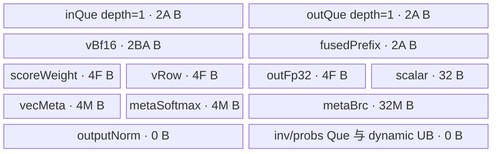
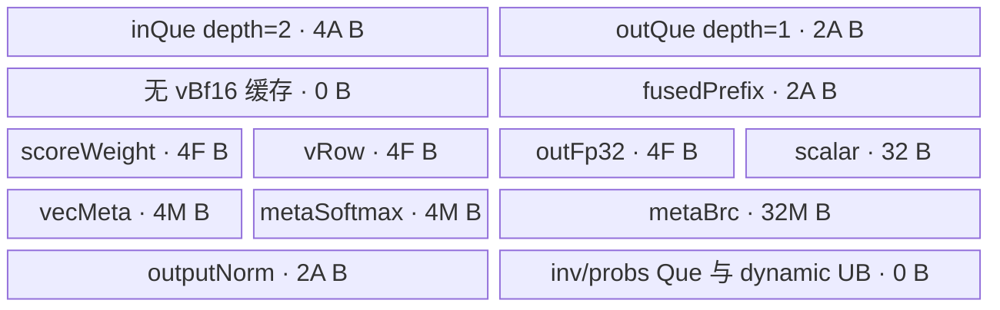

# AttnResFwd（Kimi 残差 bank 融合）950 ACLNN 算子知识

## 接入残差 bank 前先确认什么

950 的 AttnResFwd 接入先提供 prefix 的 T/H、bank 容量 S 与有效行数 N、bank token stride，以及 addend、mix、输出 RMSNorm 和 materialized 返回设置。先分清数学输出与返回对象别名，再选择资源路线。

| 要解决的任务 | 先读与下一步 |
| --- | --- |
| 接 Torch 或直接 ACLNN，确认三个返回值 | [接口与语义](#接口与语义)：区分 raw_prefix、RMSNorm 前的 materialized 和 output；直接 ACLNN 还要核可选输入占位、禁用输出及写槽 `idx>=N`。 |
| 选驻留/重载或 prefill 缓存 | [Route 选择](#route-选择)：先算 R，再判断 Cg；RESIDENT/RELOAD 与 PREFILL 不是调用者仅凭名称指定的四个通用模式。 |
| 查精度、UB 或写槽问题 | [限制与失败边界](#限制与失败边界)及[Kernel 实现](#kernel-实现)：保留两次 BF16 物化与归约顺序，再追具体路线。 |

混合路径的 `B=N+1<=128`、实际 UB 分配、九 Tensor 合同或槽位不覆盖有效 bank 尚未确认时，先停止扩大形状/模型范围；RELOAD 没有无限容量兜底。source_closed 只说明固定源码链闭合，目标二进制与数值仍须验证。

## 算子速览

| 项目 | 内容 |
|---|---|
| 实际入口 | 自定义算子包导出的 `aclnnAttnResFwdGetWorkspaceSize` → `aclnnAttnResFwd`；本卡分析固定提交的 Ascend C `arch35` 前向推理实现。 |
| 计算语义 | 可选 BF16 prefix 加法 → 残差 bank RMS 分数与 softmax 加权 → BF16 物化 → 可选输出 RMSNorm；支持把原始 prefix 写入未参与当前混合的 bank 槽位。 |
| 输入输出 | BF16 prefix `[T,H]`、bank `[T,S,H]`、权重 `[1,H]`/`[H]`；三个 BF16 `[T,H]` 返回值，存在有条件别名。 |
| 执行类型 | 一个 `AIV_VECTOR` 节点；`KERNEL_TYPE_AIV_ONLY`，Vector/MicroAPI 与 MTE2/MTE3，无 Cube、SIMT、NDDMA 或跨核通信。 |
| Kernel 路线 | R-001 RESIDENT 40020；R-002 RELOAD 40010；R-003 PREFILL_RESIDENT 40021；R-004 PREFILL_RELOAD 40011。 |
| 核心资源 | 每 AIV 一个 TPipe；行输入/输出 Queue、FP32 计算 TBuf、BF16 prefix、可选全 bank 或输出 gamma 缓存；Host 系统 workspace 16 MiB，不存 FP32 bank。 |
| 来源闭包 | `source_closed`：仓内 ACLNN → L0 `AttnResFwd` → 注册/推断/Tiling/POD → entry 四个模板 → 两个 body 与全部可达算术 helper、同步和算子构建接线。SDK executor、Ascend C primitive 与编译产物是明确的框架边界。 |
| 验证状态 | 已完成本卡范围的源码闭包检查；本次知识提取未执行编译、真机、数值或性能测试；`stable` 不代表执行验证。 |

模型侧接入从[Kimi K3 混合状态与部署契约](../../../../guides/models/vllm_ascend_kimi_k3_kda_mla.md)进入；模型卡的平台范围不扩展本算子卡的950边界。

本卡边界固定为源码 `ceac1a2bdff3139ca8fbd1a60b3a9befd68cadf2`、950/A5、ACLNN 前向推理。CANN `9.2.0` 来自 `Dockerfile.a5` 基础镜像；同文件另装 `cann-950-ops-transformer 9.3.0` 的 20261028 日包。两个版本必须分别记录，不解释为纯 9.2.0 安装已验证，也不推出任意后续 CANN 兼容。原生 vLLM 版本参考该文件的 `v0.32.0`，不能从版本名推导其他提交的同一 ABI。

## 接口与语义

### 计算语义

定义有效 bank 行数 `N=num_valid_blocks`，物理容量 `S`，逻辑行数 `B=N+1`，隐藏宽度 `H`。`BF16_RINT` 表示实现中的 FP32→BF16 `CAST_RINT`。

```text
p[t,h] = prefix[t,h]                                      # 无 addend
p[t,h] = BF16_RINT(FP32(prefix[t,h])+FP32(addend[t,h]))     # 有 addend
v[t,n,h] = bank[t,n,h]，0<=n<N；v[t,N,h] = p[t,h]
w[h] = FP32(proj[0,h]) * FP32(norm[h])                    # 先合成权重
r[t,n] = 1 / sqrt(sum_h(FP32(v[t,n,h])^2)/H + norm_eps)
s[t,n] = sum_h((FP32(v[t,n,h])*r[t,n])*w[h])
a[t,:] = softmax(s[t,:])
u[t,h] = sum_n(FP32(v[t,n,h])*a[t,n])
m[t,h] = BF16_RINT(u[t,h])
若 mix=false 或 N=0：直接令 m=p，跳过分数、softmax 与 bank 读取。
若 outputNormEps>0：output=BF16_RINT((FP32(m)*rms_inv(FP32(m)))*FP32(output_norm))
否则 output=m。
```

这是计算语义式；FP32 加法结合顺序、近似 reciprocal/exp 与舍入点见 Kernel 章节，不能把数学等价式当成逐位等价实现。加权累加以 FP32 清零后按逻辑行顺序做 **Mul 再 Add**，没有将这一步替换为 FMA。输出 RMSNorm 读取已舍入到 BF16 的 `m`，不能直接归一化未舍入的 `u`。

`raw_prefix=p`。指定写槽时，先把 `p` 写至 `bank[t,block_write_idx,:]`，再读有效 bank 混合；槽位必须不属于 `[0,N)`。`return_materialized=true` 的 `materialized=m` 是输出 RMSNorm 前的 BF16 值；为假时其返回 Tensor 与 `output` 同一对象。无 addend 时 `raw_prefix` 与输入 prefix 同一对象，不是独立副本。

### 输入、输出与属性

| 参数 | shape/layout | dtype | 约束、默认值与语义 |
|---|---|---|---|
| prefix / prefix_sum | `[T,H]`，连续 ND 行 | BF16 | prefix/proj/norm/bank 同设备；Torch 检查，直接 ACLNN 调用者也必须保证。 |
| blocks / block_residual | `[T,S,H]`；末轴 stride=1，行 stride=H，token stride `D>=S*H` | BF16 | bank 可以是有 token 间隔的 view；地址 `t*D+n*H`，`D` 单位为元素。 |
| proj / proj_weight | `[1,H]` 连续 | BF16 | Torch 严格检查二维首维 1；Tiling 只检查最后一维 H，不能反推任意 rank 合法。 |
| norm / norm_weight | `[H]` 连续 | BF16 | RMS 分数权重，与 proj 先做 FP32 逐元素乘法。 |
| addend | 可选 `[T,H]` 连续；ACLNN 参数必须非空 | BF16 | Torch 缺省以 prefix 占位，`fuseAdd=false`；Device 此时不读取 addend 指针。 |
| outputNorm / output_norm_weight | 可选 `[H]` 连续；ACLNN 参数必须非空 | BF16 | Torch 缺省以 norm 占位且传 `outputNormEps=0`；Device 只在正 eps 时启用。 |
| eps / norm_eps | 标量 | API double → 属性 FP32 | 必须为正；没有完整有限值/可表示域检查；正 double 窄化为 0 后会被 Tiling 拒绝。 |
| validBlocks / num_valid_blocks | 标量，默认由调用者指定 | API int64 → POD uint32 | `0<=N<=S`，真实安全域还受 softmax `B<=128`、索引位宽及 UB 限制。 |
| blockTokenStride | 标量 `D` | API int64 → POD uint64 | Torch 取 bank.stride(0)，Host 检查 `D>=S*H`；不是字节 stride。 |
| blockWriteIdx | 标量，Torch 默认 -1 | API int64 → POD int32 | 合同为 -1 或 `N<=idx<S`；Host 自身只检查 -1 至 S-1，缺少 `idx>=N`。 |
| outputNormEps | 标量，Torch 默认 1e-5 | double → FP32 | 仅传权重时应为正；极小正 double 窄化到 0 会关闭输出归一化，不能忽略转换。 |
| saveMaterialized / return_materialized | 标量，默认 false | bool → uint32 | 真：独立输出 pre-RMS BF16 m；假：Torch materialized 别名 output，Device 不单独保存。 |
| mix | 标量，默认 true | bool → uint32 | false 或 N=0 都跳过 bank 混合。 |
| fuseAdd | 标量 | bool → uint32 | 由 Torch addend 是否存在决定；与 Host 内部 `fuseAdd_` 变量不同。 |
| optimizePrefill | 标量，默认 false | bool | 只是请求，仍需多 token、输出 norm、UB 条件满足才能进入 40021/40011。 |
| output / prefixOut / materialized | 各 `[T,H]` 连续 | BF16 | 调用者持有存储。直接 ACLNN 必须自行准备禁用分支所需的别名/占位合同，返回成功不代表三个独立区间均被写。 |
| workspaceSize / executor | Host 输出指针 | uint64 / aclOpExecutor** | 必须提供有效地址；空输出 workspace=0，其余由 executor 返回；入口未显式空指针检查这两项。 |
| workspace / stream | 二阶段参数 | void* / aclrtStream | 按第一阶段返回大小申请并保持到执行完成；执行走指定 stream。 |

### 入口与版本

`aclnn_attn_res_fwd.h` 导出两个 C 符号，API `.cpp` 明确提供定义。这是仓内自定义 `libcust_opapi.so` 能力，不承诺系统内置 `libopapi.so` 一定已有同名符号。公开二阶段入口不是 `Direct Invoke`，也不是训练反向接口。

Torch 便利入口 `torch.ops._C_ascend.attn_res_fwd` 的实现位于 `attn_res_fwd_torch_adpt.h`/`attn_res_fwd_common.h`；与本卡 ACLNN 复用同一条推理链。`needBackward` 在 L0 属性列表中固定 false；因此共享文件中的 legacy invRms/probs 输出、非 fused 模板分支和 staging/backward 代码不属于本入口的可达 Route。OpDef 注册出现 A3 配置不构成 A3 真机验证；本卡只声明 950。

## Host/Launcher 执行流程

### 参数校验与前处理

1. Torch 包装检查 shape、BF16、同设备、连续行、有效 bank 范围和不覆盖当前有效槽；准备 output、可选独立 raw_prefix/materialized，以及禁用参数的占位 Tensor。不执行 bank packing 或 Contiguous 拷贝。
2. `EXEC_NPU_CMD` 将 Tensor view 的尺寸、stride、storage_offset、存储 format/容量变成 ACL 描述符；`NPUBridge` 从 NPUStorageImpl 提取存储描述，不把 token 间 stride 自动改为紧密排列。
3. 第一阶段检查六个 Tensor 输入、三个 Tensor 输出非空和 `eps>0`；对九个 Tensor 执行 `SetOriginalShape(GetViewShape())`，仅修改 Host 元信息。创建 executor 失败返回 `ACLNN_ERR_INNER_CREATE_EXECUTOR`。空 output 返回 workspace=0、转交 executor，不启动 Kernel。
4. 非空进入 `l0op::AttnResFwd`，一次 `ADD_TO_LAUNCHER_LIST_AICORE` 注册 `AttnResFwd`。前四输入/首输出 dtype 检查、rank/维度检查、N/D/idx 和 FP32 eps 检查在 Tiling 完成。可选输入和三个输出的完整 shape/dtype/layout 校验没有在直接 ACLNN 路径中全部补齐。
5. `AttnResFwdTiling` 经 priority=0 注册；`IsCapable()` 固定 true。共享 TilingBase 依次运行 shape/attrs、platform、capable、DoOpTiling、DoLibApiTiling、workspace、PostTiling、SetTilingKey、Dump。旧 registry 按优先级尝试，只有 `GRAPH_PARAM_INVALID` 可继续其他模板；普通失败不会自动重试到另一个 Kernel。本算子无第二个注册模板兜底。

### 参数、Workspace 与生命周期

| 对象 | 生产者与所有权 | 消费/生命周期边界 |
|---|---|---|
| 输入/输出 GM | ACLNN 调用者；Torch Tensor 存储所有权在 PyTorch/NPU allocator | 两阶段期间及设备使用结束前保持；本算子不拥有 bank/prefix 生命周期。别名只能使用接口说明的组合。 |
| ACL 描述符 | `ConvertType(Tensor)` 动态解析 aclCreateTensor；描述 view/stride/offset | 正常 `acl_call` 调用二阶段成功后 `ReleaseConvertTypes` 销毁描述符；SDK executor 如何持有执行依赖属框架边界。失败抛出前没有统一 RAII 清理保证。 |
| executor | `CREATE_EXECUTOR`；成功 `ReleaseTo(executor)` | 二阶段交给 `CommonOpExecutorRun`；SDK 内部调度、销毁细节固定仓不可见，不臆造释放接口。 |
| workspace | Tiling 声明 `16777216` 字节系统保留；API 返回 `exec->GetWorkspaceSize()` | 直接调用按实际返回分配；空输出 0。entry 不使用 workspaceGM，不增加 FP32-v 用户 slice；SDK 可能另有管理开销。 |
| Tiling blob | Host rawTilingData owner | PostTiling 校验容量、memcpy_s、设置 size；entry `GET_TILING_DATA`；一个 launch 的只读参数。 |
| UB/Queue/TBuf | Device TPipe 按每 AIV 分配 | 整个 Kernel；token 内阶段复用，队列 Tensor 用 FreeTensor 归还；见各 Route。 |

动态符号查询按 custom OPP 库、默认 vendor 库、`libopapi_transformer.so`、`libopapi.so` 查找；GetWorkspaceSize 和执行函数分别解析并缓存。运行时必须检查实际命中的自定义库与提交，不能凭源码中有定义就认定部署二进制一致。

包装宏有一个需要在迁移前复核的生命周期缺口：`workspace_tensor` 定义在 `if (workspace_size != 0)` 的局部作用域，离开后仅把裸 `workspace_addr` 捕获进 handler，没有捕获 Tensor owner。是否仍可安全使用取决于外部 allocator/调度语义；固定仓不能据此证明 workspace 一直存活，也没有本次实测失败证据。自行适配时应让真实 owner 覆盖设备使用区间。宏的正常路径有 HugeMem init/release/uninit；阶段失败抛出时不应假定这些清理都已执行。

### 启动图与失败传播

```text
调用者 -> aclnnAttnResFwdGetWorkspaceSize
  -> l0op::AttnResFwd -> ADD_TO_LAUNCHER_LIST_AICORE(AttnResFwd)
  -> SDK executor / GE bridge（框架边界）
     -> InferShape + InferDataType
     -> Tiling(priority=0) -> POD(96 B), key, blockDim=C, workspace声明
调用者 -> aclnnAttnResFwd(workspace, actualSize, executor, stream)
  -> CommonOpExecutorRun（框架边界）
  -> node K0: attn_res_fwd(..., workspaceGM, tilingGM)
     -> 四选一 Init(params); Process() -> 输出/可选 bank 写回
```

| 节点/边 | producer → consumer | offset/extent、dtype/layout | ordering、owner/lifetime | 失败传播 |
|---|---|---|---|---|
| K0 | L0 单节点 → `attn_res_fwd` | blockDim=C；同一 AttnResFwdTilingData；六输入/三输出，无跨 Kernel slice | SDK 按 stream 提交；调用者保有 GM | API 返回 L0/SDK status，包装用 TORCH_CHECK 抛出；不吞错继续。 |
| Tiling 参数 | Host PostTiling → GET_TILING_DATA | blob offset 0、96 B、pack8 POD | SDK 管理提交次序；entry 只读 | raw 指针/容量/memcpy_s/workspace-list 失败 GRAPH_FAILED。 |
| bank/prefix/权重 | 调用者 → K0 | prefix offset tH；bank offset tD+nH；BF16，行 extent H | 一个 AIV 独占该 token，Queue 同步 | 本算子没有跨核协商或自动重排错误输入。 |
| raw_prefix 写槽 | PrepareFusedPrefix → 同 token 后续 bank 读取/后续调用者 | bank tD+idxH、H 个 BF16；有效读槽 0..N-1 | outQue 协议；合法 idx>=N 时当前调用读写不相交；后续调用需 stream 顺序 | 非法覆盖有效槽可能改变本次混合；无自动回滚。 |
| materialized → output RMS | Cast BF16 / MTE3 保存 → Vector 复用 outLocal | 独立 materialized[tH:H]；UB 同一 outLocal | 显式 MTE3_V SetFlag/WaitFlag 后才覆盖 | 不得删除事件并假定一次 Kernel 天然串行。 |
| 系统 workspace | 调用者/SDK → executor | 实际返回大小；算子用户 slice 为 0 | owner 覆盖执行区间；无生产者写 FP32 bank | 系统 reserve 不等于用户缓存，也不保证宏 owner 无缺口。 |

## Route 与参数设计

### 分核与资源计算

以下均限定非空、合法输入和正确平台信息。取 AIV 数 `P`、平台返回可用 UB 字节 `U`。`C=min(T,P)`、`K=ceil(T/C)`，核 c 负责 `[cK,min(T,(c+1)K))`；最后可有空闲核，Init 把 tokenNum 置 0 后 Process 返回。无按 H 切分、无跨核 reduction。P=0 或平台信息缺失是错误环境，不能靠 192 KiB 常数补齐核数。

令 `A=align_up(H,16)`（BF16 元素）、`F=align_up(H,8)`（FP32 元素）、`M=align_up(B,8)`。两类 UB 判据不能混用：

```text
U_res = U 若 U!=0，否则 192*1024             # 仅 residency 启发式有此 fallback
W = 22*H + 32768                            # 公共入口 Host fuseAdd_=true
maxRows = 0，若 H=0 或 W>=U_res
maxRows = floor((U_res-W)/(2*H+4))，否则
R = B>0 && B<=maxRows

UB_resident(Cg) = (6+2*B+2*Cg)*A + 12*F + 40*M + 32
UB_reload(Cg)   = (8+2*Cg)*A     + 12*F + 40*M + 32
E(R) = UB_resident(0)+32768，若 R；否则 UB_reload(0)+32768
G = 2*A
Cg = optimizePrefill && outputNormEps>0 && K>1 && E(R)+G<=U
```

以上 UB 是从 InitBuffers 分配相加得到的字节，不含不可见的 TPipe 元信息；Host 另留 32768 安全余量。gamma 缓存使用实际 U，不用 192 KiB fallback。**R 判据是启发式，未直接逐项核对全部 M 对齐开销；RELOAD 也未显式检查基础 UB 预算**。因此不能写成“任何输入总能 fallback 到可运行 RELOAD”。迁移时须对实际 H/B/UB 再算字节账，校验分配和 SDK 资源限制。

Host `fuseAdd_=fusedChain_` 对本入口始终 true，只用于公共 fused 分支能力和 prefix UB 预算；真正是否读 addend 由 POD.fusedAdd 决定。无 addend 仍分配 fusedPrefix，不可删掉 2A。

### Route 选择

| 顺序 | Route | Key/模板 | 精确选择条件与优先级 | 不适用去向 |
|---:|---|---|---|---|
| 1 | R-001 RESIDENT | 40020 / Resident<BF16,true,false> | 先计算 R；命中 R，随后 Cg=false，保留基础 key | R=false 先选 RELOAD；Cg=true 升级 R-003。 |
| 2 | R-002 RELOAD | 40010 / Reload<BF16,true,false> | R=false 且 Cg=false | Cg=true 升级 R-004；不提供其他资源兜底。 |
| 3 | R-003 PREFILL_RESIDENT | 40021 / Resident<BF16,true,true> | R=true 且 optimizePrefill、FP32 outputNormEps>0、K>1、E(true)+2A<=U 全部成立 | 缓存任一条件不满足回到 R-001。 |
| 4 | R-004 PREFILL_RELOAD | 40011 / Reload<BF16,true,true> | R=false 且同样四个 Cg 条件成立，E 使用 reload 分配 | 缓存任一条件不满足回到 R-002。 |

```text
API null / eps<=0 / create-executor失败 -> 返回错误
output.empty -> workspace=0，空 executor，K0 不启动
Host 校验失败 -> GRAPH_FAILED，不尝试伪造安全 Route
C=min(T,P), K=ceil(T/C), B=N+1
R=(B>0 && B<=CalcMaxResidentRows(H))
key=40020 if R else 40010
填 staging=0 / tokensPerFlush=0 / elemsPerToken=0
Cg=optimizePrefill && outputNormEps>0 && K>1 && EstimateUbComputeBytes(R)+2A<=U
if Cg: key=40021 if R else 40011
entry 精确匹配四个 key；未知 key 无 else 兜底 -> 不执行任何 body
```

### 模板/实现执行矩阵

| Route | key/selector | dtype/shape/platform 完整命中条件 | 执行拓扑与 Kernel 节点 | 实际模板/body | 内存与同步特征 | tail/fallback |
|---|---|---|---|---|---|---|
| R-001 | 40020 | 950/arch35、BF16 合法域、T/H>0、R 且 !Cg | 单 K0 AIV_VECTOR；C 核、每核 K token | AttnResFwdResident<bfloat16_t,true,false>::Init/Process | in/out depth1，BF16 全 B 行常驻；norm gamma 每 token 加载 | token tail 截断；H mask；!R→R-002，Cg→R-003。 |
| R-002 | 40010 | 同公共域，!R 且 !Cg | 同一 K0 | AttnResFwdReload<bfloat16_t,true,false>::Init/Process | in depth2/out depth1；bank GM 两遍；lookahead Queue | 无 UB 自动补救；Cg→R-004；H/B 内部分支见公共流程。 |
| R-003 | 40021 | 同公共域，R 且 optimizePrefill && outputNormEps>0 && K>1 && E(true)+2A<=U | 同一 K0，没有额外 prefill Kernel | AttnResFwdResident<bfloat16_t,true,true>::Init/Process | Resident + 每核 2A 字节 gamma 缓存 | !Cg→R-001；最后核实际 token 少于 K 仍可同 key。 |
| R-004 | 40011 | 同公共域，!R 且 optimizePrefill && outputNormEps>0 && K>1 && E(false)+2A<=U | 同一 K0 | AttnResFwdReload<bfloat16_t,true,true>::Init/Process | Reload + 每核 gamma 缓存 | !Cg→R-002；prefill 标志不是 H/B 合法性证明。 |

### 隐藏性能 Guard

| Guard | Host/Tiling 条件 | Device/资源原因 | 影响 Route | 不满足时去向 | 源码符号 |
|---|---|---|---|---|---|
| bank 不打包 | Torch stride(2)=1、stride(1)=H、D>=SH | DataCopyPad 一次只搬 H；token 由 D 定位 | 全部 | Torch 拒绝；直接 ACLNN 必须预检 | attn_res_fwd_common.h / attn_res_fwd_impl |
| 常驻预算 | B<=CalcMaxResidentRows(H) | 需 2BA 字节 vBf16；没有 FP32-v workspace | R-001/003 | R-002/004，但仍需自行确认基础 UB 可用 | tiling.cpp / CanResidentAllBlocks |
| gamma 摊销 | optimizePrefill && outputNormEps>0 && K>1 && E+2A<=U | 额外 BF16 一行，按核共享 token | R-003/004 | 同存储族的非缓存 key | tiling.cpp / DoLibApiTiling |
| mix 快返 | POD.mix==0 或 N==0；不是 Host 新 key | 只处理 prefix 和可选输出 norm，仍按原 Route 分配 UB | 全部 | 否则 score→softmax→weighted | 两个 body / ProcessOneToken |
| RMS 快分组 | H%512==0 && H<=8192 | 512 元素一组，最多 16 组；固定归约树 | 全部 | generic CastAndInvRms / NormalizeAndReduceScore，非新 key | regbase_common.h / GroupedReduce |
| H 奇偶 | Device hiddenSize%2==0 | 偶数按两个 H/2 段交错，奇数走单流；尾部 mask | 全部 | 奇数分支；不是任意超大 H 的有效域承诺 | regbase_common.h / WeightedMulAddFromB16 |
| softmax 宽度 | B<=kVlFp32(950 常用 64) 用一寄存器，否则 SmallRegBase | 后者源码声明 B<=128；Host 未强制这个界限 | 全部混合路径 | 65..128 用 SmallRegBase；B>128 没有已闭合通用 fallback | regbase_common.h / SoftmaxSmallRegBase |
| 小 eps | 分组 InvRmsFromSum 中 eps>=1e-20 | 决定 FTZ、硬件 reciprocal 邻点修正或 AccurateDiv | 全部命中分组时 | 极小 eps 用 accurate / FTZ_FALSE 链；泛化路径独立 | regbase_common.h / InvRmsFromSum |
| 写槽不覆盖 | Torch idx==-1 或 idx>=N；Host 未完整实现 | 写 prefix 在 score 前，覆盖有效槽会改变输入 | 全部 | 调用者拒绝，不能依赖 Host 自动保护 | common.h / AnalyzeShapes / PrepareFusedPrefix |
| 位宽与 UB | 多字段 uint32，idx int32，MicroAPI repeat 常为 uint16 | 元素计数、对齐、2H 字节搬运、循环计数有各自上限 | 全部 | 本入口没有完整溢出检查；不得制造统一 H 上限 | POD / 两个 body / regbase_common.h |

### POD/ABI

`AttnResFwdTilingData` 使用 `#pragma pack(8)` 和 `alignas(8)`；以下 offset/size 为按声明静态推导：align=8、sizeof=96、28..31 为 padding。未执行编译器 sizeof/offsetof 验证。Host 原样 memcpy，字段顺序和 inactive 字段都不可删改。

| 结构 | 字段 | 类型/位宽 | ABI 布局 | 单位 | Host/launcher producer | Device consumer | 边界 |
|---|---|---|---|---|---|---|---|
| AttnResFwdTilingData | numTokens | uint32 | offset 0 | token | AnalyzeShapes: prefix.dim0 | Init: tokenStart/tokenNum | T，非空路径 |
| AttnResFwdTilingData | numBlocks | uint32 | offset 4 | bank 行 | AnalyzeShapes: validBlocks | 构造 numBlocks_；逻辑最后行前的 bank 数 | N<=S |
| AttnResFwdTilingData | hiddenSize | uint32 | offset 8 | 元素 | AnalyzeShapes: prefix.dim1 | 构造 H、alignment、copy/reduction | H>0；窄化未全检 |
| AttnResFwdTilingData | tokensPerCore | uint32 | offset 12 | token/核 | DoOpTiling: ceil(T/C) | Init/Process: cK、token loop | 空路径为0；正常 K>0 |
| AttnResFwdTilingData | usedCoreNum | uint32 | offset 16 | AIV 核 | InitCompileInfo；DoOpTiling=min(T,P) | PostTiling blockDim；GetBlockNum | 平台必须提供 P>0 |
| AttnResFwdTilingData | normEps | float32 | offset 20 | 无量纲 | GetNormEps: FP32 attr0 | CastAndInvRms | >0；无完整 finite guard |
| AttnResFwdTilingData | invHiddenSize | float32 | offset 24 | 1/元素 | DoOpTiling: 1.0f/H | 传给 CastAndInvRms | 活跃 helper 实际除以 H；不能改成乘此字段 |
| AttnResFwdTilingData | wsSizePerToken | uint64 | offset 32 | 字节/token | DoOpTiling: 0 | 公开 fused 路径不使用用户 WS | 恒0 |
| AttnResFwdTilingData | blockCount | uint32 | offset 40 | 逻辑行 | DoOpTiling: N+1 | scores/softmax/weighted/meta size | B；混合 helper 适用 <=128 |
| AttnResFwdTilingData | needBackward | uint32 | offset 44 | 布尔 | L0 attr1=false → GetNeedBackward | 构造：不分配 inv/probs Que | 本入口恒0 |
| AttnResFwdTilingData | stagingBytes | uint32 | offset 48 | 字节 | FillStagingFields:0 | 无可达 staging 搬运 | 本入口0 |
| AttnResFwdTilingData | tokensPerFlush | uint32 | offset 52 | token | FillStagingFields:0 | 无可达 staging flush | 本入口0 |
| AttnResFwdTilingData | blockTokenStride | uint64 | offset 56 | BF16 元素 | AnalyzeShapes: int64 attr3 | GetLogicRowOffset/写槽 tD+nH | >=SH；不是字节 |
| AttnResFwdTilingData | blockWriteIdx | int32 | offset 64 | bank 行号 | AnalyzeShapes: attr4 窄化 | PrepareFusedPrefix: idx>=0 时写槽 | -1 或 N..S-1；后半 guard 由调用者保证 |
| AttnResFwdTilingData | fusedChain | uint32 | offset 68 | 布尔 | AnalyzeShapes: NodeType==AttnResFwd | Init/ProcessOneToken/WriteHiddenStates | 本入口1 |
| AttnResFwdTilingData | fusedAdd | uint32 | offset 72 | 布尔 | AnalyzeShapes: attr8 | entry 决定 addend 指针是否为 null | 区别于 Host fuseAdd_ |
| AttnResFwdTilingData | mix | uint32 | offset 76 | 布尔 | AnalyzeShapes: attr7 | ProcessOneToken 快返判断 | 0跳混合 |
| AttnResFwdTilingData | saveMaterialized | uint32 | offset 80 | 布尔 | AnalyzeShapes: attr6 | WriteHiddenStates: pre-RMS 保存 | 0时由 Torch 设置别名 |
| AttnResFwdTilingData | outputNormEps | float32 | offset 84 | 无量纲 | AnalyzeShapes: attr5 | entry/WriteHiddenStates | >0启用；0禁用 |
| AttnResFwdTilingData | elemsPerToken | uint32 | offset 88 | 元素/token | FillStagingFields: needBackward?B:0 | 公开路径无 staging consumer | 恒0；头注释不替代真实赋值 |
| AttnResFwdTilingData | cacheOutputNorm | uint32 | offset 92 | 布尔 | DoLibApiTiling: Cg | Prefill InitBuffers/Init/WriteHiddenStates | 与40021/40011一致 |

`AttnResFwdCompileInfo` 的 `aivNum:uint64` 和 `ubSize:uint64` 都是 Host 私有查询结果，分别以核数、字节计；不是上述 Device 序列化 ABI。`AttnResFwdInitParams` 由 entry 聚合构造，字段顺序如下；不是 Host memcpy 的 POD，不额外假定其指针 ABI 字节布局。

| 结构 | 字段 | 类型/位宽 | ABI 布局 | 单位 | Host/launcher producer | Device consumer | 边界 |
|---|---|---|---|---|---|---|---|
| AttnResFwdInitParams | prefixSum | GM_ADDR 指针 | 声明序号 0；布局由 Device 编译器确定 | GM 地址 | entry: prefixSum | Init: prefixSumGm_ | 仅当前 launch；inv/probs 不可擅自启用 |
| AttnResFwdInitParams | blockResidual | GM_ADDR 指针 | 声明序号 1；布局由 Device 编译器确定 | GM 地址 | entry: blockResidual | Init: blockResidualGm_ | 仅当前 launch；inv/probs 不可擅自启用 |
| AttnResFwdInitParams | projWeight | GM_ADDR 指针 | 声明序号 2；布局由 Device 编译器确定 | GM 地址 | entry: projWeight | Init: projWeightGm_ | 仅当前 launch；inv/probs 不可擅自启用 |
| AttnResFwdInitParams | normWeight | GM_ADDR 指针 | 声明序号 3；布局由 Device 编译器确定 | GM 地址 | entry: normWeight | Init: normWeightGm_ | 仅当前 launch；inv/probs 不可擅自启用 |
| AttnResFwdInitParams | hiddenStates | GM_ADDR 指针 | 声明序号 4；布局由 Device 编译器确定 | GM 地址 | entry: hiddenStates | Init: hiddenStatesGm_ | 仅当前 launch；inv/probs 不可擅自启用 |
| AttnResFwdInitParams | invRms | GM_ADDR 指针 | 声明序号 5；布局由 Device 编译器确定 | GM 地址 | entry: nullptr | Init: 无可达读写 | 仅当前 launch；inv/probs 不可擅自启用 |
| AttnResFwdInitParams | probs | GM_ADDR 指针 | 声明序号 6；布局由 Device 编译器确定 | GM 地址 | entry: nullptr | Init: 无可达读写 | 仅当前 launch；inv/probs 不可擅自启用 |
| AttnResFwdInitParams | addend | GM_ADDR 指针 | 声明序号 7；布局由 Device 编译器确定 | GM 地址 | entry: fusedAdd?addend:nullptr | Init: addendGm_；判定 fuseAdd_ | 仅当前 launch；inv/probs 不可擅自启用 |
| AttnResFwdInitParams | prefixOut | GM_ADDR 指针 | 声明序号 8；布局由 Device 编译器确定 | GM 地址 | entry: prefixOut | Init: prefixOutGm_ | 仅当前 launch；inv/probs 不可擅自启用 |
| AttnResFwdInitParams | outputNorm | GM_ADDR 指针 | 声明序号 9；布局由 Device 编译器确定 | GM 地址 | entry: outputNormEps>0?outputNorm:nullptr | Init: outputNormGm_ | 仅当前 launch；inv/probs 不可擅自启用 |
| AttnResFwdInitParams | materialized | GM_ADDR 指针 | 声明序号 10；布局由 Device 编译器确定 | GM 地址 | entry: materialized | Init: materializedGm_ | 仅当前 launch；inv/probs 不可擅自启用 |

### Route 源码闭包

下表路径以 `csrc/attention/attn_res_fwd/` 为相对根。共同依赖 `arch35/attn_res_fwd_regbase_common.h`、`arch35/reduce_common.h` 已追踪到实际可达 Vector/MicroAPI 调用；SDK primitive 的内部指令、GE bridge 与生成代码是边界，不把自有算法 helper 当成黑盒。

| Route | Key/selector | Host/Tiling producer | POD/参数 | Kernel entry/router 节点 | Kernel body/直接依赖 | 构建接线 |
|---|---|---|---|---|---|---|
| R-001 | 40020 | op_host/attn_res_fwd_tiling.cpp: DoLibApiTiling，R&&!Cg | AttnResFwdTilingData；fusedChain=1、needBackward=0、cache=0 | op_kernel/attn_res_fwd_apt.cpp: AttnResFwdResident<bfloat16_t,true,false> | arch35/attn_res_fwd_resident.h + reload.h 的 InitParams + 两个公共 helper | op_host/CMakeLists.txt 注册/编译选项；attention/CMakeLists 目录选择；csrc/CMakeLists 950→arch35。 |
| R-002 | 40010 | 同 Tiling，!R&&!Cg | 同 POD，cache=0 | entry: AttnResFwdReload<bfloat16_t,true,false> | arch35/attn_res_fwd_reload.h + 两个 helper | 同上；obj_func.cmake 收集手写 op_api、infer、tiling。 |
| R-003 | 40021 | 同 Tiling，R&&Cg | 同 POD，cache=1 | entry: AttnResFwdResident<bfloat16_t,true,true> | Resident + Init 中 gamma load，公共 helper | 同上；custom_build.cmake 把 opapi_obj 接入 cust_opapi。 |
| R-004 | 40011 | 同 Tiling，!R&&Cg | 同 POD，cache=1 | entry: AttnResFwdReload<bfloat16_t,true,true> | Reload + Init 中 gamma load，公共 helper | 同上；func.cmake 传编译选项和源目录，不新增运行时 Kernel。 |

构建 `add_modules_sources(OPTYPE attn_res_fwd ACLNNTYPE aclnn_exclude)` 收集本目录手写 API；exclude 是禁止重复生成 ACLNN wrapper，不是排除本算子。`add_op_to_compiled_list` 记录目录；共享 cmake 收集 tiling/infer 对象、导出 libcust_opapi。`csrc/CMakeLists.txt` 选择 ascend950→arch35；entry 在 `__CCE_AICORE__==220` 才引用 arch22，其他分支引用 arch35。本卡不是“所有非220芯片均支持”的结论。算子选项含 `--cce-auto-sync=off`，950 还含 `-cce-aicore-dcci-before-kernel-end=false`；迁移时必须保留显式同步并检查真实编译环境。SDK op_build、Ascend C 编译器、通用打包/缓存产物的实际生成未执行，未宣称已验证二进制接线。

## Kernel 实现

### 公共执行流程

每个 Route 都是 K0 内 `Init → Process → ProcessOneToken`；TPipe 和 UB 只在本核使用。Init 设置 GM 指针与核负责 token，分配 UB。仅当 `mix && N>0` 才调用 `LoadScoreWeight`，把 proj/norm 从 BF16 转 FP32 后 `MulDual` 得到 scoreWeight，一次核内初始化跨 token 复用。

每 token 先 `PrepareFusedPrefix`：prefix 行由 inQue 搬入，`CopyB16Row` 拷贝至 fusedPrefix；有 addend 时将两者转 FP32 加法、`CAST_RINT` 写回 BF16 fusedPrefix。若无 addend 且 idx<0，raw_prefix 已与输入别名，不再 GM 写；否则通过 outQue 复制，按条件写 raw_prefix 与 bank 指定行。随后 `mix=0 || N=0` 快返只写 hidden；否则 score → softmax → weighted → WriteHiddenStates。

两个 body 的 shared helper 分支必须与四个 key 一起理解：

- `CastAndInvRms` 对 BF16 行 cast+平方归约，`NormalizeAndReduceScore` 按 `(row*inv)*scoreWeight` 顺序计算点积。H%512==0 且 H<=8192 时进入 `GroupedReduce`：每512分成8个64元素片段，以32-lane gather/组内归约和8-lane归约构成固定树；先组内累加，再累加各组。现有包装的调用条件不触发 GroupedReduce 内泛化 carry-tree 分支，不能把死分支作为额外通用 fallback。其他 H 走 64 元素片段归约并按顺序加到标量。传入 invHiddenSize 不等于活跃实现使用它：实际仍除以 float(H)。
- 分组 RMS 的 `InvRmsFromSum` 在 eps>=1e-20 时采用 NormalDiv FTZ_TRUE、AccurateSqrt FTZ_FALSE 和硬件 reciprocal 后比较相邻 FP32 候选残差的路径；`ReciprocalRmsNormal` 使用 FMA 算残差选择更小绝对误差，极大值/NaN 保留硬件结果。极小 eps 走 AccurateDiv/Sqrt/Div FTZ_FALSE。generic RMS 自身使用 accurate 链，不能机械套用分组分支的近似规则。
- `SoftmaxSmall` 先看 B<=kVlFp32。一寄存器路径 `SoftmaxOneRegister` ReduceMax→减 max→SoftmaxExpFp32→sum→reciprocal→乘。其 exp 对 x>=-80 选范围约减多项式、否则选 AccurateExp；源码先无条件算 fallback Exp 再 Select，因此不能宣传“完全消除 Exp”。少于8个分数逐位置相加；其他情况按8-lane组和XOR蝶形归约。这个 helper 带 SLEEF 衍生代码声明，本卡只描述机制，不复制其算法代码。
- 65..128 行进入 `SoftmaxSmallRegBase`：M 对齐 scratch 先填 -1e20，按8元素整块加1..7个 masked 尾部拷贝，ReduceMaxHalfInterval 会破坏 scratch，所以重新铺分数后再减 max/Exp。对前64和 align8(B-64) 两段求和再相加，恢复 mask；倒数后广播相乘，按整块和精确尾部写回。这里使用 Ascend C Level2 Exp，不是上一条多项式 exp 路径。B>128 缺少已闭合适用保证。
- softmax 后 `Brcb(metaBrc,vecMeta,ceil(B/8),{1,8})`，每行概率扩展为8个 FP32；`WeightedMulAddFromB16` 将 bank/prefix BF16 cast 后用每行概率做独立 Mul、Add。偶数 H 分两个 H/2 流，奇数单流；MicroAPI repeat 按 VL 向上取整，以 UpdateMask 保留尾部。寄存器无独立 TPipe 字节分配，不把“64 lane”计成新 UB。
- `CopyB16Row` 以128 BF16/Vector repeat、单次最多255 repeats 分段复制已对齐的 A 元素，尾部另设 mask，并做 PIPE_V barrier。GM `DataCopyPad` 参数为1个 block、有效2H字节、src/dst stride均0、pad=false；bank token stride用地址 D体现，不通过 DMA stride 参数打包。寄存器 load 有 UNMASKED 模式，masked store 不能单独证明所有 load 不越过局部片段；padding/primitive 合同仍需目标 SDK 验证。
- `WriteHiddenStates` 先 FP32→BF16_RINT 得 m。save=true 时经 outQue 保存 materialized，再显式 MTE3_V 等待，才复用 outLocal 做可选输出 RMSNorm；归一化从 m 重新 cast FP32，然后乘 inverse RMS、gamma、BF16_RINT。最后 outQue→GM output，并 FreeTensor。输出仅提交有效 H，token tail 不提交空域。

### Route R-001：RESIDENT

#### 适用条件

##### 选择证据

| 层级 | 文件 | 符号 | 源码谓词/参数 | 结果/下一跳 |
|---|---|---|---|---|
| API | op_host/op_api/aclnn_attn_res_fwd.cpp | l0op::AttnResFwd | 非空有效域；needBackward=false | 单个 AttnResFwd 节点，fusedChain=1。 |
| Host/Tiling | op_host/attn_res_fwd_tiling.cpp | DoLibApiTiling | R && !Cg；R/Cg 的完整公式见上，先存储族后缓存 | key=40020，cacheOutputNorm=0。 |
| Router | op_kernel/attn_res_fwd_apt.cpp | TILING_KEY_IS(40020) | 950/arch35，BF16 | AttnResFwdResident<bfloat16_t,true,false>::Init/Process。 |
| Body | op_kernel/arch35/attn_res_fwd_resident.h | ProcessOneToken | mix==0 或 N==0 快返；否则完整混合 | 同 key 内选择 H 分组/奇偶、B softmax 分支，无额外 Kernel。 |

#### Device 数据流

##### 函数级调用链

```text
L0 ADD_TO_LAUNCHER_LIST_AICORE(AttnResFwd) -> SDK stream launch K0
  -> attn_res_fwd(key=40020, POD, inputs, outputs)
  -> AttnResFwdResident<bfloat16_t,true,false>::Init(params)
     -> InitBuffers -> LoadScoreWeight (mix && N>0)
     -> 不缓存 gamma
  -> Process: localIdx=0..tokenNum-1
     -> ProcessOneToken(tokenStart+localIdx)
        -> PrepareFusedPrefix
        -> 若 mix==0 或 N==0: CastB16ToFp32Dual -> WriteHiddenStates -> return
        -> LoadResidentAndScores -> SoftmaxSmall -> WeightedOutputResident
        -> WriteHiddenStates
```

##### 源码等价伪码

```text
# 伪码，非可直接编译代码；GM offset 单位均为 BF16 元素。
c=GetBlockIdx(); start=c*K; if start>=T: tokenNum=0; return
count=min(K,T-start); InitBuffers(); if mix && N>0: LoadScoreWeight()
# gamma 不常驻，每次 WriteHiddenStates 有 norm 时加载
for t in [start,start+count):
  p=copy prefix[t*H:t*H+H] -> fusedPrefix_
  if fusedAdd: p=BF16_RINT(FP32(p)+FP32(addend[t*H:t*H+H]))
  if fusedAdd: queue_write prefixOut[t*H:t*H+H]=p
  if idx>=0: queue_write bank[t*D+idx*H:t*D+idx*H+H]=p
  if !mix or N==0: outFp32_=FP32(p); WriteHiddenStates(t); continue
  for n in [0,B):
    x=queue_read bank[t*D+n*H:H] if n<N else fusedPrefix_
    CopyB16Row(vBf16_[n*A],x)           # 在 UB 保留原 BF16 值
    CastAndInvRms(vRow_,scalarLocal_,x,H,eps)
    if n<N: FreeInRow(x)
    NormalizeAndReduceScore(vecMeta_[n],vRow_,scoreWeight_,scalarLocal_,H)
  SoftmaxSmall(); Brcb probabilities -> metaBrc_; PIPE_V barrier
  outFp32_=0; PIPE_V barrier
  for n in [0,B): WeightedMulAddFromB16(outFp32_,vBf16_[n*A],metaBrc_[n*8],H)
  m=BF16_RINT(outFp32_)              # outQue 的同一行
  if saveMaterialized: queue_write materialized[t*H:H]=m; SetFlag/WaitFlag(MTE3_V)
  if outputNormEps>0:
    inv=RMS_inv(FP32(m),outputNormEps)
    gamma=CopyInRow(outputNormGm_,0)，消费后 FreeInRow
    m=BF16_RINT((FP32(m)*inv)*FP32(gamma))
  queue_write output[t*H:H]=m; FreeTensor(outQue row)
```

#### 内存与数据搬运

##### 资源与搬运表

| 层级/缓冲区 | offset/地址公式 | extent/容量公式 | dtype/layout | producer | consumer | owner/lifetime | 对齐/复用 |
|---|---|---|---|---|---|---|---|
| GM prefix/addend/output/raw/materialized | tH；权重0 | 每行 H，2H字节；总 TH，别名按接口 | BF16 连续行 | 调用者/PrepareFusedPrefix/WriteHiddenStates | K0/调用者 | 调用者覆盖执行 | DMA只写有效H，prefix/raw、output/materialized有条件别名。 |
| GM bank | tD+nH；写槽tD+idxH | 容量 `(T-1)D+SH` 元素（T>0）；读N行，写0或1行 | BF16 行连续 | 调用者/PrepareFusedPrefix | LoadResidentAndScores/WeightedOutputResident | 调用者；每核token独占 | D>=SH，idx=-1或idx>=N。 |
| inQue_ | TPipe内部 offset，源码不固定数值 | depth=1，每槽2A字节，总2A | BF16 VECIN | MTE2 DataCopyPad | Vector/UB复制 | 本核；Alloc/DeQue/Free | 单槽逐行消费。 |
| outQue_ | TPipe内部 offset | depth=1，总2A字节 | BF16 VECOUT | Vector | MTE3/可选后续Norm | 本核；每token/写槽复用 | 保存materialized后 MTE3_V 等待才改写同一行。 |
| vBf16Buf_ / vBf16_ | n*A | 2BA字节 | BF16 `[B,A]` | CopyB16Row | WeightedOutputResident | 本核；当前token全部score到weighted结束 | 每行A对齐，下一token才整体覆盖。 |
| scoreWeightBuf_ | TPipe内部 offset | 4F字节 | FP32 | LoadScoreWeight | NormalizeAndReduceScore | 本核；每核一次，跨token只读 | F按8元素/M按8元素；不与其他TBuf声明物理alias。 |
| vRowBuf_ | TPipe内部 offset | 4F字节 | FP32 | CastAndInvRms | NormalizeAndReduceScore | 本核；逐行覆盖；上行分数完成后复用 | F按8元素/M按8元素；不与其他TBuf声明物理alias。 |
| outFp32Buf_ | TPipe内部 offset | 4F字节 | FP32 | 清零/WeightedMulAddFromB16 | WriteHiddenStates/输出Norm | 本核；每token累加，之后可被CastAndInvRms重新写入 | F按8元素/M按8元素；不与其他TBuf声明物理alias。 |
| vecMetaBuf_ | TPipe内部 offset | 4M字节 | FP32 | 分数→SoftmaxSmall | softmax/Brcb | 本核；从score原位变prob | F按8元素/M按8元素；不与其他TBuf声明物理alias。 |
| metaSoftmaxBuf_ | TPipe内部 offset | 4M字节 | FP32 | SmallRegBase铺分数/Exp | max/sub/exp/sum/normalize | 本核；该token内反复铺写，max破坏后重建 | F按8元素/M按8元素；不与其他TBuf声明物理alias。 |
| metaBrcBuf_ | TPipe内部 offset | 32M字节 | FP32 | softmax fold/Brcb scratch→概率Brcb | softmax→WeightedMulAddFromB16 | 本核；softmax完成并barrier后才改为prob[n*8] | F按8元素/M按8元素；不与其他TBuf声明物理alias。 |
| scalarBuf_ | TPipe内部 offset | 32字节 | FP32 | invRMS/max/sum/reciprocal | score/softmax/outputNorm | 本核；8个FP32，阶段串行复用 | F按8元素/M按8元素；不与其他TBuf声明物理alias。 |
| fusedPrefixBuf_ | TPipe内部 offset | 2A字节 | BF16 `[A]` | PrepareFusedPrefix | 最后逻辑行/快返/写槽 | 本核；每token | 无addend仍分配；原始BF16值跨score/weighted保留。 |
| outputNormBuf_ | TPipe内部 offset | 0字节 | BF16 `[A]` 或不分配 | N/A | 每次用inQue行 | 无独立owner | Init 不分配/不加载 outputNormBuf；每个输出 norm token 才通过 inQue 加载 gamma。 |
| invQue_ / probsQue_ | N/A | 0 | N/A | needBackward=0 | 无可达消费者 | 不分配 | 共享类中存在不等于当前入口启用。 |
| 寄存器/MicroAPI | 由编译器分配 | 非TPipe额外UB；无dynamic UB | FP32/BF16向量和mask | VF/Vector | 下一算术阶段 | VF/循环内 | 不臆造寄存器物理字节数。 |
| workspaceGM | SDK地址 | 系统声明16MiB；用户slice=0 | opaque | 调用者/SDK | entry忽略指针 | 执行区间 | 无跨Kernel边；实际按API返回值申请。 |

##### 分层内存布局



图是独立分配和生命周期关系，不声称 TPipe 真实物理地址按图紧邻。A/F/M 都是元素数，图中 B 后缀表示字节，`2BA` 中 B 表示逻辑行数。

##### 字节账与复用顺序

```text
UB_total = inQue(2A)+outQue(2A)+vBf16(2BA)+scoreWeight(4F)+vRow(4F)
         +outFp32(4F)+vecMeta(4M)+metaSoftmax(4M)+metaBrc(32M)
         +scalar(32)+fusedPrefix(2A)+outputNorm(0)
         = (6+2B)A+12F+40M+32 字节
通式 = (6+2B+2Cg)A+12F+40M+32，此 Route 的 Cg=0
Host 本 Route 未强制 UB_total+32768<=U；R判据或RELOAD选择不能替代该核对。
dynamic_ub = N/A；无SIMT动态UB
workspace_user = 0；workspace_system声明 = 16777216 B；按API实际返回size分配
```

| 复用子区 | 写入者 | 读取者/消费点 | 下一次覆盖 | 同步或释放依据 | 安全条件 |
|---|---|---|---|---|---|
| inQue 物理槽 | DataCopyPad(MTE2) | score/weighted/prefix/weight VF | FreeInRow之后下一行 | EnQue/DeQue/FreeTensor | depth=1，逐行，不可提前回收。 |
| outQue 同一 BF16 行 | Vector cast | materialized GM保存/输出Norm/最终GM | 输出Norm重写或下一token | materialized保存后MTE3_V；最后FreeTensor | save分支事件不能删；最终队列协议不能用PIPE_V替代。 |
| metaBrc scratch | SmallRegBase | max、sum、reciprocal | softmax后 Brcb prob[n*8] | 每阶段PIPE_V barrier | 只有softmax使用结束才能重解释为概率广播。 |
| vRow/scalar/outFp32 | 行RMS/score/加权 | 归约/输出写入 | 下一行或输出Norm或下一token | VF顺序与PIPE_V、队列等待 | 保留具体舍入/归约顺序，不把共享FP32暂存同时用于两个阶段。 |
| vBf16_[n*A] | 当前token逐行CopyB16Row | softmax后的WeightedOutputResident | 下一token的同一n行 | Copy后PIPE_V；weighted完成才进入下token | 不得用归一化FP32值替换原始BF16加权输入。 |
| gamma inQue行 | 每个WriteHiddenStates的CopyInRow | 每个输出RMSNorm | NormalizeAndCast后FreeInRow | 消费后再free | 禁用norm时不读gamma。 |

#### 同步、精度与尾块

##### 同步与数值边界表

| 阶段 | primitive/机制 | producer | consumer/等待点 | 保护对象 | 精度/尾块 |
|---|---|---|---|---|---|
| GM→UB | DataCopyPad，inQue EnQue/DeQue | MTE2 | VF在DeQue后读取 | 每槽H有效BF16 | blockCount=1、blockLen=2H、src/dststride=0、pad=false；A分配按16对齐。 |
| prefix加法/UB复制 | AddB16 / CopyB16Row；PIPE_V | Vector/MicroAPI | score/写槽 | fusedPrefix / vBf16 | 先FP32加后BF16_RINT；128元素repeat、每批<=255，尾部mask。 |
| RMS/score | CastAndInvRms→NormalizeAndReduceScore | VF/Vector | 下一行/softmax | vRow/scalar/vecMeta | H快分组或generic，H奇偶mask；保留除以H、eps分支、归约树。 |
| softmax | ReduceMax/Exp/ReduceSum，Brcb，PIPE_V | score | weighted | vecMeta/metaSoftmax/metaBrc/scalar | B<=VL与65..128路径不同；masked尾部拷贝，显式恢复mask；不声明B>128有效。 |
| weighted | WeightedMulAddFromB16 | 原始BF16 row + prob[n*8] | outFp32 | 当前token累加 | FP32 Mul再Add，按n顺序；H偶数双流/奇数单流，UpdateMask有效H。 |
| materialized保存 | outQue EnQue/DeQue；MTE3_V SetFlag/WaitFlag | MTE3 | 输出Norm的Vector改写前 | 同一outLocal及独立GM m | 保存BF16 pre-RMS值；等待覆盖保护，不能当成数值无关步骤。 |
| 最终输出 | outQue→DataCopyPad→FreeTensor | Vector / MTE3 | GM/下一token | output[tH:H] | 只写有效H，save=false不另写materialized；尾核token范围精确截断。 |

#### 关键实现

##### 符号证据表

| 阶段 | 文件 | 符号/模板实例 | 实现事实 |
|---|---|---|---|
| Host/Tiling producer | op_host/attn_res_fwd_tiling.cpp | CalcMaxResidentRows/EstimateUbComputeBytes/DoLibApiTiling | R && !Cg → 40020；workspace为系统保留。 |
| Kernel entry/router | op_kernel/attn_res_fwd_apt.cpp | AttnResFwdResident<bfloat16_t,true,false> | 传nullptr inv/probs；按fusedAdd/outputNormEps处理可选指针。 |
| Device body/helper | op_kernel/arch35/attn_res_fwd_resident.h | InitBuffers/Init/ProcessOneToken/LoadResidentAndScores/WeightedOutputResident/WriteHiddenStates | 2BA缓存原值供第二阶段复用；Init 不分配/不加载 outputNormBuf；每个输出 norm token 才通过 inQue 加载 gamma。 |
| Device body/helper | op_kernel/arch35/attn_res_fwd_regbase_common.h | CastAndInvRms/NormalizeAndReduceScore/WeightedMulAddFromB16/SoftmaxSmallRegBase | RMS/softmax/加权活跃分支已展开于公共流程；非纯符号枚举。 |
| Device body/helper | op_kernel/arch35/reduce_common.h | ReduceMaxHalfInterval/BrcbScalarRow1/SubLastDimRow1NoBrc/MulLastDimRow1NoBrc | SmallRegBase所需fold、广播、stride、repeat和mask恢复。 |

### Route R-002：RELOAD

#### 适用条件

##### 选择证据

| 层级 | 文件 | 符号 | 源码谓词/参数 | 结果/下一跳 |
|---|---|---|---|---|
| API | op_host/op_api/aclnn_attn_res_fwd.cpp | l0op::AttnResFwd | 非空有效域；needBackward=false | 单个 AttnResFwd 节点，fusedChain=1。 |
| Host/Tiling | op_host/attn_res_fwd_tiling.cpp | DoLibApiTiling | !R && !Cg；R/Cg 的完整公式见上，先存储族后缓存 | key=40010，cacheOutputNorm=0。 |
| Router | op_kernel/attn_res_fwd_apt.cpp | TILING_KEY_IS(40010) | 950/arch35，BF16 | AttnResFwdReload<bfloat16_t,true,false>::Init/Process。 |
| Body | op_kernel/arch35/attn_res_fwd_reload.h | ProcessOneToken | mix==0 或 N==0 快返；否则完整混合 | 同 key 内选择 H 分组/奇偶、B softmax 分支，无额外 Kernel。 |

#### Device 数据流

##### 函数级调用链

```text
L0 ADD_TO_LAUNCHER_LIST_AICORE(AttnResFwd) -> SDK stream launch K0
  -> attn_res_fwd(key=40010, POD, inputs, outputs)
  -> AttnResFwdReload<bfloat16_t,true,false>::Init(params)
     -> InitBuffers -> LoadScoreWeight (mix && N>0)
     -> 不缓存 gamma
  -> Process: localIdx=0..tokenNum-1
     -> ProcessOneToken(tokenStart+localIdx)
        -> PrepareFusedPrefix
        -> 若 mix==0 或 N==0: CastB16ToFp32Dual -> WriteHiddenStates -> return
        -> ComputePreSoftmaxScores -> SoftmaxSmall -> WeightedOutputReload
        -> WriteHiddenStates
```

##### 源码等价伪码

```text
# 伪码，非可直接编译代码；GM offset 单位均为 BF16 元素。
c=GetBlockIdx(); start=c*K; if start>=T: tokenNum=0; return
count=min(K,T-start); InitBuffers(); if mix && N>0: LoadScoreWeight()
# gamma 不常驻，每次 WriteHiddenStates 有 norm 时加载
for t in [start,start+count):
  p=copy prefix[t*H:t*H+H] -> fusedPrefix_
  if fusedAdd: p=BF16_RINT(FP32(p)+FP32(addend[t*H:t*H+H]))
  if fusedAdd: queue_write prefixOut[t*H:t*H+H]=p
  if idx>=0: queue_write bank[t*D+idx*H:t*D+idx*H+H]=p
  if !mix or N==0: outFp32_=FP32(p); WriteHiddenStates(t); continue
  enqueue bank[t*D]                  # N>0 已由快返保证
  for n in [0,N):
    x=DeQue(); if n+1<N: enqueue bank[t*D+(n+1)*H]  # 先入下一行
    ProcessRowScore(x,n,t); FreeInRow(x)
  ProcessRowScore(fusedPrefix_,N,t)
  SoftmaxSmall(); Brcb probabilities -> metaBrc_; PIPE_V barrier
  outFp32_=0; PIPE_V barrier
  enqueue bank[t*D]                  # 第二遍，只保留 BF16 输入双缓冲
  for n in [0,N):
    x=DeQue(); if n+1<N: enqueue bank[t*D+(n+1)*H]
    ProcessRowWeighted(x,n); FreeInRow(x)
  ProcessRowWeighted(fusedPrefix_,N)
  m=BF16_RINT(outFp32_)              # outQue 的同一行
  if saveMaterialized: queue_write materialized[t*H:H]=m; SetFlag/WaitFlag(MTE3_V)
  if outputNormEps>0:
    inv=RMS_inv(FP32(m),outputNormEps)
    gamma=CopyInRow(outputNormGm_,0)，消费后 FreeInRow
    m=BF16_RINT((FP32(m)*inv)*FP32(gamma))
  queue_write output[t*H:H]=m; FreeTensor(outQue row)
```

#### 内存与数据搬运

##### 资源与搬运表

| 层级/缓冲区 | offset/地址公式 | extent/容量公式 | dtype/layout | producer | consumer | owner/lifetime | 对齐/复用 |
|---|---|---|---|---|---|---|---|
| GM prefix/addend/output/raw/materialized | tH；权重0 | 每行 H，2H字节；总 TH，别名按接口 | BF16 连续行 | 调用者/PrepareFusedPrefix/WriteHiddenStates | K0/调用者 | 调用者覆盖执行 | DMA只写有效H，prefix/raw、output/materialized有条件别名。 |
| GM bank | tD+nH；写槽tD+idxH | 容量 `(T-1)D+SH` 元素（T>0）；读N行，写0或1行 | BF16 行连续 | 调用者/PrepareFusedPrefix | ComputePreSoftmaxScores/WeightedOutputReload | 调用者；每核token独占 | D>=SH，idx=-1或idx>=N。 |
| inQue_ | TPipe内部 offset，源码不固定数值 | depth=2，每槽2A字节，总4A | BF16 VECIN | MTE2 DataCopyPad | Vector/UB复制 | 本核；Alloc/DeQue/Free | 两个物理槽，前瞻下一行；每遍分别回收。 |
| outQue_ | TPipe内部 offset | depth=1，总2A字节 | BF16 VECOUT | Vector | MTE3/可选后续Norm | 本核；每token/写槽复用 | 保存materialized后 MTE3_V 等待才改写同一行。 |
| vBf16Buf_ | N/A | 0 | N/A | N/A | bank第二遍GM读取 | 不分配 | 不存在隐藏FP32-v workspace替代。 |
| scoreWeightBuf_ | TPipe内部 offset | 4F字节 | FP32 | LoadScoreWeight | NormalizeAndReduceScore | 本核；每核一次，跨token只读 | F按8元素/M按8元素；不与其他TBuf声明物理alias。 |
| vRowBuf_ | TPipe内部 offset | 4F字节 | FP32 | CastAndInvRms | NormalizeAndReduceScore | 本核；逐行覆盖；上行分数完成后复用 | F按8元素/M按8元素；不与其他TBuf声明物理alias。 |
| outFp32Buf_ | TPipe内部 offset | 4F字节 | FP32 | 清零/WeightedMulAddFromB16 | WriteHiddenStates/输出Norm | 本核；每token累加，之后可被CastAndInvRms重新写入 | F按8元素/M按8元素；不与其他TBuf声明物理alias。 |
| vecMetaBuf_ | TPipe内部 offset | 4M字节 | FP32 | 分数→SoftmaxSmall | softmax/Brcb | 本核；从score原位变prob | F按8元素/M按8元素；不与其他TBuf声明物理alias。 |
| metaSoftmaxBuf_ | TPipe内部 offset | 4M字节 | FP32 | SmallRegBase铺分数/Exp | max/sub/exp/sum/normalize | 本核；该token内反复铺写，max破坏后重建 | F按8元素/M按8元素；不与其他TBuf声明物理alias。 |
| metaBrcBuf_ | TPipe内部 offset | 32M字节 | FP32 | softmax fold/Brcb scratch→概率Brcb | softmax→WeightedMulAddFromB16 | 本核；softmax完成并barrier后才改为prob[n*8] | F按8元素/M按8元素；不与其他TBuf声明物理alias。 |
| scalarBuf_ | TPipe内部 offset | 32字节 | FP32 | invRMS/max/sum/reciprocal | score/softmax/outputNorm | 本核；8个FP32，阶段串行复用 | F按8元素/M按8元素；不与其他TBuf声明物理alias。 |
| fusedPrefixBuf_ | TPipe内部 offset | 2A字节 | BF16 `[A]` | PrepareFusedPrefix | 最后逻辑行/快返/写槽 | 本核；每token | 无addend仍分配；原始BF16值跨score/weighted保留。 |
| outputNormBuf_ | TPipe内部 offset | 0字节 | BF16 `[A]` 或不分配 | N/A | 每次用inQue行 | 无独立owner | Init 不分配/不加载 outputNormBuf；每个输出 norm token 才通过 inQue 加载 gamma。 |
| invQue_ / probsQue_ | N/A | 0 | N/A | needBackward=0 | 无可达消费者 | 不分配 | 共享类中存在不等于当前入口启用。 |
| 寄存器/MicroAPI | 由编译器分配 | 非TPipe额外UB；无dynamic UB | FP32/BF16向量和mask | VF/Vector | 下一算术阶段 | VF/循环内 | 不臆造寄存器物理字节数。 |
| workspaceGM | SDK地址 | 系统声明16MiB；用户slice=0 | opaque | 调用者/SDK | entry忽略指针 | 执行区间 | 无跨Kernel边；实际按API返回值申请。 |

##### 分层内存布局


图是独立分配和生命周期关系，不声称 TPipe 真实物理地址按图紧邻。A/F/M 都是元素数，图中 B 后缀表示字节，`2BA` 中 B 表示逻辑行数。

##### 字节账与复用顺序

```text
UB_total = inQue(4A)+outQue(2A)+scoreWeight(4F)+vRow(4F)
         +outFp32(4F)+vecMeta(4M)+metaSoftmax(4M)+metaBrc(32M)
         +scalar(32)+fusedPrefix(2A)+outputNorm(0)
         = 8A+12F+40M+32 字节
通式 = (8+2Cg)A+12F+40M+32，此 Route 的 Cg=0
Host 本 Route 未强制 UB_total+32768<=U；R判据或RELOAD选择不能替代该核对。
dynamic_ub = N/A；无SIMT动态UB
workspace_user = 0；workspace_system声明 = 16777216 B；按API实际返回size分配
```

| 复用子区 | 写入者 | 读取者/消费点 | 下一次覆盖 | 同步或释放依据 | 安全条件 |
|---|---|---|---|---|---|
| inQue 物理槽 | DataCopyPad(MTE2) | score/weighted/prefix/weight VF | FreeInRow之后下一行 | EnQue/DeQue/FreeTensor | depth=2，下一行先enqueue；当前slot消费后再free，不可提前回收。 |
| outQue 同一 BF16 行 | Vector cast | materialized GM保存/输出Norm/最终GM | 输出Norm重写或下一token | materialized保存后MTE3_V；最后FreeTensor | save分支事件不能删；最终队列协议不能用PIPE_V替代。 |
| metaBrc scratch | SmallRegBase | max、sum、reciprocal | softmax后 Brcb prob[n*8] | 每阶段PIPE_V barrier | 只有softmax使用结束才能重解释为概率广播。 |
| vRow/scalar/outFp32 | 行RMS/score/加权 | 归约/输出写入 | 下一行或输出Norm或下一token | VF顺序与PIPE_V、队列等待 | 保留具体舍入/归约顺序，不把共享FP32暂存同时用于两个阶段。 |
| bank输入双缓冲 | 第一/第二遍各自MTE2读取 | score或weighted各自消费者 | 每次FreeInRow之后 | 队列DeQue/Free；两遍在softmax前后分离 | 不能误删第二遍读取，又不保留原值。 |
| gamma inQue行 | 每个WriteHiddenStates的CopyInRow | 每个输出RMSNorm | NormalizeAndCast后FreeInRow | 消费后再free | 禁用norm时不读gamma。 |

#### 同步、精度与尾块

##### 同步与数值边界表

| 阶段 | primitive/机制 | producer | consumer/等待点 | 保护对象 | 精度/尾块 |
|---|---|---|---|---|---|
| GM→UB | DataCopyPad，inQue EnQue/DeQue | MTE2 | VF在DeQue后读取 | 每槽H有效BF16 | blockCount=1、blockLen=2H、src/dststride=0、pad=false；A分配按16对齐。 |
| prefix加法/UB复制 | AddB16 / CopyB16Row；PIPE_V | Vector/MicroAPI | score/写槽 | fusedPrefix / inQue行 | 先FP32加后BF16_RINT；128元素repeat、每批<=255，尾部mask。 |
| RMS/score | CastAndInvRms→NormalizeAndReduceScore | VF/Vector | 下一行/softmax | vRow/scalar/vecMeta | H快分组或generic，H奇偶mask；保留除以H、eps分支、归约树。 |
| softmax | ReduceMax/Exp/ReduceSum，Brcb，PIPE_V | score | weighted | vecMeta/metaSoftmax/metaBrc/scalar | B<=VL与65..128路径不同；masked尾部拷贝，显式恢复mask；不声明B>128有效。 |
| weighted | WeightedMulAddFromB16 | 原始BF16 row + prob[n*8] | outFp32 | 当前token累加 | FP32 Mul再Add，按n顺序；H偶数双流/奇数单流，UpdateMask有效H。 |
| materialized保存 | outQue EnQue/DeQue；MTE3_V SetFlag/WaitFlag | MTE3 | 输出Norm的Vector改写前 | 同一outLocal及独立GM m | 保存BF16 pre-RMS值；等待覆盖保护，不能当成数值无关步骤。 |
| 最终输出 | outQue→DataCopyPad→FreeTensor | Vector / MTE3 | GM/下一token | output[tH:H] | 只写有效H，save=false不另写materialized；尾核token范围精确截断。 |

#### 关键实现

##### 符号证据表

| 阶段 | 文件 | 符号/模板实例 | 实现事实 |
|---|---|---|---|
| Host/Tiling producer | op_host/attn_res_fwd_tiling.cpp | CalcMaxResidentRows/EstimateUbComputeBytes/DoLibApiTiling | !R && !Cg → 40010；workspace为系统保留。 |
| Kernel entry/router | op_kernel/attn_res_fwd_apt.cpp | AttnResFwdReload<bfloat16_t,true,false> | 传nullptr inv/probs；按fusedAdd/outputNormEps处理可选指针。 |
| Device body/helper | op_kernel/arch35/attn_res_fwd_reload.h | InitBuffers/Init/ProcessOneToken/ComputePreSoftmaxScores/WeightedOutputReload/WriteHiddenStates | depth2前瞻，两遍GM bank读取；Init 不分配/不加载 outputNormBuf；每个输出 norm token 才通过 inQue 加载 gamma。 |
| Device body/helper | op_kernel/arch35/attn_res_fwd_regbase_common.h | CastAndInvRms/NormalizeAndReduceScore/WeightedMulAddFromB16/SoftmaxSmallRegBase | RMS/softmax/加权活跃分支已展开于公共流程；非纯符号枚举。 |
| Device body/helper | op_kernel/arch35/reduce_common.h | ReduceMaxHalfInterval/BrcbScalarRow1/SubLastDimRow1NoBrc/MulLastDimRow1NoBrc | SmallRegBase所需fold、广播、stride、repeat和mask恢复。 |

### Route R-003：PREFILL_RESIDENT

#### 适用条件

##### 选择证据

| 层级 | 文件 | 符号 | 源码谓词/参数 | 结果/下一跳 |
|---|---|---|---|---|
| API | op_host/op_api/aclnn_attn_res_fwd.cpp | l0op::AttnResFwd | 非空有效域；needBackward=false | 单个 AttnResFwd 节点，fusedChain=1。 |
| Host/Tiling | op_host/attn_res_fwd_tiling.cpp | DoLibApiTiling | R && Cg；R/Cg 的完整公式见上，先存储族后缓存 | key=40021，cacheOutputNorm=1。 |
| Router | op_kernel/attn_res_fwd_apt.cpp | TILING_KEY_IS(40021) | 950/arch35，BF16 | AttnResFwdResident<bfloat16_t,true,true>::Init/Process。 |
| Body | op_kernel/arch35/attn_res_fwd_resident.h | ProcessOneToken | mix==0 或 N==0 快返；否则完整混合 | 同 key 内选择 H 分组/奇偶、B softmax 分支，无额外 Kernel。 |

#### Device 数据流

##### 函数级调用链

```text
L0 ADD_TO_LAUNCHER_LIST_AICORE(AttnResFwd) -> SDK stream launch K0
  -> attn_res_fwd(key=40021, POD, inputs, outputs)
  -> AttnResFwdResident<bfloat16_t,true,true>::Init(params)
     -> InitBuffers -> LoadScoreWeight (mix && N>0)
     -> 加载一次 gamma 到 outputNormBuf
  -> Process: localIdx=0..tokenNum-1
     -> ProcessOneToken(tokenStart+localIdx)
        -> PrepareFusedPrefix
        -> 若 mix==0 或 N==0: CastB16ToFp32Dual -> WriteHiddenStates -> return
        -> LoadResidentAndScores -> SoftmaxSmall -> WeightedOutputResident
        -> WriteHiddenStates
```

##### 源码等价伪码

```text
# 伪码，非可直接编译代码；GM offset 单位均为 BF16 元素。
c=GetBlockIdx(); start=c*K; if start>=T: tokenNum=0; return
count=min(K,T-start); InitBuffers(); if mix && N>0: LoadScoreWeight()
if cacheOutputNorm: load gamma[0:H] to outputNorm_ once, then free inQue row
for t in [start,start+count):
  p=copy prefix[t*H:t*H+H] -> fusedPrefix_
  if fusedAdd: p=BF16_RINT(FP32(p)+FP32(addend[t*H:t*H+H]))
  if fusedAdd: queue_write prefixOut[t*H:t*H+H]=p
  if idx>=0: queue_write bank[t*D+idx*H:t*D+idx*H+H]=p
  if !mix or N==0: outFp32_=FP32(p); WriteHiddenStates(t); continue
  for n in [0,B):
    x=queue_read bank[t*D+n*H:H] if n<N else fusedPrefix_
    CopyB16Row(vBf16_[n*A],x)           # 在 UB 保留原 BF16 值
    CastAndInvRms(vRow_,scalarLocal_,x,H,eps)
    if n<N: FreeInRow(x)
    NormalizeAndReduceScore(vecMeta_[n],vRow_,scoreWeight_,scalarLocal_,H)
  SoftmaxSmall(); Brcb probabilities -> metaBrc_; PIPE_V barrier
  outFp32_=0; PIPE_V barrier
  for n in [0,B): WeightedMulAddFromB16(outFp32_,vBf16_[n*A],metaBrc_[n*8],H)
  m=BF16_RINT(outFp32_)              # outQue 的同一行
  if saveMaterialized: queue_write materialized[t*H:H]=m; SetFlag/WaitFlag(MTE3_V)
  if outputNormEps>0:
    inv=RMS_inv(FP32(m),outputNormEps)
    gamma=outputNorm_ 缓存行
    m=BF16_RINT((FP32(m)*inv)*FP32(gamma))
  queue_write output[t*H:H]=m; FreeTensor(outQue row)
```

#### 内存与数据搬运

##### 资源与搬运表

| 层级/缓冲区 | offset/地址公式 | extent/容量公式 | dtype/layout | producer | consumer | owner/lifetime | 对齐/复用 |
|---|---|---|---|---|---|---|---|
| GM prefix/addend/output/raw/materialized | tH；权重0 | 每行 H，2H字节；总 TH，别名按接口 | BF16 连续行 | 调用者/PrepareFusedPrefix/WriteHiddenStates | K0/调用者 | 调用者覆盖执行 | DMA只写有效H，prefix/raw、output/materialized有条件别名。 |
| GM bank | tD+nH；写槽tD+idxH | 容量 `(T-1)D+SH` 元素（T>0）；读N行，写0或1行 | BF16 行连续 | 调用者/PrepareFusedPrefix | LoadResidentAndScores/WeightedOutputResident | 调用者；每核token独占 | D>=SH，idx=-1或idx>=N。 |
| inQue_ | TPipe内部 offset，源码不固定数值 | depth=1，每槽2A字节，总2A | BF16 VECIN | MTE2 DataCopyPad | Vector/UB复制 | 本核；Alloc/DeQue/Free | 单槽逐行消费。 |
| outQue_ | TPipe内部 offset | depth=1，总2A字节 | BF16 VECOUT | Vector | MTE3/可选后续Norm | 本核；每token/写槽复用 | 保存materialized后 MTE3_V 等待才改写同一行。 |
| vBf16Buf_ / vBf16_ | n*A | 2BA字节 | BF16 `[B,A]` | CopyB16Row | WeightedOutputResident | 本核；当前token全部score到weighted结束 | 每行A对齐，下一token才整体覆盖。 |
| scoreWeightBuf_ | TPipe内部 offset | 4F字节 | FP32 | LoadScoreWeight | NormalizeAndReduceScore | 本核；每核一次，跨token只读 | F按8元素/M按8元素；不与其他TBuf声明物理alias。 |
| vRowBuf_ | TPipe内部 offset | 4F字节 | FP32 | CastAndInvRms | NormalizeAndReduceScore | 本核；逐行覆盖；上行分数完成后复用 | F按8元素/M按8元素；不与其他TBuf声明物理alias。 |
| outFp32Buf_ | TPipe内部 offset | 4F字节 | FP32 | 清零/WeightedMulAddFromB16 | WriteHiddenStates/输出Norm | 本核；每token累加，之后可被CastAndInvRms重新写入 | F按8元素/M按8元素；不与其他TBuf声明物理alias。 |
| vecMetaBuf_ | TPipe内部 offset | 4M字节 | FP32 | 分数→SoftmaxSmall | softmax/Brcb | 本核；从score原位变prob | F按8元素/M按8元素；不与其他TBuf声明物理alias。 |
| metaSoftmaxBuf_ | TPipe内部 offset | 4M字节 | FP32 | SmallRegBase铺分数/Exp | max/sub/exp/sum/normalize | 本核；该token内反复铺写，max破坏后重建 | F按8元素/M按8元素；不与其他TBuf声明物理alias。 |
| metaBrcBuf_ | TPipe内部 offset | 32M字节 | FP32 | softmax fold/Brcb scratch→概率Brcb | softmax→WeightedMulAddFromB16 | 本核；softmax完成并barrier后才改为prob[n*8] | F按8元素/M按8元素；不与其他TBuf声明物理alias。 |
| scalarBuf_ | TPipe内部 offset | 32字节 | FP32 | invRMS/max/sum/reciprocal | score/softmax/outputNorm | 本核；8个FP32，阶段串行复用 | F按8元素/M按8元素；不与其他TBuf声明物理alias。 |
| fusedPrefixBuf_ | TPipe内部 offset | 2A字节 | BF16 `[A]` | PrepareFusedPrefix | 最后逻辑行/快返/写槽 | 本核；每token | 无addend仍分配；原始BF16值跨score/weighted保留。 |
| outputNormBuf_ | TPipe内部 offset | 2A字节 | BF16 `[A]` 或不分配 | Init中的一次load | 每token输出Norm | 本核跨token只读 | Init 内 CopyInRow(outputNormGm_,0) → CopyB16Row(outputNorm_,weight) → FreeInRow；每核一次。 |
| invQue_ / probsQue_ | N/A | 0 | N/A | needBackward=0 | 无可达消费者 | 不分配 | 共享类中存在不等于当前入口启用。 |
| 寄存器/MicroAPI | 由编译器分配 | 非TPipe额外UB；无dynamic UB | FP32/BF16向量和mask | VF/Vector | 下一算术阶段 | VF/循环内 | 不臆造寄存器物理字节数。 |
| workspaceGM | SDK地址 | 系统声明16MiB；用户slice=0 | opaque | 调用者/SDK | entry忽略指针 | 执行区间 | 无跨Kernel边；实际按API返回值申请。 |

##### 分层内存布局


图是独立分配和生命周期关系，不声称 TPipe 真实物理地址按图紧邻。A/F/M 都是元素数，图中 B 后缀表示字节，`2BA` 中 B 表示逻辑行数。

##### 字节账与复用顺序

```text
UB_total = inQue(2A)+outQue(2A)+vBf16(2BA)+scoreWeight(4F)+vRow(4F)
         +outFp32(4F)+vecMeta(4M)+metaSoftmax(4M)+metaBrc(32M)
         +scalar(32)+fusedPrefix(2A)+outputNorm(2A)
         = (6+2B+2)A+12F+40M+32 字节
通式 = (6+2B+2Cg)A+12F+40M+32，此 Route 的 Cg=1
Host 缓存 Guard 明确要求 UB_total+32768<=实际 U。
dynamic_ub = N/A；无SIMT动态UB
workspace_user = 0；workspace_system声明 = 16777216 B；按API实际返回size分配
```

| 复用子区 | 写入者 | 读取者/消费点 | 下一次覆盖 | 同步或释放依据 | 安全条件 |
|---|---|---|---|---|---|
| inQue 物理槽 | DataCopyPad(MTE2) | score/weighted/prefix/weight VF | FreeInRow之后下一行 | EnQue/DeQue/FreeTensor | depth=1，逐行，不可提前回收。 |
| outQue 同一 BF16 行 | Vector cast | materialized GM保存/输出Norm/最终GM | 输出Norm重写或下一token | materialized保存后MTE3_V；最后FreeTensor | save分支事件不能删；最终队列协议不能用PIPE_V替代。 |
| metaBrc scratch | SmallRegBase | max、sum、reciprocal | softmax后 Brcb prob[n*8] | 每阶段PIPE_V barrier | 只有softmax使用结束才能重解释为概率广播。 |
| vRow/scalar/outFp32 | 行RMS/score/加权 | 归约/输出写入 | 下一行或输出Norm或下一token | VF顺序与PIPE_V、队列等待 | 保留具体舍入/归约顺序，不把共享FP32暂存同时用于两个阶段。 |
| vBf16_[n*A] | 当前token逐行CopyB16Row | softmax后的WeightedOutputResident | 下一token的同一n行 | Copy后PIPE_V；weighted完成才进入下token | 不得用归一化FP32值替换原始BF16加权输入。 |
| outputNorm_缓存 | Init一次CopyB16Row | 每个输出RMSNorm | 本Kernel不覆盖 | Copy完成的PIPE_V与Init顺序 | 所有本核token共享同一gamma；不能token间修改。 |

#### 同步、精度与尾块

##### 同步与数值边界表

| 阶段 | primitive/机制 | producer | consumer/等待点 | 保护对象 | 精度/尾块 |
|---|---|---|---|---|---|
| GM→UB | DataCopyPad，inQue EnQue/DeQue | MTE2 | VF在DeQue后读取 | 每槽H有效BF16 | blockCount=1、blockLen=2H、src/dststride=0、pad=false；A分配按16对齐。 |
| prefix加法/UB复制 | AddB16 / CopyB16Row；PIPE_V | Vector/MicroAPI | score/写槽 | fusedPrefix / vBf16 | 先FP32加后BF16_RINT；128元素repeat、每批<=255，尾部mask。 |
| RMS/score | CastAndInvRms→NormalizeAndReduceScore | VF/Vector | 下一行/softmax | vRow/scalar/vecMeta | H快分组或generic，H奇偶mask；保留除以H、eps分支、归约树。 |
| softmax | ReduceMax/Exp/ReduceSum，Brcb，PIPE_V | score | weighted | vecMeta/metaSoftmax/metaBrc/scalar | B<=VL与65..128路径不同；masked尾部拷贝，显式恢复mask；不声明B>128有效。 |
| weighted | WeightedMulAddFromB16 | 原始BF16 row + prob[n*8] | outFp32 | 当前token累加 | FP32 Mul再Add，按n顺序；H偶数双流/奇数单流，UpdateMask有效H。 |
| materialized保存 | outQue EnQue/DeQue；MTE3_V SetFlag/WaitFlag | MTE3 | 输出Norm的Vector改写前 | 同一outLocal及独立GM m | 保存BF16 pre-RMS值；等待覆盖保护，不能当成数值无关步骤。 |
| 最终输出 | outQue→DataCopyPad→FreeTensor | Vector / MTE3 | GM/下一token | output[tH:H] | 只写有效H，save=false不另写materialized；尾核token范围精确截断。 |

#### 关键实现

##### 符号证据表

| 阶段 | 文件 | 符号/模板实例 | 实现事实 |
|---|---|---|---|
| Host/Tiling producer | op_host/attn_res_fwd_tiling.cpp | CalcMaxResidentRows/EstimateUbComputeBytes/DoLibApiTiling | R && Cg → 40021；workspace为系统保留。 |
| Kernel entry/router | op_kernel/attn_res_fwd_apt.cpp | AttnResFwdResident<bfloat16_t,true,true> | 传nullptr inv/probs；按fusedAdd/outputNormEps处理可选指针。 |
| Device body/helper | op_kernel/arch35/attn_res_fwd_resident.h | InitBuffers/Init/ProcessOneToken/LoadResidentAndScores/WeightedOutputResident/WriteHiddenStates | 2BA缓存原值供第二阶段复用；Init 内 CopyInRow(outputNormGm_,0) → CopyB16Row(outputNorm_,weight) → FreeInRow；每核一次。 |
| Device body/helper | op_kernel/arch35/attn_res_fwd_regbase_common.h | CastAndInvRms/NormalizeAndReduceScore/WeightedMulAddFromB16/SoftmaxSmallRegBase | RMS/softmax/加权活跃分支已展开于公共流程；非纯符号枚举。 |
| Device body/helper | op_kernel/arch35/reduce_common.h | ReduceMaxHalfInterval/BrcbScalarRow1/SubLastDimRow1NoBrc/MulLastDimRow1NoBrc | SmallRegBase所需fold、广播、stride、repeat和mask恢复。 |

### Route R-004：PREFILL_RELOAD

#### 适用条件

##### 选择证据

| 层级 | 文件 | 符号 | 源码谓词/参数 | 结果/下一跳 |
|---|---|---|---|---|
| API | op_host/op_api/aclnn_attn_res_fwd.cpp | l0op::AttnResFwd | 非空有效域；needBackward=false | 单个 AttnResFwd 节点，fusedChain=1。 |
| Host/Tiling | op_host/attn_res_fwd_tiling.cpp | DoLibApiTiling | !R && Cg；R/Cg 的完整公式见上，先存储族后缓存 | key=40011，cacheOutputNorm=1。 |
| Router | op_kernel/attn_res_fwd_apt.cpp | TILING_KEY_IS(40011) | 950/arch35，BF16 | AttnResFwdReload<bfloat16_t,true,true>::Init/Process。 |
| Body | op_kernel/arch35/attn_res_fwd_reload.h | ProcessOneToken | mix==0 或 N==0 快返；否则完整混合 | 同 key 内选择 H 分组/奇偶、B softmax 分支，无额外 Kernel。 |

#### Device 数据流

##### 函数级调用链

```text
L0 ADD_TO_LAUNCHER_LIST_AICORE(AttnResFwd) -> SDK stream launch K0
  -> attn_res_fwd(key=40011, POD, inputs, outputs)
  -> AttnResFwdReload<bfloat16_t,true,true>::Init(params)
     -> InitBuffers -> LoadScoreWeight (mix && N>0)
     -> 加载一次 gamma 到 outputNormBuf
  -> Process: localIdx=0..tokenNum-1
     -> ProcessOneToken(tokenStart+localIdx)
        -> PrepareFusedPrefix
        -> 若 mix==0 或 N==0: CastB16ToFp32Dual -> WriteHiddenStates -> return
        -> ComputePreSoftmaxScores -> SoftmaxSmall -> WeightedOutputReload
        -> WriteHiddenStates
```

##### 源码等价伪码

```text
# 伪码，非可直接编译代码；GM offset 单位均为 BF16 元素。
c=GetBlockIdx(); start=c*K; if start>=T: tokenNum=0; return
count=min(K,T-start); InitBuffers(); if mix && N>0: LoadScoreWeight()
if cacheOutputNorm: load gamma[0:H] to outputNorm_ once, then free inQue row
for t in [start,start+count):
  p=copy prefix[t*H:t*H+H] -> fusedPrefix_
  if fusedAdd: p=BF16_RINT(FP32(p)+FP32(addend[t*H:t*H+H]))
  if fusedAdd: queue_write prefixOut[t*H:t*H+H]=p
  if idx>=0: queue_write bank[t*D+idx*H:t*D+idx*H+H]=p
  if !mix or N==0: outFp32_=FP32(p); WriteHiddenStates(t); continue
  enqueue bank[t*D]                  # N>0 已由快返保证
  for n in [0,N):
    x=DeQue(); if n+1<N: enqueue bank[t*D+(n+1)*H]  # 先入下一行
    ProcessRowScore(x,n,t); FreeInRow(x)
  ProcessRowScore(fusedPrefix_,N,t)
  SoftmaxSmall(); Brcb probabilities -> metaBrc_; PIPE_V barrier
  outFp32_=0; PIPE_V barrier
  enqueue bank[t*D]                  # 第二遍，只保留 BF16 输入双缓冲
  for n in [0,N):
    x=DeQue(); if n+1<N: enqueue bank[t*D+(n+1)*H]
    ProcessRowWeighted(x,n); FreeInRow(x)
  ProcessRowWeighted(fusedPrefix_,N)
  m=BF16_RINT(outFp32_)              # outQue 的同一行
  if saveMaterialized: queue_write materialized[t*H:H]=m; SetFlag/WaitFlag(MTE3_V)
  if outputNormEps>0:
    inv=RMS_inv(FP32(m),outputNormEps)
    gamma=outputNorm_ 缓存行
    m=BF16_RINT((FP32(m)*inv)*FP32(gamma))
  queue_write output[t*H:H]=m; FreeTensor(outQue row)
```

#### 内存与数据搬运

##### 资源与搬运表

| 层级/缓冲区 | offset/地址公式 | extent/容量公式 | dtype/layout | producer | consumer | owner/lifetime | 对齐/复用 |
|---|---|---|---|---|---|---|---|
| GM prefix/addend/output/raw/materialized | tH；权重0 | 每行 H，2H字节；总 TH，别名按接口 | BF16 连续行 | 调用者/PrepareFusedPrefix/WriteHiddenStates | K0/调用者 | 调用者覆盖执行 | DMA只写有效H，prefix/raw、output/materialized有条件别名。 |
| GM bank | tD+nH；写槽tD+idxH | 容量 `(T-1)D+SH` 元素（T>0）；读N行，写0或1行 | BF16 行连续 | 调用者/PrepareFusedPrefix | ComputePreSoftmaxScores/WeightedOutputReload | 调用者；每核token独占 | D>=SH，idx=-1或idx>=N。 |
| inQue_ | TPipe内部 offset，源码不固定数值 | depth=2，每槽2A字节，总4A | BF16 VECIN | MTE2 DataCopyPad | Vector/UB复制 | 本核；Alloc/DeQue/Free | 两个物理槽，前瞻下一行；每遍分别回收。 |
| outQue_ | TPipe内部 offset | depth=1，总2A字节 | BF16 VECOUT | Vector | MTE3/可选后续Norm | 本核；每token/写槽复用 | 保存materialized后 MTE3_V 等待才改写同一行。 |
| vBf16Buf_ | N/A | 0 | N/A | N/A | bank第二遍GM读取 | 不分配 | 不存在隐藏FP32-v workspace替代。 |
| scoreWeightBuf_ | TPipe内部 offset | 4F字节 | FP32 | LoadScoreWeight | NormalizeAndReduceScore | 本核；每核一次，跨token只读 | F按8元素/M按8元素；不与其他TBuf声明物理alias。 |
| vRowBuf_ | TPipe内部 offset | 4F字节 | FP32 | CastAndInvRms | NormalizeAndReduceScore | 本核；逐行覆盖；上行分数完成后复用 | F按8元素/M按8元素；不与其他TBuf声明物理alias。 |
| outFp32Buf_ | TPipe内部 offset | 4F字节 | FP32 | 清零/WeightedMulAddFromB16 | WriteHiddenStates/输出Norm | 本核；每token累加，之后可被CastAndInvRms重新写入 | F按8元素/M按8元素；不与其他TBuf声明物理alias。 |
| vecMetaBuf_ | TPipe内部 offset | 4M字节 | FP32 | 分数→SoftmaxSmall | softmax/Brcb | 本核；从score原位变prob | F按8元素/M按8元素；不与其他TBuf声明物理alias。 |
| metaSoftmaxBuf_ | TPipe内部 offset | 4M字节 | FP32 | SmallRegBase铺分数/Exp | max/sub/exp/sum/normalize | 本核；该token内反复铺写，max破坏后重建 | F按8元素/M按8元素；不与其他TBuf声明物理alias。 |
| metaBrcBuf_ | TPipe内部 offset | 32M字节 | FP32 | softmax fold/Brcb scratch→概率Brcb | softmax→WeightedMulAddFromB16 | 本核；softmax完成并barrier后才改为prob[n*8] | F按8元素/M按8元素；不与其他TBuf声明物理alias。 |
| scalarBuf_ | TPipe内部 offset | 32字节 | FP32 | invRMS/max/sum/reciprocal | score/softmax/outputNorm | 本核；8个FP32，阶段串行复用 | F按8元素/M按8元素；不与其他TBuf声明物理alias。 |
| fusedPrefixBuf_ | TPipe内部 offset | 2A字节 | BF16 `[A]` | PrepareFusedPrefix | 最后逻辑行/快返/写槽 | 本核；每token | 无addend仍分配；原始BF16值跨score/weighted保留。 |
| outputNormBuf_ | TPipe内部 offset | 2A字节 | BF16 `[A]` 或不分配 | Init中的一次load | 每token输出Norm | 本核跨token只读 | Init 内 CopyInRow(outputNormGm_,0) → CopyB16Row(outputNorm_,weight) → FreeInRow；每核一次。 |
| invQue_ / probsQue_ | N/A | 0 | N/A | needBackward=0 | 无可达消费者 | 不分配 | 共享类中存在不等于当前入口启用。 |
| 寄存器/MicroAPI | 由编译器分配 | 非TPipe额外UB；无dynamic UB | FP32/BF16向量和mask | VF/Vector | 下一算术阶段 | VF/循环内 | 不臆造寄存器物理字节数。 |
| workspaceGM | SDK地址 | 系统声明16MiB；用户slice=0 | opaque | 调用者/SDK | entry忽略指针 | 执行区间 | 无跨Kernel边；实际按API返回值申请。 |

##### 分层内存布局



图是独立分配和生命周期关系，不声称 TPipe 真实物理地址按图紧邻。A/F/M 都是元素数，图中 B 后缀表示字节，`2BA` 中 B 表示逻辑行数。

##### 字节账与复用顺序

```text
UB_total = inQue(4A)+outQue(2A)+scoreWeight(4F)+vRow(4F)
         +outFp32(4F)+vecMeta(4M)+metaSoftmax(4M)+metaBrc(32M)
         +scalar(32)+fusedPrefix(2A)+outputNorm(2A)
         = 10A+12F+40M+32 字节
通式 = (8+2Cg)A+12F+40M+32，此 Route 的 Cg=1
Host 缓存 Guard 明确要求 UB_total+32768<=实际 U。
dynamic_ub = N/A；无SIMT动态UB
workspace_user = 0；workspace_system声明 = 16777216 B；按API实际返回size分配
```

| 复用子区 | 写入者 | 读取者/消费点 | 下一次覆盖 | 同步或释放依据 | 安全条件 |
|---|---|---|---|---|---|
| inQue 物理槽 | DataCopyPad(MTE2) | score/weighted/prefix/weight VF | FreeInRow之后下一行 | EnQue/DeQue/FreeTensor | depth=2，下一行先enqueue；当前slot消费后再free，不可提前回收。 |
| outQue 同一 BF16 行 | Vector cast | materialized GM保存/输出Norm/最终GM | 输出Norm重写或下一token | materialized保存后MTE3_V；最后FreeTensor | save分支事件不能删；最终队列协议不能用PIPE_V替代。 |
| metaBrc scratch | SmallRegBase | max、sum、reciprocal | softmax后 Brcb prob[n*8] | 每阶段PIPE_V barrier | 只有softmax使用结束才能重解释为概率广播。 |
| vRow/scalar/outFp32 | 行RMS/score/加权 | 归约/输出写入 | 下一行或输出Norm或下一token | VF顺序与PIPE_V、队列等待 | 保留具体舍入/归约顺序，不把共享FP32暂存同时用于两个阶段。 |
| bank输入双缓冲 | 第一/第二遍各自MTE2读取 | score或weighted各自消费者 | 每次FreeInRow之后 | 队列DeQue/Free；两遍在softmax前后分离 | 不能误删第二遍读取，又不保留原值。 |
| outputNorm_缓存 | Init一次CopyB16Row | 每个输出RMSNorm | 本Kernel不覆盖 | Copy完成的PIPE_V与Init顺序 | 所有本核token共享同一gamma；不能token间修改。 |

#### 同步、精度与尾块

##### 同步与数值边界表

| 阶段 | primitive/机制 | producer | consumer/等待点 | 保护对象 | 精度/尾块 |
|---|---|---|---|---|---|
| GM→UB | DataCopyPad，inQue EnQue/DeQue | MTE2 | VF在DeQue后读取 | 每槽H有效BF16 | blockCount=1、blockLen=2H、src/dststride=0、pad=false；A分配按16对齐。 |
| prefix加法/UB复制 | AddB16 / CopyB16Row；PIPE_V | Vector/MicroAPI | score/写槽 | fusedPrefix / inQue行 | 先FP32加后BF16_RINT；128元素repeat、每批<=255，尾部mask。 |
| RMS/score | CastAndInvRms→NormalizeAndReduceScore | VF/Vector | 下一行/softmax | vRow/scalar/vecMeta | H快分组或generic，H奇偶mask；保留除以H、eps分支、归约树。 |
| softmax | ReduceMax/Exp/ReduceSum，Brcb，PIPE_V | score | weighted | vecMeta/metaSoftmax/metaBrc/scalar | B<=VL与65..128路径不同；masked尾部拷贝，显式恢复mask；不声明B>128有效。 |
| weighted | WeightedMulAddFromB16 | 原始BF16 row + prob[n*8] | outFp32 | 当前token累加 | FP32 Mul再Add，按n顺序；H偶数双流/奇数单流，UpdateMask有效H。 |
| materialized保存 | outQue EnQue/DeQue；MTE3_V SetFlag/WaitFlag | MTE3 | 输出Norm的Vector改写前 | 同一outLocal及独立GM m | 保存BF16 pre-RMS值；等待覆盖保护，不能当成数值无关步骤。 |
| 最终输出 | outQue→DataCopyPad→FreeTensor | Vector / MTE3 | GM/下一token | output[tH:H] | 只写有效H，save=false不另写materialized；尾核token范围精确截断。 |

#### 关键实现

##### 符号证据表

| 阶段 | 文件 | 符号/模板实例 | 实现事实 |
|---|---|---|---|
| Host/Tiling producer | op_host/attn_res_fwd_tiling.cpp | CalcMaxResidentRows/EstimateUbComputeBytes/DoLibApiTiling | !R && Cg → 40011；workspace为系统保留。 |
| Kernel entry/router | op_kernel/attn_res_fwd_apt.cpp | AttnResFwdReload<bfloat16_t,true,true> | 传nullptr inv/probs；按fusedAdd/outputNormEps处理可选指针。 |
| Device body/helper | op_kernel/arch35/attn_res_fwd_reload.h | InitBuffers/Init/ProcessOneToken/ComputePreSoftmaxScores/WeightedOutputReload/WriteHiddenStates | depth2前瞻，两遍GM bank读取；Init 内 CopyInRow(outputNormGm_,0) → CopyB16Row(outputNorm_,weight) → FreeInRow；每核一次。 |
| Device body/helper | op_kernel/arch35/attn_res_fwd_regbase_common.h | CastAndInvRms/NormalizeAndReduceScore/WeightedMulAddFromB16/SoftmaxSmallRegBase | RMS/softmax/加权活跃分支已展开于公共流程；非纯符号枚举。 |
| Device body/helper | op_kernel/arch35/reduce_common.h | ReduceMaxHalfInterval/BrcbScalarRow1/SubLastDimRow1NoBrc/MulLastDimRow1NoBrc | SmallRegBase所需fold、广播、stride、repeat和mask恢复。 |

## 算子特定优化

### Trick T-001：每核缓存输出 gamma 并复用多 token

#### 触发与源码依据

- 适用 Route：R-003、R-004。
- 触发条件：optimizePrefill && FP32 outputNormEps>0 && tokensPerCore>1 && EstimateUbComputeBytes(resident)+2A<=实际UB；resident与reload分别计算预算。
- Golden 来源：[Host 缓存条件](https://github.com/vllm-project/vllm-ascend/blob/ceac1a2bdff3139ca8fbd1a60b3a9befd68cadf2/csrc/attention/attn_res_fwd/op_host/attn_res_fwd_tiling.cpp#L232-L234)。

**官方源码（固定 Commit 连续逐字摘录）**：

```cpp
    tilingData_.cacheOutputNorm = optimizePrefill_ && tilingData_.outputNormEps > 0.0f &&
        tilingData_.tokensPerCore > 1 &&
        EstimateUbComputeBytes(resident) + outputNormBytes <= compileInfo_.ubSize;
```

#### 机制与设计原因

输出 RMSNorm 的 gamma 不依赖 token；Init 用 inQue 搬入 H 个 BF16，通过 CopyB16Row 把 A 对齐行存进额外 outputNormBuf，再释放输入槽。每 token NormalizeAndCast 读取同一缓存，省去每次 gamma 的 GM→UB 请求。额外容量为2A，不是4F；scoreWeight 仍独立占4F，二者角色不同。以实际平台UB和包含32768余量的完整估算准入，避免仅凭“prefill”或芯片名字推断足够资源。K>1为Host计划值，最后核可能仅一个token，仍采用相同key；不能推出每核都获得同等搬运收益。

#### 迁移边界

- 适用：同核多 token、共享一行 BF16 输出 gamma 的残差融合。
- 前提：当前950 Ascend C接口、H与repeat计数合法，基础UB及新增2A预算可满足，gamma在该Kernel内只读。
- 失效：无输出norm、K<=1、未请求优化或预算不够时回到40020/40010；不是强行缓存或增加新Kernel。
- 未验证：本次知识提取未执行编译、真机、数值或性能测试；不提供性能百分比。

#### 错误做法

直接把 optimizePrefill 等同于缓存命中会越过源码的多项 guard；把 outputNormBuf 与 scoreWeightBuf 合并会覆盖仍供后续 token 使用的分数权重。固定源码的非缓存 Route 是前一种假设的可验证反例；没有本次实测故障或收益数据。

## 模板与实现对比

| 对比维度 | R-001 RESIDENT | R-002 RELOAD | R-003 PREFILL_RESIDENT | R-004 PREFILL_RELOAD | 设计选择依据 |
|---|---|---|---|---|---|
| 命中条件/优先级 | R&&!Cg | !R&&!Cg | R&&Cg | !R&&Cg | 先R再Cg，四个精确key。 |
| 模板与 dtype | Resident<BF16,true,false> | Reload<BF16,true,false> | Resident<BF16,true,true> | Reload<BF16,true,true> | 公开入口只BF16 fused推理。 |
| 循环与分核 | 每核K token、每token B行 | 同左，bank分score/weighted两遍 | 同Resident | 同Reload | C=min(T,P)，不沿H分核。 |
| Queue/TBuf/寄存器/dynamic UB/通信 window | in/out各depth1、vBf16 2BA | in depth2/out depth1、无vBf16 | Resident+gamma2A | Reload+gamma2A | 无dynamic UB/通信window；寄存器编译器分配。 |
| 内存总占用与复用 | (6+2B)A+12F+40M+32 | 8A+12F+40M+32 | (8+2B)A+12F+40M+32 | 10A+12F+40M+32 | 分数/softmax/metaBrc分阶段复用，gamma跨token。 |
| 搬运/Vector/SIMT/NDDMA/通信 API | bank GM读一次、UB常驻原BF16 | bank GM读两遍，depth2前瞻 | Resident且gamma每核读一次 | Reload且gamma每核读一次 | 省搬运与UB占用的不同选择；没有额外执行族。 |
| 同步、精度与 tail | Queue+PIPE_V+MTE3_V；BF16_RINT物化 | 同左 | 同左+Init gamma复制 | 同左+Init gamma复制 | 四个key不改变语义舍入点；H/B内部算法分支仍需保留。 |
| fallback/失败边界 | !R转Reload；Cg升级 | 基础UB仍须核验 | !Cg退40020 | !Cg退40010 | B>128、溢出、错误别名不由Route自动修复。 |

## 平台差异

| 项目 | A2 | A3 | Ascend 950 |
|---|---|---|---|
| 支持状态 | 本入口固定资料未声明可复用验证结论 | OpDef有配置，README明确A3运行行为尚未验证 | README当前面向950/A5推理；本卡来源平台。 |
| Host/Launcher | 不从共用代码推断支持 | 可见共享Host，不能推断与950同一设备实现 | 读取真实P/U，四key，CANN基础9.2.0与另装9.3.0算子包分开追踪。 |
| Kernel/资源 | 未闭合A2路径 | entry在__CCE_AICORE__==220选arch22；本卡未展开arch22 | csrc配置950→arch35；MicroAPI/Vector实现；资源按实际UB而非芯片固定值。 |

## 限制与失败边界

- 本卡只闭合指定ACLNN前向推理与950/arch35；不提供反向、A2/A3、SIMT/CV、端到端TP/EP/DSpark支持或吞吐结论。
- 直接ACLNN参数校验弱于Torch合同；必须自行确认九Tensor的完整shape/dtype/device/layout、可选参数占位、禁用输出的别名、写槽idx>=N，以及workspace/executor输出指针有效。API原样传bank，不自动打包修复stride。
- B<=128是混合softmax helper声明的适用边界；Host未补guard，B>128不得作为正常泛化配置。mix=false/N=0虽绕过softmax，仍分配依赖B的meta/驻留资源，不可忽略UB。
- R启发式与实际InitBuffers不是同一个严格准入公式。缓存Route明确检查总预算+余量，基础Route未统一拒绝UB不足；不能把RELOAD称为无限容量fallback。192KiB只用于residency查询UB为0时的估算，不是平台实测值。
- uint32维度/对齐、int32写槽、2H字节copy、uint16 repeat及uint8 Brcb repeat都有各自计数域。源码没有全局防溢出和完整finite检查，不能根据Python int或double入口推导无限安全域。
- 非空路径依赖有效平台信息；InitCompileInfo的日志返回不等价于整体失败关闭证明。缺失UB/P时必须修复环境，不绕过检查继续。
- 空output由第一阶段短路，不启动K0；不能把H=0代入非空RMS公式。未知key的entry没有else错误处理或fallback，可能不写输出；调用者不得自行拼接不匹配POD/key。
- 保留prefix加法后BF16舍入、mix后BF16物化、输出RMSNorm前MTE3_V、逐行FP32 Mul/Add与H/B归约差异。数学等价、测试脚本存在、Lint/召回通过均不代表目标NPU数值或性能已验证。
- SDK executor/GE生成桥接、Ascend C primitive内部语义、allocator异步回收和实际符号命中的二进制版本未在固定仓中完整给出。本卡已指出Torch宏workspace owner的静态疑点，不把外部框架行为猜成已验证安全或已观测故障。
- README引用的单卡用例只是测试定义线索，不能替代本次编译、真机、数值或性能测试；其通过与否及目标模型整网验收均未执行。

## 源码索引

### 链路索引

所有路径均属于固定40位commit；本表逐文件对应Frontmatter来源。通用构建文件只闭合本算子使用的接线事实，其其他算子、测试与发布机制不因此算作全量知识摄取。

| 链路阶段 | 文件 | 关键符号 | 支撑内容 |
|---|---|---|---|
| 入口实现 | `csrc/attention/attn_res_fwd/op_host/op_api/aclnn_attn_res_fwd.cpp` | aclnnAttnResFwdGetWorkspaceSize / l0op::AttnResFwd / aclnnAttnResFwd | 校验、空输出、L0属性顺序、executor转交和二阶段调用 |
| 入口声明 | `csrc/attention/attn_res_fwd/op_host/op_api/aclnn_attn_res_fwd.h` | 两个导出C符号 | 准确参数顺序与类型 |
| 接口约束 | `csrc/attention/attn_res_fwd/README.md` | AttnResFwd | 950/A5范围、A3未验证、语义与公开Torch合同 |
| 调用者合同 | `csrc/attention/attn_res_fwd/attn_res_fwd_common.h` | attn_res_fwd_impl | Torch更强的校验、占位、stride及输出别名 |
| 调用者封装 | `csrc/attention/attn_res_fwd/attn_res_fwd_torch_adpt.h` | attn_res_fwd | 转发到共用impl |
| 算子定义 | `csrc/attention/attn_res_fwd/op_host/attn_res_fwd_def.cpp` | AttnResFwd OpDef | 九Tensor与属性、设备配置 |
| 形状推断 | `csrc/attention/attn_res_fwd/op_host/attn_res_fwd_infershape.cpp` | InferShape / InferDataType | 三个输出按prefix shape/type推断 |
| Host/Tiling | `csrc/attention/attn_res_fwd/op_host/attn_res_fwd_tiling.h` | AttnResFwdTiling / CompileInfo | 成员、IsCapable与平台资源记录 |
| Host/Tiling | `csrc/attention/attn_res_fwd/op_host/attn_res_fwd_tiling.cpp` | AnalyzeShapes / DoLibApiTiling / PostTiling | guard、资源、四key、POD和workspace |
| Host注册 | `csrc/attention/attn_res_fwd/op_host/attn_res_fwd_tiling_register.cpp` | REGISTER_TILING_TEMPLATE / TilingParse | priority0和platform parse检查 |
| POD | `csrc/attention/attn_res_fwd/op_kernel/attn_res_fwd_tiling_data.h` | AttnResFwdTilingData | 96字节布局和字段单位 |
| Route键 | `csrc/attention/attn_res_fwd/op_kernel/tiling_key_attn_res_fwd.h` | TILING_KEY_BF16_* | 40010/40020/40011/40021 |
| Kernel入口 | `csrc/attention/attn_res_fwd/op_kernel/attn_res_fwd_apt.cpp` | attn_res_fwd | AIV_ONLY、四模板、可选指针、arch选择 |
| Kernel body | `csrc/attention/attn_res_fwd/op_kernel/arch35/attn_res_fwd_resident.h` | AttnResFwdResident | 逐行驻留、分数与加权、输出物化同步 |
| Kernel body | `csrc/attention/attn_res_fwd/op_kernel/arch35/attn_res_fwd_reload.h` | AttnResFwdReload / AttnResFwdInitParams | 双槽两遍搬运、指针字段与输出链 |
| Kernel直接依赖 | `csrc/attention/attn_res_fwd/op_kernel/arch35/attn_res_fwd_regbase_common.h` | RegBase算术与softmax helper | 分组/generic RMS、exp分支、精确尾部copy和舍入 |
| Kernel直接依赖 | `csrc/attention/attn_res_fwd/op_kernel/arch35/reduce_common.h` | ReduceMaxHalfInterval / BrcbScalarRow1 / Sub/MulLastDimRow1NoBrc | fold、广播stride、mask和tail |
| 算子目录接线 | `csrc/attention/attn_res_fwd/CMakeLists.txt` | add_subdirectory / add_modules_sources | 选择当前算子和手写ACLNN、--cce-auto-sync=off选项 |
| 算子目录接线 | `csrc/attention/attn_res_fwd/op_host/CMakeLists.txt` | add_subdirectory / add_modules_sources | 选择当前算子和手写ACLNN、--cce-auto-sync=off选项 |
| 算子目录接线 | `csrc/attention/CMakeLists.txt` | add_subdirectory / add_modules_sources | 选择当前算子和手写ACLNN、--cce-auto-sync=off选项 |
| Host公共依赖 | `csrc/common/include/tiling_base/tiling_base.h` | TilingBaseClass::DoTiling | 各阶段调用顺序与失败传播 |
| Host公共依赖 | `csrc/common/include/tiling_base/tiling_templates_registry.h` | TilingRegistry | 优先级及GRAPH_PARAM_INVALID继续策略 |
| Host错误处理 | `csrc/common/include/tiling_base/error_log.h` | OP_CHECK / OPS_REPORT_* | 日志/错误宏；CUBE错误宏名不代表本Kernel使用Cube |
| Host错误处理 | `csrc/common/include/err/ops_err.h` | OP_CHECK / OPS_REPORT_* | 日志/错误宏；CUBE错误宏名不代表本Kernel使用Cube |
| 导出声明 | `csrc/common/include/external/aclnn_util.h` | ACLNN_API | 同名头宏均为default visibility，实际include由构建环境决定 |
| 导出声明 | `csrc/utils/inc/aclnn_util.h` | ACLNN_API | 同名头宏均为default visibility，实际include由构建环境决定 |
| 构建兼容头 | `csrc/common/include/cann_compat.h` | OP / LOG_TYPES_H_ | CANN日志类型兼容，不改变算子执行族 |
| 调用者公共依赖 | `csrc/aclnn_torch_adapter/op_api_common.h` | GetOpApiFuncAddr / ConvertType / EXEC_NPU_CMD | 动态库选择、描述符/owner生命周期与异常边界 |
| 调用者存储 | `csrc/aclnn_torch_adapter/NPUBridge.h` | NPUBridge | NPU存储描述提取与转换合同 |
| 调用者存储 | `csrc/aclnn_torch_adapter/NPUBridge.cpp` | NPUBridge | NPU存储描述提取与转换合同 |
| 调用者存储 | `csrc/aclnn_torch_adapter/NPUStorageImpl.h` | NPUStorageDesc / NPUStorageImpl | view/storage/format字段及所有权边界 |
| 调用者存储 | `csrc/aclnn_torch_adapter/NPUStorageImpl.cpp` | NPUStorageDesc / NPUStorageImpl | view/storage/format字段及所有权边界 |
| 算子构建 | `csrc/CMakeLists.txt` | ASCEND_COMPUTE_UNIT / ARCH_DIRECTORY_LIST | 950→arch35，共享compat头和custom build连接 |
| 构建函数 | `csrc/cmake/func.cmake` | add_op_to_compiled_list / add_ops_compile_options | 算子列表、选项、源目录接线 |
| 构建函数 | `csrc/cmake/obj_func.cmake` | add_op_to_compiled_list / add_ops_compile_options | 算子列表、选项、源目录接线 |
| 构建接线 | `csrc/cmake/custom_build.cmake` | cust_opapi / cust_opmaster / opbuild_gen_exc | 对象与导出库、exclude生成分类 |
| 构建接线 | `csrc/cmake/opbuild.cmake` | gen_aclnn_classify / gen_aclnn_with_opdef | exclude头文件与生成器边界 |
| 构建环境 | `csrc/cmake/config.cmake` | ASCEND_CANN_PACKAGE_PATH / ASCENDC_CMAKE_UTIL_DIR | SDK路径与生成工具选择，非执行结果 |
| Torch构建 | `CMakeLists.txt` | vllm_ascend_C | 绑定与adapter编译，950不走通用direct-kernels库 |
| Torch构建辅助 | `cmake/utils.cmake` | run_python / append_cmake_prefix_path | CMake定位Torch环境，未执行上游构建 |
| 构建参考 | `Dockerfile.a5` | FROM / OPS_TRANSFORMER_URL / VLLM_TAG | CANN9.2基础、9.3算子包和v0.32.0参考 |

### 实现复用检查

| 检查项 | 可复用事实 | 不得改变的约束 | 源码符号 |
|---|---|---|---|
| ABI/POD | pack8、96字节；Host/Device同定义 | 字段顺序、padding、位宽、元素stride、inactive字段和key一致；offset静态推导须目标编译验证 | AttnResFwdTilingData / PostTiling / GET_TILING_DATA |
| 调用顺序 | 单Kernel融合prefix、score、softmax、weighted、可选输出Norm | 写槽先于bank读；idx>=N；mix/N快返；不能新增第二入口假装prefill不同算子 | l0op::AttnResFwd / ProcessOneToken |
| workspace/内存 | Resident缓存原始BF16，Reload两遍；gamma可跨token | 按实际API大小持有owner；2A prefix始终计入；Queue depth和meta scratch时序不变 | InitBuffers / EstimateUbComputeBytes / EXEC_NPU_CMD |
| 同步 | Queue跨MTE/Vector；PIPE_V阶段顺序；MTE3_V覆盖保护 | --cce-auto-sync=off下不能删手工协议；materialized保存完成才改写outLocal | CopyInRow / WriteHiddenStates / op_host CMake |
| 精度与尾块 | BF16加法舍入、物化后Norm；H/B不同归约链 | 不以FMA替换weighted的Mul/Add；不把1/H字段乘法替代除以H；mask/FTZ/exp分支需保留 | RegBase算术 / CopyFloatsUbExact / SoftmaxSmall |
| 失败边界 | 空output短路、status原样传播；缓存不足退基础key | 基础UB/B>128/整数溢出/直接ACLNN弱校验没有完整fallback；未知key无body | GetWorkspaceSize / AnalyzeShapes / DoLibApiTiling / entry |
