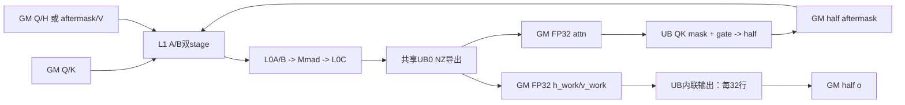

# ChunkFwdOVllm 310P ACLNN 算子知识

## 310P 输出阶段的选择顺序

先固定 310P 构建，准备 FP16 q/k/v_new/h、FP32 或 FP16 的 g、chunk64 与实际 BNSD/变长布局。[接口与语义](#接口与语义)说明 h 是 chunk 入口状态，输出不是完整 GDN 状态推进；公开 BF16 枚举没有对应本卡 unified 核心模板。

1. 先按 g dtype 在[Route 选择](#route-选择)区分 G32/G16；两条路线的 Input 都是 half。
2. 变长调用先核 cu、展平 `(sequenceIdx,chunkInSequence)` 对、NT 与 h 的顺序/容量，再读[Host/Launcher](#hostlauncher-执行流程)。chunkOffsets 不能换成单列累计 chunk 前缀。
3. 对照[限制与失败边界](#限制与失败边界)检查 V/128、odd head、固定 mask 与 DMA 尾部，再按[310P 数值验收](../../../../guides/bringup/vllm_ascend_310p_gdn_numerical_validation.md)核真实输出。

生产 guard 的 FP16、V≥128 且整除128仍要保留；满足 guard 不等于本卡所有 V/尾块已实测安全。dtype、数组格式、h 容量或输出数值不一致时，停在输出阶段定位，不以其他平台 BF16 或 CPU reference 成功替代。

## 算子速览

| 项目 | 内容 |
|---|---|
| 实际入口 | aclnnChunkFwdOVllmGetWorkspaceSize / aclnnChunkFwdOVllm，公开 ACLNN 两阶段接口 |
| 固定身份 | Main ceac1a2bdff3139ca8fbd1a60b3a9befd68cadf2；CATLASS 41bf90da655bba3c66d0acd7e00abe33960ecfd6；metadef v9.2.0 000cd91b8f809ac55f4c51bd9fdee3ace8db1589 |
| 计算语义 | QKᵀ 经因果 gate mask 后乘 V，加 exp(g)×QH，再统一乘 scale |
| 输入输出 | q/k 为 BNSD，v/o 为 value-head BNSD，h 为按 chunk 排列的 KV 状态，g 为每 token/value head 标量 |
| 执行类型 | 单个 MIX_CV 核心节点；310P 声明 MIX_AIC，实际 ProcessUnifiedCore 顺序执行三次 AIC_CUBE 与向量处理 |
| Kernel 路线 | R-001：gate FP32；R-002：gate half；两者输入/输出计算均为 half，均包含小块和两段 mask 分支 |
| 核心资源 | 五份 GM Workspace 切片、L1/L0A/B 双 stage、L0C、共享 UB；无独立 TQue 队列 |
| 来源闭包 | source_closed：公开 API→L0 launcher→Host/注册 TilingData→entry→arch20 scheduler/QK mask/三个 BlockMmad/内联输出；普通 CANN 前处理、生成桥接和通用 primitive 标为外部边界 |
| 验证状态 | 完成静态源码链核对；未执行编译、上游测试、NPU、数值、模型、性能或 Agent A/B |

## 接口与语义

### 计算语义

对一个含 c 个有效 token 的 chunk，令 A=Q_c K_cᵀ、D[i,j]=1(j≤i)×exp(min(g_i−g_j,0))。预期组合为 A_mask=cast_half(A⊙D)，P=Q_c H_c，R=A_mask V_c，O_c=cast_half(scale×(R+exp(g_i)P_i))。没有 softmax、归一化或本算子内的 WY 准备。完整 GDN 中 V 通常来自 Chunk H 的修正 value；公开接口只消费调用者传入的 v，不能把原始 V 与修正 value 自动视为相同。

Mins(...,0) 是真实 gate 限幅，不应在一般输入下删去。若输入 g 是单调不增的累计负 gate，因果区域中的差值本来非正；非单调或正 gate 时，源码仍使用限幅后的指数。QK、QH、A_mask×V 以 half 输入、FP32 累加/交接；mask 后矩阵先量化 half，再送第三次矩阵乘，末端再量化 half，不能描述为全 FP32 计算。

h 只读，o 写回；本接口没有推进完整递推 state。h 的 chunk 顺序、head 映射与 v/g/cu/chunk 描述符必须匹配，见配套 [Chunk H 算子卡](vllm_ascend_chunk_gated_delta_rule_fwd_h_310p.md)。

### 输入、输出与属性

| 参数 | shape/layout | dtype | 约束、默认值与语义 |
|---|---|---|---|
| q | 逻辑 [B,Hk,T,K]，BNSD | OpDef 列 FP16/BF16；active 按 half 读 | API 只检查非空，没有 rank/shape/dtype 实质校验 |
| k | 与 q 配对 | 同 q 的声明 | active K 视图按 ColumnMajor 解释为转置；API 没有证明各轴一致 |
| v | [B,Hv,T,V] | OpDef FP16/BF16；active half | 完整 GDN 中应匹配所需修正 value |
| h | [B,Hv,NT,K,V]，KV 状态 | OpDef FP16/BF16；active half | 不做 VK/KV 自动转置，不更新 h |
| g | [B,Hv,T] | OpDef FP32 或输入 dtype | 必需；没有 gk 或 neutral-gate 构造 |
| cuSeqlensOptional | aclIntArray，L0 转 INT64 ND Tensor | INT64 | 有则进入变长；没有完整首尾/单调/长度校验 |
| chunkOffsetsOptional | aclIntArray，L0 转 INT64 ND Tensor | INT64 | 名为 offsets，设备实际按 (序列号,段内 chunk 号) 的展平二元组读取 |
| scale | API double，Host 读 double 后转 float | POD FP32 | OpDef 默认 1.0；无 finite/范围检查 |
| chunkSize | int64，默认 64 | int64 | API 不强制正值或等于64；因果 mask 却硬编码64 |
| oOut | [B,Hv,T,V] | OpDef 与输入配对，active half | 必须提供；API 不校验输出 shape/容量/alias |
| workspaceSize/executor | 输出指针 | uint64 / executor | 成功后写入；没有独立非空检查 |
| workspace/stream | 第二阶段调用者提供 | 原始内存/流 | 寿命与异步完成由实际 CANN/调用者合同决定 |

### 入口与版本

本卡覆盖公开 ACLNN 的 310P 路线。头文件、实现、OpDef 的公开注册和 build_aclnn.sh 的 ascend310 分支共同证明入口与构建选择，不由 Torch 符号存在单独推断。OpDef 同时列 A2/A3/950，其他平台的 arch22 body 没有合并进本卡平台范围。

Dockerfile.310p 固定 CANN 9.2.0_20261022115200、SOC ascend310p1、vLLM v0.32.0 和 torch-npu 26.2.0/20261015.5。这里没有执行容器配方。metadef 的固定 v9.2.0 源码用于静态解释序列化，不证明与该 weekly 制品逐字相同；版本配对沿 [框架记录](../../../../concepts/frameworks/vllm_ascend.md)核对。

## Host/Launcher 执行流程

### 参数校验与前处理

ChunkFwdOVllmParams 保存 q/k/v/h/g、两个可选数组、scale/chunkSize 和 oOut。创建 executor 后，CheckParams 依次调用 CheckNotNull、CheckFormat、CheckShape、CheckDtype。只有非空检查实际约束 q/k/v/h/g/oOut；后三个函数直接返回成功。不能因为这些校验函数有名称就宣称验证了 shape、格式、dtype、head 整除、chunk 正值或输出容量。

ParamsDataContiguous 依次处理五个输入。l0op::ChunkFwdOVllm 将可选 cu/chunk 数组通过 ConvertToTensor 转成 INT64，并直接设置 ND 格式；转换结果没有逐项非空保护。ADD_TO_LAUNCHER_LIST_AICORE 的输入顺序为 q/k/v/h/g/cu/chunk，输出 oOut，属性 scale/chunkSize。L0 返回调用者的 oOut，外层登记 ViewCopy；不表示 L0 总会新分配正确 shape 的连续输出。

CREATE_EXECUTOR、Contiguous、ViewCopy 和生成的 inner launcher 是框架边界。失败按源码 CHECK_RET/CHECK_COND 传播，公开 CheckParams 的内部错误归并为参数无效；第二阶段 CommonOpExecutorRun 非成功返回内部错误。

### 参数、Workspace 与生命周期

令 C=AIC 核数、S=chunkSize，A(x)=floor((x+512)/512)×512。该公式在 x 已对齐或为0时仍多一个512，不是标准 ceil512。Host 按下表递增字节偏移：

| 切片 | 起始/长度与实际用途 |
|---|---|
| 起始 | GetLibApiWorkSpaceSize()+16MiB |
| vWorkspaceOffset | A(C×S×V×4×2)，第三次矩阵乘结果，FP32 |
| hWorkspaceOffset | A(C×S×V×4×2)，QH 结果，FP32 |
| attnWorkspaceOffset | A(C×S×S×4×2)，QK 结果，FP32 |
| aftermaskWorkspaceOffset | A(C×S×S×4×2)，Host 按 FP32 预算，设备实际 half |
| maskWorkspaceOffset | A(S×S)，声明 bool GM 区；active QK mask 不读取 boolInput |
| 结束 | 再加16MiB，写 currentWorkspace[0] |

GM mask 区与 UB 的 float 因果 mask 是不同缓冲。gmMask 绑定并传入 epilogue，但 boolInput 仅作为形参存在；实际因果 mask 由 InitCausalMask 在 UB0 生成，不能杜撰 GM mask 初始化和读回。

GetWorkspaceSize 成功后通过 ReleaseTo 交出 executor，第二阶段由调用者提供 workspace/stream 并调用 CommonOpExecutorRun。本卡不推断 executor 释放、内存分配器、异步任务完成和跨流所有权；Torch 接线的 raw-pointer/清理边界见 [ACLNN 指南](../../../../guides/integration/vllm_ascend_custom_aclnn_binding.md)。

### 启动图与失败传播

Tiling4ChunkFwdOVllm 直接从 q/v storage shape、g dtype、cu tensor、属性和 PlatformAscendC 生成参数；没有 priority/IsCapable 路线，也没有 SetTilingKey 调用。entry 注册默认任务；不能借用 Chunk H 的“Host 强制 key0”描述。ChunkFwdOVllmCompileInfo 为空，TilingPrepare 忽略 context 后返回成功。

blockDim 直接取 GetCoreNumAic，Host 未查询并验证 UB/L1/L0 容量，也未按有效任务数缩小 blockDim。SaveToBuffer 后设数据长度，未完整检查其失败状态或若干框架指针。

核心节点实际为 entry→Init→Process→ProcessUnifiedCore。当前 task 做 QK、重建因果 mask、QK mask；PIPE_ALL 后处理前一 stage 的 QH 和 A_mask×V，再 PIPE_ALL 后执行内联输出，最后以 needRun 排空上一 stage。ProcessSplitCore 和 EpilogueGDNFwdOOutput 类不在 active 调用链，不能混入当前启动图。

## Route 与参数设计

### 分核与资源计算

无 cu 时 shapeBatch=B、isVariedLen=0、tokenBatch=1；有 cu 时 shapeBatch=1、isVariedLen=1、tokenBatch=cu.shape[0]−1。scheduler 的变长 numChunks 为各段 ceil(length/S) 之和；这里没有 Chunk H 那样的正段压缩与原请求恢复。

vBlockSize=128，vLoops=V/128 为向下取整；taskNum=vLoops×shapeBatch×numChunks×Hv，headGroups=Hv/Hk，每核 taskIdx=2×coreIdx。按两个 head 交错轮转，完成一对后 taskIdx+=2×C；没有 Chunk H 的 dummy head 标记。vIdx 虽计算，但不进入 q/k/v/h/g/o 地址，不构成独立128列切片。

QK 的 M/N/K 为 c/c/K，QH 为 c/V/K，第三矩阵乘为 c/V/c。三者共用 L1/L0 tile128³，以及 MmadPingpongTlaMulti<AtlasA2,true,false>，没有本算子的外层 M/N 分块补救。K 轴由 BlockMmad 内部循环。S、V、head 数、tail 和所有乘积的有效范围必须独立核对。

### Route 选择

| 顺序 | Route | Key/模板 | 精确选择条件与优先级 | 不适用去向 |
|---:|---|---|---|---|
| 1 | R-001 G32 | 默认任务；GDNFwdOKernel<half,float,float> | __CCE_AICORE__=200，arch20 定义 CATLASS_UNIFIED_CORE，gDataType==2 | 非2进入R-002 |
| 2 | R-002 G16 | 默认任务；GDNFwdOKernel<half,half,float> | 同平台/编译 guard，gDataType!=2 | 无 CPU/reference fallback |

```text
公开非空检查 -> Contiguous -> L0 -> Tiling4ChunkFwdOVllm
 -> Host不显式SetTilingKey，默认任务注册
 -> __CCE_AICORE__200 -> arch20 / CATLASS_UNIFIED_CORE
 -> BF16输入模板块被预处理排除，实际INPUT_TYPE=half
 -> gDataType==2 ? R-001 : R-002
 -> Init -> ProcessUnifiedCore
 -> 每个task的QK mask内部再按m_sub<=32或>32处理
```

### 模板/实现执行矩阵

| Route | key/selector | dtype/shape/platform 完整命中条件 | 执行族与 kernel 节点 | 实际模板/body | 内存与同步特征 | tail/fallback |
|---|---|---|---|---|---|---|
| R-001 | 默认任务，g2 | 上表 guard；Host 对非 BF16/FP16 g 也保留枚举2，不能等同合法 dtype | 单 MIX_CV 节点，MIX_AIC 统一核心 | half/float/float；QK→mask、上一stage QH→AV→inline output | gate 直接 FP32；三次 Mmad、GM fence、共享UB | 同时包含两个mask分块分支；无受保护fallback |
| R-002 | 默认任务，g非2 | 同平台；FP16映射0，BF16映射1但实际按half读 | 同图 | half/half/float；gate先cast float | 增加QK mask gate转换与输出gTyped临时区 | 同上；不证明BF16可用 |

每条 Route 都保留完整 QK mask 条件体：m_sub=ceil(c/subBlockNum) 的首块行数或另一块余数；m_sub≤32 时一次处理，m_sub>32 时分两段。它们是同一模板内逐 task 的实际分支，不能把长块的 row-loop 结论推广到小块。

### 隐藏性能 Guard

| Guard | Host/Tiling 条件 | Device/资源原因 | 影响 Route | 不满足时去向 | 源码符号 |
|---|---|---|---|---|---|
| dtype | API CheckDtype为空，OpDef列有限组合 | unified输入/输出均half，gate按枚举分支 | 两条 | 框架可能按OpDef拒绝；公开函数不完整拒绝；无转换fallback | CheckDtype / entry |
| rank/head | CheckShape为空；Host直接GetDim | headGroups=Hv/Hk，若0或不整除会影响地址 | 两条 | 无对应Host保护 | Tiling4 / scheduler.Init |
| V | vLoops=V/128，无整倍数检查 | V<128任务数0；vIdx不进入地址 | 两条 | 无128列尾部路线 | vLoops / InitTask |
| chunk64 | attr默认64但没有强制 | InitCausalMask硬编码64×64；mask索引步长64 | 两条 | 不提供一般S支持承诺 | InitCausalMask / Qkmask |
| S/V/资源 | Host未做完整tile/UB检查 | 固定128 tile、mask固定子区、动态输出UB | 两条 | 无资源不足后继路线 | ProcessUnifiedCore |
| odd head/任务尾 | 每任务两个head，没有dummy保护 | baseHeadIdx+headInnerIdx可能跨有效范围 | 两条 | 无显式odd-head保护 | InitTask |
| 任务结束 | taskIdx>=taskNum只置false，不return | 描述符计算和变长数组读取仍继续 | 两条 | 调用者的body guard不能倒推保护先前读取 | InitTask |
| DMA尾部 | 普通DataCopy/分形导出 | align16矩形写与32B整数块计数 | 两条 | 未逐元素保护所有tail | BlockMmad / inline cp |
| 自动同步 | --cce-auto-sync=off | 依赖实际event/barrier和primitive | 两条 | 不能假设编译器自动补齐 | op_host/CMake |

### POD/ABI

ChunkFwdOVllmTilingData 的注册宏包含16个int64字段和一个float scale。按固定metadef9.2 FieldHandler的字段大小对齐及构造末尾8字节补齐，静态线上长度为136B。int64=8B/align8、float=4B/align4是下表推导前提；不是Host宏类的对象sizeof。生成设备头在冻结Main中不可见，实际sizeof/alignof/offsetof与weekly制品没有编译验证；不以普通C++对象布局替代序列化。

| 结构 | 字段 | 类型/位宽 | ABI 布局：线offset | 单位 | Host producer | Device consumer | 边界 |
|---|---|---|---|---|---|---|---|
| ChunkFwdOVllmTilingData | shapeBatch | int64/64 |0，8B align8 | batch | q.dim0或变长1 | 布局/任务数/地址 | 转uint32 |
| 同上 | seqlen | int64/64 |8 | token | q.dim2 | GM行跨度/均匀chunk | 未完整校验 |
| 同上 | kNumHead | int64/64 |16 | head | q.dim1 | headGroups/qk地址 | 不能据源码保证非0 |
| 同上 | vNumHead | int64/64 |24 | head | v.dim1 | taskNum/ov地址 | 无整除/odd guard |
| 同上 | kHeadDim | int64/64 |32 | 元素 | q.dim3 | QK/QH的K轴 | kernel uint32 |
| 同上 | vHeadDim | int64/64 |40 | 元素 | v.dim3 | V/128、矩阵N、UB | 不等于已验证支持范围 |
| 同上 | chunkSize | int64/64 |48 | token | attr1 int64 | 除法、slice、mask参数 | 未强制64/正值 |
| 同上 | isVariedLen | int64/64 |56 | 开关 | cu非空 | scheduler分支 | 不证明数组有效 |
| 同上 | tokenBatch | int64/64 |64 | 段数 |1或cu.dim0−1 | 变长numChunks累加 | 负值/窄化未保护 |
| 同上 | dataType | int64/64 |72 | 枚举 | q为BF16取1，否则0 | unified active不按它选BF16 | 0不证明dtype合法 |
| 同上 | gDataType | int64/64 |80 | 枚举 | BF16=1/FP16=0/其他2 | entry gate模板 | 其他dtype不自动受支持 |
| 同上 | vWorkspaceOffset | int64/64 |88 | 字节 | 第一切片 | gmVWorkspace，float | 转uint32 |
| 同上 | hWorkspaceOffset | int64/64 |96 | 字节 | 第二切片 | gmHWorkspace，float | 转uint32 |
| 同上 | attnWorkspaceOffset | int64/64 |104 | 字节 | 第三切片 | gmAttnWorkspace，float | 每核两stage |
| 同上 | aftermaskWorkspaceOffset | int64/64 |112 | 字节 | 第四切片 | gmAftermaskWorkspace，half | 预算4B/实际2B分别保存 |
| 同上 | maskWorkspaceOffset | int64/64 |120 | 字节 | 第五切片 | 绑定gmMask但active不读内容 | 不杜撰GM mask传输 |
| 同上 | scale | float/32 |128，4B align4，末补4B | 无量纲 | attr double→float | inline Muls | 精度在Host已缩至FP32 |

没有本算子自有的手写plain tiling结构。局部 GDNFwdOOffsets 是 scheduler 私有地址描述符，不是公开Tiling ABI：uint32的qk/ov/h/g/attn/hv偏移和任务坐标按元素计，isFinalState为bool。其实际C++结构布局不是传入Host序列化的数据，不给它套136B线布局。

### Route 源码闭包

| Route | Key/selector | Host/Tiling producer | POD/参数 | Kernel entry/router | Kernel body/直接依赖 | 构建接线 |
|---|---|---|---|---|---|---|
| R-001 | 默认任务/g2 | Tiling4ChunkFwdOVllm | 注册17字段及生成设备结构 | __CCE_AICORE__200；half,float,float | arch20 kernel551、scheduler273、QKmask425、共享BlockMmad781、inline output | OpDef310p、SOC列表、op_host/CMake |
| R-002 | 默认任务/g非2 | 同函数 | 同ABI，gate宽度不同 | half,half,float | 同body，两个gate转换分支 | 同前 |

Host显式相对包含本算子目录下的tiling_base。已读的TilingBaseClass/registry、CopyTransposeTiling和日志头属于编译依赖；当前Tiling4没有继承/调用其priority模板或GetDataCopyTransposeTiling。不能据include补造IsCapable选择链或额外transpose kernel。OP_LOGD在本地error_log.h中为空宏，日志文本不等于已执行输出。五份通用头的完整独立语义继续defer，不因本卡引用而改派canonical owner。

## Kernel 实现

### 公共执行流程

arch20定义CATLASS_ARCH=2201和CATLASS_UNIFIED_CORE=1。ArchTag名为AtlasA2，但这里是310P编译路线复用的类型；不是把硬件识别成A2。Init读入维度/Workspace偏移至uint32，绑定GM，只初始化cubeBlockScheduler；vecBlockScheduler未在active Init中初始化。

所有路线共用下列索引：

```text
headGroups=Hv/Hk；vHead=baseHead+headInner；kHead=vHead/headGroups
qk=((shapeBatchIdx*Hk+kHead)*T + tokenOffset + batchChunkIdx*S)*K
ov=((shapeBatchIdx*Hv+vHead)*T + tokenOffset + batchChunkIdx*S)*V
h=((shapeBatchIdx*Hv+vHead)*numChunks+chunkIdx)*K*V
g=(shapeBatchIdx*Hv+vHead)*T + tokenOffset + batchChunkIdx*S
attnWork=(core*2+stage)*S*S；hvWork=(core*2+stage)*S*V
```

变长chunkOffsets按2×chunkIdx和2×chunkIdx+1读请求号、段内chunk号，cu给tokenOffset和batchTokens；下一个chunk的段内号为0被用于识别段尾。它不是累计chunk数前缀数组。scheduler还保存未见初始化的batchIdx到调试描述符；当前QKmask虽接收batchIdx/headIdx/chunkIdx参数，实际算术不消费这些调试坐标，不能直接判为它们污染输出。

PING_PONG_STAGES为uint32常量2，currStage为int32；GetCube1Offsets/GetCube23Offsets中的减法模2发生无符号转换，得到有效前一/前两stage索引，不能误报负下标。统一流程使用自己的needRun，不调用dormant helper的NeedProcessCube23来决定首轮。

### Route R-001：FP32 gate 统一核心

#### 适用条件

##### 选择证据

| 层级 | 文件 | 符号 | 源码谓词/参数 | 结果/下一跳 |
|---|---|---|---|---|
| API | op_host/op_api/aclnn_chunk_fwd_o_vllm.cpp | CheckParams | 非空检查实际有效，其余校验为空 | L0 |
| Host | op_host/chunk_fwd_o_vllm_tiling.cpp | Tiling4ChunkFwdOVllm | g非BF16/FP16保留枚举2 | 默认任务，无显式key写入 |
| Router | op_kernel/chunk_fwd_o_vllm.cpp | entry | __CCE_AICORE__200且gDataType==2 | GDNFwdOKernel<half,float,float> |
| Body | arch20/gemm/kernel/gdn_fwd_o_kernel.hpp | Process | 无条件ProcessUnifiedCore | 三GEMM与Vector顺序 |

#### Device 数据流

##### 函数级调用链

```text
entry -> Init -> cubeBlockScheduler.Init
 -> Process -> ProcessUnifiedCore
 -> InitTask
 -> 当前task仍有效：BlockMmadQK -> InitCausalMask -> QKmask::operator
 -> PIPE_ALL
 -> needRun：GetCube23Offsets -> BlockMmadQH -> BlockMmadAttenVNEW
 -> PIPE_ALL -> 32行分段的内联输出
 -> needRun=true -> 继续；最终一轮排空前task
```

##### 源码等价伪码

```text
needRun=false；pingpongFlag=0
while scheduler.isRunning:
  InitTask()     # 注意结束后未立即return，描述符仍可能被计算/读取
  if scheduler.isRunning:
    attn_float = Q_half @ K_half.T
    在UB0重建固定64x64下三角float mask
    m_sub<=32：一次broadcast/gate/strided mask/乘attn/cast_half
    m_sub>32：拆成两stage，广播gate并逐行清上三角，乘attn/cast_half
    GM aftermask写half
  PIPE_ALL
  if needRun:
    取上一stage
    h_work_float = Q_half @ H_half
    v_work_float = aftermask_half @ V_half
    PIPE_ALL
    for row in 0..blockTokens step32:
      读vw/hw/g到UB；PIPE_ALL；exp(g)
      Broadcast -> hw*=exp(g) -> vw+=hw -> vw*=scale
      Cast half -> V_MTE3 -> 按32B整数块写o -> PIPE_ALL
  needRun=true
```

QKmask的两种分块都保留在此路线：令 alignedN=ceil(c/16)×16。小块一次广播；另一subblock的gbrcRealStart按8向下对齐，gbrcRealProcess覆盖有效gate行。大块令mActualPerStage=ceil(m_sub/2)，逐stage更新mActualThisStage/gbrcStart/gbrcRealProcess，广播g_i−g_j、限幅和Exp后按行零化上三角。small分支仍使用strided Mul/Muls；不能将large分支的改写说成全路径移除strided调用。

#### 内存与数据搬运

##### 资源与搬运表

| 层级/缓冲区 | offset/地址公式 | extent/容量公式 | dtype/layout | producer | consumer | owner/lifetime | 对齐/复用 |
|---|---|---|---|---|---|---|---|
| GM输入/输出 | 上述scheduler公式 | B/H/T/K/V/NT | BNSD/KV连续视图 | caller/框架 | 三GEMM/Vector | executor/caller | 不是任意stride保证 |
| GM attn | user+attnWorkspaceOffset | C×2×S²×4 | FP32 ND | QK | QKmask | 单次Workspace | 当前stage |
| GM aftermask | user+aftermaskWorkspaceOffset | 实际C×2×S²×2 | half ND | QKmask | AV | 同上 | Host预算按4B |
| GM h/v work | 各自offset | 各C×2×S×V×4 | FP32 ND | QH/AV | inline output | 同上 | 前一stage |
| GM mask | user+maskWorkspaceOffset | A(S²) | bool声明区 | 无active写入 | boolInput不读取 | 同上 | 无实际GM mask边 |
| L1 A/B | A0/32KiB；B64/96KiB | 每片128×128×2=32KiB | QK zN/nZ；QH/AV zN/zN | GM→L1 | L1→L0 | Resource | A/B各两stage |
| L0A/B | 各0/32KiB | 各64KiB | zZ/nZ，half | L1 copy | Mmad | Resource | 双stage |
| L0C |0 | nominal64KiB FP32 | accumulator | 三次Mmad | L0C→UB | Resource预留128KiB | 单stage/unit flag |
| UB co2Temp |0 | align16(M)×align16(N)×4 | FP32 NZ fractal | L0C DataCopy | 分形写ND GM | 与mask/输出共享 | PIPE_ALL后复用 |
| UB因果mask |0 |64×64×4=16KiB | float下三角 | InitCausalMask | small QKmask | 每次QK后重建 | large路径逐行构造gate mask |
| UB QKmask公共 | mask0；left16KiB；up36KiB；gcomp52KiB；scratch53KiB |16/20/16/1/16KiB | float/byte | g广播/mask | gate×attn | epilogue | 固定子区，不按任意S扩大 |
| UB QKmask ping | g69、typed70、attn71、out87、half103KiB |1/1/16/16/8KiB | float/half别名 | DMA/Cast/算术 | GM half aftermask | epilogue | 最终ping界111KiB |
| UB QKmask pong | g127、typed128、attn129、out145、half161KiB | 同ping | 同上 | 同上 | 同上 | 同上 | 最终界169KiB |
| UB inline vw/hw |0、4L | 各L×4，L=32V元素 | float | GM work | Exp gate后Add/Muls | 当前32行段 | 先完成前序GEMM/向量阶段 |
| UB inline gate |8L |512B预留；实际rows×4 | float | GM g | Exp/Broadcast | 同上 | R-001不使用typed临时区 |
| UB inline out |8L+512 |L×2 | half | Cast | GM o | 同上 | source注释称512对齐，Host未为任意V证明 |
| UB inline broadcast/scratch |10L+512；再加4×rows×V | broadcast最多4L；scratch余量未给size公式 | float/byte | Broadcast | Mul | 同上 | 需按primitive真实tmp需求核对 |
| 寄存器 | task/head/chunk/row坐标、scale | 无固定字节预算 | uint32/float | scheduler/Host | 控制/算术 | 当前调用 | 不编造寄存器占用 |

##### 分层内存布局



本实现使用Resource的TBuf切片，没有独立UB队列，不补造TQue或双队列图。QKmask的ping/pong与GM两stage是两层状态：QKmask每次处理后以1−flag翻转，大块一次调用内翻转两次，不能把两者同步视为同一索引。

##### 字节账、交接边与复用顺序

```text
workspace = libWS +32MiB
 +2*A(8*C*S*V) +2*A(8*C*S*S) +A(S*S)
L1 active tiles =128KiB；L0A=64KiB；L0B=64KiB；nominal L0C=64KiB
Resource<AtlasA2>类型预留：L1=512KiB、L0A/B各64KiB、L0C=128KiB、UB=192KiB
QKmask固定布局最高169KiB；不等于任意S/c/subBlockNum均安全
Inline L=32V：
 vw[0,4L)，hw[4L,8L)，gate预留[8L,8L+512)
 out[8L+512,10L+512)，broadcast最多[10L+512,14L+512)
 brcTmp从10L+512+4*rows*V开始，其需求未在Host预算
因此最大32行时已用14L+512=448V+512字节，再核对scratch/对齐
```

上界来自使用的类型和切片源码，Host没有查询并证明310P实际可用资源，不能将这些常量当作真机容量测量。Workspace偏移、shape、乘积及DMA的uint16字段还需分别约束；先窄化再校验无效。

| 边/复用子区 | producer | offset/extent | dtype/layout | consumer | ordering/sync | owner/lifetime | 安全条件 |
|---|---|---|---|---|---|---|---|
| QK→mask | BlockMmadQK | 当前attn stage | FP32 ND | QKmask | Mmad导出PIPE_ALL；重建UB0 mask | Workspace/Resource | 尾矩形与mask64合同 |
| mask→AV | QKmask | 当前aftermask stage | half ND | 后续前一stage AV | 循环中的PIPE_ALL GM fence | Workspace | 不提前覆盖未消费stage |
| QH/AV→output | 两BlockMmad | h/v work前一stage | FP32 ND | 内联输出 | 显式PIPE_ALL再读GM | Workspace | 所有矩阵写提交 |
| UB0 | L0C导出、mask、内联vw | 各阶段extent | NZ/float等 | 下一阶段 | 顺序与实际PIPE_ALL/event | Resource | 每次QK后重新建mask |
| inline段 | DMA/Exp/Broadcast/Add | vw/hw/g/out/scratch | FP32→half | GM o | MTE2后PIPE_ALL，V_MTE3，写后PIPE_ALL | 当前32行段 | scratch足够、32B计数可表示 |

#### 同步、精度与尾块

##### 同步与数值边界表

| 阶段 | primitive/机制 | producer | consumer/等待点 | 保护对象 | 精度/尾块 |
|---|---|---|---|---|---|
| L1/L0双buffer | MTE1_MTE2/MTE2_MTE1、M_MTE1/MTE1_M | GM/L1 load/Mmad | 每stage Set/Wait | A/B分片 | HF32=false，FP32累加 |
| Unit flag | 中间10/末11，RowMajor布局转换开关 | Mmad | L0C导出 | 单stage累加 | 共享封装unit分支未见l0CEventList赋值却仍用事件ID，需实际核对 |
| L0C→GM | BLOCK_MODE_MATRIX、PIPE_ALL、逐fractal DMA | L0C/UB0 | GM结果 | align16矩形 | 每fractal16行16列，没有逐元素尾保护 |
| mask初值 | Duplicate与小段SetValue，PIPE_V | InitCausalMask | small mask | UB0固定64² | 以8为分界是实现选择，无本次硬件测试 |
| gate | MTE2_V、Broadcast、Sub、Mins、Exp | g | attn相乘 | gate/临时区 | 实际clamp到≤0后Exp |
| small mask | strided Mul/Muls | mask/gate | half aftermask | m_sub≤32 | alignedN与真实nActual不同，普通DMA未自动证明尾布局正确 |
| large mask | 两stage、逐行Duplicate/SetValue | gate | attn相乘 | m_sub>32 | zeroLen<8也用SetValue清零；不能按旧注释声称跳过 |
| 内联输出 | PIPE_ALL、PIPE_V、V_MTE3、写后PIPE_ALL | h/v/g | GM o | 32行分段 | Cast(CAST_NONE)；cp.blockLen=elems×2/32为整数截断 |
| 核间 | active没有CrossCoreSet/Wait握手 | N/A | N/A | 无active分离AIC/AIV边 | dormant flags3..7不纳入本图 |
| 空/任务尾 | isRunning/needRun | scheduler | 后继矩阵 | 双stage | task结束描述符仍读取；odd head无dummy；无完整空批协议 |

GetSubBlockNum及普通DataCopy/Broadcast/Mmad在实际m200工具链上的语义为库/设备边界。QKmask按首subblock与另一subblock余数拆法编写，不能未经证明扩成任意subblock数。没有原子累加或本算子内的state写回。

#### 关键实现

##### 符号证据表

| 阶段 | 文件 | 符号/模板实例 | 实现事实 |
|---|---|---|---|
| API | op_host/op_api/aclnn_chunk_fwd_o_vllm.cpp | ChunkFwdOVllmParams / ParamsDataContiguous | 非空检查与五输入连续化 |
| Host | op_host/chunk_fwd_o_vllm_tiling.cpp | Tiling4ChunkFwdOVllm | 五切片/scale缩窄/不写key |
| Router | op_kernel/chunk_fwd_o_vllm.cpp | <half,float,float> | FP32gate路线 |
| Scheduler | arch20/gemm/block/block_scheduler_gdn_fwd_o.hpp | InitTask / GetCube23Offsets | 展平二元组、双head/stage |
| QK mask | arch20/epilogue/block/block_epilogue_gdn_fwdo_qkmask.hpp | mActualThisStage / gbrcRealProcess | 两种分块、真实gate与mask |
| 三矩阵 | csrc/moe/common/kernel_utils/block/block_mmad_pingpong_tla_multi.hpp | BlockMmadTla | L1/L0与UB导出 |
| Output | arch20/gemm/kernel/gdn_fwd_o_kernel.hpp | STAGE_ROWS / inline block |32行分段算术与GM写回 |

### Route R-002：half gate 统一核心

#### 适用条件

##### 选择证据

| 层级 | 文件 | 符号 | 源码谓词/参数 | 结果/下一跳 |
|---|---|---|---|---|
| Host | op_host/chunk_fwd_o_vllm_tiling.cpp | gDataType | FP16=0、BF16=1 | 两者都进入非2分支 |
| Router | op_kernel/chunk_fwd_o_vllm.cpp | entry | 同310P/unified且gDataType!=2 | GDNFwdOKernel<half,half,float> |

BF16 gate并未在这里转成half；active模板按half解释输入，不能把“非2”改写为已支持BF16。公开API的CheckDtype为空，OpDef能力与实际310P模板必须分别记录。

#### Device 数据流

##### 函数级调用链

entry→Init→scheduler→ProcessUnifiedCore→QK→QKmask<half gate>→前一stage QH/AV→内联half gate转换/输出。默认任务、循环排空和两个mask分块与R-001相同。

##### 源码等价伪码

```text
QKmask：先将GM half g读到gUbFPTensor，再Cast float
  -> 与R-001相同Broadcast/Sub/Mins/Exp/causal mask
inline输出每32行：
  GM half g -> gTyped[8L+256] -> PIPE_ALL -> Cast到gUb[8L]
  -> PIPE_ALL -> Exp/Broadcast -> FP32 Mul/Add/Muls -> half输出
```

gate进入计算前已有half量化损失；随后所有gate算术仍FP32。两路线的矩阵累加类型相同，不能因输入gate更小而宣称净加速。

#### 内存与数据搬运

##### 资源与搬运表

| 层级/缓冲区 | offset/地址公式 | extent/容量公式 | dtype/layout | producer | consumer | owner/lifetime | 对齐/复用 |
|---|---|---|---|---|---|---|---|
| GM gate | gOffset | c×2B | half | caller | QKmask/inline | executor | 非FP32跨度 |
| QKmask typed gate |70/128KiB | 固定1KiB区 | half→float | DataCopy/Cast | gUb69/127KiB | epilogue | gate长度须容入固定区 |
| inline gTyped |8L+256 | rows×2，rows≤32 | half | GM DMA | Cast到8L处float g | 当前段 | 两者在512B预留区内错开 |
| 其余GM/L1/L0/UB | R-001完整资源表 | 原Workspace及类型容量 | 矩阵half/结果float | 同前 | 同前 | 同前 | 两种mask分块均保留 |

##### 分层内存布局

R-001图不变，增加GM half gate→typed UB→Cast float支路。QKmask使用自己的typed子区；内联输出另用8L+256，二者不能混成同一块持久缓冲。没有新增kernel或跨核flag。

##### 字节账、交接边与复用顺序

Workspace预算不因gate dtype变化而改变。gate输入每元素由4B变2B，但多了两处转换；inline gTyped最多64B，与gUb最多128B在512B预留中分离。R-001的14L+512与scratch需求、169KiB QKmask最高区、L1/L0和GM双stage公式仍适用。

#### 同步、精度与尾块

##### 同步与数值边界表

| 阶段 | primitive/机制 | producer | consumer/等待点 | 保护对象 | 精度/尾块 |
|---|---|---|---|---|---|
| QK gate | MTE2_V→Cast→PIPE_V | half gate | FP32广播/Exp | typed/gUb | half DMA尾与固定区容量 |
| inline gate | DataCopy→PIPE_ALL→Cast→PIPE_ALL | gTyped | gUb Exp |512B预留 | CAST_NONE，不恢复输入量化损失 |
| 其他 | R-001完整同步表 | 同前 | 同前 | 同前 | 两种mask分块、L0C16×16尾写与输出32B截断不变 |

#### 关键实现

##### 符号证据表

| 阶段 | 文件 | 符号/模板实例 | 实现事实 |
|---|---|---|---|
| Entry | op_kernel/chunk_fwd_o_vllm.cpp | <half,half,float> | gate非2模板 |
| QKmask | arch20/epilogue/block/block_epilogue_gdn_fwdo_qkmask.hpp | !is_same<GElementInput,float> | typed DMA后Cast |
| inline output | arch20/gemm/kernel/gdn_fwd_o_kernel.hpp | gTyped / G_RESERVE |8L+256临时区与32行转换 |

## 算子特定优化

### Trick T-001：矩阵之后重建共享UB的因果mask

#### 触发与源码依据

- 适用 Route：R-001/R-002，当前task的QK完成后。
- Golden 来源：[mask重建调用](https://github.com/vllm-project/vllm-ascend/blob/ceac1a2bdff3139ca8fbd1a60b3a9befd68cadf2/csrc/moe/chunk_fwd_o_vllm/op_kernel/arch20/gemm/kernel/gdn_fwd_o_kernel.hpp#L267-L267)。

```cpp
                InitCausalMask();
```

#### 机制与设计原因

共享BlockMmad用UB0导出L0C，先前因果mask会被覆盖，所以QK之后重新构造固定64² float下三角。实现先全1，再对上三角分Duplicate或小段SetValue写0。large mask分支另做逐行零化，不能因此删除所有task的mask重建：small分支仍消费UB mask。

#### 迁移边界

前提是当前共享UB与两个mask分支；S、subblock和尾块改变后须重算。只可将large路径不读mask作为进一步核对的优化候选，没有测得收益。本次未运行编译、真机、数值或性能测试。

#### 错误做法

只在循环外初始化一次，会与每次QK覆盖UB0的事实冲突；没有固定来源证明这样改写仍正确。

### Trick T-002：内联输出按32行限制临时UB

#### 触发与源码依据

- 适用 Route：两条；前一stage的QH/AV完成后。
- Golden 来源：[输出分段](https://github.com/vllm-project/vllm-ascend/blob/ceac1a2bdff3139ca8fbd1a60b3a9befd68cadf2/csrc/moe/chunk_fwd_o_vllm/op_kernel/arch20/gemm/kernel/gdn_fwd_o_kernel.hpp#L316-L317)。

```cpp
                    constexpr uint32_t STAGE_ROWS = 32;
                    uint32_t bt = prevOffsets.blockTokens;
```

#### 机制与设计原因

vw/hw/g/out/broadcast按32V规划，逐段读GM并写输出，避免将整个chunk的输出后处理一次装入UB。这个active内联实现替代dormant Output epilogue，不把该类事件和缓冲布局当作当前数据流。

#### 迁移边界

必须保留14L+512加Broadcast scratch预算、gate宽度和写后PIPE_ALL。32是源码常量，不等于任意V都已受Host guard保护。未执行运行验证。

#### 错误做法

直接按类名复用未调用的Output epilogue资源表，或把32改大而不重算UB/scratch，均没有当前源码依据。

### Trick T-003：大mask分两stage逐行清上三角

#### 触发与源码依据

- 适用 Route：两条的m_sub>32分支。
- Golden 来源：[有效列数](https://github.com/vllm-project/vllm-ascend/blob/ceac1a2bdff3139ca8fbd1a60b3a9befd68cadf2/csrc/moe/chunk_fwd_o_vllm/op_kernel/arch20/epilogue/block/block_epilogue_gdn_fwdo_qkmask.hpp#L363-L364)。

```cpp
                    uint32_t validCols = globalRow + 1;
                    if (validCols > alignedNActual) validCols = alignedNActual;
```

#### 机制与设计原因

mActualThisStage限制单次处理行数，逐行根据全局行号保留含对角线的有效列，剩余部分以Duplicate或SetValue清零。代码的zeroLen<8分支也真实写0，不能照旧注释解释成近对角近似跳过。

#### 迁移边界

只有large分支采用该写法；small分支仍有strided Mul/Muls。必须保持globalRow、gbrcRealProcess、alignedNActual与GM真实nActual的关系；本次无真机结果。

#### 错误做法

将large分支的实现结论扩成“310P整条算子不含strided调用”，会遗漏可达small/tail分支。

### Trick T-004：先限幅gate差再求指数

#### 触发与源码依据

- 适用 Route：两条、两种mask分块；下方摘录large分支。
- Golden 来源：[gate限幅](https://github.com/vllm-project/vllm-ascend/blob/ceac1a2bdff3139ca8fbd1a60b3a9befd68cadf2/csrc/moe/chunk_fwd_o_vllm/op_kernel/arch20/epilogue/block/block_epilogue_gdn_fwdo_qkmask.hpp#L354-L354)。

```cpp
                AscendC::Mins(gbrcUpUbTensor, gbrcUpUbTensor, (float)0.0, mActualThisStage * alignedNActual);
```

#### 机制与设计原因

真实公式是exp(min(g_i−g_j,0))，再叠因果mask和QK；对一般非单调gate不等于直接exp差值。这是精度/语义合同，不将它包装为测得的数值稳定性收益。

#### 迁移边界

保留FP32 gate算术与half aftermask量化顺序；若上游改变g的定义，应重新核数学等价性和端到端数值。无本次测试结果。

#### 错误做法

凭GDN通常输入累计负gate就无条件删除Mins，不能覆盖公开接口可传入的其他g。

### Trick T-005：两stage配合needRun排空前一task

#### 触发与源码依据

- 适用 Route：两条，GM双stage调度。
- Golden 来源：[上一stage访问](https://github.com/vllm-project/vllm-ascend/blob/ceac1a2bdff3139ca8fbd1a60b3a9befd68cadf2/csrc/moe/chunk_fwd_o_vllm/op_kernel/arch20/gemm/block/block_scheduler_gdn_fwd_o.hpp#L219-L221)。

```cpp
    GDNFwdOOffsets& GetCube23Offsets() {
        return offsets[(currStage - 2) % PING_PONG_STAGES];
    }
```

#### 机制与设计原因

当前task先做QK/mask，needRun为真时再做前一task的QH/AV/output。第一次needRun=false，最后一轮即使当前task无效，仍需排空前一stage。unsigned PING_PONG_STAGES使减法模2保持有效下标。

#### 迁移边界

必须同时核对任务尾、odd head和InitTask在置isRunning=false后继续读描述符的缺口。排空设计不证明所有输入尾部都安全。没有NPU验证。

#### 错误做法

在当前isRunning变false时直接跳过前一stage输出会破坏排空；把当前描述符读取缺口当成已被body guard保护同样不成立。

### Trick T-006：保守预算和实际half交接分别记录

#### 触发与源码依据

- 适用 Route：两条，Host五切片。
- Golden 来源：[aftermask预算](https://github.com/vllm-project/vllm-ascend/blob/ceac1a2bdff3139ca8fbd1a60b3a9befd68cadf2/csrc/moe/chunk_fwd_o_vllm/op_host/chunk_fwd_o_vllm_tiling.cpp#L116-L117)。

```cpp
    tiling.set_aftermaskWorkspaceOffset(workspaceOffset);
    workspaceOffset += (aicCoreNum * chunkSize * chunkSize * sizeof(float) * pingpongStages + GM_ALIGN) / GM_ALIGN * GM_ALIGN;
```

#### 机制与设计原因

Host按float预算，设备以half写masked attention并供AV读取。预算、地址间隔、实际元素宽度不能互相替换；严格下一512倍数和32MiB保留也必须按原公式记录，来源未证明其全部设计目的。

#### 迁移边界

缩减预算须同步所有offset、两stage、尾部与生成制品，不能仅靠逻辑numel推断可删空间。未编译或测试。

#### 错误做法

固定仓未提供可验证的替代预算反例；不杜撰删保留区必然崩溃或必然加速。

### Trick T-007：L0C通过UB导出并与向量区顺序复用

#### 触发与源码依据

- 适用 Route：两条的三次矩阵乘，CATLASS_UNIFIED_CORE。
- Golden 来源：[矩阵模式导出](https://github.com/vllm-project/vllm-ascend/blob/ceac1a2bdff3139ca8fbd1a60b3a9befd68cadf2/csrc/moe/common/kernel_utils/block/block_mmad_pingpong_tla_multi.hpp#L690-L691)。

```cpp
            enhParams.blockMode = AscendC::BlockMode::BLOCK_MODE_MATRIX;
            AscendC::DataCopy(co2Temp, l0CTensorList[l0CListId], l0c2ubParams, enhParams);
```

#### 机制与设计原因

共享矩阵封装以L0C→UB0→GM的分形搬运替代当前路线不使用的Fixpipe输出，再与mask及内联输出复用UB。它仍物化FP32 GM结果，不宣称消除了GM流量。

#### 迁移边界

需核对align16输出矩形、GM stride−16、每fractal16行16列和PIPE_ALL。泛化到未对齐tail或其他架构须重新证明；无实测收益。

#### 错误做法

照搬新架构Fixpipe路径、删除UB转换或忽略矩形尾写，没有本路线的源码支持。

## 模板与实现对比

| 对比维度 | R-001 G32 | R-002 G16 | 设计选择依据 |
|---|---|---|---|
| 命中条件/优先级 | gDataType2 | gDataType非2 | 默认任务内entry分支 |
| 执行族/节点图 | 统一核心三GEMM/QKmask/inline | 同 | 无额外kernel |
| M/N/K、tile与scheduler | QK=c/c/K，QH=c/V/K，AV=c/V/c；128³ | 同 | 共享BlockMmad与双stage |
| Workspace/L1/L0 | 同五片与预算 | 同 | gate dtype不改变Host预算 |
| QK gate UB | 直接float DMA | half DMA后Cast | 模板G_TYPE不同 |
| inline gate | gUb直接float | gTyped在预留区+256后Cast |32行输出 |
| small/large mask | 两分支均保留 | 两分支均保留 | m_sub≤32或>32 |
| 交接 | 显式GM fence与顺序UB复用 | 同 | active无跨核flag |
| 精度与tail | FP32算术/half中间矩阵和输出 | 额外输入gate量化 | 全部DMA/矩形尾限制仍在 |
| fallback/失败边界 | 无受保护CPU/reference fallback | 同 | 公开校验不足不等于支持扩大 |

## 平台差异

| 项目 | 310P | A2 | A3 | Ascend 950 |
|---|---|---|---|---|
| 支持状态 | OpDef/310构建分支/arch20/Docker9.2静态链闭合，未运行 | OpDef声明，完整body另做 | OpDef声明，完整body另做 | OpDef声明，完整body另做 |
| Host/Launcher | 默认任务，Host不显式写key | 不借此证明全配置 | 同 | 同 |
| Kernel/资源 | __CCE_AICORE__200，MIX_AIC/unified half | entry else选arch22 | 同else路径 | entry也走else，实际兼容性须另核 |
| 迁移限制 | 本卡类型常量与m200 primitive边界 | 不外推UB、gate或tail结论 | 不外推 | 不照搬310P矩阵导出 |

## 限制与失败边界

- API的CheckFormat/CheckShape/CheckDtype是空实现；OpDef的动态能力标记和AutoContiguous不能替代shape、dtype、head、chunk、extent和alias验证。
- unified编译块固定half输入/输出，BF16模板被排除；公开BF16声明不构成310P可执行证明。gate非2也按half读，不能声称自动BF16转换。
- 固定64²因果mask与无chunk64 guard、V/128向下取整、vIdx未入地址、odd head无dummy，以及InitTask结束后继续读取，都是适配必须核对的静态边界，没有本次故障复现。
- 变长chunk数组实际读展平二元组，不能传累计chunk数前缀数组；cu、NT、h的chunk顺序和空段语义需与调用者一致。本算子不恢复被其他层压缩的原请求坐标。
- mask有small和large两个实现；small仍有strided Mul/Muls，large逐行清零且小于8的尾段也实际SetValue。不可把单分支注释提升为全路线硬件结论。
- L0C按align16矩形写、输出DMA按32B整数块计数、uint16/uint32窄化和动态Broadcast scratch缺少完整Host保护；不能仅凭tile或buffer存在声称所有tail安全。
- gmMask区在active算法中不读写；UB0重建因果mask与内联输出才是实际数据流。dormant Output epilogue及split flags不作为当前同步依据。
- 共享BlockMmad的unit-flag事件ID初始化、具体CANN primitive/生成设备头/stream完成、weekly制品身份仍需实际目标栈核对；136B只是显式假设下的静态线布局推导。
- 完整GDN仍需前置WY、padding、状态VK/KV变换、h/o组合及模型验收；沿 [310P接入](../../../../guides/integration/vllm_ascend_310p_gdn_execution_contract.md)与[数值验收](../../../../guides/bringup/vllm_ascend_310p_gdn_numerical_validation.md)处理，不放宽其FP16、V≥128且整除128等生产guard。
- 未执行编译、NPU、数值/性能/graph/多stream/真实模型或Agent A/B；不提供吞吐、时延和跨版本兼容结论。

## 源码索引

### 链路索引

Main算子前缀P=csrc/moe/chunk_fwd_o_vllm/；下表每行对应一个sources文件，P和外部仓路径均指固定commit。

| 链路阶段 | 文件 | 关键符号 | 支撑内容 |
|---|---|---|---|
| API声明 | P/op_host/op_api/aclnn_chunk_fwd_o_vllm.h | 两阶段入口 | 公开参数 |
| API实现 | P/op_host/op_api/aclnn_chunk_fwd_o_vllm.cpp | CheckParams / ParamsDataContiguous | 非空与空校验/连续化 |
| L0声明 | P/op_host/op_api/chunk_fwd_o_vllm.h | l0op::ChunkFwdOVllm | launcher接口 |
| L0实现 | P/op_host/op_api/chunk_fwd_o_vllm.cpp | ADD_TO_LAUNCHER_LIST_AICORE | 数组转换/输出/属性顺序 |
| OpDef | P/op_host/chunk_fwd_o_vllm_def.cpp | ChunkFwdOVllm | dtype/config/optional |
| Host | P/op_host/chunk_fwd_o_vllm_tiling.cpp | Tiling4ChunkFwdOVllm | 五切片/scale/key边界 |
| ABI | P/op_host/chunk_fwd_o_vllm_tiling.h | ChunkFwdOVllmTilingData |17字段 |
| Entry | P/op_kernel/chunk_fwd_o_vllm.cpp | __CCE_AICORE__/gDataType | 310P与两模板 |
| Compat | P/op_kernel/arch20/compat_310p.h | PIPE_FIX / bfloat16 shim | 编译适配不等执行支持 |
| Kernel | P/op_kernel/arch20/gemm/kernel/gdn_fwd_o_kernel.hpp | GDNFwdOKernel | active统一流程/inline输出 |
| Scheduler | P/op_kernel/arch20/gemm/block/block_scheduler_gdn_fwd_o.hpp | BlockSchedulerGdnFwdO | 二元组、head、stage、尾部 |
| Mask | P/op_kernel/arch20/epilogue/block/block_epilogue_gdn_fwdo_qkmask.hpp | BlockEpilogue | gate/两种mask实现 |
| Policy | P/op_kernel/arch20/epilogue/gdn_fwd_o_epilogue_policies.hpp | EpilogueAtlasGDNFwdOQkmask | ArchTag |
| 算子构建 | P/CMakeLists.txt | 子目录遍历 | 构建接线 |
| Host构建 | P/op_host/CMakeLists.txt | add_modules_sources | 自有API/包含路径/auto-sync关闭 |
| 编译依赖 | P/tiling_base/tiling_base.h | TilingBaseClass | 泛型模板未被当前Host调用 |
| 编译依赖 | P/tiling_base/tiling_templates_registry.h | TilingRegistry | include不等priority路线 |
| 编译依赖 | P/tiling_base/data_copy_transpose_tiling.h | GetDataCopyTransposeTiling | 当前Host不调用 |
| 编译依赖 | P/tiling_base/data_copy_transpose_tiling_def.h | CopyTransposeTiling | 独立metadata注册非kernel launch |
| 日志依赖 | P/tiling_base/error_log.h | OP_LOGD | 本地空debug宏 |
| 共享矩阵 | csrc/moe/common/kernel_utils/block/block_mmad_pingpong_tla_multi.hpp | BlockMmadTla | tile/stages/flags/UB导出 |
| 公共兼容 | csrc/common/include/cann_compat.h | LOG/OP兼容 | 固定构建环境 |
| 依赖pin | .gitmodules | CATLASS commit | 精确gitlink |
| 上层MoE构建 | csrc/moe/CMakeLists.txt | add_subdirectory | 目录接线 |
| 版本 | Dockerfile.310p | FROM/SOC/依赖版本 | CANN9.2配方 |
| SOC构建 | csrc/build_aclnn.sh | ascend310分支 | 选择ChunkO和CATLASS |
| 公共构建 | csrc/CMakeLists.txt | OPS_TRANSFORMER_DIR | CANN构建入口 |
| 构建函数 | csrc/cmake/func.cmake | install_common_kernel_headers | 共享头/CATLASS |
| include | csrc/cmake/variables.cmake | OP_TILING_INCLUDE | 包含路径 |
| 对象目标 | csrc/cmake/obj_func.cmake | add_modules_sources | 自有API与Host对象 |
| 生成流程 | csrc/cmake/custom_build.cmake | op_add_subdirectory | 生成构建接线 |
| CATLASS资源 | include/catlass/arch/arch.hpp | AtlasA2 | 类型容量常量 |
| CATLASS持有者 | include/catlass/arch/resource.hpp | Resource | 各层buffer与TPipe |
| CATLASS局部区 | include/catlass/arch/local_tensor_buffer.hpp | GetBufferByByte | 字节切片 |
| CATLASS核间 | include/catlass/arch/cross_core_sync.hpp | CrossCoreFlag | dormant同步原语边界 |
| CATLASS矩阵 | include/catlass/gemm/tile/tile_mmad.hpp | TileMmadTla | MmadParams/initC/unitFlag |
| CATLASStraits | include/catlass/gemm/tile/tile_copy.hpp | PackedTileCopyTla | QK/QH/AV布局 |
| CATLASS接口 | include/catlass/gemm/tile/tile_copy_tla.hpp | TileCopyTla | primitive specialization接口 |
| CATLASS选择 | include/catlass/gemm/helper.hpp | L1A/BTypeSelector | zN/nZ/FP32 accumulator |
| CATLASS GM/L1 | include/catlass/gemm/tile/copy_gm_to_l1.hpp | CATLASS_ARCH2201 | 通用搬运边界 |
| metadef声明 | inc/external/register/tilingdata_base.h | FieldHandler | 字段/尾对齐 |
| metadef实现 | base/asc/tilingdata_base_impl.cc | CheckAlignAndGenPlaceHolder / SaveToBuffer | 静态序列化推导 |
| metadef内部 | pkg_inc/base/asc/tilingdata_base_impl.h | TilingDefImpl | 实现声明 |

### 实现复用检查

| 检查项 | 可复用事实 | 不得改变的约束 | 源码符号 |
|---|---|---|---|
| ABI/POD |17字段、静态线长136B | 字段/单位/scale缩窄/生成头单独核对 | Tiling4 / FieldHandler |
| 调用顺序 | 当前QK/mask与前一QH/AV/output | needRun首轮和排空、两stage地址 | ProcessUnifiedCore |
| workspace/内存 | 五片、保守float预算、共享UB、32行输出 |512公式、实际half跨度、scratch和生命周期 | Tiling4 / STAGE_ROWS |
| 同步 | 三Mmad事件与GM fence/输出PIPE_ALL | auto-sync关闭、unit事件ID核对 | BlockMmad / inline output |
| 精度与尾块 | min差值再Exp、half中间矩阵、FP32累加 | CAST_NONE、mask分块、align16/32B计数 | QKmask / TileMmadTla / DataCopy |
| 失败边界 | 空校验与缺失guard显式保留 | 不以绑定、默认64、模型fixture替代公开接口验收 | CheckParams / InitTask |
