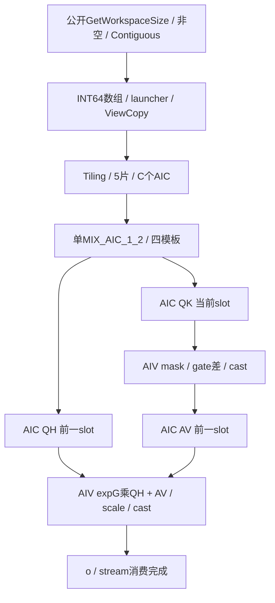
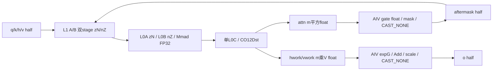
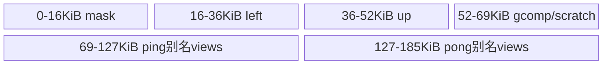
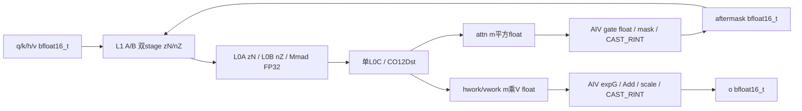
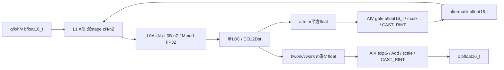

# ChunkFwdOVllm 950 ACLNN 算子知识

## 950 输出路线从哪里判断

先确认目标是本卡 950DT 证据与非 UNIFIED 构建，再记录 q/k/v_new/h/g 的 shape、Input/gate dtype、chunkSize、scale 和变长数组。950PR 或外部改动 CATLASS_UNIFIED_CORE 的构建不能直接沿用这四条路线。

| 当前判断 | 阅读入口 |
| --- | --- |
| v_new/h/g 的职责、门控差和输出 scale 是否一致 | [接口与语义](#接口与语义)，随后核实际 caller；本算子不做 WY、softmax 或状态更新。 |
| 选 half/BF16 与 FP32/Input gate | [Route 选择](#route-选择)；混合 half/BF16 gate 不因编码落入 Input 分支而自动转换。 |
| V、Hv、mask、workspace 或尾部不匹配 | 先读[限制与失败边界](#限制与失败边界)，再追[资源与路线](#route-与参数设计)及对应 Kernel。 |

`V/128` 调度、vIdx 不入地址、两 head 配对和固定 64² mask 都缺少完整 Host 保护；调用侧无法证明这些条件与容量时，先停止泛化形状。四模板存在与 Host 返回成功不提供目标 NPU 数值、图或多 stream 通过证据。

## 算子速览

| 项目 | 内容 |
|---|---|
| 实际入口 | 公开 aclnnChunkFwdOVllmGetWorkspaceSize → aclnnChunkFwdOVllm 两阶段接口 |
| 计算语义 | 分块QK经门控差与含对角因果掩码、降精度后乘v；QH经exp(g)，与前项相加，再整体乘scale、cast输出 |
| 输入输出 | q/k为B×Hk×T×K，v/o为B×Hv×T×V，g为B×Hv×T；h按B×Hv×NT×K×V入口状态寻址；实际域受调度和容量约束 |
| 执行类型 | 单MIX_CV：AIC_CUBE执行QK/QH/AV；AIV_VECTOR执行QKmask/Output；没有独立SIMT、NDDMA、通信节点 |
| Kernel 路线 | R-001 half/float、R-002 half/half、R-003 bfloat16_t/float、R-004 bfloat16_t/bfloat16_t；Workspace均float |
| 核心资源 | 五GM workspace片；同Resource的L1/L0A/L0B双buffer、单L0C；AIV固定UB views最高显式终点185KiB |
| 来源闭包 | source_closed：公开API→l0op→Host Tiling/注册→entry→四模板与AIC/AIV body→当前CATLASS specialization；生成bridge/Device头、通用Contiguous/ViewCopy属于明示框架边界 |
| 验证状态 | 已完成源码闭包检查；本次知识提取未执行编译、真机、数值或性能测试。 |

950 平台由固定公开产品表中的950DT、OpDef的ascend950、build_aclnn的^ascend950选择和Dockerfile.a5的SOC_VERSION=ascend950dt_9582共同支撑，不以arch22文件名替代支持证明。基础镜像为CANN9.2.0_20261022115200-950，同时另装950 ops-transformer9.3.0；cann_versions中的9.2.0不表示已实测一致组件栈，也不证明weekly生成头与库ABI身份。本卡只闭合__CCE_AICORE__==310且未定义CATLASS_UNIFIED_CORE的公开四模板；950PR未获得独立制品或运行验证。

## 接口与语义

### 计算语义

记S=chunkSize、m=当前chunk有效token，K/V为head维，Hv/Hk为head分组比。对一个v head及映射的k head，实际顺序为：

```text
C1: p[i,j] = FP32_accumulate(q[i,:] * k[j,:])             (m,m,K)
V1: d[i,j] = exp(min(float(g[i])-float(g[j]),0))
    a[i,j] = cast_Input(p[i,j]*d[i,j]*(j<=i))              (m,m)
C2: hwork[i,v] = FP32_accumulate(q[i,:]*h_chunk[:,v])      (m,V,K)
C3: vwork[i,v] = FP32_accumulate(a[i,:]*v_new[:,v])        (m,V,m)
V2: o[i,v] = cast_Input((vwork[i,v]+exp(float(g[i]))*hwork[i,v])
                        *float(scale))
```

FP16的a/o使用CAST_NONE，BF16使用CAST_RINT。三个Cube及GM中间值为float，但a在C3前已降精度。低精度gate先CAST_NONE到float，FP32gate直接搬入。QK门控差先Mins0再Exp，Output的exp(g)不钳制；任意非单调门控不能直接替换为不带min的公式。这里没有softmax、归一化、gk、WY求解或状态更新；h为只读块入口状态，v是caller准备的v_new。

### 输入、输出与属性

| 参数 | shape/layout | dtype | 约束、默认值与语义 |
|---|---|---|---|
| q、k | B×Hk×T×K，ND连续 | half/BF16，与Input一致 | Host只从q取B/Hk/T/K；公开CheckShape/CheckDtype不验证k一致性 |
| v | B×Hv×T×V，ND连续 | Input | Host取Hv/V；Kernel实际完整V，并非由vLoops完成128列分块 |
| h | B×Hv×NT×K×V按行寻址 | Input | 每chunk入口状态；hLayout元数据用T而地址用NT，不是容量证明 |
| g | B×Hv×T | float或Input | ACLNN强制非空；gDataType!=2时按Input解读，没有混合half/BF16修正 |
| cuSeqlensOptional | 长N+1数组 | aclIntArray→INT64 ND tensor | absent定长；present令shapeBatch=1、tokenBatch=N，不自动生成chunk_offsets |
| chunkOffsetsOptional | 展平(sequenceIdx,chunkInSequence)二元组 | aclIntArray→INT64 ND tensor | 读2c、2c+1及必要的2c+3元素；不是单列前缀 |
| scale | 标量 | double→Host float→wire float | Params内初值1.0，实际使用公开实参；最终加法之后统一乘 |
| chunkSize | S | int64→uint32 | Params内初值64，Torch固定传64；公开API仍需实参，无完整零负/容量guard |
| oOut | v形状的输出 | Input | caller提供并直接传launcher；外层仍添加ViewCopy |
| workspaceSize、executor、stream | 框架两阶段 | 框架对象 | 输入、输出、数组产物和workspace应在stream消费期间有效，无自定义跨stream owner迁移 |

### 入口与版本

局部结构ChunkFwdOVllmParams收拢参数；公开头提供两阶段，l0op::ChunkFwdOVllm注册算子并添加AICORE launcher。没有可见V2/V3版本selector，不补造新版入口。

Torch包装按v.shape/options分配zeros，optional g=None成为未定义tensor；g_gamma和transpose_state_layout都未进入EXEC_NPU_CMD，chunkSize固定64。Meta包装返回v shape/options的empty，仅表达形状，不执行数值验证。Torch可选g与底层强制g之间的差异需要适配层显式处理，不能由zeros/Meta结果推断计算成功。

## Host/Launcher 执行流程

### 参数校验与前处理

CREATE_EXECUTOR失败返回ACLNN_ERR_INNER_CREATE_EXECUTOR；CheckParams按CheckNotNull→CheckFormat→CheckShape→CheckDtype执行。q/k/v/h/g/oOut六者非空，后三个Check函数直接成功。外层把参数检查失败映射ACLNN_ERR_PARAM_INVALID，不假定保留CheckNotNull内层错误码。

ParamsDataContiguous依次q、k、v、h、g，经l0op::Contiguous并检查null；框架连续化不能替代rank、dtype、head分组和容量校验。l0op对存在的两个aclIntArray做ConvertToTensor(INT64)，随即设置Storage/View/OriginalFormat=ND，**没有检查转换结果null**。launcher的7输入/1输出/scale和chunkSize两属性保持原顺序；失败返回{nullptr}。外层检查result[0]，添加ViewCopy并检查返回，然后取workspaceSize和ReleaseTo executor。

生成inner bridge、普通Contiguous/ViewCopy内部是框架边界，不补造成自有核心Kernel。公开第二阶段CommonOpExecutorRun在实参stream执行，失败映射ACLNN_ERR_INNER。Device没有统一异常返回、自动安全fallback或核内错误码。

### 参数、Workspace 与生命周期

令C=AIC核数、L=GetLibApiWorkSpaceSize、R=16MiB。Host的GM_ALIGN为512，A(x)=((x+512)//512)*512；已对齐和0也多分512，不能替换成普通ceil-div后声称等价。

```text
Ov     = L + R
Oh     = Ov     + A(8*C*S*V)
Oattn  = Oh     + A(8*C*S*V)
Oafter = Oattn  + A(8*C*S*S)
Omask  = Oafter + A(8*C*S*S)
Wtotal = Omask  + A(S*S) + R
```

| 切片 | 实际类型与每slot元素偏移 | producer→consumer | 预算与边界 |
|---|---|---|---|
| Ov | float，(2c+s)*S*V | AV→Output | 8CSV字节，2stage |
| Oh | float，(2c+s)*S*V | QH→Output | 8CSV字节 |
| Oattn | float，(2c+s)*S² | QK→QKmask | 8CS²字节；实际尾m×m row stride=m |
| Oafter | Input，(2c+s)*S² | QKmask→AV | Host按float预算，真实每元素2B，寻址不能乘4 |
| Omask | bool | 只绑定并传参，未读内容 | A(S²)字节；实际三角在AIV UB初始化 |

offset相对GetUserWorkspace基址，以字节存在线结构；框架user/raw workspace映射保留为API边界。调用方/框架持有workspace，Kernel无malloc/free。executor持有前处理/数组转换产物，按stream消费生命周期保持输入输出；没有自定义完成事件与跨stream转移实现。

### 启动图与失败传播

Tiling4ChunkFwdOVllm读取shape/attrs/dtype、设置blockDim=全部GetCoreNumAic，不调用SetTilingKey；逐字段写注册tiling，SaveToBuffer→SetDataSize并返回GRAPH_SUCCESS。ChunkFwdOVllmTilingDataPrint把tokenBatch用%f输出，不能当可信数值探针。



C1/C2/C3/V1/V2都属于同一次核心launch。Host launch失败阻止executor交付或返回执行错误；Tiling保存字段成功不证明设备已安全完成。无SIMT、NDDMA、collective或多Kernel核心节点。

## Route 与参数设计

### 分核与资源计算

定长shapeBatch=B、tokenBatch=1、NT=ceil(T/S)。变长shapeBatch=1、tokenBatch=cu长度−1，NT=sum ceil((cu[b]−cu[b−1])/S)，没有Chunk H的正长序列压缩。Scheduler令vBlockSize128、vLoops=V/128向下取整、taskNum=vLoops*shapeBatch*NT*Hv、headGroups=Hv/Hk；核c从taskIdx=2c开始。每对head的headInnerIdx为0/1，处理后taskIdx+=2C。AIV以raw GetBlockIdx()/GetSubBlockNum对齐AIC核，两个subblock分别处理ceil(m/2)和余行。

vIdx由taskIdx/(B*NT*Hv)得到，但**没有进入任何有效输入输出地址**；实际Cube2/3的N=完整V。V<128无任务，V>128重复完整V且缺少固定UB/tile容量保证，并非正确的V分块。奇数Hv的第二head没有dummy guard。这里只记录静态边界，未宣称已触发真机故障。

currStage是int32、PING_PONG_STAGES是uint32的2，slot写入后currStage=(currStage+1)%2；GetCube1/GetVec1取(currStage−1)%2，GetCube23/GetVec2取(currStage−2)%2。运算发生无符号转换再模2，不应误报负下标。Kernel实际自行构造GemmCoord，未调用残留GetCube2Shape/GetCube3Shape helper，不能以helper未命中的M/K代替实际shape。

### Route 选择

| 顺序 | Route | Key/模板 | 精确选择条件与优先级 | 不适用去向 |
|---:|---|---|---|---|
| 1 | R-003 BF16/float | GDNFwdOKernel<bfloat16_t,float,float> | __CCE310且非UNIFIED编译guard，dataType==1 && gDataType==2 | gate下分支 |
| 2 | R-004 BF16/BF16 | GDNFwdOKernel<bfloat16_t,bfloat16_t,float> | dataType==1 && gDataType!=2 | 混合gate无修正 |
| 3 | R-001 half/float | GDNFwdOKernel<half,float,float> | dataType!=1 && gDataType==2 | gate下分支 |
| 4 | R-002 half/half | GDNFwdOKernel<half,half,float> | dataType!=1 && gDataType!=2 | 无unknown-key错误 |

```text
platform: __CCE200 -> arch20(本文排除)
          else arch22: __CCE310 -> Arch::Ascend950 / CATLASS_ARCH=3510(本文)
                       其它 -> Arch::AtlasA2 / CATLASS_ARCH=2201(本文排除)
非UNIFIED: MIX_AIC_1_2
Host: q BF16 -> data1，否则0；g BF16 ->1，FP16 ->0，否则2
entry: data==1 ? BF16 : half；g==2 ? float : Input
       -> Init -> Process
```

当前构建范围没有定义CATLASS_UNIFIED_CORE；若外部改变该宏，任务类型改为MIX_AIC且BF16分发被编译去掉，只剩half输入的两个gate实例，不属于本文四路线支持证明。gate编码0/1都选Input，不能解释为具有混合half/BF16 gate支持。

### 模板/实现执行矩阵

| Route | key/selector | dtype/shape/platform 完整命中条件 | 执行族与 kernel 节点 | 实际模板/body | 内存与同步特征 | tail/fallback |
|---|---|---|---|---|---|---|
| R-001 | data!=1,g==2 | 950；Input half/g float；下列guard | 单MIX_CV五阶段 | GDNFwdOKernel<half,float,float> | gate4B，FP32中间，a/o CAST_NONE | token尾Pad；非法域无完整拦截 |
| R-002 | data!=1,g!=2 | 950；Input/g half；guard同前 | 单MIX_CV五阶段 | GDNFwdOKernel<half,half,float> | gate2B→float；a/o NONE | 无mixed gate修正 |
| R-003 | data==1,g==2 | 950；Input BF16/g float；guard同前 | 单MIX_CV五阶段 | GDNFwdOKernel<bfloat16_t,float,float> | gate4B；a/o RINT | 不是任意dtype支持 |
| R-004 | data==1,g!=2 | 950；Input/g BF16；guard同前 | 单MIX_CV五阶段 | GDNFwdOKernel<bfloat16_t,bfloat16_t,float> | gate2B→float；a/o RINT | half gate被按BF16读的边界 |

### 隐藏性能 Guard

| Guard | Host/Tiling 条件 | Device/资源原因 | 影响 Route | 不满足时去向 | 源码符号 |
|---|---|---|---|---|---|
| rank/shape/group | CheckShape空，直接dim0..3，Hv/Hk无整除/零保护 | BNSD地址、head映射需一致且Hk>0 | 全部 | 无fallback | CheckShape / Init |
| dtype | CheckDtype空，仅q/g编码 | 所有其它tensor按Input reinterpret | 全部 | 非BF16默认half，gate!=2默认Input | entry |
| S正值与容量 | 无零/负/上限检查 | NT除S，S²预算，gate Copy128float，QKUB/repeat容量 | 全部 | 固定body | Tiling / Epilogue |
| V调度 | V/128，vIdx不入地址 | V<128无任务，V256重复全宽且UB/tile不足证明 | 全部 | 无Tile256 | vLoops / cube2Shape |
| head pair | 每task两head | 奇数Hv第二head无dummy guard | 全部 | 继续实际body | headInnerIdx |
| 变长描述符 | 长度/单调/pair一致性未检验 | invalid后仍读、可能读2c+3 | 全部 | 无有界读取替代 | InitTask / isFinalState |
| int64窄化 | Device尺寸/offset为uint32 | 32位截断、负数转无符号、乘法溢出 | 全部 | 无overflow检查 | GDNFwdOOffsets / Init |
| 空AIV与DMA | mSub<=32含0；Output普通DataCopy | 没有空域early return/任意V尾补齐证明 | 全部 | 固定epilogue | QKmask / Output |
| unitflag库事件 | 选true；构造初始化有分支 | l0CEventList后续读取但本路径初始化证据不完整 | 全部 | 保留缺口，不宣称已死锁 | BlockMmadTla / SetWaitFlagMTE1_M |

### POD/ABI

Host注册宏对象含管理成员和基类，不是可memcpy的线POD。按固定metadef v9.2.0的FieldHandler字段宽度对齐、尾8对齐、InitData零初始化和SaveToBuffer复制，静态推导16个int64占128B、scale float在128、尾4B，总136B/align8。Device生成头不在固定Main中，以下不是sizeof/offsetof编译测量，也不证明weekly二进制ABI。

| 结构 | 字段 | 类型/位宽 | ABI 布局 | 单位 | Host/launcher producer | Device consumer | 边界 |
|---|---|---|---|---|---|---|---|
| ChunkFwdOVllmTilingData线 | shapeBatch | int64/64 | 静态offset0，总136/align8 | batch | Tiling4ChunkFwdOVllm: cu absent?q.dim0:1 | 布局/任务分解 | uint32窄化 |
| ChunkFwdOVllmTilingData线 | seqlen | int64/64 | 静态offset8，总136/align8 | token | Tiling4ChunkFwdOVllm: q.dim2 | 跨度/定长NT | 非每序列实长 |
| ChunkFwdOVllmTilingData线 | kNumHead | int64/64 | 静态offset16，总136/align8 | head | Tiling4ChunkFwdOVllm: q.dim1 | Hv/Hk | 零无保护 |
| ChunkFwdOVllmTilingData线 | vNumHead | int64/64 | 静态offset24，总136/align8 | head | Tiling4ChunkFwdOVllm: v.dim1 | taskNum/group | 无奇数guard |
| ChunkFwdOVllmTilingData线 | kHeadDim | int64/64 | 静态offset32，总136/align8 | element | Tiling4ChunkFwdOVllm: q.dim3 | QK/QH的K | 容量另查 |
| ChunkFwdOVllmTilingData线 | vHeadDim | int64/64 | 静态offset40，总136/align8 | element | Tiling4ChunkFwdOVllm: v.dim3 | wholeV/V除128 | 无Tile256 |
| ChunkFwdOVllmTilingData线 | chunkSize | int64/64 | 静态offset48，总136/align8 | token | Tiling4ChunkFwdOVllm: attr int64 | NT/slot/mask | 零负未检 |
| ChunkFwdOVllmTilingData线 | isVariedLen | int64/64 | 静态offset56，总136/align8 | bool编码 | Tiling4ChunkFwdOVllm: cu存在1否则0 | 描述符分支 | 线int64非bool |
| ChunkFwdOVllmTilingData线 | tokenBatch | int64/64 | 静态offset64，总136/align8 | sequence | Tiling4ChunkFwdOVllm: cu.dim0−1或1 | 变长NT循环 | 无长度检验 |
| ChunkFwdOVllmTilingData线 | dataType | int64/64 | 静态offset72，总136/align8 | enum | Tiling4ChunkFwdOVllm: BF16为1否则0 | Input模板 | 非1均half |
| ChunkFwdOVllmTilingData线 | gDataType | int64/64 | 静态offset80，总136/align8 | enum | Tiling4ChunkFwdOVllm: BF16=1/FP16=0/else2 | G模板 | 非2均Input |
| ChunkFwdOVllmTilingData线 | vWorkspaceOffset | int64/64 | 静态offset88，总136/align8 | byte | Tiling4ChunkFwdOVllm: L+16MiB | gmVWorkspace | uint32 |
| ChunkFwdOVllmTilingData线 | hWorkspaceOffset | int64/64 | 静态offset96，总136/align8 | byte | Tiling4ChunkFwdOVllm: Ov+A(8CSV) | gmHWorkspace | uint32 |
| ChunkFwdOVllmTilingData线 | attnWorkspaceOffset | int64/64 | 静态offset104，总136/align8 | byte | Tiling4ChunkFwdOVllm: Oh+A(8CSV) | gmAttnWorkspace | uint32 |
| ChunkFwdOVllmTilingData线 | aftermaskWorkspaceOffset | int64/64 | 静态offset112，总136/align8 | byte | Tiling4ChunkFwdOVllm: Oattn+A(8CS²) | gmAftermaskWorkspace | 实际2B元素 |
| ChunkFwdOVllmTilingData线 | maskWorkspaceOffset | int64/64 | 静态offset120，总136/align8 | byte | Tiling4ChunkFwdOVllm: Oafter+A(8CS²) | gmMask绑定 | 未读内容 |
| ChunkFwdOVllmTilingData线 | scale | float/32 | 静态offset128，总136/align8 | scalar | Tiling4ChunkFwdOVllm: double转float | Output Muls | float32 |

GDNFwdOOffsets是Device私有记录，非Host传参ABI。qkOffset/ovOffset/hOffset/gOffset/attnWorkOffset/hvWorkOffset分别uint32元素偏移，blockTokens为uint32有效m，isFinalState为bool，batchIdx/headIdx/chunkIdx为调试uint32；每字段实际C++ offsetof/sizeof未测。batchIdx成员无可见初始化却被复制到debug参数，实际地址使用shapeBatchIdx，不把debug缺口误写为有效随机batch寻址。

### Route 源码闭包

| Route | Key/selector | Host/Tiling producer | POD/参数 | Kernel entry/router | Kernel body/直接依赖 | 构建接线 |
|---|---|---|---|---|---|---|
| R-001 | data!=1,g==2 | Tiling4ChunkFwdOVllm | 17字段/五片 | chunk_fwd_o_vllm half,float,float | Kernel、Scheduler、QKmask/Output、选中BlockMmadTla | OpDef/950、op_host/CMake、SOC/CATLASS |
| R-002 | data!=1,g!=2 | 同一Tiling | gate按half | half,half,float | 同一图、低精度gate Cast | 同一target |
| R-003 | data==1,g==2 | 同一Tiling | Input BF16 | bfloat16_t,float,float | 同一图、BF16 RINT | 同一target |
| R-004 | data==1,g!=2 | 同一Tiling | gate BF16 | bfloat16_t,bfloat16_t,float | 同一图、gate转换与BF16 RINT | 同一target |

## Kernel 实现

### 公共执行流程

entry获取GetUserWorkspace、解析线、选择四实例，Init绑定tensor/5片与两侧Scheduler，Process执行单MIX。AIC/AIV间使用flag3..7，内侧使用hard events/pipe barrier；没有跨核SyncAll、外部通信或SIMT共享内存。

```text
qk=(Bidx*Hk*T+hk*T+tokenOffset+batchChunk*S)*K
ov=(Bidx*Hv*T+hv*T+tokenOffset+batchChunk*S)*V
h =(Bidx*Hv*NT+hv*NT+globalChunk)*K*V
g = Bidx*Hv*T+hv*T+tokenOffset+batchChunk*S
attnWork=(2*core+slot)*S*S
hvWork=(2*core+slot)*S*V
```

变长sequenceIdx=chunk_offsets[2c]、batchChunk=chunk_offsets[2c+1]、tokenOffset=cu[sequenceIdx]。尾块依据全局末chunk或下个pair的chunkInSequence为0判定，m=batchTokens−batchChunk*S，非尾m=S。InitTask发现taskIdx>=taskNum仅标isRunning=false，仍继续除法、描述符读取、offset填充；排空轮不是无访问终点。固定仓不提供该域的自动安全fallback。

当前QK与前一slot的QH/AV/Output交错，首轮只有QK，退出标志轮仍排空前一slot，最后AIC wait V2done。每AIV先构建64×64 float下三角UB模板，每行i有i+1个1；它只是局部对角窗口，不是完整S² GM mask，也不能仅据常量64推断S只能64。

当前公共库实例完整为MmadPingpongTlaMulti<Ascend950,true,false,1,false,2,2,2,2>，L1=L0(128,128,128)，ElementBias=void。QK的A row/B column，QH/AV的A/B row；三个BlockMmad对象共用Resource，不是三套资源。两实际epilogue policy在__CCE310选择Arch::Ascend950，QKmask/Output仍是classic Vector实现，没有借用Chunk H的Regbase、Direct UB或持续FP32 state更新，h是只读输入。

选中的GM RowMajor→L1 zN与ColumnMajor→L1 nZ使用Ascend950 TLA specialization的Nd2NzParams，保留origin shape与src/dst stride；Row取nValue=row/dValue=col/srcDValue=rowStride，Column交换n/d并取columnStride，默认ndNum=1、矩阵stride=0。它们直接DataCopy，**没有AtlasA2 specialization中stride<65536整块/否则逐行的分支**，不把未检查的DMA字段上界当作已安全支持。

L1A zN→L0A zN使用LoadData2DParamsV2，mStart来自srcCoord.row、kStart来自srcCoord.col，mStep/kStep来自dst origin shape的fractal分块，srcStride/dstStride由outerStrideCol除ELE_NUM_PER_FRACTAL向上取整，ifTranspose=false。QK的L1B nZ→L0B nZ同样不转置，但mStart来自srcCoord.col、kStart来自srcCoord.row，mStep=dstOuterShapeCol、kStep=dstOuterShapeRow，stride由outerStrideRow换算；源基址不手工加coord，coord写入LoadData参数，目标用layout(dst.coord())偏移。QH/AV的L1B zN→L0B nZ使用transpose=true，mStep由实际K、kStep由实际N换算；当前half/BF16不命中B32的kStep补偶数。BlockMmad当前调用二参LoadData，不能把未调用的l0Batch重载当作实际批处理。

Mmad FP32累加，首K初始化，最后K unitFlag11、其它10。当前RowMajor float→float输出选CopyL0CToGmTla<Ascend950,...,NO_QUANT,false>，通过DataCopyCO12DstParams设置origin m/n、源stride与目标rowStride、nz2ndEn=true、NoQuant/NoRelu与unitFlag11；SetFixpipeNz2ndFlag(1,1,1)后用CO12Dst的DataCopy写GM。它使用PIPE_FIX完成信号，但不是AtlasA2的FixpipeV220调用，也不是直接写AIV UB。无bias/量化/HF32/L1常驻/splitK，未传clearL1Padding，保持默认false。

QKmask每subblock分ceil(m/2)/余行，alignedNActual=ceil(m/16)*16；aInputDstStride=((m−1)%16<=7)?1:0，尾QK用DataCopyPad，完整chunk普通DataCopy。gate Pad/转float，Copy(...,64,2,{1,1,8,8})固定复制128floats，再广播g_j和g_i、Sub→Mins0→Exp。gbrcRealStart下8对齐、RealEnd上8对齐，局部条带乘64宽mask，左侧保留、右侧mulsRemain循环归零。mSub<=32单stage，否则两stage，gbrcEffStart/gbrcRealProcess含对齐前缀，影响20KiB左广播容量。a降精度再按实际m列提交，不能用S行stride读取尾矩阵。

Output实际调用EpilogueAtlasGDNFwdOOutput，区别于310P的内联32行实现；按同样小行/两stage路径，gate Pad/转float、Copy128floats、Exp/广播，普通DMA读QH/AV，Mul→Add→Muls(scale)→cast→普通DMA写o。两epilogue共用一个局部pingpongFlag，小分支翻一次、大分支逐stage翻两次，UB游标不固定等于GM slot。没有TQue/TBuf，只有Resource views和共享broadcast scratch；scratch内部精确需求保留primitive边界。

### Route R-001：half 输入与 float 门控

#### 适用条件

##### 选择证据

| 层级 | 文件 | 符号 | 源码谓词/参数 | 结果/下一跳 |
|---|---|---|---|---|
| API | op_host/op_api/aclnn_chunk_fwd_o_vllm.cpp | CheckParams / ParamsDataContiguous | 六tensor非空，shape/dtype/format空校验 | 五输入连续化，未证明容量 |
| Host | op_host/chunk_fwd_o_vllm_tiling.cpp | Tiling4ChunkFwdOVllm | q/g编码，shapeBatch/NT，blockDim=C | 17字段、五切片，无TilingKey |
| Router | op_kernel/chunk_fwd_o_vllm.cpp | chunk_fwd_o_vllm | __CCE310且非UNIFIED guard；dataType!=1 && gDataType==2 | GDNFwdOKernel<half,float,float> |
| Body | arch22/gemm/kernel/gdn_fwd_o_kernel.hpp | Init / Process | Input=half、G=float，尺寸与offset窄化uint32 | 单MIX_CV，没有类型修正fallback |

本路线仍依赖一致BNSD/head group、正S、有效变长描述符、成对head与下文UB/tile容量。float4B直接搬入；a/o转换为CAST_NONE，不把公开空校验当完整支持域。

#### Device 数据流

##### 函数级调用链

```text
chunk_fwd_o_vllm -> GDNFwdOKernel<half,float,float>::Init/Process
  AIC BlockSchedulerGdnFwdOCube::InitTask
    -> BlockMmadQK preSetFlags/operator()/finalWaitFlags -> flag3
    -> BlockMmadQH preSetFlags/operator()/finalWaitFlags -> flag5
    -> BlockMmadAttenVNEW preSetFlags/operator()/finalWaitFlags -> flag6
  AIV BlockSchedulerGdnFwdOVec::InitTask
    -> BlockEpilogue<EpilogueAtlasGDNFwdOQkmask,...>::operator() -> flag4
    -> BlockEpilogue<EpilogueAtlasGDNFwdOOutput,...>::operator() -> flag7
```

##### 源码等价伪码

```text
伪码；保留两侧循环/信用与排空，不表示五个Kernel：
AIC:
  construct 3 BlockMmad on same Resource; needRun=false; isFirstC3=true
  while scheduler.isRunning:
    InitTask()                     # invalid只标记，不提前return
    if current valid:
      wait4; QK(current,m,m,K); set_FIX3
    if needRun:
      if current invalid: wait4    # 最后V1排空
      wait7; QH(previous,m,V,K); set_FIX5
      if isFirstC3: wait4          # 仅首次AV额外信用
      AV(previous,m,V,m); set_FIX6; isFirstC3=false
    needRun=true
  wait7
AIV:
  UB0构建64平方float含对角下三角; pipe barrier
  set_MTE3 4; set_MTE3 4; set_MTE3 7
  needRun=false; ubPing=0
  while scheduler.isRunning:
    InitTask()
    if current valid:
      wait3; QKmask(current,ubPing); set_MTE3 4
    if needRun:
      wait5; wait6; Output(previous,ubPing); set_MTE3 7
    needRun=true
QKmask: gate->float4B直接搬入->Sub(g_i,g_j)->Mins0->Exp->局部triangle/上三角置零
        ->乘FP32QK->cast half/CAST_NONE->GM aftermask
Output: Exp(g)->广播->乘FP32QH->加FP32AV->乘float(scale)
        ->cast half/CAST_NONE->GM o
```

#### 内存与数据搬运

##### 资源与搬运表

| 层级/缓冲区 | offset/地址公式 | extent/容量公式 | dtype/layout | producer | consumer | owner/lifetime | 对齐/复用 |
|---|---|---|---|---|---|---|---|
| GM q/k/v/h/o | 公共qk/ov/h公式 | q/k mK、h KV、v/o mV | half2B；Q row/K col/HV row | caller/框架前处理 | Cube/Output | stream消费完成前 | 连续化不证明shape/容量 |
| GM g | gOffset | m | float；float4B直接搬入 | caller | 两epilogue | 当前任务 | Pad，随后固定Copy128floats |
| attn workspace | user+Oattn+4*slot*S² | 2CS² float | 紧凑m×m row | QK CO12Dst | QKmask | 当前slot两轮 | flag3/4 |
| aftermask workspace | user+Oafter+2*slot*S² | 实际Input；Host按float预算 | half row | QKmask MTE3 | AV | V1提交至C3消费 | 实际m行stride，不是S |
| h/v workspace | user+Oh/Ov+4*slot*S*V | 各2CSV float | m×V row | QH/AV | Output | 前一slot，flag7回收 | 两stage |
| GM mask | user+Omask | A(S²) bytes | bool | 无内容producer | 只绑定/形参未读 | 整launch | 不等于UB模板 |
| L1 A/B | 同Resource固定A/B双stage | 各2*128*128*2=64KiB | zN/nZ | GM ND2NZ | L0 LoadData | 逐矩阵复用 | 总128KiB，非乘3 |
| L0A/L0B | 各双stage | 各2*128*128*2=64KiB | zN/nZ | L1 | FP32 Mmad | events保护 | QK B不转置，QH/AV转置 |
| L0C | 单stage | 128*128*4=64KiB | FP32累加 | Mmad | CO12Dst float row | 三Mmad顺序复用 | unitflag；NoQuant/NoRelu |
| UB shared | 0..69KiB，详见下账 | mask/广播/scratch | float/bytes | Vector | Vector | 本AIV | 无TQue/TBuf |
| UB QK ping/pong | 69..111/127..169KiB | gate、16KiB矩阵和8KiB转换片 | float/half | MTE2/Vector | Vector/MTE3 | 每stage翻ubPing | 固定views |
| UB Output ping/pong | 69..127/127..185KiB | 增加16KiB H view | float/half | MTE2/Vector | GM o | 与QK别名 | 两epilogue共用游标 |
| 寄存器/标量 | task/stage/shape/offset | 无动态UB公式 | uint32/int32/float | Scheduler | body | AIC/AIV私有 | 无SIMT shared memory |

##### 分层内存布局



这里没有独立UB队列，block-beta仅表示固定views合并区段，非队列分配或可自由扩容区域。



##### 字节账、交接边与复用顺序

```text
Wtotal = L+32MiB+2*A(8CSV)+2*A(8CS²)+A(S²)
L1=2*128*128*2+2*128*128*2=128KiB
L0A=64KiB; L0B=64KiB; L0C=64KiB
Ascend950源码静态上限：L1 512KiB / L0A64 / L0B64 / L0C256 / UB248KiB
共同UB KiB: mask[0,16),left[16,36),up[36,52),gcomp[52,53),scratch[53,69)
QK ping: gate69,typed70,attn[71,87),out[87,103),half[103,111)
QK pong: gate127,typed128,attn[129,145),out[145,161),half[161,169)
Out ping: gate69,typed70,A[71,87),H[87,103),out[103,119),half[119,127)
Out pong: gate127,typed128,A[129,145),H[145,161),out[161,177),half[177,185)
显式最高185KiB<=248KiB；每次extent与scratch精确需求仍需分别核对。
```

不把三个Mmad对象累加成三套L1/L0；也不以185<248证明任意S/V安全。V256可能越过16/20KiB矩阵views和128列tile，Host没有相应拦截；固定库Broadcast的scratch需求不因显式终点小于248就自动证明。

| 边/复用子区 | producer | offset/extent | dtype/layout | consumer | ordering/sync | owner/lifetime | 安全条件 |
|---|---|---|---|---|---|---|---|
| QK→V1 | AIC QK/CO12Dst | Oattn+4*slot*S²，m² | float row | QKmask | set_FIX3→wait3 | 当前slot | 尾stride=m |
| V1→AV | AIV QKmask | Oafter+2*slot*S²，m² | half row | AIC AV | set_MTE3 4，下一QK/首次AV/排空消费信用 | 两slot延迟 | 预置两次、首次C3额外wait不能删除 |
| QH→V2 | AIC QH | Oh+4*slot*S*V，mV | float | Output | set_FIX5→wait5 | 前一slot | 输出读前不得覆盖 |
| AV→V2 | AIC AV | Ov+4*slot*S*V，mV | float | Output | set_FIX6→wait6 | 前一slot | 同时建立V1已被消费的顺序 |
| V2→回收 | AIV Output/MTE3 | o mV，读完h/v | half/float | AIC后续QH/排空 | set_MTE3 7→wait7 | slot回收 | 初始7和最终wait7 |
| UB别名 | QKmask后Output | QK out87与Out H87、QK half103与Out out103等 | 阶段不同类型 | 同AIV后续epilogue | C3完成后才Output，本地HardEvent保护 | 共用ubPing | 不强制游标=GM slot |
| L1/L0复用 | 前次Mmad | 固定A/B/C地址 | fractal/float | 下次Mmad | preSetFlags/finalWaitFlags/unitflag | 同AIC | 保留l0CEventList初始化缺口 |

#### 同步、精度与尾块

##### 同步与数值边界表

| 阶段 | primitive/机制 | producer | consumer/等待点 | 保护对象 | 精度/尾块 |
|---|---|---|---|---|---|
| QK完成 | CrossCoreSetFlag<0x2,PIPE_FIX>(3) | AIC | AIV wait3 | float attn | m×m |
| mask完成/信用 | PIPE_MTE3 flag4，预置两次 | AIV每V1 | AIC每QK、首次AV、最后排空wait4 | aftermask两slot | a CAST_NONE |
| QH/AV | PIPE_FIX flag5/6 | AIC | AIV wait5与wait6 | hwork/vwork | FP32acc，尚未scale |
| 输出/回收 | PIPE_MTE3 flag7，先预置一次 | AIV V2 | AIC QH前/最后wait7 | o与读完中间片 | o CAST_NONE |
| QK搬入 | V_MTE2/MTE2_V event0+ubPing/1+ubPing | MTE2 | Vector | gate/attn | float4B直接搬入 |
| Output搬入 | gate0/H1/A2，各加ubPing | MTE2 | Exp/Mul/Add | 三输入views | H/AV普通DataCopy，无任意V尾Pad |
| 本地搬出 | V_MTE3 event0+ubPing；调用内MTE3_MTE2 event0 | Vector/MTE3 | 同AIV阶段 | 转换输出片 | 不是跨核全局barrier |
| token尾 | alignedN16、QK DataCopyPad、局部mask | m行QK | 分行AIV | 实际m² | 极短空subblock无完整early return |
| 数值顺序 | min差→exp→mask→cast；输出加法→scale→cast | Vector | AV/caller | a/o | CAST_NONE，非全程FP32 |

#### 关键实现

##### 符号证据表

| 阶段 | 文件 | 符号/模板实例 | 实现事实 |
|---|---|---|---|
| Host/Tiling producer | op_host/chunk_fwd_o_vllm_tiling.cpp | Tiling4ChunkFwdOVllm | 五片、17字段、全部AIC、无key |
| Kernel entry/router | op_kernel/chunk_fwd_o_vllm.cpp | GDNFwdOKernel<half,float,float> | dataType!=1 && gDataType==2，Init/Process |
| Device body/helper | arch22/gemm/kernel/gdn_fwd_o_kernel.hpp | BlockMmadQK/QH/AttenVNEW / isFirstC3 | 三次128³，current/previous流水 |
| Device body/helper | arch22/gemm/block/block_scheduler_gdn_fwd_o.hpp | InitTask / GetCube23Offsets / GetVec2Offsets | pair、变长二元组、invalid后仍读、uint模2 |
| Device body/helper | arch22/epilogue/block/block_epilogue_gdn_fwdo_qkmask.hpp | gbrcRealProcess / aInputDstStride / mulsRemain | 局部triangle、Pad、两stage、cast |
| Device body/helper | arch22/epilogue/block/block_epilogue_gdn_fwdo_output.hpp | EpilogueAtlasGDNFwdOOutput / HElementOutput | 活跃Output、expG/加法/scale/cast与185KiB |
| Device body/helper | common/kernel_utils/block/block_mmad_pingpong_tla_multi.hpp | BlockMmadTla | 当前policy、布局搬运与L1/L0生命周期 |

### Route R-002：half 输入与 half 门控

#### 适用条件

##### 选择证据

| 层级 | 文件 | 符号 | 源码谓词/参数 | 结果/下一跳 |
|---|---|---|---|---|
| API | op_host/op_api/aclnn_chunk_fwd_o_vllm.cpp | CheckParams / ParamsDataContiguous | 六tensor非空，shape/dtype/format空校验 | 五输入连续化，未证明容量 |
| Host | op_host/chunk_fwd_o_vllm_tiling.cpp | Tiling4ChunkFwdOVllm | q/g编码，shapeBatch/NT，blockDim=C | 17字段、五切片，无TilingKey |
| Router | op_kernel/chunk_fwd_o_vllm.cpp | chunk_fwd_o_vllm | __CCE310且非UNIFIED guard；dataType!=1 && gDataType!=2 | GDNFwdOKernel<half,half,float> |
| Body | arch22/gemm/kernel/gdn_fwd_o_kernel.hpp | Init / Process | Input=half、G=half，尺寸与offset窄化uint32 | 单MIX_CV，没有类型修正fallback |

本路线仍依赖一致BNSD/head group、正S、有效变长描述符、成对head与下文UB/tile容量。half2B搬入后CAST_NONE到float；a/o转换为CAST_NONE，不把公开空校验当完整支持域。

#### Device 数据流

##### 函数级调用链

```text
chunk_fwd_o_vllm -> GDNFwdOKernel<half,half,float>::Init/Process
  AIC BlockSchedulerGdnFwdOCube::InitTask
    -> BlockMmadQK preSetFlags/operator()/finalWaitFlags -> flag3
    -> BlockMmadQH preSetFlags/operator()/finalWaitFlags -> flag5
    -> BlockMmadAttenVNEW preSetFlags/operator()/finalWaitFlags -> flag6
  AIV BlockSchedulerGdnFwdOVec::InitTask
    -> BlockEpilogue<EpilogueAtlasGDNFwdOQkmask,...>::operator() -> flag4
    -> BlockEpilogue<EpilogueAtlasGDNFwdOOutput,...>::operator() -> flag7
```

##### 源码等价伪码

```text
伪码；保留两侧循环/信用与排空，不表示五个Kernel：
AIC:
  construct 3 BlockMmad on same Resource; needRun=false; isFirstC3=true
  while scheduler.isRunning:
    InitTask()                     # invalid只标记，不提前return
    if current valid:
      wait4; QK(current,m,m,K); set_FIX3
    if needRun:
      if current invalid: wait4    # 最后V1排空
      wait7; QH(previous,m,V,K); set_FIX5
      if isFirstC3: wait4          # 仅首次AV额外信用
      AV(previous,m,V,m); set_FIX6; isFirstC3=false
    needRun=true
  wait7
AIV:
  UB0构建64平方float含对角下三角; pipe barrier
  set_MTE3 4; set_MTE3 4; set_MTE3 7
  needRun=false; ubPing=0
  while scheduler.isRunning:
    InitTask()
    if current valid:
      wait3; QKmask(current,ubPing); set_MTE3 4
    if needRun:
      wait5; wait6; Output(previous,ubPing); set_MTE3 7
    needRun=true
QKmask: gate->half2B搬入后CAST_NONE到float->Sub(g_i,g_j)->Mins0->Exp->局部triangle/上三角置零
        ->乘FP32QK->cast half/CAST_NONE->GM aftermask
Output: Exp(g)->广播->乘FP32QH->加FP32AV->乘float(scale)
        ->cast half/CAST_NONE->GM o
```

#### 内存与数据搬运

##### 资源与搬运表

| 层级/缓冲区 | offset/地址公式 | extent/容量公式 | dtype/layout | producer | consumer | owner/lifetime | 对齐/复用 |
|---|---|---|---|---|---|---|---|
| GM q/k/v/h/o | 公共qk/ov/h公式 | q/k mK、h KV、v/o mV | half2B；Q row/K col/HV row | caller/框架前处理 | Cube/Output | stream消费完成前 | 连续化不证明shape/容量 |
| GM g | gOffset | m | half；half2B搬入后CAST_NONE到float | caller | 两epilogue | 当前任务 | Pad，随后固定Copy128floats |
| attn workspace | user+Oattn+4*slot*S² | 2CS² float | 紧凑m×m row | QK CO12Dst | QKmask | 当前slot两轮 | flag3/4 |
| aftermask workspace | user+Oafter+2*slot*S² | 实际Input；Host按float预算 | half row | QKmask MTE3 | AV | V1提交至C3消费 | 实际m行stride，不是S |
| h/v workspace | user+Oh/Ov+4*slot*S*V | 各2CSV float | m×V row | QH/AV | Output | 前一slot，flag7回收 | 两stage |
| GM mask | user+Omask | A(S²) bytes | bool | 无内容producer | 只绑定/形参未读 | 整launch | 不等于UB模板 |
| L1 A/B | 同Resource固定A/B双stage | 各2*128*128*2=64KiB | zN/nZ | GM ND2NZ | L0 LoadData | 逐矩阵复用 | 总128KiB，非乘3 |
| L0A/L0B | 各双stage | 各2*128*128*2=64KiB | zN/nZ | L1 | FP32 Mmad | events保护 | QK B不转置，QH/AV转置 |
| L0C | 单stage | 128*128*4=64KiB | FP32累加 | Mmad | CO12Dst float row | 三Mmad顺序复用 | unitflag；NoQuant/NoRelu |
| UB shared | 0..69KiB，详见下账 | mask/广播/scratch | float/bytes | Vector | Vector | 本AIV | 无TQue/TBuf |
| UB QK ping/pong | 69..111/127..169KiB | gate、16KiB矩阵和8KiB转换片 | float/half | MTE2/Vector | Vector/MTE3 | 每stage翻ubPing | 固定views |
| UB Output ping/pong | 69..127/127..185KiB | 增加16KiB H view | float/half | MTE2/Vector | GM o | 与QK别名 | 两epilogue共用游标 |
| 寄存器/标量 | task/stage/shape/offset | 无动态UB公式 | uint32/int32/float | Scheduler | body | AIC/AIV私有 | 无SIMT shared memory |

##### 分层内存布局


这里没有独立UB队列，block-beta仅表示固定views合并区段，非队列分配或可自由扩容区域。


##### 字节账、交接边与复用顺序

```text
Wtotal = L+32MiB+2*A(8CSV)+2*A(8CS²)+A(S²)
L1=2*128*128*2+2*128*128*2=128KiB
L0A=64KiB; L0B=64KiB; L0C=64KiB
Ascend950源码静态上限：L1 512KiB / L0A64 / L0B64 / L0C256 / UB248KiB
共同UB KiB: mask[0,16),left[16,36),up[36,52),gcomp[52,53),scratch[53,69)
QK ping: gate69,typed70,attn[71,87),out[87,103),half[103,111)
QK pong: gate127,typed128,attn[129,145),out[145,161),half[161,169)
Out ping: gate69,typed70,A[71,87),H[87,103),out[103,119),half[119,127)
Out pong: gate127,typed128,A[129,145),H[145,161),out[161,177),half[177,185)
显式最高185KiB<=248KiB；每次extent与scratch精确需求仍需分别核对。
```

不把三个Mmad对象累加成三套L1/L0；也不以185<248证明任意S/V安全。V256可能越过16/20KiB矩阵views和128列tile，Host没有相应拦截；固定库Broadcast的scratch需求不因显式终点小于248就自动证明。

| 边/复用子区 | producer | offset/extent | dtype/layout | consumer | ordering/sync | owner/lifetime | 安全条件 |
|---|---|---|---|---|---|---|---|
| QK→V1 | AIC QK/CO12Dst | Oattn+4*slot*S²，m² | float row | QKmask | set_FIX3→wait3 | 当前slot | 尾stride=m |
| V1→AV | AIV QKmask | Oafter+2*slot*S²，m² | half row | AIC AV | set_MTE3 4，下一QK/首次AV/排空消费信用 | 两slot延迟 | 预置两次、首次C3额外wait不能删除 |
| QH→V2 | AIC QH | Oh+4*slot*S*V，mV | float | Output | set_FIX5→wait5 | 前一slot | 输出读前不得覆盖 |
| AV→V2 | AIC AV | Ov+4*slot*S*V，mV | float | Output | set_FIX6→wait6 | 前一slot | 同时建立V1已被消费的顺序 |
| V2→回收 | AIV Output/MTE3 | o mV，读完h/v | half/float | AIC后续QH/排空 | set_MTE3 7→wait7 | slot回收 | 初始7和最终wait7 |
| UB别名 | QKmask后Output | QK out87与Out H87、QK half103与Out out103等 | 阶段不同类型 | 同AIV后续epilogue | C3完成后才Output，本地HardEvent保护 | 共用ubPing | 不强制游标=GM slot |
| L1/L0复用 | 前次Mmad | 固定A/B/C地址 | fractal/float | 下次Mmad | preSetFlags/finalWaitFlags/unitflag | 同AIC | 保留l0CEventList初始化缺口 |

#### 同步、精度与尾块

##### 同步与数值边界表

| 阶段 | primitive/机制 | producer | consumer/等待点 | 保护对象 | 精度/尾块 |
|---|---|---|---|---|---|
| QK完成 | CrossCoreSetFlag<0x2,PIPE_FIX>(3) | AIC | AIV wait3 | float attn | m×m |
| mask完成/信用 | PIPE_MTE3 flag4，预置两次 | AIV每V1 | AIC每QK、首次AV、最后排空wait4 | aftermask两slot | a CAST_NONE |
| QH/AV | PIPE_FIX flag5/6 | AIC | AIV wait5与wait6 | hwork/vwork | FP32acc，尚未scale |
| 输出/回收 | PIPE_MTE3 flag7，先预置一次 | AIV V2 | AIC QH前/最后wait7 | o与读完中间片 | o CAST_NONE |
| QK搬入 | V_MTE2/MTE2_V event0+ubPing/1+ubPing | MTE2 | Vector | gate/attn | half2B搬入后CAST_NONE到float |
| Output搬入 | gate0/H1/A2，各加ubPing | MTE2 | Exp/Mul/Add | 三输入views | H/AV普通DataCopy，无任意V尾Pad |
| 本地搬出 | V_MTE3 event0+ubPing；调用内MTE3_MTE2 event0 | Vector/MTE3 | 同AIV阶段 | 转换输出片 | 不是跨核全局barrier |
| token尾 | alignedN16、QK DataCopyPad、局部mask | m行QK | 分行AIV | 实际m² | 极短空subblock无完整early return |
| 数值顺序 | min差→exp→mask→cast；输出加法→scale→cast | Vector | AV/caller | a/o | CAST_NONE，非全程FP32 |

#### 关键实现

##### 符号证据表

| 阶段 | 文件 | 符号/模板实例 | 实现事实 |
|---|---|---|---|
| Host/Tiling producer | op_host/chunk_fwd_o_vllm_tiling.cpp | Tiling4ChunkFwdOVllm | 五片、17字段、全部AIC、无key |
| Kernel entry/router | op_kernel/chunk_fwd_o_vllm.cpp | GDNFwdOKernel<half,half,float> | dataType!=1 && gDataType!=2，Init/Process |
| Device body/helper | arch22/gemm/kernel/gdn_fwd_o_kernel.hpp | BlockMmadQK/QH/AttenVNEW / isFirstC3 | 三次128³，current/previous流水 |
| Device body/helper | arch22/gemm/block/block_scheduler_gdn_fwd_o.hpp | InitTask / GetCube23Offsets / GetVec2Offsets | pair、变长二元组、invalid后仍读、uint模2 |
| Device body/helper | arch22/epilogue/block/block_epilogue_gdn_fwdo_qkmask.hpp | gbrcRealProcess / aInputDstStride / mulsRemain | 局部triangle、Pad、两stage、cast |
| Device body/helper | arch22/epilogue/block/block_epilogue_gdn_fwdo_output.hpp | EpilogueAtlasGDNFwdOOutput / HElementOutput | 活跃Output、expG/加法/scale/cast与185KiB |
| Device body/helper | common/kernel_utils/block/block_mmad_pingpong_tla_multi.hpp | BlockMmadTla | 当前policy、布局搬运与L1/L0生命周期 |

### Route R-003：bfloat16_t 输入与 float 门控

#### 适用条件

##### 选择证据

| 层级 | 文件 | 符号 | 源码谓词/参数 | 结果/下一跳 |
|---|---|---|---|---|
| API | op_host/op_api/aclnn_chunk_fwd_o_vllm.cpp | CheckParams / ParamsDataContiguous | 六tensor非空，shape/dtype/format空校验 | 五输入连续化，未证明容量 |
| Host | op_host/chunk_fwd_o_vllm_tiling.cpp | Tiling4ChunkFwdOVllm | q/g编码，shapeBatch/NT，blockDim=C | 17字段、五切片，无TilingKey |
| Router | op_kernel/chunk_fwd_o_vllm.cpp | chunk_fwd_o_vllm | __CCE310且非UNIFIED guard；dataType==1 && gDataType==2 | GDNFwdOKernel<bfloat16_t,float,float> |
| Body | arch22/gemm/kernel/gdn_fwd_o_kernel.hpp | Init / Process | Input=bfloat16_t、G=float，尺寸与offset窄化uint32 | 单MIX_CV，没有类型修正fallback |

本路线仍依赖一致BNSD/head group、正S、有效变长描述符、成对head与下文UB/tile容量。float4B直接搬入；a/o转换为CAST_RINT，不把公开空校验当完整支持域。

#### Device 数据流

##### 函数级调用链

```text
chunk_fwd_o_vllm -> GDNFwdOKernel<bfloat16_t,float,float>::Init/Process
  AIC BlockSchedulerGdnFwdOCube::InitTask
    -> BlockMmadQK preSetFlags/operator()/finalWaitFlags -> flag3
    -> BlockMmadQH preSetFlags/operator()/finalWaitFlags -> flag5
    -> BlockMmadAttenVNEW preSetFlags/operator()/finalWaitFlags -> flag6
  AIV BlockSchedulerGdnFwdOVec::InitTask
    -> BlockEpilogue<EpilogueAtlasGDNFwdOQkmask,...>::operator() -> flag4
    -> BlockEpilogue<EpilogueAtlasGDNFwdOOutput,...>::operator() -> flag7
```

##### 源码等价伪码

```text
伪码；保留两侧循环/信用与排空，不表示五个Kernel：
AIC:
  construct 3 BlockMmad on same Resource; needRun=false; isFirstC3=true
  while scheduler.isRunning:
    InitTask()                     # invalid只标记，不提前return
    if current valid:
      wait4; QK(current,m,m,K); set_FIX3
    if needRun:
      if current invalid: wait4    # 最后V1排空
      wait7; QH(previous,m,V,K); set_FIX5
      if isFirstC3: wait4          # 仅首次AV额外信用
      AV(previous,m,V,m); set_FIX6; isFirstC3=false
    needRun=true
  wait7
AIV:
  UB0构建64平方float含对角下三角; pipe barrier
  set_MTE3 4; set_MTE3 4; set_MTE3 7
  needRun=false; ubPing=0
  while scheduler.isRunning:
    InitTask()
    if current valid:
      wait3; QKmask(current,ubPing); set_MTE3 4
    if needRun:
      wait5; wait6; Output(previous,ubPing); set_MTE3 7
    needRun=true
QKmask: gate->float4B直接搬入->Sub(g_i,g_j)->Mins0->Exp->局部triangle/上三角置零
        ->乘FP32QK->cast bfloat16_t/CAST_RINT->GM aftermask
Output: Exp(g)->广播->乘FP32QH->加FP32AV->乘float(scale)
        ->cast bfloat16_t/CAST_RINT->GM o
```

#### 内存与数据搬运

##### 资源与搬运表

| 层级/缓冲区 | offset/地址公式 | extent/容量公式 | dtype/layout | producer | consumer | owner/lifetime | 对齐/复用 |
|---|---|---|---|---|---|---|---|
| GM q/k/v/h/o | 公共qk/ov/h公式 | q/k mK、h KV、v/o mV | bfloat16_t2B；Q row/K col/HV row | caller/框架前处理 | Cube/Output | stream消费完成前 | 连续化不证明shape/容量 |
| GM g | gOffset | m | float；float4B直接搬入 | caller | 两epilogue | 当前任务 | Pad，随后固定Copy128floats |
| attn workspace | user+Oattn+4*slot*S² | 2CS² float | 紧凑m×m row | QK CO12Dst | QKmask | 当前slot两轮 | flag3/4 |
| aftermask workspace | user+Oafter+2*slot*S² | 实际Input；Host按float预算 | bfloat16_t row | QKmask MTE3 | AV | V1提交至C3消费 | 实际m行stride，不是S |
| h/v workspace | user+Oh/Ov+4*slot*S*V | 各2CSV float | m×V row | QH/AV | Output | 前一slot，flag7回收 | 两stage |
| GM mask | user+Omask | A(S²) bytes | bool | 无内容producer | 只绑定/形参未读 | 整launch | 不等于UB模板 |
| L1 A/B | 同Resource固定A/B双stage | 各2*128*128*2=64KiB | zN/nZ | GM ND2NZ | L0 LoadData | 逐矩阵复用 | 总128KiB，非乘3 |
| L0A/L0B | 各双stage | 各2*128*128*2=64KiB | zN/nZ | L1 | FP32 Mmad | events保护 | QK B不转置，QH/AV转置 |
| L0C | 单stage | 128*128*4=64KiB | FP32累加 | Mmad | CO12Dst float row | 三Mmad顺序复用 | unitflag；NoQuant/NoRelu |
| UB shared | 0..69KiB，详见下账 | mask/广播/scratch | float/bytes | Vector | Vector | 本AIV | 无TQue/TBuf |
| UB QK ping/pong | 69..111/127..169KiB | gate、16KiB矩阵和8KiB转换片 | float/bfloat16_t | MTE2/Vector | Vector/MTE3 | 每stage翻ubPing | 固定views |
| UB Output ping/pong | 69..127/127..185KiB | 增加16KiB H view | float/bfloat16_t | MTE2/Vector | GM o | 与QK别名 | 两epilogue共用游标 |
| 寄存器/标量 | task/stage/shape/offset | 无动态UB公式 | uint32/int32/float | Scheduler | body | AIC/AIV私有 | 无SIMT shared memory |

##### 分层内存布局



这里没有独立UB队列，block-beta仅表示固定views合并区段，非队列分配或可自由扩容区域。


##### 字节账、交接边与复用顺序

```text
Wtotal = L+32MiB+2*A(8CSV)+2*A(8CS²)+A(S²)
L1=2*128*128*2+2*128*128*2=128KiB
L0A=64KiB; L0B=64KiB; L0C=64KiB
Ascend950源码静态上限：L1 512KiB / L0A64 / L0B64 / L0C256 / UB248KiB
共同UB KiB: mask[0,16),left[16,36),up[36,52),gcomp[52,53),scratch[53,69)
QK ping: gate69,typed70,attn[71,87),out[87,103),half[103,111)
QK pong: gate127,typed128,attn[129,145),out[145,161),half[161,169)
Out ping: gate69,typed70,A[71,87),H[87,103),out[103,119),half[119,127)
Out pong: gate127,typed128,A[129,145),H[145,161),out[161,177),half[177,185)
显式最高185KiB<=248KiB；每次extent与scratch精确需求仍需分别核对。
```

不把三个Mmad对象累加成三套L1/L0；也不以185<248证明任意S/V安全。V256可能越过16/20KiB矩阵views和128列tile，Host没有相应拦截；固定库Broadcast的scratch需求不因显式终点小于248就自动证明。

| 边/复用子区 | producer | offset/extent | dtype/layout | consumer | ordering/sync | owner/lifetime | 安全条件 |
|---|---|---|---|---|---|---|---|
| QK→V1 | AIC QK/CO12Dst | Oattn+4*slot*S²，m² | float row | QKmask | set_FIX3→wait3 | 当前slot | 尾stride=m |
| V1→AV | AIV QKmask | Oafter+2*slot*S²，m² | bfloat16_t row | AIC AV | set_MTE3 4，下一QK/首次AV/排空消费信用 | 两slot延迟 | 预置两次、首次C3额外wait不能删除 |
| QH→V2 | AIC QH | Oh+4*slot*S*V，mV | float | Output | set_FIX5→wait5 | 前一slot | 输出读前不得覆盖 |
| AV→V2 | AIC AV | Ov+4*slot*S*V，mV | float | Output | set_FIX6→wait6 | 前一slot | 同时建立V1已被消费的顺序 |
| V2→回收 | AIV Output/MTE3 | o mV，读完h/v | bfloat16_t/float | AIC后续QH/排空 | set_MTE3 7→wait7 | slot回收 | 初始7和最终wait7 |
| UB别名 | QKmask后Output | QK out87与Out H87、QK half103与Out out103等 | 阶段不同类型 | 同AIV后续epilogue | C3完成后才Output，本地HardEvent保护 | 共用ubPing | 不强制游标=GM slot |
| L1/L0复用 | 前次Mmad | 固定A/B/C地址 | fractal/float | 下次Mmad | preSetFlags/finalWaitFlags/unitflag | 同AIC | 保留l0CEventList初始化缺口 |

#### 同步、精度与尾块

##### 同步与数值边界表

| 阶段 | primitive/机制 | producer | consumer/等待点 | 保护对象 | 精度/尾块 |
|---|---|---|---|---|---|
| QK完成 | CrossCoreSetFlag<0x2,PIPE_FIX>(3) | AIC | AIV wait3 | float attn | m×m |
| mask完成/信用 | PIPE_MTE3 flag4，预置两次 | AIV每V1 | AIC每QK、首次AV、最后排空wait4 | aftermask两slot | a CAST_RINT |
| QH/AV | PIPE_FIX flag5/6 | AIC | AIV wait5与wait6 | hwork/vwork | FP32acc，尚未scale |
| 输出/回收 | PIPE_MTE3 flag7，先预置一次 | AIV V2 | AIC QH前/最后wait7 | o与读完中间片 | o CAST_RINT |
| QK搬入 | V_MTE2/MTE2_V event0+ubPing/1+ubPing | MTE2 | Vector | gate/attn | float4B直接搬入 |
| Output搬入 | gate0/H1/A2，各加ubPing | MTE2 | Exp/Mul/Add | 三输入views | H/AV普通DataCopy，无任意V尾Pad |
| 本地搬出 | V_MTE3 event0+ubPing；调用内MTE3_MTE2 event0 | Vector/MTE3 | 同AIV阶段 | 转换输出片 | 不是跨核全局barrier |
| token尾 | alignedN16、QK DataCopyPad、局部mask | m行QK | 分行AIV | 实际m² | 极短空subblock无完整early return |
| 数值顺序 | min差→exp→mask→cast；输出加法→scale→cast | Vector | AV/caller | a/o | CAST_RINT，非全程FP32 |

#### 关键实现

##### 符号证据表

| 阶段 | 文件 | 符号/模板实例 | 实现事实 |
|---|---|---|---|
| Host/Tiling producer | op_host/chunk_fwd_o_vllm_tiling.cpp | Tiling4ChunkFwdOVllm | 五片、17字段、全部AIC、无key |
| Kernel entry/router | op_kernel/chunk_fwd_o_vllm.cpp | GDNFwdOKernel<bfloat16_t,float,float> | dataType==1 && gDataType==2，Init/Process |
| Device body/helper | arch22/gemm/kernel/gdn_fwd_o_kernel.hpp | BlockMmadQK/QH/AttenVNEW / isFirstC3 | 三次128³，current/previous流水 |
| Device body/helper | arch22/gemm/block/block_scheduler_gdn_fwd_o.hpp | InitTask / GetCube23Offsets / GetVec2Offsets | pair、变长二元组、invalid后仍读、uint模2 |
| Device body/helper | arch22/epilogue/block/block_epilogue_gdn_fwdo_qkmask.hpp | gbrcRealProcess / aInputDstStride / mulsRemain | 局部triangle、Pad、两stage、cast |
| Device body/helper | arch22/epilogue/block/block_epilogue_gdn_fwdo_output.hpp | EpilogueAtlasGDNFwdOOutput / HElementOutput | 活跃Output、expG/加法/scale/cast与185KiB |
| Device body/helper | common/kernel_utils/block/block_mmad_pingpong_tla_multi.hpp | BlockMmadTla | 当前policy、布局搬运与L1/L0生命周期 |

### Route R-004：bfloat16_t 输入与 bfloat16_t 门控

#### 适用条件

##### 选择证据

| 层级 | 文件 | 符号 | 源码谓词/参数 | 结果/下一跳 |
|---|---|---|---|---|
| API | op_host/op_api/aclnn_chunk_fwd_o_vllm.cpp | CheckParams / ParamsDataContiguous | 六tensor非空，shape/dtype/format空校验 | 五输入连续化，未证明容量 |
| Host | op_host/chunk_fwd_o_vllm_tiling.cpp | Tiling4ChunkFwdOVllm | q/g编码，shapeBatch/NT，blockDim=C | 17字段、五切片，无TilingKey |
| Router | op_kernel/chunk_fwd_o_vllm.cpp | chunk_fwd_o_vllm | __CCE310且非UNIFIED guard；dataType==1 && gDataType!=2 | GDNFwdOKernel<bfloat16_t,bfloat16_t,float> |
| Body | arch22/gemm/kernel/gdn_fwd_o_kernel.hpp | Init / Process | Input=bfloat16_t、G=bfloat16_t，尺寸与offset窄化uint32 | 单MIX_CV，没有类型修正fallback |

本路线仍依赖一致BNSD/head group、正S、有效变长描述符、成对head与下文UB/tile容量。bfloat16_t2B搬入后CAST_NONE到float；a/o转换为CAST_RINT，不把公开空校验当完整支持域。

#### Device 数据流

##### 函数级调用链

```text
chunk_fwd_o_vllm -> GDNFwdOKernel<bfloat16_t,bfloat16_t,float>::Init/Process
  AIC BlockSchedulerGdnFwdOCube::InitTask
    -> BlockMmadQK preSetFlags/operator()/finalWaitFlags -> flag3
    -> BlockMmadQH preSetFlags/operator()/finalWaitFlags -> flag5
    -> BlockMmadAttenVNEW preSetFlags/operator()/finalWaitFlags -> flag6
  AIV BlockSchedulerGdnFwdOVec::InitTask
    -> BlockEpilogue<EpilogueAtlasGDNFwdOQkmask,...>::operator() -> flag4
    -> BlockEpilogue<EpilogueAtlasGDNFwdOOutput,...>::operator() -> flag7
```

##### 源码等价伪码

```text
伪码；保留两侧循环/信用与排空，不表示五个Kernel：
AIC:
  construct 3 BlockMmad on same Resource; needRun=false; isFirstC3=true
  while scheduler.isRunning:
    InitTask()                     # invalid只标记，不提前return
    if current valid:
      wait4; QK(current,m,m,K); set_FIX3
    if needRun:
      if current invalid: wait4    # 最后V1排空
      wait7; QH(previous,m,V,K); set_FIX5
      if isFirstC3: wait4          # 仅首次AV额外信用
      AV(previous,m,V,m); set_FIX6; isFirstC3=false
    needRun=true
  wait7
AIV:
  UB0构建64平方float含对角下三角; pipe barrier
  set_MTE3 4; set_MTE3 4; set_MTE3 7
  needRun=false; ubPing=0
  while scheduler.isRunning:
    InitTask()
    if current valid:
      wait3; QKmask(current,ubPing); set_MTE3 4
    if needRun:
      wait5; wait6; Output(previous,ubPing); set_MTE3 7
    needRun=true
QKmask: gate->bfloat16_t2B搬入后CAST_NONE到float->Sub(g_i,g_j)->Mins0->Exp->局部triangle/上三角置零
        ->乘FP32QK->cast bfloat16_t/CAST_RINT->GM aftermask
Output: Exp(g)->广播->乘FP32QH->加FP32AV->乘float(scale)
        ->cast bfloat16_t/CAST_RINT->GM o
```

#### 内存与数据搬运

##### 资源与搬运表

| 层级/缓冲区 | offset/地址公式 | extent/容量公式 | dtype/layout | producer | consumer | owner/lifetime | 对齐/复用 |
|---|---|---|---|---|---|---|---|
| GM q/k/v/h/o | 公共qk/ov/h公式 | q/k mK、h KV、v/o mV | bfloat16_t2B；Q row/K col/HV row | caller/框架前处理 | Cube/Output | stream消费完成前 | 连续化不证明shape/容量 |
| GM g | gOffset | m | bfloat16_t；bfloat16_t2B搬入后CAST_NONE到float | caller | 两epilogue | 当前任务 | Pad，随后固定Copy128floats |
| attn workspace | user+Oattn+4*slot*S² | 2CS² float | 紧凑m×m row | QK CO12Dst | QKmask | 当前slot两轮 | flag3/4 |
| aftermask workspace | user+Oafter+2*slot*S² | 实际Input；Host按float预算 | bfloat16_t row | QKmask MTE3 | AV | V1提交至C3消费 | 实际m行stride，不是S |
| h/v workspace | user+Oh/Ov+4*slot*S*V | 各2CSV float | m×V row | QH/AV | Output | 前一slot，flag7回收 | 两stage |
| GM mask | user+Omask | A(S²) bytes | bool | 无内容producer | 只绑定/形参未读 | 整launch | 不等于UB模板 |
| L1 A/B | 同Resource固定A/B双stage | 各2*128*128*2=64KiB | zN/nZ | GM ND2NZ | L0 LoadData | 逐矩阵复用 | 总128KiB，非乘3 |
| L0A/L0B | 各双stage | 各2*128*128*2=64KiB | zN/nZ | L1 | FP32 Mmad | events保护 | QK B不转置，QH/AV转置 |
| L0C | 单stage | 128*128*4=64KiB | FP32累加 | Mmad | CO12Dst float row | 三Mmad顺序复用 | unitflag；NoQuant/NoRelu |
| UB shared | 0..69KiB，详见下账 | mask/广播/scratch | float/bytes | Vector | Vector | 本AIV | 无TQue/TBuf |
| UB QK ping/pong | 69..111/127..169KiB | gate、16KiB矩阵和8KiB转换片 | float/bfloat16_t | MTE2/Vector | Vector/MTE3 | 每stage翻ubPing | 固定views |
| UB Output ping/pong | 69..127/127..185KiB | 增加16KiB H view | float/bfloat16_t | MTE2/Vector | GM o | 与QK别名 | 两epilogue共用游标 |
| 寄存器/标量 | task/stage/shape/offset | 无动态UB公式 | uint32/int32/float | Scheduler | body | AIC/AIV私有 | 无SIMT shared memory |

##### 分层内存布局



这里没有独立UB队列，block-beta仅表示固定views合并区段，非队列分配或可自由扩容区域。


##### 字节账、交接边与复用顺序

```text
Wtotal = L+32MiB+2*A(8CSV)+2*A(8CS²)+A(S²)
L1=2*128*128*2+2*128*128*2=128KiB
L0A=64KiB; L0B=64KiB; L0C=64KiB
Ascend950源码静态上限：L1 512KiB / L0A64 / L0B64 / L0C256 / UB248KiB
共同UB KiB: mask[0,16),left[16,36),up[36,52),gcomp[52,53),scratch[53,69)
QK ping: gate69,typed70,attn[71,87),out[87,103),half[103,111)
QK pong: gate127,typed128,attn[129,145),out[145,161),half[161,169)
Out ping: gate69,typed70,A[71,87),H[87,103),out[103,119),half[119,127)
Out pong: gate127,typed128,A[129,145),H[145,161),out[161,177),half[177,185)
显式最高185KiB<=248KiB；每次extent与scratch精确需求仍需分别核对。
```

不把三个Mmad对象累加成三套L1/L0；也不以185<248证明任意S/V安全。V256可能越过16/20KiB矩阵views和128列tile，Host没有相应拦截；固定库Broadcast的scratch需求不因显式终点小于248就自动证明。

| 边/复用子区 | producer | offset/extent | dtype/layout | consumer | ordering/sync | owner/lifetime | 安全条件 |
|---|---|---|---|---|---|---|---|
| QK→V1 | AIC QK/CO12Dst | Oattn+4*slot*S²，m² | float row | QKmask | set_FIX3→wait3 | 当前slot | 尾stride=m |
| V1→AV | AIV QKmask | Oafter+2*slot*S²，m² | bfloat16_t row | AIC AV | set_MTE3 4，下一QK/首次AV/排空消费信用 | 两slot延迟 | 预置两次、首次C3额外wait不能删除 |
| QH→V2 | AIC QH | Oh+4*slot*S*V，mV | float | Output | set_FIX5→wait5 | 前一slot | 输出读前不得覆盖 |
| AV→V2 | AIC AV | Ov+4*slot*S*V，mV | float | Output | set_FIX6→wait6 | 前一slot | 同时建立V1已被消费的顺序 |
| V2→回收 | AIV Output/MTE3 | o mV，读完h/v | bfloat16_t/float | AIC后续QH/排空 | set_MTE3 7→wait7 | slot回收 | 初始7和最终wait7 |
| UB别名 | QKmask后Output | QK out87与Out H87、QK half103与Out out103等 | 阶段不同类型 | 同AIV后续epilogue | C3完成后才Output，本地HardEvent保护 | 共用ubPing | 不强制游标=GM slot |
| L1/L0复用 | 前次Mmad | 固定A/B/C地址 | fractal/float | 下次Mmad | preSetFlags/finalWaitFlags/unitflag | 同AIC | 保留l0CEventList初始化缺口 |

#### 同步、精度与尾块

##### 同步与数值边界表

| 阶段 | primitive/机制 | producer | consumer/等待点 | 保护对象 | 精度/尾块 |
|---|---|---|---|---|---|
| QK完成 | CrossCoreSetFlag<0x2,PIPE_FIX>(3) | AIC | AIV wait3 | float attn | m×m |
| mask完成/信用 | PIPE_MTE3 flag4，预置两次 | AIV每V1 | AIC每QK、首次AV、最后排空wait4 | aftermask两slot | a CAST_RINT |
| QH/AV | PIPE_FIX flag5/6 | AIC | AIV wait5与wait6 | hwork/vwork | FP32acc，尚未scale |
| 输出/回收 | PIPE_MTE3 flag7，先预置一次 | AIV V2 | AIC QH前/最后wait7 | o与读完中间片 | o CAST_RINT |
| QK搬入 | V_MTE2/MTE2_V event0+ubPing/1+ubPing | MTE2 | Vector | gate/attn | bfloat16_t2B搬入后CAST_NONE到float |
| Output搬入 | gate0/H1/A2，各加ubPing | MTE2 | Exp/Mul/Add | 三输入views | H/AV普通DataCopy，无任意V尾Pad |
| 本地搬出 | V_MTE3 event0+ubPing；调用内MTE3_MTE2 event0 | Vector/MTE3 | 同AIV阶段 | 转换输出片 | 不是跨核全局barrier |
| token尾 | alignedN16、QK DataCopyPad、局部mask | m行QK | 分行AIV | 实际m² | 极短空subblock无完整early return |
| 数值顺序 | min差→exp→mask→cast；输出加法→scale→cast | Vector | AV/caller | a/o | CAST_RINT，非全程FP32 |

#### 关键实现

##### 符号证据表

| 阶段 | 文件 | 符号/模板实例 | 实现事实 |
|---|---|---|---|
| Host/Tiling producer | op_host/chunk_fwd_o_vllm_tiling.cpp | Tiling4ChunkFwdOVllm | 五片、17字段、全部AIC、无key |
| Kernel entry/router | op_kernel/chunk_fwd_o_vllm.cpp | GDNFwdOKernel<bfloat16_t,bfloat16_t,float> | dataType==1 && gDataType!=2，Init/Process |
| Device body/helper | arch22/gemm/kernel/gdn_fwd_o_kernel.hpp | BlockMmadQK/QH/AttenVNEW / isFirstC3 | 三次128³，current/previous流水 |
| Device body/helper | arch22/gemm/block/block_scheduler_gdn_fwd_o.hpp | InitTask / GetCube23Offsets / GetVec2Offsets | pair、变长二元组、invalid后仍读、uint模2 |
| Device body/helper | arch22/epilogue/block/block_epilogue_gdn_fwdo_qkmask.hpp | gbrcRealProcess / aInputDstStride / mulsRemain | 局部triangle、Pad、两stage、cast |
| Device body/helper | arch22/epilogue/block/block_epilogue_gdn_fwdo_output.hpp | EpilogueAtlasGDNFwdOOutput / HElementOutput | 活跃Output、expG/加法/scale/cast与185KiB |
| Device body/helper | common/kernel_utils/block/block_mmad_pingpong_tla_multi.hpp | BlockMmadTla | 当前policy、布局搬运与L1/L0生命周期 |

## 算子特定优化

### Trick T-001：首次 AV 与后续流水的区别

#### 触发与源码依据

- 适用 Route：R-001、R-002、R-003、R-004。
- 触发条件：四路线，needRun=true且core有效，首次C3。
- Golden 来源：[gdn_fwd_o_kernel.hpp 连续行 309—309](https://github.com/vllm-project/vllm-ascend/blob/ceac1a2bdff3139ca8fbd1a60b3a9befd68cadf2/csrc/moe/chunk_fwd_o_vllm/op_kernel/arch22/gemm/kernel/gdn_fwd_o_kernel.hpp#L309-L309)。

**官方源码（固定 Commit 连续逐字摘录）**：

```cpp
                    if(isFirstC3) Arch::CrossCoreWaitFlag(cubeBlockScheduler.vec1Done);
```

#### 机制与设计原因

只在首次AV额外wait4，后续利用当前QK等待与两个slot的延迟关系；删除或每轮重复该wait都改变信用协议。

#### 迁移边界

- 适用：保持本卡数学语义与实际模板的950适配实现。
- 前提：保持两个slot、V1两次预置及退出轮wait；改变调度需要重新闭合依赖。
- 失效：改变布局、shape、调度或资源后，固定仓没有完整自动fallback，应重新建立闭包。
- 未验证：本次知识提取未执行编译、真机、数值或性能测试。

#### 错误做法

固定仓未提供可验证反例；保留源码条件与迁移边界，不把静态推导写成故障或收益实测。

### Trick T-002：两次 V1 初始信用

#### 触发与源码依据

- 适用 Route：R-001、R-002、R-003、R-004。
- 触发条件：四路线，AIV有效核初始化。
- Golden 来源：[gdn_fwd_o_kernel.hpp 连续行 353—355](https://github.com/vllm-project/vllm-ascend/blob/ceac1a2bdff3139ca8fbd1a60b3a9befd68cadf2/csrc/moe/chunk_fwd_o_vllm/op_kernel/arch22/gemm/kernel/gdn_fwd_o_kernel.hpp#L353-L355)。

**官方源码（固定 Commit 连续逐字摘录）**：

```cpp
                Arch::CrossCoreSetFlag<0x2, PIPE_MTE3>(vecBlockScheduler.vec1Done);
                Arch::CrossCoreSetFlag<0x2, PIPE_MTE3>(vecBlockScheduler.vec1Done);
                Arch::CrossCoreSetFlag<0x2, PIPE_MTE3>(vecBlockScheduler.vec2Done);
```

#### 机制与设计原因

连续两次set同一V1 flag并预置一次V2，服务首QK、首次AV及后续slot流水；不是可直接去重的重复语句。

#### 迁移边界

- 适用：保持本卡数学语义与实际模板的950适配实现。
- 前提：保持0x2模式、PIPE_MTE3/PIPE_FIX生产点、所有wait与排空。
- 失效：改变布局、shape、调度或资源后，固定仓没有完整自动fallback，应重新建立闭包。
- 未验证：本次知识提取未执行编译、真机、数值或性能测试。

#### 错误做法

固定仓未提供可验证反例；保留源码条件与迁移边界，不把静态推导写成故障或收益实测。

### Trick T-003：门控差钳制后指数

#### 触发与源码依据

- 适用 Route：R-001、R-002、R-003、R-004。
- 触发条件：QKmask小行分支；大行分支逐stage同运算关系。
- Golden 来源：[block_epilogue_gdn_fwdo_qkmask.hpp 连续行 210—215](https://github.com/vllm-project/vllm-ascend/blob/ceac1a2bdff3139ca8fbd1a60b3a9befd68cadf2/csrc/moe/chunk_fwd_o_vllm/op_kernel/arch22/epilogue/block/block_epilogue_gdn_fwdo_qkmask.hpp#L210-L215)。

**官方源码（固定 Commit 连续逐字摘录）**：

```cpp
            AscendC::Sub(gbrcUpUbTensor, gbrcLeftcastUbTensor[gbrcEffStart*alignedNActual], gbrcUpUbTensor, mActualThisSubBlock * alignedNActual);
            AscendC::PipeBarrier<PIPE_V>();
            AscendC::Mins(gbrcUpUbTensor, gbrcUpUbTensor, (float)0.0, mActualThisSubBlock * alignedNActual);
            AscendC::PipeBarrier<PIPE_V>();
            AscendC::Exp(gbrcUpUbTensor, gbrcUpUbTensor, mActualThisSubBlock * alignedNActual);
            AscendC::PipeBarrier<PIPE_V>();
```

#### 机制与设计原因

float门控差先Mins0再Exp，正差压到0后与QK/因果mask相乘，再降Input精度；不等价于任意输入下的exp(g_i−g_j)。

#### 迁移边界

- 适用：保持本卡数学语义与实际模板的950适配实现。
- 前提：保持门控方向、单位、mask及cast位置；不迁移为一般正差放大的公式。
- 失效：改变布局、shape、调度或资源后，固定仓没有完整自动fallback，应重新建立闭包。
- 未验证：本次知识提取未执行编译、真机、数值或性能测试。

#### 错误做法

固定仓未提供可验证反例；保留源码条件与迁移边界，不把静态推导写成故障或收益实测。

### Trick T-004：局部对角窗口复用三角模板

#### 触发与源码依据

- 适用 Route：R-001、R-002、R-003、R-004。
- 触发条件：当前stage最多32有效行，realStart/realEnd按8对齐且repeat容量合法。
- Golden 来源：[block_epilogue_gdn_fwdo_qkmask.hpp 连续行 217—220](https://github.com/vllm-project/vllm-ascend/blob/ceac1a2bdff3139ca8fbd1a60b3a9befd68cadf2/csrc/moe/chunk_fwd_o_vllm/op_kernel/arch22/epilogue/block/block_epilogue_gdn_fwdo_qkmask.hpp#L217-L220)。

**官方源码（固定 Commit 连续逐字摘录）**：

```cpp
            gbrcRealEnd = CeilDiv(gbrcStart + mActualThisSubBlock, 8) * 8;
            AscendC::Mul(gbrcUpUbTensor[gbrcRealStart], gbrcUpUbTensor[gbrcRealStart], maskUbTensor[gbrcEffStart * 64], gbrcRealEnd - gbrcRealStart, mActualThisSubBlock,
            {1, 1, 1, static_cast<uint8_t>(alignedNActual/8), static_cast<uint8_t>(alignedNActual/8), static_cast<uint8_t>(64/8)});
            AscendC::PipeBarrier<PIPE_V>();
```

#### 机制与设计原因

64宽三角仅用于当前对角条带，左侧保持有效、右侧另用mulsRemain归零，免于为每chunk物化完整GM mask。

#### 迁移边界

- 适用：保持本卡数学语义与实际模板的950适配实现。
- 前提：核对gbrcEffStart、repeat stride、前缀与scratch；GM bool片未被读取。
- 失效：改变布局、shape、调度或资源后，固定仓没有完整自动fallback，应重新建立闭包。
- 未验证：本次知识提取未执行编译、真机、数值或性能测试。

#### 错误做法

固定仓未提供可验证反例；保留源码条件与迁移边界，不把静态推导写成故障或收益实测。

### Trick T-005：尾矩阵实际列数与补齐行距

#### 触发与源码依据

- 适用 Route：R-001、R-002、R-003、R-004。
- 触发条件：QKmask四路线，nActual=m且输入QK紧凑m×m。
- Golden 来源：[block_epilogue_gdn_fwdo_qkmask.hpp 连续行 128—139](https://github.com/vllm-project/vllm-ascend/blob/ceac1a2bdff3139ca8fbd1a60b3a9befd68cadf2/csrc/moe/chunk_fwd_o_vllm/op_kernel/arch22/epilogue/block/block_epilogue_gdn_fwdo_qkmask.hpp#L128-L139)。

**官方源码（固定 Commit 连续逐字摘录）**：

```cpp
        uint32_t alignedNActual = CeilDiv(nActual, 16) * 16;
        uint32_t subBlockIdx = AscendC::GetSubBlockIdx();
        uint32_t subBlockNum = AscendC::GetSubBlockNum();
        uint32_t blockIdx = AscendC::GetBlockIdx();
        uint32_t mActualPerSubBlock = CeilDiv(mActual, subBlockNum);
        uint32_t mActualThisSubBlock = (subBlockIdx == 0) ? mActualPerSubBlock : (mActual - mActualPerSubBlock);
        uint32_t mOffset = subBlockIdx * mActualPerSubBlock;
        uint32_t nOffset = 0;
        int64_t offsetA = mOffset * nActual + nOffset;
        uint16_t aInputDstStride;
        if((nActual - 1) % 16 <= 7) aInputDstStride = 1;
        else aInputDstStride = 0;
```

#### 机制与设计原因

m mod16决定Pad额外32B stride，使float行pitch适配16列对齐广播；提交只写真实m个Input元素。

#### 迁移边界

- 适用：保持本卡数学语义与实际模板的950适配实现。
- 前提：完整chunk普通DMA与尾Pad要分别验证；Output不自动获得任意V尾支持。
- 失效：改变布局、shape、调度或资源后，固定仓没有完整自动fallback，应重新建立闭包。
- 未验证：本次知识提取未执行编译、真机、数值或性能测试。

#### 错误做法

固定仓未提供可验证反例；保留源码条件与迁移边界，不把静态推导写成故障或收益实测。

### Trick T-006：输出最后统一乘 scale

#### 触发与源码依据

- 适用 Route：R-001、R-002、R-003、R-004。
- 触发条件：Output小行分支，大行分支逐stage同序，QH/AV两float矩阵已就绪。
- Golden 来源：[block_epilogue_gdn_fwdo_output.hpp 连续行 225—229](https://github.com/vllm-project/vllm-ascend/blob/ceac1a2bdff3139ca8fbd1a60b3a9befd68cadf2/csrc/moe/chunk_fwd_o_vllm/op_kernel/arch22/epilogue/block/block_epilogue_gdn_fwdo_output.hpp#L225-L229)。

**官方源码（固定 Commit 连续逐字摘录）**：

```cpp
            AscendC::Muls(outUbTensor, gbrcUpUbTensor, (float)scale, mActualThisSubBlock * nActual);
            AscendC::PipeBarrier<PIPE_V>();
            if(std::is_same<HElementOutput, half>::value)
            {
                AscendC::Cast(outUbFPTensor, outUbTensor, AscendC::RoundMode::CAST_NONE, mActualThisSubBlock * nActual);
```

#### 机制与设计原因

先QH乘expG加AV，再乘float scale，最后FP16 NONE/BF16 RINT；提前scale/cast会改变舍入，公开double不代表全程double。

#### 迁移边界

- 适用：保持本卡数学语义与实际模板的950适配实现。
- 前提：保持相同row stride、有效尾行与每UB view容量；没有量化或激活融合。
- 失效：改变布局、shape、调度或资源后，固定仓没有完整自动fallback，应重新建立闭包。
- 未验证：本次知识提取未执行编译、真机、数值或性能测试。

#### 错误做法

固定仓未提供可验证反例；保留源码条件与迁移边界，不把静态推导写成故障或收益实测。

### Trick T-007：三次矩阵的固定资源复用

#### 触发与源码依据

- 适用 Route：R-001、R-002、R-003、R-004。
- 触发条件：950 Ascend950四路线，三BlockMmad共用Resource。
- Golden 来源：[gdn_fwd_o_kernel.hpp 连续行 101—103](https://github.com/vllm-project/vllm-ascend/blob/ceac1a2bdff3139ca8fbd1a60b3a9befd68cadf2/csrc/moe/chunk_fwd_o_vllm/op_kernel/arch22/gemm/kernel/gdn_fwd_o_kernel.hpp#L101-L103)。

**官方源码（固定 Commit 连续逐字摘录）**：

```cpp
    using DispatchPolicyTla = Gemm::MmadPingpongTlaMulti<ArchTag, true, false>;
    using L1TileShapeTla = Shape<_128, _128, _128>;
    using L0TileShapeTla = L1TileShapeTla;
```

#### 机制与设计原因

128³的L1/L0 tile加A/B双stage、C单stage顺序复用，显式不启用HF32和L1常驻；不是同时分配三套L1/L0。

#### 迁移边界

- 适用：保持本卡数学语义与实际模板的950适配实现。
- 前提：扩S/V或改变stage/base需要重算资源，保留unitflag事件初始化的静态缺口。
- 失效：改变布局、shape、调度或资源后，固定仓没有完整自动fallback，应重新建立闭包。
- 未验证：本次知识提取未执行编译、真机、数值或性能测试。

#### 错误做法

固定仓未提供可验证反例；保留源码条件与迁移边界，不把静态推导写成故障或收益实测。

### Trick T-008：QK 的 nZ 到 nZ 使用二维坐标搬运

#### 触发与源码依据

- 适用 Route：R-001、R-002、R-003、R-004。
- 触发条件：__CCE310、QK的ColumnMajor K→L1 nZ→L0B nZ，当前二参TileCopyTla。
- Golden 来源：[copy_l1_to_l0b.hpp 连续行 272—278](https://gitcode.com/cann/catlass/blob/41bf90da655bba3c66d0acd7e00abe33960ecfd6/include/catlass/gemm/tile/ascend950/copy_l1_to_l0b.hpp#L272-L278)。

**官方源码（固定 Commit 连续逐字摘录）**：

```cpp
        loadDataParams.mStartPosition = CeilDiv<C0_NUM_PER_FRACTAL>(tla::get<1>(srcCoord));
        loadDataParams.kStartPosition = CeilDiv<ELE_NUM_PER_C0>(tla::get<0>(srcCoord));
        loadDataParams.mStep = dstOuterShapeCol;
        loadDataParams.kStep = dstOuterShapeRow;
        loadDataParams.srcStride = CeilDiv<ELE_NUM_PER_FRACTAL>(srcOuterStrideRow);
        loadDataParams.dstStride = CeilDiv<ELE_NUM_PER_FRACTAL>(dstOuterStrideRow);
        loadDataParams.ifTranspose = false;
```

#### 机制与设计原因

二维load的m/k位置来自源coord的列/行，m/k步数来自目标origin shape，outer row stride按fractal大小换算。此nZ/nZ实例ifTranspose=false，与QH/AV的zN/nZ true分开闭合，避免沿用AtlasA2的repeat/srcStride=1约定。

#### 迁移边界

- 适用：保持本卡数学语义、数据类型和布局的950实现。
- 前提：保持L1/L0B布局、字节到fractal换算和目标offset，不能把srcCoord再叠加到GM或源基址。
- 失效：改变layout、origin shape、stride或硬件架构后必须重新选择specialization，固定仓未提供自动安全fallback。
- 未验证：本次知识提取未执行编译、真机、数值或性能测试。

#### 错误做法

固定仓未提供可验证反例；不得把API名称含Transpose或更大资源上限当作此实例的实际转置行为或性能收益。

### Trick T-009：CO12Dst 明确设置 NZ 到 ND 的输出状态

#### 触发与源码依据

- 适用 Route：R-001、R-002、R-003、R-004。
- 触发条件：三个BlockMmad的float RowMajor workspace输出；unitflag路径末K后调用copyL0CToDst(...,0b11)。
- Golden 来源：[copy_l0c_to_gm.hpp 连续行 59—60](https://gitcode.com/cann/catlass/blob/41bf90da655bba3c66d0acd7e00abe33960ecfd6/include/catlass/gemm/tile/ascend950/copy_l0c_to_gm.hpp#L59-L60)。

**官方源码（固定 Commit 连续逐字摘录）**：

```cpp
        AscendC::SetFixpipeNz2ndFlag(1, 1, 1);
        AscendC::DataCopy(dstTensor.data()[dstOffset], srcTensor.data()[srcOffset], intriParams);
```

#### 机制与设计原因

先设置单矩阵NZ2ND状态，再按DataCopyCO12DstParams的实际m/n、stride、NoQuant/NoRelu和unitFlag写GM，完成后用PIPE_FIX的跨核flag交接。物化attn/h/v三片的布局和生命周期保持，不借用950 Chunk H的Direct UB ready/free协议。

#### 迁移边界

- 适用：保持本卡数学语义、数据类型和布局的950实现。
- 前提：匹配Ascend950 RowMajor目的与FP32累加来源；GM目标容量、m/n尾块和跨核flag3/5/6都要保持。
- 失效：改变layout、origin shape、stride或硬件架构后必须重新选择specialization，固定仓未提供自动安全fallback。
- 未验证：本次知识提取未执行编译、真机、数值或性能测试。

#### 错误做法

固定仓未提供可验证反例；不得把API名称含Transpose或更大资源上限当作此实例的实际转置行为或性能收益。

## 模板与实现对比

| 对比维度 | R-001 half/float | R-002 half/half | R-003 BF16/float | R-004 BF16/BF16 | 设计选择依据 |
|---|---|---|---|---|---|
| 命中条件/优先级 | data!=1,g==2 | data!=1,g!=2 | data==1,g==2 | data==1,g!=2 | 实际先判BF16，再判gate；非tilingkey |
| 执行族/节点图 | 单MIX的C1/V1/C2/C3/V2 | 同左 | 同左 | 同左 | gate未新增Kernel |
| M/N/K、tile与scheduler | QK(m,m,K)/QH(m,V,K)/AV(m,V,m)，128³ | 同左 | 同左 | 同左 | head pair、vLoops与wholeV边界都保留 |
| workspace/L1/L0/UB | 三float中间、Input a、固定views | gate2B→float | Input BF16、gate4B | Input/g均BF16 | gate不改变预算 |
| AIC/AIV或kernel交接 | flag3..7、两个GM slot | 相同 | 相同 | 相同 | 两次V1信用不按dtype删除 |
| 同步、精度与tail | a/o CAST_NONE | gate转float，a/o NONE | a/o CAST_RINT | gate转float，a/o RINT | FP32acc非全程FP32 |
| fallback/失败边界 | 非BF16默认half | 混合gate按Input解读 | 输入一致性未检 | half gate非独立分支 | API空校验不是广泛支持证明 |

## 平台差异

| 项目 | A2 | A3 | Ascend 950 |
|---|---|---|---|
| 支持状态 | 由独立A2/A3完整卡闭合 | 与A2同卡保留独立产品边界 | 本文范围由950DT公开产品表、OpDef ascend950、SOC构建及A5镜像支撑；950PR未独立验证 |
| Host/Launcher | 共用公开两阶段与17字段Host | 共用 | build_aclnn的^ascend950分支明确列chunk_fwd_o_vllm，SOC_ARG=ascend950；全局arch目录选择不替代本算子entry include |
| Kernel/资源 | AtlasA2/CATLASS_ARCH=2201，UB192KiB/L0C128KiB | 共用AtlasA2资源，非运行对比 | __CCE310：CATLASS_ARCH=3510、Ascend950、UB248KiB/L0C256KiB，仍128³tile、单64KiB L0C |
| 当前搬运 | AtlasA2 stride分支ND2NZ、L0A zZ、FixpipeV220 | 同A2当前实现 | ND2NZ直接参数化；L0A zN、二维LoadDataV2、CO12Dst NZ2ND；不能互换底层参数 |
| AIV body | QKmask/Output的classic Vector | 共用 | policy选择Ascend950，但仍同一classic Vector body、固定views，未引入Regbase/Direct UB |

310P的__CCE200进入arch20，其内联Output/32行处理/compat不得替换本文活跃Output epilogue；已有独立完整卡。910、310B、麒麟硬件没有由本文获得支持结论。更大的248KiB UB只改变架构资源上限，不重排最高185KiB的固定views，V256仍可能跨过16/20KiB局部片；余下63KiB不等于已经证明的可用scratch。

## 限制与失败边界

- 六tensor非空只覆盖入口；CheckShape/CheckDtype/CheckFormat空实现不证明任意rank、dtype、head group、输出shape和容量。Torch optional g与忽略g_gamma/transpose_state_layout需要适配层明确处理。
- S零负、Hk/Hv/K/V零、prefix差值、乘法溢出、uint32窄化、数组长度/单调/pair一致性没有完整Host guard，不补造安全fallback或错误码。
- vLoops向下除128，vIdx不入地址，N=wholeV；V<128无任务、V>128完整重复与UB/tile容量问题均保留。无Tile256路线，也不简单规定所有M/N/K都必须128。
- 每task两head没有奇数Hv保护；InitTask invalid后仍读，排空不等于无访问；下个pair读取需要caller真实边界证据，不能人为添加未见哨兵约定。
- 64平方mask是局部对角模板，<=32行/两stage、alignedN和gbrc对齐前缀决定每view容量；极短空subblock无完整early return。Output普通DMA不能继承QK的尾Pad支持。
- 17字段136B是固定metadef9.2静态线推导，Host宏对象不是POD；生成Device头与实际weekly库身份未验证。SaveToBuffer容量错误传播、tokenBatch打印格式不按经验补齐。
- unitflag=true时公共BlockMmadTla的l0CEventList初始化与后续读取证据不完整；不据静态缺口宣称已死锁，也不隐藏成已经验证的协议。
- generated bridge、Contiguous/ViewCopy、intrinsic和Broadcast scratch内部是框架/primitive边界；当前选择的CATLASS搬运、Mmad/Fixpipe、offset/flag/tail均保留，不宣称整库语义覆盖。
- 本次知识提取未执行编译、真机、数值或性能测试；无graph、多stream、性能收益或Agent效果实测。

## 源码索引

### 链路索引

| 链路阶段 | 文件 | 关键符号 | 支撑内容 |
|---|---|---|---|
| 构建/注册/调用边界 | `csrc/moe/chunk_fwd_o_vllm/CMakeLists.txt` | CMakeLists.txt | 固定公开支持、构建、caller或资源依据；全文 |
| 构建/注册/调用边界 | `csrc/moe/chunk_fwd_o_vllm/op_host/CMakeLists.txt` | CMakeLists.txt | 固定公开支持、构建、caller或资源依据；全文 |
| 构建/注册/调用边界 | `csrc/moe/chunk_fwd_o_vllm/op_host/chunk_fwd_o_vllm_def.cpp` | chunk_fwd_o_vllm_def.cpp | 固定公开支持、构建、caller或资源依据；全文 |
| Host/Tiling/POD | `csrc/moe/chunk_fwd_o_vllm/op_host/chunk_fwd_o_vllm_tiling.cpp` | chunk_fwd_o_vllm_tiling.cpp | 维度、17字段、五workspace与资源producer；全文 |
| Host/Tiling/POD | `csrc/moe/chunk_fwd_o_vllm/op_host/chunk_fwd_o_vllm_tiling.h` | chunk_fwd_o_vllm_tiling.h | 维度、17字段、五workspace与资源producer；全文 |
| 公开入口与l0op | `csrc/moe/chunk_fwd_o_vllm/op_host/op_api/aclnn_chunk_fwd_o_vllm.cpp` | aclnn_chunk_fwd_o_vllm.cpp | 两阶段、参数校验、连续化、数组转换和launcher；全文 |
| 公开入口与l0op | `csrc/moe/chunk_fwd_o_vllm/op_host/op_api/aclnn_chunk_fwd_o_vllm.h` | aclnn_chunk_fwd_o_vllm.h | 两阶段、参数校验、连续化、数组转换和launcher；全文 |
| 公开入口与l0op | `csrc/moe/chunk_fwd_o_vllm/op_host/op_api/chunk_fwd_o_vllm.cpp` | chunk_fwd_o_vllm.cpp | 两阶段、参数校验、连续化、数组转换和launcher；全文 |
| 公开入口与l0op | `csrc/moe/chunk_fwd_o_vllm/op_host/op_api/chunk_fwd_o_vllm.h` | chunk_fwd_o_vllm.h | 两阶段、参数校验、连续化、数组转换和launcher；全文 |
| Kernel entry/body | `csrc/moe/chunk_fwd_o_vllm/op_kernel/chunk_fwd_o_vllm.cpp` | chunk_fwd_o_vllm.cpp | 四数据模板、调度、AIC/AIV图、同步与尾块；全文 |
| 编译依赖边界 | `csrc/moe/chunk_fwd_o_vllm/tiling_base/data_copy_transpose_tiling.h` | data_copy_transpose_tiling.h | 编译头只作为来源与类型边界，不作为独立运行实现覆盖；全文 |
| 编译依赖边界 | `csrc/moe/chunk_fwd_o_vllm/tiling_base/data_copy_transpose_tiling_def.h` | data_copy_transpose_tiling_def.h | 编译头只作为来源与类型边界，不作为独立运行实现覆盖；全文 |
| 编译依赖边界 | `csrc/moe/chunk_fwd_o_vllm/tiling_base/tiling_base.h` | tiling_base.h | 编译头只作为来源与类型边界，不作为独立运行实现覆盖；全文 |
| 编译依赖边界 | `csrc/moe/chunk_fwd_o_vllm/tiling_base/tiling_templates_registry.h` | tiling_templates_registry.h | 编译头只作为来源与类型边界，不作为独立运行实现覆盖；全文 |
| 编译依赖边界 | `csrc/moe/chunk_fwd_o_vllm/tiling_base/error_log.h` | error_log.h | 编译头只作为来源与类型边界，不作为独立运行实现覆盖；全文 |
| 构建/注册/调用边界 | `csrc/moe/common/kernel_utils/block/block_mmad_pingpong_tla_multi.hpp` | block_mmad_pingpong_tla_multi.hpp | 固定公开支持、构建、caller或资源依据；全文 |
| 构建/注册/调用边界 | `csrc/common/include/cann_compat.h` | cann_compat.h | 固定公开支持、构建、caller或资源依据；全文 |
| 构建/注册/调用边界 | `.gitmodules` | .gitmodules | 固定公开支持、构建、caller或资源依据；全文 |
| 构建/注册/调用边界 | `csrc/moe/CMakeLists.txt` | CMakeLists.txt | 固定公开支持、构建、caller或资源依据；全文 |
| 构建/注册/调用边界 | `csrc/build_aclnn.sh` | build_aclnn.sh | 固定公开支持、构建、caller或资源依据；全文 |
| 构建/注册/调用边界 | `csrc/CMakeLists.txt` | CMakeLists.txt | 固定公开支持、构建、caller或资源依据；全文 |
| 构建/注册/调用边界 | `csrc/cmake/func.cmake` | func.cmake | 固定公开支持、构建、caller或资源依据；有界1..125 |
| 构建/注册/调用边界 | `csrc/cmake/variables.cmake` | variables.cmake | 固定公开支持、构建、caller或资源依据；有界95..180 |
| 构建/注册/调用边界 | `csrc/cmake/obj_func.cmake` | obj_func.cmake | 固定公开支持、构建、caller或资源依据；有界150..255,575..610 |
| 构建/注册/调用边界 | `csrc/cmake/custom_build.cmake` | custom_build.cmake | 固定公开支持、构建、caller或资源依据；有界210..260 |
| Kernel entry/body | `csrc/moe/chunk_fwd_o_vllm/op_kernel/arch22/epilogue/block/block_epilogue_gdn_fwdo_output.hpp` | block_epilogue_gdn_fwdo_output.hpp | 四数据模板、调度、AIC/AIV图、同步与尾块；全文 |
| Kernel entry/body | `csrc/moe/chunk_fwd_o_vllm/op_kernel/arch22/epilogue/block/block_epilogue_gdn_fwdo_qkmask.hpp` | block_epilogue_gdn_fwdo_qkmask.hpp | 四数据模板、调度、AIC/AIV图、同步与尾块；全文 |
| Kernel entry/body | `csrc/moe/chunk_fwd_o_vllm/op_kernel/arch22/epilogue/gdn_fwd_o_epilogue_policies.hpp` | gdn_fwd_o_epilogue_policies.hpp | 四数据模板、调度、AIC/AIV图、同步与尾块；全文 |
| Kernel entry/body | `csrc/moe/chunk_fwd_o_vllm/op_kernel/arch22/gemm/block/block_scheduler_gdn_fwd_o.hpp` | block_scheduler_gdn_fwd_o.hpp | 四数据模板、调度、AIC/AIV图、同步与尾块；全文 |
| Kernel entry/body | `csrc/moe/chunk_fwd_o_vllm/op_kernel/arch22/gemm/kernel/gdn_fwd_o_kernel.hpp` | gdn_fwd_o_kernel.hpp | 四数据模板、调度、AIC/AIV图、同步与尾块；全文 |
| 构建/注册/调用边界 | `docs/source/getting_started/installation/supported_hardware.inc.md` | supported_hardware.inc.md | 固定公开支持、构建、caller或资源依据；全文 |
| 构建/注册/调用边界 | `csrc/torch_binding.cpp` | torch_binding.cpp | 固定公开支持、构建、caller或资源依据；有界2088..2116 |
| 构建/注册/调用边界 | `csrc/torch_binding_meta.cpp` | torch_binding_meta.cpp | 固定公开支持、构建、caller或资源依据；有界1511..1532 |
| 选中外部primitive | `include/catlass/arch/arch.hpp` | arch.hpp | 固定revision的选中Ascend950/共享范围，不外推整文件或整库；全文 |
| 选中外部primitive | `include/catlass/arch/resource.hpp` | resource.hpp | 固定revision的选中Ascend950/共享范围，不外推整文件或整库；全文 |
| 选中外部primitive | `include/catlass/arch/cross_core_sync.hpp` | cross_core_sync.hpp | 固定revision的选中Ascend950/共享范围，不外推整文件或整库；全文 |
| 选中外部primitive | `include/catlass/arch/local_tensor_buffer.hpp` | local_tensor_buffer.hpp | 固定revision的选中Ascend950/共享范围，不外推整文件或整库；全文 |
| 选中外部primitive | `include/catlass/gemm/tile/tile_mmad.hpp` | tile_mmad.hpp | 固定revision的选中Ascend950/共享范围，不外推整文件或整库；全文 |
| 选中外部primitive | `include/catlass/gemm/tile/tile_copy_tla.hpp` | tile_copy_tla.hpp | 固定revision的选中Ascend950/共享范围，不外推整文件或整库；全文 |
| 选中外部primitive | `include/catlass/gemm/tile/copy_gm_to_l1.hpp` | copy_gm_to_l1.hpp | 固定revision的选中Ascend950/共享范围，不外推整文件或整库；全文 |
| 选中外部primitive | `include/catlass/gemm/tile/tile_copy.hpp` | tile_copy.hpp | 固定revision的选中Ascend950/共享范围，不外推整文件或整库；有界1..190,283..522 |
| 选中外部primitive | `include/catlass/gemm/helper.hpp` | helper.hpp | 固定revision的选中Ascend950/共享范围，不外推整文件或整库；有界85..115,140..225,257..273 |
| 静态线布局依据 | `inc/external/register/tilingdata_base.h` | tilingdata_base.h | 固定revision的选中Ascend950/共享范围，不外推整文件或整库；全文 |
| 静态线布局依据 | `base/asc/tilingdata_base_impl.cc` | tilingdata_base_impl.cc | 固定revision的选中Ascend950/共享范围，不外推整文件或整库；全文 |
| 静态线布局依据 | `pkg_inc/base/asc/tilingdata_base_impl.h` | tilingdata_base_impl.h | 固定revision的选中Ascend950/共享范围，不外推整文件或整库；全文 |
| 选中外部primitive | `include/catlass/catlass.hpp` | catlass.hpp | 固定revision的选中Ascend950/共享范围，不外推整文件或整库；全文 |
| 构建/注册/调用边界 | `Dockerfile.a5` | Dockerfile.a5 | 固定公开支持、构建、caller或资源依据；全文 |
| 选中外部primitive | `include/catlass/gemm/tile/ascend950/copy_l0c_to_gm.hpp` | copy_l0c_to_gm.hpp | 固定revision的选中Ascend950/共享范围，不外推整文件或整库；有界1..116 |
| 选中外部primitive | `include/catlass/gemm/tile/ascend950/copy_l0c_to_dst.hpp` | copy_l0c_to_dst.hpp | 固定revision的选中Ascend950/共享范围，不外推整文件或整库；有界1..66,249..300 |
| 选中外部primitive | `include/catlass/gemm/tile/ascend950/copy_gm_to_l1.hpp` | copy_gm_to_l1.hpp | 固定revision的选中Ascend950/共享范围，不外推整文件或整库；有界1..214 |
| 选中外部primitive | `include/catlass/gemm/tile/ascend950/copy_l1_to_l0a.hpp` | copy_l1_to_l0a.hpp | 固定revision的选中Ascend950/共享范围，不外推整文件或整库；有界1..187 |
| 选中外部primitive | `include/catlass/gemm/tile/ascend950/copy_l1_to_l0b.hpp` | copy_l1_to_l0b.hpp | 固定revision的选中Ascend950/共享范围，不外推整文件或整库；有界1..115,240..315 |

### 实现复用检查

| 检查项 | 可复用事实 | 不得改变的约束 | 源码符号 |
|---|---|---|---|
| ABI/POD | 17字段、16int64+float的136B静态线 | 逐字段顺序/位宽/单位、生成头与库身份；不复制Host宏对象 | ChunkFwdOVllmTilingData / FieldHandler |
| 调用顺序 | 两阶段公开入口、单MIX流水 | Contiguous→launcher→ViewCopy，C1当前/C2C3前一与排空 | aclnnChunkFwdOVllm / Process |
| workspace/内存 | 五片、两slot、L1/L0共用、固定UB views | A(x)额外512、Oafter真实2B、m行stride、owner至stream完成 | Tiling4ChunkFwdOVllm / Resource |
| 同步 | flag3..7与HardEvent | V1两次预置、首次C3额外wait、invalid排空及最终wait7 | isFirstC3 / CrossCoreFlag |
| 精度与尾块 | FP32acc、a降精度、最终scale后cast | min门控差、含对角mask、FP16 NONE/BF16 RINT、gbrc前缀、Pad/普通DMA区别 | QKmask / Output |
| 失败边界 | 公开空校验与静态缺口 | V/head/invalid描述符/容量与库事件缺口不写成已支持/已故障/已修复 | InitTask / vLoops / l0CEventList |

与[A2/A3 完整 Chunk O 算子](vllm_ascend_chunk_fwd_o.md)、[310P 完整 Chunk O 算子](vllm_ascend_chunk_fwd_o_310p.md)及[950 完整 Chunk H 算子](vllm_ascend_chunk_gated_delta_rule_fwd_h_950.md)配合使用，分别保留平台搬运、状态更新与输出阶段的独立职责。
