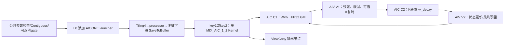
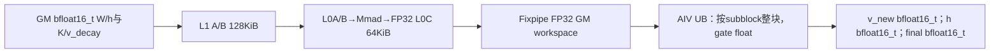
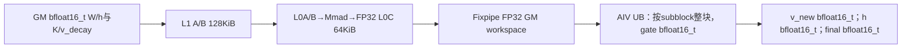
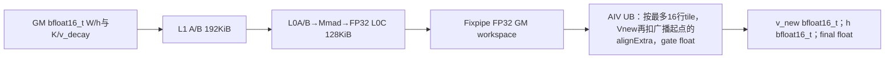
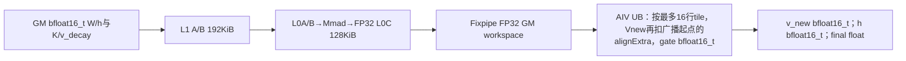

# ChunkGatedDeltaRuleFwdHVllm A2/A3 ACLNN 算子知识

## 接入 Chunk H 时先选择输入与状态合同

A2/A3 的本算子消费 caller 已准备的 K/W/U 与 gate，产出各 chunk 入口 h、残差 v_new 和可选末态。先记录 Input/gate/state dtype、V、useGk、初态/末态开关，以及定长或 compact varlen 布局；按 K 维 gate 时还要证明传入 K 已按要求预衰减。

- 数学、初态与输出归属从[接口与语义](#接口与语义)确认；不要把 h 或 v_new 当完整 GDN 输出 o。
- 选路先由 V 决定 key1/key2，再按 Input、state、gate 与 useGk 在[Route 选择](#route-选择)定位 R-001 至 R-032；只读所命中模板的 Kernel 细节。
- 直接 ACLNN、Torch/Meta 不一致或 varlen 容量疑问，先到[限制与失败边界](#限制与失败边界)，再查[Host/Launcher](#hostlauncher-执行流程)和[源码索引](#源码索引)。

未提供初态而请求 final_state 时，Torch 沿低精度 h 分配、公开 API 要求 FP32 的静态差异须先处理；空段压缩后的状态行映射和 chunk_indices/真实 NT 也必须闭合。未闭合时停在接口/容量验收，不把 dtype 检查通过当作全部状态正确。

## 算子速览

| 项目 | 内容 |
|---|---|
| 实际入口 | `aclnnChunkGatedDeltaRuleFwdHVllmGetWorkspaceSize` 与 `aclnnChunkGatedDeltaRuleFwdHVllm`，公开两阶段 ACLNN；本文简称 Chunk H |
| 计算语义 | 对 caller 已准备的 K/W/U 和 gate 逐 chunk 生成入口状态 h、残差 v_new，并按需输出 final_state；按 K 维 gate 路线要求传入已经衰减的 K |
| 输入输出 | k:[B,Hk,T,K]；w:[B,Hv,T,K]；u/v_new:[B,Hv,T,V]；h:[B,Hv,NT,K,V]；连续 ND/BNSD 视图，输入 FP16/BF16 |
| 执行类型 | 一个核心 MIX_CV 节点，`KERNEL_TYPE_MIX_AIC_1_2`；AIC 运行 WH/KV，两个 AIV 子块运行 Vnew/HUpdate，无 SIMT、NDDMA 或通信节点 |
| Kernel 路线 | R-001…R-032：2种 tile × 2种输入 × 2种 state × 2种 gate × useGk 两值，分别保留模板和数值分支 |
| 核心资源 | 六片 GM workspace；同核 WH/KV 复用 L1/L0；AIV UB 以固定 byte offset 分区，两条 stream 的临时区独立 |
| 来源闭包 | `source_closed`：公开 API→L0 launcher→Tiling/processor→注册线数据→key1/2 router→arch22 的 scheduler、Cube 与 Vector body、构建接线；生成桥、生成设备头及通用 primitive 内部为明确框架/库边界 |
| 验证状态 | 已完成源码闭包检查；本次知识提取未执行编译、真机、数值或性能测试。 |

## 接口与语义

### 计算语义

令 S 为 chunk_size，m 为当前 chunk 的实际 token 数，h_j 为该 chunk 的入口状态，T0 为输入类型。下列式子表示固定实现的顺序；FP32 写在式中，`cast_T0` 的回写使用 `CAST_RINT`。

```text
AIC C1: p = FP32(W_T0 @ h_j_T0), shape[m,V]
AIV V1: d = FP32(U_T0) - p
        v_new = cast_T0(d)
        a_i = exp(g_last - g_i)；m=1 时 a_0=1
        v_decay = cast_T0(d * a_i)
AIC C2: z = FP32(K_used_T0.T @ v_decay_T0), shape[K,V]
AIV V2: y = FP32(h_j_T0) * exp(g_last)
        useGk=true 时 y[k,:] *= exp(ln(2) * gk_last[k])
        next = y + z
        非最终chunk：h_(j+1) = cast_T0(next)
        最终chunk且storeFinalState：按 StateT 写 final_state
```

`useGk=false` 时 K_used 为原 K。`useGk=true` 时 V1 仅把 caller 提供的 K 复制到 kDecayWorkspace，源码注释要求它已经是 `k * exp2(g_last - gk)`；这里没有再做该乘法。把原始 K 和 gk 直接传入，不能据名字推断已完成完整 KDA 变换。g 使用自然指数，gk 的最后一行乘 ln2 后 Exp；保留参数 `useExp2=false` 不会把这两种单位统一。

h 保存每个 chunk 的入口状态，长度 NT，而不是 NT+1 份状态轨迹。最后一段不请求 final_state 时，C2/V2 的数学更新被跳过，仍保留同步协议。初态 FP32 会先舍入到 T0，所有中间 h 也用 T0；StateT=float 只使最终结果直接从 FP32 累加区写出，不能声称整段递推都保留 FP32 state。

### 输入、输出与属性

| 参数 | shape/layout | dtype | 约束、默认值与语义 |
|---|---|---|---|
| k | [B,Hk,T,K]，ND | FP16/BF16 | 必选；`CheckShape` 要求 rank4，K-head 按 value head 分组 |
| w | [B,Hv,T,K]，ND | 同 k | 必选；与 k 共享 B/T/K，与 u 共享 Hv |
| u | [B,Hv,T,V]，ND | 同 k | 必选；Hv≥Hk 且 Hv%Hk=0，Host 额外拒绝 V>256 |
| gOptional | [B,Hv,T] | FP32 或 T0 | g/gk 至少一个非空；有 g 时检查 B/Hv/T |
| gkOptional | [B,Hv,T,K] | FP32 或 T0 | rank4及各轴显式检查；和 g 同时存在时二者 dtype 相同；非空使 useGk=true |
| initalStateOptional | [N,Hv,K,V] 的连续状态约定 | StateT | 存在时决定 stateDataType；缺省用 FP32。公开入口没有完整 initial-state shape/dtype 检查，不把任意类型当支持 |
| hOut | [shapeBatch,Hv,totalChunks,K,V] | T0 | 必选、dtype 同 k；公开 API 没有完整输出 shape 校验；首态由 Device 初始化 |
| vNewOut | 同 u | T0 | 必选、dtype 同 k；输出未乘 chunk 衰减的残差 |
| finalStateOut | [N,Hv,K,V] | 初态 dtype，缺初态时必须 FP32 | outputFinalState=true 时必须存在；关闭时不读写其有效内容 |
| cuSeqlensOptional | INT64 段边界数组 | INT64 | 非空启用变长；Host 按 length−1 预算段数，Device 会压缩非正长度段 |
| chunkIndicesOptional | INT64 数组 | INT64 | L0 转 Tensor 并传入，但 arch22 scheduler 不消费；Torch 包装仍用其长度/2分配 NT |
| outputFinalState | bool | bool | 默认 false；控制末次 C2、V2 与最终输出 |
| chunkSize | token 数 | int64 | 默认64；没有完整正值/容量 guard，不能按可传入属性推断任意值安全 |
| saveNewValue / useExp2 / transposeStateLayout | 标量 | bool | 保留参数仅允许 true / false / false，其他值由 `CheckReservedOptions` 拒绝 |
| workspaceSize / executor / stream | 两阶段 ACLNN 参数 | API 声明类型 | 查询输出 workspace 字节数与 executor；第二阶段使用 caller 的 stream，保持资源至任务完成 |

### 入口与版本

固定 Main 为 `ceac1a2bdff3139ca8fbd1a60b3a9befd68cadf2`。公开头声明、API 实现、L0、Host 和 Device 共同定义此接口；它不是独立 fast-launch 的替代说明。公开安装产品表列出 Atlas A2/A3，OpDef 的 `AddConfig("ascend910b")` / `AddConfig("ascend910_93")` 和 build_aclnn.sh 的对应 SOC 分支把本算子纳入构建，没有发现该范围的公开“不支持”冲突。

Dockerfile 与 Dockerfile.a3 的基础镜像标识 CANN9.2.0_20261022115200，SOC_VERSION 分别为 ascend910b1、ascend910_9391，默认 vLLM tag 为 v0.32.0；同文件又安装9.3.0的 ops-transformer，不能把组合当成已经验证的纯9.2运行栈。cann_versions 的9.2.0记录本次指定的基础工具链来源，不证明 weekly 镜像、生成头、已安装库或所有 minor 版本 ABI 相同。固定 CATLASS 为 `41bf90da655bba3c66d0acd7e00abe33960ecfd6`，metadef v9.2.0 为 `000cd91b8f809ac55f4c51bd9fdee3ace8db1589`；后者只支撑下述静态线布局推导。

## Host/Launcher 执行流程

### 参数校验与前处理

公开入口先以 `ChunkGatedDeltaRuleFwdHVllmParams` 汇集输入、可选 gate/初态、保留选项与输出引用，再创建 executor，按 `CheckParams` 顺序执行 CheckNotNull→CheckGateOptionalNonNull→CheckReservedOptions→CheckGkParams→CheckFormat→CheckShape→CheckDtype。CheckNotNull 只覆盖 k/w/u/h/v_new；CheckFormat 返回成功。CheckGkParams 在 k rank 的后续检查之前使用 k.dim3 等字段，不能认为非法 rank 已在所有读维度前被拒绝。Hv/Hk 的取模也没有独立 Hk=0 guard。

CheckDtype 检查输入 FP16/BF16、w/u/h/v_new 同 dtype、gate 为 FP32 或输入类型、双 gate dtype 相同，以及请求 final_state 时的输出类型。没有完整初态类型白名单或初态/输出 shape 检查。所有显式检查失败被外层转换为对应参数失败返回；不要用前端返回成功证明 Device 隐含容量/对齐已满足。

`ParamsDataContiguous` 依次处理 k/w/u 和存在的 g/gk/初态；失败返回参数错误。只有 gk 时 `MakeNeutralGate` 取 gk 的最后轴首 lane，分配 Slice offsets/sizes，Slice→Contiguous→Reshape 成 [B,Hv,T]→ZerosLike 生成零 g；每步失败返回 null。它仅生成中性标量 gate，不负责 K 的预衰减。

L0 `ChunkGatedDeltaRuleFwdHVllm` 对可选数组调用 ConvertToTensor(INT64)，设 Storage/View/OriginalFormat=ND；转换后没有先检查 null 再解引用的保护。随后 `ADD_TO_LAUNCHER_LIST_AICORE` 按 k/w/u/g/gk/初态/cu/chunk_indices 顺序传输入、h/v_new/final 传输出、两个 attr 为 output_final_state/chunk_size。失败返回三个 null；外层检查 result[0]，对 h、v_new 和请求的 final 做 ViewCopy，最后查询 workspace、ReleaseTo executor。普通格式/视图 primitive 的内部由框架提供，本卡不推断任意非连续 output 已数值通过。

### 参数、Workspace 与生命周期

以下 O 均为相对 `GetUserWorkspace(workspace)` 返回 user 指针的字节偏移。C 为全部 AIC 核数，N0 为压缩前 tokenBatch。`GDN_FWD_H_PING_PONG_STAGES=2`。processor 的对齐函数 A(x)=(x+512)//512*512，即 x 已对齐或为0也预留额外512字节，不改成普通 ceil 对齐。

```text
O_v = libApiWorkSpaceSize + 16MiB
O_d = O_v + A(8*C*S*V)
O_k = O_d + A(8*C*S*V)
O_h = O_k + (useGk ? A(8*C*S*K) : 0)
O_seq = O_h + A(8*C*K*V)
O_chunks = O_seq + A(8*(N0+1))
workspace_total = O_chunks + A(8*(N0+1)) + 16MiB
```

| GM 片 | Host 保留容量 | 实际类型/索引 | producer→consumer | owner/lifetime |
|---|---|---|---|---|
| vWorkspace，O_v | A(8CSV) | FP32，[C,2,S,V] | C1 WH→V1 Sub | caller/executor 的同次 workspace；对应 stream 的 C2/V2 结束后才复用 |
| vUpdateWorkspace，O_d | A(8CSV) | T0，[C,2,S,V]，只需4CSV个字节 | V1 衰减/cast→C2 KV | 保守 FP32 预算并不改变实际2B元素跨度 |
| kDecayWorkspace，O_k | useGk 时 A(8CSK) | T0，[C,2,S,K] | V1 K 复制→C2 | useGk=false 时不消费，可与 O_h 同起点；不能在 true 时去掉该片 |
| hWorkspace，O_h | A(8CKV) | FP32，[C,2,K,V] | C2 KV→V2 Add | vec2Done 后才能由下一任务覆盖 |
| numSeq，O_seq | A(8(N0+1)) | INT64，正长度段终点 | scheduler.Init→地址计算 | 多个 Init 都会写相同表，源码没有唯一 writer guard |
| numChunks，O_chunks | A(8(N0+1)) | INT64，累计 chunk 数 | scheduler.Init→调度/首态 | 按压缩前容量预算；不能与 chunkIndices 的二元组混用 |

processor 在 int64 中计算部分乘积，再转换 size_t；Device 维度和 byte offset 又转 uint32。所有乘法、负维度、对齐加法、uint32 窄化及最终 capacity 均须另核，源码没有完整溢出拒绝。Host 不按任务少而缩 blockDim，也不由本公式推断实际 NPU 核数或可用内存。

查询阶段拥有 executor 管理的转换节点、临时参数和输出提交；第二阶段 `CommonOpExecutorRun(workspace,workspaceSize,executor,stream)` 失败返回 ACLNN_ERR_INNER。调用者持有输入、输出、workspace 和 executor，直到 stream 消费完成；函数返回成功不等于异步完成。公开生成 inner bridge、primitive 实现和实际 executor 销毁协议是框架边界，没有通过本卡证明跨 stream 或异常时自动清理全部资源。

### 启动图与失败传播



这是同一语义 Kernel 内的 AIC/AIV 循环，不是四个独立 launch。库/框架前处理节点先于核心节点，输出 ViewCopy 在核心之后由同 executor 排序；不能仅由 Host 添加顺序推断任意跨 stream Device 可见性。`SetBlockDim(C)` 与 `KERNEL_TYPE_MIX_AIC_1_2` 指定混合执行；无 SIMT thread/grid、动态 UB launch 或独立通信 handle。

## Route 与参数设计

### 分核与资源计算

均匀路径由 k.shape 推出 B/T/Hk/K、u.shape 推出 Hv/V，shapeBatch=B、tokenBatch=1、batch=B。变长路径 shapeBatch=1、tokenBatch=cu.length−1、batch=tokenBatch。scheduler.Init 从 prevSeq=0 遍历 cu[1…N0]，只保留正长度段的终点，写 gmNumSeq/gmNumChunks，再把自己的 batch/tokenBatch 改成 actualBatch；它不保存到原请求行的映射，不验证 cu[0]=0、单调性或最后边界。

`taskNum=batch*Hv`，`headGroups=Hv/Hk`，vBlockSize=V，没有 V/128 的外层分片。`maxTaskCntPerLoop=(taskNum>C ? 2 : 1)`，stride=C*maxTaskCntPerLoop。stream s 的首任务为 core*maxTaskCntPerLoop+s；未启用的第二 stream 直接设 nextTaskIdx=taskNum。`AssignNextStream` 对 taskIdx≥taskNum 立即 return，不读取失效描述符；每个有效 task 是一个 sequence/value-head，沿其 chunk 顺序推进，再按 stride 接下一 task。

AIC scheduler 使用 GetBlockIdx；AIV scheduler 使用 GetBlockIdx()/GetSubBlockNum，与对应 AIC 的 stream 对齐。V1 以 token 行分给两个 AIV，V2 以 K 行分给两个 AIV：rowsPerSubBlock=ceil(rows/subBlockNum)，实际范围截到有效 rows。初态初始化阶段另用原始 GetBlockIdx/GetBlockNum 划分 request/head，而非 scheduler 的归一化 coreIdx；须保持源码这两种坐标。

| 参数 | key1，V≤128 | key2，128<V≤256 | 来源/边界 |
|---|---|---|---|
| L1 tile M/N/K | 128/128/128 | 128/256/128 | GDNFwdHTileShapes128 / GDNFwdHTileShapes256 |
| L0 tile M/N/K | 128/128/128 | 128/256/64 | 大 N 时缩 L0 K，保留 M/N，非切分输出 V |
| L1 A/B，均2 stage | 64/64KiB，总128KiB | 64/128KiB，总192KiB | T0=2B；WH/KV 的对象指向同一 resource，按阶段复用 |
| L0A / L0B | 64/64KiB | 32/64KiB | 各2 stage，不能按单 stage 少算 |
| L0C | 64KiB，1 stage | 128KiB，1 stage | FP32，unit flag要求单 stage |
| AIV 后处理 | V1整块；V2整块 | V1/V2最多16行 tile | 两条 stream 共用计算区，按顺序消费，不能解释为两个并发 Vector body |
| 资源标签 | AtlasA2：L1 512KiB、L0A/B各64KiB、L0C128KiB、UB192KiB | 同左 | 固定库静态常量，不是实测硬件容量 |

WH 的 M/N/K 为 [m,V,K]；KV 为 [K,V,m]。通用 BlockMmadTla 只有 K 轴预取/L0 分块，在当前实例没有独立 scheduler 帮它把任意 K/S 的 M 维切成安全外层 tile。源码对 M=1 会按16行参与 Mmad，Fixpipe 仍按输出 originShape 提交。UB、L1 输入搬运和初态整块所需的 K/S/对齐，须按实际尺寸另算；Host V≤256 不能替代这些 guard。

### Route 选择

所有下表条件还要求：公开检查通过、构建目标 A2/A3，并命中 Device 入口的 arch22 编译分支，即 __CCE_AICORE__ 既非200也非310。200 的 arch20 与310的 arch35 为其它平台实现，本卡不把文件存在当为它们完成分析。`GdnFwdHDtypeToEnum` 对 BF16/FP16 给1/0，其余给2；公开输入只接受前两类，initial-state 类型缺口另列。以下原始谓词的“非2”保持源代码含义，不改写为新的合法类型检查。

| 顺序 | Route | Key/模板 | 精确选择条件与优先级 | 不适用去向 |
|---:|---|---|---|---|
| 1 | R-001 | key1；`GDNFwdHKernel<bfloat16_t,float,float,float,GDNFwdHTileShapes128,true>` | A2/A3 arch22、V≤128、dataType==1、stateDataType==2、gDataType==2、useGk=true；按entry嵌套判断 | 不满足沿同key后续叶选择；unknown key无输出 |
| 2 | R-002 | key1；`GDNFwdHKernel<bfloat16_t,float,float,float,GDNFwdHTileShapes128,false>` | A2/A3 arch22、V≤128、dataType==1、stateDataType==2、gDataType==2、useGk=false；按entry嵌套判断 | 不满足沿同key后续叶选择；unknown key无输出 |
| 3 | R-003 | key1；`GDNFwdHKernel<bfloat16_t,bfloat16_t,float,float,GDNFwdHTileShapes128,true>` | A2/A3 arch22、V≤128、dataType==1、stateDataType==2、gDataType!=2、useGk=true；按entry嵌套判断 | 不满足沿同key后续叶选择；unknown key无输出 |
| 4 | R-004 | key1；`GDNFwdHKernel<bfloat16_t,bfloat16_t,float,float,GDNFwdHTileShapes128,false>` | A2/A3 arch22、V≤128、dataType==1、stateDataType==2、gDataType!=2、useGk=false；按entry嵌套判断 | 不满足沿同key后续叶选择；unknown key无输出 |
| 5 | R-005 | key1；`GDNFwdHKernel<bfloat16_t,float,bfloat16_t,float,GDNFwdHTileShapes128,true>` | A2/A3 arch22、V≤128、dataType==1、stateDataType!=2、gDataType==2、useGk=true；按entry嵌套判断 | 不满足沿同key后续叶选择；unknown key无输出 |
| 6 | R-006 | key1；`GDNFwdHKernel<bfloat16_t,float,bfloat16_t,float,GDNFwdHTileShapes128,false>` | A2/A3 arch22、V≤128、dataType==1、stateDataType!=2、gDataType==2、useGk=false；按entry嵌套判断 | 不满足沿同key后续叶选择；unknown key无输出 |
| 7 | R-007 | key1；`GDNFwdHKernel<bfloat16_t,bfloat16_t,bfloat16_t,float,GDNFwdHTileShapes128,true>` | A2/A3 arch22、V≤128、dataType==1、stateDataType!=2、gDataType!=2、useGk=true；按entry嵌套判断 | 不满足沿同key后续叶选择；unknown key无输出 |
| 8 | R-008 | key1；`GDNFwdHKernel<bfloat16_t,bfloat16_t,bfloat16_t,float,GDNFwdHTileShapes128,false>` | A2/A3 arch22、V≤128、dataType==1、stateDataType!=2、gDataType!=2、useGk=false；按entry嵌套判断 | 不满足沿同key后续叶选择；unknown key无输出 |
| 9 | R-009 | key1；`GDNFwdHKernel<half,float,float,float,GDNFwdHTileShapes128,true>` | A2/A3 arch22、V≤128、dataType!=1、stateDataType==2、gDataType==2、useGk=true；按entry嵌套判断 | 不满足沿同key后续叶选择；unknown key无输出 |
| 10 | R-010 | key1；`GDNFwdHKernel<half,float,float,float,GDNFwdHTileShapes128,false>` | A2/A3 arch22、V≤128、dataType!=1、stateDataType==2、gDataType==2、useGk=false；按entry嵌套判断 | 不满足沿同key后续叶选择；unknown key无输出 |
| 11 | R-011 | key1；`GDNFwdHKernel<half,half,float,float,GDNFwdHTileShapes128,true>` | A2/A3 arch22、V≤128、dataType!=1、stateDataType==2、gDataType!=2、useGk=true；按entry嵌套判断 | 不满足沿同key后续叶选择；unknown key无输出 |
| 12 | R-012 | key1；`GDNFwdHKernel<half,half,float,float,GDNFwdHTileShapes128,false>` | A2/A3 arch22、V≤128、dataType!=1、stateDataType==2、gDataType!=2、useGk=false；按entry嵌套判断 | 不满足沿同key后续叶选择；unknown key无输出 |
| 13 | R-013 | key1；`GDNFwdHKernel<half,float,half,float,GDNFwdHTileShapes128,true>` | A2/A3 arch22、V≤128、dataType!=1、stateDataType!=2、gDataType==2、useGk=true；按entry嵌套判断 | 不满足沿同key后续叶选择；unknown key无输出 |
| 14 | R-014 | key1；`GDNFwdHKernel<half,float,half,float,GDNFwdHTileShapes128,false>` | A2/A3 arch22、V≤128、dataType!=1、stateDataType!=2、gDataType==2、useGk=false；按entry嵌套判断 | 不满足沿同key后续叶选择；unknown key无输出 |
| 15 | R-015 | key1；`GDNFwdHKernel<half,half,half,float,GDNFwdHTileShapes128,true>` | A2/A3 arch22、V≤128、dataType!=1、stateDataType!=2、gDataType!=2、useGk=true；按entry嵌套判断 | 不满足沿同key后续叶选择；unknown key无输出 |
| 16 | R-016 | key1；`GDNFwdHKernel<half,half,half,float,GDNFwdHTileShapes128,false>` | A2/A3 arch22、V≤128、dataType!=1、stateDataType!=2、gDataType!=2、useGk=false；按entry嵌套判断 | 不满足沿同key后续叶选择；unknown key无输出 |
| 17 | R-017 | key2；`GDNFwdHKernel<bfloat16_t,float,float,float,GDNFwdHTileShapes256,true>` | A2/A3 arch22、128<V≤256、dataType==1、stateDataType==2、gDataType==2、useGk=true；按entry嵌套判断 | 不满足沿同key后续叶选择；unknown key无输出 |
| 18 | R-018 | key2；`GDNFwdHKernel<bfloat16_t,float,float,float,GDNFwdHTileShapes256,false>` | A2/A3 arch22、128<V≤256、dataType==1、stateDataType==2、gDataType==2、useGk=false；按entry嵌套判断 | 不满足沿同key后续叶选择；unknown key无输出 |
| 19 | R-019 | key2；`GDNFwdHKernel<bfloat16_t,bfloat16_t,float,float,GDNFwdHTileShapes256,true>` | A2/A3 arch22、128<V≤256、dataType==1、stateDataType==2、gDataType!=2、useGk=true；按entry嵌套判断 | 不满足沿同key后续叶选择；unknown key无输出 |
| 20 | R-020 | key2；`GDNFwdHKernel<bfloat16_t,bfloat16_t,float,float,GDNFwdHTileShapes256,false>` | A2/A3 arch22、128<V≤256、dataType==1、stateDataType==2、gDataType!=2、useGk=false；按entry嵌套判断 | 不满足沿同key后续叶选择；unknown key无输出 |
| 21 | R-021 | key2；`GDNFwdHKernel<bfloat16_t,float,bfloat16_t,float,GDNFwdHTileShapes256,true>` | A2/A3 arch22、128<V≤256、dataType==1、stateDataType!=2、gDataType==2、useGk=true；按entry嵌套判断 | 不满足沿同key后续叶选择；unknown key无输出 |
| 22 | R-022 | key2；`GDNFwdHKernel<bfloat16_t,float,bfloat16_t,float,GDNFwdHTileShapes256,false>` | A2/A3 arch22、128<V≤256、dataType==1、stateDataType!=2、gDataType==2、useGk=false；按entry嵌套判断 | 不满足沿同key后续叶选择；unknown key无输出 |
| 23 | R-023 | key2；`GDNFwdHKernel<bfloat16_t,bfloat16_t,bfloat16_t,float,GDNFwdHTileShapes256,true>` | A2/A3 arch22、128<V≤256、dataType==1、stateDataType!=2、gDataType!=2、useGk=true；按entry嵌套判断 | 不满足沿同key后续叶选择；unknown key无输出 |
| 24 | R-024 | key2；`GDNFwdHKernel<bfloat16_t,bfloat16_t,bfloat16_t,float,GDNFwdHTileShapes256,false>` | A2/A3 arch22、128<V≤256、dataType==1、stateDataType!=2、gDataType!=2、useGk=false；按entry嵌套判断 | 不满足沿同key后续叶选择；unknown key无输出 |
| 25 | R-025 | key2；`GDNFwdHKernel<half,float,float,float,GDNFwdHTileShapes256,true>` | A2/A3 arch22、128<V≤256、dataType!=1、stateDataType==2、gDataType==2、useGk=true；按entry嵌套判断 | 不满足沿同key后续叶选择；unknown key无输出 |
| 26 | R-026 | key2；`GDNFwdHKernel<half,float,float,float,GDNFwdHTileShapes256,false>` | A2/A3 arch22、128<V≤256、dataType!=1、stateDataType==2、gDataType==2、useGk=false；按entry嵌套判断 | 不满足沿同key后续叶选择；unknown key无输出 |
| 27 | R-027 | key2；`GDNFwdHKernel<half,half,float,float,GDNFwdHTileShapes256,true>` | A2/A3 arch22、128<V≤256、dataType!=1、stateDataType==2、gDataType!=2、useGk=true；按entry嵌套判断 | 不满足沿同key后续叶选择；unknown key无输出 |
| 28 | R-028 | key2；`GDNFwdHKernel<half,half,float,float,GDNFwdHTileShapes256,false>` | A2/A3 arch22、128<V≤256、dataType!=1、stateDataType==2、gDataType!=2、useGk=false；按entry嵌套判断 | 不满足沿同key后续叶选择；unknown key无输出 |
| 29 | R-029 | key2；`GDNFwdHKernel<half,float,half,float,GDNFwdHTileShapes256,true>` | A2/A3 arch22、128<V≤256、dataType!=1、stateDataType!=2、gDataType==2、useGk=true；按entry嵌套判断 | 不满足沿同key后续叶选择；unknown key无输出 |
| 30 | R-030 | key2；`GDNFwdHKernel<half,float,half,float,GDNFwdHTileShapes256,false>` | A2/A3 arch22、128<V≤256、dataType!=1、stateDataType!=2、gDataType==2、useGk=false；按entry嵌套判断 | 不满足沿同key后续叶选择；unknown key无输出 |
| 31 | R-031 | key2；`GDNFwdHKernel<half,half,half,float,GDNFwdHTileShapes256,true>` | A2/A3 arch22、128<V≤256、dataType!=1、stateDataType!=2、gDataType!=2、useGk=true；按entry嵌套判断 | 不满足沿同key后续叶选择；unknown key无输出 |
| 32 | R-032 | key2；`GDNFwdHKernel<half,half,half,float,GDNFwdHTileShapes256,false>` | A2/A3 arch22、128<V≤256、dataType!=1、stateDataType!=2、gDataType!=2、useGk=false；按entry嵌套判断 | 不满足沿同key后续叶选择；unknown key无输出 |

```text
公开 API 检查 → 连续化/必要的零g → L0
 -> Tiling4：Hv%Hk==0，V<=256；processor填字段
 -> 非310P：V>128 ? key2/TileShapes256 : key1/TileShapes128
 -> arch22 entry：仅key1/key2添加MIX_AIC_1_2；其他key无输出分支
 -> Dispatch：dataType==1 ? bfloat16_t : half
      -> stateDataType==2 ? float : InputT
        -> gDataType==2 ? float : InputT
          -> useGk ? kGated=true : false
 -> KernelImpl<InputT,GT,StateT,float,TileShapes,kGated>
 -> Init/Process，循环C1/V1/C2/V2
```

### 模板/实现执行矩阵

| Route | key/selector | dtype/shape/platform 完整命中条件 | 执行族与 kernel 节点 | 实际模板/body | 内存与同步特征 | tail/fallback |
|---|---|---|---|---|---|---|
| R-001 | key1，dataType==1、stateDataType==2、gDataType==2、useGk=true | A2/A3、V≤128、公开输入检查；无新增S/K/对齐guard | 单MIX_CV：C1→V1→C2→V2 | `GDNFwdHKernel<bfloat16_t,float,float,float,GDNFwdHTileShapes128,true>`，Init/Process | L1128KiB/L0C64KiB；gate32/state32；kGated=true | 按subblock整块；条件末次更新；无CPU fallback |
| R-002 | key1，dataType==1、stateDataType==2、gDataType==2、useGk=false | A2/A3、V≤128、公开输入检查；无新增S/K/对齐guard | 单MIX_CV：C1→V1→C2→V2 | `GDNFwdHKernel<bfloat16_t,float,float,float,GDNFwdHTileShapes128,false>`，Init/Process | L1128KiB/L0C64KiB；gate32/state32；kGated=false | 按subblock整块；条件末次更新；无CPU fallback |
| R-003 | key1，dataType==1、stateDataType==2、gDataType!=2、useGk=true | A2/A3、V≤128、公开输入检查；无新增S/K/对齐guard | 单MIX_CV：C1→V1→C2→V2 | `GDNFwdHKernel<bfloat16_t,bfloat16_t,float,float,GDNFwdHTileShapes128,true>`，Init/Process | L1128KiB/L0C64KiB；gate16/state32；kGated=true | 按subblock整块；条件末次更新；无CPU fallback |
| R-004 | key1，dataType==1、stateDataType==2、gDataType!=2、useGk=false | A2/A3、V≤128、公开输入检查；无新增S/K/对齐guard | 单MIX_CV：C1→V1→C2→V2 | `GDNFwdHKernel<bfloat16_t,bfloat16_t,float,float,GDNFwdHTileShapes128,false>`，Init/Process | L1128KiB/L0C64KiB；gate16/state32；kGated=false | 按subblock整块；条件末次更新；无CPU fallback |
| R-005 | key1，dataType==1、stateDataType!=2、gDataType==2、useGk=true | A2/A3、V≤128、公开输入检查；无新增S/K/对齐guard | 单MIX_CV：C1→V1→C2→V2 | `GDNFwdHKernel<bfloat16_t,float,bfloat16_t,float,GDNFwdHTileShapes128,true>`，Init/Process | L1128KiB/L0C64KiB；gate32/state16；kGated=true | 按subblock整块；条件末次更新；无CPU fallback |
| R-006 | key1，dataType==1、stateDataType!=2、gDataType==2、useGk=false | A2/A3、V≤128、公开输入检查；无新增S/K/对齐guard | 单MIX_CV：C1→V1→C2→V2 | `GDNFwdHKernel<bfloat16_t,float,bfloat16_t,float,GDNFwdHTileShapes128,false>`，Init/Process | L1128KiB/L0C64KiB；gate32/state16；kGated=false | 按subblock整块；条件末次更新；无CPU fallback |
| R-007 | key1，dataType==1、stateDataType!=2、gDataType!=2、useGk=true | A2/A3、V≤128、公开输入检查；无新增S/K/对齐guard | 单MIX_CV：C1→V1→C2→V2 | `GDNFwdHKernel<bfloat16_t,bfloat16_t,bfloat16_t,float,GDNFwdHTileShapes128,true>`，Init/Process | L1128KiB/L0C64KiB；gate16/state16；kGated=true | 按subblock整块；条件末次更新；无CPU fallback |
| R-008 | key1，dataType==1、stateDataType!=2、gDataType!=2、useGk=false | A2/A3、V≤128、公开输入检查；无新增S/K/对齐guard | 单MIX_CV：C1→V1→C2→V2 | `GDNFwdHKernel<bfloat16_t,bfloat16_t,bfloat16_t,float,GDNFwdHTileShapes128,false>`，Init/Process | L1128KiB/L0C64KiB；gate16/state16；kGated=false | 按subblock整块；条件末次更新；无CPU fallback |
| R-009 | key1，dataType!=1、stateDataType==2、gDataType==2、useGk=true | A2/A3、V≤128、公开输入检查；无新增S/K/对齐guard | 单MIX_CV：C1→V1→C2→V2 | `GDNFwdHKernel<half,float,float,float,GDNFwdHTileShapes128,true>`，Init/Process | L1128KiB/L0C64KiB；gate32/state32；kGated=true | 按subblock整块；条件末次更新；无CPU fallback |
| R-010 | key1，dataType!=1、stateDataType==2、gDataType==2、useGk=false | A2/A3、V≤128、公开输入检查；无新增S/K/对齐guard | 单MIX_CV：C1→V1→C2→V2 | `GDNFwdHKernel<half,float,float,float,GDNFwdHTileShapes128,false>`，Init/Process | L1128KiB/L0C64KiB；gate32/state32；kGated=false | 按subblock整块；条件末次更新；无CPU fallback |
| R-011 | key1，dataType!=1、stateDataType==2、gDataType!=2、useGk=true | A2/A3、V≤128、公开输入检查；无新增S/K/对齐guard | 单MIX_CV：C1→V1→C2→V2 | `GDNFwdHKernel<half,half,float,float,GDNFwdHTileShapes128,true>`，Init/Process | L1128KiB/L0C64KiB；gate16/state32；kGated=true | 按subblock整块；条件末次更新；无CPU fallback |
| R-012 | key1，dataType!=1、stateDataType==2、gDataType!=2、useGk=false | A2/A3、V≤128、公开输入检查；无新增S/K/对齐guard | 单MIX_CV：C1→V1→C2→V2 | `GDNFwdHKernel<half,half,float,float,GDNFwdHTileShapes128,false>`，Init/Process | L1128KiB/L0C64KiB；gate16/state32；kGated=false | 按subblock整块；条件末次更新；无CPU fallback |
| R-013 | key1，dataType!=1、stateDataType!=2、gDataType==2、useGk=true | A2/A3、V≤128、公开输入检查；无新增S/K/对齐guard | 单MIX_CV：C1→V1→C2→V2 | `GDNFwdHKernel<half,float,half,float,GDNFwdHTileShapes128,true>`，Init/Process | L1128KiB/L0C64KiB；gate32/state16；kGated=true | 按subblock整块；条件末次更新；无CPU fallback |
| R-014 | key1，dataType!=1、stateDataType!=2、gDataType==2、useGk=false | A2/A3、V≤128、公开输入检查；无新增S/K/对齐guard | 单MIX_CV：C1→V1→C2→V2 | `GDNFwdHKernel<half,float,half,float,GDNFwdHTileShapes128,false>`，Init/Process | L1128KiB/L0C64KiB；gate32/state16；kGated=false | 按subblock整块；条件末次更新；无CPU fallback |
| R-015 | key1，dataType!=1、stateDataType!=2、gDataType!=2、useGk=true | A2/A3、V≤128、公开输入检查；无新增S/K/对齐guard | 单MIX_CV：C1→V1→C2→V2 | `GDNFwdHKernel<half,half,half,float,GDNFwdHTileShapes128,true>`，Init/Process | L1128KiB/L0C64KiB；gate16/state16；kGated=true | 按subblock整块；条件末次更新；无CPU fallback |
| R-016 | key1，dataType!=1、stateDataType!=2、gDataType!=2、useGk=false | A2/A3、V≤128、公开输入检查；无新增S/K/对齐guard | 单MIX_CV：C1→V1→C2→V2 | `GDNFwdHKernel<half,half,half,float,GDNFwdHTileShapes128,false>`，Init/Process | L1128KiB/L0C64KiB；gate16/state16；kGated=false | 按subblock整块；条件末次更新；无CPU fallback |
| R-017 | key2，dataType==1、stateDataType==2、gDataType==2、useGk=true | A2/A3、128<V≤256、公开输入检查；无新增S/K/对齐guard | 单MIX_CV：C1→V1→C2→V2 | `GDNFwdHKernel<bfloat16_t,float,float,float,GDNFwdHTileShapes256,true>`，Init/Process | L1192KiB/L0C128KiB；gate32/state32；kGated=true | 按最多16行tile，Vnew再扣广播起点的alignExtra；条件末次更新；无CPU fallback |
| R-018 | key2，dataType==1、stateDataType==2、gDataType==2、useGk=false | A2/A3、128<V≤256、公开输入检查；无新增S/K/对齐guard | 单MIX_CV：C1→V1→C2→V2 | `GDNFwdHKernel<bfloat16_t,float,float,float,GDNFwdHTileShapes256,false>`，Init/Process | L1192KiB/L0C128KiB；gate32/state32；kGated=false | 按最多16行tile，Vnew再扣广播起点的alignExtra；条件末次更新；无CPU fallback |
| R-019 | key2，dataType==1、stateDataType==2、gDataType!=2、useGk=true | A2/A3、128<V≤256、公开输入检查；无新增S/K/对齐guard | 单MIX_CV：C1→V1→C2→V2 | `GDNFwdHKernel<bfloat16_t,bfloat16_t,float,float,GDNFwdHTileShapes256,true>`，Init/Process | L1192KiB/L0C128KiB；gate16/state32；kGated=true | 按最多16行tile，Vnew再扣广播起点的alignExtra；条件末次更新；无CPU fallback |
| R-020 | key2，dataType==1、stateDataType==2、gDataType!=2、useGk=false | A2/A3、128<V≤256、公开输入检查；无新增S/K/对齐guard | 单MIX_CV：C1→V1→C2→V2 | `GDNFwdHKernel<bfloat16_t,bfloat16_t,float,float,GDNFwdHTileShapes256,false>`，Init/Process | L1192KiB/L0C128KiB；gate16/state32；kGated=false | 按最多16行tile，Vnew再扣广播起点的alignExtra；条件末次更新；无CPU fallback |
| R-021 | key2，dataType==1、stateDataType!=2、gDataType==2、useGk=true | A2/A3、128<V≤256、公开输入检查；无新增S/K/对齐guard | 单MIX_CV：C1→V1→C2→V2 | `GDNFwdHKernel<bfloat16_t,float,bfloat16_t,float,GDNFwdHTileShapes256,true>`，Init/Process | L1192KiB/L0C128KiB；gate32/state16；kGated=true | 按最多16行tile，Vnew再扣广播起点的alignExtra；条件末次更新；无CPU fallback |
| R-022 | key2，dataType==1、stateDataType!=2、gDataType==2、useGk=false | A2/A3、128<V≤256、公开输入检查；无新增S/K/对齐guard | 单MIX_CV：C1→V1→C2→V2 | `GDNFwdHKernel<bfloat16_t,float,bfloat16_t,float,GDNFwdHTileShapes256,false>`，Init/Process | L1192KiB/L0C128KiB；gate32/state16；kGated=false | 按最多16行tile，Vnew再扣广播起点的alignExtra；条件末次更新；无CPU fallback |
| R-023 | key2，dataType==1、stateDataType!=2、gDataType!=2、useGk=true | A2/A3、128<V≤256、公开输入检查；无新增S/K/对齐guard | 单MIX_CV：C1→V1→C2→V2 | `GDNFwdHKernel<bfloat16_t,bfloat16_t,bfloat16_t,float,GDNFwdHTileShapes256,true>`，Init/Process | L1192KiB/L0C128KiB；gate16/state16；kGated=true | 按最多16行tile，Vnew再扣广播起点的alignExtra；条件末次更新；无CPU fallback |
| R-024 | key2，dataType==1、stateDataType!=2、gDataType!=2、useGk=false | A2/A3、128<V≤256、公开输入检查；无新增S/K/对齐guard | 单MIX_CV：C1→V1→C2→V2 | `GDNFwdHKernel<bfloat16_t,bfloat16_t,bfloat16_t,float,GDNFwdHTileShapes256,false>`，Init/Process | L1192KiB/L0C128KiB；gate16/state16；kGated=false | 按最多16行tile，Vnew再扣广播起点的alignExtra；条件末次更新；无CPU fallback |
| R-025 | key2，dataType!=1、stateDataType==2、gDataType==2、useGk=true | A2/A3、128<V≤256、公开输入检查；无新增S/K/对齐guard | 单MIX_CV：C1→V1→C2→V2 | `GDNFwdHKernel<half,float,float,float,GDNFwdHTileShapes256,true>`，Init/Process | L1192KiB/L0C128KiB；gate32/state32；kGated=true | 按最多16行tile，Vnew再扣广播起点的alignExtra；条件末次更新；无CPU fallback |
| R-026 | key2，dataType!=1、stateDataType==2、gDataType==2、useGk=false | A2/A3、128<V≤256、公开输入检查；无新增S/K/对齐guard | 单MIX_CV：C1→V1→C2→V2 | `GDNFwdHKernel<half,float,float,float,GDNFwdHTileShapes256,false>`，Init/Process | L1192KiB/L0C128KiB；gate32/state32；kGated=false | 按最多16行tile，Vnew再扣广播起点的alignExtra；条件末次更新；无CPU fallback |
| R-027 | key2，dataType!=1、stateDataType==2、gDataType!=2、useGk=true | A2/A3、128<V≤256、公开输入检查；无新增S/K/对齐guard | 单MIX_CV：C1→V1→C2→V2 | `GDNFwdHKernel<half,half,float,float,GDNFwdHTileShapes256,true>`，Init/Process | L1192KiB/L0C128KiB；gate16/state32；kGated=true | 按最多16行tile，Vnew再扣广播起点的alignExtra；条件末次更新；无CPU fallback |
| R-028 | key2，dataType!=1、stateDataType==2、gDataType!=2、useGk=false | A2/A3、128<V≤256、公开输入检查；无新增S/K/对齐guard | 单MIX_CV：C1→V1→C2→V2 | `GDNFwdHKernel<half,half,float,float,GDNFwdHTileShapes256,false>`，Init/Process | L1192KiB/L0C128KiB；gate16/state32；kGated=false | 按最多16行tile，Vnew再扣广播起点的alignExtra；条件末次更新；无CPU fallback |
| R-029 | key2，dataType!=1、stateDataType!=2、gDataType==2、useGk=true | A2/A3、128<V≤256、公开输入检查；无新增S/K/对齐guard | 单MIX_CV：C1→V1→C2→V2 | `GDNFwdHKernel<half,float,half,float,GDNFwdHTileShapes256,true>`，Init/Process | L1192KiB/L0C128KiB；gate32/state16；kGated=true | 按最多16行tile，Vnew再扣广播起点的alignExtra；条件末次更新；无CPU fallback |
| R-030 | key2，dataType!=1、stateDataType!=2、gDataType==2、useGk=false | A2/A3、128<V≤256、公开输入检查；无新增S/K/对齐guard | 单MIX_CV：C1→V1→C2→V2 | `GDNFwdHKernel<half,float,half,float,GDNFwdHTileShapes256,false>`，Init/Process | L1192KiB/L0C128KiB；gate32/state16；kGated=false | 按最多16行tile，Vnew再扣广播起点的alignExtra；条件末次更新；无CPU fallback |
| R-031 | key2，dataType!=1、stateDataType!=2、gDataType!=2、useGk=true | A2/A3、128<V≤256、公开输入检查；无新增S/K/对齐guard | 单MIX_CV：C1→V1→C2→V2 | `GDNFwdHKernel<half,half,half,float,GDNFwdHTileShapes256,true>`，Init/Process | L1192KiB/L0C128KiB；gate16/state16；kGated=true | 按最多16行tile，Vnew再扣广播起点的alignExtra；条件末次更新；无CPU fallback |
| R-032 | key2，dataType!=1、stateDataType!=2、gDataType!=2、useGk=false | A2/A3、128<V≤256、公开输入检查；无新增S/K/对齐guard | 单MIX_CV：C1→V1→C2→V2 | `GDNFwdHKernel<half,half,half,float,GDNFwdHTileShapes256,false>`，Init/Process | L1192KiB/L0C128KiB；gate16/state16；kGated=false | 按最多16行tile，Vnew再扣广播起点的alignExtra；条件末次更新；无CPU fallback |

### 隐藏性能 Guard

| Guard | Host/Tiling 条件 | Device/资源原因 | 影响 Route | 不满足时去向 | 源码符号 |
|---|---|---|---|---|---|
| BNSD/Hv分组 | rank4且 B/T/K相容，Hv≥Hk且整除 | grouped K-head映射 | 全部 | API拒绝；Hk=0缺独立检查 | CheckShape |
| gate/保留参数 | g或gk存在；true/false/false | 内部实际gate单位与固定输出路径 | 全部 | CheckGateOptionalNonNull/CheckReservedOptions拒绝 | API同名函数 |
| V≤256 | Host显式拒绝>256 | key1/2不同L0容量 | 全部 | GRAPH_FAILED；没有CPU fallback | Tiling4 |
| K/S正值与容量 | 没有完整 guard | 除法、L1整块输入、UB固定子区、初态片 | 全部 | 无保护性fallback，须检查实际extent | Init/BlockMmadTla/Vnew/HUpdate |
| 对齐与尾元素 | 普通DataCopy及LoadData需匹配primitive约束 | small路线全块搬运；大路线仍用普通连续DMA | 全部 | 不保证任意非16倍数维度安全 | CopyGmToUb/CopyUbToGm |
| gk的K输入语义 | API只校验shape/dtype | Device仅复制已衰减K，不再计算exp2(g_last−gk) | useGk=true | raw K不获得完整KDA语义 | Vnew::operator |
| 初态/final | initial缺完整shape/dtype白名单 | StateT和output指针真实元素宽度必须一致 | 全部 | 不能靠模板分支自动修复非法输入 | CheckDtype/Dispatch |
| 变长空段 | Device压缩正段，initial索引随compact编号 | 未保存原请求mapping，空段final也无独立写回 | 全部 | caller先compact并scatter恢复；无内部原行恢复 | scheduler.Init/UpdateTask |
| 初始化prefix DMA | 无Host长度界 | 无初态varlen把(N+1)*8字节窄化到uint16搬UB | 全部 | 超过可表示长度会截断；没有拒绝 | Process 无初态分支 |
| 窄化/溢出 | int64/size_t→uint32 | 维度、各offset、乘积地址 | 全部 | 无完整拒绝 | Kernel.Init/scheduler |
| 编译与同步 | --cce-auto-sync=off | 显式event/flag是正确性合同 | 全部 | 不能依赖编译器补同步 | op_host/CMakeLists.txt |
| unit flag 事件列表 | 当前policy启用unit flag | 构造时只在非unit flag分支初始化l0CEventList，但MTE1_M仍读它 | 全部 | 静态核对缺口，未复现运行故障 | BlockMmadTla构造/operator |

### POD/ABI

注册宏类、processor 的 plain 中间结构、公开生成的 Device 结构分开解释。固定 metadef 9.2 的 FieldHandler 按字段 sizeof 对齐、末尾8字节对齐、InitData零填充和SaveToBuffer拷贝，配合 int64=8B/bool=1B 的通常ABI，静态推导注册线数据176B；手写 plain 缺 hasGk，推导 sizeof168/align8。没有编译实测，也没有用基础镜像tag证明 weekly生成头与该tag完全一致。注册宏类继承TilingDef并含offset/reserve，C++对象sizeof不是线上176B。

| 结构 | 字段 | 类型/位宽 | ABI 布局：线/直，字节 | 单位 | Host/launcher producer | Device consumer | 边界 |
|---|---|---|---|---|---|---|---|
| 注册/Plain | batch | int64/64 | 0/0，8B align8 | 请求 | processor：B或N0 | scheduler，变长改actualBatch | uint32窄化 |
| 同上 | seqlen | int64/64 | 8/8 | token | k.dim2 | totalTokens/均匀chunks | 无完整正值检查 |
| 同上 | kNumHead | int64/64 | 16/16 | head | k.dim1 | headGroups、K地址 | 不得0 |
| 同上 | vNumHead | int64/64 | 24/24 | head | u.dim1 | taskNum、W/U/G地址 | API检查分组 |
| 同上 | kHeadDim | int64/64 | 32/32 | 元素 | k.dim3 | C1 K轴/C2 M轴、状态与gk | 需按容量核对 |
| 同上 | vHeadDim | int64/64 | 40/40 | 元素 | u.dim3 | vBlockSize、N轴/所有列stride | Host只拒绝>256 |
| 同上 | chunkSize | int64/64 | 48/48 | token | attr1 | 前缀ceil、矩阵与Vector | 无完整0/负值保护 |
| 同上 | useInitialState | bool/8 | 56/56，1B align1 | 开关 | initial!=null | 初态搬运，否则零化 | 两条实现均明确初始化 |
| 同上 | storeFinalState | bool/8 | 57/57 | 开关 | attr0 | NeedProcessStage2/最终回写 | 最后一段可跳过数学更新 |
| 同上 | dataType | int64/64 | 64/64 | 枚举 | GdnFwdHDtypeToEnum(k.dtype) | Dispatch InputT | 1 BF16，其余half，API另限输入 |
| 同上 | gDataType | int64/64 | 72/72 | 枚举 | 优先g，否则gk | Dispatch GT，gate/gk宽度 | 2 float，其余InputT |
| 同上 | stateDataType | int64/64 | 80/80 | 枚举 | 初态dtype，缺省2 | Dispatch StateT | 2 float，其余InputT |
| 仅注册 | hasGk | bool/8 | 88/不存在 | 保留 | 无set_hasGk | 没有读取 | 新建buffer静态零填充；不能删布局槽 |
| 注册/Plain | isVariedLen | int64/64 | 96/88 | 开关 | hasCuSeqlens | prefix/任务地址 | 两结构从此字段起不同 |
| 同上 | shapeBatch | int64/64 | 104/96 | batch | B或1 | GM layout/shapeBatchIdx | varlen实际B需匹配 |
| 同上 | tokenBatch | int64/64 | 112/104 | 段数 | 1或cu.length−1 | scheduler/init state | Device另有压缩后的值 |
| 同上 | useGk | bool/8 | 120/112 | 开关 | gk!=null | kGated模板、K片选择 | false时K片不消费 |
| 同上 | vWorkspaceOffset | int64/64 | 128/120 | 字节 | processor O_v | C1/V1 FP32 | Device转uint32 |
| 同上 | vUpdateWorkspaceOffset | int64/64 | 136/128 | 字节 | O_d | V1/C2 T0 | Host按float保守预算 |
| 同上 | kDecayWorkspaceOffset | int64/64 | 144/136 | 字节 | O_k | V1/C2 T0，kGated才消费 | false与O_h同起点 |
| 同上 | hWorkspaceOffset | int64/64 | 152/144 | 字节 | O_h | C2/V2 FP32 | 每核两stream |
| 同上 | numSeqWorkspaceOffset | int64/64 | 160/152 | 字节 | O_seq | scheduler正段终点 | 按压缩前N0预算 |
| 同上 | numChunksWorkspaceOffset | int64/64 | 168/160 | 字节 | O_chunks | scheduler/首态prefix | 不是chunkIndices二元组 |

公开 Tiling 先用 `::ChunkGatedDeltaRuleFwdHVllmTilingData` 得到 processor 结果，再逐字段 set 到 optiling 注册类，最后 SaveToBuffer；未把 plain168B 直接复制给公开 Device。生成 Device 头不在固定Main源码中，是明确框架生成边界。手写结构注释的“镜像”与实际字段差异不能直接升级为公开ACLNN的ABI错误，也不能作为独立fast-launch ABI已验证的依据。

### Route 源码闭包

| Route | Key/selector | Host/Tiling producer | POD/参数 | Kernel entry/router | Kernel body/直接依赖 | 构建接线 |
|---|---|---|---|---|---|---|
| R-001 | key1，dataType==1、stateDataType==2、gDataType==2、useGk=true | op_host/*_tiling.cpp:Tiling4→*_tiling_processor.h:Process | 注册176B静态线布局，gate=float、state=float | op_kernel/*_vllm.cpp:Dispatch→KernelImpl | arch22 Kern/Sched/Vnew/Update、公共BlockMmadTla与固定CATLASS | OpDef910b/910_93、build_aclnn对应SOC、op_host/CMake |
| R-002 | key1，dataType==1、stateDataType==2、gDataType==2、useGk=false | op_host/*_tiling.cpp:Tiling4→*_tiling_processor.h:Process | 注册176B静态线布局，gate=float、state=float | op_kernel/*_vllm.cpp:Dispatch→KernelImpl | arch22 Kern/Sched/Vnew/Update、公共BlockMmadTla与固定CATLASS | OpDef910b/910_93、build_aclnn对应SOC、op_host/CMake |
| R-003 | key1，dataType==1、stateDataType==2、gDataType!=2、useGk=true | op_host/*_tiling.cpp:Tiling4→*_tiling_processor.h:Process | 注册176B静态线布局，gate=bfloat16_t、state=float | op_kernel/*_vllm.cpp:Dispatch→KernelImpl | arch22 Kern/Sched/Vnew/Update、公共BlockMmadTla与固定CATLASS | OpDef910b/910_93、build_aclnn对应SOC、op_host/CMake |
| R-004 | key1，dataType==1、stateDataType==2、gDataType!=2、useGk=false | op_host/*_tiling.cpp:Tiling4→*_tiling_processor.h:Process | 注册176B静态线布局，gate=bfloat16_t、state=float | op_kernel/*_vllm.cpp:Dispatch→KernelImpl | arch22 Kern/Sched/Vnew/Update、公共BlockMmadTla与固定CATLASS | OpDef910b/910_93、build_aclnn对应SOC、op_host/CMake |
| R-005 | key1，dataType==1、stateDataType!=2、gDataType==2、useGk=true | op_host/*_tiling.cpp:Tiling4→*_tiling_processor.h:Process | 注册176B静态线布局，gate=float、state=bfloat16_t | op_kernel/*_vllm.cpp:Dispatch→KernelImpl | arch22 Kern/Sched/Vnew/Update、公共BlockMmadTla与固定CATLASS | OpDef910b/910_93、build_aclnn对应SOC、op_host/CMake |
| R-006 | key1，dataType==1、stateDataType!=2、gDataType==2、useGk=false | op_host/*_tiling.cpp:Tiling4→*_tiling_processor.h:Process | 注册176B静态线布局，gate=float、state=bfloat16_t | op_kernel/*_vllm.cpp:Dispatch→KernelImpl | arch22 Kern/Sched/Vnew/Update、公共BlockMmadTla与固定CATLASS | OpDef910b/910_93、build_aclnn对应SOC、op_host/CMake |
| R-007 | key1，dataType==1、stateDataType!=2、gDataType!=2、useGk=true | op_host/*_tiling.cpp:Tiling4→*_tiling_processor.h:Process | 注册176B静态线布局，gate=bfloat16_t、state=bfloat16_t | op_kernel/*_vllm.cpp:Dispatch→KernelImpl | arch22 Kern/Sched/Vnew/Update、公共BlockMmadTla与固定CATLASS | OpDef910b/910_93、build_aclnn对应SOC、op_host/CMake |
| R-008 | key1，dataType==1、stateDataType!=2、gDataType!=2、useGk=false | op_host/*_tiling.cpp:Tiling4→*_tiling_processor.h:Process | 注册176B静态线布局，gate=bfloat16_t、state=bfloat16_t | op_kernel/*_vllm.cpp:Dispatch→KernelImpl | arch22 Kern/Sched/Vnew/Update、公共BlockMmadTla与固定CATLASS | OpDef910b/910_93、build_aclnn对应SOC、op_host/CMake |
| R-009 | key1，dataType!=1、stateDataType==2、gDataType==2、useGk=true | op_host/*_tiling.cpp:Tiling4→*_tiling_processor.h:Process | 注册176B静态线布局，gate=float、state=float | op_kernel/*_vllm.cpp:Dispatch→KernelImpl | arch22 Kern/Sched/Vnew/Update、公共BlockMmadTla与固定CATLASS | OpDef910b/910_93、build_aclnn对应SOC、op_host/CMake |
| R-010 | key1，dataType!=1、stateDataType==2、gDataType==2、useGk=false | op_host/*_tiling.cpp:Tiling4→*_tiling_processor.h:Process | 注册176B静态线布局，gate=float、state=float | op_kernel/*_vllm.cpp:Dispatch→KernelImpl | arch22 Kern/Sched/Vnew/Update、公共BlockMmadTla与固定CATLASS | OpDef910b/910_93、build_aclnn对应SOC、op_host/CMake |
| R-011 | key1，dataType!=1、stateDataType==2、gDataType!=2、useGk=true | op_host/*_tiling.cpp:Tiling4→*_tiling_processor.h:Process | 注册176B静态线布局，gate=half、state=float | op_kernel/*_vllm.cpp:Dispatch→KernelImpl | arch22 Kern/Sched/Vnew/Update、公共BlockMmadTla与固定CATLASS | OpDef910b/910_93、build_aclnn对应SOC、op_host/CMake |
| R-012 | key1，dataType!=1、stateDataType==2、gDataType!=2、useGk=false | op_host/*_tiling.cpp:Tiling4→*_tiling_processor.h:Process | 注册176B静态线布局，gate=half、state=float | op_kernel/*_vllm.cpp:Dispatch→KernelImpl | arch22 Kern/Sched/Vnew/Update、公共BlockMmadTla与固定CATLASS | OpDef910b/910_93、build_aclnn对应SOC、op_host/CMake |
| R-013 | key1，dataType!=1、stateDataType!=2、gDataType==2、useGk=true | op_host/*_tiling.cpp:Tiling4→*_tiling_processor.h:Process | 注册176B静态线布局，gate=float、state=half | op_kernel/*_vllm.cpp:Dispatch→KernelImpl | arch22 Kern/Sched/Vnew/Update、公共BlockMmadTla与固定CATLASS | OpDef910b/910_93、build_aclnn对应SOC、op_host/CMake |
| R-014 | key1，dataType!=1、stateDataType!=2、gDataType==2、useGk=false | op_host/*_tiling.cpp:Tiling4→*_tiling_processor.h:Process | 注册176B静态线布局，gate=float、state=half | op_kernel/*_vllm.cpp:Dispatch→KernelImpl | arch22 Kern/Sched/Vnew/Update、公共BlockMmadTla与固定CATLASS | OpDef910b/910_93、build_aclnn对应SOC、op_host/CMake |
| R-015 | key1，dataType!=1、stateDataType!=2、gDataType!=2、useGk=true | op_host/*_tiling.cpp:Tiling4→*_tiling_processor.h:Process | 注册176B静态线布局，gate=half、state=half | op_kernel/*_vllm.cpp:Dispatch→KernelImpl | arch22 Kern/Sched/Vnew/Update、公共BlockMmadTla与固定CATLASS | OpDef910b/910_93、build_aclnn对应SOC、op_host/CMake |
| R-016 | key1，dataType!=1、stateDataType!=2、gDataType!=2、useGk=false | op_host/*_tiling.cpp:Tiling4→*_tiling_processor.h:Process | 注册176B静态线布局，gate=half、state=half | op_kernel/*_vllm.cpp:Dispatch→KernelImpl | arch22 Kern/Sched/Vnew/Update、公共BlockMmadTla与固定CATLASS | OpDef910b/910_93、build_aclnn对应SOC、op_host/CMake |
| R-017 | key2，dataType==1、stateDataType==2、gDataType==2、useGk=true | op_host/*_tiling.cpp:Tiling4→*_tiling_processor.h:Process | 注册176B静态线布局，gate=float、state=float | op_kernel/*_vllm.cpp:Dispatch→KernelImpl | arch22 Kern/Sched/Vnew/Update、公共BlockMmadTla与固定CATLASS | OpDef910b/910_93、build_aclnn对应SOC、op_host/CMake |
| R-018 | key2，dataType==1、stateDataType==2、gDataType==2、useGk=false | op_host/*_tiling.cpp:Tiling4→*_tiling_processor.h:Process | 注册176B静态线布局，gate=float、state=float | op_kernel/*_vllm.cpp:Dispatch→KernelImpl | arch22 Kern/Sched/Vnew/Update、公共BlockMmadTla与固定CATLASS | OpDef910b/910_93、build_aclnn对应SOC、op_host/CMake |
| R-019 | key2，dataType==1、stateDataType==2、gDataType!=2、useGk=true | op_host/*_tiling.cpp:Tiling4→*_tiling_processor.h:Process | 注册176B静态线布局，gate=bfloat16_t、state=float | op_kernel/*_vllm.cpp:Dispatch→KernelImpl | arch22 Kern/Sched/Vnew/Update、公共BlockMmadTla与固定CATLASS | OpDef910b/910_93、build_aclnn对应SOC、op_host/CMake |
| R-020 | key2，dataType==1、stateDataType==2、gDataType!=2、useGk=false | op_host/*_tiling.cpp:Tiling4→*_tiling_processor.h:Process | 注册176B静态线布局，gate=bfloat16_t、state=float | op_kernel/*_vllm.cpp:Dispatch→KernelImpl | arch22 Kern/Sched/Vnew/Update、公共BlockMmadTla与固定CATLASS | OpDef910b/910_93、build_aclnn对应SOC、op_host/CMake |
| R-021 | key2，dataType==1、stateDataType!=2、gDataType==2、useGk=true | op_host/*_tiling.cpp:Tiling4→*_tiling_processor.h:Process | 注册176B静态线布局，gate=float、state=bfloat16_t | op_kernel/*_vllm.cpp:Dispatch→KernelImpl | arch22 Kern/Sched/Vnew/Update、公共BlockMmadTla与固定CATLASS | OpDef910b/910_93、build_aclnn对应SOC、op_host/CMake |
| R-022 | key2，dataType==1、stateDataType!=2、gDataType==2、useGk=false | op_host/*_tiling.cpp:Tiling4→*_tiling_processor.h:Process | 注册176B静态线布局，gate=float、state=bfloat16_t | op_kernel/*_vllm.cpp:Dispatch→KernelImpl | arch22 Kern/Sched/Vnew/Update、公共BlockMmadTla与固定CATLASS | OpDef910b/910_93、build_aclnn对应SOC、op_host/CMake |
| R-023 | key2，dataType==1、stateDataType!=2、gDataType!=2、useGk=true | op_host/*_tiling.cpp:Tiling4→*_tiling_processor.h:Process | 注册176B静态线布局，gate=bfloat16_t、state=bfloat16_t | op_kernel/*_vllm.cpp:Dispatch→KernelImpl | arch22 Kern/Sched/Vnew/Update、公共BlockMmadTla与固定CATLASS | OpDef910b/910_93、build_aclnn对应SOC、op_host/CMake |
| R-024 | key2，dataType==1、stateDataType!=2、gDataType!=2、useGk=false | op_host/*_tiling.cpp:Tiling4→*_tiling_processor.h:Process | 注册176B静态线布局，gate=bfloat16_t、state=bfloat16_t | op_kernel/*_vllm.cpp:Dispatch→KernelImpl | arch22 Kern/Sched/Vnew/Update、公共BlockMmadTla与固定CATLASS | OpDef910b/910_93、build_aclnn对应SOC、op_host/CMake |
| R-025 | key2，dataType!=1、stateDataType==2、gDataType==2、useGk=true | op_host/*_tiling.cpp:Tiling4→*_tiling_processor.h:Process | 注册176B静态线布局，gate=float、state=float | op_kernel/*_vllm.cpp:Dispatch→KernelImpl | arch22 Kern/Sched/Vnew/Update、公共BlockMmadTla与固定CATLASS | OpDef910b/910_93、build_aclnn对应SOC、op_host/CMake |
| R-026 | key2，dataType!=1、stateDataType==2、gDataType==2、useGk=false | op_host/*_tiling.cpp:Tiling4→*_tiling_processor.h:Process | 注册176B静态线布局，gate=float、state=float | op_kernel/*_vllm.cpp:Dispatch→KernelImpl | arch22 Kern/Sched/Vnew/Update、公共BlockMmadTla与固定CATLASS | OpDef910b/910_93、build_aclnn对应SOC、op_host/CMake |
| R-027 | key2，dataType!=1、stateDataType==2、gDataType!=2、useGk=true | op_host/*_tiling.cpp:Tiling4→*_tiling_processor.h:Process | 注册176B静态线布局，gate=half、state=float | op_kernel/*_vllm.cpp:Dispatch→KernelImpl | arch22 Kern/Sched/Vnew/Update、公共BlockMmadTla与固定CATLASS | OpDef910b/910_93、build_aclnn对应SOC、op_host/CMake |
| R-028 | key2，dataType!=1、stateDataType==2、gDataType!=2、useGk=false | op_host/*_tiling.cpp:Tiling4→*_tiling_processor.h:Process | 注册176B静态线布局，gate=half、state=float | op_kernel/*_vllm.cpp:Dispatch→KernelImpl | arch22 Kern/Sched/Vnew/Update、公共BlockMmadTla与固定CATLASS | OpDef910b/910_93、build_aclnn对应SOC、op_host/CMake |
| R-029 | key2，dataType!=1、stateDataType!=2、gDataType==2、useGk=true | op_host/*_tiling.cpp:Tiling4→*_tiling_processor.h:Process | 注册176B静态线布局，gate=float、state=half | op_kernel/*_vllm.cpp:Dispatch→KernelImpl | arch22 Kern/Sched/Vnew/Update、公共BlockMmadTla与固定CATLASS | OpDef910b/910_93、build_aclnn对应SOC、op_host/CMake |
| R-030 | key2，dataType!=1、stateDataType!=2、gDataType==2、useGk=false | op_host/*_tiling.cpp:Tiling4→*_tiling_processor.h:Process | 注册176B静态线布局，gate=float、state=half | op_kernel/*_vllm.cpp:Dispatch→KernelImpl | arch22 Kern/Sched/Vnew/Update、公共BlockMmadTla与固定CATLASS | OpDef910b/910_93、build_aclnn对应SOC、op_host/CMake |
| R-031 | key2，dataType!=1、stateDataType!=2、gDataType!=2、useGk=true | op_host/*_tiling.cpp:Tiling4→*_tiling_processor.h:Process | 注册176B静态线布局，gate=half、state=half | op_kernel/*_vllm.cpp:Dispatch→KernelImpl | arch22 Kern/Sched/Vnew/Update、公共BlockMmadTla与固定CATLASS | OpDef910b/910_93、build_aclnn对应SOC、op_host/CMake |
| R-032 | key2，dataType!=1、stateDataType!=2、gDataType!=2、useGk=false | op_host/*_tiling.cpp:Tiling4→*_tiling_processor.h:Process | 注册176B静态线布局，gate=half、state=half | op_kernel/*_vllm.cpp:Dispatch→KernelImpl | arch22 Kern/Sched/Vnew/Update、公共BlockMmadTla与固定CATLASS | OpDef910b/910_93、build_aclnn对应SOC、op_host/CMake |

## Kernel 实现

### 公共执行流程

下文的短文件名均以源码索引中唯一文件为准；`Kern` 表示 arch22/gemm/kernel/gdn_fwd_h_kernel.hpp，`Sched` 表示 arch22/gemm/block/block_scheduler_gdn_fwd_h.hpp，`Vnew`/`Update` 表示 arch22 两个 epilogue。它们和公共 Cube primitive 是各具体 Route 的同一实现；各 Route 仍分别给出选择、真实类型、资源与精度差异。

Kern 定义 CATLASS_ARCH=2201，没有 CATLASS_UNIFIED_CORE。Init 把字段读为uint32、绑定所有GM、按 ASCEND_IS_AIC/AIV 初始化各自scheduler。变长时 Init 后先 SyncAll<false>；AIC在C1循环前、AIV在首态初始化后各到达匹配的 SyncAll<false>。各Init都会写prefix表，源码没有单owner条件；后续屏障不能据此被宣传为已实测无数据竞争。

设 core=c，stream=s∈{0,1}，seq/head 对应以下元素偏移；所有 byte address 另乘实际元素宽度：

```text
q = shapeBatchIdx*Hv*totalTokens + vHeadIdx*totalTokens + tokenOffset + j*S
p = shapeBatchIdx*Hk*totalTokens + kHeadIdx*totalTokens + tokenOffset + j*S
hSrc = (shapeBatchIdx*Hv*totalChunks + vHeadIdx*totalChunks + chunkOffset+j)*K*V
hDst = hSrc+K*V；最终且storeFinalState时hDst=hSrc，但Update写final而非覆盖h
uvOffset=q*V；wOffset=q*K；wkOffset=p*K；gOffset=q；gkOffset=q*K
vWorkOffset=(2*c+s)*S*V；hWorkOffset=(2*c+s)*K*V
kDecayWorkOffset=(2*c+s)*S*K
initial/finalStateOffset=(compactBatch*Hv+vHeadIdx)*K*V
blockTokens = 最后chunk ? batchTokens-j*S : S
```

初态存在：每个分到 request/head 的 AIV 初始化首chunk h。V≤128时整块 K*V，StateT不同于T0则 CAST_RINT；V>128时以 stateRowTile=floor(32KiB/(V*2)) 切K行，FP32初态tile至多64KiB、T0结果tile至多32KiB，Ping初态UB0、h64KiB，Pong初态96KiB、h160KiB。先预置MTE3_MTE2事件0/1，每次等旧写出、读GM、必要Cast、再写h，结束排空。

无初态：同样分request/head，以stateRowTile切行、Duplicate(T0(0))、V_MTE3→写h，并排空事件0/1。变长先将numChunks搬UB0；DataCopyParams的byte长度是uint16，(N+1)*8须可表示，且不与64KiB开始的h区冲突；源码没有相应Host拒绝。不能沿310P“调用者必须预零h”解释A2/A3的实际零初始化。

AIC 循环交替 C1/C2，每次 C1先 InitTasks推进/续接两stream，跳过 inactive stream。C1等vec2Done后做WH并发cube1Done；C2等vec1Done，NeedProcessStage2=storeFinalState||!isFinalState时做KV，否则仅发cube2Done。循环终止仍各等一次vec2Done，排空最终消费者或未用stream的预置信号。

AIV 初始化后预置vec2Done两flag，构造Vnew/Update，交替V1/V2。V1 InitTasks同AIC，等cube1Done，计算残差和衰减，写实际T0 GM；kGated时K复制完成才发vec1Done。V2必要时等cube2Done、做history衰减和相加并写h/final，否则只等cube2Done，然后总是发vec2Done。两个AIV按token/K行拆分；空V1子块仍消费cube1Done、归一化workspace event并发vec1Done，不能直接return省掉协议。Update空行只等cube2Done；极小K与FP32末态的event状态一致性未通过运行验证。

| 跨族边 | producer | byte offset/extent | dtype/layout | consumer | ordering/sync | owner/lifetime | 防覆盖条件 |
|---|---|---|---|---|---|---|---|
| 首态/上轮h→C1 | 初态初始化或上轮V2 | hSrc*2，K*V*2 | T0，row-major | W×h | 初始化SyncAll；后续vec2Done[s]=6+s | 正式h，调用者持有 | 同head的chunk顺序，不并行覆盖同state |
| C1→V1 | WH Fixpipe | O_v+4*vWorkOffset，m*V*4 | FP32 row-major | Vnew Sub | cube1Done[s]=s，set模式0x2/PIPE_FIX | stream workspace | 等vec2Done允许新C1覆盖 |
| V1→C2 | 衰减cast | O_d+2*vWorkOffset，m*V*2 | T0 row-major | KV右矩阵 | vec1Done[s]=2+s，0x2/PIPE_MTE3 | stream workspace | kGated还必须等K复制完成 |
| 可选K→C2 | Vnew K复制 | O_k+2*kDecayWorkOffset，m*K*2 | T0，GM按token-major，Cube以ColumnMajor视图读转置 | KV左矩阵 | 同vec1Done | stream workspace | false时根本不消费此片 |
| C2→V2 | KV Fixpipe | O_h+4*hWorkOffset，K*V*4 | FP32 row-major | Update Add | cube2Done[s]=4+s，0x2/PIPE_FIX | stream workspace | V2完后vec2Done放行下一C1 |
| V2→下一chunk/新task | history更新/末态 | hDst或finalStateOffset，实际类型宽度 | T0或StateT | 下轮C1/caller | vec2Done[s]=6+s，0x2/PIPE_MTE3 | 正式输出/片复用 | 末态float绕过T0 cast，仍需事件型别匹配 |

AIC 的精确 specialization 为 `MmadPingpongTlaMulti<AtlasA2,true,false,1,false,2,2,2,2>`：无bias、无quant、HF32关闭、L1 resident关闭、L0C单stage。WH TileCopy 为 T0 RowMajor/RowMajor→float RowMajor；KV 为 T0 ColumnMajor/RowMajor→float RowMajor。PackedTileCopyTla 选L1A row→zN或column→nZ、L1B row→zN、L0A zZ、L0B nZ、L0C FP32。

具体搬运不是黑盒：GM→L1的TileCopyTla用Nd2NzParams，ndNum=1、dValue/stride来自实际tensor originShape/stride，C0=16个T0；stride<65536一次拷，否则逐行/列拷。L1 zN→L0A zZ用LoadData2D/ifTranspose=false，KV的nZ→zZ用ifTranspose=true；L1B zN→L0B nZ用ifTranspose=true。repeatTimes按实际fractal列数，sid=0、dstGap=0、addrMode=0。Mmad使用实际m/n/k，首K块cmatrixInitVal=true，后续累加；最后tile unitFlag=0b11，其余0b10。输出选CopyL0CToGmTla的AtlasA2、FP32→FP32、NO_QUANT、relu=false、row-major specialization，FixpipeParamsV220的mSize/nSize为输出originShape、srcStride由L0C stride比值、dstStride为输出行stride，unitFlag=0b11。没有L0C→UB的310P导出路径。

公共Cube mainloop的L1 stage事件是MTE1_MTE2 / MTE2_MTE1，L0 stage是M_MTE1 / MTE1_M；每个WH/KV调用前preSetFlags、后finalWaitFlags。unitFlag分支只初始化l0CTensorList[0]，但operator仍读l0CEventList的静态缺口必须保留，不能把源码闭包当同步已运行通过。

AIV V1与V2都以float计算。Vnew的PrepareG读整段g，必要时CAST_NONE到float，取最后值、Duplicate→Sub→Exp；m=1直接置1但仍遵循gate事件。small路线整段subblock搬运，广播g的起点向下对齐8行；large路线ROW_TILE=16，alignExtra=rowStart&7，每tile最多16−alignExtra有效行，保证广播前缀计入tile。Update先标量取g_last转float/Exp；kGated时取gk最后token的K行，CAST_NONE→Muls(ln2)→Exp→按8行向上补齐的Broadcast，乘history后再加C2结果。gk广播和hUpdate可在small路径复用同一区，但必须先完成乘history，再覆盖成C2输入。

| AIV UB view，字节起点 | Vnew用途 | Update用途 | 真实复用/容量条件 |
|---|---|---|---|
| 0 | calc float | calc float | 共用32KiB；两个epilogue顺序执行 |
| 32KiB / 96KiB | Ping/Pong ws float | Ping/Pong hUpdate float | small可延伸到64/128KiB；large最多16行 |
| 48KiB / 112KiB | 未独立使用的槽 | large gkBroadcast float | large更新先使用后等C2；不得与同轮hUpdate重叠 |
| 64KiB / 128KiB | u、v_new、v_decay共用T0 | 无独立view | 每stream16KiB槽；写v_decay→MTE3_V→重用写v_new→可选K复制 |
| 80KiB / 144KiB | 未独立使用的槽 | h T0或非float final StateT共用 | 每stream16KiB；float最终输出直接用hUpdate，不占双宽final槽 |
| 160/161KiB | g float | 未独立使用 | 各1KiB |
| 162/163KiB | gLast float与gInput GT同起点 | gkLast float | 同起点类型不同，按事件/阶段复用 |
| 164/165KiB | 构造常量存在但Vnew未选作gInput地址 | gLast标量与gkInput GT | 标量已取出后S_MTE2保护覆盖；不能按常量名猜Vnew实际地址 |
| 166KiB | shareBuffer Broadcast scratch | shareBufferGk scratch | 剩余到192KiB为26KiB，primitive临时空间需求未在Host逐shape检查 |

上述是同一个192KiB资源的views，不是把两个类各分配一整份UB，也不是独立TQue队列；没有可补造的队列深度或SIMT dynamic UB。small路线每AIV元素数ceil(rows/2)*V，float workspace/计算按4B、T0输入输出按2B；large路线工作tile最多16*V，float<=16KiB、T0<=8KiB（V≤256），但可选K整段复制仍按subblockRows*K*2算，不随ROW_TILE自动切小。初态阶段UB和epilogue阶段的高位views重叠，二者先后由SyncAll分隔。

Vnew每stream事件基号e=s*4：0保护FP32 workspace载入，1保护u/output/K共用槽，3保护g；Update的0保护hUpdate，2保护h槽，kGated还借1保护gk广播复用。storeFinalState且StateT=float时，最终DataCopy从hUpdate发出MTE3_MTE2(0+e)，中间回写h则0回到V_MTE2、2回到MTE3_MTE2。Kernel用event0FromMte3/event2FromMte3记录每stream下一轮该等哪一种事件，退出时按记录排空。空子块、最终/非最终和stream续接都必须保留状态机，不能统一改成一种wait。

### Route R-001：Tile128 / Input bfloat16_t / G float / State float / kGated true

#### 适用条件

##### 选择证据

| 层级 | 文件 | 符号 | 源码谓词/参数 | 结果/下一跳 |
|---|---|---|---|---|
| API | op_host/op_api/aclnn_chunk_gated_delta_rule_fwd_h_vllm.cpp | CheckParams | A2/A3范围内，输入bfloat16_t，gate float；初态合法域float | 失败返回参数错误，初态缺省仅StateT=float路线可自然产生 |
| Host | op_host/chunk_gated_delta_rule_fwd_h_vllm_tiling.cpp | Tiling4ChunkGatedDeltaRuleFwdHVllm | 非310P、V≤128 | key1 |
| Router | op_kernel/chunk_gated_delta_rule_fwd_h_vllm.cpp | ChunkGatedDeltaRuleFwdHVllmDispatch | dataType==1、stateDataType==2、gDataType==2、useGk=true，arch22编译分支 | `GDNFwdHKernel<bfloat16_t,float,float,float,GDNFwdHTileShapes128,true>`；条件不符走其它叶 |

#### Device 数据流

##### 函数级调用链

```text
entry key1 → Dispatch<GDNFwdHTileShapes128> → KernelImpl<bfloat16_t,float,float,float,GDNFwdHTileShapes128,true>
 → GDNFwdHKernel::Init → Cube/Vec scheduler.Init → Process
 → 初态/零态初始化与SyncAll → InitTasks/AssignNextStream/UpdateTask
 → WH.preSetFlags/operator/finalWaitFlags → Vnew.operator/PrepareG
 → KV.preSetFlags/operator/finalWaitFlags → HUpdate.operator
 → vec2Done释放下一chunk/续接task，退出排空
```

##### 源码等价伪码

```text
伪码：初态存在时由float经CAST_RINT转bfloat16_t写首h；无初态则按bfloat16_t显式零化首h；同步
每个有效stream的chunk：
  C1等待vec2Done，float p = W_bfloat16_t[m,K] @ h_bfloat16_t[K,V]
  C1 Fixpipe写O_v，发cube1Done；V1载U，PrepareG直接将FP32 gate搬到float UB，等cube1Done
  float d=cast(U)-p；a=exp(g_last-g_i)，单token a=1
  V1将cast_bfloat16_t(d*a)写O_d，将cast_bfloat16_t(d)写v_new
  V1随后复制已衰减K到O_k，发vec1Done
  C2等vec1Done；若storeFinalState或不是末chunk：float z=K_used.T @ v_decay；否则跳过乘法
  C2总发cube2Done；V2等该flag；需更新时计算history*exp(g_last)
  history再乘exp(ln2*gk_last)，仅在此做按K行gate
  next=history+z；最终state直接以float从hUpdate写GM；中间state仍CAST_RINT到bfloat16_t
  V2发vec2Done；InitTasks按同head顺序推进chunk，失活stream立即跳过
```

#### 内存与数据搬运

##### 资源与搬运表

| 层级/缓冲区 | offset/地址公式 | extent/容量公式 | dtype/layout | producer | consumer | owner/lifetime | 对齐/复用 |
|---|---|---|---|---|---|---|---|
| GM输入/h | uvOffset/wOffset/wkOffset/hSrc/gOffset | mV/mK/KV/m，实际类型宽度 | bfloat16_t矩阵、float gate、float初态；ND | caller、初始化/V2 | C1/V1/C2/V2 | caller至stream完成 | hSrc按2B，不按StateT宽度读 |
| V临时两片 | O_v+4*vWorkOffset；O_d+2*vWorkOffset | 每core/stream SV元素；预算分别8CSV | float与bfloat16_t，row-major | C1/V1 | V1/C2 | 本次workspace | vec2Done/vec1Done防覆盖 |
| K临时片 | O_k+2*kDecayWorkOffset | 实际mK*2，Host预留A(8CSK) | T0副本，Cube作ColumnMajor视图 | V1复制 | C2 | workspace或原输入 | 不重复计算K的gate |
| H临时片 | O_h+4*hWorkOffset | KV*4，每core/stream | float row-major | C2 | V2 | 本次workspace | cube2Done/vec2Done |
| L1 | A从0；B从64KiB | A64KiB，B64KiB，总128KiB | bfloat16_t，A zN/nZ，B zN | GM Nd2Nz | L0 LoadData | 单AIC resource | A/B各2stage；WH/KV顺序复用 |
| L0A/B/C | 各resource的byte0与stage跨度 | 64/64/64KiB | bfloat16_t zZ/nZ；float L0C | LoadData/Mmad | Mmad/Fixpipe | 单AIC resource | A/B各2stage；C单stage，unit flag |
| UB | 公共表列0…166KiB views | 按subblock整块；gate m*4B，state按32位初态 | 计算float，I/O bfloat16_t，末态float | MTE2/Vector | Vector/MTE3 | 各AIV的192KiB resource | shared calc/scratch顺序复用，原生primitive临时量另核 |
| 寄存器/标量 | scheduler offsets、rowBegin/end、g_last | 编译后register数固定仓不可见 | uint32地址变量/float标量 | S/Vector标量交接 | 地址与Exp/Muls | 对应core/subblock调用 | 不能补造register预算 |

##### 分层内存布局


##### 字节账、交接边与复用顺序

```text
workspace_total = A(8CSV)+A(8CSV)+A(8CSK)+A(8CKV)+2*A(8(N0+1))+32MiB+libWS
L1 = 2*128*128*2 + 2*128*128*2 = 128KiB
L0A = 2*128*128*2 = 64KiB；L0B = 2*128*128*2 = 64KiB；L0C = 128*128*4 = 64KiB
UB = 公共表的物理views；按subblock整块，不是把逻辑tensor大小当整份UB；须≤192KiB并容纳Broadcast scratch
```

| 边/复用子区 | producer | offset/extent | dtype/layout | consumer | ordering/sync | owner/lifetime | 安全条件 |
|---|---|---|---|---|---|---|---|
| C1→V1→C2 | WH→Vnew | O_v的4mV→O_d的2mV | float→bfloat16_t row-major | Sub/衰减→KV | cube1Done=s；vec1Done=2+s | stream slice | V1在残差输出后复制caller已衰减的K到O_k，等该MTE3完成条件后才发vec1Done；C2改读副本。 |
| C2→V2→C1 | KV→Update | O_h的4KV→hDst的2KV或final的4KV | float→bfloat16_t/float | Add→下一WH/caller | cube2Done=4+s；vec2Done=6+s | h/final及workspace | 最终不开state则仅消费flag；不写越界下一h |
| UB计算与I/O | V1/V2 | 公共固定offset，e=4s | float/bfloat16_t/float | 对应MTE/Vector | V_MTE2、MTE3_MTE2按event状态区分 | 同AIV同stream | float末态的event0/2状态不可混成普通回写 |

#### 同步、精度与尾块

##### 同步与数值边界表

| 阶段 | primitive/机制 | producer | consumer/等待点 | 保护对象 | 精度/尾块 |
|---|---|---|---|---|---|
| 初始化 | MTE3_MTE2 0/1、SyncAll | 初始化GM h | C1首轮 | 首态/零态h | 初态存在时由float经CAST_RINT转bfloat16_t写首h；无初态零填充 |
| Cube两次乘法 | MTE/L0事件、Mmad unitFlag、Fixpipe | bfloat16_t矩阵 | float GM workspace | L1/L0与GM输出 | base128/128/128；实际tail originShape；无量化/HF32 |
| V1 | cube1Done、event0/1/3、vec1Done | p与U/g | 残差与value衰减 | 两V片及可选K片 | PrepareG直接将FP32 gate搬到float UB；Exp/Sub/Mul为float，两路输出CAST_RINT到bfloat16_t |
| V2 | cube2Done、event0/2、vec2Done | history、z、gate | h/final | 两state通路 | Update将gk_last转float、乘0.6931471805599453、Exp、Broadcast并乘history，再加C2结果。 最终state直接以float从hUpdate写GM；中间state仍CAST_RINT到bfloat16_t |
| 尾/空域 | inactive stream跳过；空V1仍消费/发flag | scheduler/epilogue | drain | 对应事件轮次 | 按subblock整块；普通DataCopy不证明任意非对齐维度；unknown key不写输出 |

#### 关键实现

##### 符号证据表

| 阶段 | 文件 | 符号/模板实例 | 实现事实 |
|---|---|---|---|
| Host/Tiling producer | op_host/chunk_gated_delta_rule_fwd_h_vllm_tiling.cpp | Tiling4ChunkGatedDeltaRuleFwdHVllm | V≤128→key1；processor字段转注册线布局 |
| Kernel entry/router | op_kernel/chunk_gated_delta_rule_fwd_h_vllm.cpp | `GDNFwdHKernel<bfloat16_t,float,float,float,GDNFwdHTileShapes128,true>` | dataType==1、stateDataType==2、gDataType==2、useGk=true；不把不同state/gate类型合并 |
| Device body/helper | arch22/gemm/kernel/gdn_fwd_h_kernel.hpp | Init/Process，WH/KV与Vnew/HUpdate | V1在残差输出后复制caller已衰减的K到O_k，等该MTE3完成条件后才发vec1Done；C2改读副本。 Update将gk_last转float、乘0.6931471805599453、Exp、Broadcast并乘history，再加C2结果。 |
| 调度/尾块 | arch22/gemm/block/block_scheduler_gdn_fwd_h.hpp | AssignNextStream/UpdateTask/NeedProcessStage2 | 每sequence/head沿chunk有序；实际m来自最后token差；row分给两个AIV |

### Route R-002：Tile128 / Input bfloat16_t / G float / State float / kGated false

#### 适用条件

##### 选择证据

| 层级 | 文件 | 符号 | 源码谓词/参数 | 结果/下一跳 |
|---|---|---|---|---|
| API | op_host/op_api/aclnn_chunk_gated_delta_rule_fwd_h_vllm.cpp | CheckParams | A2/A3范围内，输入bfloat16_t，gate float；初态合法域float | 失败返回参数错误，初态缺省仅StateT=float路线可自然产生 |
| Host | op_host/chunk_gated_delta_rule_fwd_h_vllm_tiling.cpp | Tiling4ChunkGatedDeltaRuleFwdHVllm | 非310P、V≤128 | key1 |
| Router | op_kernel/chunk_gated_delta_rule_fwd_h_vllm.cpp | ChunkGatedDeltaRuleFwdHVllmDispatch | dataType==1、stateDataType==2、gDataType==2、useGk=false，arch22编译分支 | `GDNFwdHKernel<bfloat16_t,float,float,float,GDNFwdHTileShapes128,false>`；条件不符走其它叶 |

#### Device 数据流

##### 函数级调用链

```text
entry key1 → Dispatch<GDNFwdHTileShapes128> → KernelImpl<bfloat16_t,float,float,float,GDNFwdHTileShapes128,false>
 → GDNFwdHKernel::Init → Cube/Vec scheduler.Init → Process
 → 初态/零态初始化与SyncAll → InitTasks/AssignNextStream/UpdateTask
 → WH.preSetFlags/operator/finalWaitFlags → Vnew.operator/PrepareG
 → KV.preSetFlags/operator/finalWaitFlags → HUpdate.operator
 → vec2Done释放下一chunk/续接task，退出排空
```

##### 源码等价伪码

```text
伪码：初态存在时由float经CAST_RINT转bfloat16_t写首h；无初态则按bfloat16_t显式零化首h；同步
每个有效stream的chunk：
  C1等待vec2Done，float p = W_bfloat16_t[m,K] @ h_bfloat16_t[K,V]
  C1 Fixpipe写O_v，发cube1Done；V1载U，PrepareG直接将FP32 gate搬到float UB，等cube1Done
  float d=cast(U)-p；a=exp(g_last-g_i)，单token a=1
  V1将cast_bfloat16_t(d*a)写O_d，将cast_bfloat16_t(d)写v_new
  V1发vec1Done，不消费gk/K副本
  C2等vec1Done；若storeFinalState或不是末chunk：float z=K_used.T @ v_decay；否则跳过乘法
  C2总发cube2Done；V2等该flag；需更新时计算history*exp(g_last)
  不读gk，不增加按K行gate
  next=history+z；最终state直接以float从hUpdate写GM；中间state仍CAST_RINT到bfloat16_t
  V2发vec2Done；InitTasks按同head顺序推进chunk，失活stream立即跳过
```

#### 内存与数据搬运

##### 资源与搬运表

| 层级/缓冲区 | offset/地址公式 | extent/容量公式 | dtype/layout | producer | consumer | owner/lifetime | 对齐/复用 |
|---|---|---|---|---|---|---|---|
| GM输入/h | uvOffset/wOffset/wkOffset/hSrc/gOffset | mV/mK/KV/m，实际类型宽度 | bfloat16_t矩阵、float gate、float初态；ND | caller、初始化/V2 | C1/V1/C2/V2 | caller至stream完成 | hSrc按2B，不按StateT宽度读 |
| V临时两片 | O_v+4*vWorkOffset；O_d+2*vWorkOffset | 每core/stream SV元素；预算分别8CSV | float与bfloat16_t，row-major | C1/V1 | V1/C2 | 本次workspace | vec2Done/vec1Done防覆盖 |
| K临时片 | N/A，直接原K | 不增加slice容量 | bfloat16_t原K转置视图 | caller | C2 | workspace或原输入 | 不重复计算K的gate |
| H临时片 | O_h+4*hWorkOffset | KV*4，每core/stream | float row-major | C2 | V2 | 本次workspace | cube2Done/vec2Done |
| L1 | A从0；B从64KiB | A64KiB，B64KiB，总128KiB | bfloat16_t，A zN/nZ，B zN | GM Nd2Nz | L0 LoadData | 单AIC resource | A/B各2stage；WH/KV顺序复用 |
| L0A/B/C | 各resource的byte0与stage跨度 | 64/64/64KiB | bfloat16_t zZ/nZ；float L0C | LoadData/Mmad | Mmad/Fixpipe | 单AIC resource | A/B各2stage；C单stage，unit flag |
| UB | 公共表列0…166KiB views | 按subblock整块；gate m*4B，state按32位初态 | 计算float，I/O bfloat16_t，末态float | MTE2/Vector | Vector/MTE3 | 各AIV的192KiB resource | shared calc/scratch顺序复用，原生primitive临时量另核 |
| 寄存器/标量 | scheduler offsets、rowBegin/end、g_last | 编译后register数固定仓不可见 | uint32地址变量/float标量 | S/Vector标量交接 | 地址与Exp/Muls | 对应core/subblock调用 | 不能补造register预算 |

##### 分层内存布局


##### 字节账、交接边与复用顺序

```text
workspace_total = A(8CSV)+A(8CSV)+A(8CKV)+2*A(8(N0+1))+32MiB+libWS
L1 = 2*128*128*2 + 2*128*128*2 = 128KiB
L0A = 2*128*128*2 = 64KiB；L0B = 2*128*128*2 = 64KiB；L0C = 128*128*4 = 64KiB
UB = 公共表的物理views；按subblock整块，不是把逻辑tensor大小当整份UB；须≤192KiB并容纳Broadcast scratch
```

| 边/复用子区 | producer | offset/extent | dtype/layout | consumer | ordering/sync | owner/lifetime | 安全条件 |
|---|---|---|---|---|---|---|---|
| C1→V1→C2 | WH→Vnew | O_v的4mV→O_d的2mV | float→bfloat16_t row-major | Sub/衰减→KV | cube1Done=s；vec1Done=2+s | stream slice | V1衰减value写出后即可发vec1Done；C2直接读原K，O_k不分配、不消费。 |
| C2→V2→C1 | KV→Update | O_h的4KV→hDst的2KV或final的4KV | float→bfloat16_t/float | Add→下一WH/caller | cube2Done=4+s；vec2Done=6+s | h/final及workspace | 最终不开state则仅消费flag；不写越界下一h |
| UB计算与I/O | V1/V2 | 公共固定offset，e=4s | float/bfloat16_t/float | 对应MTE/Vector | V_MTE2、MTE3_MTE2按event状态区分 | 同AIV同stream | float末态的event0/2状态不可混成普通回写 |

#### 同步、精度与尾块

##### 同步与数值边界表

| 阶段 | primitive/机制 | producer | consumer/等待点 | 保护对象 | 精度/尾块 |
|---|---|---|---|---|---|
| 初始化 | MTE3_MTE2 0/1、SyncAll | 初始化GM h | C1首轮 | 首态/零态h | 初态存在时由float经CAST_RINT转bfloat16_t写首h；无初态零填充 |
| Cube两次乘法 | MTE/L0事件、Mmad unitFlag、Fixpipe | bfloat16_t矩阵 | float GM workspace | L1/L0与GM输出 | base128/128/128；实际tail originShape；无量化/HF32 |
| V1 | cube1Done、event0/1/3、vec1Done | p与U/g | 残差与value衰减 | 两V片及可选K片 | PrepareG直接将FP32 gate搬到float UB；Exp/Sub/Mul为float，两路输出CAST_RINT到bfloat16_t |
| V2 | cube2Done、event0/2、vec2Done | history、z、gate | h/final | 两state通路 | Update不读gk，不执行逐K行的exp2衰减，只对history乘exp(g_last)。 最终state直接以float从hUpdate写GM；中间state仍CAST_RINT到bfloat16_t |
| 尾/空域 | inactive stream跳过；空V1仍消费/发flag | scheduler/epilogue | drain | 对应事件轮次 | 按subblock整块；普通DataCopy不证明任意非对齐维度；unknown key不写输出 |

#### 关键实现

##### 符号证据表

| 阶段 | 文件 | 符号/模板实例 | 实现事实 |
|---|---|---|---|
| Host/Tiling producer | op_host/chunk_gated_delta_rule_fwd_h_vllm_tiling.cpp | Tiling4ChunkGatedDeltaRuleFwdHVllm | V≤128→key1；processor字段转注册线布局 |
| Kernel entry/router | op_kernel/chunk_gated_delta_rule_fwd_h_vllm.cpp | `GDNFwdHKernel<bfloat16_t,float,float,float,GDNFwdHTileShapes128,false>` | dataType==1、stateDataType==2、gDataType==2、useGk=false；不把不同state/gate类型合并 |
| Device body/helper | arch22/gemm/kernel/gdn_fwd_h_kernel.hpp | Init/Process，WH/KV与Vnew/HUpdate | V1衰减value写出后即可发vec1Done；C2直接读原K，O_k不分配、不消费。 Update不读gk，不执行逐K行的exp2衰减，只对history乘exp(g_last)。 |
| 调度/尾块 | arch22/gemm/block/block_scheduler_gdn_fwd_h.hpp | AssignNextStream/UpdateTask/NeedProcessStage2 | 每sequence/head沿chunk有序；实际m来自最后token差；row分给两个AIV |

### Route R-003：Tile128 / Input bfloat16_t / G bfloat16_t / State float / kGated true

#### 适用条件

##### 选择证据

| 层级 | 文件 | 符号 | 源码谓词/参数 | 结果/下一跳 |
|---|---|---|---|---|
| API | op_host/op_api/aclnn_chunk_gated_delta_rule_fwd_h_vllm.cpp | CheckParams | A2/A3范围内，输入bfloat16_t，gate bfloat16_t；初态合法域float | 失败返回参数错误，初态缺省仅StateT=float路线可自然产生 |
| Host | op_host/chunk_gated_delta_rule_fwd_h_vllm_tiling.cpp | Tiling4ChunkGatedDeltaRuleFwdHVllm | 非310P、V≤128 | key1 |
| Router | op_kernel/chunk_gated_delta_rule_fwd_h_vllm.cpp | ChunkGatedDeltaRuleFwdHVllmDispatch | dataType==1、stateDataType==2、gDataType!=2、useGk=true，arch22编译分支 | `GDNFwdHKernel<bfloat16_t,bfloat16_t,float,float,GDNFwdHTileShapes128,true>`；条件不符走其它叶 |

#### Device 数据流

##### 函数级调用链

```text
entry key1 → Dispatch<GDNFwdHTileShapes128> → KernelImpl<bfloat16_t,bfloat16_t,float,float,GDNFwdHTileShapes128,true>
 → GDNFwdHKernel::Init → Cube/Vec scheduler.Init → Process
 → 初态/零态初始化与SyncAll → InitTasks/AssignNextStream/UpdateTask
 → WH.preSetFlags/operator/finalWaitFlags → Vnew.operator/PrepareG
 → KV.preSetFlags/operator/finalWaitFlags → HUpdate.operator
 → vec2Done释放下一chunk/续接task，退出排空
```

##### 源码等价伪码

```text
伪码：初态存在时由float经CAST_RINT转bfloat16_t写首h；无初态则按bfloat16_t显式零化首h；同步
每个有效stream的chunk：
  C1等待vec2Done，float p = W_bfloat16_t[m,K] @ h_bfloat16_t[K,V]
  C1 Fixpipe写O_v，发cube1Done；V1载U，PrepareG先搬bfloat16_t gate到typed UB，再CAST_NONE到float，等cube1Done
  float d=cast(U)-p；a=exp(g_last-g_i)，单token a=1
  V1将cast_bfloat16_t(d*a)写O_d，将cast_bfloat16_t(d)写v_new
  V1随后复制已衰减K到O_k，发vec1Done
  C2等vec1Done；若storeFinalState或不是末chunk：float z=K_used.T @ v_decay；否则跳过乘法
  C2总发cube2Done；V2等该flag；需更新时计算history*exp(g_last)
  history再乘exp(ln2*gk_last)，仅在此做按K行gate
  next=history+z；最终state直接以float从hUpdate写GM；中间state仍CAST_RINT到bfloat16_t
  V2发vec2Done；InitTasks按同head顺序推进chunk，失活stream立即跳过
```

#### 内存与数据搬运

##### 资源与搬运表

| 层级/缓冲区 | offset/地址公式 | extent/容量公式 | dtype/layout | producer | consumer | owner/lifetime | 对齐/复用 |
|---|---|---|---|---|---|---|---|
| GM输入/h | uvOffset/wOffset/wkOffset/hSrc/gOffset | mV/mK/KV/m，实际类型宽度 | bfloat16_t矩阵、bfloat16_t gate、float初态；ND | caller、初始化/V2 | C1/V1/C2/V2 | caller至stream完成 | hSrc按2B，不按StateT宽度读 |
| V临时两片 | O_v+4*vWorkOffset；O_d+2*vWorkOffset | 每core/stream SV元素；预算分别8CSV | float与bfloat16_t，row-major | C1/V1 | V1/C2 | 本次workspace | vec2Done/vec1Done防覆盖 |
| K临时片 | O_k+2*kDecayWorkOffset | 实际mK*2，Host预留A(8CSK) | T0副本，Cube作ColumnMajor视图 | V1复制 | C2 | workspace或原输入 | 不重复计算K的gate |
| H临时片 | O_h+4*hWorkOffset | KV*4，每core/stream | float row-major | C2 | V2 | 本次workspace | cube2Done/vec2Done |
| L1 | A从0；B从64KiB | A64KiB，B64KiB，总128KiB | bfloat16_t，A zN/nZ，B zN | GM Nd2Nz | L0 LoadData | 单AIC resource | A/B各2stage；WH/KV顺序复用 |
| L0A/B/C | 各resource的byte0与stage跨度 | 64/64/64KiB | bfloat16_t zZ/nZ；float L0C | LoadData/Mmad | Mmad/Fixpipe | 单AIC resource | A/B各2stage；C单stage，unit flag |
| UB | 公共表列0…166KiB views | 按subblock整块；gate m*2B，state按32位初态 | 计算float，I/O bfloat16_t，末态float | MTE2/Vector | Vector/MTE3 | 各AIV的192KiB resource | shared calc/scratch顺序复用，原生primitive临时量另核 |
| 寄存器/标量 | scheduler offsets、rowBegin/end、g_last | 编译后register数固定仓不可见 | uint32地址变量/float标量 | S/Vector标量交接 | 地址与Exp/Muls | 对应core/subblock调用 | 不能补造register预算 |

##### 分层内存布局


##### 字节账、交接边与复用顺序

```text
workspace_total = A(8CSV)+A(8CSV)+A(8CSK)+A(8CKV)+2*A(8(N0+1))+32MiB+libWS
L1 = 2*128*128*2 + 2*128*128*2 = 128KiB
L0A = 2*128*128*2 = 64KiB；L0B = 2*128*128*2 = 64KiB；L0C = 128*128*4 = 64KiB
UB = 公共表的物理views；按subblock整块，不是把逻辑tensor大小当整份UB；须≤192KiB并容纳Broadcast scratch
```

| 边/复用子区 | producer | offset/extent | dtype/layout | consumer | ordering/sync | owner/lifetime | 安全条件 |
|---|---|---|---|---|---|---|---|
| C1→V1→C2 | WH→Vnew | O_v的4mV→O_d的2mV | float→bfloat16_t row-major | Sub/衰减→KV | cube1Done=s；vec1Done=2+s | stream slice | V1在残差输出后复制caller已衰减的K到O_k，等该MTE3完成条件后才发vec1Done；C2改读副本。 |
| C2→V2→C1 | KV→Update | O_h的4KV→hDst的2KV或final的4KV | float→bfloat16_t/float | Add→下一WH/caller | cube2Done=4+s；vec2Done=6+s | h/final及workspace | 最终不开state则仅消费flag；不写越界下一h |
| UB计算与I/O | V1/V2 | 公共固定offset，e=4s | float/bfloat16_t/bfloat16_t | 对应MTE/Vector | V_MTE2、MTE3_MTE2按event状态区分 | 同AIV同stream | float末态的event0/2状态不可混成普通回写 |

#### 同步、精度与尾块

##### 同步与数值边界表

| 阶段 | primitive/机制 | producer | consumer/等待点 | 保护对象 | 精度/尾块 |
|---|---|---|---|---|---|
| 初始化 | MTE3_MTE2 0/1、SyncAll | 初始化GM h | C1首轮 | 首态/零态h | 初态存在时由float经CAST_RINT转bfloat16_t写首h；无初态零填充 |
| Cube两次乘法 | MTE/L0事件、Mmad unitFlag、Fixpipe | bfloat16_t矩阵 | float GM workspace | L1/L0与GM输出 | base128/128/128；实际tail originShape；无量化/HF32 |
| V1 | cube1Done、event0/1/3、vec1Done | p与U/g | 残差与value衰减 | 两V片及可选K片 | PrepareG先搬bfloat16_t gate到typed UB，再CAST_NONE到float；Exp/Sub/Mul为float，两路输出CAST_RINT到bfloat16_t |
| V2 | cube2Done、event0/2、vec2Done | history、z、gate | h/final | 两state通路 | Update将gk_last转float、乘0.6931471805599453、Exp、Broadcast并乘history，再加C2结果。 最终state直接以float从hUpdate写GM；中间state仍CAST_RINT到bfloat16_t |
| 尾/空域 | inactive stream跳过；空V1仍消费/发flag | scheduler/epilogue | drain | 对应事件轮次 | 按subblock整块；普通DataCopy不证明任意非对齐维度；unknown key不写输出 |

#### 关键实现

##### 符号证据表

| 阶段 | 文件 | 符号/模板实例 | 实现事实 |
|---|---|---|---|
| Host/Tiling producer | op_host/chunk_gated_delta_rule_fwd_h_vllm_tiling.cpp | Tiling4ChunkGatedDeltaRuleFwdHVllm | V≤128→key1；processor字段转注册线布局 |
| Kernel entry/router | op_kernel/chunk_gated_delta_rule_fwd_h_vllm.cpp | `GDNFwdHKernel<bfloat16_t,bfloat16_t,float,float,GDNFwdHTileShapes128,true>` | dataType==1、stateDataType==2、gDataType!=2、useGk=true；不把不同state/gate类型合并 |
| Device body/helper | arch22/gemm/kernel/gdn_fwd_h_kernel.hpp | Init/Process，WH/KV与Vnew/HUpdate | V1在残差输出后复制caller已衰减的K到O_k，等该MTE3完成条件后才发vec1Done；C2改读副本。 Update将gk_last转float、乘0.6931471805599453、Exp、Broadcast并乘history，再加C2结果。 |
| 调度/尾块 | arch22/gemm/block/block_scheduler_gdn_fwd_h.hpp | AssignNextStream/UpdateTask/NeedProcessStage2 | 每sequence/head沿chunk有序；实际m来自最后token差；row分给两个AIV |

### Route R-004：Tile128 / Input bfloat16_t / G bfloat16_t / State float / kGated false

#### 适用条件

##### 选择证据

| 层级 | 文件 | 符号 | 源码谓词/参数 | 结果/下一跳 |
|---|---|---|---|---|
| API | op_host/op_api/aclnn_chunk_gated_delta_rule_fwd_h_vllm.cpp | CheckParams | A2/A3范围内，输入bfloat16_t，gate bfloat16_t；初态合法域float | 失败返回参数错误，初态缺省仅StateT=float路线可自然产生 |
| Host | op_host/chunk_gated_delta_rule_fwd_h_vllm_tiling.cpp | Tiling4ChunkGatedDeltaRuleFwdHVllm | 非310P、V≤128 | key1 |
| Router | op_kernel/chunk_gated_delta_rule_fwd_h_vllm.cpp | ChunkGatedDeltaRuleFwdHVllmDispatch | dataType==1、stateDataType==2、gDataType!=2、useGk=false，arch22编译分支 | `GDNFwdHKernel<bfloat16_t,bfloat16_t,float,float,GDNFwdHTileShapes128,false>`；条件不符走其它叶 |

#### Device 数据流

##### 函数级调用链

```text
entry key1 → Dispatch<GDNFwdHTileShapes128> → KernelImpl<bfloat16_t,bfloat16_t,float,float,GDNFwdHTileShapes128,false>
 → GDNFwdHKernel::Init → Cube/Vec scheduler.Init → Process
 → 初态/零态初始化与SyncAll → InitTasks/AssignNextStream/UpdateTask
 → WH.preSetFlags/operator/finalWaitFlags → Vnew.operator/PrepareG
 → KV.preSetFlags/operator/finalWaitFlags → HUpdate.operator
 → vec2Done释放下一chunk/续接task，退出排空
```

##### 源码等价伪码

```text
伪码：初态存在时由float经CAST_RINT转bfloat16_t写首h；无初态则按bfloat16_t显式零化首h；同步
每个有效stream的chunk：
  C1等待vec2Done，float p = W_bfloat16_t[m,K] @ h_bfloat16_t[K,V]
  C1 Fixpipe写O_v，发cube1Done；V1载U，PrepareG先搬bfloat16_t gate到typed UB，再CAST_NONE到float，等cube1Done
  float d=cast(U)-p；a=exp(g_last-g_i)，单token a=1
  V1将cast_bfloat16_t(d*a)写O_d，将cast_bfloat16_t(d)写v_new
  V1发vec1Done，不消费gk/K副本
  C2等vec1Done；若storeFinalState或不是末chunk：float z=K_used.T @ v_decay；否则跳过乘法
  C2总发cube2Done；V2等该flag；需更新时计算history*exp(g_last)
  不读gk，不增加按K行gate
  next=history+z；最终state直接以float从hUpdate写GM；中间state仍CAST_RINT到bfloat16_t
  V2发vec2Done；InitTasks按同head顺序推进chunk，失活stream立即跳过
```

#### 内存与数据搬运

##### 资源与搬运表

| 层级/缓冲区 | offset/地址公式 | extent/容量公式 | dtype/layout | producer | consumer | owner/lifetime | 对齐/复用 |
|---|---|---|---|---|---|---|---|
| GM输入/h | uvOffset/wOffset/wkOffset/hSrc/gOffset | mV/mK/KV/m，实际类型宽度 | bfloat16_t矩阵、bfloat16_t gate、float初态；ND | caller、初始化/V2 | C1/V1/C2/V2 | caller至stream完成 | hSrc按2B，不按StateT宽度读 |
| V临时两片 | O_v+4*vWorkOffset；O_d+2*vWorkOffset | 每core/stream SV元素；预算分别8CSV | float与bfloat16_t，row-major | C1/V1 | V1/C2 | 本次workspace | vec2Done/vec1Done防覆盖 |
| K临时片 | N/A，直接原K | 不增加slice容量 | bfloat16_t原K转置视图 | caller | C2 | workspace或原输入 | 不重复计算K的gate |
| H临时片 | O_h+4*hWorkOffset | KV*4，每core/stream | float row-major | C2 | V2 | 本次workspace | cube2Done/vec2Done |
| L1 | A从0；B从64KiB | A64KiB，B64KiB，总128KiB | bfloat16_t，A zN/nZ，B zN | GM Nd2Nz | L0 LoadData | 单AIC resource | A/B各2stage；WH/KV顺序复用 |
| L0A/B/C | 各resource的byte0与stage跨度 | 64/64/64KiB | bfloat16_t zZ/nZ；float L0C | LoadData/Mmad | Mmad/Fixpipe | 单AIC resource | A/B各2stage；C单stage，unit flag |
| UB | 公共表列0…166KiB views | 按subblock整块；gate m*2B，state按32位初态 | 计算float，I/O bfloat16_t，末态float | MTE2/Vector | Vector/MTE3 | 各AIV的192KiB resource | shared calc/scratch顺序复用，原生primitive临时量另核 |
| 寄存器/标量 | scheduler offsets、rowBegin/end、g_last | 编译后register数固定仓不可见 | uint32地址变量/float标量 | S/Vector标量交接 | 地址与Exp/Muls | 对应core/subblock调用 | 不能补造register预算 |

##### 分层内存布局


##### 字节账、交接边与复用顺序

```text
workspace_total = A(8CSV)+A(8CSV)+A(8CKV)+2*A(8(N0+1))+32MiB+libWS
L1 = 2*128*128*2 + 2*128*128*2 = 128KiB
L0A = 2*128*128*2 = 64KiB；L0B = 2*128*128*2 = 64KiB；L0C = 128*128*4 = 64KiB
UB = 公共表的物理views；按subblock整块，不是把逻辑tensor大小当整份UB；须≤192KiB并容纳Broadcast scratch
```

| 边/复用子区 | producer | offset/extent | dtype/layout | consumer | ordering/sync | owner/lifetime | 安全条件 |
|---|---|---|---|---|---|---|---|
| C1→V1→C2 | WH→Vnew | O_v的4mV→O_d的2mV | float→bfloat16_t row-major | Sub/衰减→KV | cube1Done=s；vec1Done=2+s | stream slice | V1衰减value写出后即可发vec1Done；C2直接读原K，O_k不分配、不消费。 |
| C2→V2→C1 | KV→Update | O_h的4KV→hDst的2KV或final的4KV | float→bfloat16_t/float | Add→下一WH/caller | cube2Done=4+s；vec2Done=6+s | h/final及workspace | 最终不开state则仅消费flag；不写越界下一h |
| UB计算与I/O | V1/V2 | 公共固定offset，e=4s | float/bfloat16_t/bfloat16_t | 对应MTE/Vector | V_MTE2、MTE3_MTE2按event状态区分 | 同AIV同stream | float末态的event0/2状态不可混成普通回写 |

#### 同步、精度与尾块

##### 同步与数值边界表

| 阶段 | primitive/机制 | producer | consumer/等待点 | 保护对象 | 精度/尾块 |
|---|---|---|---|---|---|
| 初始化 | MTE3_MTE2 0/1、SyncAll | 初始化GM h | C1首轮 | 首态/零态h | 初态存在时由float经CAST_RINT转bfloat16_t写首h；无初态零填充 |
| Cube两次乘法 | MTE/L0事件、Mmad unitFlag、Fixpipe | bfloat16_t矩阵 | float GM workspace | L1/L0与GM输出 | base128/128/128；实际tail originShape；无量化/HF32 |
| V1 | cube1Done、event0/1/3、vec1Done | p与U/g | 残差与value衰减 | 两V片及可选K片 | PrepareG先搬bfloat16_t gate到typed UB，再CAST_NONE到float；Exp/Sub/Mul为float，两路输出CAST_RINT到bfloat16_t |
| V2 | cube2Done、event0/2、vec2Done | history、z、gate | h/final | 两state通路 | Update不读gk，不执行逐K行的exp2衰减，只对history乘exp(g_last)。 最终state直接以float从hUpdate写GM；中间state仍CAST_RINT到bfloat16_t |
| 尾/空域 | inactive stream跳过；空V1仍消费/发flag | scheduler/epilogue | drain | 对应事件轮次 | 按subblock整块；普通DataCopy不证明任意非对齐维度；unknown key不写输出 |

#### 关键实现

##### 符号证据表

| 阶段 | 文件 | 符号/模板实例 | 实现事实 |
|---|---|---|---|
| Host/Tiling producer | op_host/chunk_gated_delta_rule_fwd_h_vllm_tiling.cpp | Tiling4ChunkGatedDeltaRuleFwdHVllm | V≤128→key1；processor字段转注册线布局 |
| Kernel entry/router | op_kernel/chunk_gated_delta_rule_fwd_h_vllm.cpp | `GDNFwdHKernel<bfloat16_t,bfloat16_t,float,float,GDNFwdHTileShapes128,false>` | dataType==1、stateDataType==2、gDataType!=2、useGk=false；不把不同state/gate类型合并 |
| Device body/helper | arch22/gemm/kernel/gdn_fwd_h_kernel.hpp | Init/Process，WH/KV与Vnew/HUpdate | V1衰减value写出后即可发vec1Done；C2直接读原K，O_k不分配、不消费。 Update不读gk，不执行逐K行的exp2衰减，只对history乘exp(g_last)。 |
| 调度/尾块 | arch22/gemm/block/block_scheduler_gdn_fwd_h.hpp | AssignNextStream/UpdateTask/NeedProcessStage2 | 每sequence/head沿chunk有序；实际m来自最后token差；row分给两个AIV |

### Route R-005：Tile128 / Input bfloat16_t / G float / State bfloat16_t / kGated true

#### 适用条件

##### 选择证据

| 层级 | 文件 | 符号 | 源码谓词/参数 | 结果/下一跳 |
|---|---|---|---|---|
| API | op_host/op_api/aclnn_chunk_gated_delta_rule_fwd_h_vllm.cpp | CheckParams | A2/A3范围内，输入bfloat16_t，gate float；初态合法域bfloat16_t | 失败返回参数错误，初态缺省仅StateT=float路线可自然产生 |
| Host | op_host/chunk_gated_delta_rule_fwd_h_vllm_tiling.cpp | Tiling4ChunkGatedDeltaRuleFwdHVllm | 非310P、V≤128 | key1 |
| Router | op_kernel/chunk_gated_delta_rule_fwd_h_vllm.cpp | ChunkGatedDeltaRuleFwdHVllmDispatch | dataType==1、stateDataType!=2、gDataType==2、useGk=true，arch22编译分支 | `GDNFwdHKernel<bfloat16_t,float,bfloat16_t,float,GDNFwdHTileShapes128,true>`；条件不符走其它叶 |

#### Device 数据流

##### 函数级调用链

```text
entry key1 → Dispatch<GDNFwdHTileShapes128> → KernelImpl<bfloat16_t,float,bfloat16_t,float,GDNFwdHTileShapes128,true>
 → GDNFwdHKernel::Init → Cube/Vec scheduler.Init → Process
 → 初态/零态初始化与SyncAll → InitTasks/AssignNextStream/UpdateTask
 → WH.preSetFlags/operator/finalWaitFlags → Vnew.operator/PrepareG
 → KV.preSetFlags/operator/finalWaitFlags → HUpdate.operator
 → vec2Done释放下一chunk/续接task，退出排空
```

##### 源码等价伪码

```text
伪码：初态存在时直接按bfloat16_t搬运到首h；无初态则按bfloat16_t显式零化首h；同步
每个有效stream的chunk：
  C1等待vec2Done，float p = W_bfloat16_t[m,K] @ h_bfloat16_t[K,V]
  C1 Fixpipe写O_v，发cube1Done；V1载U，PrepareG直接将FP32 gate搬到float UB，等cube1Done
  float d=cast(U)-p；a=exp(g_last-g_i)，单token a=1
  V1将cast_bfloat16_t(d*a)写O_d，将cast_bfloat16_t(d)写v_new
  V1随后复制已衰减K到O_k，发vec1Done
  C2等vec1Done；若storeFinalState或不是末chunk：float z=K_used.T @ v_decay；否则跳过乘法
  C2总发cube2Done；V2等该flag；需更新时计算history*exp(g_last)
  history再乘exp(ln2*gk_last)，仅在此做按K行gate
  next=history+z；所有需写回的state均由FP32计算后CAST_RINT到bfloat16_t
  V2发vec2Done；InitTasks按同head顺序推进chunk，失活stream立即跳过
```

#### 内存与数据搬运

##### 资源与搬运表

| 层级/缓冲区 | offset/地址公式 | extent/容量公式 | dtype/layout | producer | consumer | owner/lifetime | 对齐/复用 |
|---|---|---|---|---|---|---|---|
| GM输入/h | uvOffset/wOffset/wkOffset/hSrc/gOffset | mV/mK/KV/m，实际类型宽度 | bfloat16_t矩阵、float gate、bfloat16_t初态；ND | caller、初始化/V2 | C1/V1/C2/V2 | caller至stream完成 | hSrc按2B，不按StateT宽度读 |
| V临时两片 | O_v+4*vWorkOffset；O_d+2*vWorkOffset | 每core/stream SV元素；预算分别8CSV | float与bfloat16_t，row-major | C1/V1 | V1/C2 | 本次workspace | vec2Done/vec1Done防覆盖 |
| K临时片 | O_k+2*kDecayWorkOffset | 实际mK*2，Host预留A(8CSK) | T0副本，Cube作ColumnMajor视图 | V1复制 | C2 | workspace或原输入 | 不重复计算K的gate |
| H临时片 | O_h+4*hWorkOffset | KV*4，每core/stream | float row-major | C2 | V2 | 本次workspace | cube2Done/vec2Done |
| L1 | A从0；B从64KiB | A64KiB，B64KiB，总128KiB | bfloat16_t，A zN/nZ，B zN | GM Nd2Nz | L0 LoadData | 单AIC resource | A/B各2stage；WH/KV顺序复用 |
| L0A/B/C | 各resource的byte0与stage跨度 | 64/64/64KiB | bfloat16_t zZ/nZ；float L0C | LoadData/Mmad | Mmad/Fixpipe | 单AIC resource | A/B各2stage；C单stage，unit flag |
| UB | 公共表列0…166KiB views | 按subblock整块；gate m*4B，state按16位初态 | 计算float，I/O bfloat16_t，末态bfloat16_t | MTE2/Vector | Vector/MTE3 | 各AIV的192KiB resource | shared calc/scratch顺序复用，原生primitive临时量另核 |
| 寄存器/标量 | scheduler offsets、rowBegin/end、g_last | 编译后register数固定仓不可见 | uint32地址变量/float标量 | S/Vector标量交接 | 地址与Exp/Muls | 对应core/subblock调用 | 不能补造register预算 |

##### 分层内存布局



##### 字节账、交接边与复用顺序

```text
workspace_total = A(8CSV)+A(8CSV)+A(8CSK)+A(8CKV)+2*A(8(N0+1))+32MiB+libWS
L1 = 2*128*128*2 + 2*128*128*2 = 128KiB
L0A = 2*128*128*2 = 64KiB；L0B = 2*128*128*2 = 64KiB；L0C = 128*128*4 = 64KiB
UB = 公共表的物理views；按subblock整块，不是把逻辑tensor大小当整份UB；须≤192KiB并容纳Broadcast scratch
```

| 边/复用子区 | producer | offset/extent | dtype/layout | consumer | ordering/sync | owner/lifetime | 安全条件 |
|---|---|---|---|---|---|---|---|
| C1→V1→C2 | WH→Vnew | O_v的4mV→O_d的2mV | float→bfloat16_t row-major | Sub/衰减→KV | cube1Done=s；vec1Done=2+s | stream slice | V1在残差输出后复制caller已衰减的K到O_k，等该MTE3完成条件后才发vec1Done；C2改读副本。 |
| C2→V2→C1 | KV→Update | O_h的4KV→hDst的2KV或final的2KV | float→bfloat16_t/bfloat16_t | Add→下一WH/caller | cube2Done=4+s；vec2Done=6+s | h/final及workspace | 最终不开state则仅消费flag；不写越界下一h |
| UB计算与I/O | V1/V2 | 公共固定offset，e=4s | float/bfloat16_t/float | 对应MTE/Vector | V_MTE2、MTE3_MTE2按event状态区分 | 同AIV同stream | float末态的event0/2状态不可混成普通回写 |

#### 同步、精度与尾块

##### 同步与数值边界表

| 阶段 | primitive/机制 | producer | consumer/等待点 | 保护对象 | 精度/尾块 |
|---|---|---|---|---|---|
| 初始化 | MTE3_MTE2 0/1、SyncAll | 初始化GM h | C1首轮 | 首态/零态h | 初态存在时直接按bfloat16_t搬运到首h；无初态零填充 |
| Cube两次乘法 | MTE/L0事件、Mmad unitFlag、Fixpipe | bfloat16_t矩阵 | float GM workspace | L1/L0与GM输出 | base128/128/128；实际tail originShape；无量化/HF32 |
| V1 | cube1Done、event0/1/3、vec1Done | p与U/g | 残差与value衰减 | 两V片及可选K片 | PrepareG直接将FP32 gate搬到float UB；Exp/Sub/Mul为float，两路输出CAST_RINT到bfloat16_t |
| V2 | cube2Done、event0/2、vec2Done | history、z、gate | h/final | 两state通路 | Update将gk_last转float、乘0.6931471805599453、Exp、Broadcast并乘history，再加C2结果。 所有需写回的state均由FP32计算后CAST_RINT到bfloat16_t |
| 尾/空域 | inactive stream跳过；空V1仍消费/发flag | scheduler/epilogue | drain | 对应事件轮次 | 按subblock整块；普通DataCopy不证明任意非对齐维度；unknown key不写输出 |

#### 关键实现

##### 符号证据表

| 阶段 | 文件 | 符号/模板实例 | 实现事实 |
|---|---|---|---|
| Host/Tiling producer | op_host/chunk_gated_delta_rule_fwd_h_vllm_tiling.cpp | Tiling4ChunkGatedDeltaRuleFwdHVllm | V≤128→key1；processor字段转注册线布局 |
| Kernel entry/router | op_kernel/chunk_gated_delta_rule_fwd_h_vllm.cpp | `GDNFwdHKernel<bfloat16_t,float,bfloat16_t,float,GDNFwdHTileShapes128,true>` | dataType==1、stateDataType!=2、gDataType==2、useGk=true；不把不同state/gate类型合并 |
| Device body/helper | arch22/gemm/kernel/gdn_fwd_h_kernel.hpp | Init/Process，WH/KV与Vnew/HUpdate | V1在残差输出后复制caller已衰减的K到O_k，等该MTE3完成条件后才发vec1Done；C2改读副本。 Update将gk_last转float、乘0.6931471805599453、Exp、Broadcast并乘history，再加C2结果。 |
| 调度/尾块 | arch22/gemm/block/block_scheduler_gdn_fwd_h.hpp | AssignNextStream/UpdateTask/NeedProcessStage2 | 每sequence/head沿chunk有序；实际m来自最后token差；row分给两个AIV |

### Route R-006：Tile128 / Input bfloat16_t / G float / State bfloat16_t / kGated false

#### 适用条件

##### 选择证据

| 层级 | 文件 | 符号 | 源码谓词/参数 | 结果/下一跳 |
|---|---|---|---|---|
| API | op_host/op_api/aclnn_chunk_gated_delta_rule_fwd_h_vllm.cpp | CheckParams | A2/A3范围内，输入bfloat16_t，gate float；初态合法域bfloat16_t | 失败返回参数错误，初态缺省仅StateT=float路线可自然产生 |
| Host | op_host/chunk_gated_delta_rule_fwd_h_vllm_tiling.cpp | Tiling4ChunkGatedDeltaRuleFwdHVllm | 非310P、V≤128 | key1 |
| Router | op_kernel/chunk_gated_delta_rule_fwd_h_vllm.cpp | ChunkGatedDeltaRuleFwdHVllmDispatch | dataType==1、stateDataType!=2、gDataType==2、useGk=false，arch22编译分支 | `GDNFwdHKernel<bfloat16_t,float,bfloat16_t,float,GDNFwdHTileShapes128,false>`；条件不符走其它叶 |

#### Device 数据流

##### 函数级调用链

```text
entry key1 → Dispatch<GDNFwdHTileShapes128> → KernelImpl<bfloat16_t,float,bfloat16_t,float,GDNFwdHTileShapes128,false>
 → GDNFwdHKernel::Init → Cube/Vec scheduler.Init → Process
 → 初态/零态初始化与SyncAll → InitTasks/AssignNextStream/UpdateTask
 → WH.preSetFlags/operator/finalWaitFlags → Vnew.operator/PrepareG
 → KV.preSetFlags/operator/finalWaitFlags → HUpdate.operator
 → vec2Done释放下一chunk/续接task，退出排空
```

##### 源码等价伪码

```text
伪码：初态存在时直接按bfloat16_t搬运到首h；无初态则按bfloat16_t显式零化首h；同步
每个有效stream的chunk：
  C1等待vec2Done，float p = W_bfloat16_t[m,K] @ h_bfloat16_t[K,V]
  C1 Fixpipe写O_v，发cube1Done；V1载U，PrepareG直接将FP32 gate搬到float UB，等cube1Done
  float d=cast(U)-p；a=exp(g_last-g_i)，单token a=1
  V1将cast_bfloat16_t(d*a)写O_d，将cast_bfloat16_t(d)写v_new
  V1发vec1Done，不消费gk/K副本
  C2等vec1Done；若storeFinalState或不是末chunk：float z=K_used.T @ v_decay；否则跳过乘法
  C2总发cube2Done；V2等该flag；需更新时计算history*exp(g_last)
  不读gk，不增加按K行gate
  next=history+z；所有需写回的state均由FP32计算后CAST_RINT到bfloat16_t
  V2发vec2Done；InitTasks按同head顺序推进chunk，失活stream立即跳过
```

#### 内存与数据搬运

##### 资源与搬运表

| 层级/缓冲区 | offset/地址公式 | extent/容量公式 | dtype/layout | producer | consumer | owner/lifetime | 对齐/复用 |
|---|---|---|---|---|---|---|---|
| GM输入/h | uvOffset/wOffset/wkOffset/hSrc/gOffset | mV/mK/KV/m，实际类型宽度 | bfloat16_t矩阵、float gate、bfloat16_t初态；ND | caller、初始化/V2 | C1/V1/C2/V2 | caller至stream完成 | hSrc按2B，不按StateT宽度读 |
| V临时两片 | O_v+4*vWorkOffset；O_d+2*vWorkOffset | 每core/stream SV元素；预算分别8CSV | float与bfloat16_t，row-major | C1/V1 | V1/C2 | 本次workspace | vec2Done/vec1Done防覆盖 |
| K临时片 | N/A，直接原K | 不增加slice容量 | bfloat16_t原K转置视图 | caller | C2 | workspace或原输入 | 不重复计算K的gate |
| H临时片 | O_h+4*hWorkOffset | KV*4，每core/stream | float row-major | C2 | V2 | 本次workspace | cube2Done/vec2Done |
| L1 | A从0；B从64KiB | A64KiB，B64KiB，总128KiB | bfloat16_t，A zN/nZ，B zN | GM Nd2Nz | L0 LoadData | 单AIC resource | A/B各2stage；WH/KV顺序复用 |
| L0A/B/C | 各resource的byte0与stage跨度 | 64/64/64KiB | bfloat16_t zZ/nZ；float L0C | LoadData/Mmad | Mmad/Fixpipe | 单AIC resource | A/B各2stage；C单stage，unit flag |
| UB | 公共表列0…166KiB views | 按subblock整块；gate m*4B，state按16位初态 | 计算float，I/O bfloat16_t，末态bfloat16_t | MTE2/Vector | Vector/MTE3 | 各AIV的192KiB resource | shared calc/scratch顺序复用，原生primitive临时量另核 |
| 寄存器/标量 | scheduler offsets、rowBegin/end、g_last | 编译后register数固定仓不可见 | uint32地址变量/float标量 | S/Vector标量交接 | 地址与Exp/Muls | 对应core/subblock调用 | 不能补造register预算 |

##### 分层内存布局


##### 字节账、交接边与复用顺序

```text
workspace_total = A(8CSV)+A(8CSV)+A(8CKV)+2*A(8(N0+1))+32MiB+libWS
L1 = 2*128*128*2 + 2*128*128*2 = 128KiB
L0A = 2*128*128*2 = 64KiB；L0B = 2*128*128*2 = 64KiB；L0C = 128*128*4 = 64KiB
UB = 公共表的物理views；按subblock整块，不是把逻辑tensor大小当整份UB；须≤192KiB并容纳Broadcast scratch
```

| 边/复用子区 | producer | offset/extent | dtype/layout | consumer | ordering/sync | owner/lifetime | 安全条件 |
|---|---|---|---|---|---|---|---|
| C1→V1→C2 | WH→Vnew | O_v的4mV→O_d的2mV | float→bfloat16_t row-major | Sub/衰减→KV | cube1Done=s；vec1Done=2+s | stream slice | V1衰减value写出后即可发vec1Done；C2直接读原K，O_k不分配、不消费。 |
| C2→V2→C1 | KV→Update | O_h的4KV→hDst的2KV或final的2KV | float→bfloat16_t/bfloat16_t | Add→下一WH/caller | cube2Done=4+s；vec2Done=6+s | h/final及workspace | 最终不开state则仅消费flag；不写越界下一h |
| UB计算与I/O | V1/V2 | 公共固定offset，e=4s | float/bfloat16_t/float | 对应MTE/Vector | V_MTE2、MTE3_MTE2按event状态区分 | 同AIV同stream | float末态的event0/2状态不可混成普通回写 |

#### 同步、精度与尾块

##### 同步与数值边界表

| 阶段 | primitive/机制 | producer | consumer/等待点 | 保护对象 | 精度/尾块 |
|---|---|---|---|---|---|
| 初始化 | MTE3_MTE2 0/1、SyncAll | 初始化GM h | C1首轮 | 首态/零态h | 初态存在时直接按bfloat16_t搬运到首h；无初态零填充 |
| Cube两次乘法 | MTE/L0事件、Mmad unitFlag、Fixpipe | bfloat16_t矩阵 | float GM workspace | L1/L0与GM输出 | base128/128/128；实际tail originShape；无量化/HF32 |
| V1 | cube1Done、event0/1/3、vec1Done | p与U/g | 残差与value衰减 | 两V片及可选K片 | PrepareG直接将FP32 gate搬到float UB；Exp/Sub/Mul为float，两路输出CAST_RINT到bfloat16_t |
| V2 | cube2Done、event0/2、vec2Done | history、z、gate | h/final | 两state通路 | Update不读gk，不执行逐K行的exp2衰减，只对history乘exp(g_last)。 所有需写回的state均由FP32计算后CAST_RINT到bfloat16_t |
| 尾/空域 | inactive stream跳过；空V1仍消费/发flag | scheduler/epilogue | drain | 对应事件轮次 | 按subblock整块；普通DataCopy不证明任意非对齐维度；unknown key不写输出 |

#### 关键实现

##### 符号证据表

| 阶段 | 文件 | 符号/模板实例 | 实现事实 |
|---|---|---|---|
| Host/Tiling producer | op_host/chunk_gated_delta_rule_fwd_h_vllm_tiling.cpp | Tiling4ChunkGatedDeltaRuleFwdHVllm | V≤128→key1；processor字段转注册线布局 |
| Kernel entry/router | op_kernel/chunk_gated_delta_rule_fwd_h_vllm.cpp | `GDNFwdHKernel<bfloat16_t,float,bfloat16_t,float,GDNFwdHTileShapes128,false>` | dataType==1、stateDataType!=2、gDataType==2、useGk=false；不把不同state/gate类型合并 |
| Device body/helper | arch22/gemm/kernel/gdn_fwd_h_kernel.hpp | Init/Process，WH/KV与Vnew/HUpdate | V1衰减value写出后即可发vec1Done；C2直接读原K，O_k不分配、不消费。 Update不读gk，不执行逐K行的exp2衰减，只对history乘exp(g_last)。 |
| 调度/尾块 | arch22/gemm/block/block_scheduler_gdn_fwd_h.hpp | AssignNextStream/UpdateTask/NeedProcessStage2 | 每sequence/head沿chunk有序；实际m来自最后token差；row分给两个AIV |

### Route R-007：Tile128 / Input bfloat16_t / G bfloat16_t / State bfloat16_t / kGated true

#### 适用条件

##### 选择证据

| 层级 | 文件 | 符号 | 源码谓词/参数 | 结果/下一跳 |
|---|---|---|---|---|
| API | op_host/op_api/aclnn_chunk_gated_delta_rule_fwd_h_vllm.cpp | CheckParams | A2/A3范围内，输入bfloat16_t，gate bfloat16_t；初态合法域bfloat16_t | 失败返回参数错误，初态缺省仅StateT=float路线可自然产生 |
| Host | op_host/chunk_gated_delta_rule_fwd_h_vllm_tiling.cpp | Tiling4ChunkGatedDeltaRuleFwdHVllm | 非310P、V≤128 | key1 |
| Router | op_kernel/chunk_gated_delta_rule_fwd_h_vllm.cpp | ChunkGatedDeltaRuleFwdHVllmDispatch | dataType==1、stateDataType!=2、gDataType!=2、useGk=true，arch22编译分支 | `GDNFwdHKernel<bfloat16_t,bfloat16_t,bfloat16_t,float,GDNFwdHTileShapes128,true>`；条件不符走其它叶 |

#### Device 数据流

##### 函数级调用链

```text
entry key1 → Dispatch<GDNFwdHTileShapes128> → KernelImpl<bfloat16_t,bfloat16_t,bfloat16_t,float,GDNFwdHTileShapes128,true>
 → GDNFwdHKernel::Init → Cube/Vec scheduler.Init → Process
 → 初态/零态初始化与SyncAll → InitTasks/AssignNextStream/UpdateTask
 → WH.preSetFlags/operator/finalWaitFlags → Vnew.operator/PrepareG
 → KV.preSetFlags/operator/finalWaitFlags → HUpdate.operator
 → vec2Done释放下一chunk/续接task，退出排空
```

##### 源码等价伪码

```text
伪码：初态存在时直接按bfloat16_t搬运到首h；无初态则按bfloat16_t显式零化首h；同步
每个有效stream的chunk：
  C1等待vec2Done，float p = W_bfloat16_t[m,K] @ h_bfloat16_t[K,V]
  C1 Fixpipe写O_v，发cube1Done；V1载U，PrepareG先搬bfloat16_t gate到typed UB，再CAST_NONE到float，等cube1Done
  float d=cast(U)-p；a=exp(g_last-g_i)，单token a=1
  V1将cast_bfloat16_t(d*a)写O_d，将cast_bfloat16_t(d)写v_new
  V1随后复制已衰减K到O_k，发vec1Done
  C2等vec1Done；若storeFinalState或不是末chunk：float z=K_used.T @ v_decay；否则跳过乘法
  C2总发cube2Done；V2等该flag；需更新时计算history*exp(g_last)
  history再乘exp(ln2*gk_last)，仅在此做按K行gate
  next=history+z；所有需写回的state均由FP32计算后CAST_RINT到bfloat16_t
  V2发vec2Done；InitTasks按同head顺序推进chunk，失活stream立即跳过
```

#### 内存与数据搬运

##### 资源与搬运表

| 层级/缓冲区 | offset/地址公式 | extent/容量公式 | dtype/layout | producer | consumer | owner/lifetime | 对齐/复用 |
|---|---|---|---|---|---|---|---|
| GM输入/h | uvOffset/wOffset/wkOffset/hSrc/gOffset | mV/mK/KV/m，实际类型宽度 | bfloat16_t矩阵、bfloat16_t gate、bfloat16_t初态；ND | caller、初始化/V2 | C1/V1/C2/V2 | caller至stream完成 | hSrc按2B，不按StateT宽度读 |
| V临时两片 | O_v+4*vWorkOffset；O_d+2*vWorkOffset | 每core/stream SV元素；预算分别8CSV | float与bfloat16_t，row-major | C1/V1 | V1/C2 | 本次workspace | vec2Done/vec1Done防覆盖 |
| K临时片 | O_k+2*kDecayWorkOffset | 实际mK*2，Host预留A(8CSK) | T0副本，Cube作ColumnMajor视图 | V1复制 | C2 | workspace或原输入 | 不重复计算K的gate |
| H临时片 | O_h+4*hWorkOffset | KV*4，每core/stream | float row-major | C2 | V2 | 本次workspace | cube2Done/vec2Done |
| L1 | A从0；B从64KiB | A64KiB，B64KiB，总128KiB | bfloat16_t，A zN/nZ，B zN | GM Nd2Nz | L0 LoadData | 单AIC resource | A/B各2stage；WH/KV顺序复用 |
| L0A/B/C | 各resource的byte0与stage跨度 | 64/64/64KiB | bfloat16_t zZ/nZ；float L0C | LoadData/Mmad | Mmad/Fixpipe | 单AIC resource | A/B各2stage；C单stage，unit flag |
| UB | 公共表列0…166KiB views | 按subblock整块；gate m*2B，state按16位初态 | 计算float，I/O bfloat16_t，末态bfloat16_t | MTE2/Vector | Vector/MTE3 | 各AIV的192KiB resource | shared calc/scratch顺序复用，原生primitive临时量另核 |
| 寄存器/标量 | scheduler offsets、rowBegin/end、g_last | 编译后register数固定仓不可见 | uint32地址变量/float标量 | S/Vector标量交接 | 地址与Exp/Muls | 对应core/subblock调用 | 不能补造register预算 |

##### 分层内存布局



##### 字节账、交接边与复用顺序

```text
workspace_total = A(8CSV)+A(8CSV)+A(8CSK)+A(8CKV)+2*A(8(N0+1))+32MiB+libWS
L1 = 2*128*128*2 + 2*128*128*2 = 128KiB
L0A = 2*128*128*2 = 64KiB；L0B = 2*128*128*2 = 64KiB；L0C = 128*128*4 = 64KiB
UB = 公共表的物理views；按subblock整块，不是把逻辑tensor大小当整份UB；须≤192KiB并容纳Broadcast scratch
```

| 边/复用子区 | producer | offset/extent | dtype/layout | consumer | ordering/sync | owner/lifetime | 安全条件 |
|---|---|---|---|---|---|---|---|
| C1→V1→C2 | WH→Vnew | O_v的4mV→O_d的2mV | float→bfloat16_t row-major | Sub/衰减→KV | cube1Done=s；vec1Done=2+s | stream slice | V1在残差输出后复制caller已衰减的K到O_k，等该MTE3完成条件后才发vec1Done；C2改读副本。 |
| C2→V2→C1 | KV→Update | O_h的4KV→hDst的2KV或final的2KV | float→bfloat16_t/bfloat16_t | Add→下一WH/caller | cube2Done=4+s；vec2Done=6+s | h/final及workspace | 最终不开state则仅消费flag；不写越界下一h |
| UB计算与I/O | V1/V2 | 公共固定offset，e=4s | float/bfloat16_t/bfloat16_t | 对应MTE/Vector | V_MTE2、MTE3_MTE2按event状态区分 | 同AIV同stream | float末态的event0/2状态不可混成普通回写 |

#### 同步、精度与尾块

##### 同步与数值边界表

| 阶段 | primitive/机制 | producer | consumer/等待点 | 保护对象 | 精度/尾块 |
|---|---|---|---|---|---|
| 初始化 | MTE3_MTE2 0/1、SyncAll | 初始化GM h | C1首轮 | 首态/零态h | 初态存在时直接按bfloat16_t搬运到首h；无初态零填充 |
| Cube两次乘法 | MTE/L0事件、Mmad unitFlag、Fixpipe | bfloat16_t矩阵 | float GM workspace | L1/L0与GM输出 | base128/128/128；实际tail originShape；无量化/HF32 |
| V1 | cube1Done、event0/1/3、vec1Done | p与U/g | 残差与value衰减 | 两V片及可选K片 | PrepareG先搬bfloat16_t gate到typed UB，再CAST_NONE到float；Exp/Sub/Mul为float，两路输出CAST_RINT到bfloat16_t |
| V2 | cube2Done、event0/2、vec2Done | history、z、gate | h/final | 两state通路 | Update将gk_last转float、乘0.6931471805599453、Exp、Broadcast并乘history，再加C2结果。 所有需写回的state均由FP32计算后CAST_RINT到bfloat16_t |
| 尾/空域 | inactive stream跳过；空V1仍消费/发flag | scheduler/epilogue | drain | 对应事件轮次 | 按subblock整块；普通DataCopy不证明任意非对齐维度；unknown key不写输出 |

#### 关键实现

##### 符号证据表

| 阶段 | 文件 | 符号/模板实例 | 实现事实 |
|---|---|---|---|
| Host/Tiling producer | op_host/chunk_gated_delta_rule_fwd_h_vllm_tiling.cpp | Tiling4ChunkGatedDeltaRuleFwdHVllm | V≤128→key1；processor字段转注册线布局 |
| Kernel entry/router | op_kernel/chunk_gated_delta_rule_fwd_h_vllm.cpp | `GDNFwdHKernel<bfloat16_t,bfloat16_t,bfloat16_t,float,GDNFwdHTileShapes128,true>` | dataType==1、stateDataType!=2、gDataType!=2、useGk=true；不把不同state/gate类型合并 |
| Device body/helper | arch22/gemm/kernel/gdn_fwd_h_kernel.hpp | Init/Process，WH/KV与Vnew/HUpdate | V1在残差输出后复制caller已衰减的K到O_k，等该MTE3完成条件后才发vec1Done；C2改读副本。 Update将gk_last转float、乘0.6931471805599453、Exp、Broadcast并乘history，再加C2结果。 |
| 调度/尾块 | arch22/gemm/block/block_scheduler_gdn_fwd_h.hpp | AssignNextStream/UpdateTask/NeedProcessStage2 | 每sequence/head沿chunk有序；实际m来自最后token差；row分给两个AIV |

### Route R-008：Tile128 / Input bfloat16_t / G bfloat16_t / State bfloat16_t / kGated false

#### 适用条件

##### 选择证据

| 层级 | 文件 | 符号 | 源码谓词/参数 | 结果/下一跳 |
|---|---|---|---|---|
| API | op_host/op_api/aclnn_chunk_gated_delta_rule_fwd_h_vllm.cpp | CheckParams | A2/A3范围内，输入bfloat16_t，gate bfloat16_t；初态合法域bfloat16_t | 失败返回参数错误，初态缺省仅StateT=float路线可自然产生 |
| Host | op_host/chunk_gated_delta_rule_fwd_h_vllm_tiling.cpp | Tiling4ChunkGatedDeltaRuleFwdHVllm | 非310P、V≤128 | key1 |
| Router | op_kernel/chunk_gated_delta_rule_fwd_h_vllm.cpp | ChunkGatedDeltaRuleFwdHVllmDispatch | dataType==1、stateDataType!=2、gDataType!=2、useGk=false，arch22编译分支 | `GDNFwdHKernel<bfloat16_t,bfloat16_t,bfloat16_t,float,GDNFwdHTileShapes128,false>`；条件不符走其它叶 |

#### Device 数据流

##### 函数级调用链

```text
entry key1 → Dispatch<GDNFwdHTileShapes128> → KernelImpl<bfloat16_t,bfloat16_t,bfloat16_t,float,GDNFwdHTileShapes128,false>
 → GDNFwdHKernel::Init → Cube/Vec scheduler.Init → Process
 → 初态/零态初始化与SyncAll → InitTasks/AssignNextStream/UpdateTask
 → WH.preSetFlags/operator/finalWaitFlags → Vnew.operator/PrepareG
 → KV.preSetFlags/operator/finalWaitFlags → HUpdate.operator
 → vec2Done释放下一chunk/续接task，退出排空
```

##### 源码等价伪码

```text
伪码：初态存在时直接按bfloat16_t搬运到首h；无初态则按bfloat16_t显式零化首h；同步
每个有效stream的chunk：
  C1等待vec2Done，float p = W_bfloat16_t[m,K] @ h_bfloat16_t[K,V]
  C1 Fixpipe写O_v，发cube1Done；V1载U，PrepareG先搬bfloat16_t gate到typed UB，再CAST_NONE到float，等cube1Done
  float d=cast(U)-p；a=exp(g_last-g_i)，单token a=1
  V1将cast_bfloat16_t(d*a)写O_d，将cast_bfloat16_t(d)写v_new
  V1发vec1Done，不消费gk/K副本
  C2等vec1Done；若storeFinalState或不是末chunk：float z=K_used.T @ v_decay；否则跳过乘法
  C2总发cube2Done；V2等该flag；需更新时计算history*exp(g_last)
  不读gk，不增加按K行gate
  next=history+z；所有需写回的state均由FP32计算后CAST_RINT到bfloat16_t
  V2发vec2Done；InitTasks按同head顺序推进chunk，失活stream立即跳过
```

#### 内存与数据搬运

##### 资源与搬运表

| 层级/缓冲区 | offset/地址公式 | extent/容量公式 | dtype/layout | producer | consumer | owner/lifetime | 对齐/复用 |
|---|---|---|---|---|---|---|---|
| GM输入/h | uvOffset/wOffset/wkOffset/hSrc/gOffset | mV/mK/KV/m，实际类型宽度 | bfloat16_t矩阵、bfloat16_t gate、bfloat16_t初态；ND | caller、初始化/V2 | C1/V1/C2/V2 | caller至stream完成 | hSrc按2B，不按StateT宽度读 |
| V临时两片 | O_v+4*vWorkOffset；O_d+2*vWorkOffset | 每core/stream SV元素；预算分别8CSV | float与bfloat16_t，row-major | C1/V1 | V1/C2 | 本次workspace | vec2Done/vec1Done防覆盖 |
| K临时片 | N/A，直接原K | 不增加slice容量 | bfloat16_t原K转置视图 | caller | C2 | workspace或原输入 | 不重复计算K的gate |
| H临时片 | O_h+4*hWorkOffset | KV*4，每core/stream | float row-major | C2 | V2 | 本次workspace | cube2Done/vec2Done |
| L1 | A从0；B从64KiB | A64KiB，B64KiB，总128KiB | bfloat16_t，A zN/nZ，B zN | GM Nd2Nz | L0 LoadData | 单AIC resource | A/B各2stage；WH/KV顺序复用 |
| L0A/B/C | 各resource的byte0与stage跨度 | 64/64/64KiB | bfloat16_t zZ/nZ；float L0C | LoadData/Mmad | Mmad/Fixpipe | 单AIC resource | A/B各2stage；C单stage，unit flag |
| UB | 公共表列0…166KiB views | 按subblock整块；gate m*2B，state按16位初态 | 计算float，I/O bfloat16_t，末态bfloat16_t | MTE2/Vector | Vector/MTE3 | 各AIV的192KiB resource | shared calc/scratch顺序复用，原生primitive临时量另核 |
| 寄存器/标量 | scheduler offsets、rowBegin/end、g_last | 编译后register数固定仓不可见 | uint32地址变量/float标量 | S/Vector标量交接 | 地址与Exp/Muls | 对应core/subblock调用 | 不能补造register预算 |

##### 分层内存布局


##### 字节账、交接边与复用顺序

```text
workspace_total = A(8CSV)+A(8CSV)+A(8CKV)+2*A(8(N0+1))+32MiB+libWS
L1 = 2*128*128*2 + 2*128*128*2 = 128KiB
L0A = 2*128*128*2 = 64KiB；L0B = 2*128*128*2 = 64KiB；L0C = 128*128*4 = 64KiB
UB = 公共表的物理views；按subblock整块，不是把逻辑tensor大小当整份UB；须≤192KiB并容纳Broadcast scratch
```

| 边/复用子区 | producer | offset/extent | dtype/layout | consumer | ordering/sync | owner/lifetime | 安全条件 |
|---|---|---|---|---|---|---|---|
| C1→V1→C2 | WH→Vnew | O_v的4mV→O_d的2mV | float→bfloat16_t row-major | Sub/衰减→KV | cube1Done=s；vec1Done=2+s | stream slice | V1衰减value写出后即可发vec1Done；C2直接读原K，O_k不分配、不消费。 |
| C2→V2→C1 | KV→Update | O_h的4KV→hDst的2KV或final的2KV | float→bfloat16_t/bfloat16_t | Add→下一WH/caller | cube2Done=4+s；vec2Done=6+s | h/final及workspace | 最终不开state则仅消费flag；不写越界下一h |
| UB计算与I/O | V1/V2 | 公共固定offset，e=4s | float/bfloat16_t/bfloat16_t | 对应MTE/Vector | V_MTE2、MTE3_MTE2按event状态区分 | 同AIV同stream | float末态的event0/2状态不可混成普通回写 |

#### 同步、精度与尾块

##### 同步与数值边界表

| 阶段 | primitive/机制 | producer | consumer/等待点 | 保护对象 | 精度/尾块 |
|---|---|---|---|---|---|
| 初始化 | MTE3_MTE2 0/1、SyncAll | 初始化GM h | C1首轮 | 首态/零态h | 初态存在时直接按bfloat16_t搬运到首h；无初态零填充 |
| Cube两次乘法 | MTE/L0事件、Mmad unitFlag、Fixpipe | bfloat16_t矩阵 | float GM workspace | L1/L0与GM输出 | base128/128/128；实际tail originShape；无量化/HF32 |
| V1 | cube1Done、event0/1/3、vec1Done | p与U/g | 残差与value衰减 | 两V片及可选K片 | PrepareG先搬bfloat16_t gate到typed UB，再CAST_NONE到float；Exp/Sub/Mul为float，两路输出CAST_RINT到bfloat16_t |
| V2 | cube2Done、event0/2、vec2Done | history、z、gate | h/final | 两state通路 | Update不读gk，不执行逐K行的exp2衰减，只对history乘exp(g_last)。 所有需写回的state均由FP32计算后CAST_RINT到bfloat16_t |
| 尾/空域 | inactive stream跳过；空V1仍消费/发flag | scheduler/epilogue | drain | 对应事件轮次 | 按subblock整块；普通DataCopy不证明任意非对齐维度；unknown key不写输出 |

#### 关键实现

##### 符号证据表

| 阶段 | 文件 | 符号/模板实例 | 实现事实 |
|---|---|---|---|
| Host/Tiling producer | op_host/chunk_gated_delta_rule_fwd_h_vllm_tiling.cpp | Tiling4ChunkGatedDeltaRuleFwdHVllm | V≤128→key1；processor字段转注册线布局 |
| Kernel entry/router | op_kernel/chunk_gated_delta_rule_fwd_h_vllm.cpp | `GDNFwdHKernel<bfloat16_t,bfloat16_t,bfloat16_t,float,GDNFwdHTileShapes128,false>` | dataType==1、stateDataType!=2、gDataType!=2、useGk=false；不把不同state/gate类型合并 |
| Device body/helper | arch22/gemm/kernel/gdn_fwd_h_kernel.hpp | Init/Process，WH/KV与Vnew/HUpdate | V1衰减value写出后即可发vec1Done；C2直接读原K，O_k不分配、不消费。 Update不读gk，不执行逐K行的exp2衰减，只对history乘exp(g_last)。 |
| 调度/尾块 | arch22/gemm/block/block_scheduler_gdn_fwd_h.hpp | AssignNextStream/UpdateTask/NeedProcessStage2 | 每sequence/head沿chunk有序；实际m来自最后token差；row分给两个AIV |

### Route R-009：Tile128 / Input half / G float / State float / kGated true

#### 适用条件

##### 选择证据

| 层级 | 文件 | 符号 | 源码谓词/参数 | 结果/下一跳 |
|---|---|---|---|---|
| API | op_host/op_api/aclnn_chunk_gated_delta_rule_fwd_h_vllm.cpp | CheckParams | A2/A3范围内，输入half，gate float；初态合法域float | 失败返回参数错误，初态缺省仅StateT=float路线可自然产生 |
| Host | op_host/chunk_gated_delta_rule_fwd_h_vllm_tiling.cpp | Tiling4ChunkGatedDeltaRuleFwdHVllm | 非310P、V≤128 | key1 |
| Router | op_kernel/chunk_gated_delta_rule_fwd_h_vllm.cpp | ChunkGatedDeltaRuleFwdHVllmDispatch | dataType!=1、stateDataType==2、gDataType==2、useGk=true，arch22编译分支 | `GDNFwdHKernel<half,float,float,float,GDNFwdHTileShapes128,true>`；条件不符走其它叶 |

#### Device 数据流

##### 函数级调用链

```text
entry key1 → Dispatch<GDNFwdHTileShapes128> → KernelImpl<half,float,float,float,GDNFwdHTileShapes128,true>
 → GDNFwdHKernel::Init → Cube/Vec scheduler.Init → Process
 → 初态/零态初始化与SyncAll → InitTasks/AssignNextStream/UpdateTask
 → WH.preSetFlags/operator/finalWaitFlags → Vnew.operator/PrepareG
 → KV.preSetFlags/operator/finalWaitFlags → HUpdate.operator
 → vec2Done释放下一chunk/续接task，退出排空
```

##### 源码等价伪码

```text
伪码：初态存在时由float经CAST_RINT转half写首h；无初态则按half显式零化首h；同步
每个有效stream的chunk：
  C1等待vec2Done，float p = W_half[m,K] @ h_half[K,V]
  C1 Fixpipe写O_v，发cube1Done；V1载U，PrepareG直接将FP32 gate搬到float UB，等cube1Done
  float d=cast(U)-p；a=exp(g_last-g_i)，单token a=1
  V1将cast_half(d*a)写O_d，将cast_half(d)写v_new
  V1随后复制已衰减K到O_k，发vec1Done
  C2等vec1Done；若storeFinalState或不是末chunk：float z=K_used.T @ v_decay；否则跳过乘法
  C2总发cube2Done；V2等该flag；需更新时计算history*exp(g_last)
  history再乘exp(ln2*gk_last)，仅在此做按K行gate
  next=history+z；最终state直接以float从hUpdate写GM；中间state仍CAST_RINT到half
  V2发vec2Done；InitTasks按同head顺序推进chunk，失活stream立即跳过
```

#### 内存与数据搬运

##### 资源与搬运表

| 层级/缓冲区 | offset/地址公式 | extent/容量公式 | dtype/layout | producer | consumer | owner/lifetime | 对齐/复用 |
|---|---|---|---|---|---|---|---|
| GM输入/h | uvOffset/wOffset/wkOffset/hSrc/gOffset | mV/mK/KV/m，实际类型宽度 | half矩阵、float gate、float初态；ND | caller、初始化/V2 | C1/V1/C2/V2 | caller至stream完成 | hSrc按2B，不按StateT宽度读 |
| V临时两片 | O_v+4*vWorkOffset；O_d+2*vWorkOffset | 每core/stream SV元素；预算分别8CSV | float与half，row-major | C1/V1 | V1/C2 | 本次workspace | vec2Done/vec1Done防覆盖 |
| K临时片 | O_k+2*kDecayWorkOffset | 实际mK*2，Host预留A(8CSK) | T0副本，Cube作ColumnMajor视图 | V1复制 | C2 | workspace或原输入 | 不重复计算K的gate |
| H临时片 | O_h+4*hWorkOffset | KV*4，每core/stream | float row-major | C2 | V2 | 本次workspace | cube2Done/vec2Done |
| L1 | A从0；B从64KiB | A64KiB，B64KiB，总128KiB | half，A zN/nZ，B zN | GM Nd2Nz | L0 LoadData | 单AIC resource | A/B各2stage；WH/KV顺序复用 |
| L0A/B/C | 各resource的byte0与stage跨度 | 64/64/64KiB | half zZ/nZ；float L0C | LoadData/Mmad | Mmad/Fixpipe | 单AIC resource | A/B各2stage；C单stage，unit flag |
| UB | 公共表列0…166KiB views | 按subblock整块；gate m*4B，state按32位初态 | 计算float，I/O half，末态float | MTE2/Vector | Vector/MTE3 | 各AIV的192KiB resource | shared calc/scratch顺序复用，原生primitive临时量另核 |
| 寄存器/标量 | scheduler offsets、rowBegin/end、g_last | 编译后register数固定仓不可见 | uint32地址变量/float标量 | S/Vector标量交接 | 地址与Exp/Muls | 对应core/subblock调用 | 不能补造register预算 |

##### 分层内存布局


##### 字节账、交接边与复用顺序

```text
workspace_total = A(8CSV)+A(8CSV)+A(8CSK)+A(8CKV)+2*A(8(N0+1))+32MiB+libWS
L1 = 2*128*128*2 + 2*128*128*2 = 128KiB
L0A = 2*128*128*2 = 64KiB；L0B = 2*128*128*2 = 64KiB；L0C = 128*128*4 = 64KiB
UB = 公共表的物理views；按subblock整块，不是把逻辑tensor大小当整份UB；须≤192KiB并容纳Broadcast scratch
```

| 边/复用子区 | producer | offset/extent | dtype/layout | consumer | ordering/sync | owner/lifetime | 安全条件 |
|---|---|---|---|---|---|---|---|
| C1→V1→C2 | WH→Vnew | O_v的4mV→O_d的2mV | float→half row-major | Sub/衰减→KV | cube1Done=s；vec1Done=2+s | stream slice | V1在残差输出后复制caller已衰减的K到O_k，等该MTE3完成条件后才发vec1Done；C2改读副本。 |
| C2→V2→C1 | KV→Update | O_h的4KV→hDst的2KV或final的4KV | float→half/float | Add→下一WH/caller | cube2Done=4+s；vec2Done=6+s | h/final及workspace | 最终不开state则仅消费flag；不写越界下一h |
| UB计算与I/O | V1/V2 | 公共固定offset，e=4s | float/half/float | 对应MTE/Vector | V_MTE2、MTE3_MTE2按event状态区分 | 同AIV同stream | float末态的event0/2状态不可混成普通回写 |

#### 同步、精度与尾块

##### 同步与数值边界表

| 阶段 | primitive/机制 | producer | consumer/等待点 | 保护对象 | 精度/尾块 |
|---|---|---|---|---|---|
| 初始化 | MTE3_MTE2 0/1、SyncAll | 初始化GM h | C1首轮 | 首态/零态h | 初态存在时由float经CAST_RINT转half写首h；无初态零填充 |
| Cube两次乘法 | MTE/L0事件、Mmad unitFlag、Fixpipe | half矩阵 | float GM workspace | L1/L0与GM输出 | base128/128/128；实际tail originShape；无量化/HF32 |
| V1 | cube1Done、event0/1/3、vec1Done | p与U/g | 残差与value衰减 | 两V片及可选K片 | PrepareG直接将FP32 gate搬到float UB；Exp/Sub/Mul为float，两路输出CAST_RINT到half |
| V2 | cube2Done、event0/2、vec2Done | history、z、gate | h/final | 两state通路 | Update将gk_last转float、乘0.6931471805599453、Exp、Broadcast并乘history，再加C2结果。 最终state直接以float从hUpdate写GM；中间state仍CAST_RINT到half |
| 尾/空域 | inactive stream跳过；空V1仍消费/发flag | scheduler/epilogue | drain | 对应事件轮次 | 按subblock整块；普通DataCopy不证明任意非对齐维度；unknown key不写输出 |

#### 关键实现

##### 符号证据表

| 阶段 | 文件 | 符号/模板实例 | 实现事实 |
|---|---|---|---|
| Host/Tiling producer | op_host/chunk_gated_delta_rule_fwd_h_vllm_tiling.cpp | Tiling4ChunkGatedDeltaRuleFwdHVllm | V≤128→key1；processor字段转注册线布局 |
| Kernel entry/router | op_kernel/chunk_gated_delta_rule_fwd_h_vllm.cpp | `GDNFwdHKernel<half,float,float,float,GDNFwdHTileShapes128,true>` | dataType!=1、stateDataType==2、gDataType==2、useGk=true；不把不同state/gate类型合并 |
| Device body/helper | arch22/gemm/kernel/gdn_fwd_h_kernel.hpp | Init/Process，WH/KV与Vnew/HUpdate | V1在残差输出后复制caller已衰减的K到O_k，等该MTE3完成条件后才发vec1Done；C2改读副本。 Update将gk_last转float、乘0.6931471805599453、Exp、Broadcast并乘history，再加C2结果。 |
| 调度/尾块 | arch22/gemm/block/block_scheduler_gdn_fwd_h.hpp | AssignNextStream/UpdateTask/NeedProcessStage2 | 每sequence/head沿chunk有序；实际m来自最后token差；row分给两个AIV |

### Route R-010：Tile128 / Input half / G float / State float / kGated false

#### 适用条件

##### 选择证据

| 层级 | 文件 | 符号 | 源码谓词/参数 | 结果/下一跳 |
|---|---|---|---|---|
| API | op_host/op_api/aclnn_chunk_gated_delta_rule_fwd_h_vllm.cpp | CheckParams | A2/A3范围内，输入half，gate float；初态合法域float | 失败返回参数错误，初态缺省仅StateT=float路线可自然产生 |
| Host | op_host/chunk_gated_delta_rule_fwd_h_vllm_tiling.cpp | Tiling4ChunkGatedDeltaRuleFwdHVllm | 非310P、V≤128 | key1 |
| Router | op_kernel/chunk_gated_delta_rule_fwd_h_vllm.cpp | ChunkGatedDeltaRuleFwdHVllmDispatch | dataType!=1、stateDataType==2、gDataType==2、useGk=false，arch22编译分支 | `GDNFwdHKernel<half,float,float,float,GDNFwdHTileShapes128,false>`；条件不符走其它叶 |

#### Device 数据流

##### 函数级调用链

```text
entry key1 → Dispatch<GDNFwdHTileShapes128> → KernelImpl<half,float,float,float,GDNFwdHTileShapes128,false>
 → GDNFwdHKernel::Init → Cube/Vec scheduler.Init → Process
 → 初态/零态初始化与SyncAll → InitTasks/AssignNextStream/UpdateTask
 → WH.preSetFlags/operator/finalWaitFlags → Vnew.operator/PrepareG
 → KV.preSetFlags/operator/finalWaitFlags → HUpdate.operator
 → vec2Done释放下一chunk/续接task，退出排空
```

##### 源码等价伪码

```text
伪码：初态存在时由float经CAST_RINT转half写首h；无初态则按half显式零化首h；同步
每个有效stream的chunk：
  C1等待vec2Done，float p = W_half[m,K] @ h_half[K,V]
  C1 Fixpipe写O_v，发cube1Done；V1载U，PrepareG直接将FP32 gate搬到float UB，等cube1Done
  float d=cast(U)-p；a=exp(g_last-g_i)，单token a=1
  V1将cast_half(d*a)写O_d，将cast_half(d)写v_new
  V1发vec1Done，不消费gk/K副本
  C2等vec1Done；若storeFinalState或不是末chunk：float z=K_used.T @ v_decay；否则跳过乘法
  C2总发cube2Done；V2等该flag；需更新时计算history*exp(g_last)
  不读gk，不增加按K行gate
  next=history+z；最终state直接以float从hUpdate写GM；中间state仍CAST_RINT到half
  V2发vec2Done；InitTasks按同head顺序推进chunk，失活stream立即跳过
```

#### 内存与数据搬运

##### 资源与搬运表

| 层级/缓冲区 | offset/地址公式 | extent/容量公式 | dtype/layout | producer | consumer | owner/lifetime | 对齐/复用 |
|---|---|---|---|---|---|---|---|
| GM输入/h | uvOffset/wOffset/wkOffset/hSrc/gOffset | mV/mK/KV/m，实际类型宽度 | half矩阵、float gate、float初态；ND | caller、初始化/V2 | C1/V1/C2/V2 | caller至stream完成 | hSrc按2B，不按StateT宽度读 |
| V临时两片 | O_v+4*vWorkOffset；O_d+2*vWorkOffset | 每core/stream SV元素；预算分别8CSV | float与half，row-major | C1/V1 | V1/C2 | 本次workspace | vec2Done/vec1Done防覆盖 |
| K临时片 | N/A，直接原K | 不增加slice容量 | half原K转置视图 | caller | C2 | workspace或原输入 | 不重复计算K的gate |
| H临时片 | O_h+4*hWorkOffset | KV*4，每core/stream | float row-major | C2 | V2 | 本次workspace | cube2Done/vec2Done |
| L1 | A从0；B从64KiB | A64KiB，B64KiB，总128KiB | half，A zN/nZ，B zN | GM Nd2Nz | L0 LoadData | 单AIC resource | A/B各2stage；WH/KV顺序复用 |
| L0A/B/C | 各resource的byte0与stage跨度 | 64/64/64KiB | half zZ/nZ；float L0C | LoadData/Mmad | Mmad/Fixpipe | 单AIC resource | A/B各2stage；C单stage，unit flag |
| UB | 公共表列0…166KiB views | 按subblock整块；gate m*4B，state按32位初态 | 计算float，I/O half，末态float | MTE2/Vector | Vector/MTE3 | 各AIV的192KiB resource | shared calc/scratch顺序复用，原生primitive临时量另核 |
| 寄存器/标量 | scheduler offsets、rowBegin/end、g_last | 编译后register数固定仓不可见 | uint32地址变量/float标量 | S/Vector标量交接 | 地址与Exp/Muls | 对应core/subblock调用 | 不能补造register预算 |

##### 分层内存布局


##### 字节账、交接边与复用顺序

```text
workspace_total = A(8CSV)+A(8CSV)+A(8CKV)+2*A(8(N0+1))+32MiB+libWS
L1 = 2*128*128*2 + 2*128*128*2 = 128KiB
L0A = 2*128*128*2 = 64KiB；L0B = 2*128*128*2 = 64KiB；L0C = 128*128*4 = 64KiB
UB = 公共表的物理views；按subblock整块，不是把逻辑tensor大小当整份UB；须≤192KiB并容纳Broadcast scratch
```

| 边/复用子区 | producer | offset/extent | dtype/layout | consumer | ordering/sync | owner/lifetime | 安全条件 |
|---|---|---|---|---|---|---|---|
| C1→V1→C2 | WH→Vnew | O_v的4mV→O_d的2mV | float→half row-major | Sub/衰减→KV | cube1Done=s；vec1Done=2+s | stream slice | V1衰减value写出后即可发vec1Done；C2直接读原K，O_k不分配、不消费。 |
| C2→V2→C1 | KV→Update | O_h的4KV→hDst的2KV或final的4KV | float→half/float | Add→下一WH/caller | cube2Done=4+s；vec2Done=6+s | h/final及workspace | 最终不开state则仅消费flag；不写越界下一h |
| UB计算与I/O | V1/V2 | 公共固定offset，e=4s | float/half/float | 对应MTE/Vector | V_MTE2、MTE3_MTE2按event状态区分 | 同AIV同stream | float末态的event0/2状态不可混成普通回写 |

#### 同步、精度与尾块

##### 同步与数值边界表

| 阶段 | primitive/机制 | producer | consumer/等待点 | 保护对象 | 精度/尾块 |
|---|---|---|---|---|---|
| 初始化 | MTE3_MTE2 0/1、SyncAll | 初始化GM h | C1首轮 | 首态/零态h | 初态存在时由float经CAST_RINT转half写首h；无初态零填充 |
| Cube两次乘法 | MTE/L0事件、Mmad unitFlag、Fixpipe | half矩阵 | float GM workspace | L1/L0与GM输出 | base128/128/128；实际tail originShape；无量化/HF32 |
| V1 | cube1Done、event0/1/3、vec1Done | p与U/g | 残差与value衰减 | 两V片及可选K片 | PrepareG直接将FP32 gate搬到float UB；Exp/Sub/Mul为float，两路输出CAST_RINT到half |
| V2 | cube2Done、event0/2、vec2Done | history、z、gate | h/final | 两state通路 | Update不读gk，不执行逐K行的exp2衰减，只对history乘exp(g_last)。 最终state直接以float从hUpdate写GM；中间state仍CAST_RINT到half |
| 尾/空域 | inactive stream跳过；空V1仍消费/发flag | scheduler/epilogue | drain | 对应事件轮次 | 按subblock整块；普通DataCopy不证明任意非对齐维度；unknown key不写输出 |

#### 关键实现

##### 符号证据表

| 阶段 | 文件 | 符号/模板实例 | 实现事实 |
|---|---|---|---|
| Host/Tiling producer | op_host/chunk_gated_delta_rule_fwd_h_vllm_tiling.cpp | Tiling4ChunkGatedDeltaRuleFwdHVllm | V≤128→key1；processor字段转注册线布局 |
| Kernel entry/router | op_kernel/chunk_gated_delta_rule_fwd_h_vllm.cpp | `GDNFwdHKernel<half,float,float,float,GDNFwdHTileShapes128,false>` | dataType!=1、stateDataType==2、gDataType==2、useGk=false；不把不同state/gate类型合并 |
| Device body/helper | arch22/gemm/kernel/gdn_fwd_h_kernel.hpp | Init/Process，WH/KV与Vnew/HUpdate | V1衰减value写出后即可发vec1Done；C2直接读原K，O_k不分配、不消费。 Update不读gk，不执行逐K行的exp2衰减，只对history乘exp(g_last)。 |
| 调度/尾块 | arch22/gemm/block/block_scheduler_gdn_fwd_h.hpp | AssignNextStream/UpdateTask/NeedProcessStage2 | 每sequence/head沿chunk有序；实际m来自最后token差；row分给两个AIV |

### Route R-011：Tile128 / Input half / G half / State float / kGated true

#### 适用条件

##### 选择证据

| 层级 | 文件 | 符号 | 源码谓词/参数 | 结果/下一跳 |
|---|---|---|---|---|
| API | op_host/op_api/aclnn_chunk_gated_delta_rule_fwd_h_vllm.cpp | CheckParams | A2/A3范围内，输入half，gate half；初态合法域float | 失败返回参数错误，初态缺省仅StateT=float路线可自然产生 |
| Host | op_host/chunk_gated_delta_rule_fwd_h_vllm_tiling.cpp | Tiling4ChunkGatedDeltaRuleFwdHVllm | 非310P、V≤128 | key1 |
| Router | op_kernel/chunk_gated_delta_rule_fwd_h_vllm.cpp | ChunkGatedDeltaRuleFwdHVllmDispatch | dataType!=1、stateDataType==2、gDataType!=2、useGk=true，arch22编译分支 | `GDNFwdHKernel<half,half,float,float,GDNFwdHTileShapes128,true>`；条件不符走其它叶 |

#### Device 数据流

##### 函数级调用链

```text
entry key1 → Dispatch<GDNFwdHTileShapes128> → KernelImpl<half,half,float,float,GDNFwdHTileShapes128,true>
 → GDNFwdHKernel::Init → Cube/Vec scheduler.Init → Process
 → 初态/零态初始化与SyncAll → InitTasks/AssignNextStream/UpdateTask
 → WH.preSetFlags/operator/finalWaitFlags → Vnew.operator/PrepareG
 → KV.preSetFlags/operator/finalWaitFlags → HUpdate.operator
 → vec2Done释放下一chunk/续接task，退出排空
```

##### 源码等价伪码

```text
伪码：初态存在时由float经CAST_RINT转half写首h；无初态则按half显式零化首h；同步
每个有效stream的chunk：
  C1等待vec2Done，float p = W_half[m,K] @ h_half[K,V]
  C1 Fixpipe写O_v，发cube1Done；V1载U，PrepareG先搬half gate到typed UB，再CAST_NONE到float，等cube1Done
  float d=cast(U)-p；a=exp(g_last-g_i)，单token a=1
  V1将cast_half(d*a)写O_d，将cast_half(d)写v_new
  V1随后复制已衰减K到O_k，发vec1Done
  C2等vec1Done；若storeFinalState或不是末chunk：float z=K_used.T @ v_decay；否则跳过乘法
  C2总发cube2Done；V2等该flag；需更新时计算history*exp(g_last)
  history再乘exp(ln2*gk_last)，仅在此做按K行gate
  next=history+z；最终state直接以float从hUpdate写GM；中间state仍CAST_RINT到half
  V2发vec2Done；InitTasks按同head顺序推进chunk，失活stream立即跳过
```

#### 内存与数据搬运

##### 资源与搬运表

| 层级/缓冲区 | offset/地址公式 | extent/容量公式 | dtype/layout | producer | consumer | owner/lifetime | 对齐/复用 |
|---|---|---|---|---|---|---|---|
| GM输入/h | uvOffset/wOffset/wkOffset/hSrc/gOffset | mV/mK/KV/m，实际类型宽度 | half矩阵、half gate、float初态；ND | caller、初始化/V2 | C1/V1/C2/V2 | caller至stream完成 | hSrc按2B，不按StateT宽度读 |
| V临时两片 | O_v+4*vWorkOffset；O_d+2*vWorkOffset | 每core/stream SV元素；预算分别8CSV | float与half，row-major | C1/V1 | V1/C2 | 本次workspace | vec2Done/vec1Done防覆盖 |
| K临时片 | O_k+2*kDecayWorkOffset | 实际mK*2，Host预留A(8CSK) | T0副本，Cube作ColumnMajor视图 | V1复制 | C2 | workspace或原输入 | 不重复计算K的gate |
| H临时片 | O_h+4*hWorkOffset | KV*4，每core/stream | float row-major | C2 | V2 | 本次workspace | cube2Done/vec2Done |
| L1 | A从0；B从64KiB | A64KiB，B64KiB，总128KiB | half，A zN/nZ，B zN | GM Nd2Nz | L0 LoadData | 单AIC resource | A/B各2stage；WH/KV顺序复用 |
| L0A/B/C | 各resource的byte0与stage跨度 | 64/64/64KiB | half zZ/nZ；float L0C | LoadData/Mmad | Mmad/Fixpipe | 单AIC resource | A/B各2stage；C单stage，unit flag |
| UB | 公共表列0…166KiB views | 按subblock整块；gate m*2B，state按32位初态 | 计算float，I/O half，末态float | MTE2/Vector | Vector/MTE3 | 各AIV的192KiB resource | shared calc/scratch顺序复用，原生primitive临时量另核 |
| 寄存器/标量 | scheduler offsets、rowBegin/end、g_last | 编译后register数固定仓不可见 | uint32地址变量/float标量 | S/Vector标量交接 | 地址与Exp/Muls | 对应core/subblock调用 | 不能补造register预算 |

##### 分层内存布局


##### 字节账、交接边与复用顺序

```text
workspace_total = A(8CSV)+A(8CSV)+A(8CSK)+A(8CKV)+2*A(8(N0+1))+32MiB+libWS
L1 = 2*128*128*2 + 2*128*128*2 = 128KiB
L0A = 2*128*128*2 = 64KiB；L0B = 2*128*128*2 = 64KiB；L0C = 128*128*4 = 64KiB
UB = 公共表的物理views；按subblock整块，不是把逻辑tensor大小当整份UB；须≤192KiB并容纳Broadcast scratch
```

| 边/复用子区 | producer | offset/extent | dtype/layout | consumer | ordering/sync | owner/lifetime | 安全条件 |
|---|---|---|---|---|---|---|---|
| C1→V1→C2 | WH→Vnew | O_v的4mV→O_d的2mV | float→half row-major | Sub/衰减→KV | cube1Done=s；vec1Done=2+s | stream slice | V1在残差输出后复制caller已衰减的K到O_k，等该MTE3完成条件后才发vec1Done；C2改读副本。 |
| C2→V2→C1 | KV→Update | O_h的4KV→hDst的2KV或final的4KV | float→half/float | Add→下一WH/caller | cube2Done=4+s；vec2Done=6+s | h/final及workspace | 最终不开state则仅消费flag；不写越界下一h |
| UB计算与I/O | V1/V2 | 公共固定offset，e=4s | float/half/half | 对应MTE/Vector | V_MTE2、MTE3_MTE2按event状态区分 | 同AIV同stream | float末态的event0/2状态不可混成普通回写 |

#### 同步、精度与尾块

##### 同步与数值边界表

| 阶段 | primitive/机制 | producer | consumer/等待点 | 保护对象 | 精度/尾块 |
|---|---|---|---|---|---|
| 初始化 | MTE3_MTE2 0/1、SyncAll | 初始化GM h | C1首轮 | 首态/零态h | 初态存在时由float经CAST_RINT转half写首h；无初态零填充 |
| Cube两次乘法 | MTE/L0事件、Mmad unitFlag、Fixpipe | half矩阵 | float GM workspace | L1/L0与GM输出 | base128/128/128；实际tail originShape；无量化/HF32 |
| V1 | cube1Done、event0/1/3、vec1Done | p与U/g | 残差与value衰减 | 两V片及可选K片 | PrepareG先搬half gate到typed UB，再CAST_NONE到float；Exp/Sub/Mul为float，两路输出CAST_RINT到half |
| V2 | cube2Done、event0/2、vec2Done | history、z、gate | h/final | 两state通路 | Update将gk_last转float、乘0.6931471805599453、Exp、Broadcast并乘history，再加C2结果。 最终state直接以float从hUpdate写GM；中间state仍CAST_RINT到half |
| 尾/空域 | inactive stream跳过；空V1仍消费/发flag | scheduler/epilogue | drain | 对应事件轮次 | 按subblock整块；普通DataCopy不证明任意非对齐维度；unknown key不写输出 |

#### 关键实现

##### 符号证据表

| 阶段 | 文件 | 符号/模板实例 | 实现事实 |
|---|---|---|---|
| Host/Tiling producer | op_host/chunk_gated_delta_rule_fwd_h_vllm_tiling.cpp | Tiling4ChunkGatedDeltaRuleFwdHVllm | V≤128→key1；processor字段转注册线布局 |
| Kernel entry/router | op_kernel/chunk_gated_delta_rule_fwd_h_vllm.cpp | `GDNFwdHKernel<half,half,float,float,GDNFwdHTileShapes128,true>` | dataType!=1、stateDataType==2、gDataType!=2、useGk=true；不把不同state/gate类型合并 |
| Device body/helper | arch22/gemm/kernel/gdn_fwd_h_kernel.hpp | Init/Process，WH/KV与Vnew/HUpdate | V1在残差输出后复制caller已衰减的K到O_k，等该MTE3完成条件后才发vec1Done；C2改读副本。 Update将gk_last转float、乘0.6931471805599453、Exp、Broadcast并乘history，再加C2结果。 |
| 调度/尾块 | arch22/gemm/block/block_scheduler_gdn_fwd_h.hpp | AssignNextStream/UpdateTask/NeedProcessStage2 | 每sequence/head沿chunk有序；实际m来自最后token差；row分给两个AIV |

### Route R-012：Tile128 / Input half / G half / State float / kGated false

#### 适用条件

##### 选择证据

| 层级 | 文件 | 符号 | 源码谓词/参数 | 结果/下一跳 |
|---|---|---|---|---|
| API | op_host/op_api/aclnn_chunk_gated_delta_rule_fwd_h_vllm.cpp | CheckParams | A2/A3范围内，输入half，gate half；初态合法域float | 失败返回参数错误，初态缺省仅StateT=float路线可自然产生 |
| Host | op_host/chunk_gated_delta_rule_fwd_h_vllm_tiling.cpp | Tiling4ChunkGatedDeltaRuleFwdHVllm | 非310P、V≤128 | key1 |
| Router | op_kernel/chunk_gated_delta_rule_fwd_h_vllm.cpp | ChunkGatedDeltaRuleFwdHVllmDispatch | dataType!=1、stateDataType==2、gDataType!=2、useGk=false，arch22编译分支 | `GDNFwdHKernel<half,half,float,float,GDNFwdHTileShapes128,false>`；条件不符走其它叶 |

#### Device 数据流

##### 函数级调用链

```text
entry key1 → Dispatch<GDNFwdHTileShapes128> → KernelImpl<half,half,float,float,GDNFwdHTileShapes128,false>
 → GDNFwdHKernel::Init → Cube/Vec scheduler.Init → Process
 → 初态/零态初始化与SyncAll → InitTasks/AssignNextStream/UpdateTask
 → WH.preSetFlags/operator/finalWaitFlags → Vnew.operator/PrepareG
 → KV.preSetFlags/operator/finalWaitFlags → HUpdate.operator
 → vec2Done释放下一chunk/续接task，退出排空
```

##### 源码等价伪码

```text
伪码：初态存在时由float经CAST_RINT转half写首h；无初态则按half显式零化首h；同步
每个有效stream的chunk：
  C1等待vec2Done，float p = W_half[m,K] @ h_half[K,V]
  C1 Fixpipe写O_v，发cube1Done；V1载U，PrepareG先搬half gate到typed UB，再CAST_NONE到float，等cube1Done
  float d=cast(U)-p；a=exp(g_last-g_i)，单token a=1
  V1将cast_half(d*a)写O_d，将cast_half(d)写v_new
  V1发vec1Done，不消费gk/K副本
  C2等vec1Done；若storeFinalState或不是末chunk：float z=K_used.T @ v_decay；否则跳过乘法
  C2总发cube2Done；V2等该flag；需更新时计算history*exp(g_last)
  不读gk，不增加按K行gate
  next=history+z；最终state直接以float从hUpdate写GM；中间state仍CAST_RINT到half
  V2发vec2Done；InitTasks按同head顺序推进chunk，失活stream立即跳过
```

#### 内存与数据搬运

##### 资源与搬运表

| 层级/缓冲区 | offset/地址公式 | extent/容量公式 | dtype/layout | producer | consumer | owner/lifetime | 对齐/复用 |
|---|---|---|---|---|---|---|---|
| GM输入/h | uvOffset/wOffset/wkOffset/hSrc/gOffset | mV/mK/KV/m，实际类型宽度 | half矩阵、half gate、float初态；ND | caller、初始化/V2 | C1/V1/C2/V2 | caller至stream完成 | hSrc按2B，不按StateT宽度读 |
| V临时两片 | O_v+4*vWorkOffset；O_d+2*vWorkOffset | 每core/stream SV元素；预算分别8CSV | float与half，row-major | C1/V1 | V1/C2 | 本次workspace | vec2Done/vec1Done防覆盖 |
| K临时片 | N/A，直接原K | 不增加slice容量 | half原K转置视图 | caller | C2 | workspace或原输入 | 不重复计算K的gate |
| H临时片 | O_h+4*hWorkOffset | KV*4，每core/stream | float row-major | C2 | V2 | 本次workspace | cube2Done/vec2Done |
| L1 | A从0；B从64KiB | A64KiB，B64KiB，总128KiB | half，A zN/nZ，B zN | GM Nd2Nz | L0 LoadData | 单AIC resource | A/B各2stage；WH/KV顺序复用 |
| L0A/B/C | 各resource的byte0与stage跨度 | 64/64/64KiB | half zZ/nZ；float L0C | LoadData/Mmad | Mmad/Fixpipe | 单AIC resource | A/B各2stage；C单stage，unit flag |
| UB | 公共表列0…166KiB views | 按subblock整块；gate m*2B，state按32位初态 | 计算float，I/O half，末态float | MTE2/Vector | Vector/MTE3 | 各AIV的192KiB resource | shared calc/scratch顺序复用，原生primitive临时量另核 |
| 寄存器/标量 | scheduler offsets、rowBegin/end、g_last | 编译后register数固定仓不可见 | uint32地址变量/float标量 | S/Vector标量交接 | 地址与Exp/Muls | 对应core/subblock调用 | 不能补造register预算 |

##### 分层内存布局


##### 字节账、交接边与复用顺序

```text
workspace_total = A(8CSV)+A(8CSV)+A(8CKV)+2*A(8(N0+1))+32MiB+libWS
L1 = 2*128*128*2 + 2*128*128*2 = 128KiB
L0A = 2*128*128*2 = 64KiB；L0B = 2*128*128*2 = 64KiB；L0C = 128*128*4 = 64KiB
UB = 公共表的物理views；按subblock整块，不是把逻辑tensor大小当整份UB；须≤192KiB并容纳Broadcast scratch
```

| 边/复用子区 | producer | offset/extent | dtype/layout | consumer | ordering/sync | owner/lifetime | 安全条件 |
|---|---|---|---|---|---|---|---|
| C1→V1→C2 | WH→Vnew | O_v的4mV→O_d的2mV | float→half row-major | Sub/衰减→KV | cube1Done=s；vec1Done=2+s | stream slice | V1衰减value写出后即可发vec1Done；C2直接读原K，O_k不分配、不消费。 |
| C2→V2→C1 | KV→Update | O_h的4KV→hDst的2KV或final的4KV | float→half/float | Add→下一WH/caller | cube2Done=4+s；vec2Done=6+s | h/final及workspace | 最终不开state则仅消费flag；不写越界下一h |
| UB计算与I/O | V1/V2 | 公共固定offset，e=4s | float/half/half | 对应MTE/Vector | V_MTE2、MTE3_MTE2按event状态区分 | 同AIV同stream | float末态的event0/2状态不可混成普通回写 |

#### 同步、精度与尾块

##### 同步与数值边界表

| 阶段 | primitive/机制 | producer | consumer/等待点 | 保护对象 | 精度/尾块 |
|---|---|---|---|---|---|
| 初始化 | MTE3_MTE2 0/1、SyncAll | 初始化GM h | C1首轮 | 首态/零态h | 初态存在时由float经CAST_RINT转half写首h；无初态零填充 |
| Cube两次乘法 | MTE/L0事件、Mmad unitFlag、Fixpipe | half矩阵 | float GM workspace | L1/L0与GM输出 | base128/128/128；实际tail originShape；无量化/HF32 |
| V1 | cube1Done、event0/1/3、vec1Done | p与U/g | 残差与value衰减 | 两V片及可选K片 | PrepareG先搬half gate到typed UB，再CAST_NONE到float；Exp/Sub/Mul为float，两路输出CAST_RINT到half |
| V2 | cube2Done、event0/2、vec2Done | history、z、gate | h/final | 两state通路 | Update不读gk，不执行逐K行的exp2衰减，只对history乘exp(g_last)。 最终state直接以float从hUpdate写GM；中间state仍CAST_RINT到half |
| 尾/空域 | inactive stream跳过；空V1仍消费/发flag | scheduler/epilogue | drain | 对应事件轮次 | 按subblock整块；普通DataCopy不证明任意非对齐维度；unknown key不写输出 |

#### 关键实现

##### 符号证据表

| 阶段 | 文件 | 符号/模板实例 | 实现事实 |
|---|---|---|---|
| Host/Tiling producer | op_host/chunk_gated_delta_rule_fwd_h_vllm_tiling.cpp | Tiling4ChunkGatedDeltaRuleFwdHVllm | V≤128→key1；processor字段转注册线布局 |
| Kernel entry/router | op_kernel/chunk_gated_delta_rule_fwd_h_vllm.cpp | `GDNFwdHKernel<half,half,float,float,GDNFwdHTileShapes128,false>` | dataType!=1、stateDataType==2、gDataType!=2、useGk=false；不把不同state/gate类型合并 |
| Device body/helper | arch22/gemm/kernel/gdn_fwd_h_kernel.hpp | Init/Process，WH/KV与Vnew/HUpdate | V1衰减value写出后即可发vec1Done；C2直接读原K，O_k不分配、不消费。 Update不读gk，不执行逐K行的exp2衰减，只对history乘exp(g_last)。 |
| 调度/尾块 | arch22/gemm/block/block_scheduler_gdn_fwd_h.hpp | AssignNextStream/UpdateTask/NeedProcessStage2 | 每sequence/head沿chunk有序；实际m来自最后token差；row分给两个AIV |

### Route R-013：Tile128 / Input half / G float / State half / kGated true

#### 适用条件

##### 选择证据

| 层级 | 文件 | 符号 | 源码谓词/参数 | 结果/下一跳 |
|---|---|---|---|---|
| API | op_host/op_api/aclnn_chunk_gated_delta_rule_fwd_h_vllm.cpp | CheckParams | A2/A3范围内，输入half，gate float；初态合法域half | 失败返回参数错误，初态缺省仅StateT=float路线可自然产生 |
| Host | op_host/chunk_gated_delta_rule_fwd_h_vllm_tiling.cpp | Tiling4ChunkGatedDeltaRuleFwdHVllm | 非310P、V≤128 | key1 |
| Router | op_kernel/chunk_gated_delta_rule_fwd_h_vllm.cpp | ChunkGatedDeltaRuleFwdHVllmDispatch | dataType!=1、stateDataType!=2、gDataType==2、useGk=true，arch22编译分支 | `GDNFwdHKernel<half,float,half,float,GDNFwdHTileShapes128,true>`；条件不符走其它叶 |

#### Device 数据流

##### 函数级调用链

```text
entry key1 → Dispatch<GDNFwdHTileShapes128> → KernelImpl<half,float,half,float,GDNFwdHTileShapes128,true>
 → GDNFwdHKernel::Init → Cube/Vec scheduler.Init → Process
 → 初态/零态初始化与SyncAll → InitTasks/AssignNextStream/UpdateTask
 → WH.preSetFlags/operator/finalWaitFlags → Vnew.operator/PrepareG
 → KV.preSetFlags/operator/finalWaitFlags → HUpdate.operator
 → vec2Done释放下一chunk/续接task，退出排空
```

##### 源码等价伪码

```text
伪码：初态存在时直接按half搬运到首h；无初态则按half显式零化首h；同步
每个有效stream的chunk：
  C1等待vec2Done，float p = W_half[m,K] @ h_half[K,V]
  C1 Fixpipe写O_v，发cube1Done；V1载U，PrepareG直接将FP32 gate搬到float UB，等cube1Done
  float d=cast(U)-p；a=exp(g_last-g_i)，单token a=1
  V1将cast_half(d*a)写O_d，将cast_half(d)写v_new
  V1随后复制已衰减K到O_k，发vec1Done
  C2等vec1Done；若storeFinalState或不是末chunk：float z=K_used.T @ v_decay；否则跳过乘法
  C2总发cube2Done；V2等该flag；需更新时计算history*exp(g_last)
  history再乘exp(ln2*gk_last)，仅在此做按K行gate
  next=history+z；所有需写回的state均由FP32计算后CAST_RINT到half
  V2发vec2Done；InitTasks按同head顺序推进chunk，失活stream立即跳过
```

#### 内存与数据搬运

##### 资源与搬运表

| 层级/缓冲区 | offset/地址公式 | extent/容量公式 | dtype/layout | producer | consumer | owner/lifetime | 对齐/复用 |
|---|---|---|---|---|---|---|---|
| GM输入/h | uvOffset/wOffset/wkOffset/hSrc/gOffset | mV/mK/KV/m，实际类型宽度 | half矩阵、float gate、half初态；ND | caller、初始化/V2 | C1/V1/C2/V2 | caller至stream完成 | hSrc按2B，不按StateT宽度读 |
| V临时两片 | O_v+4*vWorkOffset；O_d+2*vWorkOffset | 每core/stream SV元素；预算分别8CSV | float与half，row-major | C1/V1 | V1/C2 | 本次workspace | vec2Done/vec1Done防覆盖 |
| K临时片 | O_k+2*kDecayWorkOffset | 实际mK*2，Host预留A(8CSK) | T0副本，Cube作ColumnMajor视图 | V1复制 | C2 | workspace或原输入 | 不重复计算K的gate |
| H临时片 | O_h+4*hWorkOffset | KV*4，每core/stream | float row-major | C2 | V2 | 本次workspace | cube2Done/vec2Done |
| L1 | A从0；B从64KiB | A64KiB，B64KiB，总128KiB | half，A zN/nZ，B zN | GM Nd2Nz | L0 LoadData | 单AIC resource | A/B各2stage；WH/KV顺序复用 |
| L0A/B/C | 各resource的byte0与stage跨度 | 64/64/64KiB | half zZ/nZ；float L0C | LoadData/Mmad | Mmad/Fixpipe | 单AIC resource | A/B各2stage；C单stage，unit flag |
| UB | 公共表列0…166KiB views | 按subblock整块；gate m*4B，state按16位初态 | 计算float，I/O half，末态half | MTE2/Vector | Vector/MTE3 | 各AIV的192KiB resource | shared calc/scratch顺序复用，原生primitive临时量另核 |
| 寄存器/标量 | scheduler offsets、rowBegin/end、g_last | 编译后register数固定仓不可见 | uint32地址变量/float标量 | S/Vector标量交接 | 地址与Exp/Muls | 对应core/subblock调用 | 不能补造register预算 |

##### 分层内存布局


##### 字节账、交接边与复用顺序

```text
workspace_total = A(8CSV)+A(8CSV)+A(8CSK)+A(8CKV)+2*A(8(N0+1))+32MiB+libWS
L1 = 2*128*128*2 + 2*128*128*2 = 128KiB
L0A = 2*128*128*2 = 64KiB；L0B = 2*128*128*2 = 64KiB；L0C = 128*128*4 = 64KiB
UB = 公共表的物理views；按subblock整块，不是把逻辑tensor大小当整份UB；须≤192KiB并容纳Broadcast scratch
```

| 边/复用子区 | producer | offset/extent | dtype/layout | consumer | ordering/sync | owner/lifetime | 安全条件 |
|---|---|---|---|---|---|---|---|
| C1→V1→C2 | WH→Vnew | O_v的4mV→O_d的2mV | float→half row-major | Sub/衰减→KV | cube1Done=s；vec1Done=2+s | stream slice | V1在残差输出后复制caller已衰减的K到O_k，等该MTE3完成条件后才发vec1Done；C2改读副本。 |
| C2→V2→C1 | KV→Update | O_h的4KV→hDst的2KV或final的2KV | float→half/half | Add→下一WH/caller | cube2Done=4+s；vec2Done=6+s | h/final及workspace | 最终不开state则仅消费flag；不写越界下一h |
| UB计算与I/O | V1/V2 | 公共固定offset，e=4s | float/half/float | 对应MTE/Vector | V_MTE2、MTE3_MTE2按event状态区分 | 同AIV同stream | float末态的event0/2状态不可混成普通回写 |

#### 同步、精度与尾块

##### 同步与数值边界表

| 阶段 | primitive/机制 | producer | consumer/等待点 | 保护对象 | 精度/尾块 |
|---|---|---|---|---|---|
| 初始化 | MTE3_MTE2 0/1、SyncAll | 初始化GM h | C1首轮 | 首态/零态h | 初态存在时直接按half搬运到首h；无初态零填充 |
| Cube两次乘法 | MTE/L0事件、Mmad unitFlag、Fixpipe | half矩阵 | float GM workspace | L1/L0与GM输出 | base128/128/128；实际tail originShape；无量化/HF32 |
| V1 | cube1Done、event0/1/3、vec1Done | p与U/g | 残差与value衰减 | 两V片及可选K片 | PrepareG直接将FP32 gate搬到float UB；Exp/Sub/Mul为float，两路输出CAST_RINT到half |
| V2 | cube2Done、event0/2、vec2Done | history、z、gate | h/final | 两state通路 | Update将gk_last转float、乘0.6931471805599453、Exp、Broadcast并乘history，再加C2结果。 所有需写回的state均由FP32计算后CAST_RINT到half |
| 尾/空域 | inactive stream跳过；空V1仍消费/发flag | scheduler/epilogue | drain | 对应事件轮次 | 按subblock整块；普通DataCopy不证明任意非对齐维度；unknown key不写输出 |

#### 关键实现

##### 符号证据表

| 阶段 | 文件 | 符号/模板实例 | 实现事实 |
|---|---|---|---|
| Host/Tiling producer | op_host/chunk_gated_delta_rule_fwd_h_vllm_tiling.cpp | Tiling4ChunkGatedDeltaRuleFwdHVllm | V≤128→key1；processor字段转注册线布局 |
| Kernel entry/router | op_kernel/chunk_gated_delta_rule_fwd_h_vllm.cpp | `GDNFwdHKernel<half,float,half,float,GDNFwdHTileShapes128,true>` | dataType!=1、stateDataType!=2、gDataType==2、useGk=true；不把不同state/gate类型合并 |
| Device body/helper | arch22/gemm/kernel/gdn_fwd_h_kernel.hpp | Init/Process，WH/KV与Vnew/HUpdate | V1在残差输出后复制caller已衰减的K到O_k，等该MTE3完成条件后才发vec1Done；C2改读副本。 Update将gk_last转float、乘0.6931471805599453、Exp、Broadcast并乘history，再加C2结果。 |
| 调度/尾块 | arch22/gemm/block/block_scheduler_gdn_fwd_h.hpp | AssignNextStream/UpdateTask/NeedProcessStage2 | 每sequence/head沿chunk有序；实际m来自最后token差；row分给两个AIV |

### Route R-014：Tile128 / Input half / G float / State half / kGated false

#### 适用条件

##### 选择证据

| 层级 | 文件 | 符号 | 源码谓词/参数 | 结果/下一跳 |
|---|---|---|---|---|
| API | op_host/op_api/aclnn_chunk_gated_delta_rule_fwd_h_vllm.cpp | CheckParams | A2/A3范围内，输入half，gate float；初态合法域half | 失败返回参数错误，初态缺省仅StateT=float路线可自然产生 |
| Host | op_host/chunk_gated_delta_rule_fwd_h_vllm_tiling.cpp | Tiling4ChunkGatedDeltaRuleFwdHVllm | 非310P、V≤128 | key1 |
| Router | op_kernel/chunk_gated_delta_rule_fwd_h_vllm.cpp | ChunkGatedDeltaRuleFwdHVllmDispatch | dataType!=1、stateDataType!=2、gDataType==2、useGk=false，arch22编译分支 | `GDNFwdHKernel<half,float,half,float,GDNFwdHTileShapes128,false>`；条件不符走其它叶 |

#### Device 数据流

##### 函数级调用链

```text
entry key1 → Dispatch<GDNFwdHTileShapes128> → KernelImpl<half,float,half,float,GDNFwdHTileShapes128,false>
 → GDNFwdHKernel::Init → Cube/Vec scheduler.Init → Process
 → 初态/零态初始化与SyncAll → InitTasks/AssignNextStream/UpdateTask
 → WH.preSetFlags/operator/finalWaitFlags → Vnew.operator/PrepareG
 → KV.preSetFlags/operator/finalWaitFlags → HUpdate.operator
 → vec2Done释放下一chunk/续接task，退出排空
```

##### 源码等价伪码

```text
伪码：初态存在时直接按half搬运到首h；无初态则按half显式零化首h；同步
每个有效stream的chunk：
  C1等待vec2Done，float p = W_half[m,K] @ h_half[K,V]
  C1 Fixpipe写O_v，发cube1Done；V1载U，PrepareG直接将FP32 gate搬到float UB，等cube1Done
  float d=cast(U)-p；a=exp(g_last-g_i)，单token a=1
  V1将cast_half(d*a)写O_d，将cast_half(d)写v_new
  V1发vec1Done，不消费gk/K副本
  C2等vec1Done；若storeFinalState或不是末chunk：float z=K_used.T @ v_decay；否则跳过乘法
  C2总发cube2Done；V2等该flag；需更新时计算history*exp(g_last)
  不读gk，不增加按K行gate
  next=history+z；所有需写回的state均由FP32计算后CAST_RINT到half
  V2发vec2Done；InitTasks按同head顺序推进chunk，失活stream立即跳过
```

#### 内存与数据搬运

##### 资源与搬运表

| 层级/缓冲区 | offset/地址公式 | extent/容量公式 | dtype/layout | producer | consumer | owner/lifetime | 对齐/复用 |
|---|---|---|---|---|---|---|---|
| GM输入/h | uvOffset/wOffset/wkOffset/hSrc/gOffset | mV/mK/KV/m，实际类型宽度 | half矩阵、float gate、half初态；ND | caller、初始化/V2 | C1/V1/C2/V2 | caller至stream完成 | hSrc按2B，不按StateT宽度读 |
| V临时两片 | O_v+4*vWorkOffset；O_d+2*vWorkOffset | 每core/stream SV元素；预算分别8CSV | float与half，row-major | C1/V1 | V1/C2 | 本次workspace | vec2Done/vec1Done防覆盖 |
| K临时片 | N/A，直接原K | 不增加slice容量 | half原K转置视图 | caller | C2 | workspace或原输入 | 不重复计算K的gate |
| H临时片 | O_h+4*hWorkOffset | KV*4，每core/stream | float row-major | C2 | V2 | 本次workspace | cube2Done/vec2Done |
| L1 | A从0；B从64KiB | A64KiB，B64KiB，总128KiB | half，A zN/nZ，B zN | GM Nd2Nz | L0 LoadData | 单AIC resource | A/B各2stage；WH/KV顺序复用 |
| L0A/B/C | 各resource的byte0与stage跨度 | 64/64/64KiB | half zZ/nZ；float L0C | LoadData/Mmad | Mmad/Fixpipe | 单AIC resource | A/B各2stage；C单stage，unit flag |
| UB | 公共表列0…166KiB views | 按subblock整块；gate m*4B，state按16位初态 | 计算float，I/O half，末态half | MTE2/Vector | Vector/MTE3 | 各AIV的192KiB resource | shared calc/scratch顺序复用，原生primitive临时量另核 |
| 寄存器/标量 | scheduler offsets、rowBegin/end、g_last | 编译后register数固定仓不可见 | uint32地址变量/float标量 | S/Vector标量交接 | 地址与Exp/Muls | 对应core/subblock调用 | 不能补造register预算 |

##### 分层内存布局


##### 字节账、交接边与复用顺序

```text
workspace_total = A(8CSV)+A(8CSV)+A(8CKV)+2*A(8(N0+1))+32MiB+libWS
L1 = 2*128*128*2 + 2*128*128*2 = 128KiB
L0A = 2*128*128*2 = 64KiB；L0B = 2*128*128*2 = 64KiB；L0C = 128*128*4 = 64KiB
UB = 公共表的物理views；按subblock整块，不是把逻辑tensor大小当整份UB；须≤192KiB并容纳Broadcast scratch
```

| 边/复用子区 | producer | offset/extent | dtype/layout | consumer | ordering/sync | owner/lifetime | 安全条件 |
|---|---|---|---|---|---|---|---|
| C1→V1→C2 | WH→Vnew | O_v的4mV→O_d的2mV | float→half row-major | Sub/衰减→KV | cube1Done=s；vec1Done=2+s | stream slice | V1衰减value写出后即可发vec1Done；C2直接读原K，O_k不分配、不消费。 |
| C2→V2→C1 | KV→Update | O_h的4KV→hDst的2KV或final的2KV | float→half/half | Add→下一WH/caller | cube2Done=4+s；vec2Done=6+s | h/final及workspace | 最终不开state则仅消费flag；不写越界下一h |
| UB计算与I/O | V1/V2 | 公共固定offset，e=4s | float/half/float | 对应MTE/Vector | V_MTE2、MTE3_MTE2按event状态区分 | 同AIV同stream | float末态的event0/2状态不可混成普通回写 |

#### 同步、精度与尾块

##### 同步与数值边界表

| 阶段 | primitive/机制 | producer | consumer/等待点 | 保护对象 | 精度/尾块 |
|---|---|---|---|---|---|
| 初始化 | MTE3_MTE2 0/1、SyncAll | 初始化GM h | C1首轮 | 首态/零态h | 初态存在时直接按half搬运到首h；无初态零填充 |
| Cube两次乘法 | MTE/L0事件、Mmad unitFlag、Fixpipe | half矩阵 | float GM workspace | L1/L0与GM输出 | base128/128/128；实际tail originShape；无量化/HF32 |
| V1 | cube1Done、event0/1/3、vec1Done | p与U/g | 残差与value衰减 | 两V片及可选K片 | PrepareG直接将FP32 gate搬到float UB；Exp/Sub/Mul为float，两路输出CAST_RINT到half |
| V2 | cube2Done、event0/2、vec2Done | history、z、gate | h/final | 两state通路 | Update不读gk，不执行逐K行的exp2衰减，只对history乘exp(g_last)。 所有需写回的state均由FP32计算后CAST_RINT到half |
| 尾/空域 | inactive stream跳过；空V1仍消费/发flag | scheduler/epilogue | drain | 对应事件轮次 | 按subblock整块；普通DataCopy不证明任意非对齐维度；unknown key不写输出 |

#### 关键实现

##### 符号证据表

| 阶段 | 文件 | 符号/模板实例 | 实现事实 |
|---|---|---|---|
| Host/Tiling producer | op_host/chunk_gated_delta_rule_fwd_h_vllm_tiling.cpp | Tiling4ChunkGatedDeltaRuleFwdHVllm | V≤128→key1；processor字段转注册线布局 |
| Kernel entry/router | op_kernel/chunk_gated_delta_rule_fwd_h_vllm.cpp | `GDNFwdHKernel<half,float,half,float,GDNFwdHTileShapes128,false>` | dataType!=1、stateDataType!=2、gDataType==2、useGk=false；不把不同state/gate类型合并 |
| Device body/helper | arch22/gemm/kernel/gdn_fwd_h_kernel.hpp | Init/Process，WH/KV与Vnew/HUpdate | V1衰减value写出后即可发vec1Done；C2直接读原K，O_k不分配、不消费。 Update不读gk，不执行逐K行的exp2衰减，只对history乘exp(g_last)。 |
| 调度/尾块 | arch22/gemm/block/block_scheduler_gdn_fwd_h.hpp | AssignNextStream/UpdateTask/NeedProcessStage2 | 每sequence/head沿chunk有序；实际m来自最后token差；row分给两个AIV |

### Route R-015：Tile128 / Input half / G half / State half / kGated true

#### 适用条件

##### 选择证据

| 层级 | 文件 | 符号 | 源码谓词/参数 | 结果/下一跳 |
|---|---|---|---|---|
| API | op_host/op_api/aclnn_chunk_gated_delta_rule_fwd_h_vllm.cpp | CheckParams | A2/A3范围内，输入half，gate half；初态合法域half | 失败返回参数错误，初态缺省仅StateT=float路线可自然产生 |
| Host | op_host/chunk_gated_delta_rule_fwd_h_vllm_tiling.cpp | Tiling4ChunkGatedDeltaRuleFwdHVllm | 非310P、V≤128 | key1 |
| Router | op_kernel/chunk_gated_delta_rule_fwd_h_vllm.cpp | ChunkGatedDeltaRuleFwdHVllmDispatch | dataType!=1、stateDataType!=2、gDataType!=2、useGk=true，arch22编译分支 | `GDNFwdHKernel<half,half,half,float,GDNFwdHTileShapes128,true>`；条件不符走其它叶 |

#### Device 数据流

##### 函数级调用链

```text
entry key1 → Dispatch<GDNFwdHTileShapes128> → KernelImpl<half,half,half,float,GDNFwdHTileShapes128,true>
 → GDNFwdHKernel::Init → Cube/Vec scheduler.Init → Process
 → 初态/零态初始化与SyncAll → InitTasks/AssignNextStream/UpdateTask
 → WH.preSetFlags/operator/finalWaitFlags → Vnew.operator/PrepareG
 → KV.preSetFlags/operator/finalWaitFlags → HUpdate.operator
 → vec2Done释放下一chunk/续接task，退出排空
```

##### 源码等价伪码

```text
伪码：初态存在时直接按half搬运到首h；无初态则按half显式零化首h；同步
每个有效stream的chunk：
  C1等待vec2Done，float p = W_half[m,K] @ h_half[K,V]
  C1 Fixpipe写O_v，发cube1Done；V1载U，PrepareG先搬half gate到typed UB，再CAST_NONE到float，等cube1Done
  float d=cast(U)-p；a=exp(g_last-g_i)，单token a=1
  V1将cast_half(d*a)写O_d，将cast_half(d)写v_new
  V1随后复制已衰减K到O_k，发vec1Done
  C2等vec1Done；若storeFinalState或不是末chunk：float z=K_used.T @ v_decay；否则跳过乘法
  C2总发cube2Done；V2等该flag；需更新时计算history*exp(g_last)
  history再乘exp(ln2*gk_last)，仅在此做按K行gate
  next=history+z；所有需写回的state均由FP32计算后CAST_RINT到half
  V2发vec2Done；InitTasks按同head顺序推进chunk，失活stream立即跳过
```

#### 内存与数据搬运

##### 资源与搬运表

| 层级/缓冲区 | offset/地址公式 | extent/容量公式 | dtype/layout | producer | consumer | owner/lifetime | 对齐/复用 |
|---|---|---|---|---|---|---|---|
| GM输入/h | uvOffset/wOffset/wkOffset/hSrc/gOffset | mV/mK/KV/m，实际类型宽度 | half矩阵、half gate、half初态；ND | caller、初始化/V2 | C1/V1/C2/V2 | caller至stream完成 | hSrc按2B，不按StateT宽度读 |
| V临时两片 | O_v+4*vWorkOffset；O_d+2*vWorkOffset | 每core/stream SV元素；预算分别8CSV | float与half，row-major | C1/V1 | V1/C2 | 本次workspace | vec2Done/vec1Done防覆盖 |
| K临时片 | O_k+2*kDecayWorkOffset | 实际mK*2，Host预留A(8CSK) | T0副本，Cube作ColumnMajor视图 | V1复制 | C2 | workspace或原输入 | 不重复计算K的gate |
| H临时片 | O_h+4*hWorkOffset | KV*4，每core/stream | float row-major | C2 | V2 | 本次workspace | cube2Done/vec2Done |
| L1 | A从0；B从64KiB | A64KiB，B64KiB，总128KiB | half，A zN/nZ，B zN | GM Nd2Nz | L0 LoadData | 单AIC resource | A/B各2stage；WH/KV顺序复用 |
| L0A/B/C | 各resource的byte0与stage跨度 | 64/64/64KiB | half zZ/nZ；float L0C | LoadData/Mmad | Mmad/Fixpipe | 单AIC resource | A/B各2stage；C单stage，unit flag |
| UB | 公共表列0…166KiB views | 按subblock整块；gate m*2B，state按16位初态 | 计算float，I/O half，末态half | MTE2/Vector | Vector/MTE3 | 各AIV的192KiB resource | shared calc/scratch顺序复用，原生primitive临时量另核 |
| 寄存器/标量 | scheduler offsets、rowBegin/end、g_last | 编译后register数固定仓不可见 | uint32地址变量/float标量 | S/Vector标量交接 | 地址与Exp/Muls | 对应core/subblock调用 | 不能补造register预算 |

##### 分层内存布局


##### 字节账、交接边与复用顺序

```text
workspace_total = A(8CSV)+A(8CSV)+A(8CSK)+A(8CKV)+2*A(8(N0+1))+32MiB+libWS
L1 = 2*128*128*2 + 2*128*128*2 = 128KiB
L0A = 2*128*128*2 = 64KiB；L0B = 2*128*128*2 = 64KiB；L0C = 128*128*4 = 64KiB
UB = 公共表的物理views；按subblock整块，不是把逻辑tensor大小当整份UB；须≤192KiB并容纳Broadcast scratch
```

| 边/复用子区 | producer | offset/extent | dtype/layout | consumer | ordering/sync | owner/lifetime | 安全条件 |
|---|---|---|---|---|---|---|---|
| C1→V1→C2 | WH→Vnew | O_v的4mV→O_d的2mV | float→half row-major | Sub/衰减→KV | cube1Done=s；vec1Done=2+s | stream slice | V1在残差输出后复制caller已衰减的K到O_k，等该MTE3完成条件后才发vec1Done；C2改读副本。 |
| C2→V2→C1 | KV→Update | O_h的4KV→hDst的2KV或final的2KV | float→half/half | Add→下一WH/caller | cube2Done=4+s；vec2Done=6+s | h/final及workspace | 最终不开state则仅消费flag；不写越界下一h |
| UB计算与I/O | V1/V2 | 公共固定offset，e=4s | float/half/half | 对应MTE/Vector | V_MTE2、MTE3_MTE2按event状态区分 | 同AIV同stream | float末态的event0/2状态不可混成普通回写 |

#### 同步、精度与尾块

##### 同步与数值边界表

| 阶段 | primitive/机制 | producer | consumer/等待点 | 保护对象 | 精度/尾块 |
|---|---|---|---|---|---|
| 初始化 | MTE3_MTE2 0/1、SyncAll | 初始化GM h | C1首轮 | 首态/零态h | 初态存在时直接按half搬运到首h；无初态零填充 |
| Cube两次乘法 | MTE/L0事件、Mmad unitFlag、Fixpipe | half矩阵 | float GM workspace | L1/L0与GM输出 | base128/128/128；实际tail originShape；无量化/HF32 |
| V1 | cube1Done、event0/1/3、vec1Done | p与U/g | 残差与value衰减 | 两V片及可选K片 | PrepareG先搬half gate到typed UB，再CAST_NONE到float；Exp/Sub/Mul为float，两路输出CAST_RINT到half |
| V2 | cube2Done、event0/2、vec2Done | history、z、gate | h/final | 两state通路 | Update将gk_last转float、乘0.6931471805599453、Exp、Broadcast并乘history，再加C2结果。 所有需写回的state均由FP32计算后CAST_RINT到half |
| 尾/空域 | inactive stream跳过；空V1仍消费/发flag | scheduler/epilogue | drain | 对应事件轮次 | 按subblock整块；普通DataCopy不证明任意非对齐维度；unknown key不写输出 |

#### 关键实现

##### 符号证据表

| 阶段 | 文件 | 符号/模板实例 | 实现事实 |
|---|---|---|---|
| Host/Tiling producer | op_host/chunk_gated_delta_rule_fwd_h_vllm_tiling.cpp | Tiling4ChunkGatedDeltaRuleFwdHVllm | V≤128→key1；processor字段转注册线布局 |
| Kernel entry/router | op_kernel/chunk_gated_delta_rule_fwd_h_vllm.cpp | `GDNFwdHKernel<half,half,half,float,GDNFwdHTileShapes128,true>` | dataType!=1、stateDataType!=2、gDataType!=2、useGk=true；不把不同state/gate类型合并 |
| Device body/helper | arch22/gemm/kernel/gdn_fwd_h_kernel.hpp | Init/Process，WH/KV与Vnew/HUpdate | V1在残差输出后复制caller已衰减的K到O_k，等该MTE3完成条件后才发vec1Done；C2改读副本。 Update将gk_last转float、乘0.6931471805599453、Exp、Broadcast并乘history，再加C2结果。 |
| 调度/尾块 | arch22/gemm/block/block_scheduler_gdn_fwd_h.hpp | AssignNextStream/UpdateTask/NeedProcessStage2 | 每sequence/head沿chunk有序；实际m来自最后token差；row分给两个AIV |

### Route R-016：Tile128 / Input half / G half / State half / kGated false

#### 适用条件

##### 选择证据

| 层级 | 文件 | 符号 | 源码谓词/参数 | 结果/下一跳 |
|---|---|---|---|---|
| API | op_host/op_api/aclnn_chunk_gated_delta_rule_fwd_h_vllm.cpp | CheckParams | A2/A3范围内，输入half，gate half；初态合法域half | 失败返回参数错误，初态缺省仅StateT=float路线可自然产生 |
| Host | op_host/chunk_gated_delta_rule_fwd_h_vllm_tiling.cpp | Tiling4ChunkGatedDeltaRuleFwdHVllm | 非310P、V≤128 | key1 |
| Router | op_kernel/chunk_gated_delta_rule_fwd_h_vllm.cpp | ChunkGatedDeltaRuleFwdHVllmDispatch | dataType!=1、stateDataType!=2、gDataType!=2、useGk=false，arch22编译分支 | `GDNFwdHKernel<half,half,half,float,GDNFwdHTileShapes128,false>`；条件不符走其它叶 |

#### Device 数据流

##### 函数级调用链

```text
entry key1 → Dispatch<GDNFwdHTileShapes128> → KernelImpl<half,half,half,float,GDNFwdHTileShapes128,false>
 → GDNFwdHKernel::Init → Cube/Vec scheduler.Init → Process
 → 初态/零态初始化与SyncAll → InitTasks/AssignNextStream/UpdateTask
 → WH.preSetFlags/operator/finalWaitFlags → Vnew.operator/PrepareG
 → KV.preSetFlags/operator/finalWaitFlags → HUpdate.operator
 → vec2Done释放下一chunk/续接task，退出排空
```

##### 源码等价伪码

```text
伪码：初态存在时直接按half搬运到首h；无初态则按half显式零化首h；同步
每个有效stream的chunk：
  C1等待vec2Done，float p = W_half[m,K] @ h_half[K,V]
  C1 Fixpipe写O_v，发cube1Done；V1载U，PrepareG先搬half gate到typed UB，再CAST_NONE到float，等cube1Done
  float d=cast(U)-p；a=exp(g_last-g_i)，单token a=1
  V1将cast_half(d*a)写O_d，将cast_half(d)写v_new
  V1发vec1Done，不消费gk/K副本
  C2等vec1Done；若storeFinalState或不是末chunk：float z=K_used.T @ v_decay；否则跳过乘法
  C2总发cube2Done；V2等该flag；需更新时计算history*exp(g_last)
  不读gk，不增加按K行gate
  next=history+z；所有需写回的state均由FP32计算后CAST_RINT到half
  V2发vec2Done；InitTasks按同head顺序推进chunk，失活stream立即跳过
```

#### 内存与数据搬运

##### 资源与搬运表

| 层级/缓冲区 | offset/地址公式 | extent/容量公式 | dtype/layout | producer | consumer | owner/lifetime | 对齐/复用 |
|---|---|---|---|---|---|---|---|
| GM输入/h | uvOffset/wOffset/wkOffset/hSrc/gOffset | mV/mK/KV/m，实际类型宽度 | half矩阵、half gate、half初态；ND | caller、初始化/V2 | C1/V1/C2/V2 | caller至stream完成 | hSrc按2B，不按StateT宽度读 |
| V临时两片 | O_v+4*vWorkOffset；O_d+2*vWorkOffset | 每core/stream SV元素；预算分别8CSV | float与half，row-major | C1/V1 | V1/C2 | 本次workspace | vec2Done/vec1Done防覆盖 |
| K临时片 | N/A，直接原K | 不增加slice容量 | half原K转置视图 | caller | C2 | workspace或原输入 | 不重复计算K的gate |
| H临时片 | O_h+4*hWorkOffset | KV*4，每core/stream | float row-major | C2 | V2 | 本次workspace | cube2Done/vec2Done |
| L1 | A从0；B从64KiB | A64KiB，B64KiB，总128KiB | half，A zN/nZ，B zN | GM Nd2Nz | L0 LoadData | 单AIC resource | A/B各2stage；WH/KV顺序复用 |
| L0A/B/C | 各resource的byte0与stage跨度 | 64/64/64KiB | half zZ/nZ；float L0C | LoadData/Mmad | Mmad/Fixpipe | 单AIC resource | A/B各2stage；C单stage，unit flag |
| UB | 公共表列0…166KiB views | 按subblock整块；gate m*2B，state按16位初态 | 计算float，I/O half，末态half | MTE2/Vector | Vector/MTE3 | 各AIV的192KiB resource | shared calc/scratch顺序复用，原生primitive临时量另核 |
| 寄存器/标量 | scheduler offsets、rowBegin/end、g_last | 编译后register数固定仓不可见 | uint32地址变量/float标量 | S/Vector标量交接 | 地址与Exp/Muls | 对应core/subblock调用 | 不能补造register预算 |

##### 分层内存布局


##### 字节账、交接边与复用顺序

```text
workspace_total = A(8CSV)+A(8CSV)+A(8CKV)+2*A(8(N0+1))+32MiB+libWS
L1 = 2*128*128*2 + 2*128*128*2 = 128KiB
L0A = 2*128*128*2 = 64KiB；L0B = 2*128*128*2 = 64KiB；L0C = 128*128*4 = 64KiB
UB = 公共表的物理views；按subblock整块，不是把逻辑tensor大小当整份UB；须≤192KiB并容纳Broadcast scratch
```

| 边/复用子区 | producer | offset/extent | dtype/layout | consumer | ordering/sync | owner/lifetime | 安全条件 |
|---|---|---|---|---|---|---|---|
| C1→V1→C2 | WH→Vnew | O_v的4mV→O_d的2mV | float→half row-major | Sub/衰减→KV | cube1Done=s；vec1Done=2+s | stream slice | V1衰减value写出后即可发vec1Done；C2直接读原K，O_k不分配、不消费。 |
| C2→V2→C1 | KV→Update | O_h的4KV→hDst的2KV或final的2KV | float→half/half | Add→下一WH/caller | cube2Done=4+s；vec2Done=6+s | h/final及workspace | 最终不开state则仅消费flag；不写越界下一h |
| UB计算与I/O | V1/V2 | 公共固定offset，e=4s | float/half/half | 对应MTE/Vector | V_MTE2、MTE3_MTE2按event状态区分 | 同AIV同stream | float末态的event0/2状态不可混成普通回写 |

#### 同步、精度与尾块

##### 同步与数值边界表

| 阶段 | primitive/机制 | producer | consumer/等待点 | 保护对象 | 精度/尾块 |
|---|---|---|---|---|---|
| 初始化 | MTE3_MTE2 0/1、SyncAll | 初始化GM h | C1首轮 | 首态/零态h | 初态存在时直接按half搬运到首h；无初态零填充 |
| Cube两次乘法 | MTE/L0事件、Mmad unitFlag、Fixpipe | half矩阵 | float GM workspace | L1/L0与GM输出 | base128/128/128；实际tail originShape；无量化/HF32 |
| V1 | cube1Done、event0/1/3、vec1Done | p与U/g | 残差与value衰减 | 两V片及可选K片 | PrepareG先搬half gate到typed UB，再CAST_NONE到float；Exp/Sub/Mul为float，两路输出CAST_RINT到half |
| V2 | cube2Done、event0/2、vec2Done | history、z、gate | h/final | 两state通路 | Update不读gk，不执行逐K行的exp2衰减，只对history乘exp(g_last)。 所有需写回的state均由FP32计算后CAST_RINT到half |
| 尾/空域 | inactive stream跳过；空V1仍消费/发flag | scheduler/epilogue | drain | 对应事件轮次 | 按subblock整块；普通DataCopy不证明任意非对齐维度；unknown key不写输出 |

#### 关键实现

##### 符号证据表

| 阶段 | 文件 | 符号/模板实例 | 实现事实 |
|---|---|---|---|
| Host/Tiling producer | op_host/chunk_gated_delta_rule_fwd_h_vllm_tiling.cpp | Tiling4ChunkGatedDeltaRuleFwdHVllm | V≤128→key1；processor字段转注册线布局 |
| Kernel entry/router | op_kernel/chunk_gated_delta_rule_fwd_h_vllm.cpp | `GDNFwdHKernel<half,half,half,float,GDNFwdHTileShapes128,false>` | dataType!=1、stateDataType!=2、gDataType!=2、useGk=false；不把不同state/gate类型合并 |
| Device body/helper | arch22/gemm/kernel/gdn_fwd_h_kernel.hpp | Init/Process，WH/KV与Vnew/HUpdate | V1衰减value写出后即可发vec1Done；C2直接读原K，O_k不分配、不消费。 Update不读gk，不执行逐K行的exp2衰减，只对history乘exp(g_last)。 |
| 调度/尾块 | arch22/gemm/block/block_scheduler_gdn_fwd_h.hpp | AssignNextStream/UpdateTask/NeedProcessStage2 | 每sequence/head沿chunk有序；实际m来自最后token差；row分给两个AIV |

### Route R-017：Tile256 / Input bfloat16_t / G float / State float / kGated true

#### 适用条件

##### 选择证据

| 层级 | 文件 | 符号 | 源码谓词/参数 | 结果/下一跳 |
|---|---|---|---|---|
| API | op_host/op_api/aclnn_chunk_gated_delta_rule_fwd_h_vllm.cpp | CheckParams | A2/A3范围内，输入bfloat16_t，gate float；初态合法域float | 失败返回参数错误，初态缺省仅StateT=float路线可自然产生 |
| Host | op_host/chunk_gated_delta_rule_fwd_h_vllm_tiling.cpp | Tiling4ChunkGatedDeltaRuleFwdHVllm | 非310P、128<V≤256 | key2 |
| Router | op_kernel/chunk_gated_delta_rule_fwd_h_vllm.cpp | ChunkGatedDeltaRuleFwdHVllmDispatch | dataType==1、stateDataType==2、gDataType==2、useGk=true，arch22编译分支 | `GDNFwdHKernel<bfloat16_t,float,float,float,GDNFwdHTileShapes256,true>`；条件不符走其它叶 |

#### Device 数据流

##### 函数级调用链

```text
entry key2 → Dispatch<GDNFwdHTileShapes256> → KernelImpl<bfloat16_t,float,float,float,GDNFwdHTileShapes256,true>
 → GDNFwdHKernel::Init → Cube/Vec scheduler.Init → Process
 → 初态/零态初始化与SyncAll → InitTasks/AssignNextStream/UpdateTask
 → WH.preSetFlags/operator/finalWaitFlags → Vnew.operator/PrepareG
 → KV.preSetFlags/operator/finalWaitFlags → HUpdate.operator
 → vec2Done释放下一chunk/续接task，退出排空
```

##### 源码等价伪码

```text
伪码：初态存在时由float经CAST_RINT转bfloat16_t写首h；无初态则按bfloat16_t显式零化首h；同步
每个有效stream的chunk：
  C1等待vec2Done，float p = W_bfloat16_t[m,K] @ h_bfloat16_t[K,V]
  C1 Fixpipe写O_v，发cube1Done；V1载U，PrepareG直接将FP32 gate搬到float UB，等cube1Done
  float d=cast(U)-p；a=exp(g_last-g_i)，单token a=1
  V1将cast_bfloat16_t(d*a)写O_d，将cast_bfloat16_t(d)写v_new
  V1随后复制已衰减K到O_k，发vec1Done
  C2等vec1Done；若storeFinalState或不是末chunk：float z=K_used.T @ v_decay；否则跳过乘法
  C2总发cube2Done；V2等该flag；需更新时计算history*exp(g_last)
  history再乘exp(ln2*gk_last)，仅在此做按K行gate
  next=history+z；最终state直接以float从hUpdate写GM；中间state仍CAST_RINT到bfloat16_t
  V2发vec2Done；InitTasks按同head顺序推进chunk，失活stream立即跳过
```

#### 内存与数据搬运

##### 资源与搬运表

| 层级/缓冲区 | offset/地址公式 | extent/容量公式 | dtype/layout | producer | consumer | owner/lifetime | 对齐/复用 |
|---|---|---|---|---|---|---|---|
| GM输入/h | uvOffset/wOffset/wkOffset/hSrc/gOffset | mV/mK/KV/m，实际类型宽度 | bfloat16_t矩阵、float gate、float初态；ND | caller、初始化/V2 | C1/V1/C2/V2 | caller至stream完成 | hSrc按2B，不按StateT宽度读 |
| V临时两片 | O_v+4*vWorkOffset；O_d+2*vWorkOffset | 每core/stream SV元素；预算分别8CSV | float与bfloat16_t，row-major | C1/V1 | V1/C2 | 本次workspace | vec2Done/vec1Done防覆盖 |
| K临时片 | O_k+2*kDecayWorkOffset | 实际mK*2，Host预留A(8CSK) | T0副本，Cube作ColumnMajor视图 | V1复制 | C2 | workspace或原输入 | 不重复计算K的gate |
| H临时片 | O_h+4*hWorkOffset | KV*4，每core/stream | float row-major | C2 | V2 | 本次workspace | cube2Done/vec2Done |
| L1 | A从0；B从64KiB | A64KiB，B128KiB，总192KiB | bfloat16_t，A zN/nZ，B zN | GM Nd2Nz | L0 LoadData | 单AIC resource | A/B各2stage；WH/KV顺序复用 |
| L0A/B/C | 各resource的byte0与stage跨度 | 32/64/128KiB | bfloat16_t zZ/nZ；float L0C | LoadData/Mmad | Mmad/Fixpipe | 单AIC resource | A/B各2stage；C单stage，unit flag |
| UB | 公共表列0…166KiB views | 按最多16行tile，Vnew再扣广播起点的alignExtra；gate m*4B，state按32位初态 | 计算float，I/O bfloat16_t，末态float | MTE2/Vector | Vector/MTE3 | 各AIV的192KiB resource | shared calc/scratch顺序复用，原生primitive临时量另核 |
| 寄存器/标量 | scheduler offsets、rowBegin/end、g_last | 编译后register数固定仓不可见 | uint32地址变量/float标量 | S/Vector标量交接 | 地址与Exp/Muls | 对应core/subblock调用 | 不能补造register预算 |

##### 分层内存布局



##### 字节账、交接边与复用顺序

```text
workspace_total = A(8CSV)+A(8CSV)+A(8CSK)+A(8CKV)+2*A(8(N0+1))+32MiB+libWS
L1 = 2*128*128*2 + 2*256*128*2 = 192KiB
L0A = 2*128*64*2 = 32KiB；L0B = 2*64*256*2 = 64KiB；L0C = 128*256*4 = 128KiB
UB = 公共表的物理views；按最多16行tile，Vnew再扣广播起点的alignExtra，不是把逻辑tensor大小当整份UB；须≤192KiB并容纳Broadcast scratch
```

| 边/复用子区 | producer | offset/extent | dtype/layout | consumer | ordering/sync | owner/lifetime | 安全条件 |
|---|---|---|---|---|---|---|---|
| C1→V1→C2 | WH→Vnew | O_v的4mV→O_d的2mV | float→bfloat16_t row-major | Sub/衰减→KV | cube1Done=s；vec1Done=2+s | stream slice | V1在残差输出后复制caller已衰减的K到O_k，等该MTE3完成条件后才发vec1Done；C2改读副本。 |
| C2→V2→C1 | KV→Update | O_h的4KV→hDst的2KV或final的4KV | float→bfloat16_t/float | Add→下一WH/caller | cube2Done=4+s；vec2Done=6+s | h/final及workspace | 最终不开state则仅消费flag；不写越界下一h |
| UB计算与I/O | V1/V2 | 公共固定offset，e=4s | float/bfloat16_t/float | 对应MTE/Vector | V_MTE2、MTE3_MTE2按event状态区分 | 同AIV同stream | float末态的event0/2状态不可混成普通回写 |

#### 同步、精度与尾块

##### 同步与数值边界表

| 阶段 | primitive/机制 | producer | consumer/等待点 | 保护对象 | 精度/尾块 |
|---|---|---|---|---|---|
| 初始化 | MTE3_MTE2 0/1、SyncAll | 初始化GM h | C1首轮 | 首态/零态h | 初态存在时由float经CAST_RINT转bfloat16_t写首h；无初态零填充 |
| Cube两次乘法 | MTE/L0事件、Mmad unitFlag、Fixpipe | bfloat16_t矩阵 | float GM workspace | L1/L0与GM输出 | base128/256/64；实际tail originShape；无量化/HF32 |
| V1 | cube1Done、event0/1/3、vec1Done | p与U/g | 残差与value衰减 | 两V片及可选K片 | PrepareG直接将FP32 gate搬到float UB；Exp/Sub/Mul为float，两路输出CAST_RINT到bfloat16_t |
| V2 | cube2Done、event0/2、vec2Done | history、z、gate | h/final | 两state通路 | Update将gk_last转float、乘0.6931471805599453、Exp、Broadcast并乘history，再加C2结果。 最终state直接以float从hUpdate写GM；中间state仍CAST_RINT到bfloat16_t |
| 尾/空域 | inactive stream跳过；空V1仍消费/发flag | scheduler/epilogue | drain | 对应事件轮次 | 按最多16行tile，Vnew再扣广播起点的alignExtra；普通DataCopy不证明任意非对齐维度；unknown key不写输出 |

#### 关键实现

##### 符号证据表

| 阶段 | 文件 | 符号/模板实例 | 实现事实 |
|---|---|---|---|
| Host/Tiling producer | op_host/chunk_gated_delta_rule_fwd_h_vllm_tiling.cpp | Tiling4ChunkGatedDeltaRuleFwdHVllm | 128<V≤256→key2；processor字段转注册线布局 |
| Kernel entry/router | op_kernel/chunk_gated_delta_rule_fwd_h_vllm.cpp | `GDNFwdHKernel<bfloat16_t,float,float,float,GDNFwdHTileShapes256,true>` | dataType==1、stateDataType==2、gDataType==2、useGk=true；不把不同state/gate类型合并 |
| Device body/helper | arch22/gemm/kernel/gdn_fwd_h_kernel.hpp | Init/Process，WH/KV与Vnew/HUpdate | V1在残差输出后复制caller已衰减的K到O_k，等该MTE3完成条件后才发vec1Done；C2改读副本。 Update将gk_last转float、乘0.6931471805599453、Exp、Broadcast并乘history，再加C2结果。 |
| 调度/尾块 | arch22/gemm/block/block_scheduler_gdn_fwd_h.hpp | AssignNextStream/UpdateTask/NeedProcessStage2 | 每sequence/head沿chunk有序；实际m来自最后token差；row分给两个AIV |

### Route R-018：Tile256 / Input bfloat16_t / G float / State float / kGated false

#### 适用条件

##### 选择证据

| 层级 | 文件 | 符号 | 源码谓词/参数 | 结果/下一跳 |
|---|---|---|---|---|
| API | op_host/op_api/aclnn_chunk_gated_delta_rule_fwd_h_vllm.cpp | CheckParams | A2/A3范围内，输入bfloat16_t，gate float；初态合法域float | 失败返回参数错误，初态缺省仅StateT=float路线可自然产生 |
| Host | op_host/chunk_gated_delta_rule_fwd_h_vllm_tiling.cpp | Tiling4ChunkGatedDeltaRuleFwdHVllm | 非310P、128<V≤256 | key2 |
| Router | op_kernel/chunk_gated_delta_rule_fwd_h_vllm.cpp | ChunkGatedDeltaRuleFwdHVllmDispatch | dataType==1、stateDataType==2、gDataType==2、useGk=false，arch22编译分支 | `GDNFwdHKernel<bfloat16_t,float,float,float,GDNFwdHTileShapes256,false>`；条件不符走其它叶 |

#### Device 数据流

##### 函数级调用链

```text
entry key2 → Dispatch<GDNFwdHTileShapes256> → KernelImpl<bfloat16_t,float,float,float,GDNFwdHTileShapes256,false>
 → GDNFwdHKernel::Init → Cube/Vec scheduler.Init → Process
 → 初态/零态初始化与SyncAll → InitTasks/AssignNextStream/UpdateTask
 → WH.preSetFlags/operator/finalWaitFlags → Vnew.operator/PrepareG
 → KV.preSetFlags/operator/finalWaitFlags → HUpdate.operator
 → vec2Done释放下一chunk/续接task，退出排空
```

##### 源码等价伪码

```text
伪码：初态存在时由float经CAST_RINT转bfloat16_t写首h；无初态则按bfloat16_t显式零化首h；同步
每个有效stream的chunk：
  C1等待vec2Done，float p = W_bfloat16_t[m,K] @ h_bfloat16_t[K,V]
  C1 Fixpipe写O_v，发cube1Done；V1载U，PrepareG直接将FP32 gate搬到float UB，等cube1Done
  float d=cast(U)-p；a=exp(g_last-g_i)，单token a=1
  V1将cast_bfloat16_t(d*a)写O_d，将cast_bfloat16_t(d)写v_new
  V1发vec1Done，不消费gk/K副本
  C2等vec1Done；若storeFinalState或不是末chunk：float z=K_used.T @ v_decay；否则跳过乘法
  C2总发cube2Done；V2等该flag；需更新时计算history*exp(g_last)
  不读gk，不增加按K行gate
  next=history+z；最终state直接以float从hUpdate写GM；中间state仍CAST_RINT到bfloat16_t
  V2发vec2Done；InitTasks按同head顺序推进chunk，失活stream立即跳过
```

#### 内存与数据搬运

##### 资源与搬运表

| 层级/缓冲区 | offset/地址公式 | extent/容量公式 | dtype/layout | producer | consumer | owner/lifetime | 对齐/复用 |
|---|---|---|---|---|---|---|---|
| GM输入/h | uvOffset/wOffset/wkOffset/hSrc/gOffset | mV/mK/KV/m，实际类型宽度 | bfloat16_t矩阵、float gate、float初态；ND | caller、初始化/V2 | C1/V1/C2/V2 | caller至stream完成 | hSrc按2B，不按StateT宽度读 |
| V临时两片 | O_v+4*vWorkOffset；O_d+2*vWorkOffset | 每core/stream SV元素；预算分别8CSV | float与bfloat16_t，row-major | C1/V1 | V1/C2 | 本次workspace | vec2Done/vec1Done防覆盖 |
| K临时片 | N/A，直接原K | 不增加slice容量 | bfloat16_t原K转置视图 | caller | C2 | workspace或原输入 | 不重复计算K的gate |
| H临时片 | O_h+4*hWorkOffset | KV*4，每core/stream | float row-major | C2 | V2 | 本次workspace | cube2Done/vec2Done |
| L1 | A从0；B从64KiB | A64KiB，B128KiB，总192KiB | bfloat16_t，A zN/nZ，B zN | GM Nd2Nz | L0 LoadData | 单AIC resource | A/B各2stage；WH/KV顺序复用 |
| L0A/B/C | 各resource的byte0与stage跨度 | 32/64/128KiB | bfloat16_t zZ/nZ；float L0C | LoadData/Mmad | Mmad/Fixpipe | 单AIC resource | A/B各2stage；C单stage，unit flag |
| UB | 公共表列0…166KiB views | 按最多16行tile，Vnew再扣广播起点的alignExtra；gate m*4B，state按32位初态 | 计算float，I/O bfloat16_t，末态float | MTE2/Vector | Vector/MTE3 | 各AIV的192KiB resource | shared calc/scratch顺序复用，原生primitive临时量另核 |
| 寄存器/标量 | scheduler offsets、rowBegin/end、g_last | 编译后register数固定仓不可见 | uint32地址变量/float标量 | S/Vector标量交接 | 地址与Exp/Muls | 对应core/subblock调用 | 不能补造register预算 |

##### 分层内存布局


##### 字节账、交接边与复用顺序

```text
workspace_total = A(8CSV)+A(8CSV)+A(8CKV)+2*A(8(N0+1))+32MiB+libWS
L1 = 2*128*128*2 + 2*256*128*2 = 192KiB
L0A = 2*128*64*2 = 32KiB；L0B = 2*64*256*2 = 64KiB；L0C = 128*256*4 = 128KiB
UB = 公共表的物理views；按最多16行tile，Vnew再扣广播起点的alignExtra，不是把逻辑tensor大小当整份UB；须≤192KiB并容纳Broadcast scratch
```

| 边/复用子区 | producer | offset/extent | dtype/layout | consumer | ordering/sync | owner/lifetime | 安全条件 |
|---|---|---|---|---|---|---|---|
| C1→V1→C2 | WH→Vnew | O_v的4mV→O_d的2mV | float→bfloat16_t row-major | Sub/衰减→KV | cube1Done=s；vec1Done=2+s | stream slice | V1衰减value写出后即可发vec1Done；C2直接读原K，O_k不分配、不消费。 |
| C2→V2→C1 | KV→Update | O_h的4KV→hDst的2KV或final的4KV | float→bfloat16_t/float | Add→下一WH/caller | cube2Done=4+s；vec2Done=6+s | h/final及workspace | 最终不开state则仅消费flag；不写越界下一h |
| UB计算与I/O | V1/V2 | 公共固定offset，e=4s | float/bfloat16_t/float | 对应MTE/Vector | V_MTE2、MTE3_MTE2按event状态区分 | 同AIV同stream | float末态的event0/2状态不可混成普通回写 |

#### 同步、精度与尾块

##### 同步与数值边界表

| 阶段 | primitive/机制 | producer | consumer/等待点 | 保护对象 | 精度/尾块 |
|---|---|---|---|---|---|
| 初始化 | MTE3_MTE2 0/1、SyncAll | 初始化GM h | C1首轮 | 首态/零态h | 初态存在时由float经CAST_RINT转bfloat16_t写首h；无初态零填充 |
| Cube两次乘法 | MTE/L0事件、Mmad unitFlag、Fixpipe | bfloat16_t矩阵 | float GM workspace | L1/L0与GM输出 | base128/256/64；实际tail originShape；无量化/HF32 |
| V1 | cube1Done、event0/1/3、vec1Done | p与U/g | 残差与value衰减 | 两V片及可选K片 | PrepareG直接将FP32 gate搬到float UB；Exp/Sub/Mul为float，两路输出CAST_RINT到bfloat16_t |
| V2 | cube2Done、event0/2、vec2Done | history、z、gate | h/final | 两state通路 | Update不读gk，不执行逐K行的exp2衰减，只对history乘exp(g_last)。 最终state直接以float从hUpdate写GM；中间state仍CAST_RINT到bfloat16_t |
| 尾/空域 | inactive stream跳过；空V1仍消费/发flag | scheduler/epilogue | drain | 对应事件轮次 | 按最多16行tile，Vnew再扣广播起点的alignExtra；普通DataCopy不证明任意非对齐维度；unknown key不写输出 |

#### 关键实现

##### 符号证据表

| 阶段 | 文件 | 符号/模板实例 | 实现事实 |
|---|---|---|---|
| Host/Tiling producer | op_host/chunk_gated_delta_rule_fwd_h_vllm_tiling.cpp | Tiling4ChunkGatedDeltaRuleFwdHVllm | 128<V≤256→key2；processor字段转注册线布局 |
| Kernel entry/router | op_kernel/chunk_gated_delta_rule_fwd_h_vllm.cpp | `GDNFwdHKernel<bfloat16_t,float,float,float,GDNFwdHTileShapes256,false>` | dataType==1、stateDataType==2、gDataType==2、useGk=false；不把不同state/gate类型合并 |
| Device body/helper | arch22/gemm/kernel/gdn_fwd_h_kernel.hpp | Init/Process，WH/KV与Vnew/HUpdate | V1衰减value写出后即可发vec1Done；C2直接读原K，O_k不分配、不消费。 Update不读gk，不执行逐K行的exp2衰减，只对history乘exp(g_last)。 |
| 调度/尾块 | arch22/gemm/block/block_scheduler_gdn_fwd_h.hpp | AssignNextStream/UpdateTask/NeedProcessStage2 | 每sequence/head沿chunk有序；实际m来自最后token差；row分给两个AIV |

### Route R-019：Tile256 / Input bfloat16_t / G bfloat16_t / State float / kGated true

#### 适用条件

##### 选择证据

| 层级 | 文件 | 符号 | 源码谓词/参数 | 结果/下一跳 |
|---|---|---|---|---|
| API | op_host/op_api/aclnn_chunk_gated_delta_rule_fwd_h_vllm.cpp | CheckParams | A2/A3范围内，输入bfloat16_t，gate bfloat16_t；初态合法域float | 失败返回参数错误，初态缺省仅StateT=float路线可自然产生 |
| Host | op_host/chunk_gated_delta_rule_fwd_h_vllm_tiling.cpp | Tiling4ChunkGatedDeltaRuleFwdHVllm | 非310P、128<V≤256 | key2 |
| Router | op_kernel/chunk_gated_delta_rule_fwd_h_vllm.cpp | ChunkGatedDeltaRuleFwdHVllmDispatch | dataType==1、stateDataType==2、gDataType!=2、useGk=true，arch22编译分支 | `GDNFwdHKernel<bfloat16_t,bfloat16_t,float,float,GDNFwdHTileShapes256,true>`；条件不符走其它叶 |

#### Device 数据流

##### 函数级调用链

```text
entry key2 → Dispatch<GDNFwdHTileShapes256> → KernelImpl<bfloat16_t,bfloat16_t,float,float,GDNFwdHTileShapes256,true>
 → GDNFwdHKernel::Init → Cube/Vec scheduler.Init → Process
 → 初态/零态初始化与SyncAll → InitTasks/AssignNextStream/UpdateTask
 → WH.preSetFlags/operator/finalWaitFlags → Vnew.operator/PrepareG
 → KV.preSetFlags/operator/finalWaitFlags → HUpdate.operator
 → vec2Done释放下一chunk/续接task，退出排空
```

##### 源码等价伪码

```text
伪码：初态存在时由float经CAST_RINT转bfloat16_t写首h；无初态则按bfloat16_t显式零化首h；同步
每个有效stream的chunk：
  C1等待vec2Done，float p = W_bfloat16_t[m,K] @ h_bfloat16_t[K,V]
  C1 Fixpipe写O_v，发cube1Done；V1载U，PrepareG先搬bfloat16_t gate到typed UB，再CAST_NONE到float，等cube1Done
  float d=cast(U)-p；a=exp(g_last-g_i)，单token a=1
  V1将cast_bfloat16_t(d*a)写O_d，将cast_bfloat16_t(d)写v_new
  V1随后复制已衰减K到O_k，发vec1Done
  C2等vec1Done；若storeFinalState或不是末chunk：float z=K_used.T @ v_decay；否则跳过乘法
  C2总发cube2Done；V2等该flag；需更新时计算history*exp(g_last)
  history再乘exp(ln2*gk_last)，仅在此做按K行gate
  next=history+z；最终state直接以float从hUpdate写GM；中间state仍CAST_RINT到bfloat16_t
  V2发vec2Done；InitTasks按同head顺序推进chunk，失活stream立即跳过
```

#### 内存与数据搬运

##### 资源与搬运表

| 层级/缓冲区 | offset/地址公式 | extent/容量公式 | dtype/layout | producer | consumer | owner/lifetime | 对齐/复用 |
|---|---|---|---|---|---|---|---|
| GM输入/h | uvOffset/wOffset/wkOffset/hSrc/gOffset | mV/mK/KV/m，实际类型宽度 | bfloat16_t矩阵、bfloat16_t gate、float初态；ND | caller、初始化/V2 | C1/V1/C2/V2 | caller至stream完成 | hSrc按2B，不按StateT宽度读 |
| V临时两片 | O_v+4*vWorkOffset；O_d+2*vWorkOffset | 每core/stream SV元素；预算分别8CSV | float与bfloat16_t，row-major | C1/V1 | V1/C2 | 本次workspace | vec2Done/vec1Done防覆盖 |
| K临时片 | O_k+2*kDecayWorkOffset | 实际mK*2，Host预留A(8CSK) | T0副本，Cube作ColumnMajor视图 | V1复制 | C2 | workspace或原输入 | 不重复计算K的gate |
| H临时片 | O_h+4*hWorkOffset | KV*4，每core/stream | float row-major | C2 | V2 | 本次workspace | cube2Done/vec2Done |
| L1 | A从0；B从64KiB | A64KiB，B128KiB，总192KiB | bfloat16_t，A zN/nZ，B zN | GM Nd2Nz | L0 LoadData | 单AIC resource | A/B各2stage；WH/KV顺序复用 |
| L0A/B/C | 各resource的byte0与stage跨度 | 32/64/128KiB | bfloat16_t zZ/nZ；float L0C | LoadData/Mmad | Mmad/Fixpipe | 单AIC resource | A/B各2stage；C单stage，unit flag |
| UB | 公共表列0…166KiB views | 按最多16行tile，Vnew再扣广播起点的alignExtra；gate m*2B，state按32位初态 | 计算float，I/O bfloat16_t，末态float | MTE2/Vector | Vector/MTE3 | 各AIV的192KiB resource | shared calc/scratch顺序复用，原生primitive临时量另核 |
| 寄存器/标量 | scheduler offsets、rowBegin/end、g_last | 编译后register数固定仓不可见 | uint32地址变量/float标量 | S/Vector标量交接 | 地址与Exp/Muls | 对应core/subblock调用 | 不能补造register预算 |

##### 分层内存布局



##### 字节账、交接边与复用顺序

```text
workspace_total = A(8CSV)+A(8CSV)+A(8CSK)+A(8CKV)+2*A(8(N0+1))+32MiB+libWS
L1 = 2*128*128*2 + 2*256*128*2 = 192KiB
L0A = 2*128*64*2 = 32KiB；L0B = 2*64*256*2 = 64KiB；L0C = 128*256*4 = 128KiB
UB = 公共表的物理views；按最多16行tile，Vnew再扣广播起点的alignExtra，不是把逻辑tensor大小当整份UB；须≤192KiB并容纳Broadcast scratch
```

| 边/复用子区 | producer | offset/extent | dtype/layout | consumer | ordering/sync | owner/lifetime | 安全条件 |
|---|---|---|---|---|---|---|---|
| C1→V1→C2 | WH→Vnew | O_v的4mV→O_d的2mV | float→bfloat16_t row-major | Sub/衰减→KV | cube1Done=s；vec1Done=2+s | stream slice | V1在残差输出后复制caller已衰减的K到O_k，等该MTE3完成条件后才发vec1Done；C2改读副本。 |
| C2→V2→C1 | KV→Update | O_h的4KV→hDst的2KV或final的4KV | float→bfloat16_t/float | Add→下一WH/caller | cube2Done=4+s；vec2Done=6+s | h/final及workspace | 最终不开state则仅消费flag；不写越界下一h |
| UB计算与I/O | V1/V2 | 公共固定offset，e=4s | float/bfloat16_t/bfloat16_t | 对应MTE/Vector | V_MTE2、MTE3_MTE2按event状态区分 | 同AIV同stream | float末态的event0/2状态不可混成普通回写 |

#### 同步、精度与尾块

##### 同步与数值边界表

| 阶段 | primitive/机制 | producer | consumer/等待点 | 保护对象 | 精度/尾块 |
|---|---|---|---|---|---|
| 初始化 | MTE3_MTE2 0/1、SyncAll | 初始化GM h | C1首轮 | 首态/零态h | 初态存在时由float经CAST_RINT转bfloat16_t写首h；无初态零填充 |
| Cube两次乘法 | MTE/L0事件、Mmad unitFlag、Fixpipe | bfloat16_t矩阵 | float GM workspace | L1/L0与GM输出 | base128/256/64；实际tail originShape；无量化/HF32 |
| V1 | cube1Done、event0/1/3、vec1Done | p与U/g | 残差与value衰减 | 两V片及可选K片 | PrepareG先搬bfloat16_t gate到typed UB，再CAST_NONE到float；Exp/Sub/Mul为float，两路输出CAST_RINT到bfloat16_t |
| V2 | cube2Done、event0/2、vec2Done | history、z、gate | h/final | 两state通路 | Update将gk_last转float、乘0.6931471805599453、Exp、Broadcast并乘history，再加C2结果。 最终state直接以float从hUpdate写GM；中间state仍CAST_RINT到bfloat16_t |
| 尾/空域 | inactive stream跳过；空V1仍消费/发flag | scheduler/epilogue | drain | 对应事件轮次 | 按最多16行tile，Vnew再扣广播起点的alignExtra；普通DataCopy不证明任意非对齐维度；unknown key不写输出 |

#### 关键实现

##### 符号证据表

| 阶段 | 文件 | 符号/模板实例 | 实现事实 |
|---|---|---|---|
| Host/Tiling producer | op_host/chunk_gated_delta_rule_fwd_h_vllm_tiling.cpp | Tiling4ChunkGatedDeltaRuleFwdHVllm | 128<V≤256→key2；processor字段转注册线布局 |
| Kernel entry/router | op_kernel/chunk_gated_delta_rule_fwd_h_vllm.cpp | `GDNFwdHKernel<bfloat16_t,bfloat16_t,float,float,GDNFwdHTileShapes256,true>` | dataType==1、stateDataType==2、gDataType!=2、useGk=true；不把不同state/gate类型合并 |
| Device body/helper | arch22/gemm/kernel/gdn_fwd_h_kernel.hpp | Init/Process，WH/KV与Vnew/HUpdate | V1在残差输出后复制caller已衰减的K到O_k，等该MTE3完成条件后才发vec1Done；C2改读副本。 Update将gk_last转float、乘0.6931471805599453、Exp、Broadcast并乘history，再加C2结果。 |
| 调度/尾块 | arch22/gemm/block/block_scheduler_gdn_fwd_h.hpp | AssignNextStream/UpdateTask/NeedProcessStage2 | 每sequence/head沿chunk有序；实际m来自最后token差；row分给两个AIV |

### Route R-020：Tile256 / Input bfloat16_t / G bfloat16_t / State float / kGated false

#### 适用条件

##### 选择证据

| 层级 | 文件 | 符号 | 源码谓词/参数 | 结果/下一跳 |
|---|---|---|---|---|
| API | op_host/op_api/aclnn_chunk_gated_delta_rule_fwd_h_vllm.cpp | CheckParams | A2/A3范围内，输入bfloat16_t，gate bfloat16_t；初态合法域float | 失败返回参数错误，初态缺省仅StateT=float路线可自然产生 |
| Host | op_host/chunk_gated_delta_rule_fwd_h_vllm_tiling.cpp | Tiling4ChunkGatedDeltaRuleFwdHVllm | 非310P、128<V≤256 | key2 |
| Router | op_kernel/chunk_gated_delta_rule_fwd_h_vllm.cpp | ChunkGatedDeltaRuleFwdHVllmDispatch | dataType==1、stateDataType==2、gDataType!=2、useGk=false，arch22编译分支 | `GDNFwdHKernel<bfloat16_t,bfloat16_t,float,float,GDNFwdHTileShapes256,false>`；条件不符走其它叶 |

#### Device 数据流

##### 函数级调用链

```text
entry key2 → Dispatch<GDNFwdHTileShapes256> → KernelImpl<bfloat16_t,bfloat16_t,float,float,GDNFwdHTileShapes256,false>
 → GDNFwdHKernel::Init → Cube/Vec scheduler.Init → Process
 → 初态/零态初始化与SyncAll → InitTasks/AssignNextStream/UpdateTask
 → WH.preSetFlags/operator/finalWaitFlags → Vnew.operator/PrepareG
 → KV.preSetFlags/operator/finalWaitFlags → HUpdate.operator
 → vec2Done释放下一chunk/续接task，退出排空
```

##### 源码等价伪码

```text
伪码：初态存在时由float经CAST_RINT转bfloat16_t写首h；无初态则按bfloat16_t显式零化首h；同步
每个有效stream的chunk：
  C1等待vec2Done，float p = W_bfloat16_t[m,K] @ h_bfloat16_t[K,V]
  C1 Fixpipe写O_v，发cube1Done；V1载U，PrepareG先搬bfloat16_t gate到typed UB，再CAST_NONE到float，等cube1Done
  float d=cast(U)-p；a=exp(g_last-g_i)，单token a=1
  V1将cast_bfloat16_t(d*a)写O_d，将cast_bfloat16_t(d)写v_new
  V1发vec1Done，不消费gk/K副本
  C2等vec1Done；若storeFinalState或不是末chunk：float z=K_used.T @ v_decay；否则跳过乘法
  C2总发cube2Done；V2等该flag；需更新时计算history*exp(g_last)
  不读gk，不增加按K行gate
  next=history+z；最终state直接以float从hUpdate写GM；中间state仍CAST_RINT到bfloat16_t
  V2发vec2Done；InitTasks按同head顺序推进chunk，失活stream立即跳过
```

#### 内存与数据搬运

##### 资源与搬运表

| 层级/缓冲区 | offset/地址公式 | extent/容量公式 | dtype/layout | producer | consumer | owner/lifetime | 对齐/复用 |
|---|---|---|---|---|---|---|---|
| GM输入/h | uvOffset/wOffset/wkOffset/hSrc/gOffset | mV/mK/KV/m，实际类型宽度 | bfloat16_t矩阵、bfloat16_t gate、float初态；ND | caller、初始化/V2 | C1/V1/C2/V2 | caller至stream完成 | hSrc按2B，不按StateT宽度读 |
| V临时两片 | O_v+4*vWorkOffset；O_d+2*vWorkOffset | 每core/stream SV元素；预算分别8CSV | float与bfloat16_t，row-major | C1/V1 | V1/C2 | 本次workspace | vec2Done/vec1Done防覆盖 |
| K临时片 | N/A，直接原K | 不增加slice容量 | bfloat16_t原K转置视图 | caller | C2 | workspace或原输入 | 不重复计算K的gate |
| H临时片 | O_h+4*hWorkOffset | KV*4，每core/stream | float row-major | C2 | V2 | 本次workspace | cube2Done/vec2Done |
| L1 | A从0；B从64KiB | A64KiB，B128KiB，总192KiB | bfloat16_t，A zN/nZ，B zN | GM Nd2Nz | L0 LoadData | 单AIC resource | A/B各2stage；WH/KV顺序复用 |
| L0A/B/C | 各resource的byte0与stage跨度 | 32/64/128KiB | bfloat16_t zZ/nZ；float L0C | LoadData/Mmad | Mmad/Fixpipe | 单AIC resource | A/B各2stage；C单stage，unit flag |
| UB | 公共表列0…166KiB views | 按最多16行tile，Vnew再扣广播起点的alignExtra；gate m*2B，state按32位初态 | 计算float，I/O bfloat16_t，末态float | MTE2/Vector | Vector/MTE3 | 各AIV的192KiB resource | shared calc/scratch顺序复用，原生primitive临时量另核 |
| 寄存器/标量 | scheduler offsets、rowBegin/end、g_last | 编译后register数固定仓不可见 | uint32地址变量/float标量 | S/Vector标量交接 | 地址与Exp/Muls | 对应core/subblock调用 | 不能补造register预算 |

##### 分层内存布局

```mermaid
flowchart LR
  A["GM bfloat16_t W/h与K/v_decay"] --> L["L1 A/B 192KiB"]
  L --> M["L0A/B→Mmad→FP32 L0C 128KiB"]
  M --> F["Fixpipe FP32 GM workspace"]
  F --> U["AIV UB：按最多16行tile，Vnew再扣广播起点的alignExtra，gate bfloat16_t"]
  U --> O["v_new bfloat16_t；h bfloat16_t；final float"]
```

##### 字节账、交接边与复用顺序

```text
workspace_total = A(8CSV)+A(8CSV)+A(8CKV)+2*A(8(N0+1))+32MiB+libWS
L1 = 2*128*128*2 + 2*256*128*2 = 192KiB
L0A = 2*128*64*2 = 32KiB；L0B = 2*64*256*2 = 64KiB；L0C = 128*256*4 = 128KiB
UB = 公共表的物理views；按最多16行tile，Vnew再扣广播起点的alignExtra，不是把逻辑tensor大小当整份UB；须≤192KiB并容纳Broadcast scratch
```

| 边/复用子区 | producer | offset/extent | dtype/layout | consumer | ordering/sync | owner/lifetime | 安全条件 |
|---|---|---|---|---|---|---|---|
| C1→V1→C2 | WH→Vnew | O_v的4mV→O_d的2mV | float→bfloat16_t row-major | Sub/衰减→KV | cube1Done=s；vec1Done=2+s | stream slice | V1衰减value写出后即可发vec1Done；C2直接读原K，O_k不分配、不消费。 |
| C2→V2→C1 | KV→Update | O_h的4KV→hDst的2KV或final的4KV | float→bfloat16_t/float | Add→下一WH/caller | cube2Done=4+s；vec2Done=6+s | h/final及workspace | 最终不开state则仅消费flag；不写越界下一h |
| UB计算与I/O | V1/V2 | 公共固定offset，e=4s | float/bfloat16_t/bfloat16_t | 对应MTE/Vector | V_MTE2、MTE3_MTE2按event状态区分 | 同AIV同stream | float末态的event0/2状态不可混成普通回写 |

#### 同步、精度与尾块

##### 同步与数值边界表

| 阶段 | primitive/机制 | producer | consumer/等待点 | 保护对象 | 精度/尾块 |
|---|---|---|---|---|---|
| 初始化 | MTE3_MTE2 0/1、SyncAll | 初始化GM h | C1首轮 | 首态/零态h | 初态存在时由float经CAST_RINT转bfloat16_t写首h；无初态零填充 |
| Cube两次乘法 | MTE/L0事件、Mmad unitFlag、Fixpipe | bfloat16_t矩阵 | float GM workspace | L1/L0与GM输出 | base128/256/64；实际tail originShape；无量化/HF32 |
| V1 | cube1Done、event0/1/3、vec1Done | p与U/g | 残差与value衰减 | 两V片及可选K片 | PrepareG先搬bfloat16_t gate到typed UB，再CAST_NONE到float；Exp/Sub/Mul为float，两路输出CAST_RINT到bfloat16_t |
| V2 | cube2Done、event0/2、vec2Done | history、z、gate | h/final | 两state通路 | Update不读gk，不执行逐K行的exp2衰减，只对history乘exp(g_last)。 最终state直接以float从hUpdate写GM；中间state仍CAST_RINT到bfloat16_t |
| 尾/空域 | inactive stream跳过；空V1仍消费/发flag | scheduler/epilogue | drain | 对应事件轮次 | 按最多16行tile，Vnew再扣广播起点的alignExtra；普通DataCopy不证明任意非对齐维度；unknown key不写输出 |

#### 关键实现

##### 符号证据表

| 阶段 | 文件 | 符号/模板实例 | 实现事实 |
|---|---|---|---|
| Host/Tiling producer | op_host/chunk_gated_delta_rule_fwd_h_vllm_tiling.cpp | Tiling4ChunkGatedDeltaRuleFwdHVllm | 128<V≤256→key2；processor字段转注册线布局 |
| Kernel entry/router | op_kernel/chunk_gated_delta_rule_fwd_h_vllm.cpp | `GDNFwdHKernel<bfloat16_t,bfloat16_t,float,float,GDNFwdHTileShapes256,false>` | dataType==1、stateDataType==2、gDataType!=2、useGk=false；不把不同state/gate类型合并 |
| Device body/helper | arch22/gemm/kernel/gdn_fwd_h_kernel.hpp | Init/Process，WH/KV与Vnew/HUpdate | V1衰减value写出后即可发vec1Done；C2直接读原K，O_k不分配、不消费。 Update不读gk，不执行逐K行的exp2衰减，只对history乘exp(g_last)。 |
| 调度/尾块 | arch22/gemm/block/block_scheduler_gdn_fwd_h.hpp | AssignNextStream/UpdateTask/NeedProcessStage2 | 每sequence/head沿chunk有序；实际m来自最后token差；row分给两个AIV |

### Route R-021：Tile256 / Input bfloat16_t / G float / State bfloat16_t / kGated true

#### 适用条件

##### 选择证据

| 层级 | 文件 | 符号 | 源码谓词/参数 | 结果/下一跳 |
|---|---|---|---|---|
| API | op_host/op_api/aclnn_chunk_gated_delta_rule_fwd_h_vllm.cpp | CheckParams | A2/A3范围内，输入bfloat16_t，gate float；初态合法域bfloat16_t | 失败返回参数错误，初态缺省仅StateT=float路线可自然产生 |
| Host | op_host/chunk_gated_delta_rule_fwd_h_vllm_tiling.cpp | Tiling4ChunkGatedDeltaRuleFwdHVllm | 非310P、128<V≤256 | key2 |
| Router | op_kernel/chunk_gated_delta_rule_fwd_h_vllm.cpp | ChunkGatedDeltaRuleFwdHVllmDispatch | dataType==1、stateDataType!=2、gDataType==2、useGk=true，arch22编译分支 | `GDNFwdHKernel<bfloat16_t,float,bfloat16_t,float,GDNFwdHTileShapes256,true>`；条件不符走其它叶 |

#### Device 数据流

##### 函数级调用链

```text
entry key2 → Dispatch<GDNFwdHTileShapes256> → KernelImpl<bfloat16_t,float,bfloat16_t,float,GDNFwdHTileShapes256,true>
 → GDNFwdHKernel::Init → Cube/Vec scheduler.Init → Process
 → 初态/零态初始化与SyncAll → InitTasks/AssignNextStream/UpdateTask
 → WH.preSetFlags/operator/finalWaitFlags → Vnew.operator/PrepareG
 → KV.preSetFlags/operator/finalWaitFlags → HUpdate.operator
 → vec2Done释放下一chunk/续接task，退出排空
```

##### 源码等价伪码

```text
伪码：初态存在时直接按bfloat16_t搬运到首h；无初态则按bfloat16_t显式零化首h；同步
每个有效stream的chunk：
  C1等待vec2Done，float p = W_bfloat16_t[m,K] @ h_bfloat16_t[K,V]
  C1 Fixpipe写O_v，发cube1Done；V1载U，PrepareG直接将FP32 gate搬到float UB，等cube1Done
  float d=cast(U)-p；a=exp(g_last-g_i)，单token a=1
  V1将cast_bfloat16_t(d*a)写O_d，将cast_bfloat16_t(d)写v_new
  V1随后复制已衰减K到O_k，发vec1Done
  C2等vec1Done；若storeFinalState或不是末chunk：float z=K_used.T @ v_decay；否则跳过乘法
  C2总发cube2Done；V2等该flag；需更新时计算history*exp(g_last)
  history再乘exp(ln2*gk_last)，仅在此做按K行gate
  next=history+z；所有需写回的state均由FP32计算后CAST_RINT到bfloat16_t
  V2发vec2Done；InitTasks按同head顺序推进chunk，失活stream立即跳过
```

#### 内存与数据搬运

##### 资源与搬运表

| 层级/缓冲区 | offset/地址公式 | extent/容量公式 | dtype/layout | producer | consumer | owner/lifetime | 对齐/复用 |
|---|---|---|---|---|---|---|---|
| GM输入/h | uvOffset/wOffset/wkOffset/hSrc/gOffset | mV/mK/KV/m，实际类型宽度 | bfloat16_t矩阵、float gate、bfloat16_t初态；ND | caller、初始化/V2 | C1/V1/C2/V2 | caller至stream完成 | hSrc按2B，不按StateT宽度读 |
| V临时两片 | O_v+4*vWorkOffset；O_d+2*vWorkOffset | 每core/stream SV元素；预算分别8CSV | float与bfloat16_t，row-major | C1/V1 | V1/C2 | 本次workspace | vec2Done/vec1Done防覆盖 |
| K临时片 | O_k+2*kDecayWorkOffset | 实际mK*2，Host预留A(8CSK) | T0副本，Cube作ColumnMajor视图 | V1复制 | C2 | workspace或原输入 | 不重复计算K的gate |
| H临时片 | O_h+4*hWorkOffset | KV*4，每core/stream | float row-major | C2 | V2 | 本次workspace | cube2Done/vec2Done |
| L1 | A从0；B从64KiB | A64KiB，B128KiB，总192KiB | bfloat16_t，A zN/nZ，B zN | GM Nd2Nz | L0 LoadData | 单AIC resource | A/B各2stage；WH/KV顺序复用 |
| L0A/B/C | 各resource的byte0与stage跨度 | 32/64/128KiB | bfloat16_t zZ/nZ；float L0C | LoadData/Mmad | Mmad/Fixpipe | 单AIC resource | A/B各2stage；C单stage，unit flag |
| UB | 公共表列0…166KiB views | 按最多16行tile，Vnew再扣广播起点的alignExtra；gate m*4B，state按16位初态 | 计算float，I/O bfloat16_t，末态bfloat16_t | MTE2/Vector | Vector/MTE3 | 各AIV的192KiB resource | shared calc/scratch顺序复用，原生primitive临时量另核 |
| 寄存器/标量 | scheduler offsets、rowBegin/end、g_last | 编译后register数固定仓不可见 | uint32地址变量/float标量 | S/Vector标量交接 | 地址与Exp/Muls | 对应core/subblock调用 | 不能补造register预算 |

##### 分层内存布局

```mermaid
flowchart LR
  A["GM bfloat16_t W/h与K/v_decay"] --> L["L1 A/B 192KiB"]
  L --> M["L0A/B→Mmad→FP32 L0C 128KiB"]
  M --> F["Fixpipe FP32 GM workspace"]
  F --> U["AIV UB：按最多16行tile，Vnew再扣广播起点的alignExtra，gate float"]
  U --> O["v_new bfloat16_t；h bfloat16_t；final bfloat16_t"]
```

##### 字节账、交接边与复用顺序

```text
workspace_total = A(8CSV)+A(8CSV)+A(8CSK)+A(8CKV)+2*A(8(N0+1))+32MiB+libWS
L1 = 2*128*128*2 + 2*256*128*2 = 192KiB
L0A = 2*128*64*2 = 32KiB；L0B = 2*64*256*2 = 64KiB；L0C = 128*256*4 = 128KiB
UB = 公共表的物理views；按最多16行tile，Vnew再扣广播起点的alignExtra，不是把逻辑tensor大小当整份UB；须≤192KiB并容纳Broadcast scratch
```

| 边/复用子区 | producer | offset/extent | dtype/layout | consumer | ordering/sync | owner/lifetime | 安全条件 |
|---|---|---|---|---|---|---|---|
| C1→V1→C2 | WH→Vnew | O_v的4mV→O_d的2mV | float→bfloat16_t row-major | Sub/衰减→KV | cube1Done=s；vec1Done=2+s | stream slice | V1在残差输出后复制caller已衰减的K到O_k，等该MTE3完成条件后才发vec1Done；C2改读副本。 |
| C2→V2→C1 | KV→Update | O_h的4KV→hDst的2KV或final的2KV | float→bfloat16_t/bfloat16_t | Add→下一WH/caller | cube2Done=4+s；vec2Done=6+s | h/final及workspace | 最终不开state则仅消费flag；不写越界下一h |
| UB计算与I/O | V1/V2 | 公共固定offset，e=4s | float/bfloat16_t/float | 对应MTE/Vector | V_MTE2、MTE3_MTE2按event状态区分 | 同AIV同stream | float末态的event0/2状态不可混成普通回写 |

#### 同步、精度与尾块

##### 同步与数值边界表

| 阶段 | primitive/机制 | producer | consumer/等待点 | 保护对象 | 精度/尾块 |
|---|---|---|---|---|---|
| 初始化 | MTE3_MTE2 0/1、SyncAll | 初始化GM h | C1首轮 | 首态/零态h | 初态存在时直接按bfloat16_t搬运到首h；无初态零填充 |
| Cube两次乘法 | MTE/L0事件、Mmad unitFlag、Fixpipe | bfloat16_t矩阵 | float GM workspace | L1/L0与GM输出 | base128/256/64；实际tail originShape；无量化/HF32 |
| V1 | cube1Done、event0/1/3、vec1Done | p与U/g | 残差与value衰减 | 两V片及可选K片 | PrepareG直接将FP32 gate搬到float UB；Exp/Sub/Mul为float，两路输出CAST_RINT到bfloat16_t |
| V2 | cube2Done、event0/2、vec2Done | history、z、gate | h/final | 两state通路 | Update将gk_last转float、乘0.6931471805599453、Exp、Broadcast并乘history，再加C2结果。 所有需写回的state均由FP32计算后CAST_RINT到bfloat16_t |
| 尾/空域 | inactive stream跳过；空V1仍消费/发flag | scheduler/epilogue | drain | 对应事件轮次 | 按最多16行tile，Vnew再扣广播起点的alignExtra；普通DataCopy不证明任意非对齐维度；unknown key不写输出 |

#### 关键实现

##### 符号证据表

| 阶段 | 文件 | 符号/模板实例 | 实现事实 |
|---|---|---|---|
| Host/Tiling producer | op_host/chunk_gated_delta_rule_fwd_h_vllm_tiling.cpp | Tiling4ChunkGatedDeltaRuleFwdHVllm | 128<V≤256→key2；processor字段转注册线布局 |
| Kernel entry/router | op_kernel/chunk_gated_delta_rule_fwd_h_vllm.cpp | `GDNFwdHKernel<bfloat16_t,float,bfloat16_t,float,GDNFwdHTileShapes256,true>` | dataType==1、stateDataType!=2、gDataType==2、useGk=true；不把不同state/gate类型合并 |
| Device body/helper | arch22/gemm/kernel/gdn_fwd_h_kernel.hpp | Init/Process，WH/KV与Vnew/HUpdate | V1在残差输出后复制caller已衰减的K到O_k，等该MTE3完成条件后才发vec1Done；C2改读副本。 Update将gk_last转float、乘0.6931471805599453、Exp、Broadcast并乘history，再加C2结果。 |
| 调度/尾块 | arch22/gemm/block/block_scheduler_gdn_fwd_h.hpp | AssignNextStream/UpdateTask/NeedProcessStage2 | 每sequence/head沿chunk有序；实际m来自最后token差；row分给两个AIV |

### Route R-022：Tile256 / Input bfloat16_t / G float / State bfloat16_t / kGated false

#### 适用条件

##### 选择证据

| 层级 | 文件 | 符号 | 源码谓词/参数 | 结果/下一跳 |
|---|---|---|---|---|
| API | op_host/op_api/aclnn_chunk_gated_delta_rule_fwd_h_vllm.cpp | CheckParams | A2/A3范围内，输入bfloat16_t，gate float；初态合法域bfloat16_t | 失败返回参数错误，初态缺省仅StateT=float路线可自然产生 |
| Host | op_host/chunk_gated_delta_rule_fwd_h_vllm_tiling.cpp | Tiling4ChunkGatedDeltaRuleFwdHVllm | 非310P、128<V≤256 | key2 |
| Router | op_kernel/chunk_gated_delta_rule_fwd_h_vllm.cpp | ChunkGatedDeltaRuleFwdHVllmDispatch | dataType==1、stateDataType!=2、gDataType==2、useGk=false，arch22编译分支 | `GDNFwdHKernel<bfloat16_t,float,bfloat16_t,float,GDNFwdHTileShapes256,false>`；条件不符走其它叶 |

#### Device 数据流

##### 函数级调用链

```text
entry key2 → Dispatch<GDNFwdHTileShapes256> → KernelImpl<bfloat16_t,float,bfloat16_t,float,GDNFwdHTileShapes256,false>
 → GDNFwdHKernel::Init → Cube/Vec scheduler.Init → Process
 → 初态/零态初始化与SyncAll → InitTasks/AssignNextStream/UpdateTask
 → WH.preSetFlags/operator/finalWaitFlags → Vnew.operator/PrepareG
 → KV.preSetFlags/operator/finalWaitFlags → HUpdate.operator
 → vec2Done释放下一chunk/续接task，退出排空
```

##### 源码等价伪码

```text
伪码：初态存在时直接按bfloat16_t搬运到首h；无初态则按bfloat16_t显式零化首h；同步
每个有效stream的chunk：
  C1等待vec2Done，float p = W_bfloat16_t[m,K] @ h_bfloat16_t[K,V]
  C1 Fixpipe写O_v，发cube1Done；V1载U，PrepareG直接将FP32 gate搬到float UB，等cube1Done
  float d=cast(U)-p；a=exp(g_last-g_i)，单token a=1
  V1将cast_bfloat16_t(d*a)写O_d，将cast_bfloat16_t(d)写v_new
  V1发vec1Done，不消费gk/K副本
  C2等vec1Done；若storeFinalState或不是末chunk：float z=K_used.T @ v_decay；否则跳过乘法
  C2总发cube2Done；V2等该flag；需更新时计算history*exp(g_last)
  不读gk，不增加按K行gate
  next=history+z；所有需写回的state均由FP32计算后CAST_RINT到bfloat16_t
  V2发vec2Done；InitTasks按同head顺序推进chunk，失活stream立即跳过
```

#### 内存与数据搬运

##### 资源与搬运表

| 层级/缓冲区 | offset/地址公式 | extent/容量公式 | dtype/layout | producer | consumer | owner/lifetime | 对齐/复用 |
|---|---|---|---|---|---|---|---|
| GM输入/h | uvOffset/wOffset/wkOffset/hSrc/gOffset | mV/mK/KV/m，实际类型宽度 | bfloat16_t矩阵、float gate、bfloat16_t初态；ND | caller、初始化/V2 | C1/V1/C2/V2 | caller至stream完成 | hSrc按2B，不按StateT宽度读 |
| V临时两片 | O_v+4*vWorkOffset；O_d+2*vWorkOffset | 每core/stream SV元素；预算分别8CSV | float与bfloat16_t，row-major | C1/V1 | V1/C2 | 本次workspace | vec2Done/vec1Done防覆盖 |
| K临时片 | N/A，直接原K | 不增加slice容量 | bfloat16_t原K转置视图 | caller | C2 | workspace或原输入 | 不重复计算K的gate |
| H临时片 | O_h+4*hWorkOffset | KV*4，每core/stream | float row-major | C2 | V2 | 本次workspace | cube2Done/vec2Done |
| L1 | A从0；B从64KiB | A64KiB，B128KiB，总192KiB | bfloat16_t，A zN/nZ，B zN | GM Nd2Nz | L0 LoadData | 单AIC resource | A/B各2stage；WH/KV顺序复用 |
| L0A/B/C | 各resource的byte0与stage跨度 | 32/64/128KiB | bfloat16_t zZ/nZ；float L0C | LoadData/Mmad | Mmad/Fixpipe | 单AIC resource | A/B各2stage；C单stage，unit flag |
| UB | 公共表列0…166KiB views | 按最多16行tile，Vnew再扣广播起点的alignExtra；gate m*4B，state按16位初态 | 计算float，I/O bfloat16_t，末态bfloat16_t | MTE2/Vector | Vector/MTE3 | 各AIV的192KiB resource | shared calc/scratch顺序复用，原生primitive临时量另核 |
| 寄存器/标量 | scheduler offsets、rowBegin/end、g_last | 编译后register数固定仓不可见 | uint32地址变量/float标量 | S/Vector标量交接 | 地址与Exp/Muls | 对应core/subblock调用 | 不能补造register预算 |

##### 分层内存布局

```mermaid
flowchart LR
  A["GM bfloat16_t W/h与K/v_decay"] --> L["L1 A/B 192KiB"]
  L --> M["L0A/B→Mmad→FP32 L0C 128KiB"]
  M --> F["Fixpipe FP32 GM workspace"]
  F --> U["AIV UB：按最多16行tile，Vnew再扣广播起点的alignExtra，gate float"]
  U --> O["v_new bfloat16_t；h bfloat16_t；final bfloat16_t"]
```

##### 字节账、交接边与复用顺序

```text
workspace_total = A(8CSV)+A(8CSV)+A(8CKV)+2*A(8(N0+1))+32MiB+libWS
L1 = 2*128*128*2 + 2*256*128*2 = 192KiB
L0A = 2*128*64*2 = 32KiB；L0B = 2*64*256*2 = 64KiB；L0C = 128*256*4 = 128KiB
UB = 公共表的物理views；按最多16行tile，Vnew再扣广播起点的alignExtra，不是把逻辑tensor大小当整份UB；须≤192KiB并容纳Broadcast scratch
```

| 边/复用子区 | producer | offset/extent | dtype/layout | consumer | ordering/sync | owner/lifetime | 安全条件 |
|---|---|---|---|---|---|---|---|
| C1→V1→C2 | WH→Vnew | O_v的4mV→O_d的2mV | float→bfloat16_t row-major | Sub/衰减→KV | cube1Done=s；vec1Done=2+s | stream slice | V1衰减value写出后即可发vec1Done；C2直接读原K，O_k不分配、不消费。 |
| C2→V2→C1 | KV→Update | O_h的4KV→hDst的2KV或final的2KV | float→bfloat16_t/bfloat16_t | Add→下一WH/caller | cube2Done=4+s；vec2Done=6+s | h/final及workspace | 最终不开state则仅消费flag；不写越界下一h |
| UB计算与I/O | V1/V2 | 公共固定offset，e=4s | float/bfloat16_t/float | 对应MTE/Vector | V_MTE2、MTE3_MTE2按event状态区分 | 同AIV同stream | float末态的event0/2状态不可混成普通回写 |

#### 同步、精度与尾块

##### 同步与数值边界表

| 阶段 | primitive/机制 | producer | consumer/等待点 | 保护对象 | 精度/尾块 |
|---|---|---|---|---|---|
| 初始化 | MTE3_MTE2 0/1、SyncAll | 初始化GM h | C1首轮 | 首态/零态h | 初态存在时直接按bfloat16_t搬运到首h；无初态零填充 |
| Cube两次乘法 | MTE/L0事件、Mmad unitFlag、Fixpipe | bfloat16_t矩阵 | float GM workspace | L1/L0与GM输出 | base128/256/64；实际tail originShape；无量化/HF32 |
| V1 | cube1Done、event0/1/3、vec1Done | p与U/g | 残差与value衰减 | 两V片及可选K片 | PrepareG直接将FP32 gate搬到float UB；Exp/Sub/Mul为float，两路输出CAST_RINT到bfloat16_t |
| V2 | cube2Done、event0/2、vec2Done | history、z、gate | h/final | 两state通路 | Update不读gk，不执行逐K行的exp2衰减，只对history乘exp(g_last)。 所有需写回的state均由FP32计算后CAST_RINT到bfloat16_t |
| 尾/空域 | inactive stream跳过；空V1仍消费/发flag | scheduler/epilogue | drain | 对应事件轮次 | 按最多16行tile，Vnew再扣广播起点的alignExtra；普通DataCopy不证明任意非对齐维度；unknown key不写输出 |

#### 关键实现

##### 符号证据表

| 阶段 | 文件 | 符号/模板实例 | 实现事实 |
|---|---|---|---|
| Host/Tiling producer | op_host/chunk_gated_delta_rule_fwd_h_vllm_tiling.cpp | Tiling4ChunkGatedDeltaRuleFwdHVllm | 128<V≤256→key2；processor字段转注册线布局 |
| Kernel entry/router | op_kernel/chunk_gated_delta_rule_fwd_h_vllm.cpp | `GDNFwdHKernel<bfloat16_t,float,bfloat16_t,float,GDNFwdHTileShapes256,false>` | dataType==1、stateDataType!=2、gDataType==2、useGk=false；不把不同state/gate类型合并 |
| Device body/helper | arch22/gemm/kernel/gdn_fwd_h_kernel.hpp | Init/Process，WH/KV与Vnew/HUpdate | V1衰减value写出后即可发vec1Done；C2直接读原K，O_k不分配、不消费。 Update不读gk，不执行逐K行的exp2衰减，只对history乘exp(g_last)。 |
| 调度/尾块 | arch22/gemm/block/block_scheduler_gdn_fwd_h.hpp | AssignNextStream/UpdateTask/NeedProcessStage2 | 每sequence/head沿chunk有序；实际m来自最后token差；row分给两个AIV |

### Route R-023：Tile256 / Input bfloat16_t / G bfloat16_t / State bfloat16_t / kGated true

#### 适用条件

##### 选择证据

| 层级 | 文件 | 符号 | 源码谓词/参数 | 结果/下一跳 |
|---|---|---|---|---|
| API | op_host/op_api/aclnn_chunk_gated_delta_rule_fwd_h_vllm.cpp | CheckParams | A2/A3范围内，输入bfloat16_t，gate bfloat16_t；初态合法域bfloat16_t | 失败返回参数错误，初态缺省仅StateT=float路线可自然产生 |
| Host | op_host/chunk_gated_delta_rule_fwd_h_vllm_tiling.cpp | Tiling4ChunkGatedDeltaRuleFwdHVllm | 非310P、128<V≤256 | key2 |
| Router | op_kernel/chunk_gated_delta_rule_fwd_h_vllm.cpp | ChunkGatedDeltaRuleFwdHVllmDispatch | dataType==1、stateDataType!=2、gDataType!=2、useGk=true，arch22编译分支 | `GDNFwdHKernel<bfloat16_t,bfloat16_t,bfloat16_t,float,GDNFwdHTileShapes256,true>`；条件不符走其它叶 |

#### Device 数据流

##### 函数级调用链

```text
entry key2 → Dispatch<GDNFwdHTileShapes256> → KernelImpl<bfloat16_t,bfloat16_t,bfloat16_t,float,GDNFwdHTileShapes256,true>
 → GDNFwdHKernel::Init → Cube/Vec scheduler.Init → Process
 → 初态/零态初始化与SyncAll → InitTasks/AssignNextStream/UpdateTask
 → WH.preSetFlags/operator/finalWaitFlags → Vnew.operator/PrepareG
 → KV.preSetFlags/operator/finalWaitFlags → HUpdate.operator
 → vec2Done释放下一chunk/续接task，退出排空
```

##### 源码等价伪码

```text
伪码：初态存在时直接按bfloat16_t搬运到首h；无初态则按bfloat16_t显式零化首h；同步
每个有效stream的chunk：
  C1等待vec2Done，float p = W_bfloat16_t[m,K] @ h_bfloat16_t[K,V]
  C1 Fixpipe写O_v，发cube1Done；V1载U，PrepareG先搬bfloat16_t gate到typed UB，再CAST_NONE到float，等cube1Done
  float d=cast(U)-p；a=exp(g_last-g_i)，单token a=1
  V1将cast_bfloat16_t(d*a)写O_d，将cast_bfloat16_t(d)写v_new
  V1随后复制已衰减K到O_k，发vec1Done
  C2等vec1Done；若storeFinalState或不是末chunk：float z=K_used.T @ v_decay；否则跳过乘法
  C2总发cube2Done；V2等该flag；需更新时计算history*exp(g_last)
  history再乘exp(ln2*gk_last)，仅在此做按K行gate
  next=history+z；所有需写回的state均由FP32计算后CAST_RINT到bfloat16_t
  V2发vec2Done；InitTasks按同head顺序推进chunk，失活stream立即跳过
```

#### 内存与数据搬运

##### 资源与搬运表

| 层级/缓冲区 | offset/地址公式 | extent/容量公式 | dtype/layout | producer | consumer | owner/lifetime | 对齐/复用 |
|---|---|---|---|---|---|---|---|
| GM输入/h | uvOffset/wOffset/wkOffset/hSrc/gOffset | mV/mK/KV/m，实际类型宽度 | bfloat16_t矩阵、bfloat16_t gate、bfloat16_t初态；ND | caller、初始化/V2 | C1/V1/C2/V2 | caller至stream完成 | hSrc按2B，不按StateT宽度读 |
| V临时两片 | O_v+4*vWorkOffset；O_d+2*vWorkOffset | 每core/stream SV元素；预算分别8CSV | float与bfloat16_t，row-major | C1/V1 | V1/C2 | 本次workspace | vec2Done/vec1Done防覆盖 |
| K临时片 | O_k+2*kDecayWorkOffset | 实际mK*2，Host预留A(8CSK) | T0副本，Cube作ColumnMajor视图 | V1复制 | C2 | workspace或原输入 | 不重复计算K的gate |
| H临时片 | O_h+4*hWorkOffset | KV*4，每core/stream | float row-major | C2 | V2 | 本次workspace | cube2Done/vec2Done |
| L1 | A从0；B从64KiB | A64KiB，B128KiB，总192KiB | bfloat16_t，A zN/nZ，B zN | GM Nd2Nz | L0 LoadData | 单AIC resource | A/B各2stage；WH/KV顺序复用 |
| L0A/B/C | 各resource的byte0与stage跨度 | 32/64/128KiB | bfloat16_t zZ/nZ；float L0C | LoadData/Mmad | Mmad/Fixpipe | 单AIC resource | A/B各2stage；C单stage，unit flag |
| UB | 公共表列0…166KiB views | 按最多16行tile，Vnew再扣广播起点的alignExtra；gate m*2B，state按16位初态 | 计算float，I/O bfloat16_t，末态bfloat16_t | MTE2/Vector | Vector/MTE3 | 各AIV的192KiB resource | shared calc/scratch顺序复用，原生primitive临时量另核 |
| 寄存器/标量 | scheduler offsets、rowBegin/end、g_last | 编译后register数固定仓不可见 | uint32地址变量/float标量 | S/Vector标量交接 | 地址与Exp/Muls | 对应core/subblock调用 | 不能补造register预算 |

##### 分层内存布局

```mermaid
flowchart LR
  A["GM bfloat16_t W/h与K/v_decay"] --> L["L1 A/B 192KiB"]
  L --> M["L0A/B→Mmad→FP32 L0C 128KiB"]
  M --> F["Fixpipe FP32 GM workspace"]
  F --> U["AIV UB：按最多16行tile，Vnew再扣广播起点的alignExtra，gate bfloat16_t"]
  U --> O["v_new bfloat16_t；h bfloat16_t；final bfloat16_t"]
```

##### 字节账、交接边与复用顺序

```text
workspace_total = A(8CSV)+A(8CSV)+A(8CSK)+A(8CKV)+2*A(8(N0+1))+32MiB+libWS
L1 = 2*128*128*2 + 2*256*128*2 = 192KiB
L0A = 2*128*64*2 = 32KiB；L0B = 2*64*256*2 = 64KiB；L0C = 128*256*4 = 128KiB
UB = 公共表的物理views；按最多16行tile，Vnew再扣广播起点的alignExtra，不是把逻辑tensor大小当整份UB；须≤192KiB并容纳Broadcast scratch
```

| 边/复用子区 | producer | offset/extent | dtype/layout | consumer | ordering/sync | owner/lifetime | 安全条件 |
|---|---|---|---|---|---|---|---|
| C1→V1→C2 | WH→Vnew | O_v的4mV→O_d的2mV | float→bfloat16_t row-major | Sub/衰减→KV | cube1Done=s；vec1Done=2+s | stream slice | V1在残差输出后复制caller已衰减的K到O_k，等该MTE3完成条件后才发vec1Done；C2改读副本。 |
| C2→V2→C1 | KV→Update | O_h的4KV→hDst的2KV或final的2KV | float→bfloat16_t/bfloat16_t | Add→下一WH/caller | cube2Done=4+s；vec2Done=6+s | h/final及workspace | 最终不开state则仅消费flag；不写越界下一h |
| UB计算与I/O | V1/V2 | 公共固定offset，e=4s | float/bfloat16_t/bfloat16_t | 对应MTE/Vector | V_MTE2、MTE3_MTE2按event状态区分 | 同AIV同stream | float末态的event0/2状态不可混成普通回写 |

#### 同步、精度与尾块

##### 同步与数值边界表

| 阶段 | primitive/机制 | producer | consumer/等待点 | 保护对象 | 精度/尾块 |
|---|---|---|---|---|---|
| 初始化 | MTE3_MTE2 0/1、SyncAll | 初始化GM h | C1首轮 | 首态/零态h | 初态存在时直接按bfloat16_t搬运到首h；无初态零填充 |
| Cube两次乘法 | MTE/L0事件、Mmad unitFlag、Fixpipe | bfloat16_t矩阵 | float GM workspace | L1/L0与GM输出 | base128/256/64；实际tail originShape；无量化/HF32 |
| V1 | cube1Done、event0/1/3、vec1Done | p与U/g | 残差与value衰减 | 两V片及可选K片 | PrepareG先搬bfloat16_t gate到typed UB，再CAST_NONE到float；Exp/Sub/Mul为float，两路输出CAST_RINT到bfloat16_t |
| V2 | cube2Done、event0/2、vec2Done | history、z、gate | h/final | 两state通路 | Update将gk_last转float、乘0.6931471805599453、Exp、Broadcast并乘history，再加C2结果。 所有需写回的state均由FP32计算后CAST_RINT到bfloat16_t |
| 尾/空域 | inactive stream跳过；空V1仍消费/发flag | scheduler/epilogue | drain | 对应事件轮次 | 按最多16行tile，Vnew再扣广播起点的alignExtra；普通DataCopy不证明任意非对齐维度；unknown key不写输出 |

#### 关键实现

##### 符号证据表

| 阶段 | 文件 | 符号/模板实例 | 实现事实 |
|---|---|---|---|
| Host/Tiling producer | op_host/chunk_gated_delta_rule_fwd_h_vllm_tiling.cpp | Tiling4ChunkGatedDeltaRuleFwdHVllm | 128<V≤256→key2；processor字段转注册线布局 |
| Kernel entry/router | op_kernel/chunk_gated_delta_rule_fwd_h_vllm.cpp | `GDNFwdHKernel<bfloat16_t,bfloat16_t,bfloat16_t,float,GDNFwdHTileShapes256,true>` | dataType==1、stateDataType!=2、gDataType!=2、useGk=true；不把不同state/gate类型合并 |
| Device body/helper | arch22/gemm/kernel/gdn_fwd_h_kernel.hpp | Init/Process，WH/KV与Vnew/HUpdate | V1在残差输出后复制caller已衰减的K到O_k，等该MTE3完成条件后才发vec1Done；C2改读副本。 Update将gk_last转float、乘0.6931471805599453、Exp、Broadcast并乘history，再加C2结果。 |
| 调度/尾块 | arch22/gemm/block/block_scheduler_gdn_fwd_h.hpp | AssignNextStream/UpdateTask/NeedProcessStage2 | 每sequence/head沿chunk有序；实际m来自最后token差；row分给两个AIV |

### Route R-024：Tile256 / Input bfloat16_t / G bfloat16_t / State bfloat16_t / kGated false

#### 适用条件

##### 选择证据

| 层级 | 文件 | 符号 | 源码谓词/参数 | 结果/下一跳 |
|---|---|---|---|---|
| API | op_host/op_api/aclnn_chunk_gated_delta_rule_fwd_h_vllm.cpp | CheckParams | A2/A3范围内，输入bfloat16_t，gate bfloat16_t；初态合法域bfloat16_t | 失败返回参数错误，初态缺省仅StateT=float路线可自然产生 |
| Host | op_host/chunk_gated_delta_rule_fwd_h_vllm_tiling.cpp | Tiling4ChunkGatedDeltaRuleFwdHVllm | 非310P、128<V≤256 | key2 |
| Router | op_kernel/chunk_gated_delta_rule_fwd_h_vllm.cpp | ChunkGatedDeltaRuleFwdHVllmDispatch | dataType==1、stateDataType!=2、gDataType!=2、useGk=false，arch22编译分支 | `GDNFwdHKernel<bfloat16_t,bfloat16_t,bfloat16_t,float,GDNFwdHTileShapes256,false>`；条件不符走其它叶 |

#### Device 数据流

##### 函数级调用链

```text
entry key2 → Dispatch<GDNFwdHTileShapes256> → KernelImpl<bfloat16_t,bfloat16_t,bfloat16_t,float,GDNFwdHTileShapes256,false>
 → GDNFwdHKernel::Init → Cube/Vec scheduler.Init → Process
 → 初态/零态初始化与SyncAll → InitTasks/AssignNextStream/UpdateTask
 → WH.preSetFlags/operator/finalWaitFlags → Vnew.operator/PrepareG
 → KV.preSetFlags/operator/finalWaitFlags → HUpdate.operator
 → vec2Done释放下一chunk/续接task，退出排空
```

##### 源码等价伪码

```text
伪码：初态存在时直接按bfloat16_t搬运到首h；无初态则按bfloat16_t显式零化首h；同步
每个有效stream的chunk：
  C1等待vec2Done，float p = W_bfloat16_t[m,K] @ h_bfloat16_t[K,V]
  C1 Fixpipe写O_v，发cube1Done；V1载U，PrepareG先搬bfloat16_t gate到typed UB，再CAST_NONE到float，等cube1Done
  float d=cast(U)-p；a=exp(g_last-g_i)，单token a=1
  V1将cast_bfloat16_t(d*a)写O_d，将cast_bfloat16_t(d)写v_new
  V1发vec1Done，不消费gk/K副本
  C2等vec1Done；若storeFinalState或不是末chunk：float z=K_used.T @ v_decay；否则跳过乘法
  C2总发cube2Done；V2等该flag；需更新时计算history*exp(g_last)
  不读gk，不增加按K行gate
  next=history+z；所有需写回的state均由FP32计算后CAST_RINT到bfloat16_t
  V2发vec2Done；InitTasks按同head顺序推进chunk，失活stream立即跳过
```

#### 内存与数据搬运

##### 资源与搬运表

| 层级/缓冲区 | offset/地址公式 | extent/容量公式 | dtype/layout | producer | consumer | owner/lifetime | 对齐/复用 |
|---|---|---|---|---|---|---|---|
| GM输入/h | uvOffset/wOffset/wkOffset/hSrc/gOffset | mV/mK/KV/m，实际类型宽度 | bfloat16_t矩阵、bfloat16_t gate、bfloat16_t初态；ND | caller、初始化/V2 | C1/V1/C2/V2 | caller至stream完成 | hSrc按2B，不按StateT宽度读 |
| V临时两片 | O_v+4*vWorkOffset；O_d+2*vWorkOffset | 每core/stream SV元素；预算分别8CSV | float与bfloat16_t，row-major | C1/V1 | V1/C2 | 本次workspace | vec2Done/vec1Done防覆盖 |
| K临时片 | N/A，直接原K | 不增加slice容量 | bfloat16_t原K转置视图 | caller | C2 | workspace或原输入 | 不重复计算K的gate |
| H临时片 | O_h+4*hWorkOffset | KV*4，每core/stream | float row-major | C2 | V2 | 本次workspace | cube2Done/vec2Done |
| L1 | A从0；B从64KiB | A64KiB，B128KiB，总192KiB | bfloat16_t，A zN/nZ，B zN | GM Nd2Nz | L0 LoadData | 单AIC resource | A/B各2stage；WH/KV顺序复用 |
| L0A/B/C | 各resource的byte0与stage跨度 | 32/64/128KiB | bfloat16_t zZ/nZ；float L0C | LoadData/Mmad | Mmad/Fixpipe | 单AIC resource | A/B各2stage；C单stage，unit flag |
| UB | 公共表列0…166KiB views | 按最多16行tile，Vnew再扣广播起点的alignExtra；gate m*2B，state按16位初态 | 计算float，I/O bfloat16_t，末态bfloat16_t | MTE2/Vector | Vector/MTE3 | 各AIV的192KiB resource | shared calc/scratch顺序复用，原生primitive临时量另核 |
| 寄存器/标量 | scheduler offsets、rowBegin/end、g_last | 编译后register数固定仓不可见 | uint32地址变量/float标量 | S/Vector标量交接 | 地址与Exp/Muls | 对应core/subblock调用 | 不能补造register预算 |

##### 分层内存布局

```mermaid
flowchart LR
  A["GM bfloat16_t W/h与K/v_decay"] --> L["L1 A/B 192KiB"]
  L --> M["L0A/B→Mmad→FP32 L0C 128KiB"]
  M --> F["Fixpipe FP32 GM workspace"]
  F --> U["AIV UB：按最多16行tile，Vnew再扣广播起点的alignExtra，gate bfloat16_t"]
  U --> O["v_new bfloat16_t；h bfloat16_t；final bfloat16_t"]
```

##### 字节账、交接边与复用顺序

```text
workspace_total = A(8CSV)+A(8CSV)+A(8CKV)+2*A(8(N0+1))+32MiB+libWS
L1 = 2*128*128*2 + 2*256*128*2 = 192KiB
L0A = 2*128*64*2 = 32KiB；L0B = 2*64*256*2 = 64KiB；L0C = 128*256*4 = 128KiB
UB = 公共表的物理views；按最多16行tile，Vnew再扣广播起点的alignExtra，不是把逻辑tensor大小当整份UB；须≤192KiB并容纳Broadcast scratch
```

| 边/复用子区 | producer | offset/extent | dtype/layout | consumer | ordering/sync | owner/lifetime | 安全条件 |
|---|---|---|---|---|---|---|---|
| C1→V1→C2 | WH→Vnew | O_v的4mV→O_d的2mV | float→bfloat16_t row-major | Sub/衰减→KV | cube1Done=s；vec1Done=2+s | stream slice | V1衰减value写出后即可发vec1Done；C2直接读原K，O_k不分配、不消费。 |
| C2→V2→C1 | KV→Update | O_h的4KV→hDst的2KV或final的2KV | float→bfloat16_t/bfloat16_t | Add→下一WH/caller | cube2Done=4+s；vec2Done=6+s | h/final及workspace | 最终不开state则仅消费flag；不写越界下一h |
| UB计算与I/O | V1/V2 | 公共固定offset，e=4s | float/bfloat16_t/bfloat16_t | 对应MTE/Vector | V_MTE2、MTE3_MTE2按event状态区分 | 同AIV同stream | float末态的event0/2状态不可混成普通回写 |

#### 同步、精度与尾块

##### 同步与数值边界表

| 阶段 | primitive/机制 | producer | consumer/等待点 | 保护对象 | 精度/尾块 |
|---|---|---|---|---|---|
| 初始化 | MTE3_MTE2 0/1、SyncAll | 初始化GM h | C1首轮 | 首态/零态h | 初态存在时直接按bfloat16_t搬运到首h；无初态零填充 |
| Cube两次乘法 | MTE/L0事件、Mmad unitFlag、Fixpipe | bfloat16_t矩阵 | float GM workspace | L1/L0与GM输出 | base128/256/64；实际tail originShape；无量化/HF32 |
| V1 | cube1Done、event0/1/3、vec1Done | p与U/g | 残差与value衰减 | 两V片及可选K片 | PrepareG先搬bfloat16_t gate到typed UB，再CAST_NONE到float；Exp/Sub/Mul为float，两路输出CAST_RINT到bfloat16_t |
| V2 | cube2Done、event0/2、vec2Done | history、z、gate | h/final | 两state通路 | Update不读gk，不执行逐K行的exp2衰减，只对history乘exp(g_last)。 所有需写回的state均由FP32计算后CAST_RINT到bfloat16_t |
| 尾/空域 | inactive stream跳过；空V1仍消费/发flag | scheduler/epilogue | drain | 对应事件轮次 | 按最多16行tile，Vnew再扣广播起点的alignExtra；普通DataCopy不证明任意非对齐维度；unknown key不写输出 |

#### 关键实现

##### 符号证据表

| 阶段 | 文件 | 符号/模板实例 | 实现事实 |
|---|---|---|---|
| Host/Tiling producer | op_host/chunk_gated_delta_rule_fwd_h_vllm_tiling.cpp | Tiling4ChunkGatedDeltaRuleFwdHVllm | 128<V≤256→key2；processor字段转注册线布局 |
| Kernel entry/router | op_kernel/chunk_gated_delta_rule_fwd_h_vllm.cpp | `GDNFwdHKernel<bfloat16_t,bfloat16_t,bfloat16_t,float,GDNFwdHTileShapes256,false>` | dataType==1、stateDataType!=2、gDataType!=2、useGk=false；不把不同state/gate类型合并 |
| Device body/helper | arch22/gemm/kernel/gdn_fwd_h_kernel.hpp | Init/Process，WH/KV与Vnew/HUpdate | V1衰减value写出后即可发vec1Done；C2直接读原K，O_k不分配、不消费。 Update不读gk，不执行逐K行的exp2衰减，只对history乘exp(g_last)。 |
| 调度/尾块 | arch22/gemm/block/block_scheduler_gdn_fwd_h.hpp | AssignNextStream/UpdateTask/NeedProcessStage2 | 每sequence/head沿chunk有序；实际m来自最后token差；row分给两个AIV |

### Route R-025：Tile256 / Input half / G float / State float / kGated true

#### 适用条件

##### 选择证据

| 层级 | 文件 | 符号 | 源码谓词/参数 | 结果/下一跳 |
|---|---|---|---|---|
| API | op_host/op_api/aclnn_chunk_gated_delta_rule_fwd_h_vllm.cpp | CheckParams | A2/A3范围内，输入half，gate float；初态合法域float | 失败返回参数错误，初态缺省仅StateT=float路线可自然产生 |
| Host | op_host/chunk_gated_delta_rule_fwd_h_vllm_tiling.cpp | Tiling4ChunkGatedDeltaRuleFwdHVllm | 非310P、128<V≤256 | key2 |
| Router | op_kernel/chunk_gated_delta_rule_fwd_h_vllm.cpp | ChunkGatedDeltaRuleFwdHVllmDispatch | dataType!=1、stateDataType==2、gDataType==2、useGk=true，arch22编译分支 | `GDNFwdHKernel<half,float,float,float,GDNFwdHTileShapes256,true>`；条件不符走其它叶 |

#### Device 数据流

##### 函数级调用链

```text
entry key2 → Dispatch<GDNFwdHTileShapes256> → KernelImpl<half,float,float,float,GDNFwdHTileShapes256,true>
 → GDNFwdHKernel::Init → Cube/Vec scheduler.Init → Process
 → 初态/零态初始化与SyncAll → InitTasks/AssignNextStream/UpdateTask
 → WH.preSetFlags/operator/finalWaitFlags → Vnew.operator/PrepareG
 → KV.preSetFlags/operator/finalWaitFlags → HUpdate.operator
 → vec2Done释放下一chunk/续接task，退出排空
```

##### 源码等价伪码

```text
伪码：初态存在时由float经CAST_RINT转half写首h；无初态则按half显式零化首h；同步
每个有效stream的chunk：
  C1等待vec2Done，float p = W_half[m,K] @ h_half[K,V]
  C1 Fixpipe写O_v，发cube1Done；V1载U，PrepareG直接将FP32 gate搬到float UB，等cube1Done
  float d=cast(U)-p；a=exp(g_last-g_i)，单token a=1
  V1将cast_half(d*a)写O_d，将cast_half(d)写v_new
  V1随后复制已衰减K到O_k，发vec1Done
  C2等vec1Done；若storeFinalState或不是末chunk：float z=K_used.T @ v_decay；否则跳过乘法
  C2总发cube2Done；V2等该flag；需更新时计算history*exp(g_last)
  history再乘exp(ln2*gk_last)，仅在此做按K行gate
  next=history+z；最终state直接以float从hUpdate写GM；中间state仍CAST_RINT到half
  V2发vec2Done；InitTasks按同head顺序推进chunk，失活stream立即跳过
```

#### 内存与数据搬运

##### 资源与搬运表

| 层级/缓冲区 | offset/地址公式 | extent/容量公式 | dtype/layout | producer | consumer | owner/lifetime | 对齐/复用 |
|---|---|---|---|---|---|---|---|
| GM输入/h | uvOffset/wOffset/wkOffset/hSrc/gOffset | mV/mK/KV/m，实际类型宽度 | half矩阵、float gate、float初态；ND | caller、初始化/V2 | C1/V1/C2/V2 | caller至stream完成 | hSrc按2B，不按StateT宽度读 |
| V临时两片 | O_v+4*vWorkOffset；O_d+2*vWorkOffset | 每core/stream SV元素；预算分别8CSV | float与half，row-major | C1/V1 | V1/C2 | 本次workspace | vec2Done/vec1Done防覆盖 |
| K临时片 | O_k+2*kDecayWorkOffset | 实际mK*2，Host预留A(8CSK) | T0副本，Cube作ColumnMajor视图 | V1复制 | C2 | workspace或原输入 | 不重复计算K的gate |
| H临时片 | O_h+4*hWorkOffset | KV*4，每core/stream | float row-major | C2 | V2 | 本次workspace | cube2Done/vec2Done |
| L1 | A从0；B从64KiB | A64KiB，B128KiB，总192KiB | half，A zN/nZ，B zN | GM Nd2Nz | L0 LoadData | 单AIC resource | A/B各2stage；WH/KV顺序复用 |
| L0A/B/C | 各resource的byte0与stage跨度 | 32/64/128KiB | half zZ/nZ；float L0C | LoadData/Mmad | Mmad/Fixpipe | 单AIC resource | A/B各2stage；C单stage，unit flag |
| UB | 公共表列0…166KiB views | 按最多16行tile，Vnew再扣广播起点的alignExtra；gate m*4B，state按32位初态 | 计算float，I/O half，末态float | MTE2/Vector | Vector/MTE3 | 各AIV的192KiB resource | shared calc/scratch顺序复用，原生primitive临时量另核 |
| 寄存器/标量 | scheduler offsets、rowBegin/end、g_last | 编译后register数固定仓不可见 | uint32地址变量/float标量 | S/Vector标量交接 | 地址与Exp/Muls | 对应core/subblock调用 | 不能补造register预算 |

##### 分层内存布局

```mermaid
flowchart LR
  A["GM half W/h与K/v_decay"] --> L["L1 A/B 192KiB"]
  L --> M["L0A/B→Mmad→FP32 L0C 128KiB"]
  M --> F["Fixpipe FP32 GM workspace"]
  F --> U["AIV UB：按最多16行tile，Vnew再扣广播起点的alignExtra，gate float"]
  U --> O["v_new half；h half；final float"]
```

##### 字节账、交接边与复用顺序

```text
workspace_total = A(8CSV)+A(8CSV)+A(8CSK)+A(8CKV)+2*A(8(N0+1))+32MiB+libWS
L1 = 2*128*128*2 + 2*256*128*2 = 192KiB
L0A = 2*128*64*2 = 32KiB；L0B = 2*64*256*2 = 64KiB；L0C = 128*256*4 = 128KiB
UB = 公共表的物理views；按最多16行tile，Vnew再扣广播起点的alignExtra，不是把逻辑tensor大小当整份UB；须≤192KiB并容纳Broadcast scratch
```

| 边/复用子区 | producer | offset/extent | dtype/layout | consumer | ordering/sync | owner/lifetime | 安全条件 |
|---|---|---|---|---|---|---|---|
| C1→V1→C2 | WH→Vnew | O_v的4mV→O_d的2mV | float→half row-major | Sub/衰减→KV | cube1Done=s；vec1Done=2+s | stream slice | V1在残差输出后复制caller已衰减的K到O_k，等该MTE3完成条件后才发vec1Done；C2改读副本。 |
| C2→V2→C1 | KV→Update | O_h的4KV→hDst的2KV或final的4KV | float→half/float | Add→下一WH/caller | cube2Done=4+s；vec2Done=6+s | h/final及workspace | 最终不开state则仅消费flag；不写越界下一h |
| UB计算与I/O | V1/V2 | 公共固定offset，e=4s | float/half/float | 对应MTE/Vector | V_MTE2、MTE3_MTE2按event状态区分 | 同AIV同stream | float末态的event0/2状态不可混成普通回写 |

#### 同步、精度与尾块

##### 同步与数值边界表

| 阶段 | primitive/机制 | producer | consumer/等待点 | 保护对象 | 精度/尾块 |
|---|---|---|---|---|---|
| 初始化 | MTE3_MTE2 0/1、SyncAll | 初始化GM h | C1首轮 | 首态/零态h | 初态存在时由float经CAST_RINT转half写首h；无初态零填充 |
| Cube两次乘法 | MTE/L0事件、Mmad unitFlag、Fixpipe | half矩阵 | float GM workspace | L1/L0与GM输出 | base128/256/64；实际tail originShape；无量化/HF32 |
| V1 | cube1Done、event0/1/3、vec1Done | p与U/g | 残差与value衰减 | 两V片及可选K片 | PrepareG直接将FP32 gate搬到float UB；Exp/Sub/Mul为float，两路输出CAST_RINT到half |
| V2 | cube2Done、event0/2、vec2Done | history、z、gate | h/final | 两state通路 | Update将gk_last转float、乘0.6931471805599453、Exp、Broadcast并乘history，再加C2结果。 最终state直接以float从hUpdate写GM；中间state仍CAST_RINT到half |
| 尾/空域 | inactive stream跳过；空V1仍消费/发flag | scheduler/epilogue | drain | 对应事件轮次 | 按最多16行tile，Vnew再扣广播起点的alignExtra；普通DataCopy不证明任意非对齐维度；unknown key不写输出 |

#### 关键实现

##### 符号证据表

| 阶段 | 文件 | 符号/模板实例 | 实现事实 |
|---|---|---|---|
| Host/Tiling producer | op_host/chunk_gated_delta_rule_fwd_h_vllm_tiling.cpp | Tiling4ChunkGatedDeltaRuleFwdHVllm | 128<V≤256→key2；processor字段转注册线布局 |
| Kernel entry/router | op_kernel/chunk_gated_delta_rule_fwd_h_vllm.cpp | `GDNFwdHKernel<half,float,float,float,GDNFwdHTileShapes256,true>` | dataType!=1、stateDataType==2、gDataType==2、useGk=true；不把不同state/gate类型合并 |
| Device body/helper | arch22/gemm/kernel/gdn_fwd_h_kernel.hpp | Init/Process，WH/KV与Vnew/HUpdate | V1在残差输出后复制caller已衰减的K到O_k，等该MTE3完成条件后才发vec1Done；C2改读副本。 Update将gk_last转float、乘0.6931471805599453、Exp、Broadcast并乘history，再加C2结果。 |
| 调度/尾块 | arch22/gemm/block/block_scheduler_gdn_fwd_h.hpp | AssignNextStream/UpdateTask/NeedProcessStage2 | 每sequence/head沿chunk有序；实际m来自最后token差；row分给两个AIV |

### Route R-026：Tile256 / Input half / G float / State float / kGated false

#### 适用条件

##### 选择证据

| 层级 | 文件 | 符号 | 源码谓词/参数 | 结果/下一跳 |
|---|---|---|---|---|
| API | op_host/op_api/aclnn_chunk_gated_delta_rule_fwd_h_vllm.cpp | CheckParams | A2/A3范围内，输入half，gate float；初态合法域float | 失败返回参数错误，初态缺省仅StateT=float路线可自然产生 |
| Host | op_host/chunk_gated_delta_rule_fwd_h_vllm_tiling.cpp | Tiling4ChunkGatedDeltaRuleFwdHVllm | 非310P、128<V≤256 | key2 |
| Router | op_kernel/chunk_gated_delta_rule_fwd_h_vllm.cpp | ChunkGatedDeltaRuleFwdHVllmDispatch | dataType!=1、stateDataType==2、gDataType==2、useGk=false，arch22编译分支 | `GDNFwdHKernel<half,float,float,float,GDNFwdHTileShapes256,false>`；条件不符走其它叶 |

#### Device 数据流

##### 函数级调用链

```text
entry key2 → Dispatch<GDNFwdHTileShapes256> → KernelImpl<half,float,float,float,GDNFwdHTileShapes256,false>
 → GDNFwdHKernel::Init → Cube/Vec scheduler.Init → Process
 → 初态/零态初始化与SyncAll → InitTasks/AssignNextStream/UpdateTask
 → WH.preSetFlags/operator/finalWaitFlags → Vnew.operator/PrepareG
 → KV.preSetFlags/operator/finalWaitFlags → HUpdate.operator
 → vec2Done释放下一chunk/续接task，退出排空
```

##### 源码等价伪码

```text
伪码：初态存在时由float经CAST_RINT转half写首h；无初态则按half显式零化首h；同步
每个有效stream的chunk：
  C1等待vec2Done，float p = W_half[m,K] @ h_half[K,V]
  C1 Fixpipe写O_v，发cube1Done；V1载U，PrepareG直接将FP32 gate搬到float UB，等cube1Done
  float d=cast(U)-p；a=exp(g_last-g_i)，单token a=1
  V1将cast_half(d*a)写O_d，将cast_half(d)写v_new
  V1发vec1Done，不消费gk/K副本
  C2等vec1Done；若storeFinalState或不是末chunk：float z=K_used.T @ v_decay；否则跳过乘法
  C2总发cube2Done；V2等该flag；需更新时计算history*exp(g_last)
  不读gk，不增加按K行gate
  next=history+z；最终state直接以float从hUpdate写GM；中间state仍CAST_RINT到half
  V2发vec2Done；InitTasks按同head顺序推进chunk，失活stream立即跳过
```

#### 内存与数据搬运

##### 资源与搬运表

| 层级/缓冲区 | offset/地址公式 | extent/容量公式 | dtype/layout | producer | consumer | owner/lifetime | 对齐/复用 |
|---|---|---|---|---|---|---|---|
| GM输入/h | uvOffset/wOffset/wkOffset/hSrc/gOffset | mV/mK/KV/m，实际类型宽度 | half矩阵、float gate、float初态；ND | caller、初始化/V2 | C1/V1/C2/V2 | caller至stream完成 | hSrc按2B，不按StateT宽度读 |
| V临时两片 | O_v+4*vWorkOffset；O_d+2*vWorkOffset | 每core/stream SV元素；预算分别8CSV | float与half，row-major | C1/V1 | V1/C2 | 本次workspace | vec2Done/vec1Done防覆盖 |
| K临时片 | N/A，直接原K | 不增加slice容量 | half原K转置视图 | caller | C2 | workspace或原输入 | 不重复计算K的gate |
| H临时片 | O_h+4*hWorkOffset | KV*4，每core/stream | float row-major | C2 | V2 | 本次workspace | cube2Done/vec2Done |
| L1 | A从0；B从64KiB | A64KiB，B128KiB，总192KiB | half，A zN/nZ，B zN | GM Nd2Nz | L0 LoadData | 单AIC resource | A/B各2stage；WH/KV顺序复用 |
| L0A/B/C | 各resource的byte0与stage跨度 | 32/64/128KiB | half zZ/nZ；float L0C | LoadData/Mmad | Mmad/Fixpipe | 单AIC resource | A/B各2stage；C单stage，unit flag |
| UB | 公共表列0…166KiB views | 按最多16行tile，Vnew再扣广播起点的alignExtra；gate m*4B，state按32位初态 | 计算float，I/O half，末态float | MTE2/Vector | Vector/MTE3 | 各AIV的192KiB resource | shared calc/scratch顺序复用，原生primitive临时量另核 |
| 寄存器/标量 | scheduler offsets、rowBegin/end、g_last | 编译后register数固定仓不可见 | uint32地址变量/float标量 | S/Vector标量交接 | 地址与Exp/Muls | 对应core/subblock调用 | 不能补造register预算 |

##### 分层内存布局

```mermaid
flowchart LR
  A["GM half W/h与K/v_decay"] --> L["L1 A/B 192KiB"]
  L --> M["L0A/B→Mmad→FP32 L0C 128KiB"]
  M --> F["Fixpipe FP32 GM workspace"]
  F --> U["AIV UB：按最多16行tile，Vnew再扣广播起点的alignExtra，gate float"]
  U --> O["v_new half；h half；final float"]
```

##### 字节账、交接边与复用顺序

```text
workspace_total = A(8CSV)+A(8CSV)+A(8CKV)+2*A(8(N0+1))+32MiB+libWS
L1 = 2*128*128*2 + 2*256*128*2 = 192KiB
L0A = 2*128*64*2 = 32KiB；L0B = 2*64*256*2 = 64KiB；L0C = 128*256*4 = 128KiB
UB = 公共表的物理views；按最多16行tile，Vnew再扣广播起点的alignExtra，不是把逻辑tensor大小当整份UB；须≤192KiB并容纳Broadcast scratch
```

| 边/复用子区 | producer | offset/extent | dtype/layout | consumer | ordering/sync | owner/lifetime | 安全条件 |
|---|---|---|---|---|---|---|---|
| C1→V1→C2 | WH→Vnew | O_v的4mV→O_d的2mV | float→half row-major | Sub/衰减→KV | cube1Done=s；vec1Done=2+s | stream slice | V1衰减value写出后即可发vec1Done；C2直接读原K，O_k不分配、不消费。 |
| C2→V2→C1 | KV→Update | O_h的4KV→hDst的2KV或final的4KV | float→half/float | Add→下一WH/caller | cube2Done=4+s；vec2Done=6+s | h/final及workspace | 最终不开state则仅消费flag；不写越界下一h |
| UB计算与I/O | V1/V2 | 公共固定offset，e=4s | float/half/float | 对应MTE/Vector | V_MTE2、MTE3_MTE2按event状态区分 | 同AIV同stream | float末态的event0/2状态不可混成普通回写 |

#### 同步、精度与尾块

##### 同步与数值边界表

| 阶段 | primitive/机制 | producer | consumer/等待点 | 保护对象 | 精度/尾块 |
|---|---|---|---|---|---|
| 初始化 | MTE3_MTE2 0/1、SyncAll | 初始化GM h | C1首轮 | 首态/零态h | 初态存在时由float经CAST_RINT转half写首h；无初态零填充 |
| Cube两次乘法 | MTE/L0事件、Mmad unitFlag、Fixpipe | half矩阵 | float GM workspace | L1/L0与GM输出 | base128/256/64；实际tail originShape；无量化/HF32 |
| V1 | cube1Done、event0/1/3、vec1Done | p与U/g | 残差与value衰减 | 两V片及可选K片 | PrepareG直接将FP32 gate搬到float UB；Exp/Sub/Mul为float，两路输出CAST_RINT到half |
| V2 | cube2Done、event0/2、vec2Done | history、z、gate | h/final | 两state通路 | Update不读gk，不执行逐K行的exp2衰减，只对history乘exp(g_last)。 最终state直接以float从hUpdate写GM；中间state仍CAST_RINT到half |
| 尾/空域 | inactive stream跳过；空V1仍消费/发flag | scheduler/epilogue | drain | 对应事件轮次 | 按最多16行tile，Vnew再扣广播起点的alignExtra；普通DataCopy不证明任意非对齐维度；unknown key不写输出 |

#### 关键实现

##### 符号证据表

| 阶段 | 文件 | 符号/模板实例 | 实现事实 |
|---|---|---|---|
| Host/Tiling producer | op_host/chunk_gated_delta_rule_fwd_h_vllm_tiling.cpp | Tiling4ChunkGatedDeltaRuleFwdHVllm | 128<V≤256→key2；processor字段转注册线布局 |
| Kernel entry/router | op_kernel/chunk_gated_delta_rule_fwd_h_vllm.cpp | `GDNFwdHKernel<half,float,float,float,GDNFwdHTileShapes256,false>` | dataType!=1、stateDataType==2、gDataType==2、useGk=false；不把不同state/gate类型合并 |
| Device body/helper | arch22/gemm/kernel/gdn_fwd_h_kernel.hpp | Init/Process，WH/KV与Vnew/HUpdate | V1衰减value写出后即可发vec1Done；C2直接读原K，O_k不分配、不消费。 Update不读gk，不执行逐K行的exp2衰减，只对history乘exp(g_last)。 |
| 调度/尾块 | arch22/gemm/block/block_scheduler_gdn_fwd_h.hpp | AssignNextStream/UpdateTask/NeedProcessStage2 | 每sequence/head沿chunk有序；实际m来自最后token差；row分给两个AIV |

### Route R-027：Tile256 / Input half / G half / State float / kGated true

#### 适用条件

##### 选择证据

| 层级 | 文件 | 符号 | 源码谓词/参数 | 结果/下一跳 |
|---|---|---|---|---|
| API | op_host/op_api/aclnn_chunk_gated_delta_rule_fwd_h_vllm.cpp | CheckParams | A2/A3范围内，输入half，gate half；初态合法域float | 失败返回参数错误，初态缺省仅StateT=float路线可自然产生 |
| Host | op_host/chunk_gated_delta_rule_fwd_h_vllm_tiling.cpp | Tiling4ChunkGatedDeltaRuleFwdHVllm | 非310P、128<V≤256 | key2 |
| Router | op_kernel/chunk_gated_delta_rule_fwd_h_vllm.cpp | ChunkGatedDeltaRuleFwdHVllmDispatch | dataType!=1、stateDataType==2、gDataType!=2、useGk=true，arch22编译分支 | `GDNFwdHKernel<half,half,float,float,GDNFwdHTileShapes256,true>`；条件不符走其它叶 |

#### Device 数据流

##### 函数级调用链

```text
entry key2 → Dispatch<GDNFwdHTileShapes256> → KernelImpl<half,half,float,float,GDNFwdHTileShapes256,true>
 → GDNFwdHKernel::Init → Cube/Vec scheduler.Init → Process
 → 初态/零态初始化与SyncAll → InitTasks/AssignNextStream/UpdateTask
 → WH.preSetFlags/operator/finalWaitFlags → Vnew.operator/PrepareG
 → KV.preSetFlags/operator/finalWaitFlags → HUpdate.operator
 → vec2Done释放下一chunk/续接task，退出排空
```

##### 源码等价伪码

```text
伪码：初态存在时由float经CAST_RINT转half写首h；无初态则按half显式零化首h；同步
每个有效stream的chunk：
  C1等待vec2Done，float p = W_half[m,K] @ h_half[K,V]
  C1 Fixpipe写O_v，发cube1Done；V1载U，PrepareG先搬half gate到typed UB，再CAST_NONE到float，等cube1Done
  float d=cast(U)-p；a=exp(g_last-g_i)，单token a=1
  V1将cast_half(d*a)写O_d，将cast_half(d)写v_new
  V1随后复制已衰减K到O_k，发vec1Done
  C2等vec1Done；若storeFinalState或不是末chunk：float z=K_used.T @ v_decay；否则跳过乘法
  C2总发cube2Done；V2等该flag；需更新时计算history*exp(g_last)
  history再乘exp(ln2*gk_last)，仅在此做按K行gate
  next=history+z；最终state直接以float从hUpdate写GM；中间state仍CAST_RINT到half
  V2发vec2Done；InitTasks按同head顺序推进chunk，失活stream立即跳过
```

#### 内存与数据搬运

##### 资源与搬运表

| 层级/缓冲区 | offset/地址公式 | extent/容量公式 | dtype/layout | producer | consumer | owner/lifetime | 对齐/复用 |
|---|---|---|---|---|---|---|---|
| GM输入/h | uvOffset/wOffset/wkOffset/hSrc/gOffset | mV/mK/KV/m，实际类型宽度 | half矩阵、half gate、float初态；ND | caller、初始化/V2 | C1/V1/C2/V2 | caller至stream完成 | hSrc按2B，不按StateT宽度读 |
| V临时两片 | O_v+4*vWorkOffset；O_d+2*vWorkOffset | 每core/stream SV元素；预算分别8CSV | float与half，row-major | C1/V1 | V1/C2 | 本次workspace | vec2Done/vec1Done防覆盖 |
| K临时片 | O_k+2*kDecayWorkOffset | 实际mK*2，Host预留A(8CSK) | T0副本，Cube作ColumnMajor视图 | V1复制 | C2 | workspace或原输入 | 不重复计算K的gate |
| H临时片 | O_h+4*hWorkOffset | KV*4，每core/stream | float row-major | C2 | V2 | 本次workspace | cube2Done/vec2Done |
| L1 | A从0；B从64KiB | A64KiB，B128KiB，总192KiB | half，A zN/nZ，B zN | GM Nd2Nz | L0 LoadData | 单AIC resource | A/B各2stage；WH/KV顺序复用 |
| L0A/B/C | 各resource的byte0与stage跨度 | 32/64/128KiB | half zZ/nZ；float L0C | LoadData/Mmad | Mmad/Fixpipe | 单AIC resource | A/B各2stage；C单stage，unit flag |
| UB | 公共表列0…166KiB views | 按最多16行tile，Vnew再扣广播起点的alignExtra；gate m*2B，state按32位初态 | 计算float，I/O half，末态float | MTE2/Vector | Vector/MTE3 | 各AIV的192KiB resource | shared calc/scratch顺序复用，原生primitive临时量另核 |
| 寄存器/标量 | scheduler offsets、rowBegin/end、g_last | 编译后register数固定仓不可见 | uint32地址变量/float标量 | S/Vector标量交接 | 地址与Exp/Muls | 对应core/subblock调用 | 不能补造register预算 |

##### 分层内存布局

```mermaid
flowchart LR
  A["GM half W/h与K/v_decay"] --> L["L1 A/B 192KiB"]
  L --> M["L0A/B→Mmad→FP32 L0C 128KiB"]
  M --> F["Fixpipe FP32 GM workspace"]
  F --> U["AIV UB：按最多16行tile，Vnew再扣广播起点的alignExtra，gate half"]
  U --> O["v_new half；h half；final float"]
```

##### 字节账、交接边与复用顺序

```text
workspace_total = A(8CSV)+A(8CSV)+A(8CSK)+A(8CKV)+2*A(8(N0+1))+32MiB+libWS
L1 = 2*128*128*2 + 2*256*128*2 = 192KiB
L0A = 2*128*64*2 = 32KiB；L0B = 2*64*256*2 = 64KiB；L0C = 128*256*4 = 128KiB
UB = 公共表的物理views；按最多16行tile，Vnew再扣广播起点的alignExtra，不是把逻辑tensor大小当整份UB；须≤192KiB并容纳Broadcast scratch
```

| 边/复用子区 | producer | offset/extent | dtype/layout | consumer | ordering/sync | owner/lifetime | 安全条件 |
|---|---|---|---|---|---|---|---|
| C1→V1→C2 | WH→Vnew | O_v的4mV→O_d的2mV | float→half row-major | Sub/衰减→KV | cube1Done=s；vec1Done=2+s | stream slice | V1在残差输出后复制caller已衰减的K到O_k，等该MTE3完成条件后才发vec1Done；C2改读副本。 |
| C2→V2→C1 | KV→Update | O_h的4KV→hDst的2KV或final的4KV | float→half/float | Add→下一WH/caller | cube2Done=4+s；vec2Done=6+s | h/final及workspace | 最终不开state则仅消费flag；不写越界下一h |
| UB计算与I/O | V1/V2 | 公共固定offset，e=4s | float/half/half | 对应MTE/Vector | V_MTE2、MTE3_MTE2按event状态区分 | 同AIV同stream | float末态的event0/2状态不可混成普通回写 |

#### 同步、精度与尾块

##### 同步与数值边界表

| 阶段 | primitive/机制 | producer | consumer/等待点 | 保护对象 | 精度/尾块 |
|---|---|---|---|---|---|
| 初始化 | MTE3_MTE2 0/1、SyncAll | 初始化GM h | C1首轮 | 首态/零态h | 初态存在时由float经CAST_RINT转half写首h；无初态零填充 |
| Cube两次乘法 | MTE/L0事件、Mmad unitFlag、Fixpipe | half矩阵 | float GM workspace | L1/L0与GM输出 | base128/256/64；实际tail originShape；无量化/HF32 |
| V1 | cube1Done、event0/1/3、vec1Done | p与U/g | 残差与value衰减 | 两V片及可选K片 | PrepareG先搬half gate到typed UB，再CAST_NONE到float；Exp/Sub/Mul为float，两路输出CAST_RINT到half |
| V2 | cube2Done、event0/2、vec2Done | history、z、gate | h/final | 两state通路 | Update将gk_last转float、乘0.6931471805599453、Exp、Broadcast并乘history，再加C2结果。 最终state直接以float从hUpdate写GM；中间state仍CAST_RINT到half |
| 尾/空域 | inactive stream跳过；空V1仍消费/发flag | scheduler/epilogue | drain | 对应事件轮次 | 按最多16行tile，Vnew再扣广播起点的alignExtra；普通DataCopy不证明任意非对齐维度；unknown key不写输出 |

#### 关键实现

##### 符号证据表

| 阶段 | 文件 | 符号/模板实例 | 实现事实 |
|---|---|---|---|
| Host/Tiling producer | op_host/chunk_gated_delta_rule_fwd_h_vllm_tiling.cpp | Tiling4ChunkGatedDeltaRuleFwdHVllm | 128<V≤256→key2；processor字段转注册线布局 |
| Kernel entry/router | op_kernel/chunk_gated_delta_rule_fwd_h_vllm.cpp | `GDNFwdHKernel<half,half,float,float,GDNFwdHTileShapes256,true>` | dataType!=1、stateDataType==2、gDataType!=2、useGk=true；不把不同state/gate类型合并 |
| Device body/helper | arch22/gemm/kernel/gdn_fwd_h_kernel.hpp | Init/Process，WH/KV与Vnew/HUpdate | V1在残差输出后复制caller已衰减的K到O_k，等该MTE3完成条件后才发vec1Done；C2改读副本。 Update将gk_last转float、乘0.6931471805599453、Exp、Broadcast并乘history，再加C2结果。 |
| 调度/尾块 | arch22/gemm/block/block_scheduler_gdn_fwd_h.hpp | AssignNextStream/UpdateTask/NeedProcessStage2 | 每sequence/head沿chunk有序；实际m来自最后token差；row分给两个AIV |

### Route R-028：Tile256 / Input half / G half / State float / kGated false

#### 适用条件

##### 选择证据

| 层级 | 文件 | 符号 | 源码谓词/参数 | 结果/下一跳 |
|---|---|---|---|---|
| API | op_host/op_api/aclnn_chunk_gated_delta_rule_fwd_h_vllm.cpp | CheckParams | A2/A3范围内，输入half，gate half；初态合法域float | 失败返回参数错误，初态缺省仅StateT=float路线可自然产生 |
| Host | op_host/chunk_gated_delta_rule_fwd_h_vllm_tiling.cpp | Tiling4ChunkGatedDeltaRuleFwdHVllm | 非310P、128<V≤256 | key2 |
| Router | op_kernel/chunk_gated_delta_rule_fwd_h_vllm.cpp | ChunkGatedDeltaRuleFwdHVllmDispatch | dataType!=1、stateDataType==2、gDataType!=2、useGk=false，arch22编译分支 | `GDNFwdHKernel<half,half,float,float,GDNFwdHTileShapes256,false>`；条件不符走其它叶 |

#### Device 数据流

##### 函数级调用链

```text
entry key2 → Dispatch<GDNFwdHTileShapes256> → KernelImpl<half,half,float,float,GDNFwdHTileShapes256,false>
 → GDNFwdHKernel::Init → Cube/Vec scheduler.Init → Process
 → 初态/零态初始化与SyncAll → InitTasks/AssignNextStream/UpdateTask
 → WH.preSetFlags/operator/finalWaitFlags → Vnew.operator/PrepareG
 → KV.preSetFlags/operator/finalWaitFlags → HUpdate.operator
 → vec2Done释放下一chunk/续接task，退出排空
```

##### 源码等价伪码

```text
伪码：初态存在时由float经CAST_RINT转half写首h；无初态则按half显式零化首h；同步
每个有效stream的chunk：
  C1等待vec2Done，float p = W_half[m,K] @ h_half[K,V]
  C1 Fixpipe写O_v，发cube1Done；V1载U，PrepareG先搬half gate到typed UB，再CAST_NONE到float，等cube1Done
  float d=cast(U)-p；a=exp(g_last-g_i)，单token a=1
  V1将cast_half(d*a)写O_d，将cast_half(d)写v_new
  V1发vec1Done，不消费gk/K副本
  C2等vec1Done；若storeFinalState或不是末chunk：float z=K_used.T @ v_decay；否则跳过乘法
  C2总发cube2Done；V2等该flag；需更新时计算history*exp(g_last)
  不读gk，不增加按K行gate
  next=history+z；最终state直接以float从hUpdate写GM；中间state仍CAST_RINT到half
  V2发vec2Done；InitTasks按同head顺序推进chunk，失活stream立即跳过
```

#### 内存与数据搬运

##### 资源与搬运表

| 层级/缓冲区 | offset/地址公式 | extent/容量公式 | dtype/layout | producer | consumer | owner/lifetime | 对齐/复用 |
|---|---|---|---|---|---|---|---|
| GM输入/h | uvOffset/wOffset/wkOffset/hSrc/gOffset | mV/mK/KV/m，实际类型宽度 | half矩阵、half gate、float初态；ND | caller、初始化/V2 | C1/V1/C2/V2 | caller至stream完成 | hSrc按2B，不按StateT宽度读 |
| V临时两片 | O_v+4*vWorkOffset；O_d+2*vWorkOffset | 每core/stream SV元素；预算分别8CSV | float与half，row-major | C1/V1 | V1/C2 | 本次workspace | vec2Done/vec1Done防覆盖 |
| K临时片 | N/A，直接原K | 不增加slice容量 | half原K转置视图 | caller | C2 | workspace或原输入 | 不重复计算K的gate |
| H临时片 | O_h+4*hWorkOffset | KV*4，每core/stream | float row-major | C2 | V2 | 本次workspace | cube2Done/vec2Done |
| L1 | A从0；B从64KiB | A64KiB，B128KiB，总192KiB | half，A zN/nZ，B zN | GM Nd2Nz | L0 LoadData | 单AIC resource | A/B各2stage；WH/KV顺序复用 |
| L0A/B/C | 各resource的byte0与stage跨度 | 32/64/128KiB | half zZ/nZ；float L0C | LoadData/Mmad | Mmad/Fixpipe | 单AIC resource | A/B各2stage；C单stage，unit flag |
| UB | 公共表列0…166KiB views | 按最多16行tile，Vnew再扣广播起点的alignExtra；gate m*2B，state按32位初态 | 计算float，I/O half，末态float | MTE2/Vector | Vector/MTE3 | 各AIV的192KiB resource | shared calc/scratch顺序复用，原生primitive临时量另核 |
| 寄存器/标量 | scheduler offsets、rowBegin/end、g_last | 编译后register数固定仓不可见 | uint32地址变量/float标量 | S/Vector标量交接 | 地址与Exp/Muls | 对应core/subblock调用 | 不能补造register预算 |

##### 分层内存布局

```mermaid
flowchart LR
  A["GM half W/h与K/v_decay"] --> L["L1 A/B 192KiB"]
  L --> M["L0A/B→Mmad→FP32 L0C 128KiB"]
  M --> F["Fixpipe FP32 GM workspace"]
  F --> U["AIV UB：按最多16行tile，Vnew再扣广播起点的alignExtra，gate half"]
  U --> O["v_new half；h half；final float"]
```

##### 字节账、交接边与复用顺序

```text
workspace_total = A(8CSV)+A(8CSV)+A(8CKV)+2*A(8(N0+1))+32MiB+libWS
L1 = 2*128*128*2 + 2*256*128*2 = 192KiB
L0A = 2*128*64*2 = 32KiB；L0B = 2*64*256*2 = 64KiB；L0C = 128*256*4 = 128KiB
UB = 公共表的物理views；按最多16行tile，Vnew再扣广播起点的alignExtra，不是把逻辑tensor大小当整份UB；须≤192KiB并容纳Broadcast scratch
```

| 边/复用子区 | producer | offset/extent | dtype/layout | consumer | ordering/sync | owner/lifetime | 安全条件 |
|---|---|---|---|---|---|---|---|
| C1→V1→C2 | WH→Vnew | O_v的4mV→O_d的2mV | float→half row-major | Sub/衰减→KV | cube1Done=s；vec1Done=2+s | stream slice | V1衰减value写出后即可发vec1Done；C2直接读原K，O_k不分配、不消费。 |
| C2→V2→C1 | KV→Update | O_h的4KV→hDst的2KV或final的4KV | float→half/float | Add→下一WH/caller | cube2Done=4+s；vec2Done=6+s | h/final及workspace | 最终不开state则仅消费flag；不写越界下一h |
| UB计算与I/O | V1/V2 | 公共固定offset，e=4s | float/half/half | 对应MTE/Vector | V_MTE2、MTE3_MTE2按event状态区分 | 同AIV同stream | float末态的event0/2状态不可混成普通回写 |

#### 同步、精度与尾块

##### 同步与数值边界表

| 阶段 | primitive/机制 | producer | consumer/等待点 | 保护对象 | 精度/尾块 |
|---|---|---|---|---|---|
| 初始化 | MTE3_MTE2 0/1、SyncAll | 初始化GM h | C1首轮 | 首态/零态h | 初态存在时由float经CAST_RINT转half写首h；无初态零填充 |
| Cube两次乘法 | MTE/L0事件、Mmad unitFlag、Fixpipe | half矩阵 | float GM workspace | L1/L0与GM输出 | base128/256/64；实际tail originShape；无量化/HF32 |
| V1 | cube1Done、event0/1/3、vec1Done | p与U/g | 残差与value衰减 | 两V片及可选K片 | PrepareG先搬half gate到typed UB，再CAST_NONE到float；Exp/Sub/Mul为float，两路输出CAST_RINT到half |
| V2 | cube2Done、event0/2、vec2Done | history、z、gate | h/final | 两state通路 | Update不读gk，不执行逐K行的exp2衰减，只对history乘exp(g_last)。 最终state直接以float从hUpdate写GM；中间state仍CAST_RINT到half |
| 尾/空域 | inactive stream跳过；空V1仍消费/发flag | scheduler/epilogue | drain | 对应事件轮次 | 按最多16行tile，Vnew再扣广播起点的alignExtra；普通DataCopy不证明任意非对齐维度；unknown key不写输出 |

#### 关键实现

##### 符号证据表

| 阶段 | 文件 | 符号/模板实例 | 实现事实 |
|---|---|---|---|
| Host/Tiling producer | op_host/chunk_gated_delta_rule_fwd_h_vllm_tiling.cpp | Tiling4ChunkGatedDeltaRuleFwdHVllm | 128<V≤256→key2；processor字段转注册线布局 |
| Kernel entry/router | op_kernel/chunk_gated_delta_rule_fwd_h_vllm.cpp | `GDNFwdHKernel<half,half,float,float,GDNFwdHTileShapes256,false>` | dataType!=1、stateDataType==2、gDataType!=2、useGk=false；不把不同state/gate类型合并 |
| Device body/helper | arch22/gemm/kernel/gdn_fwd_h_kernel.hpp | Init/Process，WH/KV与Vnew/HUpdate | V1衰减value写出后即可发vec1Done；C2直接读原K，O_k不分配、不消费。 Update不读gk，不执行逐K行的exp2衰减，只对history乘exp(g_last)。 |
| 调度/尾块 | arch22/gemm/block/block_scheduler_gdn_fwd_h.hpp | AssignNextStream/UpdateTask/NeedProcessStage2 | 每sequence/head沿chunk有序；实际m来自最后token差；row分给两个AIV |

### Route R-029：Tile256 / Input half / G float / State half / kGated true

#### 适用条件

##### 选择证据

| 层级 | 文件 | 符号 | 源码谓词/参数 | 结果/下一跳 |
|---|---|---|---|---|
| API | op_host/op_api/aclnn_chunk_gated_delta_rule_fwd_h_vllm.cpp | CheckParams | A2/A3范围内，输入half，gate float；初态合法域half | 失败返回参数错误，初态缺省仅StateT=float路线可自然产生 |
| Host | op_host/chunk_gated_delta_rule_fwd_h_vllm_tiling.cpp | Tiling4ChunkGatedDeltaRuleFwdHVllm | 非310P、128<V≤256 | key2 |
| Router | op_kernel/chunk_gated_delta_rule_fwd_h_vllm.cpp | ChunkGatedDeltaRuleFwdHVllmDispatch | dataType!=1、stateDataType!=2、gDataType==2、useGk=true，arch22编译分支 | `GDNFwdHKernel<half,float,half,float,GDNFwdHTileShapes256,true>`；条件不符走其它叶 |

#### Device 数据流

##### 函数级调用链

```text
entry key2 → Dispatch<GDNFwdHTileShapes256> → KernelImpl<half,float,half,float,GDNFwdHTileShapes256,true>
 → GDNFwdHKernel::Init → Cube/Vec scheduler.Init → Process
 → 初态/零态初始化与SyncAll → InitTasks/AssignNextStream/UpdateTask
 → WH.preSetFlags/operator/finalWaitFlags → Vnew.operator/PrepareG
 → KV.preSetFlags/operator/finalWaitFlags → HUpdate.operator
 → vec2Done释放下一chunk/续接task，退出排空
```

##### 源码等价伪码

```text
伪码：初态存在时直接按half搬运到首h；无初态则按half显式零化首h；同步
每个有效stream的chunk：
  C1等待vec2Done，float p = W_half[m,K] @ h_half[K,V]
  C1 Fixpipe写O_v，发cube1Done；V1载U，PrepareG直接将FP32 gate搬到float UB，等cube1Done
  float d=cast(U)-p；a=exp(g_last-g_i)，单token a=1
  V1将cast_half(d*a)写O_d，将cast_half(d)写v_new
  V1随后复制已衰减K到O_k，发vec1Done
  C2等vec1Done；若storeFinalState或不是末chunk：float z=K_used.T @ v_decay；否则跳过乘法
  C2总发cube2Done；V2等该flag；需更新时计算history*exp(g_last)
  history再乘exp(ln2*gk_last)，仅在此做按K行gate
  next=history+z；所有需写回的state均由FP32计算后CAST_RINT到half
  V2发vec2Done；InitTasks按同head顺序推进chunk，失活stream立即跳过
```

#### 内存与数据搬运

##### 资源与搬运表

| 层级/缓冲区 | offset/地址公式 | extent/容量公式 | dtype/layout | producer | consumer | owner/lifetime | 对齐/复用 |
|---|---|---|---|---|---|---|---|
| GM输入/h | uvOffset/wOffset/wkOffset/hSrc/gOffset | mV/mK/KV/m，实际类型宽度 | half矩阵、float gate、half初态；ND | caller、初始化/V2 | C1/V1/C2/V2 | caller至stream完成 | hSrc按2B，不按StateT宽度读 |
| V临时两片 | O_v+4*vWorkOffset；O_d+2*vWorkOffset | 每core/stream SV元素；预算分别8CSV | float与half，row-major | C1/V1 | V1/C2 | 本次workspace | vec2Done/vec1Done防覆盖 |
| K临时片 | O_k+2*kDecayWorkOffset | 实际mK*2，Host预留A(8CSK) | T0副本，Cube作ColumnMajor视图 | V1复制 | C2 | workspace或原输入 | 不重复计算K的gate |
| H临时片 | O_h+4*hWorkOffset | KV*4，每core/stream | float row-major | C2 | V2 | 本次workspace | cube2Done/vec2Done |
| L1 | A从0；B从64KiB | A64KiB，B128KiB，总192KiB | half，A zN/nZ，B zN | GM Nd2Nz | L0 LoadData | 单AIC resource | A/B各2stage；WH/KV顺序复用 |
| L0A/B/C | 各resource的byte0与stage跨度 | 32/64/128KiB | half zZ/nZ；float L0C | LoadData/Mmad | Mmad/Fixpipe | 单AIC resource | A/B各2stage；C单stage，unit flag |
| UB | 公共表列0…166KiB views | 按最多16行tile，Vnew再扣广播起点的alignExtra；gate m*4B，state按16位初态 | 计算float，I/O half，末态half | MTE2/Vector | Vector/MTE3 | 各AIV的192KiB resource | shared calc/scratch顺序复用，原生primitive临时量另核 |
| 寄存器/标量 | scheduler offsets、rowBegin/end、g_last | 编译后register数固定仓不可见 | uint32地址变量/float标量 | S/Vector标量交接 | 地址与Exp/Muls | 对应core/subblock调用 | 不能补造register预算 |

##### 分层内存布局

```mermaid
flowchart LR
  A["GM half W/h与K/v_decay"] --> L["L1 A/B 192KiB"]
  L --> M["L0A/B→Mmad→FP32 L0C 128KiB"]
  M --> F["Fixpipe FP32 GM workspace"]
  F --> U["AIV UB：按最多16行tile，Vnew再扣广播起点的alignExtra，gate float"]
  U --> O["v_new half；h half；final half"]
```

##### 字节账、交接边与复用顺序

```text
workspace_total = A(8CSV)+A(8CSV)+A(8CSK)+A(8CKV)+2*A(8(N0+1))+32MiB+libWS
L1 = 2*128*128*2 + 2*256*128*2 = 192KiB
L0A = 2*128*64*2 = 32KiB；L0B = 2*64*256*2 = 64KiB；L0C = 128*256*4 = 128KiB
UB = 公共表的物理views；按最多16行tile，Vnew再扣广播起点的alignExtra，不是把逻辑tensor大小当整份UB；须≤192KiB并容纳Broadcast scratch
```

| 边/复用子区 | producer | offset/extent | dtype/layout | consumer | ordering/sync | owner/lifetime | 安全条件 |
|---|---|---|---|---|---|---|---|
| C1→V1→C2 | WH→Vnew | O_v的4mV→O_d的2mV | float→half row-major | Sub/衰减→KV | cube1Done=s；vec1Done=2+s | stream slice | V1在残差输出后复制caller已衰减的K到O_k，等该MTE3完成条件后才发vec1Done；C2改读副本。 |
| C2→V2→C1 | KV→Update | O_h的4KV→hDst的2KV或final的2KV | float→half/half | Add→下一WH/caller | cube2Done=4+s；vec2Done=6+s | h/final及workspace | 最终不开state则仅消费flag；不写越界下一h |
| UB计算与I/O | V1/V2 | 公共固定offset，e=4s | float/half/float | 对应MTE/Vector | V_MTE2、MTE3_MTE2按event状态区分 | 同AIV同stream | float末态的event0/2状态不可混成普通回写 |

#### 同步、精度与尾块

##### 同步与数值边界表

| 阶段 | primitive/机制 | producer | consumer/等待点 | 保护对象 | 精度/尾块 |
|---|---|---|---|---|---|
| 初始化 | MTE3_MTE2 0/1、SyncAll | 初始化GM h | C1首轮 | 首态/零态h | 初态存在时直接按half搬运到首h；无初态零填充 |
| Cube两次乘法 | MTE/L0事件、Mmad unitFlag、Fixpipe | half矩阵 | float GM workspace | L1/L0与GM输出 | base128/256/64；实际tail originShape；无量化/HF32 |
| V1 | cube1Done、event0/1/3、vec1Done | p与U/g | 残差与value衰减 | 两V片及可选K片 | PrepareG直接将FP32 gate搬到float UB；Exp/Sub/Mul为float，两路输出CAST_RINT到half |
| V2 | cube2Done、event0/2、vec2Done | history、z、gate | h/final | 两state通路 | Update将gk_last转float、乘0.6931471805599453、Exp、Broadcast并乘history，再加C2结果。 所有需写回的state均由FP32计算后CAST_RINT到half |
| 尾/空域 | inactive stream跳过；空V1仍消费/发flag | scheduler/epilogue | drain | 对应事件轮次 | 按最多16行tile，Vnew再扣广播起点的alignExtra；普通DataCopy不证明任意非对齐维度；unknown key不写输出 |

#### 关键实现

##### 符号证据表

| 阶段 | 文件 | 符号/模板实例 | 实现事实 |
|---|---|---|---|
| Host/Tiling producer | op_host/chunk_gated_delta_rule_fwd_h_vllm_tiling.cpp | Tiling4ChunkGatedDeltaRuleFwdHVllm | 128<V≤256→key2；processor字段转注册线布局 |
| Kernel entry/router | op_kernel/chunk_gated_delta_rule_fwd_h_vllm.cpp | `GDNFwdHKernel<half,float,half,float,GDNFwdHTileShapes256,true>` | dataType!=1、stateDataType!=2、gDataType==2、useGk=true；不把不同state/gate类型合并 |
| Device body/helper | arch22/gemm/kernel/gdn_fwd_h_kernel.hpp | Init/Process，WH/KV与Vnew/HUpdate | V1在残差输出后复制caller已衰减的K到O_k，等该MTE3完成条件后才发vec1Done；C2改读副本。 Update将gk_last转float、乘0.6931471805599453、Exp、Broadcast并乘history，再加C2结果。 |
| 调度/尾块 | arch22/gemm/block/block_scheduler_gdn_fwd_h.hpp | AssignNextStream/UpdateTask/NeedProcessStage2 | 每sequence/head沿chunk有序；实际m来自最后token差；row分给两个AIV |

### Route R-030：Tile256 / Input half / G float / State half / kGated false

#### 适用条件

##### 选择证据

| 层级 | 文件 | 符号 | 源码谓词/参数 | 结果/下一跳 |
|---|---|---|---|---|
| API | op_host/op_api/aclnn_chunk_gated_delta_rule_fwd_h_vllm.cpp | CheckParams | A2/A3范围内，输入half，gate float；初态合法域half | 失败返回参数错误，初态缺省仅StateT=float路线可自然产生 |
| Host | op_host/chunk_gated_delta_rule_fwd_h_vllm_tiling.cpp | Tiling4ChunkGatedDeltaRuleFwdHVllm | 非310P、128<V≤256 | key2 |
| Router | op_kernel/chunk_gated_delta_rule_fwd_h_vllm.cpp | ChunkGatedDeltaRuleFwdHVllmDispatch | dataType!=1、stateDataType!=2、gDataType==2、useGk=false，arch22编译分支 | `GDNFwdHKernel<half,float,half,float,GDNFwdHTileShapes256,false>`；条件不符走其它叶 |

#### Device 数据流

##### 函数级调用链

```text
entry key2 → Dispatch<GDNFwdHTileShapes256> → KernelImpl<half,float,half,float,GDNFwdHTileShapes256,false>
 → GDNFwdHKernel::Init → Cube/Vec scheduler.Init → Process
 → 初态/零态初始化与SyncAll → InitTasks/AssignNextStream/UpdateTask
 → WH.preSetFlags/operator/finalWaitFlags → Vnew.operator/PrepareG
 → KV.preSetFlags/operator/finalWaitFlags → HUpdate.operator
 → vec2Done释放下一chunk/续接task，退出排空
```

##### 源码等价伪码

```text
伪码：初态存在时直接按half搬运到首h；无初态则按half显式零化首h；同步
每个有效stream的chunk：
  C1等待vec2Done，float p = W_half[m,K] @ h_half[K,V]
  C1 Fixpipe写O_v，发cube1Done；V1载U，PrepareG直接将FP32 gate搬到float UB，等cube1Done
  float d=cast(U)-p；a=exp(g_last-g_i)，单token a=1
  V1将cast_half(d*a)写O_d，将cast_half(d)写v_new
  V1发vec1Done，不消费gk/K副本
  C2等vec1Done；若storeFinalState或不是末chunk：float z=K_used.T @ v_decay；否则跳过乘法
  C2总发cube2Done；V2等该flag；需更新时计算history*exp(g_last)
  不读gk，不增加按K行gate
  next=history+z；所有需写回的state均由FP32计算后CAST_RINT到half
  V2发vec2Done；InitTasks按同head顺序推进chunk，失活stream立即跳过
```

#### 内存与数据搬运

##### 资源与搬运表

| 层级/缓冲区 | offset/地址公式 | extent/容量公式 | dtype/layout | producer | consumer | owner/lifetime | 对齐/复用 |
|---|---|---|---|---|---|---|---|
| GM输入/h | uvOffset/wOffset/wkOffset/hSrc/gOffset | mV/mK/KV/m，实际类型宽度 | half矩阵、float gate、half初态；ND | caller、初始化/V2 | C1/V1/C2/V2 | caller至stream完成 | hSrc按2B，不按StateT宽度读 |
| V临时两片 | O_v+4*vWorkOffset；O_d+2*vWorkOffset | 每core/stream SV元素；预算分别8CSV | float与half，row-major | C1/V1 | V1/C2 | 本次workspace | vec2Done/vec1Done防覆盖 |
| K临时片 | N/A，直接原K | 不增加slice容量 | half原K转置视图 | caller | C2 | workspace或原输入 | 不重复计算K的gate |
| H临时片 | O_h+4*hWorkOffset | KV*4，每core/stream | float row-major | C2 | V2 | 本次workspace | cube2Done/vec2Done |
| L1 | A从0；B从64KiB | A64KiB，B128KiB，总192KiB | half，A zN/nZ，B zN | GM Nd2Nz | L0 LoadData | 单AIC resource | A/B各2stage；WH/KV顺序复用 |
| L0A/B/C | 各resource的byte0与stage跨度 | 32/64/128KiB | half zZ/nZ；float L0C | LoadData/Mmad | Mmad/Fixpipe | 单AIC resource | A/B各2stage；C单stage，unit flag |
| UB | 公共表列0…166KiB views | 按最多16行tile，Vnew再扣广播起点的alignExtra；gate m*4B，state按16位初态 | 计算float，I/O half，末态half | MTE2/Vector | Vector/MTE3 | 各AIV的192KiB resource | shared calc/scratch顺序复用，原生primitive临时量另核 |
| 寄存器/标量 | scheduler offsets、rowBegin/end、g_last | 编译后register数固定仓不可见 | uint32地址变量/float标量 | S/Vector标量交接 | 地址与Exp/Muls | 对应core/subblock调用 | 不能补造register预算 |

##### 分层内存布局

```mermaid
flowchart LR
  A["GM half W/h与K/v_decay"] --> L["L1 A/B 192KiB"]
  L --> M["L0A/B→Mmad→FP32 L0C 128KiB"]
  M --> F["Fixpipe FP32 GM workspace"]
  F --> U["AIV UB：按最多16行tile，Vnew再扣广播起点的alignExtra，gate float"]
  U --> O["v_new half；h half；final half"]
```

##### 字节账、交接边与复用顺序

```text
workspace_total = A(8CSV)+A(8CSV)+A(8CKV)+2*A(8(N0+1))+32MiB+libWS
L1 = 2*128*128*2 + 2*256*128*2 = 192KiB
L0A = 2*128*64*2 = 32KiB；L0B = 2*64*256*2 = 64KiB；L0C = 128*256*4 = 128KiB
UB = 公共表的物理views；按最多16行tile，Vnew再扣广播起点的alignExtra，不是把逻辑tensor大小当整份UB；须≤192KiB并容纳Broadcast scratch
```

| 边/复用子区 | producer | offset/extent | dtype/layout | consumer | ordering/sync | owner/lifetime | 安全条件 |
|---|---|---|---|---|---|---|---|
| C1→V1→C2 | WH→Vnew | O_v的4mV→O_d的2mV | float→half row-major | Sub/衰减→KV | cube1Done=s；vec1Done=2+s | stream slice | V1衰减value写出后即可发vec1Done；C2直接读原K，O_k不分配、不消费。 |
| C2→V2→C1 | KV→Update | O_h的4KV→hDst的2KV或final的2KV | float→half/half | Add→下一WH/caller | cube2Done=4+s；vec2Done=6+s | h/final及workspace | 最终不开state则仅消费flag；不写越界下一h |
| UB计算与I/O | V1/V2 | 公共固定offset，e=4s | float/half/float | 对应MTE/Vector | V_MTE2、MTE3_MTE2按event状态区分 | 同AIV同stream | float末态的event0/2状态不可混成普通回写 |

#### 同步、精度与尾块

##### 同步与数值边界表

| 阶段 | primitive/机制 | producer | consumer/等待点 | 保护对象 | 精度/尾块 |
|---|---|---|---|---|---|
| 初始化 | MTE3_MTE2 0/1、SyncAll | 初始化GM h | C1首轮 | 首态/零态h | 初态存在时直接按half搬运到首h；无初态零填充 |
| Cube两次乘法 | MTE/L0事件、Mmad unitFlag、Fixpipe | half矩阵 | float GM workspace | L1/L0与GM输出 | base128/256/64；实际tail originShape；无量化/HF32 |
| V1 | cube1Done、event0/1/3、vec1Done | p与U/g | 残差与value衰减 | 两V片及可选K片 | PrepareG直接将FP32 gate搬到float UB；Exp/Sub/Mul为float，两路输出CAST_RINT到half |
| V2 | cube2Done、event0/2、vec2Done | history、z、gate | h/final | 两state通路 | Update不读gk，不执行逐K行的exp2衰减，只对history乘exp(g_last)。 所有需写回的state均由FP32计算后CAST_RINT到half |
| 尾/空域 | inactive stream跳过；空V1仍消费/发flag | scheduler/epilogue | drain | 对应事件轮次 | 按最多16行tile，Vnew再扣广播起点的alignExtra；普通DataCopy不证明任意非对齐维度；unknown key不写输出 |

#### 关键实现

##### 符号证据表

| 阶段 | 文件 | 符号/模板实例 | 实现事实 |
|---|---|---|---|
| Host/Tiling producer | op_host/chunk_gated_delta_rule_fwd_h_vllm_tiling.cpp | Tiling4ChunkGatedDeltaRuleFwdHVllm | 128<V≤256→key2；processor字段转注册线布局 |
| Kernel entry/router | op_kernel/chunk_gated_delta_rule_fwd_h_vllm.cpp | `GDNFwdHKernel<half,float,half,float,GDNFwdHTileShapes256,false>` | dataType!=1、stateDataType!=2、gDataType==2、useGk=false；不把不同state/gate类型合并 |
| Device body/helper | arch22/gemm/kernel/gdn_fwd_h_kernel.hpp | Init/Process，WH/KV与Vnew/HUpdate | V1衰减value写出后即可发vec1Done；C2直接读原K，O_k不分配、不消费。 Update不读gk，不执行逐K行的exp2衰减，只对history乘exp(g_last)。 |
| 调度/尾块 | arch22/gemm/block/block_scheduler_gdn_fwd_h.hpp | AssignNextStream/UpdateTask/NeedProcessStage2 | 每sequence/head沿chunk有序；实际m来自最后token差；row分给两个AIV |

### Route R-031：Tile256 / Input half / G half / State half / kGated true

#### 适用条件

##### 选择证据

| 层级 | 文件 | 符号 | 源码谓词/参数 | 结果/下一跳 |
|---|---|---|---|---|
| API | op_host/op_api/aclnn_chunk_gated_delta_rule_fwd_h_vllm.cpp | CheckParams | A2/A3范围内，输入half，gate half；初态合法域half | 失败返回参数错误，初态缺省仅StateT=float路线可自然产生 |
| Host | op_host/chunk_gated_delta_rule_fwd_h_vllm_tiling.cpp | Tiling4ChunkGatedDeltaRuleFwdHVllm | 非310P、128<V≤256 | key2 |
| Router | op_kernel/chunk_gated_delta_rule_fwd_h_vllm.cpp | ChunkGatedDeltaRuleFwdHVllmDispatch | dataType!=1、stateDataType!=2、gDataType!=2、useGk=true，arch22编译分支 | `GDNFwdHKernel<half,half,half,float,GDNFwdHTileShapes256,true>`；条件不符走其它叶 |

#### Device 数据流

##### 函数级调用链

```text
entry key2 → Dispatch<GDNFwdHTileShapes256> → KernelImpl<half,half,half,float,GDNFwdHTileShapes256,true>
 → GDNFwdHKernel::Init → Cube/Vec scheduler.Init → Process
 → 初态/零态初始化与SyncAll → InitTasks/AssignNextStream/UpdateTask
 → WH.preSetFlags/operator/finalWaitFlags → Vnew.operator/PrepareG
 → KV.preSetFlags/operator/finalWaitFlags → HUpdate.operator
 → vec2Done释放下一chunk/续接task，退出排空
```

##### 源码等价伪码

```text
伪码：初态存在时直接按half搬运到首h；无初态则按half显式零化首h；同步
每个有效stream的chunk：
  C1等待vec2Done，float p = W_half[m,K] @ h_half[K,V]
  C1 Fixpipe写O_v，发cube1Done；V1载U，PrepareG先搬half gate到typed UB，再CAST_NONE到float，等cube1Done
  float d=cast(U)-p；a=exp(g_last-g_i)，单token a=1
  V1将cast_half(d*a)写O_d，将cast_half(d)写v_new
  V1随后复制已衰减K到O_k，发vec1Done
  C2等vec1Done；若storeFinalState或不是末chunk：float z=K_used.T @ v_decay；否则跳过乘法
  C2总发cube2Done；V2等该flag；需更新时计算history*exp(g_last)
  history再乘exp(ln2*gk_last)，仅在此做按K行gate
  next=history+z；所有需写回的state均由FP32计算后CAST_RINT到half
  V2发vec2Done；InitTasks按同head顺序推进chunk，失活stream立即跳过
```

#### 内存与数据搬运

##### 资源与搬运表

| 层级/缓冲区 | offset/地址公式 | extent/容量公式 | dtype/layout | producer | consumer | owner/lifetime | 对齐/复用 |
|---|---|---|---|---|---|---|---|
| GM输入/h | uvOffset/wOffset/wkOffset/hSrc/gOffset | mV/mK/KV/m，实际类型宽度 | half矩阵、half gate、half初态；ND | caller、初始化/V2 | C1/V1/C2/V2 | caller至stream完成 | hSrc按2B，不按StateT宽度读 |
| V临时两片 | O_v+4*vWorkOffset；O_d+2*vWorkOffset | 每core/stream SV元素；预算分别8CSV | float与half，row-major | C1/V1 | V1/C2 | 本次workspace | vec2Done/vec1Done防覆盖 |
| K临时片 | O_k+2*kDecayWorkOffset | 实际mK*2，Host预留A(8CSK) | T0副本，Cube作ColumnMajor视图 | V1复制 | C2 | workspace或原输入 | 不重复计算K的gate |
| H临时片 | O_h+4*hWorkOffset | KV*4，每core/stream | float row-major | C2 | V2 | 本次workspace | cube2Done/vec2Done |
| L1 | A从0；B从64KiB | A64KiB，B128KiB，总192KiB | half，A zN/nZ，B zN | GM Nd2Nz | L0 LoadData | 单AIC resource | A/B各2stage；WH/KV顺序复用 |
| L0A/B/C | 各resource的byte0与stage跨度 | 32/64/128KiB | half zZ/nZ；float L0C | LoadData/Mmad | Mmad/Fixpipe | 单AIC resource | A/B各2stage；C单stage，unit flag |
| UB | 公共表列0…166KiB views | 按最多16行tile，Vnew再扣广播起点的alignExtra；gate m*2B，state按16位初态 | 计算float，I/O half，末态half | MTE2/Vector | Vector/MTE3 | 各AIV的192KiB resource | shared calc/scratch顺序复用，原生primitive临时量另核 |
| 寄存器/标量 | scheduler offsets、rowBegin/end、g_last | 编译后register数固定仓不可见 | uint32地址变量/float标量 | S/Vector标量交接 | 地址与Exp/Muls | 对应core/subblock调用 | 不能补造register预算 |

##### 分层内存布局

```mermaid
flowchart LR
  A["GM half W/h与K/v_decay"] --> L["L1 A/B 192KiB"]
  L --> M["L0A/B→Mmad→FP32 L0C 128KiB"]
  M --> F["Fixpipe FP32 GM workspace"]
  F --> U["AIV UB：按最多16行tile，Vnew再扣广播起点的alignExtra，gate half"]
  U --> O["v_new half；h half；final half"]
```

##### 字节账、交接边与复用顺序

```text
workspace_total = A(8CSV)+A(8CSV)+A(8CSK)+A(8CKV)+2*A(8(N0+1))+32MiB+libWS
L1 = 2*128*128*2 + 2*256*128*2 = 192KiB
L0A = 2*128*64*2 = 32KiB；L0B = 2*64*256*2 = 64KiB；L0C = 128*256*4 = 128KiB
UB = 公共表的物理views；按最多16行tile，Vnew再扣广播起点的alignExtra，不是把逻辑tensor大小当整份UB；须≤192KiB并容纳Broadcast scratch
```

| 边/复用子区 | producer | offset/extent | dtype/layout | consumer | ordering/sync | owner/lifetime | 安全条件 |
|---|---|---|---|---|---|---|---|
| C1→V1→C2 | WH→Vnew | O_v的4mV→O_d的2mV | float→half row-major | Sub/衰减→KV | cube1Done=s；vec1Done=2+s | stream slice | V1在残差输出后复制caller已衰减的K到O_k，等该MTE3完成条件后才发vec1Done；C2改读副本。 |
| C2→V2→C1 | KV→Update | O_h的4KV→hDst的2KV或final的2KV | float→half/half | Add→下一WH/caller | cube2Done=4+s；vec2Done=6+s | h/final及workspace | 最终不开state则仅消费flag；不写越界下一h |
| UB计算与I/O | V1/V2 | 公共固定offset，e=4s | float/half/half | 对应MTE/Vector | V_MTE2、MTE3_MTE2按event状态区分 | 同AIV同stream | float末态的event0/2状态不可混成普通回写 |

#### 同步、精度与尾块

##### 同步与数值边界表

| 阶段 | primitive/机制 | producer | consumer/等待点 | 保护对象 | 精度/尾块 |
|---|---|---|---|---|---|
| 初始化 | MTE3_MTE2 0/1、SyncAll | 初始化GM h | C1首轮 | 首态/零态h | 初态存在时直接按half搬运到首h；无初态零填充 |
| Cube两次乘法 | MTE/L0事件、Mmad unitFlag、Fixpipe | half矩阵 | float GM workspace | L1/L0与GM输出 | base128/256/64；实际tail originShape；无量化/HF32 |
| V1 | cube1Done、event0/1/3、vec1Done | p与U/g | 残差与value衰减 | 两V片及可选K片 | PrepareG先搬half gate到typed UB，再CAST_NONE到float；Exp/Sub/Mul为float，两路输出CAST_RINT到half |
| V2 | cube2Done、event0/2、vec2Done | history、z、gate | h/final | 两state通路 | Update将gk_last转float、乘0.6931471805599453、Exp、Broadcast并乘history，再加C2结果。 所有需写回的state均由FP32计算后CAST_RINT到half |
| 尾/空域 | inactive stream跳过；空V1仍消费/发flag | scheduler/epilogue | drain | 对应事件轮次 | 按最多16行tile，Vnew再扣广播起点的alignExtra；普通DataCopy不证明任意非对齐维度；unknown key不写输出 |

#### 关键实现

##### 符号证据表

| 阶段 | 文件 | 符号/模板实例 | 实现事实 |
|---|---|---|---|
| Host/Tiling producer | op_host/chunk_gated_delta_rule_fwd_h_vllm_tiling.cpp | Tiling4ChunkGatedDeltaRuleFwdHVllm | 128<V≤256→key2；processor字段转注册线布局 |
| Kernel entry/router | op_kernel/chunk_gated_delta_rule_fwd_h_vllm.cpp | `GDNFwdHKernel<half,half,half,float,GDNFwdHTileShapes256,true>` | dataType!=1、stateDataType!=2、gDataType!=2、useGk=true；不把不同state/gate类型合并 |
| Device body/helper | arch22/gemm/kernel/gdn_fwd_h_kernel.hpp | Init/Process，WH/KV与Vnew/HUpdate | V1在残差输出后复制caller已衰减的K到O_k，等该MTE3完成条件后才发vec1Done；C2改读副本。 Update将gk_last转float、乘0.6931471805599453、Exp、Broadcast并乘history，再加C2结果。 |
| 调度/尾块 | arch22/gemm/block/block_scheduler_gdn_fwd_h.hpp | AssignNextStream/UpdateTask/NeedProcessStage2 | 每sequence/head沿chunk有序；实际m来自最后token差；row分给两个AIV |

### Route R-032：Tile256 / Input half / G half / State half / kGated false

#### 适用条件

##### 选择证据

| 层级 | 文件 | 符号 | 源码谓词/参数 | 结果/下一跳 |
|---|---|---|---|---|
| API | op_host/op_api/aclnn_chunk_gated_delta_rule_fwd_h_vllm.cpp | CheckParams | A2/A3范围内，输入half，gate half；初态合法域half | 失败返回参数错误，初态缺省仅StateT=float路线可自然产生 |
| Host | op_host/chunk_gated_delta_rule_fwd_h_vllm_tiling.cpp | Tiling4ChunkGatedDeltaRuleFwdHVllm | 非310P、128<V≤256 | key2 |
| Router | op_kernel/chunk_gated_delta_rule_fwd_h_vllm.cpp | ChunkGatedDeltaRuleFwdHVllmDispatch | dataType!=1、stateDataType!=2、gDataType!=2、useGk=false，arch22编译分支 | `GDNFwdHKernel<half,half,half,float,GDNFwdHTileShapes256,false>`；条件不符走其它叶 |

#### Device 数据流

##### 函数级调用链

```text
entry key2 → Dispatch<GDNFwdHTileShapes256> → KernelImpl<half,half,half,float,GDNFwdHTileShapes256,false>
 → GDNFwdHKernel::Init → Cube/Vec scheduler.Init → Process
 → 初态/零态初始化与SyncAll → InitTasks/AssignNextStream/UpdateTask
 → WH.preSetFlags/operator/finalWaitFlags → Vnew.operator/PrepareG
 → KV.preSetFlags/operator/finalWaitFlags → HUpdate.operator
 → vec2Done释放下一chunk/续接task，退出排空
```

##### 源码等价伪码

```text
伪码：初态存在时直接按half搬运到首h；无初态则按half显式零化首h；同步
每个有效stream的chunk：
  C1等待vec2Done，float p = W_half[m,K] @ h_half[K,V]
  C1 Fixpipe写O_v，发cube1Done；V1载U，PrepareG先搬half gate到typed UB，再CAST_NONE到float，等cube1Done
  float d=cast(U)-p；a=exp(g_last-g_i)，单token a=1
  V1将cast_half(d*a)写O_d，将cast_half(d)写v_new
  V1发vec1Done，不消费gk/K副本
  C2等vec1Done；若storeFinalState或不是末chunk：float z=K_used.T @ v_decay；否则跳过乘法
  C2总发cube2Done；V2等该flag；需更新时计算history*exp(g_last)
  不读gk，不增加按K行gate
  next=history+z；所有需写回的state均由FP32计算后CAST_RINT到half
  V2发vec2Done；InitTasks按同head顺序推进chunk，失活stream立即跳过
```

#### 内存与数据搬运

##### 资源与搬运表

| 层级/缓冲区 | offset/地址公式 | extent/容量公式 | dtype/layout | producer | consumer | owner/lifetime | 对齐/复用 |
|---|---|---|---|---|---|---|---|
| GM输入/h | uvOffset/wOffset/wkOffset/hSrc/gOffset | mV/mK/KV/m，实际类型宽度 | half矩阵、half gate、half初态；ND | caller、初始化/V2 | C1/V1/C2/V2 | caller至stream完成 | hSrc按2B，不按StateT宽度读 |
| V临时两片 | O_v+4*vWorkOffset；O_d+2*vWorkOffset | 每core/stream SV元素；预算分别8CSV | float与half，row-major | C1/V1 | V1/C2 | 本次workspace | vec2Done/vec1Done防覆盖 |
| K临时片 | N/A，直接原K | 不增加slice容量 | half原K转置视图 | caller | C2 | workspace或原输入 | 不重复计算K的gate |
| H临时片 | O_h+4*hWorkOffset | KV*4，每core/stream | float row-major | C2 | V2 | 本次workspace | cube2Done/vec2Done |
| L1 | A从0；B从64KiB | A64KiB，B128KiB，总192KiB | half，A zN/nZ，B zN | GM Nd2Nz | L0 LoadData | 单AIC resource | A/B各2stage；WH/KV顺序复用 |
| L0A/B/C | 各resource的byte0与stage跨度 | 32/64/128KiB | half zZ/nZ；float L0C | LoadData/Mmad | Mmad/Fixpipe | 单AIC resource | A/B各2stage；C单stage，unit flag |
| UB | 公共表列0…166KiB views | 按最多16行tile，Vnew再扣广播起点的alignExtra；gate m*2B，state按16位初态 | 计算float，I/O half，末态half | MTE2/Vector | Vector/MTE3 | 各AIV的192KiB resource | shared calc/scratch顺序复用，原生primitive临时量另核 |
| 寄存器/标量 | scheduler offsets、rowBegin/end、g_last | 编译后register数固定仓不可见 | uint32地址变量/float标量 | S/Vector标量交接 | 地址与Exp/Muls | 对应core/subblock调用 | 不能补造register预算 |

##### 分层内存布局

```mermaid
flowchart LR
  A["GM half W/h与K/v_decay"] --> L["L1 A/B 192KiB"]
  L --> M["L0A/B→Mmad→FP32 L0C 128KiB"]
  M --> F["Fixpipe FP32 GM workspace"]
  F --> U["AIV UB：按最多16行tile，Vnew再扣广播起点的alignExtra，gate half"]
  U --> O["v_new half；h half；final half"]
```

##### 字节账、交接边与复用顺序

```text
workspace_total = A(8CSV)+A(8CSV)+A(8CKV)+2*A(8(N0+1))+32MiB+libWS
L1 = 2*128*128*2 + 2*256*128*2 = 192KiB
L0A = 2*128*64*2 = 32KiB；L0B = 2*64*256*2 = 64KiB；L0C = 128*256*4 = 128KiB
UB = 公共表的物理views；按最多16行tile，Vnew再扣广播起点的alignExtra，不是把逻辑tensor大小当整份UB；须≤192KiB并容纳Broadcast scratch
```

| 边/复用子区 | producer | offset/extent | dtype/layout | consumer | ordering/sync | owner/lifetime | 安全条件 |
|---|---|---|---|---|---|---|---|
| C1→V1→C2 | WH→Vnew | O_v的4mV→O_d的2mV | float→half row-major | Sub/衰减→KV | cube1Done=s；vec1Done=2+s | stream slice | V1衰减value写出后即可发vec1Done；C2直接读原K，O_k不分配、不消费。 |
| C2→V2→C1 | KV→Update | O_h的4KV→hDst的2KV或final的2KV | float→half/half | Add→下一WH/caller | cube2Done=4+s；vec2Done=6+s | h/final及workspace | 最终不开state则仅消费flag；不写越界下一h |
| UB计算与I/O | V1/V2 | 公共固定offset，e=4s | float/half/half | 对应MTE/Vector | V_MTE2、MTE3_MTE2按event状态区分 | 同AIV同stream | float末态的event0/2状态不可混成普通回写 |

#### 同步、精度与尾块

##### 同步与数值边界表

| 阶段 | primitive/机制 | producer | consumer/等待点 | 保护对象 | 精度/尾块 |
|---|---|---|---|---|---|
| 初始化 | MTE3_MTE2 0/1、SyncAll | 初始化GM h | C1首轮 | 首态/零态h | 初态存在时直接按half搬运到首h；无初态零填充 |
| Cube两次乘法 | MTE/L0事件、Mmad unitFlag、Fixpipe | half矩阵 | float GM workspace | L1/L0与GM输出 | base128/256/64；实际tail originShape；无量化/HF32 |
| V1 | cube1Done、event0/1/3、vec1Done | p与U/g | 残差与value衰减 | 两V片及可选K片 | PrepareG先搬half gate到typed UB，再CAST_NONE到float；Exp/Sub/Mul为float，两路输出CAST_RINT到half |
| V2 | cube2Done、event0/2、vec2Done | history、z、gate | h/final | 两state通路 | Update不读gk，不执行逐K行的exp2衰减，只对history乘exp(g_last)。 所有需写回的state均由FP32计算后CAST_RINT到half |
| 尾/空域 | inactive stream跳过；空V1仍消费/发flag | scheduler/epilogue | drain | 对应事件轮次 | 按最多16行tile，Vnew再扣广播起点的alignExtra；普通DataCopy不证明任意非对齐维度；unknown key不写输出 |

#### 关键实现

##### 符号证据表

| 阶段 | 文件 | 符号/模板实例 | 实现事实 |
|---|---|---|---|
| Host/Tiling producer | op_host/chunk_gated_delta_rule_fwd_h_vllm_tiling.cpp | Tiling4ChunkGatedDeltaRuleFwdHVllm | 128<V≤256→key2；processor字段转注册线布局 |
| Kernel entry/router | op_kernel/chunk_gated_delta_rule_fwd_h_vllm.cpp | `GDNFwdHKernel<half,half,half,float,GDNFwdHTileShapes256,false>` | dataType!=1、stateDataType!=2、gDataType!=2、useGk=false；不把不同state/gate类型合并 |
| Device body/helper | arch22/gemm/kernel/gdn_fwd_h_kernel.hpp | Init/Process，WH/KV与Vnew/HUpdate | V1衰减value写出后即可发vec1Done；C2直接读原K，O_k不分配、不消费。 Update不读gk，不执行逐K行的exp2衰减，只对history乘exp(g_last)。 |
| 调度/尾块 | arch22/gemm/block/block_scheduler_gdn_fwd_h.hpp | AssignNextStream/UpdateTask/NeedProcessStage2 | 每sequence/head沿chunk有序；实际m来自最后token差；row分给两个AIV |

## 算子特定优化

### Trick T-001：大V改变L0 K以守住片上容量

#### 触发与源码依据

- 适用 Route：R-017…R-032。
- 触发条件：key2，128<V≤256，输入FP16/BF16，arch22。
- Golden 来源：[固定源码 gdn_fwd_h_kernel.hpp L45–L48](https://github.com/vllm-project/vllm-ascend/blob/ceac1a2bdff3139ca8fbd1a60b3a9befd68cadf2/csrc/moe/chunk_gated_delta_rule_fwd_h_vllm/op_kernel/arch22/gemm/kernel/gdn_fwd_h_kernel.hpp#L45-L48)。

**官方源码（固定 Commit 连续逐字摘录）**：

```cpp
struct GDNFwdHTileShapes256 {
    using L1TileShape = Shape<_128, _256, _128>;
    using L0TileShape = Shape<_128, _256, _64>;
};
```

#### 机制与设计原因

TileShapes256令L1为128/256/128、L0为128/256/64。L0B双stage仍64KiB，L0C单stage为128KiB；不是通过把输出V再次切两块来降低容量。

#### 迁移边界

- 适用：key2，128<V≤256，输入FP16/BF16，arch22。
- 前提：扩展N时同时重算A/B双缓冲和FP32累加区；固定AtlasA2的L0C上界128KiB。
- 失效：key1用128³；950/310P使用独立实现，不从结构名迁移。
- 未验证：本次知识提取未执行编译、真机、数值或性能测试。

#### 错误做法

固定仓未提供可验证反例。上述失效分支是当前源码选择，不是新增故障复现或性能比较结果。

### Trick T-002：按任务量启用一或两条有序stream

#### 触发与源码依据

- 适用 Route：R-001…R-032。
- 触发条件：taskNum=batch*Hv，C=GetCoreNumAic，stream数常量2。
- Golden 来源：[固定源码 block_scheduler_gdn_fwd_h.hpp L185–L194](https://github.com/vllm-project/vllm-ascend/blob/ceac1a2bdff3139ca8fbd1a60b3a9befd68cadf2/csrc/moe/chunk_gated_delta_rule_fwd_h_vllm/op_kernel/arch22/gemm/block/block_scheduler_gdn_fwd_h.hpp#L185-L194)。

**官方源码（固定 Commit 连续逐字摘录）**：

```cpp
        uint32_t maxTaskCntPerLoop = taskNum > cubeCoreNum ? PING_PONG_STAGES : 1;
        taskStride = cubeCoreNum * maxTaskCntPerLoop;
        for (uint32_t streamId = 0; streamId < PING_PONG_STAGES; ++streamId) {
            auto& stream = runningQ.streams[streamId];
            stream.nextTaskIdx = (streamId < maxTaskCntPerLoop) ? (cubeCoreIdx * maxTaskCntPerLoop + streamId) : taskNum;
            stream.chunkIdx = 0;
            stream.batchChunks = 0;
            stream.active = false;
        }
        isRunning = cubeCoreIdx * maxTaskCntPerLoop < taskNum;
```

#### 机制与设计原因

任务数不超过C时每core只启用一条stream，第二槽设到taskNum；更大时两槽交替。每槽沿同sequence/head的chunk推进，完成后按taskStride接新task，保留状态递推依赖。

#### 迁移边界

- 适用：taskNum=batch*Hv，C=GetCoreNumAic，stream数常量2。
- 前提：两套GM临时片、四组flag及退出排空必须和stream编号一致；不能把同一head相邻chunk任意并行。
- 失效：改变stream数必须重算workspace、flag与UB事件，不能只改PING_PONG_STAGES。
- 未验证：本次知识提取未执行编译、真机、数值或性能测试。

#### 错误做法

固定仓未提供可验证反例。上述失效分支是当前源码选择，不是新增故障复现或性能比较结果。

### Trick T-003：把广播对齐前缀计入16行tile

#### 触发与源码依据

- 适用 Route：R-017…R-032。
- 触发条件：V>128的Vnew大value分支，ROW_TILE=16。
- Golden 来源：[固定源码 block_epilogue_gdn_fwdh_vnew.hpp L334–L344](https://github.com/vllm-project/vllm-ascend/blob/ceac1a2bdff3139ca8fbd1a60b3a9befd68cadf2/csrc/moe/chunk_gated_delta_rule_fwd_h_vllm/op_kernel/arch22/epilogue/block/block_epilogue_gdn_fwdh_vnew.hpp#L334-L344)。

**官方源码（固定 Commit 连续逐字摘录）**：

```cpp
        for (uint32_t rowStart = rowBegin; rowStart < rowEnd;) {
            uint32_t alignExtra = rowStart & 7;
            uint32_t maxRowsThisTile = ROW_TILE - alignExtra;
            uint32_t rowsThisTile = rowEnd - rowStart;
            if (rowsThisTile > maxRowsThisTile) {
                rowsThisTile = maxRowsThisTile;
            }
            uint32_t gbrcRealStart = rowStart & ~7;
            uint32_t gbrcRealProcess = alignExtra + rowsThisTile;
            uint32_t dstShape_[2] = {gbrcRealProcess, nvActual};
            uint32_t srcShape_[2] = {gbrcRealProcess, 1};
```

#### 机制与设计原因

rowStart向下对齐8行用于gate广播，alignExtra占用tile前缀，因此有效rows不得超过16−alignExtra。V≤256时广播与计算工作区按最多16行预算；只限制有效行数为16会漏算前缀。

#### 迁移边界

- 适用：V>128的Vnew大value分支，ROW_TILE=16。
- 前提：真实rowStart/rowEnd与subblock拆分保持一致，输入/输出stride仍按V，不把临时tile stride代替正式tensor stride。
- 失效：V≤128走整块分支；该tile不自动限制随后K复制的整段extent。
- 未验证：本次知识提取未执行编译、真机、数值或性能测试。

#### 错误做法

固定仓未提供可验证反例。上述失效分支是当前源码选择，不是新增故障复现或性能比较结果。

### Trick T-004：K副本仅搬运，保持上游衰减一次

#### 触发与源码依据

- 适用 Route：全部kGated=true的Route。
- 触发条件：useGk=true，gk存在且public shape/dtype检查通过；caller传已衰减K。
- Golden 来源：[固定源码 block_epilogue_gdn_fwdh_vnew.hpp L313–L326](https://github.com/vllm-project/vllm-ascend/blob/ceac1a2bdff3139ca8fbd1a60b3a9befd68cadf2/csrc/moe/chunk_gated_delta_rule_fwd_h_vllm/op_kernel/arch22/epilogue/block/block_epilogue_gdn_fwdh_vnew.hpp#L313-L326)。

**官方源码（固定 Commit 连续逐字摘录）**：

```cpp
            if constexpr (kGated) {
                AscendC::GlobalTensor<VElementOutput> kInputThisSubBlock = kInput[rowBegin * nkActual];
                AscendC::GlobalTensor<VElementOutput> kDecayWorkspaceThisSubBlock = kDecayWorkspace[rowBegin * nkActual];
                // KDA passes kg = k * exp2(g_last - gk). Keep that decay exactly once.
                AscendC::WaitFlag<AscendC::HardEvent::MTE3_MTE2>(EVENT_ID1 + pingpongFlag);
                AscendC::DataCopy(vNewOutputUbTensor, kInputThisSubBlock, mActualThisSubBlock * nkActual);
                AscendC::SetFlag<AscendC::HardEvent::MTE2_MTE3>(EVENT_ID1 + pingpongFlag);
                AscendC::WaitFlag<AscendC::HardEvent::MTE2_MTE3>(EVENT_ID1 + pingpongFlag);
                AscendC::DataCopy(kDecayWorkspaceThisSubBlock, vNewOutputUbTensor,
                                  mActualThisSubBlock * nkActual);
                AscendC::SetFlag<AscendC::HardEvent::MTE3_MTE2>(EVENT_ID1 + pingpongFlag);

                Arch::CrossCoreSetFlag<0x2, PIPE_MTE3>(vec1Done);
            }
```

#### 机制与设计原因

Vnew复用T0 output槽，把K搬到独立kDecayWorkspace后发vec1Done；C2选此片。源码没有第二次Exp/Mul，所以它保护了已经做过的KDA衰减，而不是在Device里补齐任意raw-K接口。

#### 迁移边界

- 适用：useGk=true，gk存在且public shape/dtype检查通过；caller传已衰减K。
- 前提：K副本的m*K*2字节、与output槽的复用事件、K-head分组及caller的预处理含义必须核对。
- 失效：kGated=false直接读原K，不分配该片；不得给该路线增加同样的预衰减。
- 未验证：本次知识提取未执行编译、真机、数值或性能测试。

#### 错误做法

固定仓未提供可验证反例。上述失效分支是当前源码选择，不是新增故障复现或性能比较结果。

### Trick T-005：末态FP32直接从累加区输出

#### 触发与源码依据

- 适用 Route：StateT=float的Route。
- 触发条件：storeFinalState && isFinalState && FinalStateElement=float。
- Golden 来源：[固定源码 block_epilogue_gdn_fwdh_update.hpp L283–L296](https://github.com/vllm-project/vllm-ascend/blob/ceac1a2bdff3139ca8fbd1a60b3a9befd68cadf2/csrc/moe/chunk_gated_delta_rule_fwd_h_vllm/op_kernel/arch22/epilogue/block/block_epilogue_gdn_fwdh_update.hpp#L283-L296)。

**官方源码（固定 Commit 连续逐字摘录）**：

```cpp
            if constexpr(std::is_same<FinalStateElement, float>::value) {
                if (storeFinalState && isFinalState) {
                    AscendC::SetFlag<AscendC::HardEvent::V_MTE3>(EVENT_ID0 + pingpongFlag);
                    AscendC::WaitFlag<AscendC::HardEvent::V_MTE3>(EVENT_ID0 + pingpongFlag);
                    AscendC::DataCopy(finalStateThisSubBlock, hUpdateUbTensor, mActualThisSubBlock * nActual);
                    AscendC::SetFlag<AscendC::HardEvent::MTE3_MTE2>(EVENT_ID0 + pingpongFlag);
                } else {
                    AscendC::Cast(hUbTensor, hUpdateUbTensor, AscendC::RoundMode::CAST_RINT, mActualThisSubBlock * nActual);
                    AscendC::PipeBarrier<PIPE_V>();
                    AscendC::SetFlag<AscendC::HardEvent::V_MTE2>(EVENT_ID0 + pingpongFlag);
                    AscendC::SetFlag<AscendC::HardEvent::V_MTE3>(EVENT_ID2 + pingpongFlag);
                    AscendC::WaitFlag<AscendC::HardEvent::V_MTE3>(EVENT_ID2 + pingpongFlag);
                    AscendC::DataCopy(hOutputThisSubBlock, hUbTensor, mActualThisSubBlock * nActual);
                    AscendC::SetFlag<AscendC::HardEvent::MTE3_MTE2>(EVENT_ID2 + pingpongFlag);
```

#### 机制与设计原因

最终state直接从FP32 hUpdate缓冲发MTE3，避免先转T0再转回FP32。非末段仍cast到输入dtype写h，并用另一事件族保护h槽；该精度选择同时改变后续event0/event2的状态。

#### 迁移边界

- 适用：storeFinalState && isFinalState && FinalStateElement=float。
- 前提：Kernel的event0FromMte3/event2FromMte3和下一轮Vnew的waitWsFromMte3一起保留。初态与中间h仍为T0精度，不能称全FP32递推。
- 失效：StateT=T0必须CAST_RINT写该类型；关闭最终state时末段不做数学更新。
- 未验证：本次知识提取未执行编译、真机、数值或性能测试。

#### 错误做法

固定仓未提供可验证反例。上述失效分支是当前源码选择，不是新增故障复现或性能比较结果。

### Trick T-006：空Vector子块也归还同步所有权

#### 触发与源码依据

- 适用 Route：R-001…R-032。
- 触发条件：Vnew的rowBegin>=mActual，仍拥有对应stream事件。
- Golden 来源：[固定源码 block_epilogue_gdn_fwdh_vnew.hpp L227–L238](https://github.com/vllm-project/vllm-ascend/blob/ceac1a2bdff3139ca8fbd1a60b3a9befd68cadf2/csrc/moe/chunk_gated_delta_rule_fwd_h_vllm/op_kernel/arch22/epilogue/block/block_epilogue_gdn_fwdh_vnew.hpp#L227-L238)。

**官方源码（固定 Commit 连续逐字摘录）**：

```cpp
        if (rowBegin >= mActual) {
            Arch::CrossCoreWaitFlag(cube1Done);
            // Even an empty vector subblock owns this stream's workspace
            // event. Normalize it for V2 before the stream can be reused.
            if (waitWsFromMte3) {
                AscendC::WaitFlag<AscendC::HardEvent::MTE3_MTE2>(EVENT_ID0 + pingpongFlag);
            } else {
                AscendC::WaitFlag<AscendC::HardEvent::V_MTE2>(EVENT_ID0 + pingpongFlag);
            }
            AscendC::SetFlag<AscendC::HardEvent::V_MTE2>(EVENT_ID0 + pingpongFlag);
            Arch::CrossCoreSetFlag<0x2, PIPE_MTE3>(vec1Done);
            return;
```

#### 机制与设计原因

空行分支照样等cube1Done，按上轮来源消费workspace事件，再恢复V_MTE2并发vec1Done。它使有效行数少于AIV子块数时仍有明确的交接轮次，不能以没有算术为理由省略handshake。

#### 迁移边界

- 适用：Vnew的rowBegin>=mActual，仍拥有对应stream事件。
- 前提：使用同一stream的flag编号与ping/pong基号；小K的Update空行及FP32末态组合仍需运行验证。
- 失效：非空子块执行正常搬运/计算/写出后交接；不存在可直接推广到任意同步算法的空块return。
- 未验证：本次知识提取未执行编译、真机、数值或性能测试。

#### 错误做法

固定仓未提供可验证反例。上述失效分支是当前源码选择，不是新增故障复现或性能比较结果。

### Trick T-007：大V初态按32KiB输出tile搬运

#### 触发与源码依据

- 适用 Route：R-017…R-032。
- 触发条件：useInitialState && V>128，ElementH=T0=2B。
- Golden 来源：[固定源码 gdn_fwd_h_kernel.hpp L349–L366](https://github.com/vllm-project/vllm-ascend/blob/ceac1a2bdff3139ca8fbd1a60b3a9befd68cadf2/csrc/moe/chunk_gated_delta_rule_fwd_h_vllm/op_kernel/arch22/gemm/kernel/gdn_fwd_h_kernel.hpp#L349-L366)。

**官方源码（固定 Commit 连续逐字摘录）**：

```cpp
                        uint32_t stateRowTile = (32 * 1024) / (vHeadDim * sizeof(ElementH));
                        for (uint32_t rowOffset = 0; rowOffset < kHeadDim; rowOffset += stateRowTile) {
                            uint32_t rowsThisTile = Min(stateRowTile, kHeadDim - rowOffset);
                            uint32_t stateTileElems = rowsThisTile * vHeadDim;
                            uint32_t initialStateOffset = initialStateBaseOffset + rowOffset * vHeadDim;
                            uint32_t hOffset = hBaseOffset + rowOffset * vHeadDim;
                            AscendC::LocalTensor<ElementInitialState> stateUbTensor = pingpongFlag ? stateUbTensorPing : stateUbTensorPong;
                            AscendC::LocalTensor<ElementH> hUbTensor = pingpongFlag ? hUbTensorPing : hUbTensorPong;
                            auto event_id = pingpongFlag ? EVENT_ID1 : EVENT_ID0;
                            AscendC::WaitFlag<AscendC::HardEvent::MTE3_MTE2>(event_id);
                            if constexpr(!std::is_same<ElementInitialState, ElementH>::value) {
                                AscendC::DataCopy(stateUbTensor, gmInitialState[initialStateOffset], stateTileElems);
                                AscendC::SetFlag<AscendC::HardEvent::MTE2_V>(event_id);
                                AscendC::WaitFlag<AscendC::HardEvent::MTE2_V>(event_id);
                                AscendC::Cast(hUbTensor, stateUbTensor, AscendC::RoundMode::CAST_RINT, stateTileElems);
                                AscendC::SetFlag<AscendC::HardEvent::V_MTE3>(event_id);
                                AscendC::WaitFlag<AscendC::HardEvent::V_MTE3>(event_id);
                                AscendC::DataCopy(gmH[hOffset], hUbTensor, stateTileElems);
```

#### 机制与设计原因

stateRowTile按32KiB/(V*2)求K行数，FP32初态同tile可达64KiB，转换后的h最多32KiB。固定Ping/Pong各96KiB区域用于输入和输出，并以MTE3_MTE2防覆盖。

#### 迁移边界

- 适用：useInitialState && V>128，ElementH=T0=2B。
- 前提：初态类型、K尾行、V、原GM stride与CAST_RINT必须一起保持；tile行数须正，容量和对齐不能由V≤256单独推定。
- 失效：V≤128走整块K*V复制；无初态则走显式零初始化，不读取初态GM。
- 未验证：本次知识提取未执行编译、真机、数值或性能测试。

#### 错误做法

固定仓未提供可验证反例。上述失效分支是当前源码选择，不是新增故障复现或性能比较结果。

## 模板与实现对比

| 对比维度 | key1：R-001…R-016 | key2：R-017…R-032 | 设计选择依据 |
|---|---|---|---|
| 命中条件/优先级 | V≤128 | 128<V≤256 | Host只检查上界256，Device还需实际容量/对齐 |
| 执行族/节点图 | 单MIX_CV，WH/Vnew/KV/Update | 同图，不增加独立launch | 同一entry的key1/2 |
| M/N/K、tile与scheduler | L1/L0 128³ | L1 128/256/128；L0 128/256/64 | full V的task，L0K缩小以适配N扩大 |
| workspace/L1/L0/UB | 按实际V的六片；L1 128KiB、L0C64KiB、AIV整块 | 六片公式相同；L1 192KiB、L0C128KiB、AIV16行tile | 不把Host保守float预算当实际value类型 |
| AIC/AIV交接 | 四组两flag；GM临时值 | 同样四组flag，保持每stream序列head顺序 | 不因tile小而省同步 |
| 同步、精度与tail | 各8种Input/G/State组合与kGated两值；CAST_RINT输出 | 同16种精度叶；大value对齐前缀进入tile | State=float末态和gk都改变指针/事件/数值，不合并Route |
| fallback/失败边界 | 无CPU/reference fallback | V>256 Host失败 | unknown key无写输出；其它缺guard不是支持声明 |

## 平台差异

| 项目 | A2 | A3 | Ascend 950 |
|---|---|---|---|
| 支持状态 | 公开项目产品表+AICore config ascend910b+构建分支支持本次源码范围 | 公开表+ascend910_93+构建分支支持本次范围 | 有独立config/arch35；本文未闭合其body，未纳入platforms |
| Host/Launcher | 共用公开API/Tiling，key1/2 | 同左，SOC_VERSION ascend910_9391 | 不能由共用Host推断Device相同 |
| Kernel/资源 | arch22与AtlasA2库标签，双AIV协议 | 同源码实现族，实际编译宏由目标工具链提供 | 使用不同编译guard/资源类型；不套本卡字节账 |

310P有独立[完整Chunk H算子卡](vllm_ascend_chunk_gated_delta_rule_fwd_h_310p.md)，它的unified body、dtype与初态路径不同。平台过滤只表达本卡证据范围，不把本卡未列平台解释为项目整体不支持。

## 限制与失败边界

- 公开rank/dtype检查、Host V≤256与源码实例化不证明全部shape可执行。S/K/初态与输出extent、零维、负维、普通DMA对齐、UB scratch及地址溢出须按实际调用另核；不能删除guard或补造fallback来声称全模型支持。
- varlen布局要求caller给出与shapeBatch=1、compact请求和totalChunks一致的输入/output容量。Device不保存空段到原请求映射，且chunk_indices虽传入却未消费；Torch按其长度分配的NT必须和真正prefix规划一致，否则只靠数组存在不保证h容量。
- Torch绑定在未提供initial_state且output_final_state=true时用h_out.options分配final_state，即沿FP16/BF16；公开CheckDtype要求此时finalStateOut为FP32。该固定层间合同差异是静态证据，不是本次已复现故障。Meta镜像分配也不会替代实际ACLNN检查或修复dtype。
- 手写plain与注册线布局的hasGk差异已由公开逐字段转换隔离；实际生成设备头、编译器ABI、weekly包身份及独立fast-launch仍需核对，不能宣布168/176B差异已经使公开入口错位。
- `CopyGmToUb` / `CopyUbToGm` 在cols==stride时走普通连续DataCopy，否则才走带byte stride的DataCopyPad。在当前scheduler的full-V及K复制实参中cols/stride相等，不能把备用分支存在写成已支持任意strided矩阵。
- 变长prefix由多侧Init相同写、无初态prefix搬运长度窄化、unit-flag分支l0CEventList初始化、极小K的空Update与末态event组合，均保留为需实测的边界。源码阅读不能宣布race-free、无挂起、无越界或已测数值错误。
- source_closed闭合的是固定公开算子的自有Host/Device源码。generated桥、普通Slice/Reshape/ZerosLike/Contiguous/ViewCopy与通用AscendC primitive内部为框架/库边界；不表示安装产物、图捕获、多stream、真实模型或端到端适配已验证。
- tiling_base下五个通用头仅形成编译include依赖，本算子没有调用priority/IsCapable注册路线；其通用类、CopyTranspose元数据注册不增加实际kernel节点，也不表示这些共享文件独立语义已完整生产。
- 本次未执行编译、单元测试、NPU、数值/性能或模型验证。源码trick只解释机制，未给吞吐、时延、显存收益或Agent效果结论。集成坐标、状态和元数据另沿[GDN执行接入](../../../../guides/integration/vllm_ascend_gdn_runtime_dispatch_contract.md)与[元数据接入](../../../../guides/integration/vllm_ascend_gdn_metadata_builder_contract.md)核对。

## 源码索引

### 链路索引

| 链路阶段 | 文件 | 关键符号 | 支撑内容 |
|---|---|---|---|
| 构建接线 | `vllm-ascend:csrc/moe/chunk_gated_delta_rule_fwd_h_vllm/CMakeLists.txt` | foreach / add_subdirectory | 固定已读范围的编译/依赖接线，不外推未读通用实现；全文 |
| 构建接线 | `vllm-ascend:csrc/moe/chunk_gated_delta_rule_fwd_h_vllm/op_host/CMakeLists.txt` | add_op_to_compiled_list / add_ops_compile_options / add_modules_sources | 固定已读范围的编译/依赖接线，不外推未读通用实现；全文 |
| OpDef | `vllm-ascend:csrc/moe/chunk_gated_delta_rule_fwd_h_vllm/op_host/chunk_gated_delta_rule_fwd_h_vllm_def.cpp` | ChunkGatedDeltaRuleFwdHVllm / AddConfig | 输入输出声明与A2/A3配置；全文 |
| Host | `vllm-ascend:csrc/moe/chunk_gated_delta_rule_fwd_h_vllm/op_host/chunk_gated_delta_rule_fwd_h_vllm_tiling.cpp` | Tiling4ChunkGatedDeltaRuleFwdHVllm / GdnFwdHDtypeToEnum | 维度、key、注册字段、workspace提交；全文 |
| 注册ABI | `vllm-ascend:csrc/moe/chunk_gated_delta_rule_fwd_h_vllm/op_host/chunk_gated_delta_rule_fwd_h_vllm_tiling.h` | BEGIN_TILING_DATA_DEF / hasGk | 23字段静态线布局；全文 |
| Host计算 | `vllm-ascend:csrc/moe/chunk_gated_delta_rule_fwd_h_vllm/op_host/chunk_gated_delta_rule_fwd_h_vllm_tiling_processor.h` | ChunkGatedDeltaRuleFwdHVllmTilingProcessor::Process / AlignUp | 六片workspace与plain字段；全文 |
| 公开入口 | `vllm-ascend:csrc/moe/chunk_gated_delta_rule_fwd_h_vllm/op_host/op_api/aclnn_chunk_gated_delta_rule_fwd_h_vllm.cpp` | CheckParams / MakeNeutralGate / 两阶段ACLNN | 校验、转换、launcher与失败传播；全文 |
| 入口声明 | `vllm-ascend:csrc/moe/chunk_gated_delta_rule_fwd_h_vllm/op_host/op_api/aclnn_chunk_gated_delta_rule_fwd_h_vllm.h` | aclnnChunkGatedDeltaRuleFwdHVllmGetWorkspaceSize | 签名与保留参数；全文 |
| L0 | `vllm-ascend:csrc/moe/chunk_gated_delta_rule_fwd_h_vllm/op_host/op_api/chunk_gated_delta_rule_fwd_h_vllm.cpp` | l0op::ChunkGatedDeltaRuleFwdHVllm | INT64数组转换与AICORE launcher；全文 |
| L0声明 | `vllm-ascend:csrc/moe/chunk_gated_delta_rule_fwd_h_vllm/op_host/op_api/chunk_gated_delta_rule_fwd_h_vllm.h` | l0op::ChunkGatedDeltaRuleFwdHVllm | 输入/输出/attr顺序；全文 |
| Router | `vllm-ascend:csrc/moe/chunk_gated_delta_rule_fwd_h_vllm/op_kernel/chunk_gated_delta_rule_fwd_h_vllm.cpp` | ChunkGatedDeltaRuleFwdHVllmDispatch / KernelImpl | key1/2及32精度/门控叶；全文 |
| 中间结构 | `vllm-ascend:csrc/moe/chunk_gated_delta_rule_fwd_h_vllm/op_kernel/chunk_gated_delta_rule_fwd_h_vllm_struct.h` | ::ChunkGatedDeltaRuleFwdHVllmTilingData | plain22字段、非公开线数据；全文 |
| Cube mainloop | `vllm-ascend:csrc/moe/common/kernel_utils/block/block_mmad_pingpong_tla_multi.hpp` | MmadPingpongTlaMulti / BlockMmadTla | 本实例tile、双缓冲、unit flag与Fixpipe分支；全文 |
| 构建接线 | `vllm-ascend:csrc/common/include/cann_compat.h` | OP / DLOG_PUB_H_ | 固定已读范围的编译/依赖接线，不外推未读通用实现；全文 |
| 构建接线 | `vllm-ascend:.gitmodules` | submodule.csrc/third_party/catlass | 固定已读范围的编译/依赖接线，不外推未读通用实现；全文 |
| 构建接线 | `vllm-ascend:csrc/moe/CMakeLists.txt` | foreach / add_subdirectory | 固定已读范围的编译/依赖接线，不外推未读通用实现；全文 |
| 构建接线 | `vllm-ascend:csrc/build_aclnn.sh` | setup_catlass_dependency / CUSTOM_OPS_ARRAY / SOC_ARG | 固定已读范围的编译/依赖接线，不外推未读通用实现；范围1–212 |
| 构建接线 | `vllm-ascend:csrc/CMakeLists.txt` | VLLM_ASCEND_CANN_COMPAT_HEADER / gen_aclnn_with_opdef | 固定已读范围的编译/依赖接线，不外推未读通用实现；范围80–145 |
| 构建接线 | `vllm-ascend:csrc/cmake/func.cmake` | install_common_kernel_headers / catlass_include_dir / filter_copy_files | 固定已读范围的编译/依赖接线，不外推未读通用实现；范围1–125 |
| 构建接线 | `vllm-ascend:csrc/cmake/variables.cmake` | CMAKE_INSTALL_PREFIX / OPAPI_INCLUDE / OP_TILING_INCLUDE | 固定已读范围的编译/依赖接线，不外推未读通用实现；范围95–180 |
| 构建接线 | `vllm-ascend:csrc/cmake/obj_func.cmake` | OP_API_SRC_DIR / add_tiling_modules | 固定已读范围的编译/依赖接线，不外推未读通用实现；范围150–255,575–610 |
| 构建接线 | `vllm-ascend:csrc/cmake/custom_build.cmake` | compat_optiling_dir / compat_optiling_file / OP_LIST | 固定已读范围的编译/依赖接线，不外推未读通用实现；范围210–260 |
| 资源traits | `catlass:include/catlass/arch/arch.hpp` | Arch::AtlasA2 | L1/L0/UB静态常量；全文 |
| 资源owner | `catlass:include/catlass/arch/resource.hpp` | Arch::Resource | L1/L0/UB buffer引用；全文 |
| 跨核同步 | `catlass:include/catlass/arch/cross_core_sync.hpp` | CrossCoreFlag / CrossCoreSetFlag / CrossCoreWaitFlag | 实际0x2与PIPE参数的库包装；全文 |
| 片上view | `catlass:include/catlass/arch/local_tensor_buffer.hpp` | LocalTensorBuffer / GetBufferByByte | 按byte offset取buffer，非逐view独立分配；全文 |
| Cube primitive | `catlass:include/catlass/gemm/tile/tile_mmad.hpp` | TileMmadTla / MmadParams / AscendC::Mmad | 实际Mmad参数与小tile barrier；全文 |
| 搬运声明 | `catlass:include/catlass/gemm/tile/tile_copy_tla.hpp` | TileCopyTla | 当前实际specialization的模板接口；全文 |
| 构建接线 | `catlass:include/catlass/gemm/tile/copy_gm_to_l1.hpp` | CATLASS_ARCH / include | 固定已读范围的编译/依赖接线，不外推未读通用实现；全文 |
| 搬运traits | `catlass:include/catlass/gemm/tile/tile_copy.hpp` | PackedTileCopyTla | L1/L0布局、CopyL0CToGm选择；范围1–190,283–522 |
| 类型traits | `catlass:include/catlass/gemm/helper.hpp` | ElementAccumulatorSelector / L1ATypeSelector / L0ALayoutSelector | 本实例输入与累加、转置布局；范围85–115,140–225,257–273 |
| 序列化边界 | `metadef:inc/external/register/tilingdata_base.h` | BEGIN_TILING_DATA_DEF / FieldHandler / TilingDef | 固定v9.2字段对齐、零填充与保存；非编译实测；全文 |
| 序列化边界 | `metadef:base/asc/tilingdata_base_impl.cc` | TilingDefImpl::InitData / CheckAlignAndGenPlaceHolder / SaveToBuffer | 固定v9.2字段对齐、零填充与保存；非编译实测；全文 |
| 序列化边界 | `metadef:pkg_inc/base/asc/tilingdata_base_impl.h` | TilingDefImpl / CheckAlignAndGenPlaceHolder / SaveToBuffer | 固定v9.2字段对齐、零填充与保存；非编译实测；全文 |
| Vector V2 | `vllm-ascend:csrc/moe/chunk_gated_delta_rule_fwd_h_vllm/op_kernel/arch22/epilogue/block/block_epilogue_gdn_fwdh_update.hpp` | BlockEpilogue::operator / CopyUbToGm | state精度、逐K gate与事件；全文 |
| Vector V1 | `vllm-ascend:csrc/moe/chunk_gated_delta_rule_fwd_h_vllm/op_kernel/arch22/epilogue/block/block_epilogue_gdn_fwdh_vnew.hpp` | BlockEpilogue::operator / PrepareG / CopyGmToUb | 残差、衰减、K复制、空子块协议；全文 |
| Epilogue traits | `vllm-ascend:csrc/moe/chunk_gated_delta_rule_fwd_h_vllm/op_kernel/arch22/epilogue/gdn_fwd_h_epilogue_policies.hpp` | EpilogueAtlasGDNFwdHVnew / EpilogueAtlasGDNFwdHUpdate | 固定AtlasA2 dispatch标签；全文 |
| 调度 | `vllm-ascend:csrc/moe/chunk_gated_delta_rule_fwd_h_vllm/op_kernel/arch22/gemm/block/block_scheduler_gdn_fwd_h.hpp` | BlockSchedulerGdnFwdHVec / AssignNextStream / UpdateTask | stream、compact prefix、地址和尾块；全文 |
| 核心body | `vllm-ascend:csrc/moe/chunk_gated_delta_rule_fwd_h_vllm/op_kernel/arch22/gemm/kernel/gdn_fwd_h_kernel.hpp` | GDNFwdHKernel::Init/Process / GDNFwdHTileShapes256 | 初态、两侧任务图、资源与事件状态；全文 |
| 版本 | `vllm-ascend:Dockerfile` | SOC_VERSION / VLLM_TAG / FROM | 基础CANN9.2与ops-transformer9.3身份分开；全文 |
| 版本 | `vllm-ascend:Dockerfile.a3` | SOC_VERSION / VLLM_TAG / FROM | 基础CANN9.2与ops-transformer9.3身份分开；全文 |
| 编译依赖 | `vllm-ascend:csrc/moe/chunk_gated_delta_rule_fwd_h_vllm/tiling_base/tiling_base.h` | TilingBaseClass | 仅include；没有由此推导active selector/launch；全文 |
| 编译依赖 | `vllm-ascend:csrc/moe/chunk_gated_delta_rule_fwd_h_vllm/tiling_base/tiling_templates_registry.h` | TilingRegistry / REGISTER_TILING_TEMPLATE | 仅include；没有由此推导active selector/launch；全文 |
| 编译依赖 | `vllm-ascend:csrc/moe/chunk_gated_delta_rule_fwd_h_vllm/tiling_base/error_log.h` | OP_CHECK_IF / OP_LOGD | 仅include；没有由此推导active selector/launch；全文 |
| 编译依赖 | `vllm-ascend:csrc/moe/chunk_gated_delta_rule_fwd_h_vllm/tiling_base/data_copy_transpose_tiling.h` | GetDataCopyTransposeTiling | 仅include；没有由此推导active selector/launch；全文 |
| 编译依赖 | `vllm-ascend:csrc/moe/chunk_gated_delta_rule_fwd_h_vllm/tiling_base/data_copy_transpose_tiling_def.h` | CopyTransposeTiling | 仅include；没有由此推导active selector/launch；全文 |
| L0C→GM | `catlass:include/catlass/gemm/tile/atlasa2/copy_l0c_to_gm.hpp` | CopyL0CToGmTla / CopyL0CToGmQuantMode | FP32 NoQuant FixpipeParamsV220；范围31–50,475–550 |
| 产品范围 | `vllm-ascend:docs/source/getting_started/installation/supported_hardware.inc.md` | Atlas A2 Products / Atlas A3 Products | 公开项目产品表，与算子config配对；全文 |
| 调用者边界 | `vllm-ascend:csrc/torch_binding.cpp` | chunk_gated_delta_rule_fwd_h_vllm | NT、h/末态分配与ACLNN调用（有界范围）；范围2021–2087 |
| Meta边界 | `vllm-ascend:csrc/torch_binding_meta.cpp` | chunk_gated_delta_rule_fwd_h_vllm_meta | 符号shape和末态options（有界范围）；范围1453–1511 |
| 调用者边界 | `vllm-ascend:vllm_ascend/ops/triton/fla/chunk.py` | torch.ops._C_ascend.chunk_gated_delta_rule_fwd_h_vllm | compact状态与gk=None调用点，非完整pipeline证明；范围95–135 |
| 库常量 | `catlass:include/catlass/catlass.hpp` | STRIDE_LIMIT / C0_NUM_PER_FRACTAL | 65536 stride分支与16元素fractal；全文 |
| GM→L1 | `catlass:include/catlass/gemm/tile/atlasa2/copy_gm_to_l1.hpp` | TileCopyTla<Arch::AtlasA2,...> | RowMajor/ColumnMajor选定Nd2Nz实现；范围1438–1556 |
| L1→L0A | `catlass:include/catlass/gemm/tile/atlasa2/copy_l1_to_l0a.hpp` | TileCopyTla<Arch::AtlasA2,...> | zN/nZ到zZ、transpose参数；范围417–467,516–566 |
| L1→L0B | `catlass:include/catlass/gemm/tile/atlasa2/copy_l1_to_l0b.hpp` | TileCopyTla<Arch::AtlasA2,...> | zN到nZ、LoadData transpose；范围514–564 |

### 实现复用检查

| 检查项 | 可复用事实 | 不得改变的约束 | 源码符号 |
|---|---|---|---|
| ABI/POD | Host逐字段设置注册线数据 | hasGk槽、所有offset/位宽/单位；plain不能直接充当公开176B线数据 | Tiling4 / processor.Process / SaveToBuffer |
| 调用顺序 | 一个混合Kernel内C1/V1/C2/V2递推 | 每sequence/head的chunk顺序、首态屏障、末次跳过与drain | Process / InitTasks |
| workspace/内存 | 每core两stream的六片公式 | 实际T0/float跨度、A(x)特殊对齐、kGated条件片、caller持有到stream完成 | GDN_FWD_H_GM_ALIGN / UpdateTask |
| 同步 | 四组两flag和每stream的硬事件状态 | PIPE_FIX/PIPE_MTE3、空V1、float final的事件来源和退出排空 | cube1Done/vec1Done/cube2Done/vec2Done / event0FromMte3 |
| 精度与尾块 | 输入两类型、gate/state独立选择，float累加 | CAST_NONE载入、CAST_RINT输出、自然g与exp2 gk、K只预衰减一次 | PrepareG / Vnew / HUpdate |
| 失败边界 | 公开check及Host上界；源码明确的无输出终点 | 不补造任意shape/空段/state类型支持，不将静态缺口写成运行结果 | CheckParams / Tiling4 / entry |
