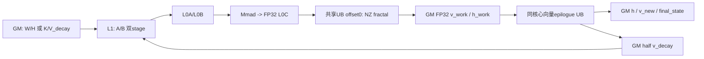

# ChunkGatedDeltaRuleFwdHVllm 310P ACLNN 算子知识

## 310P Chunk H 的首个分支

先确认实际 Input 为 FP16，并区分 gate 和持久 state 是 FP32 还是 FP16，再按[Route 选择](#route-选择)进入 G32/S32、G16/S32、G32/S16 或 G16/S16。公开 API 的 BF16/gk 声明不能代替本卡 half 核心；310P Device 不消费 gk。

准备 K/W/U、标量 g、初态与 h/v_new/final 的实际容量，核清状态是 KV 布局，随后读[接口与语义](#接口与语义)。需要直接 ACLNN 时先查[Host/Launcher](#hostlauncher-执行流程)：无初态并不会由该核心自动补零 h；Torch 的 zeros 分配是另一层行为。

变长空段压缩后 initial/final 按 compact batch 取行；映射、NT 或初态缺省没有证据时，先停下核对 caller，再进入[限制与失败边界](#限制与失败边界)和 Kernel。完整模型还须串起 WY、padding、VK/KV 变换与 Chunk O；[310P 接入](../../../../guides/integration/vllm_ascend_310p_gdn_execution_contract.md)和[数值验收](../../../../guides/bringup/vllm_ascend_310p_gdn_numerical_validation.md)负责这条组合链。

## 算子速览

| 项目 | 内容 |
|---|---|
| 实际入口 | aclnnChunkGatedDeltaRuleFwdHVllmGetWorkspaceSize / aclnnChunkGatedDeltaRuleFwdHVllm；公开 ACLNN 两阶段接口 |
| 固定身份 | Ascend ceac1a2bdff3139ca8fbd1a60b3a9befd68cadf2；CATLASS gitlink 41bf90da655bba3c66d0acd7e00abe33960ecfd6；metadef v9.2.0 000cd91b8f809ac55f4c51bd9fdee3ace8db1589 |
| 计算语义 | 分块计算 v_new=U−WH；按 gate 衰减 value，再计算 KᵀV_decay 与历史状态衰减之和 |
| 输入输出 | K/W/U 为 BNSD；h 按 chunk 保存进入该 chunk 的 KV 状态；v_new 为每 token 修正 value；可选输出末态 |
| 执行类型 | 单核心算子节点内 AIC_CUBE 与向量后处理；310P 的 Process 实际调用 ProcessUnifiedCore，保留 GM Workspace 交接 |
| Kernel 路线 | R-001 至 R-004，分别为 gate FP32/FP16 × state FP32/FP16；输入计算均实例化 half |
| 核心资源 | GM 六切片、L1、L0A/B/C、共享 UB；无独立 TQue 队列 |
| 来源闭包 | source_closed：公开 API→L0 launcher→Host/processor/注册结构→key0 entry→arch20 scheduler/矩阵乘/两个 epilogue；普通 CANN 前处理、生成桥接和通用硬件 primitive 是明确外部边界 |
| 验证状态 | 已完成源码链阅读；没有编译、NPU、数值、性能、模型或 Agent A/B 结果 |

## 接口与语义

### 计算语义

令 K/W 为 [B,Hk/Hv,T,K]，U 为 [B,Hv,T,V]，一个请求的 chunk 有 c 个有效 token。预期递推为 P=W_c H_c、V_new=U_c−P、V_decay[i]=exp(g_last−g_i)V_new[i]、ΔH=K_cᵀV_decay、H_next=exp(g_last)H_c+ΔH。矩阵乘输入为 FP16、累加和交接为 FP32；v_new、V_decay 和非末态 h 会转回 FP16。末态依 route 保存 FP32 或 FP16。因此不能把整个递推描述为始终 FP32。

h 保存当前 chunk 的初始状态，非末 chunk 更新写下一块；末 chunk 仅在 storeFinalState 为真时做第二阶段并写 final_state。该公开接口没有完整 WY 准备、Q 乘状态和最终输出 o；不能当作完整 GDN 或 recurrent V310。310P 设备不消费 gk，不能把上述标量 gate 公式改成按 K 维门控。

### 输入、输出与属性

| 参数 | shape/layout | dtype | 约束、默认值与语义 |
|---|---|---|---|
| k | [B,Hk,T,K]，BNSD | API 接受 FP16/BF16 | 310P entry 实际按 half 读；BF16 声明不构成可执行保证 |
| w | [B,Hv,T,K] | 与 k 相同 | CheckShape 要求 B/T/K 与 k 一致，head 与 u 一致 |
| u | [B,Hv,T,V] | 与 k 相同 | Hv≥Hk 且整除；Host 仅检查 V≤256，没有完整零维/对齐 guard |
| gOptional | [B,Hv,T] | FP32 或输入 dtype | 可缺省，但 g/gk 至少一个存在 |
| gkOptional | [B,Hv,T,K] | FP32 或输入 dtype | 存在时核对各轴；与 g 同时存在须同 dtype；310P 参数被忽略 |
| initalStateOptional | 逻辑应为请求×Hv×K×V 连续 KV 状态 | OpDef 列 FP16/BF16/FP32 | API 未完整检查初态 shape/dtype；不是外部 VK 布局 |
| outputFinalState | bool | 属性 | 缺省 false；真时检查 finalStateOut 非空 |
| chunkSize | int64 | 属性，头声明缺省 64 | API 没有显式正值/上界检查；Host 原样用于除法、预算和 kernel |
| saveNewValue | bool | 保留参数 | CheckReservedOptions 只接受 true |
| useExp2 | bool | 保留参数 | 只接受 false；实际 epilogue 使用 Exp |
| transposeStateLayout | bool | 保留参数 | 只接受 false；不能让设备自动交换 VK/KV |
| cuSeqlensOptional | aclIntArray，L0 转 INT64 ND Tensor | INT64 | 有则变长；没有校验全部单调性、首尾和长度匹配 |
| chunkIndicesOptional | aclIntArray，L0 转 INT64 ND Tensor | INT64 | 310P scheduler 接参但不读取内容 |
| hOut | 逻辑 [B,Hv,NT,K,V] | 与 k 相同 | 必须提供；API 不完整检查 shape，也不自行零初始化 |
| vNewOut | 逻辑 [B,Hv,T,V] | 与 k 相同 | 必须提供；L0 使用调用者输出 |
| finalStateOut | 请求×Hv×K×V | 初态 dtype；无初态时 FP32 | 仅 outputFinalState=true 时检查 dtype；API 没有完整 shape 检查 |
| workspaceSize/executor | 输出指针 | uint64 / executor | 查询成功后写入；入口没有先检查这两个输出指针非空 |

### 入口与版本

本卡只覆盖公开 ACLNN 的 310P 路线。OpDef 同时注册 ascend910b、ascend910_93、ascend950、ascend310p，但其他架构有不同 entry 模板与 body，未并入本卡平台范围。

Dockerfile.310p 固定 CANN 9.2.0_20261022115200、SOC ascend310p1、vLLM v0.32.0 和 torch-npu 26.2.0/20261015.5；这是构建配方，没有执行该容器。metadef 的 v9.2.0 发布源码用于解释序列化，不能据 tag 推出与上述 weekly 容器二进制逐字相同。独立 Native 与 Main 配对 Native 的区别沿[框架记录](../../../../concepts/frameworks/vllm_ascend.md)核对。

## Host/Launcher 执行流程

### 参数校验与前处理

公开参数结构 ChunkGatedDeltaRuleFwdHVllmParams 保存输入、可选数组、保留开关与输出；查询入口创建 executor 后依次执行 CheckNotNull→CheckGateOptionalNonNull→CheckReservedOptions→CheckGkParams→CheckFormat→CheckShape→CheckDtype。CheckFormat 实际直接成功；CheckParams 将内部失败归并为参数无效。CheckGkParams 在统一 rank 检查前读取 k/u 部分维度，Hv%Hk 也没有单独 Hk>0 guard，不能用后续合法 shape 条件掩盖检查顺序。

ParamsDataContiguous 依次处理 k/w/u 和存在的 g/gk/初态。若 g 缺省，MakeNeutralGate 从 gk 最后一维截 1 lane，经 Contiguous、Reshape 成 [B,Hv,T] 后 ZerosLike，生成零 gate。该框架前处理并不把 gk 的按 K 维衰减转成 310P 算法；gk 在 arch20 entry 仍被忽略。

L0 的 ChunkGatedDeltaRuleFwdHVllm 将两个 aclIntArray 转成 INT64 ND Tensor，转换后直接解引用设置格式，未逐项检查转换结果。ADD_TO_LAUNCHER_LIST_AICORE 的输入顺序是 k/w/u/g/gk/initial/cu/chunks，输出为 h/v_new/final_state，属性只有 outputFinalState/chunkSize。返回原输出指针，外层再登记 ViewCopy；不能将此解释成 L0 总会另分配正确 shape 的输出。

### 参数、Workspace 与生命周期

processor 令 C=AIC 核数、S=chunkSize，所有公式以字节计。定义 A(x)=floor((x+512)/512)×512；这是源码的严格下一 512 倍数，x 已对齐甚至为 0 时仍多分 512，不能替换成 ceil(x/512)×512。

| 切片 | 起始与长度 |
|---|---|
| 起始保留 | libApiWorkSpaceSize+16MiB |
| vWorkspaceOffset | A(C×S×V×4×2)，FP32 WH 结果 |
| vUpdateWorkspaceOffset | A(C×S×V×4×2)，预算 FP32；设备实际 half |
| kDecayWorkspaceOffset | useGk 时增加 A(C×S×K×4×2)，否则不增；310P 无消费者 |
| hWorkspaceOffset | A(C×K×V×4×2)，FP32 KᵀV_decay |
| numSeqWorkspaceOffset | A((tokenBatch+1)×8)，INT64 前缀 |
| numChunksWorkspaceOffset | A((tokenBatch+1)×8)，INT64 前缀 |
| 尾部保留 | 再加 16MiB，得到 currentWorkspace[0] |

这些切片属于单次 executor/工作空间，不是持久 KV cache。API 经 GetWorkspaceSize/ReleaseTo 交出 executor，第二阶段使用调用者 workspace/stream 调用 CommonOpExecutorRun。实际分配、异步寿命、executor 释放和框架提交完成是 CANN 边界；Torch raw-pointer 捕获问题见[ACLNN 接入指南](../../../../guides/integration/vllm_ascend_custom_aclnn_binding.md)，不由本卡宣布安全或已泄漏。

### 启动图与失败传播

Host 函数 Tiling4ChunkGatedDeltaRuleFwdHVllm 从 k/u storage shape、gate dtype、初态、cu tensor 和属性生成 context，直接调用 ChunkGatedDeltaRuleFwdHVllmTilingProcessor::Process；无 priority/IsCapable 链。GetCoreNumAic 决定 blockDim。ASCEND310P 强制 tiling key0，其余 SoC 才按 V≤128/大于128取 key1/2。保存注册 tiling buffer 后成功返回；workspace 数组、SaveToBuffer 成败和部分框架指针没有完整返回检查。

启动链为框架 Contiguous/可选 neutral-gate 规划→公开 ChunkH 核心节点→框架 ViewCopy→CommonOpExecutorRun。核心节点内部次序为初态写 h、WH、Vnew、上一 stage 的 KᵀV_decay 与 HUpdate。声明 KERNEL_TYPE_MIX_AIC_1_2 不证明独立 AIC/AIV 的 1:2 并发；active Process 无条件走统一核心流程。

## Route 与参数设计

### 分核与资源计算

无 cu 时 isVariedLen=0、shapeBatch=B、tokenBatch=1、batch=B；有 cu 时 isVariedLen=1、shapeBatch=1、tokenBatch=cu.shape[0]−1、batch=tokenBatch。Host 未完整约束变长 B、长度和输入实际 extent。

scheduler 对正长度段构造 gmNumSeq/gmNumChunks，压缩后重写 tokenBatch/batch。均匀 totalChunks=ceil(T/S)，变长为各正段 chunk 数之和。vBlockSize=128，vLoops=V/128 为向下整除，taskNum=vLoops×batch×Hv，headGroups=Hv/Hk，taskLoops=ceil(taskNum/(2C))。每核从 coreIdx×headInnerLoop 起步；按双 stage 和 dummy head 交错同一任务组中的 chunk。V<128 会得到 taskNum=0；V=256 产生 vIdx，但后续地址未使用 vIdx，没有可证明的两份 128 列分割。

WH 的 M/N/K 为 blockTokens/V/K；第二矩阵乘为 K/V/blockTokens，并显式按 128 拆第二矩阵乘 M 轴。L1 与 L0 tile 均为 128³。Host 没有给 S、K、V、UB 全部推导相应 guard，不能把固定 tile 或注释当 API 已校验范围。

### Route 选择

| 顺序 | Route | Key/模板 | 精确选择条件与优先级 | 不适用去向 |
|---:|---|---|---|---|
| 1 | R-001 G32/S32 | key0，GDNFwdHKernel<half,float,float,float> | __CCE_AICORE__=200、stateDataType=2、gDataType=2 | state/g 条件不满足按下行选择 |
| 2 | R-002 G16/S32 | key0，<half,half,float,float> | 同平台、stateDataType=2、gDataType≠2 | 进入 state 非2分支 |
| 3 | R-003 G32/S16 | key0，<half,float,half,float> | 同平台、stateDataType≠2、gDataType=2 | 其他为 R-004 |
| 4 | R-004 G16/S16 | key0，<half,half,half,float> | 同平台、stateDataType≠2、gDataType≠2 | 无 CPU/reference fallback |

```text
公开校验/Contiguous/可选 neutral g
 -> Host: ASCEND310P -> key0
 -> arch20 定义 CATLASS_UNIFIED_CORE=1
 -> dataType=1 的 BF16模板块被预处理排除
 -> stateDataType==2 ? (gDataType==2 ? R-001 : R-002)
                        : (gDataType==2 ? R-003 : R-004)
 -> Init -> Process -> ProcessUnifiedCore
```

### 模板/实现执行矩阵

| Route | key/selector | dtype/shape/platform 完整命中条件 | 执行族与 kernel 节点 | 实际模板/body | 内存与同步特征 | tail/fallback |
|---|---|---|---|---|---|---|
| R-001 | 0；state2/g2 | 上表谓词加公开检查；不额外假造 dtype/shape guard | 单节点 MIX_CV，统一核心矩阵与 Vector 顺序 | half/float/float/float；WH→Vnew→KV→HUpdate | gate FP32、初态 FP32→half、末态 FP32 | 通用尾块限制；无 fallback |
| R-002 | 0；state2/g非2 | 同平台/检查；gate 非FP32走 half，不自动修 BF16 | 同一节点图 | half/half/float/float | gate half→FP32 UB，初态 FP32，末态 FP32 | 同前 |
| R-003 | 0；state非2/g2 | 初态非FP32走 half，不证明 BF16可用 | 同一节点图 | half/float/half/float | 初态直接 half 搬运，末态 half | 同前 |
| R-004 | 0；state非2/g非2 | gate/state非2均half；其他参数同公开检查 | 同一节点图 | half/half/half/float | gate cast，初态 half，末态 cast half | 同前 |

### 隐藏性能 Guard

| Guard | Host/Tiling 条件 | Device/资源原因 | 影响 Route | 不满足时去向 | 源码符号 |
|---|---|---|---|---|---|
| 输入/头维 | rank4、共享 B/T/K、Hv≥Hk、整除 | K-head 映射 vHead/headGroups | 全部 | API 拒绝；零 Hk 无独立保护 | CheckShape |
| gate | g 或 gk 存在 | epilogue 实际始终读标量 g | 全部 | API 拒绝；gk-only补零不恢复gk算法 | MakeNeutralGate / entry |
| V≤256 | Host 明确拒绝更大 | 固定128 tile与UB并未因此完整受保护 | 全部 | Host失败；V<128/非整倍数无对应拒绝 | Tiling4 / vLoops |
| S/K/尾对齐 | 没有完整正值/容量检查 | WH无外层M切分，普通DMA和16×16输出搬运 | 全部 | 无保护性 fallback | ProcessUnifiedCore / BlockMmadTla |
| dtype | API列FP16/BF16 | unified 编译块实际固定half | 全部 | 没有310P专项BF16拒绝；不可外推支持 | CATLASS_UNIFIED_CORE |
| workspace窄化 | Host int64偏移/维度，Device uint32 | 乘积、512对齐后地址需可表示 | 全部 | 无显式溢出拒绝 | Init / scheduler.Init |
| initial state | 存在才初始化h | 每核搬运 K×V；缺省不在此补零 | 全部 | 直调者须满足h首态合同 | useInitialState |
| 自动同步关闭 | --cce-auto-sync=off | 正确性依赖实际 event/barrier 与 primitive | 全部 | 无自动增加同步承诺 | op_host/CMakeLists.txt |

### POD/ABI

下表的“线/直”分别为注册结构序列化 offset 与手写 plain struct offset，单位字节。按固定 metadef 9.2 的 CheckAlignAndGenPlaceHolder、sizeof(int64_t)=8、sizeof(bool)=1、普通 8 字节对齐静态推导：线数据长176，plain sizeof168/align8。没有编译实测；生成设备头在冻结 Main 中不可见，其实际 sizeof/alignof/offsetof 与 weekly 制品仍需核对。Host 宏类继承 TilingDef 并持有私有成员、offset/reserve，不是176字节 C++ POD，不能拿其对象 sizeof 当线上长度。

| 结构 | 字段 | 类型/位宽 | ABI 布局：线/直 | 单位 | Host/launcher producer | Device consumer | 边界 |
|---|---|---|---|---|---|---|---|
| 注册/Plain | batch | int64/64 | 0/0，8B align8 | 请求 | processor 均匀B/变长段数 | scheduler batch | 压缩后重写，uint32窄化 |
| 同上 | seqlen | int64/64 | 8/8 | token | k.dim2 | totalTokens/Chunks | 无完整正值检查 |
| 同上 | kNumHead | int64/64 | 16/16 | head | k.dim1 | headGroups、地址 | 不得为0 |
| 同上 | vNumHead | int64/64 | 24/24 | head | u.dim1 | taskNum、地址 | 应整除Hk |
| 同上 | kHeadDim | int64/64 | 32/32 | 元素 | k.dim3 | WH/KV、初态、UB | 无完整容量guard |
| 同上 | vHeadDim | int64/64 | 40/40 | 元素 | u.dim3 | 全部列跨度/vLoops | Host只拒绝>256 |
| 同上 | chunkSize | int64/64 | 48/48 | token | attr1 | 除法、WH和epilogue | 0/负数无显式检查 |
| 同上 | useInitialState | bool | 56/56，1B align1 | 开关 | 初态非空 | 初态拷贝/转换 | false时没有设备补零 |
| 同上 | storeFinalState | bool | 57/57 | 开关 | attr0 | NeedProcessStage2/末态 | 末段false跳过更新 |
| 同上 | dataType | int64/64 | 64/64 | 枚举 | k dtype映射0/1/2 | 310P active不按它选BF16 | 其余dtype映射2不等接受 |
| 同上 | gDataType | int64/64 | 72/72 | 枚举 | 优先g，否则gk | entry gate模板 | 2=float，否则half |
| 同上 | stateDataType | int64/64 | 80/80 | 枚举 | 初态dtype/缺省2 | entry state模板 | 2=float，否则half |
| 仅注册 | hasGk | bool | 88/不存在 | 保留 | 没有set_hasGk | 无消费者 | 固定metadef新buffer置零；不能删字段对齐 |
| 注册/Plain | isVariedLen | int64/64 | 96/88 | 开关 | hasCuSeqlens | scheduler压缩/地址 | plain与线从此错位 |
| 同上 | shapeBatch | int64/64 | 104/96 | batch | B或1 | GM布局/shapeBatchIdx | 变长逻辑与真实B须一致 |
| 同上 | tokenBatch | int64/64 | 112/104 | 段数 | 1或cu.dim0−1 | 前缀和/初态循环 | Device压缩后有独立值 |
| 同上 | useGk | bool | 120/112 | 开关 | gk非空 | arch20不消费 | 只影响Host预留 |
| 同上 | vWorkspaceOffset | int64/64 | 128/120 | 字节 | processor顺序切片 | gmVWorkspace，float | Device转uint32 |
| 同上 | vUpdateWorkspaceOffset | int64/64 | 136/128 | 字节 | 第二切片 | gmVUpdateWorkspace，half | Host保守按4B预算 |
| 同上 | kDecayWorkspaceOffset | int64/64 | 144/136 | 字节 | 可选第三切片 | arch20无 | useGk false可与下一片同起点 |
| 同上 | hWorkspaceOffset | int64/64 | 152/144 | 字节 | 第四切片 | gmHWorkspace，float | 每核两stage |
| 同上 | numSeqWorkspaceOffset | int64/64 | 160/152 | 字节 | 第五切片 | INT64正段终点 | 多核相同写，无单独屏障声明 |
| 同上 | numChunksWorkspaceOffset | int64/64 | 168/160 | 字节 | 第六切片 | INT64累计chunk数 | 容量按压缩前段数预算 |

public Tiling 先用 ::ChunkGatedDeltaRuleFwdHVllmTilingData 作为 processor 中间结果，再逐字段 set 到 optiling 注册类，最后 SaveToBuffer；不是把 plain168B 直接复制到公开设备。手写结构注释称与宏镜像，但实际缺 hasGk：这证明两份字段清单不同，不证明公开 ACLNN 当次已发生错位，也不能用它为独立 fast-launch 的 ABI 背书。

### Route 源码闭包

| Route | Key/selector | Host/Tiling producer | POD/参数 | Kernel entry/router | Kernel body/直接依赖 | 构建接线 |
|---|---|---|---|---|---|---|
| R-001 | 0，state2/g2 | Tiling4→processor.Process | 注册结构与生成设备结构 | __CCE_AICORE__200，half/float/float/float | arch20 GDNFwdHKernel、scheduler、WH/KV BlockMmad、Vnew/HUpdate | OpDef310p、build_aclnn.sh310分支、op_host/CMake |
| R-002 | 0，state2/g非2 | 同函数与字段 | 同线上ABI，gate宽度不同 | half/half/float/float | 同body，gate half转换分支 | 同前 |
| R-003 | 0，state非2/g2 | 同函数与字段 | state指针按half | half/float/half/float | 同body，初态直拷/末态cast | 同前 |
| R-004 | 0，state非2/g非2 | 同函数与字段 | gate/state均half | half/half/half/float | 两组转换共同命中 | 同前 |

## Kernel 实现

### 公共执行流程

arch20 GDNFwdHKernel 定义 CATLASS_ARCH=2201 和 CATLASS_UNIFIED_CORE=1，ArchTag 名为 AtlasA2；这是复用的类型标签，不是硬件改成A2。Init 把维度/偏移读入 uint32、绑定 GM，只有 cubeBlockScheduler.Init 被调用。ProcessSplitCore 虽保留 AIC/AIV CrossCoreSet/Wait，但没有被 Process 调用，vecBlockScheduler 也不在 active Init 中初始化。

每个 active task 的 hSrc/hDst、u/v、w/k、g、临时结果按 shapeBatch/head/token/chunk 地址计算。hDst=hSrc+K×V；每核 stage s 的 vWork=(core×2+s)×S×V，hWork=(core×2+s)×K×V。currStage 为 int32，但 PING_PONG_STAGES 是 uint32 常量2，所以 GetStage2Offsets 的 (currStage−1)%2 经无符号转换，stage0得到1；不能误诊为有符号 −1 下标。

### Route R-001：G32/S32

#### 适用条件

##### 选择证据

| 层级 | 文件 | 符号 | 源码谓词/参数 | 结果/下一跳 |
|---|---|---|---|---|
| Host | op_host/*_tiling.cpp | Tiling4 | ASCEND310P | key0 |
| Router | op_kernel/*_vllm.cpp | entry | stateDataType==2 && gDataType==2 | GDNFwdHKernel<half,float,float,float> |
| Body | arch20/gemm/kernel/gdn_fwd_h_kernel.hpp | Process | 无条件 ProcessUnifiedCore | 顺序执行矩阵/向量阶段 |

#### Device 数据流

##### 函数级调用链

```text
entry -> GDNFwdHKernel::Init -> cubeBlockScheduler.Init
 -> Process -> ProcessUnifiedCore
 -> 可选初态FP32搬UB/Cast half/写h
 -> InitTask -> NeedProcessStage1
 -> BlockMmadWH.preSetFlags/operator/finalWaitFlags
 -> Vnew::operator
 -> iterId>1且NeedProcessStage2
 -> 按K轴M分块调用BlockMmadKV
 -> HUpdate::operator -> 下一stage/退出
```

##### 源码等价伪码

```text
初态存在：每核遍历shapeBatch/head/压缩段；在statePing/Pong读K*V
  MTE2_V -> Cast half(CAST_NONE) -> V_MTE3 -> 写首chunk h
while scheduler.isRunning:
  InitTask，轮转stage；可能标lastLoop并为上一stage排空
  if stage1有效:
    FP32 v_work = W_half @ H_half
    gate_last = g_float[blockTokens-1]
    FP32 v = cast(U_half)-v_work
    输出cast_half(v)
    Workspace写cast_half(v*exp(gate_last-g_i))
  if iterId>1且stage2有效:
    对K的每128行：FP32 h_work = K_half.T @ V_decay_half
    FP32 next = exp(gate_last)*cast(H_half)+h_work
    若最终state：写FP32 final_state；否则写cast_half(next)到下一h
```

#### 内存与数据搬运

##### 资源与搬运表

| 层级/缓冲区 | offset/地址公式 | extent/容量公式 | dtype/layout | producer | consumer | owner/lifetime | 对齐/复用 |
|---|---|---|---|---|---|---|---|
| GM输入/输出 | scheduler offsets | 按B/H/T/K/V/NT | ND/BNSD、KV状态 | caller/前处理 | WH/KV/epilogue | executor/调用者 | 无任意stride保证 |
| GM v_work | user+vWorkspaceOffset | C×2×S×V×4 | FP32 row-major | WH | Vnew | 单次workspace | 两stage轮转 |
| GM v_decay | user+vUpdateWorkspaceOffset | 实际C×2×S×V×2 | half row-major | Vnew | KV | 同上 | 预算按4B，设备索引按2B |
| GM h_work | user+hWorkspaceOffset | C×2×K×V×4 | FP32 row-major | KV | HUpdate | 同上 | 第二阶段后消费 |
| L1 A/B | A0/32KiB；B64/96KiB | 每片128×128×2=32KiB | WH A/B zN；KV A nZ/B zN | GM→L1 copy | L1→L0 copy | 同一Resource | A/B各两stage |
| L0A/B | 各0/32KiB | 各64KiB | zZ / nZ，half | L1 copy | Mmad | 同一Resource | 两stage |
| L0C | 0 | nominal128×128×4=64KiB | FP32 accumulator | Mmad | L0C→UB | 资源预留128KiB | 单stage/unit flag |
| UB co2Temp | 0 | align16(M)×align16(N)×4 | FP32 NZ fractal | L0C DataCopy | 按fractal写GM | 与epilogue同UB顺序复用 | 不使用Fixpipe |
| UB初态 | state0/96KiB，half输出64/160KiB | state为K×V×4，h为K×V×2 | float→half | 初态GM | hGM | 初始化阶段 | 没有K/V完整容量保护 |
| UB Vnew | calc0；float U32/96KiB；U/ws/out64/128KiB | m_sub×V，calc含broadcast补齐行 | FP32/half别名 | U/ws/g | v_new/v_decay GM | epilogue对象 | gate160..165KiB；scratch166KiB |
| UB HUpdate | calc0；h64KiB；update/out96KiB；gate160KiB | ceil(K/subBlockNum)×V | FP32/half别名 | h/h_work/g | h或final GM | 每次局部对象 | 无独立双buffer |
| 寄存器 | 标量坐标、gLast、muls、循环 | 源码没有固定字节预算 | uint32/int64/float | scheduler/标量读取 | 控制/Exp后乘数 | 当前调用 | 不编造寄存器占用 |

##### 分层内存布局



##### 字节账、交接边与复用顺序

```text
workspace_total = libWS +32MiB +A(8*C*S*V)+A(8*C*S*V)
 +[useGk?A(8*C*S*K):0]+A(8*C*K*V)+2*A(8*(tokenBatch+1))
L1 active tiles = 2*32KiB +2*32KiB =128KiB
L0A=64KiB；L0B=64KiB；nominal L0C=64KiB
Resource<AtlasA2>静态预留 L1=512KiB/L0A=64KiB/L0B=64KiB/L0C=128KiB/UB=192KiB
上述是所用类型常量，Host没有查询并证明310P实际资源适配
Vnew: calc broadcast行按8补齐；gate各区1KiB；scratch从166KiB开始
HUpdate: calc [0,4*m_sub*V)，h从64KiB，update从96KiB
初态: FP32 K*V>16384时单份state会超过其64KiB前隙；需逐区同时核对
```

| 边/复用子区 | producer | offset/extent | dtype/layout | consumer | ordering/sync | owner/lifetime | 安全条件 |
|---|---|---|---|---|---|---|---|
| WH→Vnew | BlockMmadWH | v_work当前stage | FP32 ND | Vnew | BlockMmad结束PIPE_ALL | workspace | 实际extent/尾部可写 |
| Vnew→KV | Vnew | v_decay当前stage | half ND | KV上一stage | 顺序调用、epilogue barrier | workspace | 末次pong写回后的跨阶段依赖仍须核对 |
| KV→HUpdate | BlockMmadKV | h_work当前stage | FP32 ND | HUpdate | BlockMmad结束PIPE_ALL | workspace | M分块全完成 |
| h_next→WH | HUpdate | 下一chunk h | half KV | 下轮同head WH | HUpdate在返回前PIPE_ALL后DataCopy，尾部无统一等待 | caller h | 不把顺序C++语句等同硬件完成 |
| UB0共享 | L0C导出/calc | 首区按阶段复用 | FP32 | 后续矩阵/epilogue | 显式PIPE_ALL与局部事件 | Resource | 分析每个最终DMA，不能凭无并行注释免同步 |
| Vnew U/ws/out别名 | U cast后ws加载再输出cast |64/128KiB | half/float | Sub/Cast/DataCopy | MTE2_V、PIPE_V/ALL | epilogue | 原U已转到独立FP32区再覆盖 |

#### 同步、精度与尾块

##### 同步与数值边界表

| 阶段 | primitive/机制 | producer | consumer/等待点 | 保护对象 | 精度/尾块 |
|---|---|---|---|---|---|
| L1复用 | MTE1_MTE2 / MTE2_MTE1 | GM load / L1 read | 每stage Wait/Set | A0/1、B2/3 | clearL1Padding默认false |
| L0复用 | M_MTE1 / MTE1_M | L1 load / Mmad | A/B事件与矩阵前等待 | L0A/B/C | ENABLE_UNIT_FLAG=true时l0CEventList[0]未见初始化，但仍用作事件ID；不伪造实测故障 |
| 累加 | initC首个K块；unitFlag中间10末11 | Mmad | FP32 L0C | 同一输出tile | K分块FP32累加；小tile额外PIPE_M |
| L0C导出 | PIPE_ALL、BLOCK_MODE_MATRIX DataCopy、逐fractal DMA | L0C | UB0→GM | align16(M/N)矩形 | 每fractal固定16行16列，未按真实尾行逐元素截断 |
| Vnew gate | MTE2_V、V_S/S_V、Sub/Exp/Broadcast | g | FP32 calc | gate与广播区 | 半精度gate先Cast；Broadcast按8行和16索引边界 |
| 初态 | MTE3_MTE2 ping/pong、MTE2_V、V_MTE3 | state | h初块 | 同核UB | FP32→half CAST_NONE；不同于dormant split的CAST_RINT |
| HUpdate | MTE2_V、V_S/S_V、PIPE_ALL | h/h_work/g | h/final |96KiB区别名 | FP32末态不再量化；非末态仍half |
| 核间 | cube1Done/cube2Done形参未在两个active epilogue使用 | N/A | N/A | 无已证明active跨核flag边 | 不拿ProcessSplitCore的flag图替代 |
| 空/变长 | 压缩正段、dummy/lastLoop | scheduler | 初态/任务映射 | 正段编号 | 没保存原请求mask；直调空段state合同不完整 |

Vnew 的广播坐标中，首 subblock 的 gbrcRealStart=0；第二 subblock 将 mActualPerSubBlock 向下按16对齐为 gbrcRealStart，再以 gbrcEffStart=gbrcStart−gbrcRealStart 选择有效行。gbrcReptime 向上按8行规划，Broadcast 读取 gUbTensor[gbrcRealStart]；有效输出仍按 mActualThisSubBlock 截取，不能把广播补齐容量和真实token数混为一谈。

普通 AscendC DataCopy 的对齐、物理padding、Mmad资源和 GetSubBlockNum 在具体 m200 工具链上的行为为库/设备边界。Vnew 的 subBlock 划分按首块/其余块两分写法，不能未经验证推广到任意 subBlock 数。没有原子累加与专用清零内核；各核初始化相同首态和相同前缀表的并发行为没有独立跨核屏障证据。

#### 关键实现

##### 符号证据表

| 阶段 | 文件 | 符号/模板实例 | 实现事实 |
|---|---|---|---|
| Host | op_host/*_tiling_processor.h | Process / AlignUp | 六切片、保留、下一512倍数 |
| Entry | op_kernel/*_vllm.cpp | GDNFwdHKernel<half,float,float,float> | active FP16输入 |
| 调度 | arch20/gemm/block/block_scheduler_gdn_fwd_h.hpp | InitTask / NeedProcessStage2 | chunk/head/stage、末态跳过 |
| 矩阵 | moe/common/kernel_utils/block/block_mmad_pingpong_tla_multi.hpp | BlockMmadTla | K双buffer与L0C经UB导出 |
| 向量 | arch20/epilogue/block/block_epilogue_gdn_fwdh_vnew.hpp | BlockEpilogue::operator | FP32差值和gate，输出half |
| 状态 | arch20/epilogue/block/block_epilogue_gdn_fwdh_update.hpp | BlockEpilogue::operator | 历史衰减+更新，末态分dtype |

### Route R-002：G16/S32

#### 适用条件

##### 选择证据

| 层级 | 文件 | 符号 | 源码谓词/参数 | 结果/下一跳 |
|---|---|---|---|---|
| Router | op_kernel/*_vllm.cpp | state2下g非2分支 | stateDataType==2、gDataType!=2 | <half,half,float,float>，key0 |

#### Device 数据流

##### 函数级调用链

entry→Init→scheduler→ProcessUnifiedCore→WH→Vnew<half gate>→KV→HUpdate<half gate,float final>；调用顺序和任务排空规则与R-001相同。

##### 源码等价伪码

初态float→half；g先以half DMA到gInputUb，再Cast到FP32做Exp/差值；HUpdate将half g_last转float再Exp；v_new/v_decay/中间h仍half，final_state写float。此路线的gate量化信息在进入kernel前已损失，不能与R-001按精度相同合并。

#### 内存与数据搬运

##### 资源与搬运表

| 层级/缓冲区 | offset/地址公式 | extent/容量公式 | dtype/layout | producer | consumer | owner/lifetime | 对齐/复用 |
|---|---|---|---|---|---|---|---|
| GM gate | gOffset | blockTokens×2 | half连续 | caller | gInputUb | executor | 不能用FP32 stride |
| UB gate输入 |164/165KiB | blockTokens×2 | half | DataCopy | Cast→160/161KiB float | epilogue | 必须容入1KiB子区 |
| 其余层级 | R-001全部资源公式 | 含float初态/末态 | 同R-001 | 同上 | 同上 | 同上 | 与矩阵/别名规则相同 |

##### 分层内存布局

R-001图的gate支路为GM half→gInputUb→Cast FP32→Exp/Broadcast；矩阵与GM Workspace交接不变，没有新增内核。

##### 字节账、交接边与复用顺序

Workspace/L1/L0预算与R-001相同。gate输入比FP32少2字节/元素，但另外使用gInputUb与Cast；这不构成测得的带宽或速度收益。初态/末态仍4字节/元素。

#### 同步、精度与尾块

##### 同步与数值边界表

| 阶段 | primitive/机制 | producer | consumer/等待点 | 保护对象 | 精度/尾块 |
|---|---|---|---|---|---|
| gate | MTE2_V→Cast→PIPE_V/V_S | half gate | FP32 Exp | gInput/gUb | half读入的DMA尾、1KiB容量 |
| state | 同R-001 | float初态/h更新 | half中态/float末态 | state/h UB | 同R-001 CAST_NONE |
| 其他 | R-001完整同步与尾部规则 | 同前 | 同前 | 同前 | 不新增fallback |

#### 关键实现

##### 符号证据表

| 阶段 | 文件 | 符号/模板实例 | 实现事实 |
|---|---|---|---|
| Router | op_kernel/*_vllm.cpp | <half,half,float,float> | gate非2落half |
| gate | arch20/epilogue/block/block_epilogue_gdn_fwdh_vnew.hpp | !is_same<GElementInput,float> | half转FP32，后续相同 |
| HUpdate | arch20/epilogue/block/block_epilogue_gdn_fwdh_update.hpp | half gLastVal | 标量转float后Exp |

### Route R-003：G32/S16

#### 适用条件

##### 选择证据

| 层级 | 文件 | 符号 | 源码谓词/参数 | 结果/下一跳 |
|---|---|---|---|---|
| Router | op_kernel/*_vllm.cpp | state非2下g2分支 | stateDataType!=2、gDataType==2 | <half,float,half,float>，key0 |

#### Device 数据流

##### 函数级调用链

entry→Init→初态half直拷h→scheduler→WH→Vnew<float gate>→KV→HUpdate<half final>；任务图与R-001相同，初态与末态转换不同。

##### 源码等价伪码

useInitialState时state与H类型相同，MTE2_MTE3后直接DMA到h；不走float→half Cast。HUpdate仍FP32计算，final_state通过Cast(CAST_NONE)到half再写GM。gate按FP32直接加载。

#### 内存与数据搬运

##### 资源与搬运表

| 层级/缓冲区 | offset/地址公式 | extent/容量公式 | dtype/layout | producer | consumer | owner/lifetime | 对齐/复用 |
|---|---|---|---|---|---|---|---|
| GM初/末态 | scheduler状态offset | K×V×2 | half KV连续 | caller/HUpdate | h/caller | executor | 与float路线字节不同 |
| UB初态 |0/96KiB | K×V×2 | half | 初态DMA | h DMA | Resource初始化阶段 | 不使用h转换区 |
| UB final |96KiB，与hUpdate重叠 | m_sub×V×2 | half | FP32→half Cast | final DMA | HUpdate | 同区转换和PIPE_ALL |
| 其余 | R-001图/资源公式 | gate FP32 | 同前 | 同前 | 同前 | 同前 | 同样受未覆盖guard约束 |

##### 分层内存布局

R-001图保持，初态支路为GM half→UB state→GM h；final支路为FP32 update→同96KiB区half→GM final。

##### 字节账、交接边与复用顺序

六片Workspace仍按原公式分配，state dtype不改变其预算。初态和末态每元素2B；无FP32初态Cast，末态增加half Cast。必须重新计算state区extent，不能直接沿R-001把省下空间视为可分配区。

#### 同步、精度与尾块

##### 同步与数值边界表

| 阶段 | primitive/机制 | producer | consumer/等待点 | 保护对象 | 精度/尾块 |
|---|---|---|---|---|---|
| 初态 | MTE3_MTE2、MTE2_MTE3 | half初态 | half h | ping/pong | 无初态转换，仍普通DMA |
| 末态 | PIPE_ALL→Cast→PIPE_ALL→DataCopy | FP32 next | half final |96KiB别名 | CAST_NONE，不等于FP32保真 |
| 其他 | R-001完整同步与尾部规则 | 同前 | 同前 | 同前 | 无扩展支持 |

#### 关键实现

##### 符号证据表

| 阶段 | 文件 | 符号/模板实例 | 实现事实 |
|---|---|---|---|
| Entry | op_kernel/*_vllm.cpp | <half,float,half,float> | state非2解释为half |
| 初态 | arch20/gemm/kernel/gdn_fwd_h_kernel.hpp | is_same<ElementInitialState,ElementH> | 进入直接拷贝else |
| 末态 | arch20/epilogue/block/block_epilogue_gdn_fwdh_update.hpp | !is_same<FinalStateElement,float> | 最终状态也量化half |

### Route R-004：G16/S16

#### 适用条件

##### 选择证据

| 层级 | 文件 | 符号 | 源码谓词/参数 | 结果/下一跳 |
|---|---|---|---|---|
| Router | op_kernel/*_vllm.cpp | 两层else | stateDataType!=2、gDataType!=2 | <half,half,half,float>，key0 |

#### Device 数据流

##### 函数级调用链

entry→Init→初态half直拷→ProcessUnifiedCore→WH→Vnew<half gate>→KV→HUpdate<half gate,half final>。

##### 源码等价伪码

同时采用R-002的gate half→float路径和R-003的初态直拷/末态half Cast；所有矩阵累加与h_work仍FP32。并非全半精度计算，更不证明BF16参数可用。

#### 内存与数据搬运

##### 资源与搬运表

| 层级/缓冲区 | offset/地址公式 | extent/容量公式 | dtype/layout | producer | consumer | owner/lifetime | 对齐/复用 |
|---|---|---|---|---|---|---|---|
| gate | R-002输入/UB坐标 |2B输入→4B计算 | half→float | DMA/Cast | Exp | epilogue | 1KiB子区与尾部 |
| 初末态 | R-003坐标 |2B/元素 | half | 初态/更新 | h/final | executor/UB | 不混用float指针跨度 |
| 其他层级 | R-001完整资源表 | 原Workspace/L1/L0/UB | 不变 | 同前 | 同前 | 同前 | 同样顺序复用 |

##### 分层内存布局

沿R-001矩阵/GM交接图，合并R-002 gate Cast支路与R-003初末态支路；无新增launch或跨核flag。

##### 字节账、交接边与复用顺序

Workspace/L1/L0预算相同，gate/state为half；UB calc仍float。省输入字节与增加Cast并存，没有实测收益，不能省略两类Cast之间的PIPE与别名生命周期。

#### 同步、精度与尾块

##### 同步与数值边界表

| 阶段 | primitive/机制 | producer | consumer/等待点 | 保护对象 | 精度/尾块 |
|---|---|---|---|---|---|
| gate | R-002事件/Cast | half gate | FP32向量 | gate UB | 输入量化与DMA尾 |
| 初末态 | R-003事件/Cast | half初态/FP32 next | half h/final | 状态UB | 末态CAST_NONE |
| 其他 | R-001完整同步与尾部规则 | 同前 | 同前 | 同前 | 无专门fallback |

#### 关键实现

##### 符号证据表

| 阶段 | 文件 | 符号/模板实例 | 实现事实 |
|---|---|---|---|
| Entry | op_kernel/*_vllm.cpp | <half,half,half,float> | key0末分支 |
| 向量 | arch20/epilogue/block/block_epilogue_gdn_fwdh_vnew.hpp | half输入Cast | FP32差值/Exp，输出half |
| 状态 | arch20/epilogue/block/block_epilogue_gdn_fwdh_update.hpp | FinalStateElement=half | FP32加法后量化末态 |

## 算子特定优化

### Trick T-001：统一核心保留两stage，移除active跨核握手

#### 触发与源码依据

- 适用 Route：R-001..004；arch20、CATLASS_UNIFIED_CORE=1。
- Golden 来源：[Process入口](https://github.com/vllm-project/vllm-ascend/blob/ceac1a2bdff3139ca8fbd1a60b3a9befd68cadf2/csrc/moe/chunk_gated_delta_rule_fwd_h_vllm/op_kernel/arch20/gemm/kernel/gdn_fwd_h_kernel.hpp#L209-L211)。

```cpp
    __aicore__ inline void Process() {
        ProcessUnifiedCore();
    }
```

#### 机制与设计原因

矩阵与向量在同一active流程调用，仍以两份GM结果避免相邻chunk覆盖。不得将dormant ProcessSplitCore的CrossCoreWait/Set搬来解释当前时序；两个epilogue接到的CrossCoreFlag未被读取。

#### 迁移边界

适用同一m200编译路线；前提是验证完整event/barrier、资源和primitive，不能把顺序函数调用当所有DMA已完成。改成真正分离核心时需要重新设计交接与排空。本次未执行编译、真机、数值或性能测试。

#### 错误做法

只凭MIX_AIC_1_2声明画独立AIC/AIV流水图会与active调用链冲突；固定仓有dormant split body可对照，但没有该路线运行结果。

### Trick T-002：第二矩阵乘按128行拆K轴

#### 触发与源码依据

- 适用 Route：全部；第二矩阵乘K_head可能大于L1_TILE_M_C2=128。
- Golden 来源：[M轴分块](https://github.com/vllm-project/vllm-ascend/blob/ceac1a2bdff3139ca8fbd1a60b3a9befd68cadf2/csrc/moe/chunk_gated_delta_rule_fwd_h_vllm/op_kernel/arch20/gemm/kernel/gdn_fwd_h_kernel.hpp#L307-L308)。

```cpp
                    constexpr uint32_t L1_TILE_M_C2 = tla::get<0>(L1TileShapeTla{});
                    uint32_t mLoopC2 = (kHeadDim + L1_TILE_M_C2 - 1) / L1_TILE_M_C2;
```

#### 机制与设计原因

专用BlockMmad内部只有K分块和L0子循环，没有为整个输入建立外层L1 M循环。调用者显式mOff/mActual并逐块完成，避免把K_head整块默认当作128行。它没有为WH的blockTokens轴或V轴同时补全等价保护。

#### 迁移边界

适用当前tile与KV地址；前提是尾行物理范围和资源可用。改变tile需重算K切片、Workspace和导出尾部。未执行任何运行测试。

#### 错误做法

删除外层M拆分而保持当前BlockMmad实例没有来源支持；不能用这项拆分宣布任意K/V/S都安全。

### Trick T-003：L0C经UB分形导出，不走Fixpipe

#### 触发与源码依据

- 适用 Route：全部；CATLASS_UNIFIED_CORE。
- Golden 来源：[矩阵模式搬运](https://github.com/vllm-project/vllm-ascend/blob/ceac1a2bdff3139ca8fbd1a60b3a9befd68cadf2/csrc/moe/common/kernel_utils/block/block_mmad_pingpong_tla_multi.hpp#L689-L691)。

```cpp
            AscendC::DataCopyEnhancedParams enhParams;
            enhParams.blockMode = AscendC::BlockMode::BLOCK_MODE_MATRIX;
            AscendC::DataCopy(co2Temp, l0CTensorList[l0CListId], l0c2ubParams, enhParams);
```

#### 机制与设计原因

L0C先按NZ fractal复制到UB0，再按nf/mf两个循环将每16×16分形写到ND GM。与epilogue顺序复用UB，避免依赖m200没有的Fixpipe/DataCopyCO12Dst；仍物化FP32 GM结果，不宣称融合消除GM流量。

#### 迁移边界

必须满足align16矩形可读写、GM stride−16非负且DMA stride单位合法。尾行/列没有按真实extent截断；不能据DataCopy调用成功推出任意tail正确。未执行运行验证。

#### 错误做法

直接复制新架构Fixpipe路线或删UB转换没有本平台证据；逐分形导出的真实尾部约束也不能省略。

### Trick T-004：Vnew将U、workspace和输出在UB中顺序别名

#### 触发与源码依据

- 适用 Route：全部；U先转到独立FP32区再允许原区装载workspace。
- Golden 来源：[同offset别名](https://github.com/vllm-project/vllm-ascend/blob/ceac1a2bdff3139ca8fbd1a60b3a9befd68cadf2/csrc/moe/chunk_gated_delta_rule_fwd_h_vllm/op_kernel/arch20/epilogue/block/block_epilogue_gdn_fwdh_vnew.hpp#L66-L67)。

```cpp
        uUbFloatTensor_ping = resource.ubBuf.template GetBufferByByte<float>(PING_BUF_0_OFFSET);
        wsUbTensor_ping = resource.ubBuf.template GetBufferByByte<float>(PING_BUF_1_OFFSET);
```

#### 机制与设计原因

U half和ws FP32同64/128KiB区，输出v_new也在该区；FP32 U在32/96KiB区保留到Sub之后。cast和barrier决定重用顺序。isFirst只在构造为true，第一次选ping、后面恒false选pong，不是每次交替的双buffer。

#### 迁移边界

必须按m_sub×V、broadcast补齐行、gate子区和scratch重新算容量。HUpdate共用相同Resource，跨调用覆盖与尾部DMA仍须核对；未执行性能或并发测试。

#### 错误做法

按变量名ping/pong宣称稳定交替或无条件把别名看作安全，会遗漏isFirst实际状态与事件寿命。

### Trick T-005：关闭最终状态时跳过末chunk第二阶段

#### 触发与源码依据

- 适用 Route：全部；storeFinalState=false且前一stage为末chunk。
- Golden 来源：[调度谓词](https://github.com/vllm-project/vllm-ascend/blob/ceac1a2bdff3139ca8fbd1a60b3a9befd68cadf2/csrc/moe/chunk_gated_delta_rule_fwd_h_vllm/op_kernel/arch20/gemm/block/block_scheduler_gdn_fwd_h.hpp#L256-L259)。

```cpp
    bool NeedProcessStage2() {
        GDNFwdHOffsets& stage2Offsets = GetStage2Offsets();
        return !(iterId == 1 || (!storeFinalState && stage2Offsets.isFinalState) || stage2Offsets.isDummyHead);
    }
```

#### 机制与设计原因

末态不被请求时，末chunk的KV/HUpdate结果没有后继h消费者，保留v_new而省去第二阶段。iterId首轮与dummy也被排除，退出前仍通过lastLoop排空上一stage。

#### 迁移边界

仅限末态确实不被消费；不要把h的NT块解释成包含NT+1份历史。开启final输出后必须按state dtype写真实末态。没有测得收益百分比。

#### 错误做法

为了省计算在outputFinalState=true时仍跳过末stage，会破坏接口结果；固定源码已有相反的开关条件。

### Trick T-006：Workspace严格下一512倍数与保留片

#### 触发与源码依据

- 适用 Route：全部；共享Host processor。
- Golden 来源：[AlignUp](https://github.com/vllm-project/vllm-ascend/blob/ceac1a2bdff3139ca8fbd1a60b3a9befd68cadf2/csrc/moe/chunk_gated_delta_rule_fwd_h_vllm/op_host/chunk_gated_delta_rule_fwd_h_vllm_tiling_processor.h#L142-L145)。

```cpp
    static size_t AlignUp(size_t x)
    {
        return (x + GDN_FWD_H_GM_ALIGN) / GDN_FWD_H_GM_ALIGN * GDN_FWD_H_GM_ALIGN;
    }
```

#### 机制与设计原因

各slice多出的512间隔与前后16MiB保留是实际地址合同；来源没有证明它们恰好对应所有越界padding或特定性能收益。vUpdate按float预算、half消费同样需分别保留预算与实际dtype。

#### 迁移边界

修改公式要同步全部offset、窄化和分配者；不能以“标准ceil更省”单改一侧。未编译或测试。

#### 错误做法

固定仓未提供可验证的替代对齐反例；不得杜撰删保留区必然崩溃或必然提速。

## 模板与实现对比

| 对比维度 | R-001 G32/S32 | R-002 G16/S32 | R-003 G32/S16 | R-004 G16/S16 | 设计选择依据 |
|---|---|---|---|---|---|
| 命中条件 | state2/g2 | state2/g非2 | state非2/g2 | 两者非2 | entry实际二层分支 |
| 执行图 | 统一核心WH/Vnew/KV/HUpdate | 同 | 同 | 同 | 不是4个kernel |
| 矩阵tile |128³、KV外层M分块 | 同 | 同 | 同 | BlockMmad专用封装 |
| Workspace/L1/L0 | 同预算 | 同预算 | 同预算 | 同预算 | state/g dtype不改Host slice |
| gate UB | FP32直接 | half→float | FP32直接 | half→float | gDataType分派 |
| 初态/末态 | float转half/float保存 | 同 | half直拷/half保存 | 同 | stateDataType分派 |
| 中间精度 | WH/KV及向量计算FP32，h/v为half | 同 | 同 | 同 | 每chunk量化边界保留 |
| fallback/尾部 | 无保护性fallback | 同 | 同 | 同 | 共用未完全受guard保护的tail |

## 平台差异

| 项目 | 310P | A2 | A3 | Ascend 950 |
|---|---|---|---|---|
| 支持状态 | OpDef/310构建列表/arch20/Docker9.2来源闭合，未运行 | OpDef声明，完整body另做 | OpDef声明，完整body另做 | OpDef声明，完整body另做 |
| Host | key0 | 非310按V取1/2 | 同非310分支 | 同非310分支 |
| Kernel | __CCE_AICORE__200，unified half | entry其他分支，不纳入本卡路线 | 同 | __CCE_AICORE__310选arch35 |
| 资源 | 本卡仅还原所用AtlasA2类型常量，不当实际310P容量测量 | 不外推 | 不外推 | 不复用本卡UB/搬运结论 |

## 限制与失败边界

- 公开API的BF16/gk声明比310P实际half、忽略gk的实现宽；不得通过绑定存在或OpDef枚举宣布这些配置已可执行。
- V/128向下取整、V256的vIdx未进入地址、固定128 tile、chunk/K与UB无完整容量guard，均须按目标shape复核；不提供无证据的任意维度支持。
- 初态不存在时核心没有补零h；Torch wrapper分配zeros是另一层，直接ACLNN调用者不能依赖未调用的wrapper。公开检查未覆盖所有输出shape、初态dtype/shape与零维。
- varlen压缩正段后初态/末态按紧凑batchIdx取行，没有保存原请求映射；不要照搬框架keep_meta恢复承诺。多核相同前缀和/初态写入、空段、全空与最终state行为须真实验证。
- L0C导出写align16矩形，普通DMA尾部/stride、UB广播补齐、state最大extent和最后DMA完成没有完整Host保护。宏auto-sync关闭，不以注释替代同步证明。
- l0CEventList在unit-flag构造分支未见赋值，却被MTE1_M使用；这是固定源码核对点，本次没有复现事件错误。GetStage2Offsets则有uint32模运算，不能误报成负下标。
- registered176B与plain168B是明确假设下的静态推导；公开Host逐字段转换，生成设备头和实际安装制品未编译核对。不得把不同结构的字段清单直接替换，亦不宣布公开ABI已错位。
- 生产GDN还需要WY准备、padding、state VK/KV变换、h/o组合、框架调度和模型验收；见[310P接入](../../../../guides/integration/vllm_ascend_310p_gdn_execution_contract.md)与[数值验收](../../../../guides/bringup/vllm_ascend_310p_gdn_numerical_validation.md)。本卡不放宽其FP16、V≥128且整除128等guard。
- CATLASS primitive、CANN generated bridge/stream/executor和m200编译/硬件语义为明确外部边界；没有上游执行、性能数值、跨版本兼容、graph或Agent验收结论。

## 源码索引

### 链路索引

以下Main相对路径均在本卡 sources 固定commit；arch20相对前缀为 csrc/moe/chunk_gated_delta_rule_fwd_h_vllm/op_kernel/，外部依赖各用自己的固定commit。

| 链路阶段 | 文件 | 关键符号 | 支撑内容 |
|---|---|---|---|
| API实现 | csrc/moe/chunk_gated_delta_rule_fwd_h_vllm/op_host/op_api/aclnn_chunk_gated_delta_rule_fwd_h_vllm.cpp | CheckParams / MakeNeutralGate / 两阶段入口 | 公开合同与前处理 |
| API声明 | csrc/moe/chunk_gated_delta_rule_fwd_h_vllm/op_host/op_api/aclnn_chunk_gated_delta_rule_fwd_h_vllm.h | aclnnChunkGatedDeltaRuleFwdHVllm | 公开参数 |
| L0实现 | csrc/moe/chunk_gated_delta_rule_fwd_h_vllm/op_host/op_api/chunk_gated_delta_rule_fwd_h_vllm.cpp | ADD_TO_LAUNCHER_LIST_AICORE | 输入/输出/attr顺序 |
| L0声明 | csrc/moe/chunk_gated_delta_rule_fwd_h_vllm/op_host/op_api/chunk_gated_delta_rule_fwd_h_vllm.h | l0op入口 | 内部接线 |
| OpDef | csrc/moe/chunk_gated_delta_rule_fwd_h_vllm/op_host/chunk_gated_delta_rule_fwd_h_vllm_def.cpp | ChunkGatedDeltaRuleFwdHVllm | dtype/config/optional |
| Host | csrc/moe/chunk_gated_delta_rule_fwd_h_vllm/op_host/chunk_gated_delta_rule_fwd_h_vllm_tiling.cpp | Tiling4 | key/blockDim/序列化 |
| 注册结构 | csrc/moe/chunk_gated_delta_rule_fwd_h_vllm/op_host/chunk_gated_delta_rule_fwd_h_vllm_tiling.h | BEGIN_TILING_DATA_DEF |23字段/hasGk |
| Processor | csrc/moe/chunk_gated_delta_rule_fwd_h_vllm/op_host/chunk_gated_delta_rule_fwd_h_vllm_tiling_processor.h | Process | Workspace/中间POD |
| Plain | csrc/moe/chunk_gated_delta_rule_fwd_h_vllm/op_kernel/chunk_gated_delta_rule_fwd_h_vllm_struct.h | 全局tiling结构 |22字段/独立fast路径边界 |
| Entry | csrc/moe/chunk_gated_delta_rule_fwd_h_vllm/op_kernel/chunk_gated_delta_rule_fwd_h_vllm.cpp | __CCE_AICORE__ | 平台/四模板 |
| 兼容 | arch20/compat_310p.h | PIPE_FIX / bfloat16 shim | 编译适配不等BF16执行 |
| Kernel | arch20/gemm/kernel/gdn_fwd_h_kernel.hpp | GDNFwdHKernel | active统一流程/dormant split |
| 调度 | arch20/gemm/block/block_scheduler_gdn_fwd_h.hpp | BlockSchedulerGdnFwdH | 地址/压缩/stage |
| Vnew | arch20/epilogue/block/block_epilogue_gdn_fwdh_vnew.hpp | BlockEpilogue | 差值/gate/UB别名 |
| HUpdate | arch20/epilogue/block/block_epilogue_gdn_fwdh_update.hpp | BlockEpilogue | 状态衰减/末态 |
| 策略 | arch20/epilogue/gdn_fwd_h_epilogue_policies.hpp | EpilogueAtlasGDNFwdH* | ArchTag |
| 矩阵封装 | csrc/moe/common/kernel_utils/block/block_mmad_pingpong_tla_multi.hpp | MmadPingpongTlaMulti / BlockMmadTla | stages、flags、L0C→UB→GM |
| 算子构建 | csrc/moe/chunk_gated_delta_rule_fwd_h_vllm/CMakeLists.txt | add_subdirectory | 子目录 |
| Host构建 | csrc/moe/chunk_gated_delta_rule_fwd_h_vllm/op_host/CMakeLists.txt | add_modules_sources | auto-sync关闭/包含路径/自有opapi |
| MoE构建 | csrc/moe/CMakeLists.txt | 目录遍历 | 上层接线 |
| SOC列表 | csrc/build_aclnn.sh | ascend310分支 | 选择h/o/V310/conv与CATLASS |
| 公共构建 | csrc/CMakeLists.txt | OPS_TRANSFORMER_DIR | 编译兼容头/构建入口 |
| 构建函数 | csrc/cmake/func.cmake | install_common_kernel_headers | 公共封装/CATLASS安装 |
| include | csrc/cmake/variables.cmake | OP_TILING_INCLUDE | CANN与common头 |
| 对象 | csrc/cmake/obj_func.cmake | add_modules_sources / add_tiling_modules | 自有API及Host目标 |
| 生成构建 | csrc/cmake/custom_build.cmake | op_add_subdirectory | 生成/编译流程 |
| 兼容头 | csrc/common/include/cann_compat.h | LOG/OP适配 | 固定工具链接线 |
| 依赖pin | .gitmodules | catlass commit | 精确gitlink来源 |
| 版本 | Dockerfile.310p | FROM / SOC_VERSION | CANN9.2构建配方 |
| CATLASS资源 | include/catlass/arch/arch.hpp | AtlasA2 | 容量常量 |
| CATLASS持有者 | include/catlass/arch/resource.hpp | Resource | TPipe Destroy、各层buffer |
| CATLASS局部区 | include/catlass/arch/local_tensor_buffer.hpp | GetBufferByByte | 按字节切片，无边界验证 |
| CATLASS核间 | include/catlass/arch/cross_core_sync.hpp | CrossCoreFlag | 真正Set/Wait，不是自动同步 |
| CATLASS矩阵 | include/catlass/gemm/tile/tile_mmad.hpp | TileMmadTla | MmadParams/initC/unitFlag |
| CATLASS搬运 | include/catlass/gemm/tile/tile_copy.hpp | PackedTileCopyTla | 精确type traits |
| CATLASS模板 | include/catlass/gemm/tile/tile_copy_tla.hpp | TileCopyTla | specialization接口 |
| CATLASS选择 | include/catlass/gemm/helper.hpp | L1A/BTypeSelector / ElementAccumulatorSelector | WH/KV布局与FP32累加 |
| CATLASS GM/L1 | include/catlass/gemm/tile/copy_gm_to_l1.hpp | CATLASS_ARCH2201 | 通用primitive选择边界 |
| metadef声明 | inc/external/register/tilingdata_base.h | TILING_DATA_FIELD_DEF | 字段handler/类与线布局区别 |
| metadef实现 | base/asc/tilingdata_base_impl.cc | CheckAlignAndGenPlaceHolder / InitData / SaveToBuffer | 对齐/零初始化/序列化 |
| metadef内部 | pkg_inc/base/asc/tilingdata_base_impl.h | TilingDefImpl | 公开实现声明 |

### 实现复用检查

| 检查项 | 可复用事实 | 不得改变的约束 | 源码符号 |
|---|---|---|---|
| ABI/POD | public逐字段转换；线/直两套清单 | hasGk与类型/offset/单位；生成头单独核对 | Tiling4 / FieldHandler |
| 调用顺序 | WH→Vnew→KV→HUpdate | stage轮转、dummy/末态排空、gk不被310P消费 | ProcessUnifiedCore / InitTask |
| workspace/内存 | 六片/32MiB保留、L1/L0双stage、共享UB |512公式、half/float实际跨度、容量与尾部 | processor / Resource |
| 同步 | 矩阵event、PIPE_ALL与局部Vector事件 | auto-sync关闭、active不使用跨核flag、末DMA完成 | preSetFlags / finalWaitFlags / epilogue |
| 精度与尾块 | FP32累加、half中态、route末态不同 | CAST_NONE、align16写回、gate与state输入宽度 | TileMmadTla / Cast / DataCopy |
| 失败边界 | 源码真实检查与没有检查之处分别保留 | 不以删guard、引用旧结构或reference替代工程验收 | CheckParams / Tiling4 / entry |
