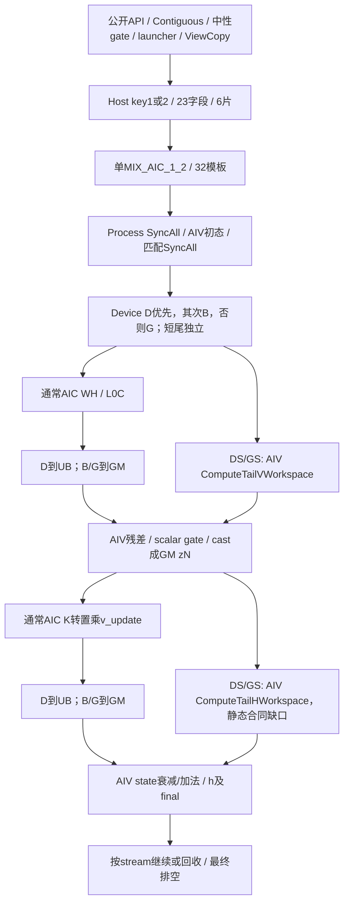
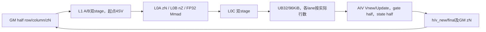
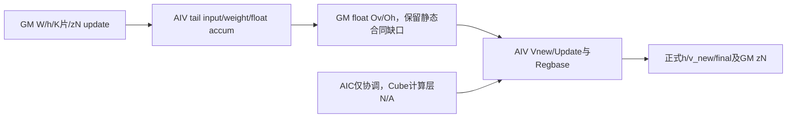
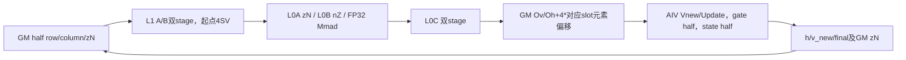

# ChunkGatedDeltaRuleFwdHVllm 950 ACLNN 算子知识

## 先定位任务、模板和高风险分支

本卡保留128条路线的完整源码证据。接入时先提供 B/Hk/Hv/T/K/V、chunk 大小 S、Input/gate/state dtype、useGk、初态和 final_state 设置、cu 前缀及 h 的实际 chunk 容量；同时保存 950DT 构建/运行栈身份。K gate 路径的 K 已预衰减合同、scalar g 的自然 exp 与 gk 的 exp2 单位先在[接口与语义](#接口与语义)核对。

| Agent 当前任务 | 首个判断与后续阅读 |
| --- | --- |
| 从参数定位实际 Kernel | 先用 V 确定 key1（≤128）或 key2（128<V≤256），再按 Input/state/gate/useGk 定模板；[Route 选择](#route-选择)给出完整 D 优先、再 B、再 G 的谓词，随后在[模板矩阵](#模板实现执行矩阵)定位单条 Route。 |
| 确认 Direct UB 或 GM 交接 | D/DS 只在 key1 的完整 D 谓词下可达；key2 没有 Direct UB。沿[公共执行流程](#公共执行流程)核对资源、0x4/0x2 与空 lane 握手，再读所命中路线。 |
| 接 Torch/ACLNN、初态、末态或变长 | 先读[Host/Launcher](#hostlauncher-执行流程)和[限制与失败边界](#限制与失败边界)，确认输出 dtype/容量及 compact batch 到 caller 状态行的对应。 |
| 做精度或性能验收 | 先验本路线的 h/v_new/final 和连续 chunk 状态，再比较目标数值与性能；source_closed 与静态路线枚举不表示这些实验已执行。 |

以下现有边界需要在进入长篇路线细节之前处理：

- S 必须先确认正值；定长、整除且 `0<S<16` 会进入 DS/GS 短尾代算。其 `ComputeTailHWorkspace` 存在 KDecay producer 和 vUpdate zN/线性读取的静态合同缺口，不能把该分支当安全 fallback；没有独立依据前停止将它交付为已支持配置。
- cu 含空段时，token 区间能恢复不等于 initial/final 状态原请求行能恢复；状态映射或 h/NT 容量未闭合时先核 caller。
- 无初态且请求 final_state 时，Torch 输出沿 h 的低精度 options 与公开接口 FP32 要求的差异仍需对齐；`StateT=float` 也只有相应 storeFinal 路径才持续保存 FP32 状态。

完整限制、UB/L1 footprint、DMA 计数及 ABI 边界仍在[文末限制](#限制与失败边界)，上面仅给最先影响接入/选路的入口，不替代逐路线验收。

## 算子速览

| 项目 | 内容 |
|---|---|
| 实际入口 | 公开aclnnChunkGatedDeltaRuleFwdHVllmGetWorkspaceSize/aclnnChunkGatedDeltaRuleFwdHVllm，简称Chunk H |
| 计算语义 | caller准备K/W/U/g/gk，按chunk生成入口h、残差v_new与可选final_state；K gate需要已预衰减K |
| 输入输出 | k[B,Hk,T,K]，w[B,Hv,T,K]，u/v_new[B,Hv,T,V]，h[shapeBatch,Hv,NT,K,V]，Input FP16/BF16，State为Input或float |
| 执行类型 | 单核心launch MIX_AIC_1_2；通常MIX_CV，极短定长分支由AIV_VECTOR代算矩阵、AIC仅协调；Regbase不是SIMT |
| Kernel 路线 | 32个公开模板叶再按运行谓词展开128条路线：Tile128的16模板各D/DS/B/G/GS，Tile256的16模板各B/G/GS；没有虚构Tile256 Direct UB |
| 核心资源 | 六GM切片仍由Host分配；直接FP32 UB交接/GM交接两类；L1预留区后A/B双stage、L0C按路径1或2stage，248KiB UB固定views |
| 来源闭包 | source_closed：公开API→l0op→Host/processor→逐字段注册线→key1/2→arch35全部活跃body/helper→当前CATLASS specialization；生成bridge/Device头和intrinsic内部是明示边界 |
| 验证状态 | 已完成源码闭包检查；本次知识提取未执行编译、真机、数值或性能测试。 |

固定Main为ceac1a2bdff3139ca8fbd1a60b3a9befd68cadf2，CATLASS为41bf90da655bba3c66d0acd7e00abe33960ecfd6，metadef v9.2.0为000cd91b8f809ac55f4c51bd9fdee3ace8db1589。公开产品表列950DT，OpDef注册ascend950，Dockerfile.a5使用950基础镜像及SOC_VERSION=ascend950dt_9582，entry的__CCE_AICORE__==310选择arch35。证据不由目录名单独成立，也不扩展为950PR或所有产品变体已验证。

## 接口与语义

### 计算语义

令S为chunk_size、m为当前有效token、T0为输入类型。公开模板的scalarGated=true、useExp2=false，kGated由useGk选择。InitFromData和额外gate模板能力存在，但公开入口调用Init，不把megakernel入口或device-only实例加入本卡。

```text
p = FP32(W_T0 @ h_chunk_T0)                 [m,V,K]
d = FP32(U_T0) - p
v_new = cast_T0_RINT(d)                    # 未乘chunk衰减
v_update = cast_T0_RINT(d * exp(g_last-g_i))# 实际GM zN，m按16补齐
z = FP32(K_used_T0.T @ v_update_T0)         [K,V,m]
y = state_for_update_FP32 * exp(g_last)
若kGated: y[k,:] *= exp(ln(2)*gk_last[k])
next = y + z
```

kGated=true时K_used来自V1仅复制的K，caller合同是K已经乘exp2(g_last−gk)；不能重复衰减，也不能直接传原始K后声称实现了完整KDA。g的scalar指数是自然exp，gk最后一行固定exp2；PrepareKGateRegbase把gk乘LN2再Exp。m=1时V1的标量差衰减置1，但Update仍使用g_last。输入U、历史h与中间v_update保持低精度，两个矩阵和更新累加为FP32；a5上的持续FP32 state也不等于全部计算为FP32。

当storeFinalState且StateT=float：每个实际V2都把FP32 next保存到finalState；非最终chunk再提供cast_T0_RINT的h副本给下一C1。useFp32StateUpdate在首chunk有初态时直接读取原始FP32初态，在后续chunk读取上次finalState；首chunk无初态则从零h转换。它与A2/A3“中间状态只保留低精度、最后直接写float”的实现不同。其他State路线按T0历史更新，最终按StateT转换。最后chunk未请求final时跳过C2/V2数学更新，同时保留对应路径的握手。

短尾DS/GS的源码代算分支存在K片producer和v_update布局的静态缺口，下文逐路保留；以上主公式不作为短尾数值正确性的证明。

### 输入、输出与属性

| 参数 | shape/layout | dtype | 约束、默认值与语义 |
|---|---|---|---|
| k | [B,Hk,T,K]，ND | FP16/BF16 | 必选；`CheckShape` 要求 rank4，K-head 按 value head 分组 |
| w | [B,Hv,T,K]，ND | 同 k | 必选；与 k 共享 B/T/K，与 u 共享 Hv |
| u | [B,Hv,T,V]，ND | 同 k | 必选；Hv≥Hk 且 Hv%Hk=0，Host 额外拒绝 V>256 |
| gOptional | [B,Hv,T] | FP32 或 T0 | g/gk 至少一个非空；有 g 时检查 B/Hv/T |
| gkOptional | [B,Hv,T,K] | FP32 或 T0 | rank4及各轴显式检查；和 g 同时存在时二者 dtype 相同；非空使 useGk=true |
| initalStateOptional | [N,Hv,K,V] 的连续状态约定 | StateT | 存在时决定 stateDataType；缺省用 FP32。公开入口没有完整 initial-state shape/dtype 检查，不把任意类型当支持 |
| hOut | [shapeBatch,Hv,totalChunks,K,V] | T0 | 必选、dtype 同 k；公开 API 没有完整输出 shape 校验；首态由 Device 初始化 |
| vNewOut | 同 u | T0 | 必选、dtype 同 k；输出未乘 chunk 衰减的残差 |
| finalStateOut | [N,Hv,K,V] | 初态 dtype，缺初态时必须 FP32 | outputFinalState=true 时必须存在；关闭时不读写其有效内容 |
| cuSeqlensOptional | INT64 段边界数组 | INT64 | 非空启用变长；Host 按 length−1 预算段数，Device 会压缩非正长度段 |
| chunkIndicesOptional | INT64 数组 | INT64 | L0 转 Tensor 并传入，但 arch35 scheduler 不消费；Torch 包装仍用其长度/2分配 NT |
| outputFinalState | bool | bool | 默认 false；控制末次 C2、V2 与最终输出 |
| chunkSize | token 数 | int64 | 默认64；没有完整正值/容量 guard，不能按可传入属性推断任意值安全 |
| saveNewValue / useExp2 / transposeStateLayout | 标量 | bool | 保留参数仅允许 true / false / false，其他值由 `CheckReservedOptions` 拒绝 |
| workspaceSize / executor / stream | 两阶段 ACLNN 参数 | API 声明类型 | 查询输出 workspace 字节数与 executor；第二阶段使用 caller 的 stream，保持资源至任务完成 |

### 入口与版本

公开Params结构ChunkGatedDeltaRuleFwdHVllmParams、头声明、API实现、L0 launcher和Host/Device共同形成当前接口。没有独立公开新版本selector；不以InitFromData补造Direct Invoke入口。

Dockerfile.a5基础CANN是9.2.0_20261022115200-950，另外安装950 ops-transformer9.3.0，默认vLLM tag v0.32.0。cann_versions记录指定基础工具链来源；镜像tag、weekly生成头、实际安装库和metadef9.2的静态布局规则不是已验证的一致ABI或运行栈。

Torch包装分配h/v_new/final输出和传chunk64，Meta仅给形状/类型；无初态时final输出按h的options分配与公开接口要求float之间的边界仍保留。chunkIndices用于caller分配NT，arch35调度不消费该二元组，不能把caller有元数据解释成Device逐项验证了它。

## Host/Launcher 执行流程

### 参数校验与前处理

公开入口先以 `ChunkGatedDeltaRuleFwdHVllmParams` 汇集输入、可选 gate/初态、保留选项与输出引用，再创建 executor，按 `CheckParams` 顺序执行 CheckNotNull→CheckGateOptionalNonNull→CheckReservedOptions→CheckGkParams→CheckFormat→CheckShape→CheckDtype。CheckNotNull 只覆盖 k/w/u/h/v_new；CheckFormat 返回成功。CheckGkParams 在 k rank 的后续检查之前使用 k.dim3 等字段，不能认为非法 rank 已在所有读维度前被拒绝。Hv/Hk 的取模也没有独立 Hk=0 guard。

CheckDtype 检查输入 FP16/BF16、w/u/h/v_new 同 dtype、gate 为 FP32 或输入类型、双 gate dtype 相同，以及请求 final_state 时的输出类型。没有完整初态类型白名单或初态/输出 shape 检查。所有显式检查失败被外层转换为对应参数失败返回；不要用前端返回成功证明 Device 隐含容量/对齐已满足。

`ParamsDataContiguous` 依次处理 k/w/u 和存在的 g/gk/初态；失败返回参数错误。只有 gk 时 `MakeNeutralGate` 取 gk 的最后轴首 lane，分配 Slice offsets/sizes，Slice→Contiguous→Reshape 成 [B,Hv,T]→ZerosLike 生成零 g；每步失败返回 null。它仅生成中性标量 gate，不负责 K 的预衰减。

L0 `ChunkGatedDeltaRuleFwdHVllm` 对可选数组调用 ConvertToTensor(INT64)，设 Storage/View/OriginalFormat=ND；转换后没有先检查 null 再解引用的保护。随后 `ADD_TO_LAUNCHER_LIST_AICORE` 按 k/w/u/g/gk/初态/cu/chunk_indices 顺序传输入、h/v_new/final 传输出、两个 attr 为 output_final_state/chunk_size。失败返回三个 null；外层检查 result[0]，对 h、v_new 和请求的 final 做 ViewCopy，最后查询 workspace、ReleaseTo executor。普通格式/视图 primitive 的内部由框架提供，本卡不推断任意非连续 output 已数值通过。

### 参数、Workspace 与生命周期

C为全部AIC核数，N0为压缩前段数，L为libApiWorkSpaceSize。A(x)=(x+512)//512*512；已整齐值和0仍多分512B。所有O为GetUserWorkspace返回基址上的字节偏移，不重写框架raw/user映射。

```text
Ov=L+16MiB
Od=Ov+A(8CSV)
Ok=Od+A(8CSV)
Oh=Ok+(useGk?A(8CSK):0)
Oseq=Oh+A(8CKV)
Ochunks=Oseq+A(8(N0+1))
Wtotal=Ochunks+A(8(N0+1))+16MiB
```

| 片 | 预算 | 实际type/layout | 活跃producer→consumer | 边界 |
|---|---|---|---|---|
| Ov | A(8CSV) | float row；(2c+s)SV | GM路线C1→V1；DS/GS由AIV代算 | D实际直接UB交接，Host仍保留GM预算 |
| Od | A(8CSV) | T0 zN；每slot基距SV，mPadded=ceil(m/16)*16 | V1 MTE3→C2 GM-to-L1 | 不是row-major；实际容量要含mPadded，Host没有完整保护 |
| Ok | useGk时A(8CSK) | T0 row，slot SK | kGated V1复制K→C2 | false时与Oh同起点；短尾helper仍读Ok的缺口另列 |
| Oh | A(8CKV) | float row，slot KV | GM C2→V2；短尾helper代算 | D实际UB直接交接，预算不删 |
| Oseq | A(8(N0+1)) | INT64绑定 | arch35绑定gmNumSeq但不读写内容 | 不沿用arch22多writer前缀表描述 |
| Ochunks | A(8(N0+1)) | INT64绑定 | arch35绑定gmNumChunks但不读写内容 | 实际变长扫描原cu并在寄存器解析 |

Host int64乘积→size_t、wire尺寸/offset→Device uint32，缺少完整乘法、负数、加法、对齐和窄化guard。正式h/v_new/final与临时workspace的owner保持到stream消费完成；Kernel无malloc/free。executor持有框架转换节点与参数，第二阶段CommonOpExecutorRun失败返回ACLNN_ERR_INNER；返回成功不等于异步完成，也未证明跨stream清理协议。

### 启动图与失败传播

公开参数检查/连续化/中性gate→L0八输入三输出两个attr→Tiling4ChunkGatedDeltaRuleFwdHVllm→processor→逐字段set注册线→SaveToBuffer/SetDataSize。Host拒绝V>256，950按V>128写key2否则key1，blockDim=C；没有按task数裁剪blockDim。entry只处理key1/2，unknown key没有补造错误返回或通用fallback。



C1/C2/V1/V2为单launch内阶段，不是四个Kernel。DS/GS没有实际Cube矩阵指令，AIC保留协调和握手，因此不能为了CV标签给短尾补造Cube。公开层显式失败阻止executor交付或报告run错误；Device参数/容量错误没有统一返回码。generated bridge、Device tiling头和普通Contiguous/ViewCopy保留框架边界。

## Route 与参数设计

### 分核与资源计算

Scheduler.InitRuntime定长totalChunks=ceil(T/S)、totalTokens=T。变长逐项读原cu，prevSeq从0开始，只压缩正差得到actualBatch/totalChunks，totalTokens为最终currSeq；不会依赖Oseq/Ochunks内容。ResolveVarlenSequence对第compactBatch个正长段重新扫描，恢复其原tokenOffset和chunkOffset。token区间恢复不等于initial/final状态的原序列编号恢复：state仍用compactBatch*Hv寻址，含空序列的caller状态映射没有由本卡证明。

vBlockSize=wholeV，taskNum=actualBatch*Hv，headGroups=Hv/Hk；taskNum>C时每核最多2stream，否则1stream；taskStride=C*activeStreams。AssignNextStream遇到taskIdx>=taskNum立即return，不沿用Chunk O invalid后继续读的实现。每stream处理一个sequence/head的全部chunk，结束后按stride接续下一task，active stream的chunk不可乱序并行。

AIV以GetBlockIdx()/GetSubBlockNum映射AIC，两个子块按K行初始化h：rowsPerTile=min(floor(32KiB/(V*2)),floor(64KiB/(V*sizeof(StateT))))。初态Ping0/Pong96KiB，h Ping64/Pong160KiB，类型不同CAST_RINT，无初态Duplicate0；MTE3_MTE2事件0/1按tile交替并在SyncAll前排空。所有核Process入口先SyncAll，以处理可能接在其它stage后的生命周期；公开单launch也执行它。

### Route 选择

先给精确运行谓词。W=float在全部公开模板中恒真，但保留源码判断。以下算术仅在S>0有定义；这不是新增的Host guard。

```text
D = is_same<WORKSPACE_TYPE,float> && !isVariedLen && S<=64
    && T%S==0 && K==128 && V==128 && uint64(shapeBatch)*Hv>=C
B = isVariedLen || T%S!=0
tailVectorPath(task) = blockTokens<16 && !B
D优先；非D时B优先于G。
D常规: D && S>=16
DS短尾: D && 0<S<16
B: !D && B （同launch按chunk选择full或tail Cube实例）
G常规: !D && !B && S>=16
GS短尾: !D && !B && 0<S<16
key1: V<=128；key2:128<V<=256。
key2必有V!=128，因此D与DS不可达，不生成此类正式路线。
```

| 顺序 | Route | Key/模板 | 精确选择条件与优先级 | 不适用去向 |
|---:|---|---|---|---|
| 1 | D | key1各数据模板 | 完整D，S>=16 | S<16为DS，非D转B/G |
| 2 | DS | key1各数据模板 | 完整D，0<S<16 | 仅源码短尾替代，非安全保证 |
| 3 | B | key1/2各数据模板 | !D且B；尾chunk m<S选clearL1Padding实例 | 非B转G/GS |
| 4 | G | key1/2各数据模板 | !D且!B且S>=16 | 小S为GS |
| 5 | GS | key1/2各数据模板 | !D且!B且0<S<16 | 非安全fallback；无任意S支持证明 |

公开模板沿dataType==1选BF16否则half，stateDataType==2选float否则Input，gDataType==2选float否则Input，useGk选kGated。scalarGated/useExp2不从公开POD选择，固定true/false。每个Route下面保留真实模板与运行谓词，不合并精度/同步不同的分支。

### 模板/实现执行矩阵

| Route | key/selector | dtype/shape/platform 完整命中条件 | 执行族与 kernel 节点 | 实际模板/body | 内存与同步特征 | tail/fallback |
|---|---|---|---|---|---|---|
| R-001 D | key1；D | 950/Input=half,State=half,G=half,kGated=false；上述D完整谓词 | MIX_CV WH→V1→KV→V2，单launch | GDNFwdHKernel<half,half,half,float,GDNFwdHTileShapes128,false,true,false> | 直接UB+0x4/0x2双协议 | 本卡guard/容量另核，无通用fallback |
| R-002 DS | key1；DS | 950/Input=half,State=half,G=half,kGated=false；上述DS完整谓词 | AIV代算WH/KV+AIC协调，单launch | GDNFwdHKernel<half,half,half,float,GDNFwdHTileShapes128,false,true,false> | 保留Direct free预置/排空，数学走GM短尾 | 保留静态短尾缺口 |
| R-003 B | key1；B | 950/Input=half,State=half,G=half,kGated=false；上述B完整谓词 | MIX_CV WH→V1→KV→V2，单launch | GDNFwdHKernel<half,half,half,float,GDNFwdHTileShapes128,false,true,false> | GM zN和0x2；tail clearL1Padding | 本卡guard/容量另核，无通用fallback |
| R-004 G | key1；G | 950/Input=half,State=half,G=half,kGated=false；上述G完整谓词 | MIX_CV WH→V1→KV→V2，单launch | GDNFwdHKernel<half,half,half,float,GDNFwdHTileShapes128,false,true,false> | GM zN和0x2 | 本卡guard/容量另核，无通用fallback |
| R-005 GS | key1；GS | 950/Input=half,State=half,G=half,kGated=false；上述GS完整谓词 | AIV代算WH/KV+AIC协调，单launch | GDNFwdHKernel<half,half,half,float,GDNFwdHTileShapes128,false,true,false> | GM zN和0x2 | 保留静态短尾缺口 |
| R-006 D | key1；D | 950/Input=half,State=half,G=half,kGated=true；上述D完整谓词 | MIX_CV WH→V1→KV→V2，单launch | GDNFwdHKernel<half,half,half,float,GDNFwdHTileShapes128,true,true,false> | 直接UB+0x4/0x2双协议 | 本卡guard/容量另核，无通用fallback |
| R-007 DS | key1；DS | 950/Input=half,State=half,G=half,kGated=true；上述DS完整谓词 | AIV代算WH/KV+AIC协调，单launch | GDNFwdHKernel<half,half,half,float,GDNFwdHTileShapes128,true,true,false> | 保留Direct free预置/排空，数学走GM短尾 | 保留静态短尾缺口 |
| R-008 B | key1；B | 950/Input=half,State=half,G=half,kGated=true；上述B完整谓词 | MIX_CV WH→V1→KV→V2，单launch | GDNFwdHKernel<half,half,half,float,GDNFwdHTileShapes128,true,true,false> | GM zN和0x2；tail clearL1Padding | 本卡guard/容量另核，无通用fallback |
| R-009 G | key1；G | 950/Input=half,State=half,G=half,kGated=true；上述G完整谓词 | MIX_CV WH→V1→KV→V2，单launch | GDNFwdHKernel<half,half,half,float,GDNFwdHTileShapes128,true,true,false> | GM zN和0x2 | 本卡guard/容量另核，无通用fallback |
| R-010 GS | key1；GS | 950/Input=half,State=half,G=half,kGated=true；上述GS完整谓词 | AIV代算WH/KV+AIC协调，单launch | GDNFwdHKernel<half,half,half,float,GDNFwdHTileShapes128,true,true,false> | GM zN和0x2 | 保留静态短尾缺口 |
| R-011 D | key1；D | 950/Input=half,State=half,G=float,kGated=false；上述D完整谓词 | MIX_CV WH→V1→KV→V2，单launch | GDNFwdHKernel<half,float,half,float,GDNFwdHTileShapes128,false,true,false> | 直接UB+0x4/0x2双协议 | 本卡guard/容量另核，无通用fallback |
| R-012 DS | key1；DS | 950/Input=half,State=half,G=float,kGated=false；上述DS完整谓词 | AIV代算WH/KV+AIC协调，单launch | GDNFwdHKernel<half,float,half,float,GDNFwdHTileShapes128,false,true,false> | 保留Direct free预置/排空，数学走GM短尾 | 保留静态短尾缺口 |
| R-013 B | key1；B | 950/Input=half,State=half,G=float,kGated=false；上述B完整谓词 | MIX_CV WH→V1→KV→V2，单launch | GDNFwdHKernel<half,float,half,float,GDNFwdHTileShapes128,false,true,false> | GM zN和0x2；tail clearL1Padding | 本卡guard/容量另核，无通用fallback |
| R-014 G | key1；G | 950/Input=half,State=half,G=float,kGated=false；上述G完整谓词 | MIX_CV WH→V1→KV→V2，单launch | GDNFwdHKernel<half,float,half,float,GDNFwdHTileShapes128,false,true,false> | GM zN和0x2 | 本卡guard/容量另核，无通用fallback |
| R-015 GS | key1；GS | 950/Input=half,State=half,G=float,kGated=false；上述GS完整谓词 | AIV代算WH/KV+AIC协调，单launch | GDNFwdHKernel<half,float,half,float,GDNFwdHTileShapes128,false,true,false> | GM zN和0x2 | 保留静态短尾缺口 |
| R-016 D | key1；D | 950/Input=half,State=half,G=float,kGated=true；上述D完整谓词 | MIX_CV WH→V1→KV→V2，单launch | GDNFwdHKernel<half,float,half,float,GDNFwdHTileShapes128,true,true,false> | 直接UB+0x4/0x2双协议 | 本卡guard/容量另核，无通用fallback |
| R-017 DS | key1；DS | 950/Input=half,State=half,G=float,kGated=true；上述DS完整谓词 | AIV代算WH/KV+AIC协调，单launch | GDNFwdHKernel<half,float,half,float,GDNFwdHTileShapes128,true,true,false> | 保留Direct free预置/排空，数学走GM短尾 | 保留静态短尾缺口 |
| R-018 B | key1；B | 950/Input=half,State=half,G=float,kGated=true；上述B完整谓词 | MIX_CV WH→V1→KV→V2，单launch | GDNFwdHKernel<half,float,half,float,GDNFwdHTileShapes128,true,true,false> | GM zN和0x2；tail clearL1Padding | 本卡guard/容量另核，无通用fallback |
| R-019 G | key1；G | 950/Input=half,State=half,G=float,kGated=true；上述G完整谓词 | MIX_CV WH→V1→KV→V2，单launch | GDNFwdHKernel<half,float,half,float,GDNFwdHTileShapes128,true,true,false> | GM zN和0x2 | 本卡guard/容量另核，无通用fallback |
| R-020 GS | key1；GS | 950/Input=half,State=half,G=float,kGated=true；上述GS完整谓词 | AIV代算WH/KV+AIC协调，单launch | GDNFwdHKernel<half,float,half,float,GDNFwdHTileShapes128,true,true,false> | GM zN和0x2 | 保留静态短尾缺口 |
| R-021 D | key1；D | 950/Input=half,State=float,G=half,kGated=false；上述D完整谓词 | MIX_CV WH→V1→KV→V2，单launch | GDNFwdHKernel<half,half,float,float,GDNFwdHTileShapes128,false,true,false> | 直接UB+0x4/0x2双协议 | 本卡guard/容量另核，无通用fallback |
| R-022 DS | key1；DS | 950/Input=half,State=float,G=half,kGated=false；上述DS完整谓词 | AIV代算WH/KV+AIC协调，单launch | GDNFwdHKernel<half,half,float,float,GDNFwdHTileShapes128,false,true,false> | 保留Direct free预置/排空，数学走GM短尾 | 保留静态短尾缺口 |
| R-023 B | key1；B | 950/Input=half,State=float,G=half,kGated=false；上述B完整谓词 | MIX_CV WH→V1→KV→V2，单launch | GDNFwdHKernel<half,half,float,float,GDNFwdHTileShapes128,false,true,false> | GM zN和0x2；tail clearL1Padding | 本卡guard/容量另核，无通用fallback |
| R-024 G | key1；G | 950/Input=half,State=float,G=half,kGated=false；上述G完整谓词 | MIX_CV WH→V1→KV→V2，单launch | GDNFwdHKernel<half,half,float,float,GDNFwdHTileShapes128,false,true,false> | GM zN和0x2 | 本卡guard/容量另核，无通用fallback |
| R-025 GS | key1；GS | 950/Input=half,State=float,G=half,kGated=false；上述GS完整谓词 | AIV代算WH/KV+AIC协调，单launch | GDNFwdHKernel<half,half,float,float,GDNFwdHTileShapes128,false,true,false> | GM zN和0x2 | 保留静态短尾缺口 |
| R-026 D | key1；D | 950/Input=half,State=float,G=half,kGated=true；上述D完整谓词 | MIX_CV WH→V1→KV→V2，单launch | GDNFwdHKernel<half,half,float,float,GDNFwdHTileShapes128,true,true,false> | 直接UB+0x4/0x2双协议 | 本卡guard/容量另核，无通用fallback |
| R-027 DS | key1；DS | 950/Input=half,State=float,G=half,kGated=true；上述DS完整谓词 | AIV代算WH/KV+AIC协调，单launch | GDNFwdHKernel<half,half,float,float,GDNFwdHTileShapes128,true,true,false> | 保留Direct free预置/排空，数学走GM短尾 | 保留静态短尾缺口 |
| R-028 B | key1；B | 950/Input=half,State=float,G=half,kGated=true；上述B完整谓词 | MIX_CV WH→V1→KV→V2，单launch | GDNFwdHKernel<half,half,float,float,GDNFwdHTileShapes128,true,true,false> | GM zN和0x2；tail clearL1Padding | 本卡guard/容量另核，无通用fallback |
| R-029 G | key1；G | 950/Input=half,State=float,G=half,kGated=true；上述G完整谓词 | MIX_CV WH→V1→KV→V2，单launch | GDNFwdHKernel<half,half,float,float,GDNFwdHTileShapes128,true,true,false> | GM zN和0x2 | 本卡guard/容量另核，无通用fallback |
| R-030 GS | key1；GS | 950/Input=half,State=float,G=half,kGated=true；上述GS完整谓词 | AIV代算WH/KV+AIC协调，单launch | GDNFwdHKernel<half,half,float,float,GDNFwdHTileShapes128,true,true,false> | GM zN和0x2 | 保留静态短尾缺口 |
| R-031 D | key1；D | 950/Input=half,State=float,G=float,kGated=false；上述D完整谓词 | MIX_CV WH→V1→KV→V2，单launch | GDNFwdHKernel<half,float,float,float,GDNFwdHTileShapes128,false,true,false> | 直接UB+0x4/0x2双协议 | 本卡guard/容量另核，无通用fallback |
| R-032 DS | key1；DS | 950/Input=half,State=float,G=float,kGated=false；上述DS完整谓词 | AIV代算WH/KV+AIC协调，单launch | GDNFwdHKernel<half,float,float,float,GDNFwdHTileShapes128,false,true,false> | 保留Direct free预置/排空，数学走GM短尾 | 保留静态短尾缺口 |
| R-033 B | key1；B | 950/Input=half,State=float,G=float,kGated=false；上述B完整谓词 | MIX_CV WH→V1→KV→V2，单launch | GDNFwdHKernel<half,float,float,float,GDNFwdHTileShapes128,false,true,false> | GM zN和0x2；tail clearL1Padding | 本卡guard/容量另核，无通用fallback |
| R-034 G | key1；G | 950/Input=half,State=float,G=float,kGated=false；上述G完整谓词 | MIX_CV WH→V1→KV→V2，单launch | GDNFwdHKernel<half,float,float,float,GDNFwdHTileShapes128,false,true,false> | GM zN和0x2 | 本卡guard/容量另核，无通用fallback |
| R-035 GS | key1；GS | 950/Input=half,State=float,G=float,kGated=false；上述GS完整谓词 | AIV代算WH/KV+AIC协调，单launch | GDNFwdHKernel<half,float,float,float,GDNFwdHTileShapes128,false,true,false> | GM zN和0x2 | 保留静态短尾缺口 |
| R-036 D | key1；D | 950/Input=half,State=float,G=float,kGated=true；上述D完整谓词 | MIX_CV WH→V1→KV→V2，单launch | GDNFwdHKernel<half,float,float,float,GDNFwdHTileShapes128,true,true,false> | 直接UB+0x4/0x2双协议 | 本卡guard/容量另核，无通用fallback |
| R-037 DS | key1；DS | 950/Input=half,State=float,G=float,kGated=true；上述DS完整谓词 | AIV代算WH/KV+AIC协调，单launch | GDNFwdHKernel<half,float,float,float,GDNFwdHTileShapes128,true,true,false> | 保留Direct free预置/排空，数学走GM短尾 | 保留静态短尾缺口 |
| R-038 B | key1；B | 950/Input=half,State=float,G=float,kGated=true；上述B完整谓词 | MIX_CV WH→V1→KV→V2，单launch | GDNFwdHKernel<half,float,float,float,GDNFwdHTileShapes128,true,true,false> | GM zN和0x2；tail clearL1Padding | 本卡guard/容量另核，无通用fallback |
| R-039 G | key1；G | 950/Input=half,State=float,G=float,kGated=true；上述G完整谓词 | MIX_CV WH→V1→KV→V2，单launch | GDNFwdHKernel<half,float,float,float,GDNFwdHTileShapes128,true,true,false> | GM zN和0x2 | 本卡guard/容量另核，无通用fallback |
| R-040 GS | key1；GS | 950/Input=half,State=float,G=float,kGated=true；上述GS完整谓词 | AIV代算WH/KV+AIC协调，单launch | GDNFwdHKernel<half,float,float,float,GDNFwdHTileShapes128,true,true,false> | GM zN和0x2 | 保留静态短尾缺口 |
| R-041 D | key1；D | 950/Input=bfloat16_t,State=bfloat16_t,G=bfloat16_t,kGated=false；上述D完整谓词 | MIX_CV WH→V1→KV→V2，单launch | GDNFwdHKernel<bfloat16_t,bfloat16_t,bfloat16_t,float,GDNFwdHTileShapes128,false,true,false> | 直接UB+0x4/0x2双协议 | 本卡guard/容量另核，无通用fallback |
| R-042 DS | key1；DS | 950/Input=bfloat16_t,State=bfloat16_t,G=bfloat16_t,kGated=false；上述DS完整谓词 | AIV代算WH/KV+AIC协调，单launch | GDNFwdHKernel<bfloat16_t,bfloat16_t,bfloat16_t,float,GDNFwdHTileShapes128,false,true,false> | 保留Direct free预置/排空，数学走GM短尾 | 保留静态短尾缺口 |
| R-043 B | key1；B | 950/Input=bfloat16_t,State=bfloat16_t,G=bfloat16_t,kGated=false；上述B完整谓词 | MIX_CV WH→V1→KV→V2，单launch | GDNFwdHKernel<bfloat16_t,bfloat16_t,bfloat16_t,float,GDNFwdHTileShapes128,false,true,false> | GM zN和0x2；tail clearL1Padding | 本卡guard/容量另核，无通用fallback |
| R-044 G | key1；G | 950/Input=bfloat16_t,State=bfloat16_t,G=bfloat16_t,kGated=false；上述G完整谓词 | MIX_CV WH→V1→KV→V2，单launch | GDNFwdHKernel<bfloat16_t,bfloat16_t,bfloat16_t,float,GDNFwdHTileShapes128,false,true,false> | GM zN和0x2 | 本卡guard/容量另核，无通用fallback |
| R-045 GS | key1；GS | 950/Input=bfloat16_t,State=bfloat16_t,G=bfloat16_t,kGated=false；上述GS完整谓词 | AIV代算WH/KV+AIC协调，单launch | GDNFwdHKernel<bfloat16_t,bfloat16_t,bfloat16_t,float,GDNFwdHTileShapes128,false,true,false> | GM zN和0x2 | 保留静态短尾缺口 |
| R-046 D | key1；D | 950/Input=bfloat16_t,State=bfloat16_t,G=bfloat16_t,kGated=true；上述D完整谓词 | MIX_CV WH→V1→KV→V2，单launch | GDNFwdHKernel<bfloat16_t,bfloat16_t,bfloat16_t,float,GDNFwdHTileShapes128,true,true,false> | 直接UB+0x4/0x2双协议 | 本卡guard/容量另核，无通用fallback |
| R-047 DS | key1；DS | 950/Input=bfloat16_t,State=bfloat16_t,G=bfloat16_t,kGated=true；上述DS完整谓词 | AIV代算WH/KV+AIC协调，单launch | GDNFwdHKernel<bfloat16_t,bfloat16_t,bfloat16_t,float,GDNFwdHTileShapes128,true,true,false> | 保留Direct free预置/排空，数学走GM短尾 | 保留静态短尾缺口 |
| R-048 B | key1；B | 950/Input=bfloat16_t,State=bfloat16_t,G=bfloat16_t,kGated=true；上述B完整谓词 | MIX_CV WH→V1→KV→V2，单launch | GDNFwdHKernel<bfloat16_t,bfloat16_t,bfloat16_t,float,GDNFwdHTileShapes128,true,true,false> | GM zN和0x2；tail clearL1Padding | 本卡guard/容量另核，无通用fallback |
| R-049 G | key1；G | 950/Input=bfloat16_t,State=bfloat16_t,G=bfloat16_t,kGated=true；上述G完整谓词 | MIX_CV WH→V1→KV→V2，单launch | GDNFwdHKernel<bfloat16_t,bfloat16_t,bfloat16_t,float,GDNFwdHTileShapes128,true,true,false> | GM zN和0x2 | 本卡guard/容量另核，无通用fallback |
| R-050 GS | key1；GS | 950/Input=bfloat16_t,State=bfloat16_t,G=bfloat16_t,kGated=true；上述GS完整谓词 | AIV代算WH/KV+AIC协调，单launch | GDNFwdHKernel<bfloat16_t,bfloat16_t,bfloat16_t,float,GDNFwdHTileShapes128,true,true,false> | GM zN和0x2 | 保留静态短尾缺口 |
| R-051 D | key1；D | 950/Input=bfloat16_t,State=bfloat16_t,G=float,kGated=false；上述D完整谓词 | MIX_CV WH→V1→KV→V2，单launch | GDNFwdHKernel<bfloat16_t,float,bfloat16_t,float,GDNFwdHTileShapes128,false,true,false> | 直接UB+0x4/0x2双协议 | 本卡guard/容量另核，无通用fallback |
| R-052 DS | key1；DS | 950/Input=bfloat16_t,State=bfloat16_t,G=float,kGated=false；上述DS完整谓词 | AIV代算WH/KV+AIC协调，单launch | GDNFwdHKernel<bfloat16_t,float,bfloat16_t,float,GDNFwdHTileShapes128,false,true,false> | 保留Direct free预置/排空，数学走GM短尾 | 保留静态短尾缺口 |
| R-053 B | key1；B | 950/Input=bfloat16_t,State=bfloat16_t,G=float,kGated=false；上述B完整谓词 | MIX_CV WH→V1→KV→V2，单launch | GDNFwdHKernel<bfloat16_t,float,bfloat16_t,float,GDNFwdHTileShapes128,false,true,false> | GM zN和0x2；tail clearL1Padding | 本卡guard/容量另核，无通用fallback |
| R-054 G | key1；G | 950/Input=bfloat16_t,State=bfloat16_t,G=float,kGated=false；上述G完整谓词 | MIX_CV WH→V1→KV→V2，单launch | GDNFwdHKernel<bfloat16_t,float,bfloat16_t,float,GDNFwdHTileShapes128,false,true,false> | GM zN和0x2 | 本卡guard/容量另核，无通用fallback |
| R-055 GS | key1；GS | 950/Input=bfloat16_t,State=bfloat16_t,G=float,kGated=false；上述GS完整谓词 | AIV代算WH/KV+AIC协调，单launch | GDNFwdHKernel<bfloat16_t,float,bfloat16_t,float,GDNFwdHTileShapes128,false,true,false> | GM zN和0x2 | 保留静态短尾缺口 |
| R-056 D | key1；D | 950/Input=bfloat16_t,State=bfloat16_t,G=float,kGated=true；上述D完整谓词 | MIX_CV WH→V1→KV→V2，单launch | GDNFwdHKernel<bfloat16_t,float,bfloat16_t,float,GDNFwdHTileShapes128,true,true,false> | 直接UB+0x4/0x2双协议 | 本卡guard/容量另核，无通用fallback |
| R-057 DS | key1；DS | 950/Input=bfloat16_t,State=bfloat16_t,G=float,kGated=true；上述DS完整谓词 | AIV代算WH/KV+AIC协调，单launch | GDNFwdHKernel<bfloat16_t,float,bfloat16_t,float,GDNFwdHTileShapes128,true,true,false> | 保留Direct free预置/排空，数学走GM短尾 | 保留静态短尾缺口 |
| R-058 B | key1；B | 950/Input=bfloat16_t,State=bfloat16_t,G=float,kGated=true；上述B完整谓词 | MIX_CV WH→V1→KV→V2，单launch | GDNFwdHKernel<bfloat16_t,float,bfloat16_t,float,GDNFwdHTileShapes128,true,true,false> | GM zN和0x2；tail clearL1Padding | 本卡guard/容量另核，无通用fallback |
| R-059 G | key1；G | 950/Input=bfloat16_t,State=bfloat16_t,G=float,kGated=true；上述G完整谓词 | MIX_CV WH→V1→KV→V2，单launch | GDNFwdHKernel<bfloat16_t,float,bfloat16_t,float,GDNFwdHTileShapes128,true,true,false> | GM zN和0x2 | 本卡guard/容量另核，无通用fallback |
| R-060 GS | key1；GS | 950/Input=bfloat16_t,State=bfloat16_t,G=float,kGated=true；上述GS完整谓词 | AIV代算WH/KV+AIC协调，单launch | GDNFwdHKernel<bfloat16_t,float,bfloat16_t,float,GDNFwdHTileShapes128,true,true,false> | GM zN和0x2 | 保留静态短尾缺口 |
| R-061 D | key1；D | 950/Input=bfloat16_t,State=float,G=bfloat16_t,kGated=false；上述D完整谓词 | MIX_CV WH→V1→KV→V2，单launch | GDNFwdHKernel<bfloat16_t,bfloat16_t,float,float,GDNFwdHTileShapes128,false,true,false> | 直接UB+0x4/0x2双协议 | 本卡guard/容量另核，无通用fallback |
| R-062 DS | key1；DS | 950/Input=bfloat16_t,State=float,G=bfloat16_t,kGated=false；上述DS完整谓词 | AIV代算WH/KV+AIC协调，单launch | GDNFwdHKernel<bfloat16_t,bfloat16_t,float,float,GDNFwdHTileShapes128,false,true,false> | 保留Direct free预置/排空，数学走GM短尾 | 保留静态短尾缺口 |
| R-063 B | key1；B | 950/Input=bfloat16_t,State=float,G=bfloat16_t,kGated=false；上述B完整谓词 | MIX_CV WH→V1→KV→V2，单launch | GDNFwdHKernel<bfloat16_t,bfloat16_t,float,float,GDNFwdHTileShapes128,false,true,false> | GM zN和0x2；tail clearL1Padding | 本卡guard/容量另核，无通用fallback |
| R-064 G | key1；G | 950/Input=bfloat16_t,State=float,G=bfloat16_t,kGated=false；上述G完整谓词 | MIX_CV WH→V1→KV→V2，单launch | GDNFwdHKernel<bfloat16_t,bfloat16_t,float,float,GDNFwdHTileShapes128,false,true,false> | GM zN和0x2 | 本卡guard/容量另核，无通用fallback |
| R-065 GS | key1；GS | 950/Input=bfloat16_t,State=float,G=bfloat16_t,kGated=false；上述GS完整谓词 | AIV代算WH/KV+AIC协调，单launch | GDNFwdHKernel<bfloat16_t,bfloat16_t,float,float,GDNFwdHTileShapes128,false,true,false> | GM zN和0x2 | 保留静态短尾缺口 |
| R-066 D | key1；D | 950/Input=bfloat16_t,State=float,G=bfloat16_t,kGated=true；上述D完整谓词 | MIX_CV WH→V1→KV→V2，单launch | GDNFwdHKernel<bfloat16_t,bfloat16_t,float,float,GDNFwdHTileShapes128,true,true,false> | 直接UB+0x4/0x2双协议 | 本卡guard/容量另核，无通用fallback |
| R-067 DS | key1；DS | 950/Input=bfloat16_t,State=float,G=bfloat16_t,kGated=true；上述DS完整谓词 | AIV代算WH/KV+AIC协调，单launch | GDNFwdHKernel<bfloat16_t,bfloat16_t,float,float,GDNFwdHTileShapes128,true,true,false> | 保留Direct free预置/排空，数学走GM短尾 | 保留静态短尾缺口 |
| R-068 B | key1；B | 950/Input=bfloat16_t,State=float,G=bfloat16_t,kGated=true；上述B完整谓词 | MIX_CV WH→V1→KV→V2，单launch | GDNFwdHKernel<bfloat16_t,bfloat16_t,float,float,GDNFwdHTileShapes128,true,true,false> | GM zN和0x2；tail clearL1Padding | 本卡guard/容量另核，无通用fallback |
| R-069 G | key1；G | 950/Input=bfloat16_t,State=float,G=bfloat16_t,kGated=true；上述G完整谓词 | MIX_CV WH→V1→KV→V2，单launch | GDNFwdHKernel<bfloat16_t,bfloat16_t,float,float,GDNFwdHTileShapes128,true,true,false> | GM zN和0x2 | 本卡guard/容量另核，无通用fallback |
| R-070 GS | key1；GS | 950/Input=bfloat16_t,State=float,G=bfloat16_t,kGated=true；上述GS完整谓词 | AIV代算WH/KV+AIC协调，单launch | GDNFwdHKernel<bfloat16_t,bfloat16_t,float,float,GDNFwdHTileShapes128,true,true,false> | GM zN和0x2 | 保留静态短尾缺口 |
| R-071 D | key1；D | 950/Input=bfloat16_t,State=float,G=float,kGated=false；上述D完整谓词 | MIX_CV WH→V1→KV→V2，单launch | GDNFwdHKernel<bfloat16_t,float,float,float,GDNFwdHTileShapes128,false,true,false> | 直接UB+0x4/0x2双协议 | 本卡guard/容量另核，无通用fallback |
| R-072 DS | key1；DS | 950/Input=bfloat16_t,State=float,G=float,kGated=false；上述DS完整谓词 | AIV代算WH/KV+AIC协调，单launch | GDNFwdHKernel<bfloat16_t,float,float,float,GDNFwdHTileShapes128,false,true,false> | 保留Direct free预置/排空，数学走GM短尾 | 保留静态短尾缺口 |
| R-073 B | key1；B | 950/Input=bfloat16_t,State=float,G=float,kGated=false；上述B完整谓词 | MIX_CV WH→V1→KV→V2，单launch | GDNFwdHKernel<bfloat16_t,float,float,float,GDNFwdHTileShapes128,false,true,false> | GM zN和0x2；tail clearL1Padding | 本卡guard/容量另核，无通用fallback |
| R-074 G | key1；G | 950/Input=bfloat16_t,State=float,G=float,kGated=false；上述G完整谓词 | MIX_CV WH→V1→KV→V2，单launch | GDNFwdHKernel<bfloat16_t,float,float,float,GDNFwdHTileShapes128,false,true,false> | GM zN和0x2 | 本卡guard/容量另核，无通用fallback |
| R-075 GS | key1；GS | 950/Input=bfloat16_t,State=float,G=float,kGated=false；上述GS完整谓词 | AIV代算WH/KV+AIC协调，单launch | GDNFwdHKernel<bfloat16_t,float,float,float,GDNFwdHTileShapes128,false,true,false> | GM zN和0x2 | 保留静态短尾缺口 |
| R-076 D | key1；D | 950/Input=bfloat16_t,State=float,G=float,kGated=true；上述D完整谓词 | MIX_CV WH→V1→KV→V2，单launch | GDNFwdHKernel<bfloat16_t,float,float,float,GDNFwdHTileShapes128,true,true,false> | 直接UB+0x4/0x2双协议 | 本卡guard/容量另核，无通用fallback |
| R-077 DS | key1；DS | 950/Input=bfloat16_t,State=float,G=float,kGated=true；上述DS完整谓词 | AIV代算WH/KV+AIC协调，单launch | GDNFwdHKernel<bfloat16_t,float,float,float,GDNFwdHTileShapes128,true,true,false> | 保留Direct free预置/排空，数学走GM短尾 | 保留静态短尾缺口 |
| R-078 B | key1；B | 950/Input=bfloat16_t,State=float,G=float,kGated=true；上述B完整谓词 | MIX_CV WH→V1→KV→V2，单launch | GDNFwdHKernel<bfloat16_t,float,float,float,GDNFwdHTileShapes128,true,true,false> | GM zN和0x2；tail clearL1Padding | 本卡guard/容量另核，无通用fallback |
| R-079 G | key1；G | 950/Input=bfloat16_t,State=float,G=float,kGated=true；上述G完整谓词 | MIX_CV WH→V1→KV→V2，单launch | GDNFwdHKernel<bfloat16_t,float,float,float,GDNFwdHTileShapes128,true,true,false> | GM zN和0x2 | 本卡guard/容量另核，无通用fallback |
| R-080 GS | key1；GS | 950/Input=bfloat16_t,State=float,G=float,kGated=true；上述GS完整谓词 | AIV代算WH/KV+AIC协调，单launch | GDNFwdHKernel<bfloat16_t,float,float,float,GDNFwdHTileShapes128,true,true,false> | GM zN和0x2 | 保留静态短尾缺口 |
| R-081 B | key2；B | 950/Input=half,State=half,G=half,kGated=false；上述B完整谓词 | MIX_CV WH→V1→KV→V2，单launch | GDNFwdHKernel<half,half,half,float,GDNFwdHTileShapes256,false,true,false> | GM zN和0x2；tail clearL1Padding | 本卡guard/容量另核，无通用fallback |
| R-082 G | key2；G | 950/Input=half,State=half,G=half,kGated=false；上述G完整谓词 | MIX_CV WH→V1→KV→V2，单launch | GDNFwdHKernel<half,half,half,float,GDNFwdHTileShapes256,false,true,false> | GM zN和0x2 | 本卡guard/容量另核，无通用fallback |
| R-083 GS | key2；GS | 950/Input=half,State=half,G=half,kGated=false；上述GS完整谓词 | AIV代算WH/KV+AIC协调，单launch | GDNFwdHKernel<half,half,half,float,GDNFwdHTileShapes256,false,true,false> | GM zN和0x2 | 保留静态短尾缺口 |
| R-084 B | key2；B | 950/Input=half,State=half,G=half,kGated=true；上述B完整谓词 | MIX_CV WH→V1→KV→V2，单launch | GDNFwdHKernel<half,half,half,float,GDNFwdHTileShapes256,true,true,false> | GM zN和0x2；tail clearL1Padding | 本卡guard/容量另核，无通用fallback |
| R-085 G | key2；G | 950/Input=half,State=half,G=half,kGated=true；上述G完整谓词 | MIX_CV WH→V1→KV→V2，单launch | GDNFwdHKernel<half,half,half,float,GDNFwdHTileShapes256,true,true,false> | GM zN和0x2 | 本卡guard/容量另核，无通用fallback |
| R-086 GS | key2；GS | 950/Input=half,State=half,G=half,kGated=true；上述GS完整谓词 | AIV代算WH/KV+AIC协调，单launch | GDNFwdHKernel<half,half,half,float,GDNFwdHTileShapes256,true,true,false> | GM zN和0x2 | 保留静态短尾缺口 |
| R-087 B | key2；B | 950/Input=half,State=half,G=float,kGated=false；上述B完整谓词 | MIX_CV WH→V1→KV→V2，单launch | GDNFwdHKernel<half,float,half,float,GDNFwdHTileShapes256,false,true,false> | GM zN和0x2；tail clearL1Padding | 本卡guard/容量另核，无通用fallback |
| R-088 G | key2；G | 950/Input=half,State=half,G=float,kGated=false；上述G完整谓词 | MIX_CV WH→V1→KV→V2，单launch | GDNFwdHKernel<half,float,half,float,GDNFwdHTileShapes256,false,true,false> | GM zN和0x2 | 本卡guard/容量另核，无通用fallback |
| R-089 GS | key2；GS | 950/Input=half,State=half,G=float,kGated=false；上述GS完整谓词 | AIV代算WH/KV+AIC协调，单launch | GDNFwdHKernel<half,float,half,float,GDNFwdHTileShapes256,false,true,false> | GM zN和0x2 | 保留静态短尾缺口 |
| R-090 B | key2；B | 950/Input=half,State=half,G=float,kGated=true；上述B完整谓词 | MIX_CV WH→V1→KV→V2，单launch | GDNFwdHKernel<half,float,half,float,GDNFwdHTileShapes256,true,true,false> | GM zN和0x2；tail clearL1Padding | 本卡guard/容量另核，无通用fallback |
| R-091 G | key2；G | 950/Input=half,State=half,G=float,kGated=true；上述G完整谓词 | MIX_CV WH→V1→KV→V2，单launch | GDNFwdHKernel<half,float,half,float,GDNFwdHTileShapes256,true,true,false> | GM zN和0x2 | 本卡guard/容量另核，无通用fallback |
| R-092 GS | key2；GS | 950/Input=half,State=half,G=float,kGated=true；上述GS完整谓词 | AIV代算WH/KV+AIC协调，单launch | GDNFwdHKernel<half,float,half,float,GDNFwdHTileShapes256,true,true,false> | GM zN和0x2 | 保留静态短尾缺口 |
| R-093 B | key2；B | 950/Input=half,State=float,G=half,kGated=false；上述B完整谓词 | MIX_CV WH→V1→KV→V2，单launch | GDNFwdHKernel<half,half,float,float,GDNFwdHTileShapes256,false,true,false> | GM zN和0x2；tail clearL1Padding | 本卡guard/容量另核，无通用fallback |
| R-094 G | key2；G | 950/Input=half,State=float,G=half,kGated=false；上述G完整谓词 | MIX_CV WH→V1→KV→V2，单launch | GDNFwdHKernel<half,half,float,float,GDNFwdHTileShapes256,false,true,false> | GM zN和0x2 | 本卡guard/容量另核，无通用fallback |
| R-095 GS | key2；GS | 950/Input=half,State=float,G=half,kGated=false；上述GS完整谓词 | AIV代算WH/KV+AIC协调，单launch | GDNFwdHKernel<half,half,float,float,GDNFwdHTileShapes256,false,true,false> | GM zN和0x2 | 保留静态短尾缺口 |
| R-096 B | key2；B | 950/Input=half,State=float,G=half,kGated=true；上述B完整谓词 | MIX_CV WH→V1→KV→V2，单launch | GDNFwdHKernel<half,half,float,float,GDNFwdHTileShapes256,true,true,false> | GM zN和0x2；tail clearL1Padding | 本卡guard/容量另核，无通用fallback |
| R-097 G | key2；G | 950/Input=half,State=float,G=half,kGated=true；上述G完整谓词 | MIX_CV WH→V1→KV→V2，单launch | GDNFwdHKernel<half,half,float,float,GDNFwdHTileShapes256,true,true,false> | GM zN和0x2 | 本卡guard/容量另核，无通用fallback |
| R-098 GS | key2；GS | 950/Input=half,State=float,G=half,kGated=true；上述GS完整谓词 | AIV代算WH/KV+AIC协调，单launch | GDNFwdHKernel<half,half,float,float,GDNFwdHTileShapes256,true,true,false> | GM zN和0x2 | 保留静态短尾缺口 |
| R-099 B | key2；B | 950/Input=half,State=float,G=float,kGated=false；上述B完整谓词 | MIX_CV WH→V1→KV→V2，单launch | GDNFwdHKernel<half,float,float,float,GDNFwdHTileShapes256,false,true,false> | GM zN和0x2；tail clearL1Padding | 本卡guard/容量另核，无通用fallback |
| R-100 G | key2；G | 950/Input=half,State=float,G=float,kGated=false；上述G完整谓词 | MIX_CV WH→V1→KV→V2，单launch | GDNFwdHKernel<half,float,float,float,GDNFwdHTileShapes256,false,true,false> | GM zN和0x2 | 本卡guard/容量另核，无通用fallback |
| R-101 GS | key2；GS | 950/Input=half,State=float,G=float,kGated=false；上述GS完整谓词 | AIV代算WH/KV+AIC协调，单launch | GDNFwdHKernel<half,float,float,float,GDNFwdHTileShapes256,false,true,false> | GM zN和0x2 | 保留静态短尾缺口 |
| R-102 B | key2；B | 950/Input=half,State=float,G=float,kGated=true；上述B完整谓词 | MIX_CV WH→V1→KV→V2，单launch | GDNFwdHKernel<half,float,float,float,GDNFwdHTileShapes256,true,true,false> | GM zN和0x2；tail clearL1Padding | 本卡guard/容量另核，无通用fallback |
| R-103 G | key2；G | 950/Input=half,State=float,G=float,kGated=true；上述G完整谓词 | MIX_CV WH→V1→KV→V2，单launch | GDNFwdHKernel<half,float,float,float,GDNFwdHTileShapes256,true,true,false> | GM zN和0x2 | 本卡guard/容量另核，无通用fallback |
| R-104 GS | key2；GS | 950/Input=half,State=float,G=float,kGated=true；上述GS完整谓词 | AIV代算WH/KV+AIC协调，单launch | GDNFwdHKernel<half,float,float,float,GDNFwdHTileShapes256,true,true,false> | GM zN和0x2 | 保留静态短尾缺口 |
| R-105 B | key2；B | 950/Input=bfloat16_t,State=bfloat16_t,G=bfloat16_t,kGated=false；上述B完整谓词 | MIX_CV WH→V1→KV→V2，单launch | GDNFwdHKernel<bfloat16_t,bfloat16_t,bfloat16_t,float,GDNFwdHTileShapes256,false,true,false> | GM zN和0x2；tail clearL1Padding | 本卡guard/容量另核，无通用fallback |
| R-106 G | key2；G | 950/Input=bfloat16_t,State=bfloat16_t,G=bfloat16_t,kGated=false；上述G完整谓词 | MIX_CV WH→V1→KV→V2，单launch | GDNFwdHKernel<bfloat16_t,bfloat16_t,bfloat16_t,float,GDNFwdHTileShapes256,false,true,false> | GM zN和0x2 | 本卡guard/容量另核，无通用fallback |
| R-107 GS | key2；GS | 950/Input=bfloat16_t,State=bfloat16_t,G=bfloat16_t,kGated=false；上述GS完整谓词 | AIV代算WH/KV+AIC协调，单launch | GDNFwdHKernel<bfloat16_t,bfloat16_t,bfloat16_t,float,GDNFwdHTileShapes256,false,true,false> | GM zN和0x2 | 保留静态短尾缺口 |
| R-108 B | key2；B | 950/Input=bfloat16_t,State=bfloat16_t,G=bfloat16_t,kGated=true；上述B完整谓词 | MIX_CV WH→V1→KV→V2，单launch | GDNFwdHKernel<bfloat16_t,bfloat16_t,bfloat16_t,float,GDNFwdHTileShapes256,true,true,false> | GM zN和0x2；tail clearL1Padding | 本卡guard/容量另核，无通用fallback |
| R-109 G | key2；G | 950/Input=bfloat16_t,State=bfloat16_t,G=bfloat16_t,kGated=true；上述G完整谓词 | MIX_CV WH→V1→KV→V2，单launch | GDNFwdHKernel<bfloat16_t,bfloat16_t,bfloat16_t,float,GDNFwdHTileShapes256,true,true,false> | GM zN和0x2 | 本卡guard/容量另核，无通用fallback |
| R-110 GS | key2；GS | 950/Input=bfloat16_t,State=bfloat16_t,G=bfloat16_t,kGated=true；上述GS完整谓词 | AIV代算WH/KV+AIC协调，单launch | GDNFwdHKernel<bfloat16_t,bfloat16_t,bfloat16_t,float,GDNFwdHTileShapes256,true,true,false> | GM zN和0x2 | 保留静态短尾缺口 |
| R-111 B | key2；B | 950/Input=bfloat16_t,State=bfloat16_t,G=float,kGated=false；上述B完整谓词 | MIX_CV WH→V1→KV→V2，单launch | GDNFwdHKernel<bfloat16_t,float,bfloat16_t,float,GDNFwdHTileShapes256,false,true,false> | GM zN和0x2；tail clearL1Padding | 本卡guard/容量另核，无通用fallback |
| R-112 G | key2；G | 950/Input=bfloat16_t,State=bfloat16_t,G=float,kGated=false；上述G完整谓词 | MIX_CV WH→V1→KV→V2，单launch | GDNFwdHKernel<bfloat16_t,float,bfloat16_t,float,GDNFwdHTileShapes256,false,true,false> | GM zN和0x2 | 本卡guard/容量另核，无通用fallback |
| R-113 GS | key2；GS | 950/Input=bfloat16_t,State=bfloat16_t,G=float,kGated=false；上述GS完整谓词 | AIV代算WH/KV+AIC协调，单launch | GDNFwdHKernel<bfloat16_t,float,bfloat16_t,float,GDNFwdHTileShapes256,false,true,false> | GM zN和0x2 | 保留静态短尾缺口 |
| R-114 B | key2；B | 950/Input=bfloat16_t,State=bfloat16_t,G=float,kGated=true；上述B完整谓词 | MIX_CV WH→V1→KV→V2，单launch | GDNFwdHKernel<bfloat16_t,float,bfloat16_t,float,GDNFwdHTileShapes256,true,true,false> | GM zN和0x2；tail clearL1Padding | 本卡guard/容量另核，无通用fallback |
| R-115 G | key2；G | 950/Input=bfloat16_t,State=bfloat16_t,G=float,kGated=true；上述G完整谓词 | MIX_CV WH→V1→KV→V2，单launch | GDNFwdHKernel<bfloat16_t,float,bfloat16_t,float,GDNFwdHTileShapes256,true,true,false> | GM zN和0x2 | 本卡guard/容量另核，无通用fallback |
| R-116 GS | key2；GS | 950/Input=bfloat16_t,State=bfloat16_t,G=float,kGated=true；上述GS完整谓词 | AIV代算WH/KV+AIC协调，单launch | GDNFwdHKernel<bfloat16_t,float,bfloat16_t,float,GDNFwdHTileShapes256,true,true,false> | GM zN和0x2 | 保留静态短尾缺口 |
| R-117 B | key2；B | 950/Input=bfloat16_t,State=float,G=bfloat16_t,kGated=false；上述B完整谓词 | MIX_CV WH→V1→KV→V2，单launch | GDNFwdHKernel<bfloat16_t,bfloat16_t,float,float,GDNFwdHTileShapes256,false,true,false> | GM zN和0x2；tail clearL1Padding | 本卡guard/容量另核，无通用fallback |
| R-118 G | key2；G | 950/Input=bfloat16_t,State=float,G=bfloat16_t,kGated=false；上述G完整谓词 | MIX_CV WH→V1→KV→V2，单launch | GDNFwdHKernel<bfloat16_t,bfloat16_t,float,float,GDNFwdHTileShapes256,false,true,false> | GM zN和0x2 | 本卡guard/容量另核，无通用fallback |
| R-119 GS | key2；GS | 950/Input=bfloat16_t,State=float,G=bfloat16_t,kGated=false；上述GS完整谓词 | AIV代算WH/KV+AIC协调，单launch | GDNFwdHKernel<bfloat16_t,bfloat16_t,float,float,GDNFwdHTileShapes256,false,true,false> | GM zN和0x2 | 保留静态短尾缺口 |
| R-120 B | key2；B | 950/Input=bfloat16_t,State=float,G=bfloat16_t,kGated=true；上述B完整谓词 | MIX_CV WH→V1→KV→V2，单launch | GDNFwdHKernel<bfloat16_t,bfloat16_t,float,float,GDNFwdHTileShapes256,true,true,false> | GM zN和0x2；tail clearL1Padding | 本卡guard/容量另核，无通用fallback |
| R-121 G | key2；G | 950/Input=bfloat16_t,State=float,G=bfloat16_t,kGated=true；上述G完整谓词 | MIX_CV WH→V1→KV→V2，单launch | GDNFwdHKernel<bfloat16_t,bfloat16_t,float,float,GDNFwdHTileShapes256,true,true,false> | GM zN和0x2 | 本卡guard/容量另核，无通用fallback |
| R-122 GS | key2；GS | 950/Input=bfloat16_t,State=float,G=bfloat16_t,kGated=true；上述GS完整谓词 | AIV代算WH/KV+AIC协调，单launch | GDNFwdHKernel<bfloat16_t,bfloat16_t,float,float,GDNFwdHTileShapes256,true,true,false> | GM zN和0x2 | 保留静态短尾缺口 |
| R-123 B | key2；B | 950/Input=bfloat16_t,State=float,G=float,kGated=false；上述B完整谓词 | MIX_CV WH→V1→KV→V2，单launch | GDNFwdHKernel<bfloat16_t,float,float,float,GDNFwdHTileShapes256,false,true,false> | GM zN和0x2；tail clearL1Padding | 本卡guard/容量另核，无通用fallback |
| R-124 G | key2；G | 950/Input=bfloat16_t,State=float,G=float,kGated=false；上述G完整谓词 | MIX_CV WH→V1→KV→V2，单launch | GDNFwdHKernel<bfloat16_t,float,float,float,GDNFwdHTileShapes256,false,true,false> | GM zN和0x2 | 本卡guard/容量另核，无通用fallback |
| R-125 GS | key2；GS | 950/Input=bfloat16_t,State=float,G=float,kGated=false；上述GS完整谓词 | AIV代算WH/KV+AIC协调，单launch | GDNFwdHKernel<bfloat16_t,float,float,float,GDNFwdHTileShapes256,false,true,false> | GM zN和0x2 | 保留静态短尾缺口 |
| R-126 B | key2；B | 950/Input=bfloat16_t,State=float,G=float,kGated=true；上述B完整谓词 | MIX_CV WH→V1→KV→V2，单launch | GDNFwdHKernel<bfloat16_t,float,float,float,GDNFwdHTileShapes256,true,true,false> | GM zN和0x2；tail clearL1Padding | 本卡guard/容量另核，无通用fallback |
| R-127 G | key2；G | 950/Input=bfloat16_t,State=float,G=float,kGated=true；上述G完整谓词 | MIX_CV WH→V1→KV→V2，单launch | GDNFwdHKernel<bfloat16_t,float,float,float,GDNFwdHTileShapes256,true,true,false> | GM zN和0x2 | 本卡guard/容量另核，无通用fallback |
| R-128 GS | key2；GS | 950/Input=bfloat16_t,State=float,G=float,kGated=true；上述GS完整谓词 | AIV代算WH/KV+AIC协调，单launch | GDNFwdHKernel<bfloat16_t,float,float,float,GDNFwdHTileShapes256,true,true,false> | GM zN和0x2 | 保留静态短尾缺口 |

### 隐藏性能 Guard

| Guard | Host/Tiling 条件 | Device/资源原因 | 影响 Route | 不满足时去向 | 源码符号 |
|---|---|---|---|---|---|
| 正S与整除 | 无完整S零负检查 | D和B含T%S，scheduler ceil除S；零值在body前已无定义 | 全部 | 无安全错误分支 | useDirectFp32Ub / InitRuntime |
| D专用形状/task | 定长、整除、S<=64、K/V128、task>=C | 固定32/96KiB UB、双AIV与两slot直接交接 | D/DS | 按B或G/GS | GDNFwdHKernel::Init |
| V上界与布局 | Host仅拒V>256；wholeV | key1/2不证明V零值/任意对齐，vupdate为zN padded m | 全部 | 无全shape fallback | Tiling4 / Vnew |
| 头分组 | API检查Hv>=Hk和整除但缺Hk0 | headGroups除法与W/K地址 | 全部 | 不补造零guard | CheckShape / Scheduler |
| L1预留 | l1BufAddrStart=4SV | 静态模板assert未包含动态起点；S大时需另算总量 | 含Cube路线 | 无动态扩容 | BlockMmad constructors |
| UB views与S | 无逐view Host容量检查 | gate160/161等、whole-subblock ws和calc前缀、宽V游标可能覆盖其它view | 全部 | 固定body继续 | Vnew / Update |
| zN m补齐 | mPadded=ceil(m/16)*16，Host按S float预算 | 小S时不能只按mV*2估实际写入extent | 全部 | 没有完整拒绝 | Vnew DataCopyParams |
| 短尾K片 | kGated=false不产KDecay | ComputeTailHWorkspace仍无条件读gmKDecayWorkspace | DS/GS | 静态合同缺口，不宣称数值正确 | ComputeTailHWorkspace |
| 短尾vupdate | V1写zN、helper按tokenRow*V线性读 | 不能当已证明的row-major矩阵输入 | DS/GS | 不称安全fallback | Vnew / ComputeTailHWorkspace |
| varlen空段 | 压缩后task state索引与原caller序列索引不同 | Resolve恢复token起点，不自动恢复state编号 | B | 需caller映射证据 | ResolveVarlenSequence / UpdateTask |
| uint32/uint16 | wire尺寸offset窄化，DMA/repeat/VF参数窄化 | 乘积、rows、count、byte长度上界 | 全部 | 无完整overflow拒绝 | Init / CopyGmToUb / VF_CALL |
| unitflag tail | B的尾矩阵选true/单L0C | 公共库unitflag路径l0CEventList初始化证据仍不完整 | B tail | 保留静态缺口，不宣称已死锁 | BlockMmadTla |

### POD/ABI

注册宏类、processor 的 plain 中间结构、公开生成的 Device 结构分开解释。固定 metadef 9.2 的 FieldHandler 按字段 sizeof 对齐、末尾8字节对齐、InitData零填充和SaveToBuffer拷贝，配合 int64=8B/bool=1B 的通常ABI，静态推导注册线数据176B；手写 plain 缺 hasGk，推导 sizeof168/align8。没有编译实测，也没有用基础镜像tag证明 weekly生成头与该tag完全一致。注册宏类继承TilingDef并含offset/reserve，C++对象sizeof不是线上176B。

| 结构 | 字段 | 类型/位宽 | ABI 布局：线/直，字节 | 单位 | Host/launcher producer | Device consumer | 边界 |
|---|---|---|---|---|---|---|---|
| 注册/Plain | batch | int64/64 | 0/0，8B align8 | 请求 | processor：B或N0 | scheduler，变长改actualBatch | uint32窄化 |
| 同上 | seqlen | int64/64 | 8/8 | token | k.dim2 | totalTokens/均匀chunks | 无完整正值检查 |
| 同上 | kNumHead | int64/64 | 16/16 | head | k.dim1 | headGroups、K地址 | 不得0 |
| 同上 | vNumHead | int64/64 | 24/24 | head | u.dim1 | taskNum、W/U/G地址 | API检查分组 |
| 同上 | kHeadDim | int64/64 | 32/32 | 元素 | k.dim3 | C1 K轴/C2 M轴、状态与gk | 需按容量核对 |
| 同上 | vHeadDim | int64/64 | 40/40 | 元素 | u.dim3 | vBlockSize、N轴/所有列stride | Host只拒绝>256 |
| 同上 | chunkSize | int64/64 | 48/48 | token | attr1 | 前缀ceil、矩阵与Vector | 无完整0/负值保护 |
| 同上 | useInitialState | bool/8 | 56/56，1B align1 | 开关 | initial!=null | 初态搬运，否则零化 | 两条实现均明确初始化 |
| 同上 | storeFinalState | bool/8 | 57/57 | 开关 | attr0 | NeedProcessStage2/最终回写 | 最后一段可跳过数学更新 |
| 同上 | dataType | int64/64 | 64/64 | 枚举 | GdnFwdHDtypeToEnum(k.dtype) | Dispatch InputT | 1 BF16，其余half，API另限输入 |
| 同上 | gDataType | int64/64 | 72/72 | 枚举 | 优先g，否则gk | Dispatch GT，gate/gk宽度 | 2 float，其余InputT |
| 同上 | stateDataType | int64/64 | 80/80 | 枚举 | 初态dtype，缺省2 | Dispatch StateT | 2 float，其余InputT |
| 仅注册 | hasGk | bool/8 | 88/不存在 | 保留 | 无set_hasGk | 没有读取 | 新建buffer静态零填充；不能删布局槽 |
| 注册/Plain | isVariedLen | int64/64 | 96/88 | 开关 | hasCuSeqlens | prefix/任务地址 | 两结构从此字段起不同 |
| 同上 | shapeBatch | int64/64 | 104/96 | batch | B或1 | GM layout/shapeBatchIdx | varlen实际B需匹配 |
| 同上 | tokenBatch | int64/64 | 112/104 | 段数 | 1或cu.length−1 | scheduler/init state | Device另有压缩后的值 |
| 同上 | useGk | bool/8 | 120/112 | 开关 | gk!=null | kGated模板、K片选择 | 主路径false不消费，短尾helper例外 |
| 同上 | vWorkspaceOffset | int64/64 | 128/120 | 字节 | processor O_v | GM C1/V1；D转直接UB但保留预算 | Device转uint32 |
| 同上 | vUpdateWorkspaceOffset | int64/64 | 136/128 | 字节 | O_d | V1/C2 T0 zN | Host按float保守预算 |
| 同上 | kDecayWorkspaceOffset | int64/64 | 144/136 | 字节 | O_k | 主路径K片；短尾helper无条件读取 | false与Oh同起点且无K producer |
| 同上 | hWorkspaceOffset | int64/64 | 152/144 | 字节 | O_h | C2/V2 FP32 | 每核两stream |
| 同上 | numSeqWorkspaceOffset | int64/64 | 160/152 | 字节 | O_seq | 绑定但arch35无内容读写 | 按压缩前N0预算 |
| 同上 | numChunksWorkspaceOffset | int64/64 | 168/160 | 字节 | O_chunks | 绑定但arch35无内容读写 | 不是chunkIndices二元组 |

公开 Tiling 先用 `::ChunkGatedDeltaRuleFwdHVllmTilingData` 得到 processor 结果，再逐字段 set 到 optiling 注册类，最后 SaveToBuffer；未把 plain168B 直接复制给公开 Device。生成 Device 头不在固定Main源码中，是明确框架生成边界。手写结构注释的“镜像”与实际字段差异不能直接升级为公开ACLNN的ABI错误，也不能作为独立fast-launch ABI已验证的依据。

### Route 源码闭包

| Route | Key/selector | Host/Tiling producer | POD/参数 | Kernel entry/router | Kernel body/直接依赖 | 构建接线 |
|---|---|---|---|---|---|---|
| R-001 D | key1，D与对应dtype谓词 | Tiling4/processor | 23字段注册线/六片 | ChunkGatedDeltaRuleFwdHVllmDispatch→GDNFwdHKernel<half,half,half,float,GDNFwdHTileShapes128,false,true,false> | arch35 Kernel/Scheduler/Vnew/Update/Regbase，所选Common/CATLASS实例 | OpDef ascend950、SOC950dt_9582、固定CATLASS gitlink |
| R-002 DS | key1，DS与对应dtype谓词 | Tiling4/processor | 23字段注册线/六片 | ChunkGatedDeltaRuleFwdHVllmDispatch→GDNFwdHKernel<half,half,half,float,GDNFwdHTileShapes128,false,true,false> | arch35 Kernel/Scheduler/Vnew/Update/Regbase，所选Common/CATLASS实例 | OpDef ascend950、SOC950dt_9582、固定CATLASS gitlink |
| R-003 B | key1，B与对应dtype谓词 | Tiling4/processor | 23字段注册线/六片 | ChunkGatedDeltaRuleFwdHVllmDispatch→GDNFwdHKernel<half,half,half,float,GDNFwdHTileShapes128,false,true,false> | arch35 Kernel/Scheduler/Vnew/Update/Regbase，所选Common/CATLASS实例 | OpDef ascend950、SOC950dt_9582、固定CATLASS gitlink |
| R-004 G | key1，G与对应dtype谓词 | Tiling4/processor | 23字段注册线/六片 | ChunkGatedDeltaRuleFwdHVllmDispatch→GDNFwdHKernel<half,half,half,float,GDNFwdHTileShapes128,false,true,false> | arch35 Kernel/Scheduler/Vnew/Update/Regbase，所选Common/CATLASS实例 | OpDef ascend950、SOC950dt_9582、固定CATLASS gitlink |
| R-005 GS | key1，GS与对应dtype谓词 | Tiling4/processor | 23字段注册线/六片 | ChunkGatedDeltaRuleFwdHVllmDispatch→GDNFwdHKernel<half,half,half,float,GDNFwdHTileShapes128,false,true,false> | arch35 Kernel/Scheduler/Vnew/Update/Regbase，所选Common/CATLASS实例 | OpDef ascend950、SOC950dt_9582、固定CATLASS gitlink |
| R-006 D | key1，D与对应dtype谓词 | Tiling4/processor | 23字段注册线/六片 | ChunkGatedDeltaRuleFwdHVllmDispatch→GDNFwdHKernel<half,half,half,float,GDNFwdHTileShapes128,true,true,false> | arch35 Kernel/Scheduler/Vnew/Update/Regbase，所选Common/CATLASS实例 | OpDef ascend950、SOC950dt_9582、固定CATLASS gitlink |
| R-007 DS | key1，DS与对应dtype谓词 | Tiling4/processor | 23字段注册线/六片 | ChunkGatedDeltaRuleFwdHVllmDispatch→GDNFwdHKernel<half,half,half,float,GDNFwdHTileShapes128,true,true,false> | arch35 Kernel/Scheduler/Vnew/Update/Regbase，所选Common/CATLASS实例 | OpDef ascend950、SOC950dt_9582、固定CATLASS gitlink |
| R-008 B | key1，B与对应dtype谓词 | Tiling4/processor | 23字段注册线/六片 | ChunkGatedDeltaRuleFwdHVllmDispatch→GDNFwdHKernel<half,half,half,float,GDNFwdHTileShapes128,true,true,false> | arch35 Kernel/Scheduler/Vnew/Update/Regbase，所选Common/CATLASS实例 | OpDef ascend950、SOC950dt_9582、固定CATLASS gitlink |
| R-009 G | key1，G与对应dtype谓词 | Tiling4/processor | 23字段注册线/六片 | ChunkGatedDeltaRuleFwdHVllmDispatch→GDNFwdHKernel<half,half,half,float,GDNFwdHTileShapes128,true,true,false> | arch35 Kernel/Scheduler/Vnew/Update/Regbase，所选Common/CATLASS实例 | OpDef ascend950、SOC950dt_9582、固定CATLASS gitlink |
| R-010 GS | key1，GS与对应dtype谓词 | Tiling4/processor | 23字段注册线/六片 | ChunkGatedDeltaRuleFwdHVllmDispatch→GDNFwdHKernel<half,half,half,float,GDNFwdHTileShapes128,true,true,false> | arch35 Kernel/Scheduler/Vnew/Update/Regbase，所选Common/CATLASS实例 | OpDef ascend950、SOC950dt_9582、固定CATLASS gitlink |
| R-011 D | key1，D与对应dtype谓词 | Tiling4/processor | 23字段注册线/六片 | ChunkGatedDeltaRuleFwdHVllmDispatch→GDNFwdHKernel<half,float,half,float,GDNFwdHTileShapes128,false,true,false> | arch35 Kernel/Scheduler/Vnew/Update/Regbase，所选Common/CATLASS实例 | OpDef ascend950、SOC950dt_9582、固定CATLASS gitlink |
| R-012 DS | key1，DS与对应dtype谓词 | Tiling4/processor | 23字段注册线/六片 | ChunkGatedDeltaRuleFwdHVllmDispatch→GDNFwdHKernel<half,float,half,float,GDNFwdHTileShapes128,false,true,false> | arch35 Kernel/Scheduler/Vnew/Update/Regbase，所选Common/CATLASS实例 | OpDef ascend950、SOC950dt_9582、固定CATLASS gitlink |
| R-013 B | key1，B与对应dtype谓词 | Tiling4/processor | 23字段注册线/六片 | ChunkGatedDeltaRuleFwdHVllmDispatch→GDNFwdHKernel<half,float,half,float,GDNFwdHTileShapes128,false,true,false> | arch35 Kernel/Scheduler/Vnew/Update/Regbase，所选Common/CATLASS实例 | OpDef ascend950、SOC950dt_9582、固定CATLASS gitlink |
| R-014 G | key1，G与对应dtype谓词 | Tiling4/processor | 23字段注册线/六片 | ChunkGatedDeltaRuleFwdHVllmDispatch→GDNFwdHKernel<half,float,half,float,GDNFwdHTileShapes128,false,true,false> | arch35 Kernel/Scheduler/Vnew/Update/Regbase，所选Common/CATLASS实例 | OpDef ascend950、SOC950dt_9582、固定CATLASS gitlink |
| R-015 GS | key1，GS与对应dtype谓词 | Tiling4/processor | 23字段注册线/六片 | ChunkGatedDeltaRuleFwdHVllmDispatch→GDNFwdHKernel<half,float,half,float,GDNFwdHTileShapes128,false,true,false> | arch35 Kernel/Scheduler/Vnew/Update/Regbase，所选Common/CATLASS实例 | OpDef ascend950、SOC950dt_9582、固定CATLASS gitlink |
| R-016 D | key1，D与对应dtype谓词 | Tiling4/processor | 23字段注册线/六片 | ChunkGatedDeltaRuleFwdHVllmDispatch→GDNFwdHKernel<half,float,half,float,GDNFwdHTileShapes128,true,true,false> | arch35 Kernel/Scheduler/Vnew/Update/Regbase，所选Common/CATLASS实例 | OpDef ascend950、SOC950dt_9582、固定CATLASS gitlink |
| R-017 DS | key1，DS与对应dtype谓词 | Tiling4/processor | 23字段注册线/六片 | ChunkGatedDeltaRuleFwdHVllmDispatch→GDNFwdHKernel<half,float,half,float,GDNFwdHTileShapes128,true,true,false> | arch35 Kernel/Scheduler/Vnew/Update/Regbase，所选Common/CATLASS实例 | OpDef ascend950、SOC950dt_9582、固定CATLASS gitlink |
| R-018 B | key1，B与对应dtype谓词 | Tiling4/processor | 23字段注册线/六片 | ChunkGatedDeltaRuleFwdHVllmDispatch→GDNFwdHKernel<half,float,half,float,GDNFwdHTileShapes128,true,true,false> | arch35 Kernel/Scheduler/Vnew/Update/Regbase，所选Common/CATLASS实例 | OpDef ascend950、SOC950dt_9582、固定CATLASS gitlink |
| R-019 G | key1，G与对应dtype谓词 | Tiling4/processor | 23字段注册线/六片 | ChunkGatedDeltaRuleFwdHVllmDispatch→GDNFwdHKernel<half,float,half,float,GDNFwdHTileShapes128,true,true,false> | arch35 Kernel/Scheduler/Vnew/Update/Regbase，所选Common/CATLASS实例 | OpDef ascend950、SOC950dt_9582、固定CATLASS gitlink |
| R-020 GS | key1，GS与对应dtype谓词 | Tiling4/processor | 23字段注册线/六片 | ChunkGatedDeltaRuleFwdHVllmDispatch→GDNFwdHKernel<half,float,half,float,GDNFwdHTileShapes128,true,true,false> | arch35 Kernel/Scheduler/Vnew/Update/Regbase，所选Common/CATLASS实例 | OpDef ascend950、SOC950dt_9582、固定CATLASS gitlink |
| R-021 D | key1，D与对应dtype谓词 | Tiling4/processor | 23字段注册线/六片 | ChunkGatedDeltaRuleFwdHVllmDispatch→GDNFwdHKernel<half,half,float,float,GDNFwdHTileShapes128,false,true,false> | arch35 Kernel/Scheduler/Vnew/Update/Regbase，所选Common/CATLASS实例 | OpDef ascend950、SOC950dt_9582、固定CATLASS gitlink |
| R-022 DS | key1，DS与对应dtype谓词 | Tiling4/processor | 23字段注册线/六片 | ChunkGatedDeltaRuleFwdHVllmDispatch→GDNFwdHKernel<half,half,float,float,GDNFwdHTileShapes128,false,true,false> | arch35 Kernel/Scheduler/Vnew/Update/Regbase，所选Common/CATLASS实例 | OpDef ascend950、SOC950dt_9582、固定CATLASS gitlink |
| R-023 B | key1，B与对应dtype谓词 | Tiling4/processor | 23字段注册线/六片 | ChunkGatedDeltaRuleFwdHVllmDispatch→GDNFwdHKernel<half,half,float,float,GDNFwdHTileShapes128,false,true,false> | arch35 Kernel/Scheduler/Vnew/Update/Regbase，所选Common/CATLASS实例 | OpDef ascend950、SOC950dt_9582、固定CATLASS gitlink |
| R-024 G | key1，G与对应dtype谓词 | Tiling4/processor | 23字段注册线/六片 | ChunkGatedDeltaRuleFwdHVllmDispatch→GDNFwdHKernel<half,half,float,float,GDNFwdHTileShapes128,false,true,false> | arch35 Kernel/Scheduler/Vnew/Update/Regbase，所选Common/CATLASS实例 | OpDef ascend950、SOC950dt_9582、固定CATLASS gitlink |
| R-025 GS | key1，GS与对应dtype谓词 | Tiling4/processor | 23字段注册线/六片 | ChunkGatedDeltaRuleFwdHVllmDispatch→GDNFwdHKernel<half,half,float,float,GDNFwdHTileShapes128,false,true,false> | arch35 Kernel/Scheduler/Vnew/Update/Regbase，所选Common/CATLASS实例 | OpDef ascend950、SOC950dt_9582、固定CATLASS gitlink |
| R-026 D | key1，D与对应dtype谓词 | Tiling4/processor | 23字段注册线/六片 | ChunkGatedDeltaRuleFwdHVllmDispatch→GDNFwdHKernel<half,half,float,float,GDNFwdHTileShapes128,true,true,false> | arch35 Kernel/Scheduler/Vnew/Update/Regbase，所选Common/CATLASS实例 | OpDef ascend950、SOC950dt_9582、固定CATLASS gitlink |
| R-027 DS | key1，DS与对应dtype谓词 | Tiling4/processor | 23字段注册线/六片 | ChunkGatedDeltaRuleFwdHVllmDispatch→GDNFwdHKernel<half,half,float,float,GDNFwdHTileShapes128,true,true,false> | arch35 Kernel/Scheduler/Vnew/Update/Regbase，所选Common/CATLASS实例 | OpDef ascend950、SOC950dt_9582、固定CATLASS gitlink |
| R-028 B | key1，B与对应dtype谓词 | Tiling4/processor | 23字段注册线/六片 | ChunkGatedDeltaRuleFwdHVllmDispatch→GDNFwdHKernel<half,half,float,float,GDNFwdHTileShapes128,true,true,false> | arch35 Kernel/Scheduler/Vnew/Update/Regbase，所选Common/CATLASS实例 | OpDef ascend950、SOC950dt_9582、固定CATLASS gitlink |
| R-029 G | key1，G与对应dtype谓词 | Tiling4/processor | 23字段注册线/六片 | ChunkGatedDeltaRuleFwdHVllmDispatch→GDNFwdHKernel<half,half,float,float,GDNFwdHTileShapes128,true,true,false> | arch35 Kernel/Scheduler/Vnew/Update/Regbase，所选Common/CATLASS实例 | OpDef ascend950、SOC950dt_9582、固定CATLASS gitlink |
| R-030 GS | key1，GS与对应dtype谓词 | Tiling4/processor | 23字段注册线/六片 | ChunkGatedDeltaRuleFwdHVllmDispatch→GDNFwdHKernel<half,half,float,float,GDNFwdHTileShapes128,true,true,false> | arch35 Kernel/Scheduler/Vnew/Update/Regbase，所选Common/CATLASS实例 | OpDef ascend950、SOC950dt_9582、固定CATLASS gitlink |
| R-031 D | key1，D与对应dtype谓词 | Tiling4/processor | 23字段注册线/六片 | ChunkGatedDeltaRuleFwdHVllmDispatch→GDNFwdHKernel<half,float,float,float,GDNFwdHTileShapes128,false,true,false> | arch35 Kernel/Scheduler/Vnew/Update/Regbase，所选Common/CATLASS实例 | OpDef ascend950、SOC950dt_9582、固定CATLASS gitlink |
| R-032 DS | key1，DS与对应dtype谓词 | Tiling4/processor | 23字段注册线/六片 | ChunkGatedDeltaRuleFwdHVllmDispatch→GDNFwdHKernel<half,float,float,float,GDNFwdHTileShapes128,false,true,false> | arch35 Kernel/Scheduler/Vnew/Update/Regbase，所选Common/CATLASS实例 | OpDef ascend950、SOC950dt_9582、固定CATLASS gitlink |
| R-033 B | key1，B与对应dtype谓词 | Tiling4/processor | 23字段注册线/六片 | ChunkGatedDeltaRuleFwdHVllmDispatch→GDNFwdHKernel<half,float,float,float,GDNFwdHTileShapes128,false,true,false> | arch35 Kernel/Scheduler/Vnew/Update/Regbase，所选Common/CATLASS实例 | OpDef ascend950、SOC950dt_9582、固定CATLASS gitlink |
| R-034 G | key1，G与对应dtype谓词 | Tiling4/processor | 23字段注册线/六片 | ChunkGatedDeltaRuleFwdHVllmDispatch→GDNFwdHKernel<half,float,float,float,GDNFwdHTileShapes128,false,true,false> | arch35 Kernel/Scheduler/Vnew/Update/Regbase，所选Common/CATLASS实例 | OpDef ascend950、SOC950dt_9582、固定CATLASS gitlink |
| R-035 GS | key1，GS与对应dtype谓词 | Tiling4/processor | 23字段注册线/六片 | ChunkGatedDeltaRuleFwdHVllmDispatch→GDNFwdHKernel<half,float,float,float,GDNFwdHTileShapes128,false,true,false> | arch35 Kernel/Scheduler/Vnew/Update/Regbase，所选Common/CATLASS实例 | OpDef ascend950、SOC950dt_9582、固定CATLASS gitlink |
| R-036 D | key1，D与对应dtype谓词 | Tiling4/processor | 23字段注册线/六片 | ChunkGatedDeltaRuleFwdHVllmDispatch→GDNFwdHKernel<half,float,float,float,GDNFwdHTileShapes128,true,true,false> | arch35 Kernel/Scheduler/Vnew/Update/Regbase，所选Common/CATLASS实例 | OpDef ascend950、SOC950dt_9582、固定CATLASS gitlink |
| R-037 DS | key1，DS与对应dtype谓词 | Tiling4/processor | 23字段注册线/六片 | ChunkGatedDeltaRuleFwdHVllmDispatch→GDNFwdHKernel<half,float,float,float,GDNFwdHTileShapes128,true,true,false> | arch35 Kernel/Scheduler/Vnew/Update/Regbase，所选Common/CATLASS实例 | OpDef ascend950、SOC950dt_9582、固定CATLASS gitlink |
| R-038 B | key1，B与对应dtype谓词 | Tiling4/processor | 23字段注册线/六片 | ChunkGatedDeltaRuleFwdHVllmDispatch→GDNFwdHKernel<half,float,float,float,GDNFwdHTileShapes128,true,true,false> | arch35 Kernel/Scheduler/Vnew/Update/Regbase，所选Common/CATLASS实例 | OpDef ascend950、SOC950dt_9582、固定CATLASS gitlink |
| R-039 G | key1，G与对应dtype谓词 | Tiling4/processor | 23字段注册线/六片 | ChunkGatedDeltaRuleFwdHVllmDispatch→GDNFwdHKernel<half,float,float,float,GDNFwdHTileShapes128,true,true,false> | arch35 Kernel/Scheduler/Vnew/Update/Regbase，所选Common/CATLASS实例 | OpDef ascend950、SOC950dt_9582、固定CATLASS gitlink |
| R-040 GS | key1，GS与对应dtype谓词 | Tiling4/processor | 23字段注册线/六片 | ChunkGatedDeltaRuleFwdHVllmDispatch→GDNFwdHKernel<half,float,float,float,GDNFwdHTileShapes128,true,true,false> | arch35 Kernel/Scheduler/Vnew/Update/Regbase，所选Common/CATLASS实例 | OpDef ascend950、SOC950dt_9582、固定CATLASS gitlink |
| R-041 D | key1，D与对应dtype谓词 | Tiling4/processor | 23字段注册线/六片 | ChunkGatedDeltaRuleFwdHVllmDispatch→GDNFwdHKernel<bfloat16_t,bfloat16_t,bfloat16_t,float,GDNFwdHTileShapes128,false,true,false> | arch35 Kernel/Scheduler/Vnew/Update/Regbase，所选Common/CATLASS实例 | OpDef ascend950、SOC950dt_9582、固定CATLASS gitlink |
| R-042 DS | key1，DS与对应dtype谓词 | Tiling4/processor | 23字段注册线/六片 | ChunkGatedDeltaRuleFwdHVllmDispatch→GDNFwdHKernel<bfloat16_t,bfloat16_t,bfloat16_t,float,GDNFwdHTileShapes128,false,true,false> | arch35 Kernel/Scheduler/Vnew/Update/Regbase，所选Common/CATLASS实例 | OpDef ascend950、SOC950dt_9582、固定CATLASS gitlink |
| R-043 B | key1，B与对应dtype谓词 | Tiling4/processor | 23字段注册线/六片 | ChunkGatedDeltaRuleFwdHVllmDispatch→GDNFwdHKernel<bfloat16_t,bfloat16_t,bfloat16_t,float,GDNFwdHTileShapes128,false,true,false> | arch35 Kernel/Scheduler/Vnew/Update/Regbase，所选Common/CATLASS实例 | OpDef ascend950、SOC950dt_9582、固定CATLASS gitlink |
| R-044 G | key1，G与对应dtype谓词 | Tiling4/processor | 23字段注册线/六片 | ChunkGatedDeltaRuleFwdHVllmDispatch→GDNFwdHKernel<bfloat16_t,bfloat16_t,bfloat16_t,float,GDNFwdHTileShapes128,false,true,false> | arch35 Kernel/Scheduler/Vnew/Update/Regbase，所选Common/CATLASS实例 | OpDef ascend950、SOC950dt_9582、固定CATLASS gitlink |
| R-045 GS | key1，GS与对应dtype谓词 | Tiling4/processor | 23字段注册线/六片 | ChunkGatedDeltaRuleFwdHVllmDispatch→GDNFwdHKernel<bfloat16_t,bfloat16_t,bfloat16_t,float,GDNFwdHTileShapes128,false,true,false> | arch35 Kernel/Scheduler/Vnew/Update/Regbase，所选Common/CATLASS实例 | OpDef ascend950、SOC950dt_9582、固定CATLASS gitlink |
| R-046 D | key1，D与对应dtype谓词 | Tiling4/processor | 23字段注册线/六片 | ChunkGatedDeltaRuleFwdHVllmDispatch→GDNFwdHKernel<bfloat16_t,bfloat16_t,bfloat16_t,float,GDNFwdHTileShapes128,true,true,false> | arch35 Kernel/Scheduler/Vnew/Update/Regbase，所选Common/CATLASS实例 | OpDef ascend950、SOC950dt_9582、固定CATLASS gitlink |
| R-047 DS | key1，DS与对应dtype谓词 | Tiling4/processor | 23字段注册线/六片 | ChunkGatedDeltaRuleFwdHVllmDispatch→GDNFwdHKernel<bfloat16_t,bfloat16_t,bfloat16_t,float,GDNFwdHTileShapes128,true,true,false> | arch35 Kernel/Scheduler/Vnew/Update/Regbase，所选Common/CATLASS实例 | OpDef ascend950、SOC950dt_9582、固定CATLASS gitlink |
| R-048 B | key1，B与对应dtype谓词 | Tiling4/processor | 23字段注册线/六片 | ChunkGatedDeltaRuleFwdHVllmDispatch→GDNFwdHKernel<bfloat16_t,bfloat16_t,bfloat16_t,float,GDNFwdHTileShapes128,true,true,false> | arch35 Kernel/Scheduler/Vnew/Update/Regbase，所选Common/CATLASS实例 | OpDef ascend950、SOC950dt_9582、固定CATLASS gitlink |
| R-049 G | key1，G与对应dtype谓词 | Tiling4/processor | 23字段注册线/六片 | ChunkGatedDeltaRuleFwdHVllmDispatch→GDNFwdHKernel<bfloat16_t,bfloat16_t,bfloat16_t,float,GDNFwdHTileShapes128,true,true,false> | arch35 Kernel/Scheduler/Vnew/Update/Regbase，所选Common/CATLASS实例 | OpDef ascend950、SOC950dt_9582、固定CATLASS gitlink |
| R-050 GS | key1，GS与对应dtype谓词 | Tiling4/processor | 23字段注册线/六片 | ChunkGatedDeltaRuleFwdHVllmDispatch→GDNFwdHKernel<bfloat16_t,bfloat16_t,bfloat16_t,float,GDNFwdHTileShapes128,true,true,false> | arch35 Kernel/Scheduler/Vnew/Update/Regbase，所选Common/CATLASS实例 | OpDef ascend950、SOC950dt_9582、固定CATLASS gitlink |
| R-051 D | key1，D与对应dtype谓词 | Tiling4/processor | 23字段注册线/六片 | ChunkGatedDeltaRuleFwdHVllmDispatch→GDNFwdHKernel<bfloat16_t,float,bfloat16_t,float,GDNFwdHTileShapes128,false,true,false> | arch35 Kernel/Scheduler/Vnew/Update/Regbase，所选Common/CATLASS实例 | OpDef ascend950、SOC950dt_9582、固定CATLASS gitlink |
| R-052 DS | key1，DS与对应dtype谓词 | Tiling4/processor | 23字段注册线/六片 | ChunkGatedDeltaRuleFwdHVllmDispatch→GDNFwdHKernel<bfloat16_t,float,bfloat16_t,float,GDNFwdHTileShapes128,false,true,false> | arch35 Kernel/Scheduler/Vnew/Update/Regbase，所选Common/CATLASS实例 | OpDef ascend950、SOC950dt_9582、固定CATLASS gitlink |
| R-053 B | key1，B与对应dtype谓词 | Tiling4/processor | 23字段注册线/六片 | ChunkGatedDeltaRuleFwdHVllmDispatch→GDNFwdHKernel<bfloat16_t,float,bfloat16_t,float,GDNFwdHTileShapes128,false,true,false> | arch35 Kernel/Scheduler/Vnew/Update/Regbase，所选Common/CATLASS实例 | OpDef ascend950、SOC950dt_9582、固定CATLASS gitlink |
| R-054 G | key1，G与对应dtype谓词 | Tiling4/processor | 23字段注册线/六片 | ChunkGatedDeltaRuleFwdHVllmDispatch→GDNFwdHKernel<bfloat16_t,float,bfloat16_t,float,GDNFwdHTileShapes128,false,true,false> | arch35 Kernel/Scheduler/Vnew/Update/Regbase，所选Common/CATLASS实例 | OpDef ascend950、SOC950dt_9582、固定CATLASS gitlink |
| R-055 GS | key1，GS与对应dtype谓词 | Tiling4/processor | 23字段注册线/六片 | ChunkGatedDeltaRuleFwdHVllmDispatch→GDNFwdHKernel<bfloat16_t,float,bfloat16_t,float,GDNFwdHTileShapes128,false,true,false> | arch35 Kernel/Scheduler/Vnew/Update/Regbase，所选Common/CATLASS实例 | OpDef ascend950、SOC950dt_9582、固定CATLASS gitlink |
| R-056 D | key1，D与对应dtype谓词 | Tiling4/processor | 23字段注册线/六片 | ChunkGatedDeltaRuleFwdHVllmDispatch→GDNFwdHKernel<bfloat16_t,float,bfloat16_t,float,GDNFwdHTileShapes128,true,true,false> | arch35 Kernel/Scheduler/Vnew/Update/Regbase，所选Common/CATLASS实例 | OpDef ascend950、SOC950dt_9582、固定CATLASS gitlink |
| R-057 DS | key1，DS与对应dtype谓词 | Tiling4/processor | 23字段注册线/六片 | ChunkGatedDeltaRuleFwdHVllmDispatch→GDNFwdHKernel<bfloat16_t,float,bfloat16_t,float,GDNFwdHTileShapes128,true,true,false> | arch35 Kernel/Scheduler/Vnew/Update/Regbase，所选Common/CATLASS实例 | OpDef ascend950、SOC950dt_9582、固定CATLASS gitlink |
| R-058 B | key1，B与对应dtype谓词 | Tiling4/processor | 23字段注册线/六片 | ChunkGatedDeltaRuleFwdHVllmDispatch→GDNFwdHKernel<bfloat16_t,float,bfloat16_t,float,GDNFwdHTileShapes128,true,true,false> | arch35 Kernel/Scheduler/Vnew/Update/Regbase，所选Common/CATLASS实例 | OpDef ascend950、SOC950dt_9582、固定CATLASS gitlink |
| R-059 G | key1，G与对应dtype谓词 | Tiling4/processor | 23字段注册线/六片 | ChunkGatedDeltaRuleFwdHVllmDispatch→GDNFwdHKernel<bfloat16_t,float,bfloat16_t,float,GDNFwdHTileShapes128,true,true,false> | arch35 Kernel/Scheduler/Vnew/Update/Regbase，所选Common/CATLASS实例 | OpDef ascend950、SOC950dt_9582、固定CATLASS gitlink |
| R-060 GS | key1，GS与对应dtype谓词 | Tiling4/processor | 23字段注册线/六片 | ChunkGatedDeltaRuleFwdHVllmDispatch→GDNFwdHKernel<bfloat16_t,float,bfloat16_t,float,GDNFwdHTileShapes128,true,true,false> | arch35 Kernel/Scheduler/Vnew/Update/Regbase，所选Common/CATLASS实例 | OpDef ascend950、SOC950dt_9582、固定CATLASS gitlink |
| R-061 D | key1，D与对应dtype谓词 | Tiling4/processor | 23字段注册线/六片 | ChunkGatedDeltaRuleFwdHVllmDispatch→GDNFwdHKernel<bfloat16_t,bfloat16_t,float,float,GDNFwdHTileShapes128,false,true,false> | arch35 Kernel/Scheduler/Vnew/Update/Regbase，所选Common/CATLASS实例 | OpDef ascend950、SOC950dt_9582、固定CATLASS gitlink |
| R-062 DS | key1，DS与对应dtype谓词 | Tiling4/processor | 23字段注册线/六片 | ChunkGatedDeltaRuleFwdHVllmDispatch→GDNFwdHKernel<bfloat16_t,bfloat16_t,float,float,GDNFwdHTileShapes128,false,true,false> | arch35 Kernel/Scheduler/Vnew/Update/Regbase，所选Common/CATLASS实例 | OpDef ascend950、SOC950dt_9582、固定CATLASS gitlink |
| R-063 B | key1，B与对应dtype谓词 | Tiling4/processor | 23字段注册线/六片 | ChunkGatedDeltaRuleFwdHVllmDispatch→GDNFwdHKernel<bfloat16_t,bfloat16_t,float,float,GDNFwdHTileShapes128,false,true,false> | arch35 Kernel/Scheduler/Vnew/Update/Regbase，所选Common/CATLASS实例 | OpDef ascend950、SOC950dt_9582、固定CATLASS gitlink |
| R-064 G | key1，G与对应dtype谓词 | Tiling4/processor | 23字段注册线/六片 | ChunkGatedDeltaRuleFwdHVllmDispatch→GDNFwdHKernel<bfloat16_t,bfloat16_t,float,float,GDNFwdHTileShapes128,false,true,false> | arch35 Kernel/Scheduler/Vnew/Update/Regbase，所选Common/CATLASS实例 | OpDef ascend950、SOC950dt_9582、固定CATLASS gitlink |
| R-065 GS | key1，GS与对应dtype谓词 | Tiling4/processor | 23字段注册线/六片 | ChunkGatedDeltaRuleFwdHVllmDispatch→GDNFwdHKernel<bfloat16_t,bfloat16_t,float,float,GDNFwdHTileShapes128,false,true,false> | arch35 Kernel/Scheduler/Vnew/Update/Regbase，所选Common/CATLASS实例 | OpDef ascend950、SOC950dt_9582、固定CATLASS gitlink |
| R-066 D | key1，D与对应dtype谓词 | Tiling4/processor | 23字段注册线/六片 | ChunkGatedDeltaRuleFwdHVllmDispatch→GDNFwdHKernel<bfloat16_t,bfloat16_t,float,float,GDNFwdHTileShapes128,true,true,false> | arch35 Kernel/Scheduler/Vnew/Update/Regbase，所选Common/CATLASS实例 | OpDef ascend950、SOC950dt_9582、固定CATLASS gitlink |
| R-067 DS | key1，DS与对应dtype谓词 | Tiling4/processor | 23字段注册线/六片 | ChunkGatedDeltaRuleFwdHVllmDispatch→GDNFwdHKernel<bfloat16_t,bfloat16_t,float,float,GDNFwdHTileShapes128,true,true,false> | arch35 Kernel/Scheduler/Vnew/Update/Regbase，所选Common/CATLASS实例 | OpDef ascend950、SOC950dt_9582、固定CATLASS gitlink |
| R-068 B | key1，B与对应dtype谓词 | Tiling4/processor | 23字段注册线/六片 | ChunkGatedDeltaRuleFwdHVllmDispatch→GDNFwdHKernel<bfloat16_t,bfloat16_t,float,float,GDNFwdHTileShapes128,true,true,false> | arch35 Kernel/Scheduler/Vnew/Update/Regbase，所选Common/CATLASS实例 | OpDef ascend950、SOC950dt_9582、固定CATLASS gitlink |
| R-069 G | key1，G与对应dtype谓词 | Tiling4/processor | 23字段注册线/六片 | ChunkGatedDeltaRuleFwdHVllmDispatch→GDNFwdHKernel<bfloat16_t,bfloat16_t,float,float,GDNFwdHTileShapes128,true,true,false> | arch35 Kernel/Scheduler/Vnew/Update/Regbase，所选Common/CATLASS实例 | OpDef ascend950、SOC950dt_9582、固定CATLASS gitlink |
| R-070 GS | key1，GS与对应dtype谓词 | Tiling4/processor | 23字段注册线/六片 | ChunkGatedDeltaRuleFwdHVllmDispatch→GDNFwdHKernel<bfloat16_t,bfloat16_t,float,float,GDNFwdHTileShapes128,true,true,false> | arch35 Kernel/Scheduler/Vnew/Update/Regbase，所选Common/CATLASS实例 | OpDef ascend950、SOC950dt_9582、固定CATLASS gitlink |
| R-071 D | key1，D与对应dtype谓词 | Tiling4/processor | 23字段注册线/六片 | ChunkGatedDeltaRuleFwdHVllmDispatch→GDNFwdHKernel<bfloat16_t,float,float,float,GDNFwdHTileShapes128,false,true,false> | arch35 Kernel/Scheduler/Vnew/Update/Regbase，所选Common/CATLASS实例 | OpDef ascend950、SOC950dt_9582、固定CATLASS gitlink |
| R-072 DS | key1，DS与对应dtype谓词 | Tiling4/processor | 23字段注册线/六片 | ChunkGatedDeltaRuleFwdHVllmDispatch→GDNFwdHKernel<bfloat16_t,float,float,float,GDNFwdHTileShapes128,false,true,false> | arch35 Kernel/Scheduler/Vnew/Update/Regbase，所选Common/CATLASS实例 | OpDef ascend950、SOC950dt_9582、固定CATLASS gitlink |
| R-073 B | key1，B与对应dtype谓词 | Tiling4/processor | 23字段注册线/六片 | ChunkGatedDeltaRuleFwdHVllmDispatch→GDNFwdHKernel<bfloat16_t,float,float,float,GDNFwdHTileShapes128,false,true,false> | arch35 Kernel/Scheduler/Vnew/Update/Regbase，所选Common/CATLASS实例 | OpDef ascend950、SOC950dt_9582、固定CATLASS gitlink |
| R-074 G | key1，G与对应dtype谓词 | Tiling4/processor | 23字段注册线/六片 | ChunkGatedDeltaRuleFwdHVllmDispatch→GDNFwdHKernel<bfloat16_t,float,float,float,GDNFwdHTileShapes128,false,true,false> | arch35 Kernel/Scheduler/Vnew/Update/Regbase，所选Common/CATLASS实例 | OpDef ascend950、SOC950dt_9582、固定CATLASS gitlink |
| R-075 GS | key1，GS与对应dtype谓词 | Tiling4/processor | 23字段注册线/六片 | ChunkGatedDeltaRuleFwdHVllmDispatch→GDNFwdHKernel<bfloat16_t,float,float,float,GDNFwdHTileShapes128,false,true,false> | arch35 Kernel/Scheduler/Vnew/Update/Regbase，所选Common/CATLASS实例 | OpDef ascend950、SOC950dt_9582、固定CATLASS gitlink |
| R-076 D | key1，D与对应dtype谓词 | Tiling4/processor | 23字段注册线/六片 | ChunkGatedDeltaRuleFwdHVllmDispatch→GDNFwdHKernel<bfloat16_t,float,float,float,GDNFwdHTileShapes128,true,true,false> | arch35 Kernel/Scheduler/Vnew/Update/Regbase，所选Common/CATLASS实例 | OpDef ascend950、SOC950dt_9582、固定CATLASS gitlink |
| R-077 DS | key1，DS与对应dtype谓词 | Tiling4/processor | 23字段注册线/六片 | ChunkGatedDeltaRuleFwdHVllmDispatch→GDNFwdHKernel<bfloat16_t,float,float,float,GDNFwdHTileShapes128,true,true,false> | arch35 Kernel/Scheduler/Vnew/Update/Regbase，所选Common/CATLASS实例 | OpDef ascend950、SOC950dt_9582、固定CATLASS gitlink |
| R-078 B | key1，B与对应dtype谓词 | Tiling4/processor | 23字段注册线/六片 | ChunkGatedDeltaRuleFwdHVllmDispatch→GDNFwdHKernel<bfloat16_t,float,float,float,GDNFwdHTileShapes128,true,true,false> | arch35 Kernel/Scheduler/Vnew/Update/Regbase，所选Common/CATLASS实例 | OpDef ascend950、SOC950dt_9582、固定CATLASS gitlink |
| R-079 G | key1，G与对应dtype谓词 | Tiling4/processor | 23字段注册线/六片 | ChunkGatedDeltaRuleFwdHVllmDispatch→GDNFwdHKernel<bfloat16_t,float,float,float,GDNFwdHTileShapes128,true,true,false> | arch35 Kernel/Scheduler/Vnew/Update/Regbase，所选Common/CATLASS实例 | OpDef ascend950、SOC950dt_9582、固定CATLASS gitlink |
| R-080 GS | key1，GS与对应dtype谓词 | Tiling4/processor | 23字段注册线/六片 | ChunkGatedDeltaRuleFwdHVllmDispatch→GDNFwdHKernel<bfloat16_t,float,float,float,GDNFwdHTileShapes128,true,true,false> | arch35 Kernel/Scheduler/Vnew/Update/Regbase，所选Common/CATLASS实例 | OpDef ascend950、SOC950dt_9582、固定CATLASS gitlink |
| R-081 B | key2，B与对应dtype谓词 | Tiling4/processor | 23字段注册线/六片 | ChunkGatedDeltaRuleFwdHVllmDispatch→GDNFwdHKernel<half,half,half,float,GDNFwdHTileShapes256,false,true,false> | arch35 Kernel/Scheduler/Vnew/Update/Regbase，所选Common/CATLASS实例 | OpDef ascend950、SOC950dt_9582、固定CATLASS gitlink |
| R-082 G | key2，G与对应dtype谓词 | Tiling4/processor | 23字段注册线/六片 | ChunkGatedDeltaRuleFwdHVllmDispatch→GDNFwdHKernel<half,half,half,float,GDNFwdHTileShapes256,false,true,false> | arch35 Kernel/Scheduler/Vnew/Update/Regbase，所选Common/CATLASS实例 | OpDef ascend950、SOC950dt_9582、固定CATLASS gitlink |
| R-083 GS | key2，GS与对应dtype谓词 | Tiling4/processor | 23字段注册线/六片 | ChunkGatedDeltaRuleFwdHVllmDispatch→GDNFwdHKernel<half,half,half,float,GDNFwdHTileShapes256,false,true,false> | arch35 Kernel/Scheduler/Vnew/Update/Regbase，所选Common/CATLASS实例 | OpDef ascend950、SOC950dt_9582、固定CATLASS gitlink |
| R-084 B | key2，B与对应dtype谓词 | Tiling4/processor | 23字段注册线/六片 | ChunkGatedDeltaRuleFwdHVllmDispatch→GDNFwdHKernel<half,half,half,float,GDNFwdHTileShapes256,true,true,false> | arch35 Kernel/Scheduler/Vnew/Update/Regbase，所选Common/CATLASS实例 | OpDef ascend950、SOC950dt_9582、固定CATLASS gitlink |
| R-085 G | key2，G与对应dtype谓词 | Tiling4/processor | 23字段注册线/六片 | ChunkGatedDeltaRuleFwdHVllmDispatch→GDNFwdHKernel<half,half,half,float,GDNFwdHTileShapes256,true,true,false> | arch35 Kernel/Scheduler/Vnew/Update/Regbase，所选Common/CATLASS实例 | OpDef ascend950、SOC950dt_9582、固定CATLASS gitlink |
| R-086 GS | key2，GS与对应dtype谓词 | Tiling4/processor | 23字段注册线/六片 | ChunkGatedDeltaRuleFwdHVllmDispatch→GDNFwdHKernel<half,half,half,float,GDNFwdHTileShapes256,true,true,false> | arch35 Kernel/Scheduler/Vnew/Update/Regbase，所选Common/CATLASS实例 | OpDef ascend950、SOC950dt_9582、固定CATLASS gitlink |
| R-087 B | key2，B与对应dtype谓词 | Tiling4/processor | 23字段注册线/六片 | ChunkGatedDeltaRuleFwdHVllmDispatch→GDNFwdHKernel<half,float,half,float,GDNFwdHTileShapes256,false,true,false> | arch35 Kernel/Scheduler/Vnew/Update/Regbase，所选Common/CATLASS实例 | OpDef ascend950、SOC950dt_9582、固定CATLASS gitlink |
| R-088 G | key2，G与对应dtype谓词 | Tiling4/processor | 23字段注册线/六片 | ChunkGatedDeltaRuleFwdHVllmDispatch→GDNFwdHKernel<half,float,half,float,GDNFwdHTileShapes256,false,true,false> | arch35 Kernel/Scheduler/Vnew/Update/Regbase，所选Common/CATLASS实例 | OpDef ascend950、SOC950dt_9582、固定CATLASS gitlink |
| R-089 GS | key2，GS与对应dtype谓词 | Tiling4/processor | 23字段注册线/六片 | ChunkGatedDeltaRuleFwdHVllmDispatch→GDNFwdHKernel<half,float,half,float,GDNFwdHTileShapes256,false,true,false> | arch35 Kernel/Scheduler/Vnew/Update/Regbase，所选Common/CATLASS实例 | OpDef ascend950、SOC950dt_9582、固定CATLASS gitlink |
| R-090 B | key2，B与对应dtype谓词 | Tiling4/processor | 23字段注册线/六片 | ChunkGatedDeltaRuleFwdHVllmDispatch→GDNFwdHKernel<half,float,half,float,GDNFwdHTileShapes256,true,true,false> | arch35 Kernel/Scheduler/Vnew/Update/Regbase，所选Common/CATLASS实例 | OpDef ascend950、SOC950dt_9582、固定CATLASS gitlink |
| R-091 G | key2，G与对应dtype谓词 | Tiling4/processor | 23字段注册线/六片 | ChunkGatedDeltaRuleFwdHVllmDispatch→GDNFwdHKernel<half,float,half,float,GDNFwdHTileShapes256,true,true,false> | arch35 Kernel/Scheduler/Vnew/Update/Regbase，所选Common/CATLASS实例 | OpDef ascend950、SOC950dt_9582、固定CATLASS gitlink |
| R-092 GS | key2，GS与对应dtype谓词 | Tiling4/processor | 23字段注册线/六片 | ChunkGatedDeltaRuleFwdHVllmDispatch→GDNFwdHKernel<half,float,half,float,GDNFwdHTileShapes256,true,true,false> | arch35 Kernel/Scheduler/Vnew/Update/Regbase，所选Common/CATLASS实例 | OpDef ascend950、SOC950dt_9582、固定CATLASS gitlink |
| R-093 B | key2，B与对应dtype谓词 | Tiling4/processor | 23字段注册线/六片 | ChunkGatedDeltaRuleFwdHVllmDispatch→GDNFwdHKernel<half,half,float,float,GDNFwdHTileShapes256,false,true,false> | arch35 Kernel/Scheduler/Vnew/Update/Regbase，所选Common/CATLASS实例 | OpDef ascend950、SOC950dt_9582、固定CATLASS gitlink |
| R-094 G | key2，G与对应dtype谓词 | Tiling4/processor | 23字段注册线/六片 | ChunkGatedDeltaRuleFwdHVllmDispatch→GDNFwdHKernel<half,half,float,float,GDNFwdHTileShapes256,false,true,false> | arch35 Kernel/Scheduler/Vnew/Update/Regbase，所选Common/CATLASS实例 | OpDef ascend950、SOC950dt_9582、固定CATLASS gitlink |
| R-095 GS | key2，GS与对应dtype谓词 | Tiling4/processor | 23字段注册线/六片 | ChunkGatedDeltaRuleFwdHVllmDispatch→GDNFwdHKernel<half,half,float,float,GDNFwdHTileShapes256,false,true,false> | arch35 Kernel/Scheduler/Vnew/Update/Regbase，所选Common/CATLASS实例 | OpDef ascend950、SOC950dt_9582、固定CATLASS gitlink |
| R-096 B | key2，B与对应dtype谓词 | Tiling4/processor | 23字段注册线/六片 | ChunkGatedDeltaRuleFwdHVllmDispatch→GDNFwdHKernel<half,half,float,float,GDNFwdHTileShapes256,true,true,false> | arch35 Kernel/Scheduler/Vnew/Update/Regbase，所选Common/CATLASS实例 | OpDef ascend950、SOC950dt_9582、固定CATLASS gitlink |
| R-097 G | key2，G与对应dtype谓词 | Tiling4/processor | 23字段注册线/六片 | ChunkGatedDeltaRuleFwdHVllmDispatch→GDNFwdHKernel<half,half,float,float,GDNFwdHTileShapes256,true,true,false> | arch35 Kernel/Scheduler/Vnew/Update/Regbase，所选Common/CATLASS实例 | OpDef ascend950、SOC950dt_9582、固定CATLASS gitlink |
| R-098 GS | key2，GS与对应dtype谓词 | Tiling4/processor | 23字段注册线/六片 | ChunkGatedDeltaRuleFwdHVllmDispatch→GDNFwdHKernel<half,half,float,float,GDNFwdHTileShapes256,true,true,false> | arch35 Kernel/Scheduler/Vnew/Update/Regbase，所选Common/CATLASS实例 | OpDef ascend950、SOC950dt_9582、固定CATLASS gitlink |
| R-099 B | key2，B与对应dtype谓词 | Tiling4/processor | 23字段注册线/六片 | ChunkGatedDeltaRuleFwdHVllmDispatch→GDNFwdHKernel<half,float,float,float,GDNFwdHTileShapes256,false,true,false> | arch35 Kernel/Scheduler/Vnew/Update/Regbase，所选Common/CATLASS实例 | OpDef ascend950、SOC950dt_9582、固定CATLASS gitlink |
| R-100 G | key2，G与对应dtype谓词 | Tiling4/processor | 23字段注册线/六片 | ChunkGatedDeltaRuleFwdHVllmDispatch→GDNFwdHKernel<half,float,float,float,GDNFwdHTileShapes256,false,true,false> | arch35 Kernel/Scheduler/Vnew/Update/Regbase，所选Common/CATLASS实例 | OpDef ascend950、SOC950dt_9582、固定CATLASS gitlink |
| R-101 GS | key2，GS与对应dtype谓词 | Tiling4/processor | 23字段注册线/六片 | ChunkGatedDeltaRuleFwdHVllmDispatch→GDNFwdHKernel<half,float,float,float,GDNFwdHTileShapes256,false,true,false> | arch35 Kernel/Scheduler/Vnew/Update/Regbase，所选Common/CATLASS实例 | OpDef ascend950、SOC950dt_9582、固定CATLASS gitlink |
| R-102 B | key2，B与对应dtype谓词 | Tiling4/processor | 23字段注册线/六片 | ChunkGatedDeltaRuleFwdHVllmDispatch→GDNFwdHKernel<half,float,float,float,GDNFwdHTileShapes256,true,true,false> | arch35 Kernel/Scheduler/Vnew/Update/Regbase，所选Common/CATLASS实例 | OpDef ascend950、SOC950dt_9582、固定CATLASS gitlink |
| R-103 G | key2，G与对应dtype谓词 | Tiling4/processor | 23字段注册线/六片 | ChunkGatedDeltaRuleFwdHVllmDispatch→GDNFwdHKernel<half,float,float,float,GDNFwdHTileShapes256,true,true,false> | arch35 Kernel/Scheduler/Vnew/Update/Regbase，所选Common/CATLASS实例 | OpDef ascend950、SOC950dt_9582、固定CATLASS gitlink |
| R-104 GS | key2，GS与对应dtype谓词 | Tiling4/processor | 23字段注册线/六片 | ChunkGatedDeltaRuleFwdHVllmDispatch→GDNFwdHKernel<half,float,float,float,GDNFwdHTileShapes256,true,true,false> | arch35 Kernel/Scheduler/Vnew/Update/Regbase，所选Common/CATLASS实例 | OpDef ascend950、SOC950dt_9582、固定CATLASS gitlink |
| R-105 B | key2，B与对应dtype谓词 | Tiling4/processor | 23字段注册线/六片 | ChunkGatedDeltaRuleFwdHVllmDispatch→GDNFwdHKernel<bfloat16_t,bfloat16_t,bfloat16_t,float,GDNFwdHTileShapes256,false,true,false> | arch35 Kernel/Scheduler/Vnew/Update/Regbase，所选Common/CATLASS实例 | OpDef ascend950、SOC950dt_9582、固定CATLASS gitlink |
| R-106 G | key2，G与对应dtype谓词 | Tiling4/processor | 23字段注册线/六片 | ChunkGatedDeltaRuleFwdHVllmDispatch→GDNFwdHKernel<bfloat16_t,bfloat16_t,bfloat16_t,float,GDNFwdHTileShapes256,false,true,false> | arch35 Kernel/Scheduler/Vnew/Update/Regbase，所选Common/CATLASS实例 | OpDef ascend950、SOC950dt_9582、固定CATLASS gitlink |
| R-107 GS | key2，GS与对应dtype谓词 | Tiling4/processor | 23字段注册线/六片 | ChunkGatedDeltaRuleFwdHVllmDispatch→GDNFwdHKernel<bfloat16_t,bfloat16_t,bfloat16_t,float,GDNFwdHTileShapes256,false,true,false> | arch35 Kernel/Scheduler/Vnew/Update/Regbase，所选Common/CATLASS实例 | OpDef ascend950、SOC950dt_9582、固定CATLASS gitlink |
| R-108 B | key2，B与对应dtype谓词 | Tiling4/processor | 23字段注册线/六片 | ChunkGatedDeltaRuleFwdHVllmDispatch→GDNFwdHKernel<bfloat16_t,bfloat16_t,bfloat16_t,float,GDNFwdHTileShapes256,true,true,false> | arch35 Kernel/Scheduler/Vnew/Update/Regbase，所选Common/CATLASS实例 | OpDef ascend950、SOC950dt_9582、固定CATLASS gitlink |
| R-109 G | key2，G与对应dtype谓词 | Tiling4/processor | 23字段注册线/六片 | ChunkGatedDeltaRuleFwdHVllmDispatch→GDNFwdHKernel<bfloat16_t,bfloat16_t,bfloat16_t,float,GDNFwdHTileShapes256,true,true,false> | arch35 Kernel/Scheduler/Vnew/Update/Regbase，所选Common/CATLASS实例 | OpDef ascend950、SOC950dt_9582、固定CATLASS gitlink |
| R-110 GS | key2，GS与对应dtype谓词 | Tiling4/processor | 23字段注册线/六片 | ChunkGatedDeltaRuleFwdHVllmDispatch→GDNFwdHKernel<bfloat16_t,bfloat16_t,bfloat16_t,float,GDNFwdHTileShapes256,true,true,false> | arch35 Kernel/Scheduler/Vnew/Update/Regbase，所选Common/CATLASS实例 | OpDef ascend950、SOC950dt_9582、固定CATLASS gitlink |
| R-111 B | key2，B与对应dtype谓词 | Tiling4/processor | 23字段注册线/六片 | ChunkGatedDeltaRuleFwdHVllmDispatch→GDNFwdHKernel<bfloat16_t,float,bfloat16_t,float,GDNFwdHTileShapes256,false,true,false> | arch35 Kernel/Scheduler/Vnew/Update/Regbase，所选Common/CATLASS实例 | OpDef ascend950、SOC950dt_9582、固定CATLASS gitlink |
| R-112 G | key2，G与对应dtype谓词 | Tiling4/processor | 23字段注册线/六片 | ChunkGatedDeltaRuleFwdHVllmDispatch→GDNFwdHKernel<bfloat16_t,float,bfloat16_t,float,GDNFwdHTileShapes256,false,true,false> | arch35 Kernel/Scheduler/Vnew/Update/Regbase，所选Common/CATLASS实例 | OpDef ascend950、SOC950dt_9582、固定CATLASS gitlink |
| R-113 GS | key2，GS与对应dtype谓词 | Tiling4/processor | 23字段注册线/六片 | ChunkGatedDeltaRuleFwdHVllmDispatch→GDNFwdHKernel<bfloat16_t,float,bfloat16_t,float,GDNFwdHTileShapes256,false,true,false> | arch35 Kernel/Scheduler/Vnew/Update/Regbase，所选Common/CATLASS实例 | OpDef ascend950、SOC950dt_9582、固定CATLASS gitlink |
| R-114 B | key2，B与对应dtype谓词 | Tiling4/processor | 23字段注册线/六片 | ChunkGatedDeltaRuleFwdHVllmDispatch→GDNFwdHKernel<bfloat16_t,float,bfloat16_t,float,GDNFwdHTileShapes256,true,true,false> | arch35 Kernel/Scheduler/Vnew/Update/Regbase，所选Common/CATLASS实例 | OpDef ascend950、SOC950dt_9582、固定CATLASS gitlink |
| R-115 G | key2，G与对应dtype谓词 | Tiling4/processor | 23字段注册线/六片 | ChunkGatedDeltaRuleFwdHVllmDispatch→GDNFwdHKernel<bfloat16_t,float,bfloat16_t,float,GDNFwdHTileShapes256,true,true,false> | arch35 Kernel/Scheduler/Vnew/Update/Regbase，所选Common/CATLASS实例 | OpDef ascend950、SOC950dt_9582、固定CATLASS gitlink |
| R-116 GS | key2，GS与对应dtype谓词 | Tiling4/processor | 23字段注册线/六片 | ChunkGatedDeltaRuleFwdHVllmDispatch→GDNFwdHKernel<bfloat16_t,float,bfloat16_t,float,GDNFwdHTileShapes256,true,true,false> | arch35 Kernel/Scheduler/Vnew/Update/Regbase，所选Common/CATLASS实例 | OpDef ascend950、SOC950dt_9582、固定CATLASS gitlink |
| R-117 B | key2，B与对应dtype谓词 | Tiling4/processor | 23字段注册线/六片 | ChunkGatedDeltaRuleFwdHVllmDispatch→GDNFwdHKernel<bfloat16_t,bfloat16_t,float,float,GDNFwdHTileShapes256,false,true,false> | arch35 Kernel/Scheduler/Vnew/Update/Regbase，所选Common/CATLASS实例 | OpDef ascend950、SOC950dt_9582、固定CATLASS gitlink |
| R-118 G | key2，G与对应dtype谓词 | Tiling4/processor | 23字段注册线/六片 | ChunkGatedDeltaRuleFwdHVllmDispatch→GDNFwdHKernel<bfloat16_t,bfloat16_t,float,float,GDNFwdHTileShapes256,false,true,false> | arch35 Kernel/Scheduler/Vnew/Update/Regbase，所选Common/CATLASS实例 | OpDef ascend950、SOC950dt_9582、固定CATLASS gitlink |
| R-119 GS | key2，GS与对应dtype谓词 | Tiling4/processor | 23字段注册线/六片 | ChunkGatedDeltaRuleFwdHVllmDispatch→GDNFwdHKernel<bfloat16_t,bfloat16_t,float,float,GDNFwdHTileShapes256,false,true,false> | arch35 Kernel/Scheduler/Vnew/Update/Regbase，所选Common/CATLASS实例 | OpDef ascend950、SOC950dt_9582、固定CATLASS gitlink |
| R-120 B | key2，B与对应dtype谓词 | Tiling4/processor | 23字段注册线/六片 | ChunkGatedDeltaRuleFwdHVllmDispatch→GDNFwdHKernel<bfloat16_t,bfloat16_t,float,float,GDNFwdHTileShapes256,true,true,false> | arch35 Kernel/Scheduler/Vnew/Update/Regbase，所选Common/CATLASS实例 | OpDef ascend950、SOC950dt_9582、固定CATLASS gitlink |
| R-121 G | key2，G与对应dtype谓词 | Tiling4/processor | 23字段注册线/六片 | ChunkGatedDeltaRuleFwdHVllmDispatch→GDNFwdHKernel<bfloat16_t,bfloat16_t,float,float,GDNFwdHTileShapes256,true,true,false> | arch35 Kernel/Scheduler/Vnew/Update/Regbase，所选Common/CATLASS实例 | OpDef ascend950、SOC950dt_9582、固定CATLASS gitlink |
| R-122 GS | key2，GS与对应dtype谓词 | Tiling4/processor | 23字段注册线/六片 | ChunkGatedDeltaRuleFwdHVllmDispatch→GDNFwdHKernel<bfloat16_t,bfloat16_t,float,float,GDNFwdHTileShapes256,true,true,false> | arch35 Kernel/Scheduler/Vnew/Update/Regbase，所选Common/CATLASS实例 | OpDef ascend950、SOC950dt_9582、固定CATLASS gitlink |
| R-123 B | key2，B与对应dtype谓词 | Tiling4/processor | 23字段注册线/六片 | ChunkGatedDeltaRuleFwdHVllmDispatch→GDNFwdHKernel<bfloat16_t,float,float,float,GDNFwdHTileShapes256,false,true,false> | arch35 Kernel/Scheduler/Vnew/Update/Regbase，所选Common/CATLASS实例 | OpDef ascend950、SOC950dt_9582、固定CATLASS gitlink |
| R-124 G | key2，G与对应dtype谓词 | Tiling4/processor | 23字段注册线/六片 | ChunkGatedDeltaRuleFwdHVllmDispatch→GDNFwdHKernel<bfloat16_t,float,float,float,GDNFwdHTileShapes256,false,true,false> | arch35 Kernel/Scheduler/Vnew/Update/Regbase，所选Common/CATLASS实例 | OpDef ascend950、SOC950dt_9582、固定CATLASS gitlink |
| R-125 GS | key2，GS与对应dtype谓词 | Tiling4/processor | 23字段注册线/六片 | ChunkGatedDeltaRuleFwdHVllmDispatch→GDNFwdHKernel<bfloat16_t,float,float,float,GDNFwdHTileShapes256,false,true,false> | arch35 Kernel/Scheduler/Vnew/Update/Regbase，所选Common/CATLASS实例 | OpDef ascend950、SOC950dt_9582、固定CATLASS gitlink |
| R-126 B | key2，B与对应dtype谓词 | Tiling4/processor | 23字段注册线/六片 | ChunkGatedDeltaRuleFwdHVllmDispatch→GDNFwdHKernel<bfloat16_t,float,float,float,GDNFwdHTileShapes256,true,true,false> | arch35 Kernel/Scheduler/Vnew/Update/Regbase，所选Common/CATLASS实例 | OpDef ascend950、SOC950dt_9582、固定CATLASS gitlink |
| R-127 G | key2，G与对应dtype谓词 | Tiling4/processor | 23字段注册线/六片 | ChunkGatedDeltaRuleFwdHVllmDispatch→GDNFwdHKernel<bfloat16_t,float,float,float,GDNFwdHTileShapes256,true,true,false> | arch35 Kernel/Scheduler/Vnew/Update/Regbase，所选Common/CATLASS实例 | OpDef ascend950、SOC950dt_9582、固定CATLASS gitlink |
| R-128 GS | key2，GS与对应dtype谓词 | Tiling4/processor | 23字段注册线/六片 | ChunkGatedDeltaRuleFwdHVllmDispatch→GDNFwdHKernel<bfloat16_t,float,float,float,GDNFwdHTileShapes256,true,true,false> | arch35 Kernel/Scheduler/Vnew/Update/Regbase，所选Common/CATLASS实例 | OpDef ascend950、SOC950dt_9582、固定CATLASS gitlink |

## Kernel 实现

### 公共执行流程

下文Kern/Sched/Vnew/Update/Regbase分别指arch35同名实现；CommonDirect指common/kernel_utils/block/block_mmad_pingpong_tla.hpp，CommonMulti指同目录block_mmad_pingpong_tla_multi.hpp。它们由源码索引给出唯一文件与固定commit。

entry按key和dtype实例化→Init读取线并绑定GM/UB/L1 view→Process先SyncAll。Init在AIC初始化BlockSchedulerGdnFwdHCube，在AIV初始化BlockSchedulerGdnFwdHVec，两者按相同task/stream合同推进。AIC在主循环前与AIV首态初始化后匹配第二个SyncAll；随后两侧各自InitTasks/交替C1C2与V1V2，同stream保持递推顺序。vec2Done[0/1]预置后，即使只启用一个stream也在AIC末尾消费两条预置信号。Direct系列还预置/排空free协议，不混用0x2与0x4。

```text
q=shapeBatchIdx*Hv*totalTokens + vHeadIdx*totalTokens + tokenOffset + j*S
p=shapeBatchIdx*Hk*totalTokens + kHeadIdx*totalTokens + tokenOffset + j*S
uv=q*V; w=q*K; wk=p*K; g=q; gk=q*K
hSrc=(shapeBatchIdx*Hv*totalChunks+vHeadIdx*totalChunks+chunkOffset+j)*K*V
hDst=hSrc+K*V；最终且storeFinal时置hSrc，但实际Update提交final而非覆盖h
vWork=(2*core+s)*S*V; hWork=(2*core+s)*K*V; kWork=(2*core+s)*S*K
initial/finalState=(compactBatch*Hv+vHeadIdx)*K*V
```

AIC侧声明coreNum=vecBlockScheduler.cubeCoreNum，但后续该局部未参与实际地址/分支；不能把未使用局部当成活跃随机寻址证据。DispatchPolicyTlaPreloadAL1B只是Gemm::MmadPingpongTlaPreloadAL1B<Ascend950,true>的别名，没有该公开链路的对象构造/调用。l1VUpdatePing/Pong在0和S*V*2建立view并传epilogue，但当前Vnew实际不使用这个形参；GM zN中转仍然存在，不能宣称V1直接写L1。两片预留仍让所有Cube构造从4SV字节后开始。

| 计算族 | 精确policy | L1/L0 | 累加/导出 | 生命周期 |
|---|---|---|---|---|
| D正常Cube | Common::MmadPingpong<Ascend950,false,false,2,false,2,2,2,2,2> | Tile128 | FP32双L0C，Common PackedTileCopyTlaToUB NO_SPLIT/NO_QUANT/无bias/relu | 构造预置/析构排空内部events；0x4防UB覆盖 |
| B/G full Cube | MmadPingpongTlaMulti<Ascend950,false,false,2,false,2,2,2,2> | 当前Tile128/256 | FP32双L0C，DataCopyCO12Dst GM row | B逐task preSet/finalWait；G包住两stream循环 |
| B尾Cube | MmadPingpongTlaMulti<Ascend950,true,false,1,false,2,2,2,2> | 当前Tile | 单L0C unitflag，clearL1Padding=true | 当前m<S的每个WH/KV调用独立preSet/finalWait |
| DS/GS | ComputeTailVWorkspace/ComputeTailHWorkspace | Cube层N/A，实际AIV代算 | float标量权重循环、GM float中间 | 借EVENT3+4s的V_MTE2 token并恢复；K/zN缺口不隐藏 |

WH的A/B为Input row/row；KV为Input column/zN。PackedTileCopy选择GM row→L1 zN、column→nZ，Vupdate zN→L1 zN：后者DataCopy按ceil(V/16)个C0列、实际m个32B行block、src/dst stride减blockLen。950 ND2NZ specialization直接构造Nd2NzParams，不移植A2的stride<65536 fallback。L0A为zN：LoadData2DParamsV2，WH zN→zN ifTranspose=false，KV nZ→zN ifTranspose=true；L0B zN→nZ ifTranspose=true。mStart/kStart、mStep/kStep、src/dst stride来自fractal坐标与真实originShape，非B8实例不借量化分支。Mmad以实际m/n/k、首K初始化，__NPU_ARCH3510下非VectorLayout禁gemv，小矩阵有PIPE_M barrier。没有HF32、bias、quant、L1常驻或splitK。

GM float出口选950 NO_QUANT row-major，DataCopyCO12DstParams的n/m为originShape、dstStride为row stride、srcStride为L0C比例，nz2ndEn=true、reluPre=false、SetFixpipeNz2ndFlag(1,1,1)。Direct出口为Common CopyL0CToUBTla NO_SPLIT，FixpipeParamsC310<ROW_MAJOR>/CFG_ROW_MAJOR_UB，quantPre=NoQuant、relu=false，dualDstCtl=0；第一AIV最多ubRowNum行，第二AIV发送余行，subBlockId分别选择，不能沿用A2 FixpipeV220或自动SPLIT_M。

| 跨族边 | producer | memory/offset/extent | dtype/layout | consumer | ordering/sync | owner/lifetime | 防覆盖 |
|---|---|---|---|---|---|---|---|
| 初态/前chunk h→WH | AIV初始化/Update | hSrc，K*V*2B | T0 row | AIC或短尾AIV | SyncAll/vec2Done | 正式h | 同task chunk串行 |
| C1 GM→V1 | WH或短尾helper | Ov+4*vWork，mV | float row | Vnew | cube1Done=s；通常PIPE_FIX，短尾PIPE_MTE2 | stream workspace | vec2Done放行下一C1 |
| C1 Direct→V1 | WH Fixpipe | UB32/96KiB，各AIV ceil(m/2)*V | float row | Vnew | 0x4 ready6+slot；Cube等free1+slot与+16 lane | 同AIV UB | 归还free才可覆盖 |
| V1→KV | Vnew MTE3 | Od+2*vWork，padded m×V | Input zN | AIC KV；短尾helper读法另列 | vec1Done=2+s，0x2/PIPE_MTE3 | GM片 | gate/K复制已完成 |
| 可选K→KV | Vnew复制已预衰减K | Ok+2*kWork，mK | Input row，Cube以column视图 | KV或短尾helper | 同vec1Done | GM片 | false无producer，短尾读取为缺口 |
| C2 GM→V2 | KV或短尾helper | Oh+4*hWork，KV | float row | Update | cube2Done=4+s | stream GM | V2读完后vec2Done |
| C2 Direct→V2 | KV Fixpipe | UB32/96KiB，各AIV ceil(K/2)*V | float row | Update | 同0x4 ready/free，V2以PIPE_MTE3归还 | 同UB | MTE3结束才free |
| V2→后续/输出 | Update | hDst*2、finalState*StateBytes | T0与可选FP32持久副本 | 下一WH/Update或caller | vec2Done=6+s，0x2 PIPE_MTE3 | 正式输出 | finalState读写按stream行tile排序 |

0x4的Cube实际等待free base+slot和base+16+slot，发ready base+slot/base+16+slot；AIV按本lane调用base+slot，不在源码中手工加16。intrinsic的硬件lane映射属于明示primitive边界，未通过运行证明。DIRECT_UB_FREE_FLAG_BEGIN=1、DIRECT_UB_READY_FLAG_BEGIN=6、DIRECT_UB_FLAG_STRIDE=16、DIRECT_UB_STAGES=2、DIRECT_VEC_NUM=2。AIC退出还逐slot等两个lane的free。DS即使数学走GM短尾仍保留这些预置/排空，不能与GS当同一握手合并。

| AIV view，KiB起点 | 活跃用途 | extent/alias与事件 |
|---|---|---|
| 0 | float calc | 常规V1最多whole-subblock mV，宽V按最多16行；Update每tile16V |
| 16/24 | Vnew wideIO ping/pong | V>128时Input读写片，16*V*2<=8KiB；两epilogue顺序而非并发分配 |
| 32/96 | float ws/hUpdate ping/pong | D直接目的；GM由MTE2读取；宽V V1以localRowStart*V偏移，需按整个mSub核容量 |
| 64/128 | Vnew U/v_new/v_decay | 常规Input槽；写zN衰减值后MTE3_V再复用为v_new与可选K复制 |
| 160/161 | Vnew g float | 每view按S*4核对，不能只看248KiB总量 |
| 162/163 | Vnew gLast/gInput别名 | PrepareG转换/标量取值/广播顺序；GT和float不同时宽 |
| 166 | Vnew gBrcb声明 | 当前选中VF行缩放不消费这个Broadcast view；短尾helper可借相邻区 |
| 166/167/168/169/170 | 短尾input/float/accum/weightInput/weightFloat | 每片按K/V*实际宽度核对；同EVENT3 token归还后才能覆盖 |
| 160 | Update hInput/final转换scratch | 两stream同地址，逐tile串行，MTE3_V保护共享复用；最多16*V*StateBytes |
| 170/171 | Update gkLast float | kGated每次最多16K行；与后述typed输入分开 |
| 172/173 | Update gkInput及未用广播别名 | GT低精度先载入，再PrepareKGateRegbase→gkLast |
| 176 | Update scalar exp(g_last) | 单float有效值，两个stream串行复用 |

资源是同一248KiB UB的views，没有TQue队列或SIMT dynamic UB。初态阶段到192KiB的views经SyncAll后才被后处理复用；S/K/V的具体extent、跨view别名和DMA/VF窄化必须分别证明，不能仅由最高常量176<248推导安全。

Vnew常规小V读取whole-subblock U和ws，scalar gate下Sub得到d并保留未衰减ws副本，calc经ApplyRowScaleDualIssue后cast_RINT重排成zN；大V以ROW_TILE16、alignExtra=rowStart&7计入前缀，最多16−alignExtra行。zN列循环nvLoops=V/64，Cast repeat将16元素C0块按token行交织，DataCopy blockCount=V/16、blockLen=rows、dstGap=mPadded−rows、GM起点rowStart*16。最终v_new仍为原ND/row的d。

Regbase ComputeVNewRegbaseDualIssue对每次两个FP32寄存器分别UpdateMask、B16解包/cast、Sub、Store，余一寄存器单独处理。ApplyRowScaleDualIssue成对两行broadcast对应scale、按寄存器列循环，尾一行独立分支。LoadKdaAsFloat对B16使用KDA_B16_TO_F32_ZERO（ZEROING、Sat/round UNKNOWN）而非通用regbase里未选中的cast traits；公开只允许float/half/BF16。不把__simd_vf__或VF_CALL当成SIMT。

Update全路线按16K行tile，不存在A2小V的整块独立快分支；先选FP32 state或低精度h，scalar exp(g_last)→kGated PrepareKGateRegbase（恒exp2）→逐行缩放→Add C2，再写state/h。每stream e=4s：event0保护ws/update，event1保护U/K/gk复用，event2保护h/scratch，event3保护gate/尾helper；MTE3_V(0/2)还保护Update前后的共享scratch。storeFinalState且float时event0FromMte3/event2FromMte3控制下一轮等MTE3_MTE2或V_MTE2，最终按各stream真实来源排空；不统一改成一种wait。

零行AIV仍要消费C1/C2完成或Direct ready、归还Direct free，必要时把EVENT0从MTE3_MTE2转回V_MTE2并发送vec1Done；Update零行也按所选路径消费完成，不把empty lane提前return当无协议。短尾helper先借EVENT3 V_MTE2，按标量权重循环累加GM float，结束恢复token；ComputeTailHWorkspace无条件KDecay与线性vUpdate读取的缺口保留。

### Route R-001：Tile128 / Input half / State half / G half / kGated false / D

#### 适用条件

##### 选择证据

| 层级 | 文件 | 符号 | 源码谓词/参数 | 结果/下一跳 |
|---|---|---|---|---|
| API/Host | op_host/op_api/aclnn_chunk_gated_delta_rule_fwd_h_vllm.cpp；op_host/chunk_gated_delta_rule_fwd_h_vllm_tiling.cpp | CheckParams / Tiling4 | V<=128；公开检查不含完整容量guard | key1 |
| Router | op_kernel/chunk_gated_delta_rule_fwd_h_vllm.cpp | Dispatch | dataType!=1, stateDataType!=2, gDataType!=2, useGk=false | GDNFwdHKernel<half,half,half,float,GDNFwdHTileShapes128,false,true,false> |
| Device | arch35/gemm/kernel/gdn_fwd_h_kernel.hpp | Init / Process | D && S>=16；D/B完整谓词见公共表 | 当前D，不匹配走相邻公开分支 |

half经CAST_NONE/B16 Regbase解包到float；StateT=half，history从低精度h转float，最终CAST_RINT到half；无持久FP32 state。本路线为单MIX_CV：AIC WH/KV与AIV Vnew/Update；所有隐含shape与view容量仍需成立。

#### Device 数据流

##### 函数级调用链

```text
entry -> Dispatch<Tile128> -> GDNFwdHKernel<half,half,half,float,GDNFwdHTileShapes128,false,true,false>::Init/Process
  -> BlockSchedulerGdnFwdHCube/Vec::InitTasks/UpdateTask
  -> Common::BlockMmadTla/Direct双L0C到UB
  -> BlockEpilogue<EpilogueAtlasGDNFwdHVnew,...>::operator()
     -> PrepareG / ComputeVNewRegbaseDualIssue / ApplyRowScaleDualIssue
  -> BlockEpilogue<EpilogueAtlasGDNFwdHUpdate,...>::operator()
     -> PrepareKGateRegbase / state选择 / Add / cast / GM提交
```

##### 源码等价伪码

```text
伪码：保留本路线的实际分支、producer和排空：
公开 dataType!=1, stateDataType!=2, gDataType!=2, useGk=false; key1; runtime D && S>=16
Init绑定GM/UB/L1及两scheduler；Process先SyncAll
AIV按K行初始化h：half->half CAST_RINT或直接copy/显式0；匹配SyncAll
preset vec2Done[0/1]；另preset Direct两个slot free
交替C1/V1与C2/V2；每C1/V1侧InitTasks，inactive stream跳过
  C1: wait vec2Done；WH经L1/L0/FP32 L0C到UB，Cube等两个lane free再发ready；V1不读GM ws
  V1: d=float(U)-p；ND v_new=cast_RINT_half(d)
      decay=cast_RINT_half(d*exp(g_last-g_i))；重排GM zN到Od
      通常KV读原K且V1不产Ok；短尾helper仍读Ok的缺口保留；set vec1Done；按实际Direct参数归还free
  C2: wait vec1Done；NeedStage2=storeFinalState||!last；必要时KV直接写UB/发ready；省略stage2时不发普通cube2Done，V2也不等它
  V2: StateT=half，history从低精度h转float，最终CAST_RINT到half；无持久FP32 state；history*exp(g_last)再可选K gate、加z，提交h/final
  set vec2Done；同task chunk顺序推进，完成后stream按stride续接
末尾AIC wait vec2Done[0/1]，AIV按event0/2来源排空；AIC另逐slot等两lane free
```

#### 内存与数据搬运

##### 资源与搬运表

| 层级/缓冲区 | offset/地址公式 | extent/容量公式 | dtype/layout | producer | consumer | owner/lifetime | 对齐/复用 |
|---|---|---|---|---|---|---|---|
| 正式GM | 公共uv/w/wk/hSrc/hDst/state公式 | mV、mK、KV | Input=half，State=half | caller/初始化/Update | WH或AIV/下轮Update/caller | stream消费完成前 | token映射与compact state映射分开核对 |
| 六workspace | Ov/Od/Ok/Oh/Oseq/Ochunks；slot=2c+s | 公共Wtotal | float、half zN、K row、绑定INT64 | 当前伪码所列 | V1/KV/V2 | 同stream | D不删Host分配；zN含mPadded |
| L1 A/B | 起点4SV，后放A/B双stage | A/B合计128KiB再加4SV | zN/nZ | GM row/column/zN搬入 | L0 LoadData2DParamsV2 | 同AIC | 不按WH/KV对象数乘资源 |
| L0A/B/C | 固定Resource地址 | A64KiB/B64KiB/C双128KiB或B尾单64KiB | zN/nZ/float | L1/Mmad | Mmad/Fixpipe或CO12Dst | 调用序复用 | unitflag与双C分开 |
| UB calc/IO | 0、16/24、64/128KiB | whole-subblock或16行实际元素 | float/half | MTE2/Vector | Vector/MTE3 | 当前epilogue | 无TQue；宽V IO不占用calc片 |
| UB ws/update/gate/scratch | 32/96、160起高位，详见公共表 | mSubV/KSubV、S个gate、16行state | float/half/half | Fixpipe | Vnew/Update | 两epilogue按阶段别名 | 每view offset+extent分别核算 |
| 寄存器/标量 | VF双寄存器与MaskReg或短尾weight标量 | 无动态UB公式 | float/uint32 | MicroAPI/AIV | Vector | 本lane | VF不是SIMT，窄化需另核 |

##### 分层内存布局



固定views不是独立UB队列；下图只展示合并区段，不表示队列深度。


##### 字节账、交接边与复用顺序

```text
Host Wtotal=L+32MiB+2*A(8CSV)+(kGated?A(8CSK):0)+A(8CKV)+2*A(8(N0+1))
Tile128: L1=128KiB+4SV；L0A=64KiB；L0B=64KiB
full/Direct L0C=2*128*128*4=128KiB；bounded尾单L0C=64KiB
950上限：L1 512KiB/L0A64KiB/L0B64KiB/L0C256KiB/UB248KiB
Od实际half zN需ceil(m/16)*16*V*2字节；Host float预算不证明任意小S够用。
WH/KV共享同一Resource，按调用序复用，不按对象数累加。
UB逐view容量使用公共精确offset和实际m/K/V/GT/State宽度，不以最高常量<248KiB代替证明。
```

| 边/复用子区 | producer | offset/extent | dtype/layout | consumer | ordering/sync | owner/lifetime | 安全条件 |
|---|---|---|---|---|---|---|---|
| C1→V1 | AIC WH | UB32/96KiB，mSubV | float row | Vnew | 0x4 ready/free | stream片 | 不覆盖未消费或未归还buffer |
| V1→C2 | Vnew及可选K复制 | Od+2*vWork、Ok+2*kWork | half zN/K row | KV Cube | vec1Done2+s/PIPE_MTE3 | GM片 | 通常KV读原K且V1不产Ok；短尾helper仍读Ok的缺口保留 |
| C2→V2 | AIC KV | UB32/96KiB，KSubV | float row | Update | 0x4 ready/free | stream片 | NeedStage2省算时按实际分支消费完成 |
| V2→后续 | Update/MTE3 | hDst/finalState，按真实type宽度 | half/half | WH/后续Update/caller | vec2Done6+s、event0/2来源状态 | 正式输出 | StateT=half，history从低精度h转float，最终CAST_RINT到half；无持久FP32 state |
| UB别名 | 初态/两个epilogue/尾helper | 公共表逐offset | 分阶段不同type | 后续阶段 | SyncAll或HardEvent/MTE3_V | 本AIV | 空lane/最后写回仍保留token |

#### 同步、精度与尾块

##### 同步与数值边界表

| 阶段 | primitive/机制 | producer | consumer/等待点 | 保护对象 | 精度/尾块 |
|---|---|---|---|---|---|
| 初态 | SyncAll与MTE3_MTE2事件0/1 | AIV初始化 | AIC或尾helper | 首chunk h | half->half CAST_RINT/直接copy/显式0 |
| C1/C2 | 0x4 free1/2、ready6/7，Cube第二lane加16；另有0x2 stream协议 | AIC或AIV代算 | V1/V2与下轮C1 | float片/UB所有权 | WH/KV FP32acc，实际搬运如本Route |
| V1 | V_MTE2/MTE2_V、MTE3_V、vec1Done | Vector/MTE3 | KV | U/ws/zN/K片 | half经CAST_NONE/B16 Regbase解包到float；d和衰减值分别CAST_RINT |
| V2 | event0/2来源、MTE3_V共享scratch | Update | 后续/最终排空 | hUpdate/h/final | StateT=half，history从低精度h转float，最终CAST_RINT到half；无持久FP32 state |
| tail | 定长整齐S>=16，无bounded尾实例 | 当前body | 当前epilogue | actual m与K/V/layout | 不补造任意对齐或自动fallback |

#### 关键实现

##### 符号证据表

| 阶段 | 文件 | 符号/模板实例 | 实现事实 |
|---|---|---|---|
| Host/Tiling producer | op_host/chunk_gated_delta_rule_fwd_h_vllm_tiling.cpp / tiling_processor.h | Tiling4 / Process | key1、23字段、六片与blockDim=C |
| Kernel entry/router | op_kernel/chunk_gated_delta_rule_fwd_h_vllm.cpp | GDNFwdHKernel<half,half,half,float,GDNFwdHTileShapes128,false,true,false> | dataType!=1, stateDataType!=2, gDataType!=2, useGk=false；scalarGated=true/useExp2=false |
| Device body/helper | arch35/gemm/kernel/gdn_fwd_h_kernel.hpp | useDirectFp32Ub / useBoundedMmad / ComputeTailVWorkspace/HWorkspace | D && S>=16；Common::BlockMmadTla/Direct双L0C到UB |
| Device body/helper | arch35/gemm/block/block_scheduler_gdn_fwd_h.hpp | InitTasks / ResolveVarlenSequence / UpdateTask | 正长压缩、原token区间、compact state与wholeV |
| Device body/helper | arch35/epilogue/block/block_epilogue_gdn_fwdh_vnew.hpp / block_epilogue_gdn_fwdh_update.hpp | Vnew / useFp32StateUpdate / HUpdate | ND v_new、zN update、当前State路线及真实event |
| Device body/helper | arch35/epilogue/block/block_epilogue_gdn_fwdh_regbase.hpp | ComputeVNewRegbaseDualIssue / PrepareKGateRegbase | VF双寄存器mask、当前精度与逐行缩放 |

### Route R-002：Tile128 / Input half / State half / G half / kGated false / DS

#### 适用条件

##### 选择证据

| 层级 | 文件 | 符号 | 源码谓词/参数 | 结果/下一跳 |
|---|---|---|---|---|
| API/Host | op_host/op_api/aclnn_chunk_gated_delta_rule_fwd_h_vllm.cpp；op_host/chunk_gated_delta_rule_fwd_h_vllm_tiling.cpp | CheckParams / Tiling4 | V<=128；公开检查不含完整容量guard | key1 |
| Router | op_kernel/chunk_gated_delta_rule_fwd_h_vllm.cpp | Dispatch | dataType!=1, stateDataType!=2, gDataType!=2, useGk=false | GDNFwdHKernel<half,half,half,float,GDNFwdHTileShapes128,false,true,false> |
| Device | arch35/gemm/kernel/gdn_fwd_h_kernel.hpp | Init / Process | D && 0<S<16；D/B完整谓词见公共表 | 当前DS，不匹配走相邻公开分支 |

half经CAST_NONE/B16 Regbase解包到float；StateT=half，history从低精度h转float，最终CAST_RINT到half；无持久FP32 state。本路线为AIV_VECTOR矩阵代算加AIC协调，不补造Cube数学；短尾合同缺口不是安全保证。

#### Device 数据流

##### 函数级调用链

```text
entry -> Dispatch<Tile128> -> GDNFwdHKernel<half,half,half,float,GDNFwdHTileShapes128,false,true,false>::Init/Process
  -> BlockSchedulerGdnFwdHCube/Vec::InitTasks/UpdateTask
  -> Cube计算N/A，AIV ComputeTailVWorkspace/ComputeTailHWorkspace代算，AIC仅协调
  -> BlockEpilogue<EpilogueAtlasGDNFwdHVnew,...>::operator()
     -> PrepareG / ComputeVNewRegbaseDualIssue / ApplyRowScaleDualIssue
  -> BlockEpilogue<EpilogueAtlasGDNFwdHUpdate,...>::operator()
     -> PrepareKGateRegbase / state选择 / Add / cast / GM提交
```

##### 源码等价伪码

```text
伪码：保留本路线的实际分支、producer和排空：
公开 dataType!=1, stateDataType!=2, gDataType!=2, useGk=false; key1; runtime D && 0<S<16
Init绑定GM/UB/L1及两scheduler；Process先SyncAll
AIV按K行初始化h：half->half CAST_RINT或直接copy/显式0；匹配SyncAll
preset vec2Done[0/1]；另preset Direct两个slot free
交替C1/V1与C2/V2；每C1/V1侧InitTasks，inactive stream跳过
  C1: wait vec2Done；AIC只发PIPE_MTE2 cube1Done；AIV先wait再ComputeTailVWorkspace
  V1: d=float(U)-p；ND v_new=cast_RINT_half(d)
      decay=cast_RINT_half(d*exp(g_last-g_i))；重排GM zN到Od
      通常KV读原K且V1不产Ok；短尾helper仍读Ok的缺口保留；set vec1Done；按实际Direct参数归还free
  C2: wait vec1Done；NeedStage2=storeFinalState||!last；必要时AIC只发PIPE_MTE2 cube2Done；AIV先wait再ComputeTailHWorkspace
  V2: StateT=half，history从低精度h转float，最终CAST_RINT到half；无持久FP32 state；history*exp(g_last)再可选K gate、加z，提交h/final
  set vec2Done；同task chunk顺序推进，完成后stream按stride续接
末尾AIC wait vec2Done[0/1]，AIV按event0/2来源排空；AIC另逐slot等两lane free
```

#### 内存与数据搬运

##### 资源与搬运表

| 层级/缓冲区 | offset/地址公式 | extent/容量公式 | dtype/layout | producer | consumer | owner/lifetime | 对齐/复用 |
|---|---|---|---|---|---|---|---|
| 正式GM | 公共uv/w/wk/hSrc/hDst/state公式 | mV、mK、KV | Input=half，State=half | caller/初始化/Update | WH或AIV/下轮Update/caller | stream消费完成前 | token映射与compact state映射分开核对 |
| 六workspace | Ov/Od/Ok/Oh/Oseq/Ochunks；slot=2c+s | 公共Wtotal | float、half zN、K row、绑定INT64 | 当前伪码所列 | V1/KV/V2 | 同stream | D不删Host分配；zN含mPadded |
| L1 A/B | 起点4SV，后放A/B双stage | A/B合计128KiB再加4SV | zN/nZ | 计算N/A，实际AIV代算；物理构造配置仍在 | 计算N/A | 同AIC | 不按WH/KV对象数乘资源 |
| L0A/B/C | 固定Resource地址 | A64KiB/B64KiB/C双128KiB或B尾单64KiB | zN/nZ/float | 计算N/A | 替代为AIV | 调用序复用 | unitflag与双C分开 |
| UB calc/IO | 0、16/24、64/128KiB | whole-subblock或16行实际元素 | float/half | MTE2/Vector | Vector/MTE3 | 当前epilogue | 无TQue；宽V IO不占用calc片 |
| UB ws/update/gate/scratch | 32/96、160起高位，详见公共表 | mSubV/KSubV、S个gate、16行state | float/half/half | GM→MTE2及Vector | Vnew/Update | 两epilogue按阶段别名 | 每view offset+extent分别核算 |
| 寄存器/标量 | VF双寄存器与MaskReg或短尾weight标量 | 无动态UB公式 | float/uint32 | MicroAPI/AIV | Vector | 本lane | VF不是SIMT，窄化需另核 |

##### 分层内存布局



固定views不是独立UB队列；下图只展示合并区段，不表示队列深度。


##### 字节账、交接边与复用顺序

```text
Host Wtotal=L+32MiB+2*A(8CSV)+(kGated?A(8CSK):0)+A(8CKV)+2*A(8(N0+1))
Tile128: L1=128KiB+4SV；L0A=64KiB；L0B=64KiB
full/Direct L0C=2*128*128*4=128KiB；bounded尾单L0C=64KiB
950上限：L1 512KiB/L0A64KiB/L0B64KiB/L0C256KiB/UB248KiB
Od实际half zN需ceil(m/16)*16*V*2字节；Host float预算不证明任意小S够用。
本路线实际Cube数学N/A，上述仍是Resource/构造器配置；实际数学用AIV尾helper。
UB逐view容量使用公共精确offset和实际m/K/V/GT/State宽度，不以最高常量<248KiB代替证明。
```

| 边/复用子区 | producer | offset/extent | dtype/layout | consumer | ordering/sync | owner/lifetime | 安全条件 |
|---|---|---|---|---|---|---|---|
| C1→V1 | AIV tail helper | Ov+4*vWork，mV | float row | Vnew | cube1Done；短尾已由Kernel消费 | stream片 | 不覆盖未消费或未归还buffer |
| V1→C2 | Vnew及可选K复制 | Od+2*vWork、Ok+2*kWork | half zN/K row | 短尾helper（布局/producer缺口） | vec1Done2+s/PIPE_MTE3 | GM片 | 通常KV读原K且V1不产Ok；短尾helper仍读Ok的缺口保留 |
| C2→V2 | AIV tail helper | Oh+4*hWork，KV | float row | Update | cube2Done；短尾已由Kernel消费 | stream片 | NeedStage2省算时按实际分支消费完成 |
| V2→后续 | Update/MTE3 | hDst/finalState，按真实type宽度 | half/half | WH/后续Update/caller | vec2Done6+s、event0/2来源状态 | 正式输出 | StateT=half，history从低精度h转float，最终CAST_RINT到half；无持久FP32 state |
| UB别名 | 初态/两个epilogue/尾helper | 公共表逐offset | 分阶段不同type | 后续阶段 | SyncAll或HardEvent/MTE3_V | 本AIV | 空lane/最后写回仍保留token |

#### 同步、精度与尾块

##### 同步与数值边界表

| 阶段 | primitive/机制 | producer | consumer/等待点 | 保护对象 | 精度/尾块 |
|---|---|---|---|---|---|
| 初态 | SyncAll与MTE3_MTE2事件0/1 | AIV初始化 | AIC或尾helper | 首chunk h | half->half CAST_RINT/直接copy/显式0 |
| C1/C2 | 0x4 free1/2、ready6/7，Cube第二lane加16；另有0x2 stream协议 | AIC或AIV代算 | V1/V2与下轮C1 | float片/UB所有权 | 无实际Mmad；K/zN静态缺口保留 |
| V1 | V_MTE2/MTE2_V、MTE3_V、vec1Done | Vector/MTE3 | KV | U/ws/zN/K片 | half经CAST_NONE/B16 Regbase解包到float；d和衰减值分别CAST_RINT |
| V2 | event0/2来源、MTE3_V共享scratch | Update | 后续/最终排空 | hUpdate/h/final | StateT=half，history从低精度h转float，最终CAST_RINT到half；无持久FP32 state |
| tail | ComputeTailVWorkspace/HWorkspace，非安全保证 | 当前body | 当前epilogue | actual m与K/V/layout | 不补造任意对齐或自动fallback |

#### 关键实现

##### 符号证据表

| 阶段 | 文件 | 符号/模板实例 | 实现事实 |
|---|---|---|---|
| Host/Tiling producer | op_host/chunk_gated_delta_rule_fwd_h_vllm_tiling.cpp / tiling_processor.h | Tiling4 / Process | key1、23字段、六片与blockDim=C |
| Kernel entry/router | op_kernel/chunk_gated_delta_rule_fwd_h_vllm.cpp | GDNFwdHKernel<half,half,half,float,GDNFwdHTileShapes128,false,true,false> | dataType!=1, stateDataType!=2, gDataType!=2, useGk=false；scalarGated=true/useExp2=false |
| Device body/helper | arch35/gemm/kernel/gdn_fwd_h_kernel.hpp | useDirectFp32Ub / useBoundedMmad / ComputeTailVWorkspace/HWorkspace | D && 0<S<16；Cube计算N/A，AIV ComputeTailVWorkspace/ComputeTailHWorkspace代算，AIC仅协调 |
| Device body/helper | arch35/gemm/block/block_scheduler_gdn_fwd_h.hpp | InitTasks / ResolveVarlenSequence / UpdateTask | 正长压缩、原token区间、compact state与wholeV |
| Device body/helper | arch35/epilogue/block/block_epilogue_gdn_fwdh_vnew.hpp / block_epilogue_gdn_fwdh_update.hpp | Vnew / useFp32StateUpdate / HUpdate | ND v_new、zN update、当前State路线及真实event |
| Device body/helper | arch35/epilogue/block/block_epilogue_gdn_fwdh_regbase.hpp | ComputeVNewRegbaseDualIssue / PrepareKGateRegbase | VF双寄存器mask、当前精度与逐行缩放 |

### Route R-003：Tile128 / Input half / State half / G half / kGated false / B

#### 适用条件

##### 选择证据

| 层级 | 文件 | 符号 | 源码谓词/参数 | 结果/下一跳 |
|---|---|---|---|---|
| API/Host | op_host/op_api/aclnn_chunk_gated_delta_rule_fwd_h_vllm.cpp；op_host/chunk_gated_delta_rule_fwd_h_vllm_tiling.cpp | CheckParams / Tiling4 | V<=128；公开检查不含完整容量guard | key1 |
| Router | op_kernel/chunk_gated_delta_rule_fwd_h_vllm.cpp | Dispatch | dataType!=1, stateDataType!=2, gDataType!=2, useGk=false | GDNFwdHKernel<half,half,half,float,GDNFwdHTileShapes128,false,true,false> |
| Device | arch35/gemm/kernel/gdn_fwd_h_kernel.hpp | Init / Process | !D && (isVariedLen \|\| T%S!=0)；D/B完整谓词见公共表 | 当前B，不匹配走相邻公开分支 |

half经CAST_NONE/B16 Regbase解包到float；StateT=half，history从低精度h转float，最终CAST_RINT到half；无持久FP32 state。本路线为单MIX_CV：AIC WH/KV与AIV Vnew/Update；所有隐含shape与view容量仍需成立。

#### Device 数据流

##### 函数级调用链

```text
entry -> Dispatch<Tile128> -> GDNFwdHKernel<half,half,half,float,GDNFwdHTileShapes128,false,true,false>::Init/Process
  -> BlockSchedulerGdnFwdHCube/Vec::InitTasks/UpdateTask
  -> BlockMmadTla/GM；尾chunk选unitflag单L0C并clearL1Padding
  -> BlockEpilogue<EpilogueAtlasGDNFwdHVnew,...>::operator()
     -> PrepareG / ComputeVNewRegbaseDualIssue / ApplyRowScaleDualIssue
  -> BlockEpilogue<EpilogueAtlasGDNFwdHUpdate,...>::operator()
     -> PrepareKGateRegbase / state选择 / Add / cast / GM提交
```

##### 源码等价伪码

```text
伪码：保留本路线的实际分支、producer和排空：
公开 dataType!=1, stateDataType!=2, gDataType!=2, useGk=false; key1; runtime !D && (isVariedLen || T%S!=0)
Init绑定GM/UB/L1及两scheduler；Process先SyncAll
AIV按K行初始化h：half->half CAST_RINT或直接copy/显式0；匹配SyncAll
preset vec2Done[0/1]；无Direct free预置
交替C1/V1与C2/V2；每C1/V1侧InitTasks，inactive stream跳过
  C1: wait vec2Done；WH经L1/L0/FP32 L0C写Ov，PIPE_FIX发cube1Done，V1等待后MTE2载入
  V1: d=float(U)-p；ND v_new=cast_RINT_half(d)
      decay=cast_RINT_half(d*exp(g_last-g_i))；重排GM zN到Od
      通常KV读原K且V1不产Ok；短尾helper仍读Ok的缺口保留；set vec1Done；按实际Direct参数归还free
  C2: wait vec1Done；NeedStage2=storeFinalState||!last；必要时KV写Oh；无论是否省略数学更新均发cube2Done，V2按分支消费
  V2: StateT=half，history从低精度h转float，最终CAST_RINT到half；无持久FP32 state；history*exp(g_last)再可选K gate、加z，提交h/final
  set vec2Done；同task chunk顺序推进，完成后stream按stride续接
末尾AIC wait vec2Done[0/1]，AIV按event0/2来源排空；没有额外Direct free排空
```

#### 内存与数据搬运

##### 资源与搬运表

| 层级/缓冲区 | offset/地址公式 | extent/容量公式 | dtype/layout | producer | consumer | owner/lifetime | 对齐/复用 |
|---|---|---|---|---|---|---|---|
| 正式GM | 公共uv/w/wk/hSrc/hDst/state公式 | mV、mK、KV | Input=half，State=half | caller/初始化/Update | WH或AIV/下轮Update/caller | stream消费完成前 | token映射与compact state映射分开核对 |
| 六workspace | Ov/Od/Ok/Oh/Oseq/Ochunks；slot=2c+s | 公共Wtotal | float、half zN、K row、绑定INT64 | 当前伪码所列 | V1/KV/V2 | 同stream | D不删Host分配；zN含mPadded |
| L1 A/B | 起点4SV，后放A/B双stage | A/B合计128KiB再加4SV | zN/nZ | GM row/column/zN搬入 | L0 LoadData2DParamsV2 | 同AIC | 不按WH/KV对象数乘资源 |
| L0A/B/C | 固定Resource地址 | A64KiB/B64KiB/C双128KiB或B尾单64KiB | zN/nZ/float | L1/Mmad | Mmad/Fixpipe或CO12Dst | 调用序复用 | unitflag与双C分开 |
| UB calc/IO | 0、16/24、64/128KiB | whole-subblock或16行实际元素 | float/half | MTE2/Vector | Vector/MTE3 | 当前epilogue | 无TQue；宽V IO不占用calc片 |
| UB ws/update/gate/scratch | 32/96、160起高位，详见公共表 | mSubV/KSubV、S个gate、16行state | float/half/half | GM→MTE2及Vector | Vnew/Update | 两epilogue按阶段别名 | 每view offset+extent分别核算 |
| 寄存器/标量 | VF双寄存器与MaskReg或短尾weight标量 | 无动态UB公式 | float/uint32 | MicroAPI/AIV | Vector | 本lane | VF不是SIMT，窄化需另核 |

##### 分层内存布局


固定views不是独立UB队列；下图只展示合并区段，不表示队列深度。


##### 字节账、交接边与复用顺序

```text
Host Wtotal=L+32MiB+2*A(8CSV)+(kGated?A(8CSK):0)+A(8CKV)+2*A(8(N0+1))
Tile128: L1=128KiB+4SV；L0A=64KiB；L0B=64KiB
full/Direct L0C=2*128*128*4=128KiB；bounded尾单L0C=64KiB
950上限：L1 512KiB/L0A64KiB/L0B64KiB/L0C256KiB/UB248KiB
Od实际half zN需ceil(m/16)*16*V*2字节；Host float预算不证明任意小S够用。
WH/KV共享同一Resource，按调用序复用，不按对象数累加。
UB逐view容量使用公共精确offset和实际m/K/V/GT/State宽度，不以最高常量<248KiB代替证明。
```

| 边/复用子区 | producer | offset/extent | dtype/layout | consumer | ordering/sync | owner/lifetime | 安全条件 |
|---|---|---|---|---|---|---|---|
| C1→V1 | AIC WH | Ov+4*vWork，mV | float row | Vnew | cube1Done；短尾已由Kernel消费 | stream片 | 不覆盖未消费或未归还buffer |
| V1→C2 | Vnew及可选K复制 | Od+2*vWork、Ok+2*kWork | half zN/K row | KV Cube | vec1Done2+s/PIPE_MTE3 | GM片 | 通常KV读原K且V1不产Ok；短尾helper仍读Ok的缺口保留 |
| C2→V2 | AIC KV | Oh+4*hWork，KV | float row | Update | cube2Done；短尾已由Kernel消费 | stream片 | NeedStage2省算时按实际分支消费完成 |
| V2→后续 | Update/MTE3 | hDst/finalState，按真实type宽度 | half/half | WH/后续Update/caller | vec2Done6+s、event0/2来源状态 | 正式输出 | StateT=half，history从低精度h转float，最终CAST_RINT到half；无持久FP32 state |
| UB别名 | 初态/两个epilogue/尾helper | 公共表逐offset | 分阶段不同type | 后续阶段 | SyncAll或HardEvent/MTE3_V | 本AIV | 空lane/最后写回仍保留token |

#### 同步、精度与尾块

##### 同步与数值边界表

| 阶段 | primitive/机制 | producer | consumer/等待点 | 保护对象 | 精度/尾块 |
|---|---|---|---|---|---|
| 初态 | SyncAll与MTE3_MTE2事件0/1 | AIV初始化 | AIC或尾helper | 首chunk h | half->half CAST_RINT/直接copy/显式0 |
| C1/C2 | 0x2 cube1=s、vec1=2+s、cube2=4+s、vec2=6+s | AIC或AIV代算 | V1/V2与下轮C1 | float片/UB所有权 | WH/KV FP32acc，实际搬运如本Route |
| V1 | V_MTE2/MTE2_V、MTE3_V、vec1Done | Vector/MTE3 | KV | U/ws/zN/K片 | half经CAST_NONE/B16 Regbase解包到float；d和衰减值分别CAST_RINT |
| V2 | event0/2来源、MTE3_V共享scratch | Update | 后续/最终排空 | hUpdate/h/final | StateT=half，history从低精度h转float，最终CAST_RINT到half；无持久FP32 state |
| tail | m<S选clearL1Padding与单L0C | 当前body | 当前epilogue | actual m与K/V/layout | 不补造任意对齐或自动fallback |

#### 关键实现

##### 符号证据表

| 阶段 | 文件 | 符号/模板实例 | 实现事实 |
|---|---|---|---|
| Host/Tiling producer | op_host/chunk_gated_delta_rule_fwd_h_vllm_tiling.cpp / tiling_processor.h | Tiling4 / Process | key1、23字段、六片与blockDim=C |
| Kernel entry/router | op_kernel/chunk_gated_delta_rule_fwd_h_vllm.cpp | GDNFwdHKernel<half,half,half,float,GDNFwdHTileShapes128,false,true,false> | dataType!=1, stateDataType!=2, gDataType!=2, useGk=false；scalarGated=true/useExp2=false |
| Device body/helper | arch35/gemm/kernel/gdn_fwd_h_kernel.hpp | useDirectFp32Ub / useBoundedMmad / ComputeTailVWorkspace/HWorkspace | !D && (isVariedLen \|\| T%S!=0)；BlockMmadTla/GM；尾chunk选unitflag单L0C并clearL1Padding |
| Device body/helper | arch35/gemm/block/block_scheduler_gdn_fwd_h.hpp | InitTasks / ResolveVarlenSequence / UpdateTask | 正长压缩、原token区间、compact state与wholeV |
| Device body/helper | arch35/epilogue/block/block_epilogue_gdn_fwdh_vnew.hpp / block_epilogue_gdn_fwdh_update.hpp | Vnew / useFp32StateUpdate / HUpdate | ND v_new、zN update、当前State路线及真实event |
| Device body/helper | arch35/epilogue/block/block_epilogue_gdn_fwdh_regbase.hpp | ComputeVNewRegbaseDualIssue / PrepareKGateRegbase | VF双寄存器mask、当前精度与逐行缩放 |

### Route R-004：Tile128 / Input half / State half / G half / kGated false / G

#### 适用条件

##### 选择证据

| 层级 | 文件 | 符号 | 源码谓词/参数 | 结果/下一跳 |
|---|---|---|---|---|
| API/Host | op_host/op_api/aclnn_chunk_gated_delta_rule_fwd_h_vllm.cpp；op_host/chunk_gated_delta_rule_fwd_h_vllm_tiling.cpp | CheckParams / Tiling4 | V<=128；公开检查不含完整容量guard | key1 |
| Router | op_kernel/chunk_gated_delta_rule_fwd_h_vllm.cpp | Dispatch | dataType!=1, stateDataType!=2, gDataType!=2, useGk=false | GDNFwdHKernel<half,half,half,float,GDNFwdHTileShapes128,false,true,false> |
| Device | arch35/gemm/kernel/gdn_fwd_h_kernel.hpp | Init / Process | !D && !B && S>=16；D/B完整谓词见公共表 | 当前G，不匹配走相邻公开分支 |

half经CAST_NONE/B16 Regbase解包到float；StateT=half，history从低精度h转float，最终CAST_RINT到half；无持久FP32 state。本路线为单MIX_CV：AIC WH/KV与AIV Vnew/Update；所有隐含shape与view容量仍需成立。

#### Device 数据流

##### 函数级调用链

```text
entry -> Dispatch<Tile128> -> GDNFwdHKernel<half,half,half,float,GDNFwdHTileShapes128,false,true,false>::Init/Process
  -> BlockSchedulerGdnFwdHCube/Vec::InitTasks/UpdateTask
  -> BlockMmadTla/GM，preSet/finalWait包住两stream循环
  -> BlockEpilogue<EpilogueAtlasGDNFwdHVnew,...>::operator()
     -> PrepareG / ComputeVNewRegbaseDualIssue / ApplyRowScaleDualIssue
  -> BlockEpilogue<EpilogueAtlasGDNFwdHUpdate,...>::operator()
     -> PrepareKGateRegbase / state选择 / Add / cast / GM提交
```

##### 源码等价伪码

```text
伪码：保留本路线的实际分支、producer和排空：
公开 dataType!=1, stateDataType!=2, gDataType!=2, useGk=false; key1; runtime !D && !B && S>=16
Init绑定GM/UB/L1及两scheduler；Process先SyncAll
AIV按K行初始化h：half->half CAST_RINT或直接copy/显式0；匹配SyncAll
preset vec2Done[0/1]；无Direct free预置
交替C1/V1与C2/V2；每C1/V1侧InitTasks，inactive stream跳过
  C1: wait vec2Done；WH经L1/L0/FP32 L0C写Ov，PIPE_FIX发cube1Done，V1等待后MTE2载入
  V1: d=float(U)-p；ND v_new=cast_RINT_half(d)
      decay=cast_RINT_half(d*exp(g_last-g_i))；重排GM zN到Od
      通常KV读原K且V1不产Ok；短尾helper仍读Ok的缺口保留；set vec1Done；按实际Direct参数归还free
  C2: wait vec1Done；NeedStage2=storeFinalState||!last；必要时KV写Oh；无论是否省略数学更新均发cube2Done，V2按分支消费
  V2: StateT=half，history从低精度h转float，最终CAST_RINT到half；无持久FP32 state；history*exp(g_last)再可选K gate、加z，提交h/final
  set vec2Done；同task chunk顺序推进，完成后stream按stride续接
末尾AIC wait vec2Done[0/1]，AIV按event0/2来源排空；没有额外Direct free排空
```

#### 内存与数据搬运

##### 资源与搬运表

| 层级/缓冲区 | offset/地址公式 | extent/容量公式 | dtype/layout | producer | consumer | owner/lifetime | 对齐/复用 |
|---|---|---|---|---|---|---|---|
| 正式GM | 公共uv/w/wk/hSrc/hDst/state公式 | mV、mK、KV | Input=half，State=half | caller/初始化/Update | WH或AIV/下轮Update/caller | stream消费完成前 | token映射与compact state映射分开核对 |
| 六workspace | Ov/Od/Ok/Oh/Oseq/Ochunks；slot=2c+s | 公共Wtotal | float、half zN、K row、绑定INT64 | 当前伪码所列 | V1/KV/V2 | 同stream | D不删Host分配；zN含mPadded |
| L1 A/B | 起点4SV，后放A/B双stage | A/B合计128KiB再加4SV | zN/nZ | GM row/column/zN搬入 | L0 LoadData2DParamsV2 | 同AIC | 不按WH/KV对象数乘资源 |
| L0A/B/C | 固定Resource地址 | A64KiB/B64KiB/C双128KiB或B尾单64KiB | zN/nZ/float | L1/Mmad | Mmad/Fixpipe或CO12Dst | 调用序复用 | unitflag与双C分开 |
| UB calc/IO | 0、16/24、64/128KiB | whole-subblock或16行实际元素 | float/half | MTE2/Vector | Vector/MTE3 | 当前epilogue | 无TQue；宽V IO不占用calc片 |
| UB ws/update/gate/scratch | 32/96、160起高位，详见公共表 | mSubV/KSubV、S个gate、16行state | float/half/half | GM→MTE2及Vector | Vnew/Update | 两epilogue按阶段别名 | 每view offset+extent分别核算 |
| 寄存器/标量 | VF双寄存器与MaskReg或短尾weight标量 | 无动态UB公式 | float/uint32 | MicroAPI/AIV | Vector | 本lane | VF不是SIMT，窄化需另核 |

##### 分层内存布局



固定views不是独立UB队列；下图只展示合并区段，不表示队列深度。


##### 字节账、交接边与复用顺序

```text
Host Wtotal=L+32MiB+2*A(8CSV)+(kGated?A(8CSK):0)+A(8CKV)+2*A(8(N0+1))
Tile128: L1=128KiB+4SV；L0A=64KiB；L0B=64KiB
full/Direct L0C=2*128*128*4=128KiB；bounded尾单L0C=64KiB
950上限：L1 512KiB/L0A64KiB/L0B64KiB/L0C256KiB/UB248KiB
Od实际half zN需ceil(m/16)*16*V*2字节；Host float预算不证明任意小S够用。
WH/KV共享同一Resource，按调用序复用，不按对象数累加。
UB逐view容量使用公共精确offset和实际m/K/V/GT/State宽度，不以最高常量<248KiB代替证明。
```

| 边/复用子区 | producer | offset/extent | dtype/layout | consumer | ordering/sync | owner/lifetime | 安全条件 |
|---|---|---|---|---|---|---|---|
| C1→V1 | AIC WH | Ov+4*vWork，mV | float row | Vnew | cube1Done；短尾已由Kernel消费 | stream片 | 不覆盖未消费或未归还buffer |
| V1→C2 | Vnew及可选K复制 | Od+2*vWork、Ok+2*kWork | half zN/K row | KV Cube | vec1Done2+s/PIPE_MTE3 | GM片 | 通常KV读原K且V1不产Ok；短尾helper仍读Ok的缺口保留 |
| C2→V2 | AIC KV | Oh+4*hWork，KV | float row | Update | cube2Done；短尾已由Kernel消费 | stream片 | NeedStage2省算时按实际分支消费完成 |
| V2→后续 | Update/MTE3 | hDst/finalState，按真实type宽度 | half/half | WH/后续Update/caller | vec2Done6+s、event0/2来源状态 | 正式输出 | StateT=half，history从低精度h转float，最终CAST_RINT到half；无持久FP32 state |
| UB别名 | 初态/两个epilogue/尾helper | 公共表逐offset | 分阶段不同type | 后续阶段 | SyncAll或HardEvent/MTE3_V | 本AIV | 空lane/最后写回仍保留token |

#### 同步、精度与尾块

##### 同步与数值边界表

| 阶段 | primitive/机制 | producer | consumer/等待点 | 保护对象 | 精度/尾块 |
|---|---|---|---|---|---|
| 初态 | SyncAll与MTE3_MTE2事件0/1 | AIV初始化 | AIC或尾helper | 首chunk h | half->half CAST_RINT/直接copy/显式0 |
| C1/C2 | 0x2 cube1=s、vec1=2+s、cube2=4+s、vec2=6+s | AIC或AIV代算 | V1/V2与下轮C1 | float片/UB所有权 | WH/KV FP32acc，实际搬运如本Route |
| V1 | V_MTE2/MTE2_V、MTE3_V、vec1Done | Vector/MTE3 | KV | U/ws/zN/K片 | half经CAST_NONE/B16 Regbase解包到float；d和衰减值分别CAST_RINT |
| V2 | event0/2来源、MTE3_V共享scratch | Update | 后续/最终排空 | hUpdate/h/final | StateT=half，history从低精度h转float，最终CAST_RINT到half；无持久FP32 state |
| tail | 定长整齐S>=16，无bounded尾实例 | 当前body | 当前epilogue | actual m与K/V/layout | 不补造任意对齐或自动fallback |

#### 关键实现

##### 符号证据表

| 阶段 | 文件 | 符号/模板实例 | 实现事实 |
|---|---|---|---|
| Host/Tiling producer | op_host/chunk_gated_delta_rule_fwd_h_vllm_tiling.cpp / tiling_processor.h | Tiling4 / Process | key1、23字段、六片与blockDim=C |
| Kernel entry/router | op_kernel/chunk_gated_delta_rule_fwd_h_vllm.cpp | GDNFwdHKernel<half,half,half,float,GDNFwdHTileShapes128,false,true,false> | dataType!=1, stateDataType!=2, gDataType!=2, useGk=false；scalarGated=true/useExp2=false |
| Device body/helper | arch35/gemm/kernel/gdn_fwd_h_kernel.hpp | useDirectFp32Ub / useBoundedMmad / ComputeTailVWorkspace/HWorkspace | !D && !B && S>=16；BlockMmadTla/GM，preSet/finalWait包住两stream循环 |
| Device body/helper | arch35/gemm/block/block_scheduler_gdn_fwd_h.hpp | InitTasks / ResolveVarlenSequence / UpdateTask | 正长压缩、原token区间、compact state与wholeV |
| Device body/helper | arch35/epilogue/block/block_epilogue_gdn_fwdh_vnew.hpp / block_epilogue_gdn_fwdh_update.hpp | Vnew / useFp32StateUpdate / HUpdate | ND v_new、zN update、当前State路线及真实event |
| Device body/helper | arch35/epilogue/block/block_epilogue_gdn_fwdh_regbase.hpp | ComputeVNewRegbaseDualIssue / PrepareKGateRegbase | VF双寄存器mask、当前精度与逐行缩放 |

### Route R-005：Tile128 / Input half / State half / G half / kGated false / GS

#### 适用条件

##### 选择证据

| 层级 | 文件 | 符号 | 源码谓词/参数 | 结果/下一跳 |
|---|---|---|---|---|
| API/Host | op_host/op_api/aclnn_chunk_gated_delta_rule_fwd_h_vllm.cpp；op_host/chunk_gated_delta_rule_fwd_h_vllm_tiling.cpp | CheckParams / Tiling4 | V<=128；公开检查不含完整容量guard | key1 |
| Router | op_kernel/chunk_gated_delta_rule_fwd_h_vllm.cpp | Dispatch | dataType!=1, stateDataType!=2, gDataType!=2, useGk=false | GDNFwdHKernel<half,half,half,float,GDNFwdHTileShapes128,false,true,false> |
| Device | arch35/gemm/kernel/gdn_fwd_h_kernel.hpp | Init / Process | !D && !B && 0<S<16；D/B完整谓词见公共表 | 当前GS，不匹配走相邻公开分支 |

half经CAST_NONE/B16 Regbase解包到float；StateT=half，history从低精度h转float，最终CAST_RINT到half；无持久FP32 state。本路线为AIV_VECTOR矩阵代算加AIC协调，不补造Cube数学；短尾合同缺口不是安全保证。

#### Device 数据流

##### 函数级调用链

```text
entry -> Dispatch<Tile128> -> GDNFwdHKernel<half,half,half,float,GDNFwdHTileShapes128,false,true,false>::Init/Process
  -> BlockSchedulerGdnFwdHCube/Vec::InitTasks/UpdateTask
  -> Cube计算N/A，AIV ComputeTailVWorkspace/ComputeTailHWorkspace代算，AIC仅协调
  -> BlockEpilogue<EpilogueAtlasGDNFwdHVnew,...>::operator()
     -> PrepareG / ComputeVNewRegbaseDualIssue / ApplyRowScaleDualIssue
  -> BlockEpilogue<EpilogueAtlasGDNFwdHUpdate,...>::operator()
     -> PrepareKGateRegbase / state选择 / Add / cast / GM提交
```

##### 源码等价伪码

```text
伪码：保留本路线的实际分支、producer和排空：
公开 dataType!=1, stateDataType!=2, gDataType!=2, useGk=false; key1; runtime !D && !B && 0<S<16
Init绑定GM/UB/L1及两scheduler；Process先SyncAll
AIV按K行初始化h：half->half CAST_RINT或直接copy/显式0；匹配SyncAll
preset vec2Done[0/1]；无Direct free预置
交替C1/V1与C2/V2；每C1/V1侧InitTasks，inactive stream跳过
  C1: wait vec2Done；AIC只发PIPE_MTE2 cube1Done；AIV先wait再ComputeTailVWorkspace
  V1: d=float(U)-p；ND v_new=cast_RINT_half(d)
      decay=cast_RINT_half(d*exp(g_last-g_i))；重排GM zN到Od
      通常KV读原K且V1不产Ok；短尾helper仍读Ok的缺口保留；set vec1Done；按实际Direct参数归还free
  C2: wait vec1Done；NeedStage2=storeFinalState||!last；必要时AIC只发PIPE_MTE2 cube2Done；AIV先wait再ComputeTailHWorkspace
  V2: StateT=half，history从低精度h转float，最终CAST_RINT到half；无持久FP32 state；history*exp(g_last)再可选K gate、加z，提交h/final
  set vec2Done；同task chunk顺序推进，完成后stream按stride续接
末尾AIC wait vec2Done[0/1]，AIV按event0/2来源排空；没有额外Direct free排空
```

#### 内存与数据搬运

##### 资源与搬运表

| 层级/缓冲区 | offset/地址公式 | extent/容量公式 | dtype/layout | producer | consumer | owner/lifetime | 对齐/复用 |
|---|---|---|---|---|---|---|---|
| 正式GM | 公共uv/w/wk/hSrc/hDst/state公式 | mV、mK、KV | Input=half，State=half | caller/初始化/Update | WH或AIV/下轮Update/caller | stream消费完成前 | token映射与compact state映射分开核对 |
| 六workspace | Ov/Od/Ok/Oh/Oseq/Ochunks；slot=2c+s | 公共Wtotal | float、half zN、K row、绑定INT64 | 当前伪码所列 | V1/KV/V2 | 同stream | D不删Host分配；zN含mPadded |
| L1 A/B | 起点4SV，后放A/B双stage | A/B合计128KiB再加4SV | zN/nZ | 计算N/A，实际AIV代算；物理构造配置仍在 | 计算N/A | 同AIC | 不按WH/KV对象数乘资源 |
| L0A/B/C | 固定Resource地址 | A64KiB/B64KiB/C双128KiB或B尾单64KiB | zN/nZ/float | 计算N/A | 替代为AIV | 调用序复用 | unitflag与双C分开 |
| UB calc/IO | 0、16/24、64/128KiB | whole-subblock或16行实际元素 | float/half | MTE2/Vector | Vector/MTE3 | 当前epilogue | 无TQue；宽V IO不占用calc片 |
| UB ws/update/gate/scratch | 32/96、160起高位，详见公共表 | mSubV/KSubV、S个gate、16行state | float/half/half | GM→MTE2及Vector | Vnew/Update | 两epilogue按阶段别名 | 每view offset+extent分别核算 |
| 寄存器/标量 | VF双寄存器与MaskReg或短尾weight标量 | 无动态UB公式 | float/uint32 | MicroAPI/AIV | Vector | 本lane | VF不是SIMT，窄化需另核 |

##### 分层内存布局


固定views不是独立UB队列；下图只展示合并区段，不表示队列深度。


##### 字节账、交接边与复用顺序

```text
Host Wtotal=L+32MiB+2*A(8CSV)+(kGated?A(8CSK):0)+A(8CKV)+2*A(8(N0+1))
Tile128: L1=128KiB+4SV；L0A=64KiB；L0B=64KiB
full/Direct L0C=2*128*128*4=128KiB；bounded尾单L0C=64KiB
950上限：L1 512KiB/L0A64KiB/L0B64KiB/L0C256KiB/UB248KiB
Od实际half zN需ceil(m/16)*16*V*2字节；Host float预算不证明任意小S够用。
本路线实际Cube数学N/A，上述仍是Resource/构造器配置；实际数学用AIV尾helper。
UB逐view容量使用公共精确offset和实际m/K/V/GT/State宽度，不以最高常量<248KiB代替证明。
```

| 边/复用子区 | producer | offset/extent | dtype/layout | consumer | ordering/sync | owner/lifetime | 安全条件 |
|---|---|---|---|---|---|---|---|
| C1→V1 | AIV tail helper | Ov+4*vWork，mV | float row | Vnew | cube1Done；短尾已由Kernel消费 | stream片 | 不覆盖未消费或未归还buffer |
| V1→C2 | Vnew及可选K复制 | Od+2*vWork、Ok+2*kWork | half zN/K row | 短尾helper（布局/producer缺口） | vec1Done2+s/PIPE_MTE3 | GM片 | 通常KV读原K且V1不产Ok；短尾helper仍读Ok的缺口保留 |
| C2→V2 | AIV tail helper | Oh+4*hWork，KV | float row | Update | cube2Done；短尾已由Kernel消费 | stream片 | NeedStage2省算时按实际分支消费完成 |
| V2→后续 | Update/MTE3 | hDst/finalState，按真实type宽度 | half/half | WH/后续Update/caller | vec2Done6+s、event0/2来源状态 | 正式输出 | StateT=half，history从低精度h转float，最终CAST_RINT到half；无持久FP32 state |
| UB别名 | 初态/两个epilogue/尾helper | 公共表逐offset | 分阶段不同type | 后续阶段 | SyncAll或HardEvent/MTE3_V | 本AIV | 空lane/最后写回仍保留token |

#### 同步、精度与尾块

##### 同步与数值边界表

| 阶段 | primitive/机制 | producer | consumer/等待点 | 保护对象 | 精度/尾块 |
|---|---|---|---|---|---|
| 初态 | SyncAll与MTE3_MTE2事件0/1 | AIV初始化 | AIC或尾helper | 首chunk h | half->half CAST_RINT/直接copy/显式0 |
| C1/C2 | 0x2 cube1=s、vec1=2+s、cube2=4+s、vec2=6+s | AIC或AIV代算 | V1/V2与下轮C1 | float片/UB所有权 | 无实际Mmad；K/zN静态缺口保留 |
| V1 | V_MTE2/MTE2_V、MTE3_V、vec1Done | Vector/MTE3 | KV | U/ws/zN/K片 | half经CAST_NONE/B16 Regbase解包到float；d和衰减值分别CAST_RINT |
| V2 | event0/2来源、MTE3_V共享scratch | Update | 后续/最终排空 | hUpdate/h/final | StateT=half，history从低精度h转float，最终CAST_RINT到half；无持久FP32 state |
| tail | ComputeTailVWorkspace/HWorkspace，非安全保证 | 当前body | 当前epilogue | actual m与K/V/layout | 不补造任意对齐或自动fallback |

#### 关键实现

##### 符号证据表

| 阶段 | 文件 | 符号/模板实例 | 实现事实 |
|---|---|---|---|
| Host/Tiling producer | op_host/chunk_gated_delta_rule_fwd_h_vllm_tiling.cpp / tiling_processor.h | Tiling4 / Process | key1、23字段、六片与blockDim=C |
| Kernel entry/router | op_kernel/chunk_gated_delta_rule_fwd_h_vllm.cpp | GDNFwdHKernel<half,half,half,float,GDNFwdHTileShapes128,false,true,false> | dataType!=1, stateDataType!=2, gDataType!=2, useGk=false；scalarGated=true/useExp2=false |
| Device body/helper | arch35/gemm/kernel/gdn_fwd_h_kernel.hpp | useDirectFp32Ub / useBoundedMmad / ComputeTailVWorkspace/HWorkspace | !D && !B && 0<S<16；Cube计算N/A，AIV ComputeTailVWorkspace/ComputeTailHWorkspace代算，AIC仅协调 |
| Device body/helper | arch35/gemm/block/block_scheduler_gdn_fwd_h.hpp | InitTasks / ResolveVarlenSequence / UpdateTask | 正长压缩、原token区间、compact state与wholeV |
| Device body/helper | arch35/epilogue/block/block_epilogue_gdn_fwdh_vnew.hpp / block_epilogue_gdn_fwdh_update.hpp | Vnew / useFp32StateUpdate / HUpdate | ND v_new、zN update、当前State路线及真实event |
| Device body/helper | arch35/epilogue/block/block_epilogue_gdn_fwdh_regbase.hpp | ComputeVNewRegbaseDualIssue / PrepareKGateRegbase | VF双寄存器mask、当前精度与逐行缩放 |

### Route R-006：Tile128 / Input half / State half / G half / kGated true / D

#### 适用条件

##### 选择证据

| 层级 | 文件 | 符号 | 源码谓词/参数 | 结果/下一跳 |
|---|---|---|---|---|
| API/Host | op_host/op_api/aclnn_chunk_gated_delta_rule_fwd_h_vllm.cpp；op_host/chunk_gated_delta_rule_fwd_h_vllm_tiling.cpp | CheckParams / Tiling4 | V<=128；公开检查不含完整容量guard | key1 |
| Router | op_kernel/chunk_gated_delta_rule_fwd_h_vllm.cpp | Dispatch | dataType!=1, stateDataType!=2, gDataType!=2, useGk=true | GDNFwdHKernel<half,half,half,float,GDNFwdHTileShapes128,true,true,false> |
| Device | arch35/gemm/kernel/gdn_fwd_h_kernel.hpp | Init / Process | D && S>=16；D/B完整谓词见公共表 | 当前D，不匹配走相邻公开分支 |

half经CAST_NONE/B16 Regbase解包到float；StateT=half，history从低精度h转float，最终CAST_RINT到half；无持久FP32 state。本路线为单MIX_CV：AIC WH/KV与AIV Vnew/Update；所有隐含shape与view容量仍需成立。

#### Device 数据流

##### 函数级调用链

```text
entry -> Dispatch<Tile128> -> GDNFwdHKernel<half,half,half,float,GDNFwdHTileShapes128,true,true,false>::Init/Process
  -> BlockSchedulerGdnFwdHCube/Vec::InitTasks/UpdateTask
  -> Common::BlockMmadTla/Direct双L0C到UB
  -> BlockEpilogue<EpilogueAtlasGDNFwdHVnew,...>::operator()
     -> PrepareG / ComputeVNewRegbaseDualIssue / ApplyRowScaleDualIssue
  -> BlockEpilogue<EpilogueAtlasGDNFwdHUpdate,...>::operator()
     -> PrepareKGateRegbase / state选择 / Add / cast / GM提交
```

##### 源码等价伪码

```text
伪码：保留本路线的实际分支、producer和排空：
公开 dataType!=1, stateDataType!=2, gDataType!=2, useGk=true; key1; runtime D && S>=16
Init绑定GM/UB/L1及两scheduler；Process先SyncAll
AIV按K行初始化h：half->half CAST_RINT或直接copy/显式0；匹配SyncAll
preset vec2Done[0/1]；另preset Direct两个slot free
交替C1/V1与C2/V2；每C1/V1侧InitTasks，inactive stream跳过
  C1: wait vec2Done；WH经L1/L0/FP32 L0C到UB，Cube等两个lane free再发ready；V1不读GM ws
  V1: d=float(U)-p；ND v_new=cast_RINT_half(d)
      decay=cast_RINT_half(d*exp(g_last-g_i))；重排GM zN到Od
      V1只复制caller已预衰减K到Ok；Update再逐K行乘exp2(gk_last)；set vec1Done；按实际Direct参数归还free
  C2: wait vec1Done；NeedStage2=storeFinalState||!last；必要时KV直接写UB/发ready；省略stage2时不发普通cube2Done，V2也不等它
  V2: StateT=half，history从低精度h转float，最终CAST_RINT到half；无持久FP32 state；history*exp(g_last)再可选K gate、加z，提交h/final
  set vec2Done；同task chunk顺序推进，完成后stream按stride续接
末尾AIC wait vec2Done[0/1]，AIV按event0/2来源排空；AIC另逐slot等两lane free
```

#### 内存与数据搬运

##### 资源与搬运表

| 层级/缓冲区 | offset/地址公式 | extent/容量公式 | dtype/layout | producer | consumer | owner/lifetime | 对齐/复用 |
|---|---|---|---|---|---|---|---|
| 正式GM | 公共uv/w/wk/hSrc/hDst/state公式 | mV、mK、KV | Input=half，State=half | caller/初始化/Update | WH或AIV/下轮Update/caller | stream消费完成前 | token映射与compact state映射分开核对 |
| 六workspace | Ov/Od/Ok/Oh/Oseq/Ochunks；slot=2c+s | 公共Wtotal | float、half zN、K row、绑定INT64 | 当前伪码所列 | V1/KV/V2 | 同stream | D不删Host分配；zN含mPadded |
| L1 A/B | 起点4SV，后放A/B双stage | A/B合计128KiB再加4SV | zN/nZ | GM row/column/zN搬入 | L0 LoadData2DParamsV2 | 同AIC | 不按WH/KV对象数乘资源 |
| L0A/B/C | 固定Resource地址 | A64KiB/B64KiB/C双128KiB或B尾单64KiB | zN/nZ/float | L1/Mmad | Mmad/Fixpipe或CO12Dst | 调用序复用 | unitflag与双C分开 |
| UB calc/IO | 0、16/24、64/128KiB | whole-subblock或16行实际元素 | float/half | MTE2/Vector | Vector/MTE3 | 当前epilogue | 无TQue；宽V IO不占用calc片 |
| UB ws/update/gate/scratch | 32/96、160起高位，详见公共表 | mSubV/KSubV、S个gate、16行state | float/half/half | Fixpipe | Vnew/Update | 两epilogue按阶段别名 | 每view offset+extent分别核算 |
| 寄存器/标量 | VF双寄存器与MaskReg或短尾weight标量 | 无动态UB公式 | float/uint32 | MicroAPI/AIV | Vector | 本lane | VF不是SIMT，窄化需另核 |

##### 分层内存布局


固定views不是独立UB队列；下图只展示合并区段，不表示队列深度。


##### 字节账、交接边与复用顺序

```text
Host Wtotal=L+32MiB+2*A(8CSV)+(kGated?A(8CSK):0)+A(8CKV)+2*A(8(N0+1))
Tile128: L1=128KiB+4SV；L0A=64KiB；L0B=64KiB
full/Direct L0C=2*128*128*4=128KiB；bounded尾单L0C=64KiB
950上限：L1 512KiB/L0A64KiB/L0B64KiB/L0C256KiB/UB248KiB
Od实际half zN需ceil(m/16)*16*V*2字节；Host float预算不证明任意小S够用。
WH/KV共享同一Resource，按调用序复用，不按对象数累加。
UB逐view容量使用公共精确offset和实际m/K/V/GT/State宽度，不以最高常量<248KiB代替证明。
```

| 边/复用子区 | producer | offset/extent | dtype/layout | consumer | ordering/sync | owner/lifetime | 安全条件 |
|---|---|---|---|---|---|---|---|
| C1→V1 | AIC WH | UB32/96KiB，mSubV | float row | Vnew | 0x4 ready/free | stream片 | 不覆盖未消费或未归还buffer |
| V1→C2 | Vnew及可选K复制 | Od+2*vWork、Ok+2*kWork | half zN/K row | KV Cube | vec1Done2+s/PIPE_MTE3 | GM片 | V1只复制caller已预衰减K到Ok；Update再逐K行乘exp2(gk_last) |
| C2→V2 | AIC KV | UB32/96KiB，KSubV | float row | Update | 0x4 ready/free | stream片 | NeedStage2省算时按实际分支消费完成 |
| V2→后续 | Update/MTE3 | hDst/finalState，按真实type宽度 | half/half | WH/后续Update/caller | vec2Done6+s、event0/2来源状态 | 正式输出 | StateT=half，history从低精度h转float，最终CAST_RINT到half；无持久FP32 state |
| UB别名 | 初态/两个epilogue/尾helper | 公共表逐offset | 分阶段不同type | 后续阶段 | SyncAll或HardEvent/MTE3_V | 本AIV | 空lane/最后写回仍保留token |

#### 同步、精度与尾块

##### 同步与数值边界表

| 阶段 | primitive/机制 | producer | consumer/等待点 | 保护对象 | 精度/尾块 |
|---|---|---|---|---|---|
| 初态 | SyncAll与MTE3_MTE2事件0/1 | AIV初始化 | AIC或尾helper | 首chunk h | half->half CAST_RINT/直接copy/显式0 |
| C1/C2 | 0x4 free1/2、ready6/7，Cube第二lane加16；另有0x2 stream协议 | AIC或AIV代算 | V1/V2与下轮C1 | float片/UB所有权 | WH/KV FP32acc，实际搬运如本Route |
| V1 | V_MTE2/MTE2_V、MTE3_V、vec1Done | Vector/MTE3 | KV | U/ws/zN/K片 | half经CAST_NONE/B16 Regbase解包到float；d和衰减值分别CAST_RINT |
| V2 | event0/2来源、MTE3_V共享scratch | Update | 后续/最终排空 | hUpdate/h/final | StateT=half，history从低精度h转float，最终CAST_RINT到half；无持久FP32 state |
| tail | 定长整齐S>=16，无bounded尾实例 | 当前body | 当前epilogue | actual m与K/V/layout | 不补造任意对齐或自动fallback |

#### 关键实现

##### 符号证据表

| 阶段 | 文件 | 符号/模板实例 | 实现事实 |
|---|---|---|---|
| Host/Tiling producer | op_host/chunk_gated_delta_rule_fwd_h_vllm_tiling.cpp / tiling_processor.h | Tiling4 / Process | key1、23字段、六片与blockDim=C |
| Kernel entry/router | op_kernel/chunk_gated_delta_rule_fwd_h_vllm.cpp | GDNFwdHKernel<half,half,half,float,GDNFwdHTileShapes128,true,true,false> | dataType!=1, stateDataType!=2, gDataType!=2, useGk=true；scalarGated=true/useExp2=false |
| Device body/helper | arch35/gemm/kernel/gdn_fwd_h_kernel.hpp | useDirectFp32Ub / useBoundedMmad / ComputeTailVWorkspace/HWorkspace | D && S>=16；Common::BlockMmadTla/Direct双L0C到UB |
| Device body/helper | arch35/gemm/block/block_scheduler_gdn_fwd_h.hpp | InitTasks / ResolveVarlenSequence / UpdateTask | 正长压缩、原token区间、compact state与wholeV |
| Device body/helper | arch35/epilogue/block/block_epilogue_gdn_fwdh_vnew.hpp / block_epilogue_gdn_fwdh_update.hpp | Vnew / useFp32StateUpdate / HUpdate | ND v_new、zN update、当前State路线及真实event |
| Device body/helper | arch35/epilogue/block/block_epilogue_gdn_fwdh_regbase.hpp | ComputeVNewRegbaseDualIssue / PrepareKGateRegbase | VF双寄存器mask、当前精度与逐行缩放 |

### Route R-007：Tile128 / Input half / State half / G half / kGated true / DS

#### 适用条件

##### 选择证据

| 层级 | 文件 | 符号 | 源码谓词/参数 | 结果/下一跳 |
|---|---|---|---|---|
| API/Host | op_host/op_api/aclnn_chunk_gated_delta_rule_fwd_h_vllm.cpp；op_host/chunk_gated_delta_rule_fwd_h_vllm_tiling.cpp | CheckParams / Tiling4 | V<=128；公开检查不含完整容量guard | key1 |
| Router | op_kernel/chunk_gated_delta_rule_fwd_h_vllm.cpp | Dispatch | dataType!=1, stateDataType!=2, gDataType!=2, useGk=true | GDNFwdHKernel<half,half,half,float,GDNFwdHTileShapes128,true,true,false> |
| Device | arch35/gemm/kernel/gdn_fwd_h_kernel.hpp | Init / Process | D && 0<S<16；D/B完整谓词见公共表 | 当前DS，不匹配走相邻公开分支 |

half经CAST_NONE/B16 Regbase解包到float；StateT=half，history从低精度h转float，最终CAST_RINT到half；无持久FP32 state。本路线为AIV_VECTOR矩阵代算加AIC协调，不补造Cube数学；短尾合同缺口不是安全保证。

#### Device 数据流

##### 函数级调用链

```text
entry -> Dispatch<Tile128> -> GDNFwdHKernel<half,half,half,float,GDNFwdHTileShapes128,true,true,false>::Init/Process
  -> BlockSchedulerGdnFwdHCube/Vec::InitTasks/UpdateTask
  -> Cube计算N/A，AIV ComputeTailVWorkspace/ComputeTailHWorkspace代算，AIC仅协调
  -> BlockEpilogue<EpilogueAtlasGDNFwdHVnew,...>::operator()
     -> PrepareG / ComputeVNewRegbaseDualIssue / ApplyRowScaleDualIssue
  -> BlockEpilogue<EpilogueAtlasGDNFwdHUpdate,...>::operator()
     -> PrepareKGateRegbase / state选择 / Add / cast / GM提交
```

##### 源码等价伪码

```text
伪码：保留本路线的实际分支、producer和排空：
公开 dataType!=1, stateDataType!=2, gDataType!=2, useGk=true; key1; runtime D && 0<S<16
Init绑定GM/UB/L1及两scheduler；Process先SyncAll
AIV按K行初始化h：half->half CAST_RINT或直接copy/显式0；匹配SyncAll
preset vec2Done[0/1]；另preset Direct两个slot free
交替C1/V1与C2/V2；每C1/V1侧InitTasks，inactive stream跳过
  C1: wait vec2Done；AIC只发PIPE_MTE2 cube1Done；AIV先wait再ComputeTailVWorkspace
  V1: d=float(U)-p；ND v_new=cast_RINT_half(d)
      decay=cast_RINT_half(d*exp(g_last-g_i))；重排GM zN到Od
      V1只复制caller已预衰减K到Ok；Update再逐K行乘exp2(gk_last)；set vec1Done；按实际Direct参数归还free
  C2: wait vec1Done；NeedStage2=storeFinalState||!last；必要时AIC只发PIPE_MTE2 cube2Done；AIV先wait再ComputeTailHWorkspace
  V2: StateT=half，history从低精度h转float，最终CAST_RINT到half；无持久FP32 state；history*exp(g_last)再可选K gate、加z，提交h/final
  set vec2Done；同task chunk顺序推进，完成后stream按stride续接
末尾AIC wait vec2Done[0/1]，AIV按event0/2来源排空；AIC另逐slot等两lane free
```

#### 内存与数据搬运

##### 资源与搬运表

| 层级/缓冲区 | offset/地址公式 | extent/容量公式 | dtype/layout | producer | consumer | owner/lifetime | 对齐/复用 |
|---|---|---|---|---|---|---|---|
| 正式GM | 公共uv/w/wk/hSrc/hDst/state公式 | mV、mK、KV | Input=half，State=half | caller/初始化/Update | WH或AIV/下轮Update/caller | stream消费完成前 | token映射与compact state映射分开核对 |
| 六workspace | Ov/Od/Ok/Oh/Oseq/Ochunks；slot=2c+s | 公共Wtotal | float、half zN、K row、绑定INT64 | 当前伪码所列 | V1/KV/V2 | 同stream | D不删Host分配；zN含mPadded |
| L1 A/B | 起点4SV，后放A/B双stage | A/B合计128KiB再加4SV | zN/nZ | 计算N/A，实际AIV代算；物理构造配置仍在 | 计算N/A | 同AIC | 不按WH/KV对象数乘资源 |
| L0A/B/C | 固定Resource地址 | A64KiB/B64KiB/C双128KiB或B尾单64KiB | zN/nZ/float | 计算N/A | 替代为AIV | 调用序复用 | unitflag与双C分开 |
| UB calc/IO | 0、16/24、64/128KiB | whole-subblock或16行实际元素 | float/half | MTE2/Vector | Vector/MTE3 | 当前epilogue | 无TQue；宽V IO不占用calc片 |
| UB ws/update/gate/scratch | 32/96、160起高位，详见公共表 | mSubV/KSubV、S个gate、16行state | float/half/half | GM→MTE2及Vector | Vnew/Update | 两epilogue按阶段别名 | 每view offset+extent分别核算 |
| 寄存器/标量 | VF双寄存器与MaskReg或短尾weight标量 | 无动态UB公式 | float/uint32 | MicroAPI/AIV | Vector | 本lane | VF不是SIMT，窄化需另核 |

##### 分层内存布局


固定views不是独立UB队列；下图只展示合并区段，不表示队列深度。


##### 字节账、交接边与复用顺序

```text
Host Wtotal=L+32MiB+2*A(8CSV)+(kGated?A(8CSK):0)+A(8CKV)+2*A(8(N0+1))
Tile128: L1=128KiB+4SV；L0A=64KiB；L0B=64KiB
full/Direct L0C=2*128*128*4=128KiB；bounded尾单L0C=64KiB
950上限：L1 512KiB/L0A64KiB/L0B64KiB/L0C256KiB/UB248KiB
Od实际half zN需ceil(m/16)*16*V*2字节；Host float预算不证明任意小S够用。
本路线实际Cube数学N/A，上述仍是Resource/构造器配置；实际数学用AIV尾helper。
UB逐view容量使用公共精确offset和实际m/K/V/GT/State宽度，不以最高常量<248KiB代替证明。
```

| 边/复用子区 | producer | offset/extent | dtype/layout | consumer | ordering/sync | owner/lifetime | 安全条件 |
|---|---|---|---|---|---|---|---|
| C1→V1 | AIV tail helper | Ov+4*vWork，mV | float row | Vnew | cube1Done；短尾已由Kernel消费 | stream片 | 不覆盖未消费或未归还buffer |
| V1→C2 | Vnew及可选K复制 | Od+2*vWork、Ok+2*kWork | half zN/K row | 短尾helper（布局/producer缺口） | vec1Done2+s/PIPE_MTE3 | GM片 | V1只复制caller已预衰减K到Ok；Update再逐K行乘exp2(gk_last) |
| C2→V2 | AIV tail helper | Oh+4*hWork，KV | float row | Update | cube2Done；短尾已由Kernel消费 | stream片 | NeedStage2省算时按实际分支消费完成 |
| V2→后续 | Update/MTE3 | hDst/finalState，按真实type宽度 | half/half | WH/后续Update/caller | vec2Done6+s、event0/2来源状态 | 正式输出 | StateT=half，history从低精度h转float，最终CAST_RINT到half；无持久FP32 state |
| UB别名 | 初态/两个epilogue/尾helper | 公共表逐offset | 分阶段不同type | 后续阶段 | SyncAll或HardEvent/MTE3_V | 本AIV | 空lane/最后写回仍保留token |

#### 同步、精度与尾块

##### 同步与数值边界表

| 阶段 | primitive/机制 | producer | consumer/等待点 | 保护对象 | 精度/尾块 |
|---|---|---|---|---|---|
| 初态 | SyncAll与MTE3_MTE2事件0/1 | AIV初始化 | AIC或尾helper | 首chunk h | half->half CAST_RINT/直接copy/显式0 |
| C1/C2 | 0x4 free1/2、ready6/7，Cube第二lane加16；另有0x2 stream协议 | AIC或AIV代算 | V1/V2与下轮C1 | float片/UB所有权 | 无实际Mmad；K/zN静态缺口保留 |
| V1 | V_MTE2/MTE2_V、MTE3_V、vec1Done | Vector/MTE3 | KV | U/ws/zN/K片 | half经CAST_NONE/B16 Regbase解包到float；d和衰减值分别CAST_RINT |
| V2 | event0/2来源、MTE3_V共享scratch | Update | 后续/最终排空 | hUpdate/h/final | StateT=half，history从低精度h转float，最终CAST_RINT到half；无持久FP32 state |
| tail | ComputeTailVWorkspace/HWorkspace，非安全保证 | 当前body | 当前epilogue | actual m与K/V/layout | 不补造任意对齐或自动fallback |

#### 关键实现

##### 符号证据表

| 阶段 | 文件 | 符号/模板实例 | 实现事实 |
|---|---|---|---|
| Host/Tiling producer | op_host/chunk_gated_delta_rule_fwd_h_vllm_tiling.cpp / tiling_processor.h | Tiling4 / Process | key1、23字段、六片与blockDim=C |
| Kernel entry/router | op_kernel/chunk_gated_delta_rule_fwd_h_vllm.cpp | GDNFwdHKernel<half,half,half,float,GDNFwdHTileShapes128,true,true,false> | dataType!=1, stateDataType!=2, gDataType!=2, useGk=true；scalarGated=true/useExp2=false |
| Device body/helper | arch35/gemm/kernel/gdn_fwd_h_kernel.hpp | useDirectFp32Ub / useBoundedMmad / ComputeTailVWorkspace/HWorkspace | D && 0<S<16；Cube计算N/A，AIV ComputeTailVWorkspace/ComputeTailHWorkspace代算，AIC仅协调 |
| Device body/helper | arch35/gemm/block/block_scheduler_gdn_fwd_h.hpp | InitTasks / ResolveVarlenSequence / UpdateTask | 正长压缩、原token区间、compact state与wholeV |
| Device body/helper | arch35/epilogue/block/block_epilogue_gdn_fwdh_vnew.hpp / block_epilogue_gdn_fwdh_update.hpp | Vnew / useFp32StateUpdate / HUpdate | ND v_new、zN update、当前State路线及真实event |
| Device body/helper | arch35/epilogue/block/block_epilogue_gdn_fwdh_regbase.hpp | ComputeVNewRegbaseDualIssue / PrepareKGateRegbase | VF双寄存器mask、当前精度与逐行缩放 |

### Route R-008：Tile128 / Input half / State half / G half / kGated true / B

#### 适用条件

##### 选择证据

| 层级 | 文件 | 符号 | 源码谓词/参数 | 结果/下一跳 |
|---|---|---|---|---|
| API/Host | op_host/op_api/aclnn_chunk_gated_delta_rule_fwd_h_vllm.cpp；op_host/chunk_gated_delta_rule_fwd_h_vllm_tiling.cpp | CheckParams / Tiling4 | V<=128；公开检查不含完整容量guard | key1 |
| Router | op_kernel/chunk_gated_delta_rule_fwd_h_vllm.cpp | Dispatch | dataType!=1, stateDataType!=2, gDataType!=2, useGk=true | GDNFwdHKernel<half,half,half,float,GDNFwdHTileShapes128,true,true,false> |
| Device | arch35/gemm/kernel/gdn_fwd_h_kernel.hpp | Init / Process | !D && (isVariedLen \|\| T%S!=0)；D/B完整谓词见公共表 | 当前B，不匹配走相邻公开分支 |

half经CAST_NONE/B16 Regbase解包到float；StateT=half，history从低精度h转float，最终CAST_RINT到half；无持久FP32 state。本路线为单MIX_CV：AIC WH/KV与AIV Vnew/Update；所有隐含shape与view容量仍需成立。

#### Device 数据流

##### 函数级调用链

```text
entry -> Dispatch<Tile128> -> GDNFwdHKernel<half,half,half,float,GDNFwdHTileShapes128,true,true,false>::Init/Process
  -> BlockSchedulerGdnFwdHCube/Vec::InitTasks/UpdateTask
  -> BlockMmadTla/GM；尾chunk选unitflag单L0C并clearL1Padding
  -> BlockEpilogue<EpilogueAtlasGDNFwdHVnew,...>::operator()
     -> PrepareG / ComputeVNewRegbaseDualIssue / ApplyRowScaleDualIssue
  -> BlockEpilogue<EpilogueAtlasGDNFwdHUpdate,...>::operator()
     -> PrepareKGateRegbase / state选择 / Add / cast / GM提交
```

##### 源码等价伪码

```text
伪码：保留本路线的实际分支、producer和排空：
公开 dataType!=1, stateDataType!=2, gDataType!=2, useGk=true; key1; runtime !D && (isVariedLen || T%S!=0)
Init绑定GM/UB/L1及两scheduler；Process先SyncAll
AIV按K行初始化h：half->half CAST_RINT或直接copy/显式0；匹配SyncAll
preset vec2Done[0/1]；无Direct free预置
交替C1/V1与C2/V2；每C1/V1侧InitTasks，inactive stream跳过
  C1: wait vec2Done；WH经L1/L0/FP32 L0C写Ov，PIPE_FIX发cube1Done，V1等待后MTE2载入
  V1: d=float(U)-p；ND v_new=cast_RINT_half(d)
      decay=cast_RINT_half(d*exp(g_last-g_i))；重排GM zN到Od
      V1只复制caller已预衰减K到Ok；Update再逐K行乘exp2(gk_last)；set vec1Done；按实际Direct参数归还free
  C2: wait vec1Done；NeedStage2=storeFinalState||!last；必要时KV写Oh；无论是否省略数学更新均发cube2Done，V2按分支消费
  V2: StateT=half，history从低精度h转float，最终CAST_RINT到half；无持久FP32 state；history*exp(g_last)再可选K gate、加z，提交h/final
  set vec2Done；同task chunk顺序推进，完成后stream按stride续接
末尾AIC wait vec2Done[0/1]，AIV按event0/2来源排空；没有额外Direct free排空
```

#### 内存与数据搬运

##### 资源与搬运表

| 层级/缓冲区 | offset/地址公式 | extent/容量公式 | dtype/layout | producer | consumer | owner/lifetime | 对齐/复用 |
|---|---|---|---|---|---|---|---|
| 正式GM | 公共uv/w/wk/hSrc/hDst/state公式 | mV、mK、KV | Input=half，State=half | caller/初始化/Update | WH或AIV/下轮Update/caller | stream消费完成前 | token映射与compact state映射分开核对 |
| 六workspace | Ov/Od/Ok/Oh/Oseq/Ochunks；slot=2c+s | 公共Wtotal | float、half zN、K row、绑定INT64 | 当前伪码所列 | V1/KV/V2 | 同stream | D不删Host分配；zN含mPadded |
| L1 A/B | 起点4SV，后放A/B双stage | A/B合计128KiB再加4SV | zN/nZ | GM row/column/zN搬入 | L0 LoadData2DParamsV2 | 同AIC | 不按WH/KV对象数乘资源 |
| L0A/B/C | 固定Resource地址 | A64KiB/B64KiB/C双128KiB或B尾单64KiB | zN/nZ/float | L1/Mmad | Mmad/Fixpipe或CO12Dst | 调用序复用 | unitflag与双C分开 |
| UB calc/IO | 0、16/24、64/128KiB | whole-subblock或16行实际元素 | float/half | MTE2/Vector | Vector/MTE3 | 当前epilogue | 无TQue；宽V IO不占用calc片 |
| UB ws/update/gate/scratch | 32/96、160起高位，详见公共表 | mSubV/KSubV、S个gate、16行state | float/half/half | GM→MTE2及Vector | Vnew/Update | 两epilogue按阶段别名 | 每view offset+extent分别核算 |
| 寄存器/标量 | VF双寄存器与MaskReg或短尾weight标量 | 无动态UB公式 | float/uint32 | MicroAPI/AIV | Vector | 本lane | VF不是SIMT，窄化需另核 |

##### 分层内存布局


固定views不是独立UB队列；下图只展示合并区段，不表示队列深度。


##### 字节账、交接边与复用顺序

```text
Host Wtotal=L+32MiB+2*A(8CSV)+(kGated?A(8CSK):0)+A(8CKV)+2*A(8(N0+1))
Tile128: L1=128KiB+4SV；L0A=64KiB；L0B=64KiB
full/Direct L0C=2*128*128*4=128KiB；bounded尾单L0C=64KiB
950上限：L1 512KiB/L0A64KiB/L0B64KiB/L0C256KiB/UB248KiB
Od实际half zN需ceil(m/16)*16*V*2字节；Host float预算不证明任意小S够用。
WH/KV共享同一Resource，按调用序复用，不按对象数累加。
UB逐view容量使用公共精确offset和实际m/K/V/GT/State宽度，不以最高常量<248KiB代替证明。
```

| 边/复用子区 | producer | offset/extent | dtype/layout | consumer | ordering/sync | owner/lifetime | 安全条件 |
|---|---|---|---|---|---|---|---|
| C1→V1 | AIC WH | Ov+4*vWork，mV | float row | Vnew | cube1Done；短尾已由Kernel消费 | stream片 | 不覆盖未消费或未归还buffer |
| V1→C2 | Vnew及可选K复制 | Od+2*vWork、Ok+2*kWork | half zN/K row | KV Cube | vec1Done2+s/PIPE_MTE3 | GM片 | V1只复制caller已预衰减K到Ok；Update再逐K行乘exp2(gk_last) |
| C2→V2 | AIC KV | Oh+4*hWork，KV | float row | Update | cube2Done；短尾已由Kernel消费 | stream片 | NeedStage2省算时按实际分支消费完成 |
| V2→后续 | Update/MTE3 | hDst/finalState，按真实type宽度 | half/half | WH/后续Update/caller | vec2Done6+s、event0/2来源状态 | 正式输出 | StateT=half，history从低精度h转float，最终CAST_RINT到half；无持久FP32 state |
| UB别名 | 初态/两个epilogue/尾helper | 公共表逐offset | 分阶段不同type | 后续阶段 | SyncAll或HardEvent/MTE3_V | 本AIV | 空lane/最后写回仍保留token |

#### 同步、精度与尾块

##### 同步与数值边界表

| 阶段 | primitive/机制 | producer | consumer/等待点 | 保护对象 | 精度/尾块 |
|---|---|---|---|---|---|
| 初态 | SyncAll与MTE3_MTE2事件0/1 | AIV初始化 | AIC或尾helper | 首chunk h | half->half CAST_RINT/直接copy/显式0 |
| C1/C2 | 0x2 cube1=s、vec1=2+s、cube2=4+s、vec2=6+s | AIC或AIV代算 | V1/V2与下轮C1 | float片/UB所有权 | WH/KV FP32acc，实际搬运如本Route |
| V1 | V_MTE2/MTE2_V、MTE3_V、vec1Done | Vector/MTE3 | KV | U/ws/zN/K片 | half经CAST_NONE/B16 Regbase解包到float；d和衰减值分别CAST_RINT |
| V2 | event0/2来源、MTE3_V共享scratch | Update | 后续/最终排空 | hUpdate/h/final | StateT=half，history从低精度h转float，最终CAST_RINT到half；无持久FP32 state |
| tail | m<S选clearL1Padding与单L0C | 当前body | 当前epilogue | actual m与K/V/layout | 不补造任意对齐或自动fallback |

#### 关键实现

##### 符号证据表

| 阶段 | 文件 | 符号/模板实例 | 实现事实 |
|---|---|---|---|
| Host/Tiling producer | op_host/chunk_gated_delta_rule_fwd_h_vllm_tiling.cpp / tiling_processor.h | Tiling4 / Process | key1、23字段、六片与blockDim=C |
| Kernel entry/router | op_kernel/chunk_gated_delta_rule_fwd_h_vllm.cpp | GDNFwdHKernel<half,half,half,float,GDNFwdHTileShapes128,true,true,false> | dataType!=1, stateDataType!=2, gDataType!=2, useGk=true；scalarGated=true/useExp2=false |
| Device body/helper | arch35/gemm/kernel/gdn_fwd_h_kernel.hpp | useDirectFp32Ub / useBoundedMmad / ComputeTailVWorkspace/HWorkspace | !D && (isVariedLen \|\| T%S!=0)；BlockMmadTla/GM；尾chunk选unitflag单L0C并clearL1Padding |
| Device body/helper | arch35/gemm/block/block_scheduler_gdn_fwd_h.hpp | InitTasks / ResolveVarlenSequence / UpdateTask | 正长压缩、原token区间、compact state与wholeV |
| Device body/helper | arch35/epilogue/block/block_epilogue_gdn_fwdh_vnew.hpp / block_epilogue_gdn_fwdh_update.hpp | Vnew / useFp32StateUpdate / HUpdate | ND v_new、zN update、当前State路线及真实event |
| Device body/helper | arch35/epilogue/block/block_epilogue_gdn_fwdh_regbase.hpp | ComputeVNewRegbaseDualIssue / PrepareKGateRegbase | VF双寄存器mask、当前精度与逐行缩放 |

### Route R-009：Tile128 / Input half / State half / G half / kGated true / G

#### 适用条件

##### 选择证据

| 层级 | 文件 | 符号 | 源码谓词/参数 | 结果/下一跳 |
|---|---|---|---|---|
| API/Host | op_host/op_api/aclnn_chunk_gated_delta_rule_fwd_h_vllm.cpp；op_host/chunk_gated_delta_rule_fwd_h_vllm_tiling.cpp | CheckParams / Tiling4 | V<=128；公开检查不含完整容量guard | key1 |
| Router | op_kernel/chunk_gated_delta_rule_fwd_h_vllm.cpp | Dispatch | dataType!=1, stateDataType!=2, gDataType!=2, useGk=true | GDNFwdHKernel<half,half,half,float,GDNFwdHTileShapes128,true,true,false> |
| Device | arch35/gemm/kernel/gdn_fwd_h_kernel.hpp | Init / Process | !D && !B && S>=16；D/B完整谓词见公共表 | 当前G，不匹配走相邻公开分支 |

half经CAST_NONE/B16 Regbase解包到float；StateT=half，history从低精度h转float，最终CAST_RINT到half；无持久FP32 state。本路线为单MIX_CV：AIC WH/KV与AIV Vnew/Update；所有隐含shape与view容量仍需成立。

#### Device 数据流

##### 函数级调用链

```text
entry -> Dispatch<Tile128> -> GDNFwdHKernel<half,half,half,float,GDNFwdHTileShapes128,true,true,false>::Init/Process
  -> BlockSchedulerGdnFwdHCube/Vec::InitTasks/UpdateTask
  -> BlockMmadTla/GM，preSet/finalWait包住两stream循环
  -> BlockEpilogue<EpilogueAtlasGDNFwdHVnew,...>::operator()
     -> PrepareG / ComputeVNewRegbaseDualIssue / ApplyRowScaleDualIssue
  -> BlockEpilogue<EpilogueAtlasGDNFwdHUpdate,...>::operator()
     -> PrepareKGateRegbase / state选择 / Add / cast / GM提交
```

##### 源码等价伪码

```text
伪码：保留本路线的实际分支、producer和排空：
公开 dataType!=1, stateDataType!=2, gDataType!=2, useGk=true; key1; runtime !D && !B && S>=16
Init绑定GM/UB/L1及两scheduler；Process先SyncAll
AIV按K行初始化h：half->half CAST_RINT或直接copy/显式0；匹配SyncAll
preset vec2Done[0/1]；无Direct free预置
交替C1/V1与C2/V2；每C1/V1侧InitTasks，inactive stream跳过
  C1: wait vec2Done；WH经L1/L0/FP32 L0C写Ov，PIPE_FIX发cube1Done，V1等待后MTE2载入
  V1: d=float(U)-p；ND v_new=cast_RINT_half(d)
      decay=cast_RINT_half(d*exp(g_last-g_i))；重排GM zN到Od
      V1只复制caller已预衰减K到Ok；Update再逐K行乘exp2(gk_last)；set vec1Done；按实际Direct参数归还free
  C2: wait vec1Done；NeedStage2=storeFinalState||!last；必要时KV写Oh；无论是否省略数学更新均发cube2Done，V2按分支消费
  V2: StateT=half，history从低精度h转float，最终CAST_RINT到half；无持久FP32 state；history*exp(g_last)再可选K gate、加z，提交h/final
  set vec2Done；同task chunk顺序推进，完成后stream按stride续接
末尾AIC wait vec2Done[0/1]，AIV按event0/2来源排空；没有额外Direct free排空
```

#### 内存与数据搬运

##### 资源与搬运表

| 层级/缓冲区 | offset/地址公式 | extent/容量公式 | dtype/layout | producer | consumer | owner/lifetime | 对齐/复用 |
|---|---|---|---|---|---|---|---|
| 正式GM | 公共uv/w/wk/hSrc/hDst/state公式 | mV、mK、KV | Input=half，State=half | caller/初始化/Update | WH或AIV/下轮Update/caller | stream消费完成前 | token映射与compact state映射分开核对 |
| 六workspace | Ov/Od/Ok/Oh/Oseq/Ochunks；slot=2c+s | 公共Wtotal | float、half zN、K row、绑定INT64 | 当前伪码所列 | V1/KV/V2 | 同stream | D不删Host分配；zN含mPadded |
| L1 A/B | 起点4SV，后放A/B双stage | A/B合计128KiB再加4SV | zN/nZ | GM row/column/zN搬入 | L0 LoadData2DParamsV2 | 同AIC | 不按WH/KV对象数乘资源 |
| L0A/B/C | 固定Resource地址 | A64KiB/B64KiB/C双128KiB或B尾单64KiB | zN/nZ/float | L1/Mmad | Mmad/Fixpipe或CO12Dst | 调用序复用 | unitflag与双C分开 |
| UB calc/IO | 0、16/24、64/128KiB | whole-subblock或16行实际元素 | float/half | MTE2/Vector | Vector/MTE3 | 当前epilogue | 无TQue；宽V IO不占用calc片 |
| UB ws/update/gate/scratch | 32/96、160起高位，详见公共表 | mSubV/KSubV、S个gate、16行state | float/half/half | GM→MTE2及Vector | Vnew/Update | 两epilogue按阶段别名 | 每view offset+extent分别核算 |
| 寄存器/标量 | VF双寄存器与MaskReg或短尾weight标量 | 无动态UB公式 | float/uint32 | MicroAPI/AIV | Vector | 本lane | VF不是SIMT，窄化需另核 |

##### 分层内存布局


固定views不是独立UB队列；下图只展示合并区段，不表示队列深度。


##### 字节账、交接边与复用顺序

```text
Host Wtotal=L+32MiB+2*A(8CSV)+(kGated?A(8CSK):0)+A(8CKV)+2*A(8(N0+1))
Tile128: L1=128KiB+4SV；L0A=64KiB；L0B=64KiB
full/Direct L0C=2*128*128*4=128KiB；bounded尾单L0C=64KiB
950上限：L1 512KiB/L0A64KiB/L0B64KiB/L0C256KiB/UB248KiB
Od实际half zN需ceil(m/16)*16*V*2字节；Host float预算不证明任意小S够用。
WH/KV共享同一Resource，按调用序复用，不按对象数累加。
UB逐view容量使用公共精确offset和实际m/K/V/GT/State宽度，不以最高常量<248KiB代替证明。
```

| 边/复用子区 | producer | offset/extent | dtype/layout | consumer | ordering/sync | owner/lifetime | 安全条件 |
|---|---|---|---|---|---|---|---|
| C1→V1 | AIC WH | Ov+4*vWork，mV | float row | Vnew | cube1Done；短尾已由Kernel消费 | stream片 | 不覆盖未消费或未归还buffer |
| V1→C2 | Vnew及可选K复制 | Od+2*vWork、Ok+2*kWork | half zN/K row | KV Cube | vec1Done2+s/PIPE_MTE3 | GM片 | V1只复制caller已预衰减K到Ok；Update再逐K行乘exp2(gk_last) |
| C2→V2 | AIC KV | Oh+4*hWork，KV | float row | Update | cube2Done；短尾已由Kernel消费 | stream片 | NeedStage2省算时按实际分支消费完成 |
| V2→后续 | Update/MTE3 | hDst/finalState，按真实type宽度 | half/half | WH/后续Update/caller | vec2Done6+s、event0/2来源状态 | 正式输出 | StateT=half，history从低精度h转float，最终CAST_RINT到half；无持久FP32 state |
| UB别名 | 初态/两个epilogue/尾helper | 公共表逐offset | 分阶段不同type | 后续阶段 | SyncAll或HardEvent/MTE3_V | 本AIV | 空lane/最后写回仍保留token |

#### 同步、精度与尾块

##### 同步与数值边界表

| 阶段 | primitive/机制 | producer | consumer/等待点 | 保护对象 | 精度/尾块 |
|---|---|---|---|---|---|
| 初态 | SyncAll与MTE3_MTE2事件0/1 | AIV初始化 | AIC或尾helper | 首chunk h | half->half CAST_RINT/直接copy/显式0 |
| C1/C2 | 0x2 cube1=s、vec1=2+s、cube2=4+s、vec2=6+s | AIC或AIV代算 | V1/V2与下轮C1 | float片/UB所有权 | WH/KV FP32acc，实际搬运如本Route |
| V1 | V_MTE2/MTE2_V、MTE3_V、vec1Done | Vector/MTE3 | KV | U/ws/zN/K片 | half经CAST_NONE/B16 Regbase解包到float；d和衰减值分别CAST_RINT |
| V2 | event0/2来源、MTE3_V共享scratch | Update | 后续/最终排空 | hUpdate/h/final | StateT=half，history从低精度h转float，最终CAST_RINT到half；无持久FP32 state |
| tail | 定长整齐S>=16，无bounded尾实例 | 当前body | 当前epilogue | actual m与K/V/layout | 不补造任意对齐或自动fallback |

#### 关键实现

##### 符号证据表

| 阶段 | 文件 | 符号/模板实例 | 实现事实 |
|---|---|---|---|
| Host/Tiling producer | op_host/chunk_gated_delta_rule_fwd_h_vllm_tiling.cpp / tiling_processor.h | Tiling4 / Process | key1、23字段、六片与blockDim=C |
| Kernel entry/router | op_kernel/chunk_gated_delta_rule_fwd_h_vllm.cpp | GDNFwdHKernel<half,half,half,float,GDNFwdHTileShapes128,true,true,false> | dataType!=1, stateDataType!=2, gDataType!=2, useGk=true；scalarGated=true/useExp2=false |
| Device body/helper | arch35/gemm/kernel/gdn_fwd_h_kernel.hpp | useDirectFp32Ub / useBoundedMmad / ComputeTailVWorkspace/HWorkspace | !D && !B && S>=16；BlockMmadTla/GM，preSet/finalWait包住两stream循环 |
| Device body/helper | arch35/gemm/block/block_scheduler_gdn_fwd_h.hpp | InitTasks / ResolveVarlenSequence / UpdateTask | 正长压缩、原token区间、compact state与wholeV |
| Device body/helper | arch35/epilogue/block/block_epilogue_gdn_fwdh_vnew.hpp / block_epilogue_gdn_fwdh_update.hpp | Vnew / useFp32StateUpdate / HUpdate | ND v_new、zN update、当前State路线及真实event |
| Device body/helper | arch35/epilogue/block/block_epilogue_gdn_fwdh_regbase.hpp | ComputeVNewRegbaseDualIssue / PrepareKGateRegbase | VF双寄存器mask、当前精度与逐行缩放 |

### Route R-010：Tile128 / Input half / State half / G half / kGated true / GS

#### 适用条件

##### 选择证据

| 层级 | 文件 | 符号 | 源码谓词/参数 | 结果/下一跳 |
|---|---|---|---|---|
| API/Host | op_host/op_api/aclnn_chunk_gated_delta_rule_fwd_h_vllm.cpp；op_host/chunk_gated_delta_rule_fwd_h_vllm_tiling.cpp | CheckParams / Tiling4 | V<=128；公开检查不含完整容量guard | key1 |
| Router | op_kernel/chunk_gated_delta_rule_fwd_h_vllm.cpp | Dispatch | dataType!=1, stateDataType!=2, gDataType!=2, useGk=true | GDNFwdHKernel<half,half,half,float,GDNFwdHTileShapes128,true,true,false> |
| Device | arch35/gemm/kernel/gdn_fwd_h_kernel.hpp | Init / Process | !D && !B && 0<S<16；D/B完整谓词见公共表 | 当前GS，不匹配走相邻公开分支 |

half经CAST_NONE/B16 Regbase解包到float；StateT=half，history从低精度h转float，最终CAST_RINT到half；无持久FP32 state。本路线为AIV_VECTOR矩阵代算加AIC协调，不补造Cube数学；短尾合同缺口不是安全保证。

#### Device 数据流

##### 函数级调用链

```text
entry -> Dispatch<Tile128> -> GDNFwdHKernel<half,half,half,float,GDNFwdHTileShapes128,true,true,false>::Init/Process
  -> BlockSchedulerGdnFwdHCube/Vec::InitTasks/UpdateTask
  -> Cube计算N/A，AIV ComputeTailVWorkspace/ComputeTailHWorkspace代算，AIC仅协调
  -> BlockEpilogue<EpilogueAtlasGDNFwdHVnew,...>::operator()
     -> PrepareG / ComputeVNewRegbaseDualIssue / ApplyRowScaleDualIssue
  -> BlockEpilogue<EpilogueAtlasGDNFwdHUpdate,...>::operator()
     -> PrepareKGateRegbase / state选择 / Add / cast / GM提交
```

##### 源码等价伪码

```text
伪码：保留本路线的实际分支、producer和排空：
公开 dataType!=1, stateDataType!=2, gDataType!=2, useGk=true; key1; runtime !D && !B && 0<S<16
Init绑定GM/UB/L1及两scheduler；Process先SyncAll
AIV按K行初始化h：half->half CAST_RINT或直接copy/显式0；匹配SyncAll
preset vec2Done[0/1]；无Direct free预置
交替C1/V1与C2/V2；每C1/V1侧InitTasks，inactive stream跳过
  C1: wait vec2Done；AIC只发PIPE_MTE2 cube1Done；AIV先wait再ComputeTailVWorkspace
  V1: d=float(U)-p；ND v_new=cast_RINT_half(d)
      decay=cast_RINT_half(d*exp(g_last-g_i))；重排GM zN到Od
      V1只复制caller已预衰减K到Ok；Update再逐K行乘exp2(gk_last)；set vec1Done；按实际Direct参数归还free
  C2: wait vec1Done；NeedStage2=storeFinalState||!last；必要时AIC只发PIPE_MTE2 cube2Done；AIV先wait再ComputeTailHWorkspace
  V2: StateT=half，history从低精度h转float，最终CAST_RINT到half；无持久FP32 state；history*exp(g_last)再可选K gate、加z，提交h/final
  set vec2Done；同task chunk顺序推进，完成后stream按stride续接
末尾AIC wait vec2Done[0/1]，AIV按event0/2来源排空；没有额外Direct free排空
```

#### 内存与数据搬运

##### 资源与搬运表

| 层级/缓冲区 | offset/地址公式 | extent/容量公式 | dtype/layout | producer | consumer | owner/lifetime | 对齐/复用 |
|---|---|---|---|---|---|---|---|
| 正式GM | 公共uv/w/wk/hSrc/hDst/state公式 | mV、mK、KV | Input=half，State=half | caller/初始化/Update | WH或AIV/下轮Update/caller | stream消费完成前 | token映射与compact state映射分开核对 |
| 六workspace | Ov/Od/Ok/Oh/Oseq/Ochunks；slot=2c+s | 公共Wtotal | float、half zN、K row、绑定INT64 | 当前伪码所列 | V1/KV/V2 | 同stream | D不删Host分配；zN含mPadded |
| L1 A/B | 起点4SV，后放A/B双stage | A/B合计128KiB再加4SV | zN/nZ | 计算N/A，实际AIV代算；物理构造配置仍在 | 计算N/A | 同AIC | 不按WH/KV对象数乘资源 |
| L0A/B/C | 固定Resource地址 | A64KiB/B64KiB/C双128KiB或B尾单64KiB | zN/nZ/float | 计算N/A | 替代为AIV | 调用序复用 | unitflag与双C分开 |
| UB calc/IO | 0、16/24、64/128KiB | whole-subblock或16行实际元素 | float/half | MTE2/Vector | Vector/MTE3 | 当前epilogue | 无TQue；宽V IO不占用calc片 |
| UB ws/update/gate/scratch | 32/96、160起高位，详见公共表 | mSubV/KSubV、S个gate、16行state | float/half/half | GM→MTE2及Vector | Vnew/Update | 两epilogue按阶段别名 | 每view offset+extent分别核算 |
| 寄存器/标量 | VF双寄存器与MaskReg或短尾weight标量 | 无动态UB公式 | float/uint32 | MicroAPI/AIV | Vector | 本lane | VF不是SIMT，窄化需另核 |

##### 分层内存布局


固定views不是独立UB队列；下图只展示合并区段，不表示队列深度。

```mermaid
block-beta
  columns 4
  CALC["0-32KiB calc/wideIO别名"]:2 WS["32/96KiB float交接"]:2
  IO["64/128KiB低精度IO"]:2 HIGH["160KiB起gate/scratch/尾helper，248KiB资源"]:2
```

##### 字节账、交接边与复用顺序

```text
Host Wtotal=L+32MiB+2*A(8CSV)+(kGated?A(8CSK):0)+A(8CKV)+2*A(8(N0+1))
Tile128: L1=128KiB+4SV；L0A=64KiB；L0B=64KiB
full/Direct L0C=2*128*128*4=128KiB；bounded尾单L0C=64KiB
950上限：L1 512KiB/L0A64KiB/L0B64KiB/L0C256KiB/UB248KiB
Od实际half zN需ceil(m/16)*16*V*2字节；Host float预算不证明任意小S够用。
本路线实际Cube数学N/A，上述仍是Resource/构造器配置；实际数学用AIV尾helper。
UB逐view容量使用公共精确offset和实际m/K/V/GT/State宽度，不以最高常量<248KiB代替证明。
```

| 边/复用子区 | producer | offset/extent | dtype/layout | consumer | ordering/sync | owner/lifetime | 安全条件 |
|---|---|---|---|---|---|---|---|
| C1→V1 | AIV tail helper | Ov+4*vWork，mV | float row | Vnew | cube1Done；短尾已由Kernel消费 | stream片 | 不覆盖未消费或未归还buffer |
| V1→C2 | Vnew及可选K复制 | Od+2*vWork、Ok+2*kWork | half zN/K row | 短尾helper（布局/producer缺口） | vec1Done2+s/PIPE_MTE3 | GM片 | V1只复制caller已预衰减K到Ok；Update再逐K行乘exp2(gk_last) |
| C2→V2 | AIV tail helper | Oh+4*hWork，KV | float row | Update | cube2Done；短尾已由Kernel消费 | stream片 | NeedStage2省算时按实际分支消费完成 |
| V2→后续 | Update/MTE3 | hDst/finalState，按真实type宽度 | half/half | WH/后续Update/caller | vec2Done6+s、event0/2来源状态 | 正式输出 | StateT=half，history从低精度h转float，最终CAST_RINT到half；无持久FP32 state |
| UB别名 | 初态/两个epilogue/尾helper | 公共表逐offset | 分阶段不同type | 后续阶段 | SyncAll或HardEvent/MTE3_V | 本AIV | 空lane/最后写回仍保留token |

#### 同步、精度与尾块

##### 同步与数值边界表

| 阶段 | primitive/机制 | producer | consumer/等待点 | 保护对象 | 精度/尾块 |
|---|---|---|---|---|---|
| 初态 | SyncAll与MTE3_MTE2事件0/1 | AIV初始化 | AIC或尾helper | 首chunk h | half->half CAST_RINT/直接copy/显式0 |
| C1/C2 | 0x2 cube1=s、vec1=2+s、cube2=4+s、vec2=6+s | AIC或AIV代算 | V1/V2与下轮C1 | float片/UB所有权 | 无实际Mmad；K/zN静态缺口保留 |
| V1 | V_MTE2/MTE2_V、MTE3_V、vec1Done | Vector/MTE3 | KV | U/ws/zN/K片 | half经CAST_NONE/B16 Regbase解包到float；d和衰减值分别CAST_RINT |
| V2 | event0/2来源、MTE3_V共享scratch | Update | 后续/最终排空 | hUpdate/h/final | StateT=half，history从低精度h转float，最终CAST_RINT到half；无持久FP32 state |
| tail | ComputeTailVWorkspace/HWorkspace，非安全保证 | 当前body | 当前epilogue | actual m与K/V/layout | 不补造任意对齐或自动fallback |

#### 关键实现

##### 符号证据表

| 阶段 | 文件 | 符号/模板实例 | 实现事实 |
|---|---|---|---|
| Host/Tiling producer | op_host/chunk_gated_delta_rule_fwd_h_vllm_tiling.cpp / tiling_processor.h | Tiling4 / Process | key1、23字段、六片与blockDim=C |
| Kernel entry/router | op_kernel/chunk_gated_delta_rule_fwd_h_vllm.cpp | GDNFwdHKernel<half,half,half,float,GDNFwdHTileShapes128,true,true,false> | dataType!=1, stateDataType!=2, gDataType!=2, useGk=true；scalarGated=true/useExp2=false |
| Device body/helper | arch35/gemm/kernel/gdn_fwd_h_kernel.hpp | useDirectFp32Ub / useBoundedMmad / ComputeTailVWorkspace/HWorkspace | !D && !B && 0<S<16；Cube计算N/A，AIV ComputeTailVWorkspace/ComputeTailHWorkspace代算，AIC仅协调 |
| Device body/helper | arch35/gemm/block/block_scheduler_gdn_fwd_h.hpp | InitTasks / ResolveVarlenSequence / UpdateTask | 正长压缩、原token区间、compact state与wholeV |
| Device body/helper | arch35/epilogue/block/block_epilogue_gdn_fwdh_vnew.hpp / block_epilogue_gdn_fwdh_update.hpp | Vnew / useFp32StateUpdate / HUpdate | ND v_new、zN update、当前State路线及真实event |
| Device body/helper | arch35/epilogue/block/block_epilogue_gdn_fwdh_regbase.hpp | ComputeVNewRegbaseDualIssue / PrepareKGateRegbase | VF双寄存器mask、当前精度与逐行缩放 |

### Route R-011：Tile128 / Input half / State half / G float / kGated false / D

#### 适用条件

##### 选择证据

| 层级 | 文件 | 符号 | 源码谓词/参数 | 结果/下一跳 |
|---|---|---|---|---|
| API/Host | op_host/op_api/aclnn_chunk_gated_delta_rule_fwd_h_vllm.cpp；op_host/chunk_gated_delta_rule_fwd_h_vllm_tiling.cpp | CheckParams / Tiling4 | V<=128；公开检查不含完整容量guard | key1 |
| Router | op_kernel/chunk_gated_delta_rule_fwd_h_vllm.cpp | Dispatch | dataType!=1, stateDataType!=2, gDataType==2, useGk=false | GDNFwdHKernel<half,float,half,float,GDNFwdHTileShapes128,false,true,false> |
| Device | arch35/gemm/kernel/gdn_fwd_h_kernel.hpp | Init / Process | D && S>=16；D/B完整谓词见公共表 | 当前D，不匹配走相邻公开分支 |

float直接float；StateT=half，history从低精度h转float，最终CAST_RINT到half；无持久FP32 state。本路线为单MIX_CV：AIC WH/KV与AIV Vnew/Update；所有隐含shape与view容量仍需成立。

#### Device 数据流

##### 函数级调用链

```text
entry -> Dispatch<Tile128> -> GDNFwdHKernel<half,float,half,float,GDNFwdHTileShapes128,false,true,false>::Init/Process
  -> BlockSchedulerGdnFwdHCube/Vec::InitTasks/UpdateTask
  -> Common::BlockMmadTla/Direct双L0C到UB
  -> BlockEpilogue<EpilogueAtlasGDNFwdHVnew,...>::operator()
     -> PrepareG / ComputeVNewRegbaseDualIssue / ApplyRowScaleDualIssue
  -> BlockEpilogue<EpilogueAtlasGDNFwdHUpdate,...>::operator()
     -> PrepareKGateRegbase / state选择 / Add / cast / GM提交
```

##### 源码等价伪码

```text
伪码：保留本路线的实际分支、producer和排空：
公开 dataType!=1, stateDataType!=2, gDataType==2, useGk=false; key1; runtime D && S>=16
Init绑定GM/UB/L1及两scheduler；Process先SyncAll
AIV按K行初始化h：half->half CAST_RINT或直接copy/显式0；匹配SyncAll
preset vec2Done[0/1]；另preset Direct两个slot free
交替C1/V1与C2/V2；每C1/V1侧InitTasks，inactive stream跳过
  C1: wait vec2Done；WH经L1/L0/FP32 L0C到UB，Cube等两个lane free再发ready；V1不读GM ws
  V1: d=float(U)-p；ND v_new=cast_RINT_half(d)
      decay=cast_RINT_half(d*exp(g_last-g_i))；重排GM zN到Od
      通常KV读原K且V1不产Ok；短尾helper仍读Ok的缺口保留；set vec1Done；按实际Direct参数归还free
  C2: wait vec1Done；NeedStage2=storeFinalState||!last；必要时KV直接写UB/发ready；省略stage2时不发普通cube2Done，V2也不等它
  V2: StateT=half，history从低精度h转float，最终CAST_RINT到half；无持久FP32 state；history*exp(g_last)再可选K gate、加z，提交h/final
  set vec2Done；同task chunk顺序推进，完成后stream按stride续接
末尾AIC wait vec2Done[0/1]，AIV按event0/2来源排空；AIC另逐slot等两lane free
```

#### 内存与数据搬运

##### 资源与搬运表

| 层级/缓冲区 | offset/地址公式 | extent/容量公式 | dtype/layout | producer | consumer | owner/lifetime | 对齐/复用 |
|---|---|---|---|---|---|---|---|
| 正式GM | 公共uv/w/wk/hSrc/hDst/state公式 | mV、mK、KV | Input=half，State=half | caller/初始化/Update | WH或AIV/下轮Update/caller | stream消费完成前 | token映射与compact state映射分开核对 |
| 六workspace | Ov/Od/Ok/Oh/Oseq/Ochunks；slot=2c+s | 公共Wtotal | float、half zN、K row、绑定INT64 | 当前伪码所列 | V1/KV/V2 | 同stream | D不删Host分配；zN含mPadded |
| L1 A/B | 起点4SV，后放A/B双stage | A/B合计128KiB再加4SV | zN/nZ | GM row/column/zN搬入 | L0 LoadData2DParamsV2 | 同AIC | 不按WH/KV对象数乘资源 |
| L0A/B/C | 固定Resource地址 | A64KiB/B64KiB/C双128KiB或B尾单64KiB | zN/nZ/float | L1/Mmad | Mmad/Fixpipe或CO12Dst | 调用序复用 | unitflag与双C分开 |
| UB calc/IO | 0、16/24、64/128KiB | whole-subblock或16行实际元素 | float/half | MTE2/Vector | Vector/MTE3 | 当前epilogue | 无TQue；宽V IO不占用calc片 |
| UB ws/update/gate/scratch | 32/96、160起高位，详见公共表 | mSubV/KSubV、S个gate、16行state | float/float/half | Fixpipe | Vnew/Update | 两epilogue按阶段别名 | 每view offset+extent分别核算 |
| 寄存器/标量 | VF双寄存器与MaskReg或短尾weight标量 | 无动态UB公式 | float/uint32 | MicroAPI/AIV | Vector | 本lane | VF不是SIMT，窄化需另核 |

##### 分层内存布局

```mermaid
flowchart LR
  GM["GM half row/column/zN"] --> L1["L1 A/B双stage，起点4SV"]
  L1 --> L0["L0A zN / L0B nZ / FP32 Mmad"]
  L0 --> LC["L0C 双stage"]
  LC --> HAND["UB32/96KiB，各lane按实际行数"]
  HAND --> EP["AIV Vnew/Update，gate float，state half"]
  EP --> OUT["h/v_new/final及GM zN"]
  OUT --> GM
```

固定views不是独立UB队列；下图只展示合并区段，不表示队列深度。

```mermaid
block-beta
  columns 4
  CALC["0-32KiB calc/wideIO别名"]:2 WS["32/96KiB float交接"]:2
  IO["64/128KiB低精度IO"]:2 HIGH["160KiB起gate/scratch/尾helper，248KiB资源"]:2
```

##### 字节账、交接边与复用顺序

```text
Host Wtotal=L+32MiB+2*A(8CSV)+(kGated?A(8CSK):0)+A(8CKV)+2*A(8(N0+1))
Tile128: L1=128KiB+4SV；L0A=64KiB；L0B=64KiB
full/Direct L0C=2*128*128*4=128KiB；bounded尾单L0C=64KiB
950上限：L1 512KiB/L0A64KiB/L0B64KiB/L0C256KiB/UB248KiB
Od实际half zN需ceil(m/16)*16*V*2字节；Host float预算不证明任意小S够用。
WH/KV共享同一Resource，按调用序复用，不按对象数累加。
UB逐view容量使用公共精确offset和实际m/K/V/GT/State宽度，不以最高常量<248KiB代替证明。
```

| 边/复用子区 | producer | offset/extent | dtype/layout | consumer | ordering/sync | owner/lifetime | 安全条件 |
|---|---|---|---|---|---|---|---|
| C1→V1 | AIC WH | UB32/96KiB，mSubV | float row | Vnew | 0x4 ready/free | stream片 | 不覆盖未消费或未归还buffer |
| V1→C2 | Vnew及可选K复制 | Od+2*vWork、Ok+2*kWork | half zN/K row | KV Cube | vec1Done2+s/PIPE_MTE3 | GM片 | 通常KV读原K且V1不产Ok；短尾helper仍读Ok的缺口保留 |
| C2→V2 | AIC KV | UB32/96KiB，KSubV | float row | Update | 0x4 ready/free | stream片 | NeedStage2省算时按实际分支消费完成 |
| V2→后续 | Update/MTE3 | hDst/finalState，按真实type宽度 | half/half | WH/后续Update/caller | vec2Done6+s、event0/2来源状态 | 正式输出 | StateT=half，history从低精度h转float，最终CAST_RINT到half；无持久FP32 state |
| UB别名 | 初态/两个epilogue/尾helper | 公共表逐offset | 分阶段不同type | 后续阶段 | SyncAll或HardEvent/MTE3_V | 本AIV | 空lane/最后写回仍保留token |

#### 同步、精度与尾块

##### 同步与数值边界表

| 阶段 | primitive/机制 | producer | consumer/等待点 | 保护对象 | 精度/尾块 |
|---|---|---|---|---|---|
| 初态 | SyncAll与MTE3_MTE2事件0/1 | AIV初始化 | AIC或尾helper | 首chunk h | half->half CAST_RINT/直接copy/显式0 |
| C1/C2 | 0x4 free1/2、ready6/7，Cube第二lane加16；另有0x2 stream协议 | AIC或AIV代算 | V1/V2与下轮C1 | float片/UB所有权 | WH/KV FP32acc，实际搬运如本Route |
| V1 | V_MTE2/MTE2_V、MTE3_V、vec1Done | Vector/MTE3 | KV | U/ws/zN/K片 | float直接float；d和衰减值分别CAST_RINT |
| V2 | event0/2来源、MTE3_V共享scratch | Update | 后续/最终排空 | hUpdate/h/final | StateT=half，history从低精度h转float，最终CAST_RINT到half；无持久FP32 state |
| tail | 定长整齐S>=16，无bounded尾实例 | 当前body | 当前epilogue | actual m与K/V/layout | 不补造任意对齐或自动fallback |

#### 关键实现

##### 符号证据表

| 阶段 | 文件 | 符号/模板实例 | 实现事实 |
|---|---|---|---|
| Host/Tiling producer | op_host/chunk_gated_delta_rule_fwd_h_vllm_tiling.cpp / tiling_processor.h | Tiling4 / Process | key1、23字段、六片与blockDim=C |
| Kernel entry/router | op_kernel/chunk_gated_delta_rule_fwd_h_vllm.cpp | GDNFwdHKernel<half,float,half,float,GDNFwdHTileShapes128,false,true,false> | dataType!=1, stateDataType!=2, gDataType==2, useGk=false；scalarGated=true/useExp2=false |
| Device body/helper | arch35/gemm/kernel/gdn_fwd_h_kernel.hpp | useDirectFp32Ub / useBoundedMmad / ComputeTailVWorkspace/HWorkspace | D && S>=16；Common::BlockMmadTla/Direct双L0C到UB |
| Device body/helper | arch35/gemm/block/block_scheduler_gdn_fwd_h.hpp | InitTasks / ResolveVarlenSequence / UpdateTask | 正长压缩、原token区间、compact state与wholeV |
| Device body/helper | arch35/epilogue/block/block_epilogue_gdn_fwdh_vnew.hpp / block_epilogue_gdn_fwdh_update.hpp | Vnew / useFp32StateUpdate / HUpdate | ND v_new、zN update、当前State路线及真实event |
| Device body/helper | arch35/epilogue/block/block_epilogue_gdn_fwdh_regbase.hpp | ComputeVNewRegbaseDualIssue / PrepareKGateRegbase | VF双寄存器mask、当前精度与逐行缩放 |

### Route R-012：Tile128 / Input half / State half / G float / kGated false / DS

#### 适用条件

##### 选择证据

| 层级 | 文件 | 符号 | 源码谓词/参数 | 结果/下一跳 |
|---|---|---|---|---|
| API/Host | op_host/op_api/aclnn_chunk_gated_delta_rule_fwd_h_vllm.cpp；op_host/chunk_gated_delta_rule_fwd_h_vllm_tiling.cpp | CheckParams / Tiling4 | V<=128；公开检查不含完整容量guard | key1 |
| Router | op_kernel/chunk_gated_delta_rule_fwd_h_vllm.cpp | Dispatch | dataType!=1, stateDataType!=2, gDataType==2, useGk=false | GDNFwdHKernel<half,float,half,float,GDNFwdHTileShapes128,false,true,false> |
| Device | arch35/gemm/kernel/gdn_fwd_h_kernel.hpp | Init / Process | D && 0<S<16；D/B完整谓词见公共表 | 当前DS，不匹配走相邻公开分支 |

float直接float；StateT=half，history从低精度h转float，最终CAST_RINT到half；无持久FP32 state。本路线为AIV_VECTOR矩阵代算加AIC协调，不补造Cube数学；短尾合同缺口不是安全保证。

#### Device 数据流

##### 函数级调用链

```text
entry -> Dispatch<Tile128> -> GDNFwdHKernel<half,float,half,float,GDNFwdHTileShapes128,false,true,false>::Init/Process
  -> BlockSchedulerGdnFwdHCube/Vec::InitTasks/UpdateTask
  -> Cube计算N/A，AIV ComputeTailVWorkspace/ComputeTailHWorkspace代算，AIC仅协调
  -> BlockEpilogue<EpilogueAtlasGDNFwdHVnew,...>::operator()
     -> PrepareG / ComputeVNewRegbaseDualIssue / ApplyRowScaleDualIssue
  -> BlockEpilogue<EpilogueAtlasGDNFwdHUpdate,...>::operator()
     -> PrepareKGateRegbase / state选择 / Add / cast / GM提交
```

##### 源码等价伪码

```text
伪码：保留本路线的实际分支、producer和排空：
公开 dataType!=1, stateDataType!=2, gDataType==2, useGk=false; key1; runtime D && 0<S<16
Init绑定GM/UB/L1及两scheduler；Process先SyncAll
AIV按K行初始化h：half->half CAST_RINT或直接copy/显式0；匹配SyncAll
preset vec2Done[0/1]；另preset Direct两个slot free
交替C1/V1与C2/V2；每C1/V1侧InitTasks，inactive stream跳过
  C1: wait vec2Done；AIC只发PIPE_MTE2 cube1Done；AIV先wait再ComputeTailVWorkspace
  V1: d=float(U)-p；ND v_new=cast_RINT_half(d)
      decay=cast_RINT_half(d*exp(g_last-g_i))；重排GM zN到Od
      通常KV读原K且V1不产Ok；短尾helper仍读Ok的缺口保留；set vec1Done；按实际Direct参数归还free
  C2: wait vec1Done；NeedStage2=storeFinalState||!last；必要时AIC只发PIPE_MTE2 cube2Done；AIV先wait再ComputeTailHWorkspace
  V2: StateT=half，history从低精度h转float，最终CAST_RINT到half；无持久FP32 state；history*exp(g_last)再可选K gate、加z，提交h/final
  set vec2Done；同task chunk顺序推进，完成后stream按stride续接
末尾AIC wait vec2Done[0/1]，AIV按event0/2来源排空；AIC另逐slot等两lane free
```

#### 内存与数据搬运

##### 资源与搬运表

| 层级/缓冲区 | offset/地址公式 | extent/容量公式 | dtype/layout | producer | consumer | owner/lifetime | 对齐/复用 |
|---|---|---|---|---|---|---|---|
| 正式GM | 公共uv/w/wk/hSrc/hDst/state公式 | mV、mK、KV | Input=half，State=half | caller/初始化/Update | WH或AIV/下轮Update/caller | stream消费完成前 | token映射与compact state映射分开核对 |
| 六workspace | Ov/Od/Ok/Oh/Oseq/Ochunks；slot=2c+s | 公共Wtotal | float、half zN、K row、绑定INT64 | 当前伪码所列 | V1/KV/V2 | 同stream | D不删Host分配；zN含mPadded |
| L1 A/B | 起点4SV，后放A/B双stage | A/B合计128KiB再加4SV | zN/nZ | 计算N/A，实际AIV代算；物理构造配置仍在 | 计算N/A | 同AIC | 不按WH/KV对象数乘资源 |
| L0A/B/C | 固定Resource地址 | A64KiB/B64KiB/C双128KiB或B尾单64KiB | zN/nZ/float | 计算N/A | 替代为AIV | 调用序复用 | unitflag与双C分开 |
| UB calc/IO | 0、16/24、64/128KiB | whole-subblock或16行实际元素 | float/half | MTE2/Vector | Vector/MTE3 | 当前epilogue | 无TQue；宽V IO不占用calc片 |
| UB ws/update/gate/scratch | 32/96、160起高位，详见公共表 | mSubV/KSubV、S个gate、16行state | float/float/half | GM→MTE2及Vector | Vnew/Update | 两epilogue按阶段别名 | 每view offset+extent分别核算 |
| 寄存器/标量 | VF双寄存器与MaskReg或短尾weight标量 | 无动态UB公式 | float/uint32 | MicroAPI/AIV | Vector | 本lane | VF不是SIMT，窄化需另核 |

##### 分层内存布局

```mermaid
flowchart LR
  GM["GM W/h/K片/zN update"] --> UB["AIV tail input/weight/float accum"]
  UB --> WS["GM float Ov/Oh，保留静态合同缺口"]
  WS --> EP["AIV Vnew/Update与Regbase"]
  EP --> OUT["正式h/v_new/final及GM zN"]
  AIC["AIC仅协调，Cube计算层N/A"] --> EP
```

固定views不是独立UB队列；下图只展示合并区段，不表示队列深度。

```mermaid
block-beta
  columns 4
  CALC["0-32KiB calc/wideIO别名"]:2 WS["32/96KiB float交接"]:2
  IO["64/128KiB低精度IO"]:2 HIGH["160KiB起gate/scratch/尾helper，248KiB资源"]:2
```

##### 字节账、交接边与复用顺序

```text
Host Wtotal=L+32MiB+2*A(8CSV)+(kGated?A(8CSK):0)+A(8CKV)+2*A(8(N0+1))
Tile128: L1=128KiB+4SV；L0A=64KiB；L0B=64KiB
full/Direct L0C=2*128*128*4=128KiB；bounded尾单L0C=64KiB
950上限：L1 512KiB/L0A64KiB/L0B64KiB/L0C256KiB/UB248KiB
Od实际half zN需ceil(m/16)*16*V*2字节；Host float预算不证明任意小S够用。
本路线实际Cube数学N/A，上述仍是Resource/构造器配置；实际数学用AIV尾helper。
UB逐view容量使用公共精确offset和实际m/K/V/GT/State宽度，不以最高常量<248KiB代替证明。
```

| 边/复用子区 | producer | offset/extent | dtype/layout | consumer | ordering/sync | owner/lifetime | 安全条件 |
|---|---|---|---|---|---|---|---|
| C1→V1 | AIV tail helper | Ov+4*vWork，mV | float row | Vnew | cube1Done；短尾已由Kernel消费 | stream片 | 不覆盖未消费或未归还buffer |
| V1→C2 | Vnew及可选K复制 | Od+2*vWork、Ok+2*kWork | half zN/K row | 短尾helper（布局/producer缺口） | vec1Done2+s/PIPE_MTE3 | GM片 | 通常KV读原K且V1不产Ok；短尾helper仍读Ok的缺口保留 |
| C2→V2 | AIV tail helper | Oh+4*hWork，KV | float row | Update | cube2Done；短尾已由Kernel消费 | stream片 | NeedStage2省算时按实际分支消费完成 |
| V2→后续 | Update/MTE3 | hDst/finalState，按真实type宽度 | half/half | WH/后续Update/caller | vec2Done6+s、event0/2来源状态 | 正式输出 | StateT=half，history从低精度h转float，最终CAST_RINT到half；无持久FP32 state |
| UB别名 | 初态/两个epilogue/尾helper | 公共表逐offset | 分阶段不同type | 后续阶段 | SyncAll或HardEvent/MTE3_V | 本AIV | 空lane/最后写回仍保留token |

#### 同步、精度与尾块

##### 同步与数值边界表

| 阶段 | primitive/机制 | producer | consumer/等待点 | 保护对象 | 精度/尾块 |
|---|---|---|---|---|---|
| 初态 | SyncAll与MTE3_MTE2事件0/1 | AIV初始化 | AIC或尾helper | 首chunk h | half->half CAST_RINT/直接copy/显式0 |
| C1/C2 | 0x4 free1/2、ready6/7，Cube第二lane加16；另有0x2 stream协议 | AIC或AIV代算 | V1/V2与下轮C1 | float片/UB所有权 | 无实际Mmad；K/zN静态缺口保留 |
| V1 | V_MTE2/MTE2_V、MTE3_V、vec1Done | Vector/MTE3 | KV | U/ws/zN/K片 | float直接float；d和衰减值分别CAST_RINT |
| V2 | event0/2来源、MTE3_V共享scratch | Update | 后续/最终排空 | hUpdate/h/final | StateT=half，history从低精度h转float，最终CAST_RINT到half；无持久FP32 state |
| tail | ComputeTailVWorkspace/HWorkspace，非安全保证 | 当前body | 当前epilogue | actual m与K/V/layout | 不补造任意对齐或自动fallback |

#### 关键实现

##### 符号证据表

| 阶段 | 文件 | 符号/模板实例 | 实现事实 |
|---|---|---|---|
| Host/Tiling producer | op_host/chunk_gated_delta_rule_fwd_h_vllm_tiling.cpp / tiling_processor.h | Tiling4 / Process | key1、23字段、六片与blockDim=C |
| Kernel entry/router | op_kernel/chunk_gated_delta_rule_fwd_h_vllm.cpp | GDNFwdHKernel<half,float,half,float,GDNFwdHTileShapes128,false,true,false> | dataType!=1, stateDataType!=2, gDataType==2, useGk=false；scalarGated=true/useExp2=false |
| Device body/helper | arch35/gemm/kernel/gdn_fwd_h_kernel.hpp | useDirectFp32Ub / useBoundedMmad / ComputeTailVWorkspace/HWorkspace | D && 0<S<16；Cube计算N/A，AIV ComputeTailVWorkspace/ComputeTailHWorkspace代算，AIC仅协调 |
| Device body/helper | arch35/gemm/block/block_scheduler_gdn_fwd_h.hpp | InitTasks / ResolveVarlenSequence / UpdateTask | 正长压缩、原token区间、compact state与wholeV |
| Device body/helper | arch35/epilogue/block/block_epilogue_gdn_fwdh_vnew.hpp / block_epilogue_gdn_fwdh_update.hpp | Vnew / useFp32StateUpdate / HUpdate | ND v_new、zN update、当前State路线及真实event |
| Device body/helper | arch35/epilogue/block/block_epilogue_gdn_fwdh_regbase.hpp | ComputeVNewRegbaseDualIssue / PrepareKGateRegbase | VF双寄存器mask、当前精度与逐行缩放 |

### Route R-013：Tile128 / Input half / State half / G float / kGated false / B

#### 适用条件

##### 选择证据

| 层级 | 文件 | 符号 | 源码谓词/参数 | 结果/下一跳 |
|---|---|---|---|---|
| API/Host | op_host/op_api/aclnn_chunk_gated_delta_rule_fwd_h_vllm.cpp；op_host/chunk_gated_delta_rule_fwd_h_vllm_tiling.cpp | CheckParams / Tiling4 | V<=128；公开检查不含完整容量guard | key1 |
| Router | op_kernel/chunk_gated_delta_rule_fwd_h_vllm.cpp | Dispatch | dataType!=1, stateDataType!=2, gDataType==2, useGk=false | GDNFwdHKernel<half,float,half,float,GDNFwdHTileShapes128,false,true,false> |
| Device | arch35/gemm/kernel/gdn_fwd_h_kernel.hpp | Init / Process | !D && (isVariedLen \|\| T%S!=0)；D/B完整谓词见公共表 | 当前B，不匹配走相邻公开分支 |

float直接float；StateT=half，history从低精度h转float，最终CAST_RINT到half；无持久FP32 state。本路线为单MIX_CV：AIC WH/KV与AIV Vnew/Update；所有隐含shape与view容量仍需成立。

#### Device 数据流

##### 函数级调用链

```text
entry -> Dispatch<Tile128> -> GDNFwdHKernel<half,float,half,float,GDNFwdHTileShapes128,false,true,false>::Init/Process
  -> BlockSchedulerGdnFwdHCube/Vec::InitTasks/UpdateTask
  -> BlockMmadTla/GM；尾chunk选unitflag单L0C并clearL1Padding
  -> BlockEpilogue<EpilogueAtlasGDNFwdHVnew,...>::operator()
     -> PrepareG / ComputeVNewRegbaseDualIssue / ApplyRowScaleDualIssue
  -> BlockEpilogue<EpilogueAtlasGDNFwdHUpdate,...>::operator()
     -> PrepareKGateRegbase / state选择 / Add / cast / GM提交
```

##### 源码等价伪码

```text
伪码：保留本路线的实际分支、producer和排空：
公开 dataType!=1, stateDataType!=2, gDataType==2, useGk=false; key1; runtime !D && (isVariedLen || T%S!=0)
Init绑定GM/UB/L1及两scheduler；Process先SyncAll
AIV按K行初始化h：half->half CAST_RINT或直接copy/显式0；匹配SyncAll
preset vec2Done[0/1]；无Direct free预置
交替C1/V1与C2/V2；每C1/V1侧InitTasks，inactive stream跳过
  C1: wait vec2Done；WH经L1/L0/FP32 L0C写Ov，PIPE_FIX发cube1Done，V1等待后MTE2载入
  V1: d=float(U)-p；ND v_new=cast_RINT_half(d)
      decay=cast_RINT_half(d*exp(g_last-g_i))；重排GM zN到Od
      通常KV读原K且V1不产Ok；短尾helper仍读Ok的缺口保留；set vec1Done；按实际Direct参数归还free
  C2: wait vec1Done；NeedStage2=storeFinalState||!last；必要时KV写Oh；无论是否省略数学更新均发cube2Done，V2按分支消费
  V2: StateT=half，history从低精度h转float，最终CAST_RINT到half；无持久FP32 state；history*exp(g_last)再可选K gate、加z，提交h/final
  set vec2Done；同task chunk顺序推进，完成后stream按stride续接
末尾AIC wait vec2Done[0/1]，AIV按event0/2来源排空；没有额外Direct free排空
```

#### 内存与数据搬运

##### 资源与搬运表

| 层级/缓冲区 | offset/地址公式 | extent/容量公式 | dtype/layout | producer | consumer | owner/lifetime | 对齐/复用 |
|---|---|---|---|---|---|---|---|
| 正式GM | 公共uv/w/wk/hSrc/hDst/state公式 | mV、mK、KV | Input=half，State=half | caller/初始化/Update | WH或AIV/下轮Update/caller | stream消费完成前 | token映射与compact state映射分开核对 |
| 六workspace | Ov/Od/Ok/Oh/Oseq/Ochunks；slot=2c+s | 公共Wtotal | float、half zN、K row、绑定INT64 | 当前伪码所列 | V1/KV/V2 | 同stream | D不删Host分配；zN含mPadded |
| L1 A/B | 起点4SV，后放A/B双stage | A/B合计128KiB再加4SV | zN/nZ | GM row/column/zN搬入 | L0 LoadData2DParamsV2 | 同AIC | 不按WH/KV对象数乘资源 |
| L0A/B/C | 固定Resource地址 | A64KiB/B64KiB/C双128KiB或B尾单64KiB | zN/nZ/float | L1/Mmad | Mmad/Fixpipe或CO12Dst | 调用序复用 | unitflag与双C分开 |
| UB calc/IO | 0、16/24、64/128KiB | whole-subblock或16行实际元素 | float/half | MTE2/Vector | Vector/MTE3 | 当前epilogue | 无TQue；宽V IO不占用calc片 |
| UB ws/update/gate/scratch | 32/96、160起高位，详见公共表 | mSubV/KSubV、S个gate、16行state | float/float/half | GM→MTE2及Vector | Vnew/Update | 两epilogue按阶段别名 | 每view offset+extent分别核算 |
| 寄存器/标量 | VF双寄存器与MaskReg或短尾weight标量 | 无动态UB公式 | float/uint32 | MicroAPI/AIV | Vector | 本lane | VF不是SIMT，窄化需另核 |

##### 分层内存布局

```mermaid
flowchart LR
  GM["GM half row/column/zN"] --> L1["L1 A/B双stage，起点4SV"]
  L1 --> L0["L0A zN / L0B nZ / FP32 Mmad"]
  L0 --> LC["L0C full双/tail单stage"]
  LC --> HAND["GM Ov/Oh+4*对应slot元素偏移"]
  HAND --> EP["AIV Vnew/Update，gate float，state half"]
  EP --> OUT["h/v_new/final及GM zN"]
  OUT --> GM
```

固定views不是独立UB队列；下图只展示合并区段，不表示队列深度。

```mermaid
block-beta
  columns 4
  CALC["0-32KiB calc/wideIO别名"]:2 WS["32/96KiB float交接"]:2
  IO["64/128KiB低精度IO"]:2 HIGH["160KiB起gate/scratch/尾helper，248KiB资源"]:2
```

##### 字节账、交接边与复用顺序

```text
Host Wtotal=L+32MiB+2*A(8CSV)+(kGated?A(8CSK):0)+A(8CKV)+2*A(8(N0+1))
Tile128: L1=128KiB+4SV；L0A=64KiB；L0B=64KiB
full/Direct L0C=2*128*128*4=128KiB；bounded尾单L0C=64KiB
950上限：L1 512KiB/L0A64KiB/L0B64KiB/L0C256KiB/UB248KiB
Od实际half zN需ceil(m/16)*16*V*2字节；Host float预算不证明任意小S够用。
WH/KV共享同一Resource，按调用序复用，不按对象数累加。
UB逐view容量使用公共精确offset和实际m/K/V/GT/State宽度，不以最高常量<248KiB代替证明。
```

| 边/复用子区 | producer | offset/extent | dtype/layout | consumer | ordering/sync | owner/lifetime | 安全条件 |
|---|---|---|---|---|---|---|---|
| C1→V1 | AIC WH | Ov+4*vWork，mV | float row | Vnew | cube1Done；短尾已由Kernel消费 | stream片 | 不覆盖未消费或未归还buffer |
| V1→C2 | Vnew及可选K复制 | Od+2*vWork、Ok+2*kWork | half zN/K row | KV Cube | vec1Done2+s/PIPE_MTE3 | GM片 | 通常KV读原K且V1不产Ok；短尾helper仍读Ok的缺口保留 |
| C2→V2 | AIC KV | Oh+4*hWork，KV | float row | Update | cube2Done；短尾已由Kernel消费 | stream片 | NeedStage2省算时按实际分支消费完成 |
| V2→后续 | Update/MTE3 | hDst/finalState，按真实type宽度 | half/half | WH/后续Update/caller | vec2Done6+s、event0/2来源状态 | 正式输出 | StateT=half，history从低精度h转float，最终CAST_RINT到half；无持久FP32 state |
| UB别名 | 初态/两个epilogue/尾helper | 公共表逐offset | 分阶段不同type | 后续阶段 | SyncAll或HardEvent/MTE3_V | 本AIV | 空lane/最后写回仍保留token |

#### 同步、精度与尾块

##### 同步与数值边界表

| 阶段 | primitive/机制 | producer | consumer/等待点 | 保护对象 | 精度/尾块 |
|---|---|---|---|---|---|
| 初态 | SyncAll与MTE3_MTE2事件0/1 | AIV初始化 | AIC或尾helper | 首chunk h | half->half CAST_RINT/直接copy/显式0 |
| C1/C2 | 0x2 cube1=s、vec1=2+s、cube2=4+s、vec2=6+s | AIC或AIV代算 | V1/V2与下轮C1 | float片/UB所有权 | WH/KV FP32acc，实际搬运如本Route |
| V1 | V_MTE2/MTE2_V、MTE3_V、vec1Done | Vector/MTE3 | KV | U/ws/zN/K片 | float直接float；d和衰减值分别CAST_RINT |
| V2 | event0/2来源、MTE3_V共享scratch | Update | 后续/最终排空 | hUpdate/h/final | StateT=half，history从低精度h转float，最终CAST_RINT到half；无持久FP32 state |
| tail | m<S选clearL1Padding与单L0C | 当前body | 当前epilogue | actual m与K/V/layout | 不补造任意对齐或自动fallback |

#### 关键实现

##### 符号证据表

| 阶段 | 文件 | 符号/模板实例 | 实现事实 |
|---|---|---|---|
| Host/Tiling producer | op_host/chunk_gated_delta_rule_fwd_h_vllm_tiling.cpp / tiling_processor.h | Tiling4 / Process | key1、23字段、六片与blockDim=C |
| Kernel entry/router | op_kernel/chunk_gated_delta_rule_fwd_h_vllm.cpp | GDNFwdHKernel<half,float,half,float,GDNFwdHTileShapes128,false,true,false> | dataType!=1, stateDataType!=2, gDataType==2, useGk=false；scalarGated=true/useExp2=false |
| Device body/helper | arch35/gemm/kernel/gdn_fwd_h_kernel.hpp | useDirectFp32Ub / useBoundedMmad / ComputeTailVWorkspace/HWorkspace | !D && (isVariedLen \|\| T%S!=0)；BlockMmadTla/GM；尾chunk选unitflag单L0C并clearL1Padding |
| Device body/helper | arch35/gemm/block/block_scheduler_gdn_fwd_h.hpp | InitTasks / ResolveVarlenSequence / UpdateTask | 正长压缩、原token区间、compact state与wholeV |
| Device body/helper | arch35/epilogue/block/block_epilogue_gdn_fwdh_vnew.hpp / block_epilogue_gdn_fwdh_update.hpp | Vnew / useFp32StateUpdate / HUpdate | ND v_new、zN update、当前State路线及真实event |
| Device body/helper | arch35/epilogue/block/block_epilogue_gdn_fwdh_regbase.hpp | ComputeVNewRegbaseDualIssue / PrepareKGateRegbase | VF双寄存器mask、当前精度与逐行缩放 |

### Route R-014：Tile128 / Input half / State half / G float / kGated false / G

#### 适用条件

##### 选择证据

| 层级 | 文件 | 符号 | 源码谓词/参数 | 结果/下一跳 |
|---|---|---|---|---|
| API/Host | op_host/op_api/aclnn_chunk_gated_delta_rule_fwd_h_vllm.cpp；op_host/chunk_gated_delta_rule_fwd_h_vllm_tiling.cpp | CheckParams / Tiling4 | V<=128；公开检查不含完整容量guard | key1 |
| Router | op_kernel/chunk_gated_delta_rule_fwd_h_vllm.cpp | Dispatch | dataType!=1, stateDataType!=2, gDataType==2, useGk=false | GDNFwdHKernel<half,float,half,float,GDNFwdHTileShapes128,false,true,false> |
| Device | arch35/gemm/kernel/gdn_fwd_h_kernel.hpp | Init / Process | !D && !B && S>=16；D/B完整谓词见公共表 | 当前G，不匹配走相邻公开分支 |

float直接float；StateT=half，history从低精度h转float，最终CAST_RINT到half；无持久FP32 state。本路线为单MIX_CV：AIC WH/KV与AIV Vnew/Update；所有隐含shape与view容量仍需成立。

#### Device 数据流

##### 函数级调用链

```text
entry -> Dispatch<Tile128> -> GDNFwdHKernel<half,float,half,float,GDNFwdHTileShapes128,false,true,false>::Init/Process
  -> BlockSchedulerGdnFwdHCube/Vec::InitTasks/UpdateTask
  -> BlockMmadTla/GM，preSet/finalWait包住两stream循环
  -> BlockEpilogue<EpilogueAtlasGDNFwdHVnew,...>::operator()
     -> PrepareG / ComputeVNewRegbaseDualIssue / ApplyRowScaleDualIssue
  -> BlockEpilogue<EpilogueAtlasGDNFwdHUpdate,...>::operator()
     -> PrepareKGateRegbase / state选择 / Add / cast / GM提交
```

##### 源码等价伪码

```text
伪码：保留本路线的实际分支、producer和排空：
公开 dataType!=1, stateDataType!=2, gDataType==2, useGk=false; key1; runtime !D && !B && S>=16
Init绑定GM/UB/L1及两scheduler；Process先SyncAll
AIV按K行初始化h：half->half CAST_RINT或直接copy/显式0；匹配SyncAll
preset vec2Done[0/1]；无Direct free预置
交替C1/V1与C2/V2；每C1/V1侧InitTasks，inactive stream跳过
  C1: wait vec2Done；WH经L1/L0/FP32 L0C写Ov，PIPE_FIX发cube1Done，V1等待后MTE2载入
  V1: d=float(U)-p；ND v_new=cast_RINT_half(d)
      decay=cast_RINT_half(d*exp(g_last-g_i))；重排GM zN到Od
      通常KV读原K且V1不产Ok；短尾helper仍读Ok的缺口保留；set vec1Done；按实际Direct参数归还free
  C2: wait vec1Done；NeedStage2=storeFinalState||!last；必要时KV写Oh；无论是否省略数学更新均发cube2Done，V2按分支消费
  V2: StateT=half，history从低精度h转float，最终CAST_RINT到half；无持久FP32 state；history*exp(g_last)再可选K gate、加z，提交h/final
  set vec2Done；同task chunk顺序推进，完成后stream按stride续接
末尾AIC wait vec2Done[0/1]，AIV按event0/2来源排空；没有额外Direct free排空
```

#### 内存与数据搬运

##### 资源与搬运表

| 层级/缓冲区 | offset/地址公式 | extent/容量公式 | dtype/layout | producer | consumer | owner/lifetime | 对齐/复用 |
|---|---|---|---|---|---|---|---|
| 正式GM | 公共uv/w/wk/hSrc/hDst/state公式 | mV、mK、KV | Input=half，State=half | caller/初始化/Update | WH或AIV/下轮Update/caller | stream消费完成前 | token映射与compact state映射分开核对 |
| 六workspace | Ov/Od/Ok/Oh/Oseq/Ochunks；slot=2c+s | 公共Wtotal | float、half zN、K row、绑定INT64 | 当前伪码所列 | V1/KV/V2 | 同stream | D不删Host分配；zN含mPadded |
| L1 A/B | 起点4SV，后放A/B双stage | A/B合计128KiB再加4SV | zN/nZ | GM row/column/zN搬入 | L0 LoadData2DParamsV2 | 同AIC | 不按WH/KV对象数乘资源 |
| L0A/B/C | 固定Resource地址 | A64KiB/B64KiB/C双128KiB或B尾单64KiB | zN/nZ/float | L1/Mmad | Mmad/Fixpipe或CO12Dst | 调用序复用 | unitflag与双C分开 |
| UB calc/IO | 0、16/24、64/128KiB | whole-subblock或16行实际元素 | float/half | MTE2/Vector | Vector/MTE3 | 当前epilogue | 无TQue；宽V IO不占用calc片 |
| UB ws/update/gate/scratch | 32/96、160起高位，详见公共表 | mSubV/KSubV、S个gate、16行state | float/float/half | GM→MTE2及Vector | Vnew/Update | 两epilogue按阶段别名 | 每view offset+extent分别核算 |
| 寄存器/标量 | VF双寄存器与MaskReg或短尾weight标量 | 无动态UB公式 | float/uint32 | MicroAPI/AIV | Vector | 本lane | VF不是SIMT，窄化需另核 |

##### 分层内存布局

```mermaid
flowchart LR
  GM["GM half row/column/zN"] --> L1["L1 A/B双stage，起点4SV"]
  L1 --> L0["L0A zN / L0B nZ / FP32 Mmad"]
  L0 --> LC["L0C 双stage"]
  LC --> HAND["GM Ov/Oh+4*对应slot元素偏移"]
  HAND --> EP["AIV Vnew/Update，gate float，state half"]
  EP --> OUT["h/v_new/final及GM zN"]
  OUT --> GM
```

固定views不是独立UB队列；下图只展示合并区段，不表示队列深度。

```mermaid
block-beta
  columns 4
  CALC["0-32KiB calc/wideIO别名"]:2 WS["32/96KiB float交接"]:2
  IO["64/128KiB低精度IO"]:2 HIGH["160KiB起gate/scratch/尾helper，248KiB资源"]:2
```

##### 字节账、交接边与复用顺序

```text
Host Wtotal=L+32MiB+2*A(8CSV)+(kGated?A(8CSK):0)+A(8CKV)+2*A(8(N0+1))
Tile128: L1=128KiB+4SV；L0A=64KiB；L0B=64KiB
full/Direct L0C=2*128*128*4=128KiB；bounded尾单L0C=64KiB
950上限：L1 512KiB/L0A64KiB/L0B64KiB/L0C256KiB/UB248KiB
Od实际half zN需ceil(m/16)*16*V*2字节；Host float预算不证明任意小S够用。
WH/KV共享同一Resource，按调用序复用，不按对象数累加。
UB逐view容量使用公共精确offset和实际m/K/V/GT/State宽度，不以最高常量<248KiB代替证明。
```

| 边/复用子区 | producer | offset/extent | dtype/layout | consumer | ordering/sync | owner/lifetime | 安全条件 |
|---|---|---|---|---|---|---|---|
| C1→V1 | AIC WH | Ov+4*vWork，mV | float row | Vnew | cube1Done；短尾已由Kernel消费 | stream片 | 不覆盖未消费或未归还buffer |
| V1→C2 | Vnew及可选K复制 | Od+2*vWork、Ok+2*kWork | half zN/K row | KV Cube | vec1Done2+s/PIPE_MTE3 | GM片 | 通常KV读原K且V1不产Ok；短尾helper仍读Ok的缺口保留 |
| C2→V2 | AIC KV | Oh+4*hWork，KV | float row | Update | cube2Done；短尾已由Kernel消费 | stream片 | NeedStage2省算时按实际分支消费完成 |
| V2→后续 | Update/MTE3 | hDst/finalState，按真实type宽度 | half/half | WH/后续Update/caller | vec2Done6+s、event0/2来源状态 | 正式输出 | StateT=half，history从低精度h转float，最终CAST_RINT到half；无持久FP32 state |
| UB别名 | 初态/两个epilogue/尾helper | 公共表逐offset | 分阶段不同type | 后续阶段 | SyncAll或HardEvent/MTE3_V | 本AIV | 空lane/最后写回仍保留token |

#### 同步、精度与尾块

##### 同步与数值边界表

| 阶段 | primitive/机制 | producer | consumer/等待点 | 保护对象 | 精度/尾块 |
|---|---|---|---|---|---|
| 初态 | SyncAll与MTE3_MTE2事件0/1 | AIV初始化 | AIC或尾helper | 首chunk h | half->half CAST_RINT/直接copy/显式0 |
| C1/C2 | 0x2 cube1=s、vec1=2+s、cube2=4+s、vec2=6+s | AIC或AIV代算 | V1/V2与下轮C1 | float片/UB所有权 | WH/KV FP32acc，实际搬运如本Route |
| V1 | V_MTE2/MTE2_V、MTE3_V、vec1Done | Vector/MTE3 | KV | U/ws/zN/K片 | float直接float；d和衰减值分别CAST_RINT |
| V2 | event0/2来源、MTE3_V共享scratch | Update | 后续/最终排空 | hUpdate/h/final | StateT=half，history从低精度h转float，最终CAST_RINT到half；无持久FP32 state |
| tail | 定长整齐S>=16，无bounded尾实例 | 当前body | 当前epilogue | actual m与K/V/layout | 不补造任意对齐或自动fallback |

#### 关键实现

##### 符号证据表

| 阶段 | 文件 | 符号/模板实例 | 实现事实 |
|---|---|---|---|
| Host/Tiling producer | op_host/chunk_gated_delta_rule_fwd_h_vllm_tiling.cpp / tiling_processor.h | Tiling4 / Process | key1、23字段、六片与blockDim=C |
| Kernel entry/router | op_kernel/chunk_gated_delta_rule_fwd_h_vllm.cpp | GDNFwdHKernel<half,float,half,float,GDNFwdHTileShapes128,false,true,false> | dataType!=1, stateDataType!=2, gDataType==2, useGk=false；scalarGated=true/useExp2=false |
| Device body/helper | arch35/gemm/kernel/gdn_fwd_h_kernel.hpp | useDirectFp32Ub / useBoundedMmad / ComputeTailVWorkspace/HWorkspace | !D && !B && S>=16；BlockMmadTla/GM，preSet/finalWait包住两stream循环 |
| Device body/helper | arch35/gemm/block/block_scheduler_gdn_fwd_h.hpp | InitTasks / ResolveVarlenSequence / UpdateTask | 正长压缩、原token区间、compact state与wholeV |
| Device body/helper | arch35/epilogue/block/block_epilogue_gdn_fwdh_vnew.hpp / block_epilogue_gdn_fwdh_update.hpp | Vnew / useFp32StateUpdate / HUpdate | ND v_new、zN update、当前State路线及真实event |
| Device body/helper | arch35/epilogue/block/block_epilogue_gdn_fwdh_regbase.hpp | ComputeVNewRegbaseDualIssue / PrepareKGateRegbase | VF双寄存器mask、当前精度与逐行缩放 |

### Route R-015：Tile128 / Input half / State half / G float / kGated false / GS

#### 适用条件

##### 选择证据

| 层级 | 文件 | 符号 | 源码谓词/参数 | 结果/下一跳 |
|---|---|---|---|---|
| API/Host | op_host/op_api/aclnn_chunk_gated_delta_rule_fwd_h_vllm.cpp；op_host/chunk_gated_delta_rule_fwd_h_vllm_tiling.cpp | CheckParams / Tiling4 | V<=128；公开检查不含完整容量guard | key1 |
| Router | op_kernel/chunk_gated_delta_rule_fwd_h_vllm.cpp | Dispatch | dataType!=1, stateDataType!=2, gDataType==2, useGk=false | GDNFwdHKernel<half,float,half,float,GDNFwdHTileShapes128,false,true,false> |
| Device | arch35/gemm/kernel/gdn_fwd_h_kernel.hpp | Init / Process | !D && !B && 0<S<16；D/B完整谓词见公共表 | 当前GS，不匹配走相邻公开分支 |

float直接float；StateT=half，history从低精度h转float，最终CAST_RINT到half；无持久FP32 state。本路线为AIV_VECTOR矩阵代算加AIC协调，不补造Cube数学；短尾合同缺口不是安全保证。

#### Device 数据流

##### 函数级调用链

```text
entry -> Dispatch<Tile128> -> GDNFwdHKernel<half,float,half,float,GDNFwdHTileShapes128,false,true,false>::Init/Process
  -> BlockSchedulerGdnFwdHCube/Vec::InitTasks/UpdateTask
  -> Cube计算N/A，AIV ComputeTailVWorkspace/ComputeTailHWorkspace代算，AIC仅协调
  -> BlockEpilogue<EpilogueAtlasGDNFwdHVnew,...>::operator()
     -> PrepareG / ComputeVNewRegbaseDualIssue / ApplyRowScaleDualIssue
  -> BlockEpilogue<EpilogueAtlasGDNFwdHUpdate,...>::operator()
     -> PrepareKGateRegbase / state选择 / Add / cast / GM提交
```

##### 源码等价伪码

```text
伪码：保留本路线的实际分支、producer和排空：
公开 dataType!=1, stateDataType!=2, gDataType==2, useGk=false; key1; runtime !D && !B && 0<S<16
Init绑定GM/UB/L1及两scheduler；Process先SyncAll
AIV按K行初始化h：half->half CAST_RINT或直接copy/显式0；匹配SyncAll
preset vec2Done[0/1]；无Direct free预置
交替C1/V1与C2/V2；每C1/V1侧InitTasks，inactive stream跳过
  C1: wait vec2Done；AIC只发PIPE_MTE2 cube1Done；AIV先wait再ComputeTailVWorkspace
  V1: d=float(U)-p；ND v_new=cast_RINT_half(d)
      decay=cast_RINT_half(d*exp(g_last-g_i))；重排GM zN到Od
      通常KV读原K且V1不产Ok；短尾helper仍读Ok的缺口保留；set vec1Done；按实际Direct参数归还free
  C2: wait vec1Done；NeedStage2=storeFinalState||!last；必要时AIC只发PIPE_MTE2 cube2Done；AIV先wait再ComputeTailHWorkspace
  V2: StateT=half，history从低精度h转float，最终CAST_RINT到half；无持久FP32 state；history*exp(g_last)再可选K gate、加z，提交h/final
  set vec2Done；同task chunk顺序推进，完成后stream按stride续接
末尾AIC wait vec2Done[0/1]，AIV按event0/2来源排空；没有额外Direct free排空
```

#### 内存与数据搬运

##### 资源与搬运表

| 层级/缓冲区 | offset/地址公式 | extent/容量公式 | dtype/layout | producer | consumer | owner/lifetime | 对齐/复用 |
|---|---|---|---|---|---|---|---|
| 正式GM | 公共uv/w/wk/hSrc/hDst/state公式 | mV、mK、KV | Input=half，State=half | caller/初始化/Update | WH或AIV/下轮Update/caller | stream消费完成前 | token映射与compact state映射分开核对 |
| 六workspace | Ov/Od/Ok/Oh/Oseq/Ochunks；slot=2c+s | 公共Wtotal | float、half zN、K row、绑定INT64 | 当前伪码所列 | V1/KV/V2 | 同stream | D不删Host分配；zN含mPadded |
| L1 A/B | 起点4SV，后放A/B双stage | A/B合计128KiB再加4SV | zN/nZ | 计算N/A，实际AIV代算；物理构造配置仍在 | 计算N/A | 同AIC | 不按WH/KV对象数乘资源 |
| L0A/B/C | 固定Resource地址 | A64KiB/B64KiB/C双128KiB或B尾单64KiB | zN/nZ/float | 计算N/A | 替代为AIV | 调用序复用 | unitflag与双C分开 |
| UB calc/IO | 0、16/24、64/128KiB | whole-subblock或16行实际元素 | float/half | MTE2/Vector | Vector/MTE3 | 当前epilogue | 无TQue；宽V IO不占用calc片 |
| UB ws/update/gate/scratch | 32/96、160起高位，详见公共表 | mSubV/KSubV、S个gate、16行state | float/float/half | GM→MTE2及Vector | Vnew/Update | 两epilogue按阶段别名 | 每view offset+extent分别核算 |
| 寄存器/标量 | VF双寄存器与MaskReg或短尾weight标量 | 无动态UB公式 | float/uint32 | MicroAPI/AIV | Vector | 本lane | VF不是SIMT，窄化需另核 |

##### 分层内存布局

```mermaid
flowchart LR
  GM["GM W/h/K片/zN update"] --> UB["AIV tail input/weight/float accum"]
  UB --> WS["GM float Ov/Oh，保留静态合同缺口"]
  WS --> EP["AIV Vnew/Update与Regbase"]
  EP --> OUT["正式h/v_new/final及GM zN"]
  AIC["AIC仅协调，Cube计算层N/A"] --> EP
```

固定views不是独立UB队列；下图只展示合并区段，不表示队列深度。

```mermaid
block-beta
  columns 4
  CALC["0-32KiB calc/wideIO别名"]:2 WS["32/96KiB float交接"]:2
  IO["64/128KiB低精度IO"]:2 HIGH["160KiB起gate/scratch/尾helper，248KiB资源"]:2
```

##### 字节账、交接边与复用顺序

```text
Host Wtotal=L+32MiB+2*A(8CSV)+(kGated?A(8CSK):0)+A(8CKV)+2*A(8(N0+1))
Tile128: L1=128KiB+4SV；L0A=64KiB；L0B=64KiB
full/Direct L0C=2*128*128*4=128KiB；bounded尾单L0C=64KiB
950上限：L1 512KiB/L0A64KiB/L0B64KiB/L0C256KiB/UB248KiB
Od实际half zN需ceil(m/16)*16*V*2字节；Host float预算不证明任意小S够用。
本路线实际Cube数学N/A，上述仍是Resource/构造器配置；实际数学用AIV尾helper。
UB逐view容量使用公共精确offset和实际m/K/V/GT/State宽度，不以最高常量<248KiB代替证明。
```

| 边/复用子区 | producer | offset/extent | dtype/layout | consumer | ordering/sync | owner/lifetime | 安全条件 |
|---|---|---|---|---|---|---|---|
| C1→V1 | AIV tail helper | Ov+4*vWork，mV | float row | Vnew | cube1Done；短尾已由Kernel消费 | stream片 | 不覆盖未消费或未归还buffer |
| V1→C2 | Vnew及可选K复制 | Od+2*vWork、Ok+2*kWork | half zN/K row | 短尾helper（布局/producer缺口） | vec1Done2+s/PIPE_MTE3 | GM片 | 通常KV读原K且V1不产Ok；短尾helper仍读Ok的缺口保留 |
| C2→V2 | AIV tail helper | Oh+4*hWork，KV | float row | Update | cube2Done；短尾已由Kernel消费 | stream片 | NeedStage2省算时按实际分支消费完成 |
| V2→后续 | Update/MTE3 | hDst/finalState，按真实type宽度 | half/half | WH/后续Update/caller | vec2Done6+s、event0/2来源状态 | 正式输出 | StateT=half，history从低精度h转float，最终CAST_RINT到half；无持久FP32 state |
| UB别名 | 初态/两个epilogue/尾helper | 公共表逐offset | 分阶段不同type | 后续阶段 | SyncAll或HardEvent/MTE3_V | 本AIV | 空lane/最后写回仍保留token |

#### 同步、精度与尾块

##### 同步与数值边界表

| 阶段 | primitive/机制 | producer | consumer/等待点 | 保护对象 | 精度/尾块 |
|---|---|---|---|---|---|
| 初态 | SyncAll与MTE3_MTE2事件0/1 | AIV初始化 | AIC或尾helper | 首chunk h | half->half CAST_RINT/直接copy/显式0 |
| C1/C2 | 0x2 cube1=s、vec1=2+s、cube2=4+s、vec2=6+s | AIC或AIV代算 | V1/V2与下轮C1 | float片/UB所有权 | 无实际Mmad；K/zN静态缺口保留 |
| V1 | V_MTE2/MTE2_V、MTE3_V、vec1Done | Vector/MTE3 | KV | U/ws/zN/K片 | float直接float；d和衰减值分别CAST_RINT |
| V2 | event0/2来源、MTE3_V共享scratch | Update | 后续/最终排空 | hUpdate/h/final | StateT=half，history从低精度h转float，最终CAST_RINT到half；无持久FP32 state |
| tail | ComputeTailVWorkspace/HWorkspace，非安全保证 | 当前body | 当前epilogue | actual m与K/V/layout | 不补造任意对齐或自动fallback |

#### 关键实现

##### 符号证据表

| 阶段 | 文件 | 符号/模板实例 | 实现事实 |
|---|---|---|---|
| Host/Tiling producer | op_host/chunk_gated_delta_rule_fwd_h_vllm_tiling.cpp / tiling_processor.h | Tiling4 / Process | key1、23字段、六片与blockDim=C |
| Kernel entry/router | op_kernel/chunk_gated_delta_rule_fwd_h_vllm.cpp | GDNFwdHKernel<half,float,half,float,GDNFwdHTileShapes128,false,true,false> | dataType!=1, stateDataType!=2, gDataType==2, useGk=false；scalarGated=true/useExp2=false |
| Device body/helper | arch35/gemm/kernel/gdn_fwd_h_kernel.hpp | useDirectFp32Ub / useBoundedMmad / ComputeTailVWorkspace/HWorkspace | !D && !B && 0<S<16；Cube计算N/A，AIV ComputeTailVWorkspace/ComputeTailHWorkspace代算，AIC仅协调 |
| Device body/helper | arch35/gemm/block/block_scheduler_gdn_fwd_h.hpp | InitTasks / ResolveVarlenSequence / UpdateTask | 正长压缩、原token区间、compact state与wholeV |
| Device body/helper | arch35/epilogue/block/block_epilogue_gdn_fwdh_vnew.hpp / block_epilogue_gdn_fwdh_update.hpp | Vnew / useFp32StateUpdate / HUpdate | ND v_new、zN update、当前State路线及真实event |
| Device body/helper | arch35/epilogue/block/block_epilogue_gdn_fwdh_regbase.hpp | ComputeVNewRegbaseDualIssue / PrepareKGateRegbase | VF双寄存器mask、当前精度与逐行缩放 |

### Route R-016：Tile128 / Input half / State half / G float / kGated true / D

#### 适用条件

##### 选择证据

| 层级 | 文件 | 符号 | 源码谓词/参数 | 结果/下一跳 |
|---|---|---|---|---|
| API/Host | op_host/op_api/aclnn_chunk_gated_delta_rule_fwd_h_vllm.cpp；op_host/chunk_gated_delta_rule_fwd_h_vllm_tiling.cpp | CheckParams / Tiling4 | V<=128；公开检查不含完整容量guard | key1 |
| Router | op_kernel/chunk_gated_delta_rule_fwd_h_vllm.cpp | Dispatch | dataType!=1, stateDataType!=2, gDataType==2, useGk=true | GDNFwdHKernel<half,float,half,float,GDNFwdHTileShapes128,true,true,false> |
| Device | arch35/gemm/kernel/gdn_fwd_h_kernel.hpp | Init / Process | D && S>=16；D/B完整谓词见公共表 | 当前D，不匹配走相邻公开分支 |

float直接float；StateT=half，history从低精度h转float，最终CAST_RINT到half；无持久FP32 state。本路线为单MIX_CV：AIC WH/KV与AIV Vnew/Update；所有隐含shape与view容量仍需成立。

#### Device 数据流

##### 函数级调用链

```text
entry -> Dispatch<Tile128> -> GDNFwdHKernel<half,float,half,float,GDNFwdHTileShapes128,true,true,false>::Init/Process
  -> BlockSchedulerGdnFwdHCube/Vec::InitTasks/UpdateTask
  -> Common::BlockMmadTla/Direct双L0C到UB
  -> BlockEpilogue<EpilogueAtlasGDNFwdHVnew,...>::operator()
     -> PrepareG / ComputeVNewRegbaseDualIssue / ApplyRowScaleDualIssue
  -> BlockEpilogue<EpilogueAtlasGDNFwdHUpdate,...>::operator()
     -> PrepareKGateRegbase / state选择 / Add / cast / GM提交
```

##### 源码等价伪码

```text
伪码：保留本路线的实际分支、producer和排空：
公开 dataType!=1, stateDataType!=2, gDataType==2, useGk=true; key1; runtime D && S>=16
Init绑定GM/UB/L1及两scheduler；Process先SyncAll
AIV按K行初始化h：half->half CAST_RINT或直接copy/显式0；匹配SyncAll
preset vec2Done[0/1]；另preset Direct两个slot free
交替C1/V1与C2/V2；每C1/V1侧InitTasks，inactive stream跳过
  C1: wait vec2Done；WH经L1/L0/FP32 L0C到UB，Cube等两个lane free再发ready；V1不读GM ws
  V1: d=float(U)-p；ND v_new=cast_RINT_half(d)
      decay=cast_RINT_half(d*exp(g_last-g_i))；重排GM zN到Od
      V1只复制caller已预衰减K到Ok；Update再逐K行乘exp2(gk_last)；set vec1Done；按实际Direct参数归还free
  C2: wait vec1Done；NeedStage2=storeFinalState||!last；必要时KV直接写UB/发ready；省略stage2时不发普通cube2Done，V2也不等它
  V2: StateT=half，history从低精度h转float，最终CAST_RINT到half；无持久FP32 state；history*exp(g_last)再可选K gate、加z，提交h/final
  set vec2Done；同task chunk顺序推进，完成后stream按stride续接
末尾AIC wait vec2Done[0/1]，AIV按event0/2来源排空；AIC另逐slot等两lane free
```

#### 内存与数据搬运

##### 资源与搬运表

| 层级/缓冲区 | offset/地址公式 | extent/容量公式 | dtype/layout | producer | consumer | owner/lifetime | 对齐/复用 |
|---|---|---|---|---|---|---|---|
| 正式GM | 公共uv/w/wk/hSrc/hDst/state公式 | mV、mK、KV | Input=half，State=half | caller/初始化/Update | WH或AIV/下轮Update/caller | stream消费完成前 | token映射与compact state映射分开核对 |
| 六workspace | Ov/Od/Ok/Oh/Oseq/Ochunks；slot=2c+s | 公共Wtotal | float、half zN、K row、绑定INT64 | 当前伪码所列 | V1/KV/V2 | 同stream | D不删Host分配；zN含mPadded |
| L1 A/B | 起点4SV，后放A/B双stage | A/B合计128KiB再加4SV | zN/nZ | GM row/column/zN搬入 | L0 LoadData2DParamsV2 | 同AIC | 不按WH/KV对象数乘资源 |
| L0A/B/C | 固定Resource地址 | A64KiB/B64KiB/C双128KiB或B尾单64KiB | zN/nZ/float | L1/Mmad | Mmad/Fixpipe或CO12Dst | 调用序复用 | unitflag与双C分开 |
| UB calc/IO | 0、16/24、64/128KiB | whole-subblock或16行实际元素 | float/half | MTE2/Vector | Vector/MTE3 | 当前epilogue | 无TQue；宽V IO不占用calc片 |
| UB ws/update/gate/scratch | 32/96、160起高位，详见公共表 | mSubV/KSubV、S个gate、16行state | float/float/half | Fixpipe | Vnew/Update | 两epilogue按阶段别名 | 每view offset+extent分别核算 |
| 寄存器/标量 | VF双寄存器与MaskReg或短尾weight标量 | 无动态UB公式 | float/uint32 | MicroAPI/AIV | Vector | 本lane | VF不是SIMT，窄化需另核 |

##### 分层内存布局

```mermaid
flowchart LR
  GM["GM half row/column/zN"] --> L1["L1 A/B双stage，起点4SV"]
  L1 --> L0["L0A zN / L0B nZ / FP32 Mmad"]
  L0 --> LC["L0C 双stage"]
  LC --> HAND["UB32/96KiB，各lane按实际行数"]
  HAND --> EP["AIV Vnew/Update，gate float，state half"]
  EP --> OUT["h/v_new/final及GM zN"]
  OUT --> GM
```

固定views不是独立UB队列；下图只展示合并区段，不表示队列深度。

```mermaid
block-beta
  columns 4
  CALC["0-32KiB calc/wideIO别名"]:2 WS["32/96KiB float交接"]:2
  IO["64/128KiB低精度IO"]:2 HIGH["160KiB起gate/scratch/尾helper，248KiB资源"]:2
```

##### 字节账、交接边与复用顺序

```text
Host Wtotal=L+32MiB+2*A(8CSV)+(kGated?A(8CSK):0)+A(8CKV)+2*A(8(N0+1))
Tile128: L1=128KiB+4SV；L0A=64KiB；L0B=64KiB
full/Direct L0C=2*128*128*4=128KiB；bounded尾单L0C=64KiB
950上限：L1 512KiB/L0A64KiB/L0B64KiB/L0C256KiB/UB248KiB
Od实际half zN需ceil(m/16)*16*V*2字节；Host float预算不证明任意小S够用。
WH/KV共享同一Resource，按调用序复用，不按对象数累加。
UB逐view容量使用公共精确offset和实际m/K/V/GT/State宽度，不以最高常量<248KiB代替证明。
```

| 边/复用子区 | producer | offset/extent | dtype/layout | consumer | ordering/sync | owner/lifetime | 安全条件 |
|---|---|---|---|---|---|---|---|
| C1→V1 | AIC WH | UB32/96KiB，mSubV | float row | Vnew | 0x4 ready/free | stream片 | 不覆盖未消费或未归还buffer |
| V1→C2 | Vnew及可选K复制 | Od+2*vWork、Ok+2*kWork | half zN/K row | KV Cube | vec1Done2+s/PIPE_MTE3 | GM片 | V1只复制caller已预衰减K到Ok；Update再逐K行乘exp2(gk_last) |
| C2→V2 | AIC KV | UB32/96KiB，KSubV | float row | Update | 0x4 ready/free | stream片 | NeedStage2省算时按实际分支消费完成 |
| V2→后续 | Update/MTE3 | hDst/finalState，按真实type宽度 | half/half | WH/后续Update/caller | vec2Done6+s、event0/2来源状态 | 正式输出 | StateT=half，history从低精度h转float，最终CAST_RINT到half；无持久FP32 state |
| UB别名 | 初态/两个epilogue/尾helper | 公共表逐offset | 分阶段不同type | 后续阶段 | SyncAll或HardEvent/MTE3_V | 本AIV | 空lane/最后写回仍保留token |

#### 同步、精度与尾块

##### 同步与数值边界表

| 阶段 | primitive/机制 | producer | consumer/等待点 | 保护对象 | 精度/尾块 |
|---|---|---|---|---|---|
| 初态 | SyncAll与MTE3_MTE2事件0/1 | AIV初始化 | AIC或尾helper | 首chunk h | half->half CAST_RINT/直接copy/显式0 |
| C1/C2 | 0x4 free1/2、ready6/7，Cube第二lane加16；另有0x2 stream协议 | AIC或AIV代算 | V1/V2与下轮C1 | float片/UB所有权 | WH/KV FP32acc，实际搬运如本Route |
| V1 | V_MTE2/MTE2_V、MTE3_V、vec1Done | Vector/MTE3 | KV | U/ws/zN/K片 | float直接float；d和衰减值分别CAST_RINT |
| V2 | event0/2来源、MTE3_V共享scratch | Update | 后续/最终排空 | hUpdate/h/final | StateT=half，history从低精度h转float，最终CAST_RINT到half；无持久FP32 state |
| tail | 定长整齐S>=16，无bounded尾实例 | 当前body | 当前epilogue | actual m与K/V/layout | 不补造任意对齐或自动fallback |

#### 关键实现

##### 符号证据表

| 阶段 | 文件 | 符号/模板实例 | 实现事实 |
|---|---|---|---|
| Host/Tiling producer | op_host/chunk_gated_delta_rule_fwd_h_vllm_tiling.cpp / tiling_processor.h | Tiling4 / Process | key1、23字段、六片与blockDim=C |
| Kernel entry/router | op_kernel/chunk_gated_delta_rule_fwd_h_vllm.cpp | GDNFwdHKernel<half,float,half,float,GDNFwdHTileShapes128,true,true,false> | dataType!=1, stateDataType!=2, gDataType==2, useGk=true；scalarGated=true/useExp2=false |
| Device body/helper | arch35/gemm/kernel/gdn_fwd_h_kernel.hpp | useDirectFp32Ub / useBoundedMmad / ComputeTailVWorkspace/HWorkspace | D && S>=16；Common::BlockMmadTla/Direct双L0C到UB |
| Device body/helper | arch35/gemm/block/block_scheduler_gdn_fwd_h.hpp | InitTasks / ResolveVarlenSequence / UpdateTask | 正长压缩、原token区间、compact state与wholeV |
| Device body/helper | arch35/epilogue/block/block_epilogue_gdn_fwdh_vnew.hpp / block_epilogue_gdn_fwdh_update.hpp | Vnew / useFp32StateUpdate / HUpdate | ND v_new、zN update、当前State路线及真实event |
| Device body/helper | arch35/epilogue/block/block_epilogue_gdn_fwdh_regbase.hpp | ComputeVNewRegbaseDualIssue / PrepareKGateRegbase | VF双寄存器mask、当前精度与逐行缩放 |

### Route R-017：Tile128 / Input half / State half / G float / kGated true / DS

#### 适用条件

##### 选择证据

| 层级 | 文件 | 符号 | 源码谓词/参数 | 结果/下一跳 |
|---|---|---|---|---|
| API/Host | op_host/op_api/aclnn_chunk_gated_delta_rule_fwd_h_vllm.cpp；op_host/chunk_gated_delta_rule_fwd_h_vllm_tiling.cpp | CheckParams / Tiling4 | V<=128；公开检查不含完整容量guard | key1 |
| Router | op_kernel/chunk_gated_delta_rule_fwd_h_vllm.cpp | Dispatch | dataType!=1, stateDataType!=2, gDataType==2, useGk=true | GDNFwdHKernel<half,float,half,float,GDNFwdHTileShapes128,true,true,false> |
| Device | arch35/gemm/kernel/gdn_fwd_h_kernel.hpp | Init / Process | D && 0<S<16；D/B完整谓词见公共表 | 当前DS，不匹配走相邻公开分支 |

float直接float；StateT=half，history从低精度h转float，最终CAST_RINT到half；无持久FP32 state。本路线为AIV_VECTOR矩阵代算加AIC协调，不补造Cube数学；短尾合同缺口不是安全保证。

#### Device 数据流

##### 函数级调用链

```text
entry -> Dispatch<Tile128> -> GDNFwdHKernel<half,float,half,float,GDNFwdHTileShapes128,true,true,false>::Init/Process
  -> BlockSchedulerGdnFwdHCube/Vec::InitTasks/UpdateTask
  -> Cube计算N/A，AIV ComputeTailVWorkspace/ComputeTailHWorkspace代算，AIC仅协调
  -> BlockEpilogue<EpilogueAtlasGDNFwdHVnew,...>::operator()
     -> PrepareG / ComputeVNewRegbaseDualIssue / ApplyRowScaleDualIssue
  -> BlockEpilogue<EpilogueAtlasGDNFwdHUpdate,...>::operator()
     -> PrepareKGateRegbase / state选择 / Add / cast / GM提交
```

##### 源码等价伪码

```text
伪码：保留本路线的实际分支、producer和排空：
公开 dataType!=1, stateDataType!=2, gDataType==2, useGk=true; key1; runtime D && 0<S<16
Init绑定GM/UB/L1及两scheduler；Process先SyncAll
AIV按K行初始化h：half->half CAST_RINT或直接copy/显式0；匹配SyncAll
preset vec2Done[0/1]；另preset Direct两个slot free
交替C1/V1与C2/V2；每C1/V1侧InitTasks，inactive stream跳过
  C1: wait vec2Done；AIC只发PIPE_MTE2 cube1Done；AIV先wait再ComputeTailVWorkspace
  V1: d=float(U)-p；ND v_new=cast_RINT_half(d)
      decay=cast_RINT_half(d*exp(g_last-g_i))；重排GM zN到Od
      V1只复制caller已预衰减K到Ok；Update再逐K行乘exp2(gk_last)；set vec1Done；按实际Direct参数归还free
  C2: wait vec1Done；NeedStage2=storeFinalState||!last；必要时AIC只发PIPE_MTE2 cube2Done；AIV先wait再ComputeTailHWorkspace
  V2: StateT=half，history从低精度h转float，最终CAST_RINT到half；无持久FP32 state；history*exp(g_last)再可选K gate、加z，提交h/final
  set vec2Done；同task chunk顺序推进，完成后stream按stride续接
末尾AIC wait vec2Done[0/1]，AIV按event0/2来源排空；AIC另逐slot等两lane free
```

#### 内存与数据搬运

##### 资源与搬运表

| 层级/缓冲区 | offset/地址公式 | extent/容量公式 | dtype/layout | producer | consumer | owner/lifetime | 对齐/复用 |
|---|---|---|---|---|---|---|---|
| 正式GM | 公共uv/w/wk/hSrc/hDst/state公式 | mV、mK、KV | Input=half，State=half | caller/初始化/Update | WH或AIV/下轮Update/caller | stream消费完成前 | token映射与compact state映射分开核对 |
| 六workspace | Ov/Od/Ok/Oh/Oseq/Ochunks；slot=2c+s | 公共Wtotal | float、half zN、K row、绑定INT64 | 当前伪码所列 | V1/KV/V2 | 同stream | D不删Host分配；zN含mPadded |
| L1 A/B | 起点4SV，后放A/B双stage | A/B合计128KiB再加4SV | zN/nZ | 计算N/A，实际AIV代算；物理构造配置仍在 | 计算N/A | 同AIC | 不按WH/KV对象数乘资源 |
| L0A/B/C | 固定Resource地址 | A64KiB/B64KiB/C双128KiB或B尾单64KiB | zN/nZ/float | 计算N/A | 替代为AIV | 调用序复用 | unitflag与双C分开 |
| UB calc/IO | 0、16/24、64/128KiB | whole-subblock或16行实际元素 | float/half | MTE2/Vector | Vector/MTE3 | 当前epilogue | 无TQue；宽V IO不占用calc片 |
| UB ws/update/gate/scratch | 32/96、160起高位，详见公共表 | mSubV/KSubV、S个gate、16行state | float/float/half | GM→MTE2及Vector | Vnew/Update | 两epilogue按阶段别名 | 每view offset+extent分别核算 |
| 寄存器/标量 | VF双寄存器与MaskReg或短尾weight标量 | 无动态UB公式 | float/uint32 | MicroAPI/AIV | Vector | 本lane | VF不是SIMT，窄化需另核 |

##### 分层内存布局

```mermaid
flowchart LR
  GM["GM W/h/K片/zN update"] --> UB["AIV tail input/weight/float accum"]
  UB --> WS["GM float Ov/Oh，保留静态合同缺口"]
  WS --> EP["AIV Vnew/Update与Regbase"]
  EP --> OUT["正式h/v_new/final及GM zN"]
  AIC["AIC仅协调，Cube计算层N/A"] --> EP
```

固定views不是独立UB队列；下图只展示合并区段，不表示队列深度。

```mermaid
block-beta
  columns 4
  CALC["0-32KiB calc/wideIO别名"]:2 WS["32/96KiB float交接"]:2
  IO["64/128KiB低精度IO"]:2 HIGH["160KiB起gate/scratch/尾helper，248KiB资源"]:2
```

##### 字节账、交接边与复用顺序

```text
Host Wtotal=L+32MiB+2*A(8CSV)+(kGated?A(8CSK):0)+A(8CKV)+2*A(8(N0+1))
Tile128: L1=128KiB+4SV；L0A=64KiB；L0B=64KiB
full/Direct L0C=2*128*128*4=128KiB；bounded尾单L0C=64KiB
950上限：L1 512KiB/L0A64KiB/L0B64KiB/L0C256KiB/UB248KiB
Od实际half zN需ceil(m/16)*16*V*2字节；Host float预算不证明任意小S够用。
本路线实际Cube数学N/A，上述仍是Resource/构造器配置；实际数学用AIV尾helper。
UB逐view容量使用公共精确offset和实际m/K/V/GT/State宽度，不以最高常量<248KiB代替证明。
```

| 边/复用子区 | producer | offset/extent | dtype/layout | consumer | ordering/sync | owner/lifetime | 安全条件 |
|---|---|---|---|---|---|---|---|
| C1→V1 | AIV tail helper | Ov+4*vWork，mV | float row | Vnew | cube1Done；短尾已由Kernel消费 | stream片 | 不覆盖未消费或未归还buffer |
| V1→C2 | Vnew及可选K复制 | Od+2*vWork、Ok+2*kWork | half zN/K row | 短尾helper（布局/producer缺口） | vec1Done2+s/PIPE_MTE3 | GM片 | V1只复制caller已预衰减K到Ok；Update再逐K行乘exp2(gk_last) |
| C2→V2 | AIV tail helper | Oh+4*hWork，KV | float row | Update | cube2Done；短尾已由Kernel消费 | stream片 | NeedStage2省算时按实际分支消费完成 |
| V2→后续 | Update/MTE3 | hDst/finalState，按真实type宽度 | half/half | WH/后续Update/caller | vec2Done6+s、event0/2来源状态 | 正式输出 | StateT=half，history从低精度h转float，最终CAST_RINT到half；无持久FP32 state |
| UB别名 | 初态/两个epilogue/尾helper | 公共表逐offset | 分阶段不同type | 后续阶段 | SyncAll或HardEvent/MTE3_V | 本AIV | 空lane/最后写回仍保留token |

#### 同步、精度与尾块

##### 同步与数值边界表

| 阶段 | primitive/机制 | producer | consumer/等待点 | 保护对象 | 精度/尾块 |
|---|---|---|---|---|---|
| 初态 | SyncAll与MTE3_MTE2事件0/1 | AIV初始化 | AIC或尾helper | 首chunk h | half->half CAST_RINT/直接copy/显式0 |
| C1/C2 | 0x4 free1/2、ready6/7，Cube第二lane加16；另有0x2 stream协议 | AIC或AIV代算 | V1/V2与下轮C1 | float片/UB所有权 | 无实际Mmad；K/zN静态缺口保留 |
| V1 | V_MTE2/MTE2_V、MTE3_V、vec1Done | Vector/MTE3 | KV | U/ws/zN/K片 | float直接float；d和衰减值分别CAST_RINT |
| V2 | event0/2来源、MTE3_V共享scratch | Update | 后续/最终排空 | hUpdate/h/final | StateT=half，history从低精度h转float，最终CAST_RINT到half；无持久FP32 state |
| tail | ComputeTailVWorkspace/HWorkspace，非安全保证 | 当前body | 当前epilogue | actual m与K/V/layout | 不补造任意对齐或自动fallback |

#### 关键实现

##### 符号证据表

| 阶段 | 文件 | 符号/模板实例 | 实现事实 |
|---|---|---|---|
| Host/Tiling producer | op_host/chunk_gated_delta_rule_fwd_h_vllm_tiling.cpp / tiling_processor.h | Tiling4 / Process | key1、23字段、六片与blockDim=C |
| Kernel entry/router | op_kernel/chunk_gated_delta_rule_fwd_h_vllm.cpp | GDNFwdHKernel<half,float,half,float,GDNFwdHTileShapes128,true,true,false> | dataType!=1, stateDataType!=2, gDataType==2, useGk=true；scalarGated=true/useExp2=false |
| Device body/helper | arch35/gemm/kernel/gdn_fwd_h_kernel.hpp | useDirectFp32Ub / useBoundedMmad / ComputeTailVWorkspace/HWorkspace | D && 0<S<16；Cube计算N/A，AIV ComputeTailVWorkspace/ComputeTailHWorkspace代算，AIC仅协调 |
| Device body/helper | arch35/gemm/block/block_scheduler_gdn_fwd_h.hpp | InitTasks / ResolveVarlenSequence / UpdateTask | 正长压缩、原token区间、compact state与wholeV |
| Device body/helper | arch35/epilogue/block/block_epilogue_gdn_fwdh_vnew.hpp / block_epilogue_gdn_fwdh_update.hpp | Vnew / useFp32StateUpdate / HUpdate | ND v_new、zN update、当前State路线及真实event |
| Device body/helper | arch35/epilogue/block/block_epilogue_gdn_fwdh_regbase.hpp | ComputeVNewRegbaseDualIssue / PrepareKGateRegbase | VF双寄存器mask、当前精度与逐行缩放 |

### Route R-018：Tile128 / Input half / State half / G float / kGated true / B

#### 适用条件

##### 选择证据

| 层级 | 文件 | 符号 | 源码谓词/参数 | 结果/下一跳 |
|---|---|---|---|---|
| API/Host | op_host/op_api/aclnn_chunk_gated_delta_rule_fwd_h_vllm.cpp；op_host/chunk_gated_delta_rule_fwd_h_vllm_tiling.cpp | CheckParams / Tiling4 | V<=128；公开检查不含完整容量guard | key1 |
| Router | op_kernel/chunk_gated_delta_rule_fwd_h_vllm.cpp | Dispatch | dataType!=1, stateDataType!=2, gDataType==2, useGk=true | GDNFwdHKernel<half,float,half,float,GDNFwdHTileShapes128,true,true,false> |
| Device | arch35/gemm/kernel/gdn_fwd_h_kernel.hpp | Init / Process | !D && (isVariedLen \|\| T%S!=0)；D/B完整谓词见公共表 | 当前B，不匹配走相邻公开分支 |

float直接float；StateT=half，history从低精度h转float，最终CAST_RINT到half；无持久FP32 state。本路线为单MIX_CV：AIC WH/KV与AIV Vnew/Update；所有隐含shape与view容量仍需成立。

#### Device 数据流

##### 函数级调用链

```text
entry -> Dispatch<Tile128> -> GDNFwdHKernel<half,float,half,float,GDNFwdHTileShapes128,true,true,false>::Init/Process
  -> BlockSchedulerGdnFwdHCube/Vec::InitTasks/UpdateTask
  -> BlockMmadTla/GM；尾chunk选unitflag单L0C并clearL1Padding
  -> BlockEpilogue<EpilogueAtlasGDNFwdHVnew,...>::operator()
     -> PrepareG / ComputeVNewRegbaseDualIssue / ApplyRowScaleDualIssue
  -> BlockEpilogue<EpilogueAtlasGDNFwdHUpdate,...>::operator()
     -> PrepareKGateRegbase / state选择 / Add / cast / GM提交
```

##### 源码等价伪码

```text
伪码：保留本路线的实际分支、producer和排空：
公开 dataType!=1, stateDataType!=2, gDataType==2, useGk=true; key1; runtime !D && (isVariedLen || T%S!=0)
Init绑定GM/UB/L1及两scheduler；Process先SyncAll
AIV按K行初始化h：half->half CAST_RINT或直接copy/显式0；匹配SyncAll
preset vec2Done[0/1]；无Direct free预置
交替C1/V1与C2/V2；每C1/V1侧InitTasks，inactive stream跳过
  C1: wait vec2Done；WH经L1/L0/FP32 L0C写Ov，PIPE_FIX发cube1Done，V1等待后MTE2载入
  V1: d=float(U)-p；ND v_new=cast_RINT_half(d)
      decay=cast_RINT_half(d*exp(g_last-g_i))；重排GM zN到Od
      V1只复制caller已预衰减K到Ok；Update再逐K行乘exp2(gk_last)；set vec1Done；按实际Direct参数归还free
  C2: wait vec1Done；NeedStage2=storeFinalState||!last；必要时KV写Oh；无论是否省略数学更新均发cube2Done，V2按分支消费
  V2: StateT=half，history从低精度h转float，最终CAST_RINT到half；无持久FP32 state；history*exp(g_last)再可选K gate、加z，提交h/final
  set vec2Done；同task chunk顺序推进，完成后stream按stride续接
末尾AIC wait vec2Done[0/1]，AIV按event0/2来源排空；没有额外Direct free排空
```

#### 内存与数据搬运

##### 资源与搬运表

| 层级/缓冲区 | offset/地址公式 | extent/容量公式 | dtype/layout | producer | consumer | owner/lifetime | 对齐/复用 |
|---|---|---|---|---|---|---|---|
| 正式GM | 公共uv/w/wk/hSrc/hDst/state公式 | mV、mK、KV | Input=half，State=half | caller/初始化/Update | WH或AIV/下轮Update/caller | stream消费完成前 | token映射与compact state映射分开核对 |
| 六workspace | Ov/Od/Ok/Oh/Oseq/Ochunks；slot=2c+s | 公共Wtotal | float、half zN、K row、绑定INT64 | 当前伪码所列 | V1/KV/V2 | 同stream | D不删Host分配；zN含mPadded |
| L1 A/B | 起点4SV，后放A/B双stage | A/B合计128KiB再加4SV | zN/nZ | GM row/column/zN搬入 | L0 LoadData2DParamsV2 | 同AIC | 不按WH/KV对象数乘资源 |
| L0A/B/C | 固定Resource地址 | A64KiB/B64KiB/C双128KiB或B尾单64KiB | zN/nZ/float | L1/Mmad | Mmad/Fixpipe或CO12Dst | 调用序复用 | unitflag与双C分开 |
| UB calc/IO | 0、16/24、64/128KiB | whole-subblock或16行实际元素 | float/half | MTE2/Vector | Vector/MTE3 | 当前epilogue | 无TQue；宽V IO不占用calc片 |
| UB ws/update/gate/scratch | 32/96、160起高位，详见公共表 | mSubV/KSubV、S个gate、16行state | float/float/half | GM→MTE2及Vector | Vnew/Update | 两epilogue按阶段别名 | 每view offset+extent分别核算 |
| 寄存器/标量 | VF双寄存器与MaskReg或短尾weight标量 | 无动态UB公式 | float/uint32 | MicroAPI/AIV | Vector | 本lane | VF不是SIMT，窄化需另核 |

##### 分层内存布局

```mermaid
flowchart LR
  GM["GM half row/column/zN"] --> L1["L1 A/B双stage，起点4SV"]
  L1 --> L0["L0A zN / L0B nZ / FP32 Mmad"]
  L0 --> LC["L0C full双/tail单stage"]
  LC --> HAND["GM Ov/Oh+4*对应slot元素偏移"]
  HAND --> EP["AIV Vnew/Update，gate float，state half"]
  EP --> OUT["h/v_new/final及GM zN"]
  OUT --> GM
```

固定views不是独立UB队列；下图只展示合并区段，不表示队列深度。

```mermaid
block-beta
  columns 4
  CALC["0-32KiB calc/wideIO别名"]:2 WS["32/96KiB float交接"]:2
  IO["64/128KiB低精度IO"]:2 HIGH["160KiB起gate/scratch/尾helper，248KiB资源"]:2
```

##### 字节账、交接边与复用顺序

```text
Host Wtotal=L+32MiB+2*A(8CSV)+(kGated?A(8CSK):0)+A(8CKV)+2*A(8(N0+1))
Tile128: L1=128KiB+4SV；L0A=64KiB；L0B=64KiB
full/Direct L0C=2*128*128*4=128KiB；bounded尾单L0C=64KiB
950上限：L1 512KiB/L0A64KiB/L0B64KiB/L0C256KiB/UB248KiB
Od实际half zN需ceil(m/16)*16*V*2字节；Host float预算不证明任意小S够用。
WH/KV共享同一Resource，按调用序复用，不按对象数累加。
UB逐view容量使用公共精确offset和实际m/K/V/GT/State宽度，不以最高常量<248KiB代替证明。
```

| 边/复用子区 | producer | offset/extent | dtype/layout | consumer | ordering/sync | owner/lifetime | 安全条件 |
|---|---|---|---|---|---|---|---|
| C1→V1 | AIC WH | Ov+4*vWork，mV | float row | Vnew | cube1Done；短尾已由Kernel消费 | stream片 | 不覆盖未消费或未归还buffer |
| V1→C2 | Vnew及可选K复制 | Od+2*vWork、Ok+2*kWork | half zN/K row | KV Cube | vec1Done2+s/PIPE_MTE3 | GM片 | V1只复制caller已预衰减K到Ok；Update再逐K行乘exp2(gk_last) |
| C2→V2 | AIC KV | Oh+4*hWork，KV | float row | Update | cube2Done；短尾已由Kernel消费 | stream片 | NeedStage2省算时按实际分支消费完成 |
| V2→后续 | Update/MTE3 | hDst/finalState，按真实type宽度 | half/half | WH/后续Update/caller | vec2Done6+s、event0/2来源状态 | 正式输出 | StateT=half，history从低精度h转float，最终CAST_RINT到half；无持久FP32 state |
| UB别名 | 初态/两个epilogue/尾helper | 公共表逐offset | 分阶段不同type | 后续阶段 | SyncAll或HardEvent/MTE3_V | 本AIV | 空lane/最后写回仍保留token |

#### 同步、精度与尾块

##### 同步与数值边界表

| 阶段 | primitive/机制 | producer | consumer/等待点 | 保护对象 | 精度/尾块 |
|---|---|---|---|---|---|
| 初态 | SyncAll与MTE3_MTE2事件0/1 | AIV初始化 | AIC或尾helper | 首chunk h | half->half CAST_RINT/直接copy/显式0 |
| C1/C2 | 0x2 cube1=s、vec1=2+s、cube2=4+s、vec2=6+s | AIC或AIV代算 | V1/V2与下轮C1 | float片/UB所有权 | WH/KV FP32acc，实际搬运如本Route |
| V1 | V_MTE2/MTE2_V、MTE3_V、vec1Done | Vector/MTE3 | KV | U/ws/zN/K片 | float直接float；d和衰减值分别CAST_RINT |
| V2 | event0/2来源、MTE3_V共享scratch | Update | 后续/最终排空 | hUpdate/h/final | StateT=half，history从低精度h转float，最终CAST_RINT到half；无持久FP32 state |
| tail | m<S选clearL1Padding与单L0C | 当前body | 当前epilogue | actual m与K/V/layout | 不补造任意对齐或自动fallback |

#### 关键实现

##### 符号证据表

| 阶段 | 文件 | 符号/模板实例 | 实现事实 |
|---|---|---|---|
| Host/Tiling producer | op_host/chunk_gated_delta_rule_fwd_h_vllm_tiling.cpp / tiling_processor.h | Tiling4 / Process | key1、23字段、六片与blockDim=C |
| Kernel entry/router | op_kernel/chunk_gated_delta_rule_fwd_h_vllm.cpp | GDNFwdHKernel<half,float,half,float,GDNFwdHTileShapes128,true,true,false> | dataType!=1, stateDataType!=2, gDataType==2, useGk=true；scalarGated=true/useExp2=false |
| Device body/helper | arch35/gemm/kernel/gdn_fwd_h_kernel.hpp | useDirectFp32Ub / useBoundedMmad / ComputeTailVWorkspace/HWorkspace | !D && (isVariedLen \|\| T%S!=0)；BlockMmadTla/GM；尾chunk选unitflag单L0C并clearL1Padding |
| Device body/helper | arch35/gemm/block/block_scheduler_gdn_fwd_h.hpp | InitTasks / ResolveVarlenSequence / UpdateTask | 正长压缩、原token区间、compact state与wholeV |
| Device body/helper | arch35/epilogue/block/block_epilogue_gdn_fwdh_vnew.hpp / block_epilogue_gdn_fwdh_update.hpp | Vnew / useFp32StateUpdate / HUpdate | ND v_new、zN update、当前State路线及真实event |
| Device body/helper | arch35/epilogue/block/block_epilogue_gdn_fwdh_regbase.hpp | ComputeVNewRegbaseDualIssue / PrepareKGateRegbase | VF双寄存器mask、当前精度与逐行缩放 |

### Route R-019：Tile128 / Input half / State half / G float / kGated true / G

#### 适用条件

##### 选择证据

| 层级 | 文件 | 符号 | 源码谓词/参数 | 结果/下一跳 |
|---|---|---|---|---|
| API/Host | op_host/op_api/aclnn_chunk_gated_delta_rule_fwd_h_vllm.cpp；op_host/chunk_gated_delta_rule_fwd_h_vllm_tiling.cpp | CheckParams / Tiling4 | V<=128；公开检查不含完整容量guard | key1 |
| Router | op_kernel/chunk_gated_delta_rule_fwd_h_vllm.cpp | Dispatch | dataType!=1, stateDataType!=2, gDataType==2, useGk=true | GDNFwdHKernel<half,float,half,float,GDNFwdHTileShapes128,true,true,false> |
| Device | arch35/gemm/kernel/gdn_fwd_h_kernel.hpp | Init / Process | !D && !B && S>=16；D/B完整谓词见公共表 | 当前G，不匹配走相邻公开分支 |

float直接float；StateT=half，history从低精度h转float，最终CAST_RINT到half；无持久FP32 state。本路线为单MIX_CV：AIC WH/KV与AIV Vnew/Update；所有隐含shape与view容量仍需成立。

#### Device 数据流

##### 函数级调用链

```text
entry -> Dispatch<Tile128> -> GDNFwdHKernel<half,float,half,float,GDNFwdHTileShapes128,true,true,false>::Init/Process
  -> BlockSchedulerGdnFwdHCube/Vec::InitTasks/UpdateTask
  -> BlockMmadTla/GM，preSet/finalWait包住两stream循环
  -> BlockEpilogue<EpilogueAtlasGDNFwdHVnew,...>::operator()
     -> PrepareG / ComputeVNewRegbaseDualIssue / ApplyRowScaleDualIssue
  -> BlockEpilogue<EpilogueAtlasGDNFwdHUpdate,...>::operator()
     -> PrepareKGateRegbase / state选择 / Add / cast / GM提交
```

##### 源码等价伪码

```text
伪码：保留本路线的实际分支、producer和排空：
公开 dataType!=1, stateDataType!=2, gDataType==2, useGk=true; key1; runtime !D && !B && S>=16
Init绑定GM/UB/L1及两scheduler；Process先SyncAll
AIV按K行初始化h：half->half CAST_RINT或直接copy/显式0；匹配SyncAll
preset vec2Done[0/1]；无Direct free预置
交替C1/V1与C2/V2；每C1/V1侧InitTasks，inactive stream跳过
  C1: wait vec2Done；WH经L1/L0/FP32 L0C写Ov，PIPE_FIX发cube1Done，V1等待后MTE2载入
  V1: d=float(U)-p；ND v_new=cast_RINT_half(d)
      decay=cast_RINT_half(d*exp(g_last-g_i))；重排GM zN到Od
      V1只复制caller已预衰减K到Ok；Update再逐K行乘exp2(gk_last)；set vec1Done；按实际Direct参数归还free
  C2: wait vec1Done；NeedStage2=storeFinalState||!last；必要时KV写Oh；无论是否省略数学更新均发cube2Done，V2按分支消费
  V2: StateT=half，history从低精度h转float，最终CAST_RINT到half；无持久FP32 state；history*exp(g_last)再可选K gate、加z，提交h/final
  set vec2Done；同task chunk顺序推进，完成后stream按stride续接
末尾AIC wait vec2Done[0/1]，AIV按event0/2来源排空；没有额外Direct free排空
```

#### 内存与数据搬运

##### 资源与搬运表

| 层级/缓冲区 | offset/地址公式 | extent/容量公式 | dtype/layout | producer | consumer | owner/lifetime | 对齐/复用 |
|---|---|---|---|---|---|---|---|
| 正式GM | 公共uv/w/wk/hSrc/hDst/state公式 | mV、mK、KV | Input=half，State=half | caller/初始化/Update | WH或AIV/下轮Update/caller | stream消费完成前 | token映射与compact state映射分开核对 |
| 六workspace | Ov/Od/Ok/Oh/Oseq/Ochunks；slot=2c+s | 公共Wtotal | float、half zN、K row、绑定INT64 | 当前伪码所列 | V1/KV/V2 | 同stream | D不删Host分配；zN含mPadded |
| L1 A/B | 起点4SV，后放A/B双stage | A/B合计128KiB再加4SV | zN/nZ | GM row/column/zN搬入 | L0 LoadData2DParamsV2 | 同AIC | 不按WH/KV对象数乘资源 |
| L0A/B/C | 固定Resource地址 | A64KiB/B64KiB/C双128KiB或B尾单64KiB | zN/nZ/float | L1/Mmad | Mmad/Fixpipe或CO12Dst | 调用序复用 | unitflag与双C分开 |
| UB calc/IO | 0、16/24、64/128KiB | whole-subblock或16行实际元素 | float/half | MTE2/Vector | Vector/MTE3 | 当前epilogue | 无TQue；宽V IO不占用calc片 |
| UB ws/update/gate/scratch | 32/96、160起高位，详见公共表 | mSubV/KSubV、S个gate、16行state | float/float/half | GM→MTE2及Vector | Vnew/Update | 两epilogue按阶段别名 | 每view offset+extent分别核算 |
| 寄存器/标量 | VF双寄存器与MaskReg或短尾weight标量 | 无动态UB公式 | float/uint32 | MicroAPI/AIV | Vector | 本lane | VF不是SIMT，窄化需另核 |

##### 分层内存布局

```mermaid
flowchart LR
  GM["GM half row/column/zN"] --> L1["L1 A/B双stage，起点4SV"]
  L1 --> L0["L0A zN / L0B nZ / FP32 Mmad"]
  L0 --> LC["L0C 双stage"]
  LC --> HAND["GM Ov/Oh+4*对应slot元素偏移"]
  HAND --> EP["AIV Vnew/Update，gate float，state half"]
  EP --> OUT["h/v_new/final及GM zN"]
  OUT --> GM
```

固定views不是独立UB队列；下图只展示合并区段，不表示队列深度。

```mermaid
block-beta
  columns 4
  CALC["0-32KiB calc/wideIO别名"]:2 WS["32/96KiB float交接"]:2
  IO["64/128KiB低精度IO"]:2 HIGH["160KiB起gate/scratch/尾helper，248KiB资源"]:2
```

##### 字节账、交接边与复用顺序

```text
Host Wtotal=L+32MiB+2*A(8CSV)+(kGated?A(8CSK):0)+A(8CKV)+2*A(8(N0+1))
Tile128: L1=128KiB+4SV；L0A=64KiB；L0B=64KiB
full/Direct L0C=2*128*128*4=128KiB；bounded尾单L0C=64KiB
950上限：L1 512KiB/L0A64KiB/L0B64KiB/L0C256KiB/UB248KiB
Od实际half zN需ceil(m/16)*16*V*2字节；Host float预算不证明任意小S够用。
WH/KV共享同一Resource，按调用序复用，不按对象数累加。
UB逐view容量使用公共精确offset和实际m/K/V/GT/State宽度，不以最高常量<248KiB代替证明。
```

| 边/复用子区 | producer | offset/extent | dtype/layout | consumer | ordering/sync | owner/lifetime | 安全条件 |
|---|---|---|---|---|---|---|---|
| C1→V1 | AIC WH | Ov+4*vWork，mV | float row | Vnew | cube1Done；短尾已由Kernel消费 | stream片 | 不覆盖未消费或未归还buffer |
| V1→C2 | Vnew及可选K复制 | Od+2*vWork、Ok+2*kWork | half zN/K row | KV Cube | vec1Done2+s/PIPE_MTE3 | GM片 | V1只复制caller已预衰减K到Ok；Update再逐K行乘exp2(gk_last) |
| C2→V2 | AIC KV | Oh+4*hWork，KV | float row | Update | cube2Done；短尾已由Kernel消费 | stream片 | NeedStage2省算时按实际分支消费完成 |
| V2→后续 | Update/MTE3 | hDst/finalState，按真实type宽度 | half/half | WH/后续Update/caller | vec2Done6+s、event0/2来源状态 | 正式输出 | StateT=half，history从低精度h转float，最终CAST_RINT到half；无持久FP32 state |
| UB别名 | 初态/两个epilogue/尾helper | 公共表逐offset | 分阶段不同type | 后续阶段 | SyncAll或HardEvent/MTE3_V | 本AIV | 空lane/最后写回仍保留token |

#### 同步、精度与尾块

##### 同步与数值边界表

| 阶段 | primitive/机制 | producer | consumer/等待点 | 保护对象 | 精度/尾块 |
|---|---|---|---|---|---|
| 初态 | SyncAll与MTE3_MTE2事件0/1 | AIV初始化 | AIC或尾helper | 首chunk h | half->half CAST_RINT/直接copy/显式0 |
| C1/C2 | 0x2 cube1=s、vec1=2+s、cube2=4+s、vec2=6+s | AIC或AIV代算 | V1/V2与下轮C1 | float片/UB所有权 | WH/KV FP32acc，实际搬运如本Route |
| V1 | V_MTE2/MTE2_V、MTE3_V、vec1Done | Vector/MTE3 | KV | U/ws/zN/K片 | float直接float；d和衰减值分别CAST_RINT |
| V2 | event0/2来源、MTE3_V共享scratch | Update | 后续/最终排空 | hUpdate/h/final | StateT=half，history从低精度h转float，最终CAST_RINT到half；无持久FP32 state |
| tail | 定长整齐S>=16，无bounded尾实例 | 当前body | 当前epilogue | actual m与K/V/layout | 不补造任意对齐或自动fallback |

#### 关键实现

##### 符号证据表

| 阶段 | 文件 | 符号/模板实例 | 实现事实 |
|---|---|---|---|
| Host/Tiling producer | op_host/chunk_gated_delta_rule_fwd_h_vllm_tiling.cpp / tiling_processor.h | Tiling4 / Process | key1、23字段、六片与blockDim=C |
| Kernel entry/router | op_kernel/chunk_gated_delta_rule_fwd_h_vllm.cpp | GDNFwdHKernel<half,float,half,float,GDNFwdHTileShapes128,true,true,false> | dataType!=1, stateDataType!=2, gDataType==2, useGk=true；scalarGated=true/useExp2=false |
| Device body/helper | arch35/gemm/kernel/gdn_fwd_h_kernel.hpp | useDirectFp32Ub / useBoundedMmad / ComputeTailVWorkspace/HWorkspace | !D && !B && S>=16；BlockMmadTla/GM，preSet/finalWait包住两stream循环 |
| Device body/helper | arch35/gemm/block/block_scheduler_gdn_fwd_h.hpp | InitTasks / ResolveVarlenSequence / UpdateTask | 正长压缩、原token区间、compact state与wholeV |
| Device body/helper | arch35/epilogue/block/block_epilogue_gdn_fwdh_vnew.hpp / block_epilogue_gdn_fwdh_update.hpp | Vnew / useFp32StateUpdate / HUpdate | ND v_new、zN update、当前State路线及真实event |
| Device body/helper | arch35/epilogue/block/block_epilogue_gdn_fwdh_regbase.hpp | ComputeVNewRegbaseDualIssue / PrepareKGateRegbase | VF双寄存器mask、当前精度与逐行缩放 |

### Route R-020：Tile128 / Input half / State half / G float / kGated true / GS

#### 适用条件

##### 选择证据

| 层级 | 文件 | 符号 | 源码谓词/参数 | 结果/下一跳 |
|---|---|---|---|---|
| API/Host | op_host/op_api/aclnn_chunk_gated_delta_rule_fwd_h_vllm.cpp；op_host/chunk_gated_delta_rule_fwd_h_vllm_tiling.cpp | CheckParams / Tiling4 | V<=128；公开检查不含完整容量guard | key1 |
| Router | op_kernel/chunk_gated_delta_rule_fwd_h_vllm.cpp | Dispatch | dataType!=1, stateDataType!=2, gDataType==2, useGk=true | GDNFwdHKernel<half,float,half,float,GDNFwdHTileShapes128,true,true,false> |
| Device | arch35/gemm/kernel/gdn_fwd_h_kernel.hpp | Init / Process | !D && !B && 0<S<16；D/B完整谓词见公共表 | 当前GS，不匹配走相邻公开分支 |

float直接float；StateT=half，history从低精度h转float，最终CAST_RINT到half；无持久FP32 state。本路线为AIV_VECTOR矩阵代算加AIC协调，不补造Cube数学；短尾合同缺口不是安全保证。

#### Device 数据流

##### 函数级调用链

```text
entry -> Dispatch<Tile128> -> GDNFwdHKernel<half,float,half,float,GDNFwdHTileShapes128,true,true,false>::Init/Process
  -> BlockSchedulerGdnFwdHCube/Vec::InitTasks/UpdateTask
  -> Cube计算N/A，AIV ComputeTailVWorkspace/ComputeTailHWorkspace代算，AIC仅协调
  -> BlockEpilogue<EpilogueAtlasGDNFwdHVnew,...>::operator()
     -> PrepareG / ComputeVNewRegbaseDualIssue / ApplyRowScaleDualIssue
  -> BlockEpilogue<EpilogueAtlasGDNFwdHUpdate,...>::operator()
     -> PrepareKGateRegbase / state选择 / Add / cast / GM提交
```

##### 源码等价伪码

```text
伪码：保留本路线的实际分支、producer和排空：
公开 dataType!=1, stateDataType!=2, gDataType==2, useGk=true; key1; runtime !D && !B && 0<S<16
Init绑定GM/UB/L1及两scheduler；Process先SyncAll
AIV按K行初始化h：half->half CAST_RINT或直接copy/显式0；匹配SyncAll
preset vec2Done[0/1]；无Direct free预置
交替C1/V1与C2/V2；每C1/V1侧InitTasks，inactive stream跳过
  C1: wait vec2Done；AIC只发PIPE_MTE2 cube1Done；AIV先wait再ComputeTailVWorkspace
  V1: d=float(U)-p；ND v_new=cast_RINT_half(d)
      decay=cast_RINT_half(d*exp(g_last-g_i))；重排GM zN到Od
      V1只复制caller已预衰减K到Ok；Update再逐K行乘exp2(gk_last)；set vec1Done；按实际Direct参数归还free
  C2: wait vec1Done；NeedStage2=storeFinalState||!last；必要时AIC只发PIPE_MTE2 cube2Done；AIV先wait再ComputeTailHWorkspace
  V2: StateT=half，history从低精度h转float，最终CAST_RINT到half；无持久FP32 state；history*exp(g_last)再可选K gate、加z，提交h/final
  set vec2Done；同task chunk顺序推进，完成后stream按stride续接
末尾AIC wait vec2Done[0/1]，AIV按event0/2来源排空；没有额外Direct free排空
```

#### 内存与数据搬运

##### 资源与搬运表

| 层级/缓冲区 | offset/地址公式 | extent/容量公式 | dtype/layout | producer | consumer | owner/lifetime | 对齐/复用 |
|---|---|---|---|---|---|---|---|
| 正式GM | 公共uv/w/wk/hSrc/hDst/state公式 | mV、mK、KV | Input=half，State=half | caller/初始化/Update | WH或AIV/下轮Update/caller | stream消费完成前 | token映射与compact state映射分开核对 |
| 六workspace | Ov/Od/Ok/Oh/Oseq/Ochunks；slot=2c+s | 公共Wtotal | float、half zN、K row、绑定INT64 | 当前伪码所列 | V1/KV/V2 | 同stream | D不删Host分配；zN含mPadded |
| L1 A/B | 起点4SV，后放A/B双stage | A/B合计128KiB再加4SV | zN/nZ | 计算N/A，实际AIV代算；物理构造配置仍在 | 计算N/A | 同AIC | 不按WH/KV对象数乘资源 |
| L0A/B/C | 固定Resource地址 | A64KiB/B64KiB/C双128KiB或B尾单64KiB | zN/nZ/float | 计算N/A | 替代为AIV | 调用序复用 | unitflag与双C分开 |
| UB calc/IO | 0、16/24、64/128KiB | whole-subblock或16行实际元素 | float/half | MTE2/Vector | Vector/MTE3 | 当前epilogue | 无TQue；宽V IO不占用calc片 |
| UB ws/update/gate/scratch | 32/96、160起高位，详见公共表 | mSubV/KSubV、S个gate、16行state | float/float/half | GM→MTE2及Vector | Vnew/Update | 两epilogue按阶段别名 | 每view offset+extent分别核算 |
| 寄存器/标量 | VF双寄存器与MaskReg或短尾weight标量 | 无动态UB公式 | float/uint32 | MicroAPI/AIV | Vector | 本lane | VF不是SIMT，窄化需另核 |

##### 分层内存布局

```mermaid
flowchart LR
  GM["GM W/h/K片/zN update"] --> UB["AIV tail input/weight/float accum"]
  UB --> WS["GM float Ov/Oh，保留静态合同缺口"]
  WS --> EP["AIV Vnew/Update与Regbase"]
  EP --> OUT["正式h/v_new/final及GM zN"]
  AIC["AIC仅协调，Cube计算层N/A"] --> EP
```

固定views不是独立UB队列；下图只展示合并区段，不表示队列深度。

```mermaid
block-beta
  columns 4
  CALC["0-32KiB calc/wideIO别名"]:2 WS["32/96KiB float交接"]:2
  IO["64/128KiB低精度IO"]:2 HIGH["160KiB起gate/scratch/尾helper，248KiB资源"]:2
```

##### 字节账、交接边与复用顺序

```text
Host Wtotal=L+32MiB+2*A(8CSV)+(kGated?A(8CSK):0)+A(8CKV)+2*A(8(N0+1))
Tile128: L1=128KiB+4SV；L0A=64KiB；L0B=64KiB
full/Direct L0C=2*128*128*4=128KiB；bounded尾单L0C=64KiB
950上限：L1 512KiB/L0A64KiB/L0B64KiB/L0C256KiB/UB248KiB
Od实际half zN需ceil(m/16)*16*V*2字节；Host float预算不证明任意小S够用。
本路线实际Cube数学N/A，上述仍是Resource/构造器配置；实际数学用AIV尾helper。
UB逐view容量使用公共精确offset和实际m/K/V/GT/State宽度，不以最高常量<248KiB代替证明。
```

| 边/复用子区 | producer | offset/extent | dtype/layout | consumer | ordering/sync | owner/lifetime | 安全条件 |
|---|---|---|---|---|---|---|---|
| C1→V1 | AIV tail helper | Ov+4*vWork，mV | float row | Vnew | cube1Done；短尾已由Kernel消费 | stream片 | 不覆盖未消费或未归还buffer |
| V1→C2 | Vnew及可选K复制 | Od+2*vWork、Ok+2*kWork | half zN/K row | 短尾helper（布局/producer缺口） | vec1Done2+s/PIPE_MTE3 | GM片 | V1只复制caller已预衰减K到Ok；Update再逐K行乘exp2(gk_last) |
| C2→V2 | AIV tail helper | Oh+4*hWork，KV | float row | Update | cube2Done；短尾已由Kernel消费 | stream片 | NeedStage2省算时按实际分支消费完成 |
| V2→后续 | Update/MTE3 | hDst/finalState，按真实type宽度 | half/half | WH/后续Update/caller | vec2Done6+s、event0/2来源状态 | 正式输出 | StateT=half，history从低精度h转float，最终CAST_RINT到half；无持久FP32 state |
| UB别名 | 初态/两个epilogue/尾helper | 公共表逐offset | 分阶段不同type | 后续阶段 | SyncAll或HardEvent/MTE3_V | 本AIV | 空lane/最后写回仍保留token |

#### 同步、精度与尾块

##### 同步与数值边界表

| 阶段 | primitive/机制 | producer | consumer/等待点 | 保护对象 | 精度/尾块 |
|---|---|---|---|---|---|
| 初态 | SyncAll与MTE3_MTE2事件0/1 | AIV初始化 | AIC或尾helper | 首chunk h | half->half CAST_RINT/直接copy/显式0 |
| C1/C2 | 0x2 cube1=s、vec1=2+s、cube2=4+s、vec2=6+s | AIC或AIV代算 | V1/V2与下轮C1 | float片/UB所有权 | 无实际Mmad；K/zN静态缺口保留 |
| V1 | V_MTE2/MTE2_V、MTE3_V、vec1Done | Vector/MTE3 | KV | U/ws/zN/K片 | float直接float；d和衰减值分别CAST_RINT |
| V2 | event0/2来源、MTE3_V共享scratch | Update | 后续/最终排空 | hUpdate/h/final | StateT=half，history从低精度h转float，最终CAST_RINT到half；无持久FP32 state |
| tail | ComputeTailVWorkspace/HWorkspace，非安全保证 | 当前body | 当前epilogue | actual m与K/V/layout | 不补造任意对齐或自动fallback |

#### 关键实现

##### 符号证据表

| 阶段 | 文件 | 符号/模板实例 | 实现事实 |
|---|---|---|---|
| Host/Tiling producer | op_host/chunk_gated_delta_rule_fwd_h_vllm_tiling.cpp / tiling_processor.h | Tiling4 / Process | key1、23字段、六片与blockDim=C |
| Kernel entry/router | op_kernel/chunk_gated_delta_rule_fwd_h_vllm.cpp | GDNFwdHKernel<half,float,half,float,GDNFwdHTileShapes128,true,true,false> | dataType!=1, stateDataType!=2, gDataType==2, useGk=true；scalarGated=true/useExp2=false |
| Device body/helper | arch35/gemm/kernel/gdn_fwd_h_kernel.hpp | useDirectFp32Ub / useBoundedMmad / ComputeTailVWorkspace/HWorkspace | !D && !B && 0<S<16；Cube计算N/A，AIV ComputeTailVWorkspace/ComputeTailHWorkspace代算，AIC仅协调 |
| Device body/helper | arch35/gemm/block/block_scheduler_gdn_fwd_h.hpp | InitTasks / ResolveVarlenSequence / UpdateTask | 正长压缩、原token区间、compact state与wholeV |
| Device body/helper | arch35/epilogue/block/block_epilogue_gdn_fwdh_vnew.hpp / block_epilogue_gdn_fwdh_update.hpp | Vnew / useFp32StateUpdate / HUpdate | ND v_new、zN update、当前State路线及真实event |
| Device body/helper | arch35/epilogue/block/block_epilogue_gdn_fwdh_regbase.hpp | ComputeVNewRegbaseDualIssue / PrepareKGateRegbase | VF双寄存器mask、当前精度与逐行缩放 |

### Route R-021：Tile128 / Input half / State float / G half / kGated false / D

#### 适用条件

##### 选择证据

| 层级 | 文件 | 符号 | 源码谓词/参数 | 结果/下一跳 |
|---|---|---|---|---|
| API/Host | op_host/op_api/aclnn_chunk_gated_delta_rule_fwd_h_vllm.cpp；op_host/chunk_gated_delta_rule_fwd_h_vllm_tiling.cpp | CheckParams / Tiling4 | V<=128；公开检查不含完整容量guard | key1 |
| Router | op_kernel/chunk_gated_delta_rule_fwd_h_vllm.cpp | Dispatch | dataType!=1, stateDataType==2, gDataType!=2, useGk=false | GDNFwdHKernel<half,half,float,float,GDNFwdHTileShapes128,false,true,false> |
| Device | arch35/gemm/kernel/gdn_fwd_h_kernel.hpp | Init / Process | D && S>=16；D/B完整谓词见公共表 | 当前D，不匹配走相邻公开分支 |

half经CAST_NONE/B16 Regbase解包到float；storeFinal且StateT=float时每chunk保存FP32 finalState，后续Update读回；首chunk有初态直接读原始float，另给WH提供低精度h。本路线为单MIX_CV：AIC WH/KV与AIV Vnew/Update；所有隐含shape与view容量仍需成立。

#### Device 数据流

##### 函数级调用链

```text
entry -> Dispatch<Tile128> -> GDNFwdHKernel<half,half,float,float,GDNFwdHTileShapes128,false,true,false>::Init/Process
  -> BlockSchedulerGdnFwdHCube/Vec::InitTasks/UpdateTask
  -> Common::BlockMmadTla/Direct双L0C到UB
  -> BlockEpilogue<EpilogueAtlasGDNFwdHVnew,...>::operator()
     -> PrepareG / ComputeVNewRegbaseDualIssue / ApplyRowScaleDualIssue
  -> BlockEpilogue<EpilogueAtlasGDNFwdHUpdate,...>::operator()
     -> PrepareKGateRegbase / state选择 / Add / cast / GM提交
```

##### 源码等价伪码

```text
伪码：保留本路线的实际分支、producer和排空：
公开 dataType!=1, stateDataType==2, gDataType!=2, useGk=false; key1; runtime D && S>=16
Init绑定GM/UB/L1及两scheduler；Process先SyncAll
AIV按K行初始化h：float->half CAST_RINT或直接copy/显式0；匹配SyncAll
preset vec2Done[0/1]；另preset Direct两个slot free
交替C1/V1与C2/V2；每C1/V1侧InitTasks，inactive stream跳过
  C1: wait vec2Done；WH经L1/L0/FP32 L0C到UB，Cube等两个lane free再发ready；V1不读GM ws
  V1: d=float(U)-p；ND v_new=cast_RINT_half(d)
      decay=cast_RINT_half(d*exp(g_last-g_i))；重排GM zN到Od
      通常KV读原K且V1不产Ok；短尾helper仍读Ok的缺口保留；set vec1Done；按实际Direct参数归还free
  C2: wait vec1Done；NeedStage2=storeFinalState||!last；必要时KV直接写UB/发ready；省略stage2时不发普通cube2Done，V2也不等它
  V2: storeFinal且StateT=float时每chunk保存FP32 finalState，后续Update读回；首chunk有初态直接读原始float，另给WH提供低精度h；history*exp(g_last)再可选K gate、加z，提交h/final
  set vec2Done；同task chunk顺序推进，完成后stream按stride续接
末尾AIC wait vec2Done[0/1]，AIV按event0/2来源排空；AIC另逐slot等两lane free
```

#### 内存与数据搬运

##### 资源与搬运表

| 层级/缓冲区 | offset/地址公式 | extent/容量公式 | dtype/layout | producer | consumer | owner/lifetime | 对齐/复用 |
|---|---|---|---|---|---|---|---|
| 正式GM | 公共uv/w/wk/hSrc/hDst/state公式 | mV、mK、KV | Input=half，State=float | caller/初始化/Update | WH或AIV/下轮Update/caller | stream消费完成前 | token映射与compact state映射分开核对 |
| 六workspace | Ov/Od/Ok/Oh/Oseq/Ochunks；slot=2c+s | 公共Wtotal | float、half zN、K row、绑定INT64 | 当前伪码所列 | V1/KV/V2 | 同stream | D不删Host分配；zN含mPadded |
| L1 A/B | 起点4SV，后放A/B双stage | A/B合计128KiB再加4SV | zN/nZ | GM row/column/zN搬入 | L0 LoadData2DParamsV2 | 同AIC | 不按WH/KV对象数乘资源 |
| L0A/B/C | 固定Resource地址 | A64KiB/B64KiB/C双128KiB或B尾单64KiB | zN/nZ/float | L1/Mmad | Mmad/Fixpipe或CO12Dst | 调用序复用 | unitflag与双C分开 |
| UB calc/IO | 0、16/24、64/128KiB | whole-subblock或16行实际元素 | float/half | MTE2/Vector | Vector/MTE3 | 当前epilogue | 无TQue；宽V IO不占用calc片 |
| UB ws/update/gate/scratch | 32/96、160起高位，详见公共表 | mSubV/KSubV、S个gate、16行state | float/half/float | Fixpipe | Vnew/Update | 两epilogue按阶段别名 | 每view offset+extent分别核算 |
| 寄存器/标量 | VF双寄存器与MaskReg或短尾weight标量 | 无动态UB公式 | float/uint32 | MicroAPI/AIV | Vector | 本lane | VF不是SIMT，窄化需另核 |

##### 分层内存布局

```mermaid
flowchart LR
  GM["GM half row/column/zN"] --> L1["L1 A/B双stage，起点4SV"]
  L1 --> L0["L0A zN / L0B nZ / FP32 Mmad"]
  L0 --> LC["L0C 双stage"]
  LC --> HAND["UB32/96KiB，各lane按实际行数"]
  HAND --> EP["AIV Vnew/Update，gate half，state float"]
  EP --> OUT["h/v_new/final及GM zN"]
  OUT --> GM
```

固定views不是独立UB队列；下图只展示合并区段，不表示队列深度。

```mermaid
block-beta
  columns 4
  CALC["0-32KiB calc/wideIO别名"]:2 WS["32/96KiB float交接"]:2
  IO["64/128KiB低精度IO"]:2 HIGH["160KiB起gate/scratch/尾helper，248KiB资源"]:2
```

##### 字节账、交接边与复用顺序

```text
Host Wtotal=L+32MiB+2*A(8CSV)+(kGated?A(8CSK):0)+A(8CKV)+2*A(8(N0+1))
Tile128: L1=128KiB+4SV；L0A=64KiB；L0B=64KiB
full/Direct L0C=2*128*128*4=128KiB；bounded尾单L0C=64KiB
950上限：L1 512KiB/L0A64KiB/L0B64KiB/L0C256KiB/UB248KiB
Od实际half zN需ceil(m/16)*16*V*2字节；Host float预算不证明任意小S够用。
WH/KV共享同一Resource，按调用序复用，不按对象数累加。
UB逐view容量使用公共精确offset和实际m/K/V/GT/State宽度，不以最高常量<248KiB代替证明。
```

| 边/复用子区 | producer | offset/extent | dtype/layout | consumer | ordering/sync | owner/lifetime | 安全条件 |
|---|---|---|---|---|---|---|---|
| C1→V1 | AIC WH | UB32/96KiB，mSubV | float row | Vnew | 0x4 ready/free | stream片 | 不覆盖未消费或未归还buffer |
| V1→C2 | Vnew及可选K复制 | Od+2*vWork、Ok+2*kWork | half zN/K row | KV Cube | vec1Done2+s/PIPE_MTE3 | GM片 | 通常KV读原K且V1不产Ok；短尾helper仍读Ok的缺口保留 |
| C2→V2 | AIC KV | UB32/96KiB，KSubV | float row | Update | 0x4 ready/free | stream片 | NeedStage2省算时按实际分支消费完成 |
| V2→后续 | Update/MTE3 | hDst/finalState，按真实type宽度 | half/float | WH/后续Update/caller | vec2Done6+s、event0/2来源状态 | 正式输出 | storeFinal且StateT=float时每chunk保存FP32 finalState，后续Update读回；首chunk有初态直接读原始float，另给WH提供低精度h |
| UB别名 | 初态/两个epilogue/尾helper | 公共表逐offset | 分阶段不同type | 后续阶段 | SyncAll或HardEvent/MTE3_V | 本AIV | 空lane/最后写回仍保留token |

#### 同步、精度与尾块

##### 同步与数值边界表

| 阶段 | primitive/机制 | producer | consumer/等待点 | 保护对象 | 精度/尾块 |
|---|---|---|---|---|---|
| 初态 | SyncAll与MTE3_MTE2事件0/1 | AIV初始化 | AIC或尾helper | 首chunk h | float->half CAST_RINT/直接copy/显式0 |
| C1/C2 | 0x4 free1/2、ready6/7，Cube第二lane加16；另有0x2 stream协议 | AIC或AIV代算 | V1/V2与下轮C1 | float片/UB所有权 | WH/KV FP32acc，实际搬运如本Route |
| V1 | V_MTE2/MTE2_V、MTE3_V、vec1Done | Vector/MTE3 | KV | U/ws/zN/K片 | half经CAST_NONE/B16 Regbase解包到float；d和衰减值分别CAST_RINT |
| V2 | event0/2来源、MTE3_V共享scratch | Update | 后续/最终排空 | hUpdate/h/final | storeFinal且StateT=float时每chunk保存FP32 finalState，后续Update读回；首chunk有初态直接读原始float，另给WH提供低精度h |
| tail | 定长整齐S>=16，无bounded尾实例 | 当前body | 当前epilogue | actual m与K/V/layout | 不补造任意对齐或自动fallback |

#### 关键实现

##### 符号证据表

| 阶段 | 文件 | 符号/模板实例 | 实现事实 |
|---|---|---|---|
| Host/Tiling producer | op_host/chunk_gated_delta_rule_fwd_h_vllm_tiling.cpp / tiling_processor.h | Tiling4 / Process | key1、23字段、六片与blockDim=C |
| Kernel entry/router | op_kernel/chunk_gated_delta_rule_fwd_h_vllm.cpp | GDNFwdHKernel<half,half,float,float,GDNFwdHTileShapes128,false,true,false> | dataType!=1, stateDataType==2, gDataType!=2, useGk=false；scalarGated=true/useExp2=false |
| Device body/helper | arch35/gemm/kernel/gdn_fwd_h_kernel.hpp | useDirectFp32Ub / useBoundedMmad / ComputeTailVWorkspace/HWorkspace | D && S>=16；Common::BlockMmadTla/Direct双L0C到UB |
| Device body/helper | arch35/gemm/block/block_scheduler_gdn_fwd_h.hpp | InitTasks / ResolveVarlenSequence / UpdateTask | 正长压缩、原token区间、compact state与wholeV |
| Device body/helper | arch35/epilogue/block/block_epilogue_gdn_fwdh_vnew.hpp / block_epilogue_gdn_fwdh_update.hpp | Vnew / useFp32StateUpdate / HUpdate | ND v_new、zN update、当前State路线及真实event |
| Device body/helper | arch35/epilogue/block/block_epilogue_gdn_fwdh_regbase.hpp | ComputeVNewRegbaseDualIssue / PrepareKGateRegbase | VF双寄存器mask、当前精度与逐行缩放 |

### Route R-022：Tile128 / Input half / State float / G half / kGated false / DS

#### 适用条件

##### 选择证据

| 层级 | 文件 | 符号 | 源码谓词/参数 | 结果/下一跳 |
|---|---|---|---|---|
| API/Host | op_host/op_api/aclnn_chunk_gated_delta_rule_fwd_h_vllm.cpp；op_host/chunk_gated_delta_rule_fwd_h_vllm_tiling.cpp | CheckParams / Tiling4 | V<=128；公开检查不含完整容量guard | key1 |
| Router | op_kernel/chunk_gated_delta_rule_fwd_h_vllm.cpp | Dispatch | dataType!=1, stateDataType==2, gDataType!=2, useGk=false | GDNFwdHKernel<half,half,float,float,GDNFwdHTileShapes128,false,true,false> |
| Device | arch35/gemm/kernel/gdn_fwd_h_kernel.hpp | Init / Process | D && 0<S<16；D/B完整谓词见公共表 | 当前DS，不匹配走相邻公开分支 |

half经CAST_NONE/B16 Regbase解包到float；storeFinal且StateT=float时每chunk保存FP32 finalState，后续Update读回；首chunk有初态直接读原始float，另给WH提供低精度h。本路线为AIV_VECTOR矩阵代算加AIC协调，不补造Cube数学；短尾合同缺口不是安全保证。

#### Device 数据流

##### 函数级调用链

```text
entry -> Dispatch<Tile128> -> GDNFwdHKernel<half,half,float,float,GDNFwdHTileShapes128,false,true,false>::Init/Process
  -> BlockSchedulerGdnFwdHCube/Vec::InitTasks/UpdateTask
  -> Cube计算N/A，AIV ComputeTailVWorkspace/ComputeTailHWorkspace代算，AIC仅协调
  -> BlockEpilogue<EpilogueAtlasGDNFwdHVnew,...>::operator()
     -> PrepareG / ComputeVNewRegbaseDualIssue / ApplyRowScaleDualIssue
  -> BlockEpilogue<EpilogueAtlasGDNFwdHUpdate,...>::operator()
     -> PrepareKGateRegbase / state选择 / Add / cast / GM提交
```

##### 源码等价伪码

```text
伪码：保留本路线的实际分支、producer和排空：
公开 dataType!=1, stateDataType==2, gDataType!=2, useGk=false; key1; runtime D && 0<S<16
Init绑定GM/UB/L1及两scheduler；Process先SyncAll
AIV按K行初始化h：float->half CAST_RINT或直接copy/显式0；匹配SyncAll
preset vec2Done[0/1]；另preset Direct两个slot free
交替C1/V1与C2/V2；每C1/V1侧InitTasks，inactive stream跳过
  C1: wait vec2Done；AIC只发PIPE_MTE2 cube1Done；AIV先wait再ComputeTailVWorkspace
  V1: d=float(U)-p；ND v_new=cast_RINT_half(d)
      decay=cast_RINT_half(d*exp(g_last-g_i))；重排GM zN到Od
      通常KV读原K且V1不产Ok；短尾helper仍读Ok的缺口保留；set vec1Done；按实际Direct参数归还free
  C2: wait vec1Done；NeedStage2=storeFinalState||!last；必要时AIC只发PIPE_MTE2 cube2Done；AIV先wait再ComputeTailHWorkspace
  V2: storeFinal且StateT=float时每chunk保存FP32 finalState，后续Update读回；首chunk有初态直接读原始float，另给WH提供低精度h；history*exp(g_last)再可选K gate、加z，提交h/final
  set vec2Done；同task chunk顺序推进，完成后stream按stride续接
末尾AIC wait vec2Done[0/1]，AIV按event0/2来源排空；AIC另逐slot等两lane free
```

#### 内存与数据搬运

##### 资源与搬运表

| 层级/缓冲区 | offset/地址公式 | extent/容量公式 | dtype/layout | producer | consumer | owner/lifetime | 对齐/复用 |
|---|---|---|---|---|---|---|---|
| 正式GM | 公共uv/w/wk/hSrc/hDst/state公式 | mV、mK、KV | Input=half，State=float | caller/初始化/Update | WH或AIV/下轮Update/caller | stream消费完成前 | token映射与compact state映射分开核对 |
| 六workspace | Ov/Od/Ok/Oh/Oseq/Ochunks；slot=2c+s | 公共Wtotal | float、half zN、K row、绑定INT64 | 当前伪码所列 | V1/KV/V2 | 同stream | D不删Host分配；zN含mPadded |
| L1 A/B | 起点4SV，后放A/B双stage | A/B合计128KiB再加4SV | zN/nZ | 计算N/A，实际AIV代算；物理构造配置仍在 | 计算N/A | 同AIC | 不按WH/KV对象数乘资源 |
| L0A/B/C | 固定Resource地址 | A64KiB/B64KiB/C双128KiB或B尾单64KiB | zN/nZ/float | 计算N/A | 替代为AIV | 调用序复用 | unitflag与双C分开 |
| UB calc/IO | 0、16/24、64/128KiB | whole-subblock或16行实际元素 | float/half | MTE2/Vector | Vector/MTE3 | 当前epilogue | 无TQue；宽V IO不占用calc片 |
| UB ws/update/gate/scratch | 32/96、160起高位，详见公共表 | mSubV/KSubV、S个gate、16行state | float/half/float | GM→MTE2及Vector | Vnew/Update | 两epilogue按阶段别名 | 每view offset+extent分别核算 |
| 寄存器/标量 | VF双寄存器与MaskReg或短尾weight标量 | 无动态UB公式 | float/uint32 | MicroAPI/AIV | Vector | 本lane | VF不是SIMT，窄化需另核 |

##### 分层内存布局

```mermaid
flowchart LR
  GM["GM W/h/K片/zN update"] --> UB["AIV tail input/weight/float accum"]
  UB --> WS["GM float Ov/Oh，保留静态合同缺口"]
  WS --> EP["AIV Vnew/Update与Regbase"]
  EP --> OUT["正式h/v_new/final及GM zN"]
  AIC["AIC仅协调，Cube计算层N/A"] --> EP
```

固定views不是独立UB队列；下图只展示合并区段，不表示队列深度。

```mermaid
block-beta
  columns 4
  CALC["0-32KiB calc/wideIO别名"]:2 WS["32/96KiB float交接"]:2
  IO["64/128KiB低精度IO"]:2 HIGH["160KiB起gate/scratch/尾helper，248KiB资源"]:2
```

##### 字节账、交接边与复用顺序

```text
Host Wtotal=L+32MiB+2*A(8CSV)+(kGated?A(8CSK):0)+A(8CKV)+2*A(8(N0+1))
Tile128: L1=128KiB+4SV；L0A=64KiB；L0B=64KiB
full/Direct L0C=2*128*128*4=128KiB；bounded尾单L0C=64KiB
950上限：L1 512KiB/L0A64KiB/L0B64KiB/L0C256KiB/UB248KiB
Od实际half zN需ceil(m/16)*16*V*2字节；Host float预算不证明任意小S够用。
本路线实际Cube数学N/A，上述仍是Resource/构造器配置；实际数学用AIV尾helper。
UB逐view容量使用公共精确offset和实际m/K/V/GT/State宽度，不以最高常量<248KiB代替证明。
```

| 边/复用子区 | producer | offset/extent | dtype/layout | consumer | ordering/sync | owner/lifetime | 安全条件 |
|---|---|---|---|---|---|---|---|
| C1→V1 | AIV tail helper | Ov+4*vWork，mV | float row | Vnew | cube1Done；短尾已由Kernel消费 | stream片 | 不覆盖未消费或未归还buffer |
| V1→C2 | Vnew及可选K复制 | Od+2*vWork、Ok+2*kWork | half zN/K row | 短尾helper（布局/producer缺口） | vec1Done2+s/PIPE_MTE3 | GM片 | 通常KV读原K且V1不产Ok；短尾helper仍读Ok的缺口保留 |
| C2→V2 | AIV tail helper | Oh+4*hWork，KV | float row | Update | cube2Done；短尾已由Kernel消费 | stream片 | NeedStage2省算时按实际分支消费完成 |
| V2→后续 | Update/MTE3 | hDst/finalState，按真实type宽度 | half/float | WH/后续Update/caller | vec2Done6+s、event0/2来源状态 | 正式输出 | storeFinal且StateT=float时每chunk保存FP32 finalState，后续Update读回；首chunk有初态直接读原始float，另给WH提供低精度h |
| UB别名 | 初态/两个epilogue/尾helper | 公共表逐offset | 分阶段不同type | 后续阶段 | SyncAll或HardEvent/MTE3_V | 本AIV | 空lane/最后写回仍保留token |

#### 同步、精度与尾块

##### 同步与数值边界表

| 阶段 | primitive/机制 | producer | consumer/等待点 | 保护对象 | 精度/尾块 |
|---|---|---|---|---|---|
| 初态 | SyncAll与MTE3_MTE2事件0/1 | AIV初始化 | AIC或尾helper | 首chunk h | float->half CAST_RINT/直接copy/显式0 |
| C1/C2 | 0x4 free1/2、ready6/7，Cube第二lane加16；另有0x2 stream协议 | AIC或AIV代算 | V1/V2与下轮C1 | float片/UB所有权 | 无实际Mmad；K/zN静态缺口保留 |
| V1 | V_MTE2/MTE2_V、MTE3_V、vec1Done | Vector/MTE3 | KV | U/ws/zN/K片 | half经CAST_NONE/B16 Regbase解包到float；d和衰减值分别CAST_RINT |
| V2 | event0/2来源、MTE3_V共享scratch | Update | 后续/最终排空 | hUpdate/h/final | storeFinal且StateT=float时每chunk保存FP32 finalState，后续Update读回；首chunk有初态直接读原始float，另给WH提供低精度h |
| tail | ComputeTailVWorkspace/HWorkspace，非安全保证 | 当前body | 当前epilogue | actual m与K/V/layout | 不补造任意对齐或自动fallback |

#### 关键实现

##### 符号证据表

| 阶段 | 文件 | 符号/模板实例 | 实现事实 |
|---|---|---|---|
| Host/Tiling producer | op_host/chunk_gated_delta_rule_fwd_h_vllm_tiling.cpp / tiling_processor.h | Tiling4 / Process | key1、23字段、六片与blockDim=C |
| Kernel entry/router | op_kernel/chunk_gated_delta_rule_fwd_h_vllm.cpp | GDNFwdHKernel<half,half,float,float,GDNFwdHTileShapes128,false,true,false> | dataType!=1, stateDataType==2, gDataType!=2, useGk=false；scalarGated=true/useExp2=false |
| Device body/helper | arch35/gemm/kernel/gdn_fwd_h_kernel.hpp | useDirectFp32Ub / useBoundedMmad / ComputeTailVWorkspace/HWorkspace | D && 0<S<16；Cube计算N/A，AIV ComputeTailVWorkspace/ComputeTailHWorkspace代算，AIC仅协调 |
| Device body/helper | arch35/gemm/block/block_scheduler_gdn_fwd_h.hpp | InitTasks / ResolveVarlenSequence / UpdateTask | 正长压缩、原token区间、compact state与wholeV |
| Device body/helper | arch35/epilogue/block/block_epilogue_gdn_fwdh_vnew.hpp / block_epilogue_gdn_fwdh_update.hpp | Vnew / useFp32StateUpdate / HUpdate | ND v_new、zN update、当前State路线及真实event |
| Device body/helper | arch35/epilogue/block/block_epilogue_gdn_fwdh_regbase.hpp | ComputeVNewRegbaseDualIssue / PrepareKGateRegbase | VF双寄存器mask、当前精度与逐行缩放 |

### Route R-023：Tile128 / Input half / State float / G half / kGated false / B

#### 适用条件

##### 选择证据

| 层级 | 文件 | 符号 | 源码谓词/参数 | 结果/下一跳 |
|---|---|---|---|---|
| API/Host | op_host/op_api/aclnn_chunk_gated_delta_rule_fwd_h_vllm.cpp；op_host/chunk_gated_delta_rule_fwd_h_vllm_tiling.cpp | CheckParams / Tiling4 | V<=128；公开检查不含完整容量guard | key1 |
| Router | op_kernel/chunk_gated_delta_rule_fwd_h_vllm.cpp | Dispatch | dataType!=1, stateDataType==2, gDataType!=2, useGk=false | GDNFwdHKernel<half,half,float,float,GDNFwdHTileShapes128,false,true,false> |
| Device | arch35/gemm/kernel/gdn_fwd_h_kernel.hpp | Init / Process | !D && (isVariedLen \|\| T%S!=0)；D/B完整谓词见公共表 | 当前B，不匹配走相邻公开分支 |

half经CAST_NONE/B16 Regbase解包到float；storeFinal且StateT=float时每chunk保存FP32 finalState，后续Update读回；首chunk有初态直接读原始float，另给WH提供低精度h。本路线为单MIX_CV：AIC WH/KV与AIV Vnew/Update；所有隐含shape与view容量仍需成立。

#### Device 数据流

##### 函数级调用链

```text
entry -> Dispatch<Tile128> -> GDNFwdHKernel<half,half,float,float,GDNFwdHTileShapes128,false,true,false>::Init/Process
  -> BlockSchedulerGdnFwdHCube/Vec::InitTasks/UpdateTask
  -> BlockMmadTla/GM；尾chunk选unitflag单L0C并clearL1Padding
  -> BlockEpilogue<EpilogueAtlasGDNFwdHVnew,...>::operator()
     -> PrepareG / ComputeVNewRegbaseDualIssue / ApplyRowScaleDualIssue
  -> BlockEpilogue<EpilogueAtlasGDNFwdHUpdate,...>::operator()
     -> PrepareKGateRegbase / state选择 / Add / cast / GM提交
```

##### 源码等价伪码

```text
伪码：保留本路线的实际分支、producer和排空：
公开 dataType!=1, stateDataType==2, gDataType!=2, useGk=false; key1; runtime !D && (isVariedLen || T%S!=0)
Init绑定GM/UB/L1及两scheduler；Process先SyncAll
AIV按K行初始化h：float->half CAST_RINT或直接copy/显式0；匹配SyncAll
preset vec2Done[0/1]；无Direct free预置
交替C1/V1与C2/V2；每C1/V1侧InitTasks，inactive stream跳过
  C1: wait vec2Done；WH经L1/L0/FP32 L0C写Ov，PIPE_FIX发cube1Done，V1等待后MTE2载入
  V1: d=float(U)-p；ND v_new=cast_RINT_half(d)
      decay=cast_RINT_half(d*exp(g_last-g_i))；重排GM zN到Od
      通常KV读原K且V1不产Ok；短尾helper仍读Ok的缺口保留；set vec1Done；按实际Direct参数归还free
  C2: wait vec1Done；NeedStage2=storeFinalState||!last；必要时KV写Oh；无论是否省略数学更新均发cube2Done，V2按分支消费
  V2: storeFinal且StateT=float时每chunk保存FP32 finalState，后续Update读回；首chunk有初态直接读原始float，另给WH提供低精度h；history*exp(g_last)再可选K gate、加z，提交h/final
  set vec2Done；同task chunk顺序推进，完成后stream按stride续接
末尾AIC wait vec2Done[0/1]，AIV按event0/2来源排空；没有额外Direct free排空
```

#### 内存与数据搬运

##### 资源与搬运表

| 层级/缓冲区 | offset/地址公式 | extent/容量公式 | dtype/layout | producer | consumer | owner/lifetime | 对齐/复用 |
|---|---|---|---|---|---|---|---|
| 正式GM | 公共uv/w/wk/hSrc/hDst/state公式 | mV、mK、KV | Input=half，State=float | caller/初始化/Update | WH或AIV/下轮Update/caller | stream消费完成前 | token映射与compact state映射分开核对 |
| 六workspace | Ov/Od/Ok/Oh/Oseq/Ochunks；slot=2c+s | 公共Wtotal | float、half zN、K row、绑定INT64 | 当前伪码所列 | V1/KV/V2 | 同stream | D不删Host分配；zN含mPadded |
| L1 A/B | 起点4SV，后放A/B双stage | A/B合计128KiB再加4SV | zN/nZ | GM row/column/zN搬入 | L0 LoadData2DParamsV2 | 同AIC | 不按WH/KV对象数乘资源 |
| L0A/B/C | 固定Resource地址 | A64KiB/B64KiB/C双128KiB或B尾单64KiB | zN/nZ/float | L1/Mmad | Mmad/Fixpipe或CO12Dst | 调用序复用 | unitflag与双C分开 |
| UB calc/IO | 0、16/24、64/128KiB | whole-subblock或16行实际元素 | float/half | MTE2/Vector | Vector/MTE3 | 当前epilogue | 无TQue；宽V IO不占用calc片 |
| UB ws/update/gate/scratch | 32/96、160起高位，详见公共表 | mSubV/KSubV、S个gate、16行state | float/half/float | GM→MTE2及Vector | Vnew/Update | 两epilogue按阶段别名 | 每view offset+extent分别核算 |
| 寄存器/标量 | VF双寄存器与MaskReg或短尾weight标量 | 无动态UB公式 | float/uint32 | MicroAPI/AIV | Vector | 本lane | VF不是SIMT，窄化需另核 |

##### 分层内存布局

```mermaid
flowchart LR
  GM["GM half row/column/zN"] --> L1["L1 A/B双stage，起点4SV"]
  L1 --> L0["L0A zN / L0B nZ / FP32 Mmad"]
  L0 --> LC["L0C full双/tail单stage"]
  LC --> HAND["GM Ov/Oh+4*对应slot元素偏移"]
  HAND --> EP["AIV Vnew/Update，gate half，state float"]
  EP --> OUT["h/v_new/final及GM zN"]
  OUT --> GM
```

固定views不是独立UB队列；下图只展示合并区段，不表示队列深度。

```mermaid
block-beta
  columns 4
  CALC["0-32KiB calc/wideIO别名"]:2 WS["32/96KiB float交接"]:2
  IO["64/128KiB低精度IO"]:2 HIGH["160KiB起gate/scratch/尾helper，248KiB资源"]:2
```

##### 字节账、交接边与复用顺序

```text
Host Wtotal=L+32MiB+2*A(8CSV)+(kGated?A(8CSK):0)+A(8CKV)+2*A(8(N0+1))
Tile128: L1=128KiB+4SV；L0A=64KiB；L0B=64KiB
full/Direct L0C=2*128*128*4=128KiB；bounded尾单L0C=64KiB
950上限：L1 512KiB/L0A64KiB/L0B64KiB/L0C256KiB/UB248KiB
Od实际half zN需ceil(m/16)*16*V*2字节；Host float预算不证明任意小S够用。
WH/KV共享同一Resource，按调用序复用，不按对象数累加。
UB逐view容量使用公共精确offset和实际m/K/V/GT/State宽度，不以最高常量<248KiB代替证明。
```

| 边/复用子区 | producer | offset/extent | dtype/layout | consumer | ordering/sync | owner/lifetime | 安全条件 |
|---|---|---|---|---|---|---|---|
| C1→V1 | AIC WH | Ov+4*vWork，mV | float row | Vnew | cube1Done；短尾已由Kernel消费 | stream片 | 不覆盖未消费或未归还buffer |
| V1→C2 | Vnew及可选K复制 | Od+2*vWork、Ok+2*kWork | half zN/K row | KV Cube | vec1Done2+s/PIPE_MTE3 | GM片 | 通常KV读原K且V1不产Ok；短尾helper仍读Ok的缺口保留 |
| C2→V2 | AIC KV | Oh+4*hWork，KV | float row | Update | cube2Done；短尾已由Kernel消费 | stream片 | NeedStage2省算时按实际分支消费完成 |
| V2→后续 | Update/MTE3 | hDst/finalState，按真实type宽度 | half/float | WH/后续Update/caller | vec2Done6+s、event0/2来源状态 | 正式输出 | storeFinal且StateT=float时每chunk保存FP32 finalState，后续Update读回；首chunk有初态直接读原始float，另给WH提供低精度h |
| UB别名 | 初态/两个epilogue/尾helper | 公共表逐offset | 分阶段不同type | 后续阶段 | SyncAll或HardEvent/MTE3_V | 本AIV | 空lane/最后写回仍保留token |

#### 同步、精度与尾块

##### 同步与数值边界表

| 阶段 | primitive/机制 | producer | consumer/等待点 | 保护对象 | 精度/尾块 |
|---|---|---|---|---|---|
| 初态 | SyncAll与MTE3_MTE2事件0/1 | AIV初始化 | AIC或尾helper | 首chunk h | float->half CAST_RINT/直接copy/显式0 |
| C1/C2 | 0x2 cube1=s、vec1=2+s、cube2=4+s、vec2=6+s | AIC或AIV代算 | V1/V2与下轮C1 | float片/UB所有权 | WH/KV FP32acc，实际搬运如本Route |
| V1 | V_MTE2/MTE2_V、MTE3_V、vec1Done | Vector/MTE3 | KV | U/ws/zN/K片 | half经CAST_NONE/B16 Regbase解包到float；d和衰减值分别CAST_RINT |
| V2 | event0/2来源、MTE3_V共享scratch | Update | 后续/最终排空 | hUpdate/h/final | storeFinal且StateT=float时每chunk保存FP32 finalState，后续Update读回；首chunk有初态直接读原始float，另给WH提供低精度h |
| tail | m<S选clearL1Padding与单L0C | 当前body | 当前epilogue | actual m与K/V/layout | 不补造任意对齐或自动fallback |

#### 关键实现

##### 符号证据表

| 阶段 | 文件 | 符号/模板实例 | 实现事实 |
|---|---|---|---|
| Host/Tiling producer | op_host/chunk_gated_delta_rule_fwd_h_vllm_tiling.cpp / tiling_processor.h | Tiling4 / Process | key1、23字段、六片与blockDim=C |
| Kernel entry/router | op_kernel/chunk_gated_delta_rule_fwd_h_vllm.cpp | GDNFwdHKernel<half,half,float,float,GDNFwdHTileShapes128,false,true,false> | dataType!=1, stateDataType==2, gDataType!=2, useGk=false；scalarGated=true/useExp2=false |
| Device body/helper | arch35/gemm/kernel/gdn_fwd_h_kernel.hpp | useDirectFp32Ub / useBoundedMmad / ComputeTailVWorkspace/HWorkspace | !D && (isVariedLen \|\| T%S!=0)；BlockMmadTla/GM；尾chunk选unitflag单L0C并clearL1Padding |
| Device body/helper | arch35/gemm/block/block_scheduler_gdn_fwd_h.hpp | InitTasks / ResolveVarlenSequence / UpdateTask | 正长压缩、原token区间、compact state与wholeV |
| Device body/helper | arch35/epilogue/block/block_epilogue_gdn_fwdh_vnew.hpp / block_epilogue_gdn_fwdh_update.hpp | Vnew / useFp32StateUpdate / HUpdate | ND v_new、zN update、当前State路线及真实event |
| Device body/helper | arch35/epilogue/block/block_epilogue_gdn_fwdh_regbase.hpp | ComputeVNewRegbaseDualIssue / PrepareKGateRegbase | VF双寄存器mask、当前精度与逐行缩放 |

### Route R-024：Tile128 / Input half / State float / G half / kGated false / G

#### 适用条件

##### 选择证据

| 层级 | 文件 | 符号 | 源码谓词/参数 | 结果/下一跳 |
|---|---|---|---|---|
| API/Host | op_host/op_api/aclnn_chunk_gated_delta_rule_fwd_h_vllm.cpp；op_host/chunk_gated_delta_rule_fwd_h_vllm_tiling.cpp | CheckParams / Tiling4 | V<=128；公开检查不含完整容量guard | key1 |
| Router | op_kernel/chunk_gated_delta_rule_fwd_h_vllm.cpp | Dispatch | dataType!=1, stateDataType==2, gDataType!=2, useGk=false | GDNFwdHKernel<half,half,float,float,GDNFwdHTileShapes128,false,true,false> |
| Device | arch35/gemm/kernel/gdn_fwd_h_kernel.hpp | Init / Process | !D && !B && S>=16；D/B完整谓词见公共表 | 当前G，不匹配走相邻公开分支 |

half经CAST_NONE/B16 Regbase解包到float；storeFinal且StateT=float时每chunk保存FP32 finalState，后续Update读回；首chunk有初态直接读原始float，另给WH提供低精度h。本路线为单MIX_CV：AIC WH/KV与AIV Vnew/Update；所有隐含shape与view容量仍需成立。

#### Device 数据流

##### 函数级调用链

```text
entry -> Dispatch<Tile128> -> GDNFwdHKernel<half,half,float,float,GDNFwdHTileShapes128,false,true,false>::Init/Process
  -> BlockSchedulerGdnFwdHCube/Vec::InitTasks/UpdateTask
  -> BlockMmadTla/GM，preSet/finalWait包住两stream循环
  -> BlockEpilogue<EpilogueAtlasGDNFwdHVnew,...>::operator()
     -> PrepareG / ComputeVNewRegbaseDualIssue / ApplyRowScaleDualIssue
  -> BlockEpilogue<EpilogueAtlasGDNFwdHUpdate,...>::operator()
     -> PrepareKGateRegbase / state选择 / Add / cast / GM提交
```

##### 源码等价伪码

```text
伪码：保留本路线的实际分支、producer和排空：
公开 dataType!=1, stateDataType==2, gDataType!=2, useGk=false; key1; runtime !D && !B && S>=16
Init绑定GM/UB/L1及两scheduler；Process先SyncAll
AIV按K行初始化h：float->half CAST_RINT或直接copy/显式0；匹配SyncAll
preset vec2Done[0/1]；无Direct free预置
交替C1/V1与C2/V2；每C1/V1侧InitTasks，inactive stream跳过
  C1: wait vec2Done；WH经L1/L0/FP32 L0C写Ov，PIPE_FIX发cube1Done，V1等待后MTE2载入
  V1: d=float(U)-p；ND v_new=cast_RINT_half(d)
      decay=cast_RINT_half(d*exp(g_last-g_i))；重排GM zN到Od
      通常KV读原K且V1不产Ok；短尾helper仍读Ok的缺口保留；set vec1Done；按实际Direct参数归还free
  C2: wait vec1Done；NeedStage2=storeFinalState||!last；必要时KV写Oh；无论是否省略数学更新均发cube2Done，V2按分支消费
  V2: storeFinal且StateT=float时每chunk保存FP32 finalState，后续Update读回；首chunk有初态直接读原始float，另给WH提供低精度h；history*exp(g_last)再可选K gate、加z，提交h/final
  set vec2Done；同task chunk顺序推进，完成后stream按stride续接
末尾AIC wait vec2Done[0/1]，AIV按event0/2来源排空；没有额外Direct free排空
```

#### 内存与数据搬运

##### 资源与搬运表

| 层级/缓冲区 | offset/地址公式 | extent/容量公式 | dtype/layout | producer | consumer | owner/lifetime | 对齐/复用 |
|---|---|---|---|---|---|---|---|
| 正式GM | 公共uv/w/wk/hSrc/hDst/state公式 | mV、mK、KV | Input=half，State=float | caller/初始化/Update | WH或AIV/下轮Update/caller | stream消费完成前 | token映射与compact state映射分开核对 |
| 六workspace | Ov/Od/Ok/Oh/Oseq/Ochunks；slot=2c+s | 公共Wtotal | float、half zN、K row、绑定INT64 | 当前伪码所列 | V1/KV/V2 | 同stream | D不删Host分配；zN含mPadded |
| L1 A/B | 起点4SV，后放A/B双stage | A/B合计128KiB再加4SV | zN/nZ | GM row/column/zN搬入 | L0 LoadData2DParamsV2 | 同AIC | 不按WH/KV对象数乘资源 |
| L0A/B/C | 固定Resource地址 | A64KiB/B64KiB/C双128KiB或B尾单64KiB | zN/nZ/float | L1/Mmad | Mmad/Fixpipe或CO12Dst | 调用序复用 | unitflag与双C分开 |
| UB calc/IO | 0、16/24、64/128KiB | whole-subblock或16行实际元素 | float/half | MTE2/Vector | Vector/MTE3 | 当前epilogue | 无TQue；宽V IO不占用calc片 |
| UB ws/update/gate/scratch | 32/96、160起高位，详见公共表 | mSubV/KSubV、S个gate、16行state | float/half/float | GM→MTE2及Vector | Vnew/Update | 两epilogue按阶段别名 | 每view offset+extent分别核算 |
| 寄存器/标量 | VF双寄存器与MaskReg或短尾weight标量 | 无动态UB公式 | float/uint32 | MicroAPI/AIV | Vector | 本lane | VF不是SIMT，窄化需另核 |

##### 分层内存布局

```mermaid
flowchart LR
  GM["GM half row/column/zN"] --> L1["L1 A/B双stage，起点4SV"]
  L1 --> L0["L0A zN / L0B nZ / FP32 Mmad"]
  L0 --> LC["L0C 双stage"]
  LC --> HAND["GM Ov/Oh+4*对应slot元素偏移"]
  HAND --> EP["AIV Vnew/Update，gate half，state float"]
  EP --> OUT["h/v_new/final及GM zN"]
  OUT --> GM
```

固定views不是独立UB队列；下图只展示合并区段，不表示队列深度。

```mermaid
block-beta
  columns 4
  CALC["0-32KiB calc/wideIO别名"]:2 WS["32/96KiB float交接"]:2
  IO["64/128KiB低精度IO"]:2 HIGH["160KiB起gate/scratch/尾helper，248KiB资源"]:2
```

##### 字节账、交接边与复用顺序

```text
Host Wtotal=L+32MiB+2*A(8CSV)+(kGated?A(8CSK):0)+A(8CKV)+2*A(8(N0+1))
Tile128: L1=128KiB+4SV；L0A=64KiB；L0B=64KiB
full/Direct L0C=2*128*128*4=128KiB；bounded尾单L0C=64KiB
950上限：L1 512KiB/L0A64KiB/L0B64KiB/L0C256KiB/UB248KiB
Od实际half zN需ceil(m/16)*16*V*2字节；Host float预算不证明任意小S够用。
WH/KV共享同一Resource，按调用序复用，不按对象数累加。
UB逐view容量使用公共精确offset和实际m/K/V/GT/State宽度，不以最高常量<248KiB代替证明。
```

| 边/复用子区 | producer | offset/extent | dtype/layout | consumer | ordering/sync | owner/lifetime | 安全条件 |
|---|---|---|---|---|---|---|---|
| C1→V1 | AIC WH | Ov+4*vWork，mV | float row | Vnew | cube1Done；短尾已由Kernel消费 | stream片 | 不覆盖未消费或未归还buffer |
| V1→C2 | Vnew及可选K复制 | Od+2*vWork、Ok+2*kWork | half zN/K row | KV Cube | vec1Done2+s/PIPE_MTE3 | GM片 | 通常KV读原K且V1不产Ok；短尾helper仍读Ok的缺口保留 |
| C2→V2 | AIC KV | Oh+4*hWork，KV | float row | Update | cube2Done；短尾已由Kernel消费 | stream片 | NeedStage2省算时按实际分支消费完成 |
| V2→后续 | Update/MTE3 | hDst/finalState，按真实type宽度 | half/float | WH/后续Update/caller | vec2Done6+s、event0/2来源状态 | 正式输出 | storeFinal且StateT=float时每chunk保存FP32 finalState，后续Update读回；首chunk有初态直接读原始float，另给WH提供低精度h |
| UB别名 | 初态/两个epilogue/尾helper | 公共表逐offset | 分阶段不同type | 后续阶段 | SyncAll或HardEvent/MTE3_V | 本AIV | 空lane/最后写回仍保留token |

#### 同步、精度与尾块

##### 同步与数值边界表

| 阶段 | primitive/机制 | producer | consumer/等待点 | 保护对象 | 精度/尾块 |
|---|---|---|---|---|---|
| 初态 | SyncAll与MTE3_MTE2事件0/1 | AIV初始化 | AIC或尾helper | 首chunk h | float->half CAST_RINT/直接copy/显式0 |
| C1/C2 | 0x2 cube1=s、vec1=2+s、cube2=4+s、vec2=6+s | AIC或AIV代算 | V1/V2与下轮C1 | float片/UB所有权 | WH/KV FP32acc，实际搬运如本Route |
| V1 | V_MTE2/MTE2_V、MTE3_V、vec1Done | Vector/MTE3 | KV | U/ws/zN/K片 | half经CAST_NONE/B16 Regbase解包到float；d和衰减值分别CAST_RINT |
| V2 | event0/2来源、MTE3_V共享scratch | Update | 后续/最终排空 | hUpdate/h/final | storeFinal且StateT=float时每chunk保存FP32 finalState，后续Update读回；首chunk有初态直接读原始float，另给WH提供低精度h |
| tail | 定长整齐S>=16，无bounded尾实例 | 当前body | 当前epilogue | actual m与K/V/layout | 不补造任意对齐或自动fallback |

#### 关键实现

##### 符号证据表

| 阶段 | 文件 | 符号/模板实例 | 实现事实 |
|---|---|---|---|
| Host/Tiling producer | op_host/chunk_gated_delta_rule_fwd_h_vllm_tiling.cpp / tiling_processor.h | Tiling4 / Process | key1、23字段、六片与blockDim=C |
| Kernel entry/router | op_kernel/chunk_gated_delta_rule_fwd_h_vllm.cpp | GDNFwdHKernel<half,half,float,float,GDNFwdHTileShapes128,false,true,false> | dataType!=1, stateDataType==2, gDataType!=2, useGk=false；scalarGated=true/useExp2=false |
| Device body/helper | arch35/gemm/kernel/gdn_fwd_h_kernel.hpp | useDirectFp32Ub / useBoundedMmad / ComputeTailVWorkspace/HWorkspace | !D && !B && S>=16；BlockMmadTla/GM，preSet/finalWait包住两stream循环 |
| Device body/helper | arch35/gemm/block/block_scheduler_gdn_fwd_h.hpp | InitTasks / ResolveVarlenSequence / UpdateTask | 正长压缩、原token区间、compact state与wholeV |
| Device body/helper | arch35/epilogue/block/block_epilogue_gdn_fwdh_vnew.hpp / block_epilogue_gdn_fwdh_update.hpp | Vnew / useFp32StateUpdate / HUpdate | ND v_new、zN update、当前State路线及真实event |
| Device body/helper | arch35/epilogue/block/block_epilogue_gdn_fwdh_regbase.hpp | ComputeVNewRegbaseDualIssue / PrepareKGateRegbase | VF双寄存器mask、当前精度与逐行缩放 |

### Route R-025：Tile128 / Input half / State float / G half / kGated false / GS

#### 适用条件

##### 选择证据

| 层级 | 文件 | 符号 | 源码谓词/参数 | 结果/下一跳 |
|---|---|---|---|---|
| API/Host | op_host/op_api/aclnn_chunk_gated_delta_rule_fwd_h_vllm.cpp；op_host/chunk_gated_delta_rule_fwd_h_vllm_tiling.cpp | CheckParams / Tiling4 | V<=128；公开检查不含完整容量guard | key1 |
| Router | op_kernel/chunk_gated_delta_rule_fwd_h_vllm.cpp | Dispatch | dataType!=1, stateDataType==2, gDataType!=2, useGk=false | GDNFwdHKernel<half,half,float,float,GDNFwdHTileShapes128,false,true,false> |
| Device | arch35/gemm/kernel/gdn_fwd_h_kernel.hpp | Init / Process | !D && !B && 0<S<16；D/B完整谓词见公共表 | 当前GS，不匹配走相邻公开分支 |

half经CAST_NONE/B16 Regbase解包到float；storeFinal且StateT=float时每chunk保存FP32 finalState，后续Update读回；首chunk有初态直接读原始float，另给WH提供低精度h。本路线为AIV_VECTOR矩阵代算加AIC协调，不补造Cube数学；短尾合同缺口不是安全保证。

#### Device 数据流

##### 函数级调用链

```text
entry -> Dispatch<Tile128> -> GDNFwdHKernel<half,half,float,float,GDNFwdHTileShapes128,false,true,false>::Init/Process
  -> BlockSchedulerGdnFwdHCube/Vec::InitTasks/UpdateTask
  -> Cube计算N/A，AIV ComputeTailVWorkspace/ComputeTailHWorkspace代算，AIC仅协调
  -> BlockEpilogue<EpilogueAtlasGDNFwdHVnew,...>::operator()
     -> PrepareG / ComputeVNewRegbaseDualIssue / ApplyRowScaleDualIssue
  -> BlockEpilogue<EpilogueAtlasGDNFwdHUpdate,...>::operator()
     -> PrepareKGateRegbase / state选择 / Add / cast / GM提交
```

##### 源码等价伪码

```text
伪码：保留本路线的实际分支、producer和排空：
公开 dataType!=1, stateDataType==2, gDataType!=2, useGk=false; key1; runtime !D && !B && 0<S<16
Init绑定GM/UB/L1及两scheduler；Process先SyncAll
AIV按K行初始化h：float->half CAST_RINT或直接copy/显式0；匹配SyncAll
preset vec2Done[0/1]；无Direct free预置
交替C1/V1与C2/V2；每C1/V1侧InitTasks，inactive stream跳过
  C1: wait vec2Done；AIC只发PIPE_MTE2 cube1Done；AIV先wait再ComputeTailVWorkspace
  V1: d=float(U)-p；ND v_new=cast_RINT_half(d)
      decay=cast_RINT_half(d*exp(g_last-g_i))；重排GM zN到Od
      通常KV读原K且V1不产Ok；短尾helper仍读Ok的缺口保留；set vec1Done；按实际Direct参数归还free
  C2: wait vec1Done；NeedStage2=storeFinalState||!last；必要时AIC只发PIPE_MTE2 cube2Done；AIV先wait再ComputeTailHWorkspace
  V2: storeFinal且StateT=float时每chunk保存FP32 finalState，后续Update读回；首chunk有初态直接读原始float，另给WH提供低精度h；history*exp(g_last)再可选K gate、加z，提交h/final
  set vec2Done；同task chunk顺序推进，完成后stream按stride续接
末尾AIC wait vec2Done[0/1]，AIV按event0/2来源排空；没有额外Direct free排空
```

#### 内存与数据搬运

##### 资源与搬运表

| 层级/缓冲区 | offset/地址公式 | extent/容量公式 | dtype/layout | producer | consumer | owner/lifetime | 对齐/复用 |
|---|---|---|---|---|---|---|---|
| 正式GM | 公共uv/w/wk/hSrc/hDst/state公式 | mV、mK、KV | Input=half，State=float | caller/初始化/Update | WH或AIV/下轮Update/caller | stream消费完成前 | token映射与compact state映射分开核对 |
| 六workspace | Ov/Od/Ok/Oh/Oseq/Ochunks；slot=2c+s | 公共Wtotal | float、half zN、K row、绑定INT64 | 当前伪码所列 | V1/KV/V2 | 同stream | D不删Host分配；zN含mPadded |
| L1 A/B | 起点4SV，后放A/B双stage | A/B合计128KiB再加4SV | zN/nZ | 计算N/A，实际AIV代算；物理构造配置仍在 | 计算N/A | 同AIC | 不按WH/KV对象数乘资源 |
| L0A/B/C | 固定Resource地址 | A64KiB/B64KiB/C双128KiB或B尾单64KiB | zN/nZ/float | 计算N/A | 替代为AIV | 调用序复用 | unitflag与双C分开 |
| UB calc/IO | 0、16/24、64/128KiB | whole-subblock或16行实际元素 | float/half | MTE2/Vector | Vector/MTE3 | 当前epilogue | 无TQue；宽V IO不占用calc片 |
| UB ws/update/gate/scratch | 32/96、160起高位，详见公共表 | mSubV/KSubV、S个gate、16行state | float/half/float | GM→MTE2及Vector | Vnew/Update | 两epilogue按阶段别名 | 每view offset+extent分别核算 |
| 寄存器/标量 | VF双寄存器与MaskReg或短尾weight标量 | 无动态UB公式 | float/uint32 | MicroAPI/AIV | Vector | 本lane | VF不是SIMT，窄化需另核 |

##### 分层内存布局

```mermaid
flowchart LR
  GM["GM W/h/K片/zN update"] --> UB["AIV tail input/weight/float accum"]
  UB --> WS["GM float Ov/Oh，保留静态合同缺口"]
  WS --> EP["AIV Vnew/Update与Regbase"]
  EP --> OUT["正式h/v_new/final及GM zN"]
  AIC["AIC仅协调，Cube计算层N/A"] --> EP
```

固定views不是独立UB队列；下图只展示合并区段，不表示队列深度。

```mermaid
block-beta
  columns 4
  CALC["0-32KiB calc/wideIO别名"]:2 WS["32/96KiB float交接"]:2
  IO["64/128KiB低精度IO"]:2 HIGH["160KiB起gate/scratch/尾helper，248KiB资源"]:2
```

##### 字节账、交接边与复用顺序

```text
Host Wtotal=L+32MiB+2*A(8CSV)+(kGated?A(8CSK):0)+A(8CKV)+2*A(8(N0+1))
Tile128: L1=128KiB+4SV；L0A=64KiB；L0B=64KiB
full/Direct L0C=2*128*128*4=128KiB；bounded尾单L0C=64KiB
950上限：L1 512KiB/L0A64KiB/L0B64KiB/L0C256KiB/UB248KiB
Od实际half zN需ceil(m/16)*16*V*2字节；Host float预算不证明任意小S够用。
本路线实际Cube数学N/A，上述仍是Resource/构造器配置；实际数学用AIV尾helper。
UB逐view容量使用公共精确offset和实际m/K/V/GT/State宽度，不以最高常量<248KiB代替证明。
```

| 边/复用子区 | producer | offset/extent | dtype/layout | consumer | ordering/sync | owner/lifetime | 安全条件 |
|---|---|---|---|---|---|---|---|
| C1→V1 | AIV tail helper | Ov+4*vWork，mV | float row | Vnew | cube1Done；短尾已由Kernel消费 | stream片 | 不覆盖未消费或未归还buffer |
| V1→C2 | Vnew及可选K复制 | Od+2*vWork、Ok+2*kWork | half zN/K row | 短尾helper（布局/producer缺口） | vec1Done2+s/PIPE_MTE3 | GM片 | 通常KV读原K且V1不产Ok；短尾helper仍读Ok的缺口保留 |
| C2→V2 | AIV tail helper | Oh+4*hWork，KV | float row | Update | cube2Done；短尾已由Kernel消费 | stream片 | NeedStage2省算时按实际分支消费完成 |
| V2→后续 | Update/MTE3 | hDst/finalState，按真实type宽度 | half/float | WH/后续Update/caller | vec2Done6+s、event0/2来源状态 | 正式输出 | storeFinal且StateT=float时每chunk保存FP32 finalState，后续Update读回；首chunk有初态直接读原始float，另给WH提供低精度h |
| UB别名 | 初态/两个epilogue/尾helper | 公共表逐offset | 分阶段不同type | 后续阶段 | SyncAll或HardEvent/MTE3_V | 本AIV | 空lane/最后写回仍保留token |

#### 同步、精度与尾块

##### 同步与数值边界表

| 阶段 | primitive/机制 | producer | consumer/等待点 | 保护对象 | 精度/尾块 |
|---|---|---|---|---|---|
| 初态 | SyncAll与MTE3_MTE2事件0/1 | AIV初始化 | AIC或尾helper | 首chunk h | float->half CAST_RINT/直接copy/显式0 |
| C1/C2 | 0x2 cube1=s、vec1=2+s、cube2=4+s、vec2=6+s | AIC或AIV代算 | V1/V2与下轮C1 | float片/UB所有权 | 无实际Mmad；K/zN静态缺口保留 |
| V1 | V_MTE2/MTE2_V、MTE3_V、vec1Done | Vector/MTE3 | KV | U/ws/zN/K片 | half经CAST_NONE/B16 Regbase解包到float；d和衰减值分别CAST_RINT |
| V2 | event0/2来源、MTE3_V共享scratch | Update | 后续/最终排空 | hUpdate/h/final | storeFinal且StateT=float时每chunk保存FP32 finalState，后续Update读回；首chunk有初态直接读原始float，另给WH提供低精度h |
| tail | ComputeTailVWorkspace/HWorkspace，非安全保证 | 当前body | 当前epilogue | actual m与K/V/layout | 不补造任意对齐或自动fallback |

#### 关键实现

##### 符号证据表

| 阶段 | 文件 | 符号/模板实例 | 实现事实 |
|---|---|---|---|
| Host/Tiling producer | op_host/chunk_gated_delta_rule_fwd_h_vllm_tiling.cpp / tiling_processor.h | Tiling4 / Process | key1、23字段、六片与blockDim=C |
| Kernel entry/router | op_kernel/chunk_gated_delta_rule_fwd_h_vllm.cpp | GDNFwdHKernel<half,half,float,float,GDNFwdHTileShapes128,false,true,false> | dataType!=1, stateDataType==2, gDataType!=2, useGk=false；scalarGated=true/useExp2=false |
| Device body/helper | arch35/gemm/kernel/gdn_fwd_h_kernel.hpp | useDirectFp32Ub / useBoundedMmad / ComputeTailVWorkspace/HWorkspace | !D && !B && 0<S<16；Cube计算N/A，AIV ComputeTailVWorkspace/ComputeTailHWorkspace代算，AIC仅协调 |
| Device body/helper | arch35/gemm/block/block_scheduler_gdn_fwd_h.hpp | InitTasks / ResolveVarlenSequence / UpdateTask | 正长压缩、原token区间、compact state与wholeV |
| Device body/helper | arch35/epilogue/block/block_epilogue_gdn_fwdh_vnew.hpp / block_epilogue_gdn_fwdh_update.hpp | Vnew / useFp32StateUpdate / HUpdate | ND v_new、zN update、当前State路线及真实event |
| Device body/helper | arch35/epilogue/block/block_epilogue_gdn_fwdh_regbase.hpp | ComputeVNewRegbaseDualIssue / PrepareKGateRegbase | VF双寄存器mask、当前精度与逐行缩放 |

### Route R-026：Tile128 / Input half / State float / G half / kGated true / D

#### 适用条件

##### 选择证据

| 层级 | 文件 | 符号 | 源码谓词/参数 | 结果/下一跳 |
|---|---|---|---|---|
| API/Host | op_host/op_api/aclnn_chunk_gated_delta_rule_fwd_h_vllm.cpp；op_host/chunk_gated_delta_rule_fwd_h_vllm_tiling.cpp | CheckParams / Tiling4 | V<=128；公开检查不含完整容量guard | key1 |
| Router | op_kernel/chunk_gated_delta_rule_fwd_h_vllm.cpp | Dispatch | dataType!=1, stateDataType==2, gDataType!=2, useGk=true | GDNFwdHKernel<half,half,float,float,GDNFwdHTileShapes128,true,true,false> |
| Device | arch35/gemm/kernel/gdn_fwd_h_kernel.hpp | Init / Process | D && S>=16；D/B完整谓词见公共表 | 当前D，不匹配走相邻公开分支 |

half经CAST_NONE/B16 Regbase解包到float；storeFinal且StateT=float时每chunk保存FP32 finalState，后续Update读回；首chunk有初态直接读原始float，另给WH提供低精度h。本路线为单MIX_CV：AIC WH/KV与AIV Vnew/Update；所有隐含shape与view容量仍需成立。

#### Device 数据流

##### 函数级调用链

```text
entry -> Dispatch<Tile128> -> GDNFwdHKernel<half,half,float,float,GDNFwdHTileShapes128,true,true,false>::Init/Process
  -> BlockSchedulerGdnFwdHCube/Vec::InitTasks/UpdateTask
  -> Common::BlockMmadTla/Direct双L0C到UB
  -> BlockEpilogue<EpilogueAtlasGDNFwdHVnew,...>::operator()
     -> PrepareG / ComputeVNewRegbaseDualIssue / ApplyRowScaleDualIssue
  -> BlockEpilogue<EpilogueAtlasGDNFwdHUpdate,...>::operator()
     -> PrepareKGateRegbase / state选择 / Add / cast / GM提交
```

##### 源码等价伪码

```text
伪码：保留本路线的实际分支、producer和排空：
公开 dataType!=1, stateDataType==2, gDataType!=2, useGk=true; key1; runtime D && S>=16
Init绑定GM/UB/L1及两scheduler；Process先SyncAll
AIV按K行初始化h：float->half CAST_RINT或直接copy/显式0；匹配SyncAll
preset vec2Done[0/1]；另preset Direct两个slot free
交替C1/V1与C2/V2；每C1/V1侧InitTasks，inactive stream跳过
  C1: wait vec2Done；WH经L1/L0/FP32 L0C到UB，Cube等两个lane free再发ready；V1不读GM ws
  V1: d=float(U)-p；ND v_new=cast_RINT_half(d)
      decay=cast_RINT_half(d*exp(g_last-g_i))；重排GM zN到Od
      V1只复制caller已预衰减K到Ok；Update再逐K行乘exp2(gk_last)；set vec1Done；按实际Direct参数归还free
  C2: wait vec1Done；NeedStage2=storeFinalState||!last；必要时KV直接写UB/发ready；省略stage2时不发普通cube2Done，V2也不等它
  V2: storeFinal且StateT=float时每chunk保存FP32 finalState，后续Update读回；首chunk有初态直接读原始float，另给WH提供低精度h；history*exp(g_last)再可选K gate、加z，提交h/final
  set vec2Done；同task chunk顺序推进，完成后stream按stride续接
末尾AIC wait vec2Done[0/1]，AIV按event0/2来源排空；AIC另逐slot等两lane free
```

#### 内存与数据搬运

##### 资源与搬运表

| 层级/缓冲区 | offset/地址公式 | extent/容量公式 | dtype/layout | producer | consumer | owner/lifetime | 对齐/复用 |
|---|---|---|---|---|---|---|---|
| 正式GM | 公共uv/w/wk/hSrc/hDst/state公式 | mV、mK、KV | Input=half，State=float | caller/初始化/Update | WH或AIV/下轮Update/caller | stream消费完成前 | token映射与compact state映射分开核对 |
| 六workspace | Ov/Od/Ok/Oh/Oseq/Ochunks；slot=2c+s | 公共Wtotal | float、half zN、K row、绑定INT64 | 当前伪码所列 | V1/KV/V2 | 同stream | D不删Host分配；zN含mPadded |
| L1 A/B | 起点4SV，后放A/B双stage | A/B合计128KiB再加4SV | zN/nZ | GM row/column/zN搬入 | L0 LoadData2DParamsV2 | 同AIC | 不按WH/KV对象数乘资源 |
| L0A/B/C | 固定Resource地址 | A64KiB/B64KiB/C双128KiB或B尾单64KiB | zN/nZ/float | L1/Mmad | Mmad/Fixpipe或CO12Dst | 调用序复用 | unitflag与双C分开 |
| UB calc/IO | 0、16/24、64/128KiB | whole-subblock或16行实际元素 | float/half | MTE2/Vector | Vector/MTE3 | 当前epilogue | 无TQue；宽V IO不占用calc片 |
| UB ws/update/gate/scratch | 32/96、160起高位，详见公共表 | mSubV/KSubV、S个gate、16行state | float/half/float | Fixpipe | Vnew/Update | 两epilogue按阶段别名 | 每view offset+extent分别核算 |
| 寄存器/标量 | VF双寄存器与MaskReg或短尾weight标量 | 无动态UB公式 | float/uint32 | MicroAPI/AIV | Vector | 本lane | VF不是SIMT，窄化需另核 |

##### 分层内存布局

```mermaid
flowchart LR
  GM["GM half row/column/zN"] --> L1["L1 A/B双stage，起点4SV"]
  L1 --> L0["L0A zN / L0B nZ / FP32 Mmad"]
  L0 --> LC["L0C 双stage"]
  LC --> HAND["UB32/96KiB，各lane按实际行数"]
  HAND --> EP["AIV Vnew/Update，gate half，state float"]
  EP --> OUT["h/v_new/final及GM zN"]
  OUT --> GM
```

固定views不是独立UB队列；下图只展示合并区段，不表示队列深度。

```mermaid
block-beta
  columns 4
  CALC["0-32KiB calc/wideIO别名"]:2 WS["32/96KiB float交接"]:2
  IO["64/128KiB低精度IO"]:2 HIGH["160KiB起gate/scratch/尾helper，248KiB资源"]:2
```

##### 字节账、交接边与复用顺序

```text
Host Wtotal=L+32MiB+2*A(8CSV)+(kGated?A(8CSK):0)+A(8CKV)+2*A(8(N0+1))
Tile128: L1=128KiB+4SV；L0A=64KiB；L0B=64KiB
full/Direct L0C=2*128*128*4=128KiB；bounded尾单L0C=64KiB
950上限：L1 512KiB/L0A64KiB/L0B64KiB/L0C256KiB/UB248KiB
Od实际half zN需ceil(m/16)*16*V*2字节；Host float预算不证明任意小S够用。
WH/KV共享同一Resource，按调用序复用，不按对象数累加。
UB逐view容量使用公共精确offset和实际m/K/V/GT/State宽度，不以最高常量<248KiB代替证明。
```

| 边/复用子区 | producer | offset/extent | dtype/layout | consumer | ordering/sync | owner/lifetime | 安全条件 |
|---|---|---|---|---|---|---|---|
| C1→V1 | AIC WH | UB32/96KiB，mSubV | float row | Vnew | 0x4 ready/free | stream片 | 不覆盖未消费或未归还buffer |
| V1→C2 | Vnew及可选K复制 | Od+2*vWork、Ok+2*kWork | half zN/K row | KV Cube | vec1Done2+s/PIPE_MTE3 | GM片 | V1只复制caller已预衰减K到Ok；Update再逐K行乘exp2(gk_last) |
| C2→V2 | AIC KV | UB32/96KiB，KSubV | float row | Update | 0x4 ready/free | stream片 | NeedStage2省算时按实际分支消费完成 |
| V2→后续 | Update/MTE3 | hDst/finalState，按真实type宽度 | half/float | WH/后续Update/caller | vec2Done6+s、event0/2来源状态 | 正式输出 | storeFinal且StateT=float时每chunk保存FP32 finalState，后续Update读回；首chunk有初态直接读原始float，另给WH提供低精度h |
| UB别名 | 初态/两个epilogue/尾helper | 公共表逐offset | 分阶段不同type | 后续阶段 | SyncAll或HardEvent/MTE3_V | 本AIV | 空lane/最后写回仍保留token |

#### 同步、精度与尾块

##### 同步与数值边界表

| 阶段 | primitive/机制 | producer | consumer/等待点 | 保护对象 | 精度/尾块 |
|---|---|---|---|---|---|
| 初态 | SyncAll与MTE3_MTE2事件0/1 | AIV初始化 | AIC或尾helper | 首chunk h | float->half CAST_RINT/直接copy/显式0 |
| C1/C2 | 0x4 free1/2、ready6/7，Cube第二lane加16；另有0x2 stream协议 | AIC或AIV代算 | V1/V2与下轮C1 | float片/UB所有权 | WH/KV FP32acc，实际搬运如本Route |
| V1 | V_MTE2/MTE2_V、MTE3_V、vec1Done | Vector/MTE3 | KV | U/ws/zN/K片 | half经CAST_NONE/B16 Regbase解包到float；d和衰减值分别CAST_RINT |
| V2 | event0/2来源、MTE3_V共享scratch | Update | 后续/最终排空 | hUpdate/h/final | storeFinal且StateT=float时每chunk保存FP32 finalState，后续Update读回；首chunk有初态直接读原始float，另给WH提供低精度h |
| tail | 定长整齐S>=16，无bounded尾实例 | 当前body | 当前epilogue | actual m与K/V/layout | 不补造任意对齐或自动fallback |

#### 关键实现

##### 符号证据表

| 阶段 | 文件 | 符号/模板实例 | 实现事实 |
|---|---|---|---|
| Host/Tiling producer | op_host/chunk_gated_delta_rule_fwd_h_vllm_tiling.cpp / tiling_processor.h | Tiling4 / Process | key1、23字段、六片与blockDim=C |
| Kernel entry/router | op_kernel/chunk_gated_delta_rule_fwd_h_vllm.cpp | GDNFwdHKernel<half,half,float,float,GDNFwdHTileShapes128,true,true,false> | dataType!=1, stateDataType==2, gDataType!=2, useGk=true；scalarGated=true/useExp2=false |
| Device body/helper | arch35/gemm/kernel/gdn_fwd_h_kernel.hpp | useDirectFp32Ub / useBoundedMmad / ComputeTailVWorkspace/HWorkspace | D && S>=16；Common::BlockMmadTla/Direct双L0C到UB |
| Device body/helper | arch35/gemm/block/block_scheduler_gdn_fwd_h.hpp | InitTasks / ResolveVarlenSequence / UpdateTask | 正长压缩、原token区间、compact state与wholeV |
| Device body/helper | arch35/epilogue/block/block_epilogue_gdn_fwdh_vnew.hpp / block_epilogue_gdn_fwdh_update.hpp | Vnew / useFp32StateUpdate / HUpdate | ND v_new、zN update、当前State路线及真实event |
| Device body/helper | arch35/epilogue/block/block_epilogue_gdn_fwdh_regbase.hpp | ComputeVNewRegbaseDualIssue / PrepareKGateRegbase | VF双寄存器mask、当前精度与逐行缩放 |

### Route R-027：Tile128 / Input half / State float / G half / kGated true / DS

#### 适用条件

##### 选择证据

| 层级 | 文件 | 符号 | 源码谓词/参数 | 结果/下一跳 |
|---|---|---|---|---|
| API/Host | op_host/op_api/aclnn_chunk_gated_delta_rule_fwd_h_vllm.cpp；op_host/chunk_gated_delta_rule_fwd_h_vllm_tiling.cpp | CheckParams / Tiling4 | V<=128；公开检查不含完整容量guard | key1 |
| Router | op_kernel/chunk_gated_delta_rule_fwd_h_vllm.cpp | Dispatch | dataType!=1, stateDataType==2, gDataType!=2, useGk=true | GDNFwdHKernel<half,half,float,float,GDNFwdHTileShapes128,true,true,false> |
| Device | arch35/gemm/kernel/gdn_fwd_h_kernel.hpp | Init / Process | D && 0<S<16；D/B完整谓词见公共表 | 当前DS，不匹配走相邻公开分支 |

half经CAST_NONE/B16 Regbase解包到float；storeFinal且StateT=float时每chunk保存FP32 finalState，后续Update读回；首chunk有初态直接读原始float，另给WH提供低精度h。本路线为AIV_VECTOR矩阵代算加AIC协调，不补造Cube数学；短尾合同缺口不是安全保证。

#### Device 数据流

##### 函数级调用链

```text
entry -> Dispatch<Tile128> -> GDNFwdHKernel<half,half,float,float,GDNFwdHTileShapes128,true,true,false>::Init/Process
  -> BlockSchedulerGdnFwdHCube/Vec::InitTasks/UpdateTask
  -> Cube计算N/A，AIV ComputeTailVWorkspace/ComputeTailHWorkspace代算，AIC仅协调
  -> BlockEpilogue<EpilogueAtlasGDNFwdHVnew,...>::operator()
     -> PrepareG / ComputeVNewRegbaseDualIssue / ApplyRowScaleDualIssue
  -> BlockEpilogue<EpilogueAtlasGDNFwdHUpdate,...>::operator()
     -> PrepareKGateRegbase / state选择 / Add / cast / GM提交
```

##### 源码等价伪码

```text
伪码：保留本路线的实际分支、producer和排空：
公开 dataType!=1, stateDataType==2, gDataType!=2, useGk=true; key1; runtime D && 0<S<16
Init绑定GM/UB/L1及两scheduler；Process先SyncAll
AIV按K行初始化h：float->half CAST_RINT或直接copy/显式0；匹配SyncAll
preset vec2Done[0/1]；另preset Direct两个slot free
交替C1/V1与C2/V2；每C1/V1侧InitTasks，inactive stream跳过
  C1: wait vec2Done；AIC只发PIPE_MTE2 cube1Done；AIV先wait再ComputeTailVWorkspace
  V1: d=float(U)-p；ND v_new=cast_RINT_half(d)
      decay=cast_RINT_half(d*exp(g_last-g_i))；重排GM zN到Od
      V1只复制caller已预衰减K到Ok；Update再逐K行乘exp2(gk_last)；set vec1Done；按实际Direct参数归还free
  C2: wait vec1Done；NeedStage2=storeFinalState||!last；必要时AIC只发PIPE_MTE2 cube2Done；AIV先wait再ComputeTailHWorkspace
  V2: storeFinal且StateT=float时每chunk保存FP32 finalState，后续Update读回；首chunk有初态直接读原始float，另给WH提供低精度h；history*exp(g_last)再可选K gate、加z，提交h/final
  set vec2Done；同task chunk顺序推进，完成后stream按stride续接
末尾AIC wait vec2Done[0/1]，AIV按event0/2来源排空；AIC另逐slot等两lane free
```

#### 内存与数据搬运

##### 资源与搬运表

| 层级/缓冲区 | offset/地址公式 | extent/容量公式 | dtype/layout | producer | consumer | owner/lifetime | 对齐/复用 |
|---|---|---|---|---|---|---|---|
| 正式GM | 公共uv/w/wk/hSrc/hDst/state公式 | mV、mK、KV | Input=half，State=float | caller/初始化/Update | WH或AIV/下轮Update/caller | stream消费完成前 | token映射与compact state映射分开核对 |
| 六workspace | Ov/Od/Ok/Oh/Oseq/Ochunks；slot=2c+s | 公共Wtotal | float、half zN、K row、绑定INT64 | 当前伪码所列 | V1/KV/V2 | 同stream | D不删Host分配；zN含mPadded |
| L1 A/B | 起点4SV，后放A/B双stage | A/B合计128KiB再加4SV | zN/nZ | 计算N/A，实际AIV代算；物理构造配置仍在 | 计算N/A | 同AIC | 不按WH/KV对象数乘资源 |
| L0A/B/C | 固定Resource地址 | A64KiB/B64KiB/C双128KiB或B尾单64KiB | zN/nZ/float | 计算N/A | 替代为AIV | 调用序复用 | unitflag与双C分开 |
| UB calc/IO | 0、16/24、64/128KiB | whole-subblock或16行实际元素 | float/half | MTE2/Vector | Vector/MTE3 | 当前epilogue | 无TQue；宽V IO不占用calc片 |
| UB ws/update/gate/scratch | 32/96、160起高位，详见公共表 | mSubV/KSubV、S个gate、16行state | float/half/float | GM→MTE2及Vector | Vnew/Update | 两epilogue按阶段别名 | 每view offset+extent分别核算 |
| 寄存器/标量 | VF双寄存器与MaskReg或短尾weight标量 | 无动态UB公式 | float/uint32 | MicroAPI/AIV | Vector | 本lane | VF不是SIMT，窄化需另核 |

##### 分层内存布局

```mermaid
flowchart LR
  GM["GM W/h/K片/zN update"] --> UB["AIV tail input/weight/float accum"]
  UB --> WS["GM float Ov/Oh，保留静态合同缺口"]
  WS --> EP["AIV Vnew/Update与Regbase"]
  EP --> OUT["正式h/v_new/final及GM zN"]
  AIC["AIC仅协调，Cube计算层N/A"] --> EP
```

固定views不是独立UB队列；下图只展示合并区段，不表示队列深度。

```mermaid
block-beta
  columns 4
  CALC["0-32KiB calc/wideIO别名"]:2 WS["32/96KiB float交接"]:2
  IO["64/128KiB低精度IO"]:2 HIGH["160KiB起gate/scratch/尾helper，248KiB资源"]:2
```

##### 字节账、交接边与复用顺序

```text
Host Wtotal=L+32MiB+2*A(8CSV)+(kGated?A(8CSK):0)+A(8CKV)+2*A(8(N0+1))
Tile128: L1=128KiB+4SV；L0A=64KiB；L0B=64KiB
full/Direct L0C=2*128*128*4=128KiB；bounded尾单L0C=64KiB
950上限：L1 512KiB/L0A64KiB/L0B64KiB/L0C256KiB/UB248KiB
Od实际half zN需ceil(m/16)*16*V*2字节；Host float预算不证明任意小S够用。
本路线实际Cube数学N/A，上述仍是Resource/构造器配置；实际数学用AIV尾helper。
UB逐view容量使用公共精确offset和实际m/K/V/GT/State宽度，不以最高常量<248KiB代替证明。
```

| 边/复用子区 | producer | offset/extent | dtype/layout | consumer | ordering/sync | owner/lifetime | 安全条件 |
|---|---|---|---|---|---|---|---|
| C1→V1 | AIV tail helper | Ov+4*vWork，mV | float row | Vnew | cube1Done；短尾已由Kernel消费 | stream片 | 不覆盖未消费或未归还buffer |
| V1→C2 | Vnew及可选K复制 | Od+2*vWork、Ok+2*kWork | half zN/K row | 短尾helper（布局/producer缺口） | vec1Done2+s/PIPE_MTE3 | GM片 | V1只复制caller已预衰减K到Ok；Update再逐K行乘exp2(gk_last) |
| C2→V2 | AIV tail helper | Oh+4*hWork，KV | float row | Update | cube2Done；短尾已由Kernel消费 | stream片 | NeedStage2省算时按实际分支消费完成 |
| V2→后续 | Update/MTE3 | hDst/finalState，按真实type宽度 | half/float | WH/后续Update/caller | vec2Done6+s、event0/2来源状态 | 正式输出 | storeFinal且StateT=float时每chunk保存FP32 finalState，后续Update读回；首chunk有初态直接读原始float，另给WH提供低精度h |
| UB别名 | 初态/两个epilogue/尾helper | 公共表逐offset | 分阶段不同type | 后续阶段 | SyncAll或HardEvent/MTE3_V | 本AIV | 空lane/最后写回仍保留token |

#### 同步、精度与尾块

##### 同步与数值边界表

| 阶段 | primitive/机制 | producer | consumer/等待点 | 保护对象 | 精度/尾块 |
|---|---|---|---|---|---|
| 初态 | SyncAll与MTE3_MTE2事件0/1 | AIV初始化 | AIC或尾helper | 首chunk h | float->half CAST_RINT/直接copy/显式0 |
| C1/C2 | 0x4 free1/2、ready6/7，Cube第二lane加16；另有0x2 stream协议 | AIC或AIV代算 | V1/V2与下轮C1 | float片/UB所有权 | 无实际Mmad；K/zN静态缺口保留 |
| V1 | V_MTE2/MTE2_V、MTE3_V、vec1Done | Vector/MTE3 | KV | U/ws/zN/K片 | half经CAST_NONE/B16 Regbase解包到float；d和衰减值分别CAST_RINT |
| V2 | event0/2来源、MTE3_V共享scratch | Update | 后续/最终排空 | hUpdate/h/final | storeFinal且StateT=float时每chunk保存FP32 finalState，后续Update读回；首chunk有初态直接读原始float，另给WH提供低精度h |
| tail | ComputeTailVWorkspace/HWorkspace，非安全保证 | 当前body | 当前epilogue | actual m与K/V/layout | 不补造任意对齐或自动fallback |

#### 关键实现

##### 符号证据表

| 阶段 | 文件 | 符号/模板实例 | 实现事实 |
|---|---|---|---|
| Host/Tiling producer | op_host/chunk_gated_delta_rule_fwd_h_vllm_tiling.cpp / tiling_processor.h | Tiling4 / Process | key1、23字段、六片与blockDim=C |
| Kernel entry/router | op_kernel/chunk_gated_delta_rule_fwd_h_vllm.cpp | GDNFwdHKernel<half,half,float,float,GDNFwdHTileShapes128,true,true,false> | dataType!=1, stateDataType==2, gDataType!=2, useGk=true；scalarGated=true/useExp2=false |
| Device body/helper | arch35/gemm/kernel/gdn_fwd_h_kernel.hpp | useDirectFp32Ub / useBoundedMmad / ComputeTailVWorkspace/HWorkspace | D && 0<S<16；Cube计算N/A，AIV ComputeTailVWorkspace/ComputeTailHWorkspace代算，AIC仅协调 |
| Device body/helper | arch35/gemm/block/block_scheduler_gdn_fwd_h.hpp | InitTasks / ResolveVarlenSequence / UpdateTask | 正长压缩、原token区间、compact state与wholeV |
| Device body/helper | arch35/epilogue/block/block_epilogue_gdn_fwdh_vnew.hpp / block_epilogue_gdn_fwdh_update.hpp | Vnew / useFp32StateUpdate / HUpdate | ND v_new、zN update、当前State路线及真实event |
| Device body/helper | arch35/epilogue/block/block_epilogue_gdn_fwdh_regbase.hpp | ComputeVNewRegbaseDualIssue / PrepareKGateRegbase | VF双寄存器mask、当前精度与逐行缩放 |

### Route R-028：Tile128 / Input half / State float / G half / kGated true / B

#### 适用条件

##### 选择证据

| 层级 | 文件 | 符号 | 源码谓词/参数 | 结果/下一跳 |
|---|---|---|---|---|
| API/Host | op_host/op_api/aclnn_chunk_gated_delta_rule_fwd_h_vllm.cpp；op_host/chunk_gated_delta_rule_fwd_h_vllm_tiling.cpp | CheckParams / Tiling4 | V<=128；公开检查不含完整容量guard | key1 |
| Router | op_kernel/chunk_gated_delta_rule_fwd_h_vllm.cpp | Dispatch | dataType!=1, stateDataType==2, gDataType!=2, useGk=true | GDNFwdHKernel<half,half,float,float,GDNFwdHTileShapes128,true,true,false> |
| Device | arch35/gemm/kernel/gdn_fwd_h_kernel.hpp | Init / Process | !D && (isVariedLen \|\| T%S!=0)；D/B完整谓词见公共表 | 当前B，不匹配走相邻公开分支 |

half经CAST_NONE/B16 Regbase解包到float；storeFinal且StateT=float时每chunk保存FP32 finalState，后续Update读回；首chunk有初态直接读原始float，另给WH提供低精度h。本路线为单MIX_CV：AIC WH/KV与AIV Vnew/Update；所有隐含shape与view容量仍需成立。

#### Device 数据流

##### 函数级调用链

```text
entry -> Dispatch<Tile128> -> GDNFwdHKernel<half,half,float,float,GDNFwdHTileShapes128,true,true,false>::Init/Process
  -> BlockSchedulerGdnFwdHCube/Vec::InitTasks/UpdateTask
  -> BlockMmadTla/GM；尾chunk选unitflag单L0C并clearL1Padding
  -> BlockEpilogue<EpilogueAtlasGDNFwdHVnew,...>::operator()
     -> PrepareG / ComputeVNewRegbaseDualIssue / ApplyRowScaleDualIssue
  -> BlockEpilogue<EpilogueAtlasGDNFwdHUpdate,...>::operator()
     -> PrepareKGateRegbase / state选择 / Add / cast / GM提交
```

##### 源码等价伪码

```text
伪码：保留本路线的实际分支、producer和排空：
公开 dataType!=1, stateDataType==2, gDataType!=2, useGk=true; key1; runtime !D && (isVariedLen || T%S!=0)
Init绑定GM/UB/L1及两scheduler；Process先SyncAll
AIV按K行初始化h：float->half CAST_RINT或直接copy/显式0；匹配SyncAll
preset vec2Done[0/1]；无Direct free预置
交替C1/V1与C2/V2；每C1/V1侧InitTasks，inactive stream跳过
  C1: wait vec2Done；WH经L1/L0/FP32 L0C写Ov，PIPE_FIX发cube1Done，V1等待后MTE2载入
  V1: d=float(U)-p；ND v_new=cast_RINT_half(d)
      decay=cast_RINT_half(d*exp(g_last-g_i))；重排GM zN到Od
      V1只复制caller已预衰减K到Ok；Update再逐K行乘exp2(gk_last)；set vec1Done；按实际Direct参数归还free
  C2: wait vec1Done；NeedStage2=storeFinalState||!last；必要时KV写Oh；无论是否省略数学更新均发cube2Done，V2按分支消费
  V2: storeFinal且StateT=float时每chunk保存FP32 finalState，后续Update读回；首chunk有初态直接读原始float，另给WH提供低精度h；history*exp(g_last)再可选K gate、加z，提交h/final
  set vec2Done；同task chunk顺序推进，完成后stream按stride续接
末尾AIC wait vec2Done[0/1]，AIV按event0/2来源排空；没有额外Direct free排空
```

#### 内存与数据搬运

##### 资源与搬运表

| 层级/缓冲区 | offset/地址公式 | extent/容量公式 | dtype/layout | producer | consumer | owner/lifetime | 对齐/复用 |
|---|---|---|---|---|---|---|---|
| 正式GM | 公共uv/w/wk/hSrc/hDst/state公式 | mV、mK、KV | Input=half，State=float | caller/初始化/Update | WH或AIV/下轮Update/caller | stream消费完成前 | token映射与compact state映射分开核对 |
| 六workspace | Ov/Od/Ok/Oh/Oseq/Ochunks；slot=2c+s | 公共Wtotal | float、half zN、K row、绑定INT64 | 当前伪码所列 | V1/KV/V2 | 同stream | D不删Host分配；zN含mPadded |
| L1 A/B | 起点4SV，后放A/B双stage | A/B合计128KiB再加4SV | zN/nZ | GM row/column/zN搬入 | L0 LoadData2DParamsV2 | 同AIC | 不按WH/KV对象数乘资源 |
| L0A/B/C | 固定Resource地址 | A64KiB/B64KiB/C双128KiB或B尾单64KiB | zN/nZ/float | L1/Mmad | Mmad/Fixpipe或CO12Dst | 调用序复用 | unitflag与双C分开 |
| UB calc/IO | 0、16/24、64/128KiB | whole-subblock或16行实际元素 | float/half | MTE2/Vector | Vector/MTE3 | 当前epilogue | 无TQue；宽V IO不占用calc片 |
| UB ws/update/gate/scratch | 32/96、160起高位，详见公共表 | mSubV/KSubV、S个gate、16行state | float/half/float | GM→MTE2及Vector | Vnew/Update | 两epilogue按阶段别名 | 每view offset+extent分别核算 |
| 寄存器/标量 | VF双寄存器与MaskReg或短尾weight标量 | 无动态UB公式 | float/uint32 | MicroAPI/AIV | Vector | 本lane | VF不是SIMT，窄化需另核 |

##### 分层内存布局

```mermaid
flowchart LR
  GM["GM half row/column/zN"] --> L1["L1 A/B双stage，起点4SV"]
  L1 --> L0["L0A zN / L0B nZ / FP32 Mmad"]
  L0 --> LC["L0C full双/tail单stage"]
  LC --> HAND["GM Ov/Oh+4*对应slot元素偏移"]
  HAND --> EP["AIV Vnew/Update，gate half，state float"]
  EP --> OUT["h/v_new/final及GM zN"]
  OUT --> GM
```

固定views不是独立UB队列；下图只展示合并区段，不表示队列深度。

```mermaid
block-beta
  columns 4
  CALC["0-32KiB calc/wideIO别名"]:2 WS["32/96KiB float交接"]:2
  IO["64/128KiB低精度IO"]:2 HIGH["160KiB起gate/scratch/尾helper，248KiB资源"]:2
```

##### 字节账、交接边与复用顺序

```text
Host Wtotal=L+32MiB+2*A(8CSV)+(kGated?A(8CSK):0)+A(8CKV)+2*A(8(N0+1))
Tile128: L1=128KiB+4SV；L0A=64KiB；L0B=64KiB
full/Direct L0C=2*128*128*4=128KiB；bounded尾单L0C=64KiB
950上限：L1 512KiB/L0A64KiB/L0B64KiB/L0C256KiB/UB248KiB
Od实际half zN需ceil(m/16)*16*V*2字节；Host float预算不证明任意小S够用。
WH/KV共享同一Resource，按调用序复用，不按对象数累加。
UB逐view容量使用公共精确offset和实际m/K/V/GT/State宽度，不以最高常量<248KiB代替证明。
```

| 边/复用子区 | producer | offset/extent | dtype/layout | consumer | ordering/sync | owner/lifetime | 安全条件 |
|---|---|---|---|---|---|---|---|
| C1→V1 | AIC WH | Ov+4*vWork，mV | float row | Vnew | cube1Done；短尾已由Kernel消费 | stream片 | 不覆盖未消费或未归还buffer |
| V1→C2 | Vnew及可选K复制 | Od+2*vWork、Ok+2*kWork | half zN/K row | KV Cube | vec1Done2+s/PIPE_MTE3 | GM片 | V1只复制caller已预衰减K到Ok；Update再逐K行乘exp2(gk_last) |
| C2→V2 | AIC KV | Oh+4*hWork，KV | float row | Update | cube2Done；短尾已由Kernel消费 | stream片 | NeedStage2省算时按实际分支消费完成 |
| V2→后续 | Update/MTE3 | hDst/finalState，按真实type宽度 | half/float | WH/后续Update/caller | vec2Done6+s、event0/2来源状态 | 正式输出 | storeFinal且StateT=float时每chunk保存FP32 finalState，后续Update读回；首chunk有初态直接读原始float，另给WH提供低精度h |
| UB别名 | 初态/两个epilogue/尾helper | 公共表逐offset | 分阶段不同type | 后续阶段 | SyncAll或HardEvent/MTE3_V | 本AIV | 空lane/最后写回仍保留token |

#### 同步、精度与尾块

##### 同步与数值边界表

| 阶段 | primitive/机制 | producer | consumer/等待点 | 保护对象 | 精度/尾块 |
|---|---|---|---|---|---|
| 初态 | SyncAll与MTE3_MTE2事件0/1 | AIV初始化 | AIC或尾helper | 首chunk h | float->half CAST_RINT/直接copy/显式0 |
| C1/C2 | 0x2 cube1=s、vec1=2+s、cube2=4+s、vec2=6+s | AIC或AIV代算 | V1/V2与下轮C1 | float片/UB所有权 | WH/KV FP32acc，实际搬运如本Route |
| V1 | V_MTE2/MTE2_V、MTE3_V、vec1Done | Vector/MTE3 | KV | U/ws/zN/K片 | half经CAST_NONE/B16 Regbase解包到float；d和衰减值分别CAST_RINT |
| V2 | event0/2来源、MTE3_V共享scratch | Update | 后续/最终排空 | hUpdate/h/final | storeFinal且StateT=float时每chunk保存FP32 finalState，后续Update读回；首chunk有初态直接读原始float，另给WH提供低精度h |
| tail | m<S选clearL1Padding与单L0C | 当前body | 当前epilogue | actual m与K/V/layout | 不补造任意对齐或自动fallback |

#### 关键实现

##### 符号证据表

| 阶段 | 文件 | 符号/模板实例 | 实现事实 |
|---|---|---|---|
| Host/Tiling producer | op_host/chunk_gated_delta_rule_fwd_h_vllm_tiling.cpp / tiling_processor.h | Tiling4 / Process | key1、23字段、六片与blockDim=C |
| Kernel entry/router | op_kernel/chunk_gated_delta_rule_fwd_h_vllm.cpp | GDNFwdHKernel<half,half,float,float,GDNFwdHTileShapes128,true,true,false> | dataType!=1, stateDataType==2, gDataType!=2, useGk=true；scalarGated=true/useExp2=false |
| Device body/helper | arch35/gemm/kernel/gdn_fwd_h_kernel.hpp | useDirectFp32Ub / useBoundedMmad / ComputeTailVWorkspace/HWorkspace | !D && (isVariedLen \|\| T%S!=0)；BlockMmadTla/GM；尾chunk选unitflag单L0C并clearL1Padding |
| Device body/helper | arch35/gemm/block/block_scheduler_gdn_fwd_h.hpp | InitTasks / ResolveVarlenSequence / UpdateTask | 正长压缩、原token区间、compact state与wholeV |
| Device body/helper | arch35/epilogue/block/block_epilogue_gdn_fwdh_vnew.hpp / block_epilogue_gdn_fwdh_update.hpp | Vnew / useFp32StateUpdate / HUpdate | ND v_new、zN update、当前State路线及真实event |
| Device body/helper | arch35/epilogue/block/block_epilogue_gdn_fwdh_regbase.hpp | ComputeVNewRegbaseDualIssue / PrepareKGateRegbase | VF双寄存器mask、当前精度与逐行缩放 |

### Route R-029：Tile128 / Input half / State float / G half / kGated true / G

#### 适用条件

##### 选择证据

| 层级 | 文件 | 符号 | 源码谓词/参数 | 结果/下一跳 |
|---|---|---|---|---|
| API/Host | op_host/op_api/aclnn_chunk_gated_delta_rule_fwd_h_vllm.cpp；op_host/chunk_gated_delta_rule_fwd_h_vllm_tiling.cpp | CheckParams / Tiling4 | V<=128；公开检查不含完整容量guard | key1 |
| Router | op_kernel/chunk_gated_delta_rule_fwd_h_vllm.cpp | Dispatch | dataType!=1, stateDataType==2, gDataType!=2, useGk=true | GDNFwdHKernel<half,half,float,float,GDNFwdHTileShapes128,true,true,false> |
| Device | arch35/gemm/kernel/gdn_fwd_h_kernel.hpp | Init / Process | !D && !B && S>=16；D/B完整谓词见公共表 | 当前G，不匹配走相邻公开分支 |

half经CAST_NONE/B16 Regbase解包到float；storeFinal且StateT=float时每chunk保存FP32 finalState，后续Update读回；首chunk有初态直接读原始float，另给WH提供低精度h。本路线为单MIX_CV：AIC WH/KV与AIV Vnew/Update；所有隐含shape与view容量仍需成立。

#### Device 数据流

##### 函数级调用链

```text
entry -> Dispatch<Tile128> -> GDNFwdHKernel<half,half,float,float,GDNFwdHTileShapes128,true,true,false>::Init/Process
  -> BlockSchedulerGdnFwdHCube/Vec::InitTasks/UpdateTask
  -> BlockMmadTla/GM，preSet/finalWait包住两stream循环
  -> BlockEpilogue<EpilogueAtlasGDNFwdHVnew,...>::operator()
     -> PrepareG / ComputeVNewRegbaseDualIssue / ApplyRowScaleDualIssue
  -> BlockEpilogue<EpilogueAtlasGDNFwdHUpdate,...>::operator()
     -> PrepareKGateRegbase / state选择 / Add / cast / GM提交
```

##### 源码等价伪码

```text
伪码：保留本路线的实际分支、producer和排空：
公开 dataType!=1, stateDataType==2, gDataType!=2, useGk=true; key1; runtime !D && !B && S>=16
Init绑定GM/UB/L1及两scheduler；Process先SyncAll
AIV按K行初始化h：float->half CAST_RINT或直接copy/显式0；匹配SyncAll
preset vec2Done[0/1]；无Direct free预置
交替C1/V1与C2/V2；每C1/V1侧InitTasks，inactive stream跳过
  C1: wait vec2Done；WH经L1/L0/FP32 L0C写Ov，PIPE_FIX发cube1Done，V1等待后MTE2载入
  V1: d=float(U)-p；ND v_new=cast_RINT_half(d)
      decay=cast_RINT_half(d*exp(g_last-g_i))；重排GM zN到Od
      V1只复制caller已预衰减K到Ok；Update再逐K行乘exp2(gk_last)；set vec1Done；按实际Direct参数归还free
  C2: wait vec1Done；NeedStage2=storeFinalState||!last；必要时KV写Oh；无论是否省略数学更新均发cube2Done，V2按分支消费
  V2: storeFinal且StateT=float时每chunk保存FP32 finalState，后续Update读回；首chunk有初态直接读原始float，另给WH提供低精度h；history*exp(g_last)再可选K gate、加z，提交h/final
  set vec2Done；同task chunk顺序推进，完成后stream按stride续接
末尾AIC wait vec2Done[0/1]，AIV按event0/2来源排空；没有额外Direct free排空
```

#### 内存与数据搬运

##### 资源与搬运表

| 层级/缓冲区 | offset/地址公式 | extent/容量公式 | dtype/layout | producer | consumer | owner/lifetime | 对齐/复用 |
|---|---|---|---|---|---|---|---|
| 正式GM | 公共uv/w/wk/hSrc/hDst/state公式 | mV、mK、KV | Input=half，State=float | caller/初始化/Update | WH或AIV/下轮Update/caller | stream消费完成前 | token映射与compact state映射分开核对 |
| 六workspace | Ov/Od/Ok/Oh/Oseq/Ochunks；slot=2c+s | 公共Wtotal | float、half zN、K row、绑定INT64 | 当前伪码所列 | V1/KV/V2 | 同stream | D不删Host分配；zN含mPadded |
| L1 A/B | 起点4SV，后放A/B双stage | A/B合计128KiB再加4SV | zN/nZ | GM row/column/zN搬入 | L0 LoadData2DParamsV2 | 同AIC | 不按WH/KV对象数乘资源 |
| L0A/B/C | 固定Resource地址 | A64KiB/B64KiB/C双128KiB或B尾单64KiB | zN/nZ/float | L1/Mmad | Mmad/Fixpipe或CO12Dst | 调用序复用 | unitflag与双C分开 |
| UB calc/IO | 0、16/24、64/128KiB | whole-subblock或16行实际元素 | float/half | MTE2/Vector | Vector/MTE3 | 当前epilogue | 无TQue；宽V IO不占用calc片 |
| UB ws/update/gate/scratch | 32/96、160起高位，详见公共表 | mSubV/KSubV、S个gate、16行state | float/half/float | GM→MTE2及Vector | Vnew/Update | 两epilogue按阶段别名 | 每view offset+extent分别核算 |
| 寄存器/标量 | VF双寄存器与MaskReg或短尾weight标量 | 无动态UB公式 | float/uint32 | MicroAPI/AIV | Vector | 本lane | VF不是SIMT，窄化需另核 |

##### 分层内存布局

```mermaid
flowchart LR
  GM["GM half row/column/zN"] --> L1["L1 A/B双stage，起点4SV"]
  L1 --> L0["L0A zN / L0B nZ / FP32 Mmad"]
  L0 --> LC["L0C 双stage"]
  LC --> HAND["GM Ov/Oh+4*对应slot元素偏移"]
  HAND --> EP["AIV Vnew/Update，gate half，state float"]
  EP --> OUT["h/v_new/final及GM zN"]
  OUT --> GM
```

固定views不是独立UB队列；下图只展示合并区段，不表示队列深度。

```mermaid
block-beta
  columns 4
  CALC["0-32KiB calc/wideIO别名"]:2 WS["32/96KiB float交接"]:2
  IO["64/128KiB低精度IO"]:2 HIGH["160KiB起gate/scratch/尾helper，248KiB资源"]:2
```

##### 字节账、交接边与复用顺序

```text
Host Wtotal=L+32MiB+2*A(8CSV)+(kGated?A(8CSK):0)+A(8CKV)+2*A(8(N0+1))
Tile128: L1=128KiB+4SV；L0A=64KiB；L0B=64KiB
full/Direct L0C=2*128*128*4=128KiB；bounded尾单L0C=64KiB
950上限：L1 512KiB/L0A64KiB/L0B64KiB/L0C256KiB/UB248KiB
Od实际half zN需ceil(m/16)*16*V*2字节；Host float预算不证明任意小S够用。
WH/KV共享同一Resource，按调用序复用，不按对象数累加。
UB逐view容量使用公共精确offset和实际m/K/V/GT/State宽度，不以最高常量<248KiB代替证明。
```

| 边/复用子区 | producer | offset/extent | dtype/layout | consumer | ordering/sync | owner/lifetime | 安全条件 |
|---|---|---|---|---|---|---|---|
| C1→V1 | AIC WH | Ov+4*vWork，mV | float row | Vnew | cube1Done；短尾已由Kernel消费 | stream片 | 不覆盖未消费或未归还buffer |
| V1→C2 | Vnew及可选K复制 | Od+2*vWork、Ok+2*kWork | half zN/K row | KV Cube | vec1Done2+s/PIPE_MTE3 | GM片 | V1只复制caller已预衰减K到Ok；Update再逐K行乘exp2(gk_last) |
| C2→V2 | AIC KV | Oh+4*hWork，KV | float row | Update | cube2Done；短尾已由Kernel消费 | stream片 | NeedStage2省算时按实际分支消费完成 |
| V2→后续 | Update/MTE3 | hDst/finalState，按真实type宽度 | half/float | WH/后续Update/caller | vec2Done6+s、event0/2来源状态 | 正式输出 | storeFinal且StateT=float时每chunk保存FP32 finalState，后续Update读回；首chunk有初态直接读原始float，另给WH提供低精度h |
| UB别名 | 初态/两个epilogue/尾helper | 公共表逐offset | 分阶段不同type | 后续阶段 | SyncAll或HardEvent/MTE3_V | 本AIV | 空lane/最后写回仍保留token |

#### 同步、精度与尾块

##### 同步与数值边界表

| 阶段 | primitive/机制 | producer | consumer/等待点 | 保护对象 | 精度/尾块 |
|---|---|---|---|---|---|
| 初态 | SyncAll与MTE3_MTE2事件0/1 | AIV初始化 | AIC或尾helper | 首chunk h | float->half CAST_RINT/直接copy/显式0 |
| C1/C2 | 0x2 cube1=s、vec1=2+s、cube2=4+s、vec2=6+s | AIC或AIV代算 | V1/V2与下轮C1 | float片/UB所有权 | WH/KV FP32acc，实际搬运如本Route |
| V1 | V_MTE2/MTE2_V、MTE3_V、vec1Done | Vector/MTE3 | KV | U/ws/zN/K片 | half经CAST_NONE/B16 Regbase解包到float；d和衰减值分别CAST_RINT |
| V2 | event0/2来源、MTE3_V共享scratch | Update | 后续/最终排空 | hUpdate/h/final | storeFinal且StateT=float时每chunk保存FP32 finalState，后续Update读回；首chunk有初态直接读原始float，另给WH提供低精度h |
| tail | 定长整齐S>=16，无bounded尾实例 | 当前body | 当前epilogue | actual m与K/V/layout | 不补造任意对齐或自动fallback |

#### 关键实现

##### 符号证据表

| 阶段 | 文件 | 符号/模板实例 | 实现事实 |
|---|---|---|---|
| Host/Tiling producer | op_host/chunk_gated_delta_rule_fwd_h_vllm_tiling.cpp / tiling_processor.h | Tiling4 / Process | key1、23字段、六片与blockDim=C |
| Kernel entry/router | op_kernel/chunk_gated_delta_rule_fwd_h_vllm.cpp | GDNFwdHKernel<half,half,float,float,GDNFwdHTileShapes128,true,true,false> | dataType!=1, stateDataType==2, gDataType!=2, useGk=true；scalarGated=true/useExp2=false |
| Device body/helper | arch35/gemm/kernel/gdn_fwd_h_kernel.hpp | useDirectFp32Ub / useBoundedMmad / ComputeTailVWorkspace/HWorkspace | !D && !B && S>=16；BlockMmadTla/GM，preSet/finalWait包住两stream循环 |
| Device body/helper | arch35/gemm/block/block_scheduler_gdn_fwd_h.hpp | InitTasks / ResolveVarlenSequence / UpdateTask | 正长压缩、原token区间、compact state与wholeV |
| Device body/helper | arch35/epilogue/block/block_epilogue_gdn_fwdh_vnew.hpp / block_epilogue_gdn_fwdh_update.hpp | Vnew / useFp32StateUpdate / HUpdate | ND v_new、zN update、当前State路线及真实event |
| Device body/helper | arch35/epilogue/block/block_epilogue_gdn_fwdh_regbase.hpp | ComputeVNewRegbaseDualIssue / PrepareKGateRegbase | VF双寄存器mask、当前精度与逐行缩放 |

### Route R-030：Tile128 / Input half / State float / G half / kGated true / GS

#### 适用条件

##### 选择证据

| 层级 | 文件 | 符号 | 源码谓词/参数 | 结果/下一跳 |
|---|---|---|---|---|
| API/Host | op_host/op_api/aclnn_chunk_gated_delta_rule_fwd_h_vllm.cpp；op_host/chunk_gated_delta_rule_fwd_h_vllm_tiling.cpp | CheckParams / Tiling4 | V<=128；公开检查不含完整容量guard | key1 |
| Router | op_kernel/chunk_gated_delta_rule_fwd_h_vllm.cpp | Dispatch | dataType!=1, stateDataType==2, gDataType!=2, useGk=true | GDNFwdHKernel<half,half,float,float,GDNFwdHTileShapes128,true,true,false> |
| Device | arch35/gemm/kernel/gdn_fwd_h_kernel.hpp | Init / Process | !D && !B && 0<S<16；D/B完整谓词见公共表 | 当前GS，不匹配走相邻公开分支 |

half经CAST_NONE/B16 Regbase解包到float；storeFinal且StateT=float时每chunk保存FP32 finalState，后续Update读回；首chunk有初态直接读原始float，另给WH提供低精度h。本路线为AIV_VECTOR矩阵代算加AIC协调，不补造Cube数学；短尾合同缺口不是安全保证。

#### Device 数据流

##### 函数级调用链

```text
entry -> Dispatch<Tile128> -> GDNFwdHKernel<half,half,float,float,GDNFwdHTileShapes128,true,true,false>::Init/Process
  -> BlockSchedulerGdnFwdHCube/Vec::InitTasks/UpdateTask
  -> Cube计算N/A，AIV ComputeTailVWorkspace/ComputeTailHWorkspace代算，AIC仅协调
  -> BlockEpilogue<EpilogueAtlasGDNFwdHVnew,...>::operator()
     -> PrepareG / ComputeVNewRegbaseDualIssue / ApplyRowScaleDualIssue
  -> BlockEpilogue<EpilogueAtlasGDNFwdHUpdate,...>::operator()
     -> PrepareKGateRegbase / state选择 / Add / cast / GM提交
```

##### 源码等价伪码

```text
伪码：保留本路线的实际分支、producer和排空：
公开 dataType!=1, stateDataType==2, gDataType!=2, useGk=true; key1; runtime !D && !B && 0<S<16
Init绑定GM/UB/L1及两scheduler；Process先SyncAll
AIV按K行初始化h：float->half CAST_RINT或直接copy/显式0；匹配SyncAll
preset vec2Done[0/1]；无Direct free预置
交替C1/V1与C2/V2；每C1/V1侧InitTasks，inactive stream跳过
  C1: wait vec2Done；AIC只发PIPE_MTE2 cube1Done；AIV先wait再ComputeTailVWorkspace
  V1: d=float(U)-p；ND v_new=cast_RINT_half(d)
      decay=cast_RINT_half(d*exp(g_last-g_i))；重排GM zN到Od
      V1只复制caller已预衰减K到Ok；Update再逐K行乘exp2(gk_last)；set vec1Done；按实际Direct参数归还free
  C2: wait vec1Done；NeedStage2=storeFinalState||!last；必要时AIC只发PIPE_MTE2 cube2Done；AIV先wait再ComputeTailHWorkspace
  V2: storeFinal且StateT=float时每chunk保存FP32 finalState，后续Update读回；首chunk有初态直接读原始float，另给WH提供低精度h；history*exp(g_last)再可选K gate、加z，提交h/final
  set vec2Done；同task chunk顺序推进，完成后stream按stride续接
末尾AIC wait vec2Done[0/1]，AIV按event0/2来源排空；没有额外Direct free排空
```

#### 内存与数据搬运

##### 资源与搬运表

| 层级/缓冲区 | offset/地址公式 | extent/容量公式 | dtype/layout | producer | consumer | owner/lifetime | 对齐/复用 |
|---|---|---|---|---|---|---|---|
| 正式GM | 公共uv/w/wk/hSrc/hDst/state公式 | mV、mK、KV | Input=half，State=float | caller/初始化/Update | WH或AIV/下轮Update/caller | stream消费完成前 | token映射与compact state映射分开核对 |
| 六workspace | Ov/Od/Ok/Oh/Oseq/Ochunks；slot=2c+s | 公共Wtotal | float、half zN、K row、绑定INT64 | 当前伪码所列 | V1/KV/V2 | 同stream | D不删Host分配；zN含mPadded |
| L1 A/B | 起点4SV，后放A/B双stage | A/B合计128KiB再加4SV | zN/nZ | 计算N/A，实际AIV代算；物理构造配置仍在 | 计算N/A | 同AIC | 不按WH/KV对象数乘资源 |
| L0A/B/C | 固定Resource地址 | A64KiB/B64KiB/C双128KiB或B尾单64KiB | zN/nZ/float | 计算N/A | 替代为AIV | 调用序复用 | unitflag与双C分开 |
| UB calc/IO | 0、16/24、64/128KiB | whole-subblock或16行实际元素 | float/half | MTE2/Vector | Vector/MTE3 | 当前epilogue | 无TQue；宽V IO不占用calc片 |
| UB ws/update/gate/scratch | 32/96、160起高位，详见公共表 | mSubV/KSubV、S个gate、16行state | float/half/float | GM→MTE2及Vector | Vnew/Update | 两epilogue按阶段别名 | 每view offset+extent分别核算 |
| 寄存器/标量 | VF双寄存器与MaskReg或短尾weight标量 | 无动态UB公式 | float/uint32 | MicroAPI/AIV | Vector | 本lane | VF不是SIMT，窄化需另核 |

##### 分层内存布局

```mermaid
flowchart LR
  GM["GM W/h/K片/zN update"] --> UB["AIV tail input/weight/float accum"]
  UB --> WS["GM float Ov/Oh，保留静态合同缺口"]
  WS --> EP["AIV Vnew/Update与Regbase"]
  EP --> OUT["正式h/v_new/final及GM zN"]
  AIC["AIC仅协调，Cube计算层N/A"] --> EP
```

固定views不是独立UB队列；下图只展示合并区段，不表示队列深度。

```mermaid
block-beta
  columns 4
  CALC["0-32KiB calc/wideIO别名"]:2 WS["32/96KiB float交接"]:2
  IO["64/128KiB低精度IO"]:2 HIGH["160KiB起gate/scratch/尾helper，248KiB资源"]:2
```

##### 字节账、交接边与复用顺序

```text
Host Wtotal=L+32MiB+2*A(8CSV)+(kGated?A(8CSK):0)+A(8CKV)+2*A(8(N0+1))
Tile128: L1=128KiB+4SV；L0A=64KiB；L0B=64KiB
full/Direct L0C=2*128*128*4=128KiB；bounded尾单L0C=64KiB
950上限：L1 512KiB/L0A64KiB/L0B64KiB/L0C256KiB/UB248KiB
Od实际half zN需ceil(m/16)*16*V*2字节；Host float预算不证明任意小S够用。
本路线实际Cube数学N/A，上述仍是Resource/构造器配置；实际数学用AIV尾helper。
UB逐view容量使用公共精确offset和实际m/K/V/GT/State宽度，不以最高常量<248KiB代替证明。
```

| 边/复用子区 | producer | offset/extent | dtype/layout | consumer | ordering/sync | owner/lifetime | 安全条件 |
|---|---|---|---|---|---|---|---|
| C1→V1 | AIV tail helper | Ov+4*vWork，mV | float row | Vnew | cube1Done；短尾已由Kernel消费 | stream片 | 不覆盖未消费或未归还buffer |
| V1→C2 | Vnew及可选K复制 | Od+2*vWork、Ok+2*kWork | half zN/K row | 短尾helper（布局/producer缺口） | vec1Done2+s/PIPE_MTE3 | GM片 | V1只复制caller已预衰减K到Ok；Update再逐K行乘exp2(gk_last) |
| C2→V2 | AIV tail helper | Oh+4*hWork，KV | float row | Update | cube2Done；短尾已由Kernel消费 | stream片 | NeedStage2省算时按实际分支消费完成 |
| V2→后续 | Update/MTE3 | hDst/finalState，按真实type宽度 | half/float | WH/后续Update/caller | vec2Done6+s、event0/2来源状态 | 正式输出 | storeFinal且StateT=float时每chunk保存FP32 finalState，后续Update读回；首chunk有初态直接读原始float，另给WH提供低精度h |
| UB别名 | 初态/两个epilogue/尾helper | 公共表逐offset | 分阶段不同type | 后续阶段 | SyncAll或HardEvent/MTE3_V | 本AIV | 空lane/最后写回仍保留token |

#### 同步、精度与尾块

##### 同步与数值边界表

| 阶段 | primitive/机制 | producer | consumer/等待点 | 保护对象 | 精度/尾块 |
|---|---|---|---|---|---|
| 初态 | SyncAll与MTE3_MTE2事件0/1 | AIV初始化 | AIC或尾helper | 首chunk h | float->half CAST_RINT/直接copy/显式0 |
| C1/C2 | 0x2 cube1=s、vec1=2+s、cube2=4+s、vec2=6+s | AIC或AIV代算 | V1/V2与下轮C1 | float片/UB所有权 | 无实际Mmad；K/zN静态缺口保留 |
| V1 | V_MTE2/MTE2_V、MTE3_V、vec1Done | Vector/MTE3 | KV | U/ws/zN/K片 | half经CAST_NONE/B16 Regbase解包到float；d和衰减值分别CAST_RINT |
| V2 | event0/2来源、MTE3_V共享scratch | Update | 后续/最终排空 | hUpdate/h/final | storeFinal且StateT=float时每chunk保存FP32 finalState，后续Update读回；首chunk有初态直接读原始float，另给WH提供低精度h |
| tail | ComputeTailVWorkspace/HWorkspace，非安全保证 | 当前body | 当前epilogue | actual m与K/V/layout | 不补造任意对齐或自动fallback |

#### 关键实现

##### 符号证据表

| 阶段 | 文件 | 符号/模板实例 | 实现事实 |
|---|---|---|---|
| Host/Tiling producer | op_host/chunk_gated_delta_rule_fwd_h_vllm_tiling.cpp / tiling_processor.h | Tiling4 / Process | key1、23字段、六片与blockDim=C |
| Kernel entry/router | op_kernel/chunk_gated_delta_rule_fwd_h_vllm.cpp | GDNFwdHKernel<half,half,float,float,GDNFwdHTileShapes128,true,true,false> | dataType!=1, stateDataType==2, gDataType!=2, useGk=true；scalarGated=true/useExp2=false |
| Device body/helper | arch35/gemm/kernel/gdn_fwd_h_kernel.hpp | useDirectFp32Ub / useBoundedMmad / ComputeTailVWorkspace/HWorkspace | !D && !B && 0<S<16；Cube计算N/A，AIV ComputeTailVWorkspace/ComputeTailHWorkspace代算，AIC仅协调 |
| Device body/helper | arch35/gemm/block/block_scheduler_gdn_fwd_h.hpp | InitTasks / ResolveVarlenSequence / UpdateTask | 正长压缩、原token区间、compact state与wholeV |
| Device body/helper | arch35/epilogue/block/block_epilogue_gdn_fwdh_vnew.hpp / block_epilogue_gdn_fwdh_update.hpp | Vnew / useFp32StateUpdate / HUpdate | ND v_new、zN update、当前State路线及真实event |
| Device body/helper | arch35/epilogue/block/block_epilogue_gdn_fwdh_regbase.hpp | ComputeVNewRegbaseDualIssue / PrepareKGateRegbase | VF双寄存器mask、当前精度与逐行缩放 |

### Route R-031：Tile128 / Input half / State float / G float / kGated false / D

#### 适用条件

##### 选择证据

| 层级 | 文件 | 符号 | 源码谓词/参数 | 结果/下一跳 |
|---|---|---|---|---|
| API/Host | op_host/op_api/aclnn_chunk_gated_delta_rule_fwd_h_vllm.cpp；op_host/chunk_gated_delta_rule_fwd_h_vllm_tiling.cpp | CheckParams / Tiling4 | V<=128；公开检查不含完整容量guard | key1 |
| Router | op_kernel/chunk_gated_delta_rule_fwd_h_vllm.cpp | Dispatch | dataType!=1, stateDataType==2, gDataType==2, useGk=false | GDNFwdHKernel<half,float,float,float,GDNFwdHTileShapes128,false,true,false> |
| Device | arch35/gemm/kernel/gdn_fwd_h_kernel.hpp | Init / Process | D && S>=16；D/B完整谓词见公共表 | 当前D，不匹配走相邻公开分支 |

float直接float；storeFinal且StateT=float时每chunk保存FP32 finalState，后续Update读回；首chunk有初态直接读原始float，另给WH提供低精度h。本路线为单MIX_CV：AIC WH/KV与AIV Vnew/Update；所有隐含shape与view容量仍需成立。

#### Device 数据流

##### 函数级调用链

```text
entry -> Dispatch<Tile128> -> GDNFwdHKernel<half,float,float,float,GDNFwdHTileShapes128,false,true,false>::Init/Process
  -> BlockSchedulerGdnFwdHCube/Vec::InitTasks/UpdateTask
  -> Common::BlockMmadTla/Direct双L0C到UB
  -> BlockEpilogue<EpilogueAtlasGDNFwdHVnew,...>::operator()
     -> PrepareG / ComputeVNewRegbaseDualIssue / ApplyRowScaleDualIssue
  -> BlockEpilogue<EpilogueAtlasGDNFwdHUpdate,...>::operator()
     -> PrepareKGateRegbase / state选择 / Add / cast / GM提交
```

##### 源码等价伪码

```text
伪码：保留本路线的实际分支、producer和排空：
公开 dataType!=1, stateDataType==2, gDataType==2, useGk=false; key1; runtime D && S>=16
Init绑定GM/UB/L1及两scheduler；Process先SyncAll
AIV按K行初始化h：float->half CAST_RINT或直接copy/显式0；匹配SyncAll
preset vec2Done[0/1]；另preset Direct两个slot free
交替C1/V1与C2/V2；每C1/V1侧InitTasks，inactive stream跳过
  C1: wait vec2Done；WH经L1/L0/FP32 L0C到UB，Cube等两个lane free再发ready；V1不读GM ws
  V1: d=float(U)-p；ND v_new=cast_RINT_half(d)
      decay=cast_RINT_half(d*exp(g_last-g_i))；重排GM zN到Od
      通常KV读原K且V1不产Ok；短尾helper仍读Ok的缺口保留；set vec1Done；按实际Direct参数归还free
  C2: wait vec1Done；NeedStage2=storeFinalState||!last；必要时KV直接写UB/发ready；省略stage2时不发普通cube2Done，V2也不等它
  V2: storeFinal且StateT=float时每chunk保存FP32 finalState，后续Update读回；首chunk有初态直接读原始float，另给WH提供低精度h；history*exp(g_last)再可选K gate、加z，提交h/final
  set vec2Done；同task chunk顺序推进，完成后stream按stride续接
末尾AIC wait vec2Done[0/1]，AIV按event0/2来源排空；AIC另逐slot等两lane free
```

#### 内存与数据搬运

##### 资源与搬运表

| 层级/缓冲区 | offset/地址公式 | extent/容量公式 | dtype/layout | producer | consumer | owner/lifetime | 对齐/复用 |
|---|---|---|---|---|---|---|---|
| 正式GM | 公共uv/w/wk/hSrc/hDst/state公式 | mV、mK、KV | Input=half，State=float | caller/初始化/Update | WH或AIV/下轮Update/caller | stream消费完成前 | token映射与compact state映射分开核对 |
| 六workspace | Ov/Od/Ok/Oh/Oseq/Ochunks；slot=2c+s | 公共Wtotal | float、half zN、K row、绑定INT64 | 当前伪码所列 | V1/KV/V2 | 同stream | D不删Host分配；zN含mPadded |
| L1 A/B | 起点4SV，后放A/B双stage | A/B合计128KiB再加4SV | zN/nZ | GM row/column/zN搬入 | L0 LoadData2DParamsV2 | 同AIC | 不按WH/KV对象数乘资源 |
| L0A/B/C | 固定Resource地址 | A64KiB/B64KiB/C双128KiB或B尾单64KiB | zN/nZ/float | L1/Mmad | Mmad/Fixpipe或CO12Dst | 调用序复用 | unitflag与双C分开 |
| UB calc/IO | 0、16/24、64/128KiB | whole-subblock或16行实际元素 | float/half | MTE2/Vector | Vector/MTE3 | 当前epilogue | 无TQue；宽V IO不占用calc片 |
| UB ws/update/gate/scratch | 32/96、160起高位，详见公共表 | mSubV/KSubV、S个gate、16行state | float/float/float | Fixpipe | Vnew/Update | 两epilogue按阶段别名 | 每view offset+extent分别核算 |
| 寄存器/标量 | VF双寄存器与MaskReg或短尾weight标量 | 无动态UB公式 | float/uint32 | MicroAPI/AIV | Vector | 本lane | VF不是SIMT，窄化需另核 |

##### 分层内存布局

```mermaid
flowchart LR
  GM["GM half row/column/zN"] --> L1["L1 A/B双stage，起点4SV"]
  L1 --> L0["L0A zN / L0B nZ / FP32 Mmad"]
  L0 --> LC["L0C 双stage"]
  LC --> HAND["UB32/96KiB，各lane按实际行数"]
  HAND --> EP["AIV Vnew/Update，gate float，state float"]
  EP --> OUT["h/v_new/final及GM zN"]
  OUT --> GM
```

固定views不是独立UB队列；下图只展示合并区段，不表示队列深度。

```mermaid
block-beta
  columns 4
  CALC["0-32KiB calc/wideIO别名"]:2 WS["32/96KiB float交接"]:2
  IO["64/128KiB低精度IO"]:2 HIGH["160KiB起gate/scratch/尾helper，248KiB资源"]:2
```

##### 字节账、交接边与复用顺序

```text
Host Wtotal=L+32MiB+2*A(8CSV)+(kGated?A(8CSK):0)+A(8CKV)+2*A(8(N0+1))
Tile128: L1=128KiB+4SV；L0A=64KiB；L0B=64KiB
full/Direct L0C=2*128*128*4=128KiB；bounded尾单L0C=64KiB
950上限：L1 512KiB/L0A64KiB/L0B64KiB/L0C256KiB/UB248KiB
Od实际half zN需ceil(m/16)*16*V*2字节；Host float预算不证明任意小S够用。
WH/KV共享同一Resource，按调用序复用，不按对象数累加。
UB逐view容量使用公共精确offset和实际m/K/V/GT/State宽度，不以最高常量<248KiB代替证明。
```

| 边/复用子区 | producer | offset/extent | dtype/layout | consumer | ordering/sync | owner/lifetime | 安全条件 |
|---|---|---|---|---|---|---|---|
| C1→V1 | AIC WH | UB32/96KiB，mSubV | float row | Vnew | 0x4 ready/free | stream片 | 不覆盖未消费或未归还buffer |
| V1→C2 | Vnew及可选K复制 | Od+2*vWork、Ok+2*kWork | half zN/K row | KV Cube | vec1Done2+s/PIPE_MTE3 | GM片 | 通常KV读原K且V1不产Ok；短尾helper仍读Ok的缺口保留 |
| C2→V2 | AIC KV | UB32/96KiB，KSubV | float row | Update | 0x4 ready/free | stream片 | NeedStage2省算时按实际分支消费完成 |
| V2→后续 | Update/MTE3 | hDst/finalState，按真实type宽度 | half/float | WH/后续Update/caller | vec2Done6+s、event0/2来源状态 | 正式输出 | storeFinal且StateT=float时每chunk保存FP32 finalState，后续Update读回；首chunk有初态直接读原始float，另给WH提供低精度h |
| UB别名 | 初态/两个epilogue/尾helper | 公共表逐offset | 分阶段不同type | 后续阶段 | SyncAll或HardEvent/MTE3_V | 本AIV | 空lane/最后写回仍保留token |

#### 同步、精度与尾块

##### 同步与数值边界表

| 阶段 | primitive/机制 | producer | consumer/等待点 | 保护对象 | 精度/尾块 |
|---|---|---|---|---|---|
| 初态 | SyncAll与MTE3_MTE2事件0/1 | AIV初始化 | AIC或尾helper | 首chunk h | float->half CAST_RINT/直接copy/显式0 |
| C1/C2 | 0x4 free1/2、ready6/7，Cube第二lane加16；另有0x2 stream协议 | AIC或AIV代算 | V1/V2与下轮C1 | float片/UB所有权 | WH/KV FP32acc，实际搬运如本Route |
| V1 | V_MTE2/MTE2_V、MTE3_V、vec1Done | Vector/MTE3 | KV | U/ws/zN/K片 | float直接float；d和衰减值分别CAST_RINT |
| V2 | event0/2来源、MTE3_V共享scratch | Update | 后续/最终排空 | hUpdate/h/final | storeFinal且StateT=float时每chunk保存FP32 finalState，后续Update读回；首chunk有初态直接读原始float，另给WH提供低精度h |
| tail | 定长整齐S>=16，无bounded尾实例 | 当前body | 当前epilogue | actual m与K/V/layout | 不补造任意对齐或自动fallback |

#### 关键实现

##### 符号证据表

| 阶段 | 文件 | 符号/模板实例 | 实现事实 |
|---|---|---|---|
| Host/Tiling producer | op_host/chunk_gated_delta_rule_fwd_h_vllm_tiling.cpp / tiling_processor.h | Tiling4 / Process | key1、23字段、六片与blockDim=C |
| Kernel entry/router | op_kernel/chunk_gated_delta_rule_fwd_h_vllm.cpp | GDNFwdHKernel<half,float,float,float,GDNFwdHTileShapes128,false,true,false> | dataType!=1, stateDataType==2, gDataType==2, useGk=false；scalarGated=true/useExp2=false |
| Device body/helper | arch35/gemm/kernel/gdn_fwd_h_kernel.hpp | useDirectFp32Ub / useBoundedMmad / ComputeTailVWorkspace/HWorkspace | D && S>=16；Common::BlockMmadTla/Direct双L0C到UB |
| Device body/helper | arch35/gemm/block/block_scheduler_gdn_fwd_h.hpp | InitTasks / ResolveVarlenSequence / UpdateTask | 正长压缩、原token区间、compact state与wholeV |
| Device body/helper | arch35/epilogue/block/block_epilogue_gdn_fwdh_vnew.hpp / block_epilogue_gdn_fwdh_update.hpp | Vnew / useFp32StateUpdate / HUpdate | ND v_new、zN update、当前State路线及真实event |
| Device body/helper | arch35/epilogue/block/block_epilogue_gdn_fwdh_regbase.hpp | ComputeVNewRegbaseDualIssue / PrepareKGateRegbase | VF双寄存器mask、当前精度与逐行缩放 |

### Route R-032：Tile128 / Input half / State float / G float / kGated false / DS

#### 适用条件

##### 选择证据

| 层级 | 文件 | 符号 | 源码谓词/参数 | 结果/下一跳 |
|---|---|---|---|---|
| API/Host | op_host/op_api/aclnn_chunk_gated_delta_rule_fwd_h_vllm.cpp；op_host/chunk_gated_delta_rule_fwd_h_vllm_tiling.cpp | CheckParams / Tiling4 | V<=128；公开检查不含完整容量guard | key1 |
| Router | op_kernel/chunk_gated_delta_rule_fwd_h_vllm.cpp | Dispatch | dataType!=1, stateDataType==2, gDataType==2, useGk=false | GDNFwdHKernel<half,float,float,float,GDNFwdHTileShapes128,false,true,false> |
| Device | arch35/gemm/kernel/gdn_fwd_h_kernel.hpp | Init / Process | D && 0<S<16；D/B完整谓词见公共表 | 当前DS，不匹配走相邻公开分支 |

float直接float；storeFinal且StateT=float时每chunk保存FP32 finalState，后续Update读回；首chunk有初态直接读原始float，另给WH提供低精度h。本路线为AIV_VECTOR矩阵代算加AIC协调，不补造Cube数学；短尾合同缺口不是安全保证。

#### Device 数据流

##### 函数级调用链

```text
entry -> Dispatch<Tile128> -> GDNFwdHKernel<half,float,float,float,GDNFwdHTileShapes128,false,true,false>::Init/Process
  -> BlockSchedulerGdnFwdHCube/Vec::InitTasks/UpdateTask
  -> Cube计算N/A，AIV ComputeTailVWorkspace/ComputeTailHWorkspace代算，AIC仅协调
  -> BlockEpilogue<EpilogueAtlasGDNFwdHVnew,...>::operator()
     -> PrepareG / ComputeVNewRegbaseDualIssue / ApplyRowScaleDualIssue
  -> BlockEpilogue<EpilogueAtlasGDNFwdHUpdate,...>::operator()
     -> PrepareKGateRegbase / state选择 / Add / cast / GM提交
```

##### 源码等价伪码

```text
伪码：保留本路线的实际分支、producer和排空：
公开 dataType!=1, stateDataType==2, gDataType==2, useGk=false; key1; runtime D && 0<S<16
Init绑定GM/UB/L1及两scheduler；Process先SyncAll
AIV按K行初始化h：float->half CAST_RINT或直接copy/显式0；匹配SyncAll
preset vec2Done[0/1]；另preset Direct两个slot free
交替C1/V1与C2/V2；每C1/V1侧InitTasks，inactive stream跳过
  C1: wait vec2Done；AIC只发PIPE_MTE2 cube1Done；AIV先wait再ComputeTailVWorkspace
  V1: d=float(U)-p；ND v_new=cast_RINT_half(d)
      decay=cast_RINT_half(d*exp(g_last-g_i))；重排GM zN到Od
      通常KV读原K且V1不产Ok；短尾helper仍读Ok的缺口保留；set vec1Done；按实际Direct参数归还free
  C2: wait vec1Done；NeedStage2=storeFinalState||!last；必要时AIC只发PIPE_MTE2 cube2Done；AIV先wait再ComputeTailHWorkspace
  V2: storeFinal且StateT=float时每chunk保存FP32 finalState，后续Update读回；首chunk有初态直接读原始float，另给WH提供低精度h；history*exp(g_last)再可选K gate、加z，提交h/final
  set vec2Done；同task chunk顺序推进，完成后stream按stride续接
末尾AIC wait vec2Done[0/1]，AIV按event0/2来源排空；AIC另逐slot等两lane free
```

#### 内存与数据搬运

##### 资源与搬运表

| 层级/缓冲区 | offset/地址公式 | extent/容量公式 | dtype/layout | producer | consumer | owner/lifetime | 对齐/复用 |
|---|---|---|---|---|---|---|---|
| 正式GM | 公共uv/w/wk/hSrc/hDst/state公式 | mV、mK、KV | Input=half，State=float | caller/初始化/Update | WH或AIV/下轮Update/caller | stream消费完成前 | token映射与compact state映射分开核对 |
| 六workspace | Ov/Od/Ok/Oh/Oseq/Ochunks；slot=2c+s | 公共Wtotal | float、half zN、K row、绑定INT64 | 当前伪码所列 | V1/KV/V2 | 同stream | D不删Host分配；zN含mPadded |
| L1 A/B | 起点4SV，后放A/B双stage | A/B合计128KiB再加4SV | zN/nZ | 计算N/A，实际AIV代算；物理构造配置仍在 | 计算N/A | 同AIC | 不按WH/KV对象数乘资源 |
| L0A/B/C | 固定Resource地址 | A64KiB/B64KiB/C双128KiB或B尾单64KiB | zN/nZ/float | 计算N/A | 替代为AIV | 调用序复用 | unitflag与双C分开 |
| UB calc/IO | 0、16/24、64/128KiB | whole-subblock或16行实际元素 | float/half | MTE2/Vector | Vector/MTE3 | 当前epilogue | 无TQue；宽V IO不占用calc片 |
| UB ws/update/gate/scratch | 32/96、160起高位，详见公共表 | mSubV/KSubV、S个gate、16行state | float/float/float | GM→MTE2及Vector | Vnew/Update | 两epilogue按阶段别名 | 每view offset+extent分别核算 |
| 寄存器/标量 | VF双寄存器与MaskReg或短尾weight标量 | 无动态UB公式 | float/uint32 | MicroAPI/AIV | Vector | 本lane | VF不是SIMT，窄化需另核 |

##### 分层内存布局

```mermaid
flowchart LR
  GM["GM W/h/K片/zN update"] --> UB["AIV tail input/weight/float accum"]
  UB --> WS["GM float Ov/Oh，保留静态合同缺口"]
  WS --> EP["AIV Vnew/Update与Regbase"]
  EP --> OUT["正式h/v_new/final及GM zN"]
  AIC["AIC仅协调，Cube计算层N/A"] --> EP
```

固定views不是独立UB队列；下图只展示合并区段，不表示队列深度。

```mermaid
block-beta
  columns 4
  CALC["0-32KiB calc/wideIO别名"]:2 WS["32/96KiB float交接"]:2
  IO["64/128KiB低精度IO"]:2 HIGH["160KiB起gate/scratch/尾helper，248KiB资源"]:2
```

##### 字节账、交接边与复用顺序

```text
Host Wtotal=L+32MiB+2*A(8CSV)+(kGated?A(8CSK):0)+A(8CKV)+2*A(8(N0+1))
Tile128: L1=128KiB+4SV；L0A=64KiB；L0B=64KiB
full/Direct L0C=2*128*128*4=128KiB；bounded尾单L0C=64KiB
950上限：L1 512KiB/L0A64KiB/L0B64KiB/L0C256KiB/UB248KiB
Od实际half zN需ceil(m/16)*16*V*2字节；Host float预算不证明任意小S够用。
本路线实际Cube数学N/A，上述仍是Resource/构造器配置；实际数学用AIV尾helper。
UB逐view容量使用公共精确offset和实际m/K/V/GT/State宽度，不以最高常量<248KiB代替证明。
```

| 边/复用子区 | producer | offset/extent | dtype/layout | consumer | ordering/sync | owner/lifetime | 安全条件 |
|---|---|---|---|---|---|---|---|
| C1→V1 | AIV tail helper | Ov+4*vWork，mV | float row | Vnew | cube1Done；短尾已由Kernel消费 | stream片 | 不覆盖未消费或未归还buffer |
| V1→C2 | Vnew及可选K复制 | Od+2*vWork、Ok+2*kWork | half zN/K row | 短尾helper（布局/producer缺口） | vec1Done2+s/PIPE_MTE3 | GM片 | 通常KV读原K且V1不产Ok；短尾helper仍读Ok的缺口保留 |
| C2→V2 | AIV tail helper | Oh+4*hWork，KV | float row | Update | cube2Done；短尾已由Kernel消费 | stream片 | NeedStage2省算时按实际分支消费完成 |
| V2→后续 | Update/MTE3 | hDst/finalState，按真实type宽度 | half/float | WH/后续Update/caller | vec2Done6+s、event0/2来源状态 | 正式输出 | storeFinal且StateT=float时每chunk保存FP32 finalState，后续Update读回；首chunk有初态直接读原始float，另给WH提供低精度h |
| UB别名 | 初态/两个epilogue/尾helper | 公共表逐offset | 分阶段不同type | 后续阶段 | SyncAll或HardEvent/MTE3_V | 本AIV | 空lane/最后写回仍保留token |

#### 同步、精度与尾块

##### 同步与数值边界表

| 阶段 | primitive/机制 | producer | consumer/等待点 | 保护对象 | 精度/尾块 |
|---|---|---|---|---|---|
| 初态 | SyncAll与MTE3_MTE2事件0/1 | AIV初始化 | AIC或尾helper | 首chunk h | float->half CAST_RINT/直接copy/显式0 |
| C1/C2 | 0x4 free1/2、ready6/7，Cube第二lane加16；另有0x2 stream协议 | AIC或AIV代算 | V1/V2与下轮C1 | float片/UB所有权 | 无实际Mmad；K/zN静态缺口保留 |
| V1 | V_MTE2/MTE2_V、MTE3_V、vec1Done | Vector/MTE3 | KV | U/ws/zN/K片 | float直接float；d和衰减值分别CAST_RINT |
| V2 | event0/2来源、MTE3_V共享scratch | Update | 后续/最终排空 | hUpdate/h/final | storeFinal且StateT=float时每chunk保存FP32 finalState，后续Update读回；首chunk有初态直接读原始float，另给WH提供低精度h |
| tail | ComputeTailVWorkspace/HWorkspace，非安全保证 | 当前body | 当前epilogue | actual m与K/V/layout | 不补造任意对齐或自动fallback |

#### 关键实现

##### 符号证据表

| 阶段 | 文件 | 符号/模板实例 | 实现事实 |
|---|---|---|---|
| Host/Tiling producer | op_host/chunk_gated_delta_rule_fwd_h_vllm_tiling.cpp / tiling_processor.h | Tiling4 / Process | key1、23字段、六片与blockDim=C |
| Kernel entry/router | op_kernel/chunk_gated_delta_rule_fwd_h_vllm.cpp | GDNFwdHKernel<half,float,float,float,GDNFwdHTileShapes128,false,true,false> | dataType!=1, stateDataType==2, gDataType==2, useGk=false；scalarGated=true/useExp2=false |
| Device body/helper | arch35/gemm/kernel/gdn_fwd_h_kernel.hpp | useDirectFp32Ub / useBoundedMmad / ComputeTailVWorkspace/HWorkspace | D && 0<S<16；Cube计算N/A，AIV ComputeTailVWorkspace/ComputeTailHWorkspace代算，AIC仅协调 |
| Device body/helper | arch35/gemm/block/block_scheduler_gdn_fwd_h.hpp | InitTasks / ResolveVarlenSequence / UpdateTask | 正长压缩、原token区间、compact state与wholeV |
| Device body/helper | arch35/epilogue/block/block_epilogue_gdn_fwdh_vnew.hpp / block_epilogue_gdn_fwdh_update.hpp | Vnew / useFp32StateUpdate / HUpdate | ND v_new、zN update、当前State路线及真实event |
| Device body/helper | arch35/epilogue/block/block_epilogue_gdn_fwdh_regbase.hpp | ComputeVNewRegbaseDualIssue / PrepareKGateRegbase | VF双寄存器mask、当前精度与逐行缩放 |

### Route R-033：Tile128 / Input half / State float / G float / kGated false / B

#### 适用条件

##### 选择证据

| 层级 | 文件 | 符号 | 源码谓词/参数 | 结果/下一跳 |
|---|---|---|---|---|
| API/Host | op_host/op_api/aclnn_chunk_gated_delta_rule_fwd_h_vllm.cpp；op_host/chunk_gated_delta_rule_fwd_h_vllm_tiling.cpp | CheckParams / Tiling4 | V<=128；公开检查不含完整容量guard | key1 |
| Router | op_kernel/chunk_gated_delta_rule_fwd_h_vllm.cpp | Dispatch | dataType!=1, stateDataType==2, gDataType==2, useGk=false | GDNFwdHKernel<half,float,float,float,GDNFwdHTileShapes128,false,true,false> |
| Device | arch35/gemm/kernel/gdn_fwd_h_kernel.hpp | Init / Process | !D && (isVariedLen \|\| T%S!=0)；D/B完整谓词见公共表 | 当前B，不匹配走相邻公开分支 |

float直接float；storeFinal且StateT=float时每chunk保存FP32 finalState，后续Update读回；首chunk有初态直接读原始float，另给WH提供低精度h。本路线为单MIX_CV：AIC WH/KV与AIV Vnew/Update；所有隐含shape与view容量仍需成立。

#### Device 数据流

##### 函数级调用链

```text
entry -> Dispatch<Tile128> -> GDNFwdHKernel<half,float,float,float,GDNFwdHTileShapes128,false,true,false>::Init/Process
  -> BlockSchedulerGdnFwdHCube/Vec::InitTasks/UpdateTask
  -> BlockMmadTla/GM；尾chunk选unitflag单L0C并clearL1Padding
  -> BlockEpilogue<EpilogueAtlasGDNFwdHVnew,...>::operator()
     -> PrepareG / ComputeVNewRegbaseDualIssue / ApplyRowScaleDualIssue
  -> BlockEpilogue<EpilogueAtlasGDNFwdHUpdate,...>::operator()
     -> PrepareKGateRegbase / state选择 / Add / cast / GM提交
```

##### 源码等价伪码

```text
伪码：保留本路线的实际分支、producer和排空：
公开 dataType!=1, stateDataType==2, gDataType==2, useGk=false; key1; runtime !D && (isVariedLen || T%S!=0)
Init绑定GM/UB/L1及两scheduler；Process先SyncAll
AIV按K行初始化h：float->half CAST_RINT或直接copy/显式0；匹配SyncAll
preset vec2Done[0/1]；无Direct free预置
交替C1/V1与C2/V2；每C1/V1侧InitTasks，inactive stream跳过
  C1: wait vec2Done；WH经L1/L0/FP32 L0C写Ov，PIPE_FIX发cube1Done，V1等待后MTE2载入
  V1: d=float(U)-p；ND v_new=cast_RINT_half(d)
      decay=cast_RINT_half(d*exp(g_last-g_i))；重排GM zN到Od
      通常KV读原K且V1不产Ok；短尾helper仍读Ok的缺口保留；set vec1Done；按实际Direct参数归还free
  C2: wait vec1Done；NeedStage2=storeFinalState||!last；必要时KV写Oh；无论是否省略数学更新均发cube2Done，V2按分支消费
  V2: storeFinal且StateT=float时每chunk保存FP32 finalState，后续Update读回；首chunk有初态直接读原始float，另给WH提供低精度h；history*exp(g_last)再可选K gate、加z，提交h/final
  set vec2Done；同task chunk顺序推进，完成后stream按stride续接
末尾AIC wait vec2Done[0/1]，AIV按event0/2来源排空；没有额外Direct free排空
```

#### 内存与数据搬运

##### 资源与搬运表

| 层级/缓冲区 | offset/地址公式 | extent/容量公式 | dtype/layout | producer | consumer | owner/lifetime | 对齐/复用 |
|---|---|---|---|---|---|---|---|
| 正式GM | 公共uv/w/wk/hSrc/hDst/state公式 | mV、mK、KV | Input=half，State=float | caller/初始化/Update | WH或AIV/下轮Update/caller | stream消费完成前 | token映射与compact state映射分开核对 |
| 六workspace | Ov/Od/Ok/Oh/Oseq/Ochunks；slot=2c+s | 公共Wtotal | float、half zN、K row、绑定INT64 | 当前伪码所列 | V1/KV/V2 | 同stream | D不删Host分配；zN含mPadded |
| L1 A/B | 起点4SV，后放A/B双stage | A/B合计128KiB再加4SV | zN/nZ | GM row/column/zN搬入 | L0 LoadData2DParamsV2 | 同AIC | 不按WH/KV对象数乘资源 |
| L0A/B/C | 固定Resource地址 | A64KiB/B64KiB/C双128KiB或B尾单64KiB | zN/nZ/float | L1/Mmad | Mmad/Fixpipe或CO12Dst | 调用序复用 | unitflag与双C分开 |
| UB calc/IO | 0、16/24、64/128KiB | whole-subblock或16行实际元素 | float/half | MTE2/Vector | Vector/MTE3 | 当前epilogue | 无TQue；宽V IO不占用calc片 |
| UB ws/update/gate/scratch | 32/96、160起高位，详见公共表 | mSubV/KSubV、S个gate、16行state | float/float/float | GM→MTE2及Vector | Vnew/Update | 两epilogue按阶段别名 | 每view offset+extent分别核算 |
| 寄存器/标量 | VF双寄存器与MaskReg或短尾weight标量 | 无动态UB公式 | float/uint32 | MicroAPI/AIV | Vector | 本lane | VF不是SIMT，窄化需另核 |

##### 分层内存布局

```mermaid
flowchart LR
  GM["GM half row/column/zN"] --> L1["L1 A/B双stage，起点4SV"]
  L1 --> L0["L0A zN / L0B nZ / FP32 Mmad"]
  L0 --> LC["L0C full双/tail单stage"]
  LC --> HAND["GM Ov/Oh+4*对应slot元素偏移"]
  HAND --> EP["AIV Vnew/Update，gate float，state float"]
  EP --> OUT["h/v_new/final及GM zN"]
  OUT --> GM
```

固定views不是独立UB队列；下图只展示合并区段，不表示队列深度。

```mermaid
block-beta
  columns 4
  CALC["0-32KiB calc/wideIO别名"]:2 WS["32/96KiB float交接"]:2
  IO["64/128KiB低精度IO"]:2 HIGH["160KiB起gate/scratch/尾helper，248KiB资源"]:2
```

##### 字节账、交接边与复用顺序

```text
Host Wtotal=L+32MiB+2*A(8CSV)+(kGated?A(8CSK):0)+A(8CKV)+2*A(8(N0+1))
Tile128: L1=128KiB+4SV；L0A=64KiB；L0B=64KiB
full/Direct L0C=2*128*128*4=128KiB；bounded尾单L0C=64KiB
950上限：L1 512KiB/L0A64KiB/L0B64KiB/L0C256KiB/UB248KiB
Od实际half zN需ceil(m/16)*16*V*2字节；Host float预算不证明任意小S够用。
WH/KV共享同一Resource，按调用序复用，不按对象数累加。
UB逐view容量使用公共精确offset和实际m/K/V/GT/State宽度，不以最高常量<248KiB代替证明。
```

| 边/复用子区 | producer | offset/extent | dtype/layout | consumer | ordering/sync | owner/lifetime | 安全条件 |
|---|---|---|---|---|---|---|---|
| C1→V1 | AIC WH | Ov+4*vWork，mV | float row | Vnew | cube1Done；短尾已由Kernel消费 | stream片 | 不覆盖未消费或未归还buffer |
| V1→C2 | Vnew及可选K复制 | Od+2*vWork、Ok+2*kWork | half zN/K row | KV Cube | vec1Done2+s/PIPE_MTE3 | GM片 | 通常KV读原K且V1不产Ok；短尾helper仍读Ok的缺口保留 |
| C2→V2 | AIC KV | Oh+4*hWork，KV | float row | Update | cube2Done；短尾已由Kernel消费 | stream片 | NeedStage2省算时按实际分支消费完成 |
| V2→后续 | Update/MTE3 | hDst/finalState，按真实type宽度 | half/float | WH/后续Update/caller | vec2Done6+s、event0/2来源状态 | 正式输出 | storeFinal且StateT=float时每chunk保存FP32 finalState，后续Update读回；首chunk有初态直接读原始float，另给WH提供低精度h |
| UB别名 | 初态/两个epilogue/尾helper | 公共表逐offset | 分阶段不同type | 后续阶段 | SyncAll或HardEvent/MTE3_V | 本AIV | 空lane/最后写回仍保留token |

#### 同步、精度与尾块

##### 同步与数值边界表

| 阶段 | primitive/机制 | producer | consumer/等待点 | 保护对象 | 精度/尾块 |
|---|---|---|---|---|---|
| 初态 | SyncAll与MTE3_MTE2事件0/1 | AIV初始化 | AIC或尾helper | 首chunk h | float->half CAST_RINT/直接copy/显式0 |
| C1/C2 | 0x2 cube1=s、vec1=2+s、cube2=4+s、vec2=6+s | AIC或AIV代算 | V1/V2与下轮C1 | float片/UB所有权 | WH/KV FP32acc，实际搬运如本Route |
| V1 | V_MTE2/MTE2_V、MTE3_V、vec1Done | Vector/MTE3 | KV | U/ws/zN/K片 | float直接float；d和衰减值分别CAST_RINT |
| V2 | event0/2来源、MTE3_V共享scratch | Update | 后续/最终排空 | hUpdate/h/final | storeFinal且StateT=float时每chunk保存FP32 finalState，后续Update读回；首chunk有初态直接读原始float，另给WH提供低精度h |
| tail | m<S选clearL1Padding与单L0C | 当前body | 当前epilogue | actual m与K/V/layout | 不补造任意对齐或自动fallback |

#### 关键实现

##### 符号证据表

| 阶段 | 文件 | 符号/模板实例 | 实现事实 |
|---|---|---|---|
| Host/Tiling producer | op_host/chunk_gated_delta_rule_fwd_h_vllm_tiling.cpp / tiling_processor.h | Tiling4 / Process | key1、23字段、六片与blockDim=C |
| Kernel entry/router | op_kernel/chunk_gated_delta_rule_fwd_h_vllm.cpp | GDNFwdHKernel<half,float,float,float,GDNFwdHTileShapes128,false,true,false> | dataType!=1, stateDataType==2, gDataType==2, useGk=false；scalarGated=true/useExp2=false |
| Device body/helper | arch35/gemm/kernel/gdn_fwd_h_kernel.hpp | useDirectFp32Ub / useBoundedMmad / ComputeTailVWorkspace/HWorkspace | !D && (isVariedLen \|\| T%S!=0)；BlockMmadTla/GM；尾chunk选unitflag单L0C并clearL1Padding |
| Device body/helper | arch35/gemm/block/block_scheduler_gdn_fwd_h.hpp | InitTasks / ResolveVarlenSequence / UpdateTask | 正长压缩、原token区间、compact state与wholeV |
| Device body/helper | arch35/epilogue/block/block_epilogue_gdn_fwdh_vnew.hpp / block_epilogue_gdn_fwdh_update.hpp | Vnew / useFp32StateUpdate / HUpdate | ND v_new、zN update、当前State路线及真实event |
| Device body/helper | arch35/epilogue/block/block_epilogue_gdn_fwdh_regbase.hpp | ComputeVNewRegbaseDualIssue / PrepareKGateRegbase | VF双寄存器mask、当前精度与逐行缩放 |

### Route R-034：Tile128 / Input half / State float / G float / kGated false / G

#### 适用条件

##### 选择证据

| 层级 | 文件 | 符号 | 源码谓词/参数 | 结果/下一跳 |
|---|---|---|---|---|
| API/Host | op_host/op_api/aclnn_chunk_gated_delta_rule_fwd_h_vllm.cpp；op_host/chunk_gated_delta_rule_fwd_h_vllm_tiling.cpp | CheckParams / Tiling4 | V<=128；公开检查不含完整容量guard | key1 |
| Router | op_kernel/chunk_gated_delta_rule_fwd_h_vllm.cpp | Dispatch | dataType!=1, stateDataType==2, gDataType==2, useGk=false | GDNFwdHKernel<half,float,float,float,GDNFwdHTileShapes128,false,true,false> |
| Device | arch35/gemm/kernel/gdn_fwd_h_kernel.hpp | Init / Process | !D && !B && S>=16；D/B完整谓词见公共表 | 当前G，不匹配走相邻公开分支 |

float直接float；storeFinal且StateT=float时每chunk保存FP32 finalState，后续Update读回；首chunk有初态直接读原始float，另给WH提供低精度h。本路线为单MIX_CV：AIC WH/KV与AIV Vnew/Update；所有隐含shape与view容量仍需成立。

#### Device 数据流

##### 函数级调用链

```text
entry -> Dispatch<Tile128> -> GDNFwdHKernel<half,float,float,float,GDNFwdHTileShapes128,false,true,false>::Init/Process
  -> BlockSchedulerGdnFwdHCube/Vec::InitTasks/UpdateTask
  -> BlockMmadTla/GM，preSet/finalWait包住两stream循环
  -> BlockEpilogue<EpilogueAtlasGDNFwdHVnew,...>::operator()
     -> PrepareG / ComputeVNewRegbaseDualIssue / ApplyRowScaleDualIssue
  -> BlockEpilogue<EpilogueAtlasGDNFwdHUpdate,...>::operator()
     -> PrepareKGateRegbase / state选择 / Add / cast / GM提交
```

##### 源码等价伪码

```text
伪码：保留本路线的实际分支、producer和排空：
公开 dataType!=1, stateDataType==2, gDataType==2, useGk=false; key1; runtime !D && !B && S>=16
Init绑定GM/UB/L1及两scheduler；Process先SyncAll
AIV按K行初始化h：float->half CAST_RINT或直接copy/显式0；匹配SyncAll
preset vec2Done[0/1]；无Direct free预置
交替C1/V1与C2/V2；每C1/V1侧InitTasks，inactive stream跳过
  C1: wait vec2Done；WH经L1/L0/FP32 L0C写Ov，PIPE_FIX发cube1Done，V1等待后MTE2载入
  V1: d=float(U)-p；ND v_new=cast_RINT_half(d)
      decay=cast_RINT_half(d*exp(g_last-g_i))；重排GM zN到Od
      通常KV读原K且V1不产Ok；短尾helper仍读Ok的缺口保留；set vec1Done；按实际Direct参数归还free
  C2: wait vec1Done；NeedStage2=storeFinalState||!last；必要时KV写Oh；无论是否省略数学更新均发cube2Done，V2按分支消费
  V2: storeFinal且StateT=float时每chunk保存FP32 finalState，后续Update读回；首chunk有初态直接读原始float，另给WH提供低精度h；history*exp(g_last)再可选K gate、加z，提交h/final
  set vec2Done；同task chunk顺序推进，完成后stream按stride续接
末尾AIC wait vec2Done[0/1]，AIV按event0/2来源排空；没有额外Direct free排空
```

#### 内存与数据搬运

##### 资源与搬运表

| 层级/缓冲区 | offset/地址公式 | extent/容量公式 | dtype/layout | producer | consumer | owner/lifetime | 对齐/复用 |
|---|---|---|---|---|---|---|---|
| 正式GM | 公共uv/w/wk/hSrc/hDst/state公式 | mV、mK、KV | Input=half，State=float | caller/初始化/Update | WH或AIV/下轮Update/caller | stream消费完成前 | token映射与compact state映射分开核对 |
| 六workspace | Ov/Od/Ok/Oh/Oseq/Ochunks；slot=2c+s | 公共Wtotal | float、half zN、K row、绑定INT64 | 当前伪码所列 | V1/KV/V2 | 同stream | D不删Host分配；zN含mPadded |
| L1 A/B | 起点4SV，后放A/B双stage | A/B合计128KiB再加4SV | zN/nZ | GM row/column/zN搬入 | L0 LoadData2DParamsV2 | 同AIC | 不按WH/KV对象数乘资源 |
| L0A/B/C | 固定Resource地址 | A64KiB/B64KiB/C双128KiB或B尾单64KiB | zN/nZ/float | L1/Mmad | Mmad/Fixpipe或CO12Dst | 调用序复用 | unitflag与双C分开 |
| UB calc/IO | 0、16/24、64/128KiB | whole-subblock或16行实际元素 | float/half | MTE2/Vector | Vector/MTE3 | 当前epilogue | 无TQue；宽V IO不占用calc片 |
| UB ws/update/gate/scratch | 32/96、160起高位，详见公共表 | mSubV/KSubV、S个gate、16行state | float/float/float | GM→MTE2及Vector | Vnew/Update | 两epilogue按阶段别名 | 每view offset+extent分别核算 |
| 寄存器/标量 | VF双寄存器与MaskReg或短尾weight标量 | 无动态UB公式 | float/uint32 | MicroAPI/AIV | Vector | 本lane | VF不是SIMT，窄化需另核 |

##### 分层内存布局

```mermaid
flowchart LR
  GM["GM half row/column/zN"] --> L1["L1 A/B双stage，起点4SV"]
  L1 --> L0["L0A zN / L0B nZ / FP32 Mmad"]
  L0 --> LC["L0C 双stage"]
  LC --> HAND["GM Ov/Oh+4*对应slot元素偏移"]
  HAND --> EP["AIV Vnew/Update，gate float，state float"]
  EP --> OUT["h/v_new/final及GM zN"]
  OUT --> GM
```

固定views不是独立UB队列；下图只展示合并区段，不表示队列深度。

```mermaid
block-beta
  columns 4
  CALC["0-32KiB calc/wideIO别名"]:2 WS["32/96KiB float交接"]:2
  IO["64/128KiB低精度IO"]:2 HIGH["160KiB起gate/scratch/尾helper，248KiB资源"]:2
```

##### 字节账、交接边与复用顺序

```text
Host Wtotal=L+32MiB+2*A(8CSV)+(kGated?A(8CSK):0)+A(8CKV)+2*A(8(N0+1))
Tile128: L1=128KiB+4SV；L0A=64KiB；L0B=64KiB
full/Direct L0C=2*128*128*4=128KiB；bounded尾单L0C=64KiB
950上限：L1 512KiB/L0A64KiB/L0B64KiB/L0C256KiB/UB248KiB
Od实际half zN需ceil(m/16)*16*V*2字节；Host float预算不证明任意小S够用。
WH/KV共享同一Resource，按调用序复用，不按对象数累加。
UB逐view容量使用公共精确offset和实际m/K/V/GT/State宽度，不以最高常量<248KiB代替证明。
```

| 边/复用子区 | producer | offset/extent | dtype/layout | consumer | ordering/sync | owner/lifetime | 安全条件 |
|---|---|---|---|---|---|---|---|
| C1→V1 | AIC WH | Ov+4*vWork，mV | float row | Vnew | cube1Done；短尾已由Kernel消费 | stream片 | 不覆盖未消费或未归还buffer |
| V1→C2 | Vnew及可选K复制 | Od+2*vWork、Ok+2*kWork | half zN/K row | KV Cube | vec1Done2+s/PIPE_MTE3 | GM片 | 通常KV读原K且V1不产Ok；短尾helper仍读Ok的缺口保留 |
| C2→V2 | AIC KV | Oh+4*hWork，KV | float row | Update | cube2Done；短尾已由Kernel消费 | stream片 | NeedStage2省算时按实际分支消费完成 |
| V2→后续 | Update/MTE3 | hDst/finalState，按真实type宽度 | half/float | WH/后续Update/caller | vec2Done6+s、event0/2来源状态 | 正式输出 | storeFinal且StateT=float时每chunk保存FP32 finalState，后续Update读回；首chunk有初态直接读原始float，另给WH提供低精度h |
| UB别名 | 初态/两个epilogue/尾helper | 公共表逐offset | 分阶段不同type | 后续阶段 | SyncAll或HardEvent/MTE3_V | 本AIV | 空lane/最后写回仍保留token |

#### 同步、精度与尾块

##### 同步与数值边界表

| 阶段 | primitive/机制 | producer | consumer/等待点 | 保护对象 | 精度/尾块 |
|---|---|---|---|---|---|
| 初态 | SyncAll与MTE3_MTE2事件0/1 | AIV初始化 | AIC或尾helper | 首chunk h | float->half CAST_RINT/直接copy/显式0 |
| C1/C2 | 0x2 cube1=s、vec1=2+s、cube2=4+s、vec2=6+s | AIC或AIV代算 | V1/V2与下轮C1 | float片/UB所有权 | WH/KV FP32acc，实际搬运如本Route |
| V1 | V_MTE2/MTE2_V、MTE3_V、vec1Done | Vector/MTE3 | KV | U/ws/zN/K片 | float直接float；d和衰减值分别CAST_RINT |
| V2 | event0/2来源、MTE3_V共享scratch | Update | 后续/最终排空 | hUpdate/h/final | storeFinal且StateT=float时每chunk保存FP32 finalState，后续Update读回；首chunk有初态直接读原始float，另给WH提供低精度h |
| tail | 定长整齐S>=16，无bounded尾实例 | 当前body | 当前epilogue | actual m与K/V/layout | 不补造任意对齐或自动fallback |

#### 关键实现

##### 符号证据表

| 阶段 | 文件 | 符号/模板实例 | 实现事实 |
|---|---|---|---|
| Host/Tiling producer | op_host/chunk_gated_delta_rule_fwd_h_vllm_tiling.cpp / tiling_processor.h | Tiling4 / Process | key1、23字段、六片与blockDim=C |
| Kernel entry/router | op_kernel/chunk_gated_delta_rule_fwd_h_vllm.cpp | GDNFwdHKernel<half,float,float,float,GDNFwdHTileShapes128,false,true,false> | dataType!=1, stateDataType==2, gDataType==2, useGk=false；scalarGated=true/useExp2=false |
| Device body/helper | arch35/gemm/kernel/gdn_fwd_h_kernel.hpp | useDirectFp32Ub / useBoundedMmad / ComputeTailVWorkspace/HWorkspace | !D && !B && S>=16；BlockMmadTla/GM，preSet/finalWait包住两stream循环 |
| Device body/helper | arch35/gemm/block/block_scheduler_gdn_fwd_h.hpp | InitTasks / ResolveVarlenSequence / UpdateTask | 正长压缩、原token区间、compact state与wholeV |
| Device body/helper | arch35/epilogue/block/block_epilogue_gdn_fwdh_vnew.hpp / block_epilogue_gdn_fwdh_update.hpp | Vnew / useFp32StateUpdate / HUpdate | ND v_new、zN update、当前State路线及真实event |
| Device body/helper | arch35/epilogue/block/block_epilogue_gdn_fwdh_regbase.hpp | ComputeVNewRegbaseDualIssue / PrepareKGateRegbase | VF双寄存器mask、当前精度与逐行缩放 |

### Route R-035：Tile128 / Input half / State float / G float / kGated false / GS

#### 适用条件

##### 选择证据

| 层级 | 文件 | 符号 | 源码谓词/参数 | 结果/下一跳 |
|---|---|---|---|---|
| API/Host | op_host/op_api/aclnn_chunk_gated_delta_rule_fwd_h_vllm.cpp；op_host/chunk_gated_delta_rule_fwd_h_vllm_tiling.cpp | CheckParams / Tiling4 | V<=128；公开检查不含完整容量guard | key1 |
| Router | op_kernel/chunk_gated_delta_rule_fwd_h_vllm.cpp | Dispatch | dataType!=1, stateDataType==2, gDataType==2, useGk=false | GDNFwdHKernel<half,float,float,float,GDNFwdHTileShapes128,false,true,false> |
| Device | arch35/gemm/kernel/gdn_fwd_h_kernel.hpp | Init / Process | !D && !B && 0<S<16；D/B完整谓词见公共表 | 当前GS，不匹配走相邻公开分支 |

float直接float；storeFinal且StateT=float时每chunk保存FP32 finalState，后续Update读回；首chunk有初态直接读原始float，另给WH提供低精度h。本路线为AIV_VECTOR矩阵代算加AIC协调，不补造Cube数学；短尾合同缺口不是安全保证。

#### Device 数据流

##### 函数级调用链

```text
entry -> Dispatch<Tile128> -> GDNFwdHKernel<half,float,float,float,GDNFwdHTileShapes128,false,true,false>::Init/Process
  -> BlockSchedulerGdnFwdHCube/Vec::InitTasks/UpdateTask
  -> Cube计算N/A，AIV ComputeTailVWorkspace/ComputeTailHWorkspace代算，AIC仅协调
  -> BlockEpilogue<EpilogueAtlasGDNFwdHVnew,...>::operator()
     -> PrepareG / ComputeVNewRegbaseDualIssue / ApplyRowScaleDualIssue
  -> BlockEpilogue<EpilogueAtlasGDNFwdHUpdate,...>::operator()
     -> PrepareKGateRegbase / state选择 / Add / cast / GM提交
```

##### 源码等价伪码

```text
伪码：保留本路线的实际分支、producer和排空：
公开 dataType!=1, stateDataType==2, gDataType==2, useGk=false; key1; runtime !D && !B && 0<S<16
Init绑定GM/UB/L1及两scheduler；Process先SyncAll
AIV按K行初始化h：float->half CAST_RINT或直接copy/显式0；匹配SyncAll
preset vec2Done[0/1]；无Direct free预置
交替C1/V1与C2/V2；每C1/V1侧InitTasks，inactive stream跳过
  C1: wait vec2Done；AIC只发PIPE_MTE2 cube1Done；AIV先wait再ComputeTailVWorkspace
  V1: d=float(U)-p；ND v_new=cast_RINT_half(d)
      decay=cast_RINT_half(d*exp(g_last-g_i))；重排GM zN到Od
      通常KV读原K且V1不产Ok；短尾helper仍读Ok的缺口保留；set vec1Done；按实际Direct参数归还free
  C2: wait vec1Done；NeedStage2=storeFinalState||!last；必要时AIC只发PIPE_MTE2 cube2Done；AIV先wait再ComputeTailHWorkspace
  V2: storeFinal且StateT=float时每chunk保存FP32 finalState，后续Update读回；首chunk有初态直接读原始float，另给WH提供低精度h；history*exp(g_last)再可选K gate、加z，提交h/final
  set vec2Done；同task chunk顺序推进，完成后stream按stride续接
末尾AIC wait vec2Done[0/1]，AIV按event0/2来源排空；没有额外Direct free排空
```

#### 内存与数据搬运

##### 资源与搬运表

| 层级/缓冲区 | offset/地址公式 | extent/容量公式 | dtype/layout | producer | consumer | owner/lifetime | 对齐/复用 |
|---|---|---|---|---|---|---|---|
| 正式GM | 公共uv/w/wk/hSrc/hDst/state公式 | mV、mK、KV | Input=half，State=float | caller/初始化/Update | WH或AIV/下轮Update/caller | stream消费完成前 | token映射与compact state映射分开核对 |
| 六workspace | Ov/Od/Ok/Oh/Oseq/Ochunks；slot=2c+s | 公共Wtotal | float、half zN、K row、绑定INT64 | 当前伪码所列 | V1/KV/V2 | 同stream | D不删Host分配；zN含mPadded |
| L1 A/B | 起点4SV，后放A/B双stage | A/B合计128KiB再加4SV | zN/nZ | 计算N/A，实际AIV代算；物理构造配置仍在 | 计算N/A | 同AIC | 不按WH/KV对象数乘资源 |
| L0A/B/C | 固定Resource地址 | A64KiB/B64KiB/C双128KiB或B尾单64KiB | zN/nZ/float | 计算N/A | 替代为AIV | 调用序复用 | unitflag与双C分开 |
| UB calc/IO | 0、16/24、64/128KiB | whole-subblock或16行实际元素 | float/half | MTE2/Vector | Vector/MTE3 | 当前epilogue | 无TQue；宽V IO不占用calc片 |
| UB ws/update/gate/scratch | 32/96、160起高位，详见公共表 | mSubV/KSubV、S个gate、16行state | float/float/float | GM→MTE2及Vector | Vnew/Update | 两epilogue按阶段别名 | 每view offset+extent分别核算 |
| 寄存器/标量 | VF双寄存器与MaskReg或短尾weight标量 | 无动态UB公式 | float/uint32 | MicroAPI/AIV | Vector | 本lane | VF不是SIMT，窄化需另核 |

##### 分层内存布局

```mermaid
flowchart LR
  GM["GM W/h/K片/zN update"] --> UB["AIV tail input/weight/float accum"]
  UB --> WS["GM float Ov/Oh，保留静态合同缺口"]
  WS --> EP["AIV Vnew/Update与Regbase"]
  EP --> OUT["正式h/v_new/final及GM zN"]
  AIC["AIC仅协调，Cube计算层N/A"] --> EP
```

固定views不是独立UB队列；下图只展示合并区段，不表示队列深度。

```mermaid
block-beta
  columns 4
  CALC["0-32KiB calc/wideIO别名"]:2 WS["32/96KiB float交接"]:2
  IO["64/128KiB低精度IO"]:2 HIGH["160KiB起gate/scratch/尾helper，248KiB资源"]:2
```

##### 字节账、交接边与复用顺序

```text
Host Wtotal=L+32MiB+2*A(8CSV)+(kGated?A(8CSK):0)+A(8CKV)+2*A(8(N0+1))
Tile128: L1=128KiB+4SV；L0A=64KiB；L0B=64KiB
full/Direct L0C=2*128*128*4=128KiB；bounded尾单L0C=64KiB
950上限：L1 512KiB/L0A64KiB/L0B64KiB/L0C256KiB/UB248KiB
Od实际half zN需ceil(m/16)*16*V*2字节；Host float预算不证明任意小S够用。
本路线实际Cube数学N/A，上述仍是Resource/构造器配置；实际数学用AIV尾helper。
UB逐view容量使用公共精确offset和实际m/K/V/GT/State宽度，不以最高常量<248KiB代替证明。
```

| 边/复用子区 | producer | offset/extent | dtype/layout | consumer | ordering/sync | owner/lifetime | 安全条件 |
|---|---|---|---|---|---|---|---|
| C1→V1 | AIV tail helper | Ov+4*vWork，mV | float row | Vnew | cube1Done；短尾已由Kernel消费 | stream片 | 不覆盖未消费或未归还buffer |
| V1→C2 | Vnew及可选K复制 | Od+2*vWork、Ok+2*kWork | half zN/K row | 短尾helper（布局/producer缺口） | vec1Done2+s/PIPE_MTE3 | GM片 | 通常KV读原K且V1不产Ok；短尾helper仍读Ok的缺口保留 |
| C2→V2 | AIV tail helper | Oh+4*hWork，KV | float row | Update | cube2Done；短尾已由Kernel消费 | stream片 | NeedStage2省算时按实际分支消费完成 |
| V2→后续 | Update/MTE3 | hDst/finalState，按真实type宽度 | half/float | WH/后续Update/caller | vec2Done6+s、event0/2来源状态 | 正式输出 | storeFinal且StateT=float时每chunk保存FP32 finalState，后续Update读回；首chunk有初态直接读原始float，另给WH提供低精度h |
| UB别名 | 初态/两个epilogue/尾helper | 公共表逐offset | 分阶段不同type | 后续阶段 | SyncAll或HardEvent/MTE3_V | 本AIV | 空lane/最后写回仍保留token |

#### 同步、精度与尾块

##### 同步与数值边界表

| 阶段 | primitive/机制 | producer | consumer/等待点 | 保护对象 | 精度/尾块 |
|---|---|---|---|---|---|
| 初态 | SyncAll与MTE3_MTE2事件0/1 | AIV初始化 | AIC或尾helper | 首chunk h | float->half CAST_RINT/直接copy/显式0 |
| C1/C2 | 0x2 cube1=s、vec1=2+s、cube2=4+s、vec2=6+s | AIC或AIV代算 | V1/V2与下轮C1 | float片/UB所有权 | 无实际Mmad；K/zN静态缺口保留 |
| V1 | V_MTE2/MTE2_V、MTE3_V、vec1Done | Vector/MTE3 | KV | U/ws/zN/K片 | float直接float；d和衰减值分别CAST_RINT |
| V2 | event0/2来源、MTE3_V共享scratch | Update | 后续/最终排空 | hUpdate/h/final | storeFinal且StateT=float时每chunk保存FP32 finalState，后续Update读回；首chunk有初态直接读原始float，另给WH提供低精度h |
| tail | ComputeTailVWorkspace/HWorkspace，非安全保证 | 当前body | 当前epilogue | actual m与K/V/layout | 不补造任意对齐或自动fallback |

#### 关键实现

##### 符号证据表

| 阶段 | 文件 | 符号/模板实例 | 实现事实 |
|---|---|---|---|
| Host/Tiling producer | op_host/chunk_gated_delta_rule_fwd_h_vllm_tiling.cpp / tiling_processor.h | Tiling4 / Process | key1、23字段、六片与blockDim=C |
| Kernel entry/router | op_kernel/chunk_gated_delta_rule_fwd_h_vllm.cpp | GDNFwdHKernel<half,float,float,float,GDNFwdHTileShapes128,false,true,false> | dataType!=1, stateDataType==2, gDataType==2, useGk=false；scalarGated=true/useExp2=false |
| Device body/helper | arch35/gemm/kernel/gdn_fwd_h_kernel.hpp | useDirectFp32Ub / useBoundedMmad / ComputeTailVWorkspace/HWorkspace | !D && !B && 0<S<16；Cube计算N/A，AIV ComputeTailVWorkspace/ComputeTailHWorkspace代算，AIC仅协调 |
| Device body/helper | arch35/gemm/block/block_scheduler_gdn_fwd_h.hpp | InitTasks / ResolveVarlenSequence / UpdateTask | 正长压缩、原token区间、compact state与wholeV |
| Device body/helper | arch35/epilogue/block/block_epilogue_gdn_fwdh_vnew.hpp / block_epilogue_gdn_fwdh_update.hpp | Vnew / useFp32StateUpdate / HUpdate | ND v_new、zN update、当前State路线及真实event |
| Device body/helper | arch35/epilogue/block/block_epilogue_gdn_fwdh_regbase.hpp | ComputeVNewRegbaseDualIssue / PrepareKGateRegbase | VF双寄存器mask、当前精度与逐行缩放 |

### Route R-036：Tile128 / Input half / State float / G float / kGated true / D

#### 适用条件

##### 选择证据

| 层级 | 文件 | 符号 | 源码谓词/参数 | 结果/下一跳 |
|---|---|---|---|---|
| API/Host | op_host/op_api/aclnn_chunk_gated_delta_rule_fwd_h_vllm.cpp；op_host/chunk_gated_delta_rule_fwd_h_vllm_tiling.cpp | CheckParams / Tiling4 | V<=128；公开检查不含完整容量guard | key1 |
| Router | op_kernel/chunk_gated_delta_rule_fwd_h_vllm.cpp | Dispatch | dataType!=1, stateDataType==2, gDataType==2, useGk=true | GDNFwdHKernel<half,float,float,float,GDNFwdHTileShapes128,true,true,false> |
| Device | arch35/gemm/kernel/gdn_fwd_h_kernel.hpp | Init / Process | D && S>=16；D/B完整谓词见公共表 | 当前D，不匹配走相邻公开分支 |

float直接float；storeFinal且StateT=float时每chunk保存FP32 finalState，后续Update读回；首chunk有初态直接读原始float，另给WH提供低精度h。本路线为单MIX_CV：AIC WH/KV与AIV Vnew/Update；所有隐含shape与view容量仍需成立。

#### Device 数据流

##### 函数级调用链

```text
entry -> Dispatch<Tile128> -> GDNFwdHKernel<half,float,float,float,GDNFwdHTileShapes128,true,true,false>::Init/Process
  -> BlockSchedulerGdnFwdHCube/Vec::InitTasks/UpdateTask
  -> Common::BlockMmadTla/Direct双L0C到UB
  -> BlockEpilogue<EpilogueAtlasGDNFwdHVnew,...>::operator()
     -> PrepareG / ComputeVNewRegbaseDualIssue / ApplyRowScaleDualIssue
  -> BlockEpilogue<EpilogueAtlasGDNFwdHUpdate,...>::operator()
     -> PrepareKGateRegbase / state选择 / Add / cast / GM提交
```

##### 源码等价伪码

```text
伪码：保留本路线的实际分支、producer和排空：
公开 dataType!=1, stateDataType==2, gDataType==2, useGk=true; key1; runtime D && S>=16
Init绑定GM/UB/L1及两scheduler；Process先SyncAll
AIV按K行初始化h：float->half CAST_RINT或直接copy/显式0；匹配SyncAll
preset vec2Done[0/1]；另preset Direct两个slot free
交替C1/V1与C2/V2；每C1/V1侧InitTasks，inactive stream跳过
  C1: wait vec2Done；WH经L1/L0/FP32 L0C到UB，Cube等两个lane free再发ready；V1不读GM ws
  V1: d=float(U)-p；ND v_new=cast_RINT_half(d)
      decay=cast_RINT_half(d*exp(g_last-g_i))；重排GM zN到Od
      V1只复制caller已预衰减K到Ok；Update再逐K行乘exp2(gk_last)；set vec1Done；按实际Direct参数归还free
  C2: wait vec1Done；NeedStage2=storeFinalState||!last；必要时KV直接写UB/发ready；省略stage2时不发普通cube2Done，V2也不等它
  V2: storeFinal且StateT=float时每chunk保存FP32 finalState，后续Update读回；首chunk有初态直接读原始float，另给WH提供低精度h；history*exp(g_last)再可选K gate、加z，提交h/final
  set vec2Done；同task chunk顺序推进，完成后stream按stride续接
末尾AIC wait vec2Done[0/1]，AIV按event0/2来源排空；AIC另逐slot等两lane free
```

#### 内存与数据搬运

##### 资源与搬运表

| 层级/缓冲区 | offset/地址公式 | extent/容量公式 | dtype/layout | producer | consumer | owner/lifetime | 对齐/复用 |
|---|---|---|---|---|---|---|---|
| 正式GM | 公共uv/w/wk/hSrc/hDst/state公式 | mV、mK、KV | Input=half，State=float | caller/初始化/Update | WH或AIV/下轮Update/caller | stream消费完成前 | token映射与compact state映射分开核对 |
| 六workspace | Ov/Od/Ok/Oh/Oseq/Ochunks；slot=2c+s | 公共Wtotal | float、half zN、K row、绑定INT64 | 当前伪码所列 | V1/KV/V2 | 同stream | D不删Host分配；zN含mPadded |
| L1 A/B | 起点4SV，后放A/B双stage | A/B合计128KiB再加4SV | zN/nZ | GM row/column/zN搬入 | L0 LoadData2DParamsV2 | 同AIC | 不按WH/KV对象数乘资源 |
| L0A/B/C | 固定Resource地址 | A64KiB/B64KiB/C双128KiB或B尾单64KiB | zN/nZ/float | L1/Mmad | Mmad/Fixpipe或CO12Dst | 调用序复用 | unitflag与双C分开 |
| UB calc/IO | 0、16/24、64/128KiB | whole-subblock或16行实际元素 | float/half | MTE2/Vector | Vector/MTE3 | 当前epilogue | 无TQue；宽V IO不占用calc片 |
| UB ws/update/gate/scratch | 32/96、160起高位，详见公共表 | mSubV/KSubV、S个gate、16行state | float/float/float | Fixpipe | Vnew/Update | 两epilogue按阶段别名 | 每view offset+extent分别核算 |
| 寄存器/标量 | VF双寄存器与MaskReg或短尾weight标量 | 无动态UB公式 | float/uint32 | MicroAPI/AIV | Vector | 本lane | VF不是SIMT，窄化需另核 |

##### 分层内存布局

```mermaid
flowchart LR
  GM["GM half row/column/zN"] --> L1["L1 A/B双stage，起点4SV"]
  L1 --> L0["L0A zN / L0B nZ / FP32 Mmad"]
  L0 --> LC["L0C 双stage"]
  LC --> HAND["UB32/96KiB，各lane按实际行数"]
  HAND --> EP["AIV Vnew/Update，gate float，state float"]
  EP --> OUT["h/v_new/final及GM zN"]
  OUT --> GM
```

固定views不是独立UB队列；下图只展示合并区段，不表示队列深度。

```mermaid
block-beta
  columns 4
  CALC["0-32KiB calc/wideIO别名"]:2 WS["32/96KiB float交接"]:2
  IO["64/128KiB低精度IO"]:2 HIGH["160KiB起gate/scratch/尾helper，248KiB资源"]:2
```

##### 字节账、交接边与复用顺序

```text
Host Wtotal=L+32MiB+2*A(8CSV)+(kGated?A(8CSK):0)+A(8CKV)+2*A(8(N0+1))
Tile128: L1=128KiB+4SV；L0A=64KiB；L0B=64KiB
full/Direct L0C=2*128*128*4=128KiB；bounded尾单L0C=64KiB
950上限：L1 512KiB/L0A64KiB/L0B64KiB/L0C256KiB/UB248KiB
Od实际half zN需ceil(m/16)*16*V*2字节；Host float预算不证明任意小S够用。
WH/KV共享同一Resource，按调用序复用，不按对象数累加。
UB逐view容量使用公共精确offset和实际m/K/V/GT/State宽度，不以最高常量<248KiB代替证明。
```

| 边/复用子区 | producer | offset/extent | dtype/layout | consumer | ordering/sync | owner/lifetime | 安全条件 |
|---|---|---|---|---|---|---|---|
| C1→V1 | AIC WH | UB32/96KiB，mSubV | float row | Vnew | 0x4 ready/free | stream片 | 不覆盖未消费或未归还buffer |
| V1→C2 | Vnew及可选K复制 | Od+2*vWork、Ok+2*kWork | half zN/K row | KV Cube | vec1Done2+s/PIPE_MTE3 | GM片 | V1只复制caller已预衰减K到Ok；Update再逐K行乘exp2(gk_last) |
| C2→V2 | AIC KV | UB32/96KiB，KSubV | float row | Update | 0x4 ready/free | stream片 | NeedStage2省算时按实际分支消费完成 |
| V2→后续 | Update/MTE3 | hDst/finalState，按真实type宽度 | half/float | WH/后续Update/caller | vec2Done6+s、event0/2来源状态 | 正式输出 | storeFinal且StateT=float时每chunk保存FP32 finalState，后续Update读回；首chunk有初态直接读原始float，另给WH提供低精度h |
| UB别名 | 初态/两个epilogue/尾helper | 公共表逐offset | 分阶段不同type | 后续阶段 | SyncAll或HardEvent/MTE3_V | 本AIV | 空lane/最后写回仍保留token |

#### 同步、精度与尾块

##### 同步与数值边界表

| 阶段 | primitive/机制 | producer | consumer/等待点 | 保护对象 | 精度/尾块 |
|---|---|---|---|---|---|
| 初态 | SyncAll与MTE3_MTE2事件0/1 | AIV初始化 | AIC或尾helper | 首chunk h | float->half CAST_RINT/直接copy/显式0 |
| C1/C2 | 0x4 free1/2、ready6/7，Cube第二lane加16；另有0x2 stream协议 | AIC或AIV代算 | V1/V2与下轮C1 | float片/UB所有权 | WH/KV FP32acc，实际搬运如本Route |
| V1 | V_MTE2/MTE2_V、MTE3_V、vec1Done | Vector/MTE3 | KV | U/ws/zN/K片 | float直接float；d和衰减值分别CAST_RINT |
| V2 | event0/2来源、MTE3_V共享scratch | Update | 后续/最终排空 | hUpdate/h/final | storeFinal且StateT=float时每chunk保存FP32 finalState，后续Update读回；首chunk有初态直接读原始float，另给WH提供低精度h |
| tail | 定长整齐S>=16，无bounded尾实例 | 当前body | 当前epilogue | actual m与K/V/layout | 不补造任意对齐或自动fallback |

#### 关键实现

##### 符号证据表

| 阶段 | 文件 | 符号/模板实例 | 实现事实 |
|---|---|---|---|
| Host/Tiling producer | op_host/chunk_gated_delta_rule_fwd_h_vllm_tiling.cpp / tiling_processor.h | Tiling4 / Process | key1、23字段、六片与blockDim=C |
| Kernel entry/router | op_kernel/chunk_gated_delta_rule_fwd_h_vllm.cpp | GDNFwdHKernel<half,float,float,float,GDNFwdHTileShapes128,true,true,false> | dataType!=1, stateDataType==2, gDataType==2, useGk=true；scalarGated=true/useExp2=false |
| Device body/helper | arch35/gemm/kernel/gdn_fwd_h_kernel.hpp | useDirectFp32Ub / useBoundedMmad / ComputeTailVWorkspace/HWorkspace | D && S>=16；Common::BlockMmadTla/Direct双L0C到UB |
| Device body/helper | arch35/gemm/block/block_scheduler_gdn_fwd_h.hpp | InitTasks / ResolveVarlenSequence / UpdateTask | 正长压缩、原token区间、compact state与wholeV |
| Device body/helper | arch35/epilogue/block/block_epilogue_gdn_fwdh_vnew.hpp / block_epilogue_gdn_fwdh_update.hpp | Vnew / useFp32StateUpdate / HUpdate | ND v_new、zN update、当前State路线及真实event |
| Device body/helper | arch35/epilogue/block/block_epilogue_gdn_fwdh_regbase.hpp | ComputeVNewRegbaseDualIssue / PrepareKGateRegbase | VF双寄存器mask、当前精度与逐行缩放 |

### Route R-037：Tile128 / Input half / State float / G float / kGated true / DS

#### 适用条件

##### 选择证据

| 层级 | 文件 | 符号 | 源码谓词/参数 | 结果/下一跳 |
|---|---|---|---|---|
| API/Host | op_host/op_api/aclnn_chunk_gated_delta_rule_fwd_h_vllm.cpp；op_host/chunk_gated_delta_rule_fwd_h_vllm_tiling.cpp | CheckParams / Tiling4 | V<=128；公开检查不含完整容量guard | key1 |
| Router | op_kernel/chunk_gated_delta_rule_fwd_h_vllm.cpp | Dispatch | dataType!=1, stateDataType==2, gDataType==2, useGk=true | GDNFwdHKernel<half,float,float,float,GDNFwdHTileShapes128,true,true,false> |
| Device | arch35/gemm/kernel/gdn_fwd_h_kernel.hpp | Init / Process | D && 0<S<16；D/B完整谓词见公共表 | 当前DS，不匹配走相邻公开分支 |

float直接float；storeFinal且StateT=float时每chunk保存FP32 finalState，后续Update读回；首chunk有初态直接读原始float，另给WH提供低精度h。本路线为AIV_VECTOR矩阵代算加AIC协调，不补造Cube数学；短尾合同缺口不是安全保证。

#### Device 数据流

##### 函数级调用链

```text
entry -> Dispatch<Tile128> -> GDNFwdHKernel<half,float,float,float,GDNFwdHTileShapes128,true,true,false>::Init/Process
  -> BlockSchedulerGdnFwdHCube/Vec::InitTasks/UpdateTask
  -> Cube计算N/A，AIV ComputeTailVWorkspace/ComputeTailHWorkspace代算，AIC仅协调
  -> BlockEpilogue<EpilogueAtlasGDNFwdHVnew,...>::operator()
     -> PrepareG / ComputeVNewRegbaseDualIssue / ApplyRowScaleDualIssue
  -> BlockEpilogue<EpilogueAtlasGDNFwdHUpdate,...>::operator()
     -> PrepareKGateRegbase / state选择 / Add / cast / GM提交
```

##### 源码等价伪码

```text
伪码：保留本路线的实际分支、producer和排空：
公开 dataType!=1, stateDataType==2, gDataType==2, useGk=true; key1; runtime D && 0<S<16
Init绑定GM/UB/L1及两scheduler；Process先SyncAll
AIV按K行初始化h：float->half CAST_RINT或直接copy/显式0；匹配SyncAll
preset vec2Done[0/1]；另preset Direct两个slot free
交替C1/V1与C2/V2；每C1/V1侧InitTasks，inactive stream跳过
  C1: wait vec2Done；AIC只发PIPE_MTE2 cube1Done；AIV先wait再ComputeTailVWorkspace
  V1: d=float(U)-p；ND v_new=cast_RINT_half(d)
      decay=cast_RINT_half(d*exp(g_last-g_i))；重排GM zN到Od
      V1只复制caller已预衰减K到Ok；Update再逐K行乘exp2(gk_last)；set vec1Done；按实际Direct参数归还free
  C2: wait vec1Done；NeedStage2=storeFinalState||!last；必要时AIC只发PIPE_MTE2 cube2Done；AIV先wait再ComputeTailHWorkspace
  V2: storeFinal且StateT=float时每chunk保存FP32 finalState，后续Update读回；首chunk有初态直接读原始float，另给WH提供低精度h；history*exp(g_last)再可选K gate、加z，提交h/final
  set vec2Done；同task chunk顺序推进，完成后stream按stride续接
末尾AIC wait vec2Done[0/1]，AIV按event0/2来源排空；AIC另逐slot等两lane free
```

#### 内存与数据搬运

##### 资源与搬运表

| 层级/缓冲区 | offset/地址公式 | extent/容量公式 | dtype/layout | producer | consumer | owner/lifetime | 对齐/复用 |
|---|---|---|---|---|---|---|---|
| 正式GM | 公共uv/w/wk/hSrc/hDst/state公式 | mV、mK、KV | Input=half，State=float | caller/初始化/Update | WH或AIV/下轮Update/caller | stream消费完成前 | token映射与compact state映射分开核对 |
| 六workspace | Ov/Od/Ok/Oh/Oseq/Ochunks；slot=2c+s | 公共Wtotal | float、half zN、K row、绑定INT64 | 当前伪码所列 | V1/KV/V2 | 同stream | D不删Host分配；zN含mPadded |
| L1 A/B | 起点4SV，后放A/B双stage | A/B合计128KiB再加4SV | zN/nZ | 计算N/A，实际AIV代算；物理构造配置仍在 | 计算N/A | 同AIC | 不按WH/KV对象数乘资源 |
| L0A/B/C | 固定Resource地址 | A64KiB/B64KiB/C双128KiB或B尾单64KiB | zN/nZ/float | 计算N/A | 替代为AIV | 调用序复用 | unitflag与双C分开 |
| UB calc/IO | 0、16/24、64/128KiB | whole-subblock或16行实际元素 | float/half | MTE2/Vector | Vector/MTE3 | 当前epilogue | 无TQue；宽V IO不占用calc片 |
| UB ws/update/gate/scratch | 32/96、160起高位，详见公共表 | mSubV/KSubV、S个gate、16行state | float/float/float | GM→MTE2及Vector | Vnew/Update | 两epilogue按阶段别名 | 每view offset+extent分别核算 |
| 寄存器/标量 | VF双寄存器与MaskReg或短尾weight标量 | 无动态UB公式 | float/uint32 | MicroAPI/AIV | Vector | 本lane | VF不是SIMT，窄化需另核 |

##### 分层内存布局

```mermaid
flowchart LR
  GM["GM W/h/K片/zN update"] --> UB["AIV tail input/weight/float accum"]
  UB --> WS["GM float Ov/Oh，保留静态合同缺口"]
  WS --> EP["AIV Vnew/Update与Regbase"]
  EP --> OUT["正式h/v_new/final及GM zN"]
  AIC["AIC仅协调，Cube计算层N/A"] --> EP
```

固定views不是独立UB队列；下图只展示合并区段，不表示队列深度。

```mermaid
block-beta
  columns 4
  CALC["0-32KiB calc/wideIO别名"]:2 WS["32/96KiB float交接"]:2
  IO["64/128KiB低精度IO"]:2 HIGH["160KiB起gate/scratch/尾helper，248KiB资源"]:2
```

##### 字节账、交接边与复用顺序

```text
Host Wtotal=L+32MiB+2*A(8CSV)+(kGated?A(8CSK):0)+A(8CKV)+2*A(8(N0+1))
Tile128: L1=128KiB+4SV；L0A=64KiB；L0B=64KiB
full/Direct L0C=2*128*128*4=128KiB；bounded尾单L0C=64KiB
950上限：L1 512KiB/L0A64KiB/L0B64KiB/L0C256KiB/UB248KiB
Od实际half zN需ceil(m/16)*16*V*2字节；Host float预算不证明任意小S够用。
本路线实际Cube数学N/A，上述仍是Resource/构造器配置；实际数学用AIV尾helper。
UB逐view容量使用公共精确offset和实际m/K/V/GT/State宽度，不以最高常量<248KiB代替证明。
```

| 边/复用子区 | producer | offset/extent | dtype/layout | consumer | ordering/sync | owner/lifetime | 安全条件 |
|---|---|---|---|---|---|---|---|
| C1→V1 | AIV tail helper | Ov+4*vWork，mV | float row | Vnew | cube1Done；短尾已由Kernel消费 | stream片 | 不覆盖未消费或未归还buffer |
| V1→C2 | Vnew及可选K复制 | Od+2*vWork、Ok+2*kWork | half zN/K row | 短尾helper（布局/producer缺口） | vec1Done2+s/PIPE_MTE3 | GM片 | V1只复制caller已预衰减K到Ok；Update再逐K行乘exp2(gk_last) |
| C2→V2 | AIV tail helper | Oh+4*hWork，KV | float row | Update | cube2Done；短尾已由Kernel消费 | stream片 | NeedStage2省算时按实际分支消费完成 |
| V2→后续 | Update/MTE3 | hDst/finalState，按真实type宽度 | half/float | WH/后续Update/caller | vec2Done6+s、event0/2来源状态 | 正式输出 | storeFinal且StateT=float时每chunk保存FP32 finalState，后续Update读回；首chunk有初态直接读原始float，另给WH提供低精度h |
| UB别名 | 初态/两个epilogue/尾helper | 公共表逐offset | 分阶段不同type | 后续阶段 | SyncAll或HardEvent/MTE3_V | 本AIV | 空lane/最后写回仍保留token |

#### 同步、精度与尾块

##### 同步与数值边界表

| 阶段 | primitive/机制 | producer | consumer/等待点 | 保护对象 | 精度/尾块 |
|---|---|---|---|---|---|
| 初态 | SyncAll与MTE3_MTE2事件0/1 | AIV初始化 | AIC或尾helper | 首chunk h | float->half CAST_RINT/直接copy/显式0 |
| C1/C2 | 0x4 free1/2、ready6/7，Cube第二lane加16；另有0x2 stream协议 | AIC或AIV代算 | V1/V2与下轮C1 | float片/UB所有权 | 无实际Mmad；K/zN静态缺口保留 |
| V1 | V_MTE2/MTE2_V、MTE3_V、vec1Done | Vector/MTE3 | KV | U/ws/zN/K片 | float直接float；d和衰减值分别CAST_RINT |
| V2 | event0/2来源、MTE3_V共享scratch | Update | 后续/最终排空 | hUpdate/h/final | storeFinal且StateT=float时每chunk保存FP32 finalState，后续Update读回；首chunk有初态直接读原始float，另给WH提供低精度h |
| tail | ComputeTailVWorkspace/HWorkspace，非安全保证 | 当前body | 当前epilogue | actual m与K/V/layout | 不补造任意对齐或自动fallback |

#### 关键实现

##### 符号证据表

| 阶段 | 文件 | 符号/模板实例 | 实现事实 |
|---|---|---|---|
| Host/Tiling producer | op_host/chunk_gated_delta_rule_fwd_h_vllm_tiling.cpp / tiling_processor.h | Tiling4 / Process | key1、23字段、六片与blockDim=C |
| Kernel entry/router | op_kernel/chunk_gated_delta_rule_fwd_h_vllm.cpp | GDNFwdHKernel<half,float,float,float,GDNFwdHTileShapes128,true,true,false> | dataType!=1, stateDataType==2, gDataType==2, useGk=true；scalarGated=true/useExp2=false |
| Device body/helper | arch35/gemm/kernel/gdn_fwd_h_kernel.hpp | useDirectFp32Ub / useBoundedMmad / ComputeTailVWorkspace/HWorkspace | D && 0<S<16；Cube计算N/A，AIV ComputeTailVWorkspace/ComputeTailHWorkspace代算，AIC仅协调 |
| Device body/helper | arch35/gemm/block/block_scheduler_gdn_fwd_h.hpp | InitTasks / ResolveVarlenSequence / UpdateTask | 正长压缩、原token区间、compact state与wholeV |
| Device body/helper | arch35/epilogue/block/block_epilogue_gdn_fwdh_vnew.hpp / block_epilogue_gdn_fwdh_update.hpp | Vnew / useFp32StateUpdate / HUpdate | ND v_new、zN update、当前State路线及真实event |
| Device body/helper | arch35/epilogue/block/block_epilogue_gdn_fwdh_regbase.hpp | ComputeVNewRegbaseDualIssue / PrepareKGateRegbase | VF双寄存器mask、当前精度与逐行缩放 |

### Route R-038：Tile128 / Input half / State float / G float / kGated true / B

#### 适用条件

##### 选择证据

| 层级 | 文件 | 符号 | 源码谓词/参数 | 结果/下一跳 |
|---|---|---|---|---|
| API/Host | op_host/op_api/aclnn_chunk_gated_delta_rule_fwd_h_vllm.cpp；op_host/chunk_gated_delta_rule_fwd_h_vllm_tiling.cpp | CheckParams / Tiling4 | V<=128；公开检查不含完整容量guard | key1 |
| Router | op_kernel/chunk_gated_delta_rule_fwd_h_vllm.cpp | Dispatch | dataType!=1, stateDataType==2, gDataType==2, useGk=true | GDNFwdHKernel<half,float,float,float,GDNFwdHTileShapes128,true,true,false> |
| Device | arch35/gemm/kernel/gdn_fwd_h_kernel.hpp | Init / Process | !D && (isVariedLen \|\| T%S!=0)；D/B完整谓词见公共表 | 当前B，不匹配走相邻公开分支 |

float直接float；storeFinal且StateT=float时每chunk保存FP32 finalState，后续Update读回；首chunk有初态直接读原始float，另给WH提供低精度h。本路线为单MIX_CV：AIC WH/KV与AIV Vnew/Update；所有隐含shape与view容量仍需成立。

#### Device 数据流

##### 函数级调用链

```text
entry -> Dispatch<Tile128> -> GDNFwdHKernel<half,float,float,float,GDNFwdHTileShapes128,true,true,false>::Init/Process
  -> BlockSchedulerGdnFwdHCube/Vec::InitTasks/UpdateTask
  -> BlockMmadTla/GM；尾chunk选unitflag单L0C并clearL1Padding
  -> BlockEpilogue<EpilogueAtlasGDNFwdHVnew,...>::operator()
     -> PrepareG / ComputeVNewRegbaseDualIssue / ApplyRowScaleDualIssue
  -> BlockEpilogue<EpilogueAtlasGDNFwdHUpdate,...>::operator()
     -> PrepareKGateRegbase / state选择 / Add / cast / GM提交
```

##### 源码等价伪码

```text
伪码：保留本路线的实际分支、producer和排空：
公开 dataType!=1, stateDataType==2, gDataType==2, useGk=true; key1; runtime !D && (isVariedLen || T%S!=0)
Init绑定GM/UB/L1及两scheduler；Process先SyncAll
AIV按K行初始化h：float->half CAST_RINT或直接copy/显式0；匹配SyncAll
preset vec2Done[0/1]；无Direct free预置
交替C1/V1与C2/V2；每C1/V1侧InitTasks，inactive stream跳过
  C1: wait vec2Done；WH经L1/L0/FP32 L0C写Ov，PIPE_FIX发cube1Done，V1等待后MTE2载入
  V1: d=float(U)-p；ND v_new=cast_RINT_half(d)
      decay=cast_RINT_half(d*exp(g_last-g_i))；重排GM zN到Od
      V1只复制caller已预衰减K到Ok；Update再逐K行乘exp2(gk_last)；set vec1Done；按实际Direct参数归还free
  C2: wait vec1Done；NeedStage2=storeFinalState||!last；必要时KV写Oh；无论是否省略数学更新均发cube2Done，V2按分支消费
  V2: storeFinal且StateT=float时每chunk保存FP32 finalState，后续Update读回；首chunk有初态直接读原始float，另给WH提供低精度h；history*exp(g_last)再可选K gate、加z，提交h/final
  set vec2Done；同task chunk顺序推进，完成后stream按stride续接
末尾AIC wait vec2Done[0/1]，AIV按event0/2来源排空；没有额外Direct free排空
```

#### 内存与数据搬运

##### 资源与搬运表

| 层级/缓冲区 | offset/地址公式 | extent/容量公式 | dtype/layout | producer | consumer | owner/lifetime | 对齐/复用 |
|---|---|---|---|---|---|---|---|
| 正式GM | 公共uv/w/wk/hSrc/hDst/state公式 | mV、mK、KV | Input=half，State=float | caller/初始化/Update | WH或AIV/下轮Update/caller | stream消费完成前 | token映射与compact state映射分开核对 |
| 六workspace | Ov/Od/Ok/Oh/Oseq/Ochunks；slot=2c+s | 公共Wtotal | float、half zN、K row、绑定INT64 | 当前伪码所列 | V1/KV/V2 | 同stream | D不删Host分配；zN含mPadded |
| L1 A/B | 起点4SV，后放A/B双stage | A/B合计128KiB再加4SV | zN/nZ | GM row/column/zN搬入 | L0 LoadData2DParamsV2 | 同AIC | 不按WH/KV对象数乘资源 |
| L0A/B/C | 固定Resource地址 | A64KiB/B64KiB/C双128KiB或B尾单64KiB | zN/nZ/float | L1/Mmad | Mmad/Fixpipe或CO12Dst | 调用序复用 | unitflag与双C分开 |
| UB calc/IO | 0、16/24、64/128KiB | whole-subblock或16行实际元素 | float/half | MTE2/Vector | Vector/MTE3 | 当前epilogue | 无TQue；宽V IO不占用calc片 |
| UB ws/update/gate/scratch | 32/96、160起高位，详见公共表 | mSubV/KSubV、S个gate、16行state | float/float/float | GM→MTE2及Vector | Vnew/Update | 两epilogue按阶段别名 | 每view offset+extent分别核算 |
| 寄存器/标量 | VF双寄存器与MaskReg或短尾weight标量 | 无动态UB公式 | float/uint32 | MicroAPI/AIV | Vector | 本lane | VF不是SIMT，窄化需另核 |

##### 分层内存布局

```mermaid
flowchart LR
  GM["GM half row/column/zN"] --> L1["L1 A/B双stage，起点4SV"]
  L1 --> L0["L0A zN / L0B nZ / FP32 Mmad"]
  L0 --> LC["L0C full双/tail单stage"]
  LC --> HAND["GM Ov/Oh+4*对应slot元素偏移"]
  HAND --> EP["AIV Vnew/Update，gate float，state float"]
  EP --> OUT["h/v_new/final及GM zN"]
  OUT --> GM
```

固定views不是独立UB队列；下图只展示合并区段，不表示队列深度。

```mermaid
block-beta
  columns 4
  CALC["0-32KiB calc/wideIO别名"]:2 WS["32/96KiB float交接"]:2
  IO["64/128KiB低精度IO"]:2 HIGH["160KiB起gate/scratch/尾helper，248KiB资源"]:2
```

##### 字节账、交接边与复用顺序

```text
Host Wtotal=L+32MiB+2*A(8CSV)+(kGated?A(8CSK):0)+A(8CKV)+2*A(8(N0+1))
Tile128: L1=128KiB+4SV；L0A=64KiB；L0B=64KiB
full/Direct L0C=2*128*128*4=128KiB；bounded尾单L0C=64KiB
950上限：L1 512KiB/L0A64KiB/L0B64KiB/L0C256KiB/UB248KiB
Od实际half zN需ceil(m/16)*16*V*2字节；Host float预算不证明任意小S够用。
WH/KV共享同一Resource，按调用序复用，不按对象数累加。
UB逐view容量使用公共精确offset和实际m/K/V/GT/State宽度，不以最高常量<248KiB代替证明。
```

| 边/复用子区 | producer | offset/extent | dtype/layout | consumer | ordering/sync | owner/lifetime | 安全条件 |
|---|---|---|---|---|---|---|---|
| C1→V1 | AIC WH | Ov+4*vWork，mV | float row | Vnew | cube1Done；短尾已由Kernel消费 | stream片 | 不覆盖未消费或未归还buffer |
| V1→C2 | Vnew及可选K复制 | Od+2*vWork、Ok+2*kWork | half zN/K row | KV Cube | vec1Done2+s/PIPE_MTE3 | GM片 | V1只复制caller已预衰减K到Ok；Update再逐K行乘exp2(gk_last) |
| C2→V2 | AIC KV | Oh+4*hWork，KV | float row | Update | cube2Done；短尾已由Kernel消费 | stream片 | NeedStage2省算时按实际分支消费完成 |
| V2→后续 | Update/MTE3 | hDst/finalState，按真实type宽度 | half/float | WH/后续Update/caller | vec2Done6+s、event0/2来源状态 | 正式输出 | storeFinal且StateT=float时每chunk保存FP32 finalState，后续Update读回；首chunk有初态直接读原始float，另给WH提供低精度h |
| UB别名 | 初态/两个epilogue/尾helper | 公共表逐offset | 分阶段不同type | 后续阶段 | SyncAll或HardEvent/MTE3_V | 本AIV | 空lane/最后写回仍保留token |

#### 同步、精度与尾块

##### 同步与数值边界表

| 阶段 | primitive/机制 | producer | consumer/等待点 | 保护对象 | 精度/尾块 |
|---|---|---|---|---|---|
| 初态 | SyncAll与MTE3_MTE2事件0/1 | AIV初始化 | AIC或尾helper | 首chunk h | float->half CAST_RINT/直接copy/显式0 |
| C1/C2 | 0x2 cube1=s、vec1=2+s、cube2=4+s、vec2=6+s | AIC或AIV代算 | V1/V2与下轮C1 | float片/UB所有权 | WH/KV FP32acc，实际搬运如本Route |
| V1 | V_MTE2/MTE2_V、MTE3_V、vec1Done | Vector/MTE3 | KV | U/ws/zN/K片 | float直接float；d和衰减值分别CAST_RINT |
| V2 | event0/2来源、MTE3_V共享scratch | Update | 后续/最终排空 | hUpdate/h/final | storeFinal且StateT=float时每chunk保存FP32 finalState，后续Update读回；首chunk有初态直接读原始float，另给WH提供低精度h |
| tail | m<S选clearL1Padding与单L0C | 当前body | 当前epilogue | actual m与K/V/layout | 不补造任意对齐或自动fallback |

#### 关键实现

##### 符号证据表

| 阶段 | 文件 | 符号/模板实例 | 实现事实 |
|---|---|---|---|
| Host/Tiling producer | op_host/chunk_gated_delta_rule_fwd_h_vllm_tiling.cpp / tiling_processor.h | Tiling4 / Process | key1、23字段、六片与blockDim=C |
| Kernel entry/router | op_kernel/chunk_gated_delta_rule_fwd_h_vllm.cpp | GDNFwdHKernel<half,float,float,float,GDNFwdHTileShapes128,true,true,false> | dataType!=1, stateDataType==2, gDataType==2, useGk=true；scalarGated=true/useExp2=false |
| Device body/helper | arch35/gemm/kernel/gdn_fwd_h_kernel.hpp | useDirectFp32Ub / useBoundedMmad / ComputeTailVWorkspace/HWorkspace | !D && (isVariedLen \|\| T%S!=0)；BlockMmadTla/GM；尾chunk选unitflag单L0C并clearL1Padding |
| Device body/helper | arch35/gemm/block/block_scheduler_gdn_fwd_h.hpp | InitTasks / ResolveVarlenSequence / UpdateTask | 正长压缩、原token区间、compact state与wholeV |
| Device body/helper | arch35/epilogue/block/block_epilogue_gdn_fwdh_vnew.hpp / block_epilogue_gdn_fwdh_update.hpp | Vnew / useFp32StateUpdate / HUpdate | ND v_new、zN update、当前State路线及真实event |
| Device body/helper | arch35/epilogue/block/block_epilogue_gdn_fwdh_regbase.hpp | ComputeVNewRegbaseDualIssue / PrepareKGateRegbase | VF双寄存器mask、当前精度与逐行缩放 |

### Route R-039：Tile128 / Input half / State float / G float / kGated true / G

#### 适用条件

##### 选择证据

| 层级 | 文件 | 符号 | 源码谓词/参数 | 结果/下一跳 |
|---|---|---|---|---|
| API/Host | op_host/op_api/aclnn_chunk_gated_delta_rule_fwd_h_vllm.cpp；op_host/chunk_gated_delta_rule_fwd_h_vllm_tiling.cpp | CheckParams / Tiling4 | V<=128；公开检查不含完整容量guard | key1 |
| Router | op_kernel/chunk_gated_delta_rule_fwd_h_vllm.cpp | Dispatch | dataType!=1, stateDataType==2, gDataType==2, useGk=true | GDNFwdHKernel<half,float,float,float,GDNFwdHTileShapes128,true,true,false> |
| Device | arch35/gemm/kernel/gdn_fwd_h_kernel.hpp | Init / Process | !D && !B && S>=16；D/B完整谓词见公共表 | 当前G，不匹配走相邻公开分支 |

float直接float；storeFinal且StateT=float时每chunk保存FP32 finalState，后续Update读回；首chunk有初态直接读原始float，另给WH提供低精度h。本路线为单MIX_CV：AIC WH/KV与AIV Vnew/Update；所有隐含shape与view容量仍需成立。

#### Device 数据流

##### 函数级调用链

```text
entry -> Dispatch<Tile128> -> GDNFwdHKernel<half,float,float,float,GDNFwdHTileShapes128,true,true,false>::Init/Process
  -> BlockSchedulerGdnFwdHCube/Vec::InitTasks/UpdateTask
  -> BlockMmadTla/GM，preSet/finalWait包住两stream循环
  -> BlockEpilogue<EpilogueAtlasGDNFwdHVnew,...>::operator()
     -> PrepareG / ComputeVNewRegbaseDualIssue / ApplyRowScaleDualIssue
  -> BlockEpilogue<EpilogueAtlasGDNFwdHUpdate,...>::operator()
     -> PrepareKGateRegbase / state选择 / Add / cast / GM提交
```

##### 源码等价伪码

```text
伪码：保留本路线的实际分支、producer和排空：
公开 dataType!=1, stateDataType==2, gDataType==2, useGk=true; key1; runtime !D && !B && S>=16
Init绑定GM/UB/L1及两scheduler；Process先SyncAll
AIV按K行初始化h：float->half CAST_RINT或直接copy/显式0；匹配SyncAll
preset vec2Done[0/1]；无Direct free预置
交替C1/V1与C2/V2；每C1/V1侧InitTasks，inactive stream跳过
  C1: wait vec2Done；WH经L1/L0/FP32 L0C写Ov，PIPE_FIX发cube1Done，V1等待后MTE2载入
  V1: d=float(U)-p；ND v_new=cast_RINT_half(d)
      decay=cast_RINT_half(d*exp(g_last-g_i))；重排GM zN到Od
      V1只复制caller已预衰减K到Ok；Update再逐K行乘exp2(gk_last)；set vec1Done；按实际Direct参数归还free
  C2: wait vec1Done；NeedStage2=storeFinalState||!last；必要时KV写Oh；无论是否省略数学更新均发cube2Done，V2按分支消费
  V2: storeFinal且StateT=float时每chunk保存FP32 finalState，后续Update读回；首chunk有初态直接读原始float，另给WH提供低精度h；history*exp(g_last)再可选K gate、加z，提交h/final
  set vec2Done；同task chunk顺序推进，完成后stream按stride续接
末尾AIC wait vec2Done[0/1]，AIV按event0/2来源排空；没有额外Direct free排空
```

#### 内存与数据搬运

##### 资源与搬运表

| 层级/缓冲区 | offset/地址公式 | extent/容量公式 | dtype/layout | producer | consumer | owner/lifetime | 对齐/复用 |
|---|---|---|---|---|---|---|---|
| 正式GM | 公共uv/w/wk/hSrc/hDst/state公式 | mV、mK、KV | Input=half，State=float | caller/初始化/Update | WH或AIV/下轮Update/caller | stream消费完成前 | token映射与compact state映射分开核对 |
| 六workspace | Ov/Od/Ok/Oh/Oseq/Ochunks；slot=2c+s | 公共Wtotal | float、half zN、K row、绑定INT64 | 当前伪码所列 | V1/KV/V2 | 同stream | D不删Host分配；zN含mPadded |
| L1 A/B | 起点4SV，后放A/B双stage | A/B合计128KiB再加4SV | zN/nZ | GM row/column/zN搬入 | L0 LoadData2DParamsV2 | 同AIC | 不按WH/KV对象数乘资源 |
| L0A/B/C | 固定Resource地址 | A64KiB/B64KiB/C双128KiB或B尾单64KiB | zN/nZ/float | L1/Mmad | Mmad/Fixpipe或CO12Dst | 调用序复用 | unitflag与双C分开 |
| UB calc/IO | 0、16/24、64/128KiB | whole-subblock或16行实际元素 | float/half | MTE2/Vector | Vector/MTE3 | 当前epilogue | 无TQue；宽V IO不占用calc片 |
| UB ws/update/gate/scratch | 32/96、160起高位，详见公共表 | mSubV/KSubV、S个gate、16行state | float/float/float | GM→MTE2及Vector | Vnew/Update | 两epilogue按阶段别名 | 每view offset+extent分别核算 |
| 寄存器/标量 | VF双寄存器与MaskReg或短尾weight标量 | 无动态UB公式 | float/uint32 | MicroAPI/AIV | Vector | 本lane | VF不是SIMT，窄化需另核 |

##### 分层内存布局

```mermaid
flowchart LR
  GM["GM half row/column/zN"] --> L1["L1 A/B双stage，起点4SV"]
  L1 --> L0["L0A zN / L0B nZ / FP32 Mmad"]
  L0 --> LC["L0C 双stage"]
  LC --> HAND["GM Ov/Oh+4*对应slot元素偏移"]
  HAND --> EP["AIV Vnew/Update，gate float，state float"]
  EP --> OUT["h/v_new/final及GM zN"]
  OUT --> GM
```

固定views不是独立UB队列；下图只展示合并区段，不表示队列深度。

```mermaid
block-beta
  columns 4
  CALC["0-32KiB calc/wideIO别名"]:2 WS["32/96KiB float交接"]:2
  IO["64/128KiB低精度IO"]:2 HIGH["160KiB起gate/scratch/尾helper，248KiB资源"]:2
```

##### 字节账、交接边与复用顺序

```text
Host Wtotal=L+32MiB+2*A(8CSV)+(kGated?A(8CSK):0)+A(8CKV)+2*A(8(N0+1))
Tile128: L1=128KiB+4SV；L0A=64KiB；L0B=64KiB
full/Direct L0C=2*128*128*4=128KiB；bounded尾单L0C=64KiB
950上限：L1 512KiB/L0A64KiB/L0B64KiB/L0C256KiB/UB248KiB
Od实际half zN需ceil(m/16)*16*V*2字节；Host float预算不证明任意小S够用。
WH/KV共享同一Resource，按调用序复用，不按对象数累加。
UB逐view容量使用公共精确offset和实际m/K/V/GT/State宽度，不以最高常量<248KiB代替证明。
```

| 边/复用子区 | producer | offset/extent | dtype/layout | consumer | ordering/sync | owner/lifetime | 安全条件 |
|---|---|---|---|---|---|---|---|
| C1→V1 | AIC WH | Ov+4*vWork，mV | float row | Vnew | cube1Done；短尾已由Kernel消费 | stream片 | 不覆盖未消费或未归还buffer |
| V1→C2 | Vnew及可选K复制 | Od+2*vWork、Ok+2*kWork | half zN/K row | KV Cube | vec1Done2+s/PIPE_MTE3 | GM片 | V1只复制caller已预衰减K到Ok；Update再逐K行乘exp2(gk_last) |
| C2→V2 | AIC KV | Oh+4*hWork，KV | float row | Update | cube2Done；短尾已由Kernel消费 | stream片 | NeedStage2省算时按实际分支消费完成 |
| V2→后续 | Update/MTE3 | hDst/finalState，按真实type宽度 | half/float | WH/后续Update/caller | vec2Done6+s、event0/2来源状态 | 正式输出 | storeFinal且StateT=float时每chunk保存FP32 finalState，后续Update读回；首chunk有初态直接读原始float，另给WH提供低精度h |
| UB别名 | 初态/两个epilogue/尾helper | 公共表逐offset | 分阶段不同type | 后续阶段 | SyncAll或HardEvent/MTE3_V | 本AIV | 空lane/最后写回仍保留token |

#### 同步、精度与尾块

##### 同步与数值边界表

| 阶段 | primitive/机制 | producer | consumer/等待点 | 保护对象 | 精度/尾块 |
|---|---|---|---|---|---|
| 初态 | SyncAll与MTE3_MTE2事件0/1 | AIV初始化 | AIC或尾helper | 首chunk h | float->half CAST_RINT/直接copy/显式0 |
| C1/C2 | 0x2 cube1=s、vec1=2+s、cube2=4+s、vec2=6+s | AIC或AIV代算 | V1/V2与下轮C1 | float片/UB所有权 | WH/KV FP32acc，实际搬运如本Route |
| V1 | V_MTE2/MTE2_V、MTE3_V、vec1Done | Vector/MTE3 | KV | U/ws/zN/K片 | float直接float；d和衰减值分别CAST_RINT |
| V2 | event0/2来源、MTE3_V共享scratch | Update | 后续/最终排空 | hUpdate/h/final | storeFinal且StateT=float时每chunk保存FP32 finalState，后续Update读回；首chunk有初态直接读原始float，另给WH提供低精度h |
| tail | 定长整齐S>=16，无bounded尾实例 | 当前body | 当前epilogue | actual m与K/V/layout | 不补造任意对齐或自动fallback |

#### 关键实现

##### 符号证据表

| 阶段 | 文件 | 符号/模板实例 | 实现事实 |
|---|---|---|---|
| Host/Tiling producer | op_host/chunk_gated_delta_rule_fwd_h_vllm_tiling.cpp / tiling_processor.h | Tiling4 / Process | key1、23字段、六片与blockDim=C |
| Kernel entry/router | op_kernel/chunk_gated_delta_rule_fwd_h_vllm.cpp | GDNFwdHKernel<half,float,float,float,GDNFwdHTileShapes128,true,true,false> | dataType!=1, stateDataType==2, gDataType==2, useGk=true；scalarGated=true/useExp2=false |
| Device body/helper | arch35/gemm/kernel/gdn_fwd_h_kernel.hpp | useDirectFp32Ub / useBoundedMmad / ComputeTailVWorkspace/HWorkspace | !D && !B && S>=16；BlockMmadTla/GM，preSet/finalWait包住两stream循环 |
| Device body/helper | arch35/gemm/block/block_scheduler_gdn_fwd_h.hpp | InitTasks / ResolveVarlenSequence / UpdateTask | 正长压缩、原token区间、compact state与wholeV |
| Device body/helper | arch35/epilogue/block/block_epilogue_gdn_fwdh_vnew.hpp / block_epilogue_gdn_fwdh_update.hpp | Vnew / useFp32StateUpdate / HUpdate | ND v_new、zN update、当前State路线及真实event |
| Device body/helper | arch35/epilogue/block/block_epilogue_gdn_fwdh_regbase.hpp | ComputeVNewRegbaseDualIssue / PrepareKGateRegbase | VF双寄存器mask、当前精度与逐行缩放 |

### Route R-040：Tile128 / Input half / State float / G float / kGated true / GS

#### 适用条件

##### 选择证据

| 层级 | 文件 | 符号 | 源码谓词/参数 | 结果/下一跳 |
|---|---|---|---|---|
| API/Host | op_host/op_api/aclnn_chunk_gated_delta_rule_fwd_h_vllm.cpp；op_host/chunk_gated_delta_rule_fwd_h_vllm_tiling.cpp | CheckParams / Tiling4 | V<=128；公开检查不含完整容量guard | key1 |
| Router | op_kernel/chunk_gated_delta_rule_fwd_h_vllm.cpp | Dispatch | dataType!=1, stateDataType==2, gDataType==2, useGk=true | GDNFwdHKernel<half,float,float,float,GDNFwdHTileShapes128,true,true,false> |
| Device | arch35/gemm/kernel/gdn_fwd_h_kernel.hpp | Init / Process | !D && !B && 0<S<16；D/B完整谓词见公共表 | 当前GS，不匹配走相邻公开分支 |

float直接float；storeFinal且StateT=float时每chunk保存FP32 finalState，后续Update读回；首chunk有初态直接读原始float，另给WH提供低精度h。本路线为AIV_VECTOR矩阵代算加AIC协调，不补造Cube数学；短尾合同缺口不是安全保证。

#### Device 数据流

##### 函数级调用链

```text
entry -> Dispatch<Tile128> -> GDNFwdHKernel<half,float,float,float,GDNFwdHTileShapes128,true,true,false>::Init/Process
  -> BlockSchedulerGdnFwdHCube/Vec::InitTasks/UpdateTask
  -> Cube计算N/A，AIV ComputeTailVWorkspace/ComputeTailHWorkspace代算，AIC仅协调
  -> BlockEpilogue<EpilogueAtlasGDNFwdHVnew,...>::operator()
     -> PrepareG / ComputeVNewRegbaseDualIssue / ApplyRowScaleDualIssue
  -> BlockEpilogue<EpilogueAtlasGDNFwdHUpdate,...>::operator()
     -> PrepareKGateRegbase / state选择 / Add / cast / GM提交
```

##### 源码等价伪码

```text
伪码：保留本路线的实际分支、producer和排空：
公开 dataType!=1, stateDataType==2, gDataType==2, useGk=true; key1; runtime !D && !B && 0<S<16
Init绑定GM/UB/L1及两scheduler；Process先SyncAll
AIV按K行初始化h：float->half CAST_RINT或直接copy/显式0；匹配SyncAll
preset vec2Done[0/1]；无Direct free预置
交替C1/V1与C2/V2；每C1/V1侧InitTasks，inactive stream跳过
  C1: wait vec2Done；AIC只发PIPE_MTE2 cube1Done；AIV先wait再ComputeTailVWorkspace
  V1: d=float(U)-p；ND v_new=cast_RINT_half(d)
      decay=cast_RINT_half(d*exp(g_last-g_i))；重排GM zN到Od
      V1只复制caller已预衰减K到Ok；Update再逐K行乘exp2(gk_last)；set vec1Done；按实际Direct参数归还free
  C2: wait vec1Done；NeedStage2=storeFinalState||!last；必要时AIC只发PIPE_MTE2 cube2Done；AIV先wait再ComputeTailHWorkspace
  V2: storeFinal且StateT=float时每chunk保存FP32 finalState，后续Update读回；首chunk有初态直接读原始float，另给WH提供低精度h；history*exp(g_last)再可选K gate、加z，提交h/final
  set vec2Done；同task chunk顺序推进，完成后stream按stride续接
末尾AIC wait vec2Done[0/1]，AIV按event0/2来源排空；没有额外Direct free排空
```

#### 内存与数据搬运

##### 资源与搬运表

| 层级/缓冲区 | offset/地址公式 | extent/容量公式 | dtype/layout | producer | consumer | owner/lifetime | 对齐/复用 |
|---|---|---|---|---|---|---|---|
| 正式GM | 公共uv/w/wk/hSrc/hDst/state公式 | mV、mK、KV | Input=half，State=float | caller/初始化/Update | WH或AIV/下轮Update/caller | stream消费完成前 | token映射与compact state映射分开核对 |
| 六workspace | Ov/Od/Ok/Oh/Oseq/Ochunks；slot=2c+s | 公共Wtotal | float、half zN、K row、绑定INT64 | 当前伪码所列 | V1/KV/V2 | 同stream | D不删Host分配；zN含mPadded |
| L1 A/B | 起点4SV，后放A/B双stage | A/B合计128KiB再加4SV | zN/nZ | 计算N/A，实际AIV代算；物理构造配置仍在 | 计算N/A | 同AIC | 不按WH/KV对象数乘资源 |
| L0A/B/C | 固定Resource地址 | A64KiB/B64KiB/C双128KiB或B尾单64KiB | zN/nZ/float | 计算N/A | 替代为AIV | 调用序复用 | unitflag与双C分开 |
| UB calc/IO | 0、16/24、64/128KiB | whole-subblock或16行实际元素 | float/half | MTE2/Vector | Vector/MTE3 | 当前epilogue | 无TQue；宽V IO不占用calc片 |
| UB ws/update/gate/scratch | 32/96、160起高位，详见公共表 | mSubV/KSubV、S个gate、16行state | float/float/float | GM→MTE2及Vector | Vnew/Update | 两epilogue按阶段别名 | 每view offset+extent分别核算 |
| 寄存器/标量 | VF双寄存器与MaskReg或短尾weight标量 | 无动态UB公式 | float/uint32 | MicroAPI/AIV | Vector | 本lane | VF不是SIMT，窄化需另核 |

##### 分层内存布局

```mermaid
flowchart LR
  GM["GM W/h/K片/zN update"] --> UB["AIV tail input/weight/float accum"]
  UB --> WS["GM float Ov/Oh，保留静态合同缺口"]
  WS --> EP["AIV Vnew/Update与Regbase"]
  EP --> OUT["正式h/v_new/final及GM zN"]
  AIC["AIC仅协调，Cube计算层N/A"] --> EP
```

固定views不是独立UB队列；下图只展示合并区段，不表示队列深度。

```mermaid
block-beta
  columns 4
  CALC["0-32KiB calc/wideIO别名"]:2 WS["32/96KiB float交接"]:2
  IO["64/128KiB低精度IO"]:2 HIGH["160KiB起gate/scratch/尾helper，248KiB资源"]:2
```

##### 字节账、交接边与复用顺序

```text
Host Wtotal=L+32MiB+2*A(8CSV)+(kGated?A(8CSK):0)+A(8CKV)+2*A(8(N0+1))
Tile128: L1=128KiB+4SV；L0A=64KiB；L0B=64KiB
full/Direct L0C=2*128*128*4=128KiB；bounded尾单L0C=64KiB
950上限：L1 512KiB/L0A64KiB/L0B64KiB/L0C256KiB/UB248KiB
Od实际half zN需ceil(m/16)*16*V*2字节；Host float预算不证明任意小S够用。
本路线实际Cube数学N/A，上述仍是Resource/构造器配置；实际数学用AIV尾helper。
UB逐view容量使用公共精确offset和实际m/K/V/GT/State宽度，不以最高常量<248KiB代替证明。
```

| 边/复用子区 | producer | offset/extent | dtype/layout | consumer | ordering/sync | owner/lifetime | 安全条件 |
|---|---|---|---|---|---|---|---|
| C1→V1 | AIV tail helper | Ov+4*vWork，mV | float row | Vnew | cube1Done；短尾已由Kernel消费 | stream片 | 不覆盖未消费或未归还buffer |
| V1→C2 | Vnew及可选K复制 | Od+2*vWork、Ok+2*kWork | half zN/K row | 短尾helper（布局/producer缺口） | vec1Done2+s/PIPE_MTE3 | GM片 | V1只复制caller已预衰减K到Ok；Update再逐K行乘exp2(gk_last) |
| C2→V2 | AIV tail helper | Oh+4*hWork，KV | float row | Update | cube2Done；短尾已由Kernel消费 | stream片 | NeedStage2省算时按实际分支消费完成 |
| V2→后续 | Update/MTE3 | hDst/finalState，按真实type宽度 | half/float | WH/后续Update/caller | vec2Done6+s、event0/2来源状态 | 正式输出 | storeFinal且StateT=float时每chunk保存FP32 finalState，后续Update读回；首chunk有初态直接读原始float，另给WH提供低精度h |
| UB别名 | 初态/两个epilogue/尾helper | 公共表逐offset | 分阶段不同type | 后续阶段 | SyncAll或HardEvent/MTE3_V | 本AIV | 空lane/最后写回仍保留token |

#### 同步、精度与尾块

##### 同步与数值边界表

| 阶段 | primitive/机制 | producer | consumer/等待点 | 保护对象 | 精度/尾块 |
|---|---|---|---|---|---|
| 初态 | SyncAll与MTE3_MTE2事件0/1 | AIV初始化 | AIC或尾helper | 首chunk h | float->half CAST_RINT/直接copy/显式0 |
| C1/C2 | 0x2 cube1=s、vec1=2+s、cube2=4+s、vec2=6+s | AIC或AIV代算 | V1/V2与下轮C1 | float片/UB所有权 | 无实际Mmad；K/zN静态缺口保留 |
| V1 | V_MTE2/MTE2_V、MTE3_V、vec1Done | Vector/MTE3 | KV | U/ws/zN/K片 | float直接float；d和衰减值分别CAST_RINT |
| V2 | event0/2来源、MTE3_V共享scratch | Update | 后续/最终排空 | hUpdate/h/final | storeFinal且StateT=float时每chunk保存FP32 finalState，后续Update读回；首chunk有初态直接读原始float，另给WH提供低精度h |
| tail | ComputeTailVWorkspace/HWorkspace，非安全保证 | 当前body | 当前epilogue | actual m与K/V/layout | 不补造任意对齐或自动fallback |

#### 关键实现

##### 符号证据表

| 阶段 | 文件 | 符号/模板实例 | 实现事实 |
|---|---|---|---|
| Host/Tiling producer | op_host/chunk_gated_delta_rule_fwd_h_vllm_tiling.cpp / tiling_processor.h | Tiling4 / Process | key1、23字段、六片与blockDim=C |
| Kernel entry/router | op_kernel/chunk_gated_delta_rule_fwd_h_vllm.cpp | GDNFwdHKernel<half,float,float,float,GDNFwdHTileShapes128,true,true,false> | dataType!=1, stateDataType==2, gDataType==2, useGk=true；scalarGated=true/useExp2=false |
| Device body/helper | arch35/gemm/kernel/gdn_fwd_h_kernel.hpp | useDirectFp32Ub / useBoundedMmad / ComputeTailVWorkspace/HWorkspace | !D && !B && 0<S<16；Cube计算N/A，AIV ComputeTailVWorkspace/ComputeTailHWorkspace代算，AIC仅协调 |
| Device body/helper | arch35/gemm/block/block_scheduler_gdn_fwd_h.hpp | InitTasks / ResolveVarlenSequence / UpdateTask | 正长压缩、原token区间、compact state与wholeV |
| Device body/helper | arch35/epilogue/block/block_epilogue_gdn_fwdh_vnew.hpp / block_epilogue_gdn_fwdh_update.hpp | Vnew / useFp32StateUpdate / HUpdate | ND v_new、zN update、当前State路线及真实event |
| Device body/helper | arch35/epilogue/block/block_epilogue_gdn_fwdh_regbase.hpp | ComputeVNewRegbaseDualIssue / PrepareKGateRegbase | VF双寄存器mask、当前精度与逐行缩放 |

### Route R-041：Tile128 / Input bfloat16_t / State bfloat16_t / G bfloat16_t / kGated false / D

#### 适用条件

##### 选择证据

| 层级 | 文件 | 符号 | 源码谓词/参数 | 结果/下一跳 |
|---|---|---|---|---|
| API/Host | op_host/op_api/aclnn_chunk_gated_delta_rule_fwd_h_vllm.cpp；op_host/chunk_gated_delta_rule_fwd_h_vllm_tiling.cpp | CheckParams / Tiling4 | V<=128；公开检查不含完整容量guard | key1 |
| Router | op_kernel/chunk_gated_delta_rule_fwd_h_vllm.cpp | Dispatch | dataType==1, stateDataType!=2, gDataType!=2, useGk=false | GDNFwdHKernel<bfloat16_t,bfloat16_t,bfloat16_t,float,GDNFwdHTileShapes128,false,true,false> |
| Device | arch35/gemm/kernel/gdn_fwd_h_kernel.hpp | Init / Process | D && S>=16；D/B完整谓词见公共表 | 当前D，不匹配走相邻公开分支 |

bfloat16_t经CAST_NONE/B16 Regbase解包到float；StateT=bfloat16_t，history从低精度h转float，最终CAST_RINT到bfloat16_t；无持久FP32 state。本路线为单MIX_CV：AIC WH/KV与AIV Vnew/Update；所有隐含shape与view容量仍需成立。

#### Device 数据流

##### 函数级调用链

```text
entry -> Dispatch<Tile128> -> GDNFwdHKernel<bfloat16_t,bfloat16_t,bfloat16_t,float,GDNFwdHTileShapes128,false,true,false>::Init/Process
  -> BlockSchedulerGdnFwdHCube/Vec::InitTasks/UpdateTask
  -> Common::BlockMmadTla/Direct双L0C到UB
  -> BlockEpilogue<EpilogueAtlasGDNFwdHVnew,...>::operator()
     -> PrepareG / ComputeVNewRegbaseDualIssue / ApplyRowScaleDualIssue
  -> BlockEpilogue<EpilogueAtlasGDNFwdHUpdate,...>::operator()
     -> PrepareKGateRegbase / state选择 / Add / cast / GM提交
```

##### 源码等价伪码

```text
伪码：保留本路线的实际分支、producer和排空：
公开 dataType==1, stateDataType!=2, gDataType!=2, useGk=false; key1; runtime D && S>=16
Init绑定GM/UB/L1及两scheduler；Process先SyncAll
AIV按K行初始化h：bfloat16_t->bfloat16_t CAST_RINT或直接copy/显式0；匹配SyncAll
preset vec2Done[0/1]；另preset Direct两个slot free
交替C1/V1与C2/V2；每C1/V1侧InitTasks，inactive stream跳过
  C1: wait vec2Done；WH经L1/L0/FP32 L0C到UB，Cube等两个lane free再发ready；V1不读GM ws
  V1: d=float(U)-p；ND v_new=cast_RINT_bfloat16_t(d)
      decay=cast_RINT_bfloat16_t(d*exp(g_last-g_i))；重排GM zN到Od
      通常KV读原K且V1不产Ok；短尾helper仍读Ok的缺口保留；set vec1Done；按实际Direct参数归还free
  C2: wait vec1Done；NeedStage2=storeFinalState||!last；必要时KV直接写UB/发ready；省略stage2时不发普通cube2Done，V2也不等它
  V2: StateT=bfloat16_t，history从低精度h转float，最终CAST_RINT到bfloat16_t；无持久FP32 state；history*exp(g_last)再可选K gate、加z，提交h/final
  set vec2Done；同task chunk顺序推进，完成后stream按stride续接
末尾AIC wait vec2Done[0/1]，AIV按event0/2来源排空；AIC另逐slot等两lane free
```

#### 内存与数据搬运

##### 资源与搬运表

| 层级/缓冲区 | offset/地址公式 | extent/容量公式 | dtype/layout | producer | consumer | owner/lifetime | 对齐/复用 |
|---|---|---|---|---|---|---|---|
| 正式GM | 公共uv/w/wk/hSrc/hDst/state公式 | mV、mK、KV | Input=bfloat16_t，State=bfloat16_t | caller/初始化/Update | WH或AIV/下轮Update/caller | stream消费完成前 | token映射与compact state映射分开核对 |
| 六workspace | Ov/Od/Ok/Oh/Oseq/Ochunks；slot=2c+s | 公共Wtotal | float、bfloat16_t zN、K row、绑定INT64 | 当前伪码所列 | V1/KV/V2 | 同stream | D不删Host分配；zN含mPadded |
| L1 A/B | 起点4SV，后放A/B双stage | A/B合计128KiB再加4SV | zN/nZ | GM row/column/zN搬入 | L0 LoadData2DParamsV2 | 同AIC | 不按WH/KV对象数乘资源 |
| L0A/B/C | 固定Resource地址 | A64KiB/B64KiB/C双128KiB或B尾单64KiB | zN/nZ/float | L1/Mmad | Mmad/Fixpipe或CO12Dst | 调用序复用 | unitflag与双C分开 |
| UB calc/IO | 0、16/24、64/128KiB | whole-subblock或16行实际元素 | float/bfloat16_t | MTE2/Vector | Vector/MTE3 | 当前epilogue | 无TQue；宽V IO不占用calc片 |
| UB ws/update/gate/scratch | 32/96、160起高位，详见公共表 | mSubV/KSubV、S个gate、16行state | float/bfloat16_t/bfloat16_t | Fixpipe | Vnew/Update | 两epilogue按阶段别名 | 每view offset+extent分别核算 |
| 寄存器/标量 | VF双寄存器与MaskReg或短尾weight标量 | 无动态UB公式 | float/uint32 | MicroAPI/AIV | Vector | 本lane | VF不是SIMT，窄化需另核 |

##### 分层内存布局

```mermaid
flowchart LR
  GM["GM bfloat16_t row/column/zN"] --> L1["L1 A/B双stage，起点4SV"]
  L1 --> L0["L0A zN / L0B nZ / FP32 Mmad"]
  L0 --> LC["L0C 双stage"]
  LC --> HAND["UB32/96KiB，各lane按实际行数"]
  HAND --> EP["AIV Vnew/Update，gate bfloat16_t，state bfloat16_t"]
  EP --> OUT["h/v_new/final及GM zN"]
  OUT --> GM
```

固定views不是独立UB队列；下图只展示合并区段，不表示队列深度。

```mermaid
block-beta
  columns 4
  CALC["0-32KiB calc/wideIO别名"]:2 WS["32/96KiB float交接"]:2
  IO["64/128KiB低精度IO"]:2 HIGH["160KiB起gate/scratch/尾helper，248KiB资源"]:2
```

##### 字节账、交接边与复用顺序

```text
Host Wtotal=L+32MiB+2*A(8CSV)+(kGated?A(8CSK):0)+A(8CKV)+2*A(8(N0+1))
Tile128: L1=128KiB+4SV；L0A=64KiB；L0B=64KiB
full/Direct L0C=2*128*128*4=128KiB；bounded尾单L0C=64KiB
950上限：L1 512KiB/L0A64KiB/L0B64KiB/L0C256KiB/UB248KiB
Od实际bfloat16_t zN需ceil(m/16)*16*V*2字节；Host float预算不证明任意小S够用。
WH/KV共享同一Resource，按调用序复用，不按对象数累加。
UB逐view容量使用公共精确offset和实际m/K/V/GT/State宽度，不以最高常量<248KiB代替证明。
```

| 边/复用子区 | producer | offset/extent | dtype/layout | consumer | ordering/sync | owner/lifetime | 安全条件 |
|---|---|---|---|---|---|---|---|
| C1→V1 | AIC WH | UB32/96KiB，mSubV | float row | Vnew | 0x4 ready/free | stream片 | 不覆盖未消费或未归还buffer |
| V1→C2 | Vnew及可选K复制 | Od+2*vWork、Ok+2*kWork | bfloat16_t zN/K row | KV Cube | vec1Done2+s/PIPE_MTE3 | GM片 | 通常KV读原K且V1不产Ok；短尾helper仍读Ok的缺口保留 |
| C2→V2 | AIC KV | UB32/96KiB，KSubV | float row | Update | 0x4 ready/free | stream片 | NeedStage2省算时按实际分支消费完成 |
| V2→后续 | Update/MTE3 | hDst/finalState，按真实type宽度 | bfloat16_t/bfloat16_t | WH/后续Update/caller | vec2Done6+s、event0/2来源状态 | 正式输出 | StateT=bfloat16_t，history从低精度h转float，最终CAST_RINT到bfloat16_t；无持久FP32 state |
| UB别名 | 初态/两个epilogue/尾helper | 公共表逐offset | 分阶段不同type | 后续阶段 | SyncAll或HardEvent/MTE3_V | 本AIV | 空lane/最后写回仍保留token |

#### 同步、精度与尾块

##### 同步与数值边界表

| 阶段 | primitive/机制 | producer | consumer/等待点 | 保护对象 | 精度/尾块 |
|---|---|---|---|---|---|
| 初态 | SyncAll与MTE3_MTE2事件0/1 | AIV初始化 | AIC或尾helper | 首chunk h | bfloat16_t->bfloat16_t CAST_RINT/直接copy/显式0 |
| C1/C2 | 0x4 free1/2、ready6/7，Cube第二lane加16；另有0x2 stream协议 | AIC或AIV代算 | V1/V2与下轮C1 | float片/UB所有权 | WH/KV FP32acc，实际搬运如本Route |
| V1 | V_MTE2/MTE2_V、MTE3_V、vec1Done | Vector/MTE3 | KV | U/ws/zN/K片 | bfloat16_t经CAST_NONE/B16 Regbase解包到float；d和衰减值分别CAST_RINT |
| V2 | event0/2来源、MTE3_V共享scratch | Update | 后续/最终排空 | hUpdate/h/final | StateT=bfloat16_t，history从低精度h转float，最终CAST_RINT到bfloat16_t；无持久FP32 state |
| tail | 定长整齐S>=16，无bounded尾实例 | 当前body | 当前epilogue | actual m与K/V/layout | 不补造任意对齐或自动fallback |

#### 关键实现

##### 符号证据表

| 阶段 | 文件 | 符号/模板实例 | 实现事实 |
|---|---|---|---|
| Host/Tiling producer | op_host/chunk_gated_delta_rule_fwd_h_vllm_tiling.cpp / tiling_processor.h | Tiling4 / Process | key1、23字段、六片与blockDim=C |
| Kernel entry/router | op_kernel/chunk_gated_delta_rule_fwd_h_vllm.cpp | GDNFwdHKernel<bfloat16_t,bfloat16_t,bfloat16_t,float,GDNFwdHTileShapes128,false,true,false> | dataType==1, stateDataType!=2, gDataType!=2, useGk=false；scalarGated=true/useExp2=false |
| Device body/helper | arch35/gemm/kernel/gdn_fwd_h_kernel.hpp | useDirectFp32Ub / useBoundedMmad / ComputeTailVWorkspace/HWorkspace | D && S>=16；Common::BlockMmadTla/Direct双L0C到UB |
| Device body/helper | arch35/gemm/block/block_scheduler_gdn_fwd_h.hpp | InitTasks / ResolveVarlenSequence / UpdateTask | 正长压缩、原token区间、compact state与wholeV |
| Device body/helper | arch35/epilogue/block/block_epilogue_gdn_fwdh_vnew.hpp / block_epilogue_gdn_fwdh_update.hpp | Vnew / useFp32StateUpdate / HUpdate | ND v_new、zN update、当前State路线及真实event |
| Device body/helper | arch35/epilogue/block/block_epilogue_gdn_fwdh_regbase.hpp | ComputeVNewRegbaseDualIssue / PrepareKGateRegbase | VF双寄存器mask、当前精度与逐行缩放 |

### Route R-042：Tile128 / Input bfloat16_t / State bfloat16_t / G bfloat16_t / kGated false / DS

#### 适用条件

##### 选择证据

| 层级 | 文件 | 符号 | 源码谓词/参数 | 结果/下一跳 |
|---|---|---|---|---|
| API/Host | op_host/op_api/aclnn_chunk_gated_delta_rule_fwd_h_vllm.cpp；op_host/chunk_gated_delta_rule_fwd_h_vllm_tiling.cpp | CheckParams / Tiling4 | V<=128；公开检查不含完整容量guard | key1 |
| Router | op_kernel/chunk_gated_delta_rule_fwd_h_vllm.cpp | Dispatch | dataType==1, stateDataType!=2, gDataType!=2, useGk=false | GDNFwdHKernel<bfloat16_t,bfloat16_t,bfloat16_t,float,GDNFwdHTileShapes128,false,true,false> |
| Device | arch35/gemm/kernel/gdn_fwd_h_kernel.hpp | Init / Process | D && 0<S<16；D/B完整谓词见公共表 | 当前DS，不匹配走相邻公开分支 |

bfloat16_t经CAST_NONE/B16 Regbase解包到float；StateT=bfloat16_t，history从低精度h转float，最终CAST_RINT到bfloat16_t；无持久FP32 state。本路线为AIV_VECTOR矩阵代算加AIC协调，不补造Cube数学；短尾合同缺口不是安全保证。

#### Device 数据流

##### 函数级调用链

```text
entry -> Dispatch<Tile128> -> GDNFwdHKernel<bfloat16_t,bfloat16_t,bfloat16_t,float,GDNFwdHTileShapes128,false,true,false>::Init/Process
  -> BlockSchedulerGdnFwdHCube/Vec::InitTasks/UpdateTask
  -> Cube计算N/A，AIV ComputeTailVWorkspace/ComputeTailHWorkspace代算，AIC仅协调
  -> BlockEpilogue<EpilogueAtlasGDNFwdHVnew,...>::operator()
     -> PrepareG / ComputeVNewRegbaseDualIssue / ApplyRowScaleDualIssue
  -> BlockEpilogue<EpilogueAtlasGDNFwdHUpdate,...>::operator()
     -> PrepareKGateRegbase / state选择 / Add / cast / GM提交
```

##### 源码等价伪码

```text
伪码：保留本路线的实际分支、producer和排空：
公开 dataType==1, stateDataType!=2, gDataType!=2, useGk=false; key1; runtime D && 0<S<16
Init绑定GM/UB/L1及两scheduler；Process先SyncAll
AIV按K行初始化h：bfloat16_t->bfloat16_t CAST_RINT或直接copy/显式0；匹配SyncAll
preset vec2Done[0/1]；另preset Direct两个slot free
交替C1/V1与C2/V2；每C1/V1侧InitTasks，inactive stream跳过
  C1: wait vec2Done；AIC只发PIPE_MTE2 cube1Done；AIV先wait再ComputeTailVWorkspace
  V1: d=float(U)-p；ND v_new=cast_RINT_bfloat16_t(d)
      decay=cast_RINT_bfloat16_t(d*exp(g_last-g_i))；重排GM zN到Od
      通常KV读原K且V1不产Ok；短尾helper仍读Ok的缺口保留；set vec1Done；按实际Direct参数归还free
  C2: wait vec1Done；NeedStage2=storeFinalState||!last；必要时AIC只发PIPE_MTE2 cube2Done；AIV先wait再ComputeTailHWorkspace
  V2: StateT=bfloat16_t，history从低精度h转float，最终CAST_RINT到bfloat16_t；无持久FP32 state；history*exp(g_last)再可选K gate、加z，提交h/final
  set vec2Done；同task chunk顺序推进，完成后stream按stride续接
末尾AIC wait vec2Done[0/1]，AIV按event0/2来源排空；AIC另逐slot等两lane free
```

#### 内存与数据搬运

##### 资源与搬运表

| 层级/缓冲区 | offset/地址公式 | extent/容量公式 | dtype/layout | producer | consumer | owner/lifetime | 对齐/复用 |
|---|---|---|---|---|---|---|---|
| 正式GM | 公共uv/w/wk/hSrc/hDst/state公式 | mV、mK、KV | Input=bfloat16_t，State=bfloat16_t | caller/初始化/Update | WH或AIV/下轮Update/caller | stream消费完成前 | token映射与compact state映射分开核对 |
| 六workspace | Ov/Od/Ok/Oh/Oseq/Ochunks；slot=2c+s | 公共Wtotal | float、bfloat16_t zN、K row、绑定INT64 | 当前伪码所列 | V1/KV/V2 | 同stream | D不删Host分配；zN含mPadded |
| L1 A/B | 起点4SV，后放A/B双stage | A/B合计128KiB再加4SV | zN/nZ | 计算N/A，实际AIV代算；物理构造配置仍在 | 计算N/A | 同AIC | 不按WH/KV对象数乘资源 |
| L0A/B/C | 固定Resource地址 | A64KiB/B64KiB/C双128KiB或B尾单64KiB | zN/nZ/float | 计算N/A | 替代为AIV | 调用序复用 | unitflag与双C分开 |
| UB calc/IO | 0、16/24、64/128KiB | whole-subblock或16行实际元素 | float/bfloat16_t | MTE2/Vector | Vector/MTE3 | 当前epilogue | 无TQue；宽V IO不占用calc片 |
| UB ws/update/gate/scratch | 32/96、160起高位，详见公共表 | mSubV/KSubV、S个gate、16行state | float/bfloat16_t/bfloat16_t | GM→MTE2及Vector | Vnew/Update | 两epilogue按阶段别名 | 每view offset+extent分别核算 |
| 寄存器/标量 | VF双寄存器与MaskReg或短尾weight标量 | 无动态UB公式 | float/uint32 | MicroAPI/AIV | Vector | 本lane | VF不是SIMT，窄化需另核 |

##### 分层内存布局

```mermaid
flowchart LR
  GM["GM W/h/K片/zN update"] --> UB["AIV tail input/weight/float accum"]
  UB --> WS["GM float Ov/Oh，保留静态合同缺口"]
  WS --> EP["AIV Vnew/Update与Regbase"]
  EP --> OUT["正式h/v_new/final及GM zN"]
  AIC["AIC仅协调，Cube计算层N/A"] --> EP
```

固定views不是独立UB队列；下图只展示合并区段，不表示队列深度。

```mermaid
block-beta
  columns 4
  CALC["0-32KiB calc/wideIO别名"]:2 WS["32/96KiB float交接"]:2
  IO["64/128KiB低精度IO"]:2 HIGH["160KiB起gate/scratch/尾helper，248KiB资源"]:2
```

##### 字节账、交接边与复用顺序

```text
Host Wtotal=L+32MiB+2*A(8CSV)+(kGated?A(8CSK):0)+A(8CKV)+2*A(8(N0+1))
Tile128: L1=128KiB+4SV；L0A=64KiB；L0B=64KiB
full/Direct L0C=2*128*128*4=128KiB；bounded尾单L0C=64KiB
950上限：L1 512KiB/L0A64KiB/L0B64KiB/L0C256KiB/UB248KiB
Od实际bfloat16_t zN需ceil(m/16)*16*V*2字节；Host float预算不证明任意小S够用。
本路线实际Cube数学N/A，上述仍是Resource/构造器配置；实际数学用AIV尾helper。
UB逐view容量使用公共精确offset和实际m/K/V/GT/State宽度，不以最高常量<248KiB代替证明。
```

| 边/复用子区 | producer | offset/extent | dtype/layout | consumer | ordering/sync | owner/lifetime | 安全条件 |
|---|---|---|---|---|---|---|---|
| C1→V1 | AIV tail helper | Ov+4*vWork，mV | float row | Vnew | cube1Done；短尾已由Kernel消费 | stream片 | 不覆盖未消费或未归还buffer |
| V1→C2 | Vnew及可选K复制 | Od+2*vWork、Ok+2*kWork | bfloat16_t zN/K row | 短尾helper（布局/producer缺口） | vec1Done2+s/PIPE_MTE3 | GM片 | 通常KV读原K且V1不产Ok；短尾helper仍读Ok的缺口保留 |
| C2→V2 | AIV tail helper | Oh+4*hWork，KV | float row | Update | cube2Done；短尾已由Kernel消费 | stream片 | NeedStage2省算时按实际分支消费完成 |
| V2→后续 | Update/MTE3 | hDst/finalState，按真实type宽度 | bfloat16_t/bfloat16_t | WH/后续Update/caller | vec2Done6+s、event0/2来源状态 | 正式输出 | StateT=bfloat16_t，history从低精度h转float，最终CAST_RINT到bfloat16_t；无持久FP32 state |
| UB别名 | 初态/两个epilogue/尾helper | 公共表逐offset | 分阶段不同type | 后续阶段 | SyncAll或HardEvent/MTE3_V | 本AIV | 空lane/最后写回仍保留token |

#### 同步、精度与尾块

##### 同步与数值边界表

| 阶段 | primitive/机制 | producer | consumer/等待点 | 保护对象 | 精度/尾块 |
|---|---|---|---|---|---|
| 初态 | SyncAll与MTE3_MTE2事件0/1 | AIV初始化 | AIC或尾helper | 首chunk h | bfloat16_t->bfloat16_t CAST_RINT/直接copy/显式0 |
| C1/C2 | 0x4 free1/2、ready6/7，Cube第二lane加16；另有0x2 stream协议 | AIC或AIV代算 | V1/V2与下轮C1 | float片/UB所有权 | 无实际Mmad；K/zN静态缺口保留 |
| V1 | V_MTE2/MTE2_V、MTE3_V、vec1Done | Vector/MTE3 | KV | U/ws/zN/K片 | bfloat16_t经CAST_NONE/B16 Regbase解包到float；d和衰减值分别CAST_RINT |
| V2 | event0/2来源、MTE3_V共享scratch | Update | 后续/最终排空 | hUpdate/h/final | StateT=bfloat16_t，history从低精度h转float，最终CAST_RINT到bfloat16_t；无持久FP32 state |
| tail | ComputeTailVWorkspace/HWorkspace，非安全保证 | 当前body | 当前epilogue | actual m与K/V/layout | 不补造任意对齐或自动fallback |

#### 关键实现

##### 符号证据表

| 阶段 | 文件 | 符号/模板实例 | 实现事实 |
|---|---|---|---|
| Host/Tiling producer | op_host/chunk_gated_delta_rule_fwd_h_vllm_tiling.cpp / tiling_processor.h | Tiling4 / Process | key1、23字段、六片与blockDim=C |
| Kernel entry/router | op_kernel/chunk_gated_delta_rule_fwd_h_vllm.cpp | GDNFwdHKernel<bfloat16_t,bfloat16_t,bfloat16_t,float,GDNFwdHTileShapes128,false,true,false> | dataType==1, stateDataType!=2, gDataType!=2, useGk=false；scalarGated=true/useExp2=false |
| Device body/helper | arch35/gemm/kernel/gdn_fwd_h_kernel.hpp | useDirectFp32Ub / useBoundedMmad / ComputeTailVWorkspace/HWorkspace | D && 0<S<16；Cube计算N/A，AIV ComputeTailVWorkspace/ComputeTailHWorkspace代算，AIC仅协调 |
| Device body/helper | arch35/gemm/block/block_scheduler_gdn_fwd_h.hpp | InitTasks / ResolveVarlenSequence / UpdateTask | 正长压缩、原token区间、compact state与wholeV |
| Device body/helper | arch35/epilogue/block/block_epilogue_gdn_fwdh_vnew.hpp / block_epilogue_gdn_fwdh_update.hpp | Vnew / useFp32StateUpdate / HUpdate | ND v_new、zN update、当前State路线及真实event |
| Device body/helper | arch35/epilogue/block/block_epilogue_gdn_fwdh_regbase.hpp | ComputeVNewRegbaseDualIssue / PrepareKGateRegbase | VF双寄存器mask、当前精度与逐行缩放 |

### Route R-043：Tile128 / Input bfloat16_t / State bfloat16_t / G bfloat16_t / kGated false / B

#### 适用条件

##### 选择证据

| 层级 | 文件 | 符号 | 源码谓词/参数 | 结果/下一跳 |
|---|---|---|---|---|
| API/Host | op_host/op_api/aclnn_chunk_gated_delta_rule_fwd_h_vllm.cpp；op_host/chunk_gated_delta_rule_fwd_h_vllm_tiling.cpp | CheckParams / Tiling4 | V<=128；公开检查不含完整容量guard | key1 |
| Router | op_kernel/chunk_gated_delta_rule_fwd_h_vllm.cpp | Dispatch | dataType==1, stateDataType!=2, gDataType!=2, useGk=false | GDNFwdHKernel<bfloat16_t,bfloat16_t,bfloat16_t,float,GDNFwdHTileShapes128,false,true,false> |
| Device | arch35/gemm/kernel/gdn_fwd_h_kernel.hpp | Init / Process | !D && (isVariedLen \|\| T%S!=0)；D/B完整谓词见公共表 | 当前B，不匹配走相邻公开分支 |

bfloat16_t经CAST_NONE/B16 Regbase解包到float；StateT=bfloat16_t，history从低精度h转float，最终CAST_RINT到bfloat16_t；无持久FP32 state。本路线为单MIX_CV：AIC WH/KV与AIV Vnew/Update；所有隐含shape与view容量仍需成立。

#### Device 数据流

##### 函数级调用链

```text
entry -> Dispatch<Tile128> -> GDNFwdHKernel<bfloat16_t,bfloat16_t,bfloat16_t,float,GDNFwdHTileShapes128,false,true,false>::Init/Process
  -> BlockSchedulerGdnFwdHCube/Vec::InitTasks/UpdateTask
  -> BlockMmadTla/GM；尾chunk选unitflag单L0C并clearL1Padding
  -> BlockEpilogue<EpilogueAtlasGDNFwdHVnew,...>::operator()
     -> PrepareG / ComputeVNewRegbaseDualIssue / ApplyRowScaleDualIssue
  -> BlockEpilogue<EpilogueAtlasGDNFwdHUpdate,...>::operator()
     -> PrepareKGateRegbase / state选择 / Add / cast / GM提交
```

##### 源码等价伪码

```text
伪码：保留本路线的实际分支、producer和排空：
公开 dataType==1, stateDataType!=2, gDataType!=2, useGk=false; key1; runtime !D && (isVariedLen || T%S!=0)
Init绑定GM/UB/L1及两scheduler；Process先SyncAll
AIV按K行初始化h：bfloat16_t->bfloat16_t CAST_RINT或直接copy/显式0；匹配SyncAll
preset vec2Done[0/1]；无Direct free预置
交替C1/V1与C2/V2；每C1/V1侧InitTasks，inactive stream跳过
  C1: wait vec2Done；WH经L1/L0/FP32 L0C写Ov，PIPE_FIX发cube1Done，V1等待后MTE2载入
  V1: d=float(U)-p；ND v_new=cast_RINT_bfloat16_t(d)
      decay=cast_RINT_bfloat16_t(d*exp(g_last-g_i))；重排GM zN到Od
      通常KV读原K且V1不产Ok；短尾helper仍读Ok的缺口保留；set vec1Done；按实际Direct参数归还free
  C2: wait vec1Done；NeedStage2=storeFinalState||!last；必要时KV写Oh；无论是否省略数学更新均发cube2Done，V2按分支消费
  V2: StateT=bfloat16_t，history从低精度h转float，最终CAST_RINT到bfloat16_t；无持久FP32 state；history*exp(g_last)再可选K gate、加z，提交h/final
  set vec2Done；同task chunk顺序推进，完成后stream按stride续接
末尾AIC wait vec2Done[0/1]，AIV按event0/2来源排空；没有额外Direct free排空
```

#### 内存与数据搬运

##### 资源与搬运表

| 层级/缓冲区 | offset/地址公式 | extent/容量公式 | dtype/layout | producer | consumer | owner/lifetime | 对齐/复用 |
|---|---|---|---|---|---|---|---|
| 正式GM | 公共uv/w/wk/hSrc/hDst/state公式 | mV、mK、KV | Input=bfloat16_t，State=bfloat16_t | caller/初始化/Update | WH或AIV/下轮Update/caller | stream消费完成前 | token映射与compact state映射分开核对 |
| 六workspace | Ov/Od/Ok/Oh/Oseq/Ochunks；slot=2c+s | 公共Wtotal | float、bfloat16_t zN、K row、绑定INT64 | 当前伪码所列 | V1/KV/V2 | 同stream | D不删Host分配；zN含mPadded |
| L1 A/B | 起点4SV，后放A/B双stage | A/B合计128KiB再加4SV | zN/nZ | GM row/column/zN搬入 | L0 LoadData2DParamsV2 | 同AIC | 不按WH/KV对象数乘资源 |
| L0A/B/C | 固定Resource地址 | A64KiB/B64KiB/C双128KiB或B尾单64KiB | zN/nZ/float | L1/Mmad | Mmad/Fixpipe或CO12Dst | 调用序复用 | unitflag与双C分开 |
| UB calc/IO | 0、16/24、64/128KiB | whole-subblock或16行实际元素 | float/bfloat16_t | MTE2/Vector | Vector/MTE3 | 当前epilogue | 无TQue；宽V IO不占用calc片 |
| UB ws/update/gate/scratch | 32/96、160起高位，详见公共表 | mSubV/KSubV、S个gate、16行state | float/bfloat16_t/bfloat16_t | GM→MTE2及Vector | Vnew/Update | 两epilogue按阶段别名 | 每view offset+extent分别核算 |
| 寄存器/标量 | VF双寄存器与MaskReg或短尾weight标量 | 无动态UB公式 | float/uint32 | MicroAPI/AIV | Vector | 本lane | VF不是SIMT，窄化需另核 |

##### 分层内存布局

```mermaid
flowchart LR
  GM["GM bfloat16_t row/column/zN"] --> L1["L1 A/B双stage，起点4SV"]
  L1 --> L0["L0A zN / L0B nZ / FP32 Mmad"]
  L0 --> LC["L0C full双/tail单stage"]
  LC --> HAND["GM Ov/Oh+4*对应slot元素偏移"]
  HAND --> EP["AIV Vnew/Update，gate bfloat16_t，state bfloat16_t"]
  EP --> OUT["h/v_new/final及GM zN"]
  OUT --> GM
```

固定views不是独立UB队列；下图只展示合并区段，不表示队列深度。

```mermaid
block-beta
  columns 4
  CALC["0-32KiB calc/wideIO别名"]:2 WS["32/96KiB float交接"]:2
  IO["64/128KiB低精度IO"]:2 HIGH["160KiB起gate/scratch/尾helper，248KiB资源"]:2
```

##### 字节账、交接边与复用顺序

```text
Host Wtotal=L+32MiB+2*A(8CSV)+(kGated?A(8CSK):0)+A(8CKV)+2*A(8(N0+1))
Tile128: L1=128KiB+4SV；L0A=64KiB；L0B=64KiB
full/Direct L0C=2*128*128*4=128KiB；bounded尾单L0C=64KiB
950上限：L1 512KiB/L0A64KiB/L0B64KiB/L0C256KiB/UB248KiB
Od实际bfloat16_t zN需ceil(m/16)*16*V*2字节；Host float预算不证明任意小S够用。
WH/KV共享同一Resource，按调用序复用，不按对象数累加。
UB逐view容量使用公共精确offset和实际m/K/V/GT/State宽度，不以最高常量<248KiB代替证明。
```

| 边/复用子区 | producer | offset/extent | dtype/layout | consumer | ordering/sync | owner/lifetime | 安全条件 |
|---|---|---|---|---|---|---|---|
| C1→V1 | AIC WH | Ov+4*vWork，mV | float row | Vnew | cube1Done；短尾已由Kernel消费 | stream片 | 不覆盖未消费或未归还buffer |
| V1→C2 | Vnew及可选K复制 | Od+2*vWork、Ok+2*kWork | bfloat16_t zN/K row | KV Cube | vec1Done2+s/PIPE_MTE3 | GM片 | 通常KV读原K且V1不产Ok；短尾helper仍读Ok的缺口保留 |
| C2→V2 | AIC KV | Oh+4*hWork，KV | float row | Update | cube2Done；短尾已由Kernel消费 | stream片 | NeedStage2省算时按实际分支消费完成 |
| V2→后续 | Update/MTE3 | hDst/finalState，按真实type宽度 | bfloat16_t/bfloat16_t | WH/后续Update/caller | vec2Done6+s、event0/2来源状态 | 正式输出 | StateT=bfloat16_t，history从低精度h转float，最终CAST_RINT到bfloat16_t；无持久FP32 state |
| UB别名 | 初态/两个epilogue/尾helper | 公共表逐offset | 分阶段不同type | 后续阶段 | SyncAll或HardEvent/MTE3_V | 本AIV | 空lane/最后写回仍保留token |

#### 同步、精度与尾块

##### 同步与数值边界表

| 阶段 | primitive/机制 | producer | consumer/等待点 | 保护对象 | 精度/尾块 |
|---|---|---|---|---|---|
| 初态 | SyncAll与MTE3_MTE2事件0/1 | AIV初始化 | AIC或尾helper | 首chunk h | bfloat16_t->bfloat16_t CAST_RINT/直接copy/显式0 |
| C1/C2 | 0x2 cube1=s、vec1=2+s、cube2=4+s、vec2=6+s | AIC或AIV代算 | V1/V2与下轮C1 | float片/UB所有权 | WH/KV FP32acc，实际搬运如本Route |
| V1 | V_MTE2/MTE2_V、MTE3_V、vec1Done | Vector/MTE3 | KV | U/ws/zN/K片 | bfloat16_t经CAST_NONE/B16 Regbase解包到float；d和衰减值分别CAST_RINT |
| V2 | event0/2来源、MTE3_V共享scratch | Update | 后续/最终排空 | hUpdate/h/final | StateT=bfloat16_t，history从低精度h转float，最终CAST_RINT到bfloat16_t；无持久FP32 state |
| tail | m<S选clearL1Padding与单L0C | 当前body | 当前epilogue | actual m与K/V/layout | 不补造任意对齐或自动fallback |

#### 关键实现

##### 符号证据表

| 阶段 | 文件 | 符号/模板实例 | 实现事实 |
|---|---|---|---|
| Host/Tiling producer | op_host/chunk_gated_delta_rule_fwd_h_vllm_tiling.cpp / tiling_processor.h | Tiling4 / Process | key1、23字段、六片与blockDim=C |
| Kernel entry/router | op_kernel/chunk_gated_delta_rule_fwd_h_vllm.cpp | GDNFwdHKernel<bfloat16_t,bfloat16_t,bfloat16_t,float,GDNFwdHTileShapes128,false,true,false> | dataType==1, stateDataType!=2, gDataType!=2, useGk=false；scalarGated=true/useExp2=false |
| Device body/helper | arch35/gemm/kernel/gdn_fwd_h_kernel.hpp | useDirectFp32Ub / useBoundedMmad / ComputeTailVWorkspace/HWorkspace | !D && (isVariedLen \|\| T%S!=0)；BlockMmadTla/GM；尾chunk选unitflag单L0C并clearL1Padding |
| Device body/helper | arch35/gemm/block/block_scheduler_gdn_fwd_h.hpp | InitTasks / ResolveVarlenSequence / UpdateTask | 正长压缩、原token区间、compact state与wholeV |
| Device body/helper | arch35/epilogue/block/block_epilogue_gdn_fwdh_vnew.hpp / block_epilogue_gdn_fwdh_update.hpp | Vnew / useFp32StateUpdate / HUpdate | ND v_new、zN update、当前State路线及真实event |
| Device body/helper | arch35/epilogue/block/block_epilogue_gdn_fwdh_regbase.hpp | ComputeVNewRegbaseDualIssue / PrepareKGateRegbase | VF双寄存器mask、当前精度与逐行缩放 |

### Route R-044：Tile128 / Input bfloat16_t / State bfloat16_t / G bfloat16_t / kGated false / G

#### 适用条件

##### 选择证据

| 层级 | 文件 | 符号 | 源码谓词/参数 | 结果/下一跳 |
|---|---|---|---|---|
| API/Host | op_host/op_api/aclnn_chunk_gated_delta_rule_fwd_h_vllm.cpp；op_host/chunk_gated_delta_rule_fwd_h_vllm_tiling.cpp | CheckParams / Tiling4 | V<=128；公开检查不含完整容量guard | key1 |
| Router | op_kernel/chunk_gated_delta_rule_fwd_h_vllm.cpp | Dispatch | dataType==1, stateDataType!=2, gDataType!=2, useGk=false | GDNFwdHKernel<bfloat16_t,bfloat16_t,bfloat16_t,float,GDNFwdHTileShapes128,false,true,false> |
| Device | arch35/gemm/kernel/gdn_fwd_h_kernel.hpp | Init / Process | !D && !B && S>=16；D/B完整谓词见公共表 | 当前G，不匹配走相邻公开分支 |

bfloat16_t经CAST_NONE/B16 Regbase解包到float；StateT=bfloat16_t，history从低精度h转float，最终CAST_RINT到bfloat16_t；无持久FP32 state。本路线为单MIX_CV：AIC WH/KV与AIV Vnew/Update；所有隐含shape与view容量仍需成立。

#### Device 数据流

##### 函数级调用链

```text
entry -> Dispatch<Tile128> -> GDNFwdHKernel<bfloat16_t,bfloat16_t,bfloat16_t,float,GDNFwdHTileShapes128,false,true,false>::Init/Process
  -> BlockSchedulerGdnFwdHCube/Vec::InitTasks/UpdateTask
  -> BlockMmadTla/GM，preSet/finalWait包住两stream循环
  -> BlockEpilogue<EpilogueAtlasGDNFwdHVnew,...>::operator()
     -> PrepareG / ComputeVNewRegbaseDualIssue / ApplyRowScaleDualIssue
  -> BlockEpilogue<EpilogueAtlasGDNFwdHUpdate,...>::operator()
     -> PrepareKGateRegbase / state选择 / Add / cast / GM提交
```

##### 源码等价伪码

```text
伪码：保留本路线的实际分支、producer和排空：
公开 dataType==1, stateDataType!=2, gDataType!=2, useGk=false; key1; runtime !D && !B && S>=16
Init绑定GM/UB/L1及两scheduler；Process先SyncAll
AIV按K行初始化h：bfloat16_t->bfloat16_t CAST_RINT或直接copy/显式0；匹配SyncAll
preset vec2Done[0/1]；无Direct free预置
交替C1/V1与C2/V2；每C1/V1侧InitTasks，inactive stream跳过
  C1: wait vec2Done；WH经L1/L0/FP32 L0C写Ov，PIPE_FIX发cube1Done，V1等待后MTE2载入
  V1: d=float(U)-p；ND v_new=cast_RINT_bfloat16_t(d)
      decay=cast_RINT_bfloat16_t(d*exp(g_last-g_i))；重排GM zN到Od
      通常KV读原K且V1不产Ok；短尾helper仍读Ok的缺口保留；set vec1Done；按实际Direct参数归还free
  C2: wait vec1Done；NeedStage2=storeFinalState||!last；必要时KV写Oh；无论是否省略数学更新均发cube2Done，V2按分支消费
  V2: StateT=bfloat16_t，history从低精度h转float，最终CAST_RINT到bfloat16_t；无持久FP32 state；history*exp(g_last)再可选K gate、加z，提交h/final
  set vec2Done；同task chunk顺序推进，完成后stream按stride续接
末尾AIC wait vec2Done[0/1]，AIV按event0/2来源排空；没有额外Direct free排空
```

#### 内存与数据搬运

##### 资源与搬运表

| 层级/缓冲区 | offset/地址公式 | extent/容量公式 | dtype/layout | producer | consumer | owner/lifetime | 对齐/复用 |
|---|---|---|---|---|---|---|---|
| 正式GM | 公共uv/w/wk/hSrc/hDst/state公式 | mV、mK、KV | Input=bfloat16_t，State=bfloat16_t | caller/初始化/Update | WH或AIV/下轮Update/caller | stream消费完成前 | token映射与compact state映射分开核对 |
| 六workspace | Ov/Od/Ok/Oh/Oseq/Ochunks；slot=2c+s | 公共Wtotal | float、bfloat16_t zN、K row、绑定INT64 | 当前伪码所列 | V1/KV/V2 | 同stream | D不删Host分配；zN含mPadded |
| L1 A/B | 起点4SV，后放A/B双stage | A/B合计128KiB再加4SV | zN/nZ | GM row/column/zN搬入 | L0 LoadData2DParamsV2 | 同AIC | 不按WH/KV对象数乘资源 |
| L0A/B/C | 固定Resource地址 | A64KiB/B64KiB/C双128KiB或B尾单64KiB | zN/nZ/float | L1/Mmad | Mmad/Fixpipe或CO12Dst | 调用序复用 | unitflag与双C分开 |
| UB calc/IO | 0、16/24、64/128KiB | whole-subblock或16行实际元素 | float/bfloat16_t | MTE2/Vector | Vector/MTE3 | 当前epilogue | 无TQue；宽V IO不占用calc片 |
| UB ws/update/gate/scratch | 32/96、160起高位，详见公共表 | mSubV/KSubV、S个gate、16行state | float/bfloat16_t/bfloat16_t | GM→MTE2及Vector | Vnew/Update | 两epilogue按阶段别名 | 每view offset+extent分别核算 |
| 寄存器/标量 | VF双寄存器与MaskReg或短尾weight标量 | 无动态UB公式 | float/uint32 | MicroAPI/AIV | Vector | 本lane | VF不是SIMT，窄化需另核 |

##### 分层内存布局

```mermaid
flowchart LR
  GM["GM bfloat16_t row/column/zN"] --> L1["L1 A/B双stage，起点4SV"]
  L1 --> L0["L0A zN / L0B nZ / FP32 Mmad"]
  L0 --> LC["L0C 双stage"]
  LC --> HAND["GM Ov/Oh+4*对应slot元素偏移"]
  HAND --> EP["AIV Vnew/Update，gate bfloat16_t，state bfloat16_t"]
  EP --> OUT["h/v_new/final及GM zN"]
  OUT --> GM
```

固定views不是独立UB队列；下图只展示合并区段，不表示队列深度。

```mermaid
block-beta
  columns 4
  CALC["0-32KiB calc/wideIO别名"]:2 WS["32/96KiB float交接"]:2
  IO["64/128KiB低精度IO"]:2 HIGH["160KiB起gate/scratch/尾helper，248KiB资源"]:2
```

##### 字节账、交接边与复用顺序

```text
Host Wtotal=L+32MiB+2*A(8CSV)+(kGated?A(8CSK):0)+A(8CKV)+2*A(8(N0+1))
Tile128: L1=128KiB+4SV；L0A=64KiB；L0B=64KiB
full/Direct L0C=2*128*128*4=128KiB；bounded尾单L0C=64KiB
950上限：L1 512KiB/L0A64KiB/L0B64KiB/L0C256KiB/UB248KiB
Od实际bfloat16_t zN需ceil(m/16)*16*V*2字节；Host float预算不证明任意小S够用。
WH/KV共享同一Resource，按调用序复用，不按对象数累加。
UB逐view容量使用公共精确offset和实际m/K/V/GT/State宽度，不以最高常量<248KiB代替证明。
```

| 边/复用子区 | producer | offset/extent | dtype/layout | consumer | ordering/sync | owner/lifetime | 安全条件 |
|---|---|---|---|---|---|---|---|
| C1→V1 | AIC WH | Ov+4*vWork，mV | float row | Vnew | cube1Done；短尾已由Kernel消费 | stream片 | 不覆盖未消费或未归还buffer |
| V1→C2 | Vnew及可选K复制 | Od+2*vWork、Ok+2*kWork | bfloat16_t zN/K row | KV Cube | vec1Done2+s/PIPE_MTE3 | GM片 | 通常KV读原K且V1不产Ok；短尾helper仍读Ok的缺口保留 |
| C2→V2 | AIC KV | Oh+4*hWork，KV | float row | Update | cube2Done；短尾已由Kernel消费 | stream片 | NeedStage2省算时按实际分支消费完成 |
| V2→后续 | Update/MTE3 | hDst/finalState，按真实type宽度 | bfloat16_t/bfloat16_t | WH/后续Update/caller | vec2Done6+s、event0/2来源状态 | 正式输出 | StateT=bfloat16_t，history从低精度h转float，最终CAST_RINT到bfloat16_t；无持久FP32 state |
| UB别名 | 初态/两个epilogue/尾helper | 公共表逐offset | 分阶段不同type | 后续阶段 | SyncAll或HardEvent/MTE3_V | 本AIV | 空lane/最后写回仍保留token |

#### 同步、精度与尾块

##### 同步与数值边界表

| 阶段 | primitive/机制 | producer | consumer/等待点 | 保护对象 | 精度/尾块 |
|---|---|---|---|---|---|
| 初态 | SyncAll与MTE3_MTE2事件0/1 | AIV初始化 | AIC或尾helper | 首chunk h | bfloat16_t->bfloat16_t CAST_RINT/直接copy/显式0 |
| C1/C2 | 0x2 cube1=s、vec1=2+s、cube2=4+s、vec2=6+s | AIC或AIV代算 | V1/V2与下轮C1 | float片/UB所有权 | WH/KV FP32acc，实际搬运如本Route |
| V1 | V_MTE2/MTE2_V、MTE3_V、vec1Done | Vector/MTE3 | KV | U/ws/zN/K片 | bfloat16_t经CAST_NONE/B16 Regbase解包到float；d和衰减值分别CAST_RINT |
| V2 | event0/2来源、MTE3_V共享scratch | Update | 后续/最终排空 | hUpdate/h/final | StateT=bfloat16_t，history从低精度h转float，最终CAST_RINT到bfloat16_t；无持久FP32 state |
| tail | 定长整齐S>=16，无bounded尾实例 | 当前body | 当前epilogue | actual m与K/V/layout | 不补造任意对齐或自动fallback |

#### 关键实现

##### 符号证据表

| 阶段 | 文件 | 符号/模板实例 | 实现事实 |
|---|---|---|---|
| Host/Tiling producer | op_host/chunk_gated_delta_rule_fwd_h_vllm_tiling.cpp / tiling_processor.h | Tiling4 / Process | key1、23字段、六片与blockDim=C |
| Kernel entry/router | op_kernel/chunk_gated_delta_rule_fwd_h_vllm.cpp | GDNFwdHKernel<bfloat16_t,bfloat16_t,bfloat16_t,float,GDNFwdHTileShapes128,false,true,false> | dataType==1, stateDataType!=2, gDataType!=2, useGk=false；scalarGated=true/useExp2=false |
| Device body/helper | arch35/gemm/kernel/gdn_fwd_h_kernel.hpp | useDirectFp32Ub / useBoundedMmad / ComputeTailVWorkspace/HWorkspace | !D && !B && S>=16；BlockMmadTla/GM，preSet/finalWait包住两stream循环 |
| Device body/helper | arch35/gemm/block/block_scheduler_gdn_fwd_h.hpp | InitTasks / ResolveVarlenSequence / UpdateTask | 正长压缩、原token区间、compact state与wholeV |
| Device body/helper | arch35/epilogue/block/block_epilogue_gdn_fwdh_vnew.hpp / block_epilogue_gdn_fwdh_update.hpp | Vnew / useFp32StateUpdate / HUpdate | ND v_new、zN update、当前State路线及真实event |
| Device body/helper | arch35/epilogue/block/block_epilogue_gdn_fwdh_regbase.hpp | ComputeVNewRegbaseDualIssue / PrepareKGateRegbase | VF双寄存器mask、当前精度与逐行缩放 |

### Route R-045：Tile128 / Input bfloat16_t / State bfloat16_t / G bfloat16_t / kGated false / GS

#### 适用条件

##### 选择证据

| 层级 | 文件 | 符号 | 源码谓词/参数 | 结果/下一跳 |
|---|---|---|---|---|
| API/Host | op_host/op_api/aclnn_chunk_gated_delta_rule_fwd_h_vllm.cpp；op_host/chunk_gated_delta_rule_fwd_h_vllm_tiling.cpp | CheckParams / Tiling4 | V<=128；公开检查不含完整容量guard | key1 |
| Router | op_kernel/chunk_gated_delta_rule_fwd_h_vllm.cpp | Dispatch | dataType==1, stateDataType!=2, gDataType!=2, useGk=false | GDNFwdHKernel<bfloat16_t,bfloat16_t,bfloat16_t,float,GDNFwdHTileShapes128,false,true,false> |
| Device | arch35/gemm/kernel/gdn_fwd_h_kernel.hpp | Init / Process | !D && !B && 0<S<16；D/B完整谓词见公共表 | 当前GS，不匹配走相邻公开分支 |

bfloat16_t经CAST_NONE/B16 Regbase解包到float；StateT=bfloat16_t，history从低精度h转float，最终CAST_RINT到bfloat16_t；无持久FP32 state。本路线为AIV_VECTOR矩阵代算加AIC协调，不补造Cube数学；短尾合同缺口不是安全保证。

#### Device 数据流

##### 函数级调用链

```text
entry -> Dispatch<Tile128> -> GDNFwdHKernel<bfloat16_t,bfloat16_t,bfloat16_t,float,GDNFwdHTileShapes128,false,true,false>::Init/Process
  -> BlockSchedulerGdnFwdHCube/Vec::InitTasks/UpdateTask
  -> Cube计算N/A，AIV ComputeTailVWorkspace/ComputeTailHWorkspace代算，AIC仅协调
  -> BlockEpilogue<EpilogueAtlasGDNFwdHVnew,...>::operator()
     -> PrepareG / ComputeVNewRegbaseDualIssue / ApplyRowScaleDualIssue
  -> BlockEpilogue<EpilogueAtlasGDNFwdHUpdate,...>::operator()
     -> PrepareKGateRegbase / state选择 / Add / cast / GM提交
```

##### 源码等价伪码

```text
伪码：保留本路线的实际分支、producer和排空：
公开 dataType==1, stateDataType!=2, gDataType!=2, useGk=false; key1; runtime !D && !B && 0<S<16
Init绑定GM/UB/L1及两scheduler；Process先SyncAll
AIV按K行初始化h：bfloat16_t->bfloat16_t CAST_RINT或直接copy/显式0；匹配SyncAll
preset vec2Done[0/1]；无Direct free预置
交替C1/V1与C2/V2；每C1/V1侧InitTasks，inactive stream跳过
  C1: wait vec2Done；AIC只发PIPE_MTE2 cube1Done；AIV先wait再ComputeTailVWorkspace
  V1: d=float(U)-p；ND v_new=cast_RINT_bfloat16_t(d)
      decay=cast_RINT_bfloat16_t(d*exp(g_last-g_i))；重排GM zN到Od
      通常KV读原K且V1不产Ok；短尾helper仍读Ok的缺口保留；set vec1Done；按实际Direct参数归还free
  C2: wait vec1Done；NeedStage2=storeFinalState||!last；必要时AIC只发PIPE_MTE2 cube2Done；AIV先wait再ComputeTailHWorkspace
  V2: StateT=bfloat16_t，history从低精度h转float，最终CAST_RINT到bfloat16_t；无持久FP32 state；history*exp(g_last)再可选K gate、加z，提交h/final
  set vec2Done；同task chunk顺序推进，完成后stream按stride续接
末尾AIC wait vec2Done[0/1]，AIV按event0/2来源排空；没有额外Direct free排空
```

#### 内存与数据搬运

##### 资源与搬运表

| 层级/缓冲区 | offset/地址公式 | extent/容量公式 | dtype/layout | producer | consumer | owner/lifetime | 对齐/复用 |
|---|---|---|---|---|---|---|---|
| 正式GM | 公共uv/w/wk/hSrc/hDst/state公式 | mV、mK、KV | Input=bfloat16_t，State=bfloat16_t | caller/初始化/Update | WH或AIV/下轮Update/caller | stream消费完成前 | token映射与compact state映射分开核对 |
| 六workspace | Ov/Od/Ok/Oh/Oseq/Ochunks；slot=2c+s | 公共Wtotal | float、bfloat16_t zN、K row、绑定INT64 | 当前伪码所列 | V1/KV/V2 | 同stream | D不删Host分配；zN含mPadded |
| L1 A/B | 起点4SV，后放A/B双stage | A/B合计128KiB再加4SV | zN/nZ | 计算N/A，实际AIV代算；物理构造配置仍在 | 计算N/A | 同AIC | 不按WH/KV对象数乘资源 |
| L0A/B/C | 固定Resource地址 | A64KiB/B64KiB/C双128KiB或B尾单64KiB | zN/nZ/float | 计算N/A | 替代为AIV | 调用序复用 | unitflag与双C分开 |
| UB calc/IO | 0、16/24、64/128KiB | whole-subblock或16行实际元素 | float/bfloat16_t | MTE2/Vector | Vector/MTE3 | 当前epilogue | 无TQue；宽V IO不占用calc片 |
| UB ws/update/gate/scratch | 32/96、160起高位，详见公共表 | mSubV/KSubV、S个gate、16行state | float/bfloat16_t/bfloat16_t | GM→MTE2及Vector | Vnew/Update | 两epilogue按阶段别名 | 每view offset+extent分别核算 |
| 寄存器/标量 | VF双寄存器与MaskReg或短尾weight标量 | 无动态UB公式 | float/uint32 | MicroAPI/AIV | Vector | 本lane | VF不是SIMT，窄化需另核 |

##### 分层内存布局

```mermaid
flowchart LR
  GM["GM W/h/K片/zN update"] --> UB["AIV tail input/weight/float accum"]
  UB --> WS["GM float Ov/Oh，保留静态合同缺口"]
  WS --> EP["AIV Vnew/Update与Regbase"]
  EP --> OUT["正式h/v_new/final及GM zN"]
  AIC["AIC仅协调，Cube计算层N/A"] --> EP
```

固定views不是独立UB队列；下图只展示合并区段，不表示队列深度。

```mermaid
block-beta
  columns 4
  CALC["0-32KiB calc/wideIO别名"]:2 WS["32/96KiB float交接"]:2
  IO["64/128KiB低精度IO"]:2 HIGH["160KiB起gate/scratch/尾helper，248KiB资源"]:2
```

##### 字节账、交接边与复用顺序

```text
Host Wtotal=L+32MiB+2*A(8CSV)+(kGated?A(8CSK):0)+A(8CKV)+2*A(8(N0+1))
Tile128: L1=128KiB+4SV；L0A=64KiB；L0B=64KiB
full/Direct L0C=2*128*128*4=128KiB；bounded尾单L0C=64KiB
950上限：L1 512KiB/L0A64KiB/L0B64KiB/L0C256KiB/UB248KiB
Od实际bfloat16_t zN需ceil(m/16)*16*V*2字节；Host float预算不证明任意小S够用。
本路线实际Cube数学N/A，上述仍是Resource/构造器配置；实际数学用AIV尾helper。
UB逐view容量使用公共精确offset和实际m/K/V/GT/State宽度，不以最高常量<248KiB代替证明。
```

| 边/复用子区 | producer | offset/extent | dtype/layout | consumer | ordering/sync | owner/lifetime | 安全条件 |
|---|---|---|---|---|---|---|---|
| C1→V1 | AIV tail helper | Ov+4*vWork，mV | float row | Vnew | cube1Done；短尾已由Kernel消费 | stream片 | 不覆盖未消费或未归还buffer |
| V1→C2 | Vnew及可选K复制 | Od+2*vWork、Ok+2*kWork | bfloat16_t zN/K row | 短尾helper（布局/producer缺口） | vec1Done2+s/PIPE_MTE3 | GM片 | 通常KV读原K且V1不产Ok；短尾helper仍读Ok的缺口保留 |
| C2→V2 | AIV tail helper | Oh+4*hWork，KV | float row | Update | cube2Done；短尾已由Kernel消费 | stream片 | NeedStage2省算时按实际分支消费完成 |
| V2→后续 | Update/MTE3 | hDst/finalState，按真实type宽度 | bfloat16_t/bfloat16_t | WH/后续Update/caller | vec2Done6+s、event0/2来源状态 | 正式输出 | StateT=bfloat16_t，history从低精度h转float，最终CAST_RINT到bfloat16_t；无持久FP32 state |
| UB别名 | 初态/两个epilogue/尾helper | 公共表逐offset | 分阶段不同type | 后续阶段 | SyncAll或HardEvent/MTE3_V | 本AIV | 空lane/最后写回仍保留token |

#### 同步、精度与尾块

##### 同步与数值边界表

| 阶段 | primitive/机制 | producer | consumer/等待点 | 保护对象 | 精度/尾块 |
|---|---|---|---|---|---|
| 初态 | SyncAll与MTE3_MTE2事件0/1 | AIV初始化 | AIC或尾helper | 首chunk h | bfloat16_t->bfloat16_t CAST_RINT/直接copy/显式0 |
| C1/C2 | 0x2 cube1=s、vec1=2+s、cube2=4+s、vec2=6+s | AIC或AIV代算 | V1/V2与下轮C1 | float片/UB所有权 | 无实际Mmad；K/zN静态缺口保留 |
| V1 | V_MTE2/MTE2_V、MTE3_V、vec1Done | Vector/MTE3 | KV | U/ws/zN/K片 | bfloat16_t经CAST_NONE/B16 Regbase解包到float；d和衰减值分别CAST_RINT |
| V2 | event0/2来源、MTE3_V共享scratch | Update | 后续/最终排空 | hUpdate/h/final | StateT=bfloat16_t，history从低精度h转float，最终CAST_RINT到bfloat16_t；无持久FP32 state |
| tail | ComputeTailVWorkspace/HWorkspace，非安全保证 | 当前body | 当前epilogue | actual m与K/V/layout | 不补造任意对齐或自动fallback |

#### 关键实现

##### 符号证据表

| 阶段 | 文件 | 符号/模板实例 | 实现事实 |
|---|---|---|---|
| Host/Tiling producer | op_host/chunk_gated_delta_rule_fwd_h_vllm_tiling.cpp / tiling_processor.h | Tiling4 / Process | key1、23字段、六片与blockDim=C |
| Kernel entry/router | op_kernel/chunk_gated_delta_rule_fwd_h_vllm.cpp | GDNFwdHKernel<bfloat16_t,bfloat16_t,bfloat16_t,float,GDNFwdHTileShapes128,false,true,false> | dataType==1, stateDataType!=2, gDataType!=2, useGk=false；scalarGated=true/useExp2=false |
| Device body/helper | arch35/gemm/kernel/gdn_fwd_h_kernel.hpp | useDirectFp32Ub / useBoundedMmad / ComputeTailVWorkspace/HWorkspace | !D && !B && 0<S<16；Cube计算N/A，AIV ComputeTailVWorkspace/ComputeTailHWorkspace代算，AIC仅协调 |
| Device body/helper | arch35/gemm/block/block_scheduler_gdn_fwd_h.hpp | InitTasks / ResolveVarlenSequence / UpdateTask | 正长压缩、原token区间、compact state与wholeV |
| Device body/helper | arch35/epilogue/block/block_epilogue_gdn_fwdh_vnew.hpp / block_epilogue_gdn_fwdh_update.hpp | Vnew / useFp32StateUpdate / HUpdate | ND v_new、zN update、当前State路线及真实event |
| Device body/helper | arch35/epilogue/block/block_epilogue_gdn_fwdh_regbase.hpp | ComputeVNewRegbaseDualIssue / PrepareKGateRegbase | VF双寄存器mask、当前精度与逐行缩放 |

### Route R-046：Tile128 / Input bfloat16_t / State bfloat16_t / G bfloat16_t / kGated true / D

#### 适用条件

##### 选择证据

| 层级 | 文件 | 符号 | 源码谓词/参数 | 结果/下一跳 |
|---|---|---|---|---|
| API/Host | op_host/op_api/aclnn_chunk_gated_delta_rule_fwd_h_vllm.cpp；op_host/chunk_gated_delta_rule_fwd_h_vllm_tiling.cpp | CheckParams / Tiling4 | V<=128；公开检查不含完整容量guard | key1 |
| Router | op_kernel/chunk_gated_delta_rule_fwd_h_vllm.cpp | Dispatch | dataType==1, stateDataType!=2, gDataType!=2, useGk=true | GDNFwdHKernel<bfloat16_t,bfloat16_t,bfloat16_t,float,GDNFwdHTileShapes128,true,true,false> |
| Device | arch35/gemm/kernel/gdn_fwd_h_kernel.hpp | Init / Process | D && S>=16；D/B完整谓词见公共表 | 当前D，不匹配走相邻公开分支 |

bfloat16_t经CAST_NONE/B16 Regbase解包到float；StateT=bfloat16_t，history从低精度h转float，最终CAST_RINT到bfloat16_t；无持久FP32 state。本路线为单MIX_CV：AIC WH/KV与AIV Vnew/Update；所有隐含shape与view容量仍需成立。

#### Device 数据流

##### 函数级调用链

```text
entry -> Dispatch<Tile128> -> GDNFwdHKernel<bfloat16_t,bfloat16_t,bfloat16_t,float,GDNFwdHTileShapes128,true,true,false>::Init/Process
  -> BlockSchedulerGdnFwdHCube/Vec::InitTasks/UpdateTask
  -> Common::BlockMmadTla/Direct双L0C到UB
  -> BlockEpilogue<EpilogueAtlasGDNFwdHVnew,...>::operator()
     -> PrepareG / ComputeVNewRegbaseDualIssue / ApplyRowScaleDualIssue
  -> BlockEpilogue<EpilogueAtlasGDNFwdHUpdate,...>::operator()
     -> PrepareKGateRegbase / state选择 / Add / cast / GM提交
```

##### 源码等价伪码

```text
伪码：保留本路线的实际分支、producer和排空：
公开 dataType==1, stateDataType!=2, gDataType!=2, useGk=true; key1; runtime D && S>=16
Init绑定GM/UB/L1及两scheduler；Process先SyncAll
AIV按K行初始化h：bfloat16_t->bfloat16_t CAST_RINT或直接copy/显式0；匹配SyncAll
preset vec2Done[0/1]；另preset Direct两个slot free
交替C1/V1与C2/V2；每C1/V1侧InitTasks，inactive stream跳过
  C1: wait vec2Done；WH经L1/L0/FP32 L0C到UB，Cube等两个lane free再发ready；V1不读GM ws
  V1: d=float(U)-p；ND v_new=cast_RINT_bfloat16_t(d)
      decay=cast_RINT_bfloat16_t(d*exp(g_last-g_i))；重排GM zN到Od
      V1只复制caller已预衰减K到Ok；Update再逐K行乘exp2(gk_last)；set vec1Done；按实际Direct参数归还free
  C2: wait vec1Done；NeedStage2=storeFinalState||!last；必要时KV直接写UB/发ready；省略stage2时不发普通cube2Done，V2也不等它
  V2: StateT=bfloat16_t，history从低精度h转float，最终CAST_RINT到bfloat16_t；无持久FP32 state；history*exp(g_last)再可选K gate、加z，提交h/final
  set vec2Done；同task chunk顺序推进，完成后stream按stride续接
末尾AIC wait vec2Done[0/1]，AIV按event0/2来源排空；AIC另逐slot等两lane free
```

#### 内存与数据搬运

##### 资源与搬运表

| 层级/缓冲区 | offset/地址公式 | extent/容量公式 | dtype/layout | producer | consumer | owner/lifetime | 对齐/复用 |
|---|---|---|---|---|---|---|---|
| 正式GM | 公共uv/w/wk/hSrc/hDst/state公式 | mV、mK、KV | Input=bfloat16_t，State=bfloat16_t | caller/初始化/Update | WH或AIV/下轮Update/caller | stream消费完成前 | token映射与compact state映射分开核对 |
| 六workspace | Ov/Od/Ok/Oh/Oseq/Ochunks；slot=2c+s | 公共Wtotal | float、bfloat16_t zN、K row、绑定INT64 | 当前伪码所列 | V1/KV/V2 | 同stream | D不删Host分配；zN含mPadded |
| L1 A/B | 起点4SV，后放A/B双stage | A/B合计128KiB再加4SV | zN/nZ | GM row/column/zN搬入 | L0 LoadData2DParamsV2 | 同AIC | 不按WH/KV对象数乘资源 |
| L0A/B/C | 固定Resource地址 | A64KiB/B64KiB/C双128KiB或B尾单64KiB | zN/nZ/float | L1/Mmad | Mmad/Fixpipe或CO12Dst | 调用序复用 | unitflag与双C分开 |
| UB calc/IO | 0、16/24、64/128KiB | whole-subblock或16行实际元素 | float/bfloat16_t | MTE2/Vector | Vector/MTE3 | 当前epilogue | 无TQue；宽V IO不占用calc片 |
| UB ws/update/gate/scratch | 32/96、160起高位，详见公共表 | mSubV/KSubV、S个gate、16行state | float/bfloat16_t/bfloat16_t | Fixpipe | Vnew/Update | 两epilogue按阶段别名 | 每view offset+extent分别核算 |
| 寄存器/标量 | VF双寄存器与MaskReg或短尾weight标量 | 无动态UB公式 | float/uint32 | MicroAPI/AIV | Vector | 本lane | VF不是SIMT，窄化需另核 |

##### 分层内存布局

```mermaid
flowchart LR
  GM["GM bfloat16_t row/column/zN"] --> L1["L1 A/B双stage，起点4SV"]
  L1 --> L0["L0A zN / L0B nZ / FP32 Mmad"]
  L0 --> LC["L0C 双stage"]
  LC --> HAND["UB32/96KiB，各lane按实际行数"]
  HAND --> EP["AIV Vnew/Update，gate bfloat16_t，state bfloat16_t"]
  EP --> OUT["h/v_new/final及GM zN"]
  OUT --> GM
```

固定views不是独立UB队列；下图只展示合并区段，不表示队列深度。

```mermaid
block-beta
  columns 4
  CALC["0-32KiB calc/wideIO别名"]:2 WS["32/96KiB float交接"]:2
  IO["64/128KiB低精度IO"]:2 HIGH["160KiB起gate/scratch/尾helper，248KiB资源"]:2
```

##### 字节账、交接边与复用顺序

```text
Host Wtotal=L+32MiB+2*A(8CSV)+(kGated?A(8CSK):0)+A(8CKV)+2*A(8(N0+1))
Tile128: L1=128KiB+4SV；L0A=64KiB；L0B=64KiB
full/Direct L0C=2*128*128*4=128KiB；bounded尾单L0C=64KiB
950上限：L1 512KiB/L0A64KiB/L0B64KiB/L0C256KiB/UB248KiB
Od实际bfloat16_t zN需ceil(m/16)*16*V*2字节；Host float预算不证明任意小S够用。
WH/KV共享同一Resource，按调用序复用，不按对象数累加。
UB逐view容量使用公共精确offset和实际m/K/V/GT/State宽度，不以最高常量<248KiB代替证明。
```

| 边/复用子区 | producer | offset/extent | dtype/layout | consumer | ordering/sync | owner/lifetime | 安全条件 |
|---|---|---|---|---|---|---|---|
| C1→V1 | AIC WH | UB32/96KiB，mSubV | float row | Vnew | 0x4 ready/free | stream片 | 不覆盖未消费或未归还buffer |
| V1→C2 | Vnew及可选K复制 | Od+2*vWork、Ok+2*kWork | bfloat16_t zN/K row | KV Cube | vec1Done2+s/PIPE_MTE3 | GM片 | V1只复制caller已预衰减K到Ok；Update再逐K行乘exp2(gk_last) |
| C2→V2 | AIC KV | UB32/96KiB，KSubV | float row | Update | 0x4 ready/free | stream片 | NeedStage2省算时按实际分支消费完成 |
| V2→后续 | Update/MTE3 | hDst/finalState，按真实type宽度 | bfloat16_t/bfloat16_t | WH/后续Update/caller | vec2Done6+s、event0/2来源状态 | 正式输出 | StateT=bfloat16_t，history从低精度h转float，最终CAST_RINT到bfloat16_t；无持久FP32 state |
| UB别名 | 初态/两个epilogue/尾helper | 公共表逐offset | 分阶段不同type | 后续阶段 | SyncAll或HardEvent/MTE3_V | 本AIV | 空lane/最后写回仍保留token |

#### 同步、精度与尾块

##### 同步与数值边界表

| 阶段 | primitive/机制 | producer | consumer/等待点 | 保护对象 | 精度/尾块 |
|---|---|---|---|---|---|
| 初态 | SyncAll与MTE3_MTE2事件0/1 | AIV初始化 | AIC或尾helper | 首chunk h | bfloat16_t->bfloat16_t CAST_RINT/直接copy/显式0 |
| C1/C2 | 0x4 free1/2、ready6/7，Cube第二lane加16；另有0x2 stream协议 | AIC或AIV代算 | V1/V2与下轮C1 | float片/UB所有权 | WH/KV FP32acc，实际搬运如本Route |
| V1 | V_MTE2/MTE2_V、MTE3_V、vec1Done | Vector/MTE3 | KV | U/ws/zN/K片 | bfloat16_t经CAST_NONE/B16 Regbase解包到float；d和衰减值分别CAST_RINT |
| V2 | event0/2来源、MTE3_V共享scratch | Update | 后续/最终排空 | hUpdate/h/final | StateT=bfloat16_t，history从低精度h转float，最终CAST_RINT到bfloat16_t；无持久FP32 state |
| tail | 定长整齐S>=16，无bounded尾实例 | 当前body | 当前epilogue | actual m与K/V/layout | 不补造任意对齐或自动fallback |

#### 关键实现

##### 符号证据表

| 阶段 | 文件 | 符号/模板实例 | 实现事实 |
|---|---|---|---|
| Host/Tiling producer | op_host/chunk_gated_delta_rule_fwd_h_vllm_tiling.cpp / tiling_processor.h | Tiling4 / Process | key1、23字段、六片与blockDim=C |
| Kernel entry/router | op_kernel/chunk_gated_delta_rule_fwd_h_vllm.cpp | GDNFwdHKernel<bfloat16_t,bfloat16_t,bfloat16_t,float,GDNFwdHTileShapes128,true,true,false> | dataType==1, stateDataType!=2, gDataType!=2, useGk=true；scalarGated=true/useExp2=false |
| Device body/helper | arch35/gemm/kernel/gdn_fwd_h_kernel.hpp | useDirectFp32Ub / useBoundedMmad / ComputeTailVWorkspace/HWorkspace | D && S>=16；Common::BlockMmadTla/Direct双L0C到UB |
| Device body/helper | arch35/gemm/block/block_scheduler_gdn_fwd_h.hpp | InitTasks / ResolveVarlenSequence / UpdateTask | 正长压缩、原token区间、compact state与wholeV |
| Device body/helper | arch35/epilogue/block/block_epilogue_gdn_fwdh_vnew.hpp / block_epilogue_gdn_fwdh_update.hpp | Vnew / useFp32StateUpdate / HUpdate | ND v_new、zN update、当前State路线及真实event |
| Device body/helper | arch35/epilogue/block/block_epilogue_gdn_fwdh_regbase.hpp | ComputeVNewRegbaseDualIssue / PrepareKGateRegbase | VF双寄存器mask、当前精度与逐行缩放 |

### Route R-047：Tile128 / Input bfloat16_t / State bfloat16_t / G bfloat16_t / kGated true / DS

#### 适用条件

##### 选择证据

| 层级 | 文件 | 符号 | 源码谓词/参数 | 结果/下一跳 |
|---|---|---|---|---|
| API/Host | op_host/op_api/aclnn_chunk_gated_delta_rule_fwd_h_vllm.cpp；op_host/chunk_gated_delta_rule_fwd_h_vllm_tiling.cpp | CheckParams / Tiling4 | V<=128；公开检查不含完整容量guard | key1 |
| Router | op_kernel/chunk_gated_delta_rule_fwd_h_vllm.cpp | Dispatch | dataType==1, stateDataType!=2, gDataType!=2, useGk=true | GDNFwdHKernel<bfloat16_t,bfloat16_t,bfloat16_t,float,GDNFwdHTileShapes128,true,true,false> |
| Device | arch35/gemm/kernel/gdn_fwd_h_kernel.hpp | Init / Process | D && 0<S<16；D/B完整谓词见公共表 | 当前DS，不匹配走相邻公开分支 |

bfloat16_t经CAST_NONE/B16 Regbase解包到float；StateT=bfloat16_t，history从低精度h转float，最终CAST_RINT到bfloat16_t；无持久FP32 state。本路线为AIV_VECTOR矩阵代算加AIC协调，不补造Cube数学；短尾合同缺口不是安全保证。

#### Device 数据流

##### 函数级调用链

```text
entry -> Dispatch<Tile128> -> GDNFwdHKernel<bfloat16_t,bfloat16_t,bfloat16_t,float,GDNFwdHTileShapes128,true,true,false>::Init/Process
  -> BlockSchedulerGdnFwdHCube/Vec::InitTasks/UpdateTask
  -> Cube计算N/A，AIV ComputeTailVWorkspace/ComputeTailHWorkspace代算，AIC仅协调
  -> BlockEpilogue<EpilogueAtlasGDNFwdHVnew,...>::operator()
     -> PrepareG / ComputeVNewRegbaseDualIssue / ApplyRowScaleDualIssue
  -> BlockEpilogue<EpilogueAtlasGDNFwdHUpdate,...>::operator()
     -> PrepareKGateRegbase / state选择 / Add / cast / GM提交
```

##### 源码等价伪码

```text
伪码：保留本路线的实际分支、producer和排空：
公开 dataType==1, stateDataType!=2, gDataType!=2, useGk=true; key1; runtime D && 0<S<16
Init绑定GM/UB/L1及两scheduler；Process先SyncAll
AIV按K行初始化h：bfloat16_t->bfloat16_t CAST_RINT或直接copy/显式0；匹配SyncAll
preset vec2Done[0/1]；另preset Direct两个slot free
交替C1/V1与C2/V2；每C1/V1侧InitTasks，inactive stream跳过
  C1: wait vec2Done；AIC只发PIPE_MTE2 cube1Done；AIV先wait再ComputeTailVWorkspace
  V1: d=float(U)-p；ND v_new=cast_RINT_bfloat16_t(d)
      decay=cast_RINT_bfloat16_t(d*exp(g_last-g_i))；重排GM zN到Od
      V1只复制caller已预衰减K到Ok；Update再逐K行乘exp2(gk_last)；set vec1Done；按实际Direct参数归还free
  C2: wait vec1Done；NeedStage2=storeFinalState||!last；必要时AIC只发PIPE_MTE2 cube2Done；AIV先wait再ComputeTailHWorkspace
  V2: StateT=bfloat16_t，history从低精度h转float，最终CAST_RINT到bfloat16_t；无持久FP32 state；history*exp(g_last)再可选K gate、加z，提交h/final
  set vec2Done；同task chunk顺序推进，完成后stream按stride续接
末尾AIC wait vec2Done[0/1]，AIV按event0/2来源排空；AIC另逐slot等两lane free
```

#### 内存与数据搬运

##### 资源与搬运表

| 层级/缓冲区 | offset/地址公式 | extent/容量公式 | dtype/layout | producer | consumer | owner/lifetime | 对齐/复用 |
|---|---|---|---|---|---|---|---|
| 正式GM | 公共uv/w/wk/hSrc/hDst/state公式 | mV、mK、KV | Input=bfloat16_t，State=bfloat16_t | caller/初始化/Update | WH或AIV/下轮Update/caller | stream消费完成前 | token映射与compact state映射分开核对 |
| 六workspace | Ov/Od/Ok/Oh/Oseq/Ochunks；slot=2c+s | 公共Wtotal | float、bfloat16_t zN、K row、绑定INT64 | 当前伪码所列 | V1/KV/V2 | 同stream | D不删Host分配；zN含mPadded |
| L1 A/B | 起点4SV，后放A/B双stage | A/B合计128KiB再加4SV | zN/nZ | 计算N/A，实际AIV代算；物理构造配置仍在 | 计算N/A | 同AIC | 不按WH/KV对象数乘资源 |
| L0A/B/C | 固定Resource地址 | A64KiB/B64KiB/C双128KiB或B尾单64KiB | zN/nZ/float | 计算N/A | 替代为AIV | 调用序复用 | unitflag与双C分开 |
| UB calc/IO | 0、16/24、64/128KiB | whole-subblock或16行实际元素 | float/bfloat16_t | MTE2/Vector | Vector/MTE3 | 当前epilogue | 无TQue；宽V IO不占用calc片 |
| UB ws/update/gate/scratch | 32/96、160起高位，详见公共表 | mSubV/KSubV、S个gate、16行state | float/bfloat16_t/bfloat16_t | GM→MTE2及Vector | Vnew/Update | 两epilogue按阶段别名 | 每view offset+extent分别核算 |
| 寄存器/标量 | VF双寄存器与MaskReg或短尾weight标量 | 无动态UB公式 | float/uint32 | MicroAPI/AIV | Vector | 本lane | VF不是SIMT，窄化需另核 |

##### 分层内存布局

```mermaid
flowchart LR
  GM["GM W/h/K片/zN update"] --> UB["AIV tail input/weight/float accum"]
  UB --> WS["GM float Ov/Oh，保留静态合同缺口"]
  WS --> EP["AIV Vnew/Update与Regbase"]
  EP --> OUT["正式h/v_new/final及GM zN"]
  AIC["AIC仅协调，Cube计算层N/A"] --> EP
```

固定views不是独立UB队列；下图只展示合并区段，不表示队列深度。

```mermaid
block-beta
  columns 4
  CALC["0-32KiB calc/wideIO别名"]:2 WS["32/96KiB float交接"]:2
  IO["64/128KiB低精度IO"]:2 HIGH["160KiB起gate/scratch/尾helper，248KiB资源"]:2
```

##### 字节账、交接边与复用顺序

```text
Host Wtotal=L+32MiB+2*A(8CSV)+(kGated?A(8CSK):0)+A(8CKV)+2*A(8(N0+1))
Tile128: L1=128KiB+4SV；L0A=64KiB；L0B=64KiB
full/Direct L0C=2*128*128*4=128KiB；bounded尾单L0C=64KiB
950上限：L1 512KiB/L0A64KiB/L0B64KiB/L0C256KiB/UB248KiB
Od实际bfloat16_t zN需ceil(m/16)*16*V*2字节；Host float预算不证明任意小S够用。
本路线实际Cube数学N/A，上述仍是Resource/构造器配置；实际数学用AIV尾helper。
UB逐view容量使用公共精确offset和实际m/K/V/GT/State宽度，不以最高常量<248KiB代替证明。
```

| 边/复用子区 | producer | offset/extent | dtype/layout | consumer | ordering/sync | owner/lifetime | 安全条件 |
|---|---|---|---|---|---|---|---|
| C1→V1 | AIV tail helper | Ov+4*vWork，mV | float row | Vnew | cube1Done；短尾已由Kernel消费 | stream片 | 不覆盖未消费或未归还buffer |
| V1→C2 | Vnew及可选K复制 | Od+2*vWork、Ok+2*kWork | bfloat16_t zN/K row | 短尾helper（布局/producer缺口） | vec1Done2+s/PIPE_MTE3 | GM片 | V1只复制caller已预衰减K到Ok；Update再逐K行乘exp2(gk_last) |
| C2→V2 | AIV tail helper | Oh+4*hWork，KV | float row | Update | cube2Done；短尾已由Kernel消费 | stream片 | NeedStage2省算时按实际分支消费完成 |
| V2→后续 | Update/MTE3 | hDst/finalState，按真实type宽度 | bfloat16_t/bfloat16_t | WH/后续Update/caller | vec2Done6+s、event0/2来源状态 | 正式输出 | StateT=bfloat16_t，history从低精度h转float，最终CAST_RINT到bfloat16_t；无持久FP32 state |
| UB别名 | 初态/两个epilogue/尾helper | 公共表逐offset | 分阶段不同type | 后续阶段 | SyncAll或HardEvent/MTE3_V | 本AIV | 空lane/最后写回仍保留token |

#### 同步、精度与尾块

##### 同步与数值边界表

| 阶段 | primitive/机制 | producer | consumer/等待点 | 保护对象 | 精度/尾块 |
|---|---|---|---|---|---|
| 初态 | SyncAll与MTE3_MTE2事件0/1 | AIV初始化 | AIC或尾helper | 首chunk h | bfloat16_t->bfloat16_t CAST_RINT/直接copy/显式0 |
| C1/C2 | 0x4 free1/2、ready6/7，Cube第二lane加16；另有0x2 stream协议 | AIC或AIV代算 | V1/V2与下轮C1 | float片/UB所有权 | 无实际Mmad；K/zN静态缺口保留 |
| V1 | V_MTE2/MTE2_V、MTE3_V、vec1Done | Vector/MTE3 | KV | U/ws/zN/K片 | bfloat16_t经CAST_NONE/B16 Regbase解包到float；d和衰减值分别CAST_RINT |
| V2 | event0/2来源、MTE3_V共享scratch | Update | 后续/最终排空 | hUpdate/h/final | StateT=bfloat16_t，history从低精度h转float，最终CAST_RINT到bfloat16_t；无持久FP32 state |
| tail | ComputeTailVWorkspace/HWorkspace，非安全保证 | 当前body | 当前epilogue | actual m与K/V/layout | 不补造任意对齐或自动fallback |

#### 关键实现

##### 符号证据表

| 阶段 | 文件 | 符号/模板实例 | 实现事实 |
|---|---|---|---|
| Host/Tiling producer | op_host/chunk_gated_delta_rule_fwd_h_vllm_tiling.cpp / tiling_processor.h | Tiling4 / Process | key1、23字段、六片与blockDim=C |
| Kernel entry/router | op_kernel/chunk_gated_delta_rule_fwd_h_vllm.cpp | GDNFwdHKernel<bfloat16_t,bfloat16_t,bfloat16_t,float,GDNFwdHTileShapes128,true,true,false> | dataType==1, stateDataType!=2, gDataType!=2, useGk=true；scalarGated=true/useExp2=false |
| Device body/helper | arch35/gemm/kernel/gdn_fwd_h_kernel.hpp | useDirectFp32Ub / useBoundedMmad / ComputeTailVWorkspace/HWorkspace | D && 0<S<16；Cube计算N/A，AIV ComputeTailVWorkspace/ComputeTailHWorkspace代算，AIC仅协调 |
| Device body/helper | arch35/gemm/block/block_scheduler_gdn_fwd_h.hpp | InitTasks / ResolveVarlenSequence / UpdateTask | 正长压缩、原token区间、compact state与wholeV |
| Device body/helper | arch35/epilogue/block/block_epilogue_gdn_fwdh_vnew.hpp / block_epilogue_gdn_fwdh_update.hpp | Vnew / useFp32StateUpdate / HUpdate | ND v_new、zN update、当前State路线及真实event |
| Device body/helper | arch35/epilogue/block/block_epilogue_gdn_fwdh_regbase.hpp | ComputeVNewRegbaseDualIssue / PrepareKGateRegbase | VF双寄存器mask、当前精度与逐行缩放 |

### Route R-048：Tile128 / Input bfloat16_t / State bfloat16_t / G bfloat16_t / kGated true / B

#### 适用条件

##### 选择证据

| 层级 | 文件 | 符号 | 源码谓词/参数 | 结果/下一跳 |
|---|---|---|---|---|
| API/Host | op_host/op_api/aclnn_chunk_gated_delta_rule_fwd_h_vllm.cpp；op_host/chunk_gated_delta_rule_fwd_h_vllm_tiling.cpp | CheckParams / Tiling4 | V<=128；公开检查不含完整容量guard | key1 |
| Router | op_kernel/chunk_gated_delta_rule_fwd_h_vllm.cpp | Dispatch | dataType==1, stateDataType!=2, gDataType!=2, useGk=true | GDNFwdHKernel<bfloat16_t,bfloat16_t,bfloat16_t,float,GDNFwdHTileShapes128,true,true,false> |
| Device | arch35/gemm/kernel/gdn_fwd_h_kernel.hpp | Init / Process | !D && (isVariedLen \|\| T%S!=0)；D/B完整谓词见公共表 | 当前B，不匹配走相邻公开分支 |

bfloat16_t经CAST_NONE/B16 Regbase解包到float；StateT=bfloat16_t，history从低精度h转float，最终CAST_RINT到bfloat16_t；无持久FP32 state。本路线为单MIX_CV：AIC WH/KV与AIV Vnew/Update；所有隐含shape与view容量仍需成立。

#### Device 数据流

##### 函数级调用链

```text
entry -> Dispatch<Tile128> -> GDNFwdHKernel<bfloat16_t,bfloat16_t,bfloat16_t,float,GDNFwdHTileShapes128,true,true,false>::Init/Process
  -> BlockSchedulerGdnFwdHCube/Vec::InitTasks/UpdateTask
  -> BlockMmadTla/GM；尾chunk选unitflag单L0C并clearL1Padding
  -> BlockEpilogue<EpilogueAtlasGDNFwdHVnew,...>::operator()
     -> PrepareG / ComputeVNewRegbaseDualIssue / ApplyRowScaleDualIssue
  -> BlockEpilogue<EpilogueAtlasGDNFwdHUpdate,...>::operator()
     -> PrepareKGateRegbase / state选择 / Add / cast / GM提交
```

##### 源码等价伪码

```text
伪码：保留本路线的实际分支、producer和排空：
公开 dataType==1, stateDataType!=2, gDataType!=2, useGk=true; key1; runtime !D && (isVariedLen || T%S!=0)
Init绑定GM/UB/L1及两scheduler；Process先SyncAll
AIV按K行初始化h：bfloat16_t->bfloat16_t CAST_RINT或直接copy/显式0；匹配SyncAll
preset vec2Done[0/1]；无Direct free预置
交替C1/V1与C2/V2；每C1/V1侧InitTasks，inactive stream跳过
  C1: wait vec2Done；WH经L1/L0/FP32 L0C写Ov，PIPE_FIX发cube1Done，V1等待后MTE2载入
  V1: d=float(U)-p；ND v_new=cast_RINT_bfloat16_t(d)
      decay=cast_RINT_bfloat16_t(d*exp(g_last-g_i))；重排GM zN到Od
      V1只复制caller已预衰减K到Ok；Update再逐K行乘exp2(gk_last)；set vec1Done；按实际Direct参数归还free
  C2: wait vec1Done；NeedStage2=storeFinalState||!last；必要时KV写Oh；无论是否省略数学更新均发cube2Done，V2按分支消费
  V2: StateT=bfloat16_t，history从低精度h转float，最终CAST_RINT到bfloat16_t；无持久FP32 state；history*exp(g_last)再可选K gate、加z，提交h/final
  set vec2Done；同task chunk顺序推进，完成后stream按stride续接
末尾AIC wait vec2Done[0/1]，AIV按event0/2来源排空；没有额外Direct free排空
```

#### 内存与数据搬运

##### 资源与搬运表

| 层级/缓冲区 | offset/地址公式 | extent/容量公式 | dtype/layout | producer | consumer | owner/lifetime | 对齐/复用 |
|---|---|---|---|---|---|---|---|
| 正式GM | 公共uv/w/wk/hSrc/hDst/state公式 | mV、mK、KV | Input=bfloat16_t，State=bfloat16_t | caller/初始化/Update | WH或AIV/下轮Update/caller | stream消费完成前 | token映射与compact state映射分开核对 |
| 六workspace | Ov/Od/Ok/Oh/Oseq/Ochunks；slot=2c+s | 公共Wtotal | float、bfloat16_t zN、K row、绑定INT64 | 当前伪码所列 | V1/KV/V2 | 同stream | D不删Host分配；zN含mPadded |
| L1 A/B | 起点4SV，后放A/B双stage | A/B合计128KiB再加4SV | zN/nZ | GM row/column/zN搬入 | L0 LoadData2DParamsV2 | 同AIC | 不按WH/KV对象数乘资源 |
| L0A/B/C | 固定Resource地址 | A64KiB/B64KiB/C双128KiB或B尾单64KiB | zN/nZ/float | L1/Mmad | Mmad/Fixpipe或CO12Dst | 调用序复用 | unitflag与双C分开 |
| UB calc/IO | 0、16/24、64/128KiB | whole-subblock或16行实际元素 | float/bfloat16_t | MTE2/Vector | Vector/MTE3 | 当前epilogue | 无TQue；宽V IO不占用calc片 |
| UB ws/update/gate/scratch | 32/96、160起高位，详见公共表 | mSubV/KSubV、S个gate、16行state | float/bfloat16_t/bfloat16_t | GM→MTE2及Vector | Vnew/Update | 两epilogue按阶段别名 | 每view offset+extent分别核算 |
| 寄存器/标量 | VF双寄存器与MaskReg或短尾weight标量 | 无动态UB公式 | float/uint32 | MicroAPI/AIV | Vector | 本lane | VF不是SIMT，窄化需另核 |

##### 分层内存布局

```mermaid
flowchart LR
  GM["GM bfloat16_t row/column/zN"] --> L1["L1 A/B双stage，起点4SV"]
  L1 --> L0["L0A zN / L0B nZ / FP32 Mmad"]
  L0 --> LC["L0C full双/tail单stage"]
  LC --> HAND["GM Ov/Oh+4*对应slot元素偏移"]
  HAND --> EP["AIV Vnew/Update，gate bfloat16_t，state bfloat16_t"]
  EP --> OUT["h/v_new/final及GM zN"]
  OUT --> GM
```

固定views不是独立UB队列；下图只展示合并区段，不表示队列深度。

```mermaid
block-beta
  columns 4
  CALC["0-32KiB calc/wideIO别名"]:2 WS["32/96KiB float交接"]:2
  IO["64/128KiB低精度IO"]:2 HIGH["160KiB起gate/scratch/尾helper，248KiB资源"]:2
```

##### 字节账、交接边与复用顺序

```text
Host Wtotal=L+32MiB+2*A(8CSV)+(kGated?A(8CSK):0)+A(8CKV)+2*A(8(N0+1))
Tile128: L1=128KiB+4SV；L0A=64KiB；L0B=64KiB
full/Direct L0C=2*128*128*4=128KiB；bounded尾单L0C=64KiB
950上限：L1 512KiB/L0A64KiB/L0B64KiB/L0C256KiB/UB248KiB
Od实际bfloat16_t zN需ceil(m/16)*16*V*2字节；Host float预算不证明任意小S够用。
WH/KV共享同一Resource，按调用序复用，不按对象数累加。
UB逐view容量使用公共精确offset和实际m/K/V/GT/State宽度，不以最高常量<248KiB代替证明。
```

| 边/复用子区 | producer | offset/extent | dtype/layout | consumer | ordering/sync | owner/lifetime | 安全条件 |
|---|---|---|---|---|---|---|---|
| C1→V1 | AIC WH | Ov+4*vWork，mV | float row | Vnew | cube1Done；短尾已由Kernel消费 | stream片 | 不覆盖未消费或未归还buffer |
| V1→C2 | Vnew及可选K复制 | Od+2*vWork、Ok+2*kWork | bfloat16_t zN/K row | KV Cube | vec1Done2+s/PIPE_MTE3 | GM片 | V1只复制caller已预衰减K到Ok；Update再逐K行乘exp2(gk_last) |
| C2→V2 | AIC KV | Oh+4*hWork，KV | float row | Update | cube2Done；短尾已由Kernel消费 | stream片 | NeedStage2省算时按实际分支消费完成 |
| V2→后续 | Update/MTE3 | hDst/finalState，按真实type宽度 | bfloat16_t/bfloat16_t | WH/后续Update/caller | vec2Done6+s、event0/2来源状态 | 正式输出 | StateT=bfloat16_t，history从低精度h转float，最终CAST_RINT到bfloat16_t；无持久FP32 state |
| UB别名 | 初态/两个epilogue/尾helper | 公共表逐offset | 分阶段不同type | 后续阶段 | SyncAll或HardEvent/MTE3_V | 本AIV | 空lane/最后写回仍保留token |

#### 同步、精度与尾块

##### 同步与数值边界表

| 阶段 | primitive/机制 | producer | consumer/等待点 | 保护对象 | 精度/尾块 |
|---|---|---|---|---|---|
| 初态 | SyncAll与MTE3_MTE2事件0/1 | AIV初始化 | AIC或尾helper | 首chunk h | bfloat16_t->bfloat16_t CAST_RINT/直接copy/显式0 |
| C1/C2 | 0x2 cube1=s、vec1=2+s、cube2=4+s、vec2=6+s | AIC或AIV代算 | V1/V2与下轮C1 | float片/UB所有权 | WH/KV FP32acc，实际搬运如本Route |
| V1 | V_MTE2/MTE2_V、MTE3_V、vec1Done | Vector/MTE3 | KV | U/ws/zN/K片 | bfloat16_t经CAST_NONE/B16 Regbase解包到float；d和衰减值分别CAST_RINT |
| V2 | event0/2来源、MTE3_V共享scratch | Update | 后续/最终排空 | hUpdate/h/final | StateT=bfloat16_t，history从低精度h转float，最终CAST_RINT到bfloat16_t；无持久FP32 state |
| tail | m<S选clearL1Padding与单L0C | 当前body | 当前epilogue | actual m与K/V/layout | 不补造任意对齐或自动fallback |

#### 关键实现

##### 符号证据表

| 阶段 | 文件 | 符号/模板实例 | 实现事实 |
|---|---|---|---|
| Host/Tiling producer | op_host/chunk_gated_delta_rule_fwd_h_vllm_tiling.cpp / tiling_processor.h | Tiling4 / Process | key1、23字段、六片与blockDim=C |
| Kernel entry/router | op_kernel/chunk_gated_delta_rule_fwd_h_vllm.cpp | GDNFwdHKernel<bfloat16_t,bfloat16_t,bfloat16_t,float,GDNFwdHTileShapes128,true,true,false> | dataType==1, stateDataType!=2, gDataType!=2, useGk=true；scalarGated=true/useExp2=false |
| Device body/helper | arch35/gemm/kernel/gdn_fwd_h_kernel.hpp | useDirectFp32Ub / useBoundedMmad / ComputeTailVWorkspace/HWorkspace | !D && (isVariedLen \|\| T%S!=0)；BlockMmadTla/GM；尾chunk选unitflag单L0C并clearL1Padding |
| Device body/helper | arch35/gemm/block/block_scheduler_gdn_fwd_h.hpp | InitTasks / ResolveVarlenSequence / UpdateTask | 正长压缩、原token区间、compact state与wholeV |
| Device body/helper | arch35/epilogue/block/block_epilogue_gdn_fwdh_vnew.hpp / block_epilogue_gdn_fwdh_update.hpp | Vnew / useFp32StateUpdate / HUpdate | ND v_new、zN update、当前State路线及真实event |
| Device body/helper | arch35/epilogue/block/block_epilogue_gdn_fwdh_regbase.hpp | ComputeVNewRegbaseDualIssue / PrepareKGateRegbase | VF双寄存器mask、当前精度与逐行缩放 |

### Route R-049：Tile128 / Input bfloat16_t / State bfloat16_t / G bfloat16_t / kGated true / G

#### 适用条件

##### 选择证据

| 层级 | 文件 | 符号 | 源码谓词/参数 | 结果/下一跳 |
|---|---|---|---|---|
| API/Host | op_host/op_api/aclnn_chunk_gated_delta_rule_fwd_h_vllm.cpp；op_host/chunk_gated_delta_rule_fwd_h_vllm_tiling.cpp | CheckParams / Tiling4 | V<=128；公开检查不含完整容量guard | key1 |
| Router | op_kernel/chunk_gated_delta_rule_fwd_h_vllm.cpp | Dispatch | dataType==1, stateDataType!=2, gDataType!=2, useGk=true | GDNFwdHKernel<bfloat16_t,bfloat16_t,bfloat16_t,float,GDNFwdHTileShapes128,true,true,false> |
| Device | arch35/gemm/kernel/gdn_fwd_h_kernel.hpp | Init / Process | !D && !B && S>=16；D/B完整谓词见公共表 | 当前G，不匹配走相邻公开分支 |

bfloat16_t经CAST_NONE/B16 Regbase解包到float；StateT=bfloat16_t，history从低精度h转float，最终CAST_RINT到bfloat16_t；无持久FP32 state。本路线为单MIX_CV：AIC WH/KV与AIV Vnew/Update；所有隐含shape与view容量仍需成立。

#### Device 数据流

##### 函数级调用链

```text
entry -> Dispatch<Tile128> -> GDNFwdHKernel<bfloat16_t,bfloat16_t,bfloat16_t,float,GDNFwdHTileShapes128,true,true,false>::Init/Process
  -> BlockSchedulerGdnFwdHCube/Vec::InitTasks/UpdateTask
  -> BlockMmadTla/GM，preSet/finalWait包住两stream循环
  -> BlockEpilogue<EpilogueAtlasGDNFwdHVnew,...>::operator()
     -> PrepareG / ComputeVNewRegbaseDualIssue / ApplyRowScaleDualIssue
  -> BlockEpilogue<EpilogueAtlasGDNFwdHUpdate,...>::operator()
     -> PrepareKGateRegbase / state选择 / Add / cast / GM提交
```

##### 源码等价伪码

```text
伪码：保留本路线的实际分支、producer和排空：
公开 dataType==1, stateDataType!=2, gDataType!=2, useGk=true; key1; runtime !D && !B && S>=16
Init绑定GM/UB/L1及两scheduler；Process先SyncAll
AIV按K行初始化h：bfloat16_t->bfloat16_t CAST_RINT或直接copy/显式0；匹配SyncAll
preset vec2Done[0/1]；无Direct free预置
交替C1/V1与C2/V2；每C1/V1侧InitTasks，inactive stream跳过
  C1: wait vec2Done；WH经L1/L0/FP32 L0C写Ov，PIPE_FIX发cube1Done，V1等待后MTE2载入
  V1: d=float(U)-p；ND v_new=cast_RINT_bfloat16_t(d)
      decay=cast_RINT_bfloat16_t(d*exp(g_last-g_i))；重排GM zN到Od
      V1只复制caller已预衰减K到Ok；Update再逐K行乘exp2(gk_last)；set vec1Done；按实际Direct参数归还free
  C2: wait vec1Done；NeedStage2=storeFinalState||!last；必要时KV写Oh；无论是否省略数学更新均发cube2Done，V2按分支消费
  V2: StateT=bfloat16_t，history从低精度h转float，最终CAST_RINT到bfloat16_t；无持久FP32 state；history*exp(g_last)再可选K gate、加z，提交h/final
  set vec2Done；同task chunk顺序推进，完成后stream按stride续接
末尾AIC wait vec2Done[0/1]，AIV按event0/2来源排空；没有额外Direct free排空
```

#### 内存与数据搬运

##### 资源与搬运表

| 层级/缓冲区 | offset/地址公式 | extent/容量公式 | dtype/layout | producer | consumer | owner/lifetime | 对齐/复用 |
|---|---|---|---|---|---|---|---|
| 正式GM | 公共uv/w/wk/hSrc/hDst/state公式 | mV、mK、KV | Input=bfloat16_t，State=bfloat16_t | caller/初始化/Update | WH或AIV/下轮Update/caller | stream消费完成前 | token映射与compact state映射分开核对 |
| 六workspace | Ov/Od/Ok/Oh/Oseq/Ochunks；slot=2c+s | 公共Wtotal | float、bfloat16_t zN、K row、绑定INT64 | 当前伪码所列 | V1/KV/V2 | 同stream | D不删Host分配；zN含mPadded |
| L1 A/B | 起点4SV，后放A/B双stage | A/B合计128KiB再加4SV | zN/nZ | GM row/column/zN搬入 | L0 LoadData2DParamsV2 | 同AIC | 不按WH/KV对象数乘资源 |
| L0A/B/C | 固定Resource地址 | A64KiB/B64KiB/C双128KiB或B尾单64KiB | zN/nZ/float | L1/Mmad | Mmad/Fixpipe或CO12Dst | 调用序复用 | unitflag与双C分开 |
| UB calc/IO | 0、16/24、64/128KiB | whole-subblock或16行实际元素 | float/bfloat16_t | MTE2/Vector | Vector/MTE3 | 当前epilogue | 无TQue；宽V IO不占用calc片 |
| UB ws/update/gate/scratch | 32/96、160起高位，详见公共表 | mSubV/KSubV、S个gate、16行state | float/bfloat16_t/bfloat16_t | GM→MTE2及Vector | Vnew/Update | 两epilogue按阶段别名 | 每view offset+extent分别核算 |
| 寄存器/标量 | VF双寄存器与MaskReg或短尾weight标量 | 无动态UB公式 | float/uint32 | MicroAPI/AIV | Vector | 本lane | VF不是SIMT，窄化需另核 |

##### 分层内存布局

```mermaid
flowchart LR
  GM["GM bfloat16_t row/column/zN"] --> L1["L1 A/B双stage，起点4SV"]
  L1 --> L0["L0A zN / L0B nZ / FP32 Mmad"]
  L0 --> LC["L0C 双stage"]
  LC --> HAND["GM Ov/Oh+4*对应slot元素偏移"]
  HAND --> EP["AIV Vnew/Update，gate bfloat16_t，state bfloat16_t"]
  EP --> OUT["h/v_new/final及GM zN"]
  OUT --> GM
```

固定views不是独立UB队列；下图只展示合并区段，不表示队列深度。

```mermaid
block-beta
  columns 4
  CALC["0-32KiB calc/wideIO别名"]:2 WS["32/96KiB float交接"]:2
  IO["64/128KiB低精度IO"]:2 HIGH["160KiB起gate/scratch/尾helper，248KiB资源"]:2
```

##### 字节账、交接边与复用顺序

```text
Host Wtotal=L+32MiB+2*A(8CSV)+(kGated?A(8CSK):0)+A(8CKV)+2*A(8(N0+1))
Tile128: L1=128KiB+4SV；L0A=64KiB；L0B=64KiB
full/Direct L0C=2*128*128*4=128KiB；bounded尾单L0C=64KiB
950上限：L1 512KiB/L0A64KiB/L0B64KiB/L0C256KiB/UB248KiB
Od实际bfloat16_t zN需ceil(m/16)*16*V*2字节；Host float预算不证明任意小S够用。
WH/KV共享同一Resource，按调用序复用，不按对象数累加。
UB逐view容量使用公共精确offset和实际m/K/V/GT/State宽度，不以最高常量<248KiB代替证明。
```

| 边/复用子区 | producer | offset/extent | dtype/layout | consumer | ordering/sync | owner/lifetime | 安全条件 |
|---|---|---|---|---|---|---|---|
| C1→V1 | AIC WH | Ov+4*vWork，mV | float row | Vnew | cube1Done；短尾已由Kernel消费 | stream片 | 不覆盖未消费或未归还buffer |
| V1→C2 | Vnew及可选K复制 | Od+2*vWork、Ok+2*kWork | bfloat16_t zN/K row | KV Cube | vec1Done2+s/PIPE_MTE3 | GM片 | V1只复制caller已预衰减K到Ok；Update再逐K行乘exp2(gk_last) |
| C2→V2 | AIC KV | Oh+4*hWork，KV | float row | Update | cube2Done；短尾已由Kernel消费 | stream片 | NeedStage2省算时按实际分支消费完成 |
| V2→后续 | Update/MTE3 | hDst/finalState，按真实type宽度 | bfloat16_t/bfloat16_t | WH/后续Update/caller | vec2Done6+s、event0/2来源状态 | 正式输出 | StateT=bfloat16_t，history从低精度h转float，最终CAST_RINT到bfloat16_t；无持久FP32 state |
| UB别名 | 初态/两个epilogue/尾helper | 公共表逐offset | 分阶段不同type | 后续阶段 | SyncAll或HardEvent/MTE3_V | 本AIV | 空lane/最后写回仍保留token |

#### 同步、精度与尾块

##### 同步与数值边界表

| 阶段 | primitive/机制 | producer | consumer/等待点 | 保护对象 | 精度/尾块 |
|---|---|---|---|---|---|
| 初态 | SyncAll与MTE3_MTE2事件0/1 | AIV初始化 | AIC或尾helper | 首chunk h | bfloat16_t->bfloat16_t CAST_RINT/直接copy/显式0 |
| C1/C2 | 0x2 cube1=s、vec1=2+s、cube2=4+s、vec2=6+s | AIC或AIV代算 | V1/V2与下轮C1 | float片/UB所有权 | WH/KV FP32acc，实际搬运如本Route |
| V1 | V_MTE2/MTE2_V、MTE3_V、vec1Done | Vector/MTE3 | KV | U/ws/zN/K片 | bfloat16_t经CAST_NONE/B16 Regbase解包到float；d和衰减值分别CAST_RINT |
| V2 | event0/2来源、MTE3_V共享scratch | Update | 后续/最终排空 | hUpdate/h/final | StateT=bfloat16_t，history从低精度h转float，最终CAST_RINT到bfloat16_t；无持久FP32 state |
| tail | 定长整齐S>=16，无bounded尾实例 | 当前body | 当前epilogue | actual m与K/V/layout | 不补造任意对齐或自动fallback |

#### 关键实现

##### 符号证据表

| 阶段 | 文件 | 符号/模板实例 | 实现事实 |
|---|---|---|---|
| Host/Tiling producer | op_host/chunk_gated_delta_rule_fwd_h_vllm_tiling.cpp / tiling_processor.h | Tiling4 / Process | key1、23字段、六片与blockDim=C |
| Kernel entry/router | op_kernel/chunk_gated_delta_rule_fwd_h_vllm.cpp | GDNFwdHKernel<bfloat16_t,bfloat16_t,bfloat16_t,float,GDNFwdHTileShapes128,true,true,false> | dataType==1, stateDataType!=2, gDataType!=2, useGk=true；scalarGated=true/useExp2=false |
| Device body/helper | arch35/gemm/kernel/gdn_fwd_h_kernel.hpp | useDirectFp32Ub / useBoundedMmad / ComputeTailVWorkspace/HWorkspace | !D && !B && S>=16；BlockMmadTla/GM，preSet/finalWait包住两stream循环 |
| Device body/helper | arch35/gemm/block/block_scheduler_gdn_fwd_h.hpp | InitTasks / ResolveVarlenSequence / UpdateTask | 正长压缩、原token区间、compact state与wholeV |
| Device body/helper | arch35/epilogue/block/block_epilogue_gdn_fwdh_vnew.hpp / block_epilogue_gdn_fwdh_update.hpp | Vnew / useFp32StateUpdate / HUpdate | ND v_new、zN update、当前State路线及真实event |
| Device body/helper | arch35/epilogue/block/block_epilogue_gdn_fwdh_regbase.hpp | ComputeVNewRegbaseDualIssue / PrepareKGateRegbase | VF双寄存器mask、当前精度与逐行缩放 |

### Route R-050：Tile128 / Input bfloat16_t / State bfloat16_t / G bfloat16_t / kGated true / GS

#### 适用条件

##### 选择证据

| 层级 | 文件 | 符号 | 源码谓词/参数 | 结果/下一跳 |
|---|---|---|---|---|
| API/Host | op_host/op_api/aclnn_chunk_gated_delta_rule_fwd_h_vllm.cpp；op_host/chunk_gated_delta_rule_fwd_h_vllm_tiling.cpp | CheckParams / Tiling4 | V<=128；公开检查不含完整容量guard | key1 |
| Router | op_kernel/chunk_gated_delta_rule_fwd_h_vllm.cpp | Dispatch | dataType==1, stateDataType!=2, gDataType!=2, useGk=true | GDNFwdHKernel<bfloat16_t,bfloat16_t,bfloat16_t,float,GDNFwdHTileShapes128,true,true,false> |
| Device | arch35/gemm/kernel/gdn_fwd_h_kernel.hpp | Init / Process | !D && !B && 0<S<16；D/B完整谓词见公共表 | 当前GS，不匹配走相邻公开分支 |

bfloat16_t经CAST_NONE/B16 Regbase解包到float；StateT=bfloat16_t，history从低精度h转float，最终CAST_RINT到bfloat16_t；无持久FP32 state。本路线为AIV_VECTOR矩阵代算加AIC协调，不补造Cube数学；短尾合同缺口不是安全保证。

#### Device 数据流

##### 函数级调用链

```text
entry -> Dispatch<Tile128> -> GDNFwdHKernel<bfloat16_t,bfloat16_t,bfloat16_t,float,GDNFwdHTileShapes128,true,true,false>::Init/Process
  -> BlockSchedulerGdnFwdHCube/Vec::InitTasks/UpdateTask
  -> Cube计算N/A，AIV ComputeTailVWorkspace/ComputeTailHWorkspace代算，AIC仅协调
  -> BlockEpilogue<EpilogueAtlasGDNFwdHVnew,...>::operator()
     -> PrepareG / ComputeVNewRegbaseDualIssue / ApplyRowScaleDualIssue
  -> BlockEpilogue<EpilogueAtlasGDNFwdHUpdate,...>::operator()
     -> PrepareKGateRegbase / state选择 / Add / cast / GM提交
```

##### 源码等价伪码

```text
伪码：保留本路线的实际分支、producer和排空：
公开 dataType==1, stateDataType!=2, gDataType!=2, useGk=true; key1; runtime !D && !B && 0<S<16
Init绑定GM/UB/L1及两scheduler；Process先SyncAll
AIV按K行初始化h：bfloat16_t->bfloat16_t CAST_RINT或直接copy/显式0；匹配SyncAll
preset vec2Done[0/1]；无Direct free预置
交替C1/V1与C2/V2；每C1/V1侧InitTasks，inactive stream跳过
  C1: wait vec2Done；AIC只发PIPE_MTE2 cube1Done；AIV先wait再ComputeTailVWorkspace
  V1: d=float(U)-p；ND v_new=cast_RINT_bfloat16_t(d)
      decay=cast_RINT_bfloat16_t(d*exp(g_last-g_i))；重排GM zN到Od
      V1只复制caller已预衰减K到Ok；Update再逐K行乘exp2(gk_last)；set vec1Done；按实际Direct参数归还free
  C2: wait vec1Done；NeedStage2=storeFinalState||!last；必要时AIC只发PIPE_MTE2 cube2Done；AIV先wait再ComputeTailHWorkspace
  V2: StateT=bfloat16_t，history从低精度h转float，最终CAST_RINT到bfloat16_t；无持久FP32 state；history*exp(g_last)再可选K gate、加z，提交h/final
  set vec2Done；同task chunk顺序推进，完成后stream按stride续接
末尾AIC wait vec2Done[0/1]，AIV按event0/2来源排空；没有额外Direct free排空
```

#### 内存与数据搬运

##### 资源与搬运表

| 层级/缓冲区 | offset/地址公式 | extent/容量公式 | dtype/layout | producer | consumer | owner/lifetime | 对齐/复用 |
|---|---|---|---|---|---|---|---|
| 正式GM | 公共uv/w/wk/hSrc/hDst/state公式 | mV、mK、KV | Input=bfloat16_t，State=bfloat16_t | caller/初始化/Update | WH或AIV/下轮Update/caller | stream消费完成前 | token映射与compact state映射分开核对 |
| 六workspace | Ov/Od/Ok/Oh/Oseq/Ochunks；slot=2c+s | 公共Wtotal | float、bfloat16_t zN、K row、绑定INT64 | 当前伪码所列 | V1/KV/V2 | 同stream | D不删Host分配；zN含mPadded |
| L1 A/B | 起点4SV，后放A/B双stage | A/B合计128KiB再加4SV | zN/nZ | 计算N/A，实际AIV代算；物理构造配置仍在 | 计算N/A | 同AIC | 不按WH/KV对象数乘资源 |
| L0A/B/C | 固定Resource地址 | A64KiB/B64KiB/C双128KiB或B尾单64KiB | zN/nZ/float | 计算N/A | 替代为AIV | 调用序复用 | unitflag与双C分开 |
| UB calc/IO | 0、16/24、64/128KiB | whole-subblock或16行实际元素 | float/bfloat16_t | MTE2/Vector | Vector/MTE3 | 当前epilogue | 无TQue；宽V IO不占用calc片 |
| UB ws/update/gate/scratch | 32/96、160起高位，详见公共表 | mSubV/KSubV、S个gate、16行state | float/bfloat16_t/bfloat16_t | GM→MTE2及Vector | Vnew/Update | 两epilogue按阶段别名 | 每view offset+extent分别核算 |
| 寄存器/标量 | VF双寄存器与MaskReg或短尾weight标量 | 无动态UB公式 | float/uint32 | MicroAPI/AIV | Vector | 本lane | VF不是SIMT，窄化需另核 |

##### 分层内存布局

```mermaid
flowchart LR
  GM["GM W/h/K片/zN update"] --> UB["AIV tail input/weight/float accum"]
  UB --> WS["GM float Ov/Oh，保留静态合同缺口"]
  WS --> EP["AIV Vnew/Update与Regbase"]
  EP --> OUT["正式h/v_new/final及GM zN"]
  AIC["AIC仅协调，Cube计算层N/A"] --> EP
```

固定views不是独立UB队列；下图只展示合并区段，不表示队列深度。

```mermaid
block-beta
  columns 4
  CALC["0-32KiB calc/wideIO别名"]:2 WS["32/96KiB float交接"]:2
  IO["64/128KiB低精度IO"]:2 HIGH["160KiB起gate/scratch/尾helper，248KiB资源"]:2
```

##### 字节账、交接边与复用顺序

```text
Host Wtotal=L+32MiB+2*A(8CSV)+(kGated?A(8CSK):0)+A(8CKV)+2*A(8(N0+1))
Tile128: L1=128KiB+4SV；L0A=64KiB；L0B=64KiB
full/Direct L0C=2*128*128*4=128KiB；bounded尾单L0C=64KiB
950上限：L1 512KiB/L0A64KiB/L0B64KiB/L0C256KiB/UB248KiB
Od实际bfloat16_t zN需ceil(m/16)*16*V*2字节；Host float预算不证明任意小S够用。
本路线实际Cube数学N/A，上述仍是Resource/构造器配置；实际数学用AIV尾helper。
UB逐view容量使用公共精确offset和实际m/K/V/GT/State宽度，不以最高常量<248KiB代替证明。
```

| 边/复用子区 | producer | offset/extent | dtype/layout | consumer | ordering/sync | owner/lifetime | 安全条件 |
|---|---|---|---|---|---|---|---|
| C1→V1 | AIV tail helper | Ov+4*vWork，mV | float row | Vnew | cube1Done；短尾已由Kernel消费 | stream片 | 不覆盖未消费或未归还buffer |
| V1→C2 | Vnew及可选K复制 | Od+2*vWork、Ok+2*kWork | bfloat16_t zN/K row | 短尾helper（布局/producer缺口） | vec1Done2+s/PIPE_MTE3 | GM片 | V1只复制caller已预衰减K到Ok；Update再逐K行乘exp2(gk_last) |
| C2→V2 | AIV tail helper | Oh+4*hWork，KV | float row | Update | cube2Done；短尾已由Kernel消费 | stream片 | NeedStage2省算时按实际分支消费完成 |
| V2→后续 | Update/MTE3 | hDst/finalState，按真实type宽度 | bfloat16_t/bfloat16_t | WH/后续Update/caller | vec2Done6+s、event0/2来源状态 | 正式输出 | StateT=bfloat16_t，history从低精度h转float，最终CAST_RINT到bfloat16_t；无持久FP32 state |
| UB别名 | 初态/两个epilogue/尾helper | 公共表逐offset | 分阶段不同type | 后续阶段 | SyncAll或HardEvent/MTE3_V | 本AIV | 空lane/最后写回仍保留token |

#### 同步、精度与尾块

##### 同步与数值边界表

| 阶段 | primitive/机制 | producer | consumer/等待点 | 保护对象 | 精度/尾块 |
|---|---|---|---|---|---|
| 初态 | SyncAll与MTE3_MTE2事件0/1 | AIV初始化 | AIC或尾helper | 首chunk h | bfloat16_t->bfloat16_t CAST_RINT/直接copy/显式0 |
| C1/C2 | 0x2 cube1=s、vec1=2+s、cube2=4+s、vec2=6+s | AIC或AIV代算 | V1/V2与下轮C1 | float片/UB所有权 | 无实际Mmad；K/zN静态缺口保留 |
| V1 | V_MTE2/MTE2_V、MTE3_V、vec1Done | Vector/MTE3 | KV | U/ws/zN/K片 | bfloat16_t经CAST_NONE/B16 Regbase解包到float；d和衰减值分别CAST_RINT |
| V2 | event0/2来源、MTE3_V共享scratch | Update | 后续/最终排空 | hUpdate/h/final | StateT=bfloat16_t，history从低精度h转float，最终CAST_RINT到bfloat16_t；无持久FP32 state |
| tail | ComputeTailVWorkspace/HWorkspace，非安全保证 | 当前body | 当前epilogue | actual m与K/V/layout | 不补造任意对齐或自动fallback |

#### 关键实现

##### 符号证据表

| 阶段 | 文件 | 符号/模板实例 | 实现事实 |
|---|---|---|---|
| Host/Tiling producer | op_host/chunk_gated_delta_rule_fwd_h_vllm_tiling.cpp / tiling_processor.h | Tiling4 / Process | key1、23字段、六片与blockDim=C |
| Kernel entry/router | op_kernel/chunk_gated_delta_rule_fwd_h_vllm.cpp | GDNFwdHKernel<bfloat16_t,bfloat16_t,bfloat16_t,float,GDNFwdHTileShapes128,true,true,false> | dataType==1, stateDataType!=2, gDataType!=2, useGk=true；scalarGated=true/useExp2=false |
| Device body/helper | arch35/gemm/kernel/gdn_fwd_h_kernel.hpp | useDirectFp32Ub / useBoundedMmad / ComputeTailVWorkspace/HWorkspace | !D && !B && 0<S<16；Cube计算N/A，AIV ComputeTailVWorkspace/ComputeTailHWorkspace代算，AIC仅协调 |
| Device body/helper | arch35/gemm/block/block_scheduler_gdn_fwd_h.hpp | InitTasks / ResolveVarlenSequence / UpdateTask | 正长压缩、原token区间、compact state与wholeV |
| Device body/helper | arch35/epilogue/block/block_epilogue_gdn_fwdh_vnew.hpp / block_epilogue_gdn_fwdh_update.hpp | Vnew / useFp32StateUpdate / HUpdate | ND v_new、zN update、当前State路线及真实event |
| Device body/helper | arch35/epilogue/block/block_epilogue_gdn_fwdh_regbase.hpp | ComputeVNewRegbaseDualIssue / PrepareKGateRegbase | VF双寄存器mask、当前精度与逐行缩放 |

### Route R-051：Tile128 / Input bfloat16_t / State bfloat16_t / G float / kGated false / D

#### 适用条件

##### 选择证据

| 层级 | 文件 | 符号 | 源码谓词/参数 | 结果/下一跳 |
|---|---|---|---|---|
| API/Host | op_host/op_api/aclnn_chunk_gated_delta_rule_fwd_h_vllm.cpp；op_host/chunk_gated_delta_rule_fwd_h_vllm_tiling.cpp | CheckParams / Tiling4 | V<=128；公开检查不含完整容量guard | key1 |
| Router | op_kernel/chunk_gated_delta_rule_fwd_h_vllm.cpp | Dispatch | dataType==1, stateDataType!=2, gDataType==2, useGk=false | GDNFwdHKernel<bfloat16_t,float,bfloat16_t,float,GDNFwdHTileShapes128,false,true,false> |
| Device | arch35/gemm/kernel/gdn_fwd_h_kernel.hpp | Init / Process | D && S>=16；D/B完整谓词见公共表 | 当前D，不匹配走相邻公开分支 |

float直接float；StateT=bfloat16_t，history从低精度h转float，最终CAST_RINT到bfloat16_t；无持久FP32 state。本路线为单MIX_CV：AIC WH/KV与AIV Vnew/Update；所有隐含shape与view容量仍需成立。

#### Device 数据流

##### 函数级调用链

```text
entry -> Dispatch<Tile128> -> GDNFwdHKernel<bfloat16_t,float,bfloat16_t,float,GDNFwdHTileShapes128,false,true,false>::Init/Process
  -> BlockSchedulerGdnFwdHCube/Vec::InitTasks/UpdateTask
  -> Common::BlockMmadTla/Direct双L0C到UB
  -> BlockEpilogue<EpilogueAtlasGDNFwdHVnew,...>::operator()
     -> PrepareG / ComputeVNewRegbaseDualIssue / ApplyRowScaleDualIssue
  -> BlockEpilogue<EpilogueAtlasGDNFwdHUpdate,...>::operator()
     -> PrepareKGateRegbase / state选择 / Add / cast / GM提交
```

##### 源码等价伪码

```text
伪码：保留本路线的实际分支、producer和排空：
公开 dataType==1, stateDataType!=2, gDataType==2, useGk=false; key1; runtime D && S>=16
Init绑定GM/UB/L1及两scheduler；Process先SyncAll
AIV按K行初始化h：bfloat16_t->bfloat16_t CAST_RINT或直接copy/显式0；匹配SyncAll
preset vec2Done[0/1]；另preset Direct两个slot free
交替C1/V1与C2/V2；每C1/V1侧InitTasks，inactive stream跳过
  C1: wait vec2Done；WH经L1/L0/FP32 L0C到UB，Cube等两个lane free再发ready；V1不读GM ws
  V1: d=float(U)-p；ND v_new=cast_RINT_bfloat16_t(d)
      decay=cast_RINT_bfloat16_t(d*exp(g_last-g_i))；重排GM zN到Od
      通常KV读原K且V1不产Ok；短尾helper仍读Ok的缺口保留；set vec1Done；按实际Direct参数归还free
  C2: wait vec1Done；NeedStage2=storeFinalState||!last；必要时KV直接写UB/发ready；省略stage2时不发普通cube2Done，V2也不等它
  V2: StateT=bfloat16_t，history从低精度h转float，最终CAST_RINT到bfloat16_t；无持久FP32 state；history*exp(g_last)再可选K gate、加z，提交h/final
  set vec2Done；同task chunk顺序推进，完成后stream按stride续接
末尾AIC wait vec2Done[0/1]，AIV按event0/2来源排空；AIC另逐slot等两lane free
```

#### 内存与数据搬运

##### 资源与搬运表

| 层级/缓冲区 | offset/地址公式 | extent/容量公式 | dtype/layout | producer | consumer | owner/lifetime | 对齐/复用 |
|---|---|---|---|---|---|---|---|
| 正式GM | 公共uv/w/wk/hSrc/hDst/state公式 | mV、mK、KV | Input=bfloat16_t，State=bfloat16_t | caller/初始化/Update | WH或AIV/下轮Update/caller | stream消费完成前 | token映射与compact state映射分开核对 |
| 六workspace | Ov/Od/Ok/Oh/Oseq/Ochunks；slot=2c+s | 公共Wtotal | float、bfloat16_t zN、K row、绑定INT64 | 当前伪码所列 | V1/KV/V2 | 同stream | D不删Host分配；zN含mPadded |
| L1 A/B | 起点4SV，后放A/B双stage | A/B合计128KiB再加4SV | zN/nZ | GM row/column/zN搬入 | L0 LoadData2DParamsV2 | 同AIC | 不按WH/KV对象数乘资源 |
| L0A/B/C | 固定Resource地址 | A64KiB/B64KiB/C双128KiB或B尾单64KiB | zN/nZ/float | L1/Mmad | Mmad/Fixpipe或CO12Dst | 调用序复用 | unitflag与双C分开 |
| UB calc/IO | 0、16/24、64/128KiB | whole-subblock或16行实际元素 | float/bfloat16_t | MTE2/Vector | Vector/MTE3 | 当前epilogue | 无TQue；宽V IO不占用calc片 |
| UB ws/update/gate/scratch | 32/96、160起高位，详见公共表 | mSubV/KSubV、S个gate、16行state | float/float/bfloat16_t | Fixpipe | Vnew/Update | 两epilogue按阶段别名 | 每view offset+extent分别核算 |
| 寄存器/标量 | VF双寄存器与MaskReg或短尾weight标量 | 无动态UB公式 | float/uint32 | MicroAPI/AIV | Vector | 本lane | VF不是SIMT，窄化需另核 |

##### 分层内存布局

```mermaid
flowchart LR
  GM["GM bfloat16_t row/column/zN"] --> L1["L1 A/B双stage，起点4SV"]
  L1 --> L0["L0A zN / L0B nZ / FP32 Mmad"]
  L0 --> LC["L0C 双stage"]
  LC --> HAND["UB32/96KiB，各lane按实际行数"]
  HAND --> EP["AIV Vnew/Update，gate float，state bfloat16_t"]
  EP --> OUT["h/v_new/final及GM zN"]
  OUT --> GM
```

固定views不是独立UB队列；下图只展示合并区段，不表示队列深度。

```mermaid
block-beta
  columns 4
  CALC["0-32KiB calc/wideIO别名"]:2 WS["32/96KiB float交接"]:2
  IO["64/128KiB低精度IO"]:2 HIGH["160KiB起gate/scratch/尾helper，248KiB资源"]:2
```

##### 字节账、交接边与复用顺序

```text
Host Wtotal=L+32MiB+2*A(8CSV)+(kGated?A(8CSK):0)+A(8CKV)+2*A(8(N0+1))
Tile128: L1=128KiB+4SV；L0A=64KiB；L0B=64KiB
full/Direct L0C=2*128*128*4=128KiB；bounded尾单L0C=64KiB
950上限：L1 512KiB/L0A64KiB/L0B64KiB/L0C256KiB/UB248KiB
Od实际bfloat16_t zN需ceil(m/16)*16*V*2字节；Host float预算不证明任意小S够用。
WH/KV共享同一Resource，按调用序复用，不按对象数累加。
UB逐view容量使用公共精确offset和实际m/K/V/GT/State宽度，不以最高常量<248KiB代替证明。
```

| 边/复用子区 | producer | offset/extent | dtype/layout | consumer | ordering/sync | owner/lifetime | 安全条件 |
|---|---|---|---|---|---|---|---|
| C1→V1 | AIC WH | UB32/96KiB，mSubV | float row | Vnew | 0x4 ready/free | stream片 | 不覆盖未消费或未归还buffer |
| V1→C2 | Vnew及可选K复制 | Od+2*vWork、Ok+2*kWork | bfloat16_t zN/K row | KV Cube | vec1Done2+s/PIPE_MTE3 | GM片 | 通常KV读原K且V1不产Ok；短尾helper仍读Ok的缺口保留 |
| C2→V2 | AIC KV | UB32/96KiB，KSubV | float row | Update | 0x4 ready/free | stream片 | NeedStage2省算时按实际分支消费完成 |
| V2→后续 | Update/MTE3 | hDst/finalState，按真实type宽度 | bfloat16_t/bfloat16_t | WH/后续Update/caller | vec2Done6+s、event0/2来源状态 | 正式输出 | StateT=bfloat16_t，history从低精度h转float，最终CAST_RINT到bfloat16_t；无持久FP32 state |
| UB别名 | 初态/两个epilogue/尾helper | 公共表逐offset | 分阶段不同type | 后续阶段 | SyncAll或HardEvent/MTE3_V | 本AIV | 空lane/最后写回仍保留token |

#### 同步、精度与尾块

##### 同步与数值边界表

| 阶段 | primitive/机制 | producer | consumer/等待点 | 保护对象 | 精度/尾块 |
|---|---|---|---|---|---|
| 初态 | SyncAll与MTE3_MTE2事件0/1 | AIV初始化 | AIC或尾helper | 首chunk h | bfloat16_t->bfloat16_t CAST_RINT/直接copy/显式0 |
| C1/C2 | 0x4 free1/2、ready6/7，Cube第二lane加16；另有0x2 stream协议 | AIC或AIV代算 | V1/V2与下轮C1 | float片/UB所有权 | WH/KV FP32acc，实际搬运如本Route |
| V1 | V_MTE2/MTE2_V、MTE3_V、vec1Done | Vector/MTE3 | KV | U/ws/zN/K片 | float直接float；d和衰减值分别CAST_RINT |
| V2 | event0/2来源、MTE3_V共享scratch | Update | 后续/最终排空 | hUpdate/h/final | StateT=bfloat16_t，history从低精度h转float，最终CAST_RINT到bfloat16_t；无持久FP32 state |
| tail | 定长整齐S>=16，无bounded尾实例 | 当前body | 当前epilogue | actual m与K/V/layout | 不补造任意对齐或自动fallback |

#### 关键实现

##### 符号证据表

| 阶段 | 文件 | 符号/模板实例 | 实现事实 |
|---|---|---|---|
| Host/Tiling producer | op_host/chunk_gated_delta_rule_fwd_h_vllm_tiling.cpp / tiling_processor.h | Tiling4 / Process | key1、23字段、六片与blockDim=C |
| Kernel entry/router | op_kernel/chunk_gated_delta_rule_fwd_h_vllm.cpp | GDNFwdHKernel<bfloat16_t,float,bfloat16_t,float,GDNFwdHTileShapes128,false,true,false> | dataType==1, stateDataType!=2, gDataType==2, useGk=false；scalarGated=true/useExp2=false |
| Device body/helper | arch35/gemm/kernel/gdn_fwd_h_kernel.hpp | useDirectFp32Ub / useBoundedMmad / ComputeTailVWorkspace/HWorkspace | D && S>=16；Common::BlockMmadTla/Direct双L0C到UB |
| Device body/helper | arch35/gemm/block/block_scheduler_gdn_fwd_h.hpp | InitTasks / ResolveVarlenSequence / UpdateTask | 正长压缩、原token区间、compact state与wholeV |
| Device body/helper | arch35/epilogue/block/block_epilogue_gdn_fwdh_vnew.hpp / block_epilogue_gdn_fwdh_update.hpp | Vnew / useFp32StateUpdate / HUpdate | ND v_new、zN update、当前State路线及真实event |
| Device body/helper | arch35/epilogue/block/block_epilogue_gdn_fwdh_regbase.hpp | ComputeVNewRegbaseDualIssue / PrepareKGateRegbase | VF双寄存器mask、当前精度与逐行缩放 |

### Route R-052：Tile128 / Input bfloat16_t / State bfloat16_t / G float / kGated false / DS

#### 适用条件

##### 选择证据

| 层级 | 文件 | 符号 | 源码谓词/参数 | 结果/下一跳 |
|---|---|---|---|---|
| API/Host | op_host/op_api/aclnn_chunk_gated_delta_rule_fwd_h_vllm.cpp；op_host/chunk_gated_delta_rule_fwd_h_vllm_tiling.cpp | CheckParams / Tiling4 | V<=128；公开检查不含完整容量guard | key1 |
| Router | op_kernel/chunk_gated_delta_rule_fwd_h_vllm.cpp | Dispatch | dataType==1, stateDataType!=2, gDataType==2, useGk=false | GDNFwdHKernel<bfloat16_t,float,bfloat16_t,float,GDNFwdHTileShapes128,false,true,false> |
| Device | arch35/gemm/kernel/gdn_fwd_h_kernel.hpp | Init / Process | D && 0<S<16；D/B完整谓词见公共表 | 当前DS，不匹配走相邻公开分支 |

float直接float；StateT=bfloat16_t，history从低精度h转float，最终CAST_RINT到bfloat16_t；无持久FP32 state。本路线为AIV_VECTOR矩阵代算加AIC协调，不补造Cube数学；短尾合同缺口不是安全保证。

#### Device 数据流

##### 函数级调用链

```text
entry -> Dispatch<Tile128> -> GDNFwdHKernel<bfloat16_t,float,bfloat16_t,float,GDNFwdHTileShapes128,false,true,false>::Init/Process
  -> BlockSchedulerGdnFwdHCube/Vec::InitTasks/UpdateTask
  -> Cube计算N/A，AIV ComputeTailVWorkspace/ComputeTailHWorkspace代算，AIC仅协调
  -> BlockEpilogue<EpilogueAtlasGDNFwdHVnew,...>::operator()
     -> PrepareG / ComputeVNewRegbaseDualIssue / ApplyRowScaleDualIssue
  -> BlockEpilogue<EpilogueAtlasGDNFwdHUpdate,...>::operator()
     -> PrepareKGateRegbase / state选择 / Add / cast / GM提交
```

##### 源码等价伪码

```text
伪码：保留本路线的实际分支、producer和排空：
公开 dataType==1, stateDataType!=2, gDataType==2, useGk=false; key1; runtime D && 0<S<16
Init绑定GM/UB/L1及两scheduler；Process先SyncAll
AIV按K行初始化h：bfloat16_t->bfloat16_t CAST_RINT或直接copy/显式0；匹配SyncAll
preset vec2Done[0/1]；另preset Direct两个slot free
交替C1/V1与C2/V2；每C1/V1侧InitTasks，inactive stream跳过
  C1: wait vec2Done；AIC只发PIPE_MTE2 cube1Done；AIV先wait再ComputeTailVWorkspace
  V1: d=float(U)-p；ND v_new=cast_RINT_bfloat16_t(d)
      decay=cast_RINT_bfloat16_t(d*exp(g_last-g_i))；重排GM zN到Od
      通常KV读原K且V1不产Ok；短尾helper仍读Ok的缺口保留；set vec1Done；按实际Direct参数归还free
  C2: wait vec1Done；NeedStage2=storeFinalState||!last；必要时AIC只发PIPE_MTE2 cube2Done；AIV先wait再ComputeTailHWorkspace
  V2: StateT=bfloat16_t，history从低精度h转float，最终CAST_RINT到bfloat16_t；无持久FP32 state；history*exp(g_last)再可选K gate、加z，提交h/final
  set vec2Done；同task chunk顺序推进，完成后stream按stride续接
末尾AIC wait vec2Done[0/1]，AIV按event0/2来源排空；AIC另逐slot等两lane free
```

#### 内存与数据搬运

##### 资源与搬运表

| 层级/缓冲区 | offset/地址公式 | extent/容量公式 | dtype/layout | producer | consumer | owner/lifetime | 对齐/复用 |
|---|---|---|---|---|---|---|---|
| 正式GM | 公共uv/w/wk/hSrc/hDst/state公式 | mV、mK、KV | Input=bfloat16_t，State=bfloat16_t | caller/初始化/Update | WH或AIV/下轮Update/caller | stream消费完成前 | token映射与compact state映射分开核对 |
| 六workspace | Ov/Od/Ok/Oh/Oseq/Ochunks；slot=2c+s | 公共Wtotal | float、bfloat16_t zN、K row、绑定INT64 | 当前伪码所列 | V1/KV/V2 | 同stream | D不删Host分配；zN含mPadded |
| L1 A/B | 起点4SV，后放A/B双stage | A/B合计128KiB再加4SV | zN/nZ | 计算N/A，实际AIV代算；物理构造配置仍在 | 计算N/A | 同AIC | 不按WH/KV对象数乘资源 |
| L0A/B/C | 固定Resource地址 | A64KiB/B64KiB/C双128KiB或B尾单64KiB | zN/nZ/float | 计算N/A | 替代为AIV | 调用序复用 | unitflag与双C分开 |
| UB calc/IO | 0、16/24、64/128KiB | whole-subblock或16行实际元素 | float/bfloat16_t | MTE2/Vector | Vector/MTE3 | 当前epilogue | 无TQue；宽V IO不占用calc片 |
| UB ws/update/gate/scratch | 32/96、160起高位，详见公共表 | mSubV/KSubV、S个gate、16行state | float/float/bfloat16_t | GM→MTE2及Vector | Vnew/Update | 两epilogue按阶段别名 | 每view offset+extent分别核算 |
| 寄存器/标量 | VF双寄存器与MaskReg或短尾weight标量 | 无动态UB公式 | float/uint32 | MicroAPI/AIV | Vector | 本lane | VF不是SIMT，窄化需另核 |

##### 分层内存布局

```mermaid
flowchart LR
  GM["GM W/h/K片/zN update"] --> UB["AIV tail input/weight/float accum"]
  UB --> WS["GM float Ov/Oh，保留静态合同缺口"]
  WS --> EP["AIV Vnew/Update与Regbase"]
  EP --> OUT["正式h/v_new/final及GM zN"]
  AIC["AIC仅协调，Cube计算层N/A"] --> EP
```

固定views不是独立UB队列；下图只展示合并区段，不表示队列深度。

```mermaid
block-beta
  columns 4
  CALC["0-32KiB calc/wideIO别名"]:2 WS["32/96KiB float交接"]:2
  IO["64/128KiB低精度IO"]:2 HIGH["160KiB起gate/scratch/尾helper，248KiB资源"]:2
```

##### 字节账、交接边与复用顺序

```text
Host Wtotal=L+32MiB+2*A(8CSV)+(kGated?A(8CSK):0)+A(8CKV)+2*A(8(N0+1))
Tile128: L1=128KiB+4SV；L0A=64KiB；L0B=64KiB
full/Direct L0C=2*128*128*4=128KiB；bounded尾单L0C=64KiB
950上限：L1 512KiB/L0A64KiB/L0B64KiB/L0C256KiB/UB248KiB
Od实际bfloat16_t zN需ceil(m/16)*16*V*2字节；Host float预算不证明任意小S够用。
本路线实际Cube数学N/A，上述仍是Resource/构造器配置；实际数学用AIV尾helper。
UB逐view容量使用公共精确offset和实际m/K/V/GT/State宽度，不以最高常量<248KiB代替证明。
```

| 边/复用子区 | producer | offset/extent | dtype/layout | consumer | ordering/sync | owner/lifetime | 安全条件 |
|---|---|---|---|---|---|---|---|
| C1→V1 | AIV tail helper | Ov+4*vWork，mV | float row | Vnew | cube1Done；短尾已由Kernel消费 | stream片 | 不覆盖未消费或未归还buffer |
| V1→C2 | Vnew及可选K复制 | Od+2*vWork、Ok+2*kWork | bfloat16_t zN/K row | 短尾helper（布局/producer缺口） | vec1Done2+s/PIPE_MTE3 | GM片 | 通常KV读原K且V1不产Ok；短尾helper仍读Ok的缺口保留 |
| C2→V2 | AIV tail helper | Oh+4*hWork，KV | float row | Update | cube2Done；短尾已由Kernel消费 | stream片 | NeedStage2省算时按实际分支消费完成 |
| V2→后续 | Update/MTE3 | hDst/finalState，按真实type宽度 | bfloat16_t/bfloat16_t | WH/后续Update/caller | vec2Done6+s、event0/2来源状态 | 正式输出 | StateT=bfloat16_t，history从低精度h转float，最终CAST_RINT到bfloat16_t；无持久FP32 state |
| UB别名 | 初态/两个epilogue/尾helper | 公共表逐offset | 分阶段不同type | 后续阶段 | SyncAll或HardEvent/MTE3_V | 本AIV | 空lane/最后写回仍保留token |

#### 同步、精度与尾块

##### 同步与数值边界表

| 阶段 | primitive/机制 | producer | consumer/等待点 | 保护对象 | 精度/尾块 |
|---|---|---|---|---|---|
| 初态 | SyncAll与MTE3_MTE2事件0/1 | AIV初始化 | AIC或尾helper | 首chunk h | bfloat16_t->bfloat16_t CAST_RINT/直接copy/显式0 |
| C1/C2 | 0x4 free1/2、ready6/7，Cube第二lane加16；另有0x2 stream协议 | AIC或AIV代算 | V1/V2与下轮C1 | float片/UB所有权 | 无实际Mmad；K/zN静态缺口保留 |
| V1 | V_MTE2/MTE2_V、MTE3_V、vec1Done | Vector/MTE3 | KV | U/ws/zN/K片 | float直接float；d和衰减值分别CAST_RINT |
| V2 | event0/2来源、MTE3_V共享scratch | Update | 后续/最终排空 | hUpdate/h/final | StateT=bfloat16_t，history从低精度h转float，最终CAST_RINT到bfloat16_t；无持久FP32 state |
| tail | ComputeTailVWorkspace/HWorkspace，非安全保证 | 当前body | 当前epilogue | actual m与K/V/layout | 不补造任意对齐或自动fallback |

#### 关键实现

##### 符号证据表

| 阶段 | 文件 | 符号/模板实例 | 实现事实 |
|---|---|---|---|
| Host/Tiling producer | op_host/chunk_gated_delta_rule_fwd_h_vllm_tiling.cpp / tiling_processor.h | Tiling4 / Process | key1、23字段、六片与blockDim=C |
| Kernel entry/router | op_kernel/chunk_gated_delta_rule_fwd_h_vllm.cpp | GDNFwdHKernel<bfloat16_t,float,bfloat16_t,float,GDNFwdHTileShapes128,false,true,false> | dataType==1, stateDataType!=2, gDataType==2, useGk=false；scalarGated=true/useExp2=false |
| Device body/helper | arch35/gemm/kernel/gdn_fwd_h_kernel.hpp | useDirectFp32Ub / useBoundedMmad / ComputeTailVWorkspace/HWorkspace | D && 0<S<16；Cube计算N/A，AIV ComputeTailVWorkspace/ComputeTailHWorkspace代算，AIC仅协调 |
| Device body/helper | arch35/gemm/block/block_scheduler_gdn_fwd_h.hpp | InitTasks / ResolveVarlenSequence / UpdateTask | 正长压缩、原token区间、compact state与wholeV |
| Device body/helper | arch35/epilogue/block/block_epilogue_gdn_fwdh_vnew.hpp / block_epilogue_gdn_fwdh_update.hpp | Vnew / useFp32StateUpdate / HUpdate | ND v_new、zN update、当前State路线及真实event |
| Device body/helper | arch35/epilogue/block/block_epilogue_gdn_fwdh_regbase.hpp | ComputeVNewRegbaseDualIssue / PrepareKGateRegbase | VF双寄存器mask、当前精度与逐行缩放 |

### Route R-053：Tile128 / Input bfloat16_t / State bfloat16_t / G float / kGated false / B

#### 适用条件

##### 选择证据

| 层级 | 文件 | 符号 | 源码谓词/参数 | 结果/下一跳 |
|---|---|---|---|---|
| API/Host | op_host/op_api/aclnn_chunk_gated_delta_rule_fwd_h_vllm.cpp；op_host/chunk_gated_delta_rule_fwd_h_vllm_tiling.cpp | CheckParams / Tiling4 | V<=128；公开检查不含完整容量guard | key1 |
| Router | op_kernel/chunk_gated_delta_rule_fwd_h_vllm.cpp | Dispatch | dataType==1, stateDataType!=2, gDataType==2, useGk=false | GDNFwdHKernel<bfloat16_t,float,bfloat16_t,float,GDNFwdHTileShapes128,false,true,false> |
| Device | arch35/gemm/kernel/gdn_fwd_h_kernel.hpp | Init / Process | !D && (isVariedLen \|\| T%S!=0)；D/B完整谓词见公共表 | 当前B，不匹配走相邻公开分支 |

float直接float；StateT=bfloat16_t，history从低精度h转float，最终CAST_RINT到bfloat16_t；无持久FP32 state。本路线为单MIX_CV：AIC WH/KV与AIV Vnew/Update；所有隐含shape与view容量仍需成立。

#### Device 数据流

##### 函数级调用链

```text
entry -> Dispatch<Tile128> -> GDNFwdHKernel<bfloat16_t,float,bfloat16_t,float,GDNFwdHTileShapes128,false,true,false>::Init/Process
  -> BlockSchedulerGdnFwdHCube/Vec::InitTasks/UpdateTask
  -> BlockMmadTla/GM；尾chunk选unitflag单L0C并clearL1Padding
  -> BlockEpilogue<EpilogueAtlasGDNFwdHVnew,...>::operator()
     -> PrepareG / ComputeVNewRegbaseDualIssue / ApplyRowScaleDualIssue
  -> BlockEpilogue<EpilogueAtlasGDNFwdHUpdate,...>::operator()
     -> PrepareKGateRegbase / state选择 / Add / cast / GM提交
```

##### 源码等价伪码

```text
伪码：保留本路线的实际分支、producer和排空：
公开 dataType==1, stateDataType!=2, gDataType==2, useGk=false; key1; runtime !D && (isVariedLen || T%S!=0)
Init绑定GM/UB/L1及两scheduler；Process先SyncAll
AIV按K行初始化h：bfloat16_t->bfloat16_t CAST_RINT或直接copy/显式0；匹配SyncAll
preset vec2Done[0/1]；无Direct free预置
交替C1/V1与C2/V2；每C1/V1侧InitTasks，inactive stream跳过
  C1: wait vec2Done；WH经L1/L0/FP32 L0C写Ov，PIPE_FIX发cube1Done，V1等待后MTE2载入
  V1: d=float(U)-p；ND v_new=cast_RINT_bfloat16_t(d)
      decay=cast_RINT_bfloat16_t(d*exp(g_last-g_i))；重排GM zN到Od
      通常KV读原K且V1不产Ok；短尾helper仍读Ok的缺口保留；set vec1Done；按实际Direct参数归还free
  C2: wait vec1Done；NeedStage2=storeFinalState||!last；必要时KV写Oh；无论是否省略数学更新均发cube2Done，V2按分支消费
  V2: StateT=bfloat16_t，history从低精度h转float，最终CAST_RINT到bfloat16_t；无持久FP32 state；history*exp(g_last)再可选K gate、加z，提交h/final
  set vec2Done；同task chunk顺序推进，完成后stream按stride续接
末尾AIC wait vec2Done[0/1]，AIV按event0/2来源排空；没有额外Direct free排空
```

#### 内存与数据搬运

##### 资源与搬运表

| 层级/缓冲区 | offset/地址公式 | extent/容量公式 | dtype/layout | producer | consumer | owner/lifetime | 对齐/复用 |
|---|---|---|---|---|---|---|---|
| 正式GM | 公共uv/w/wk/hSrc/hDst/state公式 | mV、mK、KV | Input=bfloat16_t，State=bfloat16_t | caller/初始化/Update | WH或AIV/下轮Update/caller | stream消费完成前 | token映射与compact state映射分开核对 |
| 六workspace | Ov/Od/Ok/Oh/Oseq/Ochunks；slot=2c+s | 公共Wtotal | float、bfloat16_t zN、K row、绑定INT64 | 当前伪码所列 | V1/KV/V2 | 同stream | D不删Host分配；zN含mPadded |
| L1 A/B | 起点4SV，后放A/B双stage | A/B合计128KiB再加4SV | zN/nZ | GM row/column/zN搬入 | L0 LoadData2DParamsV2 | 同AIC | 不按WH/KV对象数乘资源 |
| L0A/B/C | 固定Resource地址 | A64KiB/B64KiB/C双128KiB或B尾单64KiB | zN/nZ/float | L1/Mmad | Mmad/Fixpipe或CO12Dst | 调用序复用 | unitflag与双C分开 |
| UB calc/IO | 0、16/24、64/128KiB | whole-subblock或16行实际元素 | float/bfloat16_t | MTE2/Vector | Vector/MTE3 | 当前epilogue | 无TQue；宽V IO不占用calc片 |
| UB ws/update/gate/scratch | 32/96、160起高位，详见公共表 | mSubV/KSubV、S个gate、16行state | float/float/bfloat16_t | GM→MTE2及Vector | Vnew/Update | 两epilogue按阶段别名 | 每view offset+extent分别核算 |
| 寄存器/标量 | VF双寄存器与MaskReg或短尾weight标量 | 无动态UB公式 | float/uint32 | MicroAPI/AIV | Vector | 本lane | VF不是SIMT，窄化需另核 |

##### 分层内存布局

```mermaid
flowchart LR
  GM["GM bfloat16_t row/column/zN"] --> L1["L1 A/B双stage，起点4SV"]
  L1 --> L0["L0A zN / L0B nZ / FP32 Mmad"]
  L0 --> LC["L0C full双/tail单stage"]
  LC --> HAND["GM Ov/Oh+4*对应slot元素偏移"]
  HAND --> EP["AIV Vnew/Update，gate float，state bfloat16_t"]
  EP --> OUT["h/v_new/final及GM zN"]
  OUT --> GM
```

固定views不是独立UB队列；下图只展示合并区段，不表示队列深度。

```mermaid
block-beta
  columns 4
  CALC["0-32KiB calc/wideIO别名"]:2 WS["32/96KiB float交接"]:2
  IO["64/128KiB低精度IO"]:2 HIGH["160KiB起gate/scratch/尾helper，248KiB资源"]:2
```

##### 字节账、交接边与复用顺序

```text
Host Wtotal=L+32MiB+2*A(8CSV)+(kGated?A(8CSK):0)+A(8CKV)+2*A(8(N0+1))
Tile128: L1=128KiB+4SV；L0A=64KiB；L0B=64KiB
full/Direct L0C=2*128*128*4=128KiB；bounded尾单L0C=64KiB
950上限：L1 512KiB/L0A64KiB/L0B64KiB/L0C256KiB/UB248KiB
Od实际bfloat16_t zN需ceil(m/16)*16*V*2字节；Host float预算不证明任意小S够用。
WH/KV共享同一Resource，按调用序复用，不按对象数累加。
UB逐view容量使用公共精确offset和实际m/K/V/GT/State宽度，不以最高常量<248KiB代替证明。
```

| 边/复用子区 | producer | offset/extent | dtype/layout | consumer | ordering/sync | owner/lifetime | 安全条件 |
|---|---|---|---|---|---|---|---|
| C1→V1 | AIC WH | Ov+4*vWork，mV | float row | Vnew | cube1Done；短尾已由Kernel消费 | stream片 | 不覆盖未消费或未归还buffer |
| V1→C2 | Vnew及可选K复制 | Od+2*vWork、Ok+2*kWork | bfloat16_t zN/K row | KV Cube | vec1Done2+s/PIPE_MTE3 | GM片 | 通常KV读原K且V1不产Ok；短尾helper仍读Ok的缺口保留 |
| C2→V2 | AIC KV | Oh+4*hWork，KV | float row | Update | cube2Done；短尾已由Kernel消费 | stream片 | NeedStage2省算时按实际分支消费完成 |
| V2→后续 | Update/MTE3 | hDst/finalState，按真实type宽度 | bfloat16_t/bfloat16_t | WH/后续Update/caller | vec2Done6+s、event0/2来源状态 | 正式输出 | StateT=bfloat16_t，history从低精度h转float，最终CAST_RINT到bfloat16_t；无持久FP32 state |
| UB别名 | 初态/两个epilogue/尾helper | 公共表逐offset | 分阶段不同type | 后续阶段 | SyncAll或HardEvent/MTE3_V | 本AIV | 空lane/最后写回仍保留token |

#### 同步、精度与尾块

##### 同步与数值边界表

| 阶段 | primitive/机制 | producer | consumer/等待点 | 保护对象 | 精度/尾块 |
|---|---|---|---|---|---|
| 初态 | SyncAll与MTE3_MTE2事件0/1 | AIV初始化 | AIC或尾helper | 首chunk h | bfloat16_t->bfloat16_t CAST_RINT/直接copy/显式0 |
| C1/C2 | 0x2 cube1=s、vec1=2+s、cube2=4+s、vec2=6+s | AIC或AIV代算 | V1/V2与下轮C1 | float片/UB所有权 | WH/KV FP32acc，实际搬运如本Route |
| V1 | V_MTE2/MTE2_V、MTE3_V、vec1Done | Vector/MTE3 | KV | U/ws/zN/K片 | float直接float；d和衰减值分别CAST_RINT |
| V2 | event0/2来源、MTE3_V共享scratch | Update | 后续/最终排空 | hUpdate/h/final | StateT=bfloat16_t，history从低精度h转float，最终CAST_RINT到bfloat16_t；无持久FP32 state |
| tail | m<S选clearL1Padding与单L0C | 当前body | 当前epilogue | actual m与K/V/layout | 不补造任意对齐或自动fallback |

#### 关键实现

##### 符号证据表

| 阶段 | 文件 | 符号/模板实例 | 实现事实 |
|---|---|---|---|
| Host/Tiling producer | op_host/chunk_gated_delta_rule_fwd_h_vllm_tiling.cpp / tiling_processor.h | Tiling4 / Process | key1、23字段、六片与blockDim=C |
| Kernel entry/router | op_kernel/chunk_gated_delta_rule_fwd_h_vllm.cpp | GDNFwdHKernel<bfloat16_t,float,bfloat16_t,float,GDNFwdHTileShapes128,false,true,false> | dataType==1, stateDataType!=2, gDataType==2, useGk=false；scalarGated=true/useExp2=false |
| Device body/helper | arch35/gemm/kernel/gdn_fwd_h_kernel.hpp | useDirectFp32Ub / useBoundedMmad / ComputeTailVWorkspace/HWorkspace | !D && (isVariedLen \|\| T%S!=0)；BlockMmadTla/GM；尾chunk选unitflag单L0C并clearL1Padding |
| Device body/helper | arch35/gemm/block/block_scheduler_gdn_fwd_h.hpp | InitTasks / ResolveVarlenSequence / UpdateTask | 正长压缩、原token区间、compact state与wholeV |
| Device body/helper | arch35/epilogue/block/block_epilogue_gdn_fwdh_vnew.hpp / block_epilogue_gdn_fwdh_update.hpp | Vnew / useFp32StateUpdate / HUpdate | ND v_new、zN update、当前State路线及真实event |
| Device body/helper | arch35/epilogue/block/block_epilogue_gdn_fwdh_regbase.hpp | ComputeVNewRegbaseDualIssue / PrepareKGateRegbase | VF双寄存器mask、当前精度与逐行缩放 |

### Route R-054：Tile128 / Input bfloat16_t / State bfloat16_t / G float / kGated false / G

#### 适用条件

##### 选择证据

| 层级 | 文件 | 符号 | 源码谓词/参数 | 结果/下一跳 |
|---|---|---|---|---|
| API/Host | op_host/op_api/aclnn_chunk_gated_delta_rule_fwd_h_vllm.cpp；op_host/chunk_gated_delta_rule_fwd_h_vllm_tiling.cpp | CheckParams / Tiling4 | V<=128；公开检查不含完整容量guard | key1 |
| Router | op_kernel/chunk_gated_delta_rule_fwd_h_vllm.cpp | Dispatch | dataType==1, stateDataType!=2, gDataType==2, useGk=false | GDNFwdHKernel<bfloat16_t,float,bfloat16_t,float,GDNFwdHTileShapes128,false,true,false> |
| Device | arch35/gemm/kernel/gdn_fwd_h_kernel.hpp | Init / Process | !D && !B && S>=16；D/B完整谓词见公共表 | 当前G，不匹配走相邻公开分支 |

float直接float；StateT=bfloat16_t，history从低精度h转float，最终CAST_RINT到bfloat16_t；无持久FP32 state。本路线为单MIX_CV：AIC WH/KV与AIV Vnew/Update；所有隐含shape与view容量仍需成立。

#### Device 数据流

##### 函数级调用链

```text
entry -> Dispatch<Tile128> -> GDNFwdHKernel<bfloat16_t,float,bfloat16_t,float,GDNFwdHTileShapes128,false,true,false>::Init/Process
  -> BlockSchedulerGdnFwdHCube/Vec::InitTasks/UpdateTask
  -> BlockMmadTla/GM，preSet/finalWait包住两stream循环
  -> BlockEpilogue<EpilogueAtlasGDNFwdHVnew,...>::operator()
     -> PrepareG / ComputeVNewRegbaseDualIssue / ApplyRowScaleDualIssue
  -> BlockEpilogue<EpilogueAtlasGDNFwdHUpdate,...>::operator()
     -> PrepareKGateRegbase / state选择 / Add / cast / GM提交
```

##### 源码等价伪码

```text
伪码：保留本路线的实际分支、producer和排空：
公开 dataType==1, stateDataType!=2, gDataType==2, useGk=false; key1; runtime !D && !B && S>=16
Init绑定GM/UB/L1及两scheduler；Process先SyncAll
AIV按K行初始化h：bfloat16_t->bfloat16_t CAST_RINT或直接copy/显式0；匹配SyncAll
preset vec2Done[0/1]；无Direct free预置
交替C1/V1与C2/V2；每C1/V1侧InitTasks，inactive stream跳过
  C1: wait vec2Done；WH经L1/L0/FP32 L0C写Ov，PIPE_FIX发cube1Done，V1等待后MTE2载入
  V1: d=float(U)-p；ND v_new=cast_RINT_bfloat16_t(d)
      decay=cast_RINT_bfloat16_t(d*exp(g_last-g_i))；重排GM zN到Od
      通常KV读原K且V1不产Ok；短尾helper仍读Ok的缺口保留；set vec1Done；按实际Direct参数归还free
  C2: wait vec1Done；NeedStage2=storeFinalState||!last；必要时KV写Oh；无论是否省略数学更新均发cube2Done，V2按分支消费
  V2: StateT=bfloat16_t，history从低精度h转float，最终CAST_RINT到bfloat16_t；无持久FP32 state；history*exp(g_last)再可选K gate、加z，提交h/final
  set vec2Done；同task chunk顺序推进，完成后stream按stride续接
末尾AIC wait vec2Done[0/1]，AIV按event0/2来源排空；没有额外Direct free排空
```

#### 内存与数据搬运

##### 资源与搬运表

| 层级/缓冲区 | offset/地址公式 | extent/容量公式 | dtype/layout | producer | consumer | owner/lifetime | 对齐/复用 |
|---|---|---|---|---|---|---|---|
| 正式GM | 公共uv/w/wk/hSrc/hDst/state公式 | mV、mK、KV | Input=bfloat16_t，State=bfloat16_t | caller/初始化/Update | WH或AIV/下轮Update/caller | stream消费完成前 | token映射与compact state映射分开核对 |
| 六workspace | Ov/Od/Ok/Oh/Oseq/Ochunks；slot=2c+s | 公共Wtotal | float、bfloat16_t zN、K row、绑定INT64 | 当前伪码所列 | V1/KV/V2 | 同stream | D不删Host分配；zN含mPadded |
| L1 A/B | 起点4SV，后放A/B双stage | A/B合计128KiB再加4SV | zN/nZ | GM row/column/zN搬入 | L0 LoadData2DParamsV2 | 同AIC | 不按WH/KV对象数乘资源 |
| L0A/B/C | 固定Resource地址 | A64KiB/B64KiB/C双128KiB或B尾单64KiB | zN/nZ/float | L1/Mmad | Mmad/Fixpipe或CO12Dst | 调用序复用 | unitflag与双C分开 |
| UB calc/IO | 0、16/24、64/128KiB | whole-subblock或16行实际元素 | float/bfloat16_t | MTE2/Vector | Vector/MTE3 | 当前epilogue | 无TQue；宽V IO不占用calc片 |
| UB ws/update/gate/scratch | 32/96、160起高位，详见公共表 | mSubV/KSubV、S个gate、16行state | float/float/bfloat16_t | GM→MTE2及Vector | Vnew/Update | 两epilogue按阶段别名 | 每view offset+extent分别核算 |
| 寄存器/标量 | VF双寄存器与MaskReg或短尾weight标量 | 无动态UB公式 | float/uint32 | MicroAPI/AIV | Vector | 本lane | VF不是SIMT，窄化需另核 |

##### 分层内存布局

```mermaid
flowchart LR
  GM["GM bfloat16_t row/column/zN"] --> L1["L1 A/B双stage，起点4SV"]
  L1 --> L0["L0A zN / L0B nZ / FP32 Mmad"]
  L0 --> LC["L0C 双stage"]
  LC --> HAND["GM Ov/Oh+4*对应slot元素偏移"]
  HAND --> EP["AIV Vnew/Update，gate float，state bfloat16_t"]
  EP --> OUT["h/v_new/final及GM zN"]
  OUT --> GM
```

固定views不是独立UB队列；下图只展示合并区段，不表示队列深度。

```mermaid
block-beta
  columns 4
  CALC["0-32KiB calc/wideIO别名"]:2 WS["32/96KiB float交接"]:2
  IO["64/128KiB低精度IO"]:2 HIGH["160KiB起gate/scratch/尾helper，248KiB资源"]:2
```

##### 字节账、交接边与复用顺序

```text
Host Wtotal=L+32MiB+2*A(8CSV)+(kGated?A(8CSK):0)+A(8CKV)+2*A(8(N0+1))
Tile128: L1=128KiB+4SV；L0A=64KiB；L0B=64KiB
full/Direct L0C=2*128*128*4=128KiB；bounded尾单L0C=64KiB
950上限：L1 512KiB/L0A64KiB/L0B64KiB/L0C256KiB/UB248KiB
Od实际bfloat16_t zN需ceil(m/16)*16*V*2字节；Host float预算不证明任意小S够用。
WH/KV共享同一Resource，按调用序复用，不按对象数累加。
UB逐view容量使用公共精确offset和实际m/K/V/GT/State宽度，不以最高常量<248KiB代替证明。
```

| 边/复用子区 | producer | offset/extent | dtype/layout | consumer | ordering/sync | owner/lifetime | 安全条件 |
|---|---|---|---|---|---|---|---|
| C1→V1 | AIC WH | Ov+4*vWork，mV | float row | Vnew | cube1Done；短尾已由Kernel消费 | stream片 | 不覆盖未消费或未归还buffer |
| V1→C2 | Vnew及可选K复制 | Od+2*vWork、Ok+2*kWork | bfloat16_t zN/K row | KV Cube | vec1Done2+s/PIPE_MTE3 | GM片 | 通常KV读原K且V1不产Ok；短尾helper仍读Ok的缺口保留 |
| C2→V2 | AIC KV | Oh+4*hWork，KV | float row | Update | cube2Done；短尾已由Kernel消费 | stream片 | NeedStage2省算时按实际分支消费完成 |
| V2→后续 | Update/MTE3 | hDst/finalState，按真实type宽度 | bfloat16_t/bfloat16_t | WH/后续Update/caller | vec2Done6+s、event0/2来源状态 | 正式输出 | StateT=bfloat16_t，history从低精度h转float，最终CAST_RINT到bfloat16_t；无持久FP32 state |
| UB别名 | 初态/两个epilogue/尾helper | 公共表逐offset | 分阶段不同type | 后续阶段 | SyncAll或HardEvent/MTE3_V | 本AIV | 空lane/最后写回仍保留token |

#### 同步、精度与尾块

##### 同步与数值边界表

| 阶段 | primitive/机制 | producer | consumer/等待点 | 保护对象 | 精度/尾块 |
|---|---|---|---|---|---|
| 初态 | SyncAll与MTE3_MTE2事件0/1 | AIV初始化 | AIC或尾helper | 首chunk h | bfloat16_t->bfloat16_t CAST_RINT/直接copy/显式0 |
| C1/C2 | 0x2 cube1=s、vec1=2+s、cube2=4+s、vec2=6+s | AIC或AIV代算 | V1/V2与下轮C1 | float片/UB所有权 | WH/KV FP32acc，实际搬运如本Route |
| V1 | V_MTE2/MTE2_V、MTE3_V、vec1Done | Vector/MTE3 | KV | U/ws/zN/K片 | float直接float；d和衰减值分别CAST_RINT |
| V2 | event0/2来源、MTE3_V共享scratch | Update | 后续/最终排空 | hUpdate/h/final | StateT=bfloat16_t，history从低精度h转float，最终CAST_RINT到bfloat16_t；无持久FP32 state |
| tail | 定长整齐S>=16，无bounded尾实例 | 当前body | 当前epilogue | actual m与K/V/layout | 不补造任意对齐或自动fallback |

#### 关键实现

##### 符号证据表

| 阶段 | 文件 | 符号/模板实例 | 实现事实 |
|---|---|---|---|
| Host/Tiling producer | op_host/chunk_gated_delta_rule_fwd_h_vllm_tiling.cpp / tiling_processor.h | Tiling4 / Process | key1、23字段、六片与blockDim=C |
| Kernel entry/router | op_kernel/chunk_gated_delta_rule_fwd_h_vllm.cpp | GDNFwdHKernel<bfloat16_t,float,bfloat16_t,float,GDNFwdHTileShapes128,false,true,false> | dataType==1, stateDataType!=2, gDataType==2, useGk=false；scalarGated=true/useExp2=false |
| Device body/helper | arch35/gemm/kernel/gdn_fwd_h_kernel.hpp | useDirectFp32Ub / useBoundedMmad / ComputeTailVWorkspace/HWorkspace | !D && !B && S>=16；BlockMmadTla/GM，preSet/finalWait包住两stream循环 |
| Device body/helper | arch35/gemm/block/block_scheduler_gdn_fwd_h.hpp | InitTasks / ResolveVarlenSequence / UpdateTask | 正长压缩、原token区间、compact state与wholeV |
| Device body/helper | arch35/epilogue/block/block_epilogue_gdn_fwdh_vnew.hpp / block_epilogue_gdn_fwdh_update.hpp | Vnew / useFp32StateUpdate / HUpdate | ND v_new、zN update、当前State路线及真实event |
| Device body/helper | arch35/epilogue/block/block_epilogue_gdn_fwdh_regbase.hpp | ComputeVNewRegbaseDualIssue / PrepareKGateRegbase | VF双寄存器mask、当前精度与逐行缩放 |

### Route R-055：Tile128 / Input bfloat16_t / State bfloat16_t / G float / kGated false / GS

#### 适用条件

##### 选择证据

| 层级 | 文件 | 符号 | 源码谓词/参数 | 结果/下一跳 |
|---|---|---|---|---|
| API/Host | op_host/op_api/aclnn_chunk_gated_delta_rule_fwd_h_vllm.cpp；op_host/chunk_gated_delta_rule_fwd_h_vllm_tiling.cpp | CheckParams / Tiling4 | V<=128；公开检查不含完整容量guard | key1 |
| Router | op_kernel/chunk_gated_delta_rule_fwd_h_vllm.cpp | Dispatch | dataType==1, stateDataType!=2, gDataType==2, useGk=false | GDNFwdHKernel<bfloat16_t,float,bfloat16_t,float,GDNFwdHTileShapes128,false,true,false> |
| Device | arch35/gemm/kernel/gdn_fwd_h_kernel.hpp | Init / Process | !D && !B && 0<S<16；D/B完整谓词见公共表 | 当前GS，不匹配走相邻公开分支 |

float直接float；StateT=bfloat16_t，history从低精度h转float，最终CAST_RINT到bfloat16_t；无持久FP32 state。本路线为AIV_VECTOR矩阵代算加AIC协调，不补造Cube数学；短尾合同缺口不是安全保证。

#### Device 数据流

##### 函数级调用链

```text
entry -> Dispatch<Tile128> -> GDNFwdHKernel<bfloat16_t,float,bfloat16_t,float,GDNFwdHTileShapes128,false,true,false>::Init/Process
  -> BlockSchedulerGdnFwdHCube/Vec::InitTasks/UpdateTask
  -> Cube计算N/A，AIV ComputeTailVWorkspace/ComputeTailHWorkspace代算，AIC仅协调
  -> BlockEpilogue<EpilogueAtlasGDNFwdHVnew,...>::operator()
     -> PrepareG / ComputeVNewRegbaseDualIssue / ApplyRowScaleDualIssue
  -> BlockEpilogue<EpilogueAtlasGDNFwdHUpdate,...>::operator()
     -> PrepareKGateRegbase / state选择 / Add / cast / GM提交
```

##### 源码等价伪码

```text
伪码：保留本路线的实际分支、producer和排空：
公开 dataType==1, stateDataType!=2, gDataType==2, useGk=false; key1; runtime !D && !B && 0<S<16
Init绑定GM/UB/L1及两scheduler；Process先SyncAll
AIV按K行初始化h：bfloat16_t->bfloat16_t CAST_RINT或直接copy/显式0；匹配SyncAll
preset vec2Done[0/1]；无Direct free预置
交替C1/V1与C2/V2；每C1/V1侧InitTasks，inactive stream跳过
  C1: wait vec2Done；AIC只发PIPE_MTE2 cube1Done；AIV先wait再ComputeTailVWorkspace
  V1: d=float(U)-p；ND v_new=cast_RINT_bfloat16_t(d)
      decay=cast_RINT_bfloat16_t(d*exp(g_last-g_i))；重排GM zN到Od
      通常KV读原K且V1不产Ok；短尾helper仍读Ok的缺口保留；set vec1Done；按实际Direct参数归还free
  C2: wait vec1Done；NeedStage2=storeFinalState||!last；必要时AIC只发PIPE_MTE2 cube2Done；AIV先wait再ComputeTailHWorkspace
  V2: StateT=bfloat16_t，history从低精度h转float，最终CAST_RINT到bfloat16_t；无持久FP32 state；history*exp(g_last)再可选K gate、加z，提交h/final
  set vec2Done；同task chunk顺序推进，完成后stream按stride续接
末尾AIC wait vec2Done[0/1]，AIV按event0/2来源排空；没有额外Direct free排空
```

#### 内存与数据搬运

##### 资源与搬运表

| 层级/缓冲区 | offset/地址公式 | extent/容量公式 | dtype/layout | producer | consumer | owner/lifetime | 对齐/复用 |
|---|---|---|---|---|---|---|---|
| 正式GM | 公共uv/w/wk/hSrc/hDst/state公式 | mV、mK、KV | Input=bfloat16_t，State=bfloat16_t | caller/初始化/Update | WH或AIV/下轮Update/caller | stream消费完成前 | token映射与compact state映射分开核对 |
| 六workspace | Ov/Od/Ok/Oh/Oseq/Ochunks；slot=2c+s | 公共Wtotal | float、bfloat16_t zN、K row、绑定INT64 | 当前伪码所列 | V1/KV/V2 | 同stream | D不删Host分配；zN含mPadded |
| L1 A/B | 起点4SV，后放A/B双stage | A/B合计128KiB再加4SV | zN/nZ | 计算N/A，实际AIV代算；物理构造配置仍在 | 计算N/A | 同AIC | 不按WH/KV对象数乘资源 |
| L0A/B/C | 固定Resource地址 | A64KiB/B64KiB/C双128KiB或B尾单64KiB | zN/nZ/float | 计算N/A | 替代为AIV | 调用序复用 | unitflag与双C分开 |
| UB calc/IO | 0、16/24、64/128KiB | whole-subblock或16行实际元素 | float/bfloat16_t | MTE2/Vector | Vector/MTE3 | 当前epilogue | 无TQue；宽V IO不占用calc片 |
| UB ws/update/gate/scratch | 32/96、160起高位，详见公共表 | mSubV/KSubV、S个gate、16行state | float/float/bfloat16_t | GM→MTE2及Vector | Vnew/Update | 两epilogue按阶段别名 | 每view offset+extent分别核算 |
| 寄存器/标量 | VF双寄存器与MaskReg或短尾weight标量 | 无动态UB公式 | float/uint32 | MicroAPI/AIV | Vector | 本lane | VF不是SIMT，窄化需另核 |

##### 分层内存布局

```mermaid
flowchart LR
  GM["GM W/h/K片/zN update"] --> UB["AIV tail input/weight/float accum"]
  UB --> WS["GM float Ov/Oh，保留静态合同缺口"]
  WS --> EP["AIV Vnew/Update与Regbase"]
  EP --> OUT["正式h/v_new/final及GM zN"]
  AIC["AIC仅协调，Cube计算层N/A"] --> EP
```

固定views不是独立UB队列；下图只展示合并区段，不表示队列深度。

```mermaid
block-beta
  columns 4
  CALC["0-32KiB calc/wideIO别名"]:2 WS["32/96KiB float交接"]:2
  IO["64/128KiB低精度IO"]:2 HIGH["160KiB起gate/scratch/尾helper，248KiB资源"]:2
```

##### 字节账、交接边与复用顺序

```text
Host Wtotal=L+32MiB+2*A(8CSV)+(kGated?A(8CSK):0)+A(8CKV)+2*A(8(N0+1))
Tile128: L1=128KiB+4SV；L0A=64KiB；L0B=64KiB
full/Direct L0C=2*128*128*4=128KiB；bounded尾单L0C=64KiB
950上限：L1 512KiB/L0A64KiB/L0B64KiB/L0C256KiB/UB248KiB
Od实际bfloat16_t zN需ceil(m/16)*16*V*2字节；Host float预算不证明任意小S够用。
本路线实际Cube数学N/A，上述仍是Resource/构造器配置；实际数学用AIV尾helper。
UB逐view容量使用公共精确offset和实际m/K/V/GT/State宽度，不以最高常量<248KiB代替证明。
```

| 边/复用子区 | producer | offset/extent | dtype/layout | consumer | ordering/sync | owner/lifetime | 安全条件 |
|---|---|---|---|---|---|---|---|
| C1→V1 | AIV tail helper | Ov+4*vWork，mV | float row | Vnew | cube1Done；短尾已由Kernel消费 | stream片 | 不覆盖未消费或未归还buffer |
| V1→C2 | Vnew及可选K复制 | Od+2*vWork、Ok+2*kWork | bfloat16_t zN/K row | 短尾helper（布局/producer缺口） | vec1Done2+s/PIPE_MTE3 | GM片 | 通常KV读原K且V1不产Ok；短尾helper仍读Ok的缺口保留 |
| C2→V2 | AIV tail helper | Oh+4*hWork，KV | float row | Update | cube2Done；短尾已由Kernel消费 | stream片 | NeedStage2省算时按实际分支消费完成 |
| V2→后续 | Update/MTE3 | hDst/finalState，按真实type宽度 | bfloat16_t/bfloat16_t | WH/后续Update/caller | vec2Done6+s、event0/2来源状态 | 正式输出 | StateT=bfloat16_t，history从低精度h转float，最终CAST_RINT到bfloat16_t；无持久FP32 state |
| UB别名 | 初态/两个epilogue/尾helper | 公共表逐offset | 分阶段不同type | 后续阶段 | SyncAll或HardEvent/MTE3_V | 本AIV | 空lane/最后写回仍保留token |

#### 同步、精度与尾块

##### 同步与数值边界表

| 阶段 | primitive/机制 | producer | consumer/等待点 | 保护对象 | 精度/尾块 |
|---|---|---|---|---|---|
| 初态 | SyncAll与MTE3_MTE2事件0/1 | AIV初始化 | AIC或尾helper | 首chunk h | bfloat16_t->bfloat16_t CAST_RINT/直接copy/显式0 |
| C1/C2 | 0x2 cube1=s、vec1=2+s、cube2=4+s、vec2=6+s | AIC或AIV代算 | V1/V2与下轮C1 | float片/UB所有权 | 无实际Mmad；K/zN静态缺口保留 |
| V1 | V_MTE2/MTE2_V、MTE3_V、vec1Done | Vector/MTE3 | KV | U/ws/zN/K片 | float直接float；d和衰减值分别CAST_RINT |
| V2 | event0/2来源、MTE3_V共享scratch | Update | 后续/最终排空 | hUpdate/h/final | StateT=bfloat16_t，history从低精度h转float，最终CAST_RINT到bfloat16_t；无持久FP32 state |
| tail | ComputeTailVWorkspace/HWorkspace，非安全保证 | 当前body | 当前epilogue | actual m与K/V/layout | 不补造任意对齐或自动fallback |

#### 关键实现

##### 符号证据表

| 阶段 | 文件 | 符号/模板实例 | 实现事实 |
|---|---|---|---|
| Host/Tiling producer | op_host/chunk_gated_delta_rule_fwd_h_vllm_tiling.cpp / tiling_processor.h | Tiling4 / Process | key1、23字段、六片与blockDim=C |
| Kernel entry/router | op_kernel/chunk_gated_delta_rule_fwd_h_vllm.cpp | GDNFwdHKernel<bfloat16_t,float,bfloat16_t,float,GDNFwdHTileShapes128,false,true,false> | dataType==1, stateDataType!=2, gDataType==2, useGk=false；scalarGated=true/useExp2=false |
| Device body/helper | arch35/gemm/kernel/gdn_fwd_h_kernel.hpp | useDirectFp32Ub / useBoundedMmad / ComputeTailVWorkspace/HWorkspace | !D && !B && 0<S<16；Cube计算N/A，AIV ComputeTailVWorkspace/ComputeTailHWorkspace代算，AIC仅协调 |
| Device body/helper | arch35/gemm/block/block_scheduler_gdn_fwd_h.hpp | InitTasks / ResolveVarlenSequence / UpdateTask | 正长压缩、原token区间、compact state与wholeV |
| Device body/helper | arch35/epilogue/block/block_epilogue_gdn_fwdh_vnew.hpp / block_epilogue_gdn_fwdh_update.hpp | Vnew / useFp32StateUpdate / HUpdate | ND v_new、zN update、当前State路线及真实event |
| Device body/helper | arch35/epilogue/block/block_epilogue_gdn_fwdh_regbase.hpp | ComputeVNewRegbaseDualIssue / PrepareKGateRegbase | VF双寄存器mask、当前精度与逐行缩放 |

### Route R-056：Tile128 / Input bfloat16_t / State bfloat16_t / G float / kGated true / D

#### 适用条件

##### 选择证据

| 层级 | 文件 | 符号 | 源码谓词/参数 | 结果/下一跳 |
|---|---|---|---|---|
| API/Host | op_host/op_api/aclnn_chunk_gated_delta_rule_fwd_h_vllm.cpp；op_host/chunk_gated_delta_rule_fwd_h_vllm_tiling.cpp | CheckParams / Tiling4 | V<=128；公开检查不含完整容量guard | key1 |
| Router | op_kernel/chunk_gated_delta_rule_fwd_h_vllm.cpp | Dispatch | dataType==1, stateDataType!=2, gDataType==2, useGk=true | GDNFwdHKernel<bfloat16_t,float,bfloat16_t,float,GDNFwdHTileShapes128,true,true,false> |
| Device | arch35/gemm/kernel/gdn_fwd_h_kernel.hpp | Init / Process | D && S>=16；D/B完整谓词见公共表 | 当前D，不匹配走相邻公开分支 |

float直接float；StateT=bfloat16_t，history从低精度h转float，最终CAST_RINT到bfloat16_t；无持久FP32 state。本路线为单MIX_CV：AIC WH/KV与AIV Vnew/Update；所有隐含shape与view容量仍需成立。

#### Device 数据流

##### 函数级调用链

```text
entry -> Dispatch<Tile128> -> GDNFwdHKernel<bfloat16_t,float,bfloat16_t,float,GDNFwdHTileShapes128,true,true,false>::Init/Process
  -> BlockSchedulerGdnFwdHCube/Vec::InitTasks/UpdateTask
  -> Common::BlockMmadTla/Direct双L0C到UB
  -> BlockEpilogue<EpilogueAtlasGDNFwdHVnew,...>::operator()
     -> PrepareG / ComputeVNewRegbaseDualIssue / ApplyRowScaleDualIssue
  -> BlockEpilogue<EpilogueAtlasGDNFwdHUpdate,...>::operator()
     -> PrepareKGateRegbase / state选择 / Add / cast / GM提交
```

##### 源码等价伪码

```text
伪码：保留本路线的实际分支、producer和排空：
公开 dataType==1, stateDataType!=2, gDataType==2, useGk=true; key1; runtime D && S>=16
Init绑定GM/UB/L1及两scheduler；Process先SyncAll
AIV按K行初始化h：bfloat16_t->bfloat16_t CAST_RINT或直接copy/显式0；匹配SyncAll
preset vec2Done[0/1]；另preset Direct两个slot free
交替C1/V1与C2/V2；每C1/V1侧InitTasks，inactive stream跳过
  C1: wait vec2Done；WH经L1/L0/FP32 L0C到UB，Cube等两个lane free再发ready；V1不读GM ws
  V1: d=float(U)-p；ND v_new=cast_RINT_bfloat16_t(d)
      decay=cast_RINT_bfloat16_t(d*exp(g_last-g_i))；重排GM zN到Od
      V1只复制caller已预衰减K到Ok；Update再逐K行乘exp2(gk_last)；set vec1Done；按实际Direct参数归还free
  C2: wait vec1Done；NeedStage2=storeFinalState||!last；必要时KV直接写UB/发ready；省略stage2时不发普通cube2Done，V2也不等它
  V2: StateT=bfloat16_t，history从低精度h转float，最终CAST_RINT到bfloat16_t；无持久FP32 state；history*exp(g_last)再可选K gate、加z，提交h/final
  set vec2Done；同task chunk顺序推进，完成后stream按stride续接
末尾AIC wait vec2Done[0/1]，AIV按event0/2来源排空；AIC另逐slot等两lane free
```

#### 内存与数据搬运

##### 资源与搬运表

| 层级/缓冲区 | offset/地址公式 | extent/容量公式 | dtype/layout | producer | consumer | owner/lifetime | 对齐/复用 |
|---|---|---|---|---|---|---|---|
| 正式GM | 公共uv/w/wk/hSrc/hDst/state公式 | mV、mK、KV | Input=bfloat16_t，State=bfloat16_t | caller/初始化/Update | WH或AIV/下轮Update/caller | stream消费完成前 | token映射与compact state映射分开核对 |
| 六workspace | Ov/Od/Ok/Oh/Oseq/Ochunks；slot=2c+s | 公共Wtotal | float、bfloat16_t zN、K row、绑定INT64 | 当前伪码所列 | V1/KV/V2 | 同stream | D不删Host分配；zN含mPadded |
| L1 A/B | 起点4SV，后放A/B双stage | A/B合计128KiB再加4SV | zN/nZ | GM row/column/zN搬入 | L0 LoadData2DParamsV2 | 同AIC | 不按WH/KV对象数乘资源 |
| L0A/B/C | 固定Resource地址 | A64KiB/B64KiB/C双128KiB或B尾单64KiB | zN/nZ/float | L1/Mmad | Mmad/Fixpipe或CO12Dst | 调用序复用 | unitflag与双C分开 |
| UB calc/IO | 0、16/24、64/128KiB | whole-subblock或16行实际元素 | float/bfloat16_t | MTE2/Vector | Vector/MTE3 | 当前epilogue | 无TQue；宽V IO不占用calc片 |
| UB ws/update/gate/scratch | 32/96、160起高位，详见公共表 | mSubV/KSubV、S个gate、16行state | float/float/bfloat16_t | Fixpipe | Vnew/Update | 两epilogue按阶段别名 | 每view offset+extent分别核算 |
| 寄存器/标量 | VF双寄存器与MaskReg或短尾weight标量 | 无动态UB公式 | float/uint32 | MicroAPI/AIV | Vector | 本lane | VF不是SIMT，窄化需另核 |

##### 分层内存布局

```mermaid
flowchart LR
  GM["GM bfloat16_t row/column/zN"] --> L1["L1 A/B双stage，起点4SV"]
  L1 --> L0["L0A zN / L0B nZ / FP32 Mmad"]
  L0 --> LC["L0C 双stage"]
  LC --> HAND["UB32/96KiB，各lane按实际行数"]
  HAND --> EP["AIV Vnew/Update，gate float，state bfloat16_t"]
  EP --> OUT["h/v_new/final及GM zN"]
  OUT --> GM
```

固定views不是独立UB队列；下图只展示合并区段，不表示队列深度。

```mermaid
block-beta
  columns 4
  CALC["0-32KiB calc/wideIO别名"]:2 WS["32/96KiB float交接"]:2
  IO["64/128KiB低精度IO"]:2 HIGH["160KiB起gate/scratch/尾helper，248KiB资源"]:2
```

##### 字节账、交接边与复用顺序

```text
Host Wtotal=L+32MiB+2*A(8CSV)+(kGated?A(8CSK):0)+A(8CKV)+2*A(8(N0+1))
Tile128: L1=128KiB+4SV；L0A=64KiB；L0B=64KiB
full/Direct L0C=2*128*128*4=128KiB；bounded尾单L0C=64KiB
950上限：L1 512KiB/L0A64KiB/L0B64KiB/L0C256KiB/UB248KiB
Od实际bfloat16_t zN需ceil(m/16)*16*V*2字节；Host float预算不证明任意小S够用。
WH/KV共享同一Resource，按调用序复用，不按对象数累加。
UB逐view容量使用公共精确offset和实际m/K/V/GT/State宽度，不以最高常量<248KiB代替证明。
```

| 边/复用子区 | producer | offset/extent | dtype/layout | consumer | ordering/sync | owner/lifetime | 安全条件 |
|---|---|---|---|---|---|---|---|
| C1→V1 | AIC WH | UB32/96KiB，mSubV | float row | Vnew | 0x4 ready/free | stream片 | 不覆盖未消费或未归还buffer |
| V1→C2 | Vnew及可选K复制 | Od+2*vWork、Ok+2*kWork | bfloat16_t zN/K row | KV Cube | vec1Done2+s/PIPE_MTE3 | GM片 | V1只复制caller已预衰减K到Ok；Update再逐K行乘exp2(gk_last) |
| C2→V2 | AIC KV | UB32/96KiB，KSubV | float row | Update | 0x4 ready/free | stream片 | NeedStage2省算时按实际分支消费完成 |
| V2→后续 | Update/MTE3 | hDst/finalState，按真实type宽度 | bfloat16_t/bfloat16_t | WH/后续Update/caller | vec2Done6+s、event0/2来源状态 | 正式输出 | StateT=bfloat16_t，history从低精度h转float，最终CAST_RINT到bfloat16_t；无持久FP32 state |
| UB别名 | 初态/两个epilogue/尾helper | 公共表逐offset | 分阶段不同type | 后续阶段 | SyncAll或HardEvent/MTE3_V | 本AIV | 空lane/最后写回仍保留token |

#### 同步、精度与尾块

##### 同步与数值边界表

| 阶段 | primitive/机制 | producer | consumer/等待点 | 保护对象 | 精度/尾块 |
|---|---|---|---|---|---|
| 初态 | SyncAll与MTE3_MTE2事件0/1 | AIV初始化 | AIC或尾helper | 首chunk h | bfloat16_t->bfloat16_t CAST_RINT/直接copy/显式0 |
| C1/C2 | 0x4 free1/2、ready6/7，Cube第二lane加16；另有0x2 stream协议 | AIC或AIV代算 | V1/V2与下轮C1 | float片/UB所有权 | WH/KV FP32acc，实际搬运如本Route |
| V1 | V_MTE2/MTE2_V、MTE3_V、vec1Done | Vector/MTE3 | KV | U/ws/zN/K片 | float直接float；d和衰减值分别CAST_RINT |
| V2 | event0/2来源、MTE3_V共享scratch | Update | 后续/最终排空 | hUpdate/h/final | StateT=bfloat16_t，history从低精度h转float，最终CAST_RINT到bfloat16_t；无持久FP32 state |
| tail | 定长整齐S>=16，无bounded尾实例 | 当前body | 当前epilogue | actual m与K/V/layout | 不补造任意对齐或自动fallback |

#### 关键实现

##### 符号证据表

| 阶段 | 文件 | 符号/模板实例 | 实现事实 |
|---|---|---|---|
| Host/Tiling producer | op_host/chunk_gated_delta_rule_fwd_h_vllm_tiling.cpp / tiling_processor.h | Tiling4 / Process | key1、23字段、六片与blockDim=C |
| Kernel entry/router | op_kernel/chunk_gated_delta_rule_fwd_h_vllm.cpp | GDNFwdHKernel<bfloat16_t,float,bfloat16_t,float,GDNFwdHTileShapes128,true,true,false> | dataType==1, stateDataType!=2, gDataType==2, useGk=true；scalarGated=true/useExp2=false |
| Device body/helper | arch35/gemm/kernel/gdn_fwd_h_kernel.hpp | useDirectFp32Ub / useBoundedMmad / ComputeTailVWorkspace/HWorkspace | D && S>=16；Common::BlockMmadTla/Direct双L0C到UB |
| Device body/helper | arch35/gemm/block/block_scheduler_gdn_fwd_h.hpp | InitTasks / ResolveVarlenSequence / UpdateTask | 正长压缩、原token区间、compact state与wholeV |
| Device body/helper | arch35/epilogue/block/block_epilogue_gdn_fwdh_vnew.hpp / block_epilogue_gdn_fwdh_update.hpp | Vnew / useFp32StateUpdate / HUpdate | ND v_new、zN update、当前State路线及真实event |
| Device body/helper | arch35/epilogue/block/block_epilogue_gdn_fwdh_regbase.hpp | ComputeVNewRegbaseDualIssue / PrepareKGateRegbase | VF双寄存器mask、当前精度与逐行缩放 |

### Route R-057：Tile128 / Input bfloat16_t / State bfloat16_t / G float / kGated true / DS

#### 适用条件

##### 选择证据

| 层级 | 文件 | 符号 | 源码谓词/参数 | 结果/下一跳 |
|---|---|---|---|---|
| API/Host | op_host/op_api/aclnn_chunk_gated_delta_rule_fwd_h_vllm.cpp；op_host/chunk_gated_delta_rule_fwd_h_vllm_tiling.cpp | CheckParams / Tiling4 | V<=128；公开检查不含完整容量guard | key1 |
| Router | op_kernel/chunk_gated_delta_rule_fwd_h_vllm.cpp | Dispatch | dataType==1, stateDataType!=2, gDataType==2, useGk=true | GDNFwdHKernel<bfloat16_t,float,bfloat16_t,float,GDNFwdHTileShapes128,true,true,false> |
| Device | arch35/gemm/kernel/gdn_fwd_h_kernel.hpp | Init / Process | D && 0<S<16；D/B完整谓词见公共表 | 当前DS，不匹配走相邻公开分支 |

float直接float；StateT=bfloat16_t，history从低精度h转float，最终CAST_RINT到bfloat16_t；无持久FP32 state。本路线为AIV_VECTOR矩阵代算加AIC协调，不补造Cube数学；短尾合同缺口不是安全保证。

#### Device 数据流

##### 函数级调用链

```text
entry -> Dispatch<Tile128> -> GDNFwdHKernel<bfloat16_t,float,bfloat16_t,float,GDNFwdHTileShapes128,true,true,false>::Init/Process
  -> BlockSchedulerGdnFwdHCube/Vec::InitTasks/UpdateTask
  -> Cube计算N/A，AIV ComputeTailVWorkspace/ComputeTailHWorkspace代算，AIC仅协调
  -> BlockEpilogue<EpilogueAtlasGDNFwdHVnew,...>::operator()
     -> PrepareG / ComputeVNewRegbaseDualIssue / ApplyRowScaleDualIssue
  -> BlockEpilogue<EpilogueAtlasGDNFwdHUpdate,...>::operator()
     -> PrepareKGateRegbase / state选择 / Add / cast / GM提交
```

##### 源码等价伪码

```text
伪码：保留本路线的实际分支、producer和排空：
公开 dataType==1, stateDataType!=2, gDataType==2, useGk=true; key1; runtime D && 0<S<16
Init绑定GM/UB/L1及两scheduler；Process先SyncAll
AIV按K行初始化h：bfloat16_t->bfloat16_t CAST_RINT或直接copy/显式0；匹配SyncAll
preset vec2Done[0/1]；另preset Direct两个slot free
交替C1/V1与C2/V2；每C1/V1侧InitTasks，inactive stream跳过
  C1: wait vec2Done；AIC只发PIPE_MTE2 cube1Done；AIV先wait再ComputeTailVWorkspace
  V1: d=float(U)-p；ND v_new=cast_RINT_bfloat16_t(d)
      decay=cast_RINT_bfloat16_t(d*exp(g_last-g_i))；重排GM zN到Od
      V1只复制caller已预衰减K到Ok；Update再逐K行乘exp2(gk_last)；set vec1Done；按实际Direct参数归还free
  C2: wait vec1Done；NeedStage2=storeFinalState||!last；必要时AIC只发PIPE_MTE2 cube2Done；AIV先wait再ComputeTailHWorkspace
  V2: StateT=bfloat16_t，history从低精度h转float，最终CAST_RINT到bfloat16_t；无持久FP32 state；history*exp(g_last)再可选K gate、加z，提交h/final
  set vec2Done；同task chunk顺序推进，完成后stream按stride续接
末尾AIC wait vec2Done[0/1]，AIV按event0/2来源排空；AIC另逐slot等两lane free
```

#### 内存与数据搬运

##### 资源与搬运表

| 层级/缓冲区 | offset/地址公式 | extent/容量公式 | dtype/layout | producer | consumer | owner/lifetime | 对齐/复用 |
|---|---|---|---|---|---|---|---|
| 正式GM | 公共uv/w/wk/hSrc/hDst/state公式 | mV、mK、KV | Input=bfloat16_t，State=bfloat16_t | caller/初始化/Update | WH或AIV/下轮Update/caller | stream消费完成前 | token映射与compact state映射分开核对 |
| 六workspace | Ov/Od/Ok/Oh/Oseq/Ochunks；slot=2c+s | 公共Wtotal | float、bfloat16_t zN、K row、绑定INT64 | 当前伪码所列 | V1/KV/V2 | 同stream | D不删Host分配；zN含mPadded |
| L1 A/B | 起点4SV，后放A/B双stage | A/B合计128KiB再加4SV | zN/nZ | 计算N/A，实际AIV代算；物理构造配置仍在 | 计算N/A | 同AIC | 不按WH/KV对象数乘资源 |
| L0A/B/C | 固定Resource地址 | A64KiB/B64KiB/C双128KiB或B尾单64KiB | zN/nZ/float | 计算N/A | 替代为AIV | 调用序复用 | unitflag与双C分开 |
| UB calc/IO | 0、16/24、64/128KiB | whole-subblock或16行实际元素 | float/bfloat16_t | MTE2/Vector | Vector/MTE3 | 当前epilogue | 无TQue；宽V IO不占用calc片 |
| UB ws/update/gate/scratch | 32/96、160起高位，详见公共表 | mSubV/KSubV、S个gate、16行state | float/float/bfloat16_t | GM→MTE2及Vector | Vnew/Update | 两epilogue按阶段别名 | 每view offset+extent分别核算 |
| 寄存器/标量 | VF双寄存器与MaskReg或短尾weight标量 | 无动态UB公式 | float/uint32 | MicroAPI/AIV | Vector | 本lane | VF不是SIMT，窄化需另核 |

##### 分层内存布局

```mermaid
flowchart LR
  GM["GM W/h/K片/zN update"] --> UB["AIV tail input/weight/float accum"]
  UB --> WS["GM float Ov/Oh，保留静态合同缺口"]
  WS --> EP["AIV Vnew/Update与Regbase"]
  EP --> OUT["正式h/v_new/final及GM zN"]
  AIC["AIC仅协调，Cube计算层N/A"] --> EP
```

固定views不是独立UB队列；下图只展示合并区段，不表示队列深度。

```mermaid
block-beta
  columns 4
  CALC["0-32KiB calc/wideIO别名"]:2 WS["32/96KiB float交接"]:2
  IO["64/128KiB低精度IO"]:2 HIGH["160KiB起gate/scratch/尾helper，248KiB资源"]:2
```

##### 字节账、交接边与复用顺序

```text
Host Wtotal=L+32MiB+2*A(8CSV)+(kGated?A(8CSK):0)+A(8CKV)+2*A(8(N0+1))
Tile128: L1=128KiB+4SV；L0A=64KiB；L0B=64KiB
full/Direct L0C=2*128*128*4=128KiB；bounded尾单L0C=64KiB
950上限：L1 512KiB/L0A64KiB/L0B64KiB/L0C256KiB/UB248KiB
Od实际bfloat16_t zN需ceil(m/16)*16*V*2字节；Host float预算不证明任意小S够用。
本路线实际Cube数学N/A，上述仍是Resource/构造器配置；实际数学用AIV尾helper。
UB逐view容量使用公共精确offset和实际m/K/V/GT/State宽度，不以最高常量<248KiB代替证明。
```

| 边/复用子区 | producer | offset/extent | dtype/layout | consumer | ordering/sync | owner/lifetime | 安全条件 |
|---|---|---|---|---|---|---|---|
| C1→V1 | AIV tail helper | Ov+4*vWork，mV | float row | Vnew | cube1Done；短尾已由Kernel消费 | stream片 | 不覆盖未消费或未归还buffer |
| V1→C2 | Vnew及可选K复制 | Od+2*vWork、Ok+2*kWork | bfloat16_t zN/K row | 短尾helper（布局/producer缺口） | vec1Done2+s/PIPE_MTE3 | GM片 | V1只复制caller已预衰减K到Ok；Update再逐K行乘exp2(gk_last) |
| C2→V2 | AIV tail helper | Oh+4*hWork，KV | float row | Update | cube2Done；短尾已由Kernel消费 | stream片 | NeedStage2省算时按实际分支消费完成 |
| V2→后续 | Update/MTE3 | hDst/finalState，按真实type宽度 | bfloat16_t/bfloat16_t | WH/后续Update/caller | vec2Done6+s、event0/2来源状态 | 正式输出 | StateT=bfloat16_t，history从低精度h转float，最终CAST_RINT到bfloat16_t；无持久FP32 state |
| UB别名 | 初态/两个epilogue/尾helper | 公共表逐offset | 分阶段不同type | 后续阶段 | SyncAll或HardEvent/MTE3_V | 本AIV | 空lane/最后写回仍保留token |

#### 同步、精度与尾块

##### 同步与数值边界表

| 阶段 | primitive/机制 | producer | consumer/等待点 | 保护对象 | 精度/尾块 |
|---|---|---|---|---|---|
| 初态 | SyncAll与MTE3_MTE2事件0/1 | AIV初始化 | AIC或尾helper | 首chunk h | bfloat16_t->bfloat16_t CAST_RINT/直接copy/显式0 |
| C1/C2 | 0x4 free1/2、ready6/7，Cube第二lane加16；另有0x2 stream协议 | AIC或AIV代算 | V1/V2与下轮C1 | float片/UB所有权 | 无实际Mmad；K/zN静态缺口保留 |
| V1 | V_MTE2/MTE2_V、MTE3_V、vec1Done | Vector/MTE3 | KV | U/ws/zN/K片 | float直接float；d和衰减值分别CAST_RINT |
| V2 | event0/2来源、MTE3_V共享scratch | Update | 后续/最终排空 | hUpdate/h/final | StateT=bfloat16_t，history从低精度h转float，最终CAST_RINT到bfloat16_t；无持久FP32 state |
| tail | ComputeTailVWorkspace/HWorkspace，非安全保证 | 当前body | 当前epilogue | actual m与K/V/layout | 不补造任意对齐或自动fallback |

#### 关键实现

##### 符号证据表

| 阶段 | 文件 | 符号/模板实例 | 实现事实 |
|---|---|---|---|
| Host/Tiling producer | op_host/chunk_gated_delta_rule_fwd_h_vllm_tiling.cpp / tiling_processor.h | Tiling4 / Process | key1、23字段、六片与blockDim=C |
| Kernel entry/router | op_kernel/chunk_gated_delta_rule_fwd_h_vllm.cpp | GDNFwdHKernel<bfloat16_t,float,bfloat16_t,float,GDNFwdHTileShapes128,true,true,false> | dataType==1, stateDataType!=2, gDataType==2, useGk=true；scalarGated=true/useExp2=false |
| Device body/helper | arch35/gemm/kernel/gdn_fwd_h_kernel.hpp | useDirectFp32Ub / useBoundedMmad / ComputeTailVWorkspace/HWorkspace | D && 0<S<16；Cube计算N/A，AIV ComputeTailVWorkspace/ComputeTailHWorkspace代算，AIC仅协调 |
| Device body/helper | arch35/gemm/block/block_scheduler_gdn_fwd_h.hpp | InitTasks / ResolveVarlenSequence / UpdateTask | 正长压缩、原token区间、compact state与wholeV |
| Device body/helper | arch35/epilogue/block/block_epilogue_gdn_fwdh_vnew.hpp / block_epilogue_gdn_fwdh_update.hpp | Vnew / useFp32StateUpdate / HUpdate | ND v_new、zN update、当前State路线及真实event |
| Device body/helper | arch35/epilogue/block/block_epilogue_gdn_fwdh_regbase.hpp | ComputeVNewRegbaseDualIssue / PrepareKGateRegbase | VF双寄存器mask、当前精度与逐行缩放 |

### Route R-058：Tile128 / Input bfloat16_t / State bfloat16_t / G float / kGated true / B

#### 适用条件

##### 选择证据

| 层级 | 文件 | 符号 | 源码谓词/参数 | 结果/下一跳 |
|---|---|---|---|---|
| API/Host | op_host/op_api/aclnn_chunk_gated_delta_rule_fwd_h_vllm.cpp；op_host/chunk_gated_delta_rule_fwd_h_vllm_tiling.cpp | CheckParams / Tiling4 | V<=128；公开检查不含完整容量guard | key1 |
| Router | op_kernel/chunk_gated_delta_rule_fwd_h_vllm.cpp | Dispatch | dataType==1, stateDataType!=2, gDataType==2, useGk=true | GDNFwdHKernel<bfloat16_t,float,bfloat16_t,float,GDNFwdHTileShapes128,true,true,false> |
| Device | arch35/gemm/kernel/gdn_fwd_h_kernel.hpp | Init / Process | !D && (isVariedLen \|\| T%S!=0)；D/B完整谓词见公共表 | 当前B，不匹配走相邻公开分支 |

float直接float；StateT=bfloat16_t，history从低精度h转float，最终CAST_RINT到bfloat16_t；无持久FP32 state。本路线为单MIX_CV：AIC WH/KV与AIV Vnew/Update；所有隐含shape与view容量仍需成立。

#### Device 数据流

##### 函数级调用链

```text
entry -> Dispatch<Tile128> -> GDNFwdHKernel<bfloat16_t,float,bfloat16_t,float,GDNFwdHTileShapes128,true,true,false>::Init/Process
  -> BlockSchedulerGdnFwdHCube/Vec::InitTasks/UpdateTask
  -> BlockMmadTla/GM；尾chunk选unitflag单L0C并clearL1Padding
  -> BlockEpilogue<EpilogueAtlasGDNFwdHVnew,...>::operator()
     -> PrepareG / ComputeVNewRegbaseDualIssue / ApplyRowScaleDualIssue
  -> BlockEpilogue<EpilogueAtlasGDNFwdHUpdate,...>::operator()
     -> PrepareKGateRegbase / state选择 / Add / cast / GM提交
```

##### 源码等价伪码

```text
伪码：保留本路线的实际分支、producer和排空：
公开 dataType==1, stateDataType!=2, gDataType==2, useGk=true; key1; runtime !D && (isVariedLen || T%S!=0)
Init绑定GM/UB/L1及两scheduler；Process先SyncAll
AIV按K行初始化h：bfloat16_t->bfloat16_t CAST_RINT或直接copy/显式0；匹配SyncAll
preset vec2Done[0/1]；无Direct free预置
交替C1/V1与C2/V2；每C1/V1侧InitTasks，inactive stream跳过
  C1: wait vec2Done；WH经L1/L0/FP32 L0C写Ov，PIPE_FIX发cube1Done，V1等待后MTE2载入
  V1: d=float(U)-p；ND v_new=cast_RINT_bfloat16_t(d)
      decay=cast_RINT_bfloat16_t(d*exp(g_last-g_i))；重排GM zN到Od
      V1只复制caller已预衰减K到Ok；Update再逐K行乘exp2(gk_last)；set vec1Done；按实际Direct参数归还free
  C2: wait vec1Done；NeedStage2=storeFinalState||!last；必要时KV写Oh；无论是否省略数学更新均发cube2Done，V2按分支消费
  V2: StateT=bfloat16_t，history从低精度h转float，最终CAST_RINT到bfloat16_t；无持久FP32 state；history*exp(g_last)再可选K gate、加z，提交h/final
  set vec2Done；同task chunk顺序推进，完成后stream按stride续接
末尾AIC wait vec2Done[0/1]，AIV按event0/2来源排空；没有额外Direct free排空
```

#### 内存与数据搬运

##### 资源与搬运表

| 层级/缓冲区 | offset/地址公式 | extent/容量公式 | dtype/layout | producer | consumer | owner/lifetime | 对齐/复用 |
|---|---|---|---|---|---|---|---|
| 正式GM | 公共uv/w/wk/hSrc/hDst/state公式 | mV、mK、KV | Input=bfloat16_t，State=bfloat16_t | caller/初始化/Update | WH或AIV/下轮Update/caller | stream消费完成前 | token映射与compact state映射分开核对 |
| 六workspace | Ov/Od/Ok/Oh/Oseq/Ochunks；slot=2c+s | 公共Wtotal | float、bfloat16_t zN、K row、绑定INT64 | 当前伪码所列 | V1/KV/V2 | 同stream | D不删Host分配；zN含mPadded |
| L1 A/B | 起点4SV，后放A/B双stage | A/B合计128KiB再加4SV | zN/nZ | GM row/column/zN搬入 | L0 LoadData2DParamsV2 | 同AIC | 不按WH/KV对象数乘资源 |
| L0A/B/C | 固定Resource地址 | A64KiB/B64KiB/C双128KiB或B尾单64KiB | zN/nZ/float | L1/Mmad | Mmad/Fixpipe或CO12Dst | 调用序复用 | unitflag与双C分开 |
| UB calc/IO | 0、16/24、64/128KiB | whole-subblock或16行实际元素 | float/bfloat16_t | MTE2/Vector | Vector/MTE3 | 当前epilogue | 无TQue；宽V IO不占用calc片 |
| UB ws/update/gate/scratch | 32/96、160起高位，详见公共表 | mSubV/KSubV、S个gate、16行state | float/float/bfloat16_t | GM→MTE2及Vector | Vnew/Update | 两epilogue按阶段别名 | 每view offset+extent分别核算 |
| 寄存器/标量 | VF双寄存器与MaskReg或短尾weight标量 | 无动态UB公式 | float/uint32 | MicroAPI/AIV | Vector | 本lane | VF不是SIMT，窄化需另核 |

##### 分层内存布局

```mermaid
flowchart LR
  GM["GM bfloat16_t row/column/zN"] --> L1["L1 A/B双stage，起点4SV"]
  L1 --> L0["L0A zN / L0B nZ / FP32 Mmad"]
  L0 --> LC["L0C full双/tail单stage"]
  LC --> HAND["GM Ov/Oh+4*对应slot元素偏移"]
  HAND --> EP["AIV Vnew/Update，gate float，state bfloat16_t"]
  EP --> OUT["h/v_new/final及GM zN"]
  OUT --> GM
```

固定views不是独立UB队列；下图只展示合并区段，不表示队列深度。

```mermaid
block-beta
  columns 4
  CALC["0-32KiB calc/wideIO别名"]:2 WS["32/96KiB float交接"]:2
  IO["64/128KiB低精度IO"]:2 HIGH["160KiB起gate/scratch/尾helper，248KiB资源"]:2
```

##### 字节账、交接边与复用顺序

```text
Host Wtotal=L+32MiB+2*A(8CSV)+(kGated?A(8CSK):0)+A(8CKV)+2*A(8(N0+1))
Tile128: L1=128KiB+4SV；L0A=64KiB；L0B=64KiB
full/Direct L0C=2*128*128*4=128KiB；bounded尾单L0C=64KiB
950上限：L1 512KiB/L0A64KiB/L0B64KiB/L0C256KiB/UB248KiB
Od实际bfloat16_t zN需ceil(m/16)*16*V*2字节；Host float预算不证明任意小S够用。
WH/KV共享同一Resource，按调用序复用，不按对象数累加。
UB逐view容量使用公共精确offset和实际m/K/V/GT/State宽度，不以最高常量<248KiB代替证明。
```

| 边/复用子区 | producer | offset/extent | dtype/layout | consumer | ordering/sync | owner/lifetime | 安全条件 |
|---|---|---|---|---|---|---|---|
| C1→V1 | AIC WH | Ov+4*vWork，mV | float row | Vnew | cube1Done；短尾已由Kernel消费 | stream片 | 不覆盖未消费或未归还buffer |
| V1→C2 | Vnew及可选K复制 | Od+2*vWork、Ok+2*kWork | bfloat16_t zN/K row | KV Cube | vec1Done2+s/PIPE_MTE3 | GM片 | V1只复制caller已预衰减K到Ok；Update再逐K行乘exp2(gk_last) |
| C2→V2 | AIC KV | Oh+4*hWork，KV | float row | Update | cube2Done；短尾已由Kernel消费 | stream片 | NeedStage2省算时按实际分支消费完成 |
| V2→后续 | Update/MTE3 | hDst/finalState，按真实type宽度 | bfloat16_t/bfloat16_t | WH/后续Update/caller | vec2Done6+s、event0/2来源状态 | 正式输出 | StateT=bfloat16_t，history从低精度h转float，最终CAST_RINT到bfloat16_t；无持久FP32 state |
| UB别名 | 初态/两个epilogue/尾helper | 公共表逐offset | 分阶段不同type | 后续阶段 | SyncAll或HardEvent/MTE3_V | 本AIV | 空lane/最后写回仍保留token |

#### 同步、精度与尾块

##### 同步与数值边界表

| 阶段 | primitive/机制 | producer | consumer/等待点 | 保护对象 | 精度/尾块 |
|---|---|---|---|---|---|
| 初态 | SyncAll与MTE3_MTE2事件0/1 | AIV初始化 | AIC或尾helper | 首chunk h | bfloat16_t->bfloat16_t CAST_RINT/直接copy/显式0 |
| C1/C2 | 0x2 cube1=s、vec1=2+s、cube2=4+s、vec2=6+s | AIC或AIV代算 | V1/V2与下轮C1 | float片/UB所有权 | WH/KV FP32acc，实际搬运如本Route |
| V1 | V_MTE2/MTE2_V、MTE3_V、vec1Done | Vector/MTE3 | KV | U/ws/zN/K片 | float直接float；d和衰减值分别CAST_RINT |
| V2 | event0/2来源、MTE3_V共享scratch | Update | 后续/最终排空 | hUpdate/h/final | StateT=bfloat16_t，history从低精度h转float，最终CAST_RINT到bfloat16_t；无持久FP32 state |
| tail | m<S选clearL1Padding与单L0C | 当前body | 当前epilogue | actual m与K/V/layout | 不补造任意对齐或自动fallback |

#### 关键实现

##### 符号证据表

| 阶段 | 文件 | 符号/模板实例 | 实现事实 |
|---|---|---|---|
| Host/Tiling producer | op_host/chunk_gated_delta_rule_fwd_h_vllm_tiling.cpp / tiling_processor.h | Tiling4 / Process | key1、23字段、六片与blockDim=C |
| Kernel entry/router | op_kernel/chunk_gated_delta_rule_fwd_h_vllm.cpp | GDNFwdHKernel<bfloat16_t,float,bfloat16_t,float,GDNFwdHTileShapes128,true,true,false> | dataType==1, stateDataType!=2, gDataType==2, useGk=true；scalarGated=true/useExp2=false |
| Device body/helper | arch35/gemm/kernel/gdn_fwd_h_kernel.hpp | useDirectFp32Ub / useBoundedMmad / ComputeTailVWorkspace/HWorkspace | !D && (isVariedLen \|\| T%S!=0)；BlockMmadTla/GM；尾chunk选unitflag单L0C并clearL1Padding |
| Device body/helper | arch35/gemm/block/block_scheduler_gdn_fwd_h.hpp | InitTasks / ResolveVarlenSequence / UpdateTask | 正长压缩、原token区间、compact state与wholeV |
| Device body/helper | arch35/epilogue/block/block_epilogue_gdn_fwdh_vnew.hpp / block_epilogue_gdn_fwdh_update.hpp | Vnew / useFp32StateUpdate / HUpdate | ND v_new、zN update、当前State路线及真实event |
| Device body/helper | arch35/epilogue/block/block_epilogue_gdn_fwdh_regbase.hpp | ComputeVNewRegbaseDualIssue / PrepareKGateRegbase | VF双寄存器mask、当前精度与逐行缩放 |

### Route R-059：Tile128 / Input bfloat16_t / State bfloat16_t / G float / kGated true / G

#### 适用条件

##### 选择证据

| 层级 | 文件 | 符号 | 源码谓词/参数 | 结果/下一跳 |
|---|---|---|---|---|
| API/Host | op_host/op_api/aclnn_chunk_gated_delta_rule_fwd_h_vllm.cpp；op_host/chunk_gated_delta_rule_fwd_h_vllm_tiling.cpp | CheckParams / Tiling4 | V<=128；公开检查不含完整容量guard | key1 |
| Router | op_kernel/chunk_gated_delta_rule_fwd_h_vllm.cpp | Dispatch | dataType==1, stateDataType!=2, gDataType==2, useGk=true | GDNFwdHKernel<bfloat16_t,float,bfloat16_t,float,GDNFwdHTileShapes128,true,true,false> |
| Device | arch35/gemm/kernel/gdn_fwd_h_kernel.hpp | Init / Process | !D && !B && S>=16；D/B完整谓词见公共表 | 当前G，不匹配走相邻公开分支 |

float直接float；StateT=bfloat16_t，history从低精度h转float，最终CAST_RINT到bfloat16_t；无持久FP32 state。本路线为单MIX_CV：AIC WH/KV与AIV Vnew/Update；所有隐含shape与view容量仍需成立。

#### Device 数据流

##### 函数级调用链

```text
entry -> Dispatch<Tile128> -> GDNFwdHKernel<bfloat16_t,float,bfloat16_t,float,GDNFwdHTileShapes128,true,true,false>::Init/Process
  -> BlockSchedulerGdnFwdHCube/Vec::InitTasks/UpdateTask
  -> BlockMmadTla/GM，preSet/finalWait包住两stream循环
  -> BlockEpilogue<EpilogueAtlasGDNFwdHVnew,...>::operator()
     -> PrepareG / ComputeVNewRegbaseDualIssue / ApplyRowScaleDualIssue
  -> BlockEpilogue<EpilogueAtlasGDNFwdHUpdate,...>::operator()
     -> PrepareKGateRegbase / state选择 / Add / cast / GM提交
```

##### 源码等价伪码

```text
伪码：保留本路线的实际分支、producer和排空：
公开 dataType==1, stateDataType!=2, gDataType==2, useGk=true; key1; runtime !D && !B && S>=16
Init绑定GM/UB/L1及两scheduler；Process先SyncAll
AIV按K行初始化h：bfloat16_t->bfloat16_t CAST_RINT或直接copy/显式0；匹配SyncAll
preset vec2Done[0/1]；无Direct free预置
交替C1/V1与C2/V2；每C1/V1侧InitTasks，inactive stream跳过
  C1: wait vec2Done；WH经L1/L0/FP32 L0C写Ov，PIPE_FIX发cube1Done，V1等待后MTE2载入
  V1: d=float(U)-p；ND v_new=cast_RINT_bfloat16_t(d)
      decay=cast_RINT_bfloat16_t(d*exp(g_last-g_i))；重排GM zN到Od
      V1只复制caller已预衰减K到Ok；Update再逐K行乘exp2(gk_last)；set vec1Done；按实际Direct参数归还free
  C2: wait vec1Done；NeedStage2=storeFinalState||!last；必要时KV写Oh；无论是否省略数学更新均发cube2Done，V2按分支消费
  V2: StateT=bfloat16_t，history从低精度h转float，最终CAST_RINT到bfloat16_t；无持久FP32 state；history*exp(g_last)再可选K gate、加z，提交h/final
  set vec2Done；同task chunk顺序推进，完成后stream按stride续接
末尾AIC wait vec2Done[0/1]，AIV按event0/2来源排空；没有额外Direct free排空
```

#### 内存与数据搬运

##### 资源与搬运表

| 层级/缓冲区 | offset/地址公式 | extent/容量公式 | dtype/layout | producer | consumer | owner/lifetime | 对齐/复用 |
|---|---|---|---|---|---|---|---|
| 正式GM | 公共uv/w/wk/hSrc/hDst/state公式 | mV、mK、KV | Input=bfloat16_t，State=bfloat16_t | caller/初始化/Update | WH或AIV/下轮Update/caller | stream消费完成前 | token映射与compact state映射分开核对 |
| 六workspace | Ov/Od/Ok/Oh/Oseq/Ochunks；slot=2c+s | 公共Wtotal | float、bfloat16_t zN、K row、绑定INT64 | 当前伪码所列 | V1/KV/V2 | 同stream | D不删Host分配；zN含mPadded |
| L1 A/B | 起点4SV，后放A/B双stage | A/B合计128KiB再加4SV | zN/nZ | GM row/column/zN搬入 | L0 LoadData2DParamsV2 | 同AIC | 不按WH/KV对象数乘资源 |
| L0A/B/C | 固定Resource地址 | A64KiB/B64KiB/C双128KiB或B尾单64KiB | zN/nZ/float | L1/Mmad | Mmad/Fixpipe或CO12Dst | 调用序复用 | unitflag与双C分开 |
| UB calc/IO | 0、16/24、64/128KiB | whole-subblock或16行实际元素 | float/bfloat16_t | MTE2/Vector | Vector/MTE3 | 当前epilogue | 无TQue；宽V IO不占用calc片 |
| UB ws/update/gate/scratch | 32/96、160起高位，详见公共表 | mSubV/KSubV、S个gate、16行state | float/float/bfloat16_t | GM→MTE2及Vector | Vnew/Update | 两epilogue按阶段别名 | 每view offset+extent分别核算 |
| 寄存器/标量 | VF双寄存器与MaskReg或短尾weight标量 | 无动态UB公式 | float/uint32 | MicroAPI/AIV | Vector | 本lane | VF不是SIMT，窄化需另核 |

##### 分层内存布局

```mermaid
flowchart LR
  GM["GM bfloat16_t row/column/zN"] --> L1["L1 A/B双stage，起点4SV"]
  L1 --> L0["L0A zN / L0B nZ / FP32 Mmad"]
  L0 --> LC["L0C 双stage"]
  LC --> HAND["GM Ov/Oh+4*对应slot元素偏移"]
  HAND --> EP["AIV Vnew/Update，gate float，state bfloat16_t"]
  EP --> OUT["h/v_new/final及GM zN"]
  OUT --> GM
```

固定views不是独立UB队列；下图只展示合并区段，不表示队列深度。

```mermaid
block-beta
  columns 4
  CALC["0-32KiB calc/wideIO别名"]:2 WS["32/96KiB float交接"]:2
  IO["64/128KiB低精度IO"]:2 HIGH["160KiB起gate/scratch/尾helper，248KiB资源"]:2
```

##### 字节账、交接边与复用顺序

```text
Host Wtotal=L+32MiB+2*A(8CSV)+(kGated?A(8CSK):0)+A(8CKV)+2*A(8(N0+1))
Tile128: L1=128KiB+4SV；L0A=64KiB；L0B=64KiB
full/Direct L0C=2*128*128*4=128KiB；bounded尾单L0C=64KiB
950上限：L1 512KiB/L0A64KiB/L0B64KiB/L0C256KiB/UB248KiB
Od实际bfloat16_t zN需ceil(m/16)*16*V*2字节；Host float预算不证明任意小S够用。
WH/KV共享同一Resource，按调用序复用，不按对象数累加。
UB逐view容量使用公共精确offset和实际m/K/V/GT/State宽度，不以最高常量<248KiB代替证明。
```

| 边/复用子区 | producer | offset/extent | dtype/layout | consumer | ordering/sync | owner/lifetime | 安全条件 |
|---|---|---|---|---|---|---|---|
| C1→V1 | AIC WH | Ov+4*vWork，mV | float row | Vnew | cube1Done；短尾已由Kernel消费 | stream片 | 不覆盖未消费或未归还buffer |
| V1→C2 | Vnew及可选K复制 | Od+2*vWork、Ok+2*kWork | bfloat16_t zN/K row | KV Cube | vec1Done2+s/PIPE_MTE3 | GM片 | V1只复制caller已预衰减K到Ok；Update再逐K行乘exp2(gk_last) |
| C2→V2 | AIC KV | Oh+4*hWork，KV | float row | Update | cube2Done；短尾已由Kernel消费 | stream片 | NeedStage2省算时按实际分支消费完成 |
| V2→后续 | Update/MTE3 | hDst/finalState，按真实type宽度 | bfloat16_t/bfloat16_t | WH/后续Update/caller | vec2Done6+s、event0/2来源状态 | 正式输出 | StateT=bfloat16_t，history从低精度h转float，最终CAST_RINT到bfloat16_t；无持久FP32 state |
| UB别名 | 初态/两个epilogue/尾helper | 公共表逐offset | 分阶段不同type | 后续阶段 | SyncAll或HardEvent/MTE3_V | 本AIV | 空lane/最后写回仍保留token |

#### 同步、精度与尾块

##### 同步与数值边界表

| 阶段 | primitive/机制 | producer | consumer/等待点 | 保护对象 | 精度/尾块 |
|---|---|---|---|---|---|
| 初态 | SyncAll与MTE3_MTE2事件0/1 | AIV初始化 | AIC或尾helper | 首chunk h | bfloat16_t->bfloat16_t CAST_RINT/直接copy/显式0 |
| C1/C2 | 0x2 cube1=s、vec1=2+s、cube2=4+s、vec2=6+s | AIC或AIV代算 | V1/V2与下轮C1 | float片/UB所有权 | WH/KV FP32acc，实际搬运如本Route |
| V1 | V_MTE2/MTE2_V、MTE3_V、vec1Done | Vector/MTE3 | KV | U/ws/zN/K片 | float直接float；d和衰减值分别CAST_RINT |
| V2 | event0/2来源、MTE3_V共享scratch | Update | 后续/最终排空 | hUpdate/h/final | StateT=bfloat16_t，history从低精度h转float，最终CAST_RINT到bfloat16_t；无持久FP32 state |
| tail | 定长整齐S>=16，无bounded尾实例 | 当前body | 当前epilogue | actual m与K/V/layout | 不补造任意对齐或自动fallback |

#### 关键实现

##### 符号证据表

| 阶段 | 文件 | 符号/模板实例 | 实现事实 |
|---|---|---|---|
| Host/Tiling producer | op_host/chunk_gated_delta_rule_fwd_h_vllm_tiling.cpp / tiling_processor.h | Tiling4 / Process | key1、23字段、六片与blockDim=C |
| Kernel entry/router | op_kernel/chunk_gated_delta_rule_fwd_h_vllm.cpp | GDNFwdHKernel<bfloat16_t,float,bfloat16_t,float,GDNFwdHTileShapes128,true,true,false> | dataType==1, stateDataType!=2, gDataType==2, useGk=true；scalarGated=true/useExp2=false |
| Device body/helper | arch35/gemm/kernel/gdn_fwd_h_kernel.hpp | useDirectFp32Ub / useBoundedMmad / ComputeTailVWorkspace/HWorkspace | !D && !B && S>=16；BlockMmadTla/GM，preSet/finalWait包住两stream循环 |
| Device body/helper | arch35/gemm/block/block_scheduler_gdn_fwd_h.hpp | InitTasks / ResolveVarlenSequence / UpdateTask | 正长压缩、原token区间、compact state与wholeV |
| Device body/helper | arch35/epilogue/block/block_epilogue_gdn_fwdh_vnew.hpp / block_epilogue_gdn_fwdh_update.hpp | Vnew / useFp32StateUpdate / HUpdate | ND v_new、zN update、当前State路线及真实event |
| Device body/helper | arch35/epilogue/block/block_epilogue_gdn_fwdh_regbase.hpp | ComputeVNewRegbaseDualIssue / PrepareKGateRegbase | VF双寄存器mask、当前精度与逐行缩放 |

### Route R-060：Tile128 / Input bfloat16_t / State bfloat16_t / G float / kGated true / GS

#### 适用条件

##### 选择证据

| 层级 | 文件 | 符号 | 源码谓词/参数 | 结果/下一跳 |
|---|---|---|---|---|
| API/Host | op_host/op_api/aclnn_chunk_gated_delta_rule_fwd_h_vllm.cpp；op_host/chunk_gated_delta_rule_fwd_h_vllm_tiling.cpp | CheckParams / Tiling4 | V<=128；公开检查不含完整容量guard | key1 |
| Router | op_kernel/chunk_gated_delta_rule_fwd_h_vllm.cpp | Dispatch | dataType==1, stateDataType!=2, gDataType==2, useGk=true | GDNFwdHKernel<bfloat16_t,float,bfloat16_t,float,GDNFwdHTileShapes128,true,true,false> |
| Device | arch35/gemm/kernel/gdn_fwd_h_kernel.hpp | Init / Process | !D && !B && 0<S<16；D/B完整谓词见公共表 | 当前GS，不匹配走相邻公开分支 |

float直接float；StateT=bfloat16_t，history从低精度h转float，最终CAST_RINT到bfloat16_t；无持久FP32 state。本路线为AIV_VECTOR矩阵代算加AIC协调，不补造Cube数学；短尾合同缺口不是安全保证。

#### Device 数据流

##### 函数级调用链

```text
entry -> Dispatch<Tile128> -> GDNFwdHKernel<bfloat16_t,float,bfloat16_t,float,GDNFwdHTileShapes128,true,true,false>::Init/Process
  -> BlockSchedulerGdnFwdHCube/Vec::InitTasks/UpdateTask
  -> Cube计算N/A，AIV ComputeTailVWorkspace/ComputeTailHWorkspace代算，AIC仅协调
  -> BlockEpilogue<EpilogueAtlasGDNFwdHVnew,...>::operator()
     -> PrepareG / ComputeVNewRegbaseDualIssue / ApplyRowScaleDualIssue
  -> BlockEpilogue<EpilogueAtlasGDNFwdHUpdate,...>::operator()
     -> PrepareKGateRegbase / state选择 / Add / cast / GM提交
```

##### 源码等价伪码

```text
伪码：保留本路线的实际分支、producer和排空：
公开 dataType==1, stateDataType!=2, gDataType==2, useGk=true; key1; runtime !D && !B && 0<S<16
Init绑定GM/UB/L1及两scheduler；Process先SyncAll
AIV按K行初始化h：bfloat16_t->bfloat16_t CAST_RINT或直接copy/显式0；匹配SyncAll
preset vec2Done[0/1]；无Direct free预置
交替C1/V1与C2/V2；每C1/V1侧InitTasks，inactive stream跳过
  C1: wait vec2Done；AIC只发PIPE_MTE2 cube1Done；AIV先wait再ComputeTailVWorkspace
  V1: d=float(U)-p；ND v_new=cast_RINT_bfloat16_t(d)
      decay=cast_RINT_bfloat16_t(d*exp(g_last-g_i))；重排GM zN到Od
      V1只复制caller已预衰减K到Ok；Update再逐K行乘exp2(gk_last)；set vec1Done；按实际Direct参数归还free
  C2: wait vec1Done；NeedStage2=storeFinalState||!last；必要时AIC只发PIPE_MTE2 cube2Done；AIV先wait再ComputeTailHWorkspace
  V2: StateT=bfloat16_t，history从低精度h转float，最终CAST_RINT到bfloat16_t；无持久FP32 state；history*exp(g_last)再可选K gate、加z，提交h/final
  set vec2Done；同task chunk顺序推进，完成后stream按stride续接
末尾AIC wait vec2Done[0/1]，AIV按event0/2来源排空；没有额外Direct free排空
```

#### 内存与数据搬运

##### 资源与搬运表

| 层级/缓冲区 | offset/地址公式 | extent/容量公式 | dtype/layout | producer | consumer | owner/lifetime | 对齐/复用 |
|---|---|---|---|---|---|---|---|
| 正式GM | 公共uv/w/wk/hSrc/hDst/state公式 | mV、mK、KV | Input=bfloat16_t，State=bfloat16_t | caller/初始化/Update | WH或AIV/下轮Update/caller | stream消费完成前 | token映射与compact state映射分开核对 |
| 六workspace | Ov/Od/Ok/Oh/Oseq/Ochunks；slot=2c+s | 公共Wtotal | float、bfloat16_t zN、K row、绑定INT64 | 当前伪码所列 | V1/KV/V2 | 同stream | D不删Host分配；zN含mPadded |
| L1 A/B | 起点4SV，后放A/B双stage | A/B合计128KiB再加4SV | zN/nZ | 计算N/A，实际AIV代算；物理构造配置仍在 | 计算N/A | 同AIC | 不按WH/KV对象数乘资源 |
| L0A/B/C | 固定Resource地址 | A64KiB/B64KiB/C双128KiB或B尾单64KiB | zN/nZ/float | 计算N/A | 替代为AIV | 调用序复用 | unitflag与双C分开 |
| UB calc/IO | 0、16/24、64/128KiB | whole-subblock或16行实际元素 | float/bfloat16_t | MTE2/Vector | Vector/MTE3 | 当前epilogue | 无TQue；宽V IO不占用calc片 |
| UB ws/update/gate/scratch | 32/96、160起高位，详见公共表 | mSubV/KSubV、S个gate、16行state | float/float/bfloat16_t | GM→MTE2及Vector | Vnew/Update | 两epilogue按阶段别名 | 每view offset+extent分别核算 |
| 寄存器/标量 | VF双寄存器与MaskReg或短尾weight标量 | 无动态UB公式 | float/uint32 | MicroAPI/AIV | Vector | 本lane | VF不是SIMT，窄化需另核 |

##### 分层内存布局

```mermaid
flowchart LR
  GM["GM W/h/K片/zN update"] --> UB["AIV tail input/weight/float accum"]
  UB --> WS["GM float Ov/Oh，保留静态合同缺口"]
  WS --> EP["AIV Vnew/Update与Regbase"]
  EP --> OUT["正式h/v_new/final及GM zN"]
  AIC["AIC仅协调，Cube计算层N/A"] --> EP
```

固定views不是独立UB队列；下图只展示合并区段，不表示队列深度。

```mermaid
block-beta
  columns 4
  CALC["0-32KiB calc/wideIO别名"]:2 WS["32/96KiB float交接"]:2
  IO["64/128KiB低精度IO"]:2 HIGH["160KiB起gate/scratch/尾helper，248KiB资源"]:2
```

##### 字节账、交接边与复用顺序

```text
Host Wtotal=L+32MiB+2*A(8CSV)+(kGated?A(8CSK):0)+A(8CKV)+2*A(8(N0+1))
Tile128: L1=128KiB+4SV；L0A=64KiB；L0B=64KiB
full/Direct L0C=2*128*128*4=128KiB；bounded尾单L0C=64KiB
950上限：L1 512KiB/L0A64KiB/L0B64KiB/L0C256KiB/UB248KiB
Od实际bfloat16_t zN需ceil(m/16)*16*V*2字节；Host float预算不证明任意小S够用。
本路线实际Cube数学N/A，上述仍是Resource/构造器配置；实际数学用AIV尾helper。
UB逐view容量使用公共精确offset和实际m/K/V/GT/State宽度，不以最高常量<248KiB代替证明。
```

| 边/复用子区 | producer | offset/extent | dtype/layout | consumer | ordering/sync | owner/lifetime | 安全条件 |
|---|---|---|---|---|---|---|---|
| C1→V1 | AIV tail helper | Ov+4*vWork，mV | float row | Vnew | cube1Done；短尾已由Kernel消费 | stream片 | 不覆盖未消费或未归还buffer |
| V1→C2 | Vnew及可选K复制 | Od+2*vWork、Ok+2*kWork | bfloat16_t zN/K row | 短尾helper（布局/producer缺口） | vec1Done2+s/PIPE_MTE3 | GM片 | V1只复制caller已预衰减K到Ok；Update再逐K行乘exp2(gk_last) |
| C2→V2 | AIV tail helper | Oh+4*hWork，KV | float row | Update | cube2Done；短尾已由Kernel消费 | stream片 | NeedStage2省算时按实际分支消费完成 |
| V2→后续 | Update/MTE3 | hDst/finalState，按真实type宽度 | bfloat16_t/bfloat16_t | WH/后续Update/caller | vec2Done6+s、event0/2来源状态 | 正式输出 | StateT=bfloat16_t，history从低精度h转float，最终CAST_RINT到bfloat16_t；无持久FP32 state |
| UB别名 | 初态/两个epilogue/尾helper | 公共表逐offset | 分阶段不同type | 后续阶段 | SyncAll或HardEvent/MTE3_V | 本AIV | 空lane/最后写回仍保留token |

#### 同步、精度与尾块

##### 同步与数值边界表

| 阶段 | primitive/机制 | producer | consumer/等待点 | 保护对象 | 精度/尾块 |
|---|---|---|---|---|---|
| 初态 | SyncAll与MTE3_MTE2事件0/1 | AIV初始化 | AIC或尾helper | 首chunk h | bfloat16_t->bfloat16_t CAST_RINT/直接copy/显式0 |
| C1/C2 | 0x2 cube1=s、vec1=2+s、cube2=4+s、vec2=6+s | AIC或AIV代算 | V1/V2与下轮C1 | float片/UB所有权 | 无实际Mmad；K/zN静态缺口保留 |
| V1 | V_MTE2/MTE2_V、MTE3_V、vec1Done | Vector/MTE3 | KV | U/ws/zN/K片 | float直接float；d和衰减值分别CAST_RINT |
| V2 | event0/2来源、MTE3_V共享scratch | Update | 后续/最终排空 | hUpdate/h/final | StateT=bfloat16_t，history从低精度h转float，最终CAST_RINT到bfloat16_t；无持久FP32 state |
| tail | ComputeTailVWorkspace/HWorkspace，非安全保证 | 当前body | 当前epilogue | actual m与K/V/layout | 不补造任意对齐或自动fallback |

#### 关键实现

##### 符号证据表

| 阶段 | 文件 | 符号/模板实例 | 实现事实 |
|---|---|---|---|
| Host/Tiling producer | op_host/chunk_gated_delta_rule_fwd_h_vllm_tiling.cpp / tiling_processor.h | Tiling4 / Process | key1、23字段、六片与blockDim=C |
| Kernel entry/router | op_kernel/chunk_gated_delta_rule_fwd_h_vllm.cpp | GDNFwdHKernel<bfloat16_t,float,bfloat16_t,float,GDNFwdHTileShapes128,true,true,false> | dataType==1, stateDataType!=2, gDataType==2, useGk=true；scalarGated=true/useExp2=false |
| Device body/helper | arch35/gemm/kernel/gdn_fwd_h_kernel.hpp | useDirectFp32Ub / useBoundedMmad / ComputeTailVWorkspace/HWorkspace | !D && !B && 0<S<16；Cube计算N/A，AIV ComputeTailVWorkspace/ComputeTailHWorkspace代算，AIC仅协调 |
| Device body/helper | arch35/gemm/block/block_scheduler_gdn_fwd_h.hpp | InitTasks / ResolveVarlenSequence / UpdateTask | 正长压缩、原token区间、compact state与wholeV |
| Device body/helper | arch35/epilogue/block/block_epilogue_gdn_fwdh_vnew.hpp / block_epilogue_gdn_fwdh_update.hpp | Vnew / useFp32StateUpdate / HUpdate | ND v_new、zN update、当前State路线及真实event |
| Device body/helper | arch35/epilogue/block/block_epilogue_gdn_fwdh_regbase.hpp | ComputeVNewRegbaseDualIssue / PrepareKGateRegbase | VF双寄存器mask、当前精度与逐行缩放 |

### Route R-061：Tile128 / Input bfloat16_t / State float / G bfloat16_t / kGated false / D

#### 适用条件

##### 选择证据

| 层级 | 文件 | 符号 | 源码谓词/参数 | 结果/下一跳 |
|---|---|---|---|---|
| API/Host | op_host/op_api/aclnn_chunk_gated_delta_rule_fwd_h_vllm.cpp；op_host/chunk_gated_delta_rule_fwd_h_vllm_tiling.cpp | CheckParams / Tiling4 | V<=128；公开检查不含完整容量guard | key1 |
| Router | op_kernel/chunk_gated_delta_rule_fwd_h_vllm.cpp | Dispatch | dataType==1, stateDataType==2, gDataType!=2, useGk=false | GDNFwdHKernel<bfloat16_t,bfloat16_t,float,float,GDNFwdHTileShapes128,false,true,false> |
| Device | arch35/gemm/kernel/gdn_fwd_h_kernel.hpp | Init / Process | D && S>=16；D/B完整谓词见公共表 | 当前D，不匹配走相邻公开分支 |

bfloat16_t经CAST_NONE/B16 Regbase解包到float；storeFinal且StateT=float时每chunk保存FP32 finalState，后续Update读回；首chunk有初态直接读原始float，另给WH提供低精度h。本路线为单MIX_CV：AIC WH/KV与AIV Vnew/Update；所有隐含shape与view容量仍需成立。

#### Device 数据流

##### 函数级调用链

```text
entry -> Dispatch<Tile128> -> GDNFwdHKernel<bfloat16_t,bfloat16_t,float,float,GDNFwdHTileShapes128,false,true,false>::Init/Process
  -> BlockSchedulerGdnFwdHCube/Vec::InitTasks/UpdateTask
  -> Common::BlockMmadTla/Direct双L0C到UB
  -> BlockEpilogue<EpilogueAtlasGDNFwdHVnew,...>::operator()
     -> PrepareG / ComputeVNewRegbaseDualIssue / ApplyRowScaleDualIssue
  -> BlockEpilogue<EpilogueAtlasGDNFwdHUpdate,...>::operator()
     -> PrepareKGateRegbase / state选择 / Add / cast / GM提交
```

##### 源码等价伪码

```text
伪码：保留本路线的实际分支、producer和排空：
公开 dataType==1, stateDataType==2, gDataType!=2, useGk=false; key1; runtime D && S>=16
Init绑定GM/UB/L1及两scheduler；Process先SyncAll
AIV按K行初始化h：float->bfloat16_t CAST_RINT或直接copy/显式0；匹配SyncAll
preset vec2Done[0/1]；另preset Direct两个slot free
交替C1/V1与C2/V2；每C1/V1侧InitTasks，inactive stream跳过
  C1: wait vec2Done；WH经L1/L0/FP32 L0C到UB，Cube等两个lane free再发ready；V1不读GM ws
  V1: d=float(U)-p；ND v_new=cast_RINT_bfloat16_t(d)
      decay=cast_RINT_bfloat16_t(d*exp(g_last-g_i))；重排GM zN到Od
      通常KV读原K且V1不产Ok；短尾helper仍读Ok的缺口保留；set vec1Done；按实际Direct参数归还free
  C2: wait vec1Done；NeedStage2=storeFinalState||!last；必要时KV直接写UB/发ready；省略stage2时不发普通cube2Done，V2也不等它
  V2: storeFinal且StateT=float时每chunk保存FP32 finalState，后续Update读回；首chunk有初态直接读原始float，另给WH提供低精度h；history*exp(g_last)再可选K gate、加z，提交h/final
  set vec2Done；同task chunk顺序推进，完成后stream按stride续接
末尾AIC wait vec2Done[0/1]，AIV按event0/2来源排空；AIC另逐slot等两lane free
```

#### 内存与数据搬运

##### 资源与搬运表

| 层级/缓冲区 | offset/地址公式 | extent/容量公式 | dtype/layout | producer | consumer | owner/lifetime | 对齐/复用 |
|---|---|---|---|---|---|---|---|
| 正式GM | 公共uv/w/wk/hSrc/hDst/state公式 | mV、mK、KV | Input=bfloat16_t，State=float | caller/初始化/Update | WH或AIV/下轮Update/caller | stream消费完成前 | token映射与compact state映射分开核对 |
| 六workspace | Ov/Od/Ok/Oh/Oseq/Ochunks；slot=2c+s | 公共Wtotal | float、bfloat16_t zN、K row、绑定INT64 | 当前伪码所列 | V1/KV/V2 | 同stream | D不删Host分配；zN含mPadded |
| L1 A/B | 起点4SV，后放A/B双stage | A/B合计128KiB再加4SV | zN/nZ | GM row/column/zN搬入 | L0 LoadData2DParamsV2 | 同AIC | 不按WH/KV对象数乘资源 |
| L0A/B/C | 固定Resource地址 | A64KiB/B64KiB/C双128KiB或B尾单64KiB | zN/nZ/float | L1/Mmad | Mmad/Fixpipe或CO12Dst | 调用序复用 | unitflag与双C分开 |
| UB calc/IO | 0、16/24、64/128KiB | whole-subblock或16行实际元素 | float/bfloat16_t | MTE2/Vector | Vector/MTE3 | 当前epilogue | 无TQue；宽V IO不占用calc片 |
| UB ws/update/gate/scratch | 32/96、160起高位，详见公共表 | mSubV/KSubV、S个gate、16行state | float/bfloat16_t/float | Fixpipe | Vnew/Update | 两epilogue按阶段别名 | 每view offset+extent分别核算 |
| 寄存器/标量 | VF双寄存器与MaskReg或短尾weight标量 | 无动态UB公式 | float/uint32 | MicroAPI/AIV | Vector | 本lane | VF不是SIMT，窄化需另核 |

##### 分层内存布局

```mermaid
flowchart LR
  GM["GM bfloat16_t row/column/zN"] --> L1["L1 A/B双stage，起点4SV"]
  L1 --> L0["L0A zN / L0B nZ / FP32 Mmad"]
  L0 --> LC["L0C 双stage"]
  LC --> HAND["UB32/96KiB，各lane按实际行数"]
  HAND --> EP["AIV Vnew/Update，gate bfloat16_t，state float"]
  EP --> OUT["h/v_new/final及GM zN"]
  OUT --> GM
```

固定views不是独立UB队列；下图只展示合并区段，不表示队列深度。

```mermaid
block-beta
  columns 4
  CALC["0-32KiB calc/wideIO别名"]:2 WS["32/96KiB float交接"]:2
  IO["64/128KiB低精度IO"]:2 HIGH["160KiB起gate/scratch/尾helper，248KiB资源"]:2
```

##### 字节账、交接边与复用顺序

```text
Host Wtotal=L+32MiB+2*A(8CSV)+(kGated?A(8CSK):0)+A(8CKV)+2*A(8(N0+1))
Tile128: L1=128KiB+4SV；L0A=64KiB；L0B=64KiB
full/Direct L0C=2*128*128*4=128KiB；bounded尾单L0C=64KiB
950上限：L1 512KiB/L0A64KiB/L0B64KiB/L0C256KiB/UB248KiB
Od实际bfloat16_t zN需ceil(m/16)*16*V*2字节；Host float预算不证明任意小S够用。
WH/KV共享同一Resource，按调用序复用，不按对象数累加。
UB逐view容量使用公共精确offset和实际m/K/V/GT/State宽度，不以最高常量<248KiB代替证明。
```

| 边/复用子区 | producer | offset/extent | dtype/layout | consumer | ordering/sync | owner/lifetime | 安全条件 |
|---|---|---|---|---|---|---|---|
| C1→V1 | AIC WH | UB32/96KiB，mSubV | float row | Vnew | 0x4 ready/free | stream片 | 不覆盖未消费或未归还buffer |
| V1→C2 | Vnew及可选K复制 | Od+2*vWork、Ok+2*kWork | bfloat16_t zN/K row | KV Cube | vec1Done2+s/PIPE_MTE3 | GM片 | 通常KV读原K且V1不产Ok；短尾helper仍读Ok的缺口保留 |
| C2→V2 | AIC KV | UB32/96KiB，KSubV | float row | Update | 0x4 ready/free | stream片 | NeedStage2省算时按实际分支消费完成 |
| V2→后续 | Update/MTE3 | hDst/finalState，按真实type宽度 | bfloat16_t/float | WH/后续Update/caller | vec2Done6+s、event0/2来源状态 | 正式输出 | storeFinal且StateT=float时每chunk保存FP32 finalState，后续Update读回；首chunk有初态直接读原始float，另给WH提供低精度h |
| UB别名 | 初态/两个epilogue/尾helper | 公共表逐offset | 分阶段不同type | 后续阶段 | SyncAll或HardEvent/MTE3_V | 本AIV | 空lane/最后写回仍保留token |

#### 同步、精度与尾块

##### 同步与数值边界表

| 阶段 | primitive/机制 | producer | consumer/等待点 | 保护对象 | 精度/尾块 |
|---|---|---|---|---|---|
| 初态 | SyncAll与MTE3_MTE2事件0/1 | AIV初始化 | AIC或尾helper | 首chunk h | float->bfloat16_t CAST_RINT/直接copy/显式0 |
| C1/C2 | 0x4 free1/2、ready6/7，Cube第二lane加16；另有0x2 stream协议 | AIC或AIV代算 | V1/V2与下轮C1 | float片/UB所有权 | WH/KV FP32acc，实际搬运如本Route |
| V1 | V_MTE2/MTE2_V、MTE3_V、vec1Done | Vector/MTE3 | KV | U/ws/zN/K片 | bfloat16_t经CAST_NONE/B16 Regbase解包到float；d和衰减值分别CAST_RINT |
| V2 | event0/2来源、MTE3_V共享scratch | Update | 后续/最终排空 | hUpdate/h/final | storeFinal且StateT=float时每chunk保存FP32 finalState，后续Update读回；首chunk有初态直接读原始float，另给WH提供低精度h |
| tail | 定长整齐S>=16，无bounded尾实例 | 当前body | 当前epilogue | actual m与K/V/layout | 不补造任意对齐或自动fallback |

#### 关键实现

##### 符号证据表

| 阶段 | 文件 | 符号/模板实例 | 实现事实 |
|---|---|---|---|
| Host/Tiling producer | op_host/chunk_gated_delta_rule_fwd_h_vllm_tiling.cpp / tiling_processor.h | Tiling4 / Process | key1、23字段、六片与blockDim=C |
| Kernel entry/router | op_kernel/chunk_gated_delta_rule_fwd_h_vllm.cpp | GDNFwdHKernel<bfloat16_t,bfloat16_t,float,float,GDNFwdHTileShapes128,false,true,false> | dataType==1, stateDataType==2, gDataType!=2, useGk=false；scalarGated=true/useExp2=false |
| Device body/helper | arch35/gemm/kernel/gdn_fwd_h_kernel.hpp | useDirectFp32Ub / useBoundedMmad / ComputeTailVWorkspace/HWorkspace | D && S>=16；Common::BlockMmadTla/Direct双L0C到UB |
| Device body/helper | arch35/gemm/block/block_scheduler_gdn_fwd_h.hpp | InitTasks / ResolveVarlenSequence / UpdateTask | 正长压缩、原token区间、compact state与wholeV |
| Device body/helper | arch35/epilogue/block/block_epilogue_gdn_fwdh_vnew.hpp / block_epilogue_gdn_fwdh_update.hpp | Vnew / useFp32StateUpdate / HUpdate | ND v_new、zN update、当前State路线及真实event |
| Device body/helper | arch35/epilogue/block/block_epilogue_gdn_fwdh_regbase.hpp | ComputeVNewRegbaseDualIssue / PrepareKGateRegbase | VF双寄存器mask、当前精度与逐行缩放 |

### Route R-062：Tile128 / Input bfloat16_t / State float / G bfloat16_t / kGated false / DS

#### 适用条件

##### 选择证据

| 层级 | 文件 | 符号 | 源码谓词/参数 | 结果/下一跳 |
|---|---|---|---|---|
| API/Host | op_host/op_api/aclnn_chunk_gated_delta_rule_fwd_h_vllm.cpp；op_host/chunk_gated_delta_rule_fwd_h_vllm_tiling.cpp | CheckParams / Tiling4 | V<=128；公开检查不含完整容量guard | key1 |
| Router | op_kernel/chunk_gated_delta_rule_fwd_h_vllm.cpp | Dispatch | dataType==1, stateDataType==2, gDataType!=2, useGk=false | GDNFwdHKernel<bfloat16_t,bfloat16_t,float,float,GDNFwdHTileShapes128,false,true,false> |
| Device | arch35/gemm/kernel/gdn_fwd_h_kernel.hpp | Init / Process | D && 0<S<16；D/B完整谓词见公共表 | 当前DS，不匹配走相邻公开分支 |

bfloat16_t经CAST_NONE/B16 Regbase解包到float；storeFinal且StateT=float时每chunk保存FP32 finalState，后续Update读回；首chunk有初态直接读原始float，另给WH提供低精度h。本路线为AIV_VECTOR矩阵代算加AIC协调，不补造Cube数学；短尾合同缺口不是安全保证。

#### Device 数据流

##### 函数级调用链

```text
entry -> Dispatch<Tile128> -> GDNFwdHKernel<bfloat16_t,bfloat16_t,float,float,GDNFwdHTileShapes128,false,true,false>::Init/Process
  -> BlockSchedulerGdnFwdHCube/Vec::InitTasks/UpdateTask
  -> Cube计算N/A，AIV ComputeTailVWorkspace/ComputeTailHWorkspace代算，AIC仅协调
  -> BlockEpilogue<EpilogueAtlasGDNFwdHVnew,...>::operator()
     -> PrepareG / ComputeVNewRegbaseDualIssue / ApplyRowScaleDualIssue
  -> BlockEpilogue<EpilogueAtlasGDNFwdHUpdate,...>::operator()
     -> PrepareKGateRegbase / state选择 / Add / cast / GM提交
```

##### 源码等价伪码

```text
伪码：保留本路线的实际分支、producer和排空：
公开 dataType==1, stateDataType==2, gDataType!=2, useGk=false; key1; runtime D && 0<S<16
Init绑定GM/UB/L1及两scheduler；Process先SyncAll
AIV按K行初始化h：float->bfloat16_t CAST_RINT或直接copy/显式0；匹配SyncAll
preset vec2Done[0/1]；另preset Direct两个slot free
交替C1/V1与C2/V2；每C1/V1侧InitTasks，inactive stream跳过
  C1: wait vec2Done；AIC只发PIPE_MTE2 cube1Done；AIV先wait再ComputeTailVWorkspace
  V1: d=float(U)-p；ND v_new=cast_RINT_bfloat16_t(d)
      decay=cast_RINT_bfloat16_t(d*exp(g_last-g_i))；重排GM zN到Od
      通常KV读原K且V1不产Ok；短尾helper仍读Ok的缺口保留；set vec1Done；按实际Direct参数归还free
  C2: wait vec1Done；NeedStage2=storeFinalState||!last；必要时AIC只发PIPE_MTE2 cube2Done；AIV先wait再ComputeTailHWorkspace
  V2: storeFinal且StateT=float时每chunk保存FP32 finalState，后续Update读回；首chunk有初态直接读原始float，另给WH提供低精度h；history*exp(g_last)再可选K gate、加z，提交h/final
  set vec2Done；同task chunk顺序推进，完成后stream按stride续接
末尾AIC wait vec2Done[0/1]，AIV按event0/2来源排空；AIC另逐slot等两lane free
```

#### 内存与数据搬运

##### 资源与搬运表

| 层级/缓冲区 | offset/地址公式 | extent/容量公式 | dtype/layout | producer | consumer | owner/lifetime | 对齐/复用 |
|---|---|---|---|---|---|---|---|
| 正式GM | 公共uv/w/wk/hSrc/hDst/state公式 | mV、mK、KV | Input=bfloat16_t，State=float | caller/初始化/Update | WH或AIV/下轮Update/caller | stream消费完成前 | token映射与compact state映射分开核对 |
| 六workspace | Ov/Od/Ok/Oh/Oseq/Ochunks；slot=2c+s | 公共Wtotal | float、bfloat16_t zN、K row、绑定INT64 | 当前伪码所列 | V1/KV/V2 | 同stream | D不删Host分配；zN含mPadded |
| L1 A/B | 起点4SV，后放A/B双stage | A/B合计128KiB再加4SV | zN/nZ | 计算N/A，实际AIV代算；物理构造配置仍在 | 计算N/A | 同AIC | 不按WH/KV对象数乘资源 |
| L0A/B/C | 固定Resource地址 | A64KiB/B64KiB/C双128KiB或B尾单64KiB | zN/nZ/float | 计算N/A | 替代为AIV | 调用序复用 | unitflag与双C分开 |
| UB calc/IO | 0、16/24、64/128KiB | whole-subblock或16行实际元素 | float/bfloat16_t | MTE2/Vector | Vector/MTE3 | 当前epilogue | 无TQue；宽V IO不占用calc片 |
| UB ws/update/gate/scratch | 32/96、160起高位，详见公共表 | mSubV/KSubV、S个gate、16行state | float/bfloat16_t/float | GM→MTE2及Vector | Vnew/Update | 两epilogue按阶段别名 | 每view offset+extent分别核算 |
| 寄存器/标量 | VF双寄存器与MaskReg或短尾weight标量 | 无动态UB公式 | float/uint32 | MicroAPI/AIV | Vector | 本lane | VF不是SIMT，窄化需另核 |

##### 分层内存布局

```mermaid
flowchart LR
  GM["GM W/h/K片/zN update"] --> UB["AIV tail input/weight/float accum"]
  UB --> WS["GM float Ov/Oh，保留静态合同缺口"]
  WS --> EP["AIV Vnew/Update与Regbase"]
  EP --> OUT["正式h/v_new/final及GM zN"]
  AIC["AIC仅协调，Cube计算层N/A"] --> EP
```

固定views不是独立UB队列；下图只展示合并区段，不表示队列深度。

```mermaid
block-beta
  columns 4
  CALC["0-32KiB calc/wideIO别名"]:2 WS["32/96KiB float交接"]:2
  IO["64/128KiB低精度IO"]:2 HIGH["160KiB起gate/scratch/尾helper，248KiB资源"]:2
```

##### 字节账、交接边与复用顺序

```text
Host Wtotal=L+32MiB+2*A(8CSV)+(kGated?A(8CSK):0)+A(8CKV)+2*A(8(N0+1))
Tile128: L1=128KiB+4SV；L0A=64KiB；L0B=64KiB
full/Direct L0C=2*128*128*4=128KiB；bounded尾单L0C=64KiB
950上限：L1 512KiB/L0A64KiB/L0B64KiB/L0C256KiB/UB248KiB
Od实际bfloat16_t zN需ceil(m/16)*16*V*2字节；Host float预算不证明任意小S够用。
本路线实际Cube数学N/A，上述仍是Resource/构造器配置；实际数学用AIV尾helper。
UB逐view容量使用公共精确offset和实际m/K/V/GT/State宽度，不以最高常量<248KiB代替证明。
```

| 边/复用子区 | producer | offset/extent | dtype/layout | consumer | ordering/sync | owner/lifetime | 安全条件 |
|---|---|---|---|---|---|---|---|
| C1→V1 | AIV tail helper | Ov+4*vWork，mV | float row | Vnew | cube1Done；短尾已由Kernel消费 | stream片 | 不覆盖未消费或未归还buffer |
| V1→C2 | Vnew及可选K复制 | Od+2*vWork、Ok+2*kWork | bfloat16_t zN/K row | 短尾helper（布局/producer缺口） | vec1Done2+s/PIPE_MTE3 | GM片 | 通常KV读原K且V1不产Ok；短尾helper仍读Ok的缺口保留 |
| C2→V2 | AIV tail helper | Oh+4*hWork，KV | float row | Update | cube2Done；短尾已由Kernel消费 | stream片 | NeedStage2省算时按实际分支消费完成 |
| V2→后续 | Update/MTE3 | hDst/finalState，按真实type宽度 | bfloat16_t/float | WH/后续Update/caller | vec2Done6+s、event0/2来源状态 | 正式输出 | storeFinal且StateT=float时每chunk保存FP32 finalState，后续Update读回；首chunk有初态直接读原始float，另给WH提供低精度h |
| UB别名 | 初态/两个epilogue/尾helper | 公共表逐offset | 分阶段不同type | 后续阶段 | SyncAll或HardEvent/MTE3_V | 本AIV | 空lane/最后写回仍保留token |

#### 同步、精度与尾块

##### 同步与数值边界表

| 阶段 | primitive/机制 | producer | consumer/等待点 | 保护对象 | 精度/尾块 |
|---|---|---|---|---|---|
| 初态 | SyncAll与MTE3_MTE2事件0/1 | AIV初始化 | AIC或尾helper | 首chunk h | float->bfloat16_t CAST_RINT/直接copy/显式0 |
| C1/C2 | 0x4 free1/2、ready6/7，Cube第二lane加16；另有0x2 stream协议 | AIC或AIV代算 | V1/V2与下轮C1 | float片/UB所有权 | 无实际Mmad；K/zN静态缺口保留 |
| V1 | V_MTE2/MTE2_V、MTE3_V、vec1Done | Vector/MTE3 | KV | U/ws/zN/K片 | bfloat16_t经CAST_NONE/B16 Regbase解包到float；d和衰减值分别CAST_RINT |
| V2 | event0/2来源、MTE3_V共享scratch | Update | 后续/最终排空 | hUpdate/h/final | storeFinal且StateT=float时每chunk保存FP32 finalState，后续Update读回；首chunk有初态直接读原始float，另给WH提供低精度h |
| tail | ComputeTailVWorkspace/HWorkspace，非安全保证 | 当前body | 当前epilogue | actual m与K/V/layout | 不补造任意对齐或自动fallback |

#### 关键实现

##### 符号证据表

| 阶段 | 文件 | 符号/模板实例 | 实现事实 |
|---|---|---|---|
| Host/Tiling producer | op_host/chunk_gated_delta_rule_fwd_h_vllm_tiling.cpp / tiling_processor.h | Tiling4 / Process | key1、23字段、六片与blockDim=C |
| Kernel entry/router | op_kernel/chunk_gated_delta_rule_fwd_h_vllm.cpp | GDNFwdHKernel<bfloat16_t,bfloat16_t,float,float,GDNFwdHTileShapes128,false,true,false> | dataType==1, stateDataType==2, gDataType!=2, useGk=false；scalarGated=true/useExp2=false |
| Device body/helper | arch35/gemm/kernel/gdn_fwd_h_kernel.hpp | useDirectFp32Ub / useBoundedMmad / ComputeTailVWorkspace/HWorkspace | D && 0<S<16；Cube计算N/A，AIV ComputeTailVWorkspace/ComputeTailHWorkspace代算，AIC仅协调 |
| Device body/helper | arch35/gemm/block/block_scheduler_gdn_fwd_h.hpp | InitTasks / ResolveVarlenSequence / UpdateTask | 正长压缩、原token区间、compact state与wholeV |
| Device body/helper | arch35/epilogue/block/block_epilogue_gdn_fwdh_vnew.hpp / block_epilogue_gdn_fwdh_update.hpp | Vnew / useFp32StateUpdate / HUpdate | ND v_new、zN update、当前State路线及真实event |
| Device body/helper | arch35/epilogue/block/block_epilogue_gdn_fwdh_regbase.hpp | ComputeVNewRegbaseDualIssue / PrepareKGateRegbase | VF双寄存器mask、当前精度与逐行缩放 |

### Route R-063：Tile128 / Input bfloat16_t / State float / G bfloat16_t / kGated false / B

#### 适用条件

##### 选择证据

| 层级 | 文件 | 符号 | 源码谓词/参数 | 结果/下一跳 |
|---|---|---|---|---|
| API/Host | op_host/op_api/aclnn_chunk_gated_delta_rule_fwd_h_vllm.cpp；op_host/chunk_gated_delta_rule_fwd_h_vllm_tiling.cpp | CheckParams / Tiling4 | V<=128；公开检查不含完整容量guard | key1 |
| Router | op_kernel/chunk_gated_delta_rule_fwd_h_vllm.cpp | Dispatch | dataType==1, stateDataType==2, gDataType!=2, useGk=false | GDNFwdHKernel<bfloat16_t,bfloat16_t,float,float,GDNFwdHTileShapes128,false,true,false> |
| Device | arch35/gemm/kernel/gdn_fwd_h_kernel.hpp | Init / Process | !D && (isVariedLen \|\| T%S!=0)；D/B完整谓词见公共表 | 当前B，不匹配走相邻公开分支 |

bfloat16_t经CAST_NONE/B16 Regbase解包到float；storeFinal且StateT=float时每chunk保存FP32 finalState，后续Update读回；首chunk有初态直接读原始float，另给WH提供低精度h。本路线为单MIX_CV：AIC WH/KV与AIV Vnew/Update；所有隐含shape与view容量仍需成立。

#### Device 数据流

##### 函数级调用链

```text
entry -> Dispatch<Tile128> -> GDNFwdHKernel<bfloat16_t,bfloat16_t,float,float,GDNFwdHTileShapes128,false,true,false>::Init/Process
  -> BlockSchedulerGdnFwdHCube/Vec::InitTasks/UpdateTask
  -> BlockMmadTla/GM；尾chunk选unitflag单L0C并clearL1Padding
  -> BlockEpilogue<EpilogueAtlasGDNFwdHVnew,...>::operator()
     -> PrepareG / ComputeVNewRegbaseDualIssue / ApplyRowScaleDualIssue
  -> BlockEpilogue<EpilogueAtlasGDNFwdHUpdate,...>::operator()
     -> PrepareKGateRegbase / state选择 / Add / cast / GM提交
```

##### 源码等价伪码

```text
伪码：保留本路线的实际分支、producer和排空：
公开 dataType==1, stateDataType==2, gDataType!=2, useGk=false; key1; runtime !D && (isVariedLen || T%S!=0)
Init绑定GM/UB/L1及两scheduler；Process先SyncAll
AIV按K行初始化h：float->bfloat16_t CAST_RINT或直接copy/显式0；匹配SyncAll
preset vec2Done[0/1]；无Direct free预置
交替C1/V1与C2/V2；每C1/V1侧InitTasks，inactive stream跳过
  C1: wait vec2Done；WH经L1/L0/FP32 L0C写Ov，PIPE_FIX发cube1Done，V1等待后MTE2载入
  V1: d=float(U)-p；ND v_new=cast_RINT_bfloat16_t(d)
      decay=cast_RINT_bfloat16_t(d*exp(g_last-g_i))；重排GM zN到Od
      通常KV读原K且V1不产Ok；短尾helper仍读Ok的缺口保留；set vec1Done；按实际Direct参数归还free
  C2: wait vec1Done；NeedStage2=storeFinalState||!last；必要时KV写Oh；无论是否省略数学更新均发cube2Done，V2按分支消费
  V2: storeFinal且StateT=float时每chunk保存FP32 finalState，后续Update读回；首chunk有初态直接读原始float，另给WH提供低精度h；history*exp(g_last)再可选K gate、加z，提交h/final
  set vec2Done；同task chunk顺序推进，完成后stream按stride续接
末尾AIC wait vec2Done[0/1]，AIV按event0/2来源排空；没有额外Direct free排空
```

#### 内存与数据搬运

##### 资源与搬运表

| 层级/缓冲区 | offset/地址公式 | extent/容量公式 | dtype/layout | producer | consumer | owner/lifetime | 对齐/复用 |
|---|---|---|---|---|---|---|---|
| 正式GM | 公共uv/w/wk/hSrc/hDst/state公式 | mV、mK、KV | Input=bfloat16_t，State=float | caller/初始化/Update | WH或AIV/下轮Update/caller | stream消费完成前 | token映射与compact state映射分开核对 |
| 六workspace | Ov/Od/Ok/Oh/Oseq/Ochunks；slot=2c+s | 公共Wtotal | float、bfloat16_t zN、K row、绑定INT64 | 当前伪码所列 | V1/KV/V2 | 同stream | D不删Host分配；zN含mPadded |
| L1 A/B | 起点4SV，后放A/B双stage | A/B合计128KiB再加4SV | zN/nZ | GM row/column/zN搬入 | L0 LoadData2DParamsV2 | 同AIC | 不按WH/KV对象数乘资源 |
| L0A/B/C | 固定Resource地址 | A64KiB/B64KiB/C双128KiB或B尾单64KiB | zN/nZ/float | L1/Mmad | Mmad/Fixpipe或CO12Dst | 调用序复用 | unitflag与双C分开 |
| UB calc/IO | 0、16/24、64/128KiB | whole-subblock或16行实际元素 | float/bfloat16_t | MTE2/Vector | Vector/MTE3 | 当前epilogue | 无TQue；宽V IO不占用calc片 |
| UB ws/update/gate/scratch | 32/96、160起高位，详见公共表 | mSubV/KSubV、S个gate、16行state | float/bfloat16_t/float | GM→MTE2及Vector | Vnew/Update | 两epilogue按阶段别名 | 每view offset+extent分别核算 |
| 寄存器/标量 | VF双寄存器与MaskReg或短尾weight标量 | 无动态UB公式 | float/uint32 | MicroAPI/AIV | Vector | 本lane | VF不是SIMT，窄化需另核 |

##### 分层内存布局

```mermaid
flowchart LR
  GM["GM bfloat16_t row/column/zN"] --> L1["L1 A/B双stage，起点4SV"]
  L1 --> L0["L0A zN / L0B nZ / FP32 Mmad"]
  L0 --> LC["L0C full双/tail单stage"]
  LC --> HAND["GM Ov/Oh+4*对应slot元素偏移"]
  HAND --> EP["AIV Vnew/Update，gate bfloat16_t，state float"]
  EP --> OUT["h/v_new/final及GM zN"]
  OUT --> GM
```

固定views不是独立UB队列；下图只展示合并区段，不表示队列深度。

```mermaid
block-beta
  columns 4
  CALC["0-32KiB calc/wideIO别名"]:2 WS["32/96KiB float交接"]:2
  IO["64/128KiB低精度IO"]:2 HIGH["160KiB起gate/scratch/尾helper，248KiB资源"]:2
```

##### 字节账、交接边与复用顺序

```text
Host Wtotal=L+32MiB+2*A(8CSV)+(kGated?A(8CSK):0)+A(8CKV)+2*A(8(N0+1))
Tile128: L1=128KiB+4SV；L0A=64KiB；L0B=64KiB
full/Direct L0C=2*128*128*4=128KiB；bounded尾单L0C=64KiB
950上限：L1 512KiB/L0A64KiB/L0B64KiB/L0C256KiB/UB248KiB
Od实际bfloat16_t zN需ceil(m/16)*16*V*2字节；Host float预算不证明任意小S够用。
WH/KV共享同一Resource，按调用序复用，不按对象数累加。
UB逐view容量使用公共精确offset和实际m/K/V/GT/State宽度，不以最高常量<248KiB代替证明。
```

| 边/复用子区 | producer | offset/extent | dtype/layout | consumer | ordering/sync | owner/lifetime | 安全条件 |
|---|---|---|---|---|---|---|---|
| C1→V1 | AIC WH | Ov+4*vWork，mV | float row | Vnew | cube1Done；短尾已由Kernel消费 | stream片 | 不覆盖未消费或未归还buffer |
| V1→C2 | Vnew及可选K复制 | Od+2*vWork、Ok+2*kWork | bfloat16_t zN/K row | KV Cube | vec1Done2+s/PIPE_MTE3 | GM片 | 通常KV读原K且V1不产Ok；短尾helper仍读Ok的缺口保留 |
| C2→V2 | AIC KV | Oh+4*hWork，KV | float row | Update | cube2Done；短尾已由Kernel消费 | stream片 | NeedStage2省算时按实际分支消费完成 |
| V2→后续 | Update/MTE3 | hDst/finalState，按真实type宽度 | bfloat16_t/float | WH/后续Update/caller | vec2Done6+s、event0/2来源状态 | 正式输出 | storeFinal且StateT=float时每chunk保存FP32 finalState，后续Update读回；首chunk有初态直接读原始float，另给WH提供低精度h |
| UB别名 | 初态/两个epilogue/尾helper | 公共表逐offset | 分阶段不同type | 后续阶段 | SyncAll或HardEvent/MTE3_V | 本AIV | 空lane/最后写回仍保留token |

#### 同步、精度与尾块

##### 同步与数值边界表

| 阶段 | primitive/机制 | producer | consumer/等待点 | 保护对象 | 精度/尾块 |
|---|---|---|---|---|---|
| 初态 | SyncAll与MTE3_MTE2事件0/1 | AIV初始化 | AIC或尾helper | 首chunk h | float->bfloat16_t CAST_RINT/直接copy/显式0 |
| C1/C2 | 0x2 cube1=s、vec1=2+s、cube2=4+s、vec2=6+s | AIC或AIV代算 | V1/V2与下轮C1 | float片/UB所有权 | WH/KV FP32acc，实际搬运如本Route |
| V1 | V_MTE2/MTE2_V、MTE3_V、vec1Done | Vector/MTE3 | KV | U/ws/zN/K片 | bfloat16_t经CAST_NONE/B16 Regbase解包到float；d和衰减值分别CAST_RINT |
| V2 | event0/2来源、MTE3_V共享scratch | Update | 后续/最终排空 | hUpdate/h/final | storeFinal且StateT=float时每chunk保存FP32 finalState，后续Update读回；首chunk有初态直接读原始float，另给WH提供低精度h |
| tail | m<S选clearL1Padding与单L0C | 当前body | 当前epilogue | actual m与K/V/layout | 不补造任意对齐或自动fallback |

#### 关键实现

##### 符号证据表

| 阶段 | 文件 | 符号/模板实例 | 实现事实 |
|---|---|---|---|
| Host/Tiling producer | op_host/chunk_gated_delta_rule_fwd_h_vllm_tiling.cpp / tiling_processor.h | Tiling4 / Process | key1、23字段、六片与blockDim=C |
| Kernel entry/router | op_kernel/chunk_gated_delta_rule_fwd_h_vllm.cpp | GDNFwdHKernel<bfloat16_t,bfloat16_t,float,float,GDNFwdHTileShapes128,false,true,false> | dataType==1, stateDataType==2, gDataType!=2, useGk=false；scalarGated=true/useExp2=false |
| Device body/helper | arch35/gemm/kernel/gdn_fwd_h_kernel.hpp | useDirectFp32Ub / useBoundedMmad / ComputeTailVWorkspace/HWorkspace | !D && (isVariedLen \|\| T%S!=0)；BlockMmadTla/GM；尾chunk选unitflag单L0C并clearL1Padding |
| Device body/helper | arch35/gemm/block/block_scheduler_gdn_fwd_h.hpp | InitTasks / ResolveVarlenSequence / UpdateTask | 正长压缩、原token区间、compact state与wholeV |
| Device body/helper | arch35/epilogue/block/block_epilogue_gdn_fwdh_vnew.hpp / block_epilogue_gdn_fwdh_update.hpp | Vnew / useFp32StateUpdate / HUpdate | ND v_new、zN update、当前State路线及真实event |
| Device body/helper | arch35/epilogue/block/block_epilogue_gdn_fwdh_regbase.hpp | ComputeVNewRegbaseDualIssue / PrepareKGateRegbase | VF双寄存器mask、当前精度与逐行缩放 |

### Route R-064：Tile128 / Input bfloat16_t / State float / G bfloat16_t / kGated false / G

#### 适用条件

##### 选择证据

| 层级 | 文件 | 符号 | 源码谓词/参数 | 结果/下一跳 |
|---|---|---|---|---|
| API/Host | op_host/op_api/aclnn_chunk_gated_delta_rule_fwd_h_vllm.cpp；op_host/chunk_gated_delta_rule_fwd_h_vllm_tiling.cpp | CheckParams / Tiling4 | V<=128；公开检查不含完整容量guard | key1 |
| Router | op_kernel/chunk_gated_delta_rule_fwd_h_vllm.cpp | Dispatch | dataType==1, stateDataType==2, gDataType!=2, useGk=false | GDNFwdHKernel<bfloat16_t,bfloat16_t,float,float,GDNFwdHTileShapes128,false,true,false> |
| Device | arch35/gemm/kernel/gdn_fwd_h_kernel.hpp | Init / Process | !D && !B && S>=16；D/B完整谓词见公共表 | 当前G，不匹配走相邻公开分支 |

bfloat16_t经CAST_NONE/B16 Regbase解包到float；storeFinal且StateT=float时每chunk保存FP32 finalState，后续Update读回；首chunk有初态直接读原始float，另给WH提供低精度h。本路线为单MIX_CV：AIC WH/KV与AIV Vnew/Update；所有隐含shape与view容量仍需成立。

#### Device 数据流

##### 函数级调用链

```text
entry -> Dispatch<Tile128> -> GDNFwdHKernel<bfloat16_t,bfloat16_t,float,float,GDNFwdHTileShapes128,false,true,false>::Init/Process
  -> BlockSchedulerGdnFwdHCube/Vec::InitTasks/UpdateTask
  -> BlockMmadTla/GM，preSet/finalWait包住两stream循环
  -> BlockEpilogue<EpilogueAtlasGDNFwdHVnew,...>::operator()
     -> PrepareG / ComputeVNewRegbaseDualIssue / ApplyRowScaleDualIssue
  -> BlockEpilogue<EpilogueAtlasGDNFwdHUpdate,...>::operator()
     -> PrepareKGateRegbase / state选择 / Add / cast / GM提交
```

##### 源码等价伪码

```text
伪码：保留本路线的实际分支、producer和排空：
公开 dataType==1, stateDataType==2, gDataType!=2, useGk=false; key1; runtime !D && !B && S>=16
Init绑定GM/UB/L1及两scheduler；Process先SyncAll
AIV按K行初始化h：float->bfloat16_t CAST_RINT或直接copy/显式0；匹配SyncAll
preset vec2Done[0/1]；无Direct free预置
交替C1/V1与C2/V2；每C1/V1侧InitTasks，inactive stream跳过
  C1: wait vec2Done；WH经L1/L0/FP32 L0C写Ov，PIPE_FIX发cube1Done，V1等待后MTE2载入
  V1: d=float(U)-p；ND v_new=cast_RINT_bfloat16_t(d)
      decay=cast_RINT_bfloat16_t(d*exp(g_last-g_i))；重排GM zN到Od
      通常KV读原K且V1不产Ok；短尾helper仍读Ok的缺口保留；set vec1Done；按实际Direct参数归还free
  C2: wait vec1Done；NeedStage2=storeFinalState||!last；必要时KV写Oh；无论是否省略数学更新均发cube2Done，V2按分支消费
  V2: storeFinal且StateT=float时每chunk保存FP32 finalState，后续Update读回；首chunk有初态直接读原始float，另给WH提供低精度h；history*exp(g_last)再可选K gate、加z，提交h/final
  set vec2Done；同task chunk顺序推进，完成后stream按stride续接
末尾AIC wait vec2Done[0/1]，AIV按event0/2来源排空；没有额外Direct free排空
```

#### 内存与数据搬运

##### 资源与搬运表

| 层级/缓冲区 | offset/地址公式 | extent/容量公式 | dtype/layout | producer | consumer | owner/lifetime | 对齐/复用 |
|---|---|---|---|---|---|---|---|
| 正式GM | 公共uv/w/wk/hSrc/hDst/state公式 | mV、mK、KV | Input=bfloat16_t，State=float | caller/初始化/Update | WH或AIV/下轮Update/caller | stream消费完成前 | token映射与compact state映射分开核对 |
| 六workspace | Ov/Od/Ok/Oh/Oseq/Ochunks；slot=2c+s | 公共Wtotal | float、bfloat16_t zN、K row、绑定INT64 | 当前伪码所列 | V1/KV/V2 | 同stream | D不删Host分配；zN含mPadded |
| L1 A/B | 起点4SV，后放A/B双stage | A/B合计128KiB再加4SV | zN/nZ | GM row/column/zN搬入 | L0 LoadData2DParamsV2 | 同AIC | 不按WH/KV对象数乘资源 |
| L0A/B/C | 固定Resource地址 | A64KiB/B64KiB/C双128KiB或B尾单64KiB | zN/nZ/float | L1/Mmad | Mmad/Fixpipe或CO12Dst | 调用序复用 | unitflag与双C分开 |
| UB calc/IO | 0、16/24、64/128KiB | whole-subblock或16行实际元素 | float/bfloat16_t | MTE2/Vector | Vector/MTE3 | 当前epilogue | 无TQue；宽V IO不占用calc片 |
| UB ws/update/gate/scratch | 32/96、160起高位，详见公共表 | mSubV/KSubV、S个gate、16行state | float/bfloat16_t/float | GM→MTE2及Vector | Vnew/Update | 两epilogue按阶段别名 | 每view offset+extent分别核算 |
| 寄存器/标量 | VF双寄存器与MaskReg或短尾weight标量 | 无动态UB公式 | float/uint32 | MicroAPI/AIV | Vector | 本lane | VF不是SIMT，窄化需另核 |

##### 分层内存布局

```mermaid
flowchart LR
  GM["GM bfloat16_t row/column/zN"] --> L1["L1 A/B双stage，起点4SV"]
  L1 --> L0["L0A zN / L0B nZ / FP32 Mmad"]
  L0 --> LC["L0C 双stage"]
  LC --> HAND["GM Ov/Oh+4*对应slot元素偏移"]
  HAND --> EP["AIV Vnew/Update，gate bfloat16_t，state float"]
  EP --> OUT["h/v_new/final及GM zN"]
  OUT --> GM
```

固定views不是独立UB队列；下图只展示合并区段，不表示队列深度。

```mermaid
block-beta
  columns 4
  CALC["0-32KiB calc/wideIO别名"]:2 WS["32/96KiB float交接"]:2
  IO["64/128KiB低精度IO"]:2 HIGH["160KiB起gate/scratch/尾helper，248KiB资源"]:2
```

##### 字节账、交接边与复用顺序

```text
Host Wtotal=L+32MiB+2*A(8CSV)+(kGated?A(8CSK):0)+A(8CKV)+2*A(8(N0+1))
Tile128: L1=128KiB+4SV；L0A=64KiB；L0B=64KiB
full/Direct L0C=2*128*128*4=128KiB；bounded尾单L0C=64KiB
950上限：L1 512KiB/L0A64KiB/L0B64KiB/L0C256KiB/UB248KiB
Od实际bfloat16_t zN需ceil(m/16)*16*V*2字节；Host float预算不证明任意小S够用。
WH/KV共享同一Resource，按调用序复用，不按对象数累加。
UB逐view容量使用公共精确offset和实际m/K/V/GT/State宽度，不以最高常量<248KiB代替证明。
```

| 边/复用子区 | producer | offset/extent | dtype/layout | consumer | ordering/sync | owner/lifetime | 安全条件 |
|---|---|---|---|---|---|---|---|
| C1→V1 | AIC WH | Ov+4*vWork，mV | float row | Vnew | cube1Done；短尾已由Kernel消费 | stream片 | 不覆盖未消费或未归还buffer |
| V1→C2 | Vnew及可选K复制 | Od+2*vWork、Ok+2*kWork | bfloat16_t zN/K row | KV Cube | vec1Done2+s/PIPE_MTE3 | GM片 | 通常KV读原K且V1不产Ok；短尾helper仍读Ok的缺口保留 |
| C2→V2 | AIC KV | Oh+4*hWork，KV | float row | Update | cube2Done；短尾已由Kernel消费 | stream片 | NeedStage2省算时按实际分支消费完成 |
| V2→后续 | Update/MTE3 | hDst/finalState，按真实type宽度 | bfloat16_t/float | WH/后续Update/caller | vec2Done6+s、event0/2来源状态 | 正式输出 | storeFinal且StateT=float时每chunk保存FP32 finalState，后续Update读回；首chunk有初态直接读原始float，另给WH提供低精度h |
| UB别名 | 初态/两个epilogue/尾helper | 公共表逐offset | 分阶段不同type | 后续阶段 | SyncAll或HardEvent/MTE3_V | 本AIV | 空lane/最后写回仍保留token |

#### 同步、精度与尾块

##### 同步与数值边界表

| 阶段 | primitive/机制 | producer | consumer/等待点 | 保护对象 | 精度/尾块 |
|---|---|---|---|---|---|
| 初态 | SyncAll与MTE3_MTE2事件0/1 | AIV初始化 | AIC或尾helper | 首chunk h | float->bfloat16_t CAST_RINT/直接copy/显式0 |
| C1/C2 | 0x2 cube1=s、vec1=2+s、cube2=4+s、vec2=6+s | AIC或AIV代算 | V1/V2与下轮C1 | float片/UB所有权 | WH/KV FP32acc，实际搬运如本Route |
| V1 | V_MTE2/MTE2_V、MTE3_V、vec1Done | Vector/MTE3 | KV | U/ws/zN/K片 | bfloat16_t经CAST_NONE/B16 Regbase解包到float；d和衰减值分别CAST_RINT |
| V2 | event0/2来源、MTE3_V共享scratch | Update | 后续/最终排空 | hUpdate/h/final | storeFinal且StateT=float时每chunk保存FP32 finalState，后续Update读回；首chunk有初态直接读原始float，另给WH提供低精度h |
| tail | 定长整齐S>=16，无bounded尾实例 | 当前body | 当前epilogue | actual m与K/V/layout | 不补造任意对齐或自动fallback |

#### 关键实现

##### 符号证据表

| 阶段 | 文件 | 符号/模板实例 | 实现事实 |
|---|---|---|---|
| Host/Tiling producer | op_host/chunk_gated_delta_rule_fwd_h_vllm_tiling.cpp / tiling_processor.h | Tiling4 / Process | key1、23字段、六片与blockDim=C |
| Kernel entry/router | op_kernel/chunk_gated_delta_rule_fwd_h_vllm.cpp | GDNFwdHKernel<bfloat16_t,bfloat16_t,float,float,GDNFwdHTileShapes128,false,true,false> | dataType==1, stateDataType==2, gDataType!=2, useGk=false；scalarGated=true/useExp2=false |
| Device body/helper | arch35/gemm/kernel/gdn_fwd_h_kernel.hpp | useDirectFp32Ub / useBoundedMmad / ComputeTailVWorkspace/HWorkspace | !D && !B && S>=16；BlockMmadTla/GM，preSet/finalWait包住两stream循环 |
| Device body/helper | arch35/gemm/block/block_scheduler_gdn_fwd_h.hpp | InitTasks / ResolveVarlenSequence / UpdateTask | 正长压缩、原token区间、compact state与wholeV |
| Device body/helper | arch35/epilogue/block/block_epilogue_gdn_fwdh_vnew.hpp / block_epilogue_gdn_fwdh_update.hpp | Vnew / useFp32StateUpdate / HUpdate | ND v_new、zN update、当前State路线及真实event |
| Device body/helper | arch35/epilogue/block/block_epilogue_gdn_fwdh_regbase.hpp | ComputeVNewRegbaseDualIssue / PrepareKGateRegbase | VF双寄存器mask、当前精度与逐行缩放 |

### Route R-065：Tile128 / Input bfloat16_t / State float / G bfloat16_t / kGated false / GS

#### 适用条件

##### 选择证据

| 层级 | 文件 | 符号 | 源码谓词/参数 | 结果/下一跳 |
|---|---|---|---|---|
| API/Host | op_host/op_api/aclnn_chunk_gated_delta_rule_fwd_h_vllm.cpp；op_host/chunk_gated_delta_rule_fwd_h_vllm_tiling.cpp | CheckParams / Tiling4 | V<=128；公开检查不含完整容量guard | key1 |
| Router | op_kernel/chunk_gated_delta_rule_fwd_h_vllm.cpp | Dispatch | dataType==1, stateDataType==2, gDataType!=2, useGk=false | GDNFwdHKernel<bfloat16_t,bfloat16_t,float,float,GDNFwdHTileShapes128,false,true,false> |
| Device | arch35/gemm/kernel/gdn_fwd_h_kernel.hpp | Init / Process | !D && !B && 0<S<16；D/B完整谓词见公共表 | 当前GS，不匹配走相邻公开分支 |

bfloat16_t经CAST_NONE/B16 Regbase解包到float；storeFinal且StateT=float时每chunk保存FP32 finalState，后续Update读回；首chunk有初态直接读原始float，另给WH提供低精度h。本路线为AIV_VECTOR矩阵代算加AIC协调，不补造Cube数学；短尾合同缺口不是安全保证。

#### Device 数据流

##### 函数级调用链

```text
entry -> Dispatch<Tile128> -> GDNFwdHKernel<bfloat16_t,bfloat16_t,float,float,GDNFwdHTileShapes128,false,true,false>::Init/Process
  -> BlockSchedulerGdnFwdHCube/Vec::InitTasks/UpdateTask
  -> Cube计算N/A，AIV ComputeTailVWorkspace/ComputeTailHWorkspace代算，AIC仅协调
  -> BlockEpilogue<EpilogueAtlasGDNFwdHVnew,...>::operator()
     -> PrepareG / ComputeVNewRegbaseDualIssue / ApplyRowScaleDualIssue
  -> BlockEpilogue<EpilogueAtlasGDNFwdHUpdate,...>::operator()
     -> PrepareKGateRegbase / state选择 / Add / cast / GM提交
```

##### 源码等价伪码

```text
伪码：保留本路线的实际分支、producer和排空：
公开 dataType==1, stateDataType==2, gDataType!=2, useGk=false; key1; runtime !D && !B && 0<S<16
Init绑定GM/UB/L1及两scheduler；Process先SyncAll
AIV按K行初始化h：float->bfloat16_t CAST_RINT或直接copy/显式0；匹配SyncAll
preset vec2Done[0/1]；无Direct free预置
交替C1/V1与C2/V2；每C1/V1侧InitTasks，inactive stream跳过
  C1: wait vec2Done；AIC只发PIPE_MTE2 cube1Done；AIV先wait再ComputeTailVWorkspace
  V1: d=float(U)-p；ND v_new=cast_RINT_bfloat16_t(d)
      decay=cast_RINT_bfloat16_t(d*exp(g_last-g_i))；重排GM zN到Od
      通常KV读原K且V1不产Ok；短尾helper仍读Ok的缺口保留；set vec1Done；按实际Direct参数归还free
  C2: wait vec1Done；NeedStage2=storeFinalState||!last；必要时AIC只发PIPE_MTE2 cube2Done；AIV先wait再ComputeTailHWorkspace
  V2: storeFinal且StateT=float时每chunk保存FP32 finalState，后续Update读回；首chunk有初态直接读原始float，另给WH提供低精度h；history*exp(g_last)再可选K gate、加z，提交h/final
  set vec2Done；同task chunk顺序推进，完成后stream按stride续接
末尾AIC wait vec2Done[0/1]，AIV按event0/2来源排空；没有额外Direct free排空
```

#### 内存与数据搬运

##### 资源与搬运表

| 层级/缓冲区 | offset/地址公式 | extent/容量公式 | dtype/layout | producer | consumer | owner/lifetime | 对齐/复用 |
|---|---|---|---|---|---|---|---|
| 正式GM | 公共uv/w/wk/hSrc/hDst/state公式 | mV、mK、KV | Input=bfloat16_t，State=float | caller/初始化/Update | WH或AIV/下轮Update/caller | stream消费完成前 | token映射与compact state映射分开核对 |
| 六workspace | Ov/Od/Ok/Oh/Oseq/Ochunks；slot=2c+s | 公共Wtotal | float、bfloat16_t zN、K row、绑定INT64 | 当前伪码所列 | V1/KV/V2 | 同stream | D不删Host分配；zN含mPadded |
| L1 A/B | 起点4SV，后放A/B双stage | A/B合计128KiB再加4SV | zN/nZ | 计算N/A，实际AIV代算；物理构造配置仍在 | 计算N/A | 同AIC | 不按WH/KV对象数乘资源 |
| L0A/B/C | 固定Resource地址 | A64KiB/B64KiB/C双128KiB或B尾单64KiB | zN/nZ/float | 计算N/A | 替代为AIV | 调用序复用 | unitflag与双C分开 |
| UB calc/IO | 0、16/24、64/128KiB | whole-subblock或16行实际元素 | float/bfloat16_t | MTE2/Vector | Vector/MTE3 | 当前epilogue | 无TQue；宽V IO不占用calc片 |
| UB ws/update/gate/scratch | 32/96、160起高位，详见公共表 | mSubV/KSubV、S个gate、16行state | float/bfloat16_t/float | GM→MTE2及Vector | Vnew/Update | 两epilogue按阶段别名 | 每view offset+extent分别核算 |
| 寄存器/标量 | VF双寄存器与MaskReg或短尾weight标量 | 无动态UB公式 | float/uint32 | MicroAPI/AIV | Vector | 本lane | VF不是SIMT，窄化需另核 |

##### 分层内存布局

```mermaid
flowchart LR
  GM["GM W/h/K片/zN update"] --> UB["AIV tail input/weight/float accum"]
  UB --> WS["GM float Ov/Oh，保留静态合同缺口"]
  WS --> EP["AIV Vnew/Update与Regbase"]
  EP --> OUT["正式h/v_new/final及GM zN"]
  AIC["AIC仅协调，Cube计算层N/A"] --> EP
```

固定views不是独立UB队列；下图只展示合并区段，不表示队列深度。

```mermaid
block-beta
  columns 4
  CALC["0-32KiB calc/wideIO别名"]:2 WS["32/96KiB float交接"]:2
  IO["64/128KiB低精度IO"]:2 HIGH["160KiB起gate/scratch/尾helper，248KiB资源"]:2
```

##### 字节账、交接边与复用顺序

```text
Host Wtotal=L+32MiB+2*A(8CSV)+(kGated?A(8CSK):0)+A(8CKV)+2*A(8(N0+1))
Tile128: L1=128KiB+4SV；L0A=64KiB；L0B=64KiB
full/Direct L0C=2*128*128*4=128KiB；bounded尾单L0C=64KiB
950上限：L1 512KiB/L0A64KiB/L0B64KiB/L0C256KiB/UB248KiB
Od实际bfloat16_t zN需ceil(m/16)*16*V*2字节；Host float预算不证明任意小S够用。
本路线实际Cube数学N/A，上述仍是Resource/构造器配置；实际数学用AIV尾helper。
UB逐view容量使用公共精确offset和实际m/K/V/GT/State宽度，不以最高常量<248KiB代替证明。
```

| 边/复用子区 | producer | offset/extent | dtype/layout | consumer | ordering/sync | owner/lifetime | 安全条件 |
|---|---|---|---|---|---|---|---|
| C1→V1 | AIV tail helper | Ov+4*vWork，mV | float row | Vnew | cube1Done；短尾已由Kernel消费 | stream片 | 不覆盖未消费或未归还buffer |
| V1→C2 | Vnew及可选K复制 | Od+2*vWork、Ok+2*kWork | bfloat16_t zN/K row | 短尾helper（布局/producer缺口） | vec1Done2+s/PIPE_MTE3 | GM片 | 通常KV读原K且V1不产Ok；短尾helper仍读Ok的缺口保留 |
| C2→V2 | AIV tail helper | Oh+4*hWork，KV | float row | Update | cube2Done；短尾已由Kernel消费 | stream片 | NeedStage2省算时按实际分支消费完成 |
| V2→后续 | Update/MTE3 | hDst/finalState，按真实type宽度 | bfloat16_t/float | WH/后续Update/caller | vec2Done6+s、event0/2来源状态 | 正式输出 | storeFinal且StateT=float时每chunk保存FP32 finalState，后续Update读回；首chunk有初态直接读原始float，另给WH提供低精度h |
| UB别名 | 初态/两个epilogue/尾helper | 公共表逐offset | 分阶段不同type | 后续阶段 | SyncAll或HardEvent/MTE3_V | 本AIV | 空lane/最后写回仍保留token |

#### 同步、精度与尾块

##### 同步与数值边界表

| 阶段 | primitive/机制 | producer | consumer/等待点 | 保护对象 | 精度/尾块 |
|---|---|---|---|---|---|
| 初态 | SyncAll与MTE3_MTE2事件0/1 | AIV初始化 | AIC或尾helper | 首chunk h | float->bfloat16_t CAST_RINT/直接copy/显式0 |
| C1/C2 | 0x2 cube1=s、vec1=2+s、cube2=4+s、vec2=6+s | AIC或AIV代算 | V1/V2与下轮C1 | float片/UB所有权 | 无实际Mmad；K/zN静态缺口保留 |
| V1 | V_MTE2/MTE2_V、MTE3_V、vec1Done | Vector/MTE3 | KV | U/ws/zN/K片 | bfloat16_t经CAST_NONE/B16 Regbase解包到float；d和衰减值分别CAST_RINT |
| V2 | event0/2来源、MTE3_V共享scratch | Update | 后续/最终排空 | hUpdate/h/final | storeFinal且StateT=float时每chunk保存FP32 finalState，后续Update读回；首chunk有初态直接读原始float，另给WH提供低精度h |
| tail | ComputeTailVWorkspace/HWorkspace，非安全保证 | 当前body | 当前epilogue | actual m与K/V/layout | 不补造任意对齐或自动fallback |

#### 关键实现

##### 符号证据表

| 阶段 | 文件 | 符号/模板实例 | 实现事实 |
|---|---|---|---|
| Host/Tiling producer | op_host/chunk_gated_delta_rule_fwd_h_vllm_tiling.cpp / tiling_processor.h | Tiling4 / Process | key1、23字段、六片与blockDim=C |
| Kernel entry/router | op_kernel/chunk_gated_delta_rule_fwd_h_vllm.cpp | GDNFwdHKernel<bfloat16_t,bfloat16_t,float,float,GDNFwdHTileShapes128,false,true,false> | dataType==1, stateDataType==2, gDataType!=2, useGk=false；scalarGated=true/useExp2=false |
| Device body/helper | arch35/gemm/kernel/gdn_fwd_h_kernel.hpp | useDirectFp32Ub / useBoundedMmad / ComputeTailVWorkspace/HWorkspace | !D && !B && 0<S<16；Cube计算N/A，AIV ComputeTailVWorkspace/ComputeTailHWorkspace代算，AIC仅协调 |
| Device body/helper | arch35/gemm/block/block_scheduler_gdn_fwd_h.hpp | InitTasks / ResolveVarlenSequence / UpdateTask | 正长压缩、原token区间、compact state与wholeV |
| Device body/helper | arch35/epilogue/block/block_epilogue_gdn_fwdh_vnew.hpp / block_epilogue_gdn_fwdh_update.hpp | Vnew / useFp32StateUpdate / HUpdate | ND v_new、zN update、当前State路线及真实event |
| Device body/helper | arch35/epilogue/block/block_epilogue_gdn_fwdh_regbase.hpp | ComputeVNewRegbaseDualIssue / PrepareKGateRegbase | VF双寄存器mask、当前精度与逐行缩放 |

### Route R-066：Tile128 / Input bfloat16_t / State float / G bfloat16_t / kGated true / D

#### 适用条件

##### 选择证据

| 层级 | 文件 | 符号 | 源码谓词/参数 | 结果/下一跳 |
|---|---|---|---|---|
| API/Host | op_host/op_api/aclnn_chunk_gated_delta_rule_fwd_h_vllm.cpp；op_host/chunk_gated_delta_rule_fwd_h_vllm_tiling.cpp | CheckParams / Tiling4 | V<=128；公开检查不含完整容量guard | key1 |
| Router | op_kernel/chunk_gated_delta_rule_fwd_h_vllm.cpp | Dispatch | dataType==1, stateDataType==2, gDataType!=2, useGk=true | GDNFwdHKernel<bfloat16_t,bfloat16_t,float,float,GDNFwdHTileShapes128,true,true,false> |
| Device | arch35/gemm/kernel/gdn_fwd_h_kernel.hpp | Init / Process | D && S>=16；D/B完整谓词见公共表 | 当前D，不匹配走相邻公开分支 |

bfloat16_t经CAST_NONE/B16 Regbase解包到float；storeFinal且StateT=float时每chunk保存FP32 finalState，后续Update读回；首chunk有初态直接读原始float，另给WH提供低精度h。本路线为单MIX_CV：AIC WH/KV与AIV Vnew/Update；所有隐含shape与view容量仍需成立。

#### Device 数据流

##### 函数级调用链

```text
entry -> Dispatch<Tile128> -> GDNFwdHKernel<bfloat16_t,bfloat16_t,float,float,GDNFwdHTileShapes128,true,true,false>::Init/Process
  -> BlockSchedulerGdnFwdHCube/Vec::InitTasks/UpdateTask
  -> Common::BlockMmadTla/Direct双L0C到UB
  -> BlockEpilogue<EpilogueAtlasGDNFwdHVnew,...>::operator()
     -> PrepareG / ComputeVNewRegbaseDualIssue / ApplyRowScaleDualIssue
  -> BlockEpilogue<EpilogueAtlasGDNFwdHUpdate,...>::operator()
     -> PrepareKGateRegbase / state选择 / Add / cast / GM提交
```

##### 源码等价伪码

```text
伪码：保留本路线的实际分支、producer和排空：
公开 dataType==1, stateDataType==2, gDataType!=2, useGk=true; key1; runtime D && S>=16
Init绑定GM/UB/L1及两scheduler；Process先SyncAll
AIV按K行初始化h：float->bfloat16_t CAST_RINT或直接copy/显式0；匹配SyncAll
preset vec2Done[0/1]；另preset Direct两个slot free
交替C1/V1与C2/V2；每C1/V1侧InitTasks，inactive stream跳过
  C1: wait vec2Done；WH经L1/L0/FP32 L0C到UB，Cube等两个lane free再发ready；V1不读GM ws
  V1: d=float(U)-p；ND v_new=cast_RINT_bfloat16_t(d)
      decay=cast_RINT_bfloat16_t(d*exp(g_last-g_i))；重排GM zN到Od
      V1只复制caller已预衰减K到Ok；Update再逐K行乘exp2(gk_last)；set vec1Done；按实际Direct参数归还free
  C2: wait vec1Done；NeedStage2=storeFinalState||!last；必要时KV直接写UB/发ready；省略stage2时不发普通cube2Done，V2也不等它
  V2: storeFinal且StateT=float时每chunk保存FP32 finalState，后续Update读回；首chunk有初态直接读原始float，另给WH提供低精度h；history*exp(g_last)再可选K gate、加z，提交h/final
  set vec2Done；同task chunk顺序推进，完成后stream按stride续接
末尾AIC wait vec2Done[0/1]，AIV按event0/2来源排空；AIC另逐slot等两lane free
```

#### 内存与数据搬运

##### 资源与搬运表

| 层级/缓冲区 | offset/地址公式 | extent/容量公式 | dtype/layout | producer | consumer | owner/lifetime | 对齐/复用 |
|---|---|---|---|---|---|---|---|
| 正式GM | 公共uv/w/wk/hSrc/hDst/state公式 | mV、mK、KV | Input=bfloat16_t，State=float | caller/初始化/Update | WH或AIV/下轮Update/caller | stream消费完成前 | token映射与compact state映射分开核对 |
| 六workspace | Ov/Od/Ok/Oh/Oseq/Ochunks；slot=2c+s | 公共Wtotal | float、bfloat16_t zN、K row、绑定INT64 | 当前伪码所列 | V1/KV/V2 | 同stream | D不删Host分配；zN含mPadded |
| L1 A/B | 起点4SV，后放A/B双stage | A/B合计128KiB再加4SV | zN/nZ | GM row/column/zN搬入 | L0 LoadData2DParamsV2 | 同AIC | 不按WH/KV对象数乘资源 |
| L0A/B/C | 固定Resource地址 | A64KiB/B64KiB/C双128KiB或B尾单64KiB | zN/nZ/float | L1/Mmad | Mmad/Fixpipe或CO12Dst | 调用序复用 | unitflag与双C分开 |
| UB calc/IO | 0、16/24、64/128KiB | whole-subblock或16行实际元素 | float/bfloat16_t | MTE2/Vector | Vector/MTE3 | 当前epilogue | 无TQue；宽V IO不占用calc片 |
| UB ws/update/gate/scratch | 32/96、160起高位，详见公共表 | mSubV/KSubV、S个gate、16行state | float/bfloat16_t/float | Fixpipe | Vnew/Update | 两epilogue按阶段别名 | 每view offset+extent分别核算 |
| 寄存器/标量 | VF双寄存器与MaskReg或短尾weight标量 | 无动态UB公式 | float/uint32 | MicroAPI/AIV | Vector | 本lane | VF不是SIMT，窄化需另核 |

##### 分层内存布局

```mermaid
flowchart LR
  GM["GM bfloat16_t row/column/zN"] --> L1["L1 A/B双stage，起点4SV"]
  L1 --> L0["L0A zN / L0B nZ / FP32 Mmad"]
  L0 --> LC["L0C 双stage"]
  LC --> HAND["UB32/96KiB，各lane按实际行数"]
  HAND --> EP["AIV Vnew/Update，gate bfloat16_t，state float"]
  EP --> OUT["h/v_new/final及GM zN"]
  OUT --> GM
```

固定views不是独立UB队列；下图只展示合并区段，不表示队列深度。

```mermaid
block-beta
  columns 4
  CALC["0-32KiB calc/wideIO别名"]:2 WS["32/96KiB float交接"]:2
  IO["64/128KiB低精度IO"]:2 HIGH["160KiB起gate/scratch/尾helper，248KiB资源"]:2
```

##### 字节账、交接边与复用顺序

```text
Host Wtotal=L+32MiB+2*A(8CSV)+(kGated?A(8CSK):0)+A(8CKV)+2*A(8(N0+1))
Tile128: L1=128KiB+4SV；L0A=64KiB；L0B=64KiB
full/Direct L0C=2*128*128*4=128KiB；bounded尾单L0C=64KiB
950上限：L1 512KiB/L0A64KiB/L0B64KiB/L0C256KiB/UB248KiB
Od实际bfloat16_t zN需ceil(m/16)*16*V*2字节；Host float预算不证明任意小S够用。
WH/KV共享同一Resource，按调用序复用，不按对象数累加。
UB逐view容量使用公共精确offset和实际m/K/V/GT/State宽度，不以最高常量<248KiB代替证明。
```

| 边/复用子区 | producer | offset/extent | dtype/layout | consumer | ordering/sync | owner/lifetime | 安全条件 |
|---|---|---|---|---|---|---|---|
| C1→V1 | AIC WH | UB32/96KiB，mSubV | float row | Vnew | 0x4 ready/free | stream片 | 不覆盖未消费或未归还buffer |
| V1→C2 | Vnew及可选K复制 | Od+2*vWork、Ok+2*kWork | bfloat16_t zN/K row | KV Cube | vec1Done2+s/PIPE_MTE3 | GM片 | V1只复制caller已预衰减K到Ok；Update再逐K行乘exp2(gk_last) |
| C2→V2 | AIC KV | UB32/96KiB，KSubV | float row | Update | 0x4 ready/free | stream片 | NeedStage2省算时按实际分支消费完成 |
| V2→后续 | Update/MTE3 | hDst/finalState，按真实type宽度 | bfloat16_t/float | WH/后续Update/caller | vec2Done6+s、event0/2来源状态 | 正式输出 | storeFinal且StateT=float时每chunk保存FP32 finalState，后续Update读回；首chunk有初态直接读原始float，另给WH提供低精度h |
| UB别名 | 初态/两个epilogue/尾helper | 公共表逐offset | 分阶段不同type | 后续阶段 | SyncAll或HardEvent/MTE3_V | 本AIV | 空lane/最后写回仍保留token |

#### 同步、精度与尾块

##### 同步与数值边界表

| 阶段 | primitive/机制 | producer | consumer/等待点 | 保护对象 | 精度/尾块 |
|---|---|---|---|---|---|
| 初态 | SyncAll与MTE3_MTE2事件0/1 | AIV初始化 | AIC或尾helper | 首chunk h | float->bfloat16_t CAST_RINT/直接copy/显式0 |
| C1/C2 | 0x4 free1/2、ready6/7，Cube第二lane加16；另有0x2 stream协议 | AIC或AIV代算 | V1/V2与下轮C1 | float片/UB所有权 | WH/KV FP32acc，实际搬运如本Route |
| V1 | V_MTE2/MTE2_V、MTE3_V、vec1Done | Vector/MTE3 | KV | U/ws/zN/K片 | bfloat16_t经CAST_NONE/B16 Regbase解包到float；d和衰减值分别CAST_RINT |
| V2 | event0/2来源、MTE3_V共享scratch | Update | 后续/最终排空 | hUpdate/h/final | storeFinal且StateT=float时每chunk保存FP32 finalState，后续Update读回；首chunk有初态直接读原始float，另给WH提供低精度h |
| tail | 定长整齐S>=16，无bounded尾实例 | 当前body | 当前epilogue | actual m与K/V/layout | 不补造任意对齐或自动fallback |

#### 关键实现

##### 符号证据表

| 阶段 | 文件 | 符号/模板实例 | 实现事实 |
|---|---|---|---|
| Host/Tiling producer | op_host/chunk_gated_delta_rule_fwd_h_vllm_tiling.cpp / tiling_processor.h | Tiling4 / Process | key1、23字段、六片与blockDim=C |
| Kernel entry/router | op_kernel/chunk_gated_delta_rule_fwd_h_vllm.cpp | GDNFwdHKernel<bfloat16_t,bfloat16_t,float,float,GDNFwdHTileShapes128,true,true,false> | dataType==1, stateDataType==2, gDataType!=2, useGk=true；scalarGated=true/useExp2=false |
| Device body/helper | arch35/gemm/kernel/gdn_fwd_h_kernel.hpp | useDirectFp32Ub / useBoundedMmad / ComputeTailVWorkspace/HWorkspace | D && S>=16；Common::BlockMmadTla/Direct双L0C到UB |
| Device body/helper | arch35/gemm/block/block_scheduler_gdn_fwd_h.hpp | InitTasks / ResolveVarlenSequence / UpdateTask | 正长压缩、原token区间、compact state与wholeV |
| Device body/helper | arch35/epilogue/block/block_epilogue_gdn_fwdh_vnew.hpp / block_epilogue_gdn_fwdh_update.hpp | Vnew / useFp32StateUpdate / HUpdate | ND v_new、zN update、当前State路线及真实event |
| Device body/helper | arch35/epilogue/block/block_epilogue_gdn_fwdh_regbase.hpp | ComputeVNewRegbaseDualIssue / PrepareKGateRegbase | VF双寄存器mask、当前精度与逐行缩放 |

### Route R-067：Tile128 / Input bfloat16_t / State float / G bfloat16_t / kGated true / DS

#### 适用条件

##### 选择证据

| 层级 | 文件 | 符号 | 源码谓词/参数 | 结果/下一跳 |
|---|---|---|---|---|
| API/Host | op_host/op_api/aclnn_chunk_gated_delta_rule_fwd_h_vllm.cpp；op_host/chunk_gated_delta_rule_fwd_h_vllm_tiling.cpp | CheckParams / Tiling4 | V<=128；公开检查不含完整容量guard | key1 |
| Router | op_kernel/chunk_gated_delta_rule_fwd_h_vllm.cpp | Dispatch | dataType==1, stateDataType==2, gDataType!=2, useGk=true | GDNFwdHKernel<bfloat16_t,bfloat16_t,float,float,GDNFwdHTileShapes128,true,true,false> |
| Device | arch35/gemm/kernel/gdn_fwd_h_kernel.hpp | Init / Process | D && 0<S<16；D/B完整谓词见公共表 | 当前DS，不匹配走相邻公开分支 |

bfloat16_t经CAST_NONE/B16 Regbase解包到float；storeFinal且StateT=float时每chunk保存FP32 finalState，后续Update读回；首chunk有初态直接读原始float，另给WH提供低精度h。本路线为AIV_VECTOR矩阵代算加AIC协调，不补造Cube数学；短尾合同缺口不是安全保证。

#### Device 数据流

##### 函数级调用链

```text
entry -> Dispatch<Tile128> -> GDNFwdHKernel<bfloat16_t,bfloat16_t,float,float,GDNFwdHTileShapes128,true,true,false>::Init/Process
  -> BlockSchedulerGdnFwdHCube/Vec::InitTasks/UpdateTask
  -> Cube计算N/A，AIV ComputeTailVWorkspace/ComputeTailHWorkspace代算，AIC仅协调
  -> BlockEpilogue<EpilogueAtlasGDNFwdHVnew,...>::operator()
     -> PrepareG / ComputeVNewRegbaseDualIssue / ApplyRowScaleDualIssue
  -> BlockEpilogue<EpilogueAtlasGDNFwdHUpdate,...>::operator()
     -> PrepareKGateRegbase / state选择 / Add / cast / GM提交
```

##### 源码等价伪码

```text
伪码：保留本路线的实际分支、producer和排空：
公开 dataType==1, stateDataType==2, gDataType!=2, useGk=true; key1; runtime D && 0<S<16
Init绑定GM/UB/L1及两scheduler；Process先SyncAll
AIV按K行初始化h：float->bfloat16_t CAST_RINT或直接copy/显式0；匹配SyncAll
preset vec2Done[0/1]；另preset Direct两个slot free
交替C1/V1与C2/V2；每C1/V1侧InitTasks，inactive stream跳过
  C1: wait vec2Done；AIC只发PIPE_MTE2 cube1Done；AIV先wait再ComputeTailVWorkspace
  V1: d=float(U)-p；ND v_new=cast_RINT_bfloat16_t(d)
      decay=cast_RINT_bfloat16_t(d*exp(g_last-g_i))；重排GM zN到Od
      V1只复制caller已预衰减K到Ok；Update再逐K行乘exp2(gk_last)；set vec1Done；按实际Direct参数归还free
  C2: wait vec1Done；NeedStage2=storeFinalState||!last；必要时AIC只发PIPE_MTE2 cube2Done；AIV先wait再ComputeTailHWorkspace
  V2: storeFinal且StateT=float时每chunk保存FP32 finalState，后续Update读回；首chunk有初态直接读原始float，另给WH提供低精度h；history*exp(g_last)再可选K gate、加z，提交h/final
  set vec2Done；同task chunk顺序推进，完成后stream按stride续接
末尾AIC wait vec2Done[0/1]，AIV按event0/2来源排空；AIC另逐slot等两lane free
```

#### 内存与数据搬运

##### 资源与搬运表

| 层级/缓冲区 | offset/地址公式 | extent/容量公式 | dtype/layout | producer | consumer | owner/lifetime | 对齐/复用 |
|---|---|---|---|---|---|---|---|
| 正式GM | 公共uv/w/wk/hSrc/hDst/state公式 | mV、mK、KV | Input=bfloat16_t，State=float | caller/初始化/Update | WH或AIV/下轮Update/caller | stream消费完成前 | token映射与compact state映射分开核对 |
| 六workspace | Ov/Od/Ok/Oh/Oseq/Ochunks；slot=2c+s | 公共Wtotal | float、bfloat16_t zN、K row、绑定INT64 | 当前伪码所列 | V1/KV/V2 | 同stream | D不删Host分配；zN含mPadded |
| L1 A/B | 起点4SV，后放A/B双stage | A/B合计128KiB再加4SV | zN/nZ | 计算N/A，实际AIV代算；物理构造配置仍在 | 计算N/A | 同AIC | 不按WH/KV对象数乘资源 |
| L0A/B/C | 固定Resource地址 | A64KiB/B64KiB/C双128KiB或B尾单64KiB | zN/nZ/float | 计算N/A | 替代为AIV | 调用序复用 | unitflag与双C分开 |
| UB calc/IO | 0、16/24、64/128KiB | whole-subblock或16行实际元素 | float/bfloat16_t | MTE2/Vector | Vector/MTE3 | 当前epilogue | 无TQue；宽V IO不占用calc片 |
| UB ws/update/gate/scratch | 32/96、160起高位，详见公共表 | mSubV/KSubV、S个gate、16行state | float/bfloat16_t/float | GM→MTE2及Vector | Vnew/Update | 两epilogue按阶段别名 | 每view offset+extent分别核算 |
| 寄存器/标量 | VF双寄存器与MaskReg或短尾weight标量 | 无动态UB公式 | float/uint32 | MicroAPI/AIV | Vector | 本lane | VF不是SIMT，窄化需另核 |

##### 分层内存布局

```mermaid
flowchart LR
  GM["GM W/h/K片/zN update"] --> UB["AIV tail input/weight/float accum"]
  UB --> WS["GM float Ov/Oh，保留静态合同缺口"]
  WS --> EP["AIV Vnew/Update与Regbase"]
  EP --> OUT["正式h/v_new/final及GM zN"]
  AIC["AIC仅协调，Cube计算层N/A"] --> EP
```

固定views不是独立UB队列；下图只展示合并区段，不表示队列深度。

```mermaid
block-beta
  columns 4
  CALC["0-32KiB calc/wideIO别名"]:2 WS["32/96KiB float交接"]:2
  IO["64/128KiB低精度IO"]:2 HIGH["160KiB起gate/scratch/尾helper，248KiB资源"]:2
```

##### 字节账、交接边与复用顺序

```text
Host Wtotal=L+32MiB+2*A(8CSV)+(kGated?A(8CSK):0)+A(8CKV)+2*A(8(N0+1))
Tile128: L1=128KiB+4SV；L0A=64KiB；L0B=64KiB
full/Direct L0C=2*128*128*4=128KiB；bounded尾单L0C=64KiB
950上限：L1 512KiB/L0A64KiB/L0B64KiB/L0C256KiB/UB248KiB
Od实际bfloat16_t zN需ceil(m/16)*16*V*2字节；Host float预算不证明任意小S够用。
本路线实际Cube数学N/A，上述仍是Resource/构造器配置；实际数学用AIV尾helper。
UB逐view容量使用公共精确offset和实际m/K/V/GT/State宽度，不以最高常量<248KiB代替证明。
```

| 边/复用子区 | producer | offset/extent | dtype/layout | consumer | ordering/sync | owner/lifetime | 安全条件 |
|---|---|---|---|---|---|---|---|
| C1→V1 | AIV tail helper | Ov+4*vWork，mV | float row | Vnew | cube1Done；短尾已由Kernel消费 | stream片 | 不覆盖未消费或未归还buffer |
| V1→C2 | Vnew及可选K复制 | Od+2*vWork、Ok+2*kWork | bfloat16_t zN/K row | 短尾helper（布局/producer缺口） | vec1Done2+s/PIPE_MTE3 | GM片 | V1只复制caller已预衰减K到Ok；Update再逐K行乘exp2(gk_last) |
| C2→V2 | AIV tail helper | Oh+4*hWork，KV | float row | Update | cube2Done；短尾已由Kernel消费 | stream片 | NeedStage2省算时按实际分支消费完成 |
| V2→后续 | Update/MTE3 | hDst/finalState，按真实type宽度 | bfloat16_t/float | WH/后续Update/caller | vec2Done6+s、event0/2来源状态 | 正式输出 | storeFinal且StateT=float时每chunk保存FP32 finalState，后续Update读回；首chunk有初态直接读原始float，另给WH提供低精度h |
| UB别名 | 初态/两个epilogue/尾helper | 公共表逐offset | 分阶段不同type | 后续阶段 | SyncAll或HardEvent/MTE3_V | 本AIV | 空lane/最后写回仍保留token |

#### 同步、精度与尾块

##### 同步与数值边界表

| 阶段 | primitive/机制 | producer | consumer/等待点 | 保护对象 | 精度/尾块 |
|---|---|---|---|---|---|
| 初态 | SyncAll与MTE3_MTE2事件0/1 | AIV初始化 | AIC或尾helper | 首chunk h | float->bfloat16_t CAST_RINT/直接copy/显式0 |
| C1/C2 | 0x4 free1/2、ready6/7，Cube第二lane加16；另有0x2 stream协议 | AIC或AIV代算 | V1/V2与下轮C1 | float片/UB所有权 | 无实际Mmad；K/zN静态缺口保留 |
| V1 | V_MTE2/MTE2_V、MTE3_V、vec1Done | Vector/MTE3 | KV | U/ws/zN/K片 | bfloat16_t经CAST_NONE/B16 Regbase解包到float；d和衰减值分别CAST_RINT |
| V2 | event0/2来源、MTE3_V共享scratch | Update | 后续/最终排空 | hUpdate/h/final | storeFinal且StateT=float时每chunk保存FP32 finalState，后续Update读回；首chunk有初态直接读原始float，另给WH提供低精度h |
| tail | ComputeTailVWorkspace/HWorkspace，非安全保证 | 当前body | 当前epilogue | actual m与K/V/layout | 不补造任意对齐或自动fallback |

#### 关键实现

##### 符号证据表

| 阶段 | 文件 | 符号/模板实例 | 实现事实 |
|---|---|---|---|
| Host/Tiling producer | op_host/chunk_gated_delta_rule_fwd_h_vllm_tiling.cpp / tiling_processor.h | Tiling4 / Process | key1、23字段、六片与blockDim=C |
| Kernel entry/router | op_kernel/chunk_gated_delta_rule_fwd_h_vllm.cpp | GDNFwdHKernel<bfloat16_t,bfloat16_t,float,float,GDNFwdHTileShapes128,true,true,false> | dataType==1, stateDataType==2, gDataType!=2, useGk=true；scalarGated=true/useExp2=false |
| Device body/helper | arch35/gemm/kernel/gdn_fwd_h_kernel.hpp | useDirectFp32Ub / useBoundedMmad / ComputeTailVWorkspace/HWorkspace | D && 0<S<16；Cube计算N/A，AIV ComputeTailVWorkspace/ComputeTailHWorkspace代算，AIC仅协调 |
| Device body/helper | arch35/gemm/block/block_scheduler_gdn_fwd_h.hpp | InitTasks / ResolveVarlenSequence / UpdateTask | 正长压缩、原token区间、compact state与wholeV |
| Device body/helper | arch35/epilogue/block/block_epilogue_gdn_fwdh_vnew.hpp / block_epilogue_gdn_fwdh_update.hpp | Vnew / useFp32StateUpdate / HUpdate | ND v_new、zN update、当前State路线及真实event |
| Device body/helper | arch35/epilogue/block/block_epilogue_gdn_fwdh_regbase.hpp | ComputeVNewRegbaseDualIssue / PrepareKGateRegbase | VF双寄存器mask、当前精度与逐行缩放 |

### Route R-068：Tile128 / Input bfloat16_t / State float / G bfloat16_t / kGated true / B

#### 适用条件

##### 选择证据

| 层级 | 文件 | 符号 | 源码谓词/参数 | 结果/下一跳 |
|---|---|---|---|---|
| API/Host | op_host/op_api/aclnn_chunk_gated_delta_rule_fwd_h_vllm.cpp；op_host/chunk_gated_delta_rule_fwd_h_vllm_tiling.cpp | CheckParams / Tiling4 | V<=128；公开检查不含完整容量guard | key1 |
| Router | op_kernel/chunk_gated_delta_rule_fwd_h_vllm.cpp | Dispatch | dataType==1, stateDataType==2, gDataType!=2, useGk=true | GDNFwdHKernel<bfloat16_t,bfloat16_t,float,float,GDNFwdHTileShapes128,true,true,false> |
| Device | arch35/gemm/kernel/gdn_fwd_h_kernel.hpp | Init / Process | !D && (isVariedLen \|\| T%S!=0)；D/B完整谓词见公共表 | 当前B，不匹配走相邻公开分支 |

bfloat16_t经CAST_NONE/B16 Regbase解包到float；storeFinal且StateT=float时每chunk保存FP32 finalState，后续Update读回；首chunk有初态直接读原始float，另给WH提供低精度h。本路线为单MIX_CV：AIC WH/KV与AIV Vnew/Update；所有隐含shape与view容量仍需成立。

#### Device 数据流

##### 函数级调用链

```text
entry -> Dispatch<Tile128> -> GDNFwdHKernel<bfloat16_t,bfloat16_t,float,float,GDNFwdHTileShapes128,true,true,false>::Init/Process
  -> BlockSchedulerGdnFwdHCube/Vec::InitTasks/UpdateTask
  -> BlockMmadTla/GM；尾chunk选unitflag单L0C并clearL1Padding
  -> BlockEpilogue<EpilogueAtlasGDNFwdHVnew,...>::operator()
     -> PrepareG / ComputeVNewRegbaseDualIssue / ApplyRowScaleDualIssue
  -> BlockEpilogue<EpilogueAtlasGDNFwdHUpdate,...>::operator()
     -> PrepareKGateRegbase / state选择 / Add / cast / GM提交
```

##### 源码等价伪码

```text
伪码：保留本路线的实际分支、producer和排空：
公开 dataType==1, stateDataType==2, gDataType!=2, useGk=true; key1; runtime !D && (isVariedLen || T%S!=0)
Init绑定GM/UB/L1及两scheduler；Process先SyncAll
AIV按K行初始化h：float->bfloat16_t CAST_RINT或直接copy/显式0；匹配SyncAll
preset vec2Done[0/1]；无Direct free预置
交替C1/V1与C2/V2；每C1/V1侧InitTasks，inactive stream跳过
  C1: wait vec2Done；WH经L1/L0/FP32 L0C写Ov，PIPE_FIX发cube1Done，V1等待后MTE2载入
  V1: d=float(U)-p；ND v_new=cast_RINT_bfloat16_t(d)
      decay=cast_RINT_bfloat16_t(d*exp(g_last-g_i))；重排GM zN到Od
      V1只复制caller已预衰减K到Ok；Update再逐K行乘exp2(gk_last)；set vec1Done；按实际Direct参数归还free
  C2: wait vec1Done；NeedStage2=storeFinalState||!last；必要时KV写Oh；无论是否省略数学更新均发cube2Done，V2按分支消费
  V2: storeFinal且StateT=float时每chunk保存FP32 finalState，后续Update读回；首chunk有初态直接读原始float，另给WH提供低精度h；history*exp(g_last)再可选K gate、加z，提交h/final
  set vec2Done；同task chunk顺序推进，完成后stream按stride续接
末尾AIC wait vec2Done[0/1]，AIV按event0/2来源排空；没有额外Direct free排空
```

#### 内存与数据搬运

##### 资源与搬运表

| 层级/缓冲区 | offset/地址公式 | extent/容量公式 | dtype/layout | producer | consumer | owner/lifetime | 对齐/复用 |
|---|---|---|---|---|---|---|---|
| 正式GM | 公共uv/w/wk/hSrc/hDst/state公式 | mV、mK、KV | Input=bfloat16_t，State=float | caller/初始化/Update | WH或AIV/下轮Update/caller | stream消费完成前 | token映射与compact state映射分开核对 |
| 六workspace | Ov/Od/Ok/Oh/Oseq/Ochunks；slot=2c+s | 公共Wtotal | float、bfloat16_t zN、K row、绑定INT64 | 当前伪码所列 | V1/KV/V2 | 同stream | D不删Host分配；zN含mPadded |
| L1 A/B | 起点4SV，后放A/B双stage | A/B合计128KiB再加4SV | zN/nZ | GM row/column/zN搬入 | L0 LoadData2DParamsV2 | 同AIC | 不按WH/KV对象数乘资源 |
| L0A/B/C | 固定Resource地址 | A64KiB/B64KiB/C双128KiB或B尾单64KiB | zN/nZ/float | L1/Mmad | Mmad/Fixpipe或CO12Dst | 调用序复用 | unitflag与双C分开 |
| UB calc/IO | 0、16/24、64/128KiB | whole-subblock或16行实际元素 | float/bfloat16_t | MTE2/Vector | Vector/MTE3 | 当前epilogue | 无TQue；宽V IO不占用calc片 |
| UB ws/update/gate/scratch | 32/96、160起高位，详见公共表 | mSubV/KSubV、S个gate、16行state | float/bfloat16_t/float | GM→MTE2及Vector | Vnew/Update | 两epilogue按阶段别名 | 每view offset+extent分别核算 |
| 寄存器/标量 | VF双寄存器与MaskReg或短尾weight标量 | 无动态UB公式 | float/uint32 | MicroAPI/AIV | Vector | 本lane | VF不是SIMT，窄化需另核 |

##### 分层内存布局

```mermaid
flowchart LR
  GM["GM bfloat16_t row/column/zN"] --> L1["L1 A/B双stage，起点4SV"]
  L1 --> L0["L0A zN / L0B nZ / FP32 Mmad"]
  L0 --> LC["L0C full双/tail单stage"]
  LC --> HAND["GM Ov/Oh+4*对应slot元素偏移"]
  HAND --> EP["AIV Vnew/Update，gate bfloat16_t，state float"]
  EP --> OUT["h/v_new/final及GM zN"]
  OUT --> GM
```

固定views不是独立UB队列；下图只展示合并区段，不表示队列深度。

```mermaid
block-beta
  columns 4
  CALC["0-32KiB calc/wideIO别名"]:2 WS["32/96KiB float交接"]:2
  IO["64/128KiB低精度IO"]:2 HIGH["160KiB起gate/scratch/尾helper，248KiB资源"]:2
```

##### 字节账、交接边与复用顺序

```text
Host Wtotal=L+32MiB+2*A(8CSV)+(kGated?A(8CSK):0)+A(8CKV)+2*A(8(N0+1))
Tile128: L1=128KiB+4SV；L0A=64KiB；L0B=64KiB
full/Direct L0C=2*128*128*4=128KiB；bounded尾单L0C=64KiB
950上限：L1 512KiB/L0A64KiB/L0B64KiB/L0C256KiB/UB248KiB
Od实际bfloat16_t zN需ceil(m/16)*16*V*2字节；Host float预算不证明任意小S够用。
WH/KV共享同一Resource，按调用序复用，不按对象数累加。
UB逐view容量使用公共精确offset和实际m/K/V/GT/State宽度，不以最高常量<248KiB代替证明。
```

| 边/复用子区 | producer | offset/extent | dtype/layout | consumer | ordering/sync | owner/lifetime | 安全条件 |
|---|---|---|---|---|---|---|---|
| C1→V1 | AIC WH | Ov+4*vWork，mV | float row | Vnew | cube1Done；短尾已由Kernel消费 | stream片 | 不覆盖未消费或未归还buffer |
| V1→C2 | Vnew及可选K复制 | Od+2*vWork、Ok+2*kWork | bfloat16_t zN/K row | KV Cube | vec1Done2+s/PIPE_MTE3 | GM片 | V1只复制caller已预衰减K到Ok；Update再逐K行乘exp2(gk_last) |
| C2→V2 | AIC KV | Oh+4*hWork，KV | float row | Update | cube2Done；短尾已由Kernel消费 | stream片 | NeedStage2省算时按实际分支消费完成 |
| V2→后续 | Update/MTE3 | hDst/finalState，按真实type宽度 | bfloat16_t/float | WH/后续Update/caller | vec2Done6+s、event0/2来源状态 | 正式输出 | storeFinal且StateT=float时每chunk保存FP32 finalState，后续Update读回；首chunk有初态直接读原始float，另给WH提供低精度h |
| UB别名 | 初态/两个epilogue/尾helper | 公共表逐offset | 分阶段不同type | 后续阶段 | SyncAll或HardEvent/MTE3_V | 本AIV | 空lane/最后写回仍保留token |

#### 同步、精度与尾块

##### 同步与数值边界表

| 阶段 | primitive/机制 | producer | consumer/等待点 | 保护对象 | 精度/尾块 |
|---|---|---|---|---|---|
| 初态 | SyncAll与MTE3_MTE2事件0/1 | AIV初始化 | AIC或尾helper | 首chunk h | float->bfloat16_t CAST_RINT/直接copy/显式0 |
| C1/C2 | 0x2 cube1=s、vec1=2+s、cube2=4+s、vec2=6+s | AIC或AIV代算 | V1/V2与下轮C1 | float片/UB所有权 | WH/KV FP32acc，实际搬运如本Route |
| V1 | V_MTE2/MTE2_V、MTE3_V、vec1Done | Vector/MTE3 | KV | U/ws/zN/K片 | bfloat16_t经CAST_NONE/B16 Regbase解包到float；d和衰减值分别CAST_RINT |
| V2 | event0/2来源、MTE3_V共享scratch | Update | 后续/最终排空 | hUpdate/h/final | storeFinal且StateT=float时每chunk保存FP32 finalState，后续Update读回；首chunk有初态直接读原始float，另给WH提供低精度h |
| tail | m<S选clearL1Padding与单L0C | 当前body | 当前epilogue | actual m与K/V/layout | 不补造任意对齐或自动fallback |

#### 关键实现

##### 符号证据表

| 阶段 | 文件 | 符号/模板实例 | 实现事实 |
|---|---|---|---|
| Host/Tiling producer | op_host/chunk_gated_delta_rule_fwd_h_vllm_tiling.cpp / tiling_processor.h | Tiling4 / Process | key1、23字段、六片与blockDim=C |
| Kernel entry/router | op_kernel/chunk_gated_delta_rule_fwd_h_vllm.cpp | GDNFwdHKernel<bfloat16_t,bfloat16_t,float,float,GDNFwdHTileShapes128,true,true,false> | dataType==1, stateDataType==2, gDataType!=2, useGk=true；scalarGated=true/useExp2=false |
| Device body/helper | arch35/gemm/kernel/gdn_fwd_h_kernel.hpp | useDirectFp32Ub / useBoundedMmad / ComputeTailVWorkspace/HWorkspace | !D && (isVariedLen \|\| T%S!=0)；BlockMmadTla/GM；尾chunk选unitflag单L0C并clearL1Padding |
| Device body/helper | arch35/gemm/block/block_scheduler_gdn_fwd_h.hpp | InitTasks / ResolveVarlenSequence / UpdateTask | 正长压缩、原token区间、compact state与wholeV |
| Device body/helper | arch35/epilogue/block/block_epilogue_gdn_fwdh_vnew.hpp / block_epilogue_gdn_fwdh_update.hpp | Vnew / useFp32StateUpdate / HUpdate | ND v_new、zN update、当前State路线及真实event |
| Device body/helper | arch35/epilogue/block/block_epilogue_gdn_fwdh_regbase.hpp | ComputeVNewRegbaseDualIssue / PrepareKGateRegbase | VF双寄存器mask、当前精度与逐行缩放 |

### Route R-069：Tile128 / Input bfloat16_t / State float / G bfloat16_t / kGated true / G

#### 适用条件

##### 选择证据

| 层级 | 文件 | 符号 | 源码谓词/参数 | 结果/下一跳 |
|---|---|---|---|---|
| API/Host | op_host/op_api/aclnn_chunk_gated_delta_rule_fwd_h_vllm.cpp；op_host/chunk_gated_delta_rule_fwd_h_vllm_tiling.cpp | CheckParams / Tiling4 | V<=128；公开检查不含完整容量guard | key1 |
| Router | op_kernel/chunk_gated_delta_rule_fwd_h_vllm.cpp | Dispatch | dataType==1, stateDataType==2, gDataType!=2, useGk=true | GDNFwdHKernel<bfloat16_t,bfloat16_t,float,float,GDNFwdHTileShapes128,true,true,false> |
| Device | arch35/gemm/kernel/gdn_fwd_h_kernel.hpp | Init / Process | !D && !B && S>=16；D/B完整谓词见公共表 | 当前G，不匹配走相邻公开分支 |

bfloat16_t经CAST_NONE/B16 Regbase解包到float；storeFinal且StateT=float时每chunk保存FP32 finalState，后续Update读回；首chunk有初态直接读原始float，另给WH提供低精度h。本路线为单MIX_CV：AIC WH/KV与AIV Vnew/Update；所有隐含shape与view容量仍需成立。

#### Device 数据流

##### 函数级调用链

```text
entry -> Dispatch<Tile128> -> GDNFwdHKernel<bfloat16_t,bfloat16_t,float,float,GDNFwdHTileShapes128,true,true,false>::Init/Process
  -> BlockSchedulerGdnFwdHCube/Vec::InitTasks/UpdateTask
  -> BlockMmadTla/GM，preSet/finalWait包住两stream循环
  -> BlockEpilogue<EpilogueAtlasGDNFwdHVnew,...>::operator()
     -> PrepareG / ComputeVNewRegbaseDualIssue / ApplyRowScaleDualIssue
  -> BlockEpilogue<EpilogueAtlasGDNFwdHUpdate,...>::operator()
     -> PrepareKGateRegbase / state选择 / Add / cast / GM提交
```

##### 源码等价伪码

```text
伪码：保留本路线的实际分支、producer和排空：
公开 dataType==1, stateDataType==2, gDataType!=2, useGk=true; key1; runtime !D && !B && S>=16
Init绑定GM/UB/L1及两scheduler；Process先SyncAll
AIV按K行初始化h：float->bfloat16_t CAST_RINT或直接copy/显式0；匹配SyncAll
preset vec2Done[0/1]；无Direct free预置
交替C1/V1与C2/V2；每C1/V1侧InitTasks，inactive stream跳过
  C1: wait vec2Done；WH经L1/L0/FP32 L0C写Ov，PIPE_FIX发cube1Done，V1等待后MTE2载入
  V1: d=float(U)-p；ND v_new=cast_RINT_bfloat16_t(d)
      decay=cast_RINT_bfloat16_t(d*exp(g_last-g_i))；重排GM zN到Od
      V1只复制caller已预衰减K到Ok；Update再逐K行乘exp2(gk_last)；set vec1Done；按实际Direct参数归还free
  C2: wait vec1Done；NeedStage2=storeFinalState||!last；必要时KV写Oh；无论是否省略数学更新均发cube2Done，V2按分支消费
  V2: storeFinal且StateT=float时每chunk保存FP32 finalState，后续Update读回；首chunk有初态直接读原始float，另给WH提供低精度h；history*exp(g_last)再可选K gate、加z，提交h/final
  set vec2Done；同task chunk顺序推进，完成后stream按stride续接
末尾AIC wait vec2Done[0/1]，AIV按event0/2来源排空；没有额外Direct free排空
```

#### 内存与数据搬运

##### 资源与搬运表

| 层级/缓冲区 | offset/地址公式 | extent/容量公式 | dtype/layout | producer | consumer | owner/lifetime | 对齐/复用 |
|---|---|---|---|---|---|---|---|
| 正式GM | 公共uv/w/wk/hSrc/hDst/state公式 | mV、mK、KV | Input=bfloat16_t，State=float | caller/初始化/Update | WH或AIV/下轮Update/caller | stream消费完成前 | token映射与compact state映射分开核对 |
| 六workspace | Ov/Od/Ok/Oh/Oseq/Ochunks；slot=2c+s | 公共Wtotal | float、bfloat16_t zN、K row、绑定INT64 | 当前伪码所列 | V1/KV/V2 | 同stream | D不删Host分配；zN含mPadded |
| L1 A/B | 起点4SV，后放A/B双stage | A/B合计128KiB再加4SV | zN/nZ | GM row/column/zN搬入 | L0 LoadData2DParamsV2 | 同AIC | 不按WH/KV对象数乘资源 |
| L0A/B/C | 固定Resource地址 | A64KiB/B64KiB/C双128KiB或B尾单64KiB | zN/nZ/float | L1/Mmad | Mmad/Fixpipe或CO12Dst | 调用序复用 | unitflag与双C分开 |
| UB calc/IO | 0、16/24、64/128KiB | whole-subblock或16行实际元素 | float/bfloat16_t | MTE2/Vector | Vector/MTE3 | 当前epilogue | 无TQue；宽V IO不占用calc片 |
| UB ws/update/gate/scratch | 32/96、160起高位，详见公共表 | mSubV/KSubV、S个gate、16行state | float/bfloat16_t/float | GM→MTE2及Vector | Vnew/Update | 两epilogue按阶段别名 | 每view offset+extent分别核算 |
| 寄存器/标量 | VF双寄存器与MaskReg或短尾weight标量 | 无动态UB公式 | float/uint32 | MicroAPI/AIV | Vector | 本lane | VF不是SIMT，窄化需另核 |

##### 分层内存布局

```mermaid
flowchart LR
  GM["GM bfloat16_t row/column/zN"] --> L1["L1 A/B双stage，起点4SV"]
  L1 --> L0["L0A zN / L0B nZ / FP32 Mmad"]
  L0 --> LC["L0C 双stage"]
  LC --> HAND["GM Ov/Oh+4*对应slot元素偏移"]
  HAND --> EP["AIV Vnew/Update，gate bfloat16_t，state float"]
  EP --> OUT["h/v_new/final及GM zN"]
  OUT --> GM
```

固定views不是独立UB队列；下图只展示合并区段，不表示队列深度。

```mermaid
block-beta
  columns 4
  CALC["0-32KiB calc/wideIO别名"]:2 WS["32/96KiB float交接"]:2
  IO["64/128KiB低精度IO"]:2 HIGH["160KiB起gate/scratch/尾helper，248KiB资源"]:2
```

##### 字节账、交接边与复用顺序

```text
Host Wtotal=L+32MiB+2*A(8CSV)+(kGated?A(8CSK):0)+A(8CKV)+2*A(8(N0+1))
Tile128: L1=128KiB+4SV；L0A=64KiB；L0B=64KiB
full/Direct L0C=2*128*128*4=128KiB；bounded尾单L0C=64KiB
950上限：L1 512KiB/L0A64KiB/L0B64KiB/L0C256KiB/UB248KiB
Od实际bfloat16_t zN需ceil(m/16)*16*V*2字节；Host float预算不证明任意小S够用。
WH/KV共享同一Resource，按调用序复用，不按对象数累加。
UB逐view容量使用公共精确offset和实际m/K/V/GT/State宽度，不以最高常量<248KiB代替证明。
```

| 边/复用子区 | producer | offset/extent | dtype/layout | consumer | ordering/sync | owner/lifetime | 安全条件 |
|---|---|---|---|---|---|---|---|
| C1→V1 | AIC WH | Ov+4*vWork，mV | float row | Vnew | cube1Done；短尾已由Kernel消费 | stream片 | 不覆盖未消费或未归还buffer |
| V1→C2 | Vnew及可选K复制 | Od+2*vWork、Ok+2*kWork | bfloat16_t zN/K row | KV Cube | vec1Done2+s/PIPE_MTE3 | GM片 | V1只复制caller已预衰减K到Ok；Update再逐K行乘exp2(gk_last) |
| C2→V2 | AIC KV | Oh+4*hWork，KV | float row | Update | cube2Done；短尾已由Kernel消费 | stream片 | NeedStage2省算时按实际分支消费完成 |
| V2→后续 | Update/MTE3 | hDst/finalState，按真实type宽度 | bfloat16_t/float | WH/后续Update/caller | vec2Done6+s、event0/2来源状态 | 正式输出 | storeFinal且StateT=float时每chunk保存FP32 finalState，后续Update读回；首chunk有初态直接读原始float，另给WH提供低精度h |
| UB别名 | 初态/两个epilogue/尾helper | 公共表逐offset | 分阶段不同type | 后续阶段 | SyncAll或HardEvent/MTE3_V | 本AIV | 空lane/最后写回仍保留token |

#### 同步、精度与尾块

##### 同步与数值边界表

| 阶段 | primitive/机制 | producer | consumer/等待点 | 保护对象 | 精度/尾块 |
|---|---|---|---|---|---|
| 初态 | SyncAll与MTE3_MTE2事件0/1 | AIV初始化 | AIC或尾helper | 首chunk h | float->bfloat16_t CAST_RINT/直接copy/显式0 |
| C1/C2 | 0x2 cube1=s、vec1=2+s、cube2=4+s、vec2=6+s | AIC或AIV代算 | V1/V2与下轮C1 | float片/UB所有权 | WH/KV FP32acc，实际搬运如本Route |
| V1 | V_MTE2/MTE2_V、MTE3_V、vec1Done | Vector/MTE3 | KV | U/ws/zN/K片 | bfloat16_t经CAST_NONE/B16 Regbase解包到float；d和衰减值分别CAST_RINT |
| V2 | event0/2来源、MTE3_V共享scratch | Update | 后续/最终排空 | hUpdate/h/final | storeFinal且StateT=float时每chunk保存FP32 finalState，后续Update读回；首chunk有初态直接读原始float，另给WH提供低精度h |
| tail | 定长整齐S>=16，无bounded尾实例 | 当前body | 当前epilogue | actual m与K/V/layout | 不补造任意对齐或自动fallback |

#### 关键实现

##### 符号证据表

| 阶段 | 文件 | 符号/模板实例 | 实现事实 |
|---|---|---|---|
| Host/Tiling producer | op_host/chunk_gated_delta_rule_fwd_h_vllm_tiling.cpp / tiling_processor.h | Tiling4 / Process | key1、23字段、六片与blockDim=C |
| Kernel entry/router | op_kernel/chunk_gated_delta_rule_fwd_h_vllm.cpp | GDNFwdHKernel<bfloat16_t,bfloat16_t,float,float,GDNFwdHTileShapes128,true,true,false> | dataType==1, stateDataType==2, gDataType!=2, useGk=true；scalarGated=true/useExp2=false |
| Device body/helper | arch35/gemm/kernel/gdn_fwd_h_kernel.hpp | useDirectFp32Ub / useBoundedMmad / ComputeTailVWorkspace/HWorkspace | !D && !B && S>=16；BlockMmadTla/GM，preSet/finalWait包住两stream循环 |
| Device body/helper | arch35/gemm/block/block_scheduler_gdn_fwd_h.hpp | InitTasks / ResolveVarlenSequence / UpdateTask | 正长压缩、原token区间、compact state与wholeV |
| Device body/helper | arch35/epilogue/block/block_epilogue_gdn_fwdh_vnew.hpp / block_epilogue_gdn_fwdh_update.hpp | Vnew / useFp32StateUpdate / HUpdate | ND v_new、zN update、当前State路线及真实event |
| Device body/helper | arch35/epilogue/block/block_epilogue_gdn_fwdh_regbase.hpp | ComputeVNewRegbaseDualIssue / PrepareKGateRegbase | VF双寄存器mask、当前精度与逐行缩放 |

### Route R-070：Tile128 / Input bfloat16_t / State float / G bfloat16_t / kGated true / GS

#### 适用条件

##### 选择证据

| 层级 | 文件 | 符号 | 源码谓词/参数 | 结果/下一跳 |
|---|---|---|---|---|
| API/Host | op_host/op_api/aclnn_chunk_gated_delta_rule_fwd_h_vllm.cpp；op_host/chunk_gated_delta_rule_fwd_h_vllm_tiling.cpp | CheckParams / Tiling4 | V<=128；公开检查不含完整容量guard | key1 |
| Router | op_kernel/chunk_gated_delta_rule_fwd_h_vllm.cpp | Dispatch | dataType==1, stateDataType==2, gDataType!=2, useGk=true | GDNFwdHKernel<bfloat16_t,bfloat16_t,float,float,GDNFwdHTileShapes128,true,true,false> |
| Device | arch35/gemm/kernel/gdn_fwd_h_kernel.hpp | Init / Process | !D && !B && 0<S<16；D/B完整谓词见公共表 | 当前GS，不匹配走相邻公开分支 |

bfloat16_t经CAST_NONE/B16 Regbase解包到float；storeFinal且StateT=float时每chunk保存FP32 finalState，后续Update读回；首chunk有初态直接读原始float，另给WH提供低精度h。本路线为AIV_VECTOR矩阵代算加AIC协调，不补造Cube数学；短尾合同缺口不是安全保证。

#### Device 数据流

##### 函数级调用链

```text
entry -> Dispatch<Tile128> -> GDNFwdHKernel<bfloat16_t,bfloat16_t,float,float,GDNFwdHTileShapes128,true,true,false>::Init/Process
  -> BlockSchedulerGdnFwdHCube/Vec::InitTasks/UpdateTask
  -> Cube计算N/A，AIV ComputeTailVWorkspace/ComputeTailHWorkspace代算，AIC仅协调
  -> BlockEpilogue<EpilogueAtlasGDNFwdHVnew,...>::operator()
     -> PrepareG / ComputeVNewRegbaseDualIssue / ApplyRowScaleDualIssue
  -> BlockEpilogue<EpilogueAtlasGDNFwdHUpdate,...>::operator()
     -> PrepareKGateRegbase / state选择 / Add / cast / GM提交
```

##### 源码等价伪码

```text
伪码：保留本路线的实际分支、producer和排空：
公开 dataType==1, stateDataType==2, gDataType!=2, useGk=true; key1; runtime !D && !B && 0<S<16
Init绑定GM/UB/L1及两scheduler；Process先SyncAll
AIV按K行初始化h：float->bfloat16_t CAST_RINT或直接copy/显式0；匹配SyncAll
preset vec2Done[0/1]；无Direct free预置
交替C1/V1与C2/V2；每C1/V1侧InitTasks，inactive stream跳过
  C1: wait vec2Done；AIC只发PIPE_MTE2 cube1Done；AIV先wait再ComputeTailVWorkspace
  V1: d=float(U)-p；ND v_new=cast_RINT_bfloat16_t(d)
      decay=cast_RINT_bfloat16_t(d*exp(g_last-g_i))；重排GM zN到Od
      V1只复制caller已预衰减K到Ok；Update再逐K行乘exp2(gk_last)；set vec1Done；按实际Direct参数归还free
  C2: wait vec1Done；NeedStage2=storeFinalState||!last；必要时AIC只发PIPE_MTE2 cube2Done；AIV先wait再ComputeTailHWorkspace
  V2: storeFinal且StateT=float时每chunk保存FP32 finalState，后续Update读回；首chunk有初态直接读原始float，另给WH提供低精度h；history*exp(g_last)再可选K gate、加z，提交h/final
  set vec2Done；同task chunk顺序推进，完成后stream按stride续接
末尾AIC wait vec2Done[0/1]，AIV按event0/2来源排空；没有额外Direct free排空
```

#### 内存与数据搬运

##### 资源与搬运表

| 层级/缓冲区 | offset/地址公式 | extent/容量公式 | dtype/layout | producer | consumer | owner/lifetime | 对齐/复用 |
|---|---|---|---|---|---|---|---|
| 正式GM | 公共uv/w/wk/hSrc/hDst/state公式 | mV、mK、KV | Input=bfloat16_t，State=float | caller/初始化/Update | WH或AIV/下轮Update/caller | stream消费完成前 | token映射与compact state映射分开核对 |
| 六workspace | Ov/Od/Ok/Oh/Oseq/Ochunks；slot=2c+s | 公共Wtotal | float、bfloat16_t zN、K row、绑定INT64 | 当前伪码所列 | V1/KV/V2 | 同stream | D不删Host分配；zN含mPadded |
| L1 A/B | 起点4SV，后放A/B双stage | A/B合计128KiB再加4SV | zN/nZ | 计算N/A，实际AIV代算；物理构造配置仍在 | 计算N/A | 同AIC | 不按WH/KV对象数乘资源 |
| L0A/B/C | 固定Resource地址 | A64KiB/B64KiB/C双128KiB或B尾单64KiB | zN/nZ/float | 计算N/A | 替代为AIV | 调用序复用 | unitflag与双C分开 |
| UB calc/IO | 0、16/24、64/128KiB | whole-subblock或16行实际元素 | float/bfloat16_t | MTE2/Vector | Vector/MTE3 | 当前epilogue | 无TQue；宽V IO不占用calc片 |
| UB ws/update/gate/scratch | 32/96、160起高位，详见公共表 | mSubV/KSubV、S个gate、16行state | float/bfloat16_t/float | GM→MTE2及Vector | Vnew/Update | 两epilogue按阶段别名 | 每view offset+extent分别核算 |
| 寄存器/标量 | VF双寄存器与MaskReg或短尾weight标量 | 无动态UB公式 | float/uint32 | MicroAPI/AIV | Vector | 本lane | VF不是SIMT，窄化需另核 |

##### 分层内存布局

```mermaid
flowchart LR
  GM["GM W/h/K片/zN update"] --> UB["AIV tail input/weight/float accum"]
  UB --> WS["GM float Ov/Oh，保留静态合同缺口"]
  WS --> EP["AIV Vnew/Update与Regbase"]
  EP --> OUT["正式h/v_new/final及GM zN"]
  AIC["AIC仅协调，Cube计算层N/A"] --> EP
```

固定views不是独立UB队列；下图只展示合并区段，不表示队列深度。

```mermaid
block-beta
  columns 4
  CALC["0-32KiB calc/wideIO别名"]:2 WS["32/96KiB float交接"]:2
  IO["64/128KiB低精度IO"]:2 HIGH["160KiB起gate/scratch/尾helper，248KiB资源"]:2
```

##### 字节账、交接边与复用顺序

```text
Host Wtotal=L+32MiB+2*A(8CSV)+(kGated?A(8CSK):0)+A(8CKV)+2*A(8(N0+1))
Tile128: L1=128KiB+4SV；L0A=64KiB；L0B=64KiB
full/Direct L0C=2*128*128*4=128KiB；bounded尾单L0C=64KiB
950上限：L1 512KiB/L0A64KiB/L0B64KiB/L0C256KiB/UB248KiB
Od实际bfloat16_t zN需ceil(m/16)*16*V*2字节；Host float预算不证明任意小S够用。
本路线实际Cube数学N/A，上述仍是Resource/构造器配置；实际数学用AIV尾helper。
UB逐view容量使用公共精确offset和实际m/K/V/GT/State宽度，不以最高常量<248KiB代替证明。
```

| 边/复用子区 | producer | offset/extent | dtype/layout | consumer | ordering/sync | owner/lifetime | 安全条件 |
|---|---|---|---|---|---|---|---|
| C1→V1 | AIV tail helper | Ov+4*vWork，mV | float row | Vnew | cube1Done；短尾已由Kernel消费 | stream片 | 不覆盖未消费或未归还buffer |
| V1→C2 | Vnew及可选K复制 | Od+2*vWork、Ok+2*kWork | bfloat16_t zN/K row | 短尾helper（布局/producer缺口） | vec1Done2+s/PIPE_MTE3 | GM片 | V1只复制caller已预衰减K到Ok；Update再逐K行乘exp2(gk_last) |
| C2→V2 | AIV tail helper | Oh+4*hWork，KV | float row | Update | cube2Done；短尾已由Kernel消费 | stream片 | NeedStage2省算时按实际分支消费完成 |
| V2→后续 | Update/MTE3 | hDst/finalState，按真实type宽度 | bfloat16_t/float | WH/后续Update/caller | vec2Done6+s、event0/2来源状态 | 正式输出 | storeFinal且StateT=float时每chunk保存FP32 finalState，后续Update读回；首chunk有初态直接读原始float，另给WH提供低精度h |
| UB别名 | 初态/两个epilogue/尾helper | 公共表逐offset | 分阶段不同type | 后续阶段 | SyncAll或HardEvent/MTE3_V | 本AIV | 空lane/最后写回仍保留token |

#### 同步、精度与尾块

##### 同步与数值边界表

| 阶段 | primitive/机制 | producer | consumer/等待点 | 保护对象 | 精度/尾块 |
|---|---|---|---|---|---|
| 初态 | SyncAll与MTE3_MTE2事件0/1 | AIV初始化 | AIC或尾helper | 首chunk h | float->bfloat16_t CAST_RINT/直接copy/显式0 |
| C1/C2 | 0x2 cube1=s、vec1=2+s、cube2=4+s、vec2=6+s | AIC或AIV代算 | V1/V2与下轮C1 | float片/UB所有权 | 无实际Mmad；K/zN静态缺口保留 |
| V1 | V_MTE2/MTE2_V、MTE3_V、vec1Done | Vector/MTE3 | KV | U/ws/zN/K片 | bfloat16_t经CAST_NONE/B16 Regbase解包到float；d和衰减值分别CAST_RINT |
| V2 | event0/2来源、MTE3_V共享scratch | Update | 后续/最终排空 | hUpdate/h/final | storeFinal且StateT=float时每chunk保存FP32 finalState，后续Update读回；首chunk有初态直接读原始float，另给WH提供低精度h |
| tail | ComputeTailVWorkspace/HWorkspace，非安全保证 | 当前body | 当前epilogue | actual m与K/V/layout | 不补造任意对齐或自动fallback |

#### 关键实现

##### 符号证据表

| 阶段 | 文件 | 符号/模板实例 | 实现事实 |
|---|---|---|---|
| Host/Tiling producer | op_host/chunk_gated_delta_rule_fwd_h_vllm_tiling.cpp / tiling_processor.h | Tiling4 / Process | key1、23字段、六片与blockDim=C |
| Kernel entry/router | op_kernel/chunk_gated_delta_rule_fwd_h_vllm.cpp | GDNFwdHKernel<bfloat16_t,bfloat16_t,float,float,GDNFwdHTileShapes128,true,true,false> | dataType==1, stateDataType==2, gDataType!=2, useGk=true；scalarGated=true/useExp2=false |
| Device body/helper | arch35/gemm/kernel/gdn_fwd_h_kernel.hpp | useDirectFp32Ub / useBoundedMmad / ComputeTailVWorkspace/HWorkspace | !D && !B && 0<S<16；Cube计算N/A，AIV ComputeTailVWorkspace/ComputeTailHWorkspace代算，AIC仅协调 |
| Device body/helper | arch35/gemm/block/block_scheduler_gdn_fwd_h.hpp | InitTasks / ResolveVarlenSequence / UpdateTask | 正长压缩、原token区间、compact state与wholeV |
| Device body/helper | arch35/epilogue/block/block_epilogue_gdn_fwdh_vnew.hpp / block_epilogue_gdn_fwdh_update.hpp | Vnew / useFp32StateUpdate / HUpdate | ND v_new、zN update、当前State路线及真实event |
| Device body/helper | arch35/epilogue/block/block_epilogue_gdn_fwdh_regbase.hpp | ComputeVNewRegbaseDualIssue / PrepareKGateRegbase | VF双寄存器mask、当前精度与逐行缩放 |

### Route R-071：Tile128 / Input bfloat16_t / State float / G float / kGated false / D

#### 适用条件

##### 选择证据

| 层级 | 文件 | 符号 | 源码谓词/参数 | 结果/下一跳 |
|---|---|---|---|---|
| API/Host | op_host/op_api/aclnn_chunk_gated_delta_rule_fwd_h_vllm.cpp；op_host/chunk_gated_delta_rule_fwd_h_vllm_tiling.cpp | CheckParams / Tiling4 | V<=128；公开检查不含完整容量guard | key1 |
| Router | op_kernel/chunk_gated_delta_rule_fwd_h_vllm.cpp | Dispatch | dataType==1, stateDataType==2, gDataType==2, useGk=false | GDNFwdHKernel<bfloat16_t,float,float,float,GDNFwdHTileShapes128,false,true,false> |
| Device | arch35/gemm/kernel/gdn_fwd_h_kernel.hpp | Init / Process | D && S>=16；D/B完整谓词见公共表 | 当前D，不匹配走相邻公开分支 |

float直接float；storeFinal且StateT=float时每chunk保存FP32 finalState，后续Update读回；首chunk有初态直接读原始float，另给WH提供低精度h。本路线为单MIX_CV：AIC WH/KV与AIV Vnew/Update；所有隐含shape与view容量仍需成立。

#### Device 数据流

##### 函数级调用链

```text
entry -> Dispatch<Tile128> -> GDNFwdHKernel<bfloat16_t,float,float,float,GDNFwdHTileShapes128,false,true,false>::Init/Process
  -> BlockSchedulerGdnFwdHCube/Vec::InitTasks/UpdateTask
  -> Common::BlockMmadTla/Direct双L0C到UB
  -> BlockEpilogue<EpilogueAtlasGDNFwdHVnew,...>::operator()
     -> PrepareG / ComputeVNewRegbaseDualIssue / ApplyRowScaleDualIssue
  -> BlockEpilogue<EpilogueAtlasGDNFwdHUpdate,...>::operator()
     -> PrepareKGateRegbase / state选择 / Add / cast / GM提交
```

##### 源码等价伪码

```text
伪码：保留本路线的实际分支、producer和排空：
公开 dataType==1, stateDataType==2, gDataType==2, useGk=false; key1; runtime D && S>=16
Init绑定GM/UB/L1及两scheduler；Process先SyncAll
AIV按K行初始化h：float->bfloat16_t CAST_RINT或直接copy/显式0；匹配SyncAll
preset vec2Done[0/1]；另preset Direct两个slot free
交替C1/V1与C2/V2；每C1/V1侧InitTasks，inactive stream跳过
  C1: wait vec2Done；WH经L1/L0/FP32 L0C到UB，Cube等两个lane free再发ready；V1不读GM ws
  V1: d=float(U)-p；ND v_new=cast_RINT_bfloat16_t(d)
      decay=cast_RINT_bfloat16_t(d*exp(g_last-g_i))；重排GM zN到Od
      通常KV读原K且V1不产Ok；短尾helper仍读Ok的缺口保留；set vec1Done；按实际Direct参数归还free
  C2: wait vec1Done；NeedStage2=storeFinalState||!last；必要时KV直接写UB/发ready；省略stage2时不发普通cube2Done，V2也不等它
  V2: storeFinal且StateT=float时每chunk保存FP32 finalState，后续Update读回；首chunk有初态直接读原始float，另给WH提供低精度h；history*exp(g_last)再可选K gate、加z，提交h/final
  set vec2Done；同task chunk顺序推进，完成后stream按stride续接
末尾AIC wait vec2Done[0/1]，AIV按event0/2来源排空；AIC另逐slot等两lane free
```

#### 内存与数据搬运

##### 资源与搬运表

| 层级/缓冲区 | offset/地址公式 | extent/容量公式 | dtype/layout | producer | consumer | owner/lifetime | 对齐/复用 |
|---|---|---|---|---|---|---|---|
| 正式GM | 公共uv/w/wk/hSrc/hDst/state公式 | mV、mK、KV | Input=bfloat16_t，State=float | caller/初始化/Update | WH或AIV/下轮Update/caller | stream消费完成前 | token映射与compact state映射分开核对 |
| 六workspace | Ov/Od/Ok/Oh/Oseq/Ochunks；slot=2c+s | 公共Wtotal | float、bfloat16_t zN、K row、绑定INT64 | 当前伪码所列 | V1/KV/V2 | 同stream | D不删Host分配；zN含mPadded |
| L1 A/B | 起点4SV，后放A/B双stage | A/B合计128KiB再加4SV | zN/nZ | GM row/column/zN搬入 | L0 LoadData2DParamsV2 | 同AIC | 不按WH/KV对象数乘资源 |
| L0A/B/C | 固定Resource地址 | A64KiB/B64KiB/C双128KiB或B尾单64KiB | zN/nZ/float | L1/Mmad | Mmad/Fixpipe或CO12Dst | 调用序复用 | unitflag与双C分开 |
| UB calc/IO | 0、16/24、64/128KiB | whole-subblock或16行实际元素 | float/bfloat16_t | MTE2/Vector | Vector/MTE3 | 当前epilogue | 无TQue；宽V IO不占用calc片 |
| UB ws/update/gate/scratch | 32/96、160起高位，详见公共表 | mSubV/KSubV、S个gate、16行state | float/float/float | Fixpipe | Vnew/Update | 两epilogue按阶段别名 | 每view offset+extent分别核算 |
| 寄存器/标量 | VF双寄存器与MaskReg或短尾weight标量 | 无动态UB公式 | float/uint32 | MicroAPI/AIV | Vector | 本lane | VF不是SIMT，窄化需另核 |

##### 分层内存布局

```mermaid
flowchart LR
  GM["GM bfloat16_t row/column/zN"] --> L1["L1 A/B双stage，起点4SV"]
  L1 --> L0["L0A zN / L0B nZ / FP32 Mmad"]
  L0 --> LC["L0C 双stage"]
  LC --> HAND["UB32/96KiB，各lane按实际行数"]
  HAND --> EP["AIV Vnew/Update，gate float，state float"]
  EP --> OUT["h/v_new/final及GM zN"]
  OUT --> GM
```

固定views不是独立UB队列；下图只展示合并区段，不表示队列深度。

```mermaid
block-beta
  columns 4
  CALC["0-32KiB calc/wideIO别名"]:2 WS["32/96KiB float交接"]:2
  IO["64/128KiB低精度IO"]:2 HIGH["160KiB起gate/scratch/尾helper，248KiB资源"]:2
```

##### 字节账、交接边与复用顺序

```text
Host Wtotal=L+32MiB+2*A(8CSV)+(kGated?A(8CSK):0)+A(8CKV)+2*A(8(N0+1))
Tile128: L1=128KiB+4SV；L0A=64KiB；L0B=64KiB
full/Direct L0C=2*128*128*4=128KiB；bounded尾单L0C=64KiB
950上限：L1 512KiB/L0A64KiB/L0B64KiB/L0C256KiB/UB248KiB
Od实际bfloat16_t zN需ceil(m/16)*16*V*2字节；Host float预算不证明任意小S够用。
WH/KV共享同一Resource，按调用序复用，不按对象数累加。
UB逐view容量使用公共精确offset和实际m/K/V/GT/State宽度，不以最高常量<248KiB代替证明。
```

| 边/复用子区 | producer | offset/extent | dtype/layout | consumer | ordering/sync | owner/lifetime | 安全条件 |
|---|---|---|---|---|---|---|---|
| C1→V1 | AIC WH | UB32/96KiB，mSubV | float row | Vnew | 0x4 ready/free | stream片 | 不覆盖未消费或未归还buffer |
| V1→C2 | Vnew及可选K复制 | Od+2*vWork、Ok+2*kWork | bfloat16_t zN/K row | KV Cube | vec1Done2+s/PIPE_MTE3 | GM片 | 通常KV读原K且V1不产Ok；短尾helper仍读Ok的缺口保留 |
| C2→V2 | AIC KV | UB32/96KiB，KSubV | float row | Update | 0x4 ready/free | stream片 | NeedStage2省算时按实际分支消费完成 |
| V2→后续 | Update/MTE3 | hDst/finalState，按真实type宽度 | bfloat16_t/float | WH/后续Update/caller | vec2Done6+s、event0/2来源状态 | 正式输出 | storeFinal且StateT=float时每chunk保存FP32 finalState，后续Update读回；首chunk有初态直接读原始float，另给WH提供低精度h |
| UB别名 | 初态/两个epilogue/尾helper | 公共表逐offset | 分阶段不同type | 后续阶段 | SyncAll或HardEvent/MTE3_V | 本AIV | 空lane/最后写回仍保留token |

#### 同步、精度与尾块

##### 同步与数值边界表

| 阶段 | primitive/机制 | producer | consumer/等待点 | 保护对象 | 精度/尾块 |
|---|---|---|---|---|---|
| 初态 | SyncAll与MTE3_MTE2事件0/1 | AIV初始化 | AIC或尾helper | 首chunk h | float->bfloat16_t CAST_RINT/直接copy/显式0 |
| C1/C2 | 0x4 free1/2、ready6/7，Cube第二lane加16；另有0x2 stream协议 | AIC或AIV代算 | V1/V2与下轮C1 | float片/UB所有权 | WH/KV FP32acc，实际搬运如本Route |
| V1 | V_MTE2/MTE2_V、MTE3_V、vec1Done | Vector/MTE3 | KV | U/ws/zN/K片 | float直接float；d和衰减值分别CAST_RINT |
| V2 | event0/2来源、MTE3_V共享scratch | Update | 后续/最终排空 | hUpdate/h/final | storeFinal且StateT=float时每chunk保存FP32 finalState，后续Update读回；首chunk有初态直接读原始float，另给WH提供低精度h |
| tail | 定长整齐S>=16，无bounded尾实例 | 当前body | 当前epilogue | actual m与K/V/layout | 不补造任意对齐或自动fallback |

#### 关键实现

##### 符号证据表

| 阶段 | 文件 | 符号/模板实例 | 实现事实 |
|---|---|---|---|
| Host/Tiling producer | op_host/chunk_gated_delta_rule_fwd_h_vllm_tiling.cpp / tiling_processor.h | Tiling4 / Process | key1、23字段、六片与blockDim=C |
| Kernel entry/router | op_kernel/chunk_gated_delta_rule_fwd_h_vllm.cpp | GDNFwdHKernel<bfloat16_t,float,float,float,GDNFwdHTileShapes128,false,true,false> | dataType==1, stateDataType==2, gDataType==2, useGk=false；scalarGated=true/useExp2=false |
| Device body/helper | arch35/gemm/kernel/gdn_fwd_h_kernel.hpp | useDirectFp32Ub / useBoundedMmad / ComputeTailVWorkspace/HWorkspace | D && S>=16；Common::BlockMmadTla/Direct双L0C到UB |
| Device body/helper | arch35/gemm/block/block_scheduler_gdn_fwd_h.hpp | InitTasks / ResolveVarlenSequence / UpdateTask | 正长压缩、原token区间、compact state与wholeV |
| Device body/helper | arch35/epilogue/block/block_epilogue_gdn_fwdh_vnew.hpp / block_epilogue_gdn_fwdh_update.hpp | Vnew / useFp32StateUpdate / HUpdate | ND v_new、zN update、当前State路线及真实event |
| Device body/helper | arch35/epilogue/block/block_epilogue_gdn_fwdh_regbase.hpp | ComputeVNewRegbaseDualIssue / PrepareKGateRegbase | VF双寄存器mask、当前精度与逐行缩放 |

### Route R-072：Tile128 / Input bfloat16_t / State float / G float / kGated false / DS

#### 适用条件

##### 选择证据

| 层级 | 文件 | 符号 | 源码谓词/参数 | 结果/下一跳 |
|---|---|---|---|---|
| API/Host | op_host/op_api/aclnn_chunk_gated_delta_rule_fwd_h_vllm.cpp；op_host/chunk_gated_delta_rule_fwd_h_vllm_tiling.cpp | CheckParams / Tiling4 | V<=128；公开检查不含完整容量guard | key1 |
| Router | op_kernel/chunk_gated_delta_rule_fwd_h_vllm.cpp | Dispatch | dataType==1, stateDataType==2, gDataType==2, useGk=false | GDNFwdHKernel<bfloat16_t,float,float,float,GDNFwdHTileShapes128,false,true,false> |
| Device | arch35/gemm/kernel/gdn_fwd_h_kernel.hpp | Init / Process | D && 0<S<16；D/B完整谓词见公共表 | 当前DS，不匹配走相邻公开分支 |

float直接float；storeFinal且StateT=float时每chunk保存FP32 finalState，后续Update读回；首chunk有初态直接读原始float，另给WH提供低精度h。本路线为AIV_VECTOR矩阵代算加AIC协调，不补造Cube数学；短尾合同缺口不是安全保证。

#### Device 数据流

##### 函数级调用链

```text
entry -> Dispatch<Tile128> -> GDNFwdHKernel<bfloat16_t,float,float,float,GDNFwdHTileShapes128,false,true,false>::Init/Process
  -> BlockSchedulerGdnFwdHCube/Vec::InitTasks/UpdateTask
  -> Cube计算N/A，AIV ComputeTailVWorkspace/ComputeTailHWorkspace代算，AIC仅协调
  -> BlockEpilogue<EpilogueAtlasGDNFwdHVnew,...>::operator()
     -> PrepareG / ComputeVNewRegbaseDualIssue / ApplyRowScaleDualIssue
  -> BlockEpilogue<EpilogueAtlasGDNFwdHUpdate,...>::operator()
     -> PrepareKGateRegbase / state选择 / Add / cast / GM提交
```

##### 源码等价伪码

```text
伪码：保留本路线的实际分支、producer和排空：
公开 dataType==1, stateDataType==2, gDataType==2, useGk=false; key1; runtime D && 0<S<16
Init绑定GM/UB/L1及两scheduler；Process先SyncAll
AIV按K行初始化h：float->bfloat16_t CAST_RINT或直接copy/显式0；匹配SyncAll
preset vec2Done[0/1]；另preset Direct两个slot free
交替C1/V1与C2/V2；每C1/V1侧InitTasks，inactive stream跳过
  C1: wait vec2Done；AIC只发PIPE_MTE2 cube1Done；AIV先wait再ComputeTailVWorkspace
  V1: d=float(U)-p；ND v_new=cast_RINT_bfloat16_t(d)
      decay=cast_RINT_bfloat16_t(d*exp(g_last-g_i))；重排GM zN到Od
      通常KV读原K且V1不产Ok；短尾helper仍读Ok的缺口保留；set vec1Done；按实际Direct参数归还free
  C2: wait vec1Done；NeedStage2=storeFinalState||!last；必要时AIC只发PIPE_MTE2 cube2Done；AIV先wait再ComputeTailHWorkspace
  V2: storeFinal且StateT=float时每chunk保存FP32 finalState，后续Update读回；首chunk有初态直接读原始float，另给WH提供低精度h；history*exp(g_last)再可选K gate、加z，提交h/final
  set vec2Done；同task chunk顺序推进，完成后stream按stride续接
末尾AIC wait vec2Done[0/1]，AIV按event0/2来源排空；AIC另逐slot等两lane free
```

#### 内存与数据搬运

##### 资源与搬运表

| 层级/缓冲区 | offset/地址公式 | extent/容量公式 | dtype/layout | producer | consumer | owner/lifetime | 对齐/复用 |
|---|---|---|---|---|---|---|---|
| 正式GM | 公共uv/w/wk/hSrc/hDst/state公式 | mV、mK、KV | Input=bfloat16_t，State=float | caller/初始化/Update | WH或AIV/下轮Update/caller | stream消费完成前 | token映射与compact state映射分开核对 |
| 六workspace | Ov/Od/Ok/Oh/Oseq/Ochunks；slot=2c+s | 公共Wtotal | float、bfloat16_t zN、K row、绑定INT64 | 当前伪码所列 | V1/KV/V2 | 同stream | D不删Host分配；zN含mPadded |
| L1 A/B | 起点4SV，后放A/B双stage | A/B合计128KiB再加4SV | zN/nZ | 计算N/A，实际AIV代算；物理构造配置仍在 | 计算N/A | 同AIC | 不按WH/KV对象数乘资源 |
| L0A/B/C | 固定Resource地址 | A64KiB/B64KiB/C双128KiB或B尾单64KiB | zN/nZ/float | 计算N/A | 替代为AIV | 调用序复用 | unitflag与双C分开 |
| UB calc/IO | 0、16/24、64/128KiB | whole-subblock或16行实际元素 | float/bfloat16_t | MTE2/Vector | Vector/MTE3 | 当前epilogue | 无TQue；宽V IO不占用calc片 |
| UB ws/update/gate/scratch | 32/96、160起高位，详见公共表 | mSubV/KSubV、S个gate、16行state | float/float/float | GM→MTE2及Vector | Vnew/Update | 两epilogue按阶段别名 | 每view offset+extent分别核算 |
| 寄存器/标量 | VF双寄存器与MaskReg或短尾weight标量 | 无动态UB公式 | float/uint32 | MicroAPI/AIV | Vector | 本lane | VF不是SIMT，窄化需另核 |

##### 分层内存布局

```mermaid
flowchart LR
  GM["GM W/h/K片/zN update"] --> UB["AIV tail input/weight/float accum"]
  UB --> WS["GM float Ov/Oh，保留静态合同缺口"]
  WS --> EP["AIV Vnew/Update与Regbase"]
  EP --> OUT["正式h/v_new/final及GM zN"]
  AIC["AIC仅协调，Cube计算层N/A"] --> EP
```

固定views不是独立UB队列；下图只展示合并区段，不表示队列深度。

```mermaid
block-beta
  columns 4
  CALC["0-32KiB calc/wideIO别名"]:2 WS["32/96KiB float交接"]:2
  IO["64/128KiB低精度IO"]:2 HIGH["160KiB起gate/scratch/尾helper，248KiB资源"]:2
```

##### 字节账、交接边与复用顺序

```text
Host Wtotal=L+32MiB+2*A(8CSV)+(kGated?A(8CSK):0)+A(8CKV)+2*A(8(N0+1))
Tile128: L1=128KiB+4SV；L0A=64KiB；L0B=64KiB
full/Direct L0C=2*128*128*4=128KiB；bounded尾单L0C=64KiB
950上限：L1 512KiB/L0A64KiB/L0B64KiB/L0C256KiB/UB248KiB
Od实际bfloat16_t zN需ceil(m/16)*16*V*2字节；Host float预算不证明任意小S够用。
本路线实际Cube数学N/A，上述仍是Resource/构造器配置；实际数学用AIV尾helper。
UB逐view容量使用公共精确offset和实际m/K/V/GT/State宽度，不以最高常量<248KiB代替证明。
```

| 边/复用子区 | producer | offset/extent | dtype/layout | consumer | ordering/sync | owner/lifetime | 安全条件 |
|---|---|---|---|---|---|---|---|
| C1→V1 | AIV tail helper | Ov+4*vWork，mV | float row | Vnew | cube1Done；短尾已由Kernel消费 | stream片 | 不覆盖未消费或未归还buffer |
| V1→C2 | Vnew及可选K复制 | Od+2*vWork、Ok+2*kWork | bfloat16_t zN/K row | 短尾helper（布局/producer缺口） | vec1Done2+s/PIPE_MTE3 | GM片 | 通常KV读原K且V1不产Ok；短尾helper仍读Ok的缺口保留 |
| C2→V2 | AIV tail helper | Oh+4*hWork，KV | float row | Update | cube2Done；短尾已由Kernel消费 | stream片 | NeedStage2省算时按实际分支消费完成 |
| V2→后续 | Update/MTE3 | hDst/finalState，按真实type宽度 | bfloat16_t/float | WH/后续Update/caller | vec2Done6+s、event0/2来源状态 | 正式输出 | storeFinal且StateT=float时每chunk保存FP32 finalState，后续Update读回；首chunk有初态直接读原始float，另给WH提供低精度h |
| UB别名 | 初态/两个epilogue/尾helper | 公共表逐offset | 分阶段不同type | 后续阶段 | SyncAll或HardEvent/MTE3_V | 本AIV | 空lane/最后写回仍保留token |

#### 同步、精度与尾块

##### 同步与数值边界表

| 阶段 | primitive/机制 | producer | consumer/等待点 | 保护对象 | 精度/尾块 |
|---|---|---|---|---|---|
| 初态 | SyncAll与MTE3_MTE2事件0/1 | AIV初始化 | AIC或尾helper | 首chunk h | float->bfloat16_t CAST_RINT/直接copy/显式0 |
| C1/C2 | 0x4 free1/2、ready6/7，Cube第二lane加16；另有0x2 stream协议 | AIC或AIV代算 | V1/V2与下轮C1 | float片/UB所有权 | 无实际Mmad；K/zN静态缺口保留 |
| V1 | V_MTE2/MTE2_V、MTE3_V、vec1Done | Vector/MTE3 | KV | U/ws/zN/K片 | float直接float；d和衰减值分别CAST_RINT |
| V2 | event0/2来源、MTE3_V共享scratch | Update | 后续/最终排空 | hUpdate/h/final | storeFinal且StateT=float时每chunk保存FP32 finalState，后续Update读回；首chunk有初态直接读原始float，另给WH提供低精度h |
| tail | ComputeTailVWorkspace/HWorkspace，非安全保证 | 当前body | 当前epilogue | actual m与K/V/layout | 不补造任意对齐或自动fallback |

#### 关键实现

##### 符号证据表

| 阶段 | 文件 | 符号/模板实例 | 实现事实 |
|---|---|---|---|
| Host/Tiling producer | op_host/chunk_gated_delta_rule_fwd_h_vllm_tiling.cpp / tiling_processor.h | Tiling4 / Process | key1、23字段、六片与blockDim=C |
| Kernel entry/router | op_kernel/chunk_gated_delta_rule_fwd_h_vllm.cpp | GDNFwdHKernel<bfloat16_t,float,float,float,GDNFwdHTileShapes128,false,true,false> | dataType==1, stateDataType==2, gDataType==2, useGk=false；scalarGated=true/useExp2=false |
| Device body/helper | arch35/gemm/kernel/gdn_fwd_h_kernel.hpp | useDirectFp32Ub / useBoundedMmad / ComputeTailVWorkspace/HWorkspace | D && 0<S<16；Cube计算N/A，AIV ComputeTailVWorkspace/ComputeTailHWorkspace代算，AIC仅协调 |
| Device body/helper | arch35/gemm/block/block_scheduler_gdn_fwd_h.hpp | InitTasks / ResolveVarlenSequence / UpdateTask | 正长压缩、原token区间、compact state与wholeV |
| Device body/helper | arch35/epilogue/block/block_epilogue_gdn_fwdh_vnew.hpp / block_epilogue_gdn_fwdh_update.hpp | Vnew / useFp32StateUpdate / HUpdate | ND v_new、zN update、当前State路线及真实event |
| Device body/helper | arch35/epilogue/block/block_epilogue_gdn_fwdh_regbase.hpp | ComputeVNewRegbaseDualIssue / PrepareKGateRegbase | VF双寄存器mask、当前精度与逐行缩放 |

### Route R-073：Tile128 / Input bfloat16_t / State float / G float / kGated false / B

#### 适用条件

##### 选择证据

| 层级 | 文件 | 符号 | 源码谓词/参数 | 结果/下一跳 |
|---|---|---|---|---|
| API/Host | op_host/op_api/aclnn_chunk_gated_delta_rule_fwd_h_vllm.cpp；op_host/chunk_gated_delta_rule_fwd_h_vllm_tiling.cpp | CheckParams / Tiling4 | V<=128；公开检查不含完整容量guard | key1 |
| Router | op_kernel/chunk_gated_delta_rule_fwd_h_vllm.cpp | Dispatch | dataType==1, stateDataType==2, gDataType==2, useGk=false | GDNFwdHKernel<bfloat16_t,float,float,float,GDNFwdHTileShapes128,false,true,false> |
| Device | arch35/gemm/kernel/gdn_fwd_h_kernel.hpp | Init / Process | !D && (isVariedLen \|\| T%S!=0)；D/B完整谓词见公共表 | 当前B，不匹配走相邻公开分支 |

float直接float；storeFinal且StateT=float时每chunk保存FP32 finalState，后续Update读回；首chunk有初态直接读原始float，另给WH提供低精度h。本路线为单MIX_CV：AIC WH/KV与AIV Vnew/Update；所有隐含shape与view容量仍需成立。

#### Device 数据流

##### 函数级调用链

```text
entry -> Dispatch<Tile128> -> GDNFwdHKernel<bfloat16_t,float,float,float,GDNFwdHTileShapes128,false,true,false>::Init/Process
  -> BlockSchedulerGdnFwdHCube/Vec::InitTasks/UpdateTask
  -> BlockMmadTla/GM；尾chunk选unitflag单L0C并clearL1Padding
  -> BlockEpilogue<EpilogueAtlasGDNFwdHVnew,...>::operator()
     -> PrepareG / ComputeVNewRegbaseDualIssue / ApplyRowScaleDualIssue
  -> BlockEpilogue<EpilogueAtlasGDNFwdHUpdate,...>::operator()
     -> PrepareKGateRegbase / state选择 / Add / cast / GM提交
```

##### 源码等价伪码

```text
伪码：保留本路线的实际分支、producer和排空：
公开 dataType==1, stateDataType==2, gDataType==2, useGk=false; key1; runtime !D && (isVariedLen || T%S!=0)
Init绑定GM/UB/L1及两scheduler；Process先SyncAll
AIV按K行初始化h：float->bfloat16_t CAST_RINT或直接copy/显式0；匹配SyncAll
preset vec2Done[0/1]；无Direct free预置
交替C1/V1与C2/V2；每C1/V1侧InitTasks，inactive stream跳过
  C1: wait vec2Done；WH经L1/L0/FP32 L0C写Ov，PIPE_FIX发cube1Done，V1等待后MTE2载入
  V1: d=float(U)-p；ND v_new=cast_RINT_bfloat16_t(d)
      decay=cast_RINT_bfloat16_t(d*exp(g_last-g_i))；重排GM zN到Od
      通常KV读原K且V1不产Ok；短尾helper仍读Ok的缺口保留；set vec1Done；按实际Direct参数归还free
  C2: wait vec1Done；NeedStage2=storeFinalState||!last；必要时KV写Oh；无论是否省略数学更新均发cube2Done，V2按分支消费
  V2: storeFinal且StateT=float时每chunk保存FP32 finalState，后续Update读回；首chunk有初态直接读原始float，另给WH提供低精度h；history*exp(g_last)再可选K gate、加z，提交h/final
  set vec2Done；同task chunk顺序推进，完成后stream按stride续接
末尾AIC wait vec2Done[0/1]，AIV按event0/2来源排空；没有额外Direct free排空
```

#### 内存与数据搬运

##### 资源与搬运表

| 层级/缓冲区 | offset/地址公式 | extent/容量公式 | dtype/layout | producer | consumer | owner/lifetime | 对齐/复用 |
|---|---|---|---|---|---|---|---|
| 正式GM | 公共uv/w/wk/hSrc/hDst/state公式 | mV、mK、KV | Input=bfloat16_t，State=float | caller/初始化/Update | WH或AIV/下轮Update/caller | stream消费完成前 | token映射与compact state映射分开核对 |
| 六workspace | Ov/Od/Ok/Oh/Oseq/Ochunks；slot=2c+s | 公共Wtotal | float、bfloat16_t zN、K row、绑定INT64 | 当前伪码所列 | V1/KV/V2 | 同stream | D不删Host分配；zN含mPadded |
| L1 A/B | 起点4SV，后放A/B双stage | A/B合计128KiB再加4SV | zN/nZ | GM row/column/zN搬入 | L0 LoadData2DParamsV2 | 同AIC | 不按WH/KV对象数乘资源 |
| L0A/B/C | 固定Resource地址 | A64KiB/B64KiB/C双128KiB或B尾单64KiB | zN/nZ/float | L1/Mmad | Mmad/Fixpipe或CO12Dst | 调用序复用 | unitflag与双C分开 |
| UB calc/IO | 0、16/24、64/128KiB | whole-subblock或16行实际元素 | float/bfloat16_t | MTE2/Vector | Vector/MTE3 | 当前epilogue | 无TQue；宽V IO不占用calc片 |
| UB ws/update/gate/scratch | 32/96、160起高位，详见公共表 | mSubV/KSubV、S个gate、16行state | float/float/float | GM→MTE2及Vector | Vnew/Update | 两epilogue按阶段别名 | 每view offset+extent分别核算 |
| 寄存器/标量 | VF双寄存器与MaskReg或短尾weight标量 | 无动态UB公式 | float/uint32 | MicroAPI/AIV | Vector | 本lane | VF不是SIMT，窄化需另核 |

##### 分层内存布局

```mermaid
flowchart LR
  GM["GM bfloat16_t row/column/zN"] --> L1["L1 A/B双stage，起点4SV"]
  L1 --> L0["L0A zN / L0B nZ / FP32 Mmad"]
  L0 --> LC["L0C full双/tail单stage"]
  LC --> HAND["GM Ov/Oh+4*对应slot元素偏移"]
  HAND --> EP["AIV Vnew/Update，gate float，state float"]
  EP --> OUT["h/v_new/final及GM zN"]
  OUT --> GM
```

固定views不是独立UB队列；下图只展示合并区段，不表示队列深度。

```mermaid
block-beta
  columns 4
  CALC["0-32KiB calc/wideIO别名"]:2 WS["32/96KiB float交接"]:2
  IO["64/128KiB低精度IO"]:2 HIGH["160KiB起gate/scratch/尾helper，248KiB资源"]:2
```

##### 字节账、交接边与复用顺序

```text
Host Wtotal=L+32MiB+2*A(8CSV)+(kGated?A(8CSK):0)+A(8CKV)+2*A(8(N0+1))
Tile128: L1=128KiB+4SV；L0A=64KiB；L0B=64KiB
full/Direct L0C=2*128*128*4=128KiB；bounded尾单L0C=64KiB
950上限：L1 512KiB/L0A64KiB/L0B64KiB/L0C256KiB/UB248KiB
Od实际bfloat16_t zN需ceil(m/16)*16*V*2字节；Host float预算不证明任意小S够用。
WH/KV共享同一Resource，按调用序复用，不按对象数累加。
UB逐view容量使用公共精确offset和实际m/K/V/GT/State宽度，不以最高常量<248KiB代替证明。
```

| 边/复用子区 | producer | offset/extent | dtype/layout | consumer | ordering/sync | owner/lifetime | 安全条件 |
|---|---|---|---|---|---|---|---|
| C1→V1 | AIC WH | Ov+4*vWork，mV | float row | Vnew | cube1Done；短尾已由Kernel消费 | stream片 | 不覆盖未消费或未归还buffer |
| V1→C2 | Vnew及可选K复制 | Od+2*vWork、Ok+2*kWork | bfloat16_t zN/K row | KV Cube | vec1Done2+s/PIPE_MTE3 | GM片 | 通常KV读原K且V1不产Ok；短尾helper仍读Ok的缺口保留 |
| C2→V2 | AIC KV | Oh+4*hWork，KV | float row | Update | cube2Done；短尾已由Kernel消费 | stream片 | NeedStage2省算时按实际分支消费完成 |
| V2→后续 | Update/MTE3 | hDst/finalState，按真实type宽度 | bfloat16_t/float | WH/后续Update/caller | vec2Done6+s、event0/2来源状态 | 正式输出 | storeFinal且StateT=float时每chunk保存FP32 finalState，后续Update读回；首chunk有初态直接读原始float，另给WH提供低精度h |
| UB别名 | 初态/两个epilogue/尾helper | 公共表逐offset | 分阶段不同type | 后续阶段 | SyncAll或HardEvent/MTE3_V | 本AIV | 空lane/最后写回仍保留token |

#### 同步、精度与尾块

##### 同步与数值边界表

| 阶段 | primitive/机制 | producer | consumer/等待点 | 保护对象 | 精度/尾块 |
|---|---|---|---|---|---|
| 初态 | SyncAll与MTE3_MTE2事件0/1 | AIV初始化 | AIC或尾helper | 首chunk h | float->bfloat16_t CAST_RINT/直接copy/显式0 |
| C1/C2 | 0x2 cube1=s、vec1=2+s、cube2=4+s、vec2=6+s | AIC或AIV代算 | V1/V2与下轮C1 | float片/UB所有权 | WH/KV FP32acc，实际搬运如本Route |
| V1 | V_MTE2/MTE2_V、MTE3_V、vec1Done | Vector/MTE3 | KV | U/ws/zN/K片 | float直接float；d和衰减值分别CAST_RINT |
| V2 | event0/2来源、MTE3_V共享scratch | Update | 后续/最终排空 | hUpdate/h/final | storeFinal且StateT=float时每chunk保存FP32 finalState，后续Update读回；首chunk有初态直接读原始float，另给WH提供低精度h |
| tail | m<S选clearL1Padding与单L0C | 当前body | 当前epilogue | actual m与K/V/layout | 不补造任意对齐或自动fallback |

#### 关键实现

##### 符号证据表

| 阶段 | 文件 | 符号/模板实例 | 实现事实 |
|---|---|---|---|
| Host/Tiling producer | op_host/chunk_gated_delta_rule_fwd_h_vllm_tiling.cpp / tiling_processor.h | Tiling4 / Process | key1、23字段、六片与blockDim=C |
| Kernel entry/router | op_kernel/chunk_gated_delta_rule_fwd_h_vllm.cpp | GDNFwdHKernel<bfloat16_t,float,float,float,GDNFwdHTileShapes128,false,true,false> | dataType==1, stateDataType==2, gDataType==2, useGk=false；scalarGated=true/useExp2=false |
| Device body/helper | arch35/gemm/kernel/gdn_fwd_h_kernel.hpp | useDirectFp32Ub / useBoundedMmad / ComputeTailVWorkspace/HWorkspace | !D && (isVariedLen \|\| T%S!=0)；BlockMmadTla/GM；尾chunk选unitflag单L0C并clearL1Padding |
| Device body/helper | arch35/gemm/block/block_scheduler_gdn_fwd_h.hpp | InitTasks / ResolveVarlenSequence / UpdateTask | 正长压缩、原token区间、compact state与wholeV |
| Device body/helper | arch35/epilogue/block/block_epilogue_gdn_fwdh_vnew.hpp / block_epilogue_gdn_fwdh_update.hpp | Vnew / useFp32StateUpdate / HUpdate | ND v_new、zN update、当前State路线及真实event |
| Device body/helper | arch35/epilogue/block/block_epilogue_gdn_fwdh_regbase.hpp | ComputeVNewRegbaseDualIssue / PrepareKGateRegbase | VF双寄存器mask、当前精度与逐行缩放 |

### Route R-074：Tile128 / Input bfloat16_t / State float / G float / kGated false / G

#### 适用条件

##### 选择证据

| 层级 | 文件 | 符号 | 源码谓词/参数 | 结果/下一跳 |
|---|---|---|---|---|
| API/Host | op_host/op_api/aclnn_chunk_gated_delta_rule_fwd_h_vllm.cpp；op_host/chunk_gated_delta_rule_fwd_h_vllm_tiling.cpp | CheckParams / Tiling4 | V<=128；公开检查不含完整容量guard | key1 |
| Router | op_kernel/chunk_gated_delta_rule_fwd_h_vllm.cpp | Dispatch | dataType==1, stateDataType==2, gDataType==2, useGk=false | GDNFwdHKernel<bfloat16_t,float,float,float,GDNFwdHTileShapes128,false,true,false> |
| Device | arch35/gemm/kernel/gdn_fwd_h_kernel.hpp | Init / Process | !D && !B && S>=16；D/B完整谓词见公共表 | 当前G，不匹配走相邻公开分支 |

float直接float；storeFinal且StateT=float时每chunk保存FP32 finalState，后续Update读回；首chunk有初态直接读原始float，另给WH提供低精度h。本路线为单MIX_CV：AIC WH/KV与AIV Vnew/Update；所有隐含shape与view容量仍需成立。

#### Device 数据流

##### 函数级调用链

```text
entry -> Dispatch<Tile128> -> GDNFwdHKernel<bfloat16_t,float,float,float,GDNFwdHTileShapes128,false,true,false>::Init/Process
  -> BlockSchedulerGdnFwdHCube/Vec::InitTasks/UpdateTask
  -> BlockMmadTla/GM，preSet/finalWait包住两stream循环
  -> BlockEpilogue<EpilogueAtlasGDNFwdHVnew,...>::operator()
     -> PrepareG / ComputeVNewRegbaseDualIssue / ApplyRowScaleDualIssue
  -> BlockEpilogue<EpilogueAtlasGDNFwdHUpdate,...>::operator()
     -> PrepareKGateRegbase / state选择 / Add / cast / GM提交
```

##### 源码等价伪码

```text
伪码：保留本路线的实际分支、producer和排空：
公开 dataType==1, stateDataType==2, gDataType==2, useGk=false; key1; runtime !D && !B && S>=16
Init绑定GM/UB/L1及两scheduler；Process先SyncAll
AIV按K行初始化h：float->bfloat16_t CAST_RINT或直接copy/显式0；匹配SyncAll
preset vec2Done[0/1]；无Direct free预置
交替C1/V1与C2/V2；每C1/V1侧InitTasks，inactive stream跳过
  C1: wait vec2Done；WH经L1/L0/FP32 L0C写Ov，PIPE_FIX发cube1Done，V1等待后MTE2载入
  V1: d=float(U)-p；ND v_new=cast_RINT_bfloat16_t(d)
      decay=cast_RINT_bfloat16_t(d*exp(g_last-g_i))；重排GM zN到Od
      通常KV读原K且V1不产Ok；短尾helper仍读Ok的缺口保留；set vec1Done；按实际Direct参数归还free
  C2: wait vec1Done；NeedStage2=storeFinalState||!last；必要时KV写Oh；无论是否省略数学更新均发cube2Done，V2按分支消费
  V2: storeFinal且StateT=float时每chunk保存FP32 finalState，后续Update读回；首chunk有初态直接读原始float，另给WH提供低精度h；history*exp(g_last)再可选K gate、加z，提交h/final
  set vec2Done；同task chunk顺序推进，完成后stream按stride续接
末尾AIC wait vec2Done[0/1]，AIV按event0/2来源排空；没有额外Direct free排空
```

#### 内存与数据搬运

##### 资源与搬运表

| 层级/缓冲区 | offset/地址公式 | extent/容量公式 | dtype/layout | producer | consumer | owner/lifetime | 对齐/复用 |
|---|---|---|---|---|---|---|---|
| 正式GM | 公共uv/w/wk/hSrc/hDst/state公式 | mV、mK、KV | Input=bfloat16_t，State=float | caller/初始化/Update | WH或AIV/下轮Update/caller | stream消费完成前 | token映射与compact state映射分开核对 |
| 六workspace | Ov/Od/Ok/Oh/Oseq/Ochunks；slot=2c+s | 公共Wtotal | float、bfloat16_t zN、K row、绑定INT64 | 当前伪码所列 | V1/KV/V2 | 同stream | D不删Host分配；zN含mPadded |
| L1 A/B | 起点4SV，后放A/B双stage | A/B合计128KiB再加4SV | zN/nZ | GM row/column/zN搬入 | L0 LoadData2DParamsV2 | 同AIC | 不按WH/KV对象数乘资源 |
| L0A/B/C | 固定Resource地址 | A64KiB/B64KiB/C双128KiB或B尾单64KiB | zN/nZ/float | L1/Mmad | Mmad/Fixpipe或CO12Dst | 调用序复用 | unitflag与双C分开 |
| UB calc/IO | 0、16/24、64/128KiB | whole-subblock或16行实际元素 | float/bfloat16_t | MTE2/Vector | Vector/MTE3 | 当前epilogue | 无TQue；宽V IO不占用calc片 |
| UB ws/update/gate/scratch | 32/96、160起高位，详见公共表 | mSubV/KSubV、S个gate、16行state | float/float/float | GM→MTE2及Vector | Vnew/Update | 两epilogue按阶段别名 | 每view offset+extent分别核算 |
| 寄存器/标量 | VF双寄存器与MaskReg或短尾weight标量 | 无动态UB公式 | float/uint32 | MicroAPI/AIV | Vector | 本lane | VF不是SIMT，窄化需另核 |

##### 分层内存布局

```mermaid
flowchart LR
  GM["GM bfloat16_t row/column/zN"] --> L1["L1 A/B双stage，起点4SV"]
  L1 --> L0["L0A zN / L0B nZ / FP32 Mmad"]
  L0 --> LC["L0C 双stage"]
  LC --> HAND["GM Ov/Oh+4*对应slot元素偏移"]
  HAND --> EP["AIV Vnew/Update，gate float，state float"]
  EP --> OUT["h/v_new/final及GM zN"]
  OUT --> GM
```

固定views不是独立UB队列；下图只展示合并区段，不表示队列深度。

```mermaid
block-beta
  columns 4
  CALC["0-32KiB calc/wideIO别名"]:2 WS["32/96KiB float交接"]:2
  IO["64/128KiB低精度IO"]:2 HIGH["160KiB起gate/scratch/尾helper，248KiB资源"]:2
```

##### 字节账、交接边与复用顺序

```text
Host Wtotal=L+32MiB+2*A(8CSV)+(kGated?A(8CSK):0)+A(8CKV)+2*A(8(N0+1))
Tile128: L1=128KiB+4SV；L0A=64KiB；L0B=64KiB
full/Direct L0C=2*128*128*4=128KiB；bounded尾单L0C=64KiB
950上限：L1 512KiB/L0A64KiB/L0B64KiB/L0C256KiB/UB248KiB
Od实际bfloat16_t zN需ceil(m/16)*16*V*2字节；Host float预算不证明任意小S够用。
WH/KV共享同一Resource，按调用序复用，不按对象数累加。
UB逐view容量使用公共精确offset和实际m/K/V/GT/State宽度，不以最高常量<248KiB代替证明。
```

| 边/复用子区 | producer | offset/extent | dtype/layout | consumer | ordering/sync | owner/lifetime | 安全条件 |
|---|---|---|---|---|---|---|---|
| C1→V1 | AIC WH | Ov+4*vWork，mV | float row | Vnew | cube1Done；短尾已由Kernel消费 | stream片 | 不覆盖未消费或未归还buffer |
| V1→C2 | Vnew及可选K复制 | Od+2*vWork、Ok+2*kWork | bfloat16_t zN/K row | KV Cube | vec1Done2+s/PIPE_MTE3 | GM片 | 通常KV读原K且V1不产Ok；短尾helper仍读Ok的缺口保留 |
| C2→V2 | AIC KV | Oh+4*hWork，KV | float row | Update | cube2Done；短尾已由Kernel消费 | stream片 | NeedStage2省算时按实际分支消费完成 |
| V2→后续 | Update/MTE3 | hDst/finalState，按真实type宽度 | bfloat16_t/float | WH/后续Update/caller | vec2Done6+s、event0/2来源状态 | 正式输出 | storeFinal且StateT=float时每chunk保存FP32 finalState，后续Update读回；首chunk有初态直接读原始float，另给WH提供低精度h |
| UB别名 | 初态/两个epilogue/尾helper | 公共表逐offset | 分阶段不同type | 后续阶段 | SyncAll或HardEvent/MTE3_V | 本AIV | 空lane/最后写回仍保留token |

#### 同步、精度与尾块

##### 同步与数值边界表

| 阶段 | primitive/机制 | producer | consumer/等待点 | 保护对象 | 精度/尾块 |
|---|---|---|---|---|---|
| 初态 | SyncAll与MTE3_MTE2事件0/1 | AIV初始化 | AIC或尾helper | 首chunk h | float->bfloat16_t CAST_RINT/直接copy/显式0 |
| C1/C2 | 0x2 cube1=s、vec1=2+s、cube2=4+s、vec2=6+s | AIC或AIV代算 | V1/V2与下轮C1 | float片/UB所有权 | WH/KV FP32acc，实际搬运如本Route |
| V1 | V_MTE2/MTE2_V、MTE3_V、vec1Done | Vector/MTE3 | KV | U/ws/zN/K片 | float直接float；d和衰减值分别CAST_RINT |
| V2 | event0/2来源、MTE3_V共享scratch | Update | 后续/最终排空 | hUpdate/h/final | storeFinal且StateT=float时每chunk保存FP32 finalState，后续Update读回；首chunk有初态直接读原始float，另给WH提供低精度h |
| tail | 定长整齐S>=16，无bounded尾实例 | 当前body | 当前epilogue | actual m与K/V/layout | 不补造任意对齐或自动fallback |

#### 关键实现

##### 符号证据表

| 阶段 | 文件 | 符号/模板实例 | 实现事实 |
|---|---|---|---|
| Host/Tiling producer | op_host/chunk_gated_delta_rule_fwd_h_vllm_tiling.cpp / tiling_processor.h | Tiling4 / Process | key1、23字段、六片与blockDim=C |
| Kernel entry/router | op_kernel/chunk_gated_delta_rule_fwd_h_vllm.cpp | GDNFwdHKernel<bfloat16_t,float,float,float,GDNFwdHTileShapes128,false,true,false> | dataType==1, stateDataType==2, gDataType==2, useGk=false；scalarGated=true/useExp2=false |
| Device body/helper | arch35/gemm/kernel/gdn_fwd_h_kernel.hpp | useDirectFp32Ub / useBoundedMmad / ComputeTailVWorkspace/HWorkspace | !D && !B && S>=16；BlockMmadTla/GM，preSet/finalWait包住两stream循环 |
| Device body/helper | arch35/gemm/block/block_scheduler_gdn_fwd_h.hpp | InitTasks / ResolveVarlenSequence / UpdateTask | 正长压缩、原token区间、compact state与wholeV |
| Device body/helper | arch35/epilogue/block/block_epilogue_gdn_fwdh_vnew.hpp / block_epilogue_gdn_fwdh_update.hpp | Vnew / useFp32StateUpdate / HUpdate | ND v_new、zN update、当前State路线及真实event |
| Device body/helper | arch35/epilogue/block/block_epilogue_gdn_fwdh_regbase.hpp | ComputeVNewRegbaseDualIssue / PrepareKGateRegbase | VF双寄存器mask、当前精度与逐行缩放 |

### Route R-075：Tile128 / Input bfloat16_t / State float / G float / kGated false / GS

#### 适用条件

##### 选择证据

| 层级 | 文件 | 符号 | 源码谓词/参数 | 结果/下一跳 |
|---|---|---|---|---|
| API/Host | op_host/op_api/aclnn_chunk_gated_delta_rule_fwd_h_vllm.cpp；op_host/chunk_gated_delta_rule_fwd_h_vllm_tiling.cpp | CheckParams / Tiling4 | V<=128；公开检查不含完整容量guard | key1 |
| Router | op_kernel/chunk_gated_delta_rule_fwd_h_vllm.cpp | Dispatch | dataType==1, stateDataType==2, gDataType==2, useGk=false | GDNFwdHKernel<bfloat16_t,float,float,float,GDNFwdHTileShapes128,false,true,false> |
| Device | arch35/gemm/kernel/gdn_fwd_h_kernel.hpp | Init / Process | !D && !B && 0<S<16；D/B完整谓词见公共表 | 当前GS，不匹配走相邻公开分支 |

float直接float；storeFinal且StateT=float时每chunk保存FP32 finalState，后续Update读回；首chunk有初态直接读原始float，另给WH提供低精度h。本路线为AIV_VECTOR矩阵代算加AIC协调，不补造Cube数学；短尾合同缺口不是安全保证。

#### Device 数据流

##### 函数级调用链

```text
entry -> Dispatch<Tile128> -> GDNFwdHKernel<bfloat16_t,float,float,float,GDNFwdHTileShapes128,false,true,false>::Init/Process
  -> BlockSchedulerGdnFwdHCube/Vec::InitTasks/UpdateTask
  -> Cube计算N/A，AIV ComputeTailVWorkspace/ComputeTailHWorkspace代算，AIC仅协调
  -> BlockEpilogue<EpilogueAtlasGDNFwdHVnew,...>::operator()
     -> PrepareG / ComputeVNewRegbaseDualIssue / ApplyRowScaleDualIssue
  -> BlockEpilogue<EpilogueAtlasGDNFwdHUpdate,...>::operator()
     -> PrepareKGateRegbase / state选择 / Add / cast / GM提交
```

##### 源码等价伪码

```text
伪码：保留本路线的实际分支、producer和排空：
公开 dataType==1, stateDataType==2, gDataType==2, useGk=false; key1; runtime !D && !B && 0<S<16
Init绑定GM/UB/L1及两scheduler；Process先SyncAll
AIV按K行初始化h：float->bfloat16_t CAST_RINT或直接copy/显式0；匹配SyncAll
preset vec2Done[0/1]；无Direct free预置
交替C1/V1与C2/V2；每C1/V1侧InitTasks，inactive stream跳过
  C1: wait vec2Done；AIC只发PIPE_MTE2 cube1Done；AIV先wait再ComputeTailVWorkspace
  V1: d=float(U)-p；ND v_new=cast_RINT_bfloat16_t(d)
      decay=cast_RINT_bfloat16_t(d*exp(g_last-g_i))；重排GM zN到Od
      通常KV读原K且V1不产Ok；短尾helper仍读Ok的缺口保留；set vec1Done；按实际Direct参数归还free
  C2: wait vec1Done；NeedStage2=storeFinalState||!last；必要时AIC只发PIPE_MTE2 cube2Done；AIV先wait再ComputeTailHWorkspace
  V2: storeFinal且StateT=float时每chunk保存FP32 finalState，后续Update读回；首chunk有初态直接读原始float，另给WH提供低精度h；history*exp(g_last)再可选K gate、加z，提交h/final
  set vec2Done；同task chunk顺序推进，完成后stream按stride续接
末尾AIC wait vec2Done[0/1]，AIV按event0/2来源排空；没有额外Direct free排空
```

#### 内存与数据搬运

##### 资源与搬运表

| 层级/缓冲区 | offset/地址公式 | extent/容量公式 | dtype/layout | producer | consumer | owner/lifetime | 对齐/复用 |
|---|---|---|---|---|---|---|---|
| 正式GM | 公共uv/w/wk/hSrc/hDst/state公式 | mV、mK、KV | Input=bfloat16_t，State=float | caller/初始化/Update | WH或AIV/下轮Update/caller | stream消费完成前 | token映射与compact state映射分开核对 |
| 六workspace | Ov/Od/Ok/Oh/Oseq/Ochunks；slot=2c+s | 公共Wtotal | float、bfloat16_t zN、K row、绑定INT64 | 当前伪码所列 | V1/KV/V2 | 同stream | D不删Host分配；zN含mPadded |
| L1 A/B | 起点4SV，后放A/B双stage | A/B合计128KiB再加4SV | zN/nZ | 计算N/A，实际AIV代算；物理构造配置仍在 | 计算N/A | 同AIC | 不按WH/KV对象数乘资源 |
| L0A/B/C | 固定Resource地址 | A64KiB/B64KiB/C双128KiB或B尾单64KiB | zN/nZ/float | 计算N/A | 替代为AIV | 调用序复用 | unitflag与双C分开 |
| UB calc/IO | 0、16/24、64/128KiB | whole-subblock或16行实际元素 | float/bfloat16_t | MTE2/Vector | Vector/MTE3 | 当前epilogue | 无TQue；宽V IO不占用calc片 |
| UB ws/update/gate/scratch | 32/96、160起高位，详见公共表 | mSubV/KSubV、S个gate、16行state | float/float/float | GM→MTE2及Vector | Vnew/Update | 两epilogue按阶段别名 | 每view offset+extent分别核算 |
| 寄存器/标量 | VF双寄存器与MaskReg或短尾weight标量 | 无动态UB公式 | float/uint32 | MicroAPI/AIV | Vector | 本lane | VF不是SIMT，窄化需另核 |

##### 分层内存布局

```mermaid
flowchart LR
  GM["GM W/h/K片/zN update"] --> UB["AIV tail input/weight/float accum"]
  UB --> WS["GM float Ov/Oh，保留静态合同缺口"]
  WS --> EP["AIV Vnew/Update与Regbase"]
  EP --> OUT["正式h/v_new/final及GM zN"]
  AIC["AIC仅协调，Cube计算层N/A"] --> EP
```

固定views不是独立UB队列；下图只展示合并区段，不表示队列深度。

```mermaid
block-beta
  columns 4
  CALC["0-32KiB calc/wideIO别名"]:2 WS["32/96KiB float交接"]:2
  IO["64/128KiB低精度IO"]:2 HIGH["160KiB起gate/scratch/尾helper，248KiB资源"]:2
```

##### 字节账、交接边与复用顺序

```text
Host Wtotal=L+32MiB+2*A(8CSV)+(kGated?A(8CSK):0)+A(8CKV)+2*A(8(N0+1))
Tile128: L1=128KiB+4SV；L0A=64KiB；L0B=64KiB
full/Direct L0C=2*128*128*4=128KiB；bounded尾单L0C=64KiB
950上限：L1 512KiB/L0A64KiB/L0B64KiB/L0C256KiB/UB248KiB
Od实际bfloat16_t zN需ceil(m/16)*16*V*2字节；Host float预算不证明任意小S够用。
本路线实际Cube数学N/A，上述仍是Resource/构造器配置；实际数学用AIV尾helper。
UB逐view容量使用公共精确offset和实际m/K/V/GT/State宽度，不以最高常量<248KiB代替证明。
```

| 边/复用子区 | producer | offset/extent | dtype/layout | consumer | ordering/sync | owner/lifetime | 安全条件 |
|---|---|---|---|---|---|---|---|
| C1→V1 | AIV tail helper | Ov+4*vWork，mV | float row | Vnew | cube1Done；短尾已由Kernel消费 | stream片 | 不覆盖未消费或未归还buffer |
| V1→C2 | Vnew及可选K复制 | Od+2*vWork、Ok+2*kWork | bfloat16_t zN/K row | 短尾helper（布局/producer缺口） | vec1Done2+s/PIPE_MTE3 | GM片 | 通常KV读原K且V1不产Ok；短尾helper仍读Ok的缺口保留 |
| C2→V2 | AIV tail helper | Oh+4*hWork，KV | float row | Update | cube2Done；短尾已由Kernel消费 | stream片 | NeedStage2省算时按实际分支消费完成 |
| V2→后续 | Update/MTE3 | hDst/finalState，按真实type宽度 | bfloat16_t/float | WH/后续Update/caller | vec2Done6+s、event0/2来源状态 | 正式输出 | storeFinal且StateT=float时每chunk保存FP32 finalState，后续Update读回；首chunk有初态直接读原始float，另给WH提供低精度h |
| UB别名 | 初态/两个epilogue/尾helper | 公共表逐offset | 分阶段不同type | 后续阶段 | SyncAll或HardEvent/MTE3_V | 本AIV | 空lane/最后写回仍保留token |

#### 同步、精度与尾块

##### 同步与数值边界表

| 阶段 | primitive/机制 | producer | consumer/等待点 | 保护对象 | 精度/尾块 |
|---|---|---|---|---|---|
| 初态 | SyncAll与MTE3_MTE2事件0/1 | AIV初始化 | AIC或尾helper | 首chunk h | float->bfloat16_t CAST_RINT/直接copy/显式0 |
| C1/C2 | 0x2 cube1=s、vec1=2+s、cube2=4+s、vec2=6+s | AIC或AIV代算 | V1/V2与下轮C1 | float片/UB所有权 | 无实际Mmad；K/zN静态缺口保留 |
| V1 | V_MTE2/MTE2_V、MTE3_V、vec1Done | Vector/MTE3 | KV | U/ws/zN/K片 | float直接float；d和衰减值分别CAST_RINT |
| V2 | event0/2来源、MTE3_V共享scratch | Update | 后续/最终排空 | hUpdate/h/final | storeFinal且StateT=float时每chunk保存FP32 finalState，后续Update读回；首chunk有初态直接读原始float，另给WH提供低精度h |
| tail | ComputeTailVWorkspace/HWorkspace，非安全保证 | 当前body | 当前epilogue | actual m与K/V/layout | 不补造任意对齐或自动fallback |

#### 关键实现

##### 符号证据表

| 阶段 | 文件 | 符号/模板实例 | 实现事实 |
|---|---|---|---|
| Host/Tiling producer | op_host/chunk_gated_delta_rule_fwd_h_vllm_tiling.cpp / tiling_processor.h | Tiling4 / Process | key1、23字段、六片与blockDim=C |
| Kernel entry/router | op_kernel/chunk_gated_delta_rule_fwd_h_vllm.cpp | GDNFwdHKernel<bfloat16_t,float,float,float,GDNFwdHTileShapes128,false,true,false> | dataType==1, stateDataType==2, gDataType==2, useGk=false；scalarGated=true/useExp2=false |
| Device body/helper | arch35/gemm/kernel/gdn_fwd_h_kernel.hpp | useDirectFp32Ub / useBoundedMmad / ComputeTailVWorkspace/HWorkspace | !D && !B && 0<S<16；Cube计算N/A，AIV ComputeTailVWorkspace/ComputeTailHWorkspace代算，AIC仅协调 |
| Device body/helper | arch35/gemm/block/block_scheduler_gdn_fwd_h.hpp | InitTasks / ResolveVarlenSequence / UpdateTask | 正长压缩、原token区间、compact state与wholeV |
| Device body/helper | arch35/epilogue/block/block_epilogue_gdn_fwdh_vnew.hpp / block_epilogue_gdn_fwdh_update.hpp | Vnew / useFp32StateUpdate / HUpdate | ND v_new、zN update、当前State路线及真实event |
| Device body/helper | arch35/epilogue/block/block_epilogue_gdn_fwdh_regbase.hpp | ComputeVNewRegbaseDualIssue / PrepareKGateRegbase | VF双寄存器mask、当前精度与逐行缩放 |

### Route R-076：Tile128 / Input bfloat16_t / State float / G float / kGated true / D

#### 适用条件

##### 选择证据

| 层级 | 文件 | 符号 | 源码谓词/参数 | 结果/下一跳 |
|---|---|---|---|---|
| API/Host | op_host/op_api/aclnn_chunk_gated_delta_rule_fwd_h_vllm.cpp；op_host/chunk_gated_delta_rule_fwd_h_vllm_tiling.cpp | CheckParams / Tiling4 | V<=128；公开检查不含完整容量guard | key1 |
| Router | op_kernel/chunk_gated_delta_rule_fwd_h_vllm.cpp | Dispatch | dataType==1, stateDataType==2, gDataType==2, useGk=true | GDNFwdHKernel<bfloat16_t,float,float,float,GDNFwdHTileShapes128,true,true,false> |
| Device | arch35/gemm/kernel/gdn_fwd_h_kernel.hpp | Init / Process | D && S>=16；D/B完整谓词见公共表 | 当前D，不匹配走相邻公开分支 |

float直接float；storeFinal且StateT=float时每chunk保存FP32 finalState，后续Update读回；首chunk有初态直接读原始float，另给WH提供低精度h。本路线为单MIX_CV：AIC WH/KV与AIV Vnew/Update；所有隐含shape与view容量仍需成立。

#### Device 数据流

##### 函数级调用链

```text
entry -> Dispatch<Tile128> -> GDNFwdHKernel<bfloat16_t,float,float,float,GDNFwdHTileShapes128,true,true,false>::Init/Process
  -> BlockSchedulerGdnFwdHCube/Vec::InitTasks/UpdateTask
  -> Common::BlockMmadTla/Direct双L0C到UB
  -> BlockEpilogue<EpilogueAtlasGDNFwdHVnew,...>::operator()
     -> PrepareG / ComputeVNewRegbaseDualIssue / ApplyRowScaleDualIssue
  -> BlockEpilogue<EpilogueAtlasGDNFwdHUpdate,...>::operator()
     -> PrepareKGateRegbase / state选择 / Add / cast / GM提交
```

##### 源码等价伪码

```text
伪码：保留本路线的实际分支、producer和排空：
公开 dataType==1, stateDataType==2, gDataType==2, useGk=true; key1; runtime D && S>=16
Init绑定GM/UB/L1及两scheduler；Process先SyncAll
AIV按K行初始化h：float->bfloat16_t CAST_RINT或直接copy/显式0；匹配SyncAll
preset vec2Done[0/1]；另preset Direct两个slot free
交替C1/V1与C2/V2；每C1/V1侧InitTasks，inactive stream跳过
  C1: wait vec2Done；WH经L1/L0/FP32 L0C到UB，Cube等两个lane free再发ready；V1不读GM ws
  V1: d=float(U)-p；ND v_new=cast_RINT_bfloat16_t(d)
      decay=cast_RINT_bfloat16_t(d*exp(g_last-g_i))；重排GM zN到Od
      V1只复制caller已预衰减K到Ok；Update再逐K行乘exp2(gk_last)；set vec1Done；按实际Direct参数归还free
  C2: wait vec1Done；NeedStage2=storeFinalState||!last；必要时KV直接写UB/发ready；省略stage2时不发普通cube2Done，V2也不等它
  V2: storeFinal且StateT=float时每chunk保存FP32 finalState，后续Update读回；首chunk有初态直接读原始float，另给WH提供低精度h；history*exp(g_last)再可选K gate、加z，提交h/final
  set vec2Done；同task chunk顺序推进，完成后stream按stride续接
末尾AIC wait vec2Done[0/1]，AIV按event0/2来源排空；AIC另逐slot等两lane free
```

#### 内存与数据搬运

##### 资源与搬运表

| 层级/缓冲区 | offset/地址公式 | extent/容量公式 | dtype/layout | producer | consumer | owner/lifetime | 对齐/复用 |
|---|---|---|---|---|---|---|---|
| 正式GM | 公共uv/w/wk/hSrc/hDst/state公式 | mV、mK、KV | Input=bfloat16_t，State=float | caller/初始化/Update | WH或AIV/下轮Update/caller | stream消费完成前 | token映射与compact state映射分开核对 |
| 六workspace | Ov/Od/Ok/Oh/Oseq/Ochunks；slot=2c+s | 公共Wtotal | float、bfloat16_t zN、K row、绑定INT64 | 当前伪码所列 | V1/KV/V2 | 同stream | D不删Host分配；zN含mPadded |
| L1 A/B | 起点4SV，后放A/B双stage | A/B合计128KiB再加4SV | zN/nZ | GM row/column/zN搬入 | L0 LoadData2DParamsV2 | 同AIC | 不按WH/KV对象数乘资源 |
| L0A/B/C | 固定Resource地址 | A64KiB/B64KiB/C双128KiB或B尾单64KiB | zN/nZ/float | L1/Mmad | Mmad/Fixpipe或CO12Dst | 调用序复用 | unitflag与双C分开 |
| UB calc/IO | 0、16/24、64/128KiB | whole-subblock或16行实际元素 | float/bfloat16_t | MTE2/Vector | Vector/MTE3 | 当前epilogue | 无TQue；宽V IO不占用calc片 |
| UB ws/update/gate/scratch | 32/96、160起高位，详见公共表 | mSubV/KSubV、S个gate、16行state | float/float/float | Fixpipe | Vnew/Update | 两epilogue按阶段别名 | 每view offset+extent分别核算 |
| 寄存器/标量 | VF双寄存器与MaskReg或短尾weight标量 | 无动态UB公式 | float/uint32 | MicroAPI/AIV | Vector | 本lane | VF不是SIMT，窄化需另核 |

##### 分层内存布局

```mermaid
flowchart LR
  GM["GM bfloat16_t row/column/zN"] --> L1["L1 A/B双stage，起点4SV"]
  L1 --> L0["L0A zN / L0B nZ / FP32 Mmad"]
  L0 --> LC["L0C 双stage"]
  LC --> HAND["UB32/96KiB，各lane按实际行数"]
  HAND --> EP["AIV Vnew/Update，gate float，state float"]
  EP --> OUT["h/v_new/final及GM zN"]
  OUT --> GM
```

固定views不是独立UB队列；下图只展示合并区段，不表示队列深度。

```mermaid
block-beta
  columns 4
  CALC["0-32KiB calc/wideIO别名"]:2 WS["32/96KiB float交接"]:2
  IO["64/128KiB低精度IO"]:2 HIGH["160KiB起gate/scratch/尾helper，248KiB资源"]:2
```

##### 字节账、交接边与复用顺序

```text
Host Wtotal=L+32MiB+2*A(8CSV)+(kGated?A(8CSK):0)+A(8CKV)+2*A(8(N0+1))
Tile128: L1=128KiB+4SV；L0A=64KiB；L0B=64KiB
full/Direct L0C=2*128*128*4=128KiB；bounded尾单L0C=64KiB
950上限：L1 512KiB/L0A64KiB/L0B64KiB/L0C256KiB/UB248KiB
Od实际bfloat16_t zN需ceil(m/16)*16*V*2字节；Host float预算不证明任意小S够用。
WH/KV共享同一Resource，按调用序复用，不按对象数累加。
UB逐view容量使用公共精确offset和实际m/K/V/GT/State宽度，不以最高常量<248KiB代替证明。
```

| 边/复用子区 | producer | offset/extent | dtype/layout | consumer | ordering/sync | owner/lifetime | 安全条件 |
|---|---|---|---|---|---|---|---|
| C1→V1 | AIC WH | UB32/96KiB，mSubV | float row | Vnew | 0x4 ready/free | stream片 | 不覆盖未消费或未归还buffer |
| V1→C2 | Vnew及可选K复制 | Od+2*vWork、Ok+2*kWork | bfloat16_t zN/K row | KV Cube | vec1Done2+s/PIPE_MTE3 | GM片 | V1只复制caller已预衰减K到Ok；Update再逐K行乘exp2(gk_last) |
| C2→V2 | AIC KV | UB32/96KiB，KSubV | float row | Update | 0x4 ready/free | stream片 | NeedStage2省算时按实际分支消费完成 |
| V2→后续 | Update/MTE3 | hDst/finalState，按真实type宽度 | bfloat16_t/float | WH/后续Update/caller | vec2Done6+s、event0/2来源状态 | 正式输出 | storeFinal且StateT=float时每chunk保存FP32 finalState，后续Update读回；首chunk有初态直接读原始float，另给WH提供低精度h |
| UB别名 | 初态/两个epilogue/尾helper | 公共表逐offset | 分阶段不同type | 后续阶段 | SyncAll或HardEvent/MTE3_V | 本AIV | 空lane/最后写回仍保留token |

#### 同步、精度与尾块

##### 同步与数值边界表

| 阶段 | primitive/机制 | producer | consumer/等待点 | 保护对象 | 精度/尾块 |
|---|---|---|---|---|---|
| 初态 | SyncAll与MTE3_MTE2事件0/1 | AIV初始化 | AIC或尾helper | 首chunk h | float->bfloat16_t CAST_RINT/直接copy/显式0 |
| C1/C2 | 0x4 free1/2、ready6/7，Cube第二lane加16；另有0x2 stream协议 | AIC或AIV代算 | V1/V2与下轮C1 | float片/UB所有权 | WH/KV FP32acc，实际搬运如本Route |
| V1 | V_MTE2/MTE2_V、MTE3_V、vec1Done | Vector/MTE3 | KV | U/ws/zN/K片 | float直接float；d和衰减值分别CAST_RINT |
| V2 | event0/2来源、MTE3_V共享scratch | Update | 后续/最终排空 | hUpdate/h/final | storeFinal且StateT=float时每chunk保存FP32 finalState，后续Update读回；首chunk有初态直接读原始float，另给WH提供低精度h |
| tail | 定长整齐S>=16，无bounded尾实例 | 当前body | 当前epilogue | actual m与K/V/layout | 不补造任意对齐或自动fallback |

#### 关键实现

##### 符号证据表

| 阶段 | 文件 | 符号/模板实例 | 实现事实 |
|---|---|---|---|
| Host/Tiling producer | op_host/chunk_gated_delta_rule_fwd_h_vllm_tiling.cpp / tiling_processor.h | Tiling4 / Process | key1、23字段、六片与blockDim=C |
| Kernel entry/router | op_kernel/chunk_gated_delta_rule_fwd_h_vllm.cpp | GDNFwdHKernel<bfloat16_t,float,float,float,GDNFwdHTileShapes128,true,true,false> | dataType==1, stateDataType==2, gDataType==2, useGk=true；scalarGated=true/useExp2=false |
| Device body/helper | arch35/gemm/kernel/gdn_fwd_h_kernel.hpp | useDirectFp32Ub / useBoundedMmad / ComputeTailVWorkspace/HWorkspace | D && S>=16；Common::BlockMmadTla/Direct双L0C到UB |
| Device body/helper | arch35/gemm/block/block_scheduler_gdn_fwd_h.hpp | InitTasks / ResolveVarlenSequence / UpdateTask | 正长压缩、原token区间、compact state与wholeV |
| Device body/helper | arch35/epilogue/block/block_epilogue_gdn_fwdh_vnew.hpp / block_epilogue_gdn_fwdh_update.hpp | Vnew / useFp32StateUpdate / HUpdate | ND v_new、zN update、当前State路线及真实event |
| Device body/helper | arch35/epilogue/block/block_epilogue_gdn_fwdh_regbase.hpp | ComputeVNewRegbaseDualIssue / PrepareKGateRegbase | VF双寄存器mask、当前精度与逐行缩放 |

### Route R-077：Tile128 / Input bfloat16_t / State float / G float / kGated true / DS

#### 适用条件

##### 选择证据

| 层级 | 文件 | 符号 | 源码谓词/参数 | 结果/下一跳 |
|---|---|---|---|---|
| API/Host | op_host/op_api/aclnn_chunk_gated_delta_rule_fwd_h_vllm.cpp；op_host/chunk_gated_delta_rule_fwd_h_vllm_tiling.cpp | CheckParams / Tiling4 | V<=128；公开检查不含完整容量guard | key1 |
| Router | op_kernel/chunk_gated_delta_rule_fwd_h_vllm.cpp | Dispatch | dataType==1, stateDataType==2, gDataType==2, useGk=true | GDNFwdHKernel<bfloat16_t,float,float,float,GDNFwdHTileShapes128,true,true,false> |
| Device | arch35/gemm/kernel/gdn_fwd_h_kernel.hpp | Init / Process | D && 0<S<16；D/B完整谓词见公共表 | 当前DS，不匹配走相邻公开分支 |

float直接float；storeFinal且StateT=float时每chunk保存FP32 finalState，后续Update读回；首chunk有初态直接读原始float，另给WH提供低精度h。本路线为AIV_VECTOR矩阵代算加AIC协调，不补造Cube数学；短尾合同缺口不是安全保证。

#### Device 数据流

##### 函数级调用链

```text
entry -> Dispatch<Tile128> -> GDNFwdHKernel<bfloat16_t,float,float,float,GDNFwdHTileShapes128,true,true,false>::Init/Process
  -> BlockSchedulerGdnFwdHCube/Vec::InitTasks/UpdateTask
  -> Cube计算N/A，AIV ComputeTailVWorkspace/ComputeTailHWorkspace代算，AIC仅协调
  -> BlockEpilogue<EpilogueAtlasGDNFwdHVnew,...>::operator()
     -> PrepareG / ComputeVNewRegbaseDualIssue / ApplyRowScaleDualIssue
  -> BlockEpilogue<EpilogueAtlasGDNFwdHUpdate,...>::operator()
     -> PrepareKGateRegbase / state选择 / Add / cast / GM提交
```

##### 源码等价伪码

```text
伪码：保留本路线的实际分支、producer和排空：
公开 dataType==1, stateDataType==2, gDataType==2, useGk=true; key1; runtime D && 0<S<16
Init绑定GM/UB/L1及两scheduler；Process先SyncAll
AIV按K行初始化h：float->bfloat16_t CAST_RINT或直接copy/显式0；匹配SyncAll
preset vec2Done[0/1]；另preset Direct两个slot free
交替C1/V1与C2/V2；每C1/V1侧InitTasks，inactive stream跳过
  C1: wait vec2Done；AIC只发PIPE_MTE2 cube1Done；AIV先wait再ComputeTailVWorkspace
  V1: d=float(U)-p；ND v_new=cast_RINT_bfloat16_t(d)
      decay=cast_RINT_bfloat16_t(d*exp(g_last-g_i))；重排GM zN到Od
      V1只复制caller已预衰减K到Ok；Update再逐K行乘exp2(gk_last)；set vec1Done；按实际Direct参数归还free
  C2: wait vec1Done；NeedStage2=storeFinalState||!last；必要时AIC只发PIPE_MTE2 cube2Done；AIV先wait再ComputeTailHWorkspace
  V2: storeFinal且StateT=float时每chunk保存FP32 finalState，后续Update读回；首chunk有初态直接读原始float，另给WH提供低精度h；history*exp(g_last)再可选K gate、加z，提交h/final
  set vec2Done；同task chunk顺序推进，完成后stream按stride续接
末尾AIC wait vec2Done[0/1]，AIV按event0/2来源排空；AIC另逐slot等两lane free
```

#### 内存与数据搬运

##### 资源与搬运表

| 层级/缓冲区 | offset/地址公式 | extent/容量公式 | dtype/layout | producer | consumer | owner/lifetime | 对齐/复用 |
|---|---|---|---|---|---|---|---|
| 正式GM | 公共uv/w/wk/hSrc/hDst/state公式 | mV、mK、KV | Input=bfloat16_t，State=float | caller/初始化/Update | WH或AIV/下轮Update/caller | stream消费完成前 | token映射与compact state映射分开核对 |
| 六workspace | Ov/Od/Ok/Oh/Oseq/Ochunks；slot=2c+s | 公共Wtotal | float、bfloat16_t zN、K row、绑定INT64 | 当前伪码所列 | V1/KV/V2 | 同stream | D不删Host分配；zN含mPadded |
| L1 A/B | 起点4SV，后放A/B双stage | A/B合计128KiB再加4SV | zN/nZ | 计算N/A，实际AIV代算；物理构造配置仍在 | 计算N/A | 同AIC | 不按WH/KV对象数乘资源 |
| L0A/B/C | 固定Resource地址 | A64KiB/B64KiB/C双128KiB或B尾单64KiB | zN/nZ/float | 计算N/A | 替代为AIV | 调用序复用 | unitflag与双C分开 |
| UB calc/IO | 0、16/24、64/128KiB | whole-subblock或16行实际元素 | float/bfloat16_t | MTE2/Vector | Vector/MTE3 | 当前epilogue | 无TQue；宽V IO不占用calc片 |
| UB ws/update/gate/scratch | 32/96、160起高位，详见公共表 | mSubV/KSubV、S个gate、16行state | float/float/float | GM→MTE2及Vector | Vnew/Update | 两epilogue按阶段别名 | 每view offset+extent分别核算 |
| 寄存器/标量 | VF双寄存器与MaskReg或短尾weight标量 | 无动态UB公式 | float/uint32 | MicroAPI/AIV | Vector | 本lane | VF不是SIMT，窄化需另核 |

##### 分层内存布局

```mermaid
flowchart LR
  GM["GM W/h/K片/zN update"] --> UB["AIV tail input/weight/float accum"]
  UB --> WS["GM float Ov/Oh，保留静态合同缺口"]
  WS --> EP["AIV Vnew/Update与Regbase"]
  EP --> OUT["正式h/v_new/final及GM zN"]
  AIC["AIC仅协调，Cube计算层N/A"] --> EP
```

固定views不是独立UB队列；下图只展示合并区段，不表示队列深度。

```mermaid
block-beta
  columns 4
  CALC["0-32KiB calc/wideIO别名"]:2 WS["32/96KiB float交接"]:2
  IO["64/128KiB低精度IO"]:2 HIGH["160KiB起gate/scratch/尾helper，248KiB资源"]:2
```

##### 字节账、交接边与复用顺序

```text
Host Wtotal=L+32MiB+2*A(8CSV)+(kGated?A(8CSK):0)+A(8CKV)+2*A(8(N0+1))
Tile128: L1=128KiB+4SV；L0A=64KiB；L0B=64KiB
full/Direct L0C=2*128*128*4=128KiB；bounded尾单L0C=64KiB
950上限：L1 512KiB/L0A64KiB/L0B64KiB/L0C256KiB/UB248KiB
Od实际bfloat16_t zN需ceil(m/16)*16*V*2字节；Host float预算不证明任意小S够用。
本路线实际Cube数学N/A，上述仍是Resource/构造器配置；实际数学用AIV尾helper。
UB逐view容量使用公共精确offset和实际m/K/V/GT/State宽度，不以最高常量<248KiB代替证明。
```

| 边/复用子区 | producer | offset/extent | dtype/layout | consumer | ordering/sync | owner/lifetime | 安全条件 |
|---|---|---|---|---|---|---|---|
| C1→V1 | AIV tail helper | Ov+4*vWork，mV | float row | Vnew | cube1Done；短尾已由Kernel消费 | stream片 | 不覆盖未消费或未归还buffer |
| V1→C2 | Vnew及可选K复制 | Od+2*vWork、Ok+2*kWork | bfloat16_t zN/K row | 短尾helper（布局/producer缺口） | vec1Done2+s/PIPE_MTE3 | GM片 | V1只复制caller已预衰减K到Ok；Update再逐K行乘exp2(gk_last) |
| C2→V2 | AIV tail helper | Oh+4*hWork，KV | float row | Update | cube2Done；短尾已由Kernel消费 | stream片 | NeedStage2省算时按实际分支消费完成 |
| V2→后续 | Update/MTE3 | hDst/finalState，按真实type宽度 | bfloat16_t/float | WH/后续Update/caller | vec2Done6+s、event0/2来源状态 | 正式输出 | storeFinal且StateT=float时每chunk保存FP32 finalState，后续Update读回；首chunk有初态直接读原始float，另给WH提供低精度h |
| UB别名 | 初态/两个epilogue/尾helper | 公共表逐offset | 分阶段不同type | 后续阶段 | SyncAll或HardEvent/MTE3_V | 本AIV | 空lane/最后写回仍保留token |

#### 同步、精度与尾块

##### 同步与数值边界表

| 阶段 | primitive/机制 | producer | consumer/等待点 | 保护对象 | 精度/尾块 |
|---|---|---|---|---|---|
| 初态 | SyncAll与MTE3_MTE2事件0/1 | AIV初始化 | AIC或尾helper | 首chunk h | float->bfloat16_t CAST_RINT/直接copy/显式0 |
| C1/C2 | 0x4 free1/2、ready6/7，Cube第二lane加16；另有0x2 stream协议 | AIC或AIV代算 | V1/V2与下轮C1 | float片/UB所有权 | 无实际Mmad；K/zN静态缺口保留 |
| V1 | V_MTE2/MTE2_V、MTE3_V、vec1Done | Vector/MTE3 | KV | U/ws/zN/K片 | float直接float；d和衰减值分别CAST_RINT |
| V2 | event0/2来源、MTE3_V共享scratch | Update | 后续/最终排空 | hUpdate/h/final | storeFinal且StateT=float时每chunk保存FP32 finalState，后续Update读回；首chunk有初态直接读原始float，另给WH提供低精度h |
| tail | ComputeTailVWorkspace/HWorkspace，非安全保证 | 当前body | 当前epilogue | actual m与K/V/layout | 不补造任意对齐或自动fallback |

#### 关键实现

##### 符号证据表

| 阶段 | 文件 | 符号/模板实例 | 实现事实 |
|---|---|---|---|
| Host/Tiling producer | op_host/chunk_gated_delta_rule_fwd_h_vllm_tiling.cpp / tiling_processor.h | Tiling4 / Process | key1、23字段、六片与blockDim=C |
| Kernel entry/router | op_kernel/chunk_gated_delta_rule_fwd_h_vllm.cpp | GDNFwdHKernel<bfloat16_t,float,float,float,GDNFwdHTileShapes128,true,true,false> | dataType==1, stateDataType==2, gDataType==2, useGk=true；scalarGated=true/useExp2=false |
| Device body/helper | arch35/gemm/kernel/gdn_fwd_h_kernel.hpp | useDirectFp32Ub / useBoundedMmad / ComputeTailVWorkspace/HWorkspace | D && 0<S<16；Cube计算N/A，AIV ComputeTailVWorkspace/ComputeTailHWorkspace代算，AIC仅协调 |
| Device body/helper | arch35/gemm/block/block_scheduler_gdn_fwd_h.hpp | InitTasks / ResolveVarlenSequence / UpdateTask | 正长压缩、原token区间、compact state与wholeV |
| Device body/helper | arch35/epilogue/block/block_epilogue_gdn_fwdh_vnew.hpp / block_epilogue_gdn_fwdh_update.hpp | Vnew / useFp32StateUpdate / HUpdate | ND v_new、zN update、当前State路线及真实event |
| Device body/helper | arch35/epilogue/block/block_epilogue_gdn_fwdh_regbase.hpp | ComputeVNewRegbaseDualIssue / PrepareKGateRegbase | VF双寄存器mask、当前精度与逐行缩放 |

### Route R-078：Tile128 / Input bfloat16_t / State float / G float / kGated true / B

#### 适用条件

##### 选择证据

| 层级 | 文件 | 符号 | 源码谓词/参数 | 结果/下一跳 |
|---|---|---|---|---|
| API/Host | op_host/op_api/aclnn_chunk_gated_delta_rule_fwd_h_vllm.cpp；op_host/chunk_gated_delta_rule_fwd_h_vllm_tiling.cpp | CheckParams / Tiling4 | V<=128；公开检查不含完整容量guard | key1 |
| Router | op_kernel/chunk_gated_delta_rule_fwd_h_vllm.cpp | Dispatch | dataType==1, stateDataType==2, gDataType==2, useGk=true | GDNFwdHKernel<bfloat16_t,float,float,float,GDNFwdHTileShapes128,true,true,false> |
| Device | arch35/gemm/kernel/gdn_fwd_h_kernel.hpp | Init / Process | !D && (isVariedLen \|\| T%S!=0)；D/B完整谓词见公共表 | 当前B，不匹配走相邻公开分支 |

float直接float；storeFinal且StateT=float时每chunk保存FP32 finalState，后续Update读回；首chunk有初态直接读原始float，另给WH提供低精度h。本路线为单MIX_CV：AIC WH/KV与AIV Vnew/Update；所有隐含shape与view容量仍需成立。

#### Device 数据流

##### 函数级调用链

```text
entry -> Dispatch<Tile128> -> GDNFwdHKernel<bfloat16_t,float,float,float,GDNFwdHTileShapes128,true,true,false>::Init/Process
  -> BlockSchedulerGdnFwdHCube/Vec::InitTasks/UpdateTask
  -> BlockMmadTla/GM；尾chunk选unitflag单L0C并clearL1Padding
  -> BlockEpilogue<EpilogueAtlasGDNFwdHVnew,...>::operator()
     -> PrepareG / ComputeVNewRegbaseDualIssue / ApplyRowScaleDualIssue
  -> BlockEpilogue<EpilogueAtlasGDNFwdHUpdate,...>::operator()
     -> PrepareKGateRegbase / state选择 / Add / cast / GM提交
```

##### 源码等价伪码

```text
伪码：保留本路线的实际分支、producer和排空：
公开 dataType==1, stateDataType==2, gDataType==2, useGk=true; key1; runtime !D && (isVariedLen || T%S!=0)
Init绑定GM/UB/L1及两scheduler；Process先SyncAll
AIV按K行初始化h：float->bfloat16_t CAST_RINT或直接copy/显式0；匹配SyncAll
preset vec2Done[0/1]；无Direct free预置
交替C1/V1与C2/V2；每C1/V1侧InitTasks，inactive stream跳过
  C1: wait vec2Done；WH经L1/L0/FP32 L0C写Ov，PIPE_FIX发cube1Done，V1等待后MTE2载入
  V1: d=float(U)-p；ND v_new=cast_RINT_bfloat16_t(d)
      decay=cast_RINT_bfloat16_t(d*exp(g_last-g_i))；重排GM zN到Od
      V1只复制caller已预衰减K到Ok；Update再逐K行乘exp2(gk_last)；set vec1Done；按实际Direct参数归还free
  C2: wait vec1Done；NeedStage2=storeFinalState||!last；必要时KV写Oh；无论是否省略数学更新均发cube2Done，V2按分支消费
  V2: storeFinal且StateT=float时每chunk保存FP32 finalState，后续Update读回；首chunk有初态直接读原始float，另给WH提供低精度h；history*exp(g_last)再可选K gate、加z，提交h/final
  set vec2Done；同task chunk顺序推进，完成后stream按stride续接
末尾AIC wait vec2Done[0/1]，AIV按event0/2来源排空；没有额外Direct free排空
```

#### 内存与数据搬运

##### 资源与搬运表

| 层级/缓冲区 | offset/地址公式 | extent/容量公式 | dtype/layout | producer | consumer | owner/lifetime | 对齐/复用 |
|---|---|---|---|---|---|---|---|
| 正式GM | 公共uv/w/wk/hSrc/hDst/state公式 | mV、mK、KV | Input=bfloat16_t，State=float | caller/初始化/Update | WH或AIV/下轮Update/caller | stream消费完成前 | token映射与compact state映射分开核对 |
| 六workspace | Ov/Od/Ok/Oh/Oseq/Ochunks；slot=2c+s | 公共Wtotal | float、bfloat16_t zN、K row、绑定INT64 | 当前伪码所列 | V1/KV/V2 | 同stream | D不删Host分配；zN含mPadded |
| L1 A/B | 起点4SV，后放A/B双stage | A/B合计128KiB再加4SV | zN/nZ | GM row/column/zN搬入 | L0 LoadData2DParamsV2 | 同AIC | 不按WH/KV对象数乘资源 |
| L0A/B/C | 固定Resource地址 | A64KiB/B64KiB/C双128KiB或B尾单64KiB | zN/nZ/float | L1/Mmad | Mmad/Fixpipe或CO12Dst | 调用序复用 | unitflag与双C分开 |
| UB calc/IO | 0、16/24、64/128KiB | whole-subblock或16行实际元素 | float/bfloat16_t | MTE2/Vector | Vector/MTE3 | 当前epilogue | 无TQue；宽V IO不占用calc片 |
| UB ws/update/gate/scratch | 32/96、160起高位，详见公共表 | mSubV/KSubV、S个gate、16行state | float/float/float | GM→MTE2及Vector | Vnew/Update | 两epilogue按阶段别名 | 每view offset+extent分别核算 |
| 寄存器/标量 | VF双寄存器与MaskReg或短尾weight标量 | 无动态UB公式 | float/uint32 | MicroAPI/AIV | Vector | 本lane | VF不是SIMT，窄化需另核 |

##### 分层内存布局

```mermaid
flowchart LR
  GM["GM bfloat16_t row/column/zN"] --> L1["L1 A/B双stage，起点4SV"]
  L1 --> L0["L0A zN / L0B nZ / FP32 Mmad"]
  L0 --> LC["L0C full双/tail单stage"]
  LC --> HAND["GM Ov/Oh+4*对应slot元素偏移"]
  HAND --> EP["AIV Vnew/Update，gate float，state float"]
  EP --> OUT["h/v_new/final及GM zN"]
  OUT --> GM
```

固定views不是独立UB队列；下图只展示合并区段，不表示队列深度。

```mermaid
block-beta
  columns 4
  CALC["0-32KiB calc/wideIO别名"]:2 WS["32/96KiB float交接"]:2
  IO["64/128KiB低精度IO"]:2 HIGH["160KiB起gate/scratch/尾helper，248KiB资源"]:2
```

##### 字节账、交接边与复用顺序

```text
Host Wtotal=L+32MiB+2*A(8CSV)+(kGated?A(8CSK):0)+A(8CKV)+2*A(8(N0+1))
Tile128: L1=128KiB+4SV；L0A=64KiB；L0B=64KiB
full/Direct L0C=2*128*128*4=128KiB；bounded尾单L0C=64KiB
950上限：L1 512KiB/L0A64KiB/L0B64KiB/L0C256KiB/UB248KiB
Od实际bfloat16_t zN需ceil(m/16)*16*V*2字节；Host float预算不证明任意小S够用。
WH/KV共享同一Resource，按调用序复用，不按对象数累加。
UB逐view容量使用公共精确offset和实际m/K/V/GT/State宽度，不以最高常量<248KiB代替证明。
```

| 边/复用子区 | producer | offset/extent | dtype/layout | consumer | ordering/sync | owner/lifetime | 安全条件 |
|---|---|---|---|---|---|---|---|
| C1→V1 | AIC WH | Ov+4*vWork，mV | float row | Vnew | cube1Done；短尾已由Kernel消费 | stream片 | 不覆盖未消费或未归还buffer |
| V1→C2 | Vnew及可选K复制 | Od+2*vWork、Ok+2*kWork | bfloat16_t zN/K row | KV Cube | vec1Done2+s/PIPE_MTE3 | GM片 | V1只复制caller已预衰减K到Ok；Update再逐K行乘exp2(gk_last) |
| C2→V2 | AIC KV | Oh+4*hWork，KV | float row | Update | cube2Done；短尾已由Kernel消费 | stream片 | NeedStage2省算时按实际分支消费完成 |
| V2→后续 | Update/MTE3 | hDst/finalState，按真实type宽度 | bfloat16_t/float | WH/后续Update/caller | vec2Done6+s、event0/2来源状态 | 正式输出 | storeFinal且StateT=float时每chunk保存FP32 finalState，后续Update读回；首chunk有初态直接读原始float，另给WH提供低精度h |
| UB别名 | 初态/两个epilogue/尾helper | 公共表逐offset | 分阶段不同type | 后续阶段 | SyncAll或HardEvent/MTE3_V | 本AIV | 空lane/最后写回仍保留token |

#### 同步、精度与尾块

##### 同步与数值边界表

| 阶段 | primitive/机制 | producer | consumer/等待点 | 保护对象 | 精度/尾块 |
|---|---|---|---|---|---|
| 初态 | SyncAll与MTE3_MTE2事件0/1 | AIV初始化 | AIC或尾helper | 首chunk h | float->bfloat16_t CAST_RINT/直接copy/显式0 |
| C1/C2 | 0x2 cube1=s、vec1=2+s、cube2=4+s、vec2=6+s | AIC或AIV代算 | V1/V2与下轮C1 | float片/UB所有权 | WH/KV FP32acc，实际搬运如本Route |
| V1 | V_MTE2/MTE2_V、MTE3_V、vec1Done | Vector/MTE3 | KV | U/ws/zN/K片 | float直接float；d和衰减值分别CAST_RINT |
| V2 | event0/2来源、MTE3_V共享scratch | Update | 后续/最终排空 | hUpdate/h/final | storeFinal且StateT=float时每chunk保存FP32 finalState，后续Update读回；首chunk有初态直接读原始float，另给WH提供低精度h |
| tail | m<S选clearL1Padding与单L0C | 当前body | 当前epilogue | actual m与K/V/layout | 不补造任意对齐或自动fallback |

#### 关键实现

##### 符号证据表

| 阶段 | 文件 | 符号/模板实例 | 实现事实 |
|---|---|---|---|
| Host/Tiling producer | op_host/chunk_gated_delta_rule_fwd_h_vllm_tiling.cpp / tiling_processor.h | Tiling4 / Process | key1、23字段、六片与blockDim=C |
| Kernel entry/router | op_kernel/chunk_gated_delta_rule_fwd_h_vllm.cpp | GDNFwdHKernel<bfloat16_t,float,float,float,GDNFwdHTileShapes128,true,true,false> | dataType==1, stateDataType==2, gDataType==2, useGk=true；scalarGated=true/useExp2=false |
| Device body/helper | arch35/gemm/kernel/gdn_fwd_h_kernel.hpp | useDirectFp32Ub / useBoundedMmad / ComputeTailVWorkspace/HWorkspace | !D && (isVariedLen \|\| T%S!=0)；BlockMmadTla/GM；尾chunk选unitflag单L0C并clearL1Padding |
| Device body/helper | arch35/gemm/block/block_scheduler_gdn_fwd_h.hpp | InitTasks / ResolveVarlenSequence / UpdateTask | 正长压缩、原token区间、compact state与wholeV |
| Device body/helper | arch35/epilogue/block/block_epilogue_gdn_fwdh_vnew.hpp / block_epilogue_gdn_fwdh_update.hpp | Vnew / useFp32StateUpdate / HUpdate | ND v_new、zN update、当前State路线及真实event |
| Device body/helper | arch35/epilogue/block/block_epilogue_gdn_fwdh_regbase.hpp | ComputeVNewRegbaseDualIssue / PrepareKGateRegbase | VF双寄存器mask、当前精度与逐行缩放 |

### Route R-079：Tile128 / Input bfloat16_t / State float / G float / kGated true / G

#### 适用条件

##### 选择证据

| 层级 | 文件 | 符号 | 源码谓词/参数 | 结果/下一跳 |
|---|---|---|---|---|
| API/Host | op_host/op_api/aclnn_chunk_gated_delta_rule_fwd_h_vllm.cpp；op_host/chunk_gated_delta_rule_fwd_h_vllm_tiling.cpp | CheckParams / Tiling4 | V<=128；公开检查不含完整容量guard | key1 |
| Router | op_kernel/chunk_gated_delta_rule_fwd_h_vllm.cpp | Dispatch | dataType==1, stateDataType==2, gDataType==2, useGk=true | GDNFwdHKernel<bfloat16_t,float,float,float,GDNFwdHTileShapes128,true,true,false> |
| Device | arch35/gemm/kernel/gdn_fwd_h_kernel.hpp | Init / Process | !D && !B && S>=16；D/B完整谓词见公共表 | 当前G，不匹配走相邻公开分支 |

float直接float；storeFinal且StateT=float时每chunk保存FP32 finalState，后续Update读回；首chunk有初态直接读原始float，另给WH提供低精度h。本路线为单MIX_CV：AIC WH/KV与AIV Vnew/Update；所有隐含shape与view容量仍需成立。

#### Device 数据流

##### 函数级调用链

```text
entry -> Dispatch<Tile128> -> GDNFwdHKernel<bfloat16_t,float,float,float,GDNFwdHTileShapes128,true,true,false>::Init/Process
  -> BlockSchedulerGdnFwdHCube/Vec::InitTasks/UpdateTask
  -> BlockMmadTla/GM，preSet/finalWait包住两stream循环
  -> BlockEpilogue<EpilogueAtlasGDNFwdHVnew,...>::operator()
     -> PrepareG / ComputeVNewRegbaseDualIssue / ApplyRowScaleDualIssue
  -> BlockEpilogue<EpilogueAtlasGDNFwdHUpdate,...>::operator()
     -> PrepareKGateRegbase / state选择 / Add / cast / GM提交
```

##### 源码等价伪码

```text
伪码：保留本路线的实际分支、producer和排空：
公开 dataType==1, stateDataType==2, gDataType==2, useGk=true; key1; runtime !D && !B && S>=16
Init绑定GM/UB/L1及两scheduler；Process先SyncAll
AIV按K行初始化h：float->bfloat16_t CAST_RINT或直接copy/显式0；匹配SyncAll
preset vec2Done[0/1]；无Direct free预置
交替C1/V1与C2/V2；每C1/V1侧InitTasks，inactive stream跳过
  C1: wait vec2Done；WH经L1/L0/FP32 L0C写Ov，PIPE_FIX发cube1Done，V1等待后MTE2载入
  V1: d=float(U)-p；ND v_new=cast_RINT_bfloat16_t(d)
      decay=cast_RINT_bfloat16_t(d*exp(g_last-g_i))；重排GM zN到Od
      V1只复制caller已预衰减K到Ok；Update再逐K行乘exp2(gk_last)；set vec1Done；按实际Direct参数归还free
  C2: wait vec1Done；NeedStage2=storeFinalState||!last；必要时KV写Oh；无论是否省略数学更新均发cube2Done，V2按分支消费
  V2: storeFinal且StateT=float时每chunk保存FP32 finalState，后续Update读回；首chunk有初态直接读原始float，另给WH提供低精度h；history*exp(g_last)再可选K gate、加z，提交h/final
  set vec2Done；同task chunk顺序推进，完成后stream按stride续接
末尾AIC wait vec2Done[0/1]，AIV按event0/2来源排空；没有额外Direct free排空
```

#### 内存与数据搬运

##### 资源与搬运表

| 层级/缓冲区 | offset/地址公式 | extent/容量公式 | dtype/layout | producer | consumer | owner/lifetime | 对齐/复用 |
|---|---|---|---|---|---|---|---|
| 正式GM | 公共uv/w/wk/hSrc/hDst/state公式 | mV、mK、KV | Input=bfloat16_t，State=float | caller/初始化/Update | WH或AIV/下轮Update/caller | stream消费完成前 | token映射与compact state映射分开核对 |
| 六workspace | Ov/Od/Ok/Oh/Oseq/Ochunks；slot=2c+s | 公共Wtotal | float、bfloat16_t zN、K row、绑定INT64 | 当前伪码所列 | V1/KV/V2 | 同stream | D不删Host分配；zN含mPadded |
| L1 A/B | 起点4SV，后放A/B双stage | A/B合计128KiB再加4SV | zN/nZ | GM row/column/zN搬入 | L0 LoadData2DParamsV2 | 同AIC | 不按WH/KV对象数乘资源 |
| L0A/B/C | 固定Resource地址 | A64KiB/B64KiB/C双128KiB或B尾单64KiB | zN/nZ/float | L1/Mmad | Mmad/Fixpipe或CO12Dst | 调用序复用 | unitflag与双C分开 |
| UB calc/IO | 0、16/24、64/128KiB | whole-subblock或16行实际元素 | float/bfloat16_t | MTE2/Vector | Vector/MTE3 | 当前epilogue | 无TQue；宽V IO不占用calc片 |
| UB ws/update/gate/scratch | 32/96、160起高位，详见公共表 | mSubV/KSubV、S个gate、16行state | float/float/float | GM→MTE2及Vector | Vnew/Update | 两epilogue按阶段别名 | 每view offset+extent分别核算 |
| 寄存器/标量 | VF双寄存器与MaskReg或短尾weight标量 | 无动态UB公式 | float/uint32 | MicroAPI/AIV | Vector | 本lane | VF不是SIMT，窄化需另核 |

##### 分层内存布局

```mermaid
flowchart LR
  GM["GM bfloat16_t row/column/zN"] --> L1["L1 A/B双stage，起点4SV"]
  L1 --> L0["L0A zN / L0B nZ / FP32 Mmad"]
  L0 --> LC["L0C 双stage"]
  LC --> HAND["GM Ov/Oh+4*对应slot元素偏移"]
  HAND --> EP["AIV Vnew/Update，gate float，state float"]
  EP --> OUT["h/v_new/final及GM zN"]
  OUT --> GM
```

固定views不是独立UB队列；下图只展示合并区段，不表示队列深度。

```mermaid
block-beta
  columns 4
  CALC["0-32KiB calc/wideIO别名"]:2 WS["32/96KiB float交接"]:2
  IO["64/128KiB低精度IO"]:2 HIGH["160KiB起gate/scratch/尾helper，248KiB资源"]:2
```

##### 字节账、交接边与复用顺序

```text
Host Wtotal=L+32MiB+2*A(8CSV)+(kGated?A(8CSK):0)+A(8CKV)+2*A(8(N0+1))
Tile128: L1=128KiB+4SV；L0A=64KiB；L0B=64KiB
full/Direct L0C=2*128*128*4=128KiB；bounded尾单L0C=64KiB
950上限：L1 512KiB/L0A64KiB/L0B64KiB/L0C256KiB/UB248KiB
Od实际bfloat16_t zN需ceil(m/16)*16*V*2字节；Host float预算不证明任意小S够用。
WH/KV共享同一Resource，按调用序复用，不按对象数累加。
UB逐view容量使用公共精确offset和实际m/K/V/GT/State宽度，不以最高常量<248KiB代替证明。
```

| 边/复用子区 | producer | offset/extent | dtype/layout | consumer | ordering/sync | owner/lifetime | 安全条件 |
|---|---|---|---|---|---|---|---|
| C1→V1 | AIC WH | Ov+4*vWork，mV | float row | Vnew | cube1Done；短尾已由Kernel消费 | stream片 | 不覆盖未消费或未归还buffer |
| V1→C2 | Vnew及可选K复制 | Od+2*vWork、Ok+2*kWork | bfloat16_t zN/K row | KV Cube | vec1Done2+s/PIPE_MTE3 | GM片 | V1只复制caller已预衰减K到Ok；Update再逐K行乘exp2(gk_last) |
| C2→V2 | AIC KV | Oh+4*hWork，KV | float row | Update | cube2Done；短尾已由Kernel消费 | stream片 | NeedStage2省算时按实际分支消费完成 |
| V2→后续 | Update/MTE3 | hDst/finalState，按真实type宽度 | bfloat16_t/float | WH/后续Update/caller | vec2Done6+s、event0/2来源状态 | 正式输出 | storeFinal且StateT=float时每chunk保存FP32 finalState，后续Update读回；首chunk有初态直接读原始float，另给WH提供低精度h |
| UB别名 | 初态/两个epilogue/尾helper | 公共表逐offset | 分阶段不同type | 后续阶段 | SyncAll或HardEvent/MTE3_V | 本AIV | 空lane/最后写回仍保留token |

#### 同步、精度与尾块

##### 同步与数值边界表

| 阶段 | primitive/机制 | producer | consumer/等待点 | 保护对象 | 精度/尾块 |
|---|---|---|---|---|---|
| 初态 | SyncAll与MTE3_MTE2事件0/1 | AIV初始化 | AIC或尾helper | 首chunk h | float->bfloat16_t CAST_RINT/直接copy/显式0 |
| C1/C2 | 0x2 cube1=s、vec1=2+s、cube2=4+s、vec2=6+s | AIC或AIV代算 | V1/V2与下轮C1 | float片/UB所有权 | WH/KV FP32acc，实际搬运如本Route |
| V1 | V_MTE2/MTE2_V、MTE3_V、vec1Done | Vector/MTE3 | KV | U/ws/zN/K片 | float直接float；d和衰减值分别CAST_RINT |
| V2 | event0/2来源、MTE3_V共享scratch | Update | 后续/最终排空 | hUpdate/h/final | storeFinal且StateT=float时每chunk保存FP32 finalState，后续Update读回；首chunk有初态直接读原始float，另给WH提供低精度h |
| tail | 定长整齐S>=16，无bounded尾实例 | 当前body | 当前epilogue | actual m与K/V/layout | 不补造任意对齐或自动fallback |

#### 关键实现

##### 符号证据表

| 阶段 | 文件 | 符号/模板实例 | 实现事实 |
|---|---|---|---|
| Host/Tiling producer | op_host/chunk_gated_delta_rule_fwd_h_vllm_tiling.cpp / tiling_processor.h | Tiling4 / Process | key1、23字段、六片与blockDim=C |
| Kernel entry/router | op_kernel/chunk_gated_delta_rule_fwd_h_vllm.cpp | GDNFwdHKernel<bfloat16_t,float,float,float,GDNFwdHTileShapes128,true,true,false> | dataType==1, stateDataType==2, gDataType==2, useGk=true；scalarGated=true/useExp2=false |
| Device body/helper | arch35/gemm/kernel/gdn_fwd_h_kernel.hpp | useDirectFp32Ub / useBoundedMmad / ComputeTailVWorkspace/HWorkspace | !D && !B && S>=16；BlockMmadTla/GM，preSet/finalWait包住两stream循环 |
| Device body/helper | arch35/gemm/block/block_scheduler_gdn_fwd_h.hpp | InitTasks / ResolveVarlenSequence / UpdateTask | 正长压缩、原token区间、compact state与wholeV |
| Device body/helper | arch35/epilogue/block/block_epilogue_gdn_fwdh_vnew.hpp / block_epilogue_gdn_fwdh_update.hpp | Vnew / useFp32StateUpdate / HUpdate | ND v_new、zN update、当前State路线及真实event |
| Device body/helper | arch35/epilogue/block/block_epilogue_gdn_fwdh_regbase.hpp | ComputeVNewRegbaseDualIssue / PrepareKGateRegbase | VF双寄存器mask、当前精度与逐行缩放 |

### Route R-080：Tile128 / Input bfloat16_t / State float / G float / kGated true / GS

#### 适用条件

##### 选择证据

| 层级 | 文件 | 符号 | 源码谓词/参数 | 结果/下一跳 |
|---|---|---|---|---|
| API/Host | op_host/op_api/aclnn_chunk_gated_delta_rule_fwd_h_vllm.cpp；op_host/chunk_gated_delta_rule_fwd_h_vllm_tiling.cpp | CheckParams / Tiling4 | V<=128；公开检查不含完整容量guard | key1 |
| Router | op_kernel/chunk_gated_delta_rule_fwd_h_vllm.cpp | Dispatch | dataType==1, stateDataType==2, gDataType==2, useGk=true | GDNFwdHKernel<bfloat16_t,float,float,float,GDNFwdHTileShapes128,true,true,false> |
| Device | arch35/gemm/kernel/gdn_fwd_h_kernel.hpp | Init / Process | !D && !B && 0<S<16；D/B完整谓词见公共表 | 当前GS，不匹配走相邻公开分支 |

float直接float；storeFinal且StateT=float时每chunk保存FP32 finalState，后续Update读回；首chunk有初态直接读原始float，另给WH提供低精度h。本路线为AIV_VECTOR矩阵代算加AIC协调，不补造Cube数学；短尾合同缺口不是安全保证。

#### Device 数据流

##### 函数级调用链

```text
entry -> Dispatch<Tile128> -> GDNFwdHKernel<bfloat16_t,float,float,float,GDNFwdHTileShapes128,true,true,false>::Init/Process
  -> BlockSchedulerGdnFwdHCube/Vec::InitTasks/UpdateTask
  -> Cube计算N/A，AIV ComputeTailVWorkspace/ComputeTailHWorkspace代算，AIC仅协调
  -> BlockEpilogue<EpilogueAtlasGDNFwdHVnew,...>::operator()
     -> PrepareG / ComputeVNewRegbaseDualIssue / ApplyRowScaleDualIssue
  -> BlockEpilogue<EpilogueAtlasGDNFwdHUpdate,...>::operator()
     -> PrepareKGateRegbase / state选择 / Add / cast / GM提交
```

##### 源码等价伪码

```text
伪码：保留本路线的实际分支、producer和排空：
公开 dataType==1, stateDataType==2, gDataType==2, useGk=true; key1; runtime !D && !B && 0<S<16
Init绑定GM/UB/L1及两scheduler；Process先SyncAll
AIV按K行初始化h：float->bfloat16_t CAST_RINT或直接copy/显式0；匹配SyncAll
preset vec2Done[0/1]；无Direct free预置
交替C1/V1与C2/V2；每C1/V1侧InitTasks，inactive stream跳过
  C1: wait vec2Done；AIC只发PIPE_MTE2 cube1Done；AIV先wait再ComputeTailVWorkspace
  V1: d=float(U)-p；ND v_new=cast_RINT_bfloat16_t(d)
      decay=cast_RINT_bfloat16_t(d*exp(g_last-g_i))；重排GM zN到Od
      V1只复制caller已预衰减K到Ok；Update再逐K行乘exp2(gk_last)；set vec1Done；按实际Direct参数归还free
  C2: wait vec1Done；NeedStage2=storeFinalState||!last；必要时AIC只发PIPE_MTE2 cube2Done；AIV先wait再ComputeTailHWorkspace
  V2: storeFinal且StateT=float时每chunk保存FP32 finalState，后续Update读回；首chunk有初态直接读原始float，另给WH提供低精度h；history*exp(g_last)再可选K gate、加z，提交h/final
  set vec2Done；同task chunk顺序推进，完成后stream按stride续接
末尾AIC wait vec2Done[0/1]，AIV按event0/2来源排空；没有额外Direct free排空
```

#### 内存与数据搬运

##### 资源与搬运表

| 层级/缓冲区 | offset/地址公式 | extent/容量公式 | dtype/layout | producer | consumer | owner/lifetime | 对齐/复用 |
|---|---|---|---|---|---|---|---|
| 正式GM | 公共uv/w/wk/hSrc/hDst/state公式 | mV、mK、KV | Input=bfloat16_t，State=float | caller/初始化/Update | WH或AIV/下轮Update/caller | stream消费完成前 | token映射与compact state映射分开核对 |
| 六workspace | Ov/Od/Ok/Oh/Oseq/Ochunks；slot=2c+s | 公共Wtotal | float、bfloat16_t zN、K row、绑定INT64 | 当前伪码所列 | V1/KV/V2 | 同stream | D不删Host分配；zN含mPadded |
| L1 A/B | 起点4SV，后放A/B双stage | A/B合计128KiB再加4SV | zN/nZ | 计算N/A，实际AIV代算；物理构造配置仍在 | 计算N/A | 同AIC | 不按WH/KV对象数乘资源 |
| L0A/B/C | 固定Resource地址 | A64KiB/B64KiB/C双128KiB或B尾单64KiB | zN/nZ/float | 计算N/A | 替代为AIV | 调用序复用 | unitflag与双C分开 |
| UB calc/IO | 0、16/24、64/128KiB | whole-subblock或16行实际元素 | float/bfloat16_t | MTE2/Vector | Vector/MTE3 | 当前epilogue | 无TQue；宽V IO不占用calc片 |
| UB ws/update/gate/scratch | 32/96、160起高位，详见公共表 | mSubV/KSubV、S个gate、16行state | float/float/float | GM→MTE2及Vector | Vnew/Update | 两epilogue按阶段别名 | 每view offset+extent分别核算 |
| 寄存器/标量 | VF双寄存器与MaskReg或短尾weight标量 | 无动态UB公式 | float/uint32 | MicroAPI/AIV | Vector | 本lane | VF不是SIMT，窄化需另核 |

##### 分层内存布局

```mermaid
flowchart LR
  GM["GM W/h/K片/zN update"] --> UB["AIV tail input/weight/float accum"]
  UB --> WS["GM float Ov/Oh，保留静态合同缺口"]
  WS --> EP["AIV Vnew/Update与Regbase"]
  EP --> OUT["正式h/v_new/final及GM zN"]
  AIC["AIC仅协调，Cube计算层N/A"] --> EP
```

固定views不是独立UB队列；下图只展示合并区段，不表示队列深度。

```mermaid
block-beta
  columns 4
  CALC["0-32KiB calc/wideIO别名"]:2 WS["32/96KiB float交接"]:2
  IO["64/128KiB低精度IO"]:2 HIGH["160KiB起gate/scratch/尾helper，248KiB资源"]:2
```

##### 字节账、交接边与复用顺序

```text
Host Wtotal=L+32MiB+2*A(8CSV)+(kGated?A(8CSK):0)+A(8CKV)+2*A(8(N0+1))
Tile128: L1=128KiB+4SV；L0A=64KiB；L0B=64KiB
full/Direct L0C=2*128*128*4=128KiB；bounded尾单L0C=64KiB
950上限：L1 512KiB/L0A64KiB/L0B64KiB/L0C256KiB/UB248KiB
Od实际bfloat16_t zN需ceil(m/16)*16*V*2字节；Host float预算不证明任意小S够用。
本路线实际Cube数学N/A，上述仍是Resource/构造器配置；实际数学用AIV尾helper。
UB逐view容量使用公共精确offset和实际m/K/V/GT/State宽度，不以最高常量<248KiB代替证明。
```

| 边/复用子区 | producer | offset/extent | dtype/layout | consumer | ordering/sync | owner/lifetime | 安全条件 |
|---|---|---|---|---|---|---|---|
| C1→V1 | AIV tail helper | Ov+4*vWork，mV | float row | Vnew | cube1Done；短尾已由Kernel消费 | stream片 | 不覆盖未消费或未归还buffer |
| V1→C2 | Vnew及可选K复制 | Od+2*vWork、Ok+2*kWork | bfloat16_t zN/K row | 短尾helper（布局/producer缺口） | vec1Done2+s/PIPE_MTE3 | GM片 | V1只复制caller已预衰减K到Ok；Update再逐K行乘exp2(gk_last) |
| C2→V2 | AIV tail helper | Oh+4*hWork，KV | float row | Update | cube2Done；短尾已由Kernel消费 | stream片 | NeedStage2省算时按实际分支消费完成 |
| V2→后续 | Update/MTE3 | hDst/finalState，按真实type宽度 | bfloat16_t/float | WH/后续Update/caller | vec2Done6+s、event0/2来源状态 | 正式输出 | storeFinal且StateT=float时每chunk保存FP32 finalState，后续Update读回；首chunk有初态直接读原始float，另给WH提供低精度h |
| UB别名 | 初态/两个epilogue/尾helper | 公共表逐offset | 分阶段不同type | 后续阶段 | SyncAll或HardEvent/MTE3_V | 本AIV | 空lane/最后写回仍保留token |

#### 同步、精度与尾块

##### 同步与数值边界表

| 阶段 | primitive/机制 | producer | consumer/等待点 | 保护对象 | 精度/尾块 |
|---|---|---|---|---|---|
| 初态 | SyncAll与MTE3_MTE2事件0/1 | AIV初始化 | AIC或尾helper | 首chunk h | float->bfloat16_t CAST_RINT/直接copy/显式0 |
| C1/C2 | 0x2 cube1=s、vec1=2+s、cube2=4+s、vec2=6+s | AIC或AIV代算 | V1/V2与下轮C1 | float片/UB所有权 | 无实际Mmad；K/zN静态缺口保留 |
| V1 | V_MTE2/MTE2_V、MTE3_V、vec1Done | Vector/MTE3 | KV | U/ws/zN/K片 | float直接float；d和衰减值分别CAST_RINT |
| V2 | event0/2来源、MTE3_V共享scratch | Update | 后续/最终排空 | hUpdate/h/final | storeFinal且StateT=float时每chunk保存FP32 finalState，后续Update读回；首chunk有初态直接读原始float，另给WH提供低精度h |
| tail | ComputeTailVWorkspace/HWorkspace，非安全保证 | 当前body | 当前epilogue | actual m与K/V/layout | 不补造任意对齐或自动fallback |

#### 关键实现

##### 符号证据表

| 阶段 | 文件 | 符号/模板实例 | 实现事实 |
|---|---|---|---|
| Host/Tiling producer | op_host/chunk_gated_delta_rule_fwd_h_vllm_tiling.cpp / tiling_processor.h | Tiling4 / Process | key1、23字段、六片与blockDim=C |
| Kernel entry/router | op_kernel/chunk_gated_delta_rule_fwd_h_vllm.cpp | GDNFwdHKernel<bfloat16_t,float,float,float,GDNFwdHTileShapes128,true,true,false> | dataType==1, stateDataType==2, gDataType==2, useGk=true；scalarGated=true/useExp2=false |
| Device body/helper | arch35/gemm/kernel/gdn_fwd_h_kernel.hpp | useDirectFp32Ub / useBoundedMmad / ComputeTailVWorkspace/HWorkspace | !D && !B && 0<S<16；Cube计算N/A，AIV ComputeTailVWorkspace/ComputeTailHWorkspace代算，AIC仅协调 |
| Device body/helper | arch35/gemm/block/block_scheduler_gdn_fwd_h.hpp | InitTasks / ResolveVarlenSequence / UpdateTask | 正长压缩、原token区间、compact state与wholeV |
| Device body/helper | arch35/epilogue/block/block_epilogue_gdn_fwdh_vnew.hpp / block_epilogue_gdn_fwdh_update.hpp | Vnew / useFp32StateUpdate / HUpdate | ND v_new、zN update、当前State路线及真实event |
| Device body/helper | arch35/epilogue/block/block_epilogue_gdn_fwdh_regbase.hpp | ComputeVNewRegbaseDualIssue / PrepareKGateRegbase | VF双寄存器mask、当前精度与逐行缩放 |

### Route R-081：Tile256 / Input half / State half / G half / kGated false / B

#### 适用条件

##### 选择证据

| 层级 | 文件 | 符号 | 源码谓词/参数 | 结果/下一跳 |
|---|---|---|---|---|
| API/Host | op_host/op_api/aclnn_chunk_gated_delta_rule_fwd_h_vllm.cpp；op_host/chunk_gated_delta_rule_fwd_h_vllm_tiling.cpp | CheckParams / Tiling4 | V>128且<=256；公开检查不含完整容量guard | key2 |
| Router | op_kernel/chunk_gated_delta_rule_fwd_h_vllm.cpp | Dispatch | dataType!=1, stateDataType!=2, gDataType!=2, useGk=false | GDNFwdHKernel<half,half,half,float,GDNFwdHTileShapes256,false,true,false> |
| Device | arch35/gemm/kernel/gdn_fwd_h_kernel.hpp | Init / Process | !D && (isVariedLen \|\| T%S!=0)；D/B完整谓词见公共表 | 当前B，不匹配走相邻公开分支 |

half经CAST_NONE/B16 Regbase解包到float；StateT=half，history从低精度h转float，最终CAST_RINT到half；无持久FP32 state。本路线为单MIX_CV：AIC WH/KV与AIV Vnew/Update；所有隐含shape与view容量仍需成立。

#### Device 数据流

##### 函数级调用链

```text
entry -> Dispatch<Tile256> -> GDNFwdHKernel<half,half,half,float,GDNFwdHTileShapes256,false,true,false>::Init/Process
  -> BlockSchedulerGdnFwdHCube/Vec::InitTasks/UpdateTask
  -> BlockMmadTla/GM；尾chunk选unitflag单L0C并clearL1Padding
  -> BlockEpilogue<EpilogueAtlasGDNFwdHVnew,...>::operator()
     -> PrepareG / ComputeVNewRegbaseDualIssue / ApplyRowScaleDualIssue
  -> BlockEpilogue<EpilogueAtlasGDNFwdHUpdate,...>::operator()
     -> PrepareKGateRegbase / state选择 / Add / cast / GM提交
```

##### 源码等价伪码

```text
伪码：保留本路线的实际分支、producer和排空：
公开 dataType!=1, stateDataType!=2, gDataType!=2, useGk=false; key2; runtime !D && (isVariedLen || T%S!=0)
Init绑定GM/UB/L1及两scheduler；Process先SyncAll
AIV按K行初始化h：half->half CAST_RINT或直接copy/显式0；匹配SyncAll
preset vec2Done[0/1]；无Direct free预置
交替C1/V1与C2/V2；每C1/V1侧InitTasks，inactive stream跳过
  C1: wait vec2Done；WH经L1/L0/FP32 L0C写Ov，PIPE_FIX发cube1Done，V1等待后MTE2载入
  V1: d=float(U)-p；ND v_new=cast_RINT_half(d)
      decay=cast_RINT_half(d*exp(g_last-g_i))；重排GM zN到Od
      通常KV读原K且V1不产Ok；短尾helper仍读Ok的缺口保留；set vec1Done；按实际Direct参数归还free
  C2: wait vec1Done；NeedStage2=storeFinalState||!last；必要时KV写Oh；无论是否省略数学更新均发cube2Done，V2按分支消费
  V2: StateT=half，history从低精度h转float，最终CAST_RINT到half；无持久FP32 state；history*exp(g_last)再可选K gate、加z，提交h/final
  set vec2Done；同task chunk顺序推进，完成后stream按stride续接
末尾AIC wait vec2Done[0/1]，AIV按event0/2来源排空；没有额外Direct free排空
```

#### 内存与数据搬运

##### 资源与搬运表

| 层级/缓冲区 | offset/地址公式 | extent/容量公式 | dtype/layout | producer | consumer | owner/lifetime | 对齐/复用 |
|---|---|---|---|---|---|---|---|
| 正式GM | 公共uv/w/wk/hSrc/hDst/state公式 | mV、mK、KV | Input=half，State=half | caller/初始化/Update | WH或AIV/下轮Update/caller | stream消费完成前 | token映射与compact state映射分开核对 |
| 六workspace | Ov/Od/Ok/Oh/Oseq/Ochunks；slot=2c+s | 公共Wtotal | float、half zN、K row、绑定INT64 | 当前伪码所列 | V1/KV/V2 | 同stream | D不删Host分配；zN含mPadded |
| L1 A/B | 起点4SV，后放A/B双stage | A/B合计192KiB再加4SV | zN/nZ | GM row/column/zN搬入 | L0 LoadData2DParamsV2 | 同AIC | 不按WH/KV对象数乘资源 |
| L0A/B/C | 固定Resource地址 | A32KiB/B64KiB/C双256KiB或B尾单128KiB | zN/nZ/float | L1/Mmad | Mmad/Fixpipe或CO12Dst | 调用序复用 | unitflag与双C分开 |
| UB calc/IO | 0、16/24、64/128KiB | whole-subblock或16行实际元素 | float/half | MTE2/Vector | Vector/MTE3 | 当前epilogue | 无TQue；宽V IO不占用calc片 |
| UB ws/update/gate/scratch | 32/96、160起高位，详见公共表 | mSubV/KSubV、S个gate、16行state | float/half/half | GM→MTE2及Vector | Vnew/Update | 两epilogue按阶段别名 | 每view offset+extent分别核算 |
| 寄存器/标量 | VF双寄存器与MaskReg或短尾weight标量 | 无动态UB公式 | float/uint32 | MicroAPI/AIV | Vector | 本lane | VF不是SIMT，窄化需另核 |

##### 分层内存布局

```mermaid
flowchart LR
  GM["GM half row/column/zN"] --> L1["L1 A/B双stage，起点4SV"]
  L1 --> L0["L0A zN / L0B nZ / FP32 Mmad"]
  L0 --> LC["L0C full双/tail单stage"]
  LC --> HAND["GM Ov/Oh+4*对应slot元素偏移"]
  HAND --> EP["AIV Vnew/Update，gate half，state half"]
  EP --> OUT["h/v_new/final及GM zN"]
  OUT --> GM
```

固定views不是独立UB队列；下图只展示合并区段，不表示队列深度。

```mermaid
block-beta
  columns 4
  CALC["0-32KiB calc/wideIO别名"]:2 WS["32/96KiB float交接"]:2
  IO["64/128KiB低精度IO"]:2 HIGH["160KiB起gate/scratch/尾helper，248KiB资源"]:2
```

##### 字节账、交接边与复用顺序

```text
Host Wtotal=L+32MiB+2*A(8CSV)+(kGated?A(8CSK):0)+A(8CKV)+2*A(8(N0+1))
Tile256: L1=192KiB+4SV；L0A=32KiB；L0B=64KiB
full/Direct L0C=2*128*256*4=256KiB；bounded尾单L0C=128KiB
950上限：L1 512KiB/L0A64KiB/L0B64KiB/L0C256KiB/UB248KiB
Od实际half zN需ceil(m/16)*16*V*2字节；Host float预算不证明任意小S够用。
WH/KV共享同一Resource，按调用序复用，不按对象数累加。
UB逐view容量使用公共精确offset和实际m/K/V/GT/State宽度，不以最高常量<248KiB代替证明。
```

| 边/复用子区 | producer | offset/extent | dtype/layout | consumer | ordering/sync | owner/lifetime | 安全条件 |
|---|---|---|---|---|---|---|---|
| C1→V1 | AIC WH | Ov+4*vWork，mV | float row | Vnew | cube1Done；短尾已由Kernel消费 | stream片 | 不覆盖未消费或未归还buffer |
| V1→C2 | Vnew及可选K复制 | Od+2*vWork、Ok+2*kWork | half zN/K row | KV Cube | vec1Done2+s/PIPE_MTE3 | GM片 | 通常KV读原K且V1不产Ok；短尾helper仍读Ok的缺口保留 |
| C2→V2 | AIC KV | Oh+4*hWork，KV | float row | Update | cube2Done；短尾已由Kernel消费 | stream片 | NeedStage2省算时按实际分支消费完成 |
| V2→后续 | Update/MTE3 | hDst/finalState，按真实type宽度 | half/half | WH/后续Update/caller | vec2Done6+s、event0/2来源状态 | 正式输出 | StateT=half，history从低精度h转float，最终CAST_RINT到half；无持久FP32 state |
| UB别名 | 初态/两个epilogue/尾helper | 公共表逐offset | 分阶段不同type | 后续阶段 | SyncAll或HardEvent/MTE3_V | 本AIV | 空lane/最后写回仍保留token |

#### 同步、精度与尾块

##### 同步与数值边界表

| 阶段 | primitive/机制 | producer | consumer/等待点 | 保护对象 | 精度/尾块 |
|---|---|---|---|---|---|
| 初态 | SyncAll与MTE3_MTE2事件0/1 | AIV初始化 | AIC或尾helper | 首chunk h | half->half CAST_RINT/直接copy/显式0 |
| C1/C2 | 0x2 cube1=s、vec1=2+s、cube2=4+s、vec2=6+s | AIC或AIV代算 | V1/V2与下轮C1 | float片/UB所有权 | WH/KV FP32acc，实际搬运如本Route |
| V1 | V_MTE2/MTE2_V、MTE3_V、vec1Done | Vector/MTE3 | KV | U/ws/zN/K片 | half经CAST_NONE/B16 Regbase解包到float；d和衰减值分别CAST_RINT |
| V2 | event0/2来源、MTE3_V共享scratch | Update | 后续/最终排空 | hUpdate/h/final | StateT=half，history从低精度h转float，最终CAST_RINT到half；无持久FP32 state |
| tail | m<S选clearL1Padding与单L0C | 当前body | 当前epilogue | actual m与K/V/layout | 不补造任意对齐或自动fallback |

#### 关键实现

##### 符号证据表

| 阶段 | 文件 | 符号/模板实例 | 实现事实 |
|---|---|---|---|
| Host/Tiling producer | op_host/chunk_gated_delta_rule_fwd_h_vllm_tiling.cpp / tiling_processor.h | Tiling4 / Process | key2、23字段、六片与blockDim=C |
| Kernel entry/router | op_kernel/chunk_gated_delta_rule_fwd_h_vllm.cpp | GDNFwdHKernel<half,half,half,float,GDNFwdHTileShapes256,false,true,false> | dataType!=1, stateDataType!=2, gDataType!=2, useGk=false；scalarGated=true/useExp2=false |
| Device body/helper | arch35/gemm/kernel/gdn_fwd_h_kernel.hpp | useDirectFp32Ub / useBoundedMmad / ComputeTailVWorkspace/HWorkspace | !D && (isVariedLen \|\| T%S!=0)；BlockMmadTla/GM；尾chunk选unitflag单L0C并clearL1Padding |
| Device body/helper | arch35/gemm/block/block_scheduler_gdn_fwd_h.hpp | InitTasks / ResolveVarlenSequence / UpdateTask | 正长压缩、原token区间、compact state与wholeV |
| Device body/helper | arch35/epilogue/block/block_epilogue_gdn_fwdh_vnew.hpp / block_epilogue_gdn_fwdh_update.hpp | Vnew / useFp32StateUpdate / HUpdate | ND v_new、zN update、当前State路线及真实event |
| Device body/helper | arch35/epilogue/block/block_epilogue_gdn_fwdh_regbase.hpp | ComputeVNewRegbaseDualIssue / PrepareKGateRegbase | VF双寄存器mask、当前精度与逐行缩放 |

### Route R-082：Tile256 / Input half / State half / G half / kGated false / G

#### 适用条件

##### 选择证据

| 层级 | 文件 | 符号 | 源码谓词/参数 | 结果/下一跳 |
|---|---|---|---|---|
| API/Host | op_host/op_api/aclnn_chunk_gated_delta_rule_fwd_h_vllm.cpp；op_host/chunk_gated_delta_rule_fwd_h_vllm_tiling.cpp | CheckParams / Tiling4 | V>128且<=256；公开检查不含完整容量guard | key2 |
| Router | op_kernel/chunk_gated_delta_rule_fwd_h_vllm.cpp | Dispatch | dataType!=1, stateDataType!=2, gDataType!=2, useGk=false | GDNFwdHKernel<half,half,half,float,GDNFwdHTileShapes256,false,true,false> |
| Device | arch35/gemm/kernel/gdn_fwd_h_kernel.hpp | Init / Process | !D && !B && S>=16；D/B完整谓词见公共表 | 当前G，不匹配走相邻公开分支 |

half经CAST_NONE/B16 Regbase解包到float；StateT=half，history从低精度h转float，最终CAST_RINT到half；无持久FP32 state。本路线为单MIX_CV：AIC WH/KV与AIV Vnew/Update；所有隐含shape与view容量仍需成立。

#### Device 数据流

##### 函数级调用链

```text
entry -> Dispatch<Tile256> -> GDNFwdHKernel<half,half,half,float,GDNFwdHTileShapes256,false,true,false>::Init/Process
  -> BlockSchedulerGdnFwdHCube/Vec::InitTasks/UpdateTask
  -> BlockMmadTla/GM，preSet/finalWait包住两stream循环
  -> BlockEpilogue<EpilogueAtlasGDNFwdHVnew,...>::operator()
     -> PrepareG / ComputeVNewRegbaseDualIssue / ApplyRowScaleDualIssue
  -> BlockEpilogue<EpilogueAtlasGDNFwdHUpdate,...>::operator()
     -> PrepareKGateRegbase / state选择 / Add / cast / GM提交
```

##### 源码等价伪码

```text
伪码：保留本路线的实际分支、producer和排空：
公开 dataType!=1, stateDataType!=2, gDataType!=2, useGk=false; key2; runtime !D && !B && S>=16
Init绑定GM/UB/L1及两scheduler；Process先SyncAll
AIV按K行初始化h：half->half CAST_RINT或直接copy/显式0；匹配SyncAll
preset vec2Done[0/1]；无Direct free预置
交替C1/V1与C2/V2；每C1/V1侧InitTasks，inactive stream跳过
  C1: wait vec2Done；WH经L1/L0/FP32 L0C写Ov，PIPE_FIX发cube1Done，V1等待后MTE2载入
  V1: d=float(U)-p；ND v_new=cast_RINT_half(d)
      decay=cast_RINT_half(d*exp(g_last-g_i))；重排GM zN到Od
      通常KV读原K且V1不产Ok；短尾helper仍读Ok的缺口保留；set vec1Done；按实际Direct参数归还free
  C2: wait vec1Done；NeedStage2=storeFinalState||!last；必要时KV写Oh；无论是否省略数学更新均发cube2Done，V2按分支消费
  V2: StateT=half，history从低精度h转float，最终CAST_RINT到half；无持久FP32 state；history*exp(g_last)再可选K gate、加z，提交h/final
  set vec2Done；同task chunk顺序推进，完成后stream按stride续接
末尾AIC wait vec2Done[0/1]，AIV按event0/2来源排空；没有额外Direct free排空
```

#### 内存与数据搬运

##### 资源与搬运表

| 层级/缓冲区 | offset/地址公式 | extent/容量公式 | dtype/layout | producer | consumer | owner/lifetime | 对齐/复用 |
|---|---|---|---|---|---|---|---|
| 正式GM | 公共uv/w/wk/hSrc/hDst/state公式 | mV、mK、KV | Input=half，State=half | caller/初始化/Update | WH或AIV/下轮Update/caller | stream消费完成前 | token映射与compact state映射分开核对 |
| 六workspace | Ov/Od/Ok/Oh/Oseq/Ochunks；slot=2c+s | 公共Wtotal | float、half zN、K row、绑定INT64 | 当前伪码所列 | V1/KV/V2 | 同stream | D不删Host分配；zN含mPadded |
| L1 A/B | 起点4SV，后放A/B双stage | A/B合计192KiB再加4SV | zN/nZ | GM row/column/zN搬入 | L0 LoadData2DParamsV2 | 同AIC | 不按WH/KV对象数乘资源 |
| L0A/B/C | 固定Resource地址 | A32KiB/B64KiB/C双256KiB或B尾单128KiB | zN/nZ/float | L1/Mmad | Mmad/Fixpipe或CO12Dst | 调用序复用 | unitflag与双C分开 |
| UB calc/IO | 0、16/24、64/128KiB | whole-subblock或16行实际元素 | float/half | MTE2/Vector | Vector/MTE3 | 当前epilogue | 无TQue；宽V IO不占用calc片 |
| UB ws/update/gate/scratch | 32/96、160起高位，详见公共表 | mSubV/KSubV、S个gate、16行state | float/half/half | GM→MTE2及Vector | Vnew/Update | 两epilogue按阶段别名 | 每view offset+extent分别核算 |
| 寄存器/标量 | VF双寄存器与MaskReg或短尾weight标量 | 无动态UB公式 | float/uint32 | MicroAPI/AIV | Vector | 本lane | VF不是SIMT，窄化需另核 |

##### 分层内存布局

```mermaid
flowchart LR
  GM["GM half row/column/zN"] --> L1["L1 A/B双stage，起点4SV"]
  L1 --> L0["L0A zN / L0B nZ / FP32 Mmad"]
  L0 --> LC["L0C 双stage"]
  LC --> HAND["GM Ov/Oh+4*对应slot元素偏移"]
  HAND --> EP["AIV Vnew/Update，gate half，state half"]
  EP --> OUT["h/v_new/final及GM zN"]
  OUT --> GM
```

固定views不是独立UB队列；下图只展示合并区段，不表示队列深度。

```mermaid
block-beta
  columns 4
  CALC["0-32KiB calc/wideIO别名"]:2 WS["32/96KiB float交接"]:2
  IO["64/128KiB低精度IO"]:2 HIGH["160KiB起gate/scratch/尾helper，248KiB资源"]:2
```

##### 字节账、交接边与复用顺序

```text
Host Wtotal=L+32MiB+2*A(8CSV)+(kGated?A(8CSK):0)+A(8CKV)+2*A(8(N0+1))
Tile256: L1=192KiB+4SV；L0A=32KiB；L0B=64KiB
full/Direct L0C=2*128*256*4=256KiB；bounded尾单L0C=128KiB
950上限：L1 512KiB/L0A64KiB/L0B64KiB/L0C256KiB/UB248KiB
Od实际half zN需ceil(m/16)*16*V*2字节；Host float预算不证明任意小S够用。
WH/KV共享同一Resource，按调用序复用，不按对象数累加。
UB逐view容量使用公共精确offset和实际m/K/V/GT/State宽度，不以最高常量<248KiB代替证明。
```

| 边/复用子区 | producer | offset/extent | dtype/layout | consumer | ordering/sync | owner/lifetime | 安全条件 |
|---|---|---|---|---|---|---|---|
| C1→V1 | AIC WH | Ov+4*vWork，mV | float row | Vnew | cube1Done；短尾已由Kernel消费 | stream片 | 不覆盖未消费或未归还buffer |
| V1→C2 | Vnew及可选K复制 | Od+2*vWork、Ok+2*kWork | half zN/K row | KV Cube | vec1Done2+s/PIPE_MTE3 | GM片 | 通常KV读原K且V1不产Ok；短尾helper仍读Ok的缺口保留 |
| C2→V2 | AIC KV | Oh+4*hWork，KV | float row | Update | cube2Done；短尾已由Kernel消费 | stream片 | NeedStage2省算时按实际分支消费完成 |
| V2→后续 | Update/MTE3 | hDst/finalState，按真实type宽度 | half/half | WH/后续Update/caller | vec2Done6+s、event0/2来源状态 | 正式输出 | StateT=half，history从低精度h转float，最终CAST_RINT到half；无持久FP32 state |
| UB别名 | 初态/两个epilogue/尾helper | 公共表逐offset | 分阶段不同type | 后续阶段 | SyncAll或HardEvent/MTE3_V | 本AIV | 空lane/最后写回仍保留token |

#### 同步、精度与尾块

##### 同步与数值边界表

| 阶段 | primitive/机制 | producer | consumer/等待点 | 保护对象 | 精度/尾块 |
|---|---|---|---|---|---|
| 初态 | SyncAll与MTE3_MTE2事件0/1 | AIV初始化 | AIC或尾helper | 首chunk h | half->half CAST_RINT/直接copy/显式0 |
| C1/C2 | 0x2 cube1=s、vec1=2+s、cube2=4+s、vec2=6+s | AIC或AIV代算 | V1/V2与下轮C1 | float片/UB所有权 | WH/KV FP32acc，实际搬运如本Route |
| V1 | V_MTE2/MTE2_V、MTE3_V、vec1Done | Vector/MTE3 | KV | U/ws/zN/K片 | half经CAST_NONE/B16 Regbase解包到float；d和衰减值分别CAST_RINT |
| V2 | event0/2来源、MTE3_V共享scratch | Update | 后续/最终排空 | hUpdate/h/final | StateT=half，history从低精度h转float，最终CAST_RINT到half；无持久FP32 state |
| tail | 定长整齐S>=16，无bounded尾实例 | 当前body | 当前epilogue | actual m与K/V/layout | 不补造任意对齐或自动fallback |

#### 关键实现

##### 符号证据表

| 阶段 | 文件 | 符号/模板实例 | 实现事实 |
|---|---|---|---|
| Host/Tiling producer | op_host/chunk_gated_delta_rule_fwd_h_vllm_tiling.cpp / tiling_processor.h | Tiling4 / Process | key2、23字段、六片与blockDim=C |
| Kernel entry/router | op_kernel/chunk_gated_delta_rule_fwd_h_vllm.cpp | GDNFwdHKernel<half,half,half,float,GDNFwdHTileShapes256,false,true,false> | dataType!=1, stateDataType!=2, gDataType!=2, useGk=false；scalarGated=true/useExp2=false |
| Device body/helper | arch35/gemm/kernel/gdn_fwd_h_kernel.hpp | useDirectFp32Ub / useBoundedMmad / ComputeTailVWorkspace/HWorkspace | !D && !B && S>=16；BlockMmadTla/GM，preSet/finalWait包住两stream循环 |
| Device body/helper | arch35/gemm/block/block_scheduler_gdn_fwd_h.hpp | InitTasks / ResolveVarlenSequence / UpdateTask | 正长压缩、原token区间、compact state与wholeV |
| Device body/helper | arch35/epilogue/block/block_epilogue_gdn_fwdh_vnew.hpp / block_epilogue_gdn_fwdh_update.hpp | Vnew / useFp32StateUpdate / HUpdate | ND v_new、zN update、当前State路线及真实event |
| Device body/helper | arch35/epilogue/block/block_epilogue_gdn_fwdh_regbase.hpp | ComputeVNewRegbaseDualIssue / PrepareKGateRegbase | VF双寄存器mask、当前精度与逐行缩放 |

### Route R-083：Tile256 / Input half / State half / G half / kGated false / GS

#### 适用条件

##### 选择证据

| 层级 | 文件 | 符号 | 源码谓词/参数 | 结果/下一跳 |
|---|---|---|---|---|
| API/Host | op_host/op_api/aclnn_chunk_gated_delta_rule_fwd_h_vllm.cpp；op_host/chunk_gated_delta_rule_fwd_h_vllm_tiling.cpp | CheckParams / Tiling4 | V>128且<=256；公开检查不含完整容量guard | key2 |
| Router | op_kernel/chunk_gated_delta_rule_fwd_h_vllm.cpp | Dispatch | dataType!=1, stateDataType!=2, gDataType!=2, useGk=false | GDNFwdHKernel<half,half,half,float,GDNFwdHTileShapes256,false,true,false> |
| Device | arch35/gemm/kernel/gdn_fwd_h_kernel.hpp | Init / Process | !D && !B && 0<S<16；D/B完整谓词见公共表 | 当前GS，不匹配走相邻公开分支 |

half经CAST_NONE/B16 Regbase解包到float；StateT=half，history从低精度h转float，最终CAST_RINT到half；无持久FP32 state。本路线为AIV_VECTOR矩阵代算加AIC协调，不补造Cube数学；短尾合同缺口不是安全保证。

#### Device 数据流

##### 函数级调用链

```text
entry -> Dispatch<Tile256> -> GDNFwdHKernel<half,half,half,float,GDNFwdHTileShapes256,false,true,false>::Init/Process
  -> BlockSchedulerGdnFwdHCube/Vec::InitTasks/UpdateTask
  -> Cube计算N/A，AIV ComputeTailVWorkspace/ComputeTailHWorkspace代算，AIC仅协调
  -> BlockEpilogue<EpilogueAtlasGDNFwdHVnew,...>::operator()
     -> PrepareG / ComputeVNewRegbaseDualIssue / ApplyRowScaleDualIssue
  -> BlockEpilogue<EpilogueAtlasGDNFwdHUpdate,...>::operator()
     -> PrepareKGateRegbase / state选择 / Add / cast / GM提交
```

##### 源码等价伪码

```text
伪码：保留本路线的实际分支、producer和排空：
公开 dataType!=1, stateDataType!=2, gDataType!=2, useGk=false; key2; runtime !D && !B && 0<S<16
Init绑定GM/UB/L1及两scheduler；Process先SyncAll
AIV按K行初始化h：half->half CAST_RINT或直接copy/显式0；匹配SyncAll
preset vec2Done[0/1]；无Direct free预置
交替C1/V1与C2/V2；每C1/V1侧InitTasks，inactive stream跳过
  C1: wait vec2Done；AIC只发PIPE_MTE2 cube1Done；AIV先wait再ComputeTailVWorkspace
  V1: d=float(U)-p；ND v_new=cast_RINT_half(d)
      decay=cast_RINT_half(d*exp(g_last-g_i))；重排GM zN到Od
      通常KV读原K且V1不产Ok；短尾helper仍读Ok的缺口保留；set vec1Done；按实际Direct参数归还free
  C2: wait vec1Done；NeedStage2=storeFinalState||!last；必要时AIC只发PIPE_MTE2 cube2Done；AIV先wait再ComputeTailHWorkspace
  V2: StateT=half，history从低精度h转float，最终CAST_RINT到half；无持久FP32 state；history*exp(g_last)再可选K gate、加z，提交h/final
  set vec2Done；同task chunk顺序推进，完成后stream按stride续接
末尾AIC wait vec2Done[0/1]，AIV按event0/2来源排空；没有额外Direct free排空
```

#### 内存与数据搬运

##### 资源与搬运表

| 层级/缓冲区 | offset/地址公式 | extent/容量公式 | dtype/layout | producer | consumer | owner/lifetime | 对齐/复用 |
|---|---|---|---|---|---|---|---|
| 正式GM | 公共uv/w/wk/hSrc/hDst/state公式 | mV、mK、KV | Input=half，State=half | caller/初始化/Update | WH或AIV/下轮Update/caller | stream消费完成前 | token映射与compact state映射分开核对 |
| 六workspace | Ov/Od/Ok/Oh/Oseq/Ochunks；slot=2c+s | 公共Wtotal | float、half zN、K row、绑定INT64 | 当前伪码所列 | V1/KV/V2 | 同stream | D不删Host分配；zN含mPadded |
| L1 A/B | 起点4SV，后放A/B双stage | A/B合计192KiB再加4SV | zN/nZ | 计算N/A，实际AIV代算；物理构造配置仍在 | 计算N/A | 同AIC | 不按WH/KV对象数乘资源 |
| L0A/B/C | 固定Resource地址 | A32KiB/B64KiB/C双256KiB或B尾单128KiB | zN/nZ/float | 计算N/A | 替代为AIV | 调用序复用 | unitflag与双C分开 |
| UB calc/IO | 0、16/24、64/128KiB | whole-subblock或16行实际元素 | float/half | MTE2/Vector | Vector/MTE3 | 当前epilogue | 无TQue；宽V IO不占用calc片 |
| UB ws/update/gate/scratch | 32/96、160起高位，详见公共表 | mSubV/KSubV、S个gate、16行state | float/half/half | GM→MTE2及Vector | Vnew/Update | 两epilogue按阶段别名 | 每view offset+extent分别核算 |
| 寄存器/标量 | VF双寄存器与MaskReg或短尾weight标量 | 无动态UB公式 | float/uint32 | MicroAPI/AIV | Vector | 本lane | VF不是SIMT，窄化需另核 |

##### 分层内存布局

```mermaid
flowchart LR
  GM["GM W/h/K片/zN update"] --> UB["AIV tail input/weight/float accum"]
  UB --> WS["GM float Ov/Oh，保留静态合同缺口"]
  WS --> EP["AIV Vnew/Update与Regbase"]
  EP --> OUT["正式h/v_new/final及GM zN"]
  AIC["AIC仅协调，Cube计算层N/A"] --> EP
```

固定views不是独立UB队列；下图只展示合并区段，不表示队列深度。

```mermaid
block-beta
  columns 4
  CALC["0-32KiB calc/wideIO别名"]:2 WS["32/96KiB float交接"]:2
  IO["64/128KiB低精度IO"]:2 HIGH["160KiB起gate/scratch/尾helper，248KiB资源"]:2
```

##### 字节账、交接边与复用顺序

```text
Host Wtotal=L+32MiB+2*A(8CSV)+(kGated?A(8CSK):0)+A(8CKV)+2*A(8(N0+1))
Tile256: L1=192KiB+4SV；L0A=32KiB；L0B=64KiB
full/Direct L0C=2*128*256*4=256KiB；bounded尾单L0C=128KiB
950上限：L1 512KiB/L0A64KiB/L0B64KiB/L0C256KiB/UB248KiB
Od实际half zN需ceil(m/16)*16*V*2字节；Host float预算不证明任意小S够用。
本路线实际Cube数学N/A，上述仍是Resource/构造器配置；实际数学用AIV尾helper。
UB逐view容量使用公共精确offset和实际m/K/V/GT/State宽度，不以最高常量<248KiB代替证明。
```

| 边/复用子区 | producer | offset/extent | dtype/layout | consumer | ordering/sync | owner/lifetime | 安全条件 |
|---|---|---|---|---|---|---|---|
| C1→V1 | AIV tail helper | Ov+4*vWork，mV | float row | Vnew | cube1Done；短尾已由Kernel消费 | stream片 | 不覆盖未消费或未归还buffer |
| V1→C2 | Vnew及可选K复制 | Od+2*vWork、Ok+2*kWork | half zN/K row | 短尾helper（布局/producer缺口） | vec1Done2+s/PIPE_MTE3 | GM片 | 通常KV读原K且V1不产Ok；短尾helper仍读Ok的缺口保留 |
| C2→V2 | AIV tail helper | Oh+4*hWork，KV | float row | Update | cube2Done；短尾已由Kernel消费 | stream片 | NeedStage2省算时按实际分支消费完成 |
| V2→后续 | Update/MTE3 | hDst/finalState，按真实type宽度 | half/half | WH/后续Update/caller | vec2Done6+s、event0/2来源状态 | 正式输出 | StateT=half，history从低精度h转float，最终CAST_RINT到half；无持久FP32 state |
| UB别名 | 初态/两个epilogue/尾helper | 公共表逐offset | 分阶段不同type | 后续阶段 | SyncAll或HardEvent/MTE3_V | 本AIV | 空lane/最后写回仍保留token |

#### 同步、精度与尾块

##### 同步与数值边界表

| 阶段 | primitive/机制 | producer | consumer/等待点 | 保护对象 | 精度/尾块 |
|---|---|---|---|---|---|
| 初态 | SyncAll与MTE3_MTE2事件0/1 | AIV初始化 | AIC或尾helper | 首chunk h | half->half CAST_RINT/直接copy/显式0 |
| C1/C2 | 0x2 cube1=s、vec1=2+s、cube2=4+s、vec2=6+s | AIC或AIV代算 | V1/V2与下轮C1 | float片/UB所有权 | 无实际Mmad；K/zN静态缺口保留 |
| V1 | V_MTE2/MTE2_V、MTE3_V、vec1Done | Vector/MTE3 | KV | U/ws/zN/K片 | half经CAST_NONE/B16 Regbase解包到float；d和衰减值分别CAST_RINT |
| V2 | event0/2来源、MTE3_V共享scratch | Update | 后续/最终排空 | hUpdate/h/final | StateT=half，history从低精度h转float，最终CAST_RINT到half；无持久FP32 state |
| tail | ComputeTailVWorkspace/HWorkspace，非安全保证 | 当前body | 当前epilogue | actual m与K/V/layout | 不补造任意对齐或自动fallback |

#### 关键实现

##### 符号证据表

| 阶段 | 文件 | 符号/模板实例 | 实现事实 |
|---|---|---|---|
| Host/Tiling producer | op_host/chunk_gated_delta_rule_fwd_h_vllm_tiling.cpp / tiling_processor.h | Tiling4 / Process | key2、23字段、六片与blockDim=C |
| Kernel entry/router | op_kernel/chunk_gated_delta_rule_fwd_h_vllm.cpp | GDNFwdHKernel<half,half,half,float,GDNFwdHTileShapes256,false,true,false> | dataType!=1, stateDataType!=2, gDataType!=2, useGk=false；scalarGated=true/useExp2=false |
| Device body/helper | arch35/gemm/kernel/gdn_fwd_h_kernel.hpp | useDirectFp32Ub / useBoundedMmad / ComputeTailVWorkspace/HWorkspace | !D && !B && 0<S<16；Cube计算N/A，AIV ComputeTailVWorkspace/ComputeTailHWorkspace代算，AIC仅协调 |
| Device body/helper | arch35/gemm/block/block_scheduler_gdn_fwd_h.hpp | InitTasks / ResolveVarlenSequence / UpdateTask | 正长压缩、原token区间、compact state与wholeV |
| Device body/helper | arch35/epilogue/block/block_epilogue_gdn_fwdh_vnew.hpp / block_epilogue_gdn_fwdh_update.hpp | Vnew / useFp32StateUpdate / HUpdate | ND v_new、zN update、当前State路线及真实event |
| Device body/helper | arch35/epilogue/block/block_epilogue_gdn_fwdh_regbase.hpp | ComputeVNewRegbaseDualIssue / PrepareKGateRegbase | VF双寄存器mask、当前精度与逐行缩放 |

### Route R-084：Tile256 / Input half / State half / G half / kGated true / B

#### 适用条件

##### 选择证据

| 层级 | 文件 | 符号 | 源码谓词/参数 | 结果/下一跳 |
|---|---|---|---|---|
| API/Host | op_host/op_api/aclnn_chunk_gated_delta_rule_fwd_h_vllm.cpp；op_host/chunk_gated_delta_rule_fwd_h_vllm_tiling.cpp | CheckParams / Tiling4 | V>128且<=256；公开检查不含完整容量guard | key2 |
| Router | op_kernel/chunk_gated_delta_rule_fwd_h_vllm.cpp | Dispatch | dataType!=1, stateDataType!=2, gDataType!=2, useGk=true | GDNFwdHKernel<half,half,half,float,GDNFwdHTileShapes256,true,true,false> |
| Device | arch35/gemm/kernel/gdn_fwd_h_kernel.hpp | Init / Process | !D && (isVariedLen \|\| T%S!=0)；D/B完整谓词见公共表 | 当前B，不匹配走相邻公开分支 |

half经CAST_NONE/B16 Regbase解包到float；StateT=half，history从低精度h转float，最终CAST_RINT到half；无持久FP32 state。本路线为单MIX_CV：AIC WH/KV与AIV Vnew/Update；所有隐含shape与view容量仍需成立。

#### Device 数据流

##### 函数级调用链

```text
entry -> Dispatch<Tile256> -> GDNFwdHKernel<half,half,half,float,GDNFwdHTileShapes256,true,true,false>::Init/Process
  -> BlockSchedulerGdnFwdHCube/Vec::InitTasks/UpdateTask
  -> BlockMmadTla/GM；尾chunk选unitflag单L0C并clearL1Padding
  -> BlockEpilogue<EpilogueAtlasGDNFwdHVnew,...>::operator()
     -> PrepareG / ComputeVNewRegbaseDualIssue / ApplyRowScaleDualIssue
  -> BlockEpilogue<EpilogueAtlasGDNFwdHUpdate,...>::operator()
     -> PrepareKGateRegbase / state选择 / Add / cast / GM提交
```

##### 源码等价伪码

```text
伪码：保留本路线的实际分支、producer和排空：
公开 dataType!=1, stateDataType!=2, gDataType!=2, useGk=true; key2; runtime !D && (isVariedLen || T%S!=0)
Init绑定GM/UB/L1及两scheduler；Process先SyncAll
AIV按K行初始化h：half->half CAST_RINT或直接copy/显式0；匹配SyncAll
preset vec2Done[0/1]；无Direct free预置
交替C1/V1与C2/V2；每C1/V1侧InitTasks，inactive stream跳过
  C1: wait vec2Done；WH经L1/L0/FP32 L0C写Ov，PIPE_FIX发cube1Done，V1等待后MTE2载入
  V1: d=float(U)-p；ND v_new=cast_RINT_half(d)
      decay=cast_RINT_half(d*exp(g_last-g_i))；重排GM zN到Od
      V1只复制caller已预衰减K到Ok；Update再逐K行乘exp2(gk_last)；set vec1Done；按实际Direct参数归还free
  C2: wait vec1Done；NeedStage2=storeFinalState||!last；必要时KV写Oh；无论是否省略数学更新均发cube2Done，V2按分支消费
  V2: StateT=half，history从低精度h转float，最终CAST_RINT到half；无持久FP32 state；history*exp(g_last)再可选K gate、加z，提交h/final
  set vec2Done；同task chunk顺序推进，完成后stream按stride续接
末尾AIC wait vec2Done[0/1]，AIV按event0/2来源排空；没有额外Direct free排空
```

#### 内存与数据搬运

##### 资源与搬运表

| 层级/缓冲区 | offset/地址公式 | extent/容量公式 | dtype/layout | producer | consumer | owner/lifetime | 对齐/复用 |
|---|---|---|---|---|---|---|---|
| 正式GM | 公共uv/w/wk/hSrc/hDst/state公式 | mV、mK、KV | Input=half，State=half | caller/初始化/Update | WH或AIV/下轮Update/caller | stream消费完成前 | token映射与compact state映射分开核对 |
| 六workspace | Ov/Od/Ok/Oh/Oseq/Ochunks；slot=2c+s | 公共Wtotal | float、half zN、K row、绑定INT64 | 当前伪码所列 | V1/KV/V2 | 同stream | D不删Host分配；zN含mPadded |
| L1 A/B | 起点4SV，后放A/B双stage | A/B合计192KiB再加4SV | zN/nZ | GM row/column/zN搬入 | L0 LoadData2DParamsV2 | 同AIC | 不按WH/KV对象数乘资源 |
| L0A/B/C | 固定Resource地址 | A32KiB/B64KiB/C双256KiB或B尾单128KiB | zN/nZ/float | L1/Mmad | Mmad/Fixpipe或CO12Dst | 调用序复用 | unitflag与双C分开 |
| UB calc/IO | 0、16/24、64/128KiB | whole-subblock或16行实际元素 | float/half | MTE2/Vector | Vector/MTE3 | 当前epilogue | 无TQue；宽V IO不占用calc片 |
| UB ws/update/gate/scratch | 32/96、160起高位，详见公共表 | mSubV/KSubV、S个gate、16行state | float/half/half | GM→MTE2及Vector | Vnew/Update | 两epilogue按阶段别名 | 每view offset+extent分别核算 |
| 寄存器/标量 | VF双寄存器与MaskReg或短尾weight标量 | 无动态UB公式 | float/uint32 | MicroAPI/AIV | Vector | 本lane | VF不是SIMT，窄化需另核 |

##### 分层内存布局

```mermaid
flowchart LR
  GM["GM half row/column/zN"] --> L1["L1 A/B双stage，起点4SV"]
  L1 --> L0["L0A zN / L0B nZ / FP32 Mmad"]
  L0 --> LC["L0C full双/tail单stage"]
  LC --> HAND["GM Ov/Oh+4*对应slot元素偏移"]
  HAND --> EP["AIV Vnew/Update，gate half，state half"]
  EP --> OUT["h/v_new/final及GM zN"]
  OUT --> GM
```

固定views不是独立UB队列；下图只展示合并区段，不表示队列深度。

```mermaid
block-beta
  columns 4
  CALC["0-32KiB calc/wideIO别名"]:2 WS["32/96KiB float交接"]:2
  IO["64/128KiB低精度IO"]:2 HIGH["160KiB起gate/scratch/尾helper，248KiB资源"]:2
```

##### 字节账、交接边与复用顺序

```text
Host Wtotal=L+32MiB+2*A(8CSV)+(kGated?A(8CSK):0)+A(8CKV)+2*A(8(N0+1))
Tile256: L1=192KiB+4SV；L0A=32KiB；L0B=64KiB
full/Direct L0C=2*128*256*4=256KiB；bounded尾单L0C=128KiB
950上限：L1 512KiB/L0A64KiB/L0B64KiB/L0C256KiB/UB248KiB
Od实际half zN需ceil(m/16)*16*V*2字节；Host float预算不证明任意小S够用。
WH/KV共享同一Resource，按调用序复用，不按对象数累加。
UB逐view容量使用公共精确offset和实际m/K/V/GT/State宽度，不以最高常量<248KiB代替证明。
```

| 边/复用子区 | producer | offset/extent | dtype/layout | consumer | ordering/sync | owner/lifetime | 安全条件 |
|---|---|---|---|---|---|---|---|
| C1→V1 | AIC WH | Ov+4*vWork，mV | float row | Vnew | cube1Done；短尾已由Kernel消费 | stream片 | 不覆盖未消费或未归还buffer |
| V1→C2 | Vnew及可选K复制 | Od+2*vWork、Ok+2*kWork | half zN/K row | KV Cube | vec1Done2+s/PIPE_MTE3 | GM片 | V1只复制caller已预衰减K到Ok；Update再逐K行乘exp2(gk_last) |
| C2→V2 | AIC KV | Oh+4*hWork，KV | float row | Update | cube2Done；短尾已由Kernel消费 | stream片 | NeedStage2省算时按实际分支消费完成 |
| V2→后续 | Update/MTE3 | hDst/finalState，按真实type宽度 | half/half | WH/后续Update/caller | vec2Done6+s、event0/2来源状态 | 正式输出 | StateT=half，history从低精度h转float，最终CAST_RINT到half；无持久FP32 state |
| UB别名 | 初态/两个epilogue/尾helper | 公共表逐offset | 分阶段不同type | 后续阶段 | SyncAll或HardEvent/MTE3_V | 本AIV | 空lane/最后写回仍保留token |

#### 同步、精度与尾块

##### 同步与数值边界表

| 阶段 | primitive/机制 | producer | consumer/等待点 | 保护对象 | 精度/尾块 |
|---|---|---|---|---|---|
| 初态 | SyncAll与MTE3_MTE2事件0/1 | AIV初始化 | AIC或尾helper | 首chunk h | half->half CAST_RINT/直接copy/显式0 |
| C1/C2 | 0x2 cube1=s、vec1=2+s、cube2=4+s、vec2=6+s | AIC或AIV代算 | V1/V2与下轮C1 | float片/UB所有权 | WH/KV FP32acc，实际搬运如本Route |
| V1 | V_MTE2/MTE2_V、MTE3_V、vec1Done | Vector/MTE3 | KV | U/ws/zN/K片 | half经CAST_NONE/B16 Regbase解包到float；d和衰减值分别CAST_RINT |
| V2 | event0/2来源、MTE3_V共享scratch | Update | 后续/最终排空 | hUpdate/h/final | StateT=half，history从低精度h转float，最终CAST_RINT到half；无持久FP32 state |
| tail | m<S选clearL1Padding与单L0C | 当前body | 当前epilogue | actual m与K/V/layout | 不补造任意对齐或自动fallback |

#### 关键实现

##### 符号证据表

| 阶段 | 文件 | 符号/模板实例 | 实现事实 |
|---|---|---|---|
| Host/Tiling producer | op_host/chunk_gated_delta_rule_fwd_h_vllm_tiling.cpp / tiling_processor.h | Tiling4 / Process | key2、23字段、六片与blockDim=C |
| Kernel entry/router | op_kernel/chunk_gated_delta_rule_fwd_h_vllm.cpp | GDNFwdHKernel<half,half,half,float,GDNFwdHTileShapes256,true,true,false> | dataType!=1, stateDataType!=2, gDataType!=2, useGk=true；scalarGated=true/useExp2=false |
| Device body/helper | arch35/gemm/kernel/gdn_fwd_h_kernel.hpp | useDirectFp32Ub / useBoundedMmad / ComputeTailVWorkspace/HWorkspace | !D && (isVariedLen \|\| T%S!=0)；BlockMmadTla/GM；尾chunk选unitflag单L0C并clearL1Padding |
| Device body/helper | arch35/gemm/block/block_scheduler_gdn_fwd_h.hpp | InitTasks / ResolveVarlenSequence / UpdateTask | 正长压缩、原token区间、compact state与wholeV |
| Device body/helper | arch35/epilogue/block/block_epilogue_gdn_fwdh_vnew.hpp / block_epilogue_gdn_fwdh_update.hpp | Vnew / useFp32StateUpdate / HUpdate | ND v_new、zN update、当前State路线及真实event |
| Device body/helper | arch35/epilogue/block/block_epilogue_gdn_fwdh_regbase.hpp | ComputeVNewRegbaseDualIssue / PrepareKGateRegbase | VF双寄存器mask、当前精度与逐行缩放 |

### Route R-085：Tile256 / Input half / State half / G half / kGated true / G

#### 适用条件

##### 选择证据

| 层级 | 文件 | 符号 | 源码谓词/参数 | 结果/下一跳 |
|---|---|---|---|---|
| API/Host | op_host/op_api/aclnn_chunk_gated_delta_rule_fwd_h_vllm.cpp；op_host/chunk_gated_delta_rule_fwd_h_vllm_tiling.cpp | CheckParams / Tiling4 | V>128且<=256；公开检查不含完整容量guard | key2 |
| Router | op_kernel/chunk_gated_delta_rule_fwd_h_vllm.cpp | Dispatch | dataType!=1, stateDataType!=2, gDataType!=2, useGk=true | GDNFwdHKernel<half,half,half,float,GDNFwdHTileShapes256,true,true,false> |
| Device | arch35/gemm/kernel/gdn_fwd_h_kernel.hpp | Init / Process | !D && !B && S>=16；D/B完整谓词见公共表 | 当前G，不匹配走相邻公开分支 |

half经CAST_NONE/B16 Regbase解包到float；StateT=half，history从低精度h转float，最终CAST_RINT到half；无持久FP32 state。本路线为单MIX_CV：AIC WH/KV与AIV Vnew/Update；所有隐含shape与view容量仍需成立。

#### Device 数据流

##### 函数级调用链

```text
entry -> Dispatch<Tile256> -> GDNFwdHKernel<half,half,half,float,GDNFwdHTileShapes256,true,true,false>::Init/Process
  -> BlockSchedulerGdnFwdHCube/Vec::InitTasks/UpdateTask
  -> BlockMmadTla/GM，preSet/finalWait包住两stream循环
  -> BlockEpilogue<EpilogueAtlasGDNFwdHVnew,...>::operator()
     -> PrepareG / ComputeVNewRegbaseDualIssue / ApplyRowScaleDualIssue
  -> BlockEpilogue<EpilogueAtlasGDNFwdHUpdate,...>::operator()
     -> PrepareKGateRegbase / state选择 / Add / cast / GM提交
```

##### 源码等价伪码

```text
伪码：保留本路线的实际分支、producer和排空：
公开 dataType!=1, stateDataType!=2, gDataType!=2, useGk=true; key2; runtime !D && !B && S>=16
Init绑定GM/UB/L1及两scheduler；Process先SyncAll
AIV按K行初始化h：half->half CAST_RINT或直接copy/显式0；匹配SyncAll
preset vec2Done[0/1]；无Direct free预置
交替C1/V1与C2/V2；每C1/V1侧InitTasks，inactive stream跳过
  C1: wait vec2Done；WH经L1/L0/FP32 L0C写Ov，PIPE_FIX发cube1Done，V1等待后MTE2载入
  V1: d=float(U)-p；ND v_new=cast_RINT_half(d)
      decay=cast_RINT_half(d*exp(g_last-g_i))；重排GM zN到Od
      V1只复制caller已预衰减K到Ok；Update再逐K行乘exp2(gk_last)；set vec1Done；按实际Direct参数归还free
  C2: wait vec1Done；NeedStage2=storeFinalState||!last；必要时KV写Oh；无论是否省略数学更新均发cube2Done，V2按分支消费
  V2: StateT=half，history从低精度h转float，最终CAST_RINT到half；无持久FP32 state；history*exp(g_last)再可选K gate、加z，提交h/final
  set vec2Done；同task chunk顺序推进，完成后stream按stride续接
末尾AIC wait vec2Done[0/1]，AIV按event0/2来源排空；没有额外Direct free排空
```

#### 内存与数据搬运

##### 资源与搬运表

| 层级/缓冲区 | offset/地址公式 | extent/容量公式 | dtype/layout | producer | consumer | owner/lifetime | 对齐/复用 |
|---|---|---|---|---|---|---|---|
| 正式GM | 公共uv/w/wk/hSrc/hDst/state公式 | mV、mK、KV | Input=half，State=half | caller/初始化/Update | WH或AIV/下轮Update/caller | stream消费完成前 | token映射与compact state映射分开核对 |
| 六workspace | Ov/Od/Ok/Oh/Oseq/Ochunks；slot=2c+s | 公共Wtotal | float、half zN、K row、绑定INT64 | 当前伪码所列 | V1/KV/V2 | 同stream | D不删Host分配；zN含mPadded |
| L1 A/B | 起点4SV，后放A/B双stage | A/B合计192KiB再加4SV | zN/nZ | GM row/column/zN搬入 | L0 LoadData2DParamsV2 | 同AIC | 不按WH/KV对象数乘资源 |
| L0A/B/C | 固定Resource地址 | A32KiB/B64KiB/C双256KiB或B尾单128KiB | zN/nZ/float | L1/Mmad | Mmad/Fixpipe或CO12Dst | 调用序复用 | unitflag与双C分开 |
| UB calc/IO | 0、16/24、64/128KiB | whole-subblock或16行实际元素 | float/half | MTE2/Vector | Vector/MTE3 | 当前epilogue | 无TQue；宽V IO不占用calc片 |
| UB ws/update/gate/scratch | 32/96、160起高位，详见公共表 | mSubV/KSubV、S个gate、16行state | float/half/half | GM→MTE2及Vector | Vnew/Update | 两epilogue按阶段别名 | 每view offset+extent分别核算 |
| 寄存器/标量 | VF双寄存器与MaskReg或短尾weight标量 | 无动态UB公式 | float/uint32 | MicroAPI/AIV | Vector | 本lane | VF不是SIMT，窄化需另核 |

##### 分层内存布局

```mermaid
flowchart LR
  GM["GM half row/column/zN"] --> L1["L1 A/B双stage，起点4SV"]
  L1 --> L0["L0A zN / L0B nZ / FP32 Mmad"]
  L0 --> LC["L0C 双stage"]
  LC --> HAND["GM Ov/Oh+4*对应slot元素偏移"]
  HAND --> EP["AIV Vnew/Update，gate half，state half"]
  EP --> OUT["h/v_new/final及GM zN"]
  OUT --> GM
```

固定views不是独立UB队列；下图只展示合并区段，不表示队列深度。

```mermaid
block-beta
  columns 4
  CALC["0-32KiB calc/wideIO别名"]:2 WS["32/96KiB float交接"]:2
  IO["64/128KiB低精度IO"]:2 HIGH["160KiB起gate/scratch/尾helper，248KiB资源"]:2
```

##### 字节账、交接边与复用顺序

```text
Host Wtotal=L+32MiB+2*A(8CSV)+(kGated?A(8CSK):0)+A(8CKV)+2*A(8(N0+1))
Tile256: L1=192KiB+4SV；L0A=32KiB；L0B=64KiB
full/Direct L0C=2*128*256*4=256KiB；bounded尾单L0C=128KiB
950上限：L1 512KiB/L0A64KiB/L0B64KiB/L0C256KiB/UB248KiB
Od实际half zN需ceil(m/16)*16*V*2字节；Host float预算不证明任意小S够用。
WH/KV共享同一Resource，按调用序复用，不按对象数累加。
UB逐view容量使用公共精确offset和实际m/K/V/GT/State宽度，不以最高常量<248KiB代替证明。
```

| 边/复用子区 | producer | offset/extent | dtype/layout | consumer | ordering/sync | owner/lifetime | 安全条件 |
|---|---|---|---|---|---|---|---|
| C1→V1 | AIC WH | Ov+4*vWork，mV | float row | Vnew | cube1Done；短尾已由Kernel消费 | stream片 | 不覆盖未消费或未归还buffer |
| V1→C2 | Vnew及可选K复制 | Od+2*vWork、Ok+2*kWork | half zN/K row | KV Cube | vec1Done2+s/PIPE_MTE3 | GM片 | V1只复制caller已预衰减K到Ok；Update再逐K行乘exp2(gk_last) |
| C2→V2 | AIC KV | Oh+4*hWork，KV | float row | Update | cube2Done；短尾已由Kernel消费 | stream片 | NeedStage2省算时按实际分支消费完成 |
| V2→后续 | Update/MTE3 | hDst/finalState，按真实type宽度 | half/half | WH/后续Update/caller | vec2Done6+s、event0/2来源状态 | 正式输出 | StateT=half，history从低精度h转float，最终CAST_RINT到half；无持久FP32 state |
| UB别名 | 初态/两个epilogue/尾helper | 公共表逐offset | 分阶段不同type | 后续阶段 | SyncAll或HardEvent/MTE3_V | 本AIV | 空lane/最后写回仍保留token |

#### 同步、精度与尾块

##### 同步与数值边界表

| 阶段 | primitive/机制 | producer | consumer/等待点 | 保护对象 | 精度/尾块 |
|---|---|---|---|---|---|
| 初态 | SyncAll与MTE3_MTE2事件0/1 | AIV初始化 | AIC或尾helper | 首chunk h | half->half CAST_RINT/直接copy/显式0 |
| C1/C2 | 0x2 cube1=s、vec1=2+s、cube2=4+s、vec2=6+s | AIC或AIV代算 | V1/V2与下轮C1 | float片/UB所有权 | WH/KV FP32acc，实际搬运如本Route |
| V1 | V_MTE2/MTE2_V、MTE3_V、vec1Done | Vector/MTE3 | KV | U/ws/zN/K片 | half经CAST_NONE/B16 Regbase解包到float；d和衰减值分别CAST_RINT |
| V2 | event0/2来源、MTE3_V共享scratch | Update | 后续/最终排空 | hUpdate/h/final | StateT=half，history从低精度h转float，最终CAST_RINT到half；无持久FP32 state |
| tail | 定长整齐S>=16，无bounded尾实例 | 当前body | 当前epilogue | actual m与K/V/layout | 不补造任意对齐或自动fallback |

#### 关键实现

##### 符号证据表

| 阶段 | 文件 | 符号/模板实例 | 实现事实 |
|---|---|---|---|
| Host/Tiling producer | op_host/chunk_gated_delta_rule_fwd_h_vllm_tiling.cpp / tiling_processor.h | Tiling4 / Process | key2、23字段、六片与blockDim=C |
| Kernel entry/router | op_kernel/chunk_gated_delta_rule_fwd_h_vllm.cpp | GDNFwdHKernel<half,half,half,float,GDNFwdHTileShapes256,true,true,false> | dataType!=1, stateDataType!=2, gDataType!=2, useGk=true；scalarGated=true/useExp2=false |
| Device body/helper | arch35/gemm/kernel/gdn_fwd_h_kernel.hpp | useDirectFp32Ub / useBoundedMmad / ComputeTailVWorkspace/HWorkspace | !D && !B && S>=16；BlockMmadTla/GM，preSet/finalWait包住两stream循环 |
| Device body/helper | arch35/gemm/block/block_scheduler_gdn_fwd_h.hpp | InitTasks / ResolveVarlenSequence / UpdateTask | 正长压缩、原token区间、compact state与wholeV |
| Device body/helper | arch35/epilogue/block/block_epilogue_gdn_fwdh_vnew.hpp / block_epilogue_gdn_fwdh_update.hpp | Vnew / useFp32StateUpdate / HUpdate | ND v_new、zN update、当前State路线及真实event |
| Device body/helper | arch35/epilogue/block/block_epilogue_gdn_fwdh_regbase.hpp | ComputeVNewRegbaseDualIssue / PrepareKGateRegbase | VF双寄存器mask、当前精度与逐行缩放 |

### Route R-086：Tile256 / Input half / State half / G half / kGated true / GS

#### 适用条件

##### 选择证据

| 层级 | 文件 | 符号 | 源码谓词/参数 | 结果/下一跳 |
|---|---|---|---|---|
| API/Host | op_host/op_api/aclnn_chunk_gated_delta_rule_fwd_h_vllm.cpp；op_host/chunk_gated_delta_rule_fwd_h_vllm_tiling.cpp | CheckParams / Tiling4 | V>128且<=256；公开检查不含完整容量guard | key2 |
| Router | op_kernel/chunk_gated_delta_rule_fwd_h_vllm.cpp | Dispatch | dataType!=1, stateDataType!=2, gDataType!=2, useGk=true | GDNFwdHKernel<half,half,half,float,GDNFwdHTileShapes256,true,true,false> |
| Device | arch35/gemm/kernel/gdn_fwd_h_kernel.hpp | Init / Process | !D && !B && 0<S<16；D/B完整谓词见公共表 | 当前GS，不匹配走相邻公开分支 |

half经CAST_NONE/B16 Regbase解包到float；StateT=half，history从低精度h转float，最终CAST_RINT到half；无持久FP32 state。本路线为AIV_VECTOR矩阵代算加AIC协调，不补造Cube数学；短尾合同缺口不是安全保证。

#### Device 数据流

##### 函数级调用链

```text
entry -> Dispatch<Tile256> -> GDNFwdHKernel<half,half,half,float,GDNFwdHTileShapes256,true,true,false>::Init/Process
  -> BlockSchedulerGdnFwdHCube/Vec::InitTasks/UpdateTask
  -> Cube计算N/A，AIV ComputeTailVWorkspace/ComputeTailHWorkspace代算，AIC仅协调
  -> BlockEpilogue<EpilogueAtlasGDNFwdHVnew,...>::operator()
     -> PrepareG / ComputeVNewRegbaseDualIssue / ApplyRowScaleDualIssue
  -> BlockEpilogue<EpilogueAtlasGDNFwdHUpdate,...>::operator()
     -> PrepareKGateRegbase / state选择 / Add / cast / GM提交
```

##### 源码等价伪码

```text
伪码：保留本路线的实际分支、producer和排空：
公开 dataType!=1, stateDataType!=2, gDataType!=2, useGk=true; key2; runtime !D && !B && 0<S<16
Init绑定GM/UB/L1及两scheduler；Process先SyncAll
AIV按K行初始化h：half->half CAST_RINT或直接copy/显式0；匹配SyncAll
preset vec2Done[0/1]；无Direct free预置
交替C1/V1与C2/V2；每C1/V1侧InitTasks，inactive stream跳过
  C1: wait vec2Done；AIC只发PIPE_MTE2 cube1Done；AIV先wait再ComputeTailVWorkspace
  V1: d=float(U)-p；ND v_new=cast_RINT_half(d)
      decay=cast_RINT_half(d*exp(g_last-g_i))；重排GM zN到Od
      V1只复制caller已预衰减K到Ok；Update再逐K行乘exp2(gk_last)；set vec1Done；按实际Direct参数归还free
  C2: wait vec1Done；NeedStage2=storeFinalState||!last；必要时AIC只发PIPE_MTE2 cube2Done；AIV先wait再ComputeTailHWorkspace
  V2: StateT=half，history从低精度h转float，最终CAST_RINT到half；无持久FP32 state；history*exp(g_last)再可选K gate、加z，提交h/final
  set vec2Done；同task chunk顺序推进，完成后stream按stride续接
末尾AIC wait vec2Done[0/1]，AIV按event0/2来源排空；没有额外Direct free排空
```

#### 内存与数据搬运

##### 资源与搬运表

| 层级/缓冲区 | offset/地址公式 | extent/容量公式 | dtype/layout | producer | consumer | owner/lifetime | 对齐/复用 |
|---|---|---|---|---|---|---|---|
| 正式GM | 公共uv/w/wk/hSrc/hDst/state公式 | mV、mK、KV | Input=half，State=half | caller/初始化/Update | WH或AIV/下轮Update/caller | stream消费完成前 | token映射与compact state映射分开核对 |
| 六workspace | Ov/Od/Ok/Oh/Oseq/Ochunks；slot=2c+s | 公共Wtotal | float、half zN、K row、绑定INT64 | 当前伪码所列 | V1/KV/V2 | 同stream | D不删Host分配；zN含mPadded |
| L1 A/B | 起点4SV，后放A/B双stage | A/B合计192KiB再加4SV | zN/nZ | 计算N/A，实际AIV代算；物理构造配置仍在 | 计算N/A | 同AIC | 不按WH/KV对象数乘资源 |
| L0A/B/C | 固定Resource地址 | A32KiB/B64KiB/C双256KiB或B尾单128KiB | zN/nZ/float | 计算N/A | 替代为AIV | 调用序复用 | unitflag与双C分开 |
| UB calc/IO | 0、16/24、64/128KiB | whole-subblock或16行实际元素 | float/half | MTE2/Vector | Vector/MTE3 | 当前epilogue | 无TQue；宽V IO不占用calc片 |
| UB ws/update/gate/scratch | 32/96、160起高位，详见公共表 | mSubV/KSubV、S个gate、16行state | float/half/half | GM→MTE2及Vector | Vnew/Update | 两epilogue按阶段别名 | 每view offset+extent分别核算 |
| 寄存器/标量 | VF双寄存器与MaskReg或短尾weight标量 | 无动态UB公式 | float/uint32 | MicroAPI/AIV | Vector | 本lane | VF不是SIMT，窄化需另核 |

##### 分层内存布局

```mermaid
flowchart LR
  GM["GM W/h/K片/zN update"] --> UB["AIV tail input/weight/float accum"]
  UB --> WS["GM float Ov/Oh，保留静态合同缺口"]
  WS --> EP["AIV Vnew/Update与Regbase"]
  EP --> OUT["正式h/v_new/final及GM zN"]
  AIC["AIC仅协调，Cube计算层N/A"] --> EP
```

固定views不是独立UB队列；下图只展示合并区段，不表示队列深度。

```mermaid
block-beta
  columns 4
  CALC["0-32KiB calc/wideIO别名"]:2 WS["32/96KiB float交接"]:2
  IO["64/128KiB低精度IO"]:2 HIGH["160KiB起gate/scratch/尾helper，248KiB资源"]:2
```

##### 字节账、交接边与复用顺序

```text
Host Wtotal=L+32MiB+2*A(8CSV)+(kGated?A(8CSK):0)+A(8CKV)+2*A(8(N0+1))
Tile256: L1=192KiB+4SV；L0A=32KiB；L0B=64KiB
full/Direct L0C=2*128*256*4=256KiB；bounded尾单L0C=128KiB
950上限：L1 512KiB/L0A64KiB/L0B64KiB/L0C256KiB/UB248KiB
Od实际half zN需ceil(m/16)*16*V*2字节；Host float预算不证明任意小S够用。
本路线实际Cube数学N/A，上述仍是Resource/构造器配置；实际数学用AIV尾helper。
UB逐view容量使用公共精确offset和实际m/K/V/GT/State宽度，不以最高常量<248KiB代替证明。
```

| 边/复用子区 | producer | offset/extent | dtype/layout | consumer | ordering/sync | owner/lifetime | 安全条件 |
|---|---|---|---|---|---|---|---|
| C1→V1 | AIV tail helper | Ov+4*vWork，mV | float row | Vnew | cube1Done；短尾已由Kernel消费 | stream片 | 不覆盖未消费或未归还buffer |
| V1→C2 | Vnew及可选K复制 | Od+2*vWork、Ok+2*kWork | half zN/K row | 短尾helper（布局/producer缺口） | vec1Done2+s/PIPE_MTE3 | GM片 | V1只复制caller已预衰减K到Ok；Update再逐K行乘exp2(gk_last) |
| C2→V2 | AIV tail helper | Oh+4*hWork，KV | float row | Update | cube2Done；短尾已由Kernel消费 | stream片 | NeedStage2省算时按实际分支消费完成 |
| V2→后续 | Update/MTE3 | hDst/finalState，按真实type宽度 | half/half | WH/后续Update/caller | vec2Done6+s、event0/2来源状态 | 正式输出 | StateT=half，history从低精度h转float，最终CAST_RINT到half；无持久FP32 state |
| UB别名 | 初态/两个epilogue/尾helper | 公共表逐offset | 分阶段不同type | 后续阶段 | SyncAll或HardEvent/MTE3_V | 本AIV | 空lane/最后写回仍保留token |

#### 同步、精度与尾块

##### 同步与数值边界表

| 阶段 | primitive/机制 | producer | consumer/等待点 | 保护对象 | 精度/尾块 |
|---|---|---|---|---|---|
| 初态 | SyncAll与MTE3_MTE2事件0/1 | AIV初始化 | AIC或尾helper | 首chunk h | half->half CAST_RINT/直接copy/显式0 |
| C1/C2 | 0x2 cube1=s、vec1=2+s、cube2=4+s、vec2=6+s | AIC或AIV代算 | V1/V2与下轮C1 | float片/UB所有权 | 无实际Mmad；K/zN静态缺口保留 |
| V1 | V_MTE2/MTE2_V、MTE3_V、vec1Done | Vector/MTE3 | KV | U/ws/zN/K片 | half经CAST_NONE/B16 Regbase解包到float；d和衰减值分别CAST_RINT |
| V2 | event0/2来源、MTE3_V共享scratch | Update | 后续/最终排空 | hUpdate/h/final | StateT=half，history从低精度h转float，最终CAST_RINT到half；无持久FP32 state |
| tail | ComputeTailVWorkspace/HWorkspace，非安全保证 | 当前body | 当前epilogue | actual m与K/V/layout | 不补造任意对齐或自动fallback |

#### 关键实现

##### 符号证据表

| 阶段 | 文件 | 符号/模板实例 | 实现事实 |
|---|---|---|---|
| Host/Tiling producer | op_host/chunk_gated_delta_rule_fwd_h_vllm_tiling.cpp / tiling_processor.h | Tiling4 / Process | key2、23字段、六片与blockDim=C |
| Kernel entry/router | op_kernel/chunk_gated_delta_rule_fwd_h_vllm.cpp | GDNFwdHKernel<half,half,half,float,GDNFwdHTileShapes256,true,true,false> | dataType!=1, stateDataType!=2, gDataType!=2, useGk=true；scalarGated=true/useExp2=false |
| Device body/helper | arch35/gemm/kernel/gdn_fwd_h_kernel.hpp | useDirectFp32Ub / useBoundedMmad / ComputeTailVWorkspace/HWorkspace | !D && !B && 0<S<16；Cube计算N/A，AIV ComputeTailVWorkspace/ComputeTailHWorkspace代算，AIC仅协调 |
| Device body/helper | arch35/gemm/block/block_scheduler_gdn_fwd_h.hpp | InitTasks / ResolveVarlenSequence / UpdateTask | 正长压缩、原token区间、compact state与wholeV |
| Device body/helper | arch35/epilogue/block/block_epilogue_gdn_fwdh_vnew.hpp / block_epilogue_gdn_fwdh_update.hpp | Vnew / useFp32StateUpdate / HUpdate | ND v_new、zN update、当前State路线及真实event |
| Device body/helper | arch35/epilogue/block/block_epilogue_gdn_fwdh_regbase.hpp | ComputeVNewRegbaseDualIssue / PrepareKGateRegbase | VF双寄存器mask、当前精度与逐行缩放 |

### Route R-087：Tile256 / Input half / State half / G float / kGated false / B

#### 适用条件

##### 选择证据

| 层级 | 文件 | 符号 | 源码谓词/参数 | 结果/下一跳 |
|---|---|---|---|---|
| API/Host | op_host/op_api/aclnn_chunk_gated_delta_rule_fwd_h_vllm.cpp；op_host/chunk_gated_delta_rule_fwd_h_vllm_tiling.cpp | CheckParams / Tiling4 | V>128且<=256；公开检查不含完整容量guard | key2 |
| Router | op_kernel/chunk_gated_delta_rule_fwd_h_vllm.cpp | Dispatch | dataType!=1, stateDataType!=2, gDataType==2, useGk=false | GDNFwdHKernel<half,float,half,float,GDNFwdHTileShapes256,false,true,false> |
| Device | arch35/gemm/kernel/gdn_fwd_h_kernel.hpp | Init / Process | !D && (isVariedLen \|\| T%S!=0)；D/B完整谓词见公共表 | 当前B，不匹配走相邻公开分支 |

float直接float；StateT=half，history从低精度h转float，最终CAST_RINT到half；无持久FP32 state。本路线为单MIX_CV：AIC WH/KV与AIV Vnew/Update；所有隐含shape与view容量仍需成立。

#### Device 数据流

##### 函数级调用链

```text
entry -> Dispatch<Tile256> -> GDNFwdHKernel<half,float,half,float,GDNFwdHTileShapes256,false,true,false>::Init/Process
  -> BlockSchedulerGdnFwdHCube/Vec::InitTasks/UpdateTask
  -> BlockMmadTla/GM；尾chunk选unitflag单L0C并clearL1Padding
  -> BlockEpilogue<EpilogueAtlasGDNFwdHVnew,...>::operator()
     -> PrepareG / ComputeVNewRegbaseDualIssue / ApplyRowScaleDualIssue
  -> BlockEpilogue<EpilogueAtlasGDNFwdHUpdate,...>::operator()
     -> PrepareKGateRegbase / state选择 / Add / cast / GM提交
```

##### 源码等价伪码

```text
伪码：保留本路线的实际分支、producer和排空：
公开 dataType!=1, stateDataType!=2, gDataType==2, useGk=false; key2; runtime !D && (isVariedLen || T%S!=0)
Init绑定GM/UB/L1及两scheduler；Process先SyncAll
AIV按K行初始化h：half->half CAST_RINT或直接copy/显式0；匹配SyncAll
preset vec2Done[0/1]；无Direct free预置
交替C1/V1与C2/V2；每C1/V1侧InitTasks，inactive stream跳过
  C1: wait vec2Done；WH经L1/L0/FP32 L0C写Ov，PIPE_FIX发cube1Done，V1等待后MTE2载入
  V1: d=float(U)-p；ND v_new=cast_RINT_half(d)
      decay=cast_RINT_half(d*exp(g_last-g_i))；重排GM zN到Od
      通常KV读原K且V1不产Ok；短尾helper仍读Ok的缺口保留；set vec1Done；按实际Direct参数归还free
  C2: wait vec1Done；NeedStage2=storeFinalState||!last；必要时KV写Oh；无论是否省略数学更新均发cube2Done，V2按分支消费
  V2: StateT=half，history从低精度h转float，最终CAST_RINT到half；无持久FP32 state；history*exp(g_last)再可选K gate、加z，提交h/final
  set vec2Done；同task chunk顺序推进，完成后stream按stride续接
末尾AIC wait vec2Done[0/1]，AIV按event0/2来源排空；没有额外Direct free排空
```

#### 内存与数据搬运

##### 资源与搬运表

| 层级/缓冲区 | offset/地址公式 | extent/容量公式 | dtype/layout | producer | consumer | owner/lifetime | 对齐/复用 |
|---|---|---|---|---|---|---|---|
| 正式GM | 公共uv/w/wk/hSrc/hDst/state公式 | mV、mK、KV | Input=half，State=half | caller/初始化/Update | WH或AIV/下轮Update/caller | stream消费完成前 | token映射与compact state映射分开核对 |
| 六workspace | Ov/Od/Ok/Oh/Oseq/Ochunks；slot=2c+s | 公共Wtotal | float、half zN、K row、绑定INT64 | 当前伪码所列 | V1/KV/V2 | 同stream | D不删Host分配；zN含mPadded |
| L1 A/B | 起点4SV，后放A/B双stage | A/B合计192KiB再加4SV | zN/nZ | GM row/column/zN搬入 | L0 LoadData2DParamsV2 | 同AIC | 不按WH/KV对象数乘资源 |
| L0A/B/C | 固定Resource地址 | A32KiB/B64KiB/C双256KiB或B尾单128KiB | zN/nZ/float | L1/Mmad | Mmad/Fixpipe或CO12Dst | 调用序复用 | unitflag与双C分开 |
| UB calc/IO | 0、16/24、64/128KiB | whole-subblock或16行实际元素 | float/half | MTE2/Vector | Vector/MTE3 | 当前epilogue | 无TQue；宽V IO不占用calc片 |
| UB ws/update/gate/scratch | 32/96、160起高位，详见公共表 | mSubV/KSubV、S个gate、16行state | float/float/half | GM→MTE2及Vector | Vnew/Update | 两epilogue按阶段别名 | 每view offset+extent分别核算 |
| 寄存器/标量 | VF双寄存器与MaskReg或短尾weight标量 | 无动态UB公式 | float/uint32 | MicroAPI/AIV | Vector | 本lane | VF不是SIMT，窄化需另核 |

##### 分层内存布局

```mermaid
flowchart LR
  GM["GM half row/column/zN"] --> L1["L1 A/B双stage，起点4SV"]
  L1 --> L0["L0A zN / L0B nZ / FP32 Mmad"]
  L0 --> LC["L0C full双/tail单stage"]
  LC --> HAND["GM Ov/Oh+4*对应slot元素偏移"]
  HAND --> EP["AIV Vnew/Update，gate float，state half"]
  EP --> OUT["h/v_new/final及GM zN"]
  OUT --> GM
```

固定views不是独立UB队列；下图只展示合并区段，不表示队列深度。

```mermaid
block-beta
  columns 4
  CALC["0-32KiB calc/wideIO别名"]:2 WS["32/96KiB float交接"]:2
  IO["64/128KiB低精度IO"]:2 HIGH["160KiB起gate/scratch/尾helper，248KiB资源"]:2
```

##### 字节账、交接边与复用顺序

```text
Host Wtotal=L+32MiB+2*A(8CSV)+(kGated?A(8CSK):0)+A(8CKV)+2*A(8(N0+1))
Tile256: L1=192KiB+4SV；L0A=32KiB；L0B=64KiB
full/Direct L0C=2*128*256*4=256KiB；bounded尾单L0C=128KiB
950上限：L1 512KiB/L0A64KiB/L0B64KiB/L0C256KiB/UB248KiB
Od实际half zN需ceil(m/16)*16*V*2字节；Host float预算不证明任意小S够用。
WH/KV共享同一Resource，按调用序复用，不按对象数累加。
UB逐view容量使用公共精确offset和实际m/K/V/GT/State宽度，不以最高常量<248KiB代替证明。
```

| 边/复用子区 | producer | offset/extent | dtype/layout | consumer | ordering/sync | owner/lifetime | 安全条件 |
|---|---|---|---|---|---|---|---|
| C1→V1 | AIC WH | Ov+4*vWork，mV | float row | Vnew | cube1Done；短尾已由Kernel消费 | stream片 | 不覆盖未消费或未归还buffer |
| V1→C2 | Vnew及可选K复制 | Od+2*vWork、Ok+2*kWork | half zN/K row | KV Cube | vec1Done2+s/PIPE_MTE3 | GM片 | 通常KV读原K且V1不产Ok；短尾helper仍读Ok的缺口保留 |
| C2→V2 | AIC KV | Oh+4*hWork，KV | float row | Update | cube2Done；短尾已由Kernel消费 | stream片 | NeedStage2省算时按实际分支消费完成 |
| V2→后续 | Update/MTE3 | hDst/finalState，按真实type宽度 | half/half | WH/后续Update/caller | vec2Done6+s、event0/2来源状态 | 正式输出 | StateT=half，history从低精度h转float，最终CAST_RINT到half；无持久FP32 state |
| UB别名 | 初态/两个epilogue/尾helper | 公共表逐offset | 分阶段不同type | 后续阶段 | SyncAll或HardEvent/MTE3_V | 本AIV | 空lane/最后写回仍保留token |

#### 同步、精度与尾块

##### 同步与数值边界表

| 阶段 | primitive/机制 | producer | consumer/等待点 | 保护对象 | 精度/尾块 |
|---|---|---|---|---|---|
| 初态 | SyncAll与MTE3_MTE2事件0/1 | AIV初始化 | AIC或尾helper | 首chunk h | half->half CAST_RINT/直接copy/显式0 |
| C1/C2 | 0x2 cube1=s、vec1=2+s、cube2=4+s、vec2=6+s | AIC或AIV代算 | V1/V2与下轮C1 | float片/UB所有权 | WH/KV FP32acc，实际搬运如本Route |
| V1 | V_MTE2/MTE2_V、MTE3_V、vec1Done | Vector/MTE3 | KV | U/ws/zN/K片 | float直接float；d和衰减值分别CAST_RINT |
| V2 | event0/2来源、MTE3_V共享scratch | Update | 后续/最终排空 | hUpdate/h/final | StateT=half，history从低精度h转float，最终CAST_RINT到half；无持久FP32 state |
| tail | m<S选clearL1Padding与单L0C | 当前body | 当前epilogue | actual m与K/V/layout | 不补造任意对齐或自动fallback |

#### 关键实现

##### 符号证据表

| 阶段 | 文件 | 符号/模板实例 | 实现事实 |
|---|---|---|---|
| Host/Tiling producer | op_host/chunk_gated_delta_rule_fwd_h_vllm_tiling.cpp / tiling_processor.h | Tiling4 / Process | key2、23字段、六片与blockDim=C |
| Kernel entry/router | op_kernel/chunk_gated_delta_rule_fwd_h_vllm.cpp | GDNFwdHKernel<half,float,half,float,GDNFwdHTileShapes256,false,true,false> | dataType!=1, stateDataType!=2, gDataType==2, useGk=false；scalarGated=true/useExp2=false |
| Device body/helper | arch35/gemm/kernel/gdn_fwd_h_kernel.hpp | useDirectFp32Ub / useBoundedMmad / ComputeTailVWorkspace/HWorkspace | !D && (isVariedLen \|\| T%S!=0)；BlockMmadTla/GM；尾chunk选unitflag单L0C并clearL1Padding |
| Device body/helper | arch35/gemm/block/block_scheduler_gdn_fwd_h.hpp | InitTasks / ResolveVarlenSequence / UpdateTask | 正长压缩、原token区间、compact state与wholeV |
| Device body/helper | arch35/epilogue/block/block_epilogue_gdn_fwdh_vnew.hpp / block_epilogue_gdn_fwdh_update.hpp | Vnew / useFp32StateUpdate / HUpdate | ND v_new、zN update、当前State路线及真实event |
| Device body/helper | arch35/epilogue/block/block_epilogue_gdn_fwdh_regbase.hpp | ComputeVNewRegbaseDualIssue / PrepareKGateRegbase | VF双寄存器mask、当前精度与逐行缩放 |

### Route R-088：Tile256 / Input half / State half / G float / kGated false / G

#### 适用条件

##### 选择证据

| 层级 | 文件 | 符号 | 源码谓词/参数 | 结果/下一跳 |
|---|---|---|---|---|
| API/Host | op_host/op_api/aclnn_chunk_gated_delta_rule_fwd_h_vllm.cpp；op_host/chunk_gated_delta_rule_fwd_h_vllm_tiling.cpp | CheckParams / Tiling4 | V>128且<=256；公开检查不含完整容量guard | key2 |
| Router | op_kernel/chunk_gated_delta_rule_fwd_h_vllm.cpp | Dispatch | dataType!=1, stateDataType!=2, gDataType==2, useGk=false | GDNFwdHKernel<half,float,half,float,GDNFwdHTileShapes256,false,true,false> |
| Device | arch35/gemm/kernel/gdn_fwd_h_kernel.hpp | Init / Process | !D && !B && S>=16；D/B完整谓词见公共表 | 当前G，不匹配走相邻公开分支 |

float直接float；StateT=half，history从低精度h转float，最终CAST_RINT到half；无持久FP32 state。本路线为单MIX_CV：AIC WH/KV与AIV Vnew/Update；所有隐含shape与view容量仍需成立。

#### Device 数据流

##### 函数级调用链

```text
entry -> Dispatch<Tile256> -> GDNFwdHKernel<half,float,half,float,GDNFwdHTileShapes256,false,true,false>::Init/Process
  -> BlockSchedulerGdnFwdHCube/Vec::InitTasks/UpdateTask
  -> BlockMmadTla/GM，preSet/finalWait包住两stream循环
  -> BlockEpilogue<EpilogueAtlasGDNFwdHVnew,...>::operator()
     -> PrepareG / ComputeVNewRegbaseDualIssue / ApplyRowScaleDualIssue
  -> BlockEpilogue<EpilogueAtlasGDNFwdHUpdate,...>::operator()
     -> PrepareKGateRegbase / state选择 / Add / cast / GM提交
```

##### 源码等价伪码

```text
伪码：保留本路线的实际分支、producer和排空：
公开 dataType!=1, stateDataType!=2, gDataType==2, useGk=false; key2; runtime !D && !B && S>=16
Init绑定GM/UB/L1及两scheduler；Process先SyncAll
AIV按K行初始化h：half->half CAST_RINT或直接copy/显式0；匹配SyncAll
preset vec2Done[0/1]；无Direct free预置
交替C1/V1与C2/V2；每C1/V1侧InitTasks，inactive stream跳过
  C1: wait vec2Done；WH经L1/L0/FP32 L0C写Ov，PIPE_FIX发cube1Done，V1等待后MTE2载入
  V1: d=float(U)-p；ND v_new=cast_RINT_half(d)
      decay=cast_RINT_half(d*exp(g_last-g_i))；重排GM zN到Od
      通常KV读原K且V1不产Ok；短尾helper仍读Ok的缺口保留；set vec1Done；按实际Direct参数归还free
  C2: wait vec1Done；NeedStage2=storeFinalState||!last；必要时KV写Oh；无论是否省略数学更新均发cube2Done，V2按分支消费
  V2: StateT=half，history从低精度h转float，最终CAST_RINT到half；无持久FP32 state；history*exp(g_last)再可选K gate、加z，提交h/final
  set vec2Done；同task chunk顺序推进，完成后stream按stride续接
末尾AIC wait vec2Done[0/1]，AIV按event0/2来源排空；没有额外Direct free排空
```

#### 内存与数据搬运

##### 资源与搬运表

| 层级/缓冲区 | offset/地址公式 | extent/容量公式 | dtype/layout | producer | consumer | owner/lifetime | 对齐/复用 |
|---|---|---|---|---|---|---|---|
| 正式GM | 公共uv/w/wk/hSrc/hDst/state公式 | mV、mK、KV | Input=half，State=half | caller/初始化/Update | WH或AIV/下轮Update/caller | stream消费完成前 | token映射与compact state映射分开核对 |
| 六workspace | Ov/Od/Ok/Oh/Oseq/Ochunks；slot=2c+s | 公共Wtotal | float、half zN、K row、绑定INT64 | 当前伪码所列 | V1/KV/V2 | 同stream | D不删Host分配；zN含mPadded |
| L1 A/B | 起点4SV，后放A/B双stage | A/B合计192KiB再加4SV | zN/nZ | GM row/column/zN搬入 | L0 LoadData2DParamsV2 | 同AIC | 不按WH/KV对象数乘资源 |
| L0A/B/C | 固定Resource地址 | A32KiB/B64KiB/C双256KiB或B尾单128KiB | zN/nZ/float | L1/Mmad | Mmad/Fixpipe或CO12Dst | 调用序复用 | unitflag与双C分开 |
| UB calc/IO | 0、16/24、64/128KiB | whole-subblock或16行实际元素 | float/half | MTE2/Vector | Vector/MTE3 | 当前epilogue | 无TQue；宽V IO不占用calc片 |
| UB ws/update/gate/scratch | 32/96、160起高位，详见公共表 | mSubV/KSubV、S个gate、16行state | float/float/half | GM→MTE2及Vector | Vnew/Update | 两epilogue按阶段别名 | 每view offset+extent分别核算 |
| 寄存器/标量 | VF双寄存器与MaskReg或短尾weight标量 | 无动态UB公式 | float/uint32 | MicroAPI/AIV | Vector | 本lane | VF不是SIMT，窄化需另核 |

##### 分层内存布局

```mermaid
flowchart LR
  GM["GM half row/column/zN"] --> L1["L1 A/B双stage，起点4SV"]
  L1 --> L0["L0A zN / L0B nZ / FP32 Mmad"]
  L0 --> LC["L0C 双stage"]
  LC --> HAND["GM Ov/Oh+4*对应slot元素偏移"]
  HAND --> EP["AIV Vnew/Update，gate float，state half"]
  EP --> OUT["h/v_new/final及GM zN"]
  OUT --> GM
```

固定views不是独立UB队列；下图只展示合并区段，不表示队列深度。

```mermaid
block-beta
  columns 4
  CALC["0-32KiB calc/wideIO别名"]:2 WS["32/96KiB float交接"]:2
  IO["64/128KiB低精度IO"]:2 HIGH["160KiB起gate/scratch/尾helper，248KiB资源"]:2
```

##### 字节账、交接边与复用顺序

```text
Host Wtotal=L+32MiB+2*A(8CSV)+(kGated?A(8CSK):0)+A(8CKV)+2*A(8(N0+1))
Tile256: L1=192KiB+4SV；L0A=32KiB；L0B=64KiB
full/Direct L0C=2*128*256*4=256KiB；bounded尾单L0C=128KiB
950上限：L1 512KiB/L0A64KiB/L0B64KiB/L0C256KiB/UB248KiB
Od实际half zN需ceil(m/16)*16*V*2字节；Host float预算不证明任意小S够用。
WH/KV共享同一Resource，按调用序复用，不按对象数累加。
UB逐view容量使用公共精确offset和实际m/K/V/GT/State宽度，不以最高常量<248KiB代替证明。
```

| 边/复用子区 | producer | offset/extent | dtype/layout | consumer | ordering/sync | owner/lifetime | 安全条件 |
|---|---|---|---|---|---|---|---|
| C1→V1 | AIC WH | Ov+4*vWork，mV | float row | Vnew | cube1Done；短尾已由Kernel消费 | stream片 | 不覆盖未消费或未归还buffer |
| V1→C2 | Vnew及可选K复制 | Od+2*vWork、Ok+2*kWork | half zN/K row | KV Cube | vec1Done2+s/PIPE_MTE3 | GM片 | 通常KV读原K且V1不产Ok；短尾helper仍读Ok的缺口保留 |
| C2→V2 | AIC KV | Oh+4*hWork，KV | float row | Update | cube2Done；短尾已由Kernel消费 | stream片 | NeedStage2省算时按实际分支消费完成 |
| V2→后续 | Update/MTE3 | hDst/finalState，按真实type宽度 | half/half | WH/后续Update/caller | vec2Done6+s、event0/2来源状态 | 正式输出 | StateT=half，history从低精度h转float，最终CAST_RINT到half；无持久FP32 state |
| UB别名 | 初态/两个epilogue/尾helper | 公共表逐offset | 分阶段不同type | 后续阶段 | SyncAll或HardEvent/MTE3_V | 本AIV | 空lane/最后写回仍保留token |

#### 同步、精度与尾块

##### 同步与数值边界表

| 阶段 | primitive/机制 | producer | consumer/等待点 | 保护对象 | 精度/尾块 |
|---|---|---|---|---|---|
| 初态 | SyncAll与MTE3_MTE2事件0/1 | AIV初始化 | AIC或尾helper | 首chunk h | half->half CAST_RINT/直接copy/显式0 |
| C1/C2 | 0x2 cube1=s、vec1=2+s、cube2=4+s、vec2=6+s | AIC或AIV代算 | V1/V2与下轮C1 | float片/UB所有权 | WH/KV FP32acc，实际搬运如本Route |
| V1 | V_MTE2/MTE2_V、MTE3_V、vec1Done | Vector/MTE3 | KV | U/ws/zN/K片 | float直接float；d和衰减值分别CAST_RINT |
| V2 | event0/2来源、MTE3_V共享scratch | Update | 后续/最终排空 | hUpdate/h/final | StateT=half，history从低精度h转float，最终CAST_RINT到half；无持久FP32 state |
| tail | 定长整齐S>=16，无bounded尾实例 | 当前body | 当前epilogue | actual m与K/V/layout | 不补造任意对齐或自动fallback |

#### 关键实现

##### 符号证据表

| 阶段 | 文件 | 符号/模板实例 | 实现事实 |
|---|---|---|---|
| Host/Tiling producer | op_host/chunk_gated_delta_rule_fwd_h_vllm_tiling.cpp / tiling_processor.h | Tiling4 / Process | key2、23字段、六片与blockDim=C |
| Kernel entry/router | op_kernel/chunk_gated_delta_rule_fwd_h_vllm.cpp | GDNFwdHKernel<half,float,half,float,GDNFwdHTileShapes256,false,true,false> | dataType!=1, stateDataType!=2, gDataType==2, useGk=false；scalarGated=true/useExp2=false |
| Device body/helper | arch35/gemm/kernel/gdn_fwd_h_kernel.hpp | useDirectFp32Ub / useBoundedMmad / ComputeTailVWorkspace/HWorkspace | !D && !B && S>=16；BlockMmadTla/GM，preSet/finalWait包住两stream循环 |
| Device body/helper | arch35/gemm/block/block_scheduler_gdn_fwd_h.hpp | InitTasks / ResolveVarlenSequence / UpdateTask | 正长压缩、原token区间、compact state与wholeV |
| Device body/helper | arch35/epilogue/block/block_epilogue_gdn_fwdh_vnew.hpp / block_epilogue_gdn_fwdh_update.hpp | Vnew / useFp32StateUpdate / HUpdate | ND v_new、zN update、当前State路线及真实event |
| Device body/helper | arch35/epilogue/block/block_epilogue_gdn_fwdh_regbase.hpp | ComputeVNewRegbaseDualIssue / PrepareKGateRegbase | VF双寄存器mask、当前精度与逐行缩放 |

### Route R-089：Tile256 / Input half / State half / G float / kGated false / GS

#### 适用条件

##### 选择证据

| 层级 | 文件 | 符号 | 源码谓词/参数 | 结果/下一跳 |
|---|---|---|---|---|
| API/Host | op_host/op_api/aclnn_chunk_gated_delta_rule_fwd_h_vllm.cpp；op_host/chunk_gated_delta_rule_fwd_h_vllm_tiling.cpp | CheckParams / Tiling4 | V>128且<=256；公开检查不含完整容量guard | key2 |
| Router | op_kernel/chunk_gated_delta_rule_fwd_h_vllm.cpp | Dispatch | dataType!=1, stateDataType!=2, gDataType==2, useGk=false | GDNFwdHKernel<half,float,half,float,GDNFwdHTileShapes256,false,true,false> |
| Device | arch35/gemm/kernel/gdn_fwd_h_kernel.hpp | Init / Process | !D && !B && 0<S<16；D/B完整谓词见公共表 | 当前GS，不匹配走相邻公开分支 |

float直接float；StateT=half，history从低精度h转float，最终CAST_RINT到half；无持久FP32 state。本路线为AIV_VECTOR矩阵代算加AIC协调，不补造Cube数学；短尾合同缺口不是安全保证。

#### Device 数据流

##### 函数级调用链

```text
entry -> Dispatch<Tile256> -> GDNFwdHKernel<half,float,half,float,GDNFwdHTileShapes256,false,true,false>::Init/Process
  -> BlockSchedulerGdnFwdHCube/Vec::InitTasks/UpdateTask
  -> Cube计算N/A，AIV ComputeTailVWorkspace/ComputeTailHWorkspace代算，AIC仅协调
  -> BlockEpilogue<EpilogueAtlasGDNFwdHVnew,...>::operator()
     -> PrepareG / ComputeVNewRegbaseDualIssue / ApplyRowScaleDualIssue
  -> BlockEpilogue<EpilogueAtlasGDNFwdHUpdate,...>::operator()
     -> PrepareKGateRegbase / state选择 / Add / cast / GM提交
```

##### 源码等价伪码

```text
伪码：保留本路线的实际分支、producer和排空：
公开 dataType!=1, stateDataType!=2, gDataType==2, useGk=false; key2; runtime !D && !B && 0<S<16
Init绑定GM/UB/L1及两scheduler；Process先SyncAll
AIV按K行初始化h：half->half CAST_RINT或直接copy/显式0；匹配SyncAll
preset vec2Done[0/1]；无Direct free预置
交替C1/V1与C2/V2；每C1/V1侧InitTasks，inactive stream跳过
  C1: wait vec2Done；AIC只发PIPE_MTE2 cube1Done；AIV先wait再ComputeTailVWorkspace
  V1: d=float(U)-p；ND v_new=cast_RINT_half(d)
      decay=cast_RINT_half(d*exp(g_last-g_i))；重排GM zN到Od
      通常KV读原K且V1不产Ok；短尾helper仍读Ok的缺口保留；set vec1Done；按实际Direct参数归还free
  C2: wait vec1Done；NeedStage2=storeFinalState||!last；必要时AIC只发PIPE_MTE2 cube2Done；AIV先wait再ComputeTailHWorkspace
  V2: StateT=half，history从低精度h转float，最终CAST_RINT到half；无持久FP32 state；history*exp(g_last)再可选K gate、加z，提交h/final
  set vec2Done；同task chunk顺序推进，完成后stream按stride续接
末尾AIC wait vec2Done[0/1]，AIV按event0/2来源排空；没有额外Direct free排空
```

#### 内存与数据搬运

##### 资源与搬运表

| 层级/缓冲区 | offset/地址公式 | extent/容量公式 | dtype/layout | producer | consumer | owner/lifetime | 对齐/复用 |
|---|---|---|---|---|---|---|---|
| 正式GM | 公共uv/w/wk/hSrc/hDst/state公式 | mV、mK、KV | Input=half，State=half | caller/初始化/Update | WH或AIV/下轮Update/caller | stream消费完成前 | token映射与compact state映射分开核对 |
| 六workspace | Ov/Od/Ok/Oh/Oseq/Ochunks；slot=2c+s | 公共Wtotal | float、half zN、K row、绑定INT64 | 当前伪码所列 | V1/KV/V2 | 同stream | D不删Host分配；zN含mPadded |
| L1 A/B | 起点4SV，后放A/B双stage | A/B合计192KiB再加4SV | zN/nZ | 计算N/A，实际AIV代算；物理构造配置仍在 | 计算N/A | 同AIC | 不按WH/KV对象数乘资源 |
| L0A/B/C | 固定Resource地址 | A32KiB/B64KiB/C双256KiB或B尾单128KiB | zN/nZ/float | 计算N/A | 替代为AIV | 调用序复用 | unitflag与双C分开 |
| UB calc/IO | 0、16/24、64/128KiB | whole-subblock或16行实际元素 | float/half | MTE2/Vector | Vector/MTE3 | 当前epilogue | 无TQue；宽V IO不占用calc片 |
| UB ws/update/gate/scratch | 32/96、160起高位，详见公共表 | mSubV/KSubV、S个gate、16行state | float/float/half | GM→MTE2及Vector | Vnew/Update | 两epilogue按阶段别名 | 每view offset+extent分别核算 |
| 寄存器/标量 | VF双寄存器与MaskReg或短尾weight标量 | 无动态UB公式 | float/uint32 | MicroAPI/AIV | Vector | 本lane | VF不是SIMT，窄化需另核 |

##### 分层内存布局

```mermaid
flowchart LR
  GM["GM W/h/K片/zN update"] --> UB["AIV tail input/weight/float accum"]
  UB --> WS["GM float Ov/Oh，保留静态合同缺口"]
  WS --> EP["AIV Vnew/Update与Regbase"]
  EP --> OUT["正式h/v_new/final及GM zN"]
  AIC["AIC仅协调，Cube计算层N/A"] --> EP
```

固定views不是独立UB队列；下图只展示合并区段，不表示队列深度。

```mermaid
block-beta
  columns 4
  CALC["0-32KiB calc/wideIO别名"]:2 WS["32/96KiB float交接"]:2
  IO["64/128KiB低精度IO"]:2 HIGH["160KiB起gate/scratch/尾helper，248KiB资源"]:2
```

##### 字节账、交接边与复用顺序

```text
Host Wtotal=L+32MiB+2*A(8CSV)+(kGated?A(8CSK):0)+A(8CKV)+2*A(8(N0+1))
Tile256: L1=192KiB+4SV；L0A=32KiB；L0B=64KiB
full/Direct L0C=2*128*256*4=256KiB；bounded尾单L0C=128KiB
950上限：L1 512KiB/L0A64KiB/L0B64KiB/L0C256KiB/UB248KiB
Od实际half zN需ceil(m/16)*16*V*2字节；Host float预算不证明任意小S够用。
本路线实际Cube数学N/A，上述仍是Resource/构造器配置；实际数学用AIV尾helper。
UB逐view容量使用公共精确offset和实际m/K/V/GT/State宽度，不以最高常量<248KiB代替证明。
```

| 边/复用子区 | producer | offset/extent | dtype/layout | consumer | ordering/sync | owner/lifetime | 安全条件 |
|---|---|---|---|---|---|---|---|
| C1→V1 | AIV tail helper | Ov+4*vWork，mV | float row | Vnew | cube1Done；短尾已由Kernel消费 | stream片 | 不覆盖未消费或未归还buffer |
| V1→C2 | Vnew及可选K复制 | Od+2*vWork、Ok+2*kWork | half zN/K row | 短尾helper（布局/producer缺口） | vec1Done2+s/PIPE_MTE3 | GM片 | 通常KV读原K且V1不产Ok；短尾helper仍读Ok的缺口保留 |
| C2→V2 | AIV tail helper | Oh+4*hWork，KV | float row | Update | cube2Done；短尾已由Kernel消费 | stream片 | NeedStage2省算时按实际分支消费完成 |
| V2→后续 | Update/MTE3 | hDst/finalState，按真实type宽度 | half/half | WH/后续Update/caller | vec2Done6+s、event0/2来源状态 | 正式输出 | StateT=half，history从低精度h转float，最终CAST_RINT到half；无持久FP32 state |
| UB别名 | 初态/两个epilogue/尾helper | 公共表逐offset | 分阶段不同type | 后续阶段 | SyncAll或HardEvent/MTE3_V | 本AIV | 空lane/最后写回仍保留token |

#### 同步、精度与尾块

##### 同步与数值边界表

| 阶段 | primitive/机制 | producer | consumer/等待点 | 保护对象 | 精度/尾块 |
|---|---|---|---|---|---|
| 初态 | SyncAll与MTE3_MTE2事件0/1 | AIV初始化 | AIC或尾helper | 首chunk h | half->half CAST_RINT/直接copy/显式0 |
| C1/C2 | 0x2 cube1=s、vec1=2+s、cube2=4+s、vec2=6+s | AIC或AIV代算 | V1/V2与下轮C1 | float片/UB所有权 | 无实际Mmad；K/zN静态缺口保留 |
| V1 | V_MTE2/MTE2_V、MTE3_V、vec1Done | Vector/MTE3 | KV | U/ws/zN/K片 | float直接float；d和衰减值分别CAST_RINT |
| V2 | event0/2来源、MTE3_V共享scratch | Update | 后续/最终排空 | hUpdate/h/final | StateT=half，history从低精度h转float，最终CAST_RINT到half；无持久FP32 state |
| tail | ComputeTailVWorkspace/HWorkspace，非安全保证 | 当前body | 当前epilogue | actual m与K/V/layout | 不补造任意对齐或自动fallback |

#### 关键实现

##### 符号证据表

| 阶段 | 文件 | 符号/模板实例 | 实现事实 |
|---|---|---|---|
| Host/Tiling producer | op_host/chunk_gated_delta_rule_fwd_h_vllm_tiling.cpp / tiling_processor.h | Tiling4 / Process | key2、23字段、六片与blockDim=C |
| Kernel entry/router | op_kernel/chunk_gated_delta_rule_fwd_h_vllm.cpp | GDNFwdHKernel<half,float,half,float,GDNFwdHTileShapes256,false,true,false> | dataType!=1, stateDataType!=2, gDataType==2, useGk=false；scalarGated=true/useExp2=false |
| Device body/helper | arch35/gemm/kernel/gdn_fwd_h_kernel.hpp | useDirectFp32Ub / useBoundedMmad / ComputeTailVWorkspace/HWorkspace | !D && !B && 0<S<16；Cube计算N/A，AIV ComputeTailVWorkspace/ComputeTailHWorkspace代算，AIC仅协调 |
| Device body/helper | arch35/gemm/block/block_scheduler_gdn_fwd_h.hpp | InitTasks / ResolveVarlenSequence / UpdateTask | 正长压缩、原token区间、compact state与wholeV |
| Device body/helper | arch35/epilogue/block/block_epilogue_gdn_fwdh_vnew.hpp / block_epilogue_gdn_fwdh_update.hpp | Vnew / useFp32StateUpdate / HUpdate | ND v_new、zN update、当前State路线及真实event |
| Device body/helper | arch35/epilogue/block/block_epilogue_gdn_fwdh_regbase.hpp | ComputeVNewRegbaseDualIssue / PrepareKGateRegbase | VF双寄存器mask、当前精度与逐行缩放 |

### Route R-090：Tile256 / Input half / State half / G float / kGated true / B

#### 适用条件

##### 选择证据

| 层级 | 文件 | 符号 | 源码谓词/参数 | 结果/下一跳 |
|---|---|---|---|---|
| API/Host | op_host/op_api/aclnn_chunk_gated_delta_rule_fwd_h_vllm.cpp；op_host/chunk_gated_delta_rule_fwd_h_vllm_tiling.cpp | CheckParams / Tiling4 | V>128且<=256；公开检查不含完整容量guard | key2 |
| Router | op_kernel/chunk_gated_delta_rule_fwd_h_vllm.cpp | Dispatch | dataType!=1, stateDataType!=2, gDataType==2, useGk=true | GDNFwdHKernel<half,float,half,float,GDNFwdHTileShapes256,true,true,false> |
| Device | arch35/gemm/kernel/gdn_fwd_h_kernel.hpp | Init / Process | !D && (isVariedLen \|\| T%S!=0)；D/B完整谓词见公共表 | 当前B，不匹配走相邻公开分支 |

float直接float；StateT=half，history从低精度h转float，最终CAST_RINT到half；无持久FP32 state。本路线为单MIX_CV：AIC WH/KV与AIV Vnew/Update；所有隐含shape与view容量仍需成立。

#### Device 数据流

##### 函数级调用链

```text
entry -> Dispatch<Tile256> -> GDNFwdHKernel<half,float,half,float,GDNFwdHTileShapes256,true,true,false>::Init/Process
  -> BlockSchedulerGdnFwdHCube/Vec::InitTasks/UpdateTask
  -> BlockMmadTla/GM；尾chunk选unitflag单L0C并clearL1Padding
  -> BlockEpilogue<EpilogueAtlasGDNFwdHVnew,...>::operator()
     -> PrepareG / ComputeVNewRegbaseDualIssue / ApplyRowScaleDualIssue
  -> BlockEpilogue<EpilogueAtlasGDNFwdHUpdate,...>::operator()
     -> PrepareKGateRegbase / state选择 / Add / cast / GM提交
```

##### 源码等价伪码

```text
伪码：保留本路线的实际分支、producer和排空：
公开 dataType!=1, stateDataType!=2, gDataType==2, useGk=true; key2; runtime !D && (isVariedLen || T%S!=0)
Init绑定GM/UB/L1及两scheduler；Process先SyncAll
AIV按K行初始化h：half->half CAST_RINT或直接copy/显式0；匹配SyncAll
preset vec2Done[0/1]；无Direct free预置
交替C1/V1与C2/V2；每C1/V1侧InitTasks，inactive stream跳过
  C1: wait vec2Done；WH经L1/L0/FP32 L0C写Ov，PIPE_FIX发cube1Done，V1等待后MTE2载入
  V1: d=float(U)-p；ND v_new=cast_RINT_half(d)
      decay=cast_RINT_half(d*exp(g_last-g_i))；重排GM zN到Od
      V1只复制caller已预衰减K到Ok；Update再逐K行乘exp2(gk_last)；set vec1Done；按实际Direct参数归还free
  C2: wait vec1Done；NeedStage2=storeFinalState||!last；必要时KV写Oh；无论是否省略数学更新均发cube2Done，V2按分支消费
  V2: StateT=half，history从低精度h转float，最终CAST_RINT到half；无持久FP32 state；history*exp(g_last)再可选K gate、加z，提交h/final
  set vec2Done；同task chunk顺序推进，完成后stream按stride续接
末尾AIC wait vec2Done[0/1]，AIV按event0/2来源排空；没有额外Direct free排空
```

#### 内存与数据搬运

##### 资源与搬运表

| 层级/缓冲区 | offset/地址公式 | extent/容量公式 | dtype/layout | producer | consumer | owner/lifetime | 对齐/复用 |
|---|---|---|---|---|---|---|---|
| 正式GM | 公共uv/w/wk/hSrc/hDst/state公式 | mV、mK、KV | Input=half，State=half | caller/初始化/Update | WH或AIV/下轮Update/caller | stream消费完成前 | token映射与compact state映射分开核对 |
| 六workspace | Ov/Od/Ok/Oh/Oseq/Ochunks；slot=2c+s | 公共Wtotal | float、half zN、K row、绑定INT64 | 当前伪码所列 | V1/KV/V2 | 同stream | D不删Host分配；zN含mPadded |
| L1 A/B | 起点4SV，后放A/B双stage | A/B合计192KiB再加4SV | zN/nZ | GM row/column/zN搬入 | L0 LoadData2DParamsV2 | 同AIC | 不按WH/KV对象数乘资源 |
| L0A/B/C | 固定Resource地址 | A32KiB/B64KiB/C双256KiB或B尾单128KiB | zN/nZ/float | L1/Mmad | Mmad/Fixpipe或CO12Dst | 调用序复用 | unitflag与双C分开 |
| UB calc/IO | 0、16/24、64/128KiB | whole-subblock或16行实际元素 | float/half | MTE2/Vector | Vector/MTE3 | 当前epilogue | 无TQue；宽V IO不占用calc片 |
| UB ws/update/gate/scratch | 32/96、160起高位，详见公共表 | mSubV/KSubV、S个gate、16行state | float/float/half | GM→MTE2及Vector | Vnew/Update | 两epilogue按阶段别名 | 每view offset+extent分别核算 |
| 寄存器/标量 | VF双寄存器与MaskReg或短尾weight标量 | 无动态UB公式 | float/uint32 | MicroAPI/AIV | Vector | 本lane | VF不是SIMT，窄化需另核 |

##### 分层内存布局

```mermaid
flowchart LR
  GM["GM half row/column/zN"] --> L1["L1 A/B双stage，起点4SV"]
  L1 --> L0["L0A zN / L0B nZ / FP32 Mmad"]
  L0 --> LC["L0C full双/tail单stage"]
  LC --> HAND["GM Ov/Oh+4*对应slot元素偏移"]
  HAND --> EP["AIV Vnew/Update，gate float，state half"]
  EP --> OUT["h/v_new/final及GM zN"]
  OUT --> GM
```

固定views不是独立UB队列；下图只展示合并区段，不表示队列深度。

```mermaid
block-beta
  columns 4
  CALC["0-32KiB calc/wideIO别名"]:2 WS["32/96KiB float交接"]:2
  IO["64/128KiB低精度IO"]:2 HIGH["160KiB起gate/scratch/尾helper，248KiB资源"]:2
```

##### 字节账、交接边与复用顺序

```text
Host Wtotal=L+32MiB+2*A(8CSV)+(kGated?A(8CSK):0)+A(8CKV)+2*A(8(N0+1))
Tile256: L1=192KiB+4SV；L0A=32KiB；L0B=64KiB
full/Direct L0C=2*128*256*4=256KiB；bounded尾单L0C=128KiB
950上限：L1 512KiB/L0A64KiB/L0B64KiB/L0C256KiB/UB248KiB
Od实际half zN需ceil(m/16)*16*V*2字节；Host float预算不证明任意小S够用。
WH/KV共享同一Resource，按调用序复用，不按对象数累加。
UB逐view容量使用公共精确offset和实际m/K/V/GT/State宽度，不以最高常量<248KiB代替证明。
```

| 边/复用子区 | producer | offset/extent | dtype/layout | consumer | ordering/sync | owner/lifetime | 安全条件 |
|---|---|---|---|---|---|---|---|
| C1→V1 | AIC WH | Ov+4*vWork，mV | float row | Vnew | cube1Done；短尾已由Kernel消费 | stream片 | 不覆盖未消费或未归还buffer |
| V1→C2 | Vnew及可选K复制 | Od+2*vWork、Ok+2*kWork | half zN/K row | KV Cube | vec1Done2+s/PIPE_MTE3 | GM片 | V1只复制caller已预衰减K到Ok；Update再逐K行乘exp2(gk_last) |
| C2→V2 | AIC KV | Oh+4*hWork，KV | float row | Update | cube2Done；短尾已由Kernel消费 | stream片 | NeedStage2省算时按实际分支消费完成 |
| V2→后续 | Update/MTE3 | hDst/finalState，按真实type宽度 | half/half | WH/后续Update/caller | vec2Done6+s、event0/2来源状态 | 正式输出 | StateT=half，history从低精度h转float，最终CAST_RINT到half；无持久FP32 state |
| UB别名 | 初态/两个epilogue/尾helper | 公共表逐offset | 分阶段不同type | 后续阶段 | SyncAll或HardEvent/MTE3_V | 本AIV | 空lane/最后写回仍保留token |

#### 同步、精度与尾块

##### 同步与数值边界表

| 阶段 | primitive/机制 | producer | consumer/等待点 | 保护对象 | 精度/尾块 |
|---|---|---|---|---|---|
| 初态 | SyncAll与MTE3_MTE2事件0/1 | AIV初始化 | AIC或尾helper | 首chunk h | half->half CAST_RINT/直接copy/显式0 |
| C1/C2 | 0x2 cube1=s、vec1=2+s、cube2=4+s、vec2=6+s | AIC或AIV代算 | V1/V2与下轮C1 | float片/UB所有权 | WH/KV FP32acc，实际搬运如本Route |
| V1 | V_MTE2/MTE2_V、MTE3_V、vec1Done | Vector/MTE3 | KV | U/ws/zN/K片 | float直接float；d和衰减值分别CAST_RINT |
| V2 | event0/2来源、MTE3_V共享scratch | Update | 后续/最终排空 | hUpdate/h/final | StateT=half，history从低精度h转float，最终CAST_RINT到half；无持久FP32 state |
| tail | m<S选clearL1Padding与单L0C | 当前body | 当前epilogue | actual m与K/V/layout | 不补造任意对齐或自动fallback |

#### 关键实现

##### 符号证据表

| 阶段 | 文件 | 符号/模板实例 | 实现事实 |
|---|---|---|---|
| Host/Tiling producer | op_host/chunk_gated_delta_rule_fwd_h_vllm_tiling.cpp / tiling_processor.h | Tiling4 / Process | key2、23字段、六片与blockDim=C |
| Kernel entry/router | op_kernel/chunk_gated_delta_rule_fwd_h_vllm.cpp | GDNFwdHKernel<half,float,half,float,GDNFwdHTileShapes256,true,true,false> | dataType!=1, stateDataType!=2, gDataType==2, useGk=true；scalarGated=true/useExp2=false |
| Device body/helper | arch35/gemm/kernel/gdn_fwd_h_kernel.hpp | useDirectFp32Ub / useBoundedMmad / ComputeTailVWorkspace/HWorkspace | !D && (isVariedLen \|\| T%S!=0)；BlockMmadTla/GM；尾chunk选unitflag单L0C并clearL1Padding |
| Device body/helper | arch35/gemm/block/block_scheduler_gdn_fwd_h.hpp | InitTasks / ResolveVarlenSequence / UpdateTask | 正长压缩、原token区间、compact state与wholeV |
| Device body/helper | arch35/epilogue/block/block_epilogue_gdn_fwdh_vnew.hpp / block_epilogue_gdn_fwdh_update.hpp | Vnew / useFp32StateUpdate / HUpdate | ND v_new、zN update、当前State路线及真实event |
| Device body/helper | arch35/epilogue/block/block_epilogue_gdn_fwdh_regbase.hpp | ComputeVNewRegbaseDualIssue / PrepareKGateRegbase | VF双寄存器mask、当前精度与逐行缩放 |

### Route R-091：Tile256 / Input half / State half / G float / kGated true / G

#### 适用条件

##### 选择证据

| 层级 | 文件 | 符号 | 源码谓词/参数 | 结果/下一跳 |
|---|---|---|---|---|
| API/Host | op_host/op_api/aclnn_chunk_gated_delta_rule_fwd_h_vllm.cpp；op_host/chunk_gated_delta_rule_fwd_h_vllm_tiling.cpp | CheckParams / Tiling4 | V>128且<=256；公开检查不含完整容量guard | key2 |
| Router | op_kernel/chunk_gated_delta_rule_fwd_h_vllm.cpp | Dispatch | dataType!=1, stateDataType!=2, gDataType==2, useGk=true | GDNFwdHKernel<half,float,half,float,GDNFwdHTileShapes256,true,true,false> |
| Device | arch35/gemm/kernel/gdn_fwd_h_kernel.hpp | Init / Process | !D && !B && S>=16；D/B完整谓词见公共表 | 当前G，不匹配走相邻公开分支 |

float直接float；StateT=half，history从低精度h转float，最终CAST_RINT到half；无持久FP32 state。本路线为单MIX_CV：AIC WH/KV与AIV Vnew/Update；所有隐含shape与view容量仍需成立。

#### Device 数据流

##### 函数级调用链

```text
entry -> Dispatch<Tile256> -> GDNFwdHKernel<half,float,half,float,GDNFwdHTileShapes256,true,true,false>::Init/Process
  -> BlockSchedulerGdnFwdHCube/Vec::InitTasks/UpdateTask
  -> BlockMmadTla/GM，preSet/finalWait包住两stream循环
  -> BlockEpilogue<EpilogueAtlasGDNFwdHVnew,...>::operator()
     -> PrepareG / ComputeVNewRegbaseDualIssue / ApplyRowScaleDualIssue
  -> BlockEpilogue<EpilogueAtlasGDNFwdHUpdate,...>::operator()
     -> PrepareKGateRegbase / state选择 / Add / cast / GM提交
```

##### 源码等价伪码

```text
伪码：保留本路线的实际分支、producer和排空：
公开 dataType!=1, stateDataType!=2, gDataType==2, useGk=true; key2; runtime !D && !B && S>=16
Init绑定GM/UB/L1及两scheduler；Process先SyncAll
AIV按K行初始化h：half->half CAST_RINT或直接copy/显式0；匹配SyncAll
preset vec2Done[0/1]；无Direct free预置
交替C1/V1与C2/V2；每C1/V1侧InitTasks，inactive stream跳过
  C1: wait vec2Done；WH经L1/L0/FP32 L0C写Ov，PIPE_FIX发cube1Done，V1等待后MTE2载入
  V1: d=float(U)-p；ND v_new=cast_RINT_half(d)
      decay=cast_RINT_half(d*exp(g_last-g_i))；重排GM zN到Od
      V1只复制caller已预衰减K到Ok；Update再逐K行乘exp2(gk_last)；set vec1Done；按实际Direct参数归还free
  C2: wait vec1Done；NeedStage2=storeFinalState||!last；必要时KV写Oh；无论是否省略数学更新均发cube2Done，V2按分支消费
  V2: StateT=half，history从低精度h转float，最终CAST_RINT到half；无持久FP32 state；history*exp(g_last)再可选K gate、加z，提交h/final
  set vec2Done；同task chunk顺序推进，完成后stream按stride续接
末尾AIC wait vec2Done[0/1]，AIV按event0/2来源排空；没有额外Direct free排空
```

#### 内存与数据搬运

##### 资源与搬运表

| 层级/缓冲区 | offset/地址公式 | extent/容量公式 | dtype/layout | producer | consumer | owner/lifetime | 对齐/复用 |
|---|---|---|---|---|---|---|---|
| 正式GM | 公共uv/w/wk/hSrc/hDst/state公式 | mV、mK、KV | Input=half，State=half | caller/初始化/Update | WH或AIV/下轮Update/caller | stream消费完成前 | token映射与compact state映射分开核对 |
| 六workspace | Ov/Od/Ok/Oh/Oseq/Ochunks；slot=2c+s | 公共Wtotal | float、half zN、K row、绑定INT64 | 当前伪码所列 | V1/KV/V2 | 同stream | D不删Host分配；zN含mPadded |
| L1 A/B | 起点4SV，后放A/B双stage | A/B合计192KiB再加4SV | zN/nZ | GM row/column/zN搬入 | L0 LoadData2DParamsV2 | 同AIC | 不按WH/KV对象数乘资源 |
| L0A/B/C | 固定Resource地址 | A32KiB/B64KiB/C双256KiB或B尾单128KiB | zN/nZ/float | L1/Mmad | Mmad/Fixpipe或CO12Dst | 调用序复用 | unitflag与双C分开 |
| UB calc/IO | 0、16/24、64/128KiB | whole-subblock或16行实际元素 | float/half | MTE2/Vector | Vector/MTE3 | 当前epilogue | 无TQue；宽V IO不占用calc片 |
| UB ws/update/gate/scratch | 32/96、160起高位，详见公共表 | mSubV/KSubV、S个gate、16行state | float/float/half | GM→MTE2及Vector | Vnew/Update | 两epilogue按阶段别名 | 每view offset+extent分别核算 |
| 寄存器/标量 | VF双寄存器与MaskReg或短尾weight标量 | 无动态UB公式 | float/uint32 | MicroAPI/AIV | Vector | 本lane | VF不是SIMT，窄化需另核 |

##### 分层内存布局

```mermaid
flowchart LR
  GM["GM half row/column/zN"] --> L1["L1 A/B双stage，起点4SV"]
  L1 --> L0["L0A zN / L0B nZ / FP32 Mmad"]
  L0 --> LC["L0C 双stage"]
  LC --> HAND["GM Ov/Oh+4*对应slot元素偏移"]
  HAND --> EP["AIV Vnew/Update，gate float，state half"]
  EP --> OUT["h/v_new/final及GM zN"]
  OUT --> GM
```

固定views不是独立UB队列；下图只展示合并区段，不表示队列深度。

```mermaid
block-beta
  columns 4
  CALC["0-32KiB calc/wideIO别名"]:2 WS["32/96KiB float交接"]:2
  IO["64/128KiB低精度IO"]:2 HIGH["160KiB起gate/scratch/尾helper，248KiB资源"]:2
```

##### 字节账、交接边与复用顺序

```text
Host Wtotal=L+32MiB+2*A(8CSV)+(kGated?A(8CSK):0)+A(8CKV)+2*A(8(N0+1))
Tile256: L1=192KiB+4SV；L0A=32KiB；L0B=64KiB
full/Direct L0C=2*128*256*4=256KiB；bounded尾单L0C=128KiB
950上限：L1 512KiB/L0A64KiB/L0B64KiB/L0C256KiB/UB248KiB
Od实际half zN需ceil(m/16)*16*V*2字节；Host float预算不证明任意小S够用。
WH/KV共享同一Resource，按调用序复用，不按对象数累加。
UB逐view容量使用公共精确offset和实际m/K/V/GT/State宽度，不以最高常量<248KiB代替证明。
```

| 边/复用子区 | producer | offset/extent | dtype/layout | consumer | ordering/sync | owner/lifetime | 安全条件 |
|---|---|---|---|---|---|---|---|
| C1→V1 | AIC WH | Ov+4*vWork，mV | float row | Vnew | cube1Done；短尾已由Kernel消费 | stream片 | 不覆盖未消费或未归还buffer |
| V1→C2 | Vnew及可选K复制 | Od+2*vWork、Ok+2*kWork | half zN/K row | KV Cube | vec1Done2+s/PIPE_MTE3 | GM片 | V1只复制caller已预衰减K到Ok；Update再逐K行乘exp2(gk_last) |
| C2→V2 | AIC KV | Oh+4*hWork，KV | float row | Update | cube2Done；短尾已由Kernel消费 | stream片 | NeedStage2省算时按实际分支消费完成 |
| V2→后续 | Update/MTE3 | hDst/finalState，按真实type宽度 | half/half | WH/后续Update/caller | vec2Done6+s、event0/2来源状态 | 正式输出 | StateT=half，history从低精度h转float，最终CAST_RINT到half；无持久FP32 state |
| UB别名 | 初态/两个epilogue/尾helper | 公共表逐offset | 分阶段不同type | 后续阶段 | SyncAll或HardEvent/MTE3_V | 本AIV | 空lane/最后写回仍保留token |

#### 同步、精度与尾块

##### 同步与数值边界表

| 阶段 | primitive/机制 | producer | consumer/等待点 | 保护对象 | 精度/尾块 |
|---|---|---|---|---|---|
| 初态 | SyncAll与MTE3_MTE2事件0/1 | AIV初始化 | AIC或尾helper | 首chunk h | half->half CAST_RINT/直接copy/显式0 |
| C1/C2 | 0x2 cube1=s、vec1=2+s、cube2=4+s、vec2=6+s | AIC或AIV代算 | V1/V2与下轮C1 | float片/UB所有权 | WH/KV FP32acc，实际搬运如本Route |
| V1 | V_MTE2/MTE2_V、MTE3_V、vec1Done | Vector/MTE3 | KV | U/ws/zN/K片 | float直接float；d和衰减值分别CAST_RINT |
| V2 | event0/2来源、MTE3_V共享scratch | Update | 后续/最终排空 | hUpdate/h/final | StateT=half，history从低精度h转float，最终CAST_RINT到half；无持久FP32 state |
| tail | 定长整齐S>=16，无bounded尾实例 | 当前body | 当前epilogue | actual m与K/V/layout | 不补造任意对齐或自动fallback |

#### 关键实现

##### 符号证据表

| 阶段 | 文件 | 符号/模板实例 | 实现事实 |
|---|---|---|---|
| Host/Tiling producer | op_host/chunk_gated_delta_rule_fwd_h_vllm_tiling.cpp / tiling_processor.h | Tiling4 / Process | key2、23字段、六片与blockDim=C |
| Kernel entry/router | op_kernel/chunk_gated_delta_rule_fwd_h_vllm.cpp | GDNFwdHKernel<half,float,half,float,GDNFwdHTileShapes256,true,true,false> | dataType!=1, stateDataType!=2, gDataType==2, useGk=true；scalarGated=true/useExp2=false |
| Device body/helper | arch35/gemm/kernel/gdn_fwd_h_kernel.hpp | useDirectFp32Ub / useBoundedMmad / ComputeTailVWorkspace/HWorkspace | !D && !B && S>=16；BlockMmadTla/GM，preSet/finalWait包住两stream循环 |
| Device body/helper | arch35/gemm/block/block_scheduler_gdn_fwd_h.hpp | InitTasks / ResolveVarlenSequence / UpdateTask | 正长压缩、原token区间、compact state与wholeV |
| Device body/helper | arch35/epilogue/block/block_epilogue_gdn_fwdh_vnew.hpp / block_epilogue_gdn_fwdh_update.hpp | Vnew / useFp32StateUpdate / HUpdate | ND v_new、zN update、当前State路线及真实event |
| Device body/helper | arch35/epilogue/block/block_epilogue_gdn_fwdh_regbase.hpp | ComputeVNewRegbaseDualIssue / PrepareKGateRegbase | VF双寄存器mask、当前精度与逐行缩放 |

### Route R-092：Tile256 / Input half / State half / G float / kGated true / GS

#### 适用条件

##### 选择证据

| 层级 | 文件 | 符号 | 源码谓词/参数 | 结果/下一跳 |
|---|---|---|---|---|
| API/Host | op_host/op_api/aclnn_chunk_gated_delta_rule_fwd_h_vllm.cpp；op_host/chunk_gated_delta_rule_fwd_h_vllm_tiling.cpp | CheckParams / Tiling4 | V>128且<=256；公开检查不含完整容量guard | key2 |
| Router | op_kernel/chunk_gated_delta_rule_fwd_h_vllm.cpp | Dispatch | dataType!=1, stateDataType!=2, gDataType==2, useGk=true | GDNFwdHKernel<half,float,half,float,GDNFwdHTileShapes256,true,true,false> |
| Device | arch35/gemm/kernel/gdn_fwd_h_kernel.hpp | Init / Process | !D && !B && 0<S<16；D/B完整谓词见公共表 | 当前GS，不匹配走相邻公开分支 |

float直接float；StateT=half，history从低精度h转float，最终CAST_RINT到half；无持久FP32 state。本路线为AIV_VECTOR矩阵代算加AIC协调，不补造Cube数学；短尾合同缺口不是安全保证。

#### Device 数据流

##### 函数级调用链

```text
entry -> Dispatch<Tile256> -> GDNFwdHKernel<half,float,half,float,GDNFwdHTileShapes256,true,true,false>::Init/Process
  -> BlockSchedulerGdnFwdHCube/Vec::InitTasks/UpdateTask
  -> Cube计算N/A，AIV ComputeTailVWorkspace/ComputeTailHWorkspace代算，AIC仅协调
  -> BlockEpilogue<EpilogueAtlasGDNFwdHVnew,...>::operator()
     -> PrepareG / ComputeVNewRegbaseDualIssue / ApplyRowScaleDualIssue
  -> BlockEpilogue<EpilogueAtlasGDNFwdHUpdate,...>::operator()
     -> PrepareKGateRegbase / state选择 / Add / cast / GM提交
```

##### 源码等价伪码

```text
伪码：保留本路线的实际分支、producer和排空：
公开 dataType!=1, stateDataType!=2, gDataType==2, useGk=true; key2; runtime !D && !B && 0<S<16
Init绑定GM/UB/L1及两scheduler；Process先SyncAll
AIV按K行初始化h：half->half CAST_RINT或直接copy/显式0；匹配SyncAll
preset vec2Done[0/1]；无Direct free预置
交替C1/V1与C2/V2；每C1/V1侧InitTasks，inactive stream跳过
  C1: wait vec2Done；AIC只发PIPE_MTE2 cube1Done；AIV先wait再ComputeTailVWorkspace
  V1: d=float(U)-p；ND v_new=cast_RINT_half(d)
      decay=cast_RINT_half(d*exp(g_last-g_i))；重排GM zN到Od
      V1只复制caller已预衰减K到Ok；Update再逐K行乘exp2(gk_last)；set vec1Done；按实际Direct参数归还free
  C2: wait vec1Done；NeedStage2=storeFinalState||!last；必要时AIC只发PIPE_MTE2 cube2Done；AIV先wait再ComputeTailHWorkspace
  V2: StateT=half，history从低精度h转float，最终CAST_RINT到half；无持久FP32 state；history*exp(g_last)再可选K gate、加z，提交h/final
  set vec2Done；同task chunk顺序推进，完成后stream按stride续接
末尾AIC wait vec2Done[0/1]，AIV按event0/2来源排空；没有额外Direct free排空
```

#### 内存与数据搬运

##### 资源与搬运表

| 层级/缓冲区 | offset/地址公式 | extent/容量公式 | dtype/layout | producer | consumer | owner/lifetime | 对齐/复用 |
|---|---|---|---|---|---|---|---|
| 正式GM | 公共uv/w/wk/hSrc/hDst/state公式 | mV、mK、KV | Input=half，State=half | caller/初始化/Update | WH或AIV/下轮Update/caller | stream消费完成前 | token映射与compact state映射分开核对 |
| 六workspace | Ov/Od/Ok/Oh/Oseq/Ochunks；slot=2c+s | 公共Wtotal | float、half zN、K row、绑定INT64 | 当前伪码所列 | V1/KV/V2 | 同stream | D不删Host分配；zN含mPadded |
| L1 A/B | 起点4SV，后放A/B双stage | A/B合计192KiB再加4SV | zN/nZ | 计算N/A，实际AIV代算；物理构造配置仍在 | 计算N/A | 同AIC | 不按WH/KV对象数乘资源 |
| L0A/B/C | 固定Resource地址 | A32KiB/B64KiB/C双256KiB或B尾单128KiB | zN/nZ/float | 计算N/A | 替代为AIV | 调用序复用 | unitflag与双C分开 |
| UB calc/IO | 0、16/24、64/128KiB | whole-subblock或16行实际元素 | float/half | MTE2/Vector | Vector/MTE3 | 当前epilogue | 无TQue；宽V IO不占用calc片 |
| UB ws/update/gate/scratch | 32/96、160起高位，详见公共表 | mSubV/KSubV、S个gate、16行state | float/float/half | GM→MTE2及Vector | Vnew/Update | 两epilogue按阶段别名 | 每view offset+extent分别核算 |
| 寄存器/标量 | VF双寄存器与MaskReg或短尾weight标量 | 无动态UB公式 | float/uint32 | MicroAPI/AIV | Vector | 本lane | VF不是SIMT，窄化需另核 |

##### 分层内存布局

```mermaid
flowchart LR
  GM["GM W/h/K片/zN update"] --> UB["AIV tail input/weight/float accum"]
  UB --> WS["GM float Ov/Oh，保留静态合同缺口"]
  WS --> EP["AIV Vnew/Update与Regbase"]
  EP --> OUT["正式h/v_new/final及GM zN"]
  AIC["AIC仅协调，Cube计算层N/A"] --> EP
```

固定views不是独立UB队列；下图只展示合并区段，不表示队列深度。

```mermaid
block-beta
  columns 4
  CALC["0-32KiB calc/wideIO别名"]:2 WS["32/96KiB float交接"]:2
  IO["64/128KiB低精度IO"]:2 HIGH["160KiB起gate/scratch/尾helper，248KiB资源"]:2
```

##### 字节账、交接边与复用顺序

```text
Host Wtotal=L+32MiB+2*A(8CSV)+(kGated?A(8CSK):0)+A(8CKV)+2*A(8(N0+1))
Tile256: L1=192KiB+4SV；L0A=32KiB；L0B=64KiB
full/Direct L0C=2*128*256*4=256KiB；bounded尾单L0C=128KiB
950上限：L1 512KiB/L0A64KiB/L0B64KiB/L0C256KiB/UB248KiB
Od实际half zN需ceil(m/16)*16*V*2字节；Host float预算不证明任意小S够用。
本路线实际Cube数学N/A，上述仍是Resource/构造器配置；实际数学用AIV尾helper。
UB逐view容量使用公共精确offset和实际m/K/V/GT/State宽度，不以最高常量<248KiB代替证明。
```

| 边/复用子区 | producer | offset/extent | dtype/layout | consumer | ordering/sync | owner/lifetime | 安全条件 |
|---|---|---|---|---|---|---|---|
| C1→V1 | AIV tail helper | Ov+4*vWork，mV | float row | Vnew | cube1Done；短尾已由Kernel消费 | stream片 | 不覆盖未消费或未归还buffer |
| V1→C2 | Vnew及可选K复制 | Od+2*vWork、Ok+2*kWork | half zN/K row | 短尾helper（布局/producer缺口） | vec1Done2+s/PIPE_MTE3 | GM片 | V1只复制caller已预衰减K到Ok；Update再逐K行乘exp2(gk_last) |
| C2→V2 | AIV tail helper | Oh+4*hWork，KV | float row | Update | cube2Done；短尾已由Kernel消费 | stream片 | NeedStage2省算时按实际分支消费完成 |
| V2→后续 | Update/MTE3 | hDst/finalState，按真实type宽度 | half/half | WH/后续Update/caller | vec2Done6+s、event0/2来源状态 | 正式输出 | StateT=half，history从低精度h转float，最终CAST_RINT到half；无持久FP32 state |
| UB别名 | 初态/两个epilogue/尾helper | 公共表逐offset | 分阶段不同type | 后续阶段 | SyncAll或HardEvent/MTE3_V | 本AIV | 空lane/最后写回仍保留token |

#### 同步、精度与尾块

##### 同步与数值边界表

| 阶段 | primitive/机制 | producer | consumer/等待点 | 保护对象 | 精度/尾块 |
|---|---|---|---|---|---|
| 初态 | SyncAll与MTE3_MTE2事件0/1 | AIV初始化 | AIC或尾helper | 首chunk h | half->half CAST_RINT/直接copy/显式0 |
| C1/C2 | 0x2 cube1=s、vec1=2+s、cube2=4+s、vec2=6+s | AIC或AIV代算 | V1/V2与下轮C1 | float片/UB所有权 | 无实际Mmad；K/zN静态缺口保留 |
| V1 | V_MTE2/MTE2_V、MTE3_V、vec1Done | Vector/MTE3 | KV | U/ws/zN/K片 | float直接float；d和衰减值分别CAST_RINT |
| V2 | event0/2来源、MTE3_V共享scratch | Update | 后续/最终排空 | hUpdate/h/final | StateT=half，history从低精度h转float，最终CAST_RINT到half；无持久FP32 state |
| tail | ComputeTailVWorkspace/HWorkspace，非安全保证 | 当前body | 当前epilogue | actual m与K/V/layout | 不补造任意对齐或自动fallback |

#### 关键实现

##### 符号证据表

| 阶段 | 文件 | 符号/模板实例 | 实现事实 |
|---|---|---|---|
| Host/Tiling producer | op_host/chunk_gated_delta_rule_fwd_h_vllm_tiling.cpp / tiling_processor.h | Tiling4 / Process | key2、23字段、六片与blockDim=C |
| Kernel entry/router | op_kernel/chunk_gated_delta_rule_fwd_h_vllm.cpp | GDNFwdHKernel<half,float,half,float,GDNFwdHTileShapes256,true,true,false> | dataType!=1, stateDataType!=2, gDataType==2, useGk=true；scalarGated=true/useExp2=false |
| Device body/helper | arch35/gemm/kernel/gdn_fwd_h_kernel.hpp | useDirectFp32Ub / useBoundedMmad / ComputeTailVWorkspace/HWorkspace | !D && !B && 0<S<16；Cube计算N/A，AIV ComputeTailVWorkspace/ComputeTailHWorkspace代算，AIC仅协调 |
| Device body/helper | arch35/gemm/block/block_scheduler_gdn_fwd_h.hpp | InitTasks / ResolveVarlenSequence / UpdateTask | 正长压缩、原token区间、compact state与wholeV |
| Device body/helper | arch35/epilogue/block/block_epilogue_gdn_fwdh_vnew.hpp / block_epilogue_gdn_fwdh_update.hpp | Vnew / useFp32StateUpdate / HUpdate | ND v_new、zN update、当前State路线及真实event |
| Device body/helper | arch35/epilogue/block/block_epilogue_gdn_fwdh_regbase.hpp | ComputeVNewRegbaseDualIssue / PrepareKGateRegbase | VF双寄存器mask、当前精度与逐行缩放 |

### Route R-093：Tile256 / Input half / State float / G half / kGated false / B

#### 适用条件

##### 选择证据

| 层级 | 文件 | 符号 | 源码谓词/参数 | 结果/下一跳 |
|---|---|---|---|---|
| API/Host | op_host/op_api/aclnn_chunk_gated_delta_rule_fwd_h_vllm.cpp；op_host/chunk_gated_delta_rule_fwd_h_vllm_tiling.cpp | CheckParams / Tiling4 | V>128且<=256；公开检查不含完整容量guard | key2 |
| Router | op_kernel/chunk_gated_delta_rule_fwd_h_vllm.cpp | Dispatch | dataType!=1, stateDataType==2, gDataType!=2, useGk=false | GDNFwdHKernel<half,half,float,float,GDNFwdHTileShapes256,false,true,false> |
| Device | arch35/gemm/kernel/gdn_fwd_h_kernel.hpp | Init / Process | !D && (isVariedLen \|\| T%S!=0)；D/B完整谓词见公共表 | 当前B，不匹配走相邻公开分支 |

half经CAST_NONE/B16 Regbase解包到float；storeFinal且StateT=float时每chunk保存FP32 finalState，后续Update读回；首chunk有初态直接读原始float，另给WH提供低精度h。本路线为单MIX_CV：AIC WH/KV与AIV Vnew/Update；所有隐含shape与view容量仍需成立。

#### Device 数据流

##### 函数级调用链

```text
entry -> Dispatch<Tile256> -> GDNFwdHKernel<half,half,float,float,GDNFwdHTileShapes256,false,true,false>::Init/Process
  -> BlockSchedulerGdnFwdHCube/Vec::InitTasks/UpdateTask
  -> BlockMmadTla/GM；尾chunk选unitflag单L0C并clearL1Padding
  -> BlockEpilogue<EpilogueAtlasGDNFwdHVnew,...>::operator()
     -> PrepareG / ComputeVNewRegbaseDualIssue / ApplyRowScaleDualIssue
  -> BlockEpilogue<EpilogueAtlasGDNFwdHUpdate,...>::operator()
     -> PrepareKGateRegbase / state选择 / Add / cast / GM提交
```

##### 源码等价伪码

```text
伪码：保留本路线的实际分支、producer和排空：
公开 dataType!=1, stateDataType==2, gDataType!=2, useGk=false; key2; runtime !D && (isVariedLen || T%S!=0)
Init绑定GM/UB/L1及两scheduler；Process先SyncAll
AIV按K行初始化h：float->half CAST_RINT或直接copy/显式0；匹配SyncAll
preset vec2Done[0/1]；无Direct free预置
交替C1/V1与C2/V2；每C1/V1侧InitTasks，inactive stream跳过
  C1: wait vec2Done；WH经L1/L0/FP32 L0C写Ov，PIPE_FIX发cube1Done，V1等待后MTE2载入
  V1: d=float(U)-p；ND v_new=cast_RINT_half(d)
      decay=cast_RINT_half(d*exp(g_last-g_i))；重排GM zN到Od
      通常KV读原K且V1不产Ok；短尾helper仍读Ok的缺口保留；set vec1Done；按实际Direct参数归还free
  C2: wait vec1Done；NeedStage2=storeFinalState||!last；必要时KV写Oh；无论是否省略数学更新均发cube2Done，V2按分支消费
  V2: storeFinal且StateT=float时每chunk保存FP32 finalState，后续Update读回；首chunk有初态直接读原始float，另给WH提供低精度h；history*exp(g_last)再可选K gate、加z，提交h/final
  set vec2Done；同task chunk顺序推进，完成后stream按stride续接
末尾AIC wait vec2Done[0/1]，AIV按event0/2来源排空；没有额外Direct free排空
```

#### 内存与数据搬运

##### 资源与搬运表

| 层级/缓冲区 | offset/地址公式 | extent/容量公式 | dtype/layout | producer | consumer | owner/lifetime | 对齐/复用 |
|---|---|---|---|---|---|---|---|
| 正式GM | 公共uv/w/wk/hSrc/hDst/state公式 | mV、mK、KV | Input=half，State=float | caller/初始化/Update | WH或AIV/下轮Update/caller | stream消费完成前 | token映射与compact state映射分开核对 |
| 六workspace | Ov/Od/Ok/Oh/Oseq/Ochunks；slot=2c+s | 公共Wtotal | float、half zN、K row、绑定INT64 | 当前伪码所列 | V1/KV/V2 | 同stream | D不删Host分配；zN含mPadded |
| L1 A/B | 起点4SV，后放A/B双stage | A/B合计192KiB再加4SV | zN/nZ | GM row/column/zN搬入 | L0 LoadData2DParamsV2 | 同AIC | 不按WH/KV对象数乘资源 |
| L0A/B/C | 固定Resource地址 | A32KiB/B64KiB/C双256KiB或B尾单128KiB | zN/nZ/float | L1/Mmad | Mmad/Fixpipe或CO12Dst | 调用序复用 | unitflag与双C分开 |
| UB calc/IO | 0、16/24、64/128KiB | whole-subblock或16行实际元素 | float/half | MTE2/Vector | Vector/MTE3 | 当前epilogue | 无TQue；宽V IO不占用calc片 |
| UB ws/update/gate/scratch | 32/96、160起高位，详见公共表 | mSubV/KSubV、S个gate、16行state | float/half/float | GM→MTE2及Vector | Vnew/Update | 两epilogue按阶段别名 | 每view offset+extent分别核算 |
| 寄存器/标量 | VF双寄存器与MaskReg或短尾weight标量 | 无动态UB公式 | float/uint32 | MicroAPI/AIV | Vector | 本lane | VF不是SIMT，窄化需另核 |

##### 分层内存布局

```mermaid
flowchart LR
  GM["GM half row/column/zN"] --> L1["L1 A/B双stage，起点4SV"]
  L1 --> L0["L0A zN / L0B nZ / FP32 Mmad"]
  L0 --> LC["L0C full双/tail单stage"]
  LC --> HAND["GM Ov/Oh+4*对应slot元素偏移"]
  HAND --> EP["AIV Vnew/Update，gate half，state float"]
  EP --> OUT["h/v_new/final及GM zN"]
  OUT --> GM
```

固定views不是独立UB队列；下图只展示合并区段，不表示队列深度。

```mermaid
block-beta
  columns 4
  CALC["0-32KiB calc/wideIO别名"]:2 WS["32/96KiB float交接"]:2
  IO["64/128KiB低精度IO"]:2 HIGH["160KiB起gate/scratch/尾helper，248KiB资源"]:2
```

##### 字节账、交接边与复用顺序

```text
Host Wtotal=L+32MiB+2*A(8CSV)+(kGated?A(8CSK):0)+A(8CKV)+2*A(8(N0+1))
Tile256: L1=192KiB+4SV；L0A=32KiB；L0B=64KiB
full/Direct L0C=2*128*256*4=256KiB；bounded尾单L0C=128KiB
950上限：L1 512KiB/L0A64KiB/L0B64KiB/L0C256KiB/UB248KiB
Od实际half zN需ceil(m/16)*16*V*2字节；Host float预算不证明任意小S够用。
WH/KV共享同一Resource，按调用序复用，不按对象数累加。
UB逐view容量使用公共精确offset和实际m/K/V/GT/State宽度，不以最高常量<248KiB代替证明。
```

| 边/复用子区 | producer | offset/extent | dtype/layout | consumer | ordering/sync | owner/lifetime | 安全条件 |
|---|---|---|---|---|---|---|---|
| C1→V1 | AIC WH | Ov+4*vWork，mV | float row | Vnew | cube1Done；短尾已由Kernel消费 | stream片 | 不覆盖未消费或未归还buffer |
| V1→C2 | Vnew及可选K复制 | Od+2*vWork、Ok+2*kWork | half zN/K row | KV Cube | vec1Done2+s/PIPE_MTE3 | GM片 | 通常KV读原K且V1不产Ok；短尾helper仍读Ok的缺口保留 |
| C2→V2 | AIC KV | Oh+4*hWork，KV | float row | Update | cube2Done；短尾已由Kernel消费 | stream片 | NeedStage2省算时按实际分支消费完成 |
| V2→后续 | Update/MTE3 | hDst/finalState，按真实type宽度 | half/float | WH/后续Update/caller | vec2Done6+s、event0/2来源状态 | 正式输出 | storeFinal且StateT=float时每chunk保存FP32 finalState，后续Update读回；首chunk有初态直接读原始float，另给WH提供低精度h |
| UB别名 | 初态/两个epilogue/尾helper | 公共表逐offset | 分阶段不同type | 后续阶段 | SyncAll或HardEvent/MTE3_V | 本AIV | 空lane/最后写回仍保留token |

#### 同步、精度与尾块

##### 同步与数值边界表

| 阶段 | primitive/机制 | producer | consumer/等待点 | 保护对象 | 精度/尾块 |
|---|---|---|---|---|---|
| 初态 | SyncAll与MTE3_MTE2事件0/1 | AIV初始化 | AIC或尾helper | 首chunk h | float->half CAST_RINT/直接copy/显式0 |
| C1/C2 | 0x2 cube1=s、vec1=2+s、cube2=4+s、vec2=6+s | AIC或AIV代算 | V1/V2与下轮C1 | float片/UB所有权 | WH/KV FP32acc，实际搬运如本Route |
| V1 | V_MTE2/MTE2_V、MTE3_V、vec1Done | Vector/MTE3 | KV | U/ws/zN/K片 | half经CAST_NONE/B16 Regbase解包到float；d和衰减值分别CAST_RINT |
| V2 | event0/2来源、MTE3_V共享scratch | Update | 后续/最终排空 | hUpdate/h/final | storeFinal且StateT=float时每chunk保存FP32 finalState，后续Update读回；首chunk有初态直接读原始float，另给WH提供低精度h |
| tail | m<S选clearL1Padding与单L0C | 当前body | 当前epilogue | actual m与K/V/layout | 不补造任意对齐或自动fallback |

#### 关键实现

##### 符号证据表

| 阶段 | 文件 | 符号/模板实例 | 实现事实 |
|---|---|---|---|
| Host/Tiling producer | op_host/chunk_gated_delta_rule_fwd_h_vllm_tiling.cpp / tiling_processor.h | Tiling4 / Process | key2、23字段、六片与blockDim=C |
| Kernel entry/router | op_kernel/chunk_gated_delta_rule_fwd_h_vllm.cpp | GDNFwdHKernel<half,half,float,float,GDNFwdHTileShapes256,false,true,false> | dataType!=1, stateDataType==2, gDataType!=2, useGk=false；scalarGated=true/useExp2=false |
| Device body/helper | arch35/gemm/kernel/gdn_fwd_h_kernel.hpp | useDirectFp32Ub / useBoundedMmad / ComputeTailVWorkspace/HWorkspace | !D && (isVariedLen \|\| T%S!=0)；BlockMmadTla/GM；尾chunk选unitflag单L0C并clearL1Padding |
| Device body/helper | arch35/gemm/block/block_scheduler_gdn_fwd_h.hpp | InitTasks / ResolveVarlenSequence / UpdateTask | 正长压缩、原token区间、compact state与wholeV |
| Device body/helper | arch35/epilogue/block/block_epilogue_gdn_fwdh_vnew.hpp / block_epilogue_gdn_fwdh_update.hpp | Vnew / useFp32StateUpdate / HUpdate | ND v_new、zN update、当前State路线及真实event |
| Device body/helper | arch35/epilogue/block/block_epilogue_gdn_fwdh_regbase.hpp | ComputeVNewRegbaseDualIssue / PrepareKGateRegbase | VF双寄存器mask、当前精度与逐行缩放 |

### Route R-094：Tile256 / Input half / State float / G half / kGated false / G

#### 适用条件

##### 选择证据

| 层级 | 文件 | 符号 | 源码谓词/参数 | 结果/下一跳 |
|---|---|---|---|---|
| API/Host | op_host/op_api/aclnn_chunk_gated_delta_rule_fwd_h_vllm.cpp；op_host/chunk_gated_delta_rule_fwd_h_vllm_tiling.cpp | CheckParams / Tiling4 | V>128且<=256；公开检查不含完整容量guard | key2 |
| Router | op_kernel/chunk_gated_delta_rule_fwd_h_vllm.cpp | Dispatch | dataType!=1, stateDataType==2, gDataType!=2, useGk=false | GDNFwdHKernel<half,half,float,float,GDNFwdHTileShapes256,false,true,false> |
| Device | arch35/gemm/kernel/gdn_fwd_h_kernel.hpp | Init / Process | !D && !B && S>=16；D/B完整谓词见公共表 | 当前G，不匹配走相邻公开分支 |

half经CAST_NONE/B16 Regbase解包到float；storeFinal且StateT=float时每chunk保存FP32 finalState，后续Update读回；首chunk有初态直接读原始float，另给WH提供低精度h。本路线为单MIX_CV：AIC WH/KV与AIV Vnew/Update；所有隐含shape与view容量仍需成立。

#### Device 数据流

##### 函数级调用链

```text
entry -> Dispatch<Tile256> -> GDNFwdHKernel<half,half,float,float,GDNFwdHTileShapes256,false,true,false>::Init/Process
  -> BlockSchedulerGdnFwdHCube/Vec::InitTasks/UpdateTask
  -> BlockMmadTla/GM，preSet/finalWait包住两stream循环
  -> BlockEpilogue<EpilogueAtlasGDNFwdHVnew,...>::operator()
     -> PrepareG / ComputeVNewRegbaseDualIssue / ApplyRowScaleDualIssue
  -> BlockEpilogue<EpilogueAtlasGDNFwdHUpdate,...>::operator()
     -> PrepareKGateRegbase / state选择 / Add / cast / GM提交
```

##### 源码等价伪码

```text
伪码：保留本路线的实际分支、producer和排空：
公开 dataType!=1, stateDataType==2, gDataType!=2, useGk=false; key2; runtime !D && !B && S>=16
Init绑定GM/UB/L1及两scheduler；Process先SyncAll
AIV按K行初始化h：float->half CAST_RINT或直接copy/显式0；匹配SyncAll
preset vec2Done[0/1]；无Direct free预置
交替C1/V1与C2/V2；每C1/V1侧InitTasks，inactive stream跳过
  C1: wait vec2Done；WH经L1/L0/FP32 L0C写Ov，PIPE_FIX发cube1Done，V1等待后MTE2载入
  V1: d=float(U)-p；ND v_new=cast_RINT_half(d)
      decay=cast_RINT_half(d*exp(g_last-g_i))；重排GM zN到Od
      通常KV读原K且V1不产Ok；短尾helper仍读Ok的缺口保留；set vec1Done；按实际Direct参数归还free
  C2: wait vec1Done；NeedStage2=storeFinalState||!last；必要时KV写Oh；无论是否省略数学更新均发cube2Done，V2按分支消费
  V2: storeFinal且StateT=float时每chunk保存FP32 finalState，后续Update读回；首chunk有初态直接读原始float，另给WH提供低精度h；history*exp(g_last)再可选K gate、加z，提交h/final
  set vec2Done；同task chunk顺序推进，完成后stream按stride续接
末尾AIC wait vec2Done[0/1]，AIV按event0/2来源排空；没有额外Direct free排空
```

#### 内存与数据搬运

##### 资源与搬运表

| 层级/缓冲区 | offset/地址公式 | extent/容量公式 | dtype/layout | producer | consumer | owner/lifetime | 对齐/复用 |
|---|---|---|---|---|---|---|---|
| 正式GM | 公共uv/w/wk/hSrc/hDst/state公式 | mV、mK、KV | Input=half，State=float | caller/初始化/Update | WH或AIV/下轮Update/caller | stream消费完成前 | token映射与compact state映射分开核对 |
| 六workspace | Ov/Od/Ok/Oh/Oseq/Ochunks；slot=2c+s | 公共Wtotal | float、half zN、K row、绑定INT64 | 当前伪码所列 | V1/KV/V2 | 同stream | D不删Host分配；zN含mPadded |
| L1 A/B | 起点4SV，后放A/B双stage | A/B合计192KiB再加4SV | zN/nZ | GM row/column/zN搬入 | L0 LoadData2DParamsV2 | 同AIC | 不按WH/KV对象数乘资源 |
| L0A/B/C | 固定Resource地址 | A32KiB/B64KiB/C双256KiB或B尾单128KiB | zN/nZ/float | L1/Mmad | Mmad/Fixpipe或CO12Dst | 调用序复用 | unitflag与双C分开 |
| UB calc/IO | 0、16/24、64/128KiB | whole-subblock或16行实际元素 | float/half | MTE2/Vector | Vector/MTE3 | 当前epilogue | 无TQue；宽V IO不占用calc片 |
| UB ws/update/gate/scratch | 32/96、160起高位，详见公共表 | mSubV/KSubV、S个gate、16行state | float/half/float | GM→MTE2及Vector | Vnew/Update | 两epilogue按阶段别名 | 每view offset+extent分别核算 |
| 寄存器/标量 | VF双寄存器与MaskReg或短尾weight标量 | 无动态UB公式 | float/uint32 | MicroAPI/AIV | Vector | 本lane | VF不是SIMT，窄化需另核 |

##### 分层内存布局

```mermaid
flowchart LR
  GM["GM half row/column/zN"] --> L1["L1 A/B双stage，起点4SV"]
  L1 --> L0["L0A zN / L0B nZ / FP32 Mmad"]
  L0 --> LC["L0C 双stage"]
  LC --> HAND["GM Ov/Oh+4*对应slot元素偏移"]
  HAND --> EP["AIV Vnew/Update，gate half，state float"]
  EP --> OUT["h/v_new/final及GM zN"]
  OUT --> GM
```

固定views不是独立UB队列；下图只展示合并区段，不表示队列深度。

```mermaid
block-beta
  columns 4
  CALC["0-32KiB calc/wideIO别名"]:2 WS["32/96KiB float交接"]:2
  IO["64/128KiB低精度IO"]:2 HIGH["160KiB起gate/scratch/尾helper，248KiB资源"]:2
```

##### 字节账、交接边与复用顺序

```text
Host Wtotal=L+32MiB+2*A(8CSV)+(kGated?A(8CSK):0)+A(8CKV)+2*A(8(N0+1))
Tile256: L1=192KiB+4SV；L0A=32KiB；L0B=64KiB
full/Direct L0C=2*128*256*4=256KiB；bounded尾单L0C=128KiB
950上限：L1 512KiB/L0A64KiB/L0B64KiB/L0C256KiB/UB248KiB
Od实际half zN需ceil(m/16)*16*V*2字节；Host float预算不证明任意小S够用。
WH/KV共享同一Resource，按调用序复用，不按对象数累加。
UB逐view容量使用公共精确offset和实际m/K/V/GT/State宽度，不以最高常量<248KiB代替证明。
```

| 边/复用子区 | producer | offset/extent | dtype/layout | consumer | ordering/sync | owner/lifetime | 安全条件 |
|---|---|---|---|---|---|---|---|
| C1→V1 | AIC WH | Ov+4*vWork，mV | float row | Vnew | cube1Done；短尾已由Kernel消费 | stream片 | 不覆盖未消费或未归还buffer |
| V1→C2 | Vnew及可选K复制 | Od+2*vWork、Ok+2*kWork | half zN/K row | KV Cube | vec1Done2+s/PIPE_MTE3 | GM片 | 通常KV读原K且V1不产Ok；短尾helper仍读Ok的缺口保留 |
| C2→V2 | AIC KV | Oh+4*hWork，KV | float row | Update | cube2Done；短尾已由Kernel消费 | stream片 | NeedStage2省算时按实际分支消费完成 |
| V2→后续 | Update/MTE3 | hDst/finalState，按真实type宽度 | half/float | WH/后续Update/caller | vec2Done6+s、event0/2来源状态 | 正式输出 | storeFinal且StateT=float时每chunk保存FP32 finalState，后续Update读回；首chunk有初态直接读原始float，另给WH提供低精度h |
| UB别名 | 初态/两个epilogue/尾helper | 公共表逐offset | 分阶段不同type | 后续阶段 | SyncAll或HardEvent/MTE3_V | 本AIV | 空lane/最后写回仍保留token |

#### 同步、精度与尾块

##### 同步与数值边界表

| 阶段 | primitive/机制 | producer | consumer/等待点 | 保护对象 | 精度/尾块 |
|---|---|---|---|---|---|
| 初态 | SyncAll与MTE3_MTE2事件0/1 | AIV初始化 | AIC或尾helper | 首chunk h | float->half CAST_RINT/直接copy/显式0 |
| C1/C2 | 0x2 cube1=s、vec1=2+s、cube2=4+s、vec2=6+s | AIC或AIV代算 | V1/V2与下轮C1 | float片/UB所有权 | WH/KV FP32acc，实际搬运如本Route |
| V1 | V_MTE2/MTE2_V、MTE3_V、vec1Done | Vector/MTE3 | KV | U/ws/zN/K片 | half经CAST_NONE/B16 Regbase解包到float；d和衰减值分别CAST_RINT |
| V2 | event0/2来源、MTE3_V共享scratch | Update | 后续/最终排空 | hUpdate/h/final | storeFinal且StateT=float时每chunk保存FP32 finalState，后续Update读回；首chunk有初态直接读原始float，另给WH提供低精度h |
| tail | 定长整齐S>=16，无bounded尾实例 | 当前body | 当前epilogue | actual m与K/V/layout | 不补造任意对齐或自动fallback |

#### 关键实现

##### 符号证据表

| 阶段 | 文件 | 符号/模板实例 | 实现事实 |
|---|---|---|---|
| Host/Tiling producer | op_host/chunk_gated_delta_rule_fwd_h_vllm_tiling.cpp / tiling_processor.h | Tiling4 / Process | key2、23字段、六片与blockDim=C |
| Kernel entry/router | op_kernel/chunk_gated_delta_rule_fwd_h_vllm.cpp | GDNFwdHKernel<half,half,float,float,GDNFwdHTileShapes256,false,true,false> | dataType!=1, stateDataType==2, gDataType!=2, useGk=false；scalarGated=true/useExp2=false |
| Device body/helper | arch35/gemm/kernel/gdn_fwd_h_kernel.hpp | useDirectFp32Ub / useBoundedMmad / ComputeTailVWorkspace/HWorkspace | !D && !B && S>=16；BlockMmadTla/GM，preSet/finalWait包住两stream循环 |
| Device body/helper | arch35/gemm/block/block_scheduler_gdn_fwd_h.hpp | InitTasks / ResolveVarlenSequence / UpdateTask | 正长压缩、原token区间、compact state与wholeV |
| Device body/helper | arch35/epilogue/block/block_epilogue_gdn_fwdh_vnew.hpp / block_epilogue_gdn_fwdh_update.hpp | Vnew / useFp32StateUpdate / HUpdate | ND v_new、zN update、当前State路线及真实event |
| Device body/helper | arch35/epilogue/block/block_epilogue_gdn_fwdh_regbase.hpp | ComputeVNewRegbaseDualIssue / PrepareKGateRegbase | VF双寄存器mask、当前精度与逐行缩放 |

### Route R-095：Tile256 / Input half / State float / G half / kGated false / GS

#### 适用条件

##### 选择证据

| 层级 | 文件 | 符号 | 源码谓词/参数 | 结果/下一跳 |
|---|---|---|---|---|
| API/Host | op_host/op_api/aclnn_chunk_gated_delta_rule_fwd_h_vllm.cpp；op_host/chunk_gated_delta_rule_fwd_h_vllm_tiling.cpp | CheckParams / Tiling4 | V>128且<=256；公开检查不含完整容量guard | key2 |
| Router | op_kernel/chunk_gated_delta_rule_fwd_h_vllm.cpp | Dispatch | dataType!=1, stateDataType==2, gDataType!=2, useGk=false | GDNFwdHKernel<half,half,float,float,GDNFwdHTileShapes256,false,true,false> |
| Device | arch35/gemm/kernel/gdn_fwd_h_kernel.hpp | Init / Process | !D && !B && 0<S<16；D/B完整谓词见公共表 | 当前GS，不匹配走相邻公开分支 |

half经CAST_NONE/B16 Regbase解包到float；storeFinal且StateT=float时每chunk保存FP32 finalState，后续Update读回；首chunk有初态直接读原始float，另给WH提供低精度h。本路线为AIV_VECTOR矩阵代算加AIC协调，不补造Cube数学；短尾合同缺口不是安全保证。

#### Device 数据流

##### 函数级调用链

```text
entry -> Dispatch<Tile256> -> GDNFwdHKernel<half,half,float,float,GDNFwdHTileShapes256,false,true,false>::Init/Process
  -> BlockSchedulerGdnFwdHCube/Vec::InitTasks/UpdateTask
  -> Cube计算N/A，AIV ComputeTailVWorkspace/ComputeTailHWorkspace代算，AIC仅协调
  -> BlockEpilogue<EpilogueAtlasGDNFwdHVnew,...>::operator()
     -> PrepareG / ComputeVNewRegbaseDualIssue / ApplyRowScaleDualIssue
  -> BlockEpilogue<EpilogueAtlasGDNFwdHUpdate,...>::operator()
     -> PrepareKGateRegbase / state选择 / Add / cast / GM提交
```

##### 源码等价伪码

```text
伪码：保留本路线的实际分支、producer和排空：
公开 dataType!=1, stateDataType==2, gDataType!=2, useGk=false; key2; runtime !D && !B && 0<S<16
Init绑定GM/UB/L1及两scheduler；Process先SyncAll
AIV按K行初始化h：float->half CAST_RINT或直接copy/显式0；匹配SyncAll
preset vec2Done[0/1]；无Direct free预置
交替C1/V1与C2/V2；每C1/V1侧InitTasks，inactive stream跳过
  C1: wait vec2Done；AIC只发PIPE_MTE2 cube1Done；AIV先wait再ComputeTailVWorkspace
  V1: d=float(U)-p；ND v_new=cast_RINT_half(d)
      decay=cast_RINT_half(d*exp(g_last-g_i))；重排GM zN到Od
      通常KV读原K且V1不产Ok；短尾helper仍读Ok的缺口保留；set vec1Done；按实际Direct参数归还free
  C2: wait vec1Done；NeedStage2=storeFinalState||!last；必要时AIC只发PIPE_MTE2 cube2Done；AIV先wait再ComputeTailHWorkspace
  V2: storeFinal且StateT=float时每chunk保存FP32 finalState，后续Update读回；首chunk有初态直接读原始float，另给WH提供低精度h；history*exp(g_last)再可选K gate、加z，提交h/final
  set vec2Done；同task chunk顺序推进，完成后stream按stride续接
末尾AIC wait vec2Done[0/1]，AIV按event0/2来源排空；没有额外Direct free排空
```

#### 内存与数据搬运

##### 资源与搬运表

| 层级/缓冲区 | offset/地址公式 | extent/容量公式 | dtype/layout | producer | consumer | owner/lifetime | 对齐/复用 |
|---|---|---|---|---|---|---|---|
| 正式GM | 公共uv/w/wk/hSrc/hDst/state公式 | mV、mK、KV | Input=half，State=float | caller/初始化/Update | WH或AIV/下轮Update/caller | stream消费完成前 | token映射与compact state映射分开核对 |
| 六workspace | Ov/Od/Ok/Oh/Oseq/Ochunks；slot=2c+s | 公共Wtotal | float、half zN、K row、绑定INT64 | 当前伪码所列 | V1/KV/V2 | 同stream | D不删Host分配；zN含mPadded |
| L1 A/B | 起点4SV，后放A/B双stage | A/B合计192KiB再加4SV | zN/nZ | 计算N/A，实际AIV代算；物理构造配置仍在 | 计算N/A | 同AIC | 不按WH/KV对象数乘资源 |
| L0A/B/C | 固定Resource地址 | A32KiB/B64KiB/C双256KiB或B尾单128KiB | zN/nZ/float | 计算N/A | 替代为AIV | 调用序复用 | unitflag与双C分开 |
| UB calc/IO | 0、16/24、64/128KiB | whole-subblock或16行实际元素 | float/half | MTE2/Vector | Vector/MTE3 | 当前epilogue | 无TQue；宽V IO不占用calc片 |
| UB ws/update/gate/scratch | 32/96、160起高位，详见公共表 | mSubV/KSubV、S个gate、16行state | float/half/float | GM→MTE2及Vector | Vnew/Update | 两epilogue按阶段别名 | 每view offset+extent分别核算 |
| 寄存器/标量 | VF双寄存器与MaskReg或短尾weight标量 | 无动态UB公式 | float/uint32 | MicroAPI/AIV | Vector | 本lane | VF不是SIMT，窄化需另核 |

##### 分层内存布局

```mermaid
flowchart LR
  GM["GM W/h/K片/zN update"] --> UB["AIV tail input/weight/float accum"]
  UB --> WS["GM float Ov/Oh，保留静态合同缺口"]
  WS --> EP["AIV Vnew/Update与Regbase"]
  EP --> OUT["正式h/v_new/final及GM zN"]
  AIC["AIC仅协调，Cube计算层N/A"] --> EP
```

固定views不是独立UB队列；下图只展示合并区段，不表示队列深度。

```mermaid
block-beta
  columns 4
  CALC["0-32KiB calc/wideIO别名"]:2 WS["32/96KiB float交接"]:2
  IO["64/128KiB低精度IO"]:2 HIGH["160KiB起gate/scratch/尾helper，248KiB资源"]:2
```

##### 字节账、交接边与复用顺序

```text
Host Wtotal=L+32MiB+2*A(8CSV)+(kGated?A(8CSK):0)+A(8CKV)+2*A(8(N0+1))
Tile256: L1=192KiB+4SV；L0A=32KiB；L0B=64KiB
full/Direct L0C=2*128*256*4=256KiB；bounded尾单L0C=128KiB
950上限：L1 512KiB/L0A64KiB/L0B64KiB/L0C256KiB/UB248KiB
Od实际half zN需ceil(m/16)*16*V*2字节；Host float预算不证明任意小S够用。
本路线实际Cube数学N/A，上述仍是Resource/构造器配置；实际数学用AIV尾helper。
UB逐view容量使用公共精确offset和实际m/K/V/GT/State宽度，不以最高常量<248KiB代替证明。
```

| 边/复用子区 | producer | offset/extent | dtype/layout | consumer | ordering/sync | owner/lifetime | 安全条件 |
|---|---|---|---|---|---|---|---|
| C1→V1 | AIV tail helper | Ov+4*vWork，mV | float row | Vnew | cube1Done；短尾已由Kernel消费 | stream片 | 不覆盖未消费或未归还buffer |
| V1→C2 | Vnew及可选K复制 | Od+2*vWork、Ok+2*kWork | half zN/K row | 短尾helper（布局/producer缺口） | vec1Done2+s/PIPE_MTE3 | GM片 | 通常KV读原K且V1不产Ok；短尾helper仍读Ok的缺口保留 |
| C2→V2 | AIV tail helper | Oh+4*hWork，KV | float row | Update | cube2Done；短尾已由Kernel消费 | stream片 | NeedStage2省算时按实际分支消费完成 |
| V2→后续 | Update/MTE3 | hDst/finalState，按真实type宽度 | half/float | WH/后续Update/caller | vec2Done6+s、event0/2来源状态 | 正式输出 | storeFinal且StateT=float时每chunk保存FP32 finalState，后续Update读回；首chunk有初态直接读原始float，另给WH提供低精度h |
| UB别名 | 初态/两个epilogue/尾helper | 公共表逐offset | 分阶段不同type | 后续阶段 | SyncAll或HardEvent/MTE3_V | 本AIV | 空lane/最后写回仍保留token |

#### 同步、精度与尾块

##### 同步与数值边界表

| 阶段 | primitive/机制 | producer | consumer/等待点 | 保护对象 | 精度/尾块 |
|---|---|---|---|---|---|
| 初态 | SyncAll与MTE3_MTE2事件0/1 | AIV初始化 | AIC或尾helper | 首chunk h | float->half CAST_RINT/直接copy/显式0 |
| C1/C2 | 0x2 cube1=s、vec1=2+s、cube2=4+s、vec2=6+s | AIC或AIV代算 | V1/V2与下轮C1 | float片/UB所有权 | 无实际Mmad；K/zN静态缺口保留 |
| V1 | V_MTE2/MTE2_V、MTE3_V、vec1Done | Vector/MTE3 | KV | U/ws/zN/K片 | half经CAST_NONE/B16 Regbase解包到float；d和衰减值分别CAST_RINT |
| V2 | event0/2来源、MTE3_V共享scratch | Update | 后续/最终排空 | hUpdate/h/final | storeFinal且StateT=float时每chunk保存FP32 finalState，后续Update读回；首chunk有初态直接读原始float，另给WH提供低精度h |
| tail | ComputeTailVWorkspace/HWorkspace，非安全保证 | 当前body | 当前epilogue | actual m与K/V/layout | 不补造任意对齐或自动fallback |

#### 关键实现

##### 符号证据表

| 阶段 | 文件 | 符号/模板实例 | 实现事实 |
|---|---|---|---|
| Host/Tiling producer | op_host/chunk_gated_delta_rule_fwd_h_vllm_tiling.cpp / tiling_processor.h | Tiling4 / Process | key2、23字段、六片与blockDim=C |
| Kernel entry/router | op_kernel/chunk_gated_delta_rule_fwd_h_vllm.cpp | GDNFwdHKernel<half,half,float,float,GDNFwdHTileShapes256,false,true,false> | dataType!=1, stateDataType==2, gDataType!=2, useGk=false；scalarGated=true/useExp2=false |
| Device body/helper | arch35/gemm/kernel/gdn_fwd_h_kernel.hpp | useDirectFp32Ub / useBoundedMmad / ComputeTailVWorkspace/HWorkspace | !D && !B && 0<S<16；Cube计算N/A，AIV ComputeTailVWorkspace/ComputeTailHWorkspace代算，AIC仅协调 |
| Device body/helper | arch35/gemm/block/block_scheduler_gdn_fwd_h.hpp | InitTasks / ResolveVarlenSequence / UpdateTask | 正长压缩、原token区间、compact state与wholeV |
| Device body/helper | arch35/epilogue/block/block_epilogue_gdn_fwdh_vnew.hpp / block_epilogue_gdn_fwdh_update.hpp | Vnew / useFp32StateUpdate / HUpdate | ND v_new、zN update、当前State路线及真实event |
| Device body/helper | arch35/epilogue/block/block_epilogue_gdn_fwdh_regbase.hpp | ComputeVNewRegbaseDualIssue / PrepareKGateRegbase | VF双寄存器mask、当前精度与逐行缩放 |

### Route R-096：Tile256 / Input half / State float / G half / kGated true / B

#### 适用条件

##### 选择证据

| 层级 | 文件 | 符号 | 源码谓词/参数 | 结果/下一跳 |
|---|---|---|---|---|
| API/Host | op_host/op_api/aclnn_chunk_gated_delta_rule_fwd_h_vllm.cpp；op_host/chunk_gated_delta_rule_fwd_h_vllm_tiling.cpp | CheckParams / Tiling4 | V>128且<=256；公开检查不含完整容量guard | key2 |
| Router | op_kernel/chunk_gated_delta_rule_fwd_h_vllm.cpp | Dispatch | dataType!=1, stateDataType==2, gDataType!=2, useGk=true | GDNFwdHKernel<half,half,float,float,GDNFwdHTileShapes256,true,true,false> |
| Device | arch35/gemm/kernel/gdn_fwd_h_kernel.hpp | Init / Process | !D && (isVariedLen \|\| T%S!=0)；D/B完整谓词见公共表 | 当前B，不匹配走相邻公开分支 |

half经CAST_NONE/B16 Regbase解包到float；storeFinal且StateT=float时每chunk保存FP32 finalState，后续Update读回；首chunk有初态直接读原始float，另给WH提供低精度h。本路线为单MIX_CV：AIC WH/KV与AIV Vnew/Update；所有隐含shape与view容量仍需成立。

#### Device 数据流

##### 函数级调用链

```text
entry -> Dispatch<Tile256> -> GDNFwdHKernel<half,half,float,float,GDNFwdHTileShapes256,true,true,false>::Init/Process
  -> BlockSchedulerGdnFwdHCube/Vec::InitTasks/UpdateTask
  -> BlockMmadTla/GM；尾chunk选unitflag单L0C并clearL1Padding
  -> BlockEpilogue<EpilogueAtlasGDNFwdHVnew,...>::operator()
     -> PrepareG / ComputeVNewRegbaseDualIssue / ApplyRowScaleDualIssue
  -> BlockEpilogue<EpilogueAtlasGDNFwdHUpdate,...>::operator()
     -> PrepareKGateRegbase / state选择 / Add / cast / GM提交
```

##### 源码等价伪码

```text
伪码：保留本路线的实际分支、producer和排空：
公开 dataType!=1, stateDataType==2, gDataType!=2, useGk=true; key2; runtime !D && (isVariedLen || T%S!=0)
Init绑定GM/UB/L1及两scheduler；Process先SyncAll
AIV按K行初始化h：float->half CAST_RINT或直接copy/显式0；匹配SyncAll
preset vec2Done[0/1]；无Direct free预置
交替C1/V1与C2/V2；每C1/V1侧InitTasks，inactive stream跳过
  C1: wait vec2Done；WH经L1/L0/FP32 L0C写Ov，PIPE_FIX发cube1Done，V1等待后MTE2载入
  V1: d=float(U)-p；ND v_new=cast_RINT_half(d)
      decay=cast_RINT_half(d*exp(g_last-g_i))；重排GM zN到Od
      V1只复制caller已预衰减K到Ok；Update再逐K行乘exp2(gk_last)；set vec1Done；按实际Direct参数归还free
  C2: wait vec1Done；NeedStage2=storeFinalState||!last；必要时KV写Oh；无论是否省略数学更新均发cube2Done，V2按分支消费
  V2: storeFinal且StateT=float时每chunk保存FP32 finalState，后续Update读回；首chunk有初态直接读原始float，另给WH提供低精度h；history*exp(g_last)再可选K gate、加z，提交h/final
  set vec2Done；同task chunk顺序推进，完成后stream按stride续接
末尾AIC wait vec2Done[0/1]，AIV按event0/2来源排空；没有额外Direct free排空
```

#### 内存与数据搬运

##### 资源与搬运表

| 层级/缓冲区 | offset/地址公式 | extent/容量公式 | dtype/layout | producer | consumer | owner/lifetime | 对齐/复用 |
|---|---|---|---|---|---|---|---|
| 正式GM | 公共uv/w/wk/hSrc/hDst/state公式 | mV、mK、KV | Input=half，State=float | caller/初始化/Update | WH或AIV/下轮Update/caller | stream消费完成前 | token映射与compact state映射分开核对 |
| 六workspace | Ov/Od/Ok/Oh/Oseq/Ochunks；slot=2c+s | 公共Wtotal | float、half zN、K row、绑定INT64 | 当前伪码所列 | V1/KV/V2 | 同stream | D不删Host分配；zN含mPadded |
| L1 A/B | 起点4SV，后放A/B双stage | A/B合计192KiB再加4SV | zN/nZ | GM row/column/zN搬入 | L0 LoadData2DParamsV2 | 同AIC | 不按WH/KV对象数乘资源 |
| L0A/B/C | 固定Resource地址 | A32KiB/B64KiB/C双256KiB或B尾单128KiB | zN/nZ/float | L1/Mmad | Mmad/Fixpipe或CO12Dst | 调用序复用 | unitflag与双C分开 |
| UB calc/IO | 0、16/24、64/128KiB | whole-subblock或16行实际元素 | float/half | MTE2/Vector | Vector/MTE3 | 当前epilogue | 无TQue；宽V IO不占用calc片 |
| UB ws/update/gate/scratch | 32/96、160起高位，详见公共表 | mSubV/KSubV、S个gate、16行state | float/half/float | GM→MTE2及Vector | Vnew/Update | 两epilogue按阶段别名 | 每view offset+extent分别核算 |
| 寄存器/标量 | VF双寄存器与MaskReg或短尾weight标量 | 无动态UB公式 | float/uint32 | MicroAPI/AIV | Vector | 本lane | VF不是SIMT，窄化需另核 |

##### 分层内存布局

```mermaid
flowchart LR
  GM["GM half row/column/zN"] --> L1["L1 A/B双stage，起点4SV"]
  L1 --> L0["L0A zN / L0B nZ / FP32 Mmad"]
  L0 --> LC["L0C full双/tail单stage"]
  LC --> HAND["GM Ov/Oh+4*对应slot元素偏移"]
  HAND --> EP["AIV Vnew/Update，gate half，state float"]
  EP --> OUT["h/v_new/final及GM zN"]
  OUT --> GM
```

固定views不是独立UB队列；下图只展示合并区段，不表示队列深度。

```mermaid
block-beta
  columns 4
  CALC["0-32KiB calc/wideIO别名"]:2 WS["32/96KiB float交接"]:2
  IO["64/128KiB低精度IO"]:2 HIGH["160KiB起gate/scratch/尾helper，248KiB资源"]:2
```

##### 字节账、交接边与复用顺序

```text
Host Wtotal=L+32MiB+2*A(8CSV)+(kGated?A(8CSK):0)+A(8CKV)+2*A(8(N0+1))
Tile256: L1=192KiB+4SV；L0A=32KiB；L0B=64KiB
full/Direct L0C=2*128*256*4=256KiB；bounded尾单L0C=128KiB
950上限：L1 512KiB/L0A64KiB/L0B64KiB/L0C256KiB/UB248KiB
Od实际half zN需ceil(m/16)*16*V*2字节；Host float预算不证明任意小S够用。
WH/KV共享同一Resource，按调用序复用，不按对象数累加。
UB逐view容量使用公共精确offset和实际m/K/V/GT/State宽度，不以最高常量<248KiB代替证明。
```

| 边/复用子区 | producer | offset/extent | dtype/layout | consumer | ordering/sync | owner/lifetime | 安全条件 |
|---|---|---|---|---|---|---|---|
| C1→V1 | AIC WH | Ov+4*vWork，mV | float row | Vnew | cube1Done；短尾已由Kernel消费 | stream片 | 不覆盖未消费或未归还buffer |
| V1→C2 | Vnew及可选K复制 | Od+2*vWork、Ok+2*kWork | half zN/K row | KV Cube | vec1Done2+s/PIPE_MTE3 | GM片 | V1只复制caller已预衰减K到Ok；Update再逐K行乘exp2(gk_last) |
| C2→V2 | AIC KV | Oh+4*hWork，KV | float row | Update | cube2Done；短尾已由Kernel消费 | stream片 | NeedStage2省算时按实际分支消费完成 |
| V2→后续 | Update/MTE3 | hDst/finalState，按真实type宽度 | half/float | WH/后续Update/caller | vec2Done6+s、event0/2来源状态 | 正式输出 | storeFinal且StateT=float时每chunk保存FP32 finalState，后续Update读回；首chunk有初态直接读原始float，另给WH提供低精度h |
| UB别名 | 初态/两个epilogue/尾helper | 公共表逐offset | 分阶段不同type | 后续阶段 | SyncAll或HardEvent/MTE3_V | 本AIV | 空lane/最后写回仍保留token |

#### 同步、精度与尾块

##### 同步与数值边界表

| 阶段 | primitive/机制 | producer | consumer/等待点 | 保护对象 | 精度/尾块 |
|---|---|---|---|---|---|
| 初态 | SyncAll与MTE3_MTE2事件0/1 | AIV初始化 | AIC或尾helper | 首chunk h | float->half CAST_RINT/直接copy/显式0 |
| C1/C2 | 0x2 cube1=s、vec1=2+s、cube2=4+s、vec2=6+s | AIC或AIV代算 | V1/V2与下轮C1 | float片/UB所有权 | WH/KV FP32acc，实际搬运如本Route |
| V1 | V_MTE2/MTE2_V、MTE3_V、vec1Done | Vector/MTE3 | KV | U/ws/zN/K片 | half经CAST_NONE/B16 Regbase解包到float；d和衰减值分别CAST_RINT |
| V2 | event0/2来源、MTE3_V共享scratch | Update | 后续/最终排空 | hUpdate/h/final | storeFinal且StateT=float时每chunk保存FP32 finalState，后续Update读回；首chunk有初态直接读原始float，另给WH提供低精度h |
| tail | m<S选clearL1Padding与单L0C | 当前body | 当前epilogue | actual m与K/V/layout | 不补造任意对齐或自动fallback |

#### 关键实现

##### 符号证据表

| 阶段 | 文件 | 符号/模板实例 | 实现事实 |
|---|---|---|---|
| Host/Tiling producer | op_host/chunk_gated_delta_rule_fwd_h_vllm_tiling.cpp / tiling_processor.h | Tiling4 / Process | key2、23字段、六片与blockDim=C |
| Kernel entry/router | op_kernel/chunk_gated_delta_rule_fwd_h_vllm.cpp | GDNFwdHKernel<half,half,float,float,GDNFwdHTileShapes256,true,true,false> | dataType!=1, stateDataType==2, gDataType!=2, useGk=true；scalarGated=true/useExp2=false |
| Device body/helper | arch35/gemm/kernel/gdn_fwd_h_kernel.hpp | useDirectFp32Ub / useBoundedMmad / ComputeTailVWorkspace/HWorkspace | !D && (isVariedLen \|\| T%S!=0)；BlockMmadTla/GM；尾chunk选unitflag单L0C并clearL1Padding |
| Device body/helper | arch35/gemm/block/block_scheduler_gdn_fwd_h.hpp | InitTasks / ResolveVarlenSequence / UpdateTask | 正长压缩、原token区间、compact state与wholeV |
| Device body/helper | arch35/epilogue/block/block_epilogue_gdn_fwdh_vnew.hpp / block_epilogue_gdn_fwdh_update.hpp | Vnew / useFp32StateUpdate / HUpdate | ND v_new、zN update、当前State路线及真实event |
| Device body/helper | arch35/epilogue/block/block_epilogue_gdn_fwdh_regbase.hpp | ComputeVNewRegbaseDualIssue / PrepareKGateRegbase | VF双寄存器mask、当前精度与逐行缩放 |

### Route R-097：Tile256 / Input half / State float / G half / kGated true / G

#### 适用条件

##### 选择证据

| 层级 | 文件 | 符号 | 源码谓词/参数 | 结果/下一跳 |
|---|---|---|---|---|
| API/Host | op_host/op_api/aclnn_chunk_gated_delta_rule_fwd_h_vllm.cpp；op_host/chunk_gated_delta_rule_fwd_h_vllm_tiling.cpp | CheckParams / Tiling4 | V>128且<=256；公开检查不含完整容量guard | key2 |
| Router | op_kernel/chunk_gated_delta_rule_fwd_h_vllm.cpp | Dispatch | dataType!=1, stateDataType==2, gDataType!=2, useGk=true | GDNFwdHKernel<half,half,float,float,GDNFwdHTileShapes256,true,true,false> |
| Device | arch35/gemm/kernel/gdn_fwd_h_kernel.hpp | Init / Process | !D && !B && S>=16；D/B完整谓词见公共表 | 当前G，不匹配走相邻公开分支 |

half经CAST_NONE/B16 Regbase解包到float；storeFinal且StateT=float时每chunk保存FP32 finalState，后续Update读回；首chunk有初态直接读原始float，另给WH提供低精度h。本路线为单MIX_CV：AIC WH/KV与AIV Vnew/Update；所有隐含shape与view容量仍需成立。

#### Device 数据流

##### 函数级调用链

```text
entry -> Dispatch<Tile256> -> GDNFwdHKernel<half,half,float,float,GDNFwdHTileShapes256,true,true,false>::Init/Process
  -> BlockSchedulerGdnFwdHCube/Vec::InitTasks/UpdateTask
  -> BlockMmadTla/GM，preSet/finalWait包住两stream循环
  -> BlockEpilogue<EpilogueAtlasGDNFwdHVnew,...>::operator()
     -> PrepareG / ComputeVNewRegbaseDualIssue / ApplyRowScaleDualIssue
  -> BlockEpilogue<EpilogueAtlasGDNFwdHUpdate,...>::operator()
     -> PrepareKGateRegbase / state选择 / Add / cast / GM提交
```

##### 源码等价伪码

```text
伪码：保留本路线的实际分支、producer和排空：
公开 dataType!=1, stateDataType==2, gDataType!=2, useGk=true; key2; runtime !D && !B && S>=16
Init绑定GM/UB/L1及两scheduler；Process先SyncAll
AIV按K行初始化h：float->half CAST_RINT或直接copy/显式0；匹配SyncAll
preset vec2Done[0/1]；无Direct free预置
交替C1/V1与C2/V2；每C1/V1侧InitTasks，inactive stream跳过
  C1: wait vec2Done；WH经L1/L0/FP32 L0C写Ov，PIPE_FIX发cube1Done，V1等待后MTE2载入
  V1: d=float(U)-p；ND v_new=cast_RINT_half(d)
      decay=cast_RINT_half(d*exp(g_last-g_i))；重排GM zN到Od
      V1只复制caller已预衰减K到Ok；Update再逐K行乘exp2(gk_last)；set vec1Done；按实际Direct参数归还free
  C2: wait vec1Done；NeedStage2=storeFinalState||!last；必要时KV写Oh；无论是否省略数学更新均发cube2Done，V2按分支消费
  V2: storeFinal且StateT=float时每chunk保存FP32 finalState，后续Update读回；首chunk有初态直接读原始float，另给WH提供低精度h；history*exp(g_last)再可选K gate、加z，提交h/final
  set vec2Done；同task chunk顺序推进，完成后stream按stride续接
末尾AIC wait vec2Done[0/1]，AIV按event0/2来源排空；没有额外Direct free排空
```

#### 内存与数据搬运

##### 资源与搬运表

| 层级/缓冲区 | offset/地址公式 | extent/容量公式 | dtype/layout | producer | consumer | owner/lifetime | 对齐/复用 |
|---|---|---|---|---|---|---|---|
| 正式GM | 公共uv/w/wk/hSrc/hDst/state公式 | mV、mK、KV | Input=half，State=float | caller/初始化/Update | WH或AIV/下轮Update/caller | stream消费完成前 | token映射与compact state映射分开核对 |
| 六workspace | Ov/Od/Ok/Oh/Oseq/Ochunks；slot=2c+s | 公共Wtotal | float、half zN、K row、绑定INT64 | 当前伪码所列 | V1/KV/V2 | 同stream | D不删Host分配；zN含mPadded |
| L1 A/B | 起点4SV，后放A/B双stage | A/B合计192KiB再加4SV | zN/nZ | GM row/column/zN搬入 | L0 LoadData2DParamsV2 | 同AIC | 不按WH/KV对象数乘资源 |
| L0A/B/C | 固定Resource地址 | A32KiB/B64KiB/C双256KiB或B尾单128KiB | zN/nZ/float | L1/Mmad | Mmad/Fixpipe或CO12Dst | 调用序复用 | unitflag与双C分开 |
| UB calc/IO | 0、16/24、64/128KiB | whole-subblock或16行实际元素 | float/half | MTE2/Vector | Vector/MTE3 | 当前epilogue | 无TQue；宽V IO不占用calc片 |
| UB ws/update/gate/scratch | 32/96、160起高位，详见公共表 | mSubV/KSubV、S个gate、16行state | float/half/float | GM→MTE2及Vector | Vnew/Update | 两epilogue按阶段别名 | 每view offset+extent分别核算 |
| 寄存器/标量 | VF双寄存器与MaskReg或短尾weight标量 | 无动态UB公式 | float/uint32 | MicroAPI/AIV | Vector | 本lane | VF不是SIMT，窄化需另核 |

##### 分层内存布局

```mermaid
flowchart LR
  GM["GM half row/column/zN"] --> L1["L1 A/B双stage，起点4SV"]
  L1 --> L0["L0A zN / L0B nZ / FP32 Mmad"]
  L0 --> LC["L0C 双stage"]
  LC --> HAND["GM Ov/Oh+4*对应slot元素偏移"]
  HAND --> EP["AIV Vnew/Update，gate half，state float"]
  EP --> OUT["h/v_new/final及GM zN"]
  OUT --> GM
```

固定views不是独立UB队列；下图只展示合并区段，不表示队列深度。

```mermaid
block-beta
  columns 4
  CALC["0-32KiB calc/wideIO别名"]:2 WS["32/96KiB float交接"]:2
  IO["64/128KiB低精度IO"]:2 HIGH["160KiB起gate/scratch/尾helper，248KiB资源"]:2
```

##### 字节账、交接边与复用顺序

```text
Host Wtotal=L+32MiB+2*A(8CSV)+(kGated?A(8CSK):0)+A(8CKV)+2*A(8(N0+1))
Tile256: L1=192KiB+4SV；L0A=32KiB；L0B=64KiB
full/Direct L0C=2*128*256*4=256KiB；bounded尾单L0C=128KiB
950上限：L1 512KiB/L0A64KiB/L0B64KiB/L0C256KiB/UB248KiB
Od实际half zN需ceil(m/16)*16*V*2字节；Host float预算不证明任意小S够用。
WH/KV共享同一Resource，按调用序复用，不按对象数累加。
UB逐view容量使用公共精确offset和实际m/K/V/GT/State宽度，不以最高常量<248KiB代替证明。
```

| 边/复用子区 | producer | offset/extent | dtype/layout | consumer | ordering/sync | owner/lifetime | 安全条件 |
|---|---|---|---|---|---|---|---|
| C1→V1 | AIC WH | Ov+4*vWork，mV | float row | Vnew | cube1Done；短尾已由Kernel消费 | stream片 | 不覆盖未消费或未归还buffer |
| V1→C2 | Vnew及可选K复制 | Od+2*vWork、Ok+2*kWork | half zN/K row | KV Cube | vec1Done2+s/PIPE_MTE3 | GM片 | V1只复制caller已预衰减K到Ok；Update再逐K行乘exp2(gk_last) |
| C2→V2 | AIC KV | Oh+4*hWork，KV | float row | Update | cube2Done；短尾已由Kernel消费 | stream片 | NeedStage2省算时按实际分支消费完成 |
| V2→后续 | Update/MTE3 | hDst/finalState，按真实type宽度 | half/float | WH/后续Update/caller | vec2Done6+s、event0/2来源状态 | 正式输出 | storeFinal且StateT=float时每chunk保存FP32 finalState，后续Update读回；首chunk有初态直接读原始float，另给WH提供低精度h |
| UB别名 | 初态/两个epilogue/尾helper | 公共表逐offset | 分阶段不同type | 后续阶段 | SyncAll或HardEvent/MTE3_V | 本AIV | 空lane/最后写回仍保留token |

#### 同步、精度与尾块

##### 同步与数值边界表

| 阶段 | primitive/机制 | producer | consumer/等待点 | 保护对象 | 精度/尾块 |
|---|---|---|---|---|---|
| 初态 | SyncAll与MTE3_MTE2事件0/1 | AIV初始化 | AIC或尾helper | 首chunk h | float->half CAST_RINT/直接copy/显式0 |
| C1/C2 | 0x2 cube1=s、vec1=2+s、cube2=4+s、vec2=6+s | AIC或AIV代算 | V1/V2与下轮C1 | float片/UB所有权 | WH/KV FP32acc，实际搬运如本Route |
| V1 | V_MTE2/MTE2_V、MTE3_V、vec1Done | Vector/MTE3 | KV | U/ws/zN/K片 | half经CAST_NONE/B16 Regbase解包到float；d和衰减值分别CAST_RINT |
| V2 | event0/2来源、MTE3_V共享scratch | Update | 后续/最终排空 | hUpdate/h/final | storeFinal且StateT=float时每chunk保存FP32 finalState，后续Update读回；首chunk有初态直接读原始float，另给WH提供低精度h |
| tail | 定长整齐S>=16，无bounded尾实例 | 当前body | 当前epilogue | actual m与K/V/layout | 不补造任意对齐或自动fallback |

#### 关键实现

##### 符号证据表

| 阶段 | 文件 | 符号/模板实例 | 实现事实 |
|---|---|---|---|
| Host/Tiling producer | op_host/chunk_gated_delta_rule_fwd_h_vllm_tiling.cpp / tiling_processor.h | Tiling4 / Process | key2、23字段、六片与blockDim=C |
| Kernel entry/router | op_kernel/chunk_gated_delta_rule_fwd_h_vllm.cpp | GDNFwdHKernel<half,half,float,float,GDNFwdHTileShapes256,true,true,false> | dataType!=1, stateDataType==2, gDataType!=2, useGk=true；scalarGated=true/useExp2=false |
| Device body/helper | arch35/gemm/kernel/gdn_fwd_h_kernel.hpp | useDirectFp32Ub / useBoundedMmad / ComputeTailVWorkspace/HWorkspace | !D && !B && S>=16；BlockMmadTla/GM，preSet/finalWait包住两stream循环 |
| Device body/helper | arch35/gemm/block/block_scheduler_gdn_fwd_h.hpp | InitTasks / ResolveVarlenSequence / UpdateTask | 正长压缩、原token区间、compact state与wholeV |
| Device body/helper | arch35/epilogue/block/block_epilogue_gdn_fwdh_vnew.hpp / block_epilogue_gdn_fwdh_update.hpp | Vnew / useFp32StateUpdate / HUpdate | ND v_new、zN update、当前State路线及真实event |
| Device body/helper | arch35/epilogue/block/block_epilogue_gdn_fwdh_regbase.hpp | ComputeVNewRegbaseDualIssue / PrepareKGateRegbase | VF双寄存器mask、当前精度与逐行缩放 |

### Route R-098：Tile256 / Input half / State float / G half / kGated true / GS

#### 适用条件

##### 选择证据

| 层级 | 文件 | 符号 | 源码谓词/参数 | 结果/下一跳 |
|---|---|---|---|---|
| API/Host | op_host/op_api/aclnn_chunk_gated_delta_rule_fwd_h_vllm.cpp；op_host/chunk_gated_delta_rule_fwd_h_vllm_tiling.cpp | CheckParams / Tiling4 | V>128且<=256；公开检查不含完整容量guard | key2 |
| Router | op_kernel/chunk_gated_delta_rule_fwd_h_vllm.cpp | Dispatch | dataType!=1, stateDataType==2, gDataType!=2, useGk=true | GDNFwdHKernel<half,half,float,float,GDNFwdHTileShapes256,true,true,false> |
| Device | arch35/gemm/kernel/gdn_fwd_h_kernel.hpp | Init / Process | !D && !B && 0<S<16；D/B完整谓词见公共表 | 当前GS，不匹配走相邻公开分支 |

half经CAST_NONE/B16 Regbase解包到float；storeFinal且StateT=float时每chunk保存FP32 finalState，后续Update读回；首chunk有初态直接读原始float，另给WH提供低精度h。本路线为AIV_VECTOR矩阵代算加AIC协调，不补造Cube数学；短尾合同缺口不是安全保证。

#### Device 数据流

##### 函数级调用链

```text
entry -> Dispatch<Tile256> -> GDNFwdHKernel<half,half,float,float,GDNFwdHTileShapes256,true,true,false>::Init/Process
  -> BlockSchedulerGdnFwdHCube/Vec::InitTasks/UpdateTask
  -> Cube计算N/A，AIV ComputeTailVWorkspace/ComputeTailHWorkspace代算，AIC仅协调
  -> BlockEpilogue<EpilogueAtlasGDNFwdHVnew,...>::operator()
     -> PrepareG / ComputeVNewRegbaseDualIssue / ApplyRowScaleDualIssue
  -> BlockEpilogue<EpilogueAtlasGDNFwdHUpdate,...>::operator()
     -> PrepareKGateRegbase / state选择 / Add / cast / GM提交
```

##### 源码等价伪码

```text
伪码：保留本路线的实际分支、producer和排空：
公开 dataType!=1, stateDataType==2, gDataType!=2, useGk=true; key2; runtime !D && !B && 0<S<16
Init绑定GM/UB/L1及两scheduler；Process先SyncAll
AIV按K行初始化h：float->half CAST_RINT或直接copy/显式0；匹配SyncAll
preset vec2Done[0/1]；无Direct free预置
交替C1/V1与C2/V2；每C1/V1侧InitTasks，inactive stream跳过
  C1: wait vec2Done；AIC只发PIPE_MTE2 cube1Done；AIV先wait再ComputeTailVWorkspace
  V1: d=float(U)-p；ND v_new=cast_RINT_half(d)
      decay=cast_RINT_half(d*exp(g_last-g_i))；重排GM zN到Od
      V1只复制caller已预衰减K到Ok；Update再逐K行乘exp2(gk_last)；set vec1Done；按实际Direct参数归还free
  C2: wait vec1Done；NeedStage2=storeFinalState||!last；必要时AIC只发PIPE_MTE2 cube2Done；AIV先wait再ComputeTailHWorkspace
  V2: storeFinal且StateT=float时每chunk保存FP32 finalState，后续Update读回；首chunk有初态直接读原始float，另给WH提供低精度h；history*exp(g_last)再可选K gate、加z，提交h/final
  set vec2Done；同task chunk顺序推进，完成后stream按stride续接
末尾AIC wait vec2Done[0/1]，AIV按event0/2来源排空；没有额外Direct free排空
```

#### 内存与数据搬运

##### 资源与搬运表

| 层级/缓冲区 | offset/地址公式 | extent/容量公式 | dtype/layout | producer | consumer | owner/lifetime | 对齐/复用 |
|---|---|---|---|---|---|---|---|
| 正式GM | 公共uv/w/wk/hSrc/hDst/state公式 | mV、mK、KV | Input=half，State=float | caller/初始化/Update | WH或AIV/下轮Update/caller | stream消费完成前 | token映射与compact state映射分开核对 |
| 六workspace | Ov/Od/Ok/Oh/Oseq/Ochunks；slot=2c+s | 公共Wtotal | float、half zN、K row、绑定INT64 | 当前伪码所列 | V1/KV/V2 | 同stream | D不删Host分配；zN含mPadded |
| L1 A/B | 起点4SV，后放A/B双stage | A/B合计192KiB再加4SV | zN/nZ | 计算N/A，实际AIV代算；物理构造配置仍在 | 计算N/A | 同AIC | 不按WH/KV对象数乘资源 |
| L0A/B/C | 固定Resource地址 | A32KiB/B64KiB/C双256KiB或B尾单128KiB | zN/nZ/float | 计算N/A | 替代为AIV | 调用序复用 | unitflag与双C分开 |
| UB calc/IO | 0、16/24、64/128KiB | whole-subblock或16行实际元素 | float/half | MTE2/Vector | Vector/MTE3 | 当前epilogue | 无TQue；宽V IO不占用calc片 |
| UB ws/update/gate/scratch | 32/96、160起高位，详见公共表 | mSubV/KSubV、S个gate、16行state | float/half/float | GM→MTE2及Vector | Vnew/Update | 两epilogue按阶段别名 | 每view offset+extent分别核算 |
| 寄存器/标量 | VF双寄存器与MaskReg或短尾weight标量 | 无动态UB公式 | float/uint32 | MicroAPI/AIV | Vector | 本lane | VF不是SIMT，窄化需另核 |

##### 分层内存布局

```mermaid
flowchart LR
  GM["GM W/h/K片/zN update"] --> UB["AIV tail input/weight/float accum"]
  UB --> WS["GM float Ov/Oh，保留静态合同缺口"]
  WS --> EP["AIV Vnew/Update与Regbase"]
  EP --> OUT["正式h/v_new/final及GM zN"]
  AIC["AIC仅协调，Cube计算层N/A"] --> EP
```

固定views不是独立UB队列；下图只展示合并区段，不表示队列深度。

```mermaid
block-beta
  columns 4
  CALC["0-32KiB calc/wideIO别名"]:2 WS["32/96KiB float交接"]:2
  IO["64/128KiB低精度IO"]:2 HIGH["160KiB起gate/scratch/尾helper，248KiB资源"]:2
```

##### 字节账、交接边与复用顺序

```text
Host Wtotal=L+32MiB+2*A(8CSV)+(kGated?A(8CSK):0)+A(8CKV)+2*A(8(N0+1))
Tile256: L1=192KiB+4SV；L0A=32KiB；L0B=64KiB
full/Direct L0C=2*128*256*4=256KiB；bounded尾单L0C=128KiB
950上限：L1 512KiB/L0A64KiB/L0B64KiB/L0C256KiB/UB248KiB
Od实际half zN需ceil(m/16)*16*V*2字节；Host float预算不证明任意小S够用。
本路线实际Cube数学N/A，上述仍是Resource/构造器配置；实际数学用AIV尾helper。
UB逐view容量使用公共精确offset和实际m/K/V/GT/State宽度，不以最高常量<248KiB代替证明。
```

| 边/复用子区 | producer | offset/extent | dtype/layout | consumer | ordering/sync | owner/lifetime | 安全条件 |
|---|---|---|---|---|---|---|---|
| C1→V1 | AIV tail helper | Ov+4*vWork，mV | float row | Vnew | cube1Done；短尾已由Kernel消费 | stream片 | 不覆盖未消费或未归还buffer |
| V1→C2 | Vnew及可选K复制 | Od+2*vWork、Ok+2*kWork | half zN/K row | 短尾helper（布局/producer缺口） | vec1Done2+s/PIPE_MTE3 | GM片 | V1只复制caller已预衰减K到Ok；Update再逐K行乘exp2(gk_last) |
| C2→V2 | AIV tail helper | Oh+4*hWork，KV | float row | Update | cube2Done；短尾已由Kernel消费 | stream片 | NeedStage2省算时按实际分支消费完成 |
| V2→后续 | Update/MTE3 | hDst/finalState，按真实type宽度 | half/float | WH/后续Update/caller | vec2Done6+s、event0/2来源状态 | 正式输出 | storeFinal且StateT=float时每chunk保存FP32 finalState，后续Update读回；首chunk有初态直接读原始float，另给WH提供低精度h |
| UB别名 | 初态/两个epilogue/尾helper | 公共表逐offset | 分阶段不同type | 后续阶段 | SyncAll或HardEvent/MTE3_V | 本AIV | 空lane/最后写回仍保留token |

#### 同步、精度与尾块

##### 同步与数值边界表

| 阶段 | primitive/机制 | producer | consumer/等待点 | 保护对象 | 精度/尾块 |
|---|---|---|---|---|---|
| 初态 | SyncAll与MTE3_MTE2事件0/1 | AIV初始化 | AIC或尾helper | 首chunk h | float->half CAST_RINT/直接copy/显式0 |
| C1/C2 | 0x2 cube1=s、vec1=2+s、cube2=4+s、vec2=6+s | AIC或AIV代算 | V1/V2与下轮C1 | float片/UB所有权 | 无实际Mmad；K/zN静态缺口保留 |
| V1 | V_MTE2/MTE2_V、MTE3_V、vec1Done | Vector/MTE3 | KV | U/ws/zN/K片 | half经CAST_NONE/B16 Regbase解包到float；d和衰减值分别CAST_RINT |
| V2 | event0/2来源、MTE3_V共享scratch | Update | 后续/最终排空 | hUpdate/h/final | storeFinal且StateT=float时每chunk保存FP32 finalState，后续Update读回；首chunk有初态直接读原始float，另给WH提供低精度h |
| tail | ComputeTailVWorkspace/HWorkspace，非安全保证 | 当前body | 当前epilogue | actual m与K/V/layout | 不补造任意对齐或自动fallback |

#### 关键实现

##### 符号证据表

| 阶段 | 文件 | 符号/模板实例 | 实现事实 |
|---|---|---|---|
| Host/Tiling producer | op_host/chunk_gated_delta_rule_fwd_h_vllm_tiling.cpp / tiling_processor.h | Tiling4 / Process | key2、23字段、六片与blockDim=C |
| Kernel entry/router | op_kernel/chunk_gated_delta_rule_fwd_h_vllm.cpp | GDNFwdHKernel<half,half,float,float,GDNFwdHTileShapes256,true,true,false> | dataType!=1, stateDataType==2, gDataType!=2, useGk=true；scalarGated=true/useExp2=false |
| Device body/helper | arch35/gemm/kernel/gdn_fwd_h_kernel.hpp | useDirectFp32Ub / useBoundedMmad / ComputeTailVWorkspace/HWorkspace | !D && !B && 0<S<16；Cube计算N/A，AIV ComputeTailVWorkspace/ComputeTailHWorkspace代算，AIC仅协调 |
| Device body/helper | arch35/gemm/block/block_scheduler_gdn_fwd_h.hpp | InitTasks / ResolveVarlenSequence / UpdateTask | 正长压缩、原token区间、compact state与wholeV |
| Device body/helper | arch35/epilogue/block/block_epilogue_gdn_fwdh_vnew.hpp / block_epilogue_gdn_fwdh_update.hpp | Vnew / useFp32StateUpdate / HUpdate | ND v_new、zN update、当前State路线及真实event |
| Device body/helper | arch35/epilogue/block/block_epilogue_gdn_fwdh_regbase.hpp | ComputeVNewRegbaseDualIssue / PrepareKGateRegbase | VF双寄存器mask、当前精度与逐行缩放 |

### Route R-099：Tile256 / Input half / State float / G float / kGated false / B

#### 适用条件

##### 选择证据

| 层级 | 文件 | 符号 | 源码谓词/参数 | 结果/下一跳 |
|---|---|---|---|---|
| API/Host | op_host/op_api/aclnn_chunk_gated_delta_rule_fwd_h_vllm.cpp；op_host/chunk_gated_delta_rule_fwd_h_vllm_tiling.cpp | CheckParams / Tiling4 | V>128且<=256；公开检查不含完整容量guard | key2 |
| Router | op_kernel/chunk_gated_delta_rule_fwd_h_vllm.cpp | Dispatch | dataType!=1, stateDataType==2, gDataType==2, useGk=false | GDNFwdHKernel<half,float,float,float,GDNFwdHTileShapes256,false,true,false> |
| Device | arch35/gemm/kernel/gdn_fwd_h_kernel.hpp | Init / Process | !D && (isVariedLen \|\| T%S!=0)；D/B完整谓词见公共表 | 当前B，不匹配走相邻公开分支 |

float直接float；storeFinal且StateT=float时每chunk保存FP32 finalState，后续Update读回；首chunk有初态直接读原始float，另给WH提供低精度h。本路线为单MIX_CV：AIC WH/KV与AIV Vnew/Update；所有隐含shape与view容量仍需成立。

#### Device 数据流

##### 函数级调用链

```text
entry -> Dispatch<Tile256> -> GDNFwdHKernel<half,float,float,float,GDNFwdHTileShapes256,false,true,false>::Init/Process
  -> BlockSchedulerGdnFwdHCube/Vec::InitTasks/UpdateTask
  -> BlockMmadTla/GM；尾chunk选unitflag单L0C并clearL1Padding
  -> BlockEpilogue<EpilogueAtlasGDNFwdHVnew,...>::operator()
     -> PrepareG / ComputeVNewRegbaseDualIssue / ApplyRowScaleDualIssue
  -> BlockEpilogue<EpilogueAtlasGDNFwdHUpdate,...>::operator()
     -> PrepareKGateRegbase / state选择 / Add / cast / GM提交
```

##### 源码等价伪码

```text
伪码：保留本路线的实际分支、producer和排空：
公开 dataType!=1, stateDataType==2, gDataType==2, useGk=false; key2; runtime !D && (isVariedLen || T%S!=0)
Init绑定GM/UB/L1及两scheduler；Process先SyncAll
AIV按K行初始化h：float->half CAST_RINT或直接copy/显式0；匹配SyncAll
preset vec2Done[0/1]；无Direct free预置
交替C1/V1与C2/V2；每C1/V1侧InitTasks，inactive stream跳过
  C1: wait vec2Done；WH经L1/L0/FP32 L0C写Ov，PIPE_FIX发cube1Done，V1等待后MTE2载入
  V1: d=float(U)-p；ND v_new=cast_RINT_half(d)
      decay=cast_RINT_half(d*exp(g_last-g_i))；重排GM zN到Od
      通常KV读原K且V1不产Ok；短尾helper仍读Ok的缺口保留；set vec1Done；按实际Direct参数归还free
  C2: wait vec1Done；NeedStage2=storeFinalState||!last；必要时KV写Oh；无论是否省略数学更新均发cube2Done，V2按分支消费
  V2: storeFinal且StateT=float时每chunk保存FP32 finalState，后续Update读回；首chunk有初态直接读原始float，另给WH提供低精度h；history*exp(g_last)再可选K gate、加z，提交h/final
  set vec2Done；同task chunk顺序推进，完成后stream按stride续接
末尾AIC wait vec2Done[0/1]，AIV按event0/2来源排空；没有额外Direct free排空
```

#### 内存与数据搬运

##### 资源与搬运表

| 层级/缓冲区 | offset/地址公式 | extent/容量公式 | dtype/layout | producer | consumer | owner/lifetime | 对齐/复用 |
|---|---|---|---|---|---|---|---|
| 正式GM | 公共uv/w/wk/hSrc/hDst/state公式 | mV、mK、KV | Input=half，State=float | caller/初始化/Update | WH或AIV/下轮Update/caller | stream消费完成前 | token映射与compact state映射分开核对 |
| 六workspace | Ov/Od/Ok/Oh/Oseq/Ochunks；slot=2c+s | 公共Wtotal | float、half zN、K row、绑定INT64 | 当前伪码所列 | V1/KV/V2 | 同stream | D不删Host分配；zN含mPadded |
| L1 A/B | 起点4SV，后放A/B双stage | A/B合计192KiB再加4SV | zN/nZ | GM row/column/zN搬入 | L0 LoadData2DParamsV2 | 同AIC | 不按WH/KV对象数乘资源 |
| L0A/B/C | 固定Resource地址 | A32KiB/B64KiB/C双256KiB或B尾单128KiB | zN/nZ/float | L1/Mmad | Mmad/Fixpipe或CO12Dst | 调用序复用 | unitflag与双C分开 |
| UB calc/IO | 0、16/24、64/128KiB | whole-subblock或16行实际元素 | float/half | MTE2/Vector | Vector/MTE3 | 当前epilogue | 无TQue；宽V IO不占用calc片 |
| UB ws/update/gate/scratch | 32/96、160起高位，详见公共表 | mSubV/KSubV、S个gate、16行state | float/float/float | GM→MTE2及Vector | Vnew/Update | 两epilogue按阶段别名 | 每view offset+extent分别核算 |
| 寄存器/标量 | VF双寄存器与MaskReg或短尾weight标量 | 无动态UB公式 | float/uint32 | MicroAPI/AIV | Vector | 本lane | VF不是SIMT，窄化需另核 |

##### 分层内存布局

```mermaid
flowchart LR
  GM["GM half row/column/zN"] --> L1["L1 A/B双stage，起点4SV"]
  L1 --> L0["L0A zN / L0B nZ / FP32 Mmad"]
  L0 --> LC["L0C full双/tail单stage"]
  LC --> HAND["GM Ov/Oh+4*对应slot元素偏移"]
  HAND --> EP["AIV Vnew/Update，gate float，state float"]
  EP --> OUT["h/v_new/final及GM zN"]
  OUT --> GM
```

固定views不是独立UB队列；下图只展示合并区段，不表示队列深度。

```mermaid
block-beta
  columns 4
  CALC["0-32KiB calc/wideIO别名"]:2 WS["32/96KiB float交接"]:2
  IO["64/128KiB低精度IO"]:2 HIGH["160KiB起gate/scratch/尾helper，248KiB资源"]:2
```

##### 字节账、交接边与复用顺序

```text
Host Wtotal=L+32MiB+2*A(8CSV)+(kGated?A(8CSK):0)+A(8CKV)+2*A(8(N0+1))
Tile256: L1=192KiB+4SV；L0A=32KiB；L0B=64KiB
full/Direct L0C=2*128*256*4=256KiB；bounded尾单L0C=128KiB
950上限：L1 512KiB/L0A64KiB/L0B64KiB/L0C256KiB/UB248KiB
Od实际half zN需ceil(m/16)*16*V*2字节；Host float预算不证明任意小S够用。
WH/KV共享同一Resource，按调用序复用，不按对象数累加。
UB逐view容量使用公共精确offset和实际m/K/V/GT/State宽度，不以最高常量<248KiB代替证明。
```

| 边/复用子区 | producer | offset/extent | dtype/layout | consumer | ordering/sync | owner/lifetime | 安全条件 |
|---|---|---|---|---|---|---|---|
| C1→V1 | AIC WH | Ov+4*vWork，mV | float row | Vnew | cube1Done；短尾已由Kernel消费 | stream片 | 不覆盖未消费或未归还buffer |
| V1→C2 | Vnew及可选K复制 | Od+2*vWork、Ok+2*kWork | half zN/K row | KV Cube | vec1Done2+s/PIPE_MTE3 | GM片 | 通常KV读原K且V1不产Ok；短尾helper仍读Ok的缺口保留 |
| C2→V2 | AIC KV | Oh+4*hWork，KV | float row | Update | cube2Done；短尾已由Kernel消费 | stream片 | NeedStage2省算时按实际分支消费完成 |
| V2→后续 | Update/MTE3 | hDst/finalState，按真实type宽度 | half/float | WH/后续Update/caller | vec2Done6+s、event0/2来源状态 | 正式输出 | storeFinal且StateT=float时每chunk保存FP32 finalState，后续Update读回；首chunk有初态直接读原始float，另给WH提供低精度h |
| UB别名 | 初态/两个epilogue/尾helper | 公共表逐offset | 分阶段不同type | 后续阶段 | SyncAll或HardEvent/MTE3_V | 本AIV | 空lane/最后写回仍保留token |

#### 同步、精度与尾块

##### 同步与数值边界表

| 阶段 | primitive/机制 | producer | consumer/等待点 | 保护对象 | 精度/尾块 |
|---|---|---|---|---|---|
| 初态 | SyncAll与MTE3_MTE2事件0/1 | AIV初始化 | AIC或尾helper | 首chunk h | float->half CAST_RINT/直接copy/显式0 |
| C1/C2 | 0x2 cube1=s、vec1=2+s、cube2=4+s、vec2=6+s | AIC或AIV代算 | V1/V2与下轮C1 | float片/UB所有权 | WH/KV FP32acc，实际搬运如本Route |
| V1 | V_MTE2/MTE2_V、MTE3_V、vec1Done | Vector/MTE3 | KV | U/ws/zN/K片 | float直接float；d和衰减值分别CAST_RINT |
| V2 | event0/2来源、MTE3_V共享scratch | Update | 后续/最终排空 | hUpdate/h/final | storeFinal且StateT=float时每chunk保存FP32 finalState，后续Update读回；首chunk有初态直接读原始float，另给WH提供低精度h |
| tail | m<S选clearL1Padding与单L0C | 当前body | 当前epilogue | actual m与K/V/layout | 不补造任意对齐或自动fallback |

#### 关键实现

##### 符号证据表

| 阶段 | 文件 | 符号/模板实例 | 实现事实 |
|---|---|---|---|
| Host/Tiling producer | op_host/chunk_gated_delta_rule_fwd_h_vllm_tiling.cpp / tiling_processor.h | Tiling4 / Process | key2、23字段、六片与blockDim=C |
| Kernel entry/router | op_kernel/chunk_gated_delta_rule_fwd_h_vllm.cpp | GDNFwdHKernel<half,float,float,float,GDNFwdHTileShapes256,false,true,false> | dataType!=1, stateDataType==2, gDataType==2, useGk=false；scalarGated=true/useExp2=false |
| Device body/helper | arch35/gemm/kernel/gdn_fwd_h_kernel.hpp | useDirectFp32Ub / useBoundedMmad / ComputeTailVWorkspace/HWorkspace | !D && (isVariedLen \|\| T%S!=0)；BlockMmadTla/GM；尾chunk选unitflag单L0C并clearL1Padding |
| Device body/helper | arch35/gemm/block/block_scheduler_gdn_fwd_h.hpp | InitTasks / ResolveVarlenSequence / UpdateTask | 正长压缩、原token区间、compact state与wholeV |
| Device body/helper | arch35/epilogue/block/block_epilogue_gdn_fwdh_vnew.hpp / block_epilogue_gdn_fwdh_update.hpp | Vnew / useFp32StateUpdate / HUpdate | ND v_new、zN update、当前State路线及真实event |
| Device body/helper | arch35/epilogue/block/block_epilogue_gdn_fwdh_regbase.hpp | ComputeVNewRegbaseDualIssue / PrepareKGateRegbase | VF双寄存器mask、当前精度与逐行缩放 |

### Route R-100：Tile256 / Input half / State float / G float / kGated false / G

#### 适用条件

##### 选择证据

| 层级 | 文件 | 符号 | 源码谓词/参数 | 结果/下一跳 |
|---|---|---|---|---|
| API/Host | op_host/op_api/aclnn_chunk_gated_delta_rule_fwd_h_vllm.cpp；op_host/chunk_gated_delta_rule_fwd_h_vllm_tiling.cpp | CheckParams / Tiling4 | V>128且<=256；公开检查不含完整容量guard | key2 |
| Router | op_kernel/chunk_gated_delta_rule_fwd_h_vllm.cpp | Dispatch | dataType!=1, stateDataType==2, gDataType==2, useGk=false | GDNFwdHKernel<half,float,float,float,GDNFwdHTileShapes256,false,true,false> |
| Device | arch35/gemm/kernel/gdn_fwd_h_kernel.hpp | Init / Process | !D && !B && S>=16；D/B完整谓词见公共表 | 当前G，不匹配走相邻公开分支 |

float直接float；storeFinal且StateT=float时每chunk保存FP32 finalState，后续Update读回；首chunk有初态直接读原始float，另给WH提供低精度h。本路线为单MIX_CV：AIC WH/KV与AIV Vnew/Update；所有隐含shape与view容量仍需成立。

#### Device 数据流

##### 函数级调用链

```text
entry -> Dispatch<Tile256> -> GDNFwdHKernel<half,float,float,float,GDNFwdHTileShapes256,false,true,false>::Init/Process
  -> BlockSchedulerGdnFwdHCube/Vec::InitTasks/UpdateTask
  -> BlockMmadTla/GM，preSet/finalWait包住两stream循环
  -> BlockEpilogue<EpilogueAtlasGDNFwdHVnew,...>::operator()
     -> PrepareG / ComputeVNewRegbaseDualIssue / ApplyRowScaleDualIssue
  -> BlockEpilogue<EpilogueAtlasGDNFwdHUpdate,...>::operator()
     -> PrepareKGateRegbase / state选择 / Add / cast / GM提交
```

##### 源码等价伪码

```text
伪码：保留本路线的实际分支、producer和排空：
公开 dataType!=1, stateDataType==2, gDataType==2, useGk=false; key2; runtime !D && !B && S>=16
Init绑定GM/UB/L1及两scheduler；Process先SyncAll
AIV按K行初始化h：float->half CAST_RINT或直接copy/显式0；匹配SyncAll
preset vec2Done[0/1]；无Direct free预置
交替C1/V1与C2/V2；每C1/V1侧InitTasks，inactive stream跳过
  C1: wait vec2Done；WH经L1/L0/FP32 L0C写Ov，PIPE_FIX发cube1Done，V1等待后MTE2载入
  V1: d=float(U)-p；ND v_new=cast_RINT_half(d)
      decay=cast_RINT_half(d*exp(g_last-g_i))；重排GM zN到Od
      通常KV读原K且V1不产Ok；短尾helper仍读Ok的缺口保留；set vec1Done；按实际Direct参数归还free
  C2: wait vec1Done；NeedStage2=storeFinalState||!last；必要时KV写Oh；无论是否省略数学更新均发cube2Done，V2按分支消费
  V2: storeFinal且StateT=float时每chunk保存FP32 finalState，后续Update读回；首chunk有初态直接读原始float，另给WH提供低精度h；history*exp(g_last)再可选K gate、加z，提交h/final
  set vec2Done；同task chunk顺序推进，完成后stream按stride续接
末尾AIC wait vec2Done[0/1]，AIV按event0/2来源排空；没有额外Direct free排空
```

#### 内存与数据搬运

##### 资源与搬运表

| 层级/缓冲区 | offset/地址公式 | extent/容量公式 | dtype/layout | producer | consumer | owner/lifetime | 对齐/复用 |
|---|---|---|---|---|---|---|---|
| 正式GM | 公共uv/w/wk/hSrc/hDst/state公式 | mV、mK、KV | Input=half，State=float | caller/初始化/Update | WH或AIV/下轮Update/caller | stream消费完成前 | token映射与compact state映射分开核对 |
| 六workspace | Ov/Od/Ok/Oh/Oseq/Ochunks；slot=2c+s | 公共Wtotal | float、half zN、K row、绑定INT64 | 当前伪码所列 | V1/KV/V2 | 同stream | D不删Host分配；zN含mPadded |
| L1 A/B | 起点4SV，后放A/B双stage | A/B合计192KiB再加4SV | zN/nZ | GM row/column/zN搬入 | L0 LoadData2DParamsV2 | 同AIC | 不按WH/KV对象数乘资源 |
| L0A/B/C | 固定Resource地址 | A32KiB/B64KiB/C双256KiB或B尾单128KiB | zN/nZ/float | L1/Mmad | Mmad/Fixpipe或CO12Dst | 调用序复用 | unitflag与双C分开 |
| UB calc/IO | 0、16/24、64/128KiB | whole-subblock或16行实际元素 | float/half | MTE2/Vector | Vector/MTE3 | 当前epilogue | 无TQue；宽V IO不占用calc片 |
| UB ws/update/gate/scratch | 32/96、160起高位，详见公共表 | mSubV/KSubV、S个gate、16行state | float/float/float | GM→MTE2及Vector | Vnew/Update | 两epilogue按阶段别名 | 每view offset+extent分别核算 |
| 寄存器/标量 | VF双寄存器与MaskReg或短尾weight标量 | 无动态UB公式 | float/uint32 | MicroAPI/AIV | Vector | 本lane | VF不是SIMT，窄化需另核 |

##### 分层内存布局

```mermaid
flowchart LR
  GM["GM half row/column/zN"] --> L1["L1 A/B双stage，起点4SV"]
  L1 --> L0["L0A zN / L0B nZ / FP32 Mmad"]
  L0 --> LC["L0C 双stage"]
  LC --> HAND["GM Ov/Oh+4*对应slot元素偏移"]
  HAND --> EP["AIV Vnew/Update，gate float，state float"]
  EP --> OUT["h/v_new/final及GM zN"]
  OUT --> GM
```

固定views不是独立UB队列；下图只展示合并区段，不表示队列深度。

```mermaid
block-beta
  columns 4
  CALC["0-32KiB calc/wideIO别名"]:2 WS["32/96KiB float交接"]:2
  IO["64/128KiB低精度IO"]:2 HIGH["160KiB起gate/scratch/尾helper，248KiB资源"]:2
```

##### 字节账、交接边与复用顺序

```text
Host Wtotal=L+32MiB+2*A(8CSV)+(kGated?A(8CSK):0)+A(8CKV)+2*A(8(N0+1))
Tile256: L1=192KiB+4SV；L0A=32KiB；L0B=64KiB
full/Direct L0C=2*128*256*4=256KiB；bounded尾单L0C=128KiB
950上限：L1 512KiB/L0A64KiB/L0B64KiB/L0C256KiB/UB248KiB
Od实际half zN需ceil(m/16)*16*V*2字节；Host float预算不证明任意小S够用。
WH/KV共享同一Resource，按调用序复用，不按对象数累加。
UB逐view容量使用公共精确offset和实际m/K/V/GT/State宽度，不以最高常量<248KiB代替证明。
```

| 边/复用子区 | producer | offset/extent | dtype/layout | consumer | ordering/sync | owner/lifetime | 安全条件 |
|---|---|---|---|---|---|---|---|
| C1→V1 | AIC WH | Ov+4*vWork，mV | float row | Vnew | cube1Done；短尾已由Kernel消费 | stream片 | 不覆盖未消费或未归还buffer |
| V1→C2 | Vnew及可选K复制 | Od+2*vWork、Ok+2*kWork | half zN/K row | KV Cube | vec1Done2+s/PIPE_MTE3 | GM片 | 通常KV读原K且V1不产Ok；短尾helper仍读Ok的缺口保留 |
| C2→V2 | AIC KV | Oh+4*hWork，KV | float row | Update | cube2Done；短尾已由Kernel消费 | stream片 | NeedStage2省算时按实际分支消费完成 |
| V2→后续 | Update/MTE3 | hDst/finalState，按真实type宽度 | half/float | WH/后续Update/caller | vec2Done6+s、event0/2来源状态 | 正式输出 | storeFinal且StateT=float时每chunk保存FP32 finalState，后续Update读回；首chunk有初态直接读原始float，另给WH提供低精度h |
| UB别名 | 初态/两个epilogue/尾helper | 公共表逐offset | 分阶段不同type | 后续阶段 | SyncAll或HardEvent/MTE3_V | 本AIV | 空lane/最后写回仍保留token |

#### 同步、精度与尾块

##### 同步与数值边界表

| 阶段 | primitive/机制 | producer | consumer/等待点 | 保护对象 | 精度/尾块 |
|---|---|---|---|---|---|
| 初态 | SyncAll与MTE3_MTE2事件0/1 | AIV初始化 | AIC或尾helper | 首chunk h | float->half CAST_RINT/直接copy/显式0 |
| C1/C2 | 0x2 cube1=s、vec1=2+s、cube2=4+s、vec2=6+s | AIC或AIV代算 | V1/V2与下轮C1 | float片/UB所有权 | WH/KV FP32acc，实际搬运如本Route |
| V1 | V_MTE2/MTE2_V、MTE3_V、vec1Done | Vector/MTE3 | KV | U/ws/zN/K片 | float直接float；d和衰减值分别CAST_RINT |
| V2 | event0/2来源、MTE3_V共享scratch | Update | 后续/最终排空 | hUpdate/h/final | storeFinal且StateT=float时每chunk保存FP32 finalState，后续Update读回；首chunk有初态直接读原始float，另给WH提供低精度h |
| tail | 定长整齐S>=16，无bounded尾实例 | 当前body | 当前epilogue | actual m与K/V/layout | 不补造任意对齐或自动fallback |

#### 关键实现

##### 符号证据表

| 阶段 | 文件 | 符号/模板实例 | 实现事实 |
|---|---|---|---|
| Host/Tiling producer | op_host/chunk_gated_delta_rule_fwd_h_vllm_tiling.cpp / tiling_processor.h | Tiling4 / Process | key2、23字段、六片与blockDim=C |
| Kernel entry/router | op_kernel/chunk_gated_delta_rule_fwd_h_vllm.cpp | GDNFwdHKernel<half,float,float,float,GDNFwdHTileShapes256,false,true,false> | dataType!=1, stateDataType==2, gDataType==2, useGk=false；scalarGated=true/useExp2=false |
| Device body/helper | arch35/gemm/kernel/gdn_fwd_h_kernel.hpp | useDirectFp32Ub / useBoundedMmad / ComputeTailVWorkspace/HWorkspace | !D && !B && S>=16；BlockMmadTla/GM，preSet/finalWait包住两stream循环 |
| Device body/helper | arch35/gemm/block/block_scheduler_gdn_fwd_h.hpp | InitTasks / ResolveVarlenSequence / UpdateTask | 正长压缩、原token区间、compact state与wholeV |
| Device body/helper | arch35/epilogue/block/block_epilogue_gdn_fwdh_vnew.hpp / block_epilogue_gdn_fwdh_update.hpp | Vnew / useFp32StateUpdate / HUpdate | ND v_new、zN update、当前State路线及真实event |
| Device body/helper | arch35/epilogue/block/block_epilogue_gdn_fwdh_regbase.hpp | ComputeVNewRegbaseDualIssue / PrepareKGateRegbase | VF双寄存器mask、当前精度与逐行缩放 |

### Route R-101：Tile256 / Input half / State float / G float / kGated false / GS

#### 适用条件

##### 选择证据

| 层级 | 文件 | 符号 | 源码谓词/参数 | 结果/下一跳 |
|---|---|---|---|---|
| API/Host | op_host/op_api/aclnn_chunk_gated_delta_rule_fwd_h_vllm.cpp；op_host/chunk_gated_delta_rule_fwd_h_vllm_tiling.cpp | CheckParams / Tiling4 | V>128且<=256；公开检查不含完整容量guard | key2 |
| Router | op_kernel/chunk_gated_delta_rule_fwd_h_vllm.cpp | Dispatch | dataType!=1, stateDataType==2, gDataType==2, useGk=false | GDNFwdHKernel<half,float,float,float,GDNFwdHTileShapes256,false,true,false> |
| Device | arch35/gemm/kernel/gdn_fwd_h_kernel.hpp | Init / Process | !D && !B && 0<S<16；D/B完整谓词见公共表 | 当前GS，不匹配走相邻公开分支 |

float直接float；storeFinal且StateT=float时每chunk保存FP32 finalState，后续Update读回；首chunk有初态直接读原始float，另给WH提供低精度h。本路线为AIV_VECTOR矩阵代算加AIC协调，不补造Cube数学；短尾合同缺口不是安全保证。

#### Device 数据流

##### 函数级调用链

```text
entry -> Dispatch<Tile256> -> GDNFwdHKernel<half,float,float,float,GDNFwdHTileShapes256,false,true,false>::Init/Process
  -> BlockSchedulerGdnFwdHCube/Vec::InitTasks/UpdateTask
  -> Cube计算N/A，AIV ComputeTailVWorkspace/ComputeTailHWorkspace代算，AIC仅协调
  -> BlockEpilogue<EpilogueAtlasGDNFwdHVnew,...>::operator()
     -> PrepareG / ComputeVNewRegbaseDualIssue / ApplyRowScaleDualIssue
  -> BlockEpilogue<EpilogueAtlasGDNFwdHUpdate,...>::operator()
     -> PrepareKGateRegbase / state选择 / Add / cast / GM提交
```

##### 源码等价伪码

```text
伪码：保留本路线的实际分支、producer和排空：
公开 dataType!=1, stateDataType==2, gDataType==2, useGk=false; key2; runtime !D && !B && 0<S<16
Init绑定GM/UB/L1及两scheduler；Process先SyncAll
AIV按K行初始化h：float->half CAST_RINT或直接copy/显式0；匹配SyncAll
preset vec2Done[0/1]；无Direct free预置
交替C1/V1与C2/V2；每C1/V1侧InitTasks，inactive stream跳过
  C1: wait vec2Done；AIC只发PIPE_MTE2 cube1Done；AIV先wait再ComputeTailVWorkspace
  V1: d=float(U)-p；ND v_new=cast_RINT_half(d)
      decay=cast_RINT_half(d*exp(g_last-g_i))；重排GM zN到Od
      通常KV读原K且V1不产Ok；短尾helper仍读Ok的缺口保留；set vec1Done；按实际Direct参数归还free
  C2: wait vec1Done；NeedStage2=storeFinalState||!last；必要时AIC只发PIPE_MTE2 cube2Done；AIV先wait再ComputeTailHWorkspace
  V2: storeFinal且StateT=float时每chunk保存FP32 finalState，后续Update读回；首chunk有初态直接读原始float，另给WH提供低精度h；history*exp(g_last)再可选K gate、加z，提交h/final
  set vec2Done；同task chunk顺序推进，完成后stream按stride续接
末尾AIC wait vec2Done[0/1]，AIV按event0/2来源排空；没有额外Direct free排空
```

#### 内存与数据搬运

##### 资源与搬运表

| 层级/缓冲区 | offset/地址公式 | extent/容量公式 | dtype/layout | producer | consumer | owner/lifetime | 对齐/复用 |
|---|---|---|---|---|---|---|---|
| 正式GM | 公共uv/w/wk/hSrc/hDst/state公式 | mV、mK、KV | Input=half，State=float | caller/初始化/Update | WH或AIV/下轮Update/caller | stream消费完成前 | token映射与compact state映射分开核对 |
| 六workspace | Ov/Od/Ok/Oh/Oseq/Ochunks；slot=2c+s | 公共Wtotal | float、half zN、K row、绑定INT64 | 当前伪码所列 | V1/KV/V2 | 同stream | D不删Host分配；zN含mPadded |
| L1 A/B | 起点4SV，后放A/B双stage | A/B合计192KiB再加4SV | zN/nZ | 计算N/A，实际AIV代算；物理构造配置仍在 | 计算N/A | 同AIC | 不按WH/KV对象数乘资源 |
| L0A/B/C | 固定Resource地址 | A32KiB/B64KiB/C双256KiB或B尾单128KiB | zN/nZ/float | 计算N/A | 替代为AIV | 调用序复用 | unitflag与双C分开 |
| UB calc/IO | 0、16/24、64/128KiB | whole-subblock或16行实际元素 | float/half | MTE2/Vector | Vector/MTE3 | 当前epilogue | 无TQue；宽V IO不占用calc片 |
| UB ws/update/gate/scratch | 32/96、160起高位，详见公共表 | mSubV/KSubV、S个gate、16行state | float/float/float | GM→MTE2及Vector | Vnew/Update | 两epilogue按阶段别名 | 每view offset+extent分别核算 |
| 寄存器/标量 | VF双寄存器与MaskReg或短尾weight标量 | 无动态UB公式 | float/uint32 | MicroAPI/AIV | Vector | 本lane | VF不是SIMT，窄化需另核 |

##### 分层内存布局

```mermaid
flowchart LR
  GM["GM W/h/K片/zN update"] --> UB["AIV tail input/weight/float accum"]
  UB --> WS["GM float Ov/Oh，保留静态合同缺口"]
  WS --> EP["AIV Vnew/Update与Regbase"]
  EP --> OUT["正式h/v_new/final及GM zN"]
  AIC["AIC仅协调，Cube计算层N/A"] --> EP
```

固定views不是独立UB队列；下图只展示合并区段，不表示队列深度。

```mermaid
block-beta
  columns 4
  CALC["0-32KiB calc/wideIO别名"]:2 WS["32/96KiB float交接"]:2
  IO["64/128KiB低精度IO"]:2 HIGH["160KiB起gate/scratch/尾helper，248KiB资源"]:2
```

##### 字节账、交接边与复用顺序

```text
Host Wtotal=L+32MiB+2*A(8CSV)+(kGated?A(8CSK):0)+A(8CKV)+2*A(8(N0+1))
Tile256: L1=192KiB+4SV；L0A=32KiB；L0B=64KiB
full/Direct L0C=2*128*256*4=256KiB；bounded尾单L0C=128KiB
950上限：L1 512KiB/L0A64KiB/L0B64KiB/L0C256KiB/UB248KiB
Od实际half zN需ceil(m/16)*16*V*2字节；Host float预算不证明任意小S够用。
本路线实际Cube数学N/A，上述仍是Resource/构造器配置；实际数学用AIV尾helper。
UB逐view容量使用公共精确offset和实际m/K/V/GT/State宽度，不以最高常量<248KiB代替证明。
```

| 边/复用子区 | producer | offset/extent | dtype/layout | consumer | ordering/sync | owner/lifetime | 安全条件 |
|---|---|---|---|---|---|---|---|
| C1→V1 | AIV tail helper | Ov+4*vWork，mV | float row | Vnew | cube1Done；短尾已由Kernel消费 | stream片 | 不覆盖未消费或未归还buffer |
| V1→C2 | Vnew及可选K复制 | Od+2*vWork、Ok+2*kWork | half zN/K row | 短尾helper（布局/producer缺口） | vec1Done2+s/PIPE_MTE3 | GM片 | 通常KV读原K且V1不产Ok；短尾helper仍读Ok的缺口保留 |
| C2→V2 | AIV tail helper | Oh+4*hWork，KV | float row | Update | cube2Done；短尾已由Kernel消费 | stream片 | NeedStage2省算时按实际分支消费完成 |
| V2→后续 | Update/MTE3 | hDst/finalState，按真实type宽度 | half/float | WH/后续Update/caller | vec2Done6+s、event0/2来源状态 | 正式输出 | storeFinal且StateT=float时每chunk保存FP32 finalState，后续Update读回；首chunk有初态直接读原始float，另给WH提供低精度h |
| UB别名 | 初态/两个epilogue/尾helper | 公共表逐offset | 分阶段不同type | 后续阶段 | SyncAll或HardEvent/MTE3_V | 本AIV | 空lane/最后写回仍保留token |

#### 同步、精度与尾块

##### 同步与数值边界表

| 阶段 | primitive/机制 | producer | consumer/等待点 | 保护对象 | 精度/尾块 |
|---|---|---|---|---|---|
| 初态 | SyncAll与MTE3_MTE2事件0/1 | AIV初始化 | AIC或尾helper | 首chunk h | float->half CAST_RINT/直接copy/显式0 |
| C1/C2 | 0x2 cube1=s、vec1=2+s、cube2=4+s、vec2=6+s | AIC或AIV代算 | V1/V2与下轮C1 | float片/UB所有权 | 无实际Mmad；K/zN静态缺口保留 |
| V1 | V_MTE2/MTE2_V、MTE3_V、vec1Done | Vector/MTE3 | KV | U/ws/zN/K片 | float直接float；d和衰减值分别CAST_RINT |
| V2 | event0/2来源、MTE3_V共享scratch | Update | 后续/最终排空 | hUpdate/h/final | storeFinal且StateT=float时每chunk保存FP32 finalState，后续Update读回；首chunk有初态直接读原始float，另给WH提供低精度h |
| tail | ComputeTailVWorkspace/HWorkspace，非安全保证 | 当前body | 当前epilogue | actual m与K/V/layout | 不补造任意对齐或自动fallback |

#### 关键实现

##### 符号证据表

| 阶段 | 文件 | 符号/模板实例 | 实现事实 |
|---|---|---|---|
| Host/Tiling producer | op_host/chunk_gated_delta_rule_fwd_h_vllm_tiling.cpp / tiling_processor.h | Tiling4 / Process | key2、23字段、六片与blockDim=C |
| Kernel entry/router | op_kernel/chunk_gated_delta_rule_fwd_h_vllm.cpp | GDNFwdHKernel<half,float,float,float,GDNFwdHTileShapes256,false,true,false> | dataType!=1, stateDataType==2, gDataType==2, useGk=false；scalarGated=true/useExp2=false |
| Device body/helper | arch35/gemm/kernel/gdn_fwd_h_kernel.hpp | useDirectFp32Ub / useBoundedMmad / ComputeTailVWorkspace/HWorkspace | !D && !B && 0<S<16；Cube计算N/A，AIV ComputeTailVWorkspace/ComputeTailHWorkspace代算，AIC仅协调 |
| Device body/helper | arch35/gemm/block/block_scheduler_gdn_fwd_h.hpp | InitTasks / ResolveVarlenSequence / UpdateTask | 正长压缩、原token区间、compact state与wholeV |
| Device body/helper | arch35/epilogue/block/block_epilogue_gdn_fwdh_vnew.hpp / block_epilogue_gdn_fwdh_update.hpp | Vnew / useFp32StateUpdate / HUpdate | ND v_new、zN update、当前State路线及真实event |
| Device body/helper | arch35/epilogue/block/block_epilogue_gdn_fwdh_regbase.hpp | ComputeVNewRegbaseDualIssue / PrepareKGateRegbase | VF双寄存器mask、当前精度与逐行缩放 |

### Route R-102：Tile256 / Input half / State float / G float / kGated true / B

#### 适用条件

##### 选择证据

| 层级 | 文件 | 符号 | 源码谓词/参数 | 结果/下一跳 |
|---|---|---|---|---|
| API/Host | op_host/op_api/aclnn_chunk_gated_delta_rule_fwd_h_vllm.cpp；op_host/chunk_gated_delta_rule_fwd_h_vllm_tiling.cpp | CheckParams / Tiling4 | V>128且<=256；公开检查不含完整容量guard | key2 |
| Router | op_kernel/chunk_gated_delta_rule_fwd_h_vllm.cpp | Dispatch | dataType!=1, stateDataType==2, gDataType==2, useGk=true | GDNFwdHKernel<half,float,float,float,GDNFwdHTileShapes256,true,true,false> |
| Device | arch35/gemm/kernel/gdn_fwd_h_kernel.hpp | Init / Process | !D && (isVariedLen \|\| T%S!=0)；D/B完整谓词见公共表 | 当前B，不匹配走相邻公开分支 |

float直接float；storeFinal且StateT=float时每chunk保存FP32 finalState，后续Update读回；首chunk有初态直接读原始float，另给WH提供低精度h。本路线为单MIX_CV：AIC WH/KV与AIV Vnew/Update；所有隐含shape与view容量仍需成立。

#### Device 数据流

##### 函数级调用链

```text
entry -> Dispatch<Tile256> -> GDNFwdHKernel<half,float,float,float,GDNFwdHTileShapes256,true,true,false>::Init/Process
  -> BlockSchedulerGdnFwdHCube/Vec::InitTasks/UpdateTask
  -> BlockMmadTla/GM；尾chunk选unitflag单L0C并clearL1Padding
  -> BlockEpilogue<EpilogueAtlasGDNFwdHVnew,...>::operator()
     -> PrepareG / ComputeVNewRegbaseDualIssue / ApplyRowScaleDualIssue
  -> BlockEpilogue<EpilogueAtlasGDNFwdHUpdate,...>::operator()
     -> PrepareKGateRegbase / state选择 / Add / cast / GM提交
```

##### 源码等价伪码

```text
伪码：保留本路线的实际分支、producer和排空：
公开 dataType!=1, stateDataType==2, gDataType==2, useGk=true; key2; runtime !D && (isVariedLen || T%S!=0)
Init绑定GM/UB/L1及两scheduler；Process先SyncAll
AIV按K行初始化h：float->half CAST_RINT或直接copy/显式0；匹配SyncAll
preset vec2Done[0/1]；无Direct free预置
交替C1/V1与C2/V2；每C1/V1侧InitTasks，inactive stream跳过
  C1: wait vec2Done；WH经L1/L0/FP32 L0C写Ov，PIPE_FIX发cube1Done，V1等待后MTE2载入
  V1: d=float(U)-p；ND v_new=cast_RINT_half(d)
      decay=cast_RINT_half(d*exp(g_last-g_i))；重排GM zN到Od
      V1只复制caller已预衰减K到Ok；Update再逐K行乘exp2(gk_last)；set vec1Done；按实际Direct参数归还free
  C2: wait vec1Done；NeedStage2=storeFinalState||!last；必要时KV写Oh；无论是否省略数学更新均发cube2Done，V2按分支消费
  V2: storeFinal且StateT=float时每chunk保存FP32 finalState，后续Update读回；首chunk有初态直接读原始float，另给WH提供低精度h；history*exp(g_last)再可选K gate、加z，提交h/final
  set vec2Done；同task chunk顺序推进，完成后stream按stride续接
末尾AIC wait vec2Done[0/1]，AIV按event0/2来源排空；没有额外Direct free排空
```

#### 内存与数据搬运

##### 资源与搬运表

| 层级/缓冲区 | offset/地址公式 | extent/容量公式 | dtype/layout | producer | consumer | owner/lifetime | 对齐/复用 |
|---|---|---|---|---|---|---|---|
| 正式GM | 公共uv/w/wk/hSrc/hDst/state公式 | mV、mK、KV | Input=half，State=float | caller/初始化/Update | WH或AIV/下轮Update/caller | stream消费完成前 | token映射与compact state映射分开核对 |
| 六workspace | Ov/Od/Ok/Oh/Oseq/Ochunks；slot=2c+s | 公共Wtotal | float、half zN、K row、绑定INT64 | 当前伪码所列 | V1/KV/V2 | 同stream | D不删Host分配；zN含mPadded |
| L1 A/B | 起点4SV，后放A/B双stage | A/B合计192KiB再加4SV | zN/nZ | GM row/column/zN搬入 | L0 LoadData2DParamsV2 | 同AIC | 不按WH/KV对象数乘资源 |
| L0A/B/C | 固定Resource地址 | A32KiB/B64KiB/C双256KiB或B尾单128KiB | zN/nZ/float | L1/Mmad | Mmad/Fixpipe或CO12Dst | 调用序复用 | unitflag与双C分开 |
| UB calc/IO | 0、16/24、64/128KiB | whole-subblock或16行实际元素 | float/half | MTE2/Vector | Vector/MTE3 | 当前epilogue | 无TQue；宽V IO不占用calc片 |
| UB ws/update/gate/scratch | 32/96、160起高位，详见公共表 | mSubV/KSubV、S个gate、16行state | float/float/float | GM→MTE2及Vector | Vnew/Update | 两epilogue按阶段别名 | 每view offset+extent分别核算 |
| 寄存器/标量 | VF双寄存器与MaskReg或短尾weight标量 | 无动态UB公式 | float/uint32 | MicroAPI/AIV | Vector | 本lane | VF不是SIMT，窄化需另核 |

##### 分层内存布局

```mermaid
flowchart LR
  GM["GM half row/column/zN"] --> L1["L1 A/B双stage，起点4SV"]
  L1 --> L0["L0A zN / L0B nZ / FP32 Mmad"]
  L0 --> LC["L0C full双/tail单stage"]
  LC --> HAND["GM Ov/Oh+4*对应slot元素偏移"]
  HAND --> EP["AIV Vnew/Update，gate float，state float"]
  EP --> OUT["h/v_new/final及GM zN"]
  OUT --> GM
```

固定views不是独立UB队列；下图只展示合并区段，不表示队列深度。

```mermaid
block-beta
  columns 4
  CALC["0-32KiB calc/wideIO别名"]:2 WS["32/96KiB float交接"]:2
  IO["64/128KiB低精度IO"]:2 HIGH["160KiB起gate/scratch/尾helper，248KiB资源"]:2
```

##### 字节账、交接边与复用顺序

```text
Host Wtotal=L+32MiB+2*A(8CSV)+(kGated?A(8CSK):0)+A(8CKV)+2*A(8(N0+1))
Tile256: L1=192KiB+4SV；L0A=32KiB；L0B=64KiB
full/Direct L0C=2*128*256*4=256KiB；bounded尾单L0C=128KiB
950上限：L1 512KiB/L0A64KiB/L0B64KiB/L0C256KiB/UB248KiB
Od实际half zN需ceil(m/16)*16*V*2字节；Host float预算不证明任意小S够用。
WH/KV共享同一Resource，按调用序复用，不按对象数累加。
UB逐view容量使用公共精确offset和实际m/K/V/GT/State宽度，不以最高常量<248KiB代替证明。
```

| 边/复用子区 | producer | offset/extent | dtype/layout | consumer | ordering/sync | owner/lifetime | 安全条件 |
|---|---|---|---|---|---|---|---|
| C1→V1 | AIC WH | Ov+4*vWork，mV | float row | Vnew | cube1Done；短尾已由Kernel消费 | stream片 | 不覆盖未消费或未归还buffer |
| V1→C2 | Vnew及可选K复制 | Od+2*vWork、Ok+2*kWork | half zN/K row | KV Cube | vec1Done2+s/PIPE_MTE3 | GM片 | V1只复制caller已预衰减K到Ok；Update再逐K行乘exp2(gk_last) |
| C2→V2 | AIC KV | Oh+4*hWork，KV | float row | Update | cube2Done；短尾已由Kernel消费 | stream片 | NeedStage2省算时按实际分支消费完成 |
| V2→后续 | Update/MTE3 | hDst/finalState，按真实type宽度 | half/float | WH/后续Update/caller | vec2Done6+s、event0/2来源状态 | 正式输出 | storeFinal且StateT=float时每chunk保存FP32 finalState，后续Update读回；首chunk有初态直接读原始float，另给WH提供低精度h |
| UB别名 | 初态/两个epilogue/尾helper | 公共表逐offset | 分阶段不同type | 后续阶段 | SyncAll或HardEvent/MTE3_V | 本AIV | 空lane/最后写回仍保留token |

#### 同步、精度与尾块

##### 同步与数值边界表

| 阶段 | primitive/机制 | producer | consumer/等待点 | 保护对象 | 精度/尾块 |
|---|---|---|---|---|---|
| 初态 | SyncAll与MTE3_MTE2事件0/1 | AIV初始化 | AIC或尾helper | 首chunk h | float->half CAST_RINT/直接copy/显式0 |
| C1/C2 | 0x2 cube1=s、vec1=2+s、cube2=4+s、vec2=6+s | AIC或AIV代算 | V1/V2与下轮C1 | float片/UB所有权 | WH/KV FP32acc，实际搬运如本Route |
| V1 | V_MTE2/MTE2_V、MTE3_V、vec1Done | Vector/MTE3 | KV | U/ws/zN/K片 | float直接float；d和衰减值分别CAST_RINT |
| V2 | event0/2来源、MTE3_V共享scratch | Update | 后续/最终排空 | hUpdate/h/final | storeFinal且StateT=float时每chunk保存FP32 finalState，后续Update读回；首chunk有初态直接读原始float，另给WH提供低精度h |
| tail | m<S选clearL1Padding与单L0C | 当前body | 当前epilogue | actual m与K/V/layout | 不补造任意对齐或自动fallback |

#### 关键实现

##### 符号证据表

| 阶段 | 文件 | 符号/模板实例 | 实现事实 |
|---|---|---|---|
| Host/Tiling producer | op_host/chunk_gated_delta_rule_fwd_h_vllm_tiling.cpp / tiling_processor.h | Tiling4 / Process | key2、23字段、六片与blockDim=C |
| Kernel entry/router | op_kernel/chunk_gated_delta_rule_fwd_h_vllm.cpp | GDNFwdHKernel<half,float,float,float,GDNFwdHTileShapes256,true,true,false> | dataType!=1, stateDataType==2, gDataType==2, useGk=true；scalarGated=true/useExp2=false |
| Device body/helper | arch35/gemm/kernel/gdn_fwd_h_kernel.hpp | useDirectFp32Ub / useBoundedMmad / ComputeTailVWorkspace/HWorkspace | !D && (isVariedLen \|\| T%S!=0)；BlockMmadTla/GM；尾chunk选unitflag单L0C并clearL1Padding |
| Device body/helper | arch35/gemm/block/block_scheduler_gdn_fwd_h.hpp | InitTasks / ResolveVarlenSequence / UpdateTask | 正长压缩、原token区间、compact state与wholeV |
| Device body/helper | arch35/epilogue/block/block_epilogue_gdn_fwdh_vnew.hpp / block_epilogue_gdn_fwdh_update.hpp | Vnew / useFp32StateUpdate / HUpdate | ND v_new、zN update、当前State路线及真实event |
| Device body/helper | arch35/epilogue/block/block_epilogue_gdn_fwdh_regbase.hpp | ComputeVNewRegbaseDualIssue / PrepareKGateRegbase | VF双寄存器mask、当前精度与逐行缩放 |

### Route R-103：Tile256 / Input half / State float / G float / kGated true / G

#### 适用条件

##### 选择证据

| 层级 | 文件 | 符号 | 源码谓词/参数 | 结果/下一跳 |
|---|---|---|---|---|
| API/Host | op_host/op_api/aclnn_chunk_gated_delta_rule_fwd_h_vllm.cpp；op_host/chunk_gated_delta_rule_fwd_h_vllm_tiling.cpp | CheckParams / Tiling4 | V>128且<=256；公开检查不含完整容量guard | key2 |
| Router | op_kernel/chunk_gated_delta_rule_fwd_h_vllm.cpp | Dispatch | dataType!=1, stateDataType==2, gDataType==2, useGk=true | GDNFwdHKernel<half,float,float,float,GDNFwdHTileShapes256,true,true,false> |
| Device | arch35/gemm/kernel/gdn_fwd_h_kernel.hpp | Init / Process | !D && !B && S>=16；D/B完整谓词见公共表 | 当前G，不匹配走相邻公开分支 |

float直接float；storeFinal且StateT=float时每chunk保存FP32 finalState，后续Update读回；首chunk有初态直接读原始float，另给WH提供低精度h。本路线为单MIX_CV：AIC WH/KV与AIV Vnew/Update；所有隐含shape与view容量仍需成立。

#### Device 数据流

##### 函数级调用链

```text
entry -> Dispatch<Tile256> -> GDNFwdHKernel<half,float,float,float,GDNFwdHTileShapes256,true,true,false>::Init/Process
  -> BlockSchedulerGdnFwdHCube/Vec::InitTasks/UpdateTask
  -> BlockMmadTla/GM，preSet/finalWait包住两stream循环
  -> BlockEpilogue<EpilogueAtlasGDNFwdHVnew,...>::operator()
     -> PrepareG / ComputeVNewRegbaseDualIssue / ApplyRowScaleDualIssue
  -> BlockEpilogue<EpilogueAtlasGDNFwdHUpdate,...>::operator()
     -> PrepareKGateRegbase / state选择 / Add / cast / GM提交
```

##### 源码等价伪码

```text
伪码：保留本路线的实际分支、producer和排空：
公开 dataType!=1, stateDataType==2, gDataType==2, useGk=true; key2; runtime !D && !B && S>=16
Init绑定GM/UB/L1及两scheduler；Process先SyncAll
AIV按K行初始化h：float->half CAST_RINT或直接copy/显式0；匹配SyncAll
preset vec2Done[0/1]；无Direct free预置
交替C1/V1与C2/V2；每C1/V1侧InitTasks，inactive stream跳过
  C1: wait vec2Done；WH经L1/L0/FP32 L0C写Ov，PIPE_FIX发cube1Done，V1等待后MTE2载入
  V1: d=float(U)-p；ND v_new=cast_RINT_half(d)
      decay=cast_RINT_half(d*exp(g_last-g_i))；重排GM zN到Od
      V1只复制caller已预衰减K到Ok；Update再逐K行乘exp2(gk_last)；set vec1Done；按实际Direct参数归还free
  C2: wait vec1Done；NeedStage2=storeFinalState||!last；必要时KV写Oh；无论是否省略数学更新均发cube2Done，V2按分支消费
  V2: storeFinal且StateT=float时每chunk保存FP32 finalState，后续Update读回；首chunk有初态直接读原始float，另给WH提供低精度h；history*exp(g_last)再可选K gate、加z，提交h/final
  set vec2Done；同task chunk顺序推进，完成后stream按stride续接
末尾AIC wait vec2Done[0/1]，AIV按event0/2来源排空；没有额外Direct free排空
```

#### 内存与数据搬运

##### 资源与搬运表

| 层级/缓冲区 | offset/地址公式 | extent/容量公式 | dtype/layout | producer | consumer | owner/lifetime | 对齐/复用 |
|---|---|---|---|---|---|---|---|
| 正式GM | 公共uv/w/wk/hSrc/hDst/state公式 | mV、mK、KV | Input=half，State=float | caller/初始化/Update | WH或AIV/下轮Update/caller | stream消费完成前 | token映射与compact state映射分开核对 |
| 六workspace | Ov/Od/Ok/Oh/Oseq/Ochunks；slot=2c+s | 公共Wtotal | float、half zN、K row、绑定INT64 | 当前伪码所列 | V1/KV/V2 | 同stream | D不删Host分配；zN含mPadded |
| L1 A/B | 起点4SV，后放A/B双stage | A/B合计192KiB再加4SV | zN/nZ | GM row/column/zN搬入 | L0 LoadData2DParamsV2 | 同AIC | 不按WH/KV对象数乘资源 |
| L0A/B/C | 固定Resource地址 | A32KiB/B64KiB/C双256KiB或B尾单128KiB | zN/nZ/float | L1/Mmad | Mmad/Fixpipe或CO12Dst | 调用序复用 | unitflag与双C分开 |
| UB calc/IO | 0、16/24、64/128KiB | whole-subblock或16行实际元素 | float/half | MTE2/Vector | Vector/MTE3 | 当前epilogue | 无TQue；宽V IO不占用calc片 |
| UB ws/update/gate/scratch | 32/96、160起高位，详见公共表 | mSubV/KSubV、S个gate、16行state | float/float/float | GM→MTE2及Vector | Vnew/Update | 两epilogue按阶段别名 | 每view offset+extent分别核算 |
| 寄存器/标量 | VF双寄存器与MaskReg或短尾weight标量 | 无动态UB公式 | float/uint32 | MicroAPI/AIV | Vector | 本lane | VF不是SIMT，窄化需另核 |

##### 分层内存布局

```mermaid
flowchart LR
  GM["GM half row/column/zN"] --> L1["L1 A/B双stage，起点4SV"]
  L1 --> L0["L0A zN / L0B nZ / FP32 Mmad"]
  L0 --> LC["L0C 双stage"]
  LC --> HAND["GM Ov/Oh+4*对应slot元素偏移"]
  HAND --> EP["AIV Vnew/Update，gate float，state float"]
  EP --> OUT["h/v_new/final及GM zN"]
  OUT --> GM
```

固定views不是独立UB队列；下图只展示合并区段，不表示队列深度。

```mermaid
block-beta
  columns 4
  CALC["0-32KiB calc/wideIO别名"]:2 WS["32/96KiB float交接"]:2
  IO["64/128KiB低精度IO"]:2 HIGH["160KiB起gate/scratch/尾helper，248KiB资源"]:2
```

##### 字节账、交接边与复用顺序

```text
Host Wtotal=L+32MiB+2*A(8CSV)+(kGated?A(8CSK):0)+A(8CKV)+2*A(8(N0+1))
Tile256: L1=192KiB+4SV；L0A=32KiB；L0B=64KiB
full/Direct L0C=2*128*256*4=256KiB；bounded尾单L0C=128KiB
950上限：L1 512KiB/L0A64KiB/L0B64KiB/L0C256KiB/UB248KiB
Od实际half zN需ceil(m/16)*16*V*2字节；Host float预算不证明任意小S够用。
WH/KV共享同一Resource，按调用序复用，不按对象数累加。
UB逐view容量使用公共精确offset和实际m/K/V/GT/State宽度，不以最高常量<248KiB代替证明。
```

| 边/复用子区 | producer | offset/extent | dtype/layout | consumer | ordering/sync | owner/lifetime | 安全条件 |
|---|---|---|---|---|---|---|---|
| C1→V1 | AIC WH | Ov+4*vWork，mV | float row | Vnew | cube1Done；短尾已由Kernel消费 | stream片 | 不覆盖未消费或未归还buffer |
| V1→C2 | Vnew及可选K复制 | Od+2*vWork、Ok+2*kWork | half zN/K row | KV Cube | vec1Done2+s/PIPE_MTE3 | GM片 | V1只复制caller已预衰减K到Ok；Update再逐K行乘exp2(gk_last) |
| C2→V2 | AIC KV | Oh+4*hWork，KV | float row | Update | cube2Done；短尾已由Kernel消费 | stream片 | NeedStage2省算时按实际分支消费完成 |
| V2→后续 | Update/MTE3 | hDst/finalState，按真实type宽度 | half/float | WH/后续Update/caller | vec2Done6+s、event0/2来源状态 | 正式输出 | storeFinal且StateT=float时每chunk保存FP32 finalState，后续Update读回；首chunk有初态直接读原始float，另给WH提供低精度h |
| UB别名 | 初态/两个epilogue/尾helper | 公共表逐offset | 分阶段不同type | 后续阶段 | SyncAll或HardEvent/MTE3_V | 本AIV | 空lane/最后写回仍保留token |

#### 同步、精度与尾块

##### 同步与数值边界表

| 阶段 | primitive/机制 | producer | consumer/等待点 | 保护对象 | 精度/尾块 |
|---|---|---|---|---|---|
| 初态 | SyncAll与MTE3_MTE2事件0/1 | AIV初始化 | AIC或尾helper | 首chunk h | float->half CAST_RINT/直接copy/显式0 |
| C1/C2 | 0x2 cube1=s、vec1=2+s、cube2=4+s、vec2=6+s | AIC或AIV代算 | V1/V2与下轮C1 | float片/UB所有权 | WH/KV FP32acc，实际搬运如本Route |
| V1 | V_MTE2/MTE2_V、MTE3_V、vec1Done | Vector/MTE3 | KV | U/ws/zN/K片 | float直接float；d和衰减值分别CAST_RINT |
| V2 | event0/2来源、MTE3_V共享scratch | Update | 后续/最终排空 | hUpdate/h/final | storeFinal且StateT=float时每chunk保存FP32 finalState，后续Update读回；首chunk有初态直接读原始float，另给WH提供低精度h |
| tail | 定长整齐S>=16，无bounded尾实例 | 当前body | 当前epilogue | actual m与K/V/layout | 不补造任意对齐或自动fallback |

#### 关键实现

##### 符号证据表

| 阶段 | 文件 | 符号/模板实例 | 实现事实 |
|---|---|---|---|
| Host/Tiling producer | op_host/chunk_gated_delta_rule_fwd_h_vllm_tiling.cpp / tiling_processor.h | Tiling4 / Process | key2、23字段、六片与blockDim=C |
| Kernel entry/router | op_kernel/chunk_gated_delta_rule_fwd_h_vllm.cpp | GDNFwdHKernel<half,float,float,float,GDNFwdHTileShapes256,true,true,false> | dataType!=1, stateDataType==2, gDataType==2, useGk=true；scalarGated=true/useExp2=false |
| Device body/helper | arch35/gemm/kernel/gdn_fwd_h_kernel.hpp | useDirectFp32Ub / useBoundedMmad / ComputeTailVWorkspace/HWorkspace | !D && !B && S>=16；BlockMmadTla/GM，preSet/finalWait包住两stream循环 |
| Device body/helper | arch35/gemm/block/block_scheduler_gdn_fwd_h.hpp | InitTasks / ResolveVarlenSequence / UpdateTask | 正长压缩、原token区间、compact state与wholeV |
| Device body/helper | arch35/epilogue/block/block_epilogue_gdn_fwdh_vnew.hpp / block_epilogue_gdn_fwdh_update.hpp | Vnew / useFp32StateUpdate / HUpdate | ND v_new、zN update、当前State路线及真实event |
| Device body/helper | arch35/epilogue/block/block_epilogue_gdn_fwdh_regbase.hpp | ComputeVNewRegbaseDualIssue / PrepareKGateRegbase | VF双寄存器mask、当前精度与逐行缩放 |

### Route R-104：Tile256 / Input half / State float / G float / kGated true / GS

#### 适用条件

##### 选择证据

| 层级 | 文件 | 符号 | 源码谓词/参数 | 结果/下一跳 |
|---|---|---|---|---|
| API/Host | op_host/op_api/aclnn_chunk_gated_delta_rule_fwd_h_vllm.cpp；op_host/chunk_gated_delta_rule_fwd_h_vllm_tiling.cpp | CheckParams / Tiling4 | V>128且<=256；公开检查不含完整容量guard | key2 |
| Router | op_kernel/chunk_gated_delta_rule_fwd_h_vllm.cpp | Dispatch | dataType!=1, stateDataType==2, gDataType==2, useGk=true | GDNFwdHKernel<half,float,float,float,GDNFwdHTileShapes256,true,true,false> |
| Device | arch35/gemm/kernel/gdn_fwd_h_kernel.hpp | Init / Process | !D && !B && 0<S<16；D/B完整谓词见公共表 | 当前GS，不匹配走相邻公开分支 |

float直接float；storeFinal且StateT=float时每chunk保存FP32 finalState，后续Update读回；首chunk有初态直接读原始float，另给WH提供低精度h。本路线为AIV_VECTOR矩阵代算加AIC协调，不补造Cube数学；短尾合同缺口不是安全保证。

#### Device 数据流

##### 函数级调用链

```text
entry -> Dispatch<Tile256> -> GDNFwdHKernel<half,float,float,float,GDNFwdHTileShapes256,true,true,false>::Init/Process
  -> BlockSchedulerGdnFwdHCube/Vec::InitTasks/UpdateTask
  -> Cube计算N/A，AIV ComputeTailVWorkspace/ComputeTailHWorkspace代算，AIC仅协调
  -> BlockEpilogue<EpilogueAtlasGDNFwdHVnew,...>::operator()
     -> PrepareG / ComputeVNewRegbaseDualIssue / ApplyRowScaleDualIssue
  -> BlockEpilogue<EpilogueAtlasGDNFwdHUpdate,...>::operator()
     -> PrepareKGateRegbase / state选择 / Add / cast / GM提交
```

##### 源码等价伪码

```text
伪码：保留本路线的实际分支、producer和排空：
公开 dataType!=1, stateDataType==2, gDataType==2, useGk=true; key2; runtime !D && !B && 0<S<16
Init绑定GM/UB/L1及两scheduler；Process先SyncAll
AIV按K行初始化h：float->half CAST_RINT或直接copy/显式0；匹配SyncAll
preset vec2Done[0/1]；无Direct free预置
交替C1/V1与C2/V2；每C1/V1侧InitTasks，inactive stream跳过
  C1: wait vec2Done；AIC只发PIPE_MTE2 cube1Done；AIV先wait再ComputeTailVWorkspace
  V1: d=float(U)-p；ND v_new=cast_RINT_half(d)
      decay=cast_RINT_half(d*exp(g_last-g_i))；重排GM zN到Od
      V1只复制caller已预衰减K到Ok；Update再逐K行乘exp2(gk_last)；set vec1Done；按实际Direct参数归还free
  C2: wait vec1Done；NeedStage2=storeFinalState||!last；必要时AIC只发PIPE_MTE2 cube2Done；AIV先wait再ComputeTailHWorkspace
  V2: storeFinal且StateT=float时每chunk保存FP32 finalState，后续Update读回；首chunk有初态直接读原始float，另给WH提供低精度h；history*exp(g_last)再可选K gate、加z，提交h/final
  set vec2Done；同task chunk顺序推进，完成后stream按stride续接
末尾AIC wait vec2Done[0/1]，AIV按event0/2来源排空；没有额外Direct free排空
```

#### 内存与数据搬运

##### 资源与搬运表

| 层级/缓冲区 | offset/地址公式 | extent/容量公式 | dtype/layout | producer | consumer | owner/lifetime | 对齐/复用 |
|---|---|---|---|---|---|---|---|
| 正式GM | 公共uv/w/wk/hSrc/hDst/state公式 | mV、mK、KV | Input=half，State=float | caller/初始化/Update | WH或AIV/下轮Update/caller | stream消费完成前 | token映射与compact state映射分开核对 |
| 六workspace | Ov/Od/Ok/Oh/Oseq/Ochunks；slot=2c+s | 公共Wtotal | float、half zN、K row、绑定INT64 | 当前伪码所列 | V1/KV/V2 | 同stream | D不删Host分配；zN含mPadded |
| L1 A/B | 起点4SV，后放A/B双stage | A/B合计192KiB再加4SV | zN/nZ | 计算N/A，实际AIV代算；物理构造配置仍在 | 计算N/A | 同AIC | 不按WH/KV对象数乘资源 |
| L0A/B/C | 固定Resource地址 | A32KiB/B64KiB/C双256KiB或B尾单128KiB | zN/nZ/float | 计算N/A | 替代为AIV | 调用序复用 | unitflag与双C分开 |
| UB calc/IO | 0、16/24、64/128KiB | whole-subblock或16行实际元素 | float/half | MTE2/Vector | Vector/MTE3 | 当前epilogue | 无TQue；宽V IO不占用calc片 |
| UB ws/update/gate/scratch | 32/96、160起高位，详见公共表 | mSubV/KSubV、S个gate、16行state | float/float/float | GM→MTE2及Vector | Vnew/Update | 两epilogue按阶段别名 | 每view offset+extent分别核算 |
| 寄存器/标量 | VF双寄存器与MaskReg或短尾weight标量 | 无动态UB公式 | float/uint32 | MicroAPI/AIV | Vector | 本lane | VF不是SIMT，窄化需另核 |

##### 分层内存布局

```mermaid
flowchart LR
  GM["GM W/h/K片/zN update"] --> UB["AIV tail input/weight/float accum"]
  UB --> WS["GM float Ov/Oh，保留静态合同缺口"]
  WS --> EP["AIV Vnew/Update与Regbase"]
  EP --> OUT["正式h/v_new/final及GM zN"]
  AIC["AIC仅协调，Cube计算层N/A"] --> EP
```

固定views不是独立UB队列；下图只展示合并区段，不表示队列深度。

```mermaid
block-beta
  columns 4
  CALC["0-32KiB calc/wideIO别名"]:2 WS["32/96KiB float交接"]:2
  IO["64/128KiB低精度IO"]:2 HIGH["160KiB起gate/scratch/尾helper，248KiB资源"]:2
```

##### 字节账、交接边与复用顺序

```text
Host Wtotal=L+32MiB+2*A(8CSV)+(kGated?A(8CSK):0)+A(8CKV)+2*A(8(N0+1))
Tile256: L1=192KiB+4SV；L0A=32KiB；L0B=64KiB
full/Direct L0C=2*128*256*4=256KiB；bounded尾单L0C=128KiB
950上限：L1 512KiB/L0A64KiB/L0B64KiB/L0C256KiB/UB248KiB
Od实际half zN需ceil(m/16)*16*V*2字节；Host float预算不证明任意小S够用。
本路线实际Cube数学N/A，上述仍是Resource/构造器配置；实际数学用AIV尾helper。
UB逐view容量使用公共精确offset和实际m/K/V/GT/State宽度，不以最高常量<248KiB代替证明。
```

| 边/复用子区 | producer | offset/extent | dtype/layout | consumer | ordering/sync | owner/lifetime | 安全条件 |
|---|---|---|---|---|---|---|---|
| C1→V1 | AIV tail helper | Ov+4*vWork，mV | float row | Vnew | cube1Done；短尾已由Kernel消费 | stream片 | 不覆盖未消费或未归还buffer |
| V1→C2 | Vnew及可选K复制 | Od+2*vWork、Ok+2*kWork | half zN/K row | 短尾helper（布局/producer缺口） | vec1Done2+s/PIPE_MTE3 | GM片 | V1只复制caller已预衰减K到Ok；Update再逐K行乘exp2(gk_last) |
| C2→V2 | AIV tail helper | Oh+4*hWork，KV | float row | Update | cube2Done；短尾已由Kernel消费 | stream片 | NeedStage2省算时按实际分支消费完成 |
| V2→后续 | Update/MTE3 | hDst/finalState，按真实type宽度 | half/float | WH/后续Update/caller | vec2Done6+s、event0/2来源状态 | 正式输出 | storeFinal且StateT=float时每chunk保存FP32 finalState，后续Update读回；首chunk有初态直接读原始float，另给WH提供低精度h |
| UB别名 | 初态/两个epilogue/尾helper | 公共表逐offset | 分阶段不同type | 后续阶段 | SyncAll或HardEvent/MTE3_V | 本AIV | 空lane/最后写回仍保留token |

#### 同步、精度与尾块

##### 同步与数值边界表

| 阶段 | primitive/机制 | producer | consumer/等待点 | 保护对象 | 精度/尾块 |
|---|---|---|---|---|---|
| 初态 | SyncAll与MTE3_MTE2事件0/1 | AIV初始化 | AIC或尾helper | 首chunk h | float->half CAST_RINT/直接copy/显式0 |
| C1/C2 | 0x2 cube1=s、vec1=2+s、cube2=4+s、vec2=6+s | AIC或AIV代算 | V1/V2与下轮C1 | float片/UB所有权 | 无实际Mmad；K/zN静态缺口保留 |
| V1 | V_MTE2/MTE2_V、MTE3_V、vec1Done | Vector/MTE3 | KV | U/ws/zN/K片 | float直接float；d和衰减值分别CAST_RINT |
| V2 | event0/2来源、MTE3_V共享scratch | Update | 后续/最终排空 | hUpdate/h/final | storeFinal且StateT=float时每chunk保存FP32 finalState，后续Update读回；首chunk有初态直接读原始float，另给WH提供低精度h |
| tail | ComputeTailVWorkspace/HWorkspace，非安全保证 | 当前body | 当前epilogue | actual m与K/V/layout | 不补造任意对齐或自动fallback |

#### 关键实现

##### 符号证据表

| 阶段 | 文件 | 符号/模板实例 | 实现事实 |
|---|---|---|---|
| Host/Tiling producer | op_host/chunk_gated_delta_rule_fwd_h_vllm_tiling.cpp / tiling_processor.h | Tiling4 / Process | key2、23字段、六片与blockDim=C |
| Kernel entry/router | op_kernel/chunk_gated_delta_rule_fwd_h_vllm.cpp | GDNFwdHKernel<half,float,float,float,GDNFwdHTileShapes256,true,true,false> | dataType!=1, stateDataType==2, gDataType==2, useGk=true；scalarGated=true/useExp2=false |
| Device body/helper | arch35/gemm/kernel/gdn_fwd_h_kernel.hpp | useDirectFp32Ub / useBoundedMmad / ComputeTailVWorkspace/HWorkspace | !D && !B && 0<S<16；Cube计算N/A，AIV ComputeTailVWorkspace/ComputeTailHWorkspace代算，AIC仅协调 |
| Device body/helper | arch35/gemm/block/block_scheduler_gdn_fwd_h.hpp | InitTasks / ResolveVarlenSequence / UpdateTask | 正长压缩、原token区间、compact state与wholeV |
| Device body/helper | arch35/epilogue/block/block_epilogue_gdn_fwdh_vnew.hpp / block_epilogue_gdn_fwdh_update.hpp | Vnew / useFp32StateUpdate / HUpdate | ND v_new、zN update、当前State路线及真实event |
| Device body/helper | arch35/epilogue/block/block_epilogue_gdn_fwdh_regbase.hpp | ComputeVNewRegbaseDualIssue / PrepareKGateRegbase | VF双寄存器mask、当前精度与逐行缩放 |

### Route R-105：Tile256 / Input bfloat16_t / State bfloat16_t / G bfloat16_t / kGated false / B

#### 适用条件

##### 选择证据

| 层级 | 文件 | 符号 | 源码谓词/参数 | 结果/下一跳 |
|---|---|---|---|---|
| API/Host | op_host/op_api/aclnn_chunk_gated_delta_rule_fwd_h_vllm.cpp；op_host/chunk_gated_delta_rule_fwd_h_vllm_tiling.cpp | CheckParams / Tiling4 | V>128且<=256；公开检查不含完整容量guard | key2 |
| Router | op_kernel/chunk_gated_delta_rule_fwd_h_vllm.cpp | Dispatch | dataType==1, stateDataType!=2, gDataType!=2, useGk=false | GDNFwdHKernel<bfloat16_t,bfloat16_t,bfloat16_t,float,GDNFwdHTileShapes256,false,true,false> |
| Device | arch35/gemm/kernel/gdn_fwd_h_kernel.hpp | Init / Process | !D && (isVariedLen \|\| T%S!=0)；D/B完整谓词见公共表 | 当前B，不匹配走相邻公开分支 |

bfloat16_t经CAST_NONE/B16 Regbase解包到float；StateT=bfloat16_t，history从低精度h转float，最终CAST_RINT到bfloat16_t；无持久FP32 state。本路线为单MIX_CV：AIC WH/KV与AIV Vnew/Update；所有隐含shape与view容量仍需成立。

#### Device 数据流

##### 函数级调用链

```text
entry -> Dispatch<Tile256> -> GDNFwdHKernel<bfloat16_t,bfloat16_t,bfloat16_t,float,GDNFwdHTileShapes256,false,true,false>::Init/Process
  -> BlockSchedulerGdnFwdHCube/Vec::InitTasks/UpdateTask
  -> BlockMmadTla/GM；尾chunk选unitflag单L0C并clearL1Padding
  -> BlockEpilogue<EpilogueAtlasGDNFwdHVnew,...>::operator()
     -> PrepareG / ComputeVNewRegbaseDualIssue / ApplyRowScaleDualIssue
  -> BlockEpilogue<EpilogueAtlasGDNFwdHUpdate,...>::operator()
     -> PrepareKGateRegbase / state选择 / Add / cast / GM提交
```

##### 源码等价伪码

```text
伪码：保留本路线的实际分支、producer和排空：
公开 dataType==1, stateDataType!=2, gDataType!=2, useGk=false; key2; runtime !D && (isVariedLen || T%S!=0)
Init绑定GM/UB/L1及两scheduler；Process先SyncAll
AIV按K行初始化h：bfloat16_t->bfloat16_t CAST_RINT或直接copy/显式0；匹配SyncAll
preset vec2Done[0/1]；无Direct free预置
交替C1/V1与C2/V2；每C1/V1侧InitTasks，inactive stream跳过
  C1: wait vec2Done；WH经L1/L0/FP32 L0C写Ov，PIPE_FIX发cube1Done，V1等待后MTE2载入
  V1: d=float(U)-p；ND v_new=cast_RINT_bfloat16_t(d)
      decay=cast_RINT_bfloat16_t(d*exp(g_last-g_i))；重排GM zN到Od
      通常KV读原K且V1不产Ok；短尾helper仍读Ok的缺口保留；set vec1Done；按实际Direct参数归还free
  C2: wait vec1Done；NeedStage2=storeFinalState||!last；必要时KV写Oh；无论是否省略数学更新均发cube2Done，V2按分支消费
  V2: StateT=bfloat16_t，history从低精度h转float，最终CAST_RINT到bfloat16_t；无持久FP32 state；history*exp(g_last)再可选K gate、加z，提交h/final
  set vec2Done；同task chunk顺序推进，完成后stream按stride续接
末尾AIC wait vec2Done[0/1]，AIV按event0/2来源排空；没有额外Direct free排空
```

#### 内存与数据搬运

##### 资源与搬运表

| 层级/缓冲区 | offset/地址公式 | extent/容量公式 | dtype/layout | producer | consumer | owner/lifetime | 对齐/复用 |
|---|---|---|---|---|---|---|---|
| 正式GM | 公共uv/w/wk/hSrc/hDst/state公式 | mV、mK、KV | Input=bfloat16_t，State=bfloat16_t | caller/初始化/Update | WH或AIV/下轮Update/caller | stream消费完成前 | token映射与compact state映射分开核对 |
| 六workspace | Ov/Od/Ok/Oh/Oseq/Ochunks；slot=2c+s | 公共Wtotal | float、bfloat16_t zN、K row、绑定INT64 | 当前伪码所列 | V1/KV/V2 | 同stream | D不删Host分配；zN含mPadded |
| L1 A/B | 起点4SV，后放A/B双stage | A/B合计192KiB再加4SV | zN/nZ | GM row/column/zN搬入 | L0 LoadData2DParamsV2 | 同AIC | 不按WH/KV对象数乘资源 |
| L0A/B/C | 固定Resource地址 | A32KiB/B64KiB/C双256KiB或B尾单128KiB | zN/nZ/float | L1/Mmad | Mmad/Fixpipe或CO12Dst | 调用序复用 | unitflag与双C分开 |
| UB calc/IO | 0、16/24、64/128KiB | whole-subblock或16行实际元素 | float/bfloat16_t | MTE2/Vector | Vector/MTE3 | 当前epilogue | 无TQue；宽V IO不占用calc片 |
| UB ws/update/gate/scratch | 32/96、160起高位，详见公共表 | mSubV/KSubV、S个gate、16行state | float/bfloat16_t/bfloat16_t | GM→MTE2及Vector | Vnew/Update | 两epilogue按阶段别名 | 每view offset+extent分别核算 |
| 寄存器/标量 | VF双寄存器与MaskReg或短尾weight标量 | 无动态UB公式 | float/uint32 | MicroAPI/AIV | Vector | 本lane | VF不是SIMT，窄化需另核 |

##### 分层内存布局

```mermaid
flowchart LR
  GM["GM bfloat16_t row/column/zN"] --> L1["L1 A/B双stage，起点4SV"]
  L1 --> L0["L0A zN / L0B nZ / FP32 Mmad"]
  L0 --> LC["L0C full双/tail单stage"]
  LC --> HAND["GM Ov/Oh+4*对应slot元素偏移"]
  HAND --> EP["AIV Vnew/Update，gate bfloat16_t，state bfloat16_t"]
  EP --> OUT["h/v_new/final及GM zN"]
  OUT --> GM
```

固定views不是独立UB队列；下图只展示合并区段，不表示队列深度。

```mermaid
block-beta
  columns 4
  CALC["0-32KiB calc/wideIO别名"]:2 WS["32/96KiB float交接"]:2
  IO["64/128KiB低精度IO"]:2 HIGH["160KiB起gate/scratch/尾helper，248KiB资源"]:2
```

##### 字节账、交接边与复用顺序

```text
Host Wtotal=L+32MiB+2*A(8CSV)+(kGated?A(8CSK):0)+A(8CKV)+2*A(8(N0+1))
Tile256: L1=192KiB+4SV；L0A=32KiB；L0B=64KiB
full/Direct L0C=2*128*256*4=256KiB；bounded尾单L0C=128KiB
950上限：L1 512KiB/L0A64KiB/L0B64KiB/L0C256KiB/UB248KiB
Od实际bfloat16_t zN需ceil(m/16)*16*V*2字节；Host float预算不证明任意小S够用。
WH/KV共享同一Resource，按调用序复用，不按对象数累加。
UB逐view容量使用公共精确offset和实际m/K/V/GT/State宽度，不以最高常量<248KiB代替证明。
```

| 边/复用子区 | producer | offset/extent | dtype/layout | consumer | ordering/sync | owner/lifetime | 安全条件 |
|---|---|---|---|---|---|---|---|
| C1→V1 | AIC WH | Ov+4*vWork，mV | float row | Vnew | cube1Done；短尾已由Kernel消费 | stream片 | 不覆盖未消费或未归还buffer |
| V1→C2 | Vnew及可选K复制 | Od+2*vWork、Ok+2*kWork | bfloat16_t zN/K row | KV Cube | vec1Done2+s/PIPE_MTE3 | GM片 | 通常KV读原K且V1不产Ok；短尾helper仍读Ok的缺口保留 |
| C2→V2 | AIC KV | Oh+4*hWork，KV | float row | Update | cube2Done；短尾已由Kernel消费 | stream片 | NeedStage2省算时按实际分支消费完成 |
| V2→后续 | Update/MTE3 | hDst/finalState，按真实type宽度 | bfloat16_t/bfloat16_t | WH/后续Update/caller | vec2Done6+s、event0/2来源状态 | 正式输出 | StateT=bfloat16_t，history从低精度h转float，最终CAST_RINT到bfloat16_t；无持久FP32 state |
| UB别名 | 初态/两个epilogue/尾helper | 公共表逐offset | 分阶段不同type | 后续阶段 | SyncAll或HardEvent/MTE3_V | 本AIV | 空lane/最后写回仍保留token |

#### 同步、精度与尾块

##### 同步与数值边界表

| 阶段 | primitive/机制 | producer | consumer/等待点 | 保护对象 | 精度/尾块 |
|---|---|---|---|---|---|
| 初态 | SyncAll与MTE3_MTE2事件0/1 | AIV初始化 | AIC或尾helper | 首chunk h | bfloat16_t->bfloat16_t CAST_RINT/直接copy/显式0 |
| C1/C2 | 0x2 cube1=s、vec1=2+s、cube2=4+s、vec2=6+s | AIC或AIV代算 | V1/V2与下轮C1 | float片/UB所有权 | WH/KV FP32acc，实际搬运如本Route |
| V1 | V_MTE2/MTE2_V、MTE3_V、vec1Done | Vector/MTE3 | KV | U/ws/zN/K片 | bfloat16_t经CAST_NONE/B16 Regbase解包到float；d和衰减值分别CAST_RINT |
| V2 | event0/2来源、MTE3_V共享scratch | Update | 后续/最终排空 | hUpdate/h/final | StateT=bfloat16_t，history从低精度h转float，最终CAST_RINT到bfloat16_t；无持久FP32 state |
| tail | m<S选clearL1Padding与单L0C | 当前body | 当前epilogue | actual m与K/V/layout | 不补造任意对齐或自动fallback |

#### 关键实现

##### 符号证据表

| 阶段 | 文件 | 符号/模板实例 | 实现事实 |
|---|---|---|---|
| Host/Tiling producer | op_host/chunk_gated_delta_rule_fwd_h_vllm_tiling.cpp / tiling_processor.h | Tiling4 / Process | key2、23字段、六片与blockDim=C |
| Kernel entry/router | op_kernel/chunk_gated_delta_rule_fwd_h_vllm.cpp | GDNFwdHKernel<bfloat16_t,bfloat16_t,bfloat16_t,float,GDNFwdHTileShapes256,false,true,false> | dataType==1, stateDataType!=2, gDataType!=2, useGk=false；scalarGated=true/useExp2=false |
| Device body/helper | arch35/gemm/kernel/gdn_fwd_h_kernel.hpp | useDirectFp32Ub / useBoundedMmad / ComputeTailVWorkspace/HWorkspace | !D && (isVariedLen \|\| T%S!=0)；BlockMmadTla/GM；尾chunk选unitflag单L0C并clearL1Padding |
| Device body/helper | arch35/gemm/block/block_scheduler_gdn_fwd_h.hpp | InitTasks / ResolveVarlenSequence / UpdateTask | 正长压缩、原token区间、compact state与wholeV |
| Device body/helper | arch35/epilogue/block/block_epilogue_gdn_fwdh_vnew.hpp / block_epilogue_gdn_fwdh_update.hpp | Vnew / useFp32StateUpdate / HUpdate | ND v_new、zN update、当前State路线及真实event |
| Device body/helper | arch35/epilogue/block/block_epilogue_gdn_fwdh_regbase.hpp | ComputeVNewRegbaseDualIssue / PrepareKGateRegbase | VF双寄存器mask、当前精度与逐行缩放 |

### Route R-106：Tile256 / Input bfloat16_t / State bfloat16_t / G bfloat16_t / kGated false / G

#### 适用条件

##### 选择证据

| 层级 | 文件 | 符号 | 源码谓词/参数 | 结果/下一跳 |
|---|---|---|---|---|
| API/Host | op_host/op_api/aclnn_chunk_gated_delta_rule_fwd_h_vllm.cpp；op_host/chunk_gated_delta_rule_fwd_h_vllm_tiling.cpp | CheckParams / Tiling4 | V>128且<=256；公开检查不含完整容量guard | key2 |
| Router | op_kernel/chunk_gated_delta_rule_fwd_h_vllm.cpp | Dispatch | dataType==1, stateDataType!=2, gDataType!=2, useGk=false | GDNFwdHKernel<bfloat16_t,bfloat16_t,bfloat16_t,float,GDNFwdHTileShapes256,false,true,false> |
| Device | arch35/gemm/kernel/gdn_fwd_h_kernel.hpp | Init / Process | !D && !B && S>=16；D/B完整谓词见公共表 | 当前G，不匹配走相邻公开分支 |

bfloat16_t经CAST_NONE/B16 Regbase解包到float；StateT=bfloat16_t，history从低精度h转float，最终CAST_RINT到bfloat16_t；无持久FP32 state。本路线为单MIX_CV：AIC WH/KV与AIV Vnew/Update；所有隐含shape与view容量仍需成立。

#### Device 数据流

##### 函数级调用链

```text
entry -> Dispatch<Tile256> -> GDNFwdHKernel<bfloat16_t,bfloat16_t,bfloat16_t,float,GDNFwdHTileShapes256,false,true,false>::Init/Process
  -> BlockSchedulerGdnFwdHCube/Vec::InitTasks/UpdateTask
  -> BlockMmadTla/GM，preSet/finalWait包住两stream循环
  -> BlockEpilogue<EpilogueAtlasGDNFwdHVnew,...>::operator()
     -> PrepareG / ComputeVNewRegbaseDualIssue / ApplyRowScaleDualIssue
  -> BlockEpilogue<EpilogueAtlasGDNFwdHUpdate,...>::operator()
     -> PrepareKGateRegbase / state选择 / Add / cast / GM提交
```

##### 源码等价伪码

```text
伪码：保留本路线的实际分支、producer和排空：
公开 dataType==1, stateDataType!=2, gDataType!=2, useGk=false; key2; runtime !D && !B && S>=16
Init绑定GM/UB/L1及两scheduler；Process先SyncAll
AIV按K行初始化h：bfloat16_t->bfloat16_t CAST_RINT或直接copy/显式0；匹配SyncAll
preset vec2Done[0/1]；无Direct free预置
交替C1/V1与C2/V2；每C1/V1侧InitTasks，inactive stream跳过
  C1: wait vec2Done；WH经L1/L0/FP32 L0C写Ov，PIPE_FIX发cube1Done，V1等待后MTE2载入
  V1: d=float(U)-p；ND v_new=cast_RINT_bfloat16_t(d)
      decay=cast_RINT_bfloat16_t(d*exp(g_last-g_i))；重排GM zN到Od
      通常KV读原K且V1不产Ok；短尾helper仍读Ok的缺口保留；set vec1Done；按实际Direct参数归还free
  C2: wait vec1Done；NeedStage2=storeFinalState||!last；必要时KV写Oh；无论是否省略数学更新均发cube2Done，V2按分支消费
  V2: StateT=bfloat16_t，history从低精度h转float，最终CAST_RINT到bfloat16_t；无持久FP32 state；history*exp(g_last)再可选K gate、加z，提交h/final
  set vec2Done；同task chunk顺序推进，完成后stream按stride续接
末尾AIC wait vec2Done[0/1]，AIV按event0/2来源排空；没有额外Direct free排空
```

#### 内存与数据搬运

##### 资源与搬运表

| 层级/缓冲区 | offset/地址公式 | extent/容量公式 | dtype/layout | producer | consumer | owner/lifetime | 对齐/复用 |
|---|---|---|---|---|---|---|---|
| 正式GM | 公共uv/w/wk/hSrc/hDst/state公式 | mV、mK、KV | Input=bfloat16_t，State=bfloat16_t | caller/初始化/Update | WH或AIV/下轮Update/caller | stream消费完成前 | token映射与compact state映射分开核对 |
| 六workspace | Ov/Od/Ok/Oh/Oseq/Ochunks；slot=2c+s | 公共Wtotal | float、bfloat16_t zN、K row、绑定INT64 | 当前伪码所列 | V1/KV/V2 | 同stream | D不删Host分配；zN含mPadded |
| L1 A/B | 起点4SV，后放A/B双stage | A/B合计192KiB再加4SV | zN/nZ | GM row/column/zN搬入 | L0 LoadData2DParamsV2 | 同AIC | 不按WH/KV对象数乘资源 |
| L0A/B/C | 固定Resource地址 | A32KiB/B64KiB/C双256KiB或B尾单128KiB | zN/nZ/float | L1/Mmad | Mmad/Fixpipe或CO12Dst | 调用序复用 | unitflag与双C分开 |
| UB calc/IO | 0、16/24、64/128KiB | whole-subblock或16行实际元素 | float/bfloat16_t | MTE2/Vector | Vector/MTE3 | 当前epilogue | 无TQue；宽V IO不占用calc片 |
| UB ws/update/gate/scratch | 32/96、160起高位，详见公共表 | mSubV/KSubV、S个gate、16行state | float/bfloat16_t/bfloat16_t | GM→MTE2及Vector | Vnew/Update | 两epilogue按阶段别名 | 每view offset+extent分别核算 |
| 寄存器/标量 | VF双寄存器与MaskReg或短尾weight标量 | 无动态UB公式 | float/uint32 | MicroAPI/AIV | Vector | 本lane | VF不是SIMT，窄化需另核 |

##### 分层内存布局

```mermaid
flowchart LR
  GM["GM bfloat16_t row/column/zN"] --> L1["L1 A/B双stage，起点4SV"]
  L1 --> L0["L0A zN / L0B nZ / FP32 Mmad"]
  L0 --> LC["L0C 双stage"]
  LC --> HAND["GM Ov/Oh+4*对应slot元素偏移"]
  HAND --> EP["AIV Vnew/Update，gate bfloat16_t，state bfloat16_t"]
  EP --> OUT["h/v_new/final及GM zN"]
  OUT --> GM
```

固定views不是独立UB队列；下图只展示合并区段，不表示队列深度。

```mermaid
block-beta
  columns 4
  CALC["0-32KiB calc/wideIO别名"]:2 WS["32/96KiB float交接"]:2
  IO["64/128KiB低精度IO"]:2 HIGH["160KiB起gate/scratch/尾helper，248KiB资源"]:2
```

##### 字节账、交接边与复用顺序

```text
Host Wtotal=L+32MiB+2*A(8CSV)+(kGated?A(8CSK):0)+A(8CKV)+2*A(8(N0+1))
Tile256: L1=192KiB+4SV；L0A=32KiB；L0B=64KiB
full/Direct L0C=2*128*256*4=256KiB；bounded尾单L0C=128KiB
950上限：L1 512KiB/L0A64KiB/L0B64KiB/L0C256KiB/UB248KiB
Od实际bfloat16_t zN需ceil(m/16)*16*V*2字节；Host float预算不证明任意小S够用。
WH/KV共享同一Resource，按调用序复用，不按对象数累加。
UB逐view容量使用公共精确offset和实际m/K/V/GT/State宽度，不以最高常量<248KiB代替证明。
```

| 边/复用子区 | producer | offset/extent | dtype/layout | consumer | ordering/sync | owner/lifetime | 安全条件 |
|---|---|---|---|---|---|---|---|
| C1→V1 | AIC WH | Ov+4*vWork，mV | float row | Vnew | cube1Done；短尾已由Kernel消费 | stream片 | 不覆盖未消费或未归还buffer |
| V1→C2 | Vnew及可选K复制 | Od+2*vWork、Ok+2*kWork | bfloat16_t zN/K row | KV Cube | vec1Done2+s/PIPE_MTE3 | GM片 | 通常KV读原K且V1不产Ok；短尾helper仍读Ok的缺口保留 |
| C2→V2 | AIC KV | Oh+4*hWork，KV | float row | Update | cube2Done；短尾已由Kernel消费 | stream片 | NeedStage2省算时按实际分支消费完成 |
| V2→后续 | Update/MTE3 | hDst/finalState，按真实type宽度 | bfloat16_t/bfloat16_t | WH/后续Update/caller | vec2Done6+s、event0/2来源状态 | 正式输出 | StateT=bfloat16_t，history从低精度h转float，最终CAST_RINT到bfloat16_t；无持久FP32 state |
| UB别名 | 初态/两个epilogue/尾helper | 公共表逐offset | 分阶段不同type | 后续阶段 | SyncAll或HardEvent/MTE3_V | 本AIV | 空lane/最后写回仍保留token |

#### 同步、精度与尾块

##### 同步与数值边界表

| 阶段 | primitive/机制 | producer | consumer/等待点 | 保护对象 | 精度/尾块 |
|---|---|---|---|---|---|
| 初态 | SyncAll与MTE3_MTE2事件0/1 | AIV初始化 | AIC或尾helper | 首chunk h | bfloat16_t->bfloat16_t CAST_RINT/直接copy/显式0 |
| C1/C2 | 0x2 cube1=s、vec1=2+s、cube2=4+s、vec2=6+s | AIC或AIV代算 | V1/V2与下轮C1 | float片/UB所有权 | WH/KV FP32acc，实际搬运如本Route |
| V1 | V_MTE2/MTE2_V、MTE3_V、vec1Done | Vector/MTE3 | KV | U/ws/zN/K片 | bfloat16_t经CAST_NONE/B16 Regbase解包到float；d和衰减值分别CAST_RINT |
| V2 | event0/2来源、MTE3_V共享scratch | Update | 后续/最终排空 | hUpdate/h/final | StateT=bfloat16_t，history从低精度h转float，最终CAST_RINT到bfloat16_t；无持久FP32 state |
| tail | 定长整齐S>=16，无bounded尾实例 | 当前body | 当前epilogue | actual m与K/V/layout | 不补造任意对齐或自动fallback |

#### 关键实现

##### 符号证据表

| 阶段 | 文件 | 符号/模板实例 | 实现事实 |
|---|---|---|---|
| Host/Tiling producer | op_host/chunk_gated_delta_rule_fwd_h_vllm_tiling.cpp / tiling_processor.h | Tiling4 / Process | key2、23字段、六片与blockDim=C |
| Kernel entry/router | op_kernel/chunk_gated_delta_rule_fwd_h_vllm.cpp | GDNFwdHKernel<bfloat16_t,bfloat16_t,bfloat16_t,float,GDNFwdHTileShapes256,false,true,false> | dataType==1, stateDataType!=2, gDataType!=2, useGk=false；scalarGated=true/useExp2=false |
| Device body/helper | arch35/gemm/kernel/gdn_fwd_h_kernel.hpp | useDirectFp32Ub / useBoundedMmad / ComputeTailVWorkspace/HWorkspace | !D && !B && S>=16；BlockMmadTla/GM，preSet/finalWait包住两stream循环 |
| Device body/helper | arch35/gemm/block/block_scheduler_gdn_fwd_h.hpp | InitTasks / ResolveVarlenSequence / UpdateTask | 正长压缩、原token区间、compact state与wholeV |
| Device body/helper | arch35/epilogue/block/block_epilogue_gdn_fwdh_vnew.hpp / block_epilogue_gdn_fwdh_update.hpp | Vnew / useFp32StateUpdate / HUpdate | ND v_new、zN update、当前State路线及真实event |
| Device body/helper | arch35/epilogue/block/block_epilogue_gdn_fwdh_regbase.hpp | ComputeVNewRegbaseDualIssue / PrepareKGateRegbase | VF双寄存器mask、当前精度与逐行缩放 |

### Route R-107：Tile256 / Input bfloat16_t / State bfloat16_t / G bfloat16_t / kGated false / GS

#### 适用条件

##### 选择证据

| 层级 | 文件 | 符号 | 源码谓词/参数 | 结果/下一跳 |
|---|---|---|---|---|
| API/Host | op_host/op_api/aclnn_chunk_gated_delta_rule_fwd_h_vllm.cpp；op_host/chunk_gated_delta_rule_fwd_h_vllm_tiling.cpp | CheckParams / Tiling4 | V>128且<=256；公开检查不含完整容量guard | key2 |
| Router | op_kernel/chunk_gated_delta_rule_fwd_h_vllm.cpp | Dispatch | dataType==1, stateDataType!=2, gDataType!=2, useGk=false | GDNFwdHKernel<bfloat16_t,bfloat16_t,bfloat16_t,float,GDNFwdHTileShapes256,false,true,false> |
| Device | arch35/gemm/kernel/gdn_fwd_h_kernel.hpp | Init / Process | !D && !B && 0<S<16；D/B完整谓词见公共表 | 当前GS，不匹配走相邻公开分支 |

bfloat16_t经CAST_NONE/B16 Regbase解包到float；StateT=bfloat16_t，history从低精度h转float，最终CAST_RINT到bfloat16_t；无持久FP32 state。本路线为AIV_VECTOR矩阵代算加AIC协调，不补造Cube数学；短尾合同缺口不是安全保证。

#### Device 数据流

##### 函数级调用链

```text
entry -> Dispatch<Tile256> -> GDNFwdHKernel<bfloat16_t,bfloat16_t,bfloat16_t,float,GDNFwdHTileShapes256,false,true,false>::Init/Process
  -> BlockSchedulerGdnFwdHCube/Vec::InitTasks/UpdateTask
  -> Cube计算N/A，AIV ComputeTailVWorkspace/ComputeTailHWorkspace代算，AIC仅协调
  -> BlockEpilogue<EpilogueAtlasGDNFwdHVnew,...>::operator()
     -> PrepareG / ComputeVNewRegbaseDualIssue / ApplyRowScaleDualIssue
  -> BlockEpilogue<EpilogueAtlasGDNFwdHUpdate,...>::operator()
     -> PrepareKGateRegbase / state选择 / Add / cast / GM提交
```

##### 源码等价伪码

```text
伪码：保留本路线的实际分支、producer和排空：
公开 dataType==1, stateDataType!=2, gDataType!=2, useGk=false; key2; runtime !D && !B && 0<S<16
Init绑定GM/UB/L1及两scheduler；Process先SyncAll
AIV按K行初始化h：bfloat16_t->bfloat16_t CAST_RINT或直接copy/显式0；匹配SyncAll
preset vec2Done[0/1]；无Direct free预置
交替C1/V1与C2/V2；每C1/V1侧InitTasks，inactive stream跳过
  C1: wait vec2Done；AIC只发PIPE_MTE2 cube1Done；AIV先wait再ComputeTailVWorkspace
  V1: d=float(U)-p；ND v_new=cast_RINT_bfloat16_t(d)
      decay=cast_RINT_bfloat16_t(d*exp(g_last-g_i))；重排GM zN到Od
      通常KV读原K且V1不产Ok；短尾helper仍读Ok的缺口保留；set vec1Done；按实际Direct参数归还free
  C2: wait vec1Done；NeedStage2=storeFinalState||!last；必要时AIC只发PIPE_MTE2 cube2Done；AIV先wait再ComputeTailHWorkspace
  V2: StateT=bfloat16_t，history从低精度h转float，最终CAST_RINT到bfloat16_t；无持久FP32 state；history*exp(g_last)再可选K gate、加z，提交h/final
  set vec2Done；同task chunk顺序推进，完成后stream按stride续接
末尾AIC wait vec2Done[0/1]，AIV按event0/2来源排空；没有额外Direct free排空
```

#### 内存与数据搬运

##### 资源与搬运表

| 层级/缓冲区 | offset/地址公式 | extent/容量公式 | dtype/layout | producer | consumer | owner/lifetime | 对齐/复用 |
|---|---|---|---|---|---|---|---|
| 正式GM | 公共uv/w/wk/hSrc/hDst/state公式 | mV、mK、KV | Input=bfloat16_t，State=bfloat16_t | caller/初始化/Update | WH或AIV/下轮Update/caller | stream消费完成前 | token映射与compact state映射分开核对 |
| 六workspace | Ov/Od/Ok/Oh/Oseq/Ochunks；slot=2c+s | 公共Wtotal | float、bfloat16_t zN、K row、绑定INT64 | 当前伪码所列 | V1/KV/V2 | 同stream | D不删Host分配；zN含mPadded |
| L1 A/B | 起点4SV，后放A/B双stage | A/B合计192KiB再加4SV | zN/nZ | 计算N/A，实际AIV代算；物理构造配置仍在 | 计算N/A | 同AIC | 不按WH/KV对象数乘资源 |
| L0A/B/C | 固定Resource地址 | A32KiB/B64KiB/C双256KiB或B尾单128KiB | zN/nZ/float | 计算N/A | 替代为AIV | 调用序复用 | unitflag与双C分开 |
| UB calc/IO | 0、16/24、64/128KiB | whole-subblock或16行实际元素 | float/bfloat16_t | MTE2/Vector | Vector/MTE3 | 当前epilogue | 无TQue；宽V IO不占用calc片 |
| UB ws/update/gate/scratch | 32/96、160起高位，详见公共表 | mSubV/KSubV、S个gate、16行state | float/bfloat16_t/bfloat16_t | GM→MTE2及Vector | Vnew/Update | 两epilogue按阶段别名 | 每view offset+extent分别核算 |
| 寄存器/标量 | VF双寄存器与MaskReg或短尾weight标量 | 无动态UB公式 | float/uint32 | MicroAPI/AIV | Vector | 本lane | VF不是SIMT，窄化需另核 |

##### 分层内存布局

```mermaid
flowchart LR
  GM["GM W/h/K片/zN update"] --> UB["AIV tail input/weight/float accum"]
  UB --> WS["GM float Ov/Oh，保留静态合同缺口"]
  WS --> EP["AIV Vnew/Update与Regbase"]
  EP --> OUT["正式h/v_new/final及GM zN"]
  AIC["AIC仅协调，Cube计算层N/A"] --> EP
```

固定views不是独立UB队列；下图只展示合并区段，不表示队列深度。

```mermaid
block-beta
  columns 4
  CALC["0-32KiB calc/wideIO别名"]:2 WS["32/96KiB float交接"]:2
  IO["64/128KiB低精度IO"]:2 HIGH["160KiB起gate/scratch/尾helper，248KiB资源"]:2
```

##### 字节账、交接边与复用顺序

```text
Host Wtotal=L+32MiB+2*A(8CSV)+(kGated?A(8CSK):0)+A(8CKV)+2*A(8(N0+1))
Tile256: L1=192KiB+4SV；L0A=32KiB；L0B=64KiB
full/Direct L0C=2*128*256*4=256KiB；bounded尾单L0C=128KiB
950上限：L1 512KiB/L0A64KiB/L0B64KiB/L0C256KiB/UB248KiB
Od实际bfloat16_t zN需ceil(m/16)*16*V*2字节；Host float预算不证明任意小S够用。
本路线实际Cube数学N/A，上述仍是Resource/构造器配置；实际数学用AIV尾helper。
UB逐view容量使用公共精确offset和实际m/K/V/GT/State宽度，不以最高常量<248KiB代替证明。
```

| 边/复用子区 | producer | offset/extent | dtype/layout | consumer | ordering/sync | owner/lifetime | 安全条件 |
|---|---|---|---|---|---|---|---|
| C1→V1 | AIV tail helper | Ov+4*vWork，mV | float row | Vnew | cube1Done；短尾已由Kernel消费 | stream片 | 不覆盖未消费或未归还buffer |
| V1→C2 | Vnew及可选K复制 | Od+2*vWork、Ok+2*kWork | bfloat16_t zN/K row | 短尾helper（布局/producer缺口） | vec1Done2+s/PIPE_MTE3 | GM片 | 通常KV读原K且V1不产Ok；短尾helper仍读Ok的缺口保留 |
| C2→V2 | AIV tail helper | Oh+4*hWork，KV | float row | Update | cube2Done；短尾已由Kernel消费 | stream片 | NeedStage2省算时按实际分支消费完成 |
| V2→后续 | Update/MTE3 | hDst/finalState，按真实type宽度 | bfloat16_t/bfloat16_t | WH/后续Update/caller | vec2Done6+s、event0/2来源状态 | 正式输出 | StateT=bfloat16_t，history从低精度h转float，最终CAST_RINT到bfloat16_t；无持久FP32 state |
| UB别名 | 初态/两个epilogue/尾helper | 公共表逐offset | 分阶段不同type | 后续阶段 | SyncAll或HardEvent/MTE3_V | 本AIV | 空lane/最后写回仍保留token |

#### 同步、精度与尾块

##### 同步与数值边界表

| 阶段 | primitive/机制 | producer | consumer/等待点 | 保护对象 | 精度/尾块 |
|---|---|---|---|---|---|
| 初态 | SyncAll与MTE3_MTE2事件0/1 | AIV初始化 | AIC或尾helper | 首chunk h | bfloat16_t->bfloat16_t CAST_RINT/直接copy/显式0 |
| C1/C2 | 0x2 cube1=s、vec1=2+s、cube2=4+s、vec2=6+s | AIC或AIV代算 | V1/V2与下轮C1 | float片/UB所有权 | 无实际Mmad；K/zN静态缺口保留 |
| V1 | V_MTE2/MTE2_V、MTE3_V、vec1Done | Vector/MTE3 | KV | U/ws/zN/K片 | bfloat16_t经CAST_NONE/B16 Regbase解包到float；d和衰减值分别CAST_RINT |
| V2 | event0/2来源、MTE3_V共享scratch | Update | 后续/最终排空 | hUpdate/h/final | StateT=bfloat16_t，history从低精度h转float，最终CAST_RINT到bfloat16_t；无持久FP32 state |
| tail | ComputeTailVWorkspace/HWorkspace，非安全保证 | 当前body | 当前epilogue | actual m与K/V/layout | 不补造任意对齐或自动fallback |

#### 关键实现

##### 符号证据表

| 阶段 | 文件 | 符号/模板实例 | 实现事实 |
|---|---|---|---|
| Host/Tiling producer | op_host/chunk_gated_delta_rule_fwd_h_vllm_tiling.cpp / tiling_processor.h | Tiling4 / Process | key2、23字段、六片与blockDim=C |
| Kernel entry/router | op_kernel/chunk_gated_delta_rule_fwd_h_vllm.cpp | GDNFwdHKernel<bfloat16_t,bfloat16_t,bfloat16_t,float,GDNFwdHTileShapes256,false,true,false> | dataType==1, stateDataType!=2, gDataType!=2, useGk=false；scalarGated=true/useExp2=false |
| Device body/helper | arch35/gemm/kernel/gdn_fwd_h_kernel.hpp | useDirectFp32Ub / useBoundedMmad / ComputeTailVWorkspace/HWorkspace | !D && !B && 0<S<16；Cube计算N/A，AIV ComputeTailVWorkspace/ComputeTailHWorkspace代算，AIC仅协调 |
| Device body/helper | arch35/gemm/block/block_scheduler_gdn_fwd_h.hpp | InitTasks / ResolveVarlenSequence / UpdateTask | 正长压缩、原token区间、compact state与wholeV |
| Device body/helper | arch35/epilogue/block/block_epilogue_gdn_fwdh_vnew.hpp / block_epilogue_gdn_fwdh_update.hpp | Vnew / useFp32StateUpdate / HUpdate | ND v_new、zN update、当前State路线及真实event |
| Device body/helper | arch35/epilogue/block/block_epilogue_gdn_fwdh_regbase.hpp | ComputeVNewRegbaseDualIssue / PrepareKGateRegbase | VF双寄存器mask、当前精度与逐行缩放 |

### Route R-108：Tile256 / Input bfloat16_t / State bfloat16_t / G bfloat16_t / kGated true / B

#### 适用条件

##### 选择证据

| 层级 | 文件 | 符号 | 源码谓词/参数 | 结果/下一跳 |
|---|---|---|---|---|
| API/Host | op_host/op_api/aclnn_chunk_gated_delta_rule_fwd_h_vllm.cpp；op_host/chunk_gated_delta_rule_fwd_h_vllm_tiling.cpp | CheckParams / Tiling4 | V>128且<=256；公开检查不含完整容量guard | key2 |
| Router | op_kernel/chunk_gated_delta_rule_fwd_h_vllm.cpp | Dispatch | dataType==1, stateDataType!=2, gDataType!=2, useGk=true | GDNFwdHKernel<bfloat16_t,bfloat16_t,bfloat16_t,float,GDNFwdHTileShapes256,true,true,false> |
| Device | arch35/gemm/kernel/gdn_fwd_h_kernel.hpp | Init / Process | !D && (isVariedLen \|\| T%S!=0)；D/B完整谓词见公共表 | 当前B，不匹配走相邻公开分支 |

bfloat16_t经CAST_NONE/B16 Regbase解包到float；StateT=bfloat16_t，history从低精度h转float，最终CAST_RINT到bfloat16_t；无持久FP32 state。本路线为单MIX_CV：AIC WH/KV与AIV Vnew/Update；所有隐含shape与view容量仍需成立。

#### Device 数据流

##### 函数级调用链

```text
entry -> Dispatch<Tile256> -> GDNFwdHKernel<bfloat16_t,bfloat16_t,bfloat16_t,float,GDNFwdHTileShapes256,true,true,false>::Init/Process
  -> BlockSchedulerGdnFwdHCube/Vec::InitTasks/UpdateTask
  -> BlockMmadTla/GM；尾chunk选unitflag单L0C并clearL1Padding
  -> BlockEpilogue<EpilogueAtlasGDNFwdHVnew,...>::operator()
     -> PrepareG / ComputeVNewRegbaseDualIssue / ApplyRowScaleDualIssue
  -> BlockEpilogue<EpilogueAtlasGDNFwdHUpdate,...>::operator()
     -> PrepareKGateRegbase / state选择 / Add / cast / GM提交
```

##### 源码等价伪码

```text
伪码：保留本路线的实际分支、producer和排空：
公开 dataType==1, stateDataType!=2, gDataType!=2, useGk=true; key2; runtime !D && (isVariedLen || T%S!=0)
Init绑定GM/UB/L1及两scheduler；Process先SyncAll
AIV按K行初始化h：bfloat16_t->bfloat16_t CAST_RINT或直接copy/显式0；匹配SyncAll
preset vec2Done[0/1]；无Direct free预置
交替C1/V1与C2/V2；每C1/V1侧InitTasks，inactive stream跳过
  C1: wait vec2Done；WH经L1/L0/FP32 L0C写Ov，PIPE_FIX发cube1Done，V1等待后MTE2载入
  V1: d=float(U)-p；ND v_new=cast_RINT_bfloat16_t(d)
      decay=cast_RINT_bfloat16_t(d*exp(g_last-g_i))；重排GM zN到Od
      V1只复制caller已预衰减K到Ok；Update再逐K行乘exp2(gk_last)；set vec1Done；按实际Direct参数归还free
  C2: wait vec1Done；NeedStage2=storeFinalState||!last；必要时KV写Oh；无论是否省略数学更新均发cube2Done，V2按分支消费
  V2: StateT=bfloat16_t，history从低精度h转float，最终CAST_RINT到bfloat16_t；无持久FP32 state；history*exp(g_last)再可选K gate、加z，提交h/final
  set vec2Done；同task chunk顺序推进，完成后stream按stride续接
末尾AIC wait vec2Done[0/1]，AIV按event0/2来源排空；没有额外Direct free排空
```

#### 内存与数据搬运

##### 资源与搬运表

| 层级/缓冲区 | offset/地址公式 | extent/容量公式 | dtype/layout | producer | consumer | owner/lifetime | 对齐/复用 |
|---|---|---|---|---|---|---|---|
| 正式GM | 公共uv/w/wk/hSrc/hDst/state公式 | mV、mK、KV | Input=bfloat16_t，State=bfloat16_t | caller/初始化/Update | WH或AIV/下轮Update/caller | stream消费完成前 | token映射与compact state映射分开核对 |
| 六workspace | Ov/Od/Ok/Oh/Oseq/Ochunks；slot=2c+s | 公共Wtotal | float、bfloat16_t zN、K row、绑定INT64 | 当前伪码所列 | V1/KV/V2 | 同stream | D不删Host分配；zN含mPadded |
| L1 A/B | 起点4SV，后放A/B双stage | A/B合计192KiB再加4SV | zN/nZ | GM row/column/zN搬入 | L0 LoadData2DParamsV2 | 同AIC | 不按WH/KV对象数乘资源 |
| L0A/B/C | 固定Resource地址 | A32KiB/B64KiB/C双256KiB或B尾单128KiB | zN/nZ/float | L1/Mmad | Mmad/Fixpipe或CO12Dst | 调用序复用 | unitflag与双C分开 |
| UB calc/IO | 0、16/24、64/128KiB | whole-subblock或16行实际元素 | float/bfloat16_t | MTE2/Vector | Vector/MTE3 | 当前epilogue | 无TQue；宽V IO不占用calc片 |
| UB ws/update/gate/scratch | 32/96、160起高位，详见公共表 | mSubV/KSubV、S个gate、16行state | float/bfloat16_t/bfloat16_t | GM→MTE2及Vector | Vnew/Update | 两epilogue按阶段别名 | 每view offset+extent分别核算 |
| 寄存器/标量 | VF双寄存器与MaskReg或短尾weight标量 | 无动态UB公式 | float/uint32 | MicroAPI/AIV | Vector | 本lane | VF不是SIMT，窄化需另核 |

##### 分层内存布局

```mermaid
flowchart LR
  GM["GM bfloat16_t row/column/zN"] --> L1["L1 A/B双stage，起点4SV"]
  L1 --> L0["L0A zN / L0B nZ / FP32 Mmad"]
  L0 --> LC["L0C full双/tail单stage"]
  LC --> HAND["GM Ov/Oh+4*对应slot元素偏移"]
  HAND --> EP["AIV Vnew/Update，gate bfloat16_t，state bfloat16_t"]
  EP --> OUT["h/v_new/final及GM zN"]
  OUT --> GM
```

固定views不是独立UB队列；下图只展示合并区段，不表示队列深度。

```mermaid
block-beta
  columns 4
  CALC["0-32KiB calc/wideIO别名"]:2 WS["32/96KiB float交接"]:2
  IO["64/128KiB低精度IO"]:2 HIGH["160KiB起gate/scratch/尾helper，248KiB资源"]:2
```

##### 字节账、交接边与复用顺序

```text
Host Wtotal=L+32MiB+2*A(8CSV)+(kGated?A(8CSK):0)+A(8CKV)+2*A(8(N0+1))
Tile256: L1=192KiB+4SV；L0A=32KiB；L0B=64KiB
full/Direct L0C=2*128*256*4=256KiB；bounded尾单L0C=128KiB
950上限：L1 512KiB/L0A64KiB/L0B64KiB/L0C256KiB/UB248KiB
Od实际bfloat16_t zN需ceil(m/16)*16*V*2字节；Host float预算不证明任意小S够用。
WH/KV共享同一Resource，按调用序复用，不按对象数累加。
UB逐view容量使用公共精确offset和实际m/K/V/GT/State宽度，不以最高常量<248KiB代替证明。
```

| 边/复用子区 | producer | offset/extent | dtype/layout | consumer | ordering/sync | owner/lifetime | 安全条件 |
|---|---|---|---|---|---|---|---|
| C1→V1 | AIC WH | Ov+4*vWork，mV | float row | Vnew | cube1Done；短尾已由Kernel消费 | stream片 | 不覆盖未消费或未归还buffer |
| V1→C2 | Vnew及可选K复制 | Od+2*vWork、Ok+2*kWork | bfloat16_t zN/K row | KV Cube | vec1Done2+s/PIPE_MTE3 | GM片 | V1只复制caller已预衰减K到Ok；Update再逐K行乘exp2(gk_last) |
| C2→V2 | AIC KV | Oh+4*hWork，KV | float row | Update | cube2Done；短尾已由Kernel消费 | stream片 | NeedStage2省算时按实际分支消费完成 |
| V2→后续 | Update/MTE3 | hDst/finalState，按真实type宽度 | bfloat16_t/bfloat16_t | WH/后续Update/caller | vec2Done6+s、event0/2来源状态 | 正式输出 | StateT=bfloat16_t，history从低精度h转float，最终CAST_RINT到bfloat16_t；无持久FP32 state |
| UB别名 | 初态/两个epilogue/尾helper | 公共表逐offset | 分阶段不同type | 后续阶段 | SyncAll或HardEvent/MTE3_V | 本AIV | 空lane/最后写回仍保留token |

#### 同步、精度与尾块

##### 同步与数值边界表

| 阶段 | primitive/机制 | producer | consumer/等待点 | 保护对象 | 精度/尾块 |
|---|---|---|---|---|---|
| 初态 | SyncAll与MTE3_MTE2事件0/1 | AIV初始化 | AIC或尾helper | 首chunk h | bfloat16_t->bfloat16_t CAST_RINT/直接copy/显式0 |
| C1/C2 | 0x2 cube1=s、vec1=2+s、cube2=4+s、vec2=6+s | AIC或AIV代算 | V1/V2与下轮C1 | float片/UB所有权 | WH/KV FP32acc，实际搬运如本Route |
| V1 | V_MTE2/MTE2_V、MTE3_V、vec1Done | Vector/MTE3 | KV | U/ws/zN/K片 | bfloat16_t经CAST_NONE/B16 Regbase解包到float；d和衰减值分别CAST_RINT |
| V2 | event0/2来源、MTE3_V共享scratch | Update | 后续/最终排空 | hUpdate/h/final | StateT=bfloat16_t，history从低精度h转float，最终CAST_RINT到bfloat16_t；无持久FP32 state |
| tail | m<S选clearL1Padding与单L0C | 当前body | 当前epilogue | actual m与K/V/layout | 不补造任意对齐或自动fallback |

#### 关键实现

##### 符号证据表

| 阶段 | 文件 | 符号/模板实例 | 实现事实 |
|---|---|---|---|
| Host/Tiling producer | op_host/chunk_gated_delta_rule_fwd_h_vllm_tiling.cpp / tiling_processor.h | Tiling4 / Process | key2、23字段、六片与blockDim=C |
| Kernel entry/router | op_kernel/chunk_gated_delta_rule_fwd_h_vllm.cpp | GDNFwdHKernel<bfloat16_t,bfloat16_t,bfloat16_t,float,GDNFwdHTileShapes256,true,true,false> | dataType==1, stateDataType!=2, gDataType!=2, useGk=true；scalarGated=true/useExp2=false |
| Device body/helper | arch35/gemm/kernel/gdn_fwd_h_kernel.hpp | useDirectFp32Ub / useBoundedMmad / ComputeTailVWorkspace/HWorkspace | !D && (isVariedLen \|\| T%S!=0)；BlockMmadTla/GM；尾chunk选unitflag单L0C并clearL1Padding |
| Device body/helper | arch35/gemm/block/block_scheduler_gdn_fwd_h.hpp | InitTasks / ResolveVarlenSequence / UpdateTask | 正长压缩、原token区间、compact state与wholeV |
| Device body/helper | arch35/epilogue/block/block_epilogue_gdn_fwdh_vnew.hpp / block_epilogue_gdn_fwdh_update.hpp | Vnew / useFp32StateUpdate / HUpdate | ND v_new、zN update、当前State路线及真实event |
| Device body/helper | arch35/epilogue/block/block_epilogue_gdn_fwdh_regbase.hpp | ComputeVNewRegbaseDualIssue / PrepareKGateRegbase | VF双寄存器mask、当前精度与逐行缩放 |

### Route R-109：Tile256 / Input bfloat16_t / State bfloat16_t / G bfloat16_t / kGated true / G

#### 适用条件

##### 选择证据

| 层级 | 文件 | 符号 | 源码谓词/参数 | 结果/下一跳 |
|---|---|---|---|---|
| API/Host | op_host/op_api/aclnn_chunk_gated_delta_rule_fwd_h_vllm.cpp；op_host/chunk_gated_delta_rule_fwd_h_vllm_tiling.cpp | CheckParams / Tiling4 | V>128且<=256；公开检查不含完整容量guard | key2 |
| Router | op_kernel/chunk_gated_delta_rule_fwd_h_vllm.cpp | Dispatch | dataType==1, stateDataType!=2, gDataType!=2, useGk=true | GDNFwdHKernel<bfloat16_t,bfloat16_t,bfloat16_t,float,GDNFwdHTileShapes256,true,true,false> |
| Device | arch35/gemm/kernel/gdn_fwd_h_kernel.hpp | Init / Process | !D && !B && S>=16；D/B完整谓词见公共表 | 当前G，不匹配走相邻公开分支 |

bfloat16_t经CAST_NONE/B16 Regbase解包到float；StateT=bfloat16_t，history从低精度h转float，最终CAST_RINT到bfloat16_t；无持久FP32 state。本路线为单MIX_CV：AIC WH/KV与AIV Vnew/Update；所有隐含shape与view容量仍需成立。

#### Device 数据流

##### 函数级调用链

```text
entry -> Dispatch<Tile256> -> GDNFwdHKernel<bfloat16_t,bfloat16_t,bfloat16_t,float,GDNFwdHTileShapes256,true,true,false>::Init/Process
  -> BlockSchedulerGdnFwdHCube/Vec::InitTasks/UpdateTask
  -> BlockMmadTla/GM，preSet/finalWait包住两stream循环
  -> BlockEpilogue<EpilogueAtlasGDNFwdHVnew,...>::operator()
     -> PrepareG / ComputeVNewRegbaseDualIssue / ApplyRowScaleDualIssue
  -> BlockEpilogue<EpilogueAtlasGDNFwdHUpdate,...>::operator()
     -> PrepareKGateRegbase / state选择 / Add / cast / GM提交
```

##### 源码等价伪码

```text
伪码：保留本路线的实际分支、producer和排空：
公开 dataType==1, stateDataType!=2, gDataType!=2, useGk=true; key2; runtime !D && !B && S>=16
Init绑定GM/UB/L1及两scheduler；Process先SyncAll
AIV按K行初始化h：bfloat16_t->bfloat16_t CAST_RINT或直接copy/显式0；匹配SyncAll
preset vec2Done[0/1]；无Direct free预置
交替C1/V1与C2/V2；每C1/V1侧InitTasks，inactive stream跳过
  C1: wait vec2Done；WH经L1/L0/FP32 L0C写Ov，PIPE_FIX发cube1Done，V1等待后MTE2载入
  V1: d=float(U)-p；ND v_new=cast_RINT_bfloat16_t(d)
      decay=cast_RINT_bfloat16_t(d*exp(g_last-g_i))；重排GM zN到Od
      V1只复制caller已预衰减K到Ok；Update再逐K行乘exp2(gk_last)；set vec1Done；按实际Direct参数归还free
  C2: wait vec1Done；NeedStage2=storeFinalState||!last；必要时KV写Oh；无论是否省略数学更新均发cube2Done，V2按分支消费
  V2: StateT=bfloat16_t，history从低精度h转float，最终CAST_RINT到bfloat16_t；无持久FP32 state；history*exp(g_last)再可选K gate、加z，提交h/final
  set vec2Done；同task chunk顺序推进，完成后stream按stride续接
末尾AIC wait vec2Done[0/1]，AIV按event0/2来源排空；没有额外Direct free排空
```

#### 内存与数据搬运

##### 资源与搬运表

| 层级/缓冲区 | offset/地址公式 | extent/容量公式 | dtype/layout | producer | consumer | owner/lifetime | 对齐/复用 |
|---|---|---|---|---|---|---|---|
| 正式GM | 公共uv/w/wk/hSrc/hDst/state公式 | mV、mK、KV | Input=bfloat16_t，State=bfloat16_t | caller/初始化/Update | WH或AIV/下轮Update/caller | stream消费完成前 | token映射与compact state映射分开核对 |
| 六workspace | Ov/Od/Ok/Oh/Oseq/Ochunks；slot=2c+s | 公共Wtotal | float、bfloat16_t zN、K row、绑定INT64 | 当前伪码所列 | V1/KV/V2 | 同stream | D不删Host分配；zN含mPadded |
| L1 A/B | 起点4SV，后放A/B双stage | A/B合计192KiB再加4SV | zN/nZ | GM row/column/zN搬入 | L0 LoadData2DParamsV2 | 同AIC | 不按WH/KV对象数乘资源 |
| L0A/B/C | 固定Resource地址 | A32KiB/B64KiB/C双256KiB或B尾单128KiB | zN/nZ/float | L1/Mmad | Mmad/Fixpipe或CO12Dst | 调用序复用 | unitflag与双C分开 |
| UB calc/IO | 0、16/24、64/128KiB | whole-subblock或16行实际元素 | float/bfloat16_t | MTE2/Vector | Vector/MTE3 | 当前epilogue | 无TQue；宽V IO不占用calc片 |
| UB ws/update/gate/scratch | 32/96、160起高位，详见公共表 | mSubV/KSubV、S个gate、16行state | float/bfloat16_t/bfloat16_t | GM→MTE2及Vector | Vnew/Update | 两epilogue按阶段别名 | 每view offset+extent分别核算 |
| 寄存器/标量 | VF双寄存器与MaskReg或短尾weight标量 | 无动态UB公式 | float/uint32 | MicroAPI/AIV | Vector | 本lane | VF不是SIMT，窄化需另核 |

##### 分层内存布局

```mermaid
flowchart LR
  GM["GM bfloat16_t row/column/zN"] --> L1["L1 A/B双stage，起点4SV"]
  L1 --> L0["L0A zN / L0B nZ / FP32 Mmad"]
  L0 --> LC["L0C 双stage"]
  LC --> HAND["GM Ov/Oh+4*对应slot元素偏移"]
  HAND --> EP["AIV Vnew/Update，gate bfloat16_t，state bfloat16_t"]
  EP --> OUT["h/v_new/final及GM zN"]
  OUT --> GM
```

固定views不是独立UB队列；下图只展示合并区段，不表示队列深度。

```mermaid
block-beta
  columns 4
  CALC["0-32KiB calc/wideIO别名"]:2 WS["32/96KiB float交接"]:2
  IO["64/128KiB低精度IO"]:2 HIGH["160KiB起gate/scratch/尾helper，248KiB资源"]:2
```

##### 字节账、交接边与复用顺序

```text
Host Wtotal=L+32MiB+2*A(8CSV)+(kGated?A(8CSK):0)+A(8CKV)+2*A(8(N0+1))
Tile256: L1=192KiB+4SV；L0A=32KiB；L0B=64KiB
full/Direct L0C=2*128*256*4=256KiB；bounded尾单L0C=128KiB
950上限：L1 512KiB/L0A64KiB/L0B64KiB/L0C256KiB/UB248KiB
Od实际bfloat16_t zN需ceil(m/16)*16*V*2字节；Host float预算不证明任意小S够用。
WH/KV共享同一Resource，按调用序复用，不按对象数累加。
UB逐view容量使用公共精确offset和实际m/K/V/GT/State宽度，不以最高常量<248KiB代替证明。
```

| 边/复用子区 | producer | offset/extent | dtype/layout | consumer | ordering/sync | owner/lifetime | 安全条件 |
|---|---|---|---|---|---|---|---|
| C1→V1 | AIC WH | Ov+4*vWork，mV | float row | Vnew | cube1Done；短尾已由Kernel消费 | stream片 | 不覆盖未消费或未归还buffer |
| V1→C2 | Vnew及可选K复制 | Od+2*vWork、Ok+2*kWork | bfloat16_t zN/K row | KV Cube | vec1Done2+s/PIPE_MTE3 | GM片 | V1只复制caller已预衰减K到Ok；Update再逐K行乘exp2(gk_last) |
| C2→V2 | AIC KV | Oh+4*hWork，KV | float row | Update | cube2Done；短尾已由Kernel消费 | stream片 | NeedStage2省算时按实际分支消费完成 |
| V2→后续 | Update/MTE3 | hDst/finalState，按真实type宽度 | bfloat16_t/bfloat16_t | WH/后续Update/caller | vec2Done6+s、event0/2来源状态 | 正式输出 | StateT=bfloat16_t，history从低精度h转float，最终CAST_RINT到bfloat16_t；无持久FP32 state |
| UB别名 | 初态/两个epilogue/尾helper | 公共表逐offset | 分阶段不同type | 后续阶段 | SyncAll或HardEvent/MTE3_V | 本AIV | 空lane/最后写回仍保留token |

#### 同步、精度与尾块

##### 同步与数值边界表

| 阶段 | primitive/机制 | producer | consumer/等待点 | 保护对象 | 精度/尾块 |
|---|---|---|---|---|---|
| 初态 | SyncAll与MTE3_MTE2事件0/1 | AIV初始化 | AIC或尾helper | 首chunk h | bfloat16_t->bfloat16_t CAST_RINT/直接copy/显式0 |
| C1/C2 | 0x2 cube1=s、vec1=2+s、cube2=4+s、vec2=6+s | AIC或AIV代算 | V1/V2与下轮C1 | float片/UB所有权 | WH/KV FP32acc，实际搬运如本Route |
| V1 | V_MTE2/MTE2_V、MTE3_V、vec1Done | Vector/MTE3 | KV | U/ws/zN/K片 | bfloat16_t经CAST_NONE/B16 Regbase解包到float；d和衰减值分别CAST_RINT |
| V2 | event0/2来源、MTE3_V共享scratch | Update | 后续/最终排空 | hUpdate/h/final | StateT=bfloat16_t，history从低精度h转float，最终CAST_RINT到bfloat16_t；无持久FP32 state |
| tail | 定长整齐S>=16，无bounded尾实例 | 当前body | 当前epilogue | actual m与K/V/layout | 不补造任意对齐或自动fallback |

#### 关键实现

##### 符号证据表

| 阶段 | 文件 | 符号/模板实例 | 实现事实 |
|---|---|---|---|
| Host/Tiling producer | op_host/chunk_gated_delta_rule_fwd_h_vllm_tiling.cpp / tiling_processor.h | Tiling4 / Process | key2、23字段、六片与blockDim=C |
| Kernel entry/router | op_kernel/chunk_gated_delta_rule_fwd_h_vllm.cpp | GDNFwdHKernel<bfloat16_t,bfloat16_t,bfloat16_t,float,GDNFwdHTileShapes256,true,true,false> | dataType==1, stateDataType!=2, gDataType!=2, useGk=true；scalarGated=true/useExp2=false |
| Device body/helper | arch35/gemm/kernel/gdn_fwd_h_kernel.hpp | useDirectFp32Ub / useBoundedMmad / ComputeTailVWorkspace/HWorkspace | !D && !B && S>=16；BlockMmadTla/GM，preSet/finalWait包住两stream循环 |
| Device body/helper | arch35/gemm/block/block_scheduler_gdn_fwd_h.hpp | InitTasks / ResolveVarlenSequence / UpdateTask | 正长压缩、原token区间、compact state与wholeV |
| Device body/helper | arch35/epilogue/block/block_epilogue_gdn_fwdh_vnew.hpp / block_epilogue_gdn_fwdh_update.hpp | Vnew / useFp32StateUpdate / HUpdate | ND v_new、zN update、当前State路线及真实event |
| Device body/helper | arch35/epilogue/block/block_epilogue_gdn_fwdh_regbase.hpp | ComputeVNewRegbaseDualIssue / PrepareKGateRegbase | VF双寄存器mask、当前精度与逐行缩放 |

### Route R-110：Tile256 / Input bfloat16_t / State bfloat16_t / G bfloat16_t / kGated true / GS

#### 适用条件

##### 选择证据

| 层级 | 文件 | 符号 | 源码谓词/参数 | 结果/下一跳 |
|---|---|---|---|---|
| API/Host | op_host/op_api/aclnn_chunk_gated_delta_rule_fwd_h_vllm.cpp；op_host/chunk_gated_delta_rule_fwd_h_vllm_tiling.cpp | CheckParams / Tiling4 | V>128且<=256；公开检查不含完整容量guard | key2 |
| Router | op_kernel/chunk_gated_delta_rule_fwd_h_vllm.cpp | Dispatch | dataType==1, stateDataType!=2, gDataType!=2, useGk=true | GDNFwdHKernel<bfloat16_t,bfloat16_t,bfloat16_t,float,GDNFwdHTileShapes256,true,true,false> |
| Device | arch35/gemm/kernel/gdn_fwd_h_kernel.hpp | Init / Process | !D && !B && 0<S<16；D/B完整谓词见公共表 | 当前GS，不匹配走相邻公开分支 |

bfloat16_t经CAST_NONE/B16 Regbase解包到float；StateT=bfloat16_t，history从低精度h转float，最终CAST_RINT到bfloat16_t；无持久FP32 state。本路线为AIV_VECTOR矩阵代算加AIC协调，不补造Cube数学；短尾合同缺口不是安全保证。

#### Device 数据流

##### 函数级调用链

```text
entry -> Dispatch<Tile256> -> GDNFwdHKernel<bfloat16_t,bfloat16_t,bfloat16_t,float,GDNFwdHTileShapes256,true,true,false>::Init/Process
  -> BlockSchedulerGdnFwdHCube/Vec::InitTasks/UpdateTask
  -> Cube计算N/A，AIV ComputeTailVWorkspace/ComputeTailHWorkspace代算，AIC仅协调
  -> BlockEpilogue<EpilogueAtlasGDNFwdHVnew,...>::operator()
     -> PrepareG / ComputeVNewRegbaseDualIssue / ApplyRowScaleDualIssue
  -> BlockEpilogue<EpilogueAtlasGDNFwdHUpdate,...>::operator()
     -> PrepareKGateRegbase / state选择 / Add / cast / GM提交
```

##### 源码等价伪码

```text
伪码：保留本路线的实际分支、producer和排空：
公开 dataType==1, stateDataType!=2, gDataType!=2, useGk=true; key2; runtime !D && !B && 0<S<16
Init绑定GM/UB/L1及两scheduler；Process先SyncAll
AIV按K行初始化h：bfloat16_t->bfloat16_t CAST_RINT或直接copy/显式0；匹配SyncAll
preset vec2Done[0/1]；无Direct free预置
交替C1/V1与C2/V2；每C1/V1侧InitTasks，inactive stream跳过
  C1: wait vec2Done；AIC只发PIPE_MTE2 cube1Done；AIV先wait再ComputeTailVWorkspace
  V1: d=float(U)-p；ND v_new=cast_RINT_bfloat16_t(d)
      decay=cast_RINT_bfloat16_t(d*exp(g_last-g_i))；重排GM zN到Od
      V1只复制caller已预衰减K到Ok；Update再逐K行乘exp2(gk_last)；set vec1Done；按实际Direct参数归还free
  C2: wait vec1Done；NeedStage2=storeFinalState||!last；必要时AIC只发PIPE_MTE2 cube2Done；AIV先wait再ComputeTailHWorkspace
  V2: StateT=bfloat16_t，history从低精度h转float，最终CAST_RINT到bfloat16_t；无持久FP32 state；history*exp(g_last)再可选K gate、加z，提交h/final
  set vec2Done；同task chunk顺序推进，完成后stream按stride续接
末尾AIC wait vec2Done[0/1]，AIV按event0/2来源排空；没有额外Direct free排空
```

#### 内存与数据搬运

##### 资源与搬运表

| 层级/缓冲区 | offset/地址公式 | extent/容量公式 | dtype/layout | producer | consumer | owner/lifetime | 对齐/复用 |
|---|---|---|---|---|---|---|---|
| 正式GM | 公共uv/w/wk/hSrc/hDst/state公式 | mV、mK、KV | Input=bfloat16_t，State=bfloat16_t | caller/初始化/Update | WH或AIV/下轮Update/caller | stream消费完成前 | token映射与compact state映射分开核对 |
| 六workspace | Ov/Od/Ok/Oh/Oseq/Ochunks；slot=2c+s | 公共Wtotal | float、bfloat16_t zN、K row、绑定INT64 | 当前伪码所列 | V1/KV/V2 | 同stream | D不删Host分配；zN含mPadded |
| L1 A/B | 起点4SV，后放A/B双stage | A/B合计192KiB再加4SV | zN/nZ | 计算N/A，实际AIV代算；物理构造配置仍在 | 计算N/A | 同AIC | 不按WH/KV对象数乘资源 |
| L0A/B/C | 固定Resource地址 | A32KiB/B64KiB/C双256KiB或B尾单128KiB | zN/nZ/float | 计算N/A | 替代为AIV | 调用序复用 | unitflag与双C分开 |
| UB calc/IO | 0、16/24、64/128KiB | whole-subblock或16行实际元素 | float/bfloat16_t | MTE2/Vector | Vector/MTE3 | 当前epilogue | 无TQue；宽V IO不占用calc片 |
| UB ws/update/gate/scratch | 32/96、160起高位，详见公共表 | mSubV/KSubV、S个gate、16行state | float/bfloat16_t/bfloat16_t | GM→MTE2及Vector | Vnew/Update | 两epilogue按阶段别名 | 每view offset+extent分别核算 |
| 寄存器/标量 | VF双寄存器与MaskReg或短尾weight标量 | 无动态UB公式 | float/uint32 | MicroAPI/AIV | Vector | 本lane | VF不是SIMT，窄化需另核 |

##### 分层内存布局

```mermaid
flowchart LR
  GM["GM W/h/K片/zN update"] --> UB["AIV tail input/weight/float accum"]
  UB --> WS["GM float Ov/Oh，保留静态合同缺口"]
  WS --> EP["AIV Vnew/Update与Regbase"]
  EP --> OUT["正式h/v_new/final及GM zN"]
  AIC["AIC仅协调，Cube计算层N/A"] --> EP
```

固定views不是独立UB队列；下图只展示合并区段，不表示队列深度。

```mermaid
block-beta
  columns 4
  CALC["0-32KiB calc/wideIO别名"]:2 WS["32/96KiB float交接"]:2
  IO["64/128KiB低精度IO"]:2 HIGH["160KiB起gate/scratch/尾helper，248KiB资源"]:2
```

##### 字节账、交接边与复用顺序

```text
Host Wtotal=L+32MiB+2*A(8CSV)+(kGated?A(8CSK):0)+A(8CKV)+2*A(8(N0+1))
Tile256: L1=192KiB+4SV；L0A=32KiB；L0B=64KiB
full/Direct L0C=2*128*256*4=256KiB；bounded尾单L0C=128KiB
950上限：L1 512KiB/L0A64KiB/L0B64KiB/L0C256KiB/UB248KiB
Od实际bfloat16_t zN需ceil(m/16)*16*V*2字节；Host float预算不证明任意小S够用。
本路线实际Cube数学N/A，上述仍是Resource/构造器配置；实际数学用AIV尾helper。
UB逐view容量使用公共精确offset和实际m/K/V/GT/State宽度，不以最高常量<248KiB代替证明。
```

| 边/复用子区 | producer | offset/extent | dtype/layout | consumer | ordering/sync | owner/lifetime | 安全条件 |
|---|---|---|---|---|---|---|---|
| C1→V1 | AIV tail helper | Ov+4*vWork，mV | float row | Vnew | cube1Done；短尾已由Kernel消费 | stream片 | 不覆盖未消费或未归还buffer |
| V1→C2 | Vnew及可选K复制 | Od+2*vWork、Ok+2*kWork | bfloat16_t zN/K row | 短尾helper（布局/producer缺口） | vec1Done2+s/PIPE_MTE3 | GM片 | V1只复制caller已预衰减K到Ok；Update再逐K行乘exp2(gk_last) |
| C2→V2 | AIV tail helper | Oh+4*hWork，KV | float row | Update | cube2Done；短尾已由Kernel消费 | stream片 | NeedStage2省算时按实际分支消费完成 |
| V2→后续 | Update/MTE3 | hDst/finalState，按真实type宽度 | bfloat16_t/bfloat16_t | WH/后续Update/caller | vec2Done6+s、event0/2来源状态 | 正式输出 | StateT=bfloat16_t，history从低精度h转float，最终CAST_RINT到bfloat16_t；无持久FP32 state |
| UB别名 | 初态/两个epilogue/尾helper | 公共表逐offset | 分阶段不同type | 后续阶段 | SyncAll或HardEvent/MTE3_V | 本AIV | 空lane/最后写回仍保留token |

#### 同步、精度与尾块

##### 同步与数值边界表

| 阶段 | primitive/机制 | producer | consumer/等待点 | 保护对象 | 精度/尾块 |
|---|---|---|---|---|---|
| 初态 | SyncAll与MTE3_MTE2事件0/1 | AIV初始化 | AIC或尾helper | 首chunk h | bfloat16_t->bfloat16_t CAST_RINT/直接copy/显式0 |
| C1/C2 | 0x2 cube1=s、vec1=2+s、cube2=4+s、vec2=6+s | AIC或AIV代算 | V1/V2与下轮C1 | float片/UB所有权 | 无实际Mmad；K/zN静态缺口保留 |
| V1 | V_MTE2/MTE2_V、MTE3_V、vec1Done | Vector/MTE3 | KV | U/ws/zN/K片 | bfloat16_t经CAST_NONE/B16 Regbase解包到float；d和衰减值分别CAST_RINT |
| V2 | event0/2来源、MTE3_V共享scratch | Update | 后续/最终排空 | hUpdate/h/final | StateT=bfloat16_t，history从低精度h转float，最终CAST_RINT到bfloat16_t；无持久FP32 state |
| tail | ComputeTailVWorkspace/HWorkspace，非安全保证 | 当前body | 当前epilogue | actual m与K/V/layout | 不补造任意对齐或自动fallback |

#### 关键实现

##### 符号证据表

| 阶段 | 文件 | 符号/模板实例 | 实现事实 |
|---|---|---|---|
| Host/Tiling producer | op_host/chunk_gated_delta_rule_fwd_h_vllm_tiling.cpp / tiling_processor.h | Tiling4 / Process | key2、23字段、六片与blockDim=C |
| Kernel entry/router | op_kernel/chunk_gated_delta_rule_fwd_h_vllm.cpp | GDNFwdHKernel<bfloat16_t,bfloat16_t,bfloat16_t,float,GDNFwdHTileShapes256,true,true,false> | dataType==1, stateDataType!=2, gDataType!=2, useGk=true；scalarGated=true/useExp2=false |
| Device body/helper | arch35/gemm/kernel/gdn_fwd_h_kernel.hpp | useDirectFp32Ub / useBoundedMmad / ComputeTailVWorkspace/HWorkspace | !D && !B && 0<S<16；Cube计算N/A，AIV ComputeTailVWorkspace/ComputeTailHWorkspace代算，AIC仅协调 |
| Device body/helper | arch35/gemm/block/block_scheduler_gdn_fwd_h.hpp | InitTasks / ResolveVarlenSequence / UpdateTask | 正长压缩、原token区间、compact state与wholeV |
| Device body/helper | arch35/epilogue/block/block_epilogue_gdn_fwdh_vnew.hpp / block_epilogue_gdn_fwdh_update.hpp | Vnew / useFp32StateUpdate / HUpdate | ND v_new、zN update、当前State路线及真实event |
| Device body/helper | arch35/epilogue/block/block_epilogue_gdn_fwdh_regbase.hpp | ComputeVNewRegbaseDualIssue / PrepareKGateRegbase | VF双寄存器mask、当前精度与逐行缩放 |

### Route R-111：Tile256 / Input bfloat16_t / State bfloat16_t / G float / kGated false / B

#### 适用条件

##### 选择证据

| 层级 | 文件 | 符号 | 源码谓词/参数 | 结果/下一跳 |
|---|---|---|---|---|
| API/Host | op_host/op_api/aclnn_chunk_gated_delta_rule_fwd_h_vllm.cpp；op_host/chunk_gated_delta_rule_fwd_h_vllm_tiling.cpp | CheckParams / Tiling4 | V>128且<=256；公开检查不含完整容量guard | key2 |
| Router | op_kernel/chunk_gated_delta_rule_fwd_h_vllm.cpp | Dispatch | dataType==1, stateDataType!=2, gDataType==2, useGk=false | GDNFwdHKernel<bfloat16_t,float,bfloat16_t,float,GDNFwdHTileShapes256,false,true,false> |
| Device | arch35/gemm/kernel/gdn_fwd_h_kernel.hpp | Init / Process | !D && (isVariedLen \|\| T%S!=0)；D/B完整谓词见公共表 | 当前B，不匹配走相邻公开分支 |

float直接float；StateT=bfloat16_t，history从低精度h转float，最终CAST_RINT到bfloat16_t；无持久FP32 state。本路线为单MIX_CV：AIC WH/KV与AIV Vnew/Update；所有隐含shape与view容量仍需成立。

#### Device 数据流

##### 函数级调用链

```text
entry -> Dispatch<Tile256> -> GDNFwdHKernel<bfloat16_t,float,bfloat16_t,float,GDNFwdHTileShapes256,false,true,false>::Init/Process
  -> BlockSchedulerGdnFwdHCube/Vec::InitTasks/UpdateTask
  -> BlockMmadTla/GM；尾chunk选unitflag单L0C并clearL1Padding
  -> BlockEpilogue<EpilogueAtlasGDNFwdHVnew,...>::operator()
     -> PrepareG / ComputeVNewRegbaseDualIssue / ApplyRowScaleDualIssue
  -> BlockEpilogue<EpilogueAtlasGDNFwdHUpdate,...>::operator()
     -> PrepareKGateRegbase / state选择 / Add / cast / GM提交
```

##### 源码等价伪码

```text
伪码：保留本路线的实际分支、producer和排空：
公开 dataType==1, stateDataType!=2, gDataType==2, useGk=false; key2; runtime !D && (isVariedLen || T%S!=0)
Init绑定GM/UB/L1及两scheduler；Process先SyncAll
AIV按K行初始化h：bfloat16_t->bfloat16_t CAST_RINT或直接copy/显式0；匹配SyncAll
preset vec2Done[0/1]；无Direct free预置
交替C1/V1与C2/V2；每C1/V1侧InitTasks，inactive stream跳过
  C1: wait vec2Done；WH经L1/L0/FP32 L0C写Ov，PIPE_FIX发cube1Done，V1等待后MTE2载入
  V1: d=float(U)-p；ND v_new=cast_RINT_bfloat16_t(d)
      decay=cast_RINT_bfloat16_t(d*exp(g_last-g_i))；重排GM zN到Od
      通常KV读原K且V1不产Ok；短尾helper仍读Ok的缺口保留；set vec1Done；按实际Direct参数归还free
  C2: wait vec1Done；NeedStage2=storeFinalState||!last；必要时KV写Oh；无论是否省略数学更新均发cube2Done，V2按分支消费
  V2: StateT=bfloat16_t，history从低精度h转float，最终CAST_RINT到bfloat16_t；无持久FP32 state；history*exp(g_last)再可选K gate、加z，提交h/final
  set vec2Done；同task chunk顺序推进，完成后stream按stride续接
末尾AIC wait vec2Done[0/1]，AIV按event0/2来源排空；没有额外Direct free排空
```

#### 内存与数据搬运

##### 资源与搬运表

| 层级/缓冲区 | offset/地址公式 | extent/容量公式 | dtype/layout | producer | consumer | owner/lifetime | 对齐/复用 |
|---|---|---|---|---|---|---|---|
| 正式GM | 公共uv/w/wk/hSrc/hDst/state公式 | mV、mK、KV | Input=bfloat16_t，State=bfloat16_t | caller/初始化/Update | WH或AIV/下轮Update/caller | stream消费完成前 | token映射与compact state映射分开核对 |
| 六workspace | Ov/Od/Ok/Oh/Oseq/Ochunks；slot=2c+s | 公共Wtotal | float、bfloat16_t zN、K row、绑定INT64 | 当前伪码所列 | V1/KV/V2 | 同stream | D不删Host分配；zN含mPadded |
| L1 A/B | 起点4SV，后放A/B双stage | A/B合计192KiB再加4SV | zN/nZ | GM row/column/zN搬入 | L0 LoadData2DParamsV2 | 同AIC | 不按WH/KV对象数乘资源 |
| L0A/B/C | 固定Resource地址 | A32KiB/B64KiB/C双256KiB或B尾单128KiB | zN/nZ/float | L1/Mmad | Mmad/Fixpipe或CO12Dst | 调用序复用 | unitflag与双C分开 |
| UB calc/IO | 0、16/24、64/128KiB | whole-subblock或16行实际元素 | float/bfloat16_t | MTE2/Vector | Vector/MTE3 | 当前epilogue | 无TQue；宽V IO不占用calc片 |
| UB ws/update/gate/scratch | 32/96、160起高位，详见公共表 | mSubV/KSubV、S个gate、16行state | float/float/bfloat16_t | GM→MTE2及Vector | Vnew/Update | 两epilogue按阶段别名 | 每view offset+extent分别核算 |
| 寄存器/标量 | VF双寄存器与MaskReg或短尾weight标量 | 无动态UB公式 | float/uint32 | MicroAPI/AIV | Vector | 本lane | VF不是SIMT，窄化需另核 |

##### 分层内存布局

```mermaid
flowchart LR
  GM["GM bfloat16_t row/column/zN"] --> L1["L1 A/B双stage，起点4SV"]
  L1 --> L0["L0A zN / L0B nZ / FP32 Mmad"]
  L0 --> LC["L0C full双/tail单stage"]
  LC --> HAND["GM Ov/Oh+4*对应slot元素偏移"]
  HAND --> EP["AIV Vnew/Update，gate float，state bfloat16_t"]
  EP --> OUT["h/v_new/final及GM zN"]
  OUT --> GM
```

固定views不是独立UB队列；下图只展示合并区段，不表示队列深度。

```mermaid
block-beta
  columns 4
  CALC["0-32KiB calc/wideIO别名"]:2 WS["32/96KiB float交接"]:2
  IO["64/128KiB低精度IO"]:2 HIGH["160KiB起gate/scratch/尾helper，248KiB资源"]:2
```

##### 字节账、交接边与复用顺序

```text
Host Wtotal=L+32MiB+2*A(8CSV)+(kGated?A(8CSK):0)+A(8CKV)+2*A(8(N0+1))
Tile256: L1=192KiB+4SV；L0A=32KiB；L0B=64KiB
full/Direct L0C=2*128*256*4=256KiB；bounded尾单L0C=128KiB
950上限：L1 512KiB/L0A64KiB/L0B64KiB/L0C256KiB/UB248KiB
Od实际bfloat16_t zN需ceil(m/16)*16*V*2字节；Host float预算不证明任意小S够用。
WH/KV共享同一Resource，按调用序复用，不按对象数累加。
UB逐view容量使用公共精确offset和实际m/K/V/GT/State宽度，不以最高常量<248KiB代替证明。
```

| 边/复用子区 | producer | offset/extent | dtype/layout | consumer | ordering/sync | owner/lifetime | 安全条件 |
|---|---|---|---|---|---|---|---|
| C1→V1 | AIC WH | Ov+4*vWork，mV | float row | Vnew | cube1Done；短尾已由Kernel消费 | stream片 | 不覆盖未消费或未归还buffer |
| V1→C2 | Vnew及可选K复制 | Od+2*vWork、Ok+2*kWork | bfloat16_t zN/K row | KV Cube | vec1Done2+s/PIPE_MTE3 | GM片 | 通常KV读原K且V1不产Ok；短尾helper仍读Ok的缺口保留 |
| C2→V2 | AIC KV | Oh+4*hWork，KV | float row | Update | cube2Done；短尾已由Kernel消费 | stream片 | NeedStage2省算时按实际分支消费完成 |
| V2→后续 | Update/MTE3 | hDst/finalState，按真实type宽度 | bfloat16_t/bfloat16_t | WH/后续Update/caller | vec2Done6+s、event0/2来源状态 | 正式输出 | StateT=bfloat16_t，history从低精度h转float，最终CAST_RINT到bfloat16_t；无持久FP32 state |
| UB别名 | 初态/两个epilogue/尾helper | 公共表逐offset | 分阶段不同type | 后续阶段 | SyncAll或HardEvent/MTE3_V | 本AIV | 空lane/最后写回仍保留token |

#### 同步、精度与尾块

##### 同步与数值边界表

| 阶段 | primitive/机制 | producer | consumer/等待点 | 保护对象 | 精度/尾块 |
|---|---|---|---|---|---|
| 初态 | SyncAll与MTE3_MTE2事件0/1 | AIV初始化 | AIC或尾helper | 首chunk h | bfloat16_t->bfloat16_t CAST_RINT/直接copy/显式0 |
| C1/C2 | 0x2 cube1=s、vec1=2+s、cube2=4+s、vec2=6+s | AIC或AIV代算 | V1/V2与下轮C1 | float片/UB所有权 | WH/KV FP32acc，实际搬运如本Route |
| V1 | V_MTE2/MTE2_V、MTE3_V、vec1Done | Vector/MTE3 | KV | U/ws/zN/K片 | float直接float；d和衰减值分别CAST_RINT |
| V2 | event0/2来源、MTE3_V共享scratch | Update | 后续/最终排空 | hUpdate/h/final | StateT=bfloat16_t，history从低精度h转float，最终CAST_RINT到bfloat16_t；无持久FP32 state |
| tail | m<S选clearL1Padding与单L0C | 当前body | 当前epilogue | actual m与K/V/layout | 不补造任意对齐或自动fallback |

#### 关键实现

##### 符号证据表

| 阶段 | 文件 | 符号/模板实例 | 实现事实 |
|---|---|---|---|
| Host/Tiling producer | op_host/chunk_gated_delta_rule_fwd_h_vllm_tiling.cpp / tiling_processor.h | Tiling4 / Process | key2、23字段、六片与blockDim=C |
| Kernel entry/router | op_kernel/chunk_gated_delta_rule_fwd_h_vllm.cpp | GDNFwdHKernel<bfloat16_t,float,bfloat16_t,float,GDNFwdHTileShapes256,false,true,false> | dataType==1, stateDataType!=2, gDataType==2, useGk=false；scalarGated=true/useExp2=false |
| Device body/helper | arch35/gemm/kernel/gdn_fwd_h_kernel.hpp | useDirectFp32Ub / useBoundedMmad / ComputeTailVWorkspace/HWorkspace | !D && (isVariedLen \|\| T%S!=0)；BlockMmadTla/GM；尾chunk选unitflag单L0C并clearL1Padding |
| Device body/helper | arch35/gemm/block/block_scheduler_gdn_fwd_h.hpp | InitTasks / ResolveVarlenSequence / UpdateTask | 正长压缩、原token区间、compact state与wholeV |
| Device body/helper | arch35/epilogue/block/block_epilogue_gdn_fwdh_vnew.hpp / block_epilogue_gdn_fwdh_update.hpp | Vnew / useFp32StateUpdate / HUpdate | ND v_new、zN update、当前State路线及真实event |
| Device body/helper | arch35/epilogue/block/block_epilogue_gdn_fwdh_regbase.hpp | ComputeVNewRegbaseDualIssue / PrepareKGateRegbase | VF双寄存器mask、当前精度与逐行缩放 |

### Route R-112：Tile256 / Input bfloat16_t / State bfloat16_t / G float / kGated false / G

#### 适用条件

##### 选择证据

| 层级 | 文件 | 符号 | 源码谓词/参数 | 结果/下一跳 |
|---|---|---|---|---|
| API/Host | op_host/op_api/aclnn_chunk_gated_delta_rule_fwd_h_vllm.cpp；op_host/chunk_gated_delta_rule_fwd_h_vllm_tiling.cpp | CheckParams / Tiling4 | V>128且<=256；公开检查不含完整容量guard | key2 |
| Router | op_kernel/chunk_gated_delta_rule_fwd_h_vllm.cpp | Dispatch | dataType==1, stateDataType!=2, gDataType==2, useGk=false | GDNFwdHKernel<bfloat16_t,float,bfloat16_t,float,GDNFwdHTileShapes256,false,true,false> |
| Device | arch35/gemm/kernel/gdn_fwd_h_kernel.hpp | Init / Process | !D && !B && S>=16；D/B完整谓词见公共表 | 当前G，不匹配走相邻公开分支 |

float直接float；StateT=bfloat16_t，history从低精度h转float，最终CAST_RINT到bfloat16_t；无持久FP32 state。本路线为单MIX_CV：AIC WH/KV与AIV Vnew/Update；所有隐含shape与view容量仍需成立。

#### Device 数据流

##### 函数级调用链

```text
entry -> Dispatch<Tile256> -> GDNFwdHKernel<bfloat16_t,float,bfloat16_t,float,GDNFwdHTileShapes256,false,true,false>::Init/Process
  -> BlockSchedulerGdnFwdHCube/Vec::InitTasks/UpdateTask
  -> BlockMmadTla/GM，preSet/finalWait包住两stream循环
  -> BlockEpilogue<EpilogueAtlasGDNFwdHVnew,...>::operator()
     -> PrepareG / ComputeVNewRegbaseDualIssue / ApplyRowScaleDualIssue
  -> BlockEpilogue<EpilogueAtlasGDNFwdHUpdate,...>::operator()
     -> PrepareKGateRegbase / state选择 / Add / cast / GM提交
```

##### 源码等价伪码

```text
伪码：保留本路线的实际分支、producer和排空：
公开 dataType==1, stateDataType!=2, gDataType==2, useGk=false; key2; runtime !D && !B && S>=16
Init绑定GM/UB/L1及两scheduler；Process先SyncAll
AIV按K行初始化h：bfloat16_t->bfloat16_t CAST_RINT或直接copy/显式0；匹配SyncAll
preset vec2Done[0/1]；无Direct free预置
交替C1/V1与C2/V2；每C1/V1侧InitTasks，inactive stream跳过
  C1: wait vec2Done；WH经L1/L0/FP32 L0C写Ov，PIPE_FIX发cube1Done，V1等待后MTE2载入
  V1: d=float(U)-p；ND v_new=cast_RINT_bfloat16_t(d)
      decay=cast_RINT_bfloat16_t(d*exp(g_last-g_i))；重排GM zN到Od
      通常KV读原K且V1不产Ok；短尾helper仍读Ok的缺口保留；set vec1Done；按实际Direct参数归还free
  C2: wait vec1Done；NeedStage2=storeFinalState||!last；必要时KV写Oh；无论是否省略数学更新均发cube2Done，V2按分支消费
  V2: StateT=bfloat16_t，history从低精度h转float，最终CAST_RINT到bfloat16_t；无持久FP32 state；history*exp(g_last)再可选K gate、加z，提交h/final
  set vec2Done；同task chunk顺序推进，完成后stream按stride续接
末尾AIC wait vec2Done[0/1]，AIV按event0/2来源排空；没有额外Direct free排空
```

#### 内存与数据搬运

##### 资源与搬运表

| 层级/缓冲区 | offset/地址公式 | extent/容量公式 | dtype/layout | producer | consumer | owner/lifetime | 对齐/复用 |
|---|---|---|---|---|---|---|---|
| 正式GM | 公共uv/w/wk/hSrc/hDst/state公式 | mV、mK、KV | Input=bfloat16_t，State=bfloat16_t | caller/初始化/Update | WH或AIV/下轮Update/caller | stream消费完成前 | token映射与compact state映射分开核对 |
| 六workspace | Ov/Od/Ok/Oh/Oseq/Ochunks；slot=2c+s | 公共Wtotal | float、bfloat16_t zN、K row、绑定INT64 | 当前伪码所列 | V1/KV/V2 | 同stream | D不删Host分配；zN含mPadded |
| L1 A/B | 起点4SV，后放A/B双stage | A/B合计192KiB再加4SV | zN/nZ | GM row/column/zN搬入 | L0 LoadData2DParamsV2 | 同AIC | 不按WH/KV对象数乘资源 |
| L0A/B/C | 固定Resource地址 | A32KiB/B64KiB/C双256KiB或B尾单128KiB | zN/nZ/float | L1/Mmad | Mmad/Fixpipe或CO12Dst | 调用序复用 | unitflag与双C分开 |
| UB calc/IO | 0、16/24、64/128KiB | whole-subblock或16行实际元素 | float/bfloat16_t | MTE2/Vector | Vector/MTE3 | 当前epilogue | 无TQue；宽V IO不占用calc片 |
| UB ws/update/gate/scratch | 32/96、160起高位，详见公共表 | mSubV/KSubV、S个gate、16行state | float/float/bfloat16_t | GM→MTE2及Vector | Vnew/Update | 两epilogue按阶段别名 | 每view offset+extent分别核算 |
| 寄存器/标量 | VF双寄存器与MaskReg或短尾weight标量 | 无动态UB公式 | float/uint32 | MicroAPI/AIV | Vector | 本lane | VF不是SIMT，窄化需另核 |

##### 分层内存布局

```mermaid
flowchart LR
  GM["GM bfloat16_t row/column/zN"] --> L1["L1 A/B双stage，起点4SV"]
  L1 --> L0["L0A zN / L0B nZ / FP32 Mmad"]
  L0 --> LC["L0C 双stage"]
  LC --> HAND["GM Ov/Oh+4*对应slot元素偏移"]
  HAND --> EP["AIV Vnew/Update，gate float，state bfloat16_t"]
  EP --> OUT["h/v_new/final及GM zN"]
  OUT --> GM
```

固定views不是独立UB队列；下图只展示合并区段，不表示队列深度。

```mermaid
block-beta
  columns 4
  CALC["0-32KiB calc/wideIO别名"]:2 WS["32/96KiB float交接"]:2
  IO["64/128KiB低精度IO"]:2 HIGH["160KiB起gate/scratch/尾helper，248KiB资源"]:2
```

##### 字节账、交接边与复用顺序

```text
Host Wtotal=L+32MiB+2*A(8CSV)+(kGated?A(8CSK):0)+A(8CKV)+2*A(8(N0+1))
Tile256: L1=192KiB+4SV；L0A=32KiB；L0B=64KiB
full/Direct L0C=2*128*256*4=256KiB；bounded尾单L0C=128KiB
950上限：L1 512KiB/L0A64KiB/L0B64KiB/L0C256KiB/UB248KiB
Od实际bfloat16_t zN需ceil(m/16)*16*V*2字节；Host float预算不证明任意小S够用。
WH/KV共享同一Resource，按调用序复用，不按对象数累加。
UB逐view容量使用公共精确offset和实际m/K/V/GT/State宽度，不以最高常量<248KiB代替证明。
```

| 边/复用子区 | producer | offset/extent | dtype/layout | consumer | ordering/sync | owner/lifetime | 安全条件 |
|---|---|---|---|---|---|---|---|
| C1→V1 | AIC WH | Ov+4*vWork，mV | float row | Vnew | cube1Done；短尾已由Kernel消费 | stream片 | 不覆盖未消费或未归还buffer |
| V1→C2 | Vnew及可选K复制 | Od+2*vWork、Ok+2*kWork | bfloat16_t zN/K row | KV Cube | vec1Done2+s/PIPE_MTE3 | GM片 | 通常KV读原K且V1不产Ok；短尾helper仍读Ok的缺口保留 |
| C2→V2 | AIC KV | Oh+4*hWork，KV | float row | Update | cube2Done；短尾已由Kernel消费 | stream片 | NeedStage2省算时按实际分支消费完成 |
| V2→后续 | Update/MTE3 | hDst/finalState，按真实type宽度 | bfloat16_t/bfloat16_t | WH/后续Update/caller | vec2Done6+s、event0/2来源状态 | 正式输出 | StateT=bfloat16_t，history从低精度h转float，最终CAST_RINT到bfloat16_t；无持久FP32 state |
| UB别名 | 初态/两个epilogue/尾helper | 公共表逐offset | 分阶段不同type | 后续阶段 | SyncAll或HardEvent/MTE3_V | 本AIV | 空lane/最后写回仍保留token |

#### 同步、精度与尾块

##### 同步与数值边界表

| 阶段 | primitive/机制 | producer | consumer/等待点 | 保护对象 | 精度/尾块 |
|---|---|---|---|---|---|
| 初态 | SyncAll与MTE3_MTE2事件0/1 | AIV初始化 | AIC或尾helper | 首chunk h | bfloat16_t->bfloat16_t CAST_RINT/直接copy/显式0 |
| C1/C2 | 0x2 cube1=s、vec1=2+s、cube2=4+s、vec2=6+s | AIC或AIV代算 | V1/V2与下轮C1 | float片/UB所有权 | WH/KV FP32acc，实际搬运如本Route |
| V1 | V_MTE2/MTE2_V、MTE3_V、vec1Done | Vector/MTE3 | KV | U/ws/zN/K片 | float直接float；d和衰减值分别CAST_RINT |
| V2 | event0/2来源、MTE3_V共享scratch | Update | 后续/最终排空 | hUpdate/h/final | StateT=bfloat16_t，history从低精度h转float，最终CAST_RINT到bfloat16_t；无持久FP32 state |
| tail | 定长整齐S>=16，无bounded尾实例 | 当前body | 当前epilogue | actual m与K/V/layout | 不补造任意对齐或自动fallback |

#### 关键实现

##### 符号证据表

| 阶段 | 文件 | 符号/模板实例 | 实现事实 |
|---|---|---|---|
| Host/Tiling producer | op_host/chunk_gated_delta_rule_fwd_h_vllm_tiling.cpp / tiling_processor.h | Tiling4 / Process | key2、23字段、六片与blockDim=C |
| Kernel entry/router | op_kernel/chunk_gated_delta_rule_fwd_h_vllm.cpp | GDNFwdHKernel<bfloat16_t,float,bfloat16_t,float,GDNFwdHTileShapes256,false,true,false> | dataType==1, stateDataType!=2, gDataType==2, useGk=false；scalarGated=true/useExp2=false |
| Device body/helper | arch35/gemm/kernel/gdn_fwd_h_kernel.hpp | useDirectFp32Ub / useBoundedMmad / ComputeTailVWorkspace/HWorkspace | !D && !B && S>=16；BlockMmadTla/GM，preSet/finalWait包住两stream循环 |
| Device body/helper | arch35/gemm/block/block_scheduler_gdn_fwd_h.hpp | InitTasks / ResolveVarlenSequence / UpdateTask | 正长压缩、原token区间、compact state与wholeV |
| Device body/helper | arch35/epilogue/block/block_epilogue_gdn_fwdh_vnew.hpp / block_epilogue_gdn_fwdh_update.hpp | Vnew / useFp32StateUpdate / HUpdate | ND v_new、zN update、当前State路线及真实event |
| Device body/helper | arch35/epilogue/block/block_epilogue_gdn_fwdh_regbase.hpp | ComputeVNewRegbaseDualIssue / PrepareKGateRegbase | VF双寄存器mask、当前精度与逐行缩放 |

### Route R-113：Tile256 / Input bfloat16_t / State bfloat16_t / G float / kGated false / GS

#### 适用条件

##### 选择证据

| 层级 | 文件 | 符号 | 源码谓词/参数 | 结果/下一跳 |
|---|---|---|---|---|
| API/Host | op_host/op_api/aclnn_chunk_gated_delta_rule_fwd_h_vllm.cpp；op_host/chunk_gated_delta_rule_fwd_h_vllm_tiling.cpp | CheckParams / Tiling4 | V>128且<=256；公开检查不含完整容量guard | key2 |
| Router | op_kernel/chunk_gated_delta_rule_fwd_h_vllm.cpp | Dispatch | dataType==1, stateDataType!=2, gDataType==2, useGk=false | GDNFwdHKernel<bfloat16_t,float,bfloat16_t,float,GDNFwdHTileShapes256,false,true,false> |
| Device | arch35/gemm/kernel/gdn_fwd_h_kernel.hpp | Init / Process | !D && !B && 0<S<16；D/B完整谓词见公共表 | 当前GS，不匹配走相邻公开分支 |

float直接float；StateT=bfloat16_t，history从低精度h转float，最终CAST_RINT到bfloat16_t；无持久FP32 state。本路线为AIV_VECTOR矩阵代算加AIC协调，不补造Cube数学；短尾合同缺口不是安全保证。

#### Device 数据流

##### 函数级调用链

```text
entry -> Dispatch<Tile256> -> GDNFwdHKernel<bfloat16_t,float,bfloat16_t,float,GDNFwdHTileShapes256,false,true,false>::Init/Process
  -> BlockSchedulerGdnFwdHCube/Vec::InitTasks/UpdateTask
  -> Cube计算N/A，AIV ComputeTailVWorkspace/ComputeTailHWorkspace代算，AIC仅协调
  -> BlockEpilogue<EpilogueAtlasGDNFwdHVnew,...>::operator()
     -> PrepareG / ComputeVNewRegbaseDualIssue / ApplyRowScaleDualIssue
  -> BlockEpilogue<EpilogueAtlasGDNFwdHUpdate,...>::operator()
     -> PrepareKGateRegbase / state选择 / Add / cast / GM提交
```

##### 源码等价伪码

```text
伪码：保留本路线的实际分支、producer和排空：
公开 dataType==1, stateDataType!=2, gDataType==2, useGk=false; key2; runtime !D && !B && 0<S<16
Init绑定GM/UB/L1及两scheduler；Process先SyncAll
AIV按K行初始化h：bfloat16_t->bfloat16_t CAST_RINT或直接copy/显式0；匹配SyncAll
preset vec2Done[0/1]；无Direct free预置
交替C1/V1与C2/V2；每C1/V1侧InitTasks，inactive stream跳过
  C1: wait vec2Done；AIC只发PIPE_MTE2 cube1Done；AIV先wait再ComputeTailVWorkspace
  V1: d=float(U)-p；ND v_new=cast_RINT_bfloat16_t(d)
      decay=cast_RINT_bfloat16_t(d*exp(g_last-g_i))；重排GM zN到Od
      通常KV读原K且V1不产Ok；短尾helper仍读Ok的缺口保留；set vec1Done；按实际Direct参数归还free
  C2: wait vec1Done；NeedStage2=storeFinalState||!last；必要时AIC只发PIPE_MTE2 cube2Done；AIV先wait再ComputeTailHWorkspace
  V2: StateT=bfloat16_t，history从低精度h转float，最终CAST_RINT到bfloat16_t；无持久FP32 state；history*exp(g_last)再可选K gate、加z，提交h/final
  set vec2Done；同task chunk顺序推进，完成后stream按stride续接
末尾AIC wait vec2Done[0/1]，AIV按event0/2来源排空；没有额外Direct free排空
```

#### 内存与数据搬运

##### 资源与搬运表

| 层级/缓冲区 | offset/地址公式 | extent/容量公式 | dtype/layout | producer | consumer | owner/lifetime | 对齐/复用 |
|---|---|---|---|---|---|---|---|
| 正式GM | 公共uv/w/wk/hSrc/hDst/state公式 | mV、mK、KV | Input=bfloat16_t，State=bfloat16_t | caller/初始化/Update | WH或AIV/下轮Update/caller | stream消费完成前 | token映射与compact state映射分开核对 |
| 六workspace | Ov/Od/Ok/Oh/Oseq/Ochunks；slot=2c+s | 公共Wtotal | float、bfloat16_t zN、K row、绑定INT64 | 当前伪码所列 | V1/KV/V2 | 同stream | D不删Host分配；zN含mPadded |
| L1 A/B | 起点4SV，后放A/B双stage | A/B合计192KiB再加4SV | zN/nZ | 计算N/A，实际AIV代算；物理构造配置仍在 | 计算N/A | 同AIC | 不按WH/KV对象数乘资源 |
| L0A/B/C | 固定Resource地址 | A32KiB/B64KiB/C双256KiB或B尾单128KiB | zN/nZ/float | 计算N/A | 替代为AIV | 调用序复用 | unitflag与双C分开 |
| UB calc/IO | 0、16/24、64/128KiB | whole-subblock或16行实际元素 | float/bfloat16_t | MTE2/Vector | Vector/MTE3 | 当前epilogue | 无TQue；宽V IO不占用calc片 |
| UB ws/update/gate/scratch | 32/96、160起高位，详见公共表 | mSubV/KSubV、S个gate、16行state | float/float/bfloat16_t | GM→MTE2及Vector | Vnew/Update | 两epilogue按阶段别名 | 每view offset+extent分别核算 |
| 寄存器/标量 | VF双寄存器与MaskReg或短尾weight标量 | 无动态UB公式 | float/uint32 | MicroAPI/AIV | Vector | 本lane | VF不是SIMT，窄化需另核 |

##### 分层内存布局

```mermaid
flowchart LR
  GM["GM W/h/K片/zN update"] --> UB["AIV tail input/weight/float accum"]
  UB --> WS["GM float Ov/Oh，保留静态合同缺口"]
  WS --> EP["AIV Vnew/Update与Regbase"]
  EP --> OUT["正式h/v_new/final及GM zN"]
  AIC["AIC仅协调，Cube计算层N/A"] --> EP
```

固定views不是独立UB队列；下图只展示合并区段，不表示队列深度。

```mermaid
block-beta
  columns 4
  CALC["0-32KiB calc/wideIO别名"]:2 WS["32/96KiB float交接"]:2
  IO["64/128KiB低精度IO"]:2 HIGH["160KiB起gate/scratch/尾helper，248KiB资源"]:2
```

##### 字节账、交接边与复用顺序

```text
Host Wtotal=L+32MiB+2*A(8CSV)+(kGated?A(8CSK):0)+A(8CKV)+2*A(8(N0+1))
Tile256: L1=192KiB+4SV；L0A=32KiB；L0B=64KiB
full/Direct L0C=2*128*256*4=256KiB；bounded尾单L0C=128KiB
950上限：L1 512KiB/L0A64KiB/L0B64KiB/L0C256KiB/UB248KiB
Od实际bfloat16_t zN需ceil(m/16)*16*V*2字节；Host float预算不证明任意小S够用。
本路线实际Cube数学N/A，上述仍是Resource/构造器配置；实际数学用AIV尾helper。
UB逐view容量使用公共精确offset和实际m/K/V/GT/State宽度，不以最高常量<248KiB代替证明。
```

| 边/复用子区 | producer | offset/extent | dtype/layout | consumer | ordering/sync | owner/lifetime | 安全条件 |
|---|---|---|---|---|---|---|---|
| C1→V1 | AIV tail helper | Ov+4*vWork，mV | float row | Vnew | cube1Done；短尾已由Kernel消费 | stream片 | 不覆盖未消费或未归还buffer |
| V1→C2 | Vnew及可选K复制 | Od+2*vWork、Ok+2*kWork | bfloat16_t zN/K row | 短尾helper（布局/producer缺口） | vec1Done2+s/PIPE_MTE3 | GM片 | 通常KV读原K且V1不产Ok；短尾helper仍读Ok的缺口保留 |
| C2→V2 | AIV tail helper | Oh+4*hWork，KV | float row | Update | cube2Done；短尾已由Kernel消费 | stream片 | NeedStage2省算时按实际分支消费完成 |
| V2→后续 | Update/MTE3 | hDst/finalState，按真实type宽度 | bfloat16_t/bfloat16_t | WH/后续Update/caller | vec2Done6+s、event0/2来源状态 | 正式输出 | StateT=bfloat16_t，history从低精度h转float，最终CAST_RINT到bfloat16_t；无持久FP32 state |
| UB别名 | 初态/两个epilogue/尾helper | 公共表逐offset | 分阶段不同type | 后续阶段 | SyncAll或HardEvent/MTE3_V | 本AIV | 空lane/最后写回仍保留token |

#### 同步、精度与尾块

##### 同步与数值边界表

| 阶段 | primitive/机制 | producer | consumer/等待点 | 保护对象 | 精度/尾块 |
|---|---|---|---|---|---|
| 初态 | SyncAll与MTE3_MTE2事件0/1 | AIV初始化 | AIC或尾helper | 首chunk h | bfloat16_t->bfloat16_t CAST_RINT/直接copy/显式0 |
| C1/C2 | 0x2 cube1=s、vec1=2+s、cube2=4+s、vec2=6+s | AIC或AIV代算 | V1/V2与下轮C1 | float片/UB所有权 | 无实际Mmad；K/zN静态缺口保留 |
| V1 | V_MTE2/MTE2_V、MTE3_V、vec1Done | Vector/MTE3 | KV | U/ws/zN/K片 | float直接float；d和衰减值分别CAST_RINT |
| V2 | event0/2来源、MTE3_V共享scratch | Update | 后续/最终排空 | hUpdate/h/final | StateT=bfloat16_t，history从低精度h转float，最终CAST_RINT到bfloat16_t；无持久FP32 state |
| tail | ComputeTailVWorkspace/HWorkspace，非安全保证 | 当前body | 当前epilogue | actual m与K/V/layout | 不补造任意对齐或自动fallback |

#### 关键实现

##### 符号证据表

| 阶段 | 文件 | 符号/模板实例 | 实现事实 |
|---|---|---|---|
| Host/Tiling producer | op_host/chunk_gated_delta_rule_fwd_h_vllm_tiling.cpp / tiling_processor.h | Tiling4 / Process | key2、23字段、六片与blockDim=C |
| Kernel entry/router | op_kernel/chunk_gated_delta_rule_fwd_h_vllm.cpp | GDNFwdHKernel<bfloat16_t,float,bfloat16_t,float,GDNFwdHTileShapes256,false,true,false> | dataType==1, stateDataType!=2, gDataType==2, useGk=false；scalarGated=true/useExp2=false |
| Device body/helper | arch35/gemm/kernel/gdn_fwd_h_kernel.hpp | useDirectFp32Ub / useBoundedMmad / ComputeTailVWorkspace/HWorkspace | !D && !B && 0<S<16；Cube计算N/A，AIV ComputeTailVWorkspace/ComputeTailHWorkspace代算，AIC仅协调 |
| Device body/helper | arch35/gemm/block/block_scheduler_gdn_fwd_h.hpp | InitTasks / ResolveVarlenSequence / UpdateTask | 正长压缩、原token区间、compact state与wholeV |
| Device body/helper | arch35/epilogue/block/block_epilogue_gdn_fwdh_vnew.hpp / block_epilogue_gdn_fwdh_update.hpp | Vnew / useFp32StateUpdate / HUpdate | ND v_new、zN update、当前State路线及真实event |
| Device body/helper | arch35/epilogue/block/block_epilogue_gdn_fwdh_regbase.hpp | ComputeVNewRegbaseDualIssue / PrepareKGateRegbase | VF双寄存器mask、当前精度与逐行缩放 |

### Route R-114：Tile256 / Input bfloat16_t / State bfloat16_t / G float / kGated true / B

#### 适用条件

##### 选择证据

| 层级 | 文件 | 符号 | 源码谓词/参数 | 结果/下一跳 |
|---|---|---|---|---|
| API/Host | op_host/op_api/aclnn_chunk_gated_delta_rule_fwd_h_vllm.cpp；op_host/chunk_gated_delta_rule_fwd_h_vllm_tiling.cpp | CheckParams / Tiling4 | V>128且<=256；公开检查不含完整容量guard | key2 |
| Router | op_kernel/chunk_gated_delta_rule_fwd_h_vllm.cpp | Dispatch | dataType==1, stateDataType!=2, gDataType==2, useGk=true | GDNFwdHKernel<bfloat16_t,float,bfloat16_t,float,GDNFwdHTileShapes256,true,true,false> |
| Device | arch35/gemm/kernel/gdn_fwd_h_kernel.hpp | Init / Process | !D && (isVariedLen \|\| T%S!=0)；D/B完整谓词见公共表 | 当前B，不匹配走相邻公开分支 |

float直接float；StateT=bfloat16_t，history从低精度h转float，最终CAST_RINT到bfloat16_t；无持久FP32 state。本路线为单MIX_CV：AIC WH/KV与AIV Vnew/Update；所有隐含shape与view容量仍需成立。

#### Device 数据流

##### 函数级调用链

```text
entry -> Dispatch<Tile256> -> GDNFwdHKernel<bfloat16_t,float,bfloat16_t,float,GDNFwdHTileShapes256,true,true,false>::Init/Process
  -> BlockSchedulerGdnFwdHCube/Vec::InitTasks/UpdateTask
  -> BlockMmadTla/GM；尾chunk选unitflag单L0C并clearL1Padding
  -> BlockEpilogue<EpilogueAtlasGDNFwdHVnew,...>::operator()
     -> PrepareG / ComputeVNewRegbaseDualIssue / ApplyRowScaleDualIssue
  -> BlockEpilogue<EpilogueAtlasGDNFwdHUpdate,...>::operator()
     -> PrepareKGateRegbase / state选择 / Add / cast / GM提交
```

##### 源码等价伪码

```text
伪码：保留本路线的实际分支、producer和排空：
公开 dataType==1, stateDataType!=2, gDataType==2, useGk=true; key2; runtime !D && (isVariedLen || T%S!=0)
Init绑定GM/UB/L1及两scheduler；Process先SyncAll
AIV按K行初始化h：bfloat16_t->bfloat16_t CAST_RINT或直接copy/显式0；匹配SyncAll
preset vec2Done[0/1]；无Direct free预置
交替C1/V1与C2/V2；每C1/V1侧InitTasks，inactive stream跳过
  C1: wait vec2Done；WH经L1/L0/FP32 L0C写Ov，PIPE_FIX发cube1Done，V1等待后MTE2载入
  V1: d=float(U)-p；ND v_new=cast_RINT_bfloat16_t(d)
      decay=cast_RINT_bfloat16_t(d*exp(g_last-g_i))；重排GM zN到Od
      V1只复制caller已预衰减K到Ok；Update再逐K行乘exp2(gk_last)；set vec1Done；按实际Direct参数归还free
  C2: wait vec1Done；NeedStage2=storeFinalState||!last；必要时KV写Oh；无论是否省略数学更新均发cube2Done，V2按分支消费
  V2: StateT=bfloat16_t，history从低精度h转float，最终CAST_RINT到bfloat16_t；无持久FP32 state；history*exp(g_last)再可选K gate、加z，提交h/final
  set vec2Done；同task chunk顺序推进，完成后stream按stride续接
末尾AIC wait vec2Done[0/1]，AIV按event0/2来源排空；没有额外Direct free排空
```

#### 内存与数据搬运

##### 资源与搬运表

| 层级/缓冲区 | offset/地址公式 | extent/容量公式 | dtype/layout | producer | consumer | owner/lifetime | 对齐/复用 |
|---|---|---|---|---|---|---|---|
| 正式GM | 公共uv/w/wk/hSrc/hDst/state公式 | mV、mK、KV | Input=bfloat16_t，State=bfloat16_t | caller/初始化/Update | WH或AIV/下轮Update/caller | stream消费完成前 | token映射与compact state映射分开核对 |
| 六workspace | Ov/Od/Ok/Oh/Oseq/Ochunks；slot=2c+s | 公共Wtotal | float、bfloat16_t zN、K row、绑定INT64 | 当前伪码所列 | V1/KV/V2 | 同stream | D不删Host分配；zN含mPadded |
| L1 A/B | 起点4SV，后放A/B双stage | A/B合计192KiB再加4SV | zN/nZ | GM row/column/zN搬入 | L0 LoadData2DParamsV2 | 同AIC | 不按WH/KV对象数乘资源 |
| L0A/B/C | 固定Resource地址 | A32KiB/B64KiB/C双256KiB或B尾单128KiB | zN/nZ/float | L1/Mmad | Mmad/Fixpipe或CO12Dst | 调用序复用 | unitflag与双C分开 |
| UB calc/IO | 0、16/24、64/128KiB | whole-subblock或16行实际元素 | float/bfloat16_t | MTE2/Vector | Vector/MTE3 | 当前epilogue | 无TQue；宽V IO不占用calc片 |
| UB ws/update/gate/scratch | 32/96、160起高位，详见公共表 | mSubV/KSubV、S个gate、16行state | float/float/bfloat16_t | GM→MTE2及Vector | Vnew/Update | 两epilogue按阶段别名 | 每view offset+extent分别核算 |
| 寄存器/标量 | VF双寄存器与MaskReg或短尾weight标量 | 无动态UB公式 | float/uint32 | MicroAPI/AIV | Vector | 本lane | VF不是SIMT，窄化需另核 |

##### 分层内存布局

```mermaid
flowchart LR
  GM["GM bfloat16_t row/column/zN"] --> L1["L1 A/B双stage，起点4SV"]
  L1 --> L0["L0A zN / L0B nZ / FP32 Mmad"]
  L0 --> LC["L0C full双/tail单stage"]
  LC --> HAND["GM Ov/Oh+4*对应slot元素偏移"]
  HAND --> EP["AIV Vnew/Update，gate float，state bfloat16_t"]
  EP --> OUT["h/v_new/final及GM zN"]
  OUT --> GM
```

固定views不是独立UB队列；下图只展示合并区段，不表示队列深度。

```mermaid
block-beta
  columns 4
  CALC["0-32KiB calc/wideIO别名"]:2 WS["32/96KiB float交接"]:2
  IO["64/128KiB低精度IO"]:2 HIGH["160KiB起gate/scratch/尾helper，248KiB资源"]:2
```

##### 字节账、交接边与复用顺序

```text
Host Wtotal=L+32MiB+2*A(8CSV)+(kGated?A(8CSK):0)+A(8CKV)+2*A(8(N0+1))
Tile256: L1=192KiB+4SV；L0A=32KiB；L0B=64KiB
full/Direct L0C=2*128*256*4=256KiB；bounded尾单L0C=128KiB
950上限：L1 512KiB/L0A64KiB/L0B64KiB/L0C256KiB/UB248KiB
Od实际bfloat16_t zN需ceil(m/16)*16*V*2字节；Host float预算不证明任意小S够用。
WH/KV共享同一Resource，按调用序复用，不按对象数累加。
UB逐view容量使用公共精确offset和实际m/K/V/GT/State宽度，不以最高常量<248KiB代替证明。
```

| 边/复用子区 | producer | offset/extent | dtype/layout | consumer | ordering/sync | owner/lifetime | 安全条件 |
|---|---|---|---|---|---|---|---|
| C1→V1 | AIC WH | Ov+4*vWork，mV | float row | Vnew | cube1Done；短尾已由Kernel消费 | stream片 | 不覆盖未消费或未归还buffer |
| V1→C2 | Vnew及可选K复制 | Od+2*vWork、Ok+2*kWork | bfloat16_t zN/K row | KV Cube | vec1Done2+s/PIPE_MTE3 | GM片 | V1只复制caller已预衰减K到Ok；Update再逐K行乘exp2(gk_last) |
| C2→V2 | AIC KV | Oh+4*hWork，KV | float row | Update | cube2Done；短尾已由Kernel消费 | stream片 | NeedStage2省算时按实际分支消费完成 |
| V2→后续 | Update/MTE3 | hDst/finalState，按真实type宽度 | bfloat16_t/bfloat16_t | WH/后续Update/caller | vec2Done6+s、event0/2来源状态 | 正式输出 | StateT=bfloat16_t，history从低精度h转float，最终CAST_RINT到bfloat16_t；无持久FP32 state |
| UB别名 | 初态/两个epilogue/尾helper | 公共表逐offset | 分阶段不同type | 后续阶段 | SyncAll或HardEvent/MTE3_V | 本AIV | 空lane/最后写回仍保留token |

#### 同步、精度与尾块

##### 同步与数值边界表

| 阶段 | primitive/机制 | producer | consumer/等待点 | 保护对象 | 精度/尾块 |
|---|---|---|---|---|---|
| 初态 | SyncAll与MTE3_MTE2事件0/1 | AIV初始化 | AIC或尾helper | 首chunk h | bfloat16_t->bfloat16_t CAST_RINT/直接copy/显式0 |
| C1/C2 | 0x2 cube1=s、vec1=2+s、cube2=4+s、vec2=6+s | AIC或AIV代算 | V1/V2与下轮C1 | float片/UB所有权 | WH/KV FP32acc，实际搬运如本Route |
| V1 | V_MTE2/MTE2_V、MTE3_V、vec1Done | Vector/MTE3 | KV | U/ws/zN/K片 | float直接float；d和衰减值分别CAST_RINT |
| V2 | event0/2来源、MTE3_V共享scratch | Update | 后续/最终排空 | hUpdate/h/final | StateT=bfloat16_t，history从低精度h转float，最终CAST_RINT到bfloat16_t；无持久FP32 state |
| tail | m<S选clearL1Padding与单L0C | 当前body | 当前epilogue | actual m与K/V/layout | 不补造任意对齐或自动fallback |

#### 关键实现

##### 符号证据表

| 阶段 | 文件 | 符号/模板实例 | 实现事实 |
|---|---|---|---|
| Host/Tiling producer | op_host/chunk_gated_delta_rule_fwd_h_vllm_tiling.cpp / tiling_processor.h | Tiling4 / Process | key2、23字段、六片与blockDim=C |
| Kernel entry/router | op_kernel/chunk_gated_delta_rule_fwd_h_vllm.cpp | GDNFwdHKernel<bfloat16_t,float,bfloat16_t,float,GDNFwdHTileShapes256,true,true,false> | dataType==1, stateDataType!=2, gDataType==2, useGk=true；scalarGated=true/useExp2=false |
| Device body/helper | arch35/gemm/kernel/gdn_fwd_h_kernel.hpp | useDirectFp32Ub / useBoundedMmad / ComputeTailVWorkspace/HWorkspace | !D && (isVariedLen \|\| T%S!=0)；BlockMmadTla/GM；尾chunk选unitflag单L0C并clearL1Padding |
| Device body/helper | arch35/gemm/block/block_scheduler_gdn_fwd_h.hpp | InitTasks / ResolveVarlenSequence / UpdateTask | 正长压缩、原token区间、compact state与wholeV |
| Device body/helper | arch35/epilogue/block/block_epilogue_gdn_fwdh_vnew.hpp / block_epilogue_gdn_fwdh_update.hpp | Vnew / useFp32StateUpdate / HUpdate | ND v_new、zN update、当前State路线及真实event |
| Device body/helper | arch35/epilogue/block/block_epilogue_gdn_fwdh_regbase.hpp | ComputeVNewRegbaseDualIssue / PrepareKGateRegbase | VF双寄存器mask、当前精度与逐行缩放 |

### Route R-115：Tile256 / Input bfloat16_t / State bfloat16_t / G float / kGated true / G

#### 适用条件

##### 选择证据

| 层级 | 文件 | 符号 | 源码谓词/参数 | 结果/下一跳 |
|---|---|---|---|---|
| API/Host | op_host/op_api/aclnn_chunk_gated_delta_rule_fwd_h_vllm.cpp；op_host/chunk_gated_delta_rule_fwd_h_vllm_tiling.cpp | CheckParams / Tiling4 | V>128且<=256；公开检查不含完整容量guard | key2 |
| Router | op_kernel/chunk_gated_delta_rule_fwd_h_vllm.cpp | Dispatch | dataType==1, stateDataType!=2, gDataType==2, useGk=true | GDNFwdHKernel<bfloat16_t,float,bfloat16_t,float,GDNFwdHTileShapes256,true,true,false> |
| Device | arch35/gemm/kernel/gdn_fwd_h_kernel.hpp | Init / Process | !D && !B && S>=16；D/B完整谓词见公共表 | 当前G，不匹配走相邻公开分支 |

float直接float；StateT=bfloat16_t，history从低精度h转float，最终CAST_RINT到bfloat16_t；无持久FP32 state。本路线为单MIX_CV：AIC WH/KV与AIV Vnew/Update；所有隐含shape与view容量仍需成立。

#### Device 数据流

##### 函数级调用链

```text
entry -> Dispatch<Tile256> -> GDNFwdHKernel<bfloat16_t,float,bfloat16_t,float,GDNFwdHTileShapes256,true,true,false>::Init/Process
  -> BlockSchedulerGdnFwdHCube/Vec::InitTasks/UpdateTask
  -> BlockMmadTla/GM，preSet/finalWait包住两stream循环
  -> BlockEpilogue<EpilogueAtlasGDNFwdHVnew,...>::operator()
     -> PrepareG / ComputeVNewRegbaseDualIssue / ApplyRowScaleDualIssue
  -> BlockEpilogue<EpilogueAtlasGDNFwdHUpdate,...>::operator()
     -> PrepareKGateRegbase / state选择 / Add / cast / GM提交
```

##### 源码等价伪码

```text
伪码：保留本路线的实际分支、producer和排空：
公开 dataType==1, stateDataType!=2, gDataType==2, useGk=true; key2; runtime !D && !B && S>=16
Init绑定GM/UB/L1及两scheduler；Process先SyncAll
AIV按K行初始化h：bfloat16_t->bfloat16_t CAST_RINT或直接copy/显式0；匹配SyncAll
preset vec2Done[0/1]；无Direct free预置
交替C1/V1与C2/V2；每C1/V1侧InitTasks，inactive stream跳过
  C1: wait vec2Done；WH经L1/L0/FP32 L0C写Ov，PIPE_FIX发cube1Done，V1等待后MTE2载入
  V1: d=float(U)-p；ND v_new=cast_RINT_bfloat16_t(d)
      decay=cast_RINT_bfloat16_t(d*exp(g_last-g_i))；重排GM zN到Od
      V1只复制caller已预衰减K到Ok；Update再逐K行乘exp2(gk_last)；set vec1Done；按实际Direct参数归还free
  C2: wait vec1Done；NeedStage2=storeFinalState||!last；必要时KV写Oh；无论是否省略数学更新均发cube2Done，V2按分支消费
  V2: StateT=bfloat16_t，history从低精度h转float，最终CAST_RINT到bfloat16_t；无持久FP32 state；history*exp(g_last)再可选K gate、加z，提交h/final
  set vec2Done；同task chunk顺序推进，完成后stream按stride续接
末尾AIC wait vec2Done[0/1]，AIV按event0/2来源排空；没有额外Direct free排空
```

#### 内存与数据搬运

##### 资源与搬运表

| 层级/缓冲区 | offset/地址公式 | extent/容量公式 | dtype/layout | producer | consumer | owner/lifetime | 对齐/复用 |
|---|---|---|---|---|---|---|---|
| 正式GM | 公共uv/w/wk/hSrc/hDst/state公式 | mV、mK、KV | Input=bfloat16_t，State=bfloat16_t | caller/初始化/Update | WH或AIV/下轮Update/caller | stream消费完成前 | token映射与compact state映射分开核对 |
| 六workspace | Ov/Od/Ok/Oh/Oseq/Ochunks；slot=2c+s | 公共Wtotal | float、bfloat16_t zN、K row、绑定INT64 | 当前伪码所列 | V1/KV/V2 | 同stream | D不删Host分配；zN含mPadded |
| L1 A/B | 起点4SV，后放A/B双stage | A/B合计192KiB再加4SV | zN/nZ | GM row/column/zN搬入 | L0 LoadData2DParamsV2 | 同AIC | 不按WH/KV对象数乘资源 |
| L0A/B/C | 固定Resource地址 | A32KiB/B64KiB/C双256KiB或B尾单128KiB | zN/nZ/float | L1/Mmad | Mmad/Fixpipe或CO12Dst | 调用序复用 | unitflag与双C分开 |
| UB calc/IO | 0、16/24、64/128KiB | whole-subblock或16行实际元素 | float/bfloat16_t | MTE2/Vector | Vector/MTE3 | 当前epilogue | 无TQue；宽V IO不占用calc片 |
| UB ws/update/gate/scratch | 32/96、160起高位，详见公共表 | mSubV/KSubV、S个gate、16行state | float/float/bfloat16_t | GM→MTE2及Vector | Vnew/Update | 两epilogue按阶段别名 | 每view offset+extent分别核算 |
| 寄存器/标量 | VF双寄存器与MaskReg或短尾weight标量 | 无动态UB公式 | float/uint32 | MicroAPI/AIV | Vector | 本lane | VF不是SIMT，窄化需另核 |

##### 分层内存布局

```mermaid
flowchart LR
  GM["GM bfloat16_t row/column/zN"] --> L1["L1 A/B双stage，起点4SV"]
  L1 --> L0["L0A zN / L0B nZ / FP32 Mmad"]
  L0 --> LC["L0C 双stage"]
  LC --> HAND["GM Ov/Oh+4*对应slot元素偏移"]
  HAND --> EP["AIV Vnew/Update，gate float，state bfloat16_t"]
  EP --> OUT["h/v_new/final及GM zN"]
  OUT --> GM
```

固定views不是独立UB队列；下图只展示合并区段，不表示队列深度。

```mermaid
block-beta
  columns 4
  CALC["0-32KiB calc/wideIO别名"]:2 WS["32/96KiB float交接"]:2
  IO["64/128KiB低精度IO"]:2 HIGH["160KiB起gate/scratch/尾helper，248KiB资源"]:2
```

##### 字节账、交接边与复用顺序

```text
Host Wtotal=L+32MiB+2*A(8CSV)+(kGated?A(8CSK):0)+A(8CKV)+2*A(8(N0+1))
Tile256: L1=192KiB+4SV；L0A=32KiB；L0B=64KiB
full/Direct L0C=2*128*256*4=256KiB；bounded尾单L0C=128KiB
950上限：L1 512KiB/L0A64KiB/L0B64KiB/L0C256KiB/UB248KiB
Od实际bfloat16_t zN需ceil(m/16)*16*V*2字节；Host float预算不证明任意小S够用。
WH/KV共享同一Resource，按调用序复用，不按对象数累加。
UB逐view容量使用公共精确offset和实际m/K/V/GT/State宽度，不以最高常量<248KiB代替证明。
```

| 边/复用子区 | producer | offset/extent | dtype/layout | consumer | ordering/sync | owner/lifetime | 安全条件 |
|---|---|---|---|---|---|---|---|
| C1→V1 | AIC WH | Ov+4*vWork，mV | float row | Vnew | cube1Done；短尾已由Kernel消费 | stream片 | 不覆盖未消费或未归还buffer |
| V1→C2 | Vnew及可选K复制 | Od+2*vWork、Ok+2*kWork | bfloat16_t zN/K row | KV Cube | vec1Done2+s/PIPE_MTE3 | GM片 | V1只复制caller已预衰减K到Ok；Update再逐K行乘exp2(gk_last) |
| C2→V2 | AIC KV | Oh+4*hWork，KV | float row | Update | cube2Done；短尾已由Kernel消费 | stream片 | NeedStage2省算时按实际分支消费完成 |
| V2→后续 | Update/MTE3 | hDst/finalState，按真实type宽度 | bfloat16_t/bfloat16_t | WH/后续Update/caller | vec2Done6+s、event0/2来源状态 | 正式输出 | StateT=bfloat16_t，history从低精度h转float，最终CAST_RINT到bfloat16_t；无持久FP32 state |
| UB别名 | 初态/两个epilogue/尾helper | 公共表逐offset | 分阶段不同type | 后续阶段 | SyncAll或HardEvent/MTE3_V | 本AIV | 空lane/最后写回仍保留token |

#### 同步、精度与尾块

##### 同步与数值边界表

| 阶段 | primitive/机制 | producer | consumer/等待点 | 保护对象 | 精度/尾块 |
|---|---|---|---|---|---|
| 初态 | SyncAll与MTE3_MTE2事件0/1 | AIV初始化 | AIC或尾helper | 首chunk h | bfloat16_t->bfloat16_t CAST_RINT/直接copy/显式0 |
| C1/C2 | 0x2 cube1=s、vec1=2+s、cube2=4+s、vec2=6+s | AIC或AIV代算 | V1/V2与下轮C1 | float片/UB所有权 | WH/KV FP32acc，实际搬运如本Route |
| V1 | V_MTE2/MTE2_V、MTE3_V、vec1Done | Vector/MTE3 | KV | U/ws/zN/K片 | float直接float；d和衰减值分别CAST_RINT |
| V2 | event0/2来源、MTE3_V共享scratch | Update | 后续/最终排空 | hUpdate/h/final | StateT=bfloat16_t，history从低精度h转float，最终CAST_RINT到bfloat16_t；无持久FP32 state |
| tail | 定长整齐S>=16，无bounded尾实例 | 当前body | 当前epilogue | actual m与K/V/layout | 不补造任意对齐或自动fallback |

#### 关键实现

##### 符号证据表

| 阶段 | 文件 | 符号/模板实例 | 实现事实 |
|---|---|---|---|
| Host/Tiling producer | op_host/chunk_gated_delta_rule_fwd_h_vllm_tiling.cpp / tiling_processor.h | Tiling4 / Process | key2、23字段、六片与blockDim=C |
| Kernel entry/router | op_kernel/chunk_gated_delta_rule_fwd_h_vllm.cpp | GDNFwdHKernel<bfloat16_t,float,bfloat16_t,float,GDNFwdHTileShapes256,true,true,false> | dataType==1, stateDataType!=2, gDataType==2, useGk=true；scalarGated=true/useExp2=false |
| Device body/helper | arch35/gemm/kernel/gdn_fwd_h_kernel.hpp | useDirectFp32Ub / useBoundedMmad / ComputeTailVWorkspace/HWorkspace | !D && !B && S>=16；BlockMmadTla/GM，preSet/finalWait包住两stream循环 |
| Device body/helper | arch35/gemm/block/block_scheduler_gdn_fwd_h.hpp | InitTasks / ResolveVarlenSequence / UpdateTask | 正长压缩、原token区间、compact state与wholeV |
| Device body/helper | arch35/epilogue/block/block_epilogue_gdn_fwdh_vnew.hpp / block_epilogue_gdn_fwdh_update.hpp | Vnew / useFp32StateUpdate / HUpdate | ND v_new、zN update、当前State路线及真实event |
| Device body/helper | arch35/epilogue/block/block_epilogue_gdn_fwdh_regbase.hpp | ComputeVNewRegbaseDualIssue / PrepareKGateRegbase | VF双寄存器mask、当前精度与逐行缩放 |

### Route R-116：Tile256 / Input bfloat16_t / State bfloat16_t / G float / kGated true / GS

#### 适用条件

##### 选择证据

| 层级 | 文件 | 符号 | 源码谓词/参数 | 结果/下一跳 |
|---|---|---|---|---|
| API/Host | op_host/op_api/aclnn_chunk_gated_delta_rule_fwd_h_vllm.cpp；op_host/chunk_gated_delta_rule_fwd_h_vllm_tiling.cpp | CheckParams / Tiling4 | V>128且<=256；公开检查不含完整容量guard | key2 |
| Router | op_kernel/chunk_gated_delta_rule_fwd_h_vllm.cpp | Dispatch | dataType==1, stateDataType!=2, gDataType==2, useGk=true | GDNFwdHKernel<bfloat16_t,float,bfloat16_t,float,GDNFwdHTileShapes256,true,true,false> |
| Device | arch35/gemm/kernel/gdn_fwd_h_kernel.hpp | Init / Process | !D && !B && 0<S<16；D/B完整谓词见公共表 | 当前GS，不匹配走相邻公开分支 |

float直接float；StateT=bfloat16_t，history从低精度h转float，最终CAST_RINT到bfloat16_t；无持久FP32 state。本路线为AIV_VECTOR矩阵代算加AIC协调，不补造Cube数学；短尾合同缺口不是安全保证。

#### Device 数据流

##### 函数级调用链

```text
entry -> Dispatch<Tile256> -> GDNFwdHKernel<bfloat16_t,float,bfloat16_t,float,GDNFwdHTileShapes256,true,true,false>::Init/Process
  -> BlockSchedulerGdnFwdHCube/Vec::InitTasks/UpdateTask
  -> Cube计算N/A，AIV ComputeTailVWorkspace/ComputeTailHWorkspace代算，AIC仅协调
  -> BlockEpilogue<EpilogueAtlasGDNFwdHVnew,...>::operator()
     -> PrepareG / ComputeVNewRegbaseDualIssue / ApplyRowScaleDualIssue
  -> BlockEpilogue<EpilogueAtlasGDNFwdHUpdate,...>::operator()
     -> PrepareKGateRegbase / state选择 / Add / cast / GM提交
```

##### 源码等价伪码

```text
伪码：保留本路线的实际分支、producer和排空：
公开 dataType==1, stateDataType!=2, gDataType==2, useGk=true; key2; runtime !D && !B && 0<S<16
Init绑定GM/UB/L1及两scheduler；Process先SyncAll
AIV按K行初始化h：bfloat16_t->bfloat16_t CAST_RINT或直接copy/显式0；匹配SyncAll
preset vec2Done[0/1]；无Direct free预置
交替C1/V1与C2/V2；每C1/V1侧InitTasks，inactive stream跳过
  C1: wait vec2Done；AIC只发PIPE_MTE2 cube1Done；AIV先wait再ComputeTailVWorkspace
  V1: d=float(U)-p；ND v_new=cast_RINT_bfloat16_t(d)
      decay=cast_RINT_bfloat16_t(d*exp(g_last-g_i))；重排GM zN到Od
      V1只复制caller已预衰减K到Ok；Update再逐K行乘exp2(gk_last)；set vec1Done；按实际Direct参数归还free
  C2: wait vec1Done；NeedStage2=storeFinalState||!last；必要时AIC只发PIPE_MTE2 cube2Done；AIV先wait再ComputeTailHWorkspace
  V2: StateT=bfloat16_t，history从低精度h转float，最终CAST_RINT到bfloat16_t；无持久FP32 state；history*exp(g_last)再可选K gate、加z，提交h/final
  set vec2Done；同task chunk顺序推进，完成后stream按stride续接
末尾AIC wait vec2Done[0/1]，AIV按event0/2来源排空；没有额外Direct free排空
```

#### 内存与数据搬运

##### 资源与搬运表

| 层级/缓冲区 | offset/地址公式 | extent/容量公式 | dtype/layout | producer | consumer | owner/lifetime | 对齐/复用 |
|---|---|---|---|---|---|---|---|
| 正式GM | 公共uv/w/wk/hSrc/hDst/state公式 | mV、mK、KV | Input=bfloat16_t，State=bfloat16_t | caller/初始化/Update | WH或AIV/下轮Update/caller | stream消费完成前 | token映射与compact state映射分开核对 |
| 六workspace | Ov/Od/Ok/Oh/Oseq/Ochunks；slot=2c+s | 公共Wtotal | float、bfloat16_t zN、K row、绑定INT64 | 当前伪码所列 | V1/KV/V2 | 同stream | D不删Host分配；zN含mPadded |
| L1 A/B | 起点4SV，后放A/B双stage | A/B合计192KiB再加4SV | zN/nZ | 计算N/A，实际AIV代算；物理构造配置仍在 | 计算N/A | 同AIC | 不按WH/KV对象数乘资源 |
| L0A/B/C | 固定Resource地址 | A32KiB/B64KiB/C双256KiB或B尾单128KiB | zN/nZ/float | 计算N/A | 替代为AIV | 调用序复用 | unitflag与双C分开 |
| UB calc/IO | 0、16/24、64/128KiB | whole-subblock或16行实际元素 | float/bfloat16_t | MTE2/Vector | Vector/MTE3 | 当前epilogue | 无TQue；宽V IO不占用calc片 |
| UB ws/update/gate/scratch | 32/96、160起高位，详见公共表 | mSubV/KSubV、S个gate、16行state | float/float/bfloat16_t | GM→MTE2及Vector | Vnew/Update | 两epilogue按阶段别名 | 每view offset+extent分别核算 |
| 寄存器/标量 | VF双寄存器与MaskReg或短尾weight标量 | 无动态UB公式 | float/uint32 | MicroAPI/AIV | Vector | 本lane | VF不是SIMT，窄化需另核 |

##### 分层内存布局

```mermaid
flowchart LR
  GM["GM W/h/K片/zN update"] --> UB["AIV tail input/weight/float accum"]
  UB --> WS["GM float Ov/Oh，保留静态合同缺口"]
  WS --> EP["AIV Vnew/Update与Regbase"]
  EP --> OUT["正式h/v_new/final及GM zN"]
  AIC["AIC仅协调，Cube计算层N/A"] --> EP
```

固定views不是独立UB队列；下图只展示合并区段，不表示队列深度。

```mermaid
block-beta
  columns 4
  CALC["0-32KiB calc/wideIO别名"]:2 WS["32/96KiB float交接"]:2
  IO["64/128KiB低精度IO"]:2 HIGH["160KiB起gate/scratch/尾helper，248KiB资源"]:2
```

##### 字节账、交接边与复用顺序

```text
Host Wtotal=L+32MiB+2*A(8CSV)+(kGated?A(8CSK):0)+A(8CKV)+2*A(8(N0+1))
Tile256: L1=192KiB+4SV；L0A=32KiB；L0B=64KiB
full/Direct L0C=2*128*256*4=256KiB；bounded尾单L0C=128KiB
950上限：L1 512KiB/L0A64KiB/L0B64KiB/L0C256KiB/UB248KiB
Od实际bfloat16_t zN需ceil(m/16)*16*V*2字节；Host float预算不证明任意小S够用。
本路线实际Cube数学N/A，上述仍是Resource/构造器配置；实际数学用AIV尾helper。
UB逐view容量使用公共精确offset和实际m/K/V/GT/State宽度，不以最高常量<248KiB代替证明。
```

| 边/复用子区 | producer | offset/extent | dtype/layout | consumer | ordering/sync | owner/lifetime | 安全条件 |
|---|---|---|---|---|---|---|---|
| C1→V1 | AIV tail helper | Ov+4*vWork，mV | float row | Vnew | cube1Done；短尾已由Kernel消费 | stream片 | 不覆盖未消费或未归还buffer |
| V1→C2 | Vnew及可选K复制 | Od+2*vWork、Ok+2*kWork | bfloat16_t zN/K row | 短尾helper（布局/producer缺口） | vec1Done2+s/PIPE_MTE3 | GM片 | V1只复制caller已预衰减K到Ok；Update再逐K行乘exp2(gk_last) |
| C2→V2 | AIV tail helper | Oh+4*hWork，KV | float row | Update | cube2Done；短尾已由Kernel消费 | stream片 | NeedStage2省算时按实际分支消费完成 |
| V2→后续 | Update/MTE3 | hDst/finalState，按真实type宽度 | bfloat16_t/bfloat16_t | WH/后续Update/caller | vec2Done6+s、event0/2来源状态 | 正式输出 | StateT=bfloat16_t，history从低精度h转float，最终CAST_RINT到bfloat16_t；无持久FP32 state |
| UB别名 | 初态/两个epilogue/尾helper | 公共表逐offset | 分阶段不同type | 后续阶段 | SyncAll或HardEvent/MTE3_V | 本AIV | 空lane/最后写回仍保留token |

#### 同步、精度与尾块

##### 同步与数值边界表

| 阶段 | primitive/机制 | producer | consumer/等待点 | 保护对象 | 精度/尾块 |
|---|---|---|---|---|---|
| 初态 | SyncAll与MTE3_MTE2事件0/1 | AIV初始化 | AIC或尾helper | 首chunk h | bfloat16_t->bfloat16_t CAST_RINT/直接copy/显式0 |
| C1/C2 | 0x2 cube1=s、vec1=2+s、cube2=4+s、vec2=6+s | AIC或AIV代算 | V1/V2与下轮C1 | float片/UB所有权 | 无实际Mmad；K/zN静态缺口保留 |
| V1 | V_MTE2/MTE2_V、MTE3_V、vec1Done | Vector/MTE3 | KV | U/ws/zN/K片 | float直接float；d和衰减值分别CAST_RINT |
| V2 | event0/2来源、MTE3_V共享scratch | Update | 后续/最终排空 | hUpdate/h/final | StateT=bfloat16_t，history从低精度h转float，最终CAST_RINT到bfloat16_t；无持久FP32 state |
| tail | ComputeTailVWorkspace/HWorkspace，非安全保证 | 当前body | 当前epilogue | actual m与K/V/layout | 不补造任意对齐或自动fallback |

#### 关键实现

##### 符号证据表

| 阶段 | 文件 | 符号/模板实例 | 实现事实 |
|---|---|---|---|
| Host/Tiling producer | op_host/chunk_gated_delta_rule_fwd_h_vllm_tiling.cpp / tiling_processor.h | Tiling4 / Process | key2、23字段、六片与blockDim=C |
| Kernel entry/router | op_kernel/chunk_gated_delta_rule_fwd_h_vllm.cpp | GDNFwdHKernel<bfloat16_t,float,bfloat16_t,float,GDNFwdHTileShapes256,true,true,false> | dataType==1, stateDataType!=2, gDataType==2, useGk=true；scalarGated=true/useExp2=false |
| Device body/helper | arch35/gemm/kernel/gdn_fwd_h_kernel.hpp | useDirectFp32Ub / useBoundedMmad / ComputeTailVWorkspace/HWorkspace | !D && !B && 0<S<16；Cube计算N/A，AIV ComputeTailVWorkspace/ComputeTailHWorkspace代算，AIC仅协调 |
| Device body/helper | arch35/gemm/block/block_scheduler_gdn_fwd_h.hpp | InitTasks / ResolveVarlenSequence / UpdateTask | 正长压缩、原token区间、compact state与wholeV |
| Device body/helper | arch35/epilogue/block/block_epilogue_gdn_fwdh_vnew.hpp / block_epilogue_gdn_fwdh_update.hpp | Vnew / useFp32StateUpdate / HUpdate | ND v_new、zN update、当前State路线及真实event |
| Device body/helper | arch35/epilogue/block/block_epilogue_gdn_fwdh_regbase.hpp | ComputeVNewRegbaseDualIssue / PrepareKGateRegbase | VF双寄存器mask、当前精度与逐行缩放 |

### Route R-117：Tile256 / Input bfloat16_t / State float / G bfloat16_t / kGated false / B

#### 适用条件

##### 选择证据

| 层级 | 文件 | 符号 | 源码谓词/参数 | 结果/下一跳 |
|---|---|---|---|---|
| API/Host | op_host/op_api/aclnn_chunk_gated_delta_rule_fwd_h_vllm.cpp；op_host/chunk_gated_delta_rule_fwd_h_vllm_tiling.cpp | CheckParams / Tiling4 | V>128且<=256；公开检查不含完整容量guard | key2 |
| Router | op_kernel/chunk_gated_delta_rule_fwd_h_vllm.cpp | Dispatch | dataType==1, stateDataType==2, gDataType!=2, useGk=false | GDNFwdHKernel<bfloat16_t,bfloat16_t,float,float,GDNFwdHTileShapes256,false,true,false> |
| Device | arch35/gemm/kernel/gdn_fwd_h_kernel.hpp | Init / Process | !D && (isVariedLen \|\| T%S!=0)；D/B完整谓词见公共表 | 当前B，不匹配走相邻公开分支 |

bfloat16_t经CAST_NONE/B16 Regbase解包到float；storeFinal且StateT=float时每chunk保存FP32 finalState，后续Update读回；首chunk有初态直接读原始float，另给WH提供低精度h。本路线为单MIX_CV：AIC WH/KV与AIV Vnew/Update；所有隐含shape与view容量仍需成立。

#### Device 数据流

##### 函数级调用链

```text
entry -> Dispatch<Tile256> -> GDNFwdHKernel<bfloat16_t,bfloat16_t,float,float,GDNFwdHTileShapes256,false,true,false>::Init/Process
  -> BlockSchedulerGdnFwdHCube/Vec::InitTasks/UpdateTask
  -> BlockMmadTla/GM；尾chunk选unitflag单L0C并clearL1Padding
  -> BlockEpilogue<EpilogueAtlasGDNFwdHVnew,...>::operator()
     -> PrepareG / ComputeVNewRegbaseDualIssue / ApplyRowScaleDualIssue
  -> BlockEpilogue<EpilogueAtlasGDNFwdHUpdate,...>::operator()
     -> PrepareKGateRegbase / state选择 / Add / cast / GM提交
```

##### 源码等价伪码

```text
伪码：保留本路线的实际分支、producer和排空：
公开 dataType==1, stateDataType==2, gDataType!=2, useGk=false; key2; runtime !D && (isVariedLen || T%S!=0)
Init绑定GM/UB/L1及两scheduler；Process先SyncAll
AIV按K行初始化h：float->bfloat16_t CAST_RINT或直接copy/显式0；匹配SyncAll
preset vec2Done[0/1]；无Direct free预置
交替C1/V1与C2/V2；每C1/V1侧InitTasks，inactive stream跳过
  C1: wait vec2Done；WH经L1/L0/FP32 L0C写Ov，PIPE_FIX发cube1Done，V1等待后MTE2载入
  V1: d=float(U)-p；ND v_new=cast_RINT_bfloat16_t(d)
      decay=cast_RINT_bfloat16_t(d*exp(g_last-g_i))；重排GM zN到Od
      通常KV读原K且V1不产Ok；短尾helper仍读Ok的缺口保留；set vec1Done；按实际Direct参数归还free
  C2: wait vec1Done；NeedStage2=storeFinalState||!last；必要时KV写Oh；无论是否省略数学更新均发cube2Done，V2按分支消费
  V2: storeFinal且StateT=float时每chunk保存FP32 finalState，后续Update读回；首chunk有初态直接读原始float，另给WH提供低精度h；history*exp(g_last)再可选K gate、加z，提交h/final
  set vec2Done；同task chunk顺序推进，完成后stream按stride续接
末尾AIC wait vec2Done[0/1]，AIV按event0/2来源排空；没有额外Direct free排空
```

#### 内存与数据搬运

##### 资源与搬运表

| 层级/缓冲区 | offset/地址公式 | extent/容量公式 | dtype/layout | producer | consumer | owner/lifetime | 对齐/复用 |
|---|---|---|---|---|---|---|---|
| 正式GM | 公共uv/w/wk/hSrc/hDst/state公式 | mV、mK、KV | Input=bfloat16_t，State=float | caller/初始化/Update | WH或AIV/下轮Update/caller | stream消费完成前 | token映射与compact state映射分开核对 |
| 六workspace | Ov/Od/Ok/Oh/Oseq/Ochunks；slot=2c+s | 公共Wtotal | float、bfloat16_t zN、K row、绑定INT64 | 当前伪码所列 | V1/KV/V2 | 同stream | D不删Host分配；zN含mPadded |
| L1 A/B | 起点4SV，后放A/B双stage | A/B合计192KiB再加4SV | zN/nZ | GM row/column/zN搬入 | L0 LoadData2DParamsV2 | 同AIC | 不按WH/KV对象数乘资源 |
| L0A/B/C | 固定Resource地址 | A32KiB/B64KiB/C双256KiB或B尾单128KiB | zN/nZ/float | L1/Mmad | Mmad/Fixpipe或CO12Dst | 调用序复用 | unitflag与双C分开 |
| UB calc/IO | 0、16/24、64/128KiB | whole-subblock或16行实际元素 | float/bfloat16_t | MTE2/Vector | Vector/MTE3 | 当前epilogue | 无TQue；宽V IO不占用calc片 |
| UB ws/update/gate/scratch | 32/96、160起高位，详见公共表 | mSubV/KSubV、S个gate、16行state | float/bfloat16_t/float | GM→MTE2及Vector | Vnew/Update | 两epilogue按阶段别名 | 每view offset+extent分别核算 |
| 寄存器/标量 | VF双寄存器与MaskReg或短尾weight标量 | 无动态UB公式 | float/uint32 | MicroAPI/AIV | Vector | 本lane | VF不是SIMT，窄化需另核 |

##### 分层内存布局

```mermaid
flowchart LR
  GM["GM bfloat16_t row/column/zN"] --> L1["L1 A/B双stage，起点4SV"]
  L1 --> L0["L0A zN / L0B nZ / FP32 Mmad"]
  L0 --> LC["L0C full双/tail单stage"]
  LC --> HAND["GM Ov/Oh+4*对应slot元素偏移"]
  HAND --> EP["AIV Vnew/Update，gate bfloat16_t，state float"]
  EP --> OUT["h/v_new/final及GM zN"]
  OUT --> GM
```

固定views不是独立UB队列；下图只展示合并区段，不表示队列深度。

```mermaid
block-beta
  columns 4
  CALC["0-32KiB calc/wideIO别名"]:2 WS["32/96KiB float交接"]:2
  IO["64/128KiB低精度IO"]:2 HIGH["160KiB起gate/scratch/尾helper，248KiB资源"]:2
```

##### 字节账、交接边与复用顺序

```text
Host Wtotal=L+32MiB+2*A(8CSV)+(kGated?A(8CSK):0)+A(8CKV)+2*A(8(N0+1))
Tile256: L1=192KiB+4SV；L0A=32KiB；L0B=64KiB
full/Direct L0C=2*128*256*4=256KiB；bounded尾单L0C=128KiB
950上限：L1 512KiB/L0A64KiB/L0B64KiB/L0C256KiB/UB248KiB
Od实际bfloat16_t zN需ceil(m/16)*16*V*2字节；Host float预算不证明任意小S够用。
WH/KV共享同一Resource，按调用序复用，不按对象数累加。
UB逐view容量使用公共精确offset和实际m/K/V/GT/State宽度，不以最高常量<248KiB代替证明。
```

| 边/复用子区 | producer | offset/extent | dtype/layout | consumer | ordering/sync | owner/lifetime | 安全条件 |
|---|---|---|---|---|---|---|---|
| C1→V1 | AIC WH | Ov+4*vWork，mV | float row | Vnew | cube1Done；短尾已由Kernel消费 | stream片 | 不覆盖未消费或未归还buffer |
| V1→C2 | Vnew及可选K复制 | Od+2*vWork、Ok+2*kWork | bfloat16_t zN/K row | KV Cube | vec1Done2+s/PIPE_MTE3 | GM片 | 通常KV读原K且V1不产Ok；短尾helper仍读Ok的缺口保留 |
| C2→V2 | AIC KV | Oh+4*hWork，KV | float row | Update | cube2Done；短尾已由Kernel消费 | stream片 | NeedStage2省算时按实际分支消费完成 |
| V2→后续 | Update/MTE3 | hDst/finalState，按真实type宽度 | bfloat16_t/float | WH/后续Update/caller | vec2Done6+s、event0/2来源状态 | 正式输出 | storeFinal且StateT=float时每chunk保存FP32 finalState，后续Update读回；首chunk有初态直接读原始float，另给WH提供低精度h |
| UB别名 | 初态/两个epilogue/尾helper | 公共表逐offset | 分阶段不同type | 后续阶段 | SyncAll或HardEvent/MTE3_V | 本AIV | 空lane/最后写回仍保留token |

#### 同步、精度与尾块

##### 同步与数值边界表

| 阶段 | primitive/机制 | producer | consumer/等待点 | 保护对象 | 精度/尾块 |
|---|---|---|---|---|---|
| 初态 | SyncAll与MTE3_MTE2事件0/1 | AIV初始化 | AIC或尾helper | 首chunk h | float->bfloat16_t CAST_RINT/直接copy/显式0 |
| C1/C2 | 0x2 cube1=s、vec1=2+s、cube2=4+s、vec2=6+s | AIC或AIV代算 | V1/V2与下轮C1 | float片/UB所有权 | WH/KV FP32acc，实际搬运如本Route |
| V1 | V_MTE2/MTE2_V、MTE3_V、vec1Done | Vector/MTE3 | KV | U/ws/zN/K片 | bfloat16_t经CAST_NONE/B16 Regbase解包到float；d和衰减值分别CAST_RINT |
| V2 | event0/2来源、MTE3_V共享scratch | Update | 后续/最终排空 | hUpdate/h/final | storeFinal且StateT=float时每chunk保存FP32 finalState，后续Update读回；首chunk有初态直接读原始float，另给WH提供低精度h |
| tail | m<S选clearL1Padding与单L0C | 当前body | 当前epilogue | actual m与K/V/layout | 不补造任意对齐或自动fallback |

#### 关键实现

##### 符号证据表

| 阶段 | 文件 | 符号/模板实例 | 实现事实 |
|---|---|---|---|
| Host/Tiling producer | op_host/chunk_gated_delta_rule_fwd_h_vllm_tiling.cpp / tiling_processor.h | Tiling4 / Process | key2、23字段、六片与blockDim=C |
| Kernel entry/router | op_kernel/chunk_gated_delta_rule_fwd_h_vllm.cpp | GDNFwdHKernel<bfloat16_t,bfloat16_t,float,float,GDNFwdHTileShapes256,false,true,false> | dataType==1, stateDataType==2, gDataType!=2, useGk=false；scalarGated=true/useExp2=false |
| Device body/helper | arch35/gemm/kernel/gdn_fwd_h_kernel.hpp | useDirectFp32Ub / useBoundedMmad / ComputeTailVWorkspace/HWorkspace | !D && (isVariedLen \|\| T%S!=0)；BlockMmadTla/GM；尾chunk选unitflag单L0C并clearL1Padding |
| Device body/helper | arch35/gemm/block/block_scheduler_gdn_fwd_h.hpp | InitTasks / ResolveVarlenSequence / UpdateTask | 正长压缩、原token区间、compact state与wholeV |
| Device body/helper | arch35/epilogue/block/block_epilogue_gdn_fwdh_vnew.hpp / block_epilogue_gdn_fwdh_update.hpp | Vnew / useFp32StateUpdate / HUpdate | ND v_new、zN update、当前State路线及真实event |
| Device body/helper | arch35/epilogue/block/block_epilogue_gdn_fwdh_regbase.hpp | ComputeVNewRegbaseDualIssue / PrepareKGateRegbase | VF双寄存器mask、当前精度与逐行缩放 |

### Route R-118：Tile256 / Input bfloat16_t / State float / G bfloat16_t / kGated false / G

#### 适用条件

##### 选择证据

| 层级 | 文件 | 符号 | 源码谓词/参数 | 结果/下一跳 |
|---|---|---|---|---|
| API/Host | op_host/op_api/aclnn_chunk_gated_delta_rule_fwd_h_vllm.cpp；op_host/chunk_gated_delta_rule_fwd_h_vllm_tiling.cpp | CheckParams / Tiling4 | V>128且<=256；公开检查不含完整容量guard | key2 |
| Router | op_kernel/chunk_gated_delta_rule_fwd_h_vllm.cpp | Dispatch | dataType==1, stateDataType==2, gDataType!=2, useGk=false | GDNFwdHKernel<bfloat16_t,bfloat16_t,float,float,GDNFwdHTileShapes256,false,true,false> |
| Device | arch35/gemm/kernel/gdn_fwd_h_kernel.hpp | Init / Process | !D && !B && S>=16；D/B完整谓词见公共表 | 当前G，不匹配走相邻公开分支 |

bfloat16_t经CAST_NONE/B16 Regbase解包到float；storeFinal且StateT=float时每chunk保存FP32 finalState，后续Update读回；首chunk有初态直接读原始float，另给WH提供低精度h。本路线为单MIX_CV：AIC WH/KV与AIV Vnew/Update；所有隐含shape与view容量仍需成立。

#### Device 数据流

##### 函数级调用链

```text
entry -> Dispatch<Tile256> -> GDNFwdHKernel<bfloat16_t,bfloat16_t,float,float,GDNFwdHTileShapes256,false,true,false>::Init/Process
  -> BlockSchedulerGdnFwdHCube/Vec::InitTasks/UpdateTask
  -> BlockMmadTla/GM，preSet/finalWait包住两stream循环
  -> BlockEpilogue<EpilogueAtlasGDNFwdHVnew,...>::operator()
     -> PrepareG / ComputeVNewRegbaseDualIssue / ApplyRowScaleDualIssue
  -> BlockEpilogue<EpilogueAtlasGDNFwdHUpdate,...>::operator()
     -> PrepareKGateRegbase / state选择 / Add / cast / GM提交
```

##### 源码等价伪码

```text
伪码：保留本路线的实际分支、producer和排空：
公开 dataType==1, stateDataType==2, gDataType!=2, useGk=false; key2; runtime !D && !B && S>=16
Init绑定GM/UB/L1及两scheduler；Process先SyncAll
AIV按K行初始化h：float->bfloat16_t CAST_RINT或直接copy/显式0；匹配SyncAll
preset vec2Done[0/1]；无Direct free预置
交替C1/V1与C2/V2；每C1/V1侧InitTasks，inactive stream跳过
  C1: wait vec2Done；WH经L1/L0/FP32 L0C写Ov，PIPE_FIX发cube1Done，V1等待后MTE2载入
  V1: d=float(U)-p；ND v_new=cast_RINT_bfloat16_t(d)
      decay=cast_RINT_bfloat16_t(d*exp(g_last-g_i))；重排GM zN到Od
      通常KV读原K且V1不产Ok；短尾helper仍读Ok的缺口保留；set vec1Done；按实际Direct参数归还free
  C2: wait vec1Done；NeedStage2=storeFinalState||!last；必要时KV写Oh；无论是否省略数学更新均发cube2Done，V2按分支消费
  V2: storeFinal且StateT=float时每chunk保存FP32 finalState，后续Update读回；首chunk有初态直接读原始float，另给WH提供低精度h；history*exp(g_last)再可选K gate、加z，提交h/final
  set vec2Done；同task chunk顺序推进，完成后stream按stride续接
末尾AIC wait vec2Done[0/1]，AIV按event0/2来源排空；没有额外Direct free排空
```

#### 内存与数据搬运

##### 资源与搬运表

| 层级/缓冲区 | offset/地址公式 | extent/容量公式 | dtype/layout | producer | consumer | owner/lifetime | 对齐/复用 |
|---|---|---|---|---|---|---|---|
| 正式GM | 公共uv/w/wk/hSrc/hDst/state公式 | mV、mK、KV | Input=bfloat16_t，State=float | caller/初始化/Update | WH或AIV/下轮Update/caller | stream消费完成前 | token映射与compact state映射分开核对 |
| 六workspace | Ov/Od/Ok/Oh/Oseq/Ochunks；slot=2c+s | 公共Wtotal | float、bfloat16_t zN、K row、绑定INT64 | 当前伪码所列 | V1/KV/V2 | 同stream | D不删Host分配；zN含mPadded |
| L1 A/B | 起点4SV，后放A/B双stage | A/B合计192KiB再加4SV | zN/nZ | GM row/column/zN搬入 | L0 LoadData2DParamsV2 | 同AIC | 不按WH/KV对象数乘资源 |
| L0A/B/C | 固定Resource地址 | A32KiB/B64KiB/C双256KiB或B尾单128KiB | zN/nZ/float | L1/Mmad | Mmad/Fixpipe或CO12Dst | 调用序复用 | unitflag与双C分开 |
| UB calc/IO | 0、16/24、64/128KiB | whole-subblock或16行实际元素 | float/bfloat16_t | MTE2/Vector | Vector/MTE3 | 当前epilogue | 无TQue；宽V IO不占用calc片 |
| UB ws/update/gate/scratch | 32/96、160起高位，详见公共表 | mSubV/KSubV、S个gate、16行state | float/bfloat16_t/float | GM→MTE2及Vector | Vnew/Update | 两epilogue按阶段别名 | 每view offset+extent分别核算 |
| 寄存器/标量 | VF双寄存器与MaskReg或短尾weight标量 | 无动态UB公式 | float/uint32 | MicroAPI/AIV | Vector | 本lane | VF不是SIMT，窄化需另核 |

##### 分层内存布局

```mermaid
flowchart LR
  GM["GM bfloat16_t row/column/zN"] --> L1["L1 A/B双stage，起点4SV"]
  L1 --> L0["L0A zN / L0B nZ / FP32 Mmad"]
  L0 --> LC["L0C 双stage"]
  LC --> HAND["GM Ov/Oh+4*对应slot元素偏移"]
  HAND --> EP["AIV Vnew/Update，gate bfloat16_t，state float"]
  EP --> OUT["h/v_new/final及GM zN"]
  OUT --> GM
```

固定views不是独立UB队列；下图只展示合并区段，不表示队列深度。

```mermaid
block-beta
  columns 4
  CALC["0-32KiB calc/wideIO别名"]:2 WS["32/96KiB float交接"]:2
  IO["64/128KiB低精度IO"]:2 HIGH["160KiB起gate/scratch/尾helper，248KiB资源"]:2
```

##### 字节账、交接边与复用顺序

```text
Host Wtotal=L+32MiB+2*A(8CSV)+(kGated?A(8CSK):0)+A(8CKV)+2*A(8(N0+1))
Tile256: L1=192KiB+4SV；L0A=32KiB；L0B=64KiB
full/Direct L0C=2*128*256*4=256KiB；bounded尾单L0C=128KiB
950上限：L1 512KiB/L0A64KiB/L0B64KiB/L0C256KiB/UB248KiB
Od实际bfloat16_t zN需ceil(m/16)*16*V*2字节；Host float预算不证明任意小S够用。
WH/KV共享同一Resource，按调用序复用，不按对象数累加。
UB逐view容量使用公共精确offset和实际m/K/V/GT/State宽度，不以最高常量<248KiB代替证明。
```

| 边/复用子区 | producer | offset/extent | dtype/layout | consumer | ordering/sync | owner/lifetime | 安全条件 |
|---|---|---|---|---|---|---|---|
| C1→V1 | AIC WH | Ov+4*vWork，mV | float row | Vnew | cube1Done；短尾已由Kernel消费 | stream片 | 不覆盖未消费或未归还buffer |
| V1→C2 | Vnew及可选K复制 | Od+2*vWork、Ok+2*kWork | bfloat16_t zN/K row | KV Cube | vec1Done2+s/PIPE_MTE3 | GM片 | 通常KV读原K且V1不产Ok；短尾helper仍读Ok的缺口保留 |
| C2→V2 | AIC KV | Oh+4*hWork，KV | float row | Update | cube2Done；短尾已由Kernel消费 | stream片 | NeedStage2省算时按实际分支消费完成 |
| V2→后续 | Update/MTE3 | hDst/finalState，按真实type宽度 | bfloat16_t/float | WH/后续Update/caller | vec2Done6+s、event0/2来源状态 | 正式输出 | storeFinal且StateT=float时每chunk保存FP32 finalState，后续Update读回；首chunk有初态直接读原始float，另给WH提供低精度h |
| UB别名 | 初态/两个epilogue/尾helper | 公共表逐offset | 分阶段不同type | 后续阶段 | SyncAll或HardEvent/MTE3_V | 本AIV | 空lane/最后写回仍保留token |

#### 同步、精度与尾块

##### 同步与数值边界表

| 阶段 | primitive/机制 | producer | consumer/等待点 | 保护对象 | 精度/尾块 |
|---|---|---|---|---|---|
| 初态 | SyncAll与MTE3_MTE2事件0/1 | AIV初始化 | AIC或尾helper | 首chunk h | float->bfloat16_t CAST_RINT/直接copy/显式0 |
| C1/C2 | 0x2 cube1=s、vec1=2+s、cube2=4+s、vec2=6+s | AIC或AIV代算 | V1/V2与下轮C1 | float片/UB所有权 | WH/KV FP32acc，实际搬运如本Route |
| V1 | V_MTE2/MTE2_V、MTE3_V、vec1Done | Vector/MTE3 | KV | U/ws/zN/K片 | bfloat16_t经CAST_NONE/B16 Regbase解包到float；d和衰减值分别CAST_RINT |
| V2 | event0/2来源、MTE3_V共享scratch | Update | 后续/最终排空 | hUpdate/h/final | storeFinal且StateT=float时每chunk保存FP32 finalState，后续Update读回；首chunk有初态直接读原始float，另给WH提供低精度h |
| tail | 定长整齐S>=16，无bounded尾实例 | 当前body | 当前epilogue | actual m与K/V/layout | 不补造任意对齐或自动fallback |

#### 关键实现

##### 符号证据表

| 阶段 | 文件 | 符号/模板实例 | 实现事实 |
|---|---|---|---|
| Host/Tiling producer | op_host/chunk_gated_delta_rule_fwd_h_vllm_tiling.cpp / tiling_processor.h | Tiling4 / Process | key2、23字段、六片与blockDim=C |
| Kernel entry/router | op_kernel/chunk_gated_delta_rule_fwd_h_vllm.cpp | GDNFwdHKernel<bfloat16_t,bfloat16_t,float,float,GDNFwdHTileShapes256,false,true,false> | dataType==1, stateDataType==2, gDataType!=2, useGk=false；scalarGated=true/useExp2=false |
| Device body/helper | arch35/gemm/kernel/gdn_fwd_h_kernel.hpp | useDirectFp32Ub / useBoundedMmad / ComputeTailVWorkspace/HWorkspace | !D && !B && S>=16；BlockMmadTla/GM，preSet/finalWait包住两stream循环 |
| Device body/helper | arch35/gemm/block/block_scheduler_gdn_fwd_h.hpp | InitTasks / ResolveVarlenSequence / UpdateTask | 正长压缩、原token区间、compact state与wholeV |
| Device body/helper | arch35/epilogue/block/block_epilogue_gdn_fwdh_vnew.hpp / block_epilogue_gdn_fwdh_update.hpp | Vnew / useFp32StateUpdate / HUpdate | ND v_new、zN update、当前State路线及真实event |
| Device body/helper | arch35/epilogue/block/block_epilogue_gdn_fwdh_regbase.hpp | ComputeVNewRegbaseDualIssue / PrepareKGateRegbase | VF双寄存器mask、当前精度与逐行缩放 |

### Route R-119：Tile256 / Input bfloat16_t / State float / G bfloat16_t / kGated false / GS

#### 适用条件

##### 选择证据

| 层级 | 文件 | 符号 | 源码谓词/参数 | 结果/下一跳 |
|---|---|---|---|---|
| API/Host | op_host/op_api/aclnn_chunk_gated_delta_rule_fwd_h_vllm.cpp；op_host/chunk_gated_delta_rule_fwd_h_vllm_tiling.cpp | CheckParams / Tiling4 | V>128且<=256；公开检查不含完整容量guard | key2 |
| Router | op_kernel/chunk_gated_delta_rule_fwd_h_vllm.cpp | Dispatch | dataType==1, stateDataType==2, gDataType!=2, useGk=false | GDNFwdHKernel<bfloat16_t,bfloat16_t,float,float,GDNFwdHTileShapes256,false,true,false> |
| Device | arch35/gemm/kernel/gdn_fwd_h_kernel.hpp | Init / Process | !D && !B && 0<S<16；D/B完整谓词见公共表 | 当前GS，不匹配走相邻公开分支 |

bfloat16_t经CAST_NONE/B16 Regbase解包到float；storeFinal且StateT=float时每chunk保存FP32 finalState，后续Update读回；首chunk有初态直接读原始float，另给WH提供低精度h。本路线为AIV_VECTOR矩阵代算加AIC协调，不补造Cube数学；短尾合同缺口不是安全保证。

#### Device 数据流

##### 函数级调用链

```text
entry -> Dispatch<Tile256> -> GDNFwdHKernel<bfloat16_t,bfloat16_t,float,float,GDNFwdHTileShapes256,false,true,false>::Init/Process
  -> BlockSchedulerGdnFwdHCube/Vec::InitTasks/UpdateTask
  -> Cube计算N/A，AIV ComputeTailVWorkspace/ComputeTailHWorkspace代算，AIC仅协调
  -> BlockEpilogue<EpilogueAtlasGDNFwdHVnew,...>::operator()
     -> PrepareG / ComputeVNewRegbaseDualIssue / ApplyRowScaleDualIssue
  -> BlockEpilogue<EpilogueAtlasGDNFwdHUpdate,...>::operator()
     -> PrepareKGateRegbase / state选择 / Add / cast / GM提交
```

##### 源码等价伪码

```text
伪码：保留本路线的实际分支、producer和排空：
公开 dataType==1, stateDataType==2, gDataType!=2, useGk=false; key2; runtime !D && !B && 0<S<16
Init绑定GM/UB/L1及两scheduler；Process先SyncAll
AIV按K行初始化h：float->bfloat16_t CAST_RINT或直接copy/显式0；匹配SyncAll
preset vec2Done[0/1]；无Direct free预置
交替C1/V1与C2/V2；每C1/V1侧InitTasks，inactive stream跳过
  C1: wait vec2Done；AIC只发PIPE_MTE2 cube1Done；AIV先wait再ComputeTailVWorkspace
  V1: d=float(U)-p；ND v_new=cast_RINT_bfloat16_t(d)
      decay=cast_RINT_bfloat16_t(d*exp(g_last-g_i))；重排GM zN到Od
      通常KV读原K且V1不产Ok；短尾helper仍读Ok的缺口保留；set vec1Done；按实际Direct参数归还free
  C2: wait vec1Done；NeedStage2=storeFinalState||!last；必要时AIC只发PIPE_MTE2 cube2Done；AIV先wait再ComputeTailHWorkspace
  V2: storeFinal且StateT=float时每chunk保存FP32 finalState，后续Update读回；首chunk有初态直接读原始float，另给WH提供低精度h；history*exp(g_last)再可选K gate、加z，提交h/final
  set vec2Done；同task chunk顺序推进，完成后stream按stride续接
末尾AIC wait vec2Done[0/1]，AIV按event0/2来源排空；没有额外Direct free排空
```

#### 内存与数据搬运

##### 资源与搬运表

| 层级/缓冲区 | offset/地址公式 | extent/容量公式 | dtype/layout | producer | consumer | owner/lifetime | 对齐/复用 |
|---|---|---|---|---|---|---|---|
| 正式GM | 公共uv/w/wk/hSrc/hDst/state公式 | mV、mK、KV | Input=bfloat16_t，State=float | caller/初始化/Update | WH或AIV/下轮Update/caller | stream消费完成前 | token映射与compact state映射分开核对 |
| 六workspace | Ov/Od/Ok/Oh/Oseq/Ochunks；slot=2c+s | 公共Wtotal | float、bfloat16_t zN、K row、绑定INT64 | 当前伪码所列 | V1/KV/V2 | 同stream | D不删Host分配；zN含mPadded |
| L1 A/B | 起点4SV，后放A/B双stage | A/B合计192KiB再加4SV | zN/nZ | 计算N/A，实际AIV代算；物理构造配置仍在 | 计算N/A | 同AIC | 不按WH/KV对象数乘资源 |
| L0A/B/C | 固定Resource地址 | A32KiB/B64KiB/C双256KiB或B尾单128KiB | zN/nZ/float | 计算N/A | 替代为AIV | 调用序复用 | unitflag与双C分开 |
| UB calc/IO | 0、16/24、64/128KiB | whole-subblock或16行实际元素 | float/bfloat16_t | MTE2/Vector | Vector/MTE3 | 当前epilogue | 无TQue；宽V IO不占用calc片 |
| UB ws/update/gate/scratch | 32/96、160起高位，详见公共表 | mSubV/KSubV、S个gate、16行state | float/bfloat16_t/float | GM→MTE2及Vector | Vnew/Update | 两epilogue按阶段别名 | 每view offset+extent分别核算 |
| 寄存器/标量 | VF双寄存器与MaskReg或短尾weight标量 | 无动态UB公式 | float/uint32 | MicroAPI/AIV | Vector | 本lane | VF不是SIMT，窄化需另核 |

##### 分层内存布局

```mermaid
flowchart LR
  GM["GM W/h/K片/zN update"] --> UB["AIV tail input/weight/float accum"]
  UB --> WS["GM float Ov/Oh，保留静态合同缺口"]
  WS --> EP["AIV Vnew/Update与Regbase"]
  EP --> OUT["正式h/v_new/final及GM zN"]
  AIC["AIC仅协调，Cube计算层N/A"] --> EP
```

固定views不是独立UB队列；下图只展示合并区段，不表示队列深度。

```mermaid
block-beta
  columns 4
  CALC["0-32KiB calc/wideIO别名"]:2 WS["32/96KiB float交接"]:2
  IO["64/128KiB低精度IO"]:2 HIGH["160KiB起gate/scratch/尾helper，248KiB资源"]:2
```

##### 字节账、交接边与复用顺序

```text
Host Wtotal=L+32MiB+2*A(8CSV)+(kGated?A(8CSK):0)+A(8CKV)+2*A(8(N0+1))
Tile256: L1=192KiB+4SV；L0A=32KiB；L0B=64KiB
full/Direct L0C=2*128*256*4=256KiB；bounded尾单L0C=128KiB
950上限：L1 512KiB/L0A64KiB/L0B64KiB/L0C256KiB/UB248KiB
Od实际bfloat16_t zN需ceil(m/16)*16*V*2字节；Host float预算不证明任意小S够用。
本路线实际Cube数学N/A，上述仍是Resource/构造器配置；实际数学用AIV尾helper。
UB逐view容量使用公共精确offset和实际m/K/V/GT/State宽度，不以最高常量<248KiB代替证明。
```

| 边/复用子区 | producer | offset/extent | dtype/layout | consumer | ordering/sync | owner/lifetime | 安全条件 |
|---|---|---|---|---|---|---|---|
| C1→V1 | AIV tail helper | Ov+4*vWork，mV | float row | Vnew | cube1Done；短尾已由Kernel消费 | stream片 | 不覆盖未消费或未归还buffer |
| V1→C2 | Vnew及可选K复制 | Od+2*vWork、Ok+2*kWork | bfloat16_t zN/K row | 短尾helper（布局/producer缺口） | vec1Done2+s/PIPE_MTE3 | GM片 | 通常KV读原K且V1不产Ok；短尾helper仍读Ok的缺口保留 |
| C2→V2 | AIV tail helper | Oh+4*hWork，KV | float row | Update | cube2Done；短尾已由Kernel消费 | stream片 | NeedStage2省算时按实际分支消费完成 |
| V2→后续 | Update/MTE3 | hDst/finalState，按真实type宽度 | bfloat16_t/float | WH/后续Update/caller | vec2Done6+s、event0/2来源状态 | 正式输出 | storeFinal且StateT=float时每chunk保存FP32 finalState，后续Update读回；首chunk有初态直接读原始float，另给WH提供低精度h |
| UB别名 | 初态/两个epilogue/尾helper | 公共表逐offset | 分阶段不同type | 后续阶段 | SyncAll或HardEvent/MTE3_V | 本AIV | 空lane/最后写回仍保留token |

#### 同步、精度与尾块

##### 同步与数值边界表

| 阶段 | primitive/机制 | producer | consumer/等待点 | 保护对象 | 精度/尾块 |
|---|---|---|---|---|---|
| 初态 | SyncAll与MTE3_MTE2事件0/1 | AIV初始化 | AIC或尾helper | 首chunk h | float->bfloat16_t CAST_RINT/直接copy/显式0 |
| C1/C2 | 0x2 cube1=s、vec1=2+s、cube2=4+s、vec2=6+s | AIC或AIV代算 | V1/V2与下轮C1 | float片/UB所有权 | 无实际Mmad；K/zN静态缺口保留 |
| V1 | V_MTE2/MTE2_V、MTE3_V、vec1Done | Vector/MTE3 | KV | U/ws/zN/K片 | bfloat16_t经CAST_NONE/B16 Regbase解包到float；d和衰减值分别CAST_RINT |
| V2 | event0/2来源、MTE3_V共享scratch | Update | 后续/最终排空 | hUpdate/h/final | storeFinal且StateT=float时每chunk保存FP32 finalState，后续Update读回；首chunk有初态直接读原始float，另给WH提供低精度h |
| tail | ComputeTailVWorkspace/HWorkspace，非安全保证 | 当前body | 当前epilogue | actual m与K/V/layout | 不补造任意对齐或自动fallback |

#### 关键实现

##### 符号证据表

| 阶段 | 文件 | 符号/模板实例 | 实现事实 |
|---|---|---|---|
| Host/Tiling producer | op_host/chunk_gated_delta_rule_fwd_h_vllm_tiling.cpp / tiling_processor.h | Tiling4 / Process | key2、23字段、六片与blockDim=C |
| Kernel entry/router | op_kernel/chunk_gated_delta_rule_fwd_h_vllm.cpp | GDNFwdHKernel<bfloat16_t,bfloat16_t,float,float,GDNFwdHTileShapes256,false,true,false> | dataType==1, stateDataType==2, gDataType!=2, useGk=false；scalarGated=true/useExp2=false |
| Device body/helper | arch35/gemm/kernel/gdn_fwd_h_kernel.hpp | useDirectFp32Ub / useBoundedMmad / ComputeTailVWorkspace/HWorkspace | !D && !B && 0<S<16；Cube计算N/A，AIV ComputeTailVWorkspace/ComputeTailHWorkspace代算，AIC仅协调 |
| Device body/helper | arch35/gemm/block/block_scheduler_gdn_fwd_h.hpp | InitTasks / ResolveVarlenSequence / UpdateTask | 正长压缩、原token区间、compact state与wholeV |
| Device body/helper | arch35/epilogue/block/block_epilogue_gdn_fwdh_vnew.hpp / block_epilogue_gdn_fwdh_update.hpp | Vnew / useFp32StateUpdate / HUpdate | ND v_new、zN update、当前State路线及真实event |
| Device body/helper | arch35/epilogue/block/block_epilogue_gdn_fwdh_regbase.hpp | ComputeVNewRegbaseDualIssue / PrepareKGateRegbase | VF双寄存器mask、当前精度与逐行缩放 |

### Route R-120：Tile256 / Input bfloat16_t / State float / G bfloat16_t / kGated true / B

#### 适用条件

##### 选择证据

| 层级 | 文件 | 符号 | 源码谓词/参数 | 结果/下一跳 |
|---|---|---|---|---|
| API/Host | op_host/op_api/aclnn_chunk_gated_delta_rule_fwd_h_vllm.cpp；op_host/chunk_gated_delta_rule_fwd_h_vllm_tiling.cpp | CheckParams / Tiling4 | V>128且<=256；公开检查不含完整容量guard | key2 |
| Router | op_kernel/chunk_gated_delta_rule_fwd_h_vllm.cpp | Dispatch | dataType==1, stateDataType==2, gDataType!=2, useGk=true | GDNFwdHKernel<bfloat16_t,bfloat16_t,float,float,GDNFwdHTileShapes256,true,true,false> |
| Device | arch35/gemm/kernel/gdn_fwd_h_kernel.hpp | Init / Process | !D && (isVariedLen \|\| T%S!=0)；D/B完整谓词见公共表 | 当前B，不匹配走相邻公开分支 |

bfloat16_t经CAST_NONE/B16 Regbase解包到float；storeFinal且StateT=float时每chunk保存FP32 finalState，后续Update读回；首chunk有初态直接读原始float，另给WH提供低精度h。本路线为单MIX_CV：AIC WH/KV与AIV Vnew/Update；所有隐含shape与view容量仍需成立。

#### Device 数据流

##### 函数级调用链

```text
entry -> Dispatch<Tile256> -> GDNFwdHKernel<bfloat16_t,bfloat16_t,float,float,GDNFwdHTileShapes256,true,true,false>::Init/Process
  -> BlockSchedulerGdnFwdHCube/Vec::InitTasks/UpdateTask
  -> BlockMmadTla/GM；尾chunk选unitflag单L0C并clearL1Padding
  -> BlockEpilogue<EpilogueAtlasGDNFwdHVnew,...>::operator()
     -> PrepareG / ComputeVNewRegbaseDualIssue / ApplyRowScaleDualIssue
  -> BlockEpilogue<EpilogueAtlasGDNFwdHUpdate,...>::operator()
     -> PrepareKGateRegbase / state选择 / Add / cast / GM提交
```

##### 源码等价伪码

```text
伪码：保留本路线的实际分支、producer和排空：
公开 dataType==1, stateDataType==2, gDataType!=2, useGk=true; key2; runtime !D && (isVariedLen || T%S!=0)
Init绑定GM/UB/L1及两scheduler；Process先SyncAll
AIV按K行初始化h：float->bfloat16_t CAST_RINT或直接copy/显式0；匹配SyncAll
preset vec2Done[0/1]；无Direct free预置
交替C1/V1与C2/V2；每C1/V1侧InitTasks，inactive stream跳过
  C1: wait vec2Done；WH经L1/L0/FP32 L0C写Ov，PIPE_FIX发cube1Done，V1等待后MTE2载入
  V1: d=float(U)-p；ND v_new=cast_RINT_bfloat16_t(d)
      decay=cast_RINT_bfloat16_t(d*exp(g_last-g_i))；重排GM zN到Od
      V1只复制caller已预衰减K到Ok；Update再逐K行乘exp2(gk_last)；set vec1Done；按实际Direct参数归还free
  C2: wait vec1Done；NeedStage2=storeFinalState||!last；必要时KV写Oh；无论是否省略数学更新均发cube2Done，V2按分支消费
  V2: storeFinal且StateT=float时每chunk保存FP32 finalState，后续Update读回；首chunk有初态直接读原始float，另给WH提供低精度h；history*exp(g_last)再可选K gate、加z，提交h/final
  set vec2Done；同task chunk顺序推进，完成后stream按stride续接
末尾AIC wait vec2Done[0/1]，AIV按event0/2来源排空；没有额外Direct free排空
```

#### 内存与数据搬运

##### 资源与搬运表

| 层级/缓冲区 | offset/地址公式 | extent/容量公式 | dtype/layout | producer | consumer | owner/lifetime | 对齐/复用 |
|---|---|---|---|---|---|---|---|
| 正式GM | 公共uv/w/wk/hSrc/hDst/state公式 | mV、mK、KV | Input=bfloat16_t，State=float | caller/初始化/Update | WH或AIV/下轮Update/caller | stream消费完成前 | token映射与compact state映射分开核对 |
| 六workspace | Ov/Od/Ok/Oh/Oseq/Ochunks；slot=2c+s | 公共Wtotal | float、bfloat16_t zN、K row、绑定INT64 | 当前伪码所列 | V1/KV/V2 | 同stream | D不删Host分配；zN含mPadded |
| L1 A/B | 起点4SV，后放A/B双stage | A/B合计192KiB再加4SV | zN/nZ | GM row/column/zN搬入 | L0 LoadData2DParamsV2 | 同AIC | 不按WH/KV对象数乘资源 |
| L0A/B/C | 固定Resource地址 | A32KiB/B64KiB/C双256KiB或B尾单128KiB | zN/nZ/float | L1/Mmad | Mmad/Fixpipe或CO12Dst | 调用序复用 | unitflag与双C分开 |
| UB calc/IO | 0、16/24、64/128KiB | whole-subblock或16行实际元素 | float/bfloat16_t | MTE2/Vector | Vector/MTE3 | 当前epilogue | 无TQue；宽V IO不占用calc片 |
| UB ws/update/gate/scratch | 32/96、160起高位，详见公共表 | mSubV/KSubV、S个gate、16行state | float/bfloat16_t/float | GM→MTE2及Vector | Vnew/Update | 两epilogue按阶段别名 | 每view offset+extent分别核算 |
| 寄存器/标量 | VF双寄存器与MaskReg或短尾weight标量 | 无动态UB公式 | float/uint32 | MicroAPI/AIV | Vector | 本lane | VF不是SIMT，窄化需另核 |

##### 分层内存布局

```mermaid
flowchart LR
  GM["GM bfloat16_t row/column/zN"] --> L1["L1 A/B双stage，起点4SV"]
  L1 --> L0["L0A zN / L0B nZ / FP32 Mmad"]
  L0 --> LC["L0C full双/tail单stage"]
  LC --> HAND["GM Ov/Oh+4*对应slot元素偏移"]
  HAND --> EP["AIV Vnew/Update，gate bfloat16_t，state float"]
  EP --> OUT["h/v_new/final及GM zN"]
  OUT --> GM
```

固定views不是独立UB队列；下图只展示合并区段，不表示队列深度。

```mermaid
block-beta
  columns 4
  CALC["0-32KiB calc/wideIO别名"]:2 WS["32/96KiB float交接"]:2
  IO["64/128KiB低精度IO"]:2 HIGH["160KiB起gate/scratch/尾helper，248KiB资源"]:2
```

##### 字节账、交接边与复用顺序

```text
Host Wtotal=L+32MiB+2*A(8CSV)+(kGated?A(8CSK):0)+A(8CKV)+2*A(8(N0+1))
Tile256: L1=192KiB+4SV；L0A=32KiB；L0B=64KiB
full/Direct L0C=2*128*256*4=256KiB；bounded尾单L0C=128KiB
950上限：L1 512KiB/L0A64KiB/L0B64KiB/L0C256KiB/UB248KiB
Od实际bfloat16_t zN需ceil(m/16)*16*V*2字节；Host float预算不证明任意小S够用。
WH/KV共享同一Resource，按调用序复用，不按对象数累加。
UB逐view容量使用公共精确offset和实际m/K/V/GT/State宽度，不以最高常量<248KiB代替证明。
```

| 边/复用子区 | producer | offset/extent | dtype/layout | consumer | ordering/sync | owner/lifetime | 安全条件 |
|---|---|---|---|---|---|---|---|
| C1→V1 | AIC WH | Ov+4*vWork，mV | float row | Vnew | cube1Done；短尾已由Kernel消费 | stream片 | 不覆盖未消费或未归还buffer |
| V1→C2 | Vnew及可选K复制 | Od+2*vWork、Ok+2*kWork | bfloat16_t zN/K row | KV Cube | vec1Done2+s/PIPE_MTE3 | GM片 | V1只复制caller已预衰减K到Ok；Update再逐K行乘exp2(gk_last) |
| C2→V2 | AIC KV | Oh+4*hWork，KV | float row | Update | cube2Done；短尾已由Kernel消费 | stream片 | NeedStage2省算时按实际分支消费完成 |
| V2→后续 | Update/MTE3 | hDst/finalState，按真实type宽度 | bfloat16_t/float | WH/后续Update/caller | vec2Done6+s、event0/2来源状态 | 正式输出 | storeFinal且StateT=float时每chunk保存FP32 finalState，后续Update读回；首chunk有初态直接读原始float，另给WH提供低精度h |
| UB别名 | 初态/两个epilogue/尾helper | 公共表逐offset | 分阶段不同type | 后续阶段 | SyncAll或HardEvent/MTE3_V | 本AIV | 空lane/最后写回仍保留token |

#### 同步、精度与尾块

##### 同步与数值边界表

| 阶段 | primitive/机制 | producer | consumer/等待点 | 保护对象 | 精度/尾块 |
|---|---|---|---|---|---|
| 初态 | SyncAll与MTE3_MTE2事件0/1 | AIV初始化 | AIC或尾helper | 首chunk h | float->bfloat16_t CAST_RINT/直接copy/显式0 |
| C1/C2 | 0x2 cube1=s、vec1=2+s、cube2=4+s、vec2=6+s | AIC或AIV代算 | V1/V2与下轮C1 | float片/UB所有权 | WH/KV FP32acc，实际搬运如本Route |
| V1 | V_MTE2/MTE2_V、MTE3_V、vec1Done | Vector/MTE3 | KV | U/ws/zN/K片 | bfloat16_t经CAST_NONE/B16 Regbase解包到float；d和衰减值分别CAST_RINT |
| V2 | event0/2来源、MTE3_V共享scratch | Update | 后续/最终排空 | hUpdate/h/final | storeFinal且StateT=float时每chunk保存FP32 finalState，后续Update读回；首chunk有初态直接读原始float，另给WH提供低精度h |
| tail | m<S选clearL1Padding与单L0C | 当前body | 当前epilogue | actual m与K/V/layout | 不补造任意对齐或自动fallback |

#### 关键实现

##### 符号证据表

| 阶段 | 文件 | 符号/模板实例 | 实现事实 |
|---|---|---|---|
| Host/Tiling producer | op_host/chunk_gated_delta_rule_fwd_h_vllm_tiling.cpp / tiling_processor.h | Tiling4 / Process | key2、23字段、六片与blockDim=C |
| Kernel entry/router | op_kernel/chunk_gated_delta_rule_fwd_h_vllm.cpp | GDNFwdHKernel<bfloat16_t,bfloat16_t,float,float,GDNFwdHTileShapes256,true,true,false> | dataType==1, stateDataType==2, gDataType!=2, useGk=true；scalarGated=true/useExp2=false |
| Device body/helper | arch35/gemm/kernel/gdn_fwd_h_kernel.hpp | useDirectFp32Ub / useBoundedMmad / ComputeTailVWorkspace/HWorkspace | !D && (isVariedLen \|\| T%S!=0)；BlockMmadTla/GM；尾chunk选unitflag单L0C并clearL1Padding |
| Device body/helper | arch35/gemm/block/block_scheduler_gdn_fwd_h.hpp | InitTasks / ResolveVarlenSequence / UpdateTask | 正长压缩、原token区间、compact state与wholeV |
| Device body/helper | arch35/epilogue/block/block_epilogue_gdn_fwdh_vnew.hpp / block_epilogue_gdn_fwdh_update.hpp | Vnew / useFp32StateUpdate / HUpdate | ND v_new、zN update、当前State路线及真实event |
| Device body/helper | arch35/epilogue/block/block_epilogue_gdn_fwdh_regbase.hpp | ComputeVNewRegbaseDualIssue / PrepareKGateRegbase | VF双寄存器mask、当前精度与逐行缩放 |

### Route R-121：Tile256 / Input bfloat16_t / State float / G bfloat16_t / kGated true / G

#### 适用条件

##### 选择证据

| 层级 | 文件 | 符号 | 源码谓词/参数 | 结果/下一跳 |
|---|---|---|---|---|
| API/Host | op_host/op_api/aclnn_chunk_gated_delta_rule_fwd_h_vllm.cpp；op_host/chunk_gated_delta_rule_fwd_h_vllm_tiling.cpp | CheckParams / Tiling4 | V>128且<=256；公开检查不含完整容量guard | key2 |
| Router | op_kernel/chunk_gated_delta_rule_fwd_h_vllm.cpp | Dispatch | dataType==1, stateDataType==2, gDataType!=2, useGk=true | GDNFwdHKernel<bfloat16_t,bfloat16_t,float,float,GDNFwdHTileShapes256,true,true,false> |
| Device | arch35/gemm/kernel/gdn_fwd_h_kernel.hpp | Init / Process | !D && !B && S>=16；D/B完整谓词见公共表 | 当前G，不匹配走相邻公开分支 |

bfloat16_t经CAST_NONE/B16 Regbase解包到float；storeFinal且StateT=float时每chunk保存FP32 finalState，后续Update读回；首chunk有初态直接读原始float，另给WH提供低精度h。本路线为单MIX_CV：AIC WH/KV与AIV Vnew/Update；所有隐含shape与view容量仍需成立。

#### Device 数据流

##### 函数级调用链

```text
entry -> Dispatch<Tile256> -> GDNFwdHKernel<bfloat16_t,bfloat16_t,float,float,GDNFwdHTileShapes256,true,true,false>::Init/Process
  -> BlockSchedulerGdnFwdHCube/Vec::InitTasks/UpdateTask
  -> BlockMmadTla/GM，preSet/finalWait包住两stream循环
  -> BlockEpilogue<EpilogueAtlasGDNFwdHVnew,...>::operator()
     -> PrepareG / ComputeVNewRegbaseDualIssue / ApplyRowScaleDualIssue
  -> BlockEpilogue<EpilogueAtlasGDNFwdHUpdate,...>::operator()
     -> PrepareKGateRegbase / state选择 / Add / cast / GM提交
```

##### 源码等价伪码

```text
伪码：保留本路线的实际分支、producer和排空：
公开 dataType==1, stateDataType==2, gDataType!=2, useGk=true; key2; runtime !D && !B && S>=16
Init绑定GM/UB/L1及两scheduler；Process先SyncAll
AIV按K行初始化h：float->bfloat16_t CAST_RINT或直接copy/显式0；匹配SyncAll
preset vec2Done[0/1]；无Direct free预置
交替C1/V1与C2/V2；每C1/V1侧InitTasks，inactive stream跳过
  C1: wait vec2Done；WH经L1/L0/FP32 L0C写Ov，PIPE_FIX发cube1Done，V1等待后MTE2载入
  V1: d=float(U)-p；ND v_new=cast_RINT_bfloat16_t(d)
      decay=cast_RINT_bfloat16_t(d*exp(g_last-g_i))；重排GM zN到Od
      V1只复制caller已预衰减K到Ok；Update再逐K行乘exp2(gk_last)；set vec1Done；按实际Direct参数归还free
  C2: wait vec1Done；NeedStage2=storeFinalState||!last；必要时KV写Oh；无论是否省略数学更新均发cube2Done，V2按分支消费
  V2: storeFinal且StateT=float时每chunk保存FP32 finalState，后续Update读回；首chunk有初态直接读原始float，另给WH提供低精度h；history*exp(g_last)再可选K gate、加z，提交h/final
  set vec2Done；同task chunk顺序推进，完成后stream按stride续接
末尾AIC wait vec2Done[0/1]，AIV按event0/2来源排空；没有额外Direct free排空
```

#### 内存与数据搬运

##### 资源与搬运表

| 层级/缓冲区 | offset/地址公式 | extent/容量公式 | dtype/layout | producer | consumer | owner/lifetime | 对齐/复用 |
|---|---|---|---|---|---|---|---|
| 正式GM | 公共uv/w/wk/hSrc/hDst/state公式 | mV、mK、KV | Input=bfloat16_t，State=float | caller/初始化/Update | WH或AIV/下轮Update/caller | stream消费完成前 | token映射与compact state映射分开核对 |
| 六workspace | Ov/Od/Ok/Oh/Oseq/Ochunks；slot=2c+s | 公共Wtotal | float、bfloat16_t zN、K row、绑定INT64 | 当前伪码所列 | V1/KV/V2 | 同stream | D不删Host分配；zN含mPadded |
| L1 A/B | 起点4SV，后放A/B双stage | A/B合计192KiB再加4SV | zN/nZ | GM row/column/zN搬入 | L0 LoadData2DParamsV2 | 同AIC | 不按WH/KV对象数乘资源 |
| L0A/B/C | 固定Resource地址 | A32KiB/B64KiB/C双256KiB或B尾单128KiB | zN/nZ/float | L1/Mmad | Mmad/Fixpipe或CO12Dst | 调用序复用 | unitflag与双C分开 |
| UB calc/IO | 0、16/24、64/128KiB | whole-subblock或16行实际元素 | float/bfloat16_t | MTE2/Vector | Vector/MTE3 | 当前epilogue | 无TQue；宽V IO不占用calc片 |
| UB ws/update/gate/scratch | 32/96、160起高位，详见公共表 | mSubV/KSubV、S个gate、16行state | float/bfloat16_t/float | GM→MTE2及Vector | Vnew/Update | 两epilogue按阶段别名 | 每view offset+extent分别核算 |
| 寄存器/标量 | VF双寄存器与MaskReg或短尾weight标量 | 无动态UB公式 | float/uint32 | MicroAPI/AIV | Vector | 本lane | VF不是SIMT，窄化需另核 |

##### 分层内存布局

```mermaid
flowchart LR
  GM["GM bfloat16_t row/column/zN"] --> L1["L1 A/B双stage，起点4SV"]
  L1 --> L0["L0A zN / L0B nZ / FP32 Mmad"]
  L0 --> LC["L0C 双stage"]
  LC --> HAND["GM Ov/Oh+4*对应slot元素偏移"]
  HAND --> EP["AIV Vnew/Update，gate bfloat16_t，state float"]
  EP --> OUT["h/v_new/final及GM zN"]
  OUT --> GM
```

固定views不是独立UB队列；下图只展示合并区段，不表示队列深度。

```mermaid
block-beta
  columns 4
  CALC["0-32KiB calc/wideIO别名"]:2 WS["32/96KiB float交接"]:2
  IO["64/128KiB低精度IO"]:2 HIGH["160KiB起gate/scratch/尾helper，248KiB资源"]:2
```

##### 字节账、交接边与复用顺序

```text
Host Wtotal=L+32MiB+2*A(8CSV)+(kGated?A(8CSK):0)+A(8CKV)+2*A(8(N0+1))
Tile256: L1=192KiB+4SV；L0A=32KiB；L0B=64KiB
full/Direct L0C=2*128*256*4=256KiB；bounded尾单L0C=128KiB
950上限：L1 512KiB/L0A64KiB/L0B64KiB/L0C256KiB/UB248KiB
Od实际bfloat16_t zN需ceil(m/16)*16*V*2字节；Host float预算不证明任意小S够用。
WH/KV共享同一Resource，按调用序复用，不按对象数累加。
UB逐view容量使用公共精确offset和实际m/K/V/GT/State宽度，不以最高常量<248KiB代替证明。
```

| 边/复用子区 | producer | offset/extent | dtype/layout | consumer | ordering/sync | owner/lifetime | 安全条件 |
|---|---|---|---|---|---|---|---|
| C1→V1 | AIC WH | Ov+4*vWork，mV | float row | Vnew | cube1Done；短尾已由Kernel消费 | stream片 | 不覆盖未消费或未归还buffer |
| V1→C2 | Vnew及可选K复制 | Od+2*vWork、Ok+2*kWork | bfloat16_t zN/K row | KV Cube | vec1Done2+s/PIPE_MTE3 | GM片 | V1只复制caller已预衰减K到Ok；Update再逐K行乘exp2(gk_last) |
| C2→V2 | AIC KV | Oh+4*hWork，KV | float row | Update | cube2Done；短尾已由Kernel消费 | stream片 | NeedStage2省算时按实际分支消费完成 |
| V2→后续 | Update/MTE3 | hDst/finalState，按真实type宽度 | bfloat16_t/float | WH/后续Update/caller | vec2Done6+s、event0/2来源状态 | 正式输出 | storeFinal且StateT=float时每chunk保存FP32 finalState，后续Update读回；首chunk有初态直接读原始float，另给WH提供低精度h |
| UB别名 | 初态/两个epilogue/尾helper | 公共表逐offset | 分阶段不同type | 后续阶段 | SyncAll或HardEvent/MTE3_V | 本AIV | 空lane/最后写回仍保留token |

#### 同步、精度与尾块

##### 同步与数值边界表

| 阶段 | primitive/机制 | producer | consumer/等待点 | 保护对象 | 精度/尾块 |
|---|---|---|---|---|---|
| 初态 | SyncAll与MTE3_MTE2事件0/1 | AIV初始化 | AIC或尾helper | 首chunk h | float->bfloat16_t CAST_RINT/直接copy/显式0 |
| C1/C2 | 0x2 cube1=s、vec1=2+s、cube2=4+s、vec2=6+s | AIC或AIV代算 | V1/V2与下轮C1 | float片/UB所有权 | WH/KV FP32acc，实际搬运如本Route |
| V1 | V_MTE2/MTE2_V、MTE3_V、vec1Done | Vector/MTE3 | KV | U/ws/zN/K片 | bfloat16_t经CAST_NONE/B16 Regbase解包到float；d和衰减值分别CAST_RINT |
| V2 | event0/2来源、MTE3_V共享scratch | Update | 后续/最终排空 | hUpdate/h/final | storeFinal且StateT=float时每chunk保存FP32 finalState，后续Update读回；首chunk有初态直接读原始float，另给WH提供低精度h |
| tail | 定长整齐S>=16，无bounded尾实例 | 当前body | 当前epilogue | actual m与K/V/layout | 不补造任意对齐或自动fallback |

#### 关键实现

##### 符号证据表

| 阶段 | 文件 | 符号/模板实例 | 实现事实 |
|---|---|---|---|
| Host/Tiling producer | op_host/chunk_gated_delta_rule_fwd_h_vllm_tiling.cpp / tiling_processor.h | Tiling4 / Process | key2、23字段、六片与blockDim=C |
| Kernel entry/router | op_kernel/chunk_gated_delta_rule_fwd_h_vllm.cpp | GDNFwdHKernel<bfloat16_t,bfloat16_t,float,float,GDNFwdHTileShapes256,true,true,false> | dataType==1, stateDataType==2, gDataType!=2, useGk=true；scalarGated=true/useExp2=false |
| Device body/helper | arch35/gemm/kernel/gdn_fwd_h_kernel.hpp | useDirectFp32Ub / useBoundedMmad / ComputeTailVWorkspace/HWorkspace | !D && !B && S>=16；BlockMmadTla/GM，preSet/finalWait包住两stream循环 |
| Device body/helper | arch35/gemm/block/block_scheduler_gdn_fwd_h.hpp | InitTasks / ResolveVarlenSequence / UpdateTask | 正长压缩、原token区间、compact state与wholeV |
| Device body/helper | arch35/epilogue/block/block_epilogue_gdn_fwdh_vnew.hpp / block_epilogue_gdn_fwdh_update.hpp | Vnew / useFp32StateUpdate / HUpdate | ND v_new、zN update、当前State路线及真实event |
| Device body/helper | arch35/epilogue/block/block_epilogue_gdn_fwdh_regbase.hpp | ComputeVNewRegbaseDualIssue / PrepareKGateRegbase | VF双寄存器mask、当前精度与逐行缩放 |

### Route R-122：Tile256 / Input bfloat16_t / State float / G bfloat16_t / kGated true / GS

#### 适用条件

##### 选择证据

| 层级 | 文件 | 符号 | 源码谓词/参数 | 结果/下一跳 |
|---|---|---|---|---|
| API/Host | op_host/op_api/aclnn_chunk_gated_delta_rule_fwd_h_vllm.cpp；op_host/chunk_gated_delta_rule_fwd_h_vllm_tiling.cpp | CheckParams / Tiling4 | V>128且<=256；公开检查不含完整容量guard | key2 |
| Router | op_kernel/chunk_gated_delta_rule_fwd_h_vllm.cpp | Dispatch | dataType==1, stateDataType==2, gDataType!=2, useGk=true | GDNFwdHKernel<bfloat16_t,bfloat16_t,float,float,GDNFwdHTileShapes256,true,true,false> |
| Device | arch35/gemm/kernel/gdn_fwd_h_kernel.hpp | Init / Process | !D && !B && 0<S<16；D/B完整谓词见公共表 | 当前GS，不匹配走相邻公开分支 |

bfloat16_t经CAST_NONE/B16 Regbase解包到float；storeFinal且StateT=float时每chunk保存FP32 finalState，后续Update读回；首chunk有初态直接读原始float，另给WH提供低精度h。本路线为AIV_VECTOR矩阵代算加AIC协调，不补造Cube数学；短尾合同缺口不是安全保证。

#### Device 数据流

##### 函数级调用链

```text
entry -> Dispatch<Tile256> -> GDNFwdHKernel<bfloat16_t,bfloat16_t,float,float,GDNFwdHTileShapes256,true,true,false>::Init/Process
  -> BlockSchedulerGdnFwdHCube/Vec::InitTasks/UpdateTask
  -> Cube计算N/A，AIV ComputeTailVWorkspace/ComputeTailHWorkspace代算，AIC仅协调
  -> BlockEpilogue<EpilogueAtlasGDNFwdHVnew,...>::operator()
     -> PrepareG / ComputeVNewRegbaseDualIssue / ApplyRowScaleDualIssue
  -> BlockEpilogue<EpilogueAtlasGDNFwdHUpdate,...>::operator()
     -> PrepareKGateRegbase / state选择 / Add / cast / GM提交
```

##### 源码等价伪码

```text
伪码：保留本路线的实际分支、producer和排空：
公开 dataType==1, stateDataType==2, gDataType!=2, useGk=true; key2; runtime !D && !B && 0<S<16
Init绑定GM/UB/L1及两scheduler；Process先SyncAll
AIV按K行初始化h：float->bfloat16_t CAST_RINT或直接copy/显式0；匹配SyncAll
preset vec2Done[0/1]；无Direct free预置
交替C1/V1与C2/V2；每C1/V1侧InitTasks，inactive stream跳过
  C1: wait vec2Done；AIC只发PIPE_MTE2 cube1Done；AIV先wait再ComputeTailVWorkspace
  V1: d=float(U)-p；ND v_new=cast_RINT_bfloat16_t(d)
      decay=cast_RINT_bfloat16_t(d*exp(g_last-g_i))；重排GM zN到Od
      V1只复制caller已预衰减K到Ok；Update再逐K行乘exp2(gk_last)；set vec1Done；按实际Direct参数归还free
  C2: wait vec1Done；NeedStage2=storeFinalState||!last；必要时AIC只发PIPE_MTE2 cube2Done；AIV先wait再ComputeTailHWorkspace
  V2: storeFinal且StateT=float时每chunk保存FP32 finalState，后续Update读回；首chunk有初态直接读原始float，另给WH提供低精度h；history*exp(g_last)再可选K gate、加z，提交h/final
  set vec2Done；同task chunk顺序推进，完成后stream按stride续接
末尾AIC wait vec2Done[0/1]，AIV按event0/2来源排空；没有额外Direct free排空
```

#### 内存与数据搬运

##### 资源与搬运表

| 层级/缓冲区 | offset/地址公式 | extent/容量公式 | dtype/layout | producer | consumer | owner/lifetime | 对齐/复用 |
|---|---|---|---|---|---|---|---|
| 正式GM | 公共uv/w/wk/hSrc/hDst/state公式 | mV、mK、KV | Input=bfloat16_t，State=float | caller/初始化/Update | WH或AIV/下轮Update/caller | stream消费完成前 | token映射与compact state映射分开核对 |
| 六workspace | Ov/Od/Ok/Oh/Oseq/Ochunks；slot=2c+s | 公共Wtotal | float、bfloat16_t zN、K row、绑定INT64 | 当前伪码所列 | V1/KV/V2 | 同stream | D不删Host分配；zN含mPadded |
| L1 A/B | 起点4SV，后放A/B双stage | A/B合计192KiB再加4SV | zN/nZ | 计算N/A，实际AIV代算；物理构造配置仍在 | 计算N/A | 同AIC | 不按WH/KV对象数乘资源 |
| L0A/B/C | 固定Resource地址 | A32KiB/B64KiB/C双256KiB或B尾单128KiB | zN/nZ/float | 计算N/A | 替代为AIV | 调用序复用 | unitflag与双C分开 |
| UB calc/IO | 0、16/24、64/128KiB | whole-subblock或16行实际元素 | float/bfloat16_t | MTE2/Vector | Vector/MTE3 | 当前epilogue | 无TQue；宽V IO不占用calc片 |
| UB ws/update/gate/scratch | 32/96、160起高位，详见公共表 | mSubV/KSubV、S个gate、16行state | float/bfloat16_t/float | GM→MTE2及Vector | Vnew/Update | 两epilogue按阶段别名 | 每view offset+extent分别核算 |
| 寄存器/标量 | VF双寄存器与MaskReg或短尾weight标量 | 无动态UB公式 | float/uint32 | MicroAPI/AIV | Vector | 本lane | VF不是SIMT，窄化需另核 |

##### 分层内存布局

```mermaid
flowchart LR
  GM["GM W/h/K片/zN update"] --> UB["AIV tail input/weight/float accum"]
  UB --> WS["GM float Ov/Oh，保留静态合同缺口"]
  WS --> EP["AIV Vnew/Update与Regbase"]
  EP --> OUT["正式h/v_new/final及GM zN"]
  AIC["AIC仅协调，Cube计算层N/A"] --> EP
```

固定views不是独立UB队列；下图只展示合并区段，不表示队列深度。

```mermaid
block-beta
  columns 4
  CALC["0-32KiB calc/wideIO别名"]:2 WS["32/96KiB float交接"]:2
  IO["64/128KiB低精度IO"]:2 HIGH["160KiB起gate/scratch/尾helper，248KiB资源"]:2
```

##### 字节账、交接边与复用顺序

```text
Host Wtotal=L+32MiB+2*A(8CSV)+(kGated?A(8CSK):0)+A(8CKV)+2*A(8(N0+1))
Tile256: L1=192KiB+4SV；L0A=32KiB；L0B=64KiB
full/Direct L0C=2*128*256*4=256KiB；bounded尾单L0C=128KiB
950上限：L1 512KiB/L0A64KiB/L0B64KiB/L0C256KiB/UB248KiB
Od实际bfloat16_t zN需ceil(m/16)*16*V*2字节；Host float预算不证明任意小S够用。
本路线实际Cube数学N/A，上述仍是Resource/构造器配置；实际数学用AIV尾helper。
UB逐view容量使用公共精确offset和实际m/K/V/GT/State宽度，不以最高常量<248KiB代替证明。
```

| 边/复用子区 | producer | offset/extent | dtype/layout | consumer | ordering/sync | owner/lifetime | 安全条件 |
|---|---|---|---|---|---|---|---|
| C1→V1 | AIV tail helper | Ov+4*vWork，mV | float row | Vnew | cube1Done；短尾已由Kernel消费 | stream片 | 不覆盖未消费或未归还buffer |
| V1→C2 | Vnew及可选K复制 | Od+2*vWork、Ok+2*kWork | bfloat16_t zN/K row | 短尾helper（布局/producer缺口） | vec1Done2+s/PIPE_MTE3 | GM片 | V1只复制caller已预衰减K到Ok；Update再逐K行乘exp2(gk_last) |
| C2→V2 | AIV tail helper | Oh+4*hWork，KV | float row | Update | cube2Done；短尾已由Kernel消费 | stream片 | NeedStage2省算时按实际分支消费完成 |
| V2→后续 | Update/MTE3 | hDst/finalState，按真实type宽度 | bfloat16_t/float | WH/后续Update/caller | vec2Done6+s、event0/2来源状态 | 正式输出 | storeFinal且StateT=float时每chunk保存FP32 finalState，后续Update读回；首chunk有初态直接读原始float，另给WH提供低精度h |
| UB别名 | 初态/两个epilogue/尾helper | 公共表逐offset | 分阶段不同type | 后续阶段 | SyncAll或HardEvent/MTE3_V | 本AIV | 空lane/最后写回仍保留token |

#### 同步、精度与尾块

##### 同步与数值边界表

| 阶段 | primitive/机制 | producer | consumer/等待点 | 保护对象 | 精度/尾块 |
|---|---|---|---|---|---|
| 初态 | SyncAll与MTE3_MTE2事件0/1 | AIV初始化 | AIC或尾helper | 首chunk h | float->bfloat16_t CAST_RINT/直接copy/显式0 |
| C1/C2 | 0x2 cube1=s、vec1=2+s、cube2=4+s、vec2=6+s | AIC或AIV代算 | V1/V2与下轮C1 | float片/UB所有权 | 无实际Mmad；K/zN静态缺口保留 |
| V1 | V_MTE2/MTE2_V、MTE3_V、vec1Done | Vector/MTE3 | KV | U/ws/zN/K片 | bfloat16_t经CAST_NONE/B16 Regbase解包到float；d和衰减值分别CAST_RINT |
| V2 | event0/2来源、MTE3_V共享scratch | Update | 后续/最终排空 | hUpdate/h/final | storeFinal且StateT=float时每chunk保存FP32 finalState，后续Update读回；首chunk有初态直接读原始float，另给WH提供低精度h |
| tail | ComputeTailVWorkspace/HWorkspace，非安全保证 | 当前body | 当前epilogue | actual m与K/V/layout | 不补造任意对齐或自动fallback |

#### 关键实现

##### 符号证据表

| 阶段 | 文件 | 符号/模板实例 | 实现事实 |
|---|---|---|---|
| Host/Tiling producer | op_host/chunk_gated_delta_rule_fwd_h_vllm_tiling.cpp / tiling_processor.h | Tiling4 / Process | key2、23字段、六片与blockDim=C |
| Kernel entry/router | op_kernel/chunk_gated_delta_rule_fwd_h_vllm.cpp | GDNFwdHKernel<bfloat16_t,bfloat16_t,float,float,GDNFwdHTileShapes256,true,true,false> | dataType==1, stateDataType==2, gDataType!=2, useGk=true；scalarGated=true/useExp2=false |
| Device body/helper | arch35/gemm/kernel/gdn_fwd_h_kernel.hpp | useDirectFp32Ub / useBoundedMmad / ComputeTailVWorkspace/HWorkspace | !D && !B && 0<S<16；Cube计算N/A，AIV ComputeTailVWorkspace/ComputeTailHWorkspace代算，AIC仅协调 |
| Device body/helper | arch35/gemm/block/block_scheduler_gdn_fwd_h.hpp | InitTasks / ResolveVarlenSequence / UpdateTask | 正长压缩、原token区间、compact state与wholeV |
| Device body/helper | arch35/epilogue/block/block_epilogue_gdn_fwdh_vnew.hpp / block_epilogue_gdn_fwdh_update.hpp | Vnew / useFp32StateUpdate / HUpdate | ND v_new、zN update、当前State路线及真实event |
| Device body/helper | arch35/epilogue/block/block_epilogue_gdn_fwdh_regbase.hpp | ComputeVNewRegbaseDualIssue / PrepareKGateRegbase | VF双寄存器mask、当前精度与逐行缩放 |

### Route R-123：Tile256 / Input bfloat16_t / State float / G float / kGated false / B

#### 适用条件

##### 选择证据

| 层级 | 文件 | 符号 | 源码谓词/参数 | 结果/下一跳 |
|---|---|---|---|---|
| API/Host | op_host/op_api/aclnn_chunk_gated_delta_rule_fwd_h_vllm.cpp；op_host/chunk_gated_delta_rule_fwd_h_vllm_tiling.cpp | CheckParams / Tiling4 | V>128且<=256；公开检查不含完整容量guard | key2 |
| Router | op_kernel/chunk_gated_delta_rule_fwd_h_vllm.cpp | Dispatch | dataType==1, stateDataType==2, gDataType==2, useGk=false | GDNFwdHKernel<bfloat16_t,float,float,float,GDNFwdHTileShapes256,false,true,false> |
| Device | arch35/gemm/kernel/gdn_fwd_h_kernel.hpp | Init / Process | !D && (isVariedLen \|\| T%S!=0)；D/B完整谓词见公共表 | 当前B，不匹配走相邻公开分支 |

float直接float；storeFinal且StateT=float时每chunk保存FP32 finalState，后续Update读回；首chunk有初态直接读原始float，另给WH提供低精度h。本路线为单MIX_CV：AIC WH/KV与AIV Vnew/Update；所有隐含shape与view容量仍需成立。

#### Device 数据流

##### 函数级调用链

```text
entry -> Dispatch<Tile256> -> GDNFwdHKernel<bfloat16_t,float,float,float,GDNFwdHTileShapes256,false,true,false>::Init/Process
  -> BlockSchedulerGdnFwdHCube/Vec::InitTasks/UpdateTask
  -> BlockMmadTla/GM；尾chunk选unitflag单L0C并clearL1Padding
  -> BlockEpilogue<EpilogueAtlasGDNFwdHVnew,...>::operator()
     -> PrepareG / ComputeVNewRegbaseDualIssue / ApplyRowScaleDualIssue
  -> BlockEpilogue<EpilogueAtlasGDNFwdHUpdate,...>::operator()
     -> PrepareKGateRegbase / state选择 / Add / cast / GM提交
```

##### 源码等价伪码

```text
伪码：保留本路线的实际分支、producer和排空：
公开 dataType==1, stateDataType==2, gDataType==2, useGk=false; key2; runtime !D && (isVariedLen || T%S!=0)
Init绑定GM/UB/L1及两scheduler；Process先SyncAll
AIV按K行初始化h：float->bfloat16_t CAST_RINT或直接copy/显式0；匹配SyncAll
preset vec2Done[0/1]；无Direct free预置
交替C1/V1与C2/V2；每C1/V1侧InitTasks，inactive stream跳过
  C1: wait vec2Done；WH经L1/L0/FP32 L0C写Ov，PIPE_FIX发cube1Done，V1等待后MTE2载入
  V1: d=float(U)-p；ND v_new=cast_RINT_bfloat16_t(d)
      decay=cast_RINT_bfloat16_t(d*exp(g_last-g_i))；重排GM zN到Od
      通常KV读原K且V1不产Ok；短尾helper仍读Ok的缺口保留；set vec1Done；按实际Direct参数归还free
  C2: wait vec1Done；NeedStage2=storeFinalState||!last；必要时KV写Oh；无论是否省略数学更新均发cube2Done，V2按分支消费
  V2: storeFinal且StateT=float时每chunk保存FP32 finalState，后续Update读回；首chunk有初态直接读原始float，另给WH提供低精度h；history*exp(g_last)再可选K gate、加z，提交h/final
  set vec2Done；同task chunk顺序推进，完成后stream按stride续接
末尾AIC wait vec2Done[0/1]，AIV按event0/2来源排空；没有额外Direct free排空
```

#### 内存与数据搬运

##### 资源与搬运表

| 层级/缓冲区 | offset/地址公式 | extent/容量公式 | dtype/layout | producer | consumer | owner/lifetime | 对齐/复用 |
|---|---|---|---|---|---|---|---|
| 正式GM | 公共uv/w/wk/hSrc/hDst/state公式 | mV、mK、KV | Input=bfloat16_t，State=float | caller/初始化/Update | WH或AIV/下轮Update/caller | stream消费完成前 | token映射与compact state映射分开核对 |
| 六workspace | Ov/Od/Ok/Oh/Oseq/Ochunks；slot=2c+s | 公共Wtotal | float、bfloat16_t zN、K row、绑定INT64 | 当前伪码所列 | V1/KV/V2 | 同stream | D不删Host分配；zN含mPadded |
| L1 A/B | 起点4SV，后放A/B双stage | A/B合计192KiB再加4SV | zN/nZ | GM row/column/zN搬入 | L0 LoadData2DParamsV2 | 同AIC | 不按WH/KV对象数乘资源 |
| L0A/B/C | 固定Resource地址 | A32KiB/B64KiB/C双256KiB或B尾单128KiB | zN/nZ/float | L1/Mmad | Mmad/Fixpipe或CO12Dst | 调用序复用 | unitflag与双C分开 |
| UB calc/IO | 0、16/24、64/128KiB | whole-subblock或16行实际元素 | float/bfloat16_t | MTE2/Vector | Vector/MTE3 | 当前epilogue | 无TQue；宽V IO不占用calc片 |
| UB ws/update/gate/scratch | 32/96、160起高位，详见公共表 | mSubV/KSubV、S个gate、16行state | float/float/float | GM→MTE2及Vector | Vnew/Update | 两epilogue按阶段别名 | 每view offset+extent分别核算 |
| 寄存器/标量 | VF双寄存器与MaskReg或短尾weight标量 | 无动态UB公式 | float/uint32 | MicroAPI/AIV | Vector | 本lane | VF不是SIMT，窄化需另核 |

##### 分层内存布局

```mermaid
flowchart LR
  GM["GM bfloat16_t row/column/zN"] --> L1["L1 A/B双stage，起点4SV"]
  L1 --> L0["L0A zN / L0B nZ / FP32 Mmad"]
  L0 --> LC["L0C full双/tail单stage"]
  LC --> HAND["GM Ov/Oh+4*对应slot元素偏移"]
  HAND --> EP["AIV Vnew/Update，gate float，state float"]
  EP --> OUT["h/v_new/final及GM zN"]
  OUT --> GM
```

固定views不是独立UB队列；下图只展示合并区段，不表示队列深度。

```mermaid
block-beta
  columns 4
  CALC["0-32KiB calc/wideIO别名"]:2 WS["32/96KiB float交接"]:2
  IO["64/128KiB低精度IO"]:2 HIGH["160KiB起gate/scratch/尾helper，248KiB资源"]:2
```

##### 字节账、交接边与复用顺序

```text
Host Wtotal=L+32MiB+2*A(8CSV)+(kGated?A(8CSK):0)+A(8CKV)+2*A(8(N0+1))
Tile256: L1=192KiB+4SV；L0A=32KiB；L0B=64KiB
full/Direct L0C=2*128*256*4=256KiB；bounded尾单L0C=128KiB
950上限：L1 512KiB/L0A64KiB/L0B64KiB/L0C256KiB/UB248KiB
Od实际bfloat16_t zN需ceil(m/16)*16*V*2字节；Host float预算不证明任意小S够用。
WH/KV共享同一Resource，按调用序复用，不按对象数累加。
UB逐view容量使用公共精确offset和实际m/K/V/GT/State宽度，不以最高常量<248KiB代替证明。
```

| 边/复用子区 | producer | offset/extent | dtype/layout | consumer | ordering/sync | owner/lifetime | 安全条件 |
|---|---|---|---|---|---|---|---|
| C1→V1 | AIC WH | Ov+4*vWork，mV | float row | Vnew | cube1Done；短尾已由Kernel消费 | stream片 | 不覆盖未消费或未归还buffer |
| V1→C2 | Vnew及可选K复制 | Od+2*vWork、Ok+2*kWork | bfloat16_t zN/K row | KV Cube | vec1Done2+s/PIPE_MTE3 | GM片 | 通常KV读原K且V1不产Ok；短尾helper仍读Ok的缺口保留 |
| C2→V2 | AIC KV | Oh+4*hWork，KV | float row | Update | cube2Done；短尾已由Kernel消费 | stream片 | NeedStage2省算时按实际分支消费完成 |
| V2→后续 | Update/MTE3 | hDst/finalState，按真实type宽度 | bfloat16_t/float | WH/后续Update/caller | vec2Done6+s、event0/2来源状态 | 正式输出 | storeFinal且StateT=float时每chunk保存FP32 finalState，后续Update读回；首chunk有初态直接读原始float，另给WH提供低精度h |
| UB别名 | 初态/两个epilogue/尾helper | 公共表逐offset | 分阶段不同type | 后续阶段 | SyncAll或HardEvent/MTE3_V | 本AIV | 空lane/最后写回仍保留token |

#### 同步、精度与尾块

##### 同步与数值边界表

| 阶段 | primitive/机制 | producer | consumer/等待点 | 保护对象 | 精度/尾块 |
|---|---|---|---|---|---|
| 初态 | SyncAll与MTE3_MTE2事件0/1 | AIV初始化 | AIC或尾helper | 首chunk h | float->bfloat16_t CAST_RINT/直接copy/显式0 |
| C1/C2 | 0x2 cube1=s、vec1=2+s、cube2=4+s、vec2=6+s | AIC或AIV代算 | V1/V2与下轮C1 | float片/UB所有权 | WH/KV FP32acc，实际搬运如本Route |
| V1 | V_MTE2/MTE2_V、MTE3_V、vec1Done | Vector/MTE3 | KV | U/ws/zN/K片 | float直接float；d和衰减值分别CAST_RINT |
| V2 | event0/2来源、MTE3_V共享scratch | Update | 后续/最终排空 | hUpdate/h/final | storeFinal且StateT=float时每chunk保存FP32 finalState，后续Update读回；首chunk有初态直接读原始float，另给WH提供低精度h |
| tail | m<S选clearL1Padding与单L0C | 当前body | 当前epilogue | actual m与K/V/layout | 不补造任意对齐或自动fallback |

#### 关键实现

##### 符号证据表

| 阶段 | 文件 | 符号/模板实例 | 实现事实 |
|---|---|---|---|
| Host/Tiling producer | op_host/chunk_gated_delta_rule_fwd_h_vllm_tiling.cpp / tiling_processor.h | Tiling4 / Process | key2、23字段、六片与blockDim=C |
| Kernel entry/router | op_kernel/chunk_gated_delta_rule_fwd_h_vllm.cpp | GDNFwdHKernel<bfloat16_t,float,float,float,GDNFwdHTileShapes256,false,true,false> | dataType==1, stateDataType==2, gDataType==2, useGk=false；scalarGated=true/useExp2=false |
| Device body/helper | arch35/gemm/kernel/gdn_fwd_h_kernel.hpp | useDirectFp32Ub / useBoundedMmad / ComputeTailVWorkspace/HWorkspace | !D && (isVariedLen \|\| T%S!=0)；BlockMmadTla/GM；尾chunk选unitflag单L0C并clearL1Padding |
| Device body/helper | arch35/gemm/block/block_scheduler_gdn_fwd_h.hpp | InitTasks / ResolveVarlenSequence / UpdateTask | 正长压缩、原token区间、compact state与wholeV |
| Device body/helper | arch35/epilogue/block/block_epilogue_gdn_fwdh_vnew.hpp / block_epilogue_gdn_fwdh_update.hpp | Vnew / useFp32StateUpdate / HUpdate | ND v_new、zN update、当前State路线及真实event |
| Device body/helper | arch35/epilogue/block/block_epilogue_gdn_fwdh_regbase.hpp | ComputeVNewRegbaseDualIssue / PrepareKGateRegbase | VF双寄存器mask、当前精度与逐行缩放 |

### Route R-124：Tile256 / Input bfloat16_t / State float / G float / kGated false / G

#### 适用条件

##### 选择证据

| 层级 | 文件 | 符号 | 源码谓词/参数 | 结果/下一跳 |
|---|---|---|---|---|
| API/Host | op_host/op_api/aclnn_chunk_gated_delta_rule_fwd_h_vllm.cpp；op_host/chunk_gated_delta_rule_fwd_h_vllm_tiling.cpp | CheckParams / Tiling4 | V>128且<=256；公开检查不含完整容量guard | key2 |
| Router | op_kernel/chunk_gated_delta_rule_fwd_h_vllm.cpp | Dispatch | dataType==1, stateDataType==2, gDataType==2, useGk=false | GDNFwdHKernel<bfloat16_t,float,float,float,GDNFwdHTileShapes256,false,true,false> |
| Device | arch35/gemm/kernel/gdn_fwd_h_kernel.hpp | Init / Process | !D && !B && S>=16；D/B完整谓词见公共表 | 当前G，不匹配走相邻公开分支 |

float直接float；storeFinal且StateT=float时每chunk保存FP32 finalState，后续Update读回；首chunk有初态直接读原始float，另给WH提供低精度h。本路线为单MIX_CV：AIC WH/KV与AIV Vnew/Update；所有隐含shape与view容量仍需成立。

#### Device 数据流

##### 函数级调用链

```text
entry -> Dispatch<Tile256> -> GDNFwdHKernel<bfloat16_t,float,float,float,GDNFwdHTileShapes256,false,true,false>::Init/Process
  -> BlockSchedulerGdnFwdHCube/Vec::InitTasks/UpdateTask
  -> BlockMmadTla/GM，preSet/finalWait包住两stream循环
  -> BlockEpilogue<EpilogueAtlasGDNFwdHVnew,...>::operator()
     -> PrepareG / ComputeVNewRegbaseDualIssue / ApplyRowScaleDualIssue
  -> BlockEpilogue<EpilogueAtlasGDNFwdHUpdate,...>::operator()
     -> PrepareKGateRegbase / state选择 / Add / cast / GM提交
```

##### 源码等价伪码

```text
伪码：保留本路线的实际分支、producer和排空：
公开 dataType==1, stateDataType==2, gDataType==2, useGk=false; key2; runtime !D && !B && S>=16
Init绑定GM/UB/L1及两scheduler；Process先SyncAll
AIV按K行初始化h：float->bfloat16_t CAST_RINT或直接copy/显式0；匹配SyncAll
preset vec2Done[0/1]；无Direct free预置
交替C1/V1与C2/V2；每C1/V1侧InitTasks，inactive stream跳过
  C1: wait vec2Done；WH经L1/L0/FP32 L0C写Ov，PIPE_FIX发cube1Done，V1等待后MTE2载入
  V1: d=float(U)-p；ND v_new=cast_RINT_bfloat16_t(d)
      decay=cast_RINT_bfloat16_t(d*exp(g_last-g_i))；重排GM zN到Od
      通常KV读原K且V1不产Ok；短尾helper仍读Ok的缺口保留；set vec1Done；按实际Direct参数归还free
  C2: wait vec1Done；NeedStage2=storeFinalState||!last；必要时KV写Oh；无论是否省略数学更新均发cube2Done，V2按分支消费
  V2: storeFinal且StateT=float时每chunk保存FP32 finalState，后续Update读回；首chunk有初态直接读原始float，另给WH提供低精度h；history*exp(g_last)再可选K gate、加z，提交h/final
  set vec2Done；同task chunk顺序推进，完成后stream按stride续接
末尾AIC wait vec2Done[0/1]，AIV按event0/2来源排空；没有额外Direct free排空
```

#### 内存与数据搬运

##### 资源与搬运表

| 层级/缓冲区 | offset/地址公式 | extent/容量公式 | dtype/layout | producer | consumer | owner/lifetime | 对齐/复用 |
|---|---|---|---|---|---|---|---|
| 正式GM | 公共uv/w/wk/hSrc/hDst/state公式 | mV、mK、KV | Input=bfloat16_t，State=float | caller/初始化/Update | WH或AIV/下轮Update/caller | stream消费完成前 | token映射与compact state映射分开核对 |
| 六workspace | Ov/Od/Ok/Oh/Oseq/Ochunks；slot=2c+s | 公共Wtotal | float、bfloat16_t zN、K row、绑定INT64 | 当前伪码所列 | V1/KV/V2 | 同stream | D不删Host分配；zN含mPadded |
| L1 A/B | 起点4SV，后放A/B双stage | A/B合计192KiB再加4SV | zN/nZ | GM row/column/zN搬入 | L0 LoadData2DParamsV2 | 同AIC | 不按WH/KV对象数乘资源 |
| L0A/B/C | 固定Resource地址 | A32KiB/B64KiB/C双256KiB或B尾单128KiB | zN/nZ/float | L1/Mmad | Mmad/Fixpipe或CO12Dst | 调用序复用 | unitflag与双C分开 |
| UB calc/IO | 0、16/24、64/128KiB | whole-subblock或16行实际元素 | float/bfloat16_t | MTE2/Vector | Vector/MTE3 | 当前epilogue | 无TQue；宽V IO不占用calc片 |
| UB ws/update/gate/scratch | 32/96、160起高位，详见公共表 | mSubV/KSubV、S个gate、16行state | float/float/float | GM→MTE2及Vector | Vnew/Update | 两epilogue按阶段别名 | 每view offset+extent分别核算 |
| 寄存器/标量 | VF双寄存器与MaskReg或短尾weight标量 | 无动态UB公式 | float/uint32 | MicroAPI/AIV | Vector | 本lane | VF不是SIMT，窄化需另核 |

##### 分层内存布局

```mermaid
flowchart LR
  GM["GM bfloat16_t row/column/zN"] --> L1["L1 A/B双stage，起点4SV"]
  L1 --> L0["L0A zN / L0B nZ / FP32 Mmad"]
  L0 --> LC["L0C 双stage"]
  LC --> HAND["GM Ov/Oh+4*对应slot元素偏移"]
  HAND --> EP["AIV Vnew/Update，gate float，state float"]
  EP --> OUT["h/v_new/final及GM zN"]
  OUT --> GM
```

固定views不是独立UB队列；下图只展示合并区段，不表示队列深度。

```mermaid
block-beta
  columns 4
  CALC["0-32KiB calc/wideIO别名"]:2 WS["32/96KiB float交接"]:2
  IO["64/128KiB低精度IO"]:2 HIGH["160KiB起gate/scratch/尾helper，248KiB资源"]:2
```

##### 字节账、交接边与复用顺序

```text
Host Wtotal=L+32MiB+2*A(8CSV)+(kGated?A(8CSK):0)+A(8CKV)+2*A(8(N0+1))
Tile256: L1=192KiB+4SV；L0A=32KiB；L0B=64KiB
full/Direct L0C=2*128*256*4=256KiB；bounded尾单L0C=128KiB
950上限：L1 512KiB/L0A64KiB/L0B64KiB/L0C256KiB/UB248KiB
Od实际bfloat16_t zN需ceil(m/16)*16*V*2字节；Host float预算不证明任意小S够用。
WH/KV共享同一Resource，按调用序复用，不按对象数累加。
UB逐view容量使用公共精确offset和实际m/K/V/GT/State宽度，不以最高常量<248KiB代替证明。
```

| 边/复用子区 | producer | offset/extent | dtype/layout | consumer | ordering/sync | owner/lifetime | 安全条件 |
|---|---|---|---|---|---|---|---|
| C1→V1 | AIC WH | Ov+4*vWork，mV | float row | Vnew | cube1Done；短尾已由Kernel消费 | stream片 | 不覆盖未消费或未归还buffer |
| V1→C2 | Vnew及可选K复制 | Od+2*vWork、Ok+2*kWork | bfloat16_t zN/K row | KV Cube | vec1Done2+s/PIPE_MTE3 | GM片 | 通常KV读原K且V1不产Ok；短尾helper仍读Ok的缺口保留 |
| C2→V2 | AIC KV | Oh+4*hWork，KV | float row | Update | cube2Done；短尾已由Kernel消费 | stream片 | NeedStage2省算时按实际分支消费完成 |
| V2→后续 | Update/MTE3 | hDst/finalState，按真实type宽度 | bfloat16_t/float | WH/后续Update/caller | vec2Done6+s、event0/2来源状态 | 正式输出 | storeFinal且StateT=float时每chunk保存FP32 finalState，后续Update读回；首chunk有初态直接读原始float，另给WH提供低精度h |
| UB别名 | 初态/两个epilogue/尾helper | 公共表逐offset | 分阶段不同type | 后续阶段 | SyncAll或HardEvent/MTE3_V | 本AIV | 空lane/最后写回仍保留token |

#### 同步、精度与尾块

##### 同步与数值边界表

| 阶段 | primitive/机制 | producer | consumer/等待点 | 保护对象 | 精度/尾块 |
|---|---|---|---|---|---|
| 初态 | SyncAll与MTE3_MTE2事件0/1 | AIV初始化 | AIC或尾helper | 首chunk h | float->bfloat16_t CAST_RINT/直接copy/显式0 |
| C1/C2 | 0x2 cube1=s、vec1=2+s、cube2=4+s、vec2=6+s | AIC或AIV代算 | V1/V2与下轮C1 | float片/UB所有权 | WH/KV FP32acc，实际搬运如本Route |
| V1 | V_MTE2/MTE2_V、MTE3_V、vec1Done | Vector/MTE3 | KV | U/ws/zN/K片 | float直接float；d和衰减值分别CAST_RINT |
| V2 | event0/2来源、MTE3_V共享scratch | Update | 后续/最终排空 | hUpdate/h/final | storeFinal且StateT=float时每chunk保存FP32 finalState，后续Update读回；首chunk有初态直接读原始float，另给WH提供低精度h |
| tail | 定长整齐S>=16，无bounded尾实例 | 当前body | 当前epilogue | actual m与K/V/layout | 不补造任意对齐或自动fallback |

#### 关键实现

##### 符号证据表

| 阶段 | 文件 | 符号/模板实例 | 实现事实 |
|---|---|---|---|
| Host/Tiling producer | op_host/chunk_gated_delta_rule_fwd_h_vllm_tiling.cpp / tiling_processor.h | Tiling4 / Process | key2、23字段、六片与blockDim=C |
| Kernel entry/router | op_kernel/chunk_gated_delta_rule_fwd_h_vllm.cpp | GDNFwdHKernel<bfloat16_t,float,float,float,GDNFwdHTileShapes256,false,true,false> | dataType==1, stateDataType==2, gDataType==2, useGk=false；scalarGated=true/useExp2=false |
| Device body/helper | arch35/gemm/kernel/gdn_fwd_h_kernel.hpp | useDirectFp32Ub / useBoundedMmad / ComputeTailVWorkspace/HWorkspace | !D && !B && S>=16；BlockMmadTla/GM，preSet/finalWait包住两stream循环 |
| Device body/helper | arch35/gemm/block/block_scheduler_gdn_fwd_h.hpp | InitTasks / ResolveVarlenSequence / UpdateTask | 正长压缩、原token区间、compact state与wholeV |
| Device body/helper | arch35/epilogue/block/block_epilogue_gdn_fwdh_vnew.hpp / block_epilogue_gdn_fwdh_update.hpp | Vnew / useFp32StateUpdate / HUpdate | ND v_new、zN update、当前State路线及真实event |
| Device body/helper | arch35/epilogue/block/block_epilogue_gdn_fwdh_regbase.hpp | ComputeVNewRegbaseDualIssue / PrepareKGateRegbase | VF双寄存器mask、当前精度与逐行缩放 |

### Route R-125：Tile256 / Input bfloat16_t / State float / G float / kGated false / GS

#### 适用条件

##### 选择证据

| 层级 | 文件 | 符号 | 源码谓词/参数 | 结果/下一跳 |
|---|---|---|---|---|
| API/Host | op_host/op_api/aclnn_chunk_gated_delta_rule_fwd_h_vllm.cpp；op_host/chunk_gated_delta_rule_fwd_h_vllm_tiling.cpp | CheckParams / Tiling4 | V>128且<=256；公开检查不含完整容量guard | key2 |
| Router | op_kernel/chunk_gated_delta_rule_fwd_h_vllm.cpp | Dispatch | dataType==1, stateDataType==2, gDataType==2, useGk=false | GDNFwdHKernel<bfloat16_t,float,float,float,GDNFwdHTileShapes256,false,true,false> |
| Device | arch35/gemm/kernel/gdn_fwd_h_kernel.hpp | Init / Process | !D && !B && 0<S<16；D/B完整谓词见公共表 | 当前GS，不匹配走相邻公开分支 |

float直接float；storeFinal且StateT=float时每chunk保存FP32 finalState，后续Update读回；首chunk有初态直接读原始float，另给WH提供低精度h。本路线为AIV_VECTOR矩阵代算加AIC协调，不补造Cube数学；短尾合同缺口不是安全保证。

#### Device 数据流

##### 函数级调用链

```text
entry -> Dispatch<Tile256> -> GDNFwdHKernel<bfloat16_t,float,float,float,GDNFwdHTileShapes256,false,true,false>::Init/Process
  -> BlockSchedulerGdnFwdHCube/Vec::InitTasks/UpdateTask
  -> Cube计算N/A，AIV ComputeTailVWorkspace/ComputeTailHWorkspace代算，AIC仅协调
  -> BlockEpilogue<EpilogueAtlasGDNFwdHVnew,...>::operator()
     -> PrepareG / ComputeVNewRegbaseDualIssue / ApplyRowScaleDualIssue
  -> BlockEpilogue<EpilogueAtlasGDNFwdHUpdate,...>::operator()
     -> PrepareKGateRegbase / state选择 / Add / cast / GM提交
```

##### 源码等价伪码

```text
伪码：保留本路线的实际分支、producer和排空：
公开 dataType==1, stateDataType==2, gDataType==2, useGk=false; key2; runtime !D && !B && 0<S<16
Init绑定GM/UB/L1及两scheduler；Process先SyncAll
AIV按K行初始化h：float->bfloat16_t CAST_RINT或直接copy/显式0；匹配SyncAll
preset vec2Done[0/1]；无Direct free预置
交替C1/V1与C2/V2；每C1/V1侧InitTasks，inactive stream跳过
  C1: wait vec2Done；AIC只发PIPE_MTE2 cube1Done；AIV先wait再ComputeTailVWorkspace
  V1: d=float(U)-p；ND v_new=cast_RINT_bfloat16_t(d)
      decay=cast_RINT_bfloat16_t(d*exp(g_last-g_i))；重排GM zN到Od
      通常KV读原K且V1不产Ok；短尾helper仍读Ok的缺口保留；set vec1Done；按实际Direct参数归还free
  C2: wait vec1Done；NeedStage2=storeFinalState||!last；必要时AIC只发PIPE_MTE2 cube2Done；AIV先wait再ComputeTailHWorkspace
  V2: storeFinal且StateT=float时每chunk保存FP32 finalState，后续Update读回；首chunk有初态直接读原始float，另给WH提供低精度h；history*exp(g_last)再可选K gate、加z，提交h/final
  set vec2Done；同task chunk顺序推进，完成后stream按stride续接
末尾AIC wait vec2Done[0/1]，AIV按event0/2来源排空；没有额外Direct free排空
```

#### 内存与数据搬运

##### 资源与搬运表

| 层级/缓冲区 | offset/地址公式 | extent/容量公式 | dtype/layout | producer | consumer | owner/lifetime | 对齐/复用 |
|---|---|---|---|---|---|---|---|
| 正式GM | 公共uv/w/wk/hSrc/hDst/state公式 | mV、mK、KV | Input=bfloat16_t，State=float | caller/初始化/Update | WH或AIV/下轮Update/caller | stream消费完成前 | token映射与compact state映射分开核对 |
| 六workspace | Ov/Od/Ok/Oh/Oseq/Ochunks；slot=2c+s | 公共Wtotal | float、bfloat16_t zN、K row、绑定INT64 | 当前伪码所列 | V1/KV/V2 | 同stream | D不删Host分配；zN含mPadded |
| L1 A/B | 起点4SV，后放A/B双stage | A/B合计192KiB再加4SV | zN/nZ | 计算N/A，实际AIV代算；物理构造配置仍在 | 计算N/A | 同AIC | 不按WH/KV对象数乘资源 |
| L0A/B/C | 固定Resource地址 | A32KiB/B64KiB/C双256KiB或B尾单128KiB | zN/nZ/float | 计算N/A | 替代为AIV | 调用序复用 | unitflag与双C分开 |
| UB calc/IO | 0、16/24、64/128KiB | whole-subblock或16行实际元素 | float/bfloat16_t | MTE2/Vector | Vector/MTE3 | 当前epilogue | 无TQue；宽V IO不占用calc片 |
| UB ws/update/gate/scratch | 32/96、160起高位，详见公共表 | mSubV/KSubV、S个gate、16行state | float/float/float | GM→MTE2及Vector | Vnew/Update | 两epilogue按阶段别名 | 每view offset+extent分别核算 |
| 寄存器/标量 | VF双寄存器与MaskReg或短尾weight标量 | 无动态UB公式 | float/uint32 | MicroAPI/AIV | Vector | 本lane | VF不是SIMT，窄化需另核 |

##### 分层内存布局

```mermaid
flowchart LR
  GM["GM W/h/K片/zN update"] --> UB["AIV tail input/weight/float accum"]
  UB --> WS["GM float Ov/Oh，保留静态合同缺口"]
  WS --> EP["AIV Vnew/Update与Regbase"]
  EP --> OUT["正式h/v_new/final及GM zN"]
  AIC["AIC仅协调，Cube计算层N/A"] --> EP
```

固定views不是独立UB队列；下图只展示合并区段，不表示队列深度。

```mermaid
block-beta
  columns 4
  CALC["0-32KiB calc/wideIO别名"]:2 WS["32/96KiB float交接"]:2
  IO["64/128KiB低精度IO"]:2 HIGH["160KiB起gate/scratch/尾helper，248KiB资源"]:2
```

##### 字节账、交接边与复用顺序

```text
Host Wtotal=L+32MiB+2*A(8CSV)+(kGated?A(8CSK):0)+A(8CKV)+2*A(8(N0+1))
Tile256: L1=192KiB+4SV；L0A=32KiB；L0B=64KiB
full/Direct L0C=2*128*256*4=256KiB；bounded尾单L0C=128KiB
950上限：L1 512KiB/L0A64KiB/L0B64KiB/L0C256KiB/UB248KiB
Od实际bfloat16_t zN需ceil(m/16)*16*V*2字节；Host float预算不证明任意小S够用。
本路线实际Cube数学N/A，上述仍是Resource/构造器配置；实际数学用AIV尾helper。
UB逐view容量使用公共精确offset和实际m/K/V/GT/State宽度，不以最高常量<248KiB代替证明。
```

| 边/复用子区 | producer | offset/extent | dtype/layout | consumer | ordering/sync | owner/lifetime | 安全条件 |
|---|---|---|---|---|---|---|---|
| C1→V1 | AIV tail helper | Ov+4*vWork，mV | float row | Vnew | cube1Done；短尾已由Kernel消费 | stream片 | 不覆盖未消费或未归还buffer |
| V1→C2 | Vnew及可选K复制 | Od+2*vWork、Ok+2*kWork | bfloat16_t zN/K row | 短尾helper（布局/producer缺口） | vec1Done2+s/PIPE_MTE3 | GM片 | 通常KV读原K且V1不产Ok；短尾helper仍读Ok的缺口保留 |
| C2→V2 | AIV tail helper | Oh+4*hWork，KV | float row | Update | cube2Done；短尾已由Kernel消费 | stream片 | NeedStage2省算时按实际分支消费完成 |
| V2→后续 | Update/MTE3 | hDst/finalState，按真实type宽度 | bfloat16_t/float | WH/后续Update/caller | vec2Done6+s、event0/2来源状态 | 正式输出 | storeFinal且StateT=float时每chunk保存FP32 finalState，后续Update读回；首chunk有初态直接读原始float，另给WH提供低精度h |
| UB别名 | 初态/两个epilogue/尾helper | 公共表逐offset | 分阶段不同type | 后续阶段 | SyncAll或HardEvent/MTE3_V | 本AIV | 空lane/最后写回仍保留token |

#### 同步、精度与尾块

##### 同步与数值边界表

| 阶段 | primitive/机制 | producer | consumer/等待点 | 保护对象 | 精度/尾块 |
|---|---|---|---|---|---|
| 初态 | SyncAll与MTE3_MTE2事件0/1 | AIV初始化 | AIC或尾helper | 首chunk h | float->bfloat16_t CAST_RINT/直接copy/显式0 |
| C1/C2 | 0x2 cube1=s、vec1=2+s、cube2=4+s、vec2=6+s | AIC或AIV代算 | V1/V2与下轮C1 | float片/UB所有权 | 无实际Mmad；K/zN静态缺口保留 |
| V1 | V_MTE2/MTE2_V、MTE3_V、vec1Done | Vector/MTE3 | KV | U/ws/zN/K片 | float直接float；d和衰减值分别CAST_RINT |
| V2 | event0/2来源、MTE3_V共享scratch | Update | 后续/最终排空 | hUpdate/h/final | storeFinal且StateT=float时每chunk保存FP32 finalState，后续Update读回；首chunk有初态直接读原始float，另给WH提供低精度h |
| tail | ComputeTailVWorkspace/HWorkspace，非安全保证 | 当前body | 当前epilogue | actual m与K/V/layout | 不补造任意对齐或自动fallback |

#### 关键实现

##### 符号证据表

| 阶段 | 文件 | 符号/模板实例 | 实现事实 |
|---|---|---|---|
| Host/Tiling producer | op_host/chunk_gated_delta_rule_fwd_h_vllm_tiling.cpp / tiling_processor.h | Tiling4 / Process | key2、23字段、六片与blockDim=C |
| Kernel entry/router | op_kernel/chunk_gated_delta_rule_fwd_h_vllm.cpp | GDNFwdHKernel<bfloat16_t,float,float,float,GDNFwdHTileShapes256,false,true,false> | dataType==1, stateDataType==2, gDataType==2, useGk=false；scalarGated=true/useExp2=false |
| Device body/helper | arch35/gemm/kernel/gdn_fwd_h_kernel.hpp | useDirectFp32Ub / useBoundedMmad / ComputeTailVWorkspace/HWorkspace | !D && !B && 0<S<16；Cube计算N/A，AIV ComputeTailVWorkspace/ComputeTailHWorkspace代算，AIC仅协调 |
| Device body/helper | arch35/gemm/block/block_scheduler_gdn_fwd_h.hpp | InitTasks / ResolveVarlenSequence / UpdateTask | 正长压缩、原token区间、compact state与wholeV |
| Device body/helper | arch35/epilogue/block/block_epilogue_gdn_fwdh_vnew.hpp / block_epilogue_gdn_fwdh_update.hpp | Vnew / useFp32StateUpdate / HUpdate | ND v_new、zN update、当前State路线及真实event |
| Device body/helper | arch35/epilogue/block/block_epilogue_gdn_fwdh_regbase.hpp | ComputeVNewRegbaseDualIssue / PrepareKGateRegbase | VF双寄存器mask、当前精度与逐行缩放 |

### Route R-126：Tile256 / Input bfloat16_t / State float / G float / kGated true / B

#### 适用条件

##### 选择证据

| 层级 | 文件 | 符号 | 源码谓词/参数 | 结果/下一跳 |
|---|---|---|---|---|
| API/Host | op_host/op_api/aclnn_chunk_gated_delta_rule_fwd_h_vllm.cpp；op_host/chunk_gated_delta_rule_fwd_h_vllm_tiling.cpp | CheckParams / Tiling4 | V>128且<=256；公开检查不含完整容量guard | key2 |
| Router | op_kernel/chunk_gated_delta_rule_fwd_h_vllm.cpp | Dispatch | dataType==1, stateDataType==2, gDataType==2, useGk=true | GDNFwdHKernel<bfloat16_t,float,float,float,GDNFwdHTileShapes256,true,true,false> |
| Device | arch35/gemm/kernel/gdn_fwd_h_kernel.hpp | Init / Process | !D && (isVariedLen \|\| T%S!=0)；D/B完整谓词见公共表 | 当前B，不匹配走相邻公开分支 |

float直接float；storeFinal且StateT=float时每chunk保存FP32 finalState，后续Update读回；首chunk有初态直接读原始float，另给WH提供低精度h。本路线为单MIX_CV：AIC WH/KV与AIV Vnew/Update；所有隐含shape与view容量仍需成立。

#### Device 数据流

##### 函数级调用链

```text
entry -> Dispatch<Tile256> -> GDNFwdHKernel<bfloat16_t,float,float,float,GDNFwdHTileShapes256,true,true,false>::Init/Process
  -> BlockSchedulerGdnFwdHCube/Vec::InitTasks/UpdateTask
  -> BlockMmadTla/GM；尾chunk选unitflag单L0C并clearL1Padding
  -> BlockEpilogue<EpilogueAtlasGDNFwdHVnew,...>::operator()
     -> PrepareG / ComputeVNewRegbaseDualIssue / ApplyRowScaleDualIssue
  -> BlockEpilogue<EpilogueAtlasGDNFwdHUpdate,...>::operator()
     -> PrepareKGateRegbase / state选择 / Add / cast / GM提交
```

##### 源码等价伪码

```text
伪码：保留本路线的实际分支、producer和排空：
公开 dataType==1, stateDataType==2, gDataType==2, useGk=true; key2; runtime !D && (isVariedLen || T%S!=0)
Init绑定GM/UB/L1及两scheduler；Process先SyncAll
AIV按K行初始化h：float->bfloat16_t CAST_RINT或直接copy/显式0；匹配SyncAll
preset vec2Done[0/1]；无Direct free预置
交替C1/V1与C2/V2；每C1/V1侧InitTasks，inactive stream跳过
  C1: wait vec2Done；WH经L1/L0/FP32 L0C写Ov，PIPE_FIX发cube1Done，V1等待后MTE2载入
  V1: d=float(U)-p；ND v_new=cast_RINT_bfloat16_t(d)
      decay=cast_RINT_bfloat16_t(d*exp(g_last-g_i))；重排GM zN到Od
      V1只复制caller已预衰减K到Ok；Update再逐K行乘exp2(gk_last)；set vec1Done；按实际Direct参数归还free
  C2: wait vec1Done；NeedStage2=storeFinalState||!last；必要时KV写Oh；无论是否省略数学更新均发cube2Done，V2按分支消费
  V2: storeFinal且StateT=float时每chunk保存FP32 finalState，后续Update读回；首chunk有初态直接读原始float，另给WH提供低精度h；history*exp(g_last)再可选K gate、加z，提交h/final
  set vec2Done；同task chunk顺序推进，完成后stream按stride续接
末尾AIC wait vec2Done[0/1]，AIV按event0/2来源排空；没有额外Direct free排空
```

#### 内存与数据搬运

##### 资源与搬运表

| 层级/缓冲区 | offset/地址公式 | extent/容量公式 | dtype/layout | producer | consumer | owner/lifetime | 对齐/复用 |
|---|---|---|---|---|---|---|---|
| 正式GM | 公共uv/w/wk/hSrc/hDst/state公式 | mV、mK、KV | Input=bfloat16_t，State=float | caller/初始化/Update | WH或AIV/下轮Update/caller | stream消费完成前 | token映射与compact state映射分开核对 |
| 六workspace | Ov/Od/Ok/Oh/Oseq/Ochunks；slot=2c+s | 公共Wtotal | float、bfloat16_t zN、K row、绑定INT64 | 当前伪码所列 | V1/KV/V2 | 同stream | D不删Host分配；zN含mPadded |
| L1 A/B | 起点4SV，后放A/B双stage | A/B合计192KiB再加4SV | zN/nZ | GM row/column/zN搬入 | L0 LoadData2DParamsV2 | 同AIC | 不按WH/KV对象数乘资源 |
| L0A/B/C | 固定Resource地址 | A32KiB/B64KiB/C双256KiB或B尾单128KiB | zN/nZ/float | L1/Mmad | Mmad/Fixpipe或CO12Dst | 调用序复用 | unitflag与双C分开 |
| UB calc/IO | 0、16/24、64/128KiB | whole-subblock或16行实际元素 | float/bfloat16_t | MTE2/Vector | Vector/MTE3 | 当前epilogue | 无TQue；宽V IO不占用calc片 |
| UB ws/update/gate/scratch | 32/96、160起高位，详见公共表 | mSubV/KSubV、S个gate、16行state | float/float/float | GM→MTE2及Vector | Vnew/Update | 两epilogue按阶段别名 | 每view offset+extent分别核算 |
| 寄存器/标量 | VF双寄存器与MaskReg或短尾weight标量 | 无动态UB公式 | float/uint32 | MicroAPI/AIV | Vector | 本lane | VF不是SIMT，窄化需另核 |

##### 分层内存布局

```mermaid
flowchart LR
  GM["GM bfloat16_t row/column/zN"] --> L1["L1 A/B双stage，起点4SV"]
  L1 --> L0["L0A zN / L0B nZ / FP32 Mmad"]
  L0 --> LC["L0C full双/tail单stage"]
  LC --> HAND["GM Ov/Oh+4*对应slot元素偏移"]
  HAND --> EP["AIV Vnew/Update，gate float，state float"]
  EP --> OUT["h/v_new/final及GM zN"]
  OUT --> GM
```

固定views不是独立UB队列；下图只展示合并区段，不表示队列深度。

```mermaid
block-beta
  columns 4
  CALC["0-32KiB calc/wideIO别名"]:2 WS["32/96KiB float交接"]:2
  IO["64/128KiB低精度IO"]:2 HIGH["160KiB起gate/scratch/尾helper，248KiB资源"]:2
```

##### 字节账、交接边与复用顺序

```text
Host Wtotal=L+32MiB+2*A(8CSV)+(kGated?A(8CSK):0)+A(8CKV)+2*A(8(N0+1))
Tile256: L1=192KiB+4SV；L0A=32KiB；L0B=64KiB
full/Direct L0C=2*128*256*4=256KiB；bounded尾单L0C=128KiB
950上限：L1 512KiB/L0A64KiB/L0B64KiB/L0C256KiB/UB248KiB
Od实际bfloat16_t zN需ceil(m/16)*16*V*2字节；Host float预算不证明任意小S够用。
WH/KV共享同一Resource，按调用序复用，不按对象数累加。
UB逐view容量使用公共精确offset和实际m/K/V/GT/State宽度，不以最高常量<248KiB代替证明。
```

| 边/复用子区 | producer | offset/extent | dtype/layout | consumer | ordering/sync | owner/lifetime | 安全条件 |
|---|---|---|---|---|---|---|---|
| C1→V1 | AIC WH | Ov+4*vWork，mV | float row | Vnew | cube1Done；短尾已由Kernel消费 | stream片 | 不覆盖未消费或未归还buffer |
| V1→C2 | Vnew及可选K复制 | Od+2*vWork、Ok+2*kWork | bfloat16_t zN/K row | KV Cube | vec1Done2+s/PIPE_MTE3 | GM片 | V1只复制caller已预衰减K到Ok；Update再逐K行乘exp2(gk_last) |
| C2→V2 | AIC KV | Oh+4*hWork，KV | float row | Update | cube2Done；短尾已由Kernel消费 | stream片 | NeedStage2省算时按实际分支消费完成 |
| V2→后续 | Update/MTE3 | hDst/finalState，按真实type宽度 | bfloat16_t/float | WH/后续Update/caller | vec2Done6+s、event0/2来源状态 | 正式输出 | storeFinal且StateT=float时每chunk保存FP32 finalState，后续Update读回；首chunk有初态直接读原始float，另给WH提供低精度h |
| UB别名 | 初态/两个epilogue/尾helper | 公共表逐offset | 分阶段不同type | 后续阶段 | SyncAll或HardEvent/MTE3_V | 本AIV | 空lane/最后写回仍保留token |

#### 同步、精度与尾块

##### 同步与数值边界表

| 阶段 | primitive/机制 | producer | consumer/等待点 | 保护对象 | 精度/尾块 |
|---|---|---|---|---|---|
| 初态 | SyncAll与MTE3_MTE2事件0/1 | AIV初始化 | AIC或尾helper | 首chunk h | float->bfloat16_t CAST_RINT/直接copy/显式0 |
| C1/C2 | 0x2 cube1=s、vec1=2+s、cube2=4+s、vec2=6+s | AIC或AIV代算 | V1/V2与下轮C1 | float片/UB所有权 | WH/KV FP32acc，实际搬运如本Route |
| V1 | V_MTE2/MTE2_V、MTE3_V、vec1Done | Vector/MTE3 | KV | U/ws/zN/K片 | float直接float；d和衰减值分别CAST_RINT |
| V2 | event0/2来源、MTE3_V共享scratch | Update | 后续/最终排空 | hUpdate/h/final | storeFinal且StateT=float时每chunk保存FP32 finalState，后续Update读回；首chunk有初态直接读原始float，另给WH提供低精度h |
| tail | m<S选clearL1Padding与单L0C | 当前body | 当前epilogue | actual m与K/V/layout | 不补造任意对齐或自动fallback |

#### 关键实现

##### 符号证据表

| 阶段 | 文件 | 符号/模板实例 | 实现事实 |
|---|---|---|---|
| Host/Tiling producer | op_host/chunk_gated_delta_rule_fwd_h_vllm_tiling.cpp / tiling_processor.h | Tiling4 / Process | key2、23字段、六片与blockDim=C |
| Kernel entry/router | op_kernel/chunk_gated_delta_rule_fwd_h_vllm.cpp | GDNFwdHKernel<bfloat16_t,float,float,float,GDNFwdHTileShapes256,true,true,false> | dataType==1, stateDataType==2, gDataType==2, useGk=true；scalarGated=true/useExp2=false |
| Device body/helper | arch35/gemm/kernel/gdn_fwd_h_kernel.hpp | useDirectFp32Ub / useBoundedMmad / ComputeTailVWorkspace/HWorkspace | !D && (isVariedLen \|\| T%S!=0)；BlockMmadTla/GM；尾chunk选unitflag单L0C并clearL1Padding |
| Device body/helper | arch35/gemm/block/block_scheduler_gdn_fwd_h.hpp | InitTasks / ResolveVarlenSequence / UpdateTask | 正长压缩、原token区间、compact state与wholeV |
| Device body/helper | arch35/epilogue/block/block_epilogue_gdn_fwdh_vnew.hpp / block_epilogue_gdn_fwdh_update.hpp | Vnew / useFp32StateUpdate / HUpdate | ND v_new、zN update、当前State路线及真实event |
| Device body/helper | arch35/epilogue/block/block_epilogue_gdn_fwdh_regbase.hpp | ComputeVNewRegbaseDualIssue / PrepareKGateRegbase | VF双寄存器mask、当前精度与逐行缩放 |

### Route R-127：Tile256 / Input bfloat16_t / State float / G float / kGated true / G

#### 适用条件

##### 选择证据

| 层级 | 文件 | 符号 | 源码谓词/参数 | 结果/下一跳 |
|---|---|---|---|---|
| API/Host | op_host/op_api/aclnn_chunk_gated_delta_rule_fwd_h_vllm.cpp；op_host/chunk_gated_delta_rule_fwd_h_vllm_tiling.cpp | CheckParams / Tiling4 | V>128且<=256；公开检查不含完整容量guard | key2 |
| Router | op_kernel/chunk_gated_delta_rule_fwd_h_vllm.cpp | Dispatch | dataType==1, stateDataType==2, gDataType==2, useGk=true | GDNFwdHKernel<bfloat16_t,float,float,float,GDNFwdHTileShapes256,true,true,false> |
| Device | arch35/gemm/kernel/gdn_fwd_h_kernel.hpp | Init / Process | !D && !B && S>=16；D/B完整谓词见公共表 | 当前G，不匹配走相邻公开分支 |

float直接float；storeFinal且StateT=float时每chunk保存FP32 finalState，后续Update读回；首chunk有初态直接读原始float，另给WH提供低精度h。本路线为单MIX_CV：AIC WH/KV与AIV Vnew/Update；所有隐含shape与view容量仍需成立。

#### Device 数据流

##### 函数级调用链

```text
entry -> Dispatch<Tile256> -> GDNFwdHKernel<bfloat16_t,float,float,float,GDNFwdHTileShapes256,true,true,false>::Init/Process
  -> BlockSchedulerGdnFwdHCube/Vec::InitTasks/UpdateTask
  -> BlockMmadTla/GM，preSet/finalWait包住两stream循环
  -> BlockEpilogue<EpilogueAtlasGDNFwdHVnew,...>::operator()
     -> PrepareG / ComputeVNewRegbaseDualIssue / ApplyRowScaleDualIssue
  -> BlockEpilogue<EpilogueAtlasGDNFwdHUpdate,...>::operator()
     -> PrepareKGateRegbase / state选择 / Add / cast / GM提交
```

##### 源码等价伪码

```text
伪码：保留本路线的实际分支、producer和排空：
公开 dataType==1, stateDataType==2, gDataType==2, useGk=true; key2; runtime !D && !B && S>=16
Init绑定GM/UB/L1及两scheduler；Process先SyncAll
AIV按K行初始化h：float->bfloat16_t CAST_RINT或直接copy/显式0；匹配SyncAll
preset vec2Done[0/1]；无Direct free预置
交替C1/V1与C2/V2；每C1/V1侧InitTasks，inactive stream跳过
  C1: wait vec2Done；WH经L1/L0/FP32 L0C写Ov，PIPE_FIX发cube1Done，V1等待后MTE2载入
  V1: d=float(U)-p；ND v_new=cast_RINT_bfloat16_t(d)
      decay=cast_RINT_bfloat16_t(d*exp(g_last-g_i))；重排GM zN到Od
      V1只复制caller已预衰减K到Ok；Update再逐K行乘exp2(gk_last)；set vec1Done；按实际Direct参数归还free
  C2: wait vec1Done；NeedStage2=storeFinalState||!last；必要时KV写Oh；无论是否省略数学更新均发cube2Done，V2按分支消费
  V2: storeFinal且StateT=float时每chunk保存FP32 finalState，后续Update读回；首chunk有初态直接读原始float，另给WH提供低精度h；history*exp(g_last)再可选K gate、加z，提交h/final
  set vec2Done；同task chunk顺序推进，完成后stream按stride续接
末尾AIC wait vec2Done[0/1]，AIV按event0/2来源排空；没有额外Direct free排空
```

#### 内存与数据搬运

##### 资源与搬运表

| 层级/缓冲区 | offset/地址公式 | extent/容量公式 | dtype/layout | producer | consumer | owner/lifetime | 对齐/复用 |
|---|---|---|---|---|---|---|---|
| 正式GM | 公共uv/w/wk/hSrc/hDst/state公式 | mV、mK、KV | Input=bfloat16_t，State=float | caller/初始化/Update | WH或AIV/下轮Update/caller | stream消费完成前 | token映射与compact state映射分开核对 |
| 六workspace | Ov/Od/Ok/Oh/Oseq/Ochunks；slot=2c+s | 公共Wtotal | float、bfloat16_t zN、K row、绑定INT64 | 当前伪码所列 | V1/KV/V2 | 同stream | D不删Host分配；zN含mPadded |
| L1 A/B | 起点4SV，后放A/B双stage | A/B合计192KiB再加4SV | zN/nZ | GM row/column/zN搬入 | L0 LoadData2DParamsV2 | 同AIC | 不按WH/KV对象数乘资源 |
| L0A/B/C | 固定Resource地址 | A32KiB/B64KiB/C双256KiB或B尾单128KiB | zN/nZ/float | L1/Mmad | Mmad/Fixpipe或CO12Dst | 调用序复用 | unitflag与双C分开 |
| UB calc/IO | 0、16/24、64/128KiB | whole-subblock或16行实际元素 | float/bfloat16_t | MTE2/Vector | Vector/MTE3 | 当前epilogue | 无TQue；宽V IO不占用calc片 |
| UB ws/update/gate/scratch | 32/96、160起高位，详见公共表 | mSubV/KSubV、S个gate、16行state | float/float/float | GM→MTE2及Vector | Vnew/Update | 两epilogue按阶段别名 | 每view offset+extent分别核算 |
| 寄存器/标量 | VF双寄存器与MaskReg或短尾weight标量 | 无动态UB公式 | float/uint32 | MicroAPI/AIV | Vector | 本lane | VF不是SIMT，窄化需另核 |

##### 分层内存布局

```mermaid
flowchart LR
  GM["GM bfloat16_t row/column/zN"] --> L1["L1 A/B双stage，起点4SV"]
  L1 --> L0["L0A zN / L0B nZ / FP32 Mmad"]
  L0 --> LC["L0C 双stage"]
  LC --> HAND["GM Ov/Oh+4*对应slot元素偏移"]
  HAND --> EP["AIV Vnew/Update，gate float，state float"]
  EP --> OUT["h/v_new/final及GM zN"]
  OUT --> GM
```

固定views不是独立UB队列；下图只展示合并区段，不表示队列深度。

```mermaid
block-beta
  columns 4
  CALC["0-32KiB calc/wideIO别名"]:2 WS["32/96KiB float交接"]:2
  IO["64/128KiB低精度IO"]:2 HIGH["160KiB起gate/scratch/尾helper，248KiB资源"]:2
```

##### 字节账、交接边与复用顺序

```text
Host Wtotal=L+32MiB+2*A(8CSV)+(kGated?A(8CSK):0)+A(8CKV)+2*A(8(N0+1))
Tile256: L1=192KiB+4SV；L0A=32KiB；L0B=64KiB
full/Direct L0C=2*128*256*4=256KiB；bounded尾单L0C=128KiB
950上限：L1 512KiB/L0A64KiB/L0B64KiB/L0C256KiB/UB248KiB
Od实际bfloat16_t zN需ceil(m/16)*16*V*2字节；Host float预算不证明任意小S够用。
WH/KV共享同一Resource，按调用序复用，不按对象数累加。
UB逐view容量使用公共精确offset和实际m/K/V/GT/State宽度，不以最高常量<248KiB代替证明。
```

| 边/复用子区 | producer | offset/extent | dtype/layout | consumer | ordering/sync | owner/lifetime | 安全条件 |
|---|---|---|---|---|---|---|---|
| C1→V1 | AIC WH | Ov+4*vWork，mV | float row | Vnew | cube1Done；短尾已由Kernel消费 | stream片 | 不覆盖未消费或未归还buffer |
| V1→C2 | Vnew及可选K复制 | Od+2*vWork、Ok+2*kWork | bfloat16_t zN/K row | KV Cube | vec1Done2+s/PIPE_MTE3 | GM片 | V1只复制caller已预衰减K到Ok；Update再逐K行乘exp2(gk_last) |
| C2→V2 | AIC KV | Oh+4*hWork，KV | float row | Update | cube2Done；短尾已由Kernel消费 | stream片 | NeedStage2省算时按实际分支消费完成 |
| V2→后续 | Update/MTE3 | hDst/finalState，按真实type宽度 | bfloat16_t/float | WH/后续Update/caller | vec2Done6+s、event0/2来源状态 | 正式输出 | storeFinal且StateT=float时每chunk保存FP32 finalState，后续Update读回；首chunk有初态直接读原始float，另给WH提供低精度h |
| UB别名 | 初态/两个epilogue/尾helper | 公共表逐offset | 分阶段不同type | 后续阶段 | SyncAll或HardEvent/MTE3_V | 本AIV | 空lane/最后写回仍保留token |

#### 同步、精度与尾块

##### 同步与数值边界表

| 阶段 | primitive/机制 | producer | consumer/等待点 | 保护对象 | 精度/尾块 |
|---|---|---|---|---|---|
| 初态 | SyncAll与MTE3_MTE2事件0/1 | AIV初始化 | AIC或尾helper | 首chunk h | float->bfloat16_t CAST_RINT/直接copy/显式0 |
| C1/C2 | 0x2 cube1=s、vec1=2+s、cube2=4+s、vec2=6+s | AIC或AIV代算 | V1/V2与下轮C1 | float片/UB所有权 | WH/KV FP32acc，实际搬运如本Route |
| V1 | V_MTE2/MTE2_V、MTE3_V、vec1Done | Vector/MTE3 | KV | U/ws/zN/K片 | float直接float；d和衰减值分别CAST_RINT |
| V2 | event0/2来源、MTE3_V共享scratch | Update | 后续/最终排空 | hUpdate/h/final | storeFinal且StateT=float时每chunk保存FP32 finalState，后续Update读回；首chunk有初态直接读原始float，另给WH提供低精度h |
| tail | 定长整齐S>=16，无bounded尾实例 | 当前body | 当前epilogue | actual m与K/V/layout | 不补造任意对齐或自动fallback |

#### 关键实现

##### 符号证据表

| 阶段 | 文件 | 符号/模板实例 | 实现事实 |
|---|---|---|---|
| Host/Tiling producer | op_host/chunk_gated_delta_rule_fwd_h_vllm_tiling.cpp / tiling_processor.h | Tiling4 / Process | key2、23字段、六片与blockDim=C |
| Kernel entry/router | op_kernel/chunk_gated_delta_rule_fwd_h_vllm.cpp | GDNFwdHKernel<bfloat16_t,float,float,float,GDNFwdHTileShapes256,true,true,false> | dataType==1, stateDataType==2, gDataType==2, useGk=true；scalarGated=true/useExp2=false |
| Device body/helper | arch35/gemm/kernel/gdn_fwd_h_kernel.hpp | useDirectFp32Ub / useBoundedMmad / ComputeTailVWorkspace/HWorkspace | !D && !B && S>=16；BlockMmadTla/GM，preSet/finalWait包住两stream循环 |
| Device body/helper | arch35/gemm/block/block_scheduler_gdn_fwd_h.hpp | InitTasks / ResolveVarlenSequence / UpdateTask | 正长压缩、原token区间、compact state与wholeV |
| Device body/helper | arch35/epilogue/block/block_epilogue_gdn_fwdh_vnew.hpp / block_epilogue_gdn_fwdh_update.hpp | Vnew / useFp32StateUpdate / HUpdate | ND v_new、zN update、当前State路线及真实event |
| Device body/helper | arch35/epilogue/block/block_epilogue_gdn_fwdh_regbase.hpp | ComputeVNewRegbaseDualIssue / PrepareKGateRegbase | VF双寄存器mask、当前精度与逐行缩放 |

### Route R-128：Tile256 / Input bfloat16_t / State float / G float / kGated true / GS

#### 适用条件

##### 选择证据

| 层级 | 文件 | 符号 | 源码谓词/参数 | 结果/下一跳 |
|---|---|---|---|---|
| API/Host | op_host/op_api/aclnn_chunk_gated_delta_rule_fwd_h_vllm.cpp；op_host/chunk_gated_delta_rule_fwd_h_vllm_tiling.cpp | CheckParams / Tiling4 | V>128且<=256；公开检查不含完整容量guard | key2 |
| Router | op_kernel/chunk_gated_delta_rule_fwd_h_vllm.cpp | Dispatch | dataType==1, stateDataType==2, gDataType==2, useGk=true | GDNFwdHKernel<bfloat16_t,float,float,float,GDNFwdHTileShapes256,true,true,false> |
| Device | arch35/gemm/kernel/gdn_fwd_h_kernel.hpp | Init / Process | !D && !B && 0<S<16；D/B完整谓词见公共表 | 当前GS，不匹配走相邻公开分支 |

float直接float；storeFinal且StateT=float时每chunk保存FP32 finalState，后续Update读回；首chunk有初态直接读原始float，另给WH提供低精度h。本路线为AIV_VECTOR矩阵代算加AIC协调，不补造Cube数学；短尾合同缺口不是安全保证。

#### Device 数据流

##### 函数级调用链

```text
entry -> Dispatch<Tile256> -> GDNFwdHKernel<bfloat16_t,float,float,float,GDNFwdHTileShapes256,true,true,false>::Init/Process
  -> BlockSchedulerGdnFwdHCube/Vec::InitTasks/UpdateTask
  -> Cube计算N/A，AIV ComputeTailVWorkspace/ComputeTailHWorkspace代算，AIC仅协调
  -> BlockEpilogue<EpilogueAtlasGDNFwdHVnew,...>::operator()
     -> PrepareG / ComputeVNewRegbaseDualIssue / ApplyRowScaleDualIssue
  -> BlockEpilogue<EpilogueAtlasGDNFwdHUpdate,...>::operator()
     -> PrepareKGateRegbase / state选择 / Add / cast / GM提交
```

##### 源码等价伪码

```text
伪码：保留本路线的实际分支、producer和排空：
公开 dataType==1, stateDataType==2, gDataType==2, useGk=true; key2; runtime !D && !B && 0<S<16
Init绑定GM/UB/L1及两scheduler；Process先SyncAll
AIV按K行初始化h：float->bfloat16_t CAST_RINT或直接copy/显式0；匹配SyncAll
preset vec2Done[0/1]；无Direct free预置
交替C1/V1与C2/V2；每C1/V1侧InitTasks，inactive stream跳过
  C1: wait vec2Done；AIC只发PIPE_MTE2 cube1Done；AIV先wait再ComputeTailVWorkspace
  V1: d=float(U)-p；ND v_new=cast_RINT_bfloat16_t(d)
      decay=cast_RINT_bfloat16_t(d*exp(g_last-g_i))；重排GM zN到Od
      V1只复制caller已预衰减K到Ok；Update再逐K行乘exp2(gk_last)；set vec1Done；按实际Direct参数归还free
  C2: wait vec1Done；NeedStage2=storeFinalState||!last；必要时AIC只发PIPE_MTE2 cube2Done；AIV先wait再ComputeTailHWorkspace
  V2: storeFinal且StateT=float时每chunk保存FP32 finalState，后续Update读回；首chunk有初态直接读原始float，另给WH提供低精度h；history*exp(g_last)再可选K gate、加z，提交h/final
  set vec2Done；同task chunk顺序推进，完成后stream按stride续接
末尾AIC wait vec2Done[0/1]，AIV按event0/2来源排空；没有额外Direct free排空
```

#### 内存与数据搬运

##### 资源与搬运表

| 层级/缓冲区 | offset/地址公式 | extent/容量公式 | dtype/layout | producer | consumer | owner/lifetime | 对齐/复用 |
|---|---|---|---|---|---|---|---|
| 正式GM | 公共uv/w/wk/hSrc/hDst/state公式 | mV、mK、KV | Input=bfloat16_t，State=float | caller/初始化/Update | WH或AIV/下轮Update/caller | stream消费完成前 | token映射与compact state映射分开核对 |
| 六workspace | Ov/Od/Ok/Oh/Oseq/Ochunks；slot=2c+s | 公共Wtotal | float、bfloat16_t zN、K row、绑定INT64 | 当前伪码所列 | V1/KV/V2 | 同stream | D不删Host分配；zN含mPadded |
| L1 A/B | 起点4SV，后放A/B双stage | A/B合计192KiB再加4SV | zN/nZ | 计算N/A，实际AIV代算；物理构造配置仍在 | 计算N/A | 同AIC | 不按WH/KV对象数乘资源 |
| L0A/B/C | 固定Resource地址 | A32KiB/B64KiB/C双256KiB或B尾单128KiB | zN/nZ/float | 计算N/A | 替代为AIV | 调用序复用 | unitflag与双C分开 |
| UB calc/IO | 0、16/24、64/128KiB | whole-subblock或16行实际元素 | float/bfloat16_t | MTE2/Vector | Vector/MTE3 | 当前epilogue | 无TQue；宽V IO不占用calc片 |
| UB ws/update/gate/scratch | 32/96、160起高位，详见公共表 | mSubV/KSubV、S个gate、16行state | float/float/float | GM→MTE2及Vector | Vnew/Update | 两epilogue按阶段别名 | 每view offset+extent分别核算 |
| 寄存器/标量 | VF双寄存器与MaskReg或短尾weight标量 | 无动态UB公式 | float/uint32 | MicroAPI/AIV | Vector | 本lane | VF不是SIMT，窄化需另核 |

##### 分层内存布局

```mermaid
flowchart LR
  GM["GM W/h/K片/zN update"] --> UB["AIV tail input/weight/float accum"]
  UB --> WS["GM float Ov/Oh，保留静态合同缺口"]
  WS --> EP["AIV Vnew/Update与Regbase"]
  EP --> OUT["正式h/v_new/final及GM zN"]
  AIC["AIC仅协调，Cube计算层N/A"] --> EP
```

固定views不是独立UB队列；下图只展示合并区段，不表示队列深度。

```mermaid
block-beta
  columns 4
  CALC["0-32KiB calc/wideIO别名"]:2 WS["32/96KiB float交接"]:2
  IO["64/128KiB低精度IO"]:2 HIGH["160KiB起gate/scratch/尾helper，248KiB资源"]:2
```

##### 字节账、交接边与复用顺序

```text
Host Wtotal=L+32MiB+2*A(8CSV)+(kGated?A(8CSK):0)+A(8CKV)+2*A(8(N0+1))
Tile256: L1=192KiB+4SV；L0A=32KiB；L0B=64KiB
full/Direct L0C=2*128*256*4=256KiB；bounded尾单L0C=128KiB
950上限：L1 512KiB/L0A64KiB/L0B64KiB/L0C256KiB/UB248KiB
Od实际bfloat16_t zN需ceil(m/16)*16*V*2字节；Host float预算不证明任意小S够用。
本路线实际Cube数学N/A，上述仍是Resource/构造器配置；实际数学用AIV尾helper。
UB逐view容量使用公共精确offset和实际m/K/V/GT/State宽度，不以最高常量<248KiB代替证明。
```

| 边/复用子区 | producer | offset/extent | dtype/layout | consumer | ordering/sync | owner/lifetime | 安全条件 |
|---|---|---|---|---|---|---|---|
| C1→V1 | AIV tail helper | Ov+4*vWork，mV | float row | Vnew | cube1Done；短尾已由Kernel消费 | stream片 | 不覆盖未消费或未归还buffer |
| V1→C2 | Vnew及可选K复制 | Od+2*vWork、Ok+2*kWork | bfloat16_t zN/K row | 短尾helper（布局/producer缺口） | vec1Done2+s/PIPE_MTE3 | GM片 | V1只复制caller已预衰减K到Ok；Update再逐K行乘exp2(gk_last) |
| C2→V2 | AIV tail helper | Oh+4*hWork，KV | float row | Update | cube2Done；短尾已由Kernel消费 | stream片 | NeedStage2省算时按实际分支消费完成 |
| V2→后续 | Update/MTE3 | hDst/finalState，按真实type宽度 | bfloat16_t/float | WH/后续Update/caller | vec2Done6+s、event0/2来源状态 | 正式输出 | storeFinal且StateT=float时每chunk保存FP32 finalState，后续Update读回；首chunk有初态直接读原始float，另给WH提供低精度h |
| UB别名 | 初态/两个epilogue/尾helper | 公共表逐offset | 分阶段不同type | 后续阶段 | SyncAll或HardEvent/MTE3_V | 本AIV | 空lane/最后写回仍保留token |

#### 同步、精度与尾块

##### 同步与数值边界表

| 阶段 | primitive/机制 | producer | consumer/等待点 | 保护对象 | 精度/尾块 |
|---|---|---|---|---|---|
| 初态 | SyncAll与MTE3_MTE2事件0/1 | AIV初始化 | AIC或尾helper | 首chunk h | float->bfloat16_t CAST_RINT/直接copy/显式0 |
| C1/C2 | 0x2 cube1=s、vec1=2+s、cube2=4+s、vec2=6+s | AIC或AIV代算 | V1/V2与下轮C1 | float片/UB所有权 | 无实际Mmad；K/zN静态缺口保留 |
| V1 | V_MTE2/MTE2_V、MTE3_V、vec1Done | Vector/MTE3 | KV | U/ws/zN/K片 | float直接float；d和衰减值分别CAST_RINT |
| V2 | event0/2来源、MTE3_V共享scratch | Update | 后续/最终排空 | hUpdate/h/final | storeFinal且StateT=float时每chunk保存FP32 finalState，后续Update读回；首chunk有初态直接读原始float，另给WH提供低精度h |
| tail | ComputeTailVWorkspace/HWorkspace，非安全保证 | 当前body | 当前epilogue | actual m与K/V/layout | 不补造任意对齐或自动fallback |

#### 关键实现

##### 符号证据表

| 阶段 | 文件 | 符号/模板实例 | 实现事实 |
|---|---|---|---|
| Host/Tiling producer | op_host/chunk_gated_delta_rule_fwd_h_vllm_tiling.cpp / tiling_processor.h | Tiling4 / Process | key2、23字段、六片与blockDim=C |
| Kernel entry/router | op_kernel/chunk_gated_delta_rule_fwd_h_vllm.cpp | GDNFwdHKernel<bfloat16_t,float,float,float,GDNFwdHTileShapes256,true,true,false> | dataType==1, stateDataType==2, gDataType==2, useGk=true；scalarGated=true/useExp2=false |
| Device body/helper | arch35/gemm/kernel/gdn_fwd_h_kernel.hpp | useDirectFp32Ub / useBoundedMmad / ComputeTailVWorkspace/HWorkspace | !D && !B && 0<S<16；Cube计算N/A，AIV ComputeTailVWorkspace/ComputeTailHWorkspace代算，AIC仅协调 |
| Device body/helper | arch35/gemm/block/block_scheduler_gdn_fwd_h.hpp | InitTasks / ResolveVarlenSequence / UpdateTask | 正长压缩、原token区间、compact state与wholeV |
| Device body/helper | arch35/epilogue/block/block_epilogue_gdn_fwdh_vnew.hpp / block_epilogue_gdn_fwdh_update.hpp | Vnew / useFp32StateUpdate / HUpdate | ND v_new、zN update、当前State路线及真实event |
| Device body/helper | arch35/epilogue/block/block_epilogue_gdn_fwdh_regbase.hpp | ComputeVNewRegbaseDualIssue / PrepareKGateRegbase | VF双寄存器mask、当前精度与逐行缩放 |

## 算子特定优化

### Trick T-001：形状与任务数限定直接 FP32 UB

#### 触发与源码依据

- 适用 Route：上文对应D/DS，精确条件为定长、整除、S<=64、K/V128、denseTaskCount>=C。
- 触发条件：D/DS，精确条件为定长、整除、S<=64、K/V128、denseTaskCount>=C。
- Golden 来源：[gdn_fwd_h_kernel.hpp 连续行 248—253](https://github.com/vllm-project/vllm-ascend/blob/ceac1a2bdff3139ca8fbd1a60b3a9befd68cadf2/csrc/moe/chunk_gated_delta_rule_fwd_h_vllm/op_kernel/arch35/gemm/kernel/gdn_fwd_h_kernel.hpp#L248-L253)。

**官方源码（固定 Commit 连续逐字摘录）**：

```cpp
        useDirectFp32Ub = std::is_same<ElementVWork, float>::value &&
                          !isVariedLen && chunkSize <= 64 &&
                          seqlen % chunkSize == 0 &&
                          kHeadDim == 128 && vHeadDim == 128 &&
                          denseTaskCount >= AscendC::GetBlockNum();

```

#### 机制与设计原因

只在这些条件下选择Direct所有权协议，D常规将WH/KV的FP32结果由L0C直接送UB；DS虽命中此选择但因短尾改走AIV/GM数学，仍保留free初始化与排空。

#### 迁移边界

- 适用：保持本文公开入口、当前模板与数据合同的950实现。
- 前提：key1限定，不能外推Tile256；Host仍按六GM片分配，省中间传输不等于总分配减少。
- 失效：shape/layout/资源/flag/精度路径改变后需要重新闭合；固定仓没有完整自动fallback。
- 未验证：本次知识提取未执行编译、真机、数值或性能测试。

#### 错误做法

固定仓未提供可验证反例；此处保留真实机制和迁移前提，不把静态推导写成运行故障或性能收益。

### Trick T-002：两 lane ready/free 分开保护 UB

#### 触发与源码依据

- 适用 Route：上文对应D的Common Direct实例，sendVecNum=2、ubNum=2、streamId为初始slot。
- 触发条件：D的Common Direct实例，sendVecNum=2、ubNum=2、streamId为初始slot。
- Golden 来源：[block_mmad_pingpong_tla.hpp 连续行 937—941](https://github.com/vllm-project/vllm-ascend/blob/ceac1a2bdff3139ca8fbd1a60b3a9befd68cadf2/csrc/moe/common/kernel_utils/block/block_mmad_pingpong_tla.hpp#L937-L941)。

**官方源码（固定 Commit 连续逐字摘录）**：

```cpp
                    AscendC::CrossCoreWaitFlag<0x4, PIPE_FIX>(l0C2UBAIVAICFlag + ubListId);
                    AscendC::CrossCoreWaitFlag<0x4, PIPE_FIX>(l0C2UBAIVAICFlag + FLAG_ID_MAX + ubListId);
                    copyL0CToDst(tensorCList[ubListId], tensorTileL0C, ubRowNum, beginSubBlockIdx, sendVecNum);
                    AscendC::CrossCoreSetFlag<0x4, PIPE_FIX>(l0C2UBAICAIVFlag + ubListId);
                    AscendC::CrossCoreSetFlag<0x4, PIPE_FIX>(l0C2UBAICAIVFlag + FLAG_ID_MAX + ubListId);
```

#### 机制与设计原因

Cube先等两个lane的free，再Fixpipe发送真实行片并分别发ready；每个AIV消费后归还free，最后Cube排空。0x4与普通0x2 stream完成协议职责不同。

#### 迁移边界

- 适用：保持本文公开入口、当前模板与数据合同的950实现。
- 前提：保持free/ready基号1/6、第二lane偏移16、两slot及PIPE_FIX/PIPE_V/PIPE_MTE3生产点；不声称intrinsic lane映射已经运行验证。
- 失效：shape/layout/资源/flag/精度路径改变后需要重新闭合；固定仓没有完整自动fallback。
- 未验证：本次知识提取未执行编译、真机、数值或性能测试。

#### 错误做法

固定仓未提供可验证反例；此处保留真实机制和迁移前提，不把静态推导写成运行故障或性能收益。

### Trick T-003：NO_SPLIT 明确选择接收 AIV

#### 触发与源码依据

- 适用 Route：上文对应D，CopyL0CToUBMode::NO_SPLIT、FP32 row-major、NO_QUANT、relu=false。
- 触发条件：D，CopyL0CToUBMode::NO_SPLIT、FP32 row-major、NO_QUANT、relu=false。
- Golden 来源：[copy_l0c_to_ub.hpp 连续行 224—225](https://github.com/vllm-project/vllm-ascend/blob/ceac1a2bdff3139ca8fbd1a60b3a9befd68cadf2/csrc/moe/common/kernel_utils/tile/copy_l0c_to_ub.hpp#L224-L225)。

**官方源码（固定 Commit 连续逐字摘录）**：

```cpp
        intriParams.dualDstCtl = 0;
        intriParams.subBlockId = beginSubBlockIdx;
```

#### 机制与设计原因

Fixpipe C310选择明确subBlockId，第一lane发至多ubRowNum行，剩余行发第二lane；不是SPLIT_M隐式偶数补齐，也不是A2 FixpipeV220。

#### 迁移边界

- 适用：保持本文公开入口、当前模板与数据合同的950实现。
- 前提：必须保留实际originShape、dstStride、L0C srcStride、sendVecNum与余行；改变lane数量需重新闭合UB与flag。
- 失效：shape/layout/资源/flag/精度路径改变后需要重新闭合；固定仓没有完整自动fallback。
- 未验证：本次知识提取未执行编译、真机、数值或性能测试。

#### 错误做法

固定仓未提供可验证反例；此处保留真实机制和迁移前提，不把静态推导写成运行故障或性能收益。

### Trick T-004：衰减输出转换时重排 zN

#### 触发与源码依据

- 适用 Route：上文对应全部V1的常规小V分支；宽V逐tile保留对应重排，V/64与V/16循环应合法。
- 触发条件：全部V1的常规小V分支；宽V逐tile保留对应重排，V/64与V/16循环应合法。
- Golden 来源：[block_epilogue_gdn_fwdh_vnew.hpp 连续行 374—374](https://github.com/vllm-project/vllm-ascend/blob/ceac1a2bdff3139ca8fbd1a60b3a9befd68cadf2/csrc/moe/chunk_gated_delta_rule_fwd_h_vllm/op_kernel/arch35/epilogue/block/block_epilogue_gdn_fwdh_vnew.hpp#L374-L374)。

**官方源码（固定 Commit 连续逐字摘录）**：

```cpp
                AscendC::Cast(vNewDecayUbTensor[castDstOffset], decayInput[castSrcOffset], AscendC::RoundMode::CAST_RINT, FLOAT_NUM_PER_REPEAT, mActualThisSubBlock, {(uint16_t)mActualThisSubBlock, 1, 1, (uint8_t)(nvLoops * 8)});
```

#### 机制与设计原因

Cast repeat把16元素C0列块按token交织，随后GM DataCopy按padded m行距保存zN；KV选择zN右矩阵搬运，v_new仍保存未衰减d的ND输出。

#### 迁移边界

- 适用：保持本文公开入口、当前模板与数据合同的950实现。
- 前提：mPadded与Host预算必须单独核算；短尾helper的线性读取不能由此变成已证明的正确消费。
- 失效：shape/layout/资源/flag/精度路径改变后需要重新闭合；固定仓没有完整自动fallback。
- 未验证：本次知识提取未执行编译、真机、数值或性能测试。

#### 错误做法

固定仓未提供可验证反例；此处保留真实机制和迁移前提，不把静态推导写成运行故障或性能收益。

### Trick T-005：bounded 尾块先清 L1 padding

#### 触发与源码依据

- 适用 Route：上文对应B且当前m<S，WH/KV选unitflag单L0C尾实例，clearL1Padding=true。
- 触发条件：B且当前m<S，WH/KV选unitflag单L0C尾实例，clearL1Padding=true。
- Golden 来源：[block_mmad_pingpong_tla_multi.hpp 连续行 389—394](https://github.com/vllm-project/vllm-ascend/blob/ceac1a2bdff3139ca8fbd1a60b3a9befd68cadf2/csrc/moe/common/kernel_utils/block/block_mmad_pingpong_tla_multi.hpp#L389-L394)。

**官方源码（固定 Commit 连续逐字摘录）**：

```cpp
        if (clearL1Padding) {
            AscendC::InitConstValueParams<ElementA> clearParams(
                1, static_cast<uint16_t>(L1A_TILE_SIZE / 32), 0,
                static_cast<ElementA>(0));
            AscendC::InitConstValue(l1ATensorList[l1AListId], clearParams);
        }
```

#### 机制与设计原因

在GM搬入真实矩阵前清整个所选L1 tile的padding，后续K预取也保留对应清理；full chunk仍用双L0C实例。

#### 迁移边界

- 适用：保持本文公开入口、当前模板与数据合同的950实现。
- 前提：不把clear当Host任意shape guard；保留unitflag尾实例事件数组初始化的静态缺口。
- 失效：shape/layout/资源/flag/精度路径改变后需要重新闭合；固定仓没有完整自动fallback。
- 未验证：本次知识提取未执行编译、真机、数值或性能测试。

#### 错误做法

固定仓未提供可验证反例；此处保留真实机制和迁移前提，不把静态推导写成运行故障或性能收益。

### Trick T-006：阶段开始和首态交接使用核间屏障

#### 触发与源码依据

- 适用 Route：上文对应全部公开路线的Process入口；首态之后还有与AIC配对的第二个屏障。
- 触发条件：全部公开路线的Process入口；首态之后还有与AIC配对的第二个屏障。
- Golden 来源：[gdn_fwd_h_kernel.hpp 连续行 511—511](https://github.com/vllm-project/vllm-ascend/blob/ceac1a2bdff3139ca8fbd1a60b3a9befd68cadf2/csrc/moe/chunk_gated_delta_rule_fwd_h_vllm/op_kernel/arch35/gemm/kernel/gdn_fwd_h_kernel.hpp#L511-L511)。

**官方源码（固定 Commit 连续逐字摘录）**：

```cpp
        AscendC::SyncAll<false>();
```

#### 机制与设计原因

源码为可能衔接的megakernel前序stage退场提供起始同步，之后确保AIV初态写h先于C1；公开入口也执行同一Process。

#### 迁移边界

- 适用：保持本文公开入口、当前模板与数据合同的950实现。
- 前提：这是当前核集合内的stage协议，不外推跨stream或外部Kernel生命周期保证；删屏障需先证明新的owner/ordering。
- 失效：shape/layout/资源/flag/精度路径改变后需要重新闭合；固定仓没有完整自动fallback。
- 未验证：本次知识提取未执行编译、真机、数值或性能测试。

#### 错误做法

固定仓未提供可验证反例；此处保留真实机制和迁移前提，不把静态推导写成运行故障或性能收益。

### Trick T-007：两个寄存器分别更新有效 mask

#### 触发与源码依据

- 适用 Route：上文对应ComputeVNewRegbaseDualIssue中remaining>FP32_PER_REG的循环，Input为half/BF16。
- 触发条件：ComputeVNewRegbaseDualIssue中remaining>FP32_PER_REG的循环，Input为half/BF16。
- Golden 来源：[block_epilogue_gdn_fwdh_regbase.hpp 连续行 90—97](https://github.com/vllm-project/vllm-ascend/blob/ceac1a2bdff3139ca8fbd1a60b3a9befd68cadf2/csrc/moe/chunk_gated_delta_rule_fwd_h_vllm/op_kernel/arch35/epilogue/block/block_epilogue_gdn_fwdh_regbase.hpp#L90-L97)。

**官方源码（固定 Commit 连续逐字摘录）**：

```cpp
        mask0 = UpdateMask<float>(remaining);
        mask1 = UpdateMask<float>(remaining);
        LoadKdaAsFloat<T>(uReg0, uInput + offset, mask0);
        LoadKdaAsFloat<T>(uReg1, uInput + offset + FP32_PER_REG, mask1);
        LoadKdaFloat(wsReg0, workspace + offset);
        LoadKdaFloat(wsReg1, workspace + offset + FP32_PER_REG);
        Sub(wsReg0, uReg0, wsReg0, mask0);
        Sub(wsReg1, uReg1, wsReg1, mask1);
```

#### 机制与设计原因

两组U/ws独立载入、转float并Sub/Store，随后还有余一寄存器分支；ApplyRowScaleDualIssue同样成对行并保留奇数尾行。

#### 迁移边界

- 适用：保持本文公开入口、当前模板与数据合同的950实现。
- 前提：UpdateMask/Load/Store遵守MicroAPI合同，不能把VF当SIMT或用Host模拟宣称数值/性能正确；uint16/32 count窄化仍核对。
- 失效：shape/layout/资源/flag/精度路径改变后需要重新闭合；固定仓没有完整自动fallback。
- 未验证：本次知识提取未执行编译、真机、数值或性能测试。

#### 错误做法

固定仓未提供可验证反例；此处保留真实机制和迁移前提，不把静态推导写成运行故障或性能收益。

### Trick T-008：压缩任务后恢复原 token 区间

#### 触发与源码依据

- 适用 Route：上文对应B的变长任务，ResolveVarlenSequence定位第compactBatch个正长度段。
- 触发条件：B的变长任务，ResolveVarlenSequence定位第compactBatch个正长度段。
- Golden 来源：[block_scheduler_gdn_fwd_h.hpp 连续行 241—242](https://github.com/vllm-project/vllm-ascend/blob/ceac1a2bdff3139ca8fbd1a60b3a9befd68cadf2/csrc/moe/chunk_gated_delta_rule_fwd_h_vllm/op_kernel/arch35/gemm/block/block_scheduler_gdn_fwd_h.hpp#L241-L242)。

**官方源码（固定 Commit 连续逐字摘录）**：

```cpp
                    stream.tokenOffset = static_cast<uint32_t>(prevSeq);
                    stream.batchTokens = static_cast<uint32_t>(batchTokens);
```

#### 机制与设计原因

重新扫描原cu恢复原始tokenOffset和batchTokens，并计算chunkPrefix，避免只使用压缩终点作为原token起点。

#### 迁移边界

- 适用：保持本文公开入口、当前模板与数据合同的950实现。
- 前提：initial/finalState仍按compactBatch寻址，没有由这两行证明原状态序列映射；cu0/单调性/负差与截断另核。
- 失效：shape/layout/资源/flag/精度路径改变后需要重新闭合；固定仓没有完整自动fallback。
- 未验证：本次知识提取未执行编译、真机、数值或性能测试。

#### 错误做法

固定仓未提供可验证反例；此处保留真实机制和迁移前提，不把静态推导写成运行故障或性能收益。

### Trick T-009：每个 chunk 保留 FP32 state 副本

#### 触发与源码依据

- 适用 Route：上文对应StateT=float且storeFinalState，当前实际执行V2；非最终chunk还写低精度h。
- 触发条件：StateT=float且storeFinalState，当前实际执行V2；非最终chunk还写低精度h。
- Golden 来源：[block_epilogue_gdn_fwdh_update.hpp 连续行 409—410](https://github.com/vllm-project/vllm-ascend/blob/ceac1a2bdff3139ca8fbd1a60b3a9befd68cadf2/csrc/moe/chunk_gated_delta_rule_fwd_h_vllm/op_kernel/arch35/epilogue/block/block_epilogue_gdn_fwdh_update.hpp#L409-L410)。

**官方源码（固定 Commit 连续逐字摘录）**：

```cpp
                    CopyUbToGm(finalStateThisTile, hUpdateUbTensorThisTile,
                               rowsThisTile, nActual, outputStride);
```

#### 机制与设计原因

FP32累加区每轮写finalState，后续Update可从中读取history；这不同于只在末chunk导出float。WH仍读取低精度h，不把混合精度递推称为全程FP32。

#### 迁移边界

- 适用：保持本文公开入口、当前模板与数据合同的950实现。
- 前提：保留首chunk原始初态选择、scratch MTE3_V、updateReadyEvent和event0/2来源跟踪；storeFinal=false不获得该持久state路径。
- 失效：shape/layout/资源/flag/精度路径改变后需要重新闭合；固定仓没有完整自动fallback。
- 未验证：本次知识提取未执行编译、真机、数值或性能测试。

#### 错误做法

固定仓未提供可验证反例；此处保留真实机制和迁移前提，不把静态推导写成运行故障或性能收益。

### Trick T-010：K gate 单独固定 exp2 单位

#### 触发与源码依据

- 适用 Route：上文对应kGated=true时Update的PrepareKGate调用，最多16K行tile。
- 触发条件：kGated=true时Update的PrepareKGate调用，最多16K行tile。
- Golden 来源：[block_epilogue_gdn_fwdh_update.hpp 连续行 173—174](https://github.com/vllm-project/vllm-ascend/blob/ceac1a2bdff3139ca8fbd1a60b3a9befd68cadf2/csrc/moe/chunk_gated_delta_rule_fwd_h_vllm/op_kernel/arch35/epilogue/block/block_epilogue_gdn_fwdh_update.hpp#L173-L174)。

**官方源码（固定 Commit 连续逐字摘录）**：

```cpp
        AscendC::VF_CALL<detail::PrepareKGateRegbase<GElementInput, true>>(
            gateOutputAddr, gateInputAddr, static_cast<uint16_t>(count));
```

#### 机制与设计原因

第二模板实参固定true，使PrepareKGateRegbase先乘LN2再Exp；公开scalar gate的useExp2=false并不会把gk也改成自然指数。

#### 迁移边界

- 适用：保持本文公开入口、当前模板与数据合同的950实现。
- 前提：caller预衰减K只复制一次，history的最后行gk仍需此exp2；不把未调用的ApplyKGateUpdateRegbaseDualIssue当成当前融合路径。
- 失效：shape/layout/资源/flag/精度路径改变后需要重新闭合；固定仓没有完整自动fallback。
- 未验证：本次知识提取未执行编译、真机、数值或性能测试。

#### 错误做法

固定仓未提供可验证反例；此处保留真实机制和迁移前提，不把静态推导写成运行故障或性能收益。

## 模板与实现对比

| 对比维度 | D | DS | B | G | GS | 设计选择依据 |
|---|---|---|---|---|---|---|
| 命中条件/优先级 | D且S>=16 | D且S<16 | 非D且varlen/有尾 | 非D非B且S>=16 | 非D非B且S<16 | D优先，B次之；正S仅为算术有效域，非Host新增guard |
| 模板数量/平台 | key1的16模板 | key1的16模板 | key1/2共32模板 | key1/2共32模板 | key1/2共32模板 | 32模板静态叶展开128路线；key2 Direct谓词不可达 |
| 执行族/节点图 | MIX_CV WH/V1/KV/V2 | AIV矩阵代算+AIC协调 | MIX_CV，chunk内full/tail实例 | MIX_CV | AIV矩阵代算+AIC协调 | 不补造短尾Cube数学，不将VF标SIMT |
| M/N/K、tile与scheduler | WH(m,V,K)、KV(K,V,m)，Tile128 | AIV标量weight×向量 | 两tile、每chunk真实m、尾清padding | 两tile，整齐定长 | AIV代算 | wholeV、每sequence/head task、最多两stream |
| workspace/L1/L0/UB | Host六片不删，实际FP32直接UB，双L0C | GM数学仍在，保留Direct初始化/排空 | GM float/zN，full双C/tail单C | GM float/zN，双C | GM float、zN合同缺口 | 动态L1起点4SV与248KiB views分别计账 |
| AIC/AIV交接 | 0x4 ready/free加0x2 stream | 0x2短尾数学，额外Direct free预置/排空 | 0x2，PIPE_FIX交接 | 0x2，PIPE_FIX | 0x2，MTE2短尾完成 | DS与GS的数学相近也不合并其握手 |
| 同步、精度与tail | FP32acc；ND残差/zN衰减值；可选持久FP32 state | 短尾数据合同未闭合为数值正确 | bounded尾Cube真m/clearL1Padding | 整齐定长无bounded尾 | 短尾K片/zN读取缺口 | Input/G/State分别决定type，128路线不合并不同dtype |
| fallback/失败边界 | 不满足D改选B/G | 不宣称安全fallback | 没有全shape guard | 仍需容量/对齐成立 | 不宣称安全fallback | API接受参数不等于数学/内存安全证明 |

## 平台差异

| 项目 | A2 | A3 | Ascend 950 |
|---|---|---|---|
| 支持状态 | 不属本卡；已有独立A2/A3完整卡 | 同左 | 公开产品表950DT、OpDef ascend950、Dockerfile.a5/SOC与__CCE310共同支撑 |
| Host/Launcher | 与950公开API/processor共用 | 共用 | key1/2、六片、23字段线；不由此推导950PR验证 |
| Kernel/资源 | arch22 AtlasA2；无本文Direct UB与短尾代算实现 | 同A2实现族 | arch35 Ascend950，UB248KiB/L0C256KiB，Regbase、Direct UB与persistent FP32 state |

310P __CCE200进入arch20，不复用本文模板/Direct/State结论。950DT证据不泛化到未核验的950PR和其他产品；基础CANN9.2与独立ops-transformer9.3不是实测同质栈。

## 限制与失败边界

- 公开CheckFormat为空，初态dtype/shape与输出shape没有完整白名单，CheckGkParams先于部分rank保护读取维度；Hk零、S零负、K/V零、溢出、对齐、DMA/VF count窄化与每UB view容量没有完整Host guard。
- D只能在完整谓词成立时选择，key2的V>128与D的V128互斥。不能给Tile256编造Direct UB，也不由S<=64推导D的极短尾已正确。
- DS/GS由AIV代算，ComputeTailHWorkspace无条件读gmKDecayWorkspace，而kGated=false没有对应producer，Ok可能与Oh别名；该helper又按tokenRow*V线性读取V1实际写为zN的vUpdate。固定源码存在静态数据合同缺口，没有NPU证据证明其数值正确，也没有故障实测或修复声明。
- Od实际包含m按16补齐的C0块，Host按S的float预算不能自动证明任意小S足够；Vnew宽V路径wsUbTensorThisTile随localRowStart推进，应核对整个mSub footprint与gate/scratch别名，不能只按单个16行IO片或248KiB总量论证。
- L1构造动态起点4SV保留两Vupdate view，静态tile容量assert没有替这个起点做全shape上界；当前Vnew没有使用l1VUpdate参数，实际zN仍写GM再搬L1，不能宣称完全消除中间GM。
- ResolveVarlenSequence恢复原token区间，但initial/final状态按compactBatch寻址；cu0、非单调/负差、空段到caller状态的映射、N0预算与uint32截断都需额外依据。Oseq/Ochunks只有绑定，未消费GM表，不移植arch22多writer表结论。
- StateT=float且storeFinal才持续保存FP32 state；WH和输出h仍是Input精度，不能按名字宣称全程FP32递推。scalar g自然exp与gk exp2单位分开，预衰减K只复制一次。
- B尾单L0C unitflag路线保留公共l0CEventList初始化静态缺口；AIC声明但未使用的vec scheduler coreNum局部不作为活跃随机地址证据。未实例化PreloadAL1B别名与未调用的ApplyKGateUpdateRegbaseDualIssue不作为正式优化路线。
- 0x4 lane映射、SyncAll与HardEvent语义仍依赖固定工具链primitive；没有实际证明graph、多stream或megakernel组合正确。InitFromData存在不扩张公开ACLNN入口范围。
- 注册176B/Plain168B是固定metadef9.2规则与普通类型宽度的静态推导；生成Device头、weekly实际库身份和编译sizeof均未验证。不能因手写Plain缺hasGk就宣称公开逐字段Host存在ABI错误。
- 本次知识提取未执行编译、真机、数值或性能测试，也没有模型适配或Agent A/B效果实测。

## 源码索引

### 链路索引

| 链路阶段 | 文件 | 关键符号 | 支撑内容 |
|---|---|---|---|
| 构建/注册/框架边界 | `csrc/moe/chunk_gated_delta_rule_fwd_h_vllm/CMakeLists.txt` | CMakeLists.txt | 固定已读支持/config/include/target；有界范围不外推整文件语义 |
| 构建/注册/框架边界 | `csrc/moe/chunk_gated_delta_rule_fwd_h_vllm/op_host/CMakeLists.txt` | CMakeLists.txt | 固定已读支持/config/include/target；有界范围不外推整文件语义 |
| 构建/注册/框架边界 | `csrc/moe/chunk_gated_delta_rule_fwd_h_vllm/op_host/chunk_gated_delta_rule_fwd_h_vllm_def.cpp` | chunk_gated_delta_rule_fwd_h_vllm_def.cpp | 固定已读支持/config/include/target；有界范围不外推整文件语义 |
| Host/POD | `csrc/moe/chunk_gated_delta_rule_fwd_h_vllm/op_host/chunk_gated_delta_rule_fwd_h_vllm_tiling.cpp` | Tiling4 / processor / ChunkGatedDeltaRuleFwdHVllmTilingData | 六片、23字段注册线、Plain与逐字段转换 |
| Host/POD | `csrc/moe/chunk_gated_delta_rule_fwd_h_vllm/op_host/chunk_gated_delta_rule_fwd_h_vllm_tiling.h` | Tiling4 / processor / ChunkGatedDeltaRuleFwdHVllmTilingData | 六片、23字段注册线、Plain与逐字段转换 |
| Host/POD | `csrc/moe/chunk_gated_delta_rule_fwd_h_vllm/op_host/chunk_gated_delta_rule_fwd_h_vllm_tiling_processor.h` | Tiling4 / processor / ChunkGatedDeltaRuleFwdHVllmTilingData | 六片、23字段注册线、Plain与逐字段转换 |
| 公开入口 | `csrc/moe/chunk_gated_delta_rule_fwd_h_vllm/op_host/op_api/aclnn_chunk_gated_delta_rule_fwd_h_vllm.cpp` | ChunkGatedDeltaRuleFwdHVllmParams / aclnnChunkGatedDeltaRuleFwdHVllm / l0op | 检查、连续化、中性gate、数组转换、launcher与ViewCopy |
| 公开入口 | `csrc/moe/chunk_gated_delta_rule_fwd_h_vllm/op_host/op_api/aclnn_chunk_gated_delta_rule_fwd_h_vllm.h` | ChunkGatedDeltaRuleFwdHVllmParams / aclnnChunkGatedDeltaRuleFwdHVllm / l0op | 检查、连续化、中性gate、数组转换、launcher与ViewCopy |
| 公开入口 | `csrc/moe/chunk_gated_delta_rule_fwd_h_vllm/op_host/op_api/chunk_gated_delta_rule_fwd_h_vllm.cpp` | ChunkGatedDeltaRuleFwdHVllmParams / aclnnChunkGatedDeltaRuleFwdHVllm / l0op | 检查、连续化、中性gate、数组转换、launcher与ViewCopy |
| 公开入口 | `csrc/moe/chunk_gated_delta_rule_fwd_h_vllm/op_host/op_api/chunk_gated_delta_rule_fwd_h_vllm.h` | ChunkGatedDeltaRuleFwdHVllmParams / aclnnChunkGatedDeltaRuleFwdHVllm / l0op | 检查、连续化、中性gate、数组转换、launcher与ViewCopy |
| 构建/注册/框架边界 | `csrc/moe/chunk_gated_delta_rule_fwd_h_vllm/op_kernel/chunk_gated_delta_rule_fwd_h_vllm.cpp` | chunk_gated_delta_rule_fwd_h_vllm.cpp | 固定已读支持/config/include/target；有界范围不外推整文件语义 |
| 构建/注册/框架边界 | `csrc/moe/chunk_gated_delta_rule_fwd_h_vllm/op_kernel/chunk_gated_delta_rule_fwd_h_vllm_struct.h` | chunk_gated_delta_rule_fwd_h_vllm_struct.h | 固定已读支持/config/include/target；有界范围不外推整文件语义 |
| Cube当前实例 | `csrc/moe/common/kernel_utils/block/block_mmad_pingpong_tla_multi.hpp` | BlockMmadTla / MmadPingpongTlaMulti | GM full双C/tail单C、clearL1Padding与事件边界 |
| 构建/注册/框架边界 | `csrc/common/include/cann_compat.h` | cann_compat.h | 固定已读支持/config/include/target；有界范围不外推整文件语义 |
| 构建/注册/框架边界 | `.gitmodules` | .gitmodules | 固定已读支持/config/include/target；有界范围不外推整文件语义 |
| 构建/注册/框架边界 | `csrc/moe/CMakeLists.txt` | CMakeLists.txt | 固定已读支持/config/include/target；有界范围不外推整文件语义 |
| 构建/注册/框架边界 | `csrc/build_aclnn.sh` | build_aclnn.sh | 固定已读支持/config/include/target；有界范围不外推整文件语义 |
| 构建/注册/框架边界 | `csrc/CMakeLists.txt` | CMakeLists.txt | 固定已读支持/config/include/target；有界范围不外推整文件语义 |
| 构建/注册/框架边界 | `csrc/cmake/func.cmake` | func.cmake | 固定已读支持/config/include/target；有界范围不外推整文件语义 |
| 构建/注册/框架边界 | `csrc/cmake/variables.cmake` | variables.cmake | 固定已读支持/config/include/target；有界范围不外推整文件语义 |
| 构建/注册/框架边界 | `csrc/cmake/obj_func.cmake` | obj_func.cmake | 固定已读支持/config/include/target；有界范围不外推整文件语义 |
| 构建/注册/框架边界 | `csrc/cmake/custom_build.cmake` | custom_build.cmake | 固定已读支持/config/include/target；有界范围不外推整文件语义 |
| 选中外部primitive | `include/catlass/arch/arch.hpp` | arch.hpp | 仅本次固定950 specialization/range；布局、Mmad、CO12Dst、资源或QuantMode，不宣称整库 |
| 选中外部primitive | `include/catlass/arch/resource.hpp` | resource.hpp | 仅本次固定950 specialization/range；布局、Mmad、CO12Dst、资源或QuantMode，不宣称整库 |
| 选中外部primitive | `include/catlass/arch/cross_core_sync.hpp` | cross_core_sync.hpp | 仅本次固定950 specialization/range；布局、Mmad、CO12Dst、资源或QuantMode，不宣称整库 |
| 选中外部primitive | `include/catlass/arch/local_tensor_buffer.hpp` | local_tensor_buffer.hpp | 仅本次固定950 specialization/range；布局、Mmad、CO12Dst、资源或QuantMode，不宣称整库 |
| 选中外部primitive | `include/catlass/gemm/tile/tile_mmad.hpp` | tile_mmad.hpp | 仅本次固定950 specialization/range；布局、Mmad、CO12Dst、资源或QuantMode，不宣称整库 |
| 选中外部primitive | `include/catlass/gemm/tile/tile_copy_tla.hpp` | tile_copy_tla.hpp | 仅本次固定950 specialization/range；布局、Mmad、CO12Dst、资源或QuantMode，不宣称整库 |
| 选中外部primitive | `include/catlass/gemm/tile/copy_gm_to_l1.hpp` | copy_gm_to_l1.hpp | 仅本次固定950 specialization/range；布局、Mmad、CO12Dst、资源或QuantMode，不宣称整库 |
| 选中外部primitive | `include/catlass/gemm/tile/tile_copy.hpp` | tile_copy.hpp | 仅本次固定950 specialization/range；布局、Mmad、CO12Dst、资源或QuantMode，不宣称整库 |
| 选中外部primitive | `include/catlass/gemm/helper.hpp` | helper.hpp | 仅本次固定950 specialization/range；布局、Mmad、CO12Dst、资源或QuantMode，不宣称整库 |
| 外部注册布局 | `inc/external/register/tilingdata_base.h` | TilingDataBase / FieldHandler / SaveToBuffer | 固定9.2静态线布局与zero-init，不证明weekly二进制 |
| 外部注册布局 | `base/asc/tilingdata_base_impl.cc` | TilingDataBase / FieldHandler / SaveToBuffer | 固定9.2静态线布局与zero-init，不证明weekly二进制 |
| 外部注册布局 | `pkg_inc/base/asc/tilingdata_base_impl.h` | TilingDataBase / FieldHandler / SaveToBuffer | 固定9.2静态线布局与zero-init，不证明weekly二进制 |
| 编译依赖 | `csrc/moe/chunk_gated_delta_rule_fwd_h_vllm/tiling_base/tiling_base.h` | 被包含的通用声明 | 仅compile include，独立通用语义继续defer，不据完整读取计运行覆盖 |
| 编译依赖 | `csrc/moe/chunk_gated_delta_rule_fwd_h_vllm/tiling_base/tiling_templates_registry.h` | 被包含的通用声明 | 仅compile include，独立通用语义继续defer，不据完整读取计运行覆盖 |
| 编译依赖 | `csrc/moe/chunk_gated_delta_rule_fwd_h_vllm/tiling_base/error_log.h` | 被包含的通用声明 | 仅compile include，独立通用语义继续defer，不据完整读取计运行覆盖 |
| 编译依赖 | `csrc/moe/chunk_gated_delta_rule_fwd_h_vllm/tiling_base/data_copy_transpose_tiling.h` | 被包含的通用声明 | 仅compile include，独立通用语义继续defer，不据完整读取计运行覆盖 |
| 编译依赖 | `csrc/moe/chunk_gated_delta_rule_fwd_h_vllm/tiling_base/data_copy_transpose_tiling_def.h` | 被包含的通用声明 | 仅compile include，独立通用语义继续defer，不据完整读取计运行覆盖 |
| 构建/注册/框架边界 | `docs/source/getting_started/installation/supported_hardware.inc.md` | supported_hardware.inc.md | 固定已读支持/config/include/target；有界范围不外推整文件语义 |
| caller边界 | `csrc/torch_binding.cpp` | torch_binding.cpp | 仅已读取范围的封装、形状、gate/状态合同，不外推所有模型路径 |
| caller边界 | `csrc/torch_binding_meta.cpp` | torch_binding_meta.cpp | 仅已读取范围的封装、形状、gate/状态合同，不外推所有模型路径 |
| caller边界 | `vllm_ascend/ops/triton/fla/chunk.py` | chunk.py | 仅已读取范围的封装、形状、gate/状态合同，不外推所有模型路径 |
| 选中外部primitive | `include/catlass/catlass.hpp` | catlass.hpp | 仅本次固定950 specialization/range；布局、Mmad、CO12Dst、资源或QuantMode，不宣称整库 |
| 核心Device | `csrc/moe/chunk_gated_delta_rule_fwd_h_vllm/op_kernel/arch35/gemm/kernel/gdn_fwd_h_kernel.hpp` | GDNFwdHKernel / useDirectFp32Ub / useBoundedMmad / ComputeTailVWorkspace/HWorkspace | 128运行/模板路线、WH/KV、短尾、UB、初态与排空 |
| Device调度 | `csrc/moe/chunk_gated_delta_rule_fwd_h_vllm/op_kernel/arch35/gemm/block/block_scheduler_gdn_fwd_h.hpp` | BlockSchedulerGdnFwdHCube/Vec / ResolveVarlenSequence / UpdateTask | 正长压缩、原token区间、compact state、wholeV与stream续接 |
| Regbase | `csrc/moe/chunk_gated_delta_rule_fwd_h_vllm/op_kernel/arch35/epilogue/block/block_epilogue_gdn_fwdh_regbase.hpp` | ComputeVNewRegbaseDualIssue / ApplyRowScaleDualIssue / PrepareKGateRegbase | 选中VF的type/mask/尾部与指数单位，不把其它定义当活跃调用 |
| Device后处理 | `csrc/moe/chunk_gated_delta_rule_fwd_h_vllm/op_kernel/arch35/epilogue/block/block_epilogue_gdn_fwdh_vnew.hpp` | EpilogueAtlasGDNFwdHVnew / PrepareG | ND残差、zN更新、Direct/GM、K复制与UB别名 |
| Device后处理 | `csrc/moe/chunk_gated_delta_rule_fwd_h_vllm/op_kernel/arch35/epilogue/block/block_epilogue_gdn_fwdh_update.hpp` | EpilogueAtlasGDNFwdHUpdate / useFp32StateUpdate | 持续FP32 state、K gate、16行更新与MTE3_V |
| 构建/注册/框架边界 | `csrc/moe/chunk_gated_delta_rule_fwd_h_vllm/op_kernel/arch35/epilogue/gdn_fwd_h_epilogue_policies.hpp` | gdn_fwd_h_epilogue_policies.hpp | 固定已读支持/config/include/target；有界范围不外推整文件语义 |
| 产品/版本 | `Dockerfile.a5` | SOC_VERSION=ascend950dt_9582 | CANN9.2基础、另装ops-transformer9.3、vLLMv0.32与950DT构建 |
| 编译依赖 | `csrc/moe/common/kernel_utils/vector/regbase.hpp` | 被包含的通用声明 | 仅compile include，独立通用语义继续defer，不据完整读取计运行覆盖 |
| Cube导出 | `csrc/moe/common/kernel_utils/tile/copy_l0c_to_ub.hpp` | PackedTileCopyTlaToUB / CopyL0CToUBTla | C310 row-major、NoQuant、显式lane与行数 |
| Cube当前实例 | `csrc/moe/common/kernel_utils/block/block_mmad_pingpong_tla.hpp` | Common::BlockMmadTla / MmadPingpong | 双L0C/UB slot、ready/free、NO_SPLIT与内部事件 |
| 选中外部primitive | `include/catlass/gemm/tile/ascend950/copy_l0c_to_gm.hpp` | copy_l0c_to_gm.hpp | 仅本次固定950 specialization/range；布局、Mmad、CO12Dst、资源或QuantMode，不宣称整库 |
| 选中外部primitive | `include/catlass/gemm/tile/ascend950/copy_l0c_to_dst.hpp` | copy_l0c_to_dst.hpp | 仅本次固定950 specialization/range；布局、Mmad、CO12Dst、资源或QuantMode，不宣称整库 |
| 选中外部primitive | `include/catlass/gemm/tile/ascend950/copy_gm_to_l1.hpp` | copy_gm_to_l1.hpp | 仅本次固定950 specialization/range；布局、Mmad、CO12Dst、资源或QuantMode，不宣称整库 |
| 选中外部primitive | `include/catlass/gemm/tile/ascend950/copy_l1_to_l0a.hpp` | copy_l1_to_l0a.hpp | 仅本次固定950 specialization/range；布局、Mmad、CO12Dst、资源或QuantMode，不宣称整库 |
| 选中外部primitive | `include/catlass/gemm/tile/ascend950/copy_l1_to_l0b.hpp` | copy_l1_to_l0b.hpp | 仅本次固定950 specialization/range；布局、Mmad、CO12Dst、资源或QuantMode，不宣称整库 |

### 实现复用检查

| 检查项 | 可复用事实 | 不得改变的约束 | 源码符号 |
|---|---|---|---|
| ABI/POD | 23字段176B注册线与22字段168B Plain静态推导 | 字段顺序/位宽/hasGk槽、逐字段转换，生成头与库身份另核 | Tiling4 / FieldHandler |
| 调用顺序 | 公开两阶段、单MIX与各stream串行chunk | 初态两屏障、D/B/G与短尾选择、NeedStage2省算与对应握手 | Process / InitTasks |
| workspace/内存 | 六片Host预算、GM zN与直接UB两种float交接 | A(x)额外512、mPadded、动态L1起点4SV、逐view extent/别名/owner | processor / Vnew / Resource |
| 同步 | 0x2 stream与0x4 ready/free分离 | lane偏移16、两slot、最终排空、event0/2来源、MTE3_V共享scratch | CommonDirect / Update |
| 精度与尾块 | 低精度h/残差与FP32acc、可选持续FP32 state | scalar自然exp与gk exp2、预衰减K一次、RINT和bounded清padding | Vnew / PrepareKGateRegbase / useFp32StateUpdate |
| 失败边界 | 无完整Host guard与短尾静态合同缺口 | 不将程序分支存在写成安全fallback、实测故障、已修复或性能收益 | ComputeTailHWorkspace / l0CEventList |

与[A2/A3完整Chunk H](vllm_ascend_chunk_gated_delta_rule_fwd_h.md)、[310P完整Chunk H](vllm_ascend_chunk_gated_delta_rule_fwd_h_310p.md)及[A2/A3完整Chunk O](vllm_ascend_chunk_fwd_o.md)配合使用，保留各平台内存/同步/精度路径与状态更新/输出阶段的独立职责。
