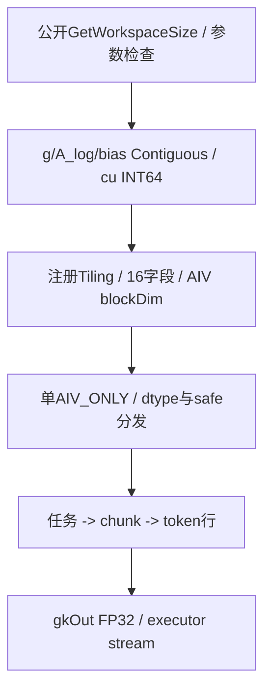
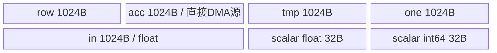
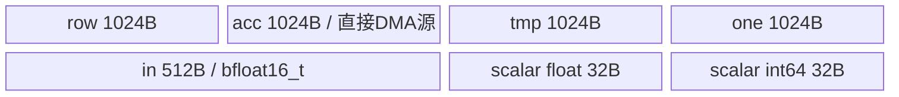
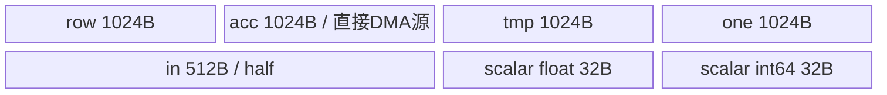

# KdaGateCumsumVllm A2/A3 ACLNN 算子知识

## 先分清 gate 已计算还是 raw gate

A2/A3 接入先提供 g 的实际 BSND/BNSD/TND/NTD 布局、dtype、向量宽 K、chunk_size 和 cu 前缀；raw 路径还需 A_log、可选 dt_bias 与 lower_bound。先按[接口与语义](#接口与语义)区分“预计算 gate”和“raw safe sigmoid gate”，再到[Route 选择](#route-选择)按 dtype×SAFE_GATE 选六个实例。

公开 chunk_size 仅允许32/64/128，与 `K<=256` 不是同一个限制。输出 gk 为 FP32，并在每个 chunk 重置前缀累加；两条计算路径都先乘 `1/ln(2)` 再逐行累加。需要确认指数单位或模型接线时，先核 caller，不能只因符号已注册就认定模型自动使用它。

SAFE_GATE 不是 NaN/Inf 防护；strided/重叠 gk、cu 内容或 raw 参数未符合公开合同时，先读[限制与失败边界](#限制与失败边界)和[Host/Launcher](#hostlauncher-执行流程)，不要借 Device-only unsafe 分支绕过。已有 e2e 也不提供全部 raw/dtype/layout 的运行证明。

## 算子速览

| 项目 | 内容 |
|---|---|
| 实际入口 | 公开 aclnnKdaGateCumsumVllmGetWorkspaceSize → aclnnKdaGateCumsumVllm 两阶段；Torch 为 kda_gate_cumsum_vllm |
| 计算语义 | 预计算gate或有下界的raw sigmoid gate逐token乘RCP_LN2，再在每个chunk内顺序FP32前缀累加 |
| 输入输出 | g为BSND/BNSD rank4或TND/NTD rank3，half/BF16/float；gk同shape且为float32；raw另用每head A_log和可选dt_bias |
| 执行类型 | 单Kernel、纯AIV_VECTOR，KERNEL_TYPE_AIV_ONLY；没有Cube、MIX_CV、SIMT、独立NDDMA或通信节点 |
| Kernel 路线 | R-001 float/预计算、R-002 float/raw safe、R-003 BF16/预计算、R-004 BF16/raw safe、R-005 half/预计算、R-006 half/raw safe |
| 核心资源 | 七个TBuf：half/BF16显式4672B、float显式5184B；无TQue、无double buffer；Device不使用workspace |
| 来源闭包 | source_closed：公开API→连续化/l0op→注册Tiling与16字段→六实例→任务/行循环/Copy/Compute/同步及构建接线；生成bridge/Device头、Contiguous与intrinsic内部为明示框架边界 |
| 验证状态 | 已完成源码闭包检查；本次知识提取未执行编译、真机、数值或性能测试。 |

A2/A3范围由固定公开产品表、OpDef的ascend910b/ascend910_93、build_aclnn对应列表及Dockerfile/Dockerfile.a3交叉支持。基础镜像为CANN9.2.0_20261022115200，另安装ops-transformer9.3.0；cann_versions中的9.2.0不证明weekly生成头、运行库与编译产物ABI身份。950有自己的OpDef/build接线，但不扩入本卡平台范围；Torch注册存在不等于310P、310B、910或麒麟支持。

## 接口与语义

### 计算语义

记B为batch，T为序列或packed token总长，H=HV为head数，K为每head gate向量长，S为chunkSize。j是K内元素，h是head，r为FP32常量RCP_LN2=1.4426950408889634f。对一个chunk的起点s和其中t：

```text
预计算：a[t,h,j] = float(g[t,h,j])
raw safe：z = (float(g[t,h,j]) + optional_bias[h,j]) * exp(A_log[h])
          a[t,h,j] = lowerBound / (1 + exp(-z))
每个chunk重新 acc[j]=0
逐token：row[j] = FP32(a[t,h,j] * RCP_LN2)
         acc[j] = FP32(acc[j] + row[j])
         gk[t,h,j] = acc[j]
```

raw不是softplus，也不是先对g做cumsum再sigmoid；先可选bias、再乘exp(A_log)、取sigmoid、乘lowerBound、乘1/ln2，最后累加。预计算路径也乘1/ln2。比例先逐row相乘再加，不可把scale移到完整sum之后并声称舍入相同。gk是每chunk局部前缀，不跨chunk或序列传递acc；raw单token nominal下界不能当作整个前缀的输出下界。

FP16/BF16经CAST_NONE到float；float路径仍有Adds(row,0)，不假定逐bit恒等。其后运算和输出均FP32，没有降回输入精度、补偿求和或stochastic rounding。safe_gate只表示这条有界sigmoid公式；未检查g/A_log/bias有限性，Exp溢出、NaN/Inf和double lowerBound转float的舍入或下溢均未被运行验证。

### 输入、输出与属性

KDA gate cumsum 的公开参数 chunk_size（C++名chunkSize）是32、64、128三个取值的枚举约束。16或256即使为正数也会被KdaGateCheckParams拒绝；它与向量维K<=256是两个不同约束，不能用K的容量上界代替chunkSize的允许集合。layout字符串选择地址公式，也不会扩大这个集合。

| 参数 | shape/layout | dtype | 约束、默认值与语义 |
|---|---|---|---|
| g | BSND=B×T×H×K；BNSD=B×H×T×K；TND=T×H×K；NTD=H×T×K | OpDef约束float32/BF16/FP16 | C++校验rank3/4、K<=256、rank与layout匹配；没有完整正维/溢出检查；Torch另检查g dtype |
| aLogOptional / A_log | raw为[H] | OpDef float32 | useGateInKernel=true时必须存在并校验shape；Torch另校验float32；预计算路径不会读取其内容 |
| dtBiasOptional / dt_bias | raw可为[H*K]或[H,K] | OpDef float32 | raw时校验shape，按h*K+j展平；C++未另写逐tensor dtype校验，不能由此推导其它dtype支持；预计算路径不参与运算 |
| cuSeqlensOptional | 原始sequence前缀，长度N+1 | aclIntArray→INT64 ND | absent为定长；present需长度>=2、首0、尾T、非递减；允许相邻相等；rank4变长要求B=1 |
| chunkSize / chunk_size | S | int64 | 公开接口只允许32/64/128；C++和Torch需要实参；OpDef的默认64不替代函数参数 |
| useGateInKernel | bool | bool→线int64 | false为预计算；true必须safeGate=true；该字段被保存，但Kernel实际用safeGate分发 |
| safeGate / safe_gate | bool | bool→线int64 | false只允许useGate=false；true只允许useGate=true；非零选择SAFE_GATE=true实例 |
| lowerBound / lower_bound | raw下界 | C++ double→Host/线float | raw要求double值在[-5,0)；Torch optional默认-5；预计算不用于计算 |
| layout | 大写字符串 | BSND/BNSD/TND/NTD | OpDef/Torch默认BSND；C++要求非空且合法；只选择地址公式，不自动转置tensor |
| gkOut / gk | 与g同shape | float32 | C++要求dtype/shape；直接传给launcher，没有ViewCopy或输出连续化；Torch新建empty float32 |
| workspaceSize/executor/stream | 两阶段框架对象 | 框架类型 | caller按框架保持输入、输出、executor及中间产物生命周期；无自定义跨stream迁移协议 |

### 入口与版本

固定仓没有可见V2/V3选择器；本卡是这组公开ACLNN的最新可见入口。Torch函数来自kda_gate_cumsum_vllm_torch_adpt.h，两个注册位置暴露同一schema，不能算成两个数学算子。Meta只返回g.sym_sizes()和float32 empty，忽略chunk、gate、layout与cu参数；Meta成功不是参数、数值或硬件执行验收。

固定vllm_ascend Python运行源码未检出该符号的直接调用；Torch注册和现有e2e调用不证明某模型已自动接线。GLM KDA/RecoverSSM的模型或框架开关有独立职责，不能从本公开算子存在推导默认启用。

## Host/Launcher 执行流程

### 参数校验与前处理

CREATE_EXECUTOR失败返回ACLNN_ERR_INNER_CREATE_EXECUTOR。KdaGateCheckParams检查g/gk非空、S集合、rank、K上限、gk Float及同shape，再ParseKdaGateLayout、检查rank匹配和cu前缀。useGate=true要求A_log存在、safe=true、lower范围与A_log/bias shape；useGate=false要求safe=false。内层null错误等在公开第一阶段统一映射为ACLNN_ERR_PARAM_INVALID，不补造逐项独立外层错误码。

KdaGateDataContiguous对g、A_log、dt_bias依次处理，null optional直接成功；非空经l0op::Contiguous并检查返回。即使预计算路径不读A_log/bias，也仍可能添加这些连续化。OpDef约束输入dtype，C++CheckParams未逐一复写g/A_log/dt_bias的dtype检查；Torch只额外核对g和raw A_log。缺少显式检查不是更广dtype支持。

l0op::KdaGateCumsumVllm将存在的aclIntArray经ConvertToTensor(INT64)，设置Storage/View/OriginalFormat为ND，**没有检查转换结果null**。ADD_TO_LAUNCHER_LIST_AICORE按g/A_log/bias/cu四输入、gkOut一输出和S/useGate/safe/lower(float)/layout五属性添加；失败返回{nullptr}，外层映射ACLNN_ERR_INNER_NULLPTR。没有输出ViewCopy，strided或重叠输出未获得安全保证。

### 参数、Workspace 与生命周期

Host只请求一个workspace槽，值为PlatformAscendC::GetLibApiWorkSpaceSize；Device将workspace参数显式(void)丢弃，没有自有GM scratch、跨Kernel中间片或动态分配。公开workspaceSize由executor汇总，连续化和数组产物也属于框架准备，不能直接宣称公开size等于零或只等于该lib值。

输入/输出由caller提供，Torch为gk分配empty；executor管理已添加的前处理与launch，相关输入、输出、数组产物按stream消费生命周期保持有效。生成inner bridge、普通Contiguous、TPipe分配和intrinsic内部是框架边界；没有自定义完成事件、跨stream owner转移或异步释放实现。

### 启动图与失败传播

| 节点 | Host添加/注册入口 | entry/执行族 | blockDim/POD | 输入输出与workspace | ordering/失败 |
|---|---|---|---|---|---|
| N1 | l0op::KdaGateCumsumVllm的AICORE launcher；Tiling4KdaGateCumsumVllm由注册表命中 | kda_gate_cumsum_vllm，AIV_VECTOR | max(1,min(taskCount,AIV核数))；16字段 | 四输入、一gk输出；无自有workspace消费 | 第二阶段CommonOpExecutorRun在实参stream执行，返回其状态 |



OpDef的coreType字符串AiCore不代表可达Cube节点；实际entry为KERNEL_TYPE_AIV_ONLY。Host无效rank/layout/K返回GRAPH_FAILED；公开校验在此之前，但内部Tiling仍缺完整attrs/shape空指针及溢出保护。SaveToBuffer返回未检查，SetDataSize后返回GRAPH_SUCCESS；不把Tiling成功当作设备已完成。没有第二核心Kernel或安全fallback。

## Route 与参数设计

### 分核与资源计算

| layout编码 | shape推导 | Offset(b,t,h,j)元素地址 | 公开匹配 |
|---|---|---|---|
| BSND=0 | B=g0,T=g1,H=g2,K=g3 | ((b*T+t)*H+h)*K+j | rank4 |
| BNSD=1 | B=g0,H=g1,T=g2,K=g3 | ((b*H+h)*T+t)*K+j | rank4 |
| TND=2 | B=1,T=g0,H=g1,K=g2 | (t*H+h)*K+j | rank3 |
| NTD=3 | B=1,H=g0,T=g1,K=g2 | (h*T+t)*K+j | rank3 |

定长maxChunks=ceil(T/S)，taskCount=B*H*maxChunks；task映射chunk=task%maxChunks、h=(task/maxChunks)%H、b=task/(maxChunks*H)。变长seqNum=cu长度−1、taskCount=seqNum*H；task映射h=task%H、seq=task/H，读取cu[seq]/cu[seq+1]，在该序列内按S步长逐chunk。不是矩形maxChunks×sequence任务，也不使用chunk_indices二元组。例[0,31,96]且S64时第二序列从31重分[31,95)、[95,96)，不按全局0/64边界对齐。

Host取AIV核数C，blockDim=uint32(min(taskCount,C))，零时改1；usedCoreNum保存同值。每核task=GetBlockIdx开始、步长usedCoreNum。定长按chunk分散，变长一个sequence/head任务内部串行其全部chunk；长短序列可有负载差异，不保证吞吐收益。taskCount为0时Process不调用ProcessTask；变长空序列仍可读两项cu后跳过chunk循环。

GATE_ROW_ELEMENTS=256；Host只以K<=256约束固定TBuf，未使用UB容量selector。显式字节为4*256*4 + 256*sizeof(T) + 32 + 32：half/BF16=4672B，float=5184B。SAFE_GATE=false仍分配tmp/one，float路线仍分配未消费的inBuf；不能把分支省算写成条件省内存。TPipe内部偏移、额外开销和实际资源占用未测，不补造物理连续地址。

### Route 选择

| 顺序 | Route | Key/模板 | 精确选择条件与优先级 | 不适用去向 |
|---:|---|---|---|---|
| 1 | R-001 | KdaGateCumsumVllmKernel<float,false> | dataType==2，safeGate==0；公开useGate=false | 同dtype safe判断 |
| 2 | R-002 | KdaGateCumsumVllmKernel<float,true> | dataType==2，safeGate!=0；公开useGate=true/safe=true | 下一个dtype |
| 3 | R-003 | KdaGateCumsumVllmKernel<bfloat16_t,false> | dataType==1，safeGate==0；公开useGate=false | 同dtype safe判断 |
| 4 | R-004 | KdaGateCumsumVllmKernel<bfloat16_t,true> | dataType==1，safeGate!=0；公开useGate=true/safe=true | 默认dtype |
| 5 | R-005 | KdaGateCumsumVllmKernel<half,false> | dataType既非2也非1，safeGate==0；公开合法dtype为FP16/编码0 | 同dtype safe判断 |
| 6 | R-006 | KdaGateCumsumVllmKernel<half,true> | dataType既非2也非1，safeGate!=0；公开合法dtype为FP16/编码0 | 无unknown-key错误 |

```text
公开：合法dtype/layout/rank/S和输出 -> useGate?
  true: 要求safe=true、A_log[H]、可选bias合法、lower在[-5,0)
  false: 要求safe=false
Host编码：float2 / BF161 / 其它0；保存useGate与safe，无SetTilingKey
entry：data2 -> float；else data1 -> BF16；else half
  DispatchKdaGateCumsumVllmBySafeGate：safe!=0 -> <T,true>；else <T,false>
    -> RunKdaGateCumsumVllm -> Init/Process
      dense或varlen任务 -> ProcessChunk -> 每行加载/门控/scale/acc/store
```

六路线按真实dtype×SAFE_GATE模板区分；每路线保留四layout地址、定长和变长循环、optional bias与DMA尾分支，不把这些运行分支补造成未实例化模板。SAFE_GATE=true中的hasALog=false设备表达式存在，但公开raw路径强制A_log，不作为正式缺省ALog路线。

### 模板/实现执行矩阵

| Route | key/selector | dtype/shape/platform完整命中条件 | 执行拓扑与Kernel节点 | 实际模板/body | 内存与同步特征 | tail/fallback |
|---|---|---|---|---|---|---|
| R-001 | data2,safe0 | A2/A3；float预计算；公共域 | 单AIV N1 | <float,false>/ProcessChunk | 5184B，直接float加载/Adds0，行event | K DMA/最后chunk；无安全fallback |
| R-002 | data2,safe非0 | float raw；use/safe/A_log/bias/lower合同 | 单AIV N1 | <float,true>/ApplyGate | 5184B，加bias/标量exp/Div及行event | optional bias分支，非有限值未guard |
| R-003 | data1,safe0 | BF16预计算；公共域 | 单AIV N1 | <bfloat16_t,false> | 4672B，CAST_NONE升float | K Pad，FP32输出 |
| R-004 | data1,safe非0 | BF16 raw；raw合同 | 单AIV N1 | <bfloat16_t,true> | 4672B，升float后raw计算 | 不降回BF16 |
| R-005 | default,safe0 | 合法FP16预计算；公共域 | 单AIV N1 | <half,false> | 4672B，CAST_NONE升float | 非法dtype不会得到独立错误分支 |
| R-006 | default,safe非0 | 合法FP16 raw；raw合同 | 单AIV N1 | <half,true> | 4672B，FP32门控和acc | 不支持unsafe raw变体 |

### 隐藏性能 Guard

| Guard | Host/Tiling条件 | Device/资源原因 | 影响Route | 不满足时去向 | 源码符号 |
|---|---|---|---|---|---|
| S集合 | 公开32/64/128；内部Tiling直接读取 | ceil(T/S)、chunk步进与重置 | 全部 | 公开PARAM_INVALID，内部无补充fallback | KdaGateCheckParams / ProcessChunk |
| rank/layout | 3/4与四大写字符串匹配 | shape轴和Offset不同 | 全部 | 校验失败，不自动permute | ParseKdaGateLayout / Offset |
| K容量 | 仅K<=256 | 所有行TBuf固定256元素 | 全部 | >256失败；K0/count0等未运行证明 | MAX_K_DIM / GATE_ROW_ELEMENTS |
| dtype | OpDef三dtype、Torch检查；C++未全部复写 | GM reinterpret与Cast模板 | 全部 | entry其它值默认half，非广泛支持 | dataType / LoadGateRow |
| raw组合 | use=true要求safe、A_log和lower范围 | SAFE_GATE控制实际sigmoid计算 | R-002/004/006 | 拒绝unsafe raw；非有限数据无额外guard | ApplyGate / CheckParams |
| cu合同 | 首0尾T、非递减、长度>=2；rank4 B1 | 原始sequence域、ReadInt64和b0寻址 | 全部varlen分支 | 公开失败，内部不重验内容 | KdaGateCheckCuSeqlens / ProcessTask |
| DMA | rowBytes>=32且mod32==0 | 对齐DataCopy或Pad分支，输出始终float | 全部 | 选Pad，不是任意坏指针fallback | CopyVectorIn / CopyFloatVectorOut |
| 算术容量 | int64 taskCount到uint32 blockDim；Device uint64 | 乘法/ceil/地址可能溢出；K仅上界 | 全部 | 无完整溢出/负维保护 | Tiling4 / Init / Offset |
| 输出与alias | dtype/shape检查，无ViewCopy/连续性检查 | 直接按layout写gkOut | 全部 | 不补造strided/inplace支持 | l0op::KdaGateCumsumVllm |
| 手动同步 | --cce-auto-sync=off | acc直接作为DMA源，多个TBuf逐row复用 | 全部 | 不能删event并依赖编译器补同步 | op_host/CMakeLists.txt / HardEvent |

### POD/ABI

按固定metadef v9.2.0 FieldHandler的字段宽度对齐、InitData零初始化与尾8对齐，15个int64、1个float及4B间隙形成16字段128B/align8静态线布局。Host宏对象有管理成员，不能memcpy当线POD。以下不是编译sizeof/offsetof测量；生成Device头及weekly库身份未验证。

| 结构 | 字段 | 类型/位宽 | ABI布局 | 单位 | Host producer | Device consumer | 边界 |
|---|---|---|---|---|---|---|---|
| KdaGateCumsumVllmTilingData线 | batch | int64/64 | offset0，总128/align8 | batch | Tiling4KdaGateCumsumVllm: rank4?g0:1 | Process定长任务与Offset | varlen公开B1 |
| KdaGateCumsumVllmTilingData线 | t | int64/64 | offset8，总128/align8 | token | Tiling4KdaGateCumsumVllm: 按layout取轴 | maxChunks/Offset | packed总长 |
| KdaGateCumsumVllmTilingData线 | hv | int64/64 | offset16，总128/align8 | head | Tiling4KdaGateCumsumVllm: 按layout取轴 | task/head/bias地址 | 无正值完整检查 |
| KdaGateCumsumVllmTilingData线 | k | int64/64 | offset24，总128/align8 | element | Tiling4KdaGateCumsumVllm: 最后轴 | 行搬运/Vector count | <=256但无正值完整检查 |
| KdaGateCumsumVllmTilingData线 | rank | int64/64 | offset32，总128/align8 | axis数 | Tiling4KdaGateCumsumVllm: gShape.GetDimNum | Offset默认rank4/3 | 公开layout匹配 |
| KdaGateCumsumVllmTilingData线 | layout | int64/64 | offset40，总128/align8 | enum | Tiling4KdaGateCumsumVllm: BSND0/BNSD1/TND2/NTD3 | Offset | 不是转置指令 |
| KdaGateCumsumVllmTilingData线 | chunkSize | int64/64 | offset48，总128/align8 | token | Tiling4KdaGateCumsumVllm: attr int64 | maxChunks/chunk步进 | 公开32/64/128 |
| KdaGateCumsumVllmTilingData线 | seqNum | int64/64 | offset56，总128/align8 | sequence | Tiling4KdaGateCumsumVllm: cu存在?cu.dim0-1:batch | varlen taskCount | 不含chunk_indices |
| KdaGateCumsumVllmTilingData线 | hasCuSeqlens | int64/64 | offset64，总128/align8 | bool编码 | Tiling4KdaGateCumsumVllm: cuShape存在1否则0 | Process/ProcessTask | 决定任务图 |
| KdaGateCumsumVllmTilingData线 | hasALog | int64/64 | offset72，总128/align8 | bool编码 | Tiling4KdaGateCumsumVllm: optional desc存在 | SAFE_GATE的expA | 公开raw强制存在 |
| KdaGateCumsumVllmTilingData线 | hasDtBias | int64/64 | offset80，总128/align8 | bool编码 | Tiling4KdaGateCumsumVllm: optional desc存在 | SAFE_GATE可选Copy/Add | 预计算不消费 |
| KdaGateCumsumVllmTilingData线 | dataType | int64/64 | offset88，总128/align8 | enum | Tiling4KdaGateCumsumVllm: float2/BF161/else0 | entry三dtype分发 | 其它默认half |
| KdaGateCumsumVllmTilingData线 | useGateInKernel | int64/64 | offset96，总128/align8 | bool编码 | Tiling4KdaGateCumsumVllm: attr?1:0 | Kernel无读取 | 公开与safe关系由API约束 |
| KdaGateCumsumVllmTilingData线 | safeGate | int64/64 | offset104，总128/align8 | bool编码 | Tiling4KdaGateCumsumVllm: attr?1:0 | Dispatch非零选true | 正式use/safe组合只有两种 |
| KdaGateCumsumVllmTilingData线 | lowerBound | float/32 | offset112，总128/align8 | scalar | Tiling4KdaGateCumsumVllm: 公开double经l0op转float | ApplyGate最后乘 | 116..119对齐间隙，非FP64计算 |
| KdaGateCumsumVllmTilingData线 | usedCoreNum | int64/64 | offset120，总128/align8 | core | Tiling4KdaGateCumsumVllm: blockDim0?1:blockDim | Process任务stride | Host从uint32写入 |

### Route 源码闭包

| Route | Key/selector | Host/Tiling producer | POD/参数 | Kernel entry/router节点 | Kernel body/直接依赖 | 构建接线 |
|---|---|---|---|---|---|---|
| R-001 | data2,safe0 | Tiling4KdaGateCumsumVllm | 16字段/128B；全layout与dense/varlen分支 | entry→Dispatch→Run<float,false> | 自包含CPP中的Init/Process/ProcessTask/ProcessChunk及搬运/门控helper | OpDef A2/A3、op_host CMake、自定义API与SOC列表 |
| R-002 | data2,safe1 | Tiling4KdaGateCumsumVllm | 16字段/128B；全layout与dense/varlen分支 | entry→Dispatch→Run<float,true> | 自包含CPP中的Init/Process/ProcessTask/ProcessChunk及搬运/门控helper | OpDef A2/A3、op_host CMake、自定义API与SOC列表 |
| R-003 | data1,safe0 | Tiling4KdaGateCumsumVllm | 16字段/128B；全layout与dense/varlen分支 | entry→Dispatch→Run<bfloat16_t,false> | 自包含CPP中的Init/Process/ProcessTask/ProcessChunk及搬运/门控helper | OpDef A2/A3、op_host CMake、自定义API与SOC列表 |
| R-004 | data1,safe1 | Tiling4KdaGateCumsumVllm | 16字段/128B；全layout与dense/varlen分支 | entry→Dispatch→Run<bfloat16_t,true> | 自包含CPP中的Init/Process/ProcessTask/ProcessChunk及搬运/门控helper | OpDef A2/A3、op_host CMake、自定义API与SOC列表 |
| R-005 | data0,safe0 | Tiling4KdaGateCumsumVllm | 16字段/128B；全layout与dense/varlen分支 | entry→Dispatch→Run<half,false> | 自包含CPP中的Init/Process/ProcessTask/ProcessChunk及搬运/门控helper | OpDef A2/A3、op_host CMake、自定义API与SOC列表 |
| R-006 | data0,safe1 | Tiling4KdaGateCumsumVllm | 16字段/128B；全layout与dense/varlen分支 | entry→Dispatch→Run<half,true> | 自包含CPP中的Init/Process/ProcessTask/ProcessChunk及搬运/门控helper | OpDef A2/A3、op_host CMake、自定义API与SOC列表 |

## Kernel 实现

### 公共执行流程

活动op_kernel/kda_gate_cumsum_vllm.cpp只include kernel_operator.h，并在自身匿名namespace定义实际类/Run/Dispatch；不以同目录同名大kernel.h替换该body，也不把它当已接入fallback。GET_TILING_DATA的生成头是明示CANN生成边界。entry构造单个TPipe，按dtype和safe调用Init/Process；workspace不消费，TPipe及TBuf随本kernel生命周期。

CopyVectorIn、CopyFloatVectorIn、CopyFloatVectorOut均先算rowBytes。rowBytes>=32且mod32==0时DataCopy计数是K元素；否则DataCopyPad分支用blockCount1、blockLen=uint16(rowBytes)、两stride0，不把字节数误写成K或32B块数。输入T字节宽度和输出float宽度不同，二者是否命中对齐分支要分别判断。K<=256限制了合法正K时blockLen，K0和非法维不由此获得安全证明。

ReadFloat用32B scalarBuf搬4B，event3 MTE2_V→Adds0/PIPE_V→event4 V_S，再从UB物理指针取float；ExpScalar复用此buf Duplicate/Exp与V_S读取。ReadInt64使用独立32B scalarI64Buf搬8B并经同号event3/4连接到标量读取。每次调用set/wait后再消费，没有从Host数组直接推断GM内容可见性。

### Route R-001：float 输入与预计算门控

#### 适用条件

##### 选择证据

| 层级 | 文件 | 符号 | 源码谓词/参数 | 结果/下一跳 |
|---|---|---|---|---|
| API | op_host/op_api/aclnn_kda_gate_cumsum_vllm.cpp | KdaGateCheckParams | useGate=0，safe=0；合法S/layout/rank/gk，raw另校验ALog/bias/lower | 不合法先返回PARAM_INVALID |
| Host | op_host/kda_gate_cumsum_vllm_tiling.cpp | Tiling4KdaGateCumsumVllm | data编码2，safe保存0；四layout；cu决定任务数 | 16字段、blockDim>=1 |
| entry | op_kernel/kda_gate_cumsum_vllm.cpp | DispatchKdaGateCumsumVllmBySafeGate | dataType==2；safeGate==0 | RunKdaGateCumsumVllm<float,false> |
| Body | 同一自包含CPP | KdaGateCumsumVllmKernel<float,false> | Init→Process→ProcessTask→ProcessChunk | 单AIV，dense/varlen与地址分支均保留 |

本路线的Input为float/4B，输出与acc为float4B。MTE2直接写rowBuf，event0后Adds(row,0)。预计算不读取ALog/bias，不保证输入已为负值，也不自动把它们变成raw gate。当前公开平台只取A2/A3；dtype声明与缺少部分C++显式检查须同时保留。

#### Device 数据流

##### 函数级调用链

```text
aclnnKdaGateCumsumVllmGetWorkspaceSize -> Contiguous/l0op/AICORE launcher
  -> 注册Tiling4KdaGateCumsumVllm -> kda_gate_cumsum_vllm / AIV_ONLY
    -> DispatchKdaGateCumsumVllmBySafeGate<float>
      -> RunKdaGateCumsumVllm<float,false>
        -> KdaGateCumsumVllmKernel<float,false>::Init / Process
          -> ProcessTask dense 或 varlen（ReadInt64）
            -> ProcessChunk -> Offset -> LoadGateRow/CopyVectorIn
              -> ApplyGate<false> （不读raw辅助输入）
              -> Muls(RCP_LN2) -> Add(acc) -> CopyFloatVectorOut
              -> 行MTE3_MTE2与MTE3_V回收
```

##### 源码等价伪码

```text
伪码：单个AIV节点，没有隐藏第二Kernel。
Init: 绑定g/ALog/bias/cu/gk；读16字段所需成员；七个TBuf固定分配
maxChunks=ceil(T/S)
Ntask = hasCu ? seqNum*H : B*H*maxChunks
for task=coreIdx; task<Ntask; task+=usedCoreNum:
  if !hasCu:
    chunk=task%maxChunks; h=(task/maxChunks)%H; b=task/(maxChunks*H)
    ProcessChunk(b,h,chunk*S,min((chunk+1)*S,T))
  else:
    h=task%H; seq=task/H
    begin=ReadInt64(cu,seq); end=ReadInt64(cu,seq+1)
    for start=begin; start<end; start+=S:
      ProcessChunk(0,h,start,min(start+S,end))
ProcessChunk(b,h,start,end):
  acc[0:K]=0; PipeBarrier(V)
  for t=start; t<end; ++t:
    offset = BNSD?((b*H+h)*T+t)*K : NTD?(h*T+t)*K
             : rank4?((b*T+t)*H+h)*K : (t*H+h)*K
    LoadGateRow(offset): MTE2直接写rowBuf，event0后Adds(row,0)
    ApplyGate<T,false>()编译期空体；A_log/bias即使存在也不读
    row保持预计算输入值，不自动clamp或softplus
    row *= RCP_LN2; PipeBarrier(V)
    acc += row; PipeBarrier(V)          # 同一FP32向量逐token串行
    set/wait V_MTE3 event1
    CopyFloatVectorOut(gk,offset,acc,K) # 对齐DataCopy或按rowBytes的Pad
    set/wait MTE3_MTE2 event2
    set/wait MTE3_V event5              # DMA不再读acc后才允许下一row覆盖
```

#### 内存与数据搬运

##### 资源与搬运表

| 层级/缓冲区 | offset/地址公式 | extent/容量公式 | dtype/layout | producer | consumer | owner/lifetime | 对齐/复用 |
|---|---|---|---|---|---|---|---|
| GM g | Offset(b,t,h,0) | 每row K元素 | float，四layout连续地址 | caller/Contiguous | LoadGateRow | stream消费期间 | 字节数K*4决定DMA分支 |
| GM A_log/bias | h / h*K | 1 / K | float32 | caller/Contiguous | 不读取内容 | 只保留可选绑定/前处理边界 | 不能按Input字节宽度读 |
| GM cu | seq / seq+1 | 每任务2个int64 | INT64 ND | ConvertToTensor | varlen ProcessTask | executor/stream | 8B scalar Pad，dense不读 |
| GM gk | 与g相同Offset | 每row K float | float32 | acc DMA | caller | 正式输出 | 无ViewCopy/独立输出片 |
| UB rowBuf | 本TBuf基址 | 256*4=1024B | float | MTE2或Cast | scale | 每token | 不是256有效元素，count=K |
| UB accBuf | 独立TBuf基址 | 1024B | float | Duplicate/Add | MTE3直接写gk | 每chunk内所有token | event5后才可覆盖 |
| UB tmpBuf | 独立TBuf基址 | 1024B | float | 未用于计算但仍分配 | N/A | raw阶段内复用 | 无别名扣减；同buffer顺序覆盖 |
| UB oneBuf | 独立TBuf基址 | 1024B | float | 未使用但仍分配 | N/A | 每row | count K |
| UB inBuf | 独立TBuf基址 | 256*4=1024B | float | 未使用但仍分配 | N/A | 每row | event0/2保护 |
| UB scalarBuf | 独立TBuf基址 | 32B | float scalar | 未消费但仍分配 | N/A | 逐调用 | event3/4；不与I64共用 |
| UB scalarI64Buf | 独立TBuf基址 | 32B | int64 scalar | cu的8B Pad | ReadInt64 | 每varlen任务 | event3/4后消费 |
| workspace/跨Kernel片 | N/A | 无自有scratch；框架lib值另计 | N/A | 框架 | Device不使用 | executor/stream | 无核心跨Kernel边 |
| L1/L0/Cube、SIMT、通信 | N/A | N/A | 实际替代为GM↔UB↔Vector | N/A | N/A | N/A | 不伪造资源或拓扑 |
| 寄存器/标量 | b/t/h/task/shape/expA等 | 编译寄存器数未测 | uint64/float | Host字段与Read helper | 循环/Vector参数 | 本AIV | 动态UB=N/A |

##### 分层内存布局



图表示七个独立TBuf及分配容量，没有源码可见的统一物理offset，不把图块顺序当TPipe连续分配证明。没有Queue、depth2或输入输出double buffer，SAFE_GATE=false也不改变这些分配。

##### 字节账与复用顺序

```text
显式UB = row1024 + acc1024 + tmp1024 + one1024
         + in(1024) + scalar32 + scalarI64 32 = 5184B
有效Vector长度 = K <= 256（正值域）；不是每次都处理256
自有workspace = 0；框架lib/前处理/executor资源另计
Host没有UB容量selector；TPipe额外开销/物理offset/运行占用未测
```

| 复用子区 | 写入者 | 读取者/消费点 | 下一次覆盖 | 同步或释放依据 | 安全条件 |
|---|---|---|---|---|---|
| row/in | LoadGateRow、Cast、Muls | Vector/Add acc | 下一token LoadGateRow | MTE2_V0、PIPE_V、MTE3_MTE2 event2 | count与输入类型匹配 |
| acc | chunk起始Duplicate、每row Add | CopyFloatVectorOut直接读 | 下一row Add或下chunk Duplicate | V_MTE3 event1、MTE3_V event5 | 不能把set/wait5删成无保护并行 |
| tmp | 本路线不消费 | N/A | raw后续阶段/下一row | 仍计分配，不声称条件省内存 | 不误认与row/acc物理alias |
| scalar float | 不消费 | N/A | 下一helper/row | 无虚构计算 | 仅1个float有效，buffer32B |
| scalar I64 | ReadInt64 cu端点 | ProcessTask标量循环 | 下一端点或task | MTE2_V3→V_S4 | 已校验原始prefix，空序列仍可读端点 |

#### 同步、精度与尾块

##### 同步与数值边界表

| 阶段 | primitive/机制 | producer | consumer/等待点 | 保护对象 | 精度/尾块 |
|---|---|---|---|---|---|
| gate加载 | MTE2_V event0 | MTE2 | Adds0 | row/in | float→float；K字节对齐分支独立判断 |
| raw可选bias | N/A，不读内容 | N/A | N/A | tmp/row | 不是unsafe raw分支 |
| scalar | MTE2_V3 / V_S4 | cu搬入 | Read helper取UB标量 | 两个32B独立buf | 8B I64、float辅助不消费 |
| 计算 | 每步PIPE_V | row、RCP_LN2 | Add acc | row/tmp/one/acc | FP32顺序累加，无softplus/补偿sum |
| 输出提交 | V_MTE3 event1 | Add后的Vector | MTE3 | acc | gk始终float，输出K*4单独判断DMA |
| 输入复用 | MTE3_MTE2 event2 | 上row MTE3完成 | 下一输入MTE2 | 顺序行管线 | 没有无依据的重叠收益 |
| acc复用 | MTE3_V event5 | 直接acc→GM DMA | 下一Vector覆盖 | acc | 最后row也wait，下一chunk可重新Duplicate |
| token尾/空序列 | end=min(start+S,T或seqEnd) | ProcessTask | ProcessChunk | 最后有效token | 空序列for循环跳过；无padding token参与acc |
| 数值与非法域 | 预计算输入不做范围变换 | caller/Vector | gk/caller | nominal有效域 | K0、坏dtype/alias、溢出不补造安全fallback |

#### 关键实现

##### 符号证据表

| 阶段 | 文件 | 符号/模板实例 | 实现事实 |
|---|---|---|---|
| Host/Tiling producer | op_host/kda_gate_cumsum_vllm_tiling.cpp | Tiling4KdaGateCumsumVllm | 四layout维度、dense/varlen任务、blockDim与16字段 |
| Kernel entry/router | op_kernel/kda_gate_cumsum_vllm.cpp | RunKdaGateCumsumVllm<float,false> | dataType==2和safe分发，workspace忽略 |
| Device body/helper | 同一CPP | KdaGateCumsumVllmKernel<float,false>::Process/ProcessTask | 核stride、dense chunk分核和varlen sequence/head串行chunk |
| Device body/helper | 同一CPP | LoadGateRow / CopyVectorIn / CopyFloatVectorIn / CopyFloatVectorOut | MTE2直接写rowBuf，event0后Adds(row,0)；对齐和Pad分别处理 |
| Device body/helper | 同一CPP | ApplyGate / ReadFloat / ExpScalar | 编译期不读ALog/bias，固定buf仍存在 |
| Device body/helper | 同一CPP | ReadInt64 / Offset / ProcessChunk | prefix原始端点、四layout地址、chunk reset、事件1/2/5 |
| 构建接线 | op_host/CMakeLists.txt | add_ops_compile_options | --cce-auto-sync=off；手动同步不可省略 |

### Route R-002：float 输入与raw安全门控

#### 适用条件

##### 选择证据

| 层级 | 文件 | 符号 | 源码谓词/参数 | 结果/下一跳 |
|---|---|---|---|---|
| API | op_host/op_api/aclnn_kda_gate_cumsum_vllm.cpp | KdaGateCheckParams | useGate=1，safe=1；合法S/layout/rank/gk，raw另校验ALog/bias/lower | 不合法先返回PARAM_INVALID |
| Host | op_host/kda_gate_cumsum_vllm_tiling.cpp | Tiling4KdaGateCumsumVllm | data编码2，safe保存1；四layout；cu决定任务数 | 16字段、blockDim>=1 |
| entry | op_kernel/kda_gate_cumsum_vllm.cpp | DispatchKdaGateCumsumVllmBySafeGate | dataType==2；safeGate!=0 | RunKdaGateCumsumVllm<float,true> |
| Body | 同一自包含CPP | KdaGateCumsumVllmKernel<float,true> | Init→Process→ProcessTask→ProcessChunk | 单AIV，dense/varlen与地址分支均保留 |

本路线的Input为float/4B，输出与acc为float4B。MTE2直接写rowBuf，event0后Adds(row,0)。raw必须A_log[H]，可选FP32 bias按h*K展平；下界只约束每token公式。当前公开平台只取A2/A3；dtype声明与缺少部分C++显式检查须同时保留。

#### Device 数据流

##### 函数级调用链

```text
aclnnKdaGateCumsumVllmGetWorkspaceSize -> Contiguous/l0op/AICORE launcher
  -> 注册Tiling4KdaGateCumsumVllm -> kda_gate_cumsum_vllm / AIV_ONLY
    -> DispatchKdaGateCumsumVllmBySafeGate<float>
      -> RunKdaGateCumsumVllm<float,true>
        -> KdaGateCumsumVllmKernel<float,true>::Init / Process
          -> ProcessTask dense 或 varlen（ReadInt64）
            -> ProcessChunk -> Offset -> LoadGateRow/CopyVectorIn
              -> ApplyGate<true> -> CopyFloatVectorIn / ReadFloat / ExpScalar / Exp / Div
              -> Muls(RCP_LN2) -> Add(acc) -> CopyFloatVectorOut
              -> 行MTE3_MTE2与MTE3_V回收
```

##### 源码等价伪码

```text
伪码：单个AIV节点，没有隐藏第二Kernel。
Init: 绑定g/ALog/bias/cu/gk；读16字段所需成员；七个TBuf固定分配
maxChunks=ceil(T/S)
Ntask = hasCu ? seqNum*H : B*H*maxChunks
for task=coreIdx; task<Ntask; task+=usedCoreNum:
  if !hasCu:
    chunk=task%maxChunks; h=(task/maxChunks)%H; b=task/(maxChunks*H)
    ProcessChunk(b,h,chunk*S,min((chunk+1)*S,T))
  else:
    h=task%H; seq=task/H
    begin=ReadInt64(cu,seq); end=ReadInt64(cu,seq+1)
    for start=begin; start<end; start+=S:
      ProcessChunk(0,h,start,min(start+S,end))
ProcessChunk(b,h,start,end):
  acc[0:K]=0; PipeBarrier(V)
  for t=start; t<end; ++t:
    offset = BNSD?((b*H+h)*T+t)*K : NTD?(h*T+t)*K
             : rank4?((b*T+t)*H+h)*K : (t*H+h)*K
    LoadGateRow(offset): MTE2直接写rowBuf，event0后Adds(row,0)
    if hasDtBias:
      CopyFloatVectorIn(tmp,bias[h*K:K]); set/wait MTE2_V0
      row += tmp; PipeBarrier(V)
    expA = ExpScalar(ReadFloat(A_log,h))  # 公开raw必有A_log，每row重复
    row *= expA; PipeBarrier(V)
    tmp = -row; Exp(tmp); tmp += 1       # 各步PipeBarrier(V)
    one = 1; row = one/tmp; row *= lowerBound  # FP32，逐步barrier
    row *= RCP_LN2; PipeBarrier(V)
    acc += row; PipeBarrier(V)          # 同一FP32向量逐token串行
    set/wait V_MTE3 event1
    CopyFloatVectorOut(gk,offset,acc,K) # 对齐DataCopy或按rowBytes的Pad
    set/wait MTE3_MTE2 event2
    set/wait MTE3_V event5              # DMA不再读acc后才允许下一row覆盖
```

#### 内存与数据搬运

##### 资源与搬运表

| 层级/缓冲区 | offset/地址公式 | extent/容量公式 | dtype/layout | producer | consumer | owner/lifetime | 对齐/复用 |
|---|---|---|---|---|---|---|---|
| GM g | Offset(b,t,h,0) | 每row K元素 | float，四layout连续地址 | caller/Contiguous | LoadGateRow | stream消费期间 | 字节数K*4决定DMA分支 |
| GM A_log/bias | h / h*K | 1 / K | float32 | caller/Contiguous | ReadFloat和CopyFloatVectorIn | raw逐row使用 | 不能按Input字节宽度读 |
| GM cu | seq / seq+1 | 每任务2个int64 | INT64 ND | ConvertToTensor | varlen ProcessTask | executor/stream | 8B scalar Pad，dense不读 |
| GM gk | 与g相同Offset | 每row K float | float32 | acc DMA | caller | 正式输出 | 无ViewCopy/独立输出片 |
| UB rowBuf | 本TBuf基址 | 256*4=1024B | float | MTE2或Cast | bias/门控/scale | 每token | 不是256有效元素，count=K |
| UB accBuf | 独立TBuf基址 | 1024B | float | Duplicate/Add | MTE3直接写gk | 每chunk内所有token | event5后才可覆盖 |
| UB tmpBuf | 独立TBuf基址 | 1024B | float | bias Copy / Muls / Exp / Adds | Add / Div | raw阶段内复用 | 无别名扣减；同buffer顺序覆盖 |
| UB oneBuf | 独立TBuf基址 | 1024B | float | Duplicate(1) | Div分子 | 每row | count K |
| UB inBuf | 独立TBuf基址 | 256*4=1024B | float | 未使用但仍分配 | N/A | 每row | event0/2保护 |
| UB scalarBuf | 独立TBuf基址 | 32B | float scalar | 4B Pad、Adds/Duplicate/Exp | ReadFloat/ExpScalar的标量读取 | 逐调用 | event3/4；不与I64共用 |
| UB scalarI64Buf | 独立TBuf基址 | 32B | int64 scalar | cu的8B Pad | ReadInt64 | 每varlen任务 | event3/4后消费 |
| workspace/跨Kernel片 | N/A | 无自有scratch；框架lib值另计 | N/A | 框架 | Device不使用 | executor/stream | 无核心跨Kernel边 |
| L1/L0/Cube、SIMT、通信 | N/A | N/A | 实际替代为GM↔UB↔Vector | N/A | N/A | N/A | 不伪造资源或拓扑 |
| 寄存器/标量 | b/t/h/task/shape/expA等 | 编译寄存器数未测 | uint64/float | Host字段与Read helper | 循环/Vector参数 | 本AIV | 动态UB=N/A |

##### 分层内存布局


图表示七个独立TBuf及分配容量，没有源码可见的统一物理offset，不把图块顺序当TPipe连续分配证明。没有Queue、depth2或输入输出double buffer，SAFE_GATE=true也不改变这些分配。

##### 字节账与复用顺序

```text
显式UB = row1024 + acc1024 + tmp1024 + one1024
         + in(1024) + scalar32 + scalarI64 32 = 5184B
有效Vector长度 = K <= 256（正值域）；不是每次都处理256
自有workspace = 0；框架lib/前处理/executor资源另计
Host没有UB容量selector；TPipe额外开销/物理offset/运行占用未测
```

| 复用子区 | 写入者 | 读取者/消费点 | 下一次覆盖 | 同步或释放依据 | 安全条件 |
|---|---|---|---|---|---|
| row/in | LoadGateRow、Cast、ApplyGate、Muls | Vector/Add acc | 下一token LoadGateRow | MTE2_V0、PIPE_V、MTE3_MTE2 event2 | count与输入类型匹配 |
| acc | chunk起始Duplicate、每row Add | CopyFloatVectorOut直接读 | 下一row Add或下chunk Duplicate | V_MTE3 event1、MTE3_V event5 | 不能把set/wait5删成无保护并行 |
| tmp | bias搬入后变为负row/exp/1+exp | Add与Div | raw后续阶段/下一row | event0和每步PIPE_V | 不误认与row/acc物理alias |
| scalar float | ReadFloat/ExpScalar | Device标量读取 | 下一helper/row | MTE2_V3、V_S4及PIPE_V | 仅1个float有效，buffer32B |
| scalar I64 | ReadInt64 cu端点 | ProcessTask标量循环 | 下一端点或task | MTE2_V3→V_S4 | 已校验原始prefix，空序列仍可读端点 |

#### 同步、精度与尾块

##### 同步与数值边界表

| 阶段 | primitive/机制 | producer | consumer/等待点 | 保护对象 | 精度/尾块 |
|---|---|---|---|---|---|
| gate加载 | MTE2_V event0 | MTE2 | Adds0 | row/in | float→float；K字节对齐分支独立判断 |
| raw可选bias | MTE2_V0、Add、PIPE_V | bias MTE2 | row加法 | tmp/row | FP32 bias按h*K，不按Input解释 |
| scalar | MTE2_V3 / V_S4 | cu搬入、ALog与Exp | Read helper取UB标量 | 两个32B独立buf | 8B I64、4B FP32 |
| 计算 | 每步PIPE_V | row的bias/exp/Div/lower、RCP_LN2 | Add acc | row/tmp/one/acc | FP32顺序累加，无softplus/补偿sum |
| 输出提交 | V_MTE3 event1 | Add后的Vector | MTE3 | acc | gk始终float，输出K*4单独判断DMA |
| 输入复用 | MTE3_MTE2 event2 | 上row MTE3完成 | 下一输入MTE2 | 顺序行管线 | 没有无依据的重叠收益 |
| acc复用 | MTE3_V event5 | 直接acc→GM DMA | 下一Vector覆盖 | acc | 最后row也wait，下一chunk可重新Duplicate |
| token尾/空序列 | end=min(start+S,T或seqEnd) | ProcessTask | ProcessChunk | 最后有效token | 空序列for循环跳过；无padding token参与acc |
| 数值与非法域 | lower double→float；exp/Div等无finite guard | caller/Vector | gk/caller | nominal有效域 | K0、坏dtype/alias、溢出不补造安全fallback |

#### 关键实现

##### 符号证据表

| 阶段 | 文件 | 符号/模板实例 | 实现事实 |
|---|---|---|---|
| Host/Tiling producer | op_host/kda_gate_cumsum_vllm_tiling.cpp | Tiling4KdaGateCumsumVllm | 四layout维度、dense/varlen任务、blockDim与16字段 |
| Kernel entry/router | op_kernel/kda_gate_cumsum_vllm.cpp | RunKdaGateCumsumVllm<float,true> | dataType==2和safe分发，workspace忽略 |
| Device body/helper | 同一CPP | KdaGateCumsumVllmKernel<float,true>::Process/ProcessTask | 核stride、dense chunk分核和varlen sequence/head串行chunk |
| Device body/helper | 同一CPP | LoadGateRow / CopyVectorIn / CopyFloatVectorIn / CopyFloatVectorOut | MTE2直接写rowBuf，event0后Adds(row,0)；对齐和Pad分别处理 |
| Device body/helper | 同一CPP | ApplyGate / ReadFloat / ExpScalar | FP32 bias、每row expA、sigmoid与lower乘法 |
| Device body/helper | 同一CPP | ReadInt64 / Offset / ProcessChunk | prefix原始端点、四layout地址、chunk reset、事件1/2/5 |
| 构建接线 | op_host/CMakeLists.txt | add_ops_compile_options | --cce-auto-sync=off；手动同步不可省略 |

### Route R-003：bfloat16_t 输入与预计算门控

#### 适用条件

##### 选择证据

| 层级 | 文件 | 符号 | 源码谓词/参数 | 结果/下一跳 |
|---|---|---|---|---|
| API | op_host/op_api/aclnn_kda_gate_cumsum_vllm.cpp | KdaGateCheckParams | useGate=0，safe=0；合法S/layout/rank/gk，raw另校验ALog/bias/lower | 不合法先返回PARAM_INVALID |
| Host | op_host/kda_gate_cumsum_vllm_tiling.cpp | Tiling4KdaGateCumsumVllm | data编码1，safe保存0；四layout；cu决定任务数 | 16字段、blockDim>=1 |
| entry | op_kernel/kda_gate_cumsum_vllm.cpp | DispatchKdaGateCumsumVllmBySafeGate | dataType==1；safeGate==0 | RunKdaGateCumsumVllm<bfloat16_t,false> |
| Body | 同一自包含CPP | KdaGateCumsumVllmKernel<bfloat16_t,false> | Init→Process→ProcessTask→ProcessChunk | 单AIV，dense/varlen与地址分支均保留 |

本路线的Input为bfloat16_t/2B，输出与acc为float4B。先写inBuf的bfloat16_t，event0后CAST_NONE到rowBuf float。预计算不读取ALog/bias，不保证输入已为负值，也不自动把它们变成raw gate。当前公开平台只取A2/A3；dtype声明与缺少部分C++显式检查须同时保留。

#### Device 数据流

##### 函数级调用链

```text
aclnnKdaGateCumsumVllmGetWorkspaceSize -> Contiguous/l0op/AICORE launcher
  -> 注册Tiling4KdaGateCumsumVllm -> kda_gate_cumsum_vllm / AIV_ONLY
    -> DispatchKdaGateCumsumVllmBySafeGate<bfloat16_t>
      -> RunKdaGateCumsumVllm<bfloat16_t,false>
        -> KdaGateCumsumVllmKernel<bfloat16_t,false>::Init / Process
          -> ProcessTask dense 或 varlen（ReadInt64）
            -> ProcessChunk -> Offset -> LoadGateRow/CopyVectorIn
              -> ApplyGate<false> （不读raw辅助输入）
              -> Muls(RCP_LN2) -> Add(acc) -> CopyFloatVectorOut
              -> 行MTE3_MTE2与MTE3_V回收
```

##### 源码等价伪码

```text
伪码：单个AIV节点，没有隐藏第二Kernel。
Init: 绑定g/ALog/bias/cu/gk；读16字段所需成员；七个TBuf固定分配
maxChunks=ceil(T/S)
Ntask = hasCu ? seqNum*H : B*H*maxChunks
for task=coreIdx; task<Ntask; task+=usedCoreNum:
  if !hasCu:
    chunk=task%maxChunks; h=(task/maxChunks)%H; b=task/(maxChunks*H)
    ProcessChunk(b,h,chunk*S,min((chunk+1)*S,T))
  else:
    h=task%H; seq=task/H
    begin=ReadInt64(cu,seq); end=ReadInt64(cu,seq+1)
    for start=begin; start<end; start+=S:
      ProcessChunk(0,h,start,min(start+S,end))
ProcessChunk(b,h,start,end):
  acc[0:K]=0; PipeBarrier(V)
  for t=start; t<end; ++t:
    offset = BNSD?((b*H+h)*T+t)*K : NTD?(h*T+t)*K
             : rank4?((b*T+t)*H+h)*K : (t*H+h)*K
    LoadGateRow(offset): 先写inBuf的bfloat16_t，event0后CAST_NONE到rowBuf float
    ApplyGate<T,false>()编译期空体；A_log/bias即使存在也不读
    row保持预计算输入值，不自动clamp或softplus
    row *= RCP_LN2; PipeBarrier(V)
    acc += row; PipeBarrier(V)          # 同一FP32向量逐token串行
    set/wait V_MTE3 event1
    CopyFloatVectorOut(gk,offset,acc,K) # 对齐DataCopy或按rowBytes的Pad
    set/wait MTE3_MTE2 event2
    set/wait MTE3_V event5              # DMA不再读acc后才允许下一row覆盖
```

#### 内存与数据搬运

##### 资源与搬运表

| 层级/缓冲区 | offset/地址公式 | extent/容量公式 | dtype/layout | producer | consumer | owner/lifetime | 对齐/复用 |
|---|---|---|---|---|---|---|---|
| GM g | Offset(b,t,h,0) | 每row K元素 | bfloat16_t，四layout连续地址 | caller/Contiguous | LoadGateRow | stream消费期间 | 字节数K*2决定DMA分支 |
| GM A_log/bias | h / h*K | 1 / K | float32 | caller/Contiguous | 不读取内容 | 只保留可选绑定/前处理边界 | 不能按Input字节宽度读 |
| GM cu | seq / seq+1 | 每任务2个int64 | INT64 ND | ConvertToTensor | varlen ProcessTask | executor/stream | 8B scalar Pad，dense不读 |
| GM gk | 与g相同Offset | 每row K float | float32 | acc DMA | caller | 正式输出 | 无ViewCopy/独立输出片 |
| UB rowBuf | 本TBuf基址 | 256*4=1024B | float | MTE2或Cast | scale | 每token | 不是256有效元素，count=K |
| UB accBuf | 独立TBuf基址 | 1024B | float | Duplicate/Add | MTE3直接写gk | 每chunk内所有token | event5后才可覆盖 |
| UB tmpBuf | 独立TBuf基址 | 1024B | float | 未用于计算但仍分配 | N/A | raw阶段内复用 | 无别名扣减；同buffer顺序覆盖 |
| UB oneBuf | 独立TBuf基址 | 1024B | float | 未使用但仍分配 | N/A | 每row | count K |
| UB inBuf | 独立TBuf基址 | 256*2=512B | bfloat16_t | MTE2 | CAST_NONE到row | 每row | event0/2保护 |
| UB scalarBuf | 独立TBuf基址 | 32B | float scalar | 未消费但仍分配 | N/A | 逐调用 | event3/4；不与I64共用 |
| UB scalarI64Buf | 独立TBuf基址 | 32B | int64 scalar | cu的8B Pad | ReadInt64 | 每varlen任务 | event3/4后消费 |
| workspace/跨Kernel片 | N/A | 无自有scratch；框架lib值另计 | N/A | 框架 | Device不使用 | executor/stream | 无核心跨Kernel边 |
| L1/L0/Cube、SIMT、通信 | N/A | N/A | 实际替代为GM↔UB↔Vector | N/A | N/A | N/A | 不伪造资源或拓扑 |
| 寄存器/标量 | b/t/h/task/shape/expA等 | 编译寄存器数未测 | uint64/float | Host字段与Read helper | 循环/Vector参数 | 本AIV | 动态UB=N/A |

##### 分层内存布局



图表示七个独立TBuf及分配容量，没有源码可见的统一物理offset，不把图块顺序当TPipe连续分配证明。没有Queue、depth2或输入输出double buffer，SAFE_GATE=false也不改变这些分配。

##### 字节账与复用顺序

```text
显式UB = row1024 + acc1024 + tmp1024 + one1024
         + in(512) + scalar32 + scalarI64 32 = 4672B
有效Vector长度 = K <= 256（正值域）；不是每次都处理256
自有workspace = 0；框架lib/前处理/executor资源另计
Host没有UB容量selector；TPipe额外开销/物理offset/运行占用未测
```

| 复用子区 | 写入者 | 读取者/消费点 | 下一次覆盖 | 同步或释放依据 | 安全条件 |
|---|---|---|---|---|---|
| row/in | LoadGateRow、Cast、Muls | Vector/Add acc | 下一token LoadGateRow | MTE2_V0、PIPE_V、MTE3_MTE2 event2 | count与输入类型匹配 |
| acc | chunk起始Duplicate、每row Add | CopyFloatVectorOut直接读 | 下一row Add或下chunk Duplicate | V_MTE3 event1、MTE3_V event5 | 不能把set/wait5删成无保护并行 |
| tmp | 本路线不消费 | N/A | raw后续阶段/下一row | 仍计分配，不声称条件省内存 | 不误认与row/acc物理alias |
| scalar float | 不消费 | N/A | 下一helper/row | 无虚构计算 | 仅1个float有效，buffer32B |
| scalar I64 | ReadInt64 cu端点 | ProcessTask标量循环 | 下一端点或task | MTE2_V3→V_S4 | 已校验原始prefix，空序列仍可读端点 |

#### 同步、精度与尾块

##### 同步与数值边界表

| 阶段 | primitive/机制 | producer | consumer/等待点 | 保护对象 | 精度/尾块 |
|---|---|---|---|---|---|
| gate加载 | MTE2_V event0 | MTE2 | CAST_NONE | row/in | bfloat16_t→float；K字节对齐分支独立判断 |
| raw可选bias | N/A，不读内容 | N/A | N/A | tmp/row | 不是unsafe raw分支 |
| scalar | MTE2_V3 / V_S4 | cu搬入 | Read helper取UB标量 | 两个32B独立buf | 8B I64、float辅助不消费 |
| 计算 | 每步PIPE_V | row、RCP_LN2 | Add acc | row/tmp/one/acc | FP32顺序累加，无softplus/补偿sum |
| 输出提交 | V_MTE3 event1 | Add后的Vector | MTE3 | acc | gk始终float，输出K*4单独判断DMA |
| 输入复用 | MTE3_MTE2 event2 | 上row MTE3完成 | 下一输入MTE2 | 顺序行管线 | 没有无依据的重叠收益 |
| acc复用 | MTE3_V event5 | 直接acc→GM DMA | 下一Vector覆盖 | acc | 最后row也wait，下一chunk可重新Duplicate |
| token尾/空序列 | end=min(start+S,T或seqEnd) | ProcessTask | ProcessChunk | 最后有效token | 空序列for循环跳过；无padding token参与acc |
| 数值与非法域 | 预计算输入不做范围变换 | caller/Vector | gk/caller | nominal有效域 | K0、坏dtype/alias、溢出不补造安全fallback |

#### 关键实现

##### 符号证据表

| 阶段 | 文件 | 符号/模板实例 | 实现事实 |
|---|---|---|---|
| Host/Tiling producer | op_host/kda_gate_cumsum_vllm_tiling.cpp | Tiling4KdaGateCumsumVllm | 四layout维度、dense/varlen任务、blockDim与16字段 |
| Kernel entry/router | op_kernel/kda_gate_cumsum_vllm.cpp | RunKdaGateCumsumVllm<bfloat16_t,false> | dataType==1和safe分发，workspace忽略 |
| Device body/helper | 同一CPP | KdaGateCumsumVllmKernel<bfloat16_t,false>::Process/ProcessTask | 核stride、dense chunk分核和varlen sequence/head串行chunk |
| Device body/helper | 同一CPP | LoadGateRow / CopyVectorIn / CopyFloatVectorIn / CopyFloatVectorOut | 先写inBuf的bfloat16_t，event0后CAST_NONE到rowBuf float；对齐和Pad分别处理 |
| Device body/helper | 同一CPP | ApplyGate / ReadFloat / ExpScalar | 编译期不读ALog/bias，固定buf仍存在 |
| Device body/helper | 同一CPP | ReadInt64 / Offset / ProcessChunk | prefix原始端点、四layout地址、chunk reset、事件1/2/5 |
| 构建接线 | op_host/CMakeLists.txt | add_ops_compile_options | --cce-auto-sync=off；手动同步不可省略 |

### Route R-004：bfloat16_t 输入与raw安全门控

#### 适用条件

##### 选择证据

| 层级 | 文件 | 符号 | 源码谓词/参数 | 结果/下一跳 |
|---|---|---|---|---|
| API | op_host/op_api/aclnn_kda_gate_cumsum_vllm.cpp | KdaGateCheckParams | useGate=1，safe=1；合法S/layout/rank/gk，raw另校验ALog/bias/lower | 不合法先返回PARAM_INVALID |
| Host | op_host/kda_gate_cumsum_vllm_tiling.cpp | Tiling4KdaGateCumsumVllm | data编码1，safe保存1；四layout；cu决定任务数 | 16字段、blockDim>=1 |
| entry | op_kernel/kda_gate_cumsum_vllm.cpp | DispatchKdaGateCumsumVllmBySafeGate | dataType==1；safeGate!=0 | RunKdaGateCumsumVllm<bfloat16_t,true> |
| Body | 同一自包含CPP | KdaGateCumsumVllmKernel<bfloat16_t,true> | Init→Process→ProcessTask→ProcessChunk | 单AIV，dense/varlen与地址分支均保留 |

本路线的Input为bfloat16_t/2B，输出与acc为float4B。先写inBuf的bfloat16_t，event0后CAST_NONE到rowBuf float。raw必须A_log[H]，可选FP32 bias按h*K展平；下界只约束每token公式。当前公开平台只取A2/A3；dtype声明与缺少部分C++显式检查须同时保留。

#### Device 数据流

##### 函数级调用链

```text
aclnnKdaGateCumsumVllmGetWorkspaceSize -> Contiguous/l0op/AICORE launcher
  -> 注册Tiling4KdaGateCumsumVllm -> kda_gate_cumsum_vllm / AIV_ONLY
    -> DispatchKdaGateCumsumVllmBySafeGate<bfloat16_t>
      -> RunKdaGateCumsumVllm<bfloat16_t,true>
        -> KdaGateCumsumVllmKernel<bfloat16_t,true>::Init / Process
          -> ProcessTask dense 或 varlen（ReadInt64）
            -> ProcessChunk -> Offset -> LoadGateRow/CopyVectorIn
              -> ApplyGate<true> -> CopyFloatVectorIn / ReadFloat / ExpScalar / Exp / Div
              -> Muls(RCP_LN2) -> Add(acc) -> CopyFloatVectorOut
              -> 行MTE3_MTE2与MTE3_V回收
```

##### 源码等价伪码

```text
伪码：单个AIV节点，没有隐藏第二Kernel。
Init: 绑定g/ALog/bias/cu/gk；读16字段所需成员；七个TBuf固定分配
maxChunks=ceil(T/S)
Ntask = hasCu ? seqNum*H : B*H*maxChunks
for task=coreIdx; task<Ntask; task+=usedCoreNum:
  if !hasCu:
    chunk=task%maxChunks; h=(task/maxChunks)%H; b=task/(maxChunks*H)
    ProcessChunk(b,h,chunk*S,min((chunk+1)*S,T))
  else:
    h=task%H; seq=task/H
    begin=ReadInt64(cu,seq); end=ReadInt64(cu,seq+1)
    for start=begin; start<end; start+=S:
      ProcessChunk(0,h,start,min(start+S,end))
ProcessChunk(b,h,start,end):
  acc[0:K]=0; PipeBarrier(V)
  for t=start; t<end; ++t:
    offset = BNSD?((b*H+h)*T+t)*K : NTD?(h*T+t)*K
             : rank4?((b*T+t)*H+h)*K : (t*H+h)*K
    LoadGateRow(offset): 先写inBuf的bfloat16_t，event0后CAST_NONE到rowBuf float
    if hasDtBias:
      CopyFloatVectorIn(tmp,bias[h*K:K]); set/wait MTE2_V0
      row += tmp; PipeBarrier(V)
    expA = ExpScalar(ReadFloat(A_log,h))  # 公开raw必有A_log，每row重复
    row *= expA; PipeBarrier(V)
    tmp = -row; Exp(tmp); tmp += 1       # 各步PipeBarrier(V)
    one = 1; row = one/tmp; row *= lowerBound  # FP32，逐步barrier
    row *= RCP_LN2; PipeBarrier(V)
    acc += row; PipeBarrier(V)          # 同一FP32向量逐token串行
    set/wait V_MTE3 event1
    CopyFloatVectorOut(gk,offset,acc,K) # 对齐DataCopy或按rowBytes的Pad
    set/wait MTE3_MTE2 event2
    set/wait MTE3_V event5              # DMA不再读acc后才允许下一row覆盖
```

#### 内存与数据搬运

##### 资源与搬运表

| 层级/缓冲区 | offset/地址公式 | extent/容量公式 | dtype/layout | producer | consumer | owner/lifetime | 对齐/复用 |
|---|---|---|---|---|---|---|---|
| GM g | Offset(b,t,h,0) | 每row K元素 | bfloat16_t，四layout连续地址 | caller/Contiguous | LoadGateRow | stream消费期间 | 字节数K*2决定DMA分支 |
| GM A_log/bias | h / h*K | 1 / K | float32 | caller/Contiguous | ReadFloat和CopyFloatVectorIn | raw逐row使用 | 不能按Input字节宽度读 |
| GM cu | seq / seq+1 | 每任务2个int64 | INT64 ND | ConvertToTensor | varlen ProcessTask | executor/stream | 8B scalar Pad，dense不读 |
| GM gk | 与g相同Offset | 每row K float | float32 | acc DMA | caller | 正式输出 | 无ViewCopy/独立输出片 |
| UB rowBuf | 本TBuf基址 | 256*4=1024B | float | MTE2或Cast | bias/门控/scale | 每token | 不是256有效元素，count=K |
| UB accBuf | 独立TBuf基址 | 1024B | float | Duplicate/Add | MTE3直接写gk | 每chunk内所有token | event5后才可覆盖 |
| UB tmpBuf | 独立TBuf基址 | 1024B | float | bias Copy / Muls / Exp / Adds | Add / Div | raw阶段内复用 | 无别名扣减；同buffer顺序覆盖 |
| UB oneBuf | 独立TBuf基址 | 1024B | float | Duplicate(1) | Div分子 | 每row | count K |
| UB inBuf | 独立TBuf基址 | 256*2=512B | bfloat16_t | MTE2 | CAST_NONE到row | 每row | event0/2保护 |
| UB scalarBuf | 独立TBuf基址 | 32B | float scalar | 4B Pad、Adds/Duplicate/Exp | ReadFloat/ExpScalar的标量读取 | 逐调用 | event3/4；不与I64共用 |
| UB scalarI64Buf | 独立TBuf基址 | 32B | int64 scalar | cu的8B Pad | ReadInt64 | 每varlen任务 | event3/4后消费 |
| workspace/跨Kernel片 | N/A | 无自有scratch；框架lib值另计 | N/A | 框架 | Device不使用 | executor/stream | 无核心跨Kernel边 |
| L1/L0/Cube、SIMT、通信 | N/A | N/A | 实际替代为GM↔UB↔Vector | N/A | N/A | N/A | 不伪造资源或拓扑 |
| 寄存器/标量 | b/t/h/task/shape/expA等 | 编译寄存器数未测 | uint64/float | Host字段与Read helper | 循环/Vector参数 | 本AIV | 动态UB=N/A |

##### 分层内存布局


图表示七个独立TBuf及分配容量，没有源码可见的统一物理offset，不把图块顺序当TPipe连续分配证明。没有Queue、depth2或输入输出double buffer，SAFE_GATE=true也不改变这些分配。

##### 字节账与复用顺序

```text
显式UB = row1024 + acc1024 + tmp1024 + one1024
         + in(512) + scalar32 + scalarI64 32 = 4672B
有效Vector长度 = K <= 256（正值域）；不是每次都处理256
自有workspace = 0；框架lib/前处理/executor资源另计
Host没有UB容量selector；TPipe额外开销/物理offset/运行占用未测
```

| 复用子区 | 写入者 | 读取者/消费点 | 下一次覆盖 | 同步或释放依据 | 安全条件 |
|---|---|---|---|---|---|
| row/in | LoadGateRow、Cast、ApplyGate、Muls | Vector/Add acc | 下一token LoadGateRow | MTE2_V0、PIPE_V、MTE3_MTE2 event2 | count与输入类型匹配 |
| acc | chunk起始Duplicate、每row Add | CopyFloatVectorOut直接读 | 下一row Add或下chunk Duplicate | V_MTE3 event1、MTE3_V event5 | 不能把set/wait5删成无保护并行 |
| tmp | bias搬入后变为负row/exp/1+exp | Add与Div | raw后续阶段/下一row | event0和每步PIPE_V | 不误认与row/acc物理alias |
| scalar float | ReadFloat/ExpScalar | Device标量读取 | 下一helper/row | MTE2_V3、V_S4及PIPE_V | 仅1个float有效，buffer32B |
| scalar I64 | ReadInt64 cu端点 | ProcessTask标量循环 | 下一端点或task | MTE2_V3→V_S4 | 已校验原始prefix，空序列仍可读端点 |

#### 同步、精度与尾块

##### 同步与数值边界表

| 阶段 | primitive/机制 | producer | consumer/等待点 | 保护对象 | 精度/尾块 |
|---|---|---|---|---|---|
| gate加载 | MTE2_V event0 | MTE2 | CAST_NONE | row/in | bfloat16_t→float；K字节对齐分支独立判断 |
| raw可选bias | MTE2_V0、Add、PIPE_V | bias MTE2 | row加法 | tmp/row | FP32 bias按h*K，不按Input解释 |
| scalar | MTE2_V3 / V_S4 | cu搬入、ALog与Exp | Read helper取UB标量 | 两个32B独立buf | 8B I64、4B FP32 |
| 计算 | 每步PIPE_V | row的bias/exp/Div/lower、RCP_LN2 | Add acc | row/tmp/one/acc | FP32顺序累加，无softplus/补偿sum |
| 输出提交 | V_MTE3 event1 | Add后的Vector | MTE3 | acc | gk始终float，输出K*4单独判断DMA |
| 输入复用 | MTE3_MTE2 event2 | 上row MTE3完成 | 下一输入MTE2 | 顺序行管线 | 没有无依据的重叠收益 |
| acc复用 | MTE3_V event5 | 直接acc→GM DMA | 下一Vector覆盖 | acc | 最后row也wait，下一chunk可重新Duplicate |
| token尾/空序列 | end=min(start+S,T或seqEnd) | ProcessTask | ProcessChunk | 最后有效token | 空序列for循环跳过；无padding token参与acc |
| 数值与非法域 | lower double→float；exp/Div等无finite guard | caller/Vector | gk/caller | nominal有效域 | K0、坏dtype/alias、溢出不补造安全fallback |

#### 关键实现

##### 符号证据表

| 阶段 | 文件 | 符号/模板实例 | 实现事实 |
|---|---|---|---|
| Host/Tiling producer | op_host/kda_gate_cumsum_vllm_tiling.cpp | Tiling4KdaGateCumsumVllm | 四layout维度、dense/varlen任务、blockDim与16字段 |
| Kernel entry/router | op_kernel/kda_gate_cumsum_vllm.cpp | RunKdaGateCumsumVllm<bfloat16_t,true> | dataType==1和safe分发，workspace忽略 |
| Device body/helper | 同一CPP | KdaGateCumsumVllmKernel<bfloat16_t,true>::Process/ProcessTask | 核stride、dense chunk分核和varlen sequence/head串行chunk |
| Device body/helper | 同一CPP | LoadGateRow / CopyVectorIn / CopyFloatVectorIn / CopyFloatVectorOut | 先写inBuf的bfloat16_t，event0后CAST_NONE到rowBuf float；对齐和Pad分别处理 |
| Device body/helper | 同一CPP | ApplyGate / ReadFloat / ExpScalar | FP32 bias、每row expA、sigmoid与lower乘法 |
| Device body/helper | 同一CPP | ReadInt64 / Offset / ProcessChunk | prefix原始端点、四layout地址、chunk reset、事件1/2/5 |
| 构建接线 | op_host/CMakeLists.txt | add_ops_compile_options | --cce-auto-sync=off；手动同步不可省略 |

### Route R-005：half 输入与预计算门控

#### 适用条件

##### 选择证据

| 层级 | 文件 | 符号 | 源码谓词/参数 | 结果/下一跳 |
|---|---|---|---|---|
| API | op_host/op_api/aclnn_kda_gate_cumsum_vllm.cpp | KdaGateCheckParams | useGate=0，safe=0；合法S/layout/rank/gk，raw另校验ALog/bias/lower | 不合法先返回PARAM_INVALID |
| Host | op_host/kda_gate_cumsum_vllm_tiling.cpp | Tiling4KdaGateCumsumVllm | data编码0，safe保存0；四layout；cu决定任务数 | 16字段、blockDim>=1 |
| entry | op_kernel/kda_gate_cumsum_vllm.cpp | DispatchKdaGateCumsumVllmBySafeGate | dataType!=2且!=1（公开合法dtype编码0）；safeGate==0 | RunKdaGateCumsumVllm<half,false> |
| Body | 同一自包含CPP | KdaGateCumsumVllmKernel<half,false> | Init→Process→ProcessTask→ProcessChunk | 单AIV，dense/varlen与地址分支均保留 |

本路线的Input为half/2B，输出与acc为float4B。先写inBuf的half，event0后CAST_NONE到rowBuf float。预计算不读取ALog/bias，不保证输入已为负值，也不自动把它们变成raw gate。当前公开平台只取A2/A3；dtype声明与缺少部分C++显式检查须同时保留。

#### Device 数据流

##### 函数级调用链

```text
aclnnKdaGateCumsumVllmGetWorkspaceSize -> Contiguous/l0op/AICORE launcher
  -> 注册Tiling4KdaGateCumsumVllm -> kda_gate_cumsum_vllm / AIV_ONLY
    -> DispatchKdaGateCumsumVllmBySafeGate<half>
      -> RunKdaGateCumsumVllm<half,false>
        -> KdaGateCumsumVllmKernel<half,false>::Init / Process
          -> ProcessTask dense 或 varlen（ReadInt64）
            -> ProcessChunk -> Offset -> LoadGateRow/CopyVectorIn
              -> ApplyGate<false> （不读raw辅助输入）
              -> Muls(RCP_LN2) -> Add(acc) -> CopyFloatVectorOut
              -> 行MTE3_MTE2与MTE3_V回收
```

##### 源码等价伪码

```text
伪码：单个AIV节点，没有隐藏第二Kernel。
Init: 绑定g/ALog/bias/cu/gk；读16字段所需成员；七个TBuf固定分配
maxChunks=ceil(T/S)
Ntask = hasCu ? seqNum*H : B*H*maxChunks
for task=coreIdx; task<Ntask; task+=usedCoreNum:
  if !hasCu:
    chunk=task%maxChunks; h=(task/maxChunks)%H; b=task/(maxChunks*H)
    ProcessChunk(b,h,chunk*S,min((chunk+1)*S,T))
  else:
    h=task%H; seq=task/H
    begin=ReadInt64(cu,seq); end=ReadInt64(cu,seq+1)
    for start=begin; start<end; start+=S:
      ProcessChunk(0,h,start,min(start+S,end))
ProcessChunk(b,h,start,end):
  acc[0:K]=0; PipeBarrier(V)
  for t=start; t<end; ++t:
    offset = BNSD?((b*H+h)*T+t)*K : NTD?(h*T+t)*K
             : rank4?((b*T+t)*H+h)*K : (t*H+h)*K
    LoadGateRow(offset): 先写inBuf的half，event0后CAST_NONE到rowBuf float
    ApplyGate<T,false>()编译期空体；A_log/bias即使存在也不读
    row保持预计算输入值，不自动clamp或softplus
    row *= RCP_LN2; PipeBarrier(V)
    acc += row; PipeBarrier(V)          # 同一FP32向量逐token串行
    set/wait V_MTE3 event1
    CopyFloatVectorOut(gk,offset,acc,K) # 对齐DataCopy或按rowBytes的Pad
    set/wait MTE3_MTE2 event2
    set/wait MTE3_V event5              # DMA不再读acc后才允许下一row覆盖
```

#### 内存与数据搬运

##### 资源与搬运表

| 层级/缓冲区 | offset/地址公式 | extent/容量公式 | dtype/layout | producer | consumer | owner/lifetime | 对齐/复用 |
|---|---|---|---|---|---|---|---|
| GM g | Offset(b,t,h,0) | 每row K元素 | half，四layout连续地址 | caller/Contiguous | LoadGateRow | stream消费期间 | 字节数K*2决定DMA分支 |
| GM A_log/bias | h / h*K | 1 / K | float32 | caller/Contiguous | 不读取内容 | 只保留可选绑定/前处理边界 | 不能按Input字节宽度读 |
| GM cu | seq / seq+1 | 每任务2个int64 | INT64 ND | ConvertToTensor | varlen ProcessTask | executor/stream | 8B scalar Pad，dense不读 |
| GM gk | 与g相同Offset | 每row K float | float32 | acc DMA | caller | 正式输出 | 无ViewCopy/独立输出片 |
| UB rowBuf | 本TBuf基址 | 256*4=1024B | float | MTE2或Cast | scale | 每token | 不是256有效元素，count=K |
| UB accBuf | 独立TBuf基址 | 1024B | float | Duplicate/Add | MTE3直接写gk | 每chunk内所有token | event5后才可覆盖 |
| UB tmpBuf | 独立TBuf基址 | 1024B | float | 未用于计算但仍分配 | N/A | raw阶段内复用 | 无别名扣减；同buffer顺序覆盖 |
| UB oneBuf | 独立TBuf基址 | 1024B | float | 未使用但仍分配 | N/A | 每row | count K |
| UB inBuf | 独立TBuf基址 | 256*2=512B | half | MTE2 | CAST_NONE到row | 每row | event0/2保护 |
| UB scalarBuf | 独立TBuf基址 | 32B | float scalar | 未消费但仍分配 | N/A | 逐调用 | event3/4；不与I64共用 |
| UB scalarI64Buf | 独立TBuf基址 | 32B | int64 scalar | cu的8B Pad | ReadInt64 | 每varlen任务 | event3/4后消费 |
| workspace/跨Kernel片 | N/A | 无自有scratch；框架lib值另计 | N/A | 框架 | Device不使用 | executor/stream | 无核心跨Kernel边 |
| L1/L0/Cube、SIMT、通信 | N/A | N/A | 实际替代为GM↔UB↔Vector | N/A | N/A | N/A | 不伪造资源或拓扑 |
| 寄存器/标量 | b/t/h/task/shape/expA等 | 编译寄存器数未测 | uint64/float | Host字段与Read helper | 循环/Vector参数 | 本AIV | 动态UB=N/A |

##### 分层内存布局



图表示七个独立TBuf及分配容量，没有源码可见的统一物理offset，不把图块顺序当TPipe连续分配证明。没有Queue、depth2或输入输出double buffer，SAFE_GATE=false也不改变这些分配。

##### 字节账与复用顺序

```text
显式UB = row1024 + acc1024 + tmp1024 + one1024
         + in(512) + scalar32 + scalarI64 32 = 4672B
有效Vector长度 = K <= 256（正值域）；不是每次都处理256
自有workspace = 0；框架lib/前处理/executor资源另计
Host没有UB容量selector；TPipe额外开销/物理offset/运行占用未测
```

| 复用子区 | 写入者 | 读取者/消费点 | 下一次覆盖 | 同步或释放依据 | 安全条件 |
|---|---|---|---|---|---|
| row/in | LoadGateRow、Cast、Muls | Vector/Add acc | 下一token LoadGateRow | MTE2_V0、PIPE_V、MTE3_MTE2 event2 | count与输入类型匹配 |
| acc | chunk起始Duplicate、每row Add | CopyFloatVectorOut直接读 | 下一row Add或下chunk Duplicate | V_MTE3 event1、MTE3_V event5 | 不能把set/wait5删成无保护并行 |
| tmp | 本路线不消费 | N/A | raw后续阶段/下一row | 仍计分配，不声称条件省内存 | 不误认与row/acc物理alias |
| scalar float | 不消费 | N/A | 下一helper/row | 无虚构计算 | 仅1个float有效，buffer32B |
| scalar I64 | ReadInt64 cu端点 | ProcessTask标量循环 | 下一端点或task | MTE2_V3→V_S4 | 已校验原始prefix，空序列仍可读端点 |

#### 同步、精度与尾块

##### 同步与数值边界表

| 阶段 | primitive/机制 | producer | consumer/等待点 | 保护对象 | 精度/尾块 |
|---|---|---|---|---|---|
| gate加载 | MTE2_V event0 | MTE2 | CAST_NONE | row/in | half→float；K字节对齐分支独立判断 |
| raw可选bias | N/A，不读内容 | N/A | N/A | tmp/row | 不是unsafe raw分支 |
| scalar | MTE2_V3 / V_S4 | cu搬入 | Read helper取UB标量 | 两个32B独立buf | 8B I64、float辅助不消费 |
| 计算 | 每步PIPE_V | row、RCP_LN2 | Add acc | row/tmp/one/acc | FP32顺序累加，无softplus/补偿sum |
| 输出提交 | V_MTE3 event1 | Add后的Vector | MTE3 | acc | gk始终float，输出K*4单独判断DMA |
| 输入复用 | MTE3_MTE2 event2 | 上row MTE3完成 | 下一输入MTE2 | 顺序行管线 | 没有无依据的重叠收益 |
| acc复用 | MTE3_V event5 | 直接acc→GM DMA | 下一Vector覆盖 | acc | 最后row也wait，下一chunk可重新Duplicate |
| token尾/空序列 | end=min(start+S,T或seqEnd) | ProcessTask | ProcessChunk | 最后有效token | 空序列for循环跳过；无padding token参与acc |
| 数值与非法域 | 预计算输入不做范围变换 | caller/Vector | gk/caller | nominal有效域 | K0、坏dtype/alias、溢出不补造安全fallback |

#### 关键实现

##### 符号证据表

| 阶段 | 文件 | 符号/模板实例 | 实现事实 |
|---|---|---|---|
| Host/Tiling producer | op_host/kda_gate_cumsum_vllm_tiling.cpp | Tiling4KdaGateCumsumVllm | 四layout维度、dense/varlen任务、blockDim与16字段 |
| Kernel entry/router | op_kernel/kda_gate_cumsum_vllm.cpp | RunKdaGateCumsumVllm<half,false> | dataType!=2且!=1（公开合法dtype编码0）和safe分发，workspace忽略 |
| Device body/helper | 同一CPP | KdaGateCumsumVllmKernel<half,false>::Process/ProcessTask | 核stride、dense chunk分核和varlen sequence/head串行chunk |
| Device body/helper | 同一CPP | LoadGateRow / CopyVectorIn / CopyFloatVectorIn / CopyFloatVectorOut | 先写inBuf的half，event0后CAST_NONE到rowBuf float；对齐和Pad分别处理 |
| Device body/helper | 同一CPP | ApplyGate / ReadFloat / ExpScalar | 编译期不读ALog/bias，固定buf仍存在 |
| Device body/helper | 同一CPP | ReadInt64 / Offset / ProcessChunk | prefix原始端点、四layout地址、chunk reset、事件1/2/5 |
| 构建接线 | op_host/CMakeLists.txt | add_ops_compile_options | --cce-auto-sync=off；手动同步不可省略 |

### Route R-006：half 输入与raw安全门控

#### 适用条件

##### 选择证据

| 层级 | 文件 | 符号 | 源码谓词/参数 | 结果/下一跳 |
|---|---|---|---|---|
| API | op_host/op_api/aclnn_kda_gate_cumsum_vllm.cpp | KdaGateCheckParams | useGate=1，safe=1；合法S/layout/rank/gk，raw另校验ALog/bias/lower | 不合法先返回PARAM_INVALID |
| Host | op_host/kda_gate_cumsum_vllm_tiling.cpp | Tiling4KdaGateCumsumVllm | data编码0，safe保存1；四layout；cu决定任务数 | 16字段、blockDim>=1 |
| entry | op_kernel/kda_gate_cumsum_vllm.cpp | DispatchKdaGateCumsumVllmBySafeGate | dataType!=2且!=1（公开合法dtype编码0）；safeGate!=0 | RunKdaGateCumsumVllm<half,true> |
| Body | 同一自包含CPP | KdaGateCumsumVllmKernel<half,true> | Init→Process→ProcessTask→ProcessChunk | 单AIV，dense/varlen与地址分支均保留 |

本路线的Input为half/2B，输出与acc为float4B。先写inBuf的half，event0后CAST_NONE到rowBuf float。raw必须A_log[H]，可选FP32 bias按h*K展平；下界只约束每token公式。当前公开平台只取A2/A3；dtype声明与缺少部分C++显式检查须同时保留。

#### Device 数据流

##### 函数级调用链

```text
aclnnKdaGateCumsumVllmGetWorkspaceSize -> Contiguous/l0op/AICORE launcher
  -> 注册Tiling4KdaGateCumsumVllm -> kda_gate_cumsum_vllm / AIV_ONLY
    -> DispatchKdaGateCumsumVllmBySafeGate<half>
      -> RunKdaGateCumsumVllm<half,true>
        -> KdaGateCumsumVllmKernel<half,true>::Init / Process
          -> ProcessTask dense 或 varlen（ReadInt64）
            -> ProcessChunk -> Offset -> LoadGateRow/CopyVectorIn
              -> ApplyGate<true> -> CopyFloatVectorIn / ReadFloat / ExpScalar / Exp / Div
              -> Muls(RCP_LN2) -> Add(acc) -> CopyFloatVectorOut
              -> 行MTE3_MTE2与MTE3_V回收
```

##### 源码等价伪码

```text
伪码：单个AIV节点，没有隐藏第二Kernel。
Init: 绑定g/ALog/bias/cu/gk；读16字段所需成员；七个TBuf固定分配
maxChunks=ceil(T/S)
Ntask = hasCu ? seqNum*H : B*H*maxChunks
for task=coreIdx; task<Ntask; task+=usedCoreNum:
  if !hasCu:
    chunk=task%maxChunks; h=(task/maxChunks)%H; b=task/(maxChunks*H)
    ProcessChunk(b,h,chunk*S,min((chunk+1)*S,T))
  else:
    h=task%H; seq=task/H
    begin=ReadInt64(cu,seq); end=ReadInt64(cu,seq+1)
    for start=begin; start<end; start+=S:
      ProcessChunk(0,h,start,min(start+S,end))
ProcessChunk(b,h,start,end):
  acc[0:K]=0; PipeBarrier(V)
  for t=start; t<end; ++t:
    offset = BNSD?((b*H+h)*T+t)*K : NTD?(h*T+t)*K
             : rank4?((b*T+t)*H+h)*K : (t*H+h)*K
    LoadGateRow(offset): 先写inBuf的half，event0后CAST_NONE到rowBuf float
    if hasDtBias:
      CopyFloatVectorIn(tmp,bias[h*K:K]); set/wait MTE2_V0
      row += tmp; PipeBarrier(V)
    expA = ExpScalar(ReadFloat(A_log,h))  # 公开raw必有A_log，每row重复
    row *= expA; PipeBarrier(V)
    tmp = -row; Exp(tmp); tmp += 1       # 各步PipeBarrier(V)
    one = 1; row = one/tmp; row *= lowerBound  # FP32，逐步barrier
    row *= RCP_LN2; PipeBarrier(V)
    acc += row; PipeBarrier(V)          # 同一FP32向量逐token串行
    set/wait V_MTE3 event1
    CopyFloatVectorOut(gk,offset,acc,K) # 对齐DataCopy或按rowBytes的Pad
    set/wait MTE3_MTE2 event2
    set/wait MTE3_V event5              # DMA不再读acc后才允许下一row覆盖
```

#### 内存与数据搬运

##### 资源与搬运表

| 层级/缓冲区 | offset/地址公式 | extent/容量公式 | dtype/layout | producer | consumer | owner/lifetime | 对齐/复用 |
|---|---|---|---|---|---|---|---|
| GM g | Offset(b,t,h,0) | 每row K元素 | half，四layout连续地址 | caller/Contiguous | LoadGateRow | stream消费期间 | 字节数K*2决定DMA分支 |
| GM A_log/bias | h / h*K | 1 / K | float32 | caller/Contiguous | ReadFloat和CopyFloatVectorIn | raw逐row使用 | 不能按Input字节宽度读 |
| GM cu | seq / seq+1 | 每任务2个int64 | INT64 ND | ConvertToTensor | varlen ProcessTask | executor/stream | 8B scalar Pad，dense不读 |
| GM gk | 与g相同Offset | 每row K float | float32 | acc DMA | caller | 正式输出 | 无ViewCopy/独立输出片 |
| UB rowBuf | 本TBuf基址 | 256*4=1024B | float | MTE2或Cast | bias/门控/scale | 每token | 不是256有效元素，count=K |
| UB accBuf | 独立TBuf基址 | 1024B | float | Duplicate/Add | MTE3直接写gk | 每chunk内所有token | event5后才可覆盖 |
| UB tmpBuf | 独立TBuf基址 | 1024B | float | bias Copy / Muls / Exp / Adds | Add / Div | raw阶段内复用 | 无别名扣减；同buffer顺序覆盖 |
| UB oneBuf | 独立TBuf基址 | 1024B | float | Duplicate(1) | Div分子 | 每row | count K |
| UB inBuf | 独立TBuf基址 | 256*2=512B | half | MTE2 | CAST_NONE到row | 每row | event0/2保护 |
| UB scalarBuf | 独立TBuf基址 | 32B | float scalar | 4B Pad、Adds/Duplicate/Exp | ReadFloat/ExpScalar的标量读取 | 逐调用 | event3/4；不与I64共用 |
| UB scalarI64Buf | 独立TBuf基址 | 32B | int64 scalar | cu的8B Pad | ReadInt64 | 每varlen任务 | event3/4后消费 |
| workspace/跨Kernel片 | N/A | 无自有scratch；框架lib值另计 | N/A | 框架 | Device不使用 | executor/stream | 无核心跨Kernel边 |
| L1/L0/Cube、SIMT、通信 | N/A | N/A | 实际替代为GM↔UB↔Vector | N/A | N/A | N/A | 不伪造资源或拓扑 |
| 寄存器/标量 | b/t/h/task/shape/expA等 | 编译寄存器数未测 | uint64/float | Host字段与Read helper | 循环/Vector参数 | 本AIV | 动态UB=N/A |

##### 分层内存布局


图表示七个独立TBuf及分配容量，没有源码可见的统一物理offset，不把图块顺序当TPipe连续分配证明。没有Queue、depth2或输入输出double buffer，SAFE_GATE=true也不改变这些分配。

##### 字节账与复用顺序

```text
显式UB = row1024 + acc1024 + tmp1024 + one1024
         + in(512) + scalar32 + scalarI64 32 = 4672B
有效Vector长度 = K <= 256（正值域）；不是每次都处理256
自有workspace = 0；框架lib/前处理/executor资源另计
Host没有UB容量selector；TPipe额外开销/物理offset/运行占用未测
```

| 复用子区 | 写入者 | 读取者/消费点 | 下一次覆盖 | 同步或释放依据 | 安全条件 |
|---|---|---|---|---|---|
| row/in | LoadGateRow、Cast、ApplyGate、Muls | Vector/Add acc | 下一token LoadGateRow | MTE2_V0、PIPE_V、MTE3_MTE2 event2 | count与输入类型匹配 |
| acc | chunk起始Duplicate、每row Add | CopyFloatVectorOut直接读 | 下一row Add或下chunk Duplicate | V_MTE3 event1、MTE3_V event5 | 不能把set/wait5删成无保护并行 |
| tmp | bias搬入后变为负row/exp/1+exp | Add与Div | raw后续阶段/下一row | event0和每步PIPE_V | 不误认与row/acc物理alias |
| scalar float | ReadFloat/ExpScalar | Device标量读取 | 下一helper/row | MTE2_V3、V_S4及PIPE_V | 仅1个float有效，buffer32B |
| scalar I64 | ReadInt64 cu端点 | ProcessTask标量循环 | 下一端点或task | MTE2_V3→V_S4 | 已校验原始prefix，空序列仍可读端点 |

#### 同步、精度与尾块

##### 同步与数值边界表

| 阶段 | primitive/机制 | producer | consumer/等待点 | 保护对象 | 精度/尾块 |
|---|---|---|---|---|---|
| gate加载 | MTE2_V event0 | MTE2 | CAST_NONE | row/in | half→float；K字节对齐分支独立判断 |
| raw可选bias | MTE2_V0、Add、PIPE_V | bias MTE2 | row加法 | tmp/row | FP32 bias按h*K，不按Input解释 |
| scalar | MTE2_V3 / V_S4 | cu搬入、ALog与Exp | Read helper取UB标量 | 两个32B独立buf | 8B I64、4B FP32 |
| 计算 | 每步PIPE_V | row的bias/exp/Div/lower、RCP_LN2 | Add acc | row/tmp/one/acc | FP32顺序累加，无softplus/补偿sum |
| 输出提交 | V_MTE3 event1 | Add后的Vector | MTE3 | acc | gk始终float，输出K*4单独判断DMA |
| 输入复用 | MTE3_MTE2 event2 | 上row MTE3完成 | 下一输入MTE2 | 顺序行管线 | 没有无依据的重叠收益 |
| acc复用 | MTE3_V event5 | 直接acc→GM DMA | 下一Vector覆盖 | acc | 最后row也wait，下一chunk可重新Duplicate |
| token尾/空序列 | end=min(start+S,T或seqEnd) | ProcessTask | ProcessChunk | 最后有效token | 空序列for循环跳过；无padding token参与acc |
| 数值与非法域 | lower double→float；exp/Div等无finite guard | caller/Vector | gk/caller | nominal有效域 | K0、坏dtype/alias、溢出不补造安全fallback |

#### 关键实现

##### 符号证据表

| 阶段 | 文件 | 符号/模板实例 | 实现事实 |
|---|---|---|---|
| Host/Tiling producer | op_host/kda_gate_cumsum_vllm_tiling.cpp | Tiling4KdaGateCumsumVllm | 四layout维度、dense/varlen任务、blockDim与16字段 |
| Kernel entry/router | op_kernel/kda_gate_cumsum_vllm.cpp | RunKdaGateCumsumVllm<half,true> | dataType!=2且!=1（公开合法dtype编码0）和safe分发，workspace忽略 |
| Device body/helper | 同一CPP | KdaGateCumsumVllmKernel<half,true>::Process/ProcessTask | 核stride、dense chunk分核和varlen sequence/head串行chunk |
| Device body/helper | 同一CPP | LoadGateRow / CopyVectorIn / CopyFloatVectorIn / CopyFloatVectorOut | 先写inBuf的half，event0后CAST_NONE到rowBuf float；对齐和Pad分别处理 |
| Device body/helper | 同一CPP | ApplyGate / ReadFloat / ExpScalar | FP32 bias、每row expA、sigmoid与lower乘法 |
| Device body/helper | 同一CPP | ReadInt64 / Offset / ProcessChunk | prefix原始端点、四layout地址、chunk reset、事件1/2/5 |
| 构建接线 | op_host/CMakeLists.txt | add_ops_compile_options | --cce-auto-sync=off；手动同步不可省略 |

## 算子特定优化

### Trick T-001：变长任务避免矩形空 chunk 网格

#### 触发与源码依据

- 适用 Route：R-001至R-006，具体条件如下。
- 触发条件：所有varlen运行分支，cu已通过公开前缀合同。
- Golden 来源：[kda_gate_cumsum_vllm_tiling.cpp 连续行 88—88](https://github.com/vllm-project/vllm-ascend/blob/ceac1a2bdff3139ca8fbd1a60b3a9befd68cadf2/csrc/attention/kda_gate_cumsum_vllm/op_host/kda_gate_cumsum_vllm_tiling.cpp#L88-L88)。

**官方源码（固定 Commit 连续逐字摘录）**：

```cpp
    int64_t taskCount = hasCuSeqlens ? seqNum * hv : batch * hv * maxChunks;
```

#### 机制与设计原因

以seqNum*H分配任务，在每task内部遍历真实chunk；避免按每序列最大chunk数构造空任务，但长序列仍可能导致负载不均，不能据此保证性能收益。

#### 迁移边界

- 适用：保持本卡接口、公式与平台范围的A2/A3实现。
- 前提：保持seq/head owner、原始cu和B1约束，修改为chunk并行必须重新证明acc重置和地址不重叠。
- 失效：改变dtype、layout、chunk调度、内存或同步后重新建立闭包；固定仓未提供自动安全fallback。
- 未验证：本次知识提取未执行编译、真机、数值或性能测试。

#### 错误做法

固定仓未提供可验证反例；不编造故障轨迹或性能收益实测。

### Trick T-002：门控、换底与前缀累加保持同一行管线

#### 触发与源码依据

- 适用 Route：R-001至R-006，具体条件如下。
- 触发条件：全部六模板，每次ProcessChunk处理[start,end)。
- Golden 来源：[kda_gate_cumsum_vllm.cpp 连续行 245—252](https://github.com/vllm-project/vllm-ascend/blob/ceac1a2bdff3139ca8fbd1a60b3a9befd68cadf2/csrc/attention/kda_gate_cumsum_vllm/op_kernel/kda_gate_cumsum_vllm.cpp#L245-L252)。

**官方源码（固定 Commit 连续逐字摘录）**：

```cpp
        Duplicate(acc, 0.0f, static_cast<uint32_t>(k_));
        PipeBarrier<PIPE_V>();
        for (uint64_t t = start; t < end; ++t) {
            LoadGateRow(Offset(b, t, hv, 0), row);
            ApplyGate(hv, row);
            Muls(row, row, RCP_LN2, static_cast<uint32_t>(k_));
            PipeBarrier<PIPE_V>();
            Add(acc, acc, row, static_cast<uint32_t>(k_));
```

#### 机制与设计原因

acc每chunk清零；门控后逐row乘RCP_LN2再Add，raw route不额外向GM物化门控中间tensor。预计算也保留相同scale位置；把换底移到sum后会改变FP32运算顺序。

#### 迁移边界

- 适用：保持本卡接口、公式与平台范围的A2/A3实现。
- 前提：保持chunk起点、四layout地址、dtype升精度和每步PIPE_V，不把数学重排写成bitwise等价。
- 失效：改变dtype、layout、chunk调度、内存或同步后重新建立闭包；固定仓未提供自动安全fallback。
- 未验证：本次知识提取未执行编译、真机、数值或性能测试。

#### 错误做法

固定仓未提供可验证反例；不编造故障轨迹或性能收益实测。

### Trick T-003：直接使用 acc 作输出源并显式回收

#### 触发与源码依据

- 适用 Route：R-001至R-006，具体条件如下。
- 触发条件：所有路线，CopyFloatVectorOut已发起从acc到gk的DMA。
- Golden 来源：[kda_gate_cumsum_vllm.cpp 连续行 257—260](https://github.com/vllm-project/vllm-ascend/blob/ceac1a2bdff3139ca8fbd1a60b3a9befd68cadf2/csrc/attention/kda_gate_cumsum_vllm/op_kernel/kda_gate_cumsum_vllm.cpp#L257-L260)。

**官方源码（固定 Commit 连续逐字摘录）**：

```cpp
            SetFlag<HardEvent::MTE3_MTE2>(GATE_MTE3_MTE2_EVENT_ID);
            WaitFlag<HardEvent::MTE3_MTE2>(GATE_MTE3_MTE2_EVENT_ID);
            SetFlag<HardEvent::MTE3_V>(GATE_MTE3_V_EVENT_ID);
            WaitFlag<HardEvent::MTE3_V>(GATE_MTE3_V_EVENT_ID);
```

#### 机制与设计原因

没有独立outBuf；MTE3_MTE2保护后续加载，MTE3_V event5保护下一次Vector覆盖acc，两者服务不同pipe边。编译关闭auto-sync，不能只保留event2。

#### 迁移边界

- 适用：保持本卡接口、公式与平台范围的A2/A3实现。
- 前提：保留V_MTE3 event1与event5的producer/consumer，尾row和下一chunk同样要完成回收。
- 失效：改变dtype、layout、chunk调度、内存或同步后重新建立闭包；固定仓未提供自动安全fallback。
- 未验证：本次知识提取未执行编译、真机、数值或性能测试。

#### 错误做法

固定仓未提供可验证反例；不编造故障轨迹或性能收益实测。

### Trick T-004：按输入或输出字节数选择 DMA

#### 触发与源码依据

- 适用 Route：R-001至R-006，具体条件如下。
- 触发条件：合法正K<=256，当前CopyVectorIn的rowBytes=K*sizeof(T)。
- Golden 来源：[kda_gate_cumsum_vllm.cpp 连续行 84—90](https://github.com/vllm-project/vllm-ascend/blob/ceac1a2bdff3139ca8fbd1a60b3a9befd68cadf2/csrc/attention/kda_gate_cumsum_vllm/op_kernel/kda_gate_cumsum_vllm.cpp#L84-L90)。

**官方源码（固定 Commit 连续逐字摘录）**：

```cpp
        if (rowBytes >= 32 && rowBytes % 32 == 0) {
            DataCopy(dst, src[offset], static_cast<uint32_t>(count));
        } else {
            DataCopyParams params{1, static_cast<uint16_t>(rowBytes), 0, 0};
            DataCopyPadParams padParams{false, 0, 0, 0};
            DataCopyPad(dst, src[offset], params, padParams);
        }
```

#### 机制与设计原因

32B对齐时直接DataCopy(K元素)，否则Pad的blockLen填rowBytes；float输出按K*4重新判断，不沿用half输入的对齐结果。

#### 迁移边界

- 适用：保持本卡接口、公式与平台范围的A2/A3实现。
- 前提：核对DataCopyPad参数类型和字节到元素的区别；K0/坏指针/非法维不是本分支的安全fallback。
- 失效：改变dtype、layout、chunk调度、内存或同步后重新建立闭包；固定仓未提供自动安全fallback。
- 未验证：本次知识提取未执行编译、真机、数值或性能测试。

#### 错误做法

固定仓未提供可验证反例；不编造故障轨迹或性能收益实测。

### Trick T-005：只对低精度输入执行转换

#### 触发与源码依据

- 适用 Route：R-003、R-004、R-005、R-006。
- 触发条件：R-003至R-006，T为BF16或half；float路线走独立加载分支。
- Golden 来源：[kda_gate_cumsum_vllm.cpp 连续行 123—128](https://github.com/vllm-project/vllm-ascend/blob/ceac1a2bdff3139ca8fbd1a60b3a9befd68cadf2/csrc/attention/kda_gate_cumsum_vllm/op_kernel/kda_gate_cumsum_vllm.cpp#L123-L128)。

**官方源码（固定 Commit 连续逐字摘录）**：

```cpp
            LocalTensor<T> inLocal = inBuf_.Get<T>();
            CopyVectorIn(inLocal, g_, offset, k_);
            SetFlag<HardEvent::MTE2_V>(GATE_MTE2_V_EVENT_ID);
            WaitFlag<HardEvent::MTE2_V>(GATE_MTE2_V_EVENT_ID);
            Cast(row, inLocal, RoundMode::CAST_NONE, static_cast<uint32_t>(k_));
            PipeBarrier<PIPE_V>();
```

#### 机制与设计原因

先搬入Input TBuf，经event0再CAST_NONE到float row，后续门控与acc不回写低精度。float避免该cast，但其inBuf仍分配，不编造条件内存节省。

#### 迁移边界

- 适用：保持本卡接口、公式与平台范围的A2/A3实现。
- 前提：保持Input指针类型、K元素count、event0和float输出语义；不能用FP32acc证明全部输入或中间都为FP32。
- 失效：改变dtype、layout、chunk调度、内存或同步后重新建立闭包；固定仓未提供自动安全fallback。
- 未验证：本次知识提取未执行编译、真机、数值或性能测试。

#### 错误做法

固定仓未提供可验证反例；不编造故障轨迹或性能收益实测。

### Trick T-006：在同一 tmp 中复用指数分母

#### 触发与源码依据

- 适用 Route：R-002、R-004、R-006。
- 触发条件：raw safe路线，若存在bias则先完成row加bias。
- Golden 来源：[kda_gate_cumsum_vllm.cpp 连续行 196—201](https://github.com/vllm-project/vllm-ascend/blob/ceac1a2bdff3139ca8fbd1a60b3a9befd68cadf2/csrc/attention/kda_gate_cumsum_vllm/op_kernel/kda_gate_cumsum_vllm.cpp#L196-L201)。

**官方源码（固定 Commit 连续逐字摘录）**：

```cpp
            LocalTensor<float> tmp = tmpBuf_.Get<float>();
            Muls(tmp, row, -1.0f, static_cast<uint32_t>(k_));
            PipeBarrier<PIPE_V>();
            Exp(tmp, tmp, static_cast<uint32_t>(k_));
            PipeBarrier<PIPE_V>();
            Adds(tmp, tmp, 1.0f, static_cast<uint32_t>(k_));
```

#### 机制与设计原因

tmp从先前bias用途顺序覆盖为-row、exp(-row)、1+exp(-row)，随后Div读取；没有额外分母GM或第二tmp分配。

#### 迁移边界

- 适用：保持本卡接口、公式与平台范围的A2/A3实现。
- 前提：保留每步PIPE_V及bias的MTE2_V0；tmp与row/acc是独立TBuf，不做无证据alias扣减。
- 失效：改变dtype、layout、chunk调度、内存或同步后重新建立闭包；固定仓未提供自动安全fallback。
- 未验证：本次知识提取未执行编译、真机、数值或性能测试。

#### 错误做法

固定仓未提供可验证反例；不编造故障轨迹或性能收益实测。

### Trick T-007：sigmoid后乘下界再做换底和累加

#### 触发与源码依据

- 适用 Route：R-002、R-004、R-006。
- 触发条件：R-002/004/006，公开lower double值在[-5,0)，已转float。
- Golden 来源：[kda_gate_cumsum_vllm.cpp 连续行 207—209](https://github.com/vllm-project/vllm-ascend/blob/ceac1a2bdff3139ca8fbd1a60b3a9befd68cadf2/csrc/attention/kda_gate_cumsum_vllm/op_kernel/kda_gate_cumsum_vllm.cpp#L207-L209)。

**官方源码（固定 Commit 连续逐字摘录）**：

```cpp
            Div(row, one, tmp, static_cast<uint32_t>(k_));
            PipeBarrier<PIPE_V>();
            Muls(row, row, lowerBound_, static_cast<uint32_t>(k_));
```

#### 机制与设计原因

先1/(1+exp(-z))，再乘lowerBound；这是raw gate公式而非输出clamp。随后还乘RCP_LN2并做前缀，最终gk不局限在单token下界区间。

#### 迁移边界

- 适用：保持本卡接口、公式与平台范围的A2/A3实现。
- 前提：保持bias→expA→sigmoid→lower→换底→acc次序；不把safe命名解释为NaN/Inf或所有溢出已防护。
- 失效：改变dtype、layout、chunk调度、内存或同步后重新建立闭包；固定仓未提供自动安全fallback。
- 未验证：本次知识提取未执行编译、真机、数值或性能测试。

#### 错误做法

固定仓未提供可验证反例；不编造故障轨迹或性能收益实测。

### Trick T-008：模板分支去掉预计算路径的 raw 运算

#### 触发与源码依据

- 适用 Route：R-001至R-006，具体条件如下。
- 触发条件：公开use/safe组合合法，safeGate非零或零。
- Golden 来源：[kda_gate_cumsum_vllm.cpp 连续行 307—310](https://github.com/vllm-project/vllm-ascend/blob/ceac1a2bdff3139ca8fbd1a60b3a9befd68cadf2/csrc/attention/kda_gate_cumsum_vllm/op_kernel/kda_gate_cumsum_vllm.cpp#L307-L310)。

**官方源码（固定 Commit 连续逐字摘录）**：

```cpp
    if (tilingData.safeGate != 0) {
        RunKdaGateCumsumVllm<T, true>(g, aLog, dtBias, cuSeqlens, gk, tilingData, pipe);
    } else {
        RunKdaGateCumsumVllm<T, false>(g, aLog, dtBias, cuSeqlens, gk, tilingData, pipe);
```

#### 机制与设计原因

runtime safe分发到<T,true/false>，ApplyGate的if constexpr使false路线不做bias/exp/Div；仍有相同七TBuf和前处理，不宣称buffer被条件删除。

#### 迁移边界

- 适用：保持本卡接口、公式与平台范围的A2/A3实现。
- 前提：useGateInKernel本身不是Device selector；保持API对use/safe的组合校验，不能直接写非法POD来补造公开路线。
- 失效：改变dtype、layout、chunk调度、内存或同步后重新建立闭包；固定仓未提供自动安全fallback。
- 未验证：本次知识提取未执行编译、真机、数值或性能测试。

#### 错误做法

固定仓未提供可验证反例；不编造故障轨迹或性能收益实测。

## 模板与实现对比

| 对比维度 | float预计算/raw R-001/002 | BF16预计算/raw R-003/004 | half预计算/raw R-005/006 | 设计选择依据 |
|---|---|---|---|---|
| 命中条件/优先级 | data2，再safe | data1，再safe | default，合法编码0，再safe | 先dtype后safe，无TilingKey |
| 模板与dtype | <float,false/true> | <bfloat16_t,false/true> | <half,false/true> | raw必须公开use/safe均true |
| 循环与分核 | 四layout；dense chunk与varlen sequence/head | 同左 | 同左 | 每chunk重置、每token串行acc |
| TBuf/内存 | 七TBuf，5184B | 七TBuf，4672B | 七TBuf，4672B | float inBuf虽未用仍分配；false也不省tmp/one |
| 搬运/计算API | float加载/Adds0；raw另exp/Div | CAST_NONE升float；raw同FP32公式 | CAST_NONE升float；raw同公式 | 对齐按输入/输出字节分别判定 |
| 同步、精度、tail | 事件0..5各有角色，FP32输出 | 相同pipe边、最后chunk截断 | 同左 | auto-sync关闭，event5回收acc |
| fallback/失败 | 非法组合公开拒绝 | 不因缺少C++dtype检查扩支持 | 非法编码默认half不是公共支持 | K0/输出alias/溢出未验证 |

## 平台差异

| 项目 | A2 | A3 | Ascend 950 |
|---|---|---|---|
| 支持状态 | 本文范围：公开产品表、ascend910b、SOC/Docker链 | 本文范围：ascend910_93、A3镜像与同一body | 有OpDef ascend950和独立SOC接线，但不扩入本卡范围 |
| Host/Launcher | 同一公开API/16字段/四layout与六模板 | 共用，不假定相同核数 | 需以独立950卡闭合其平台依据与组件栈 |
| Kernel/资源 | standalone AIV CPP、固定七TBuf，运行核数由平台取得 | 共用源码与显式buffer公式，非性能对比 | 文件存在不等于950PR/DT已数值或性能验证 |

310P的build列表没有本算子，OpDef也未注册310P；不以Torch注册/schema存在推导可执行。910、310B和麒麟同样没有本文支持证明。普通Contiguous不替换layout转换，Meta empty不替换执行验收。

## 限制与失败边界

- 仅公开use/safe两种合法组合与三dtype；unsafe raw、raw缺A_log等Device-only表达式不是正式API路线。SAFE_GATE不是finite guard，预计算gate无范围校验。
- K仅有上界256；K0、负维、int64乘法/ceil溢出与uint32 blockDim窄化没有完整防护。taskCount0时Process不进入任务，不能把所有空域一概写成故障或安全；varlen空序列仍读取有效前缀端点后跳过。
- g/aLog/bias dtype约束要区分OpDef与C++/Torch显式检查；gk必须float32且同shape。输出直接作为gkOut，strided或重叠输入输出没有源代码支持的完整安全合同。
- cu允许空序列但必须首0尾T、非递减、至少2元素，rank4变长B1；内部Tiling/Device不重验内容，不能移除公开校验或套用其它GDN算子的chunk_indices格式。
- ConvertToTensor结果null、内部shape/attrs空指针、SaveToBuffer错误传播未完整保护；不补造安全fallback或尚未实现的错误码。
- 128B线布局来自固定metadef9.2静态推导，Host宏对象不是POD；生成Device头与weekly制品身份未验证。double lowerBound到float的精度范围与逐rowFP32舍入须保留。
- 七TBuf无Queue/double buffer；物理offset、额外TPipe或intrinsic资源开销未测，不以显式字节账推导任意平台版本都可运行。关闭auto-sync后不得依赖编译器补齐已删除的同步。
- 官方e2e只给出BSND预计算gate的BF16输出元数据和float变长参考断言，后者rtol/atol为2e-3；源码中的raw_gate变量名没有开启raw标志。本次未执行这些测试，不外推raw、FP16、全部layout或所有硬件已验证。
- 当前自包含CPP之外的同名大头文件不作为活动body/fallback；未接入的独立语义不在本卡闭包。生成bridge、Contiguous、TPipe和intrinsic内部为真实框架边界，不是已读取整个CANN或框架的声明。
- 本次知识提取未执行编译、真机、数值或性能测试；没有模型自动接线、graph、多stream、Agent效果或性能收益实测。

## 源码索引

### 链路索引

| 链路阶段 | 文件 | 关键符号 | 支撑内容 |
|---|---|---|---|
| 构建/平台接线 | `csrc/attention/kda_gate_cumsum_vllm/CMakeLists.txt` | CMakeLists.txt | 固定commit当前入口或选中依赖；全文，不外推整文件或全部共享语义 |
| Torch/Meta/调用证据 | `csrc/attention/kda_gate_cumsum_vllm/kda_gate_cumsum_vllm_torch_adpt.h` | kda_gate_cumsum_vllm_torch_adpt.h | 固定commit当前入口或选中依赖；全文，不外推整文件或全部共享语义 |
| 构建/平台接线 | `csrc/attention/kda_gate_cumsum_vllm/op_host/CMakeLists.txt` | CMakeLists.txt | 固定commit当前入口或选中依赖；全文，不外推整文件或全部共享语义 |
| 构建/平台接线 | `csrc/attention/kda_gate_cumsum_vllm/op_host/kda_gate_cumsum_vllm_def.cpp` | kda_gate_cumsum_vllm_def.cpp | 固定commit当前入口或选中依赖；全文，不外推整文件或全部共享语义 |
| Host/Tiling/POD | `csrc/attention/kda_gate_cumsum_vllm/op_host/kda_gate_cumsum_vllm_tiling.cpp` | kda_gate_cumsum_vllm_tiling.cpp | 固定commit当前入口或选中依赖；全文，不外推整文件或全部共享语义 |
| Host/Tiling/POD | `csrc/attention/kda_gate_cumsum_vllm/op_host/kda_gate_cumsum_vllm_tiling.h` | kda_gate_cumsum_vllm_tiling.h | 固定commit当前入口或选中依赖；全文，不外推整文件或全部共享语义 |
| 公开API/l0op | `csrc/attention/kda_gate_cumsum_vllm/op_host/op_api/aclnn_kda_gate_cumsum_vllm.cpp` | aclnn_kda_gate_cumsum_vllm.cpp | 固定commit当前入口或选中依赖；全文，不外推整文件或全部共享语义 |
| 公开API/l0op | `csrc/attention/kda_gate_cumsum_vllm/op_host/op_api/aclnn_kda_gate_cumsum_vllm.h` | aclnn_kda_gate_cumsum_vllm.h | 固定commit当前入口或选中依赖；全文，不外推整文件或全部共享语义 |
| 公开API/l0op | `csrc/attention/kda_gate_cumsum_vllm/op_host/op_api/kda_gate_cumsum_vllm.cpp` | kda_gate_cumsum_vllm.cpp | 固定commit当前入口或选中依赖；全文，不外推整文件或全部共享语义 |
| 公开API/l0op | `csrc/attention/kda_gate_cumsum_vllm/op_host/op_api/kda_gate_cumsum_vllm.h` | kda_gate_cumsum_vllm.h | 固定commit当前入口或选中依赖；全文，不外推整文件或全部共享语义 |
| Kernel entry/body | `csrc/attention/kda_gate_cumsum_vllm/op_kernel/kda_gate_cumsum_vllm.cpp` | kda_gate_cumsum_vllm.cpp | 固定commit当前入口或选中依赖；全文，不外推整文件或全部共享语义 |
| Torch/Meta/调用证据 | `csrc/attention/kda_torch_adpt_common.h` | kda_torch_adpt_common.h | 固定commit当前入口或选中依赖；全文，不外推整文件或全部共享语义 |
| 构建/平台接线 | `csrc/attention/CMakeLists.txt` | CMakeLists.txt | 固定commit当前入口或选中依赖；全文，不外推整文件或全部共享语义 |
| Torch/Meta/调用证据 | `tests/e2e/nightly/single_node/ops/singlecard_ops/test_kda_gate_cumsum_vllm.py` | test_kda_gate_cumsum_vllm.py | 固定commit当前入口或选中依赖；全文，不外推整文件或全部共享语义 |
| Torch/Meta/调用证据 | `csrc/torch_binding.cpp` | torch_binding.cpp | 固定commit当前入口或选中依赖；有界48..59,2774..2805,3505..3536，不外推整文件或全部共享语义 |
| Torch/Meta/调用证据 | `csrc/torch_binding_meta.cpp` | torch_binding_meta.cpp | 固定commit当前入口或选中依赖；有界1533..1576，不外推整文件或全部共享语义 |
| 构建/平台接线 | `csrc/build_aclnn.sh` | build_aclnn.sh | 固定commit当前入口或选中依赖；全文，不外推整文件或全部共享语义 |
| 构建/平台接线 | `csrc/CMakeLists.txt` | CMakeLists.txt | 固定commit当前入口或选中依赖；全文，不外推整文件或全部共享语义 |
| 构建/平台接线 | `csrc/cmake/func.cmake` | func.cmake | 固定commit当前入口或选中依赖；有界1..125,150..200,289..355，不外推整文件或全部共享语义 |
| 构建/平台接线 | `csrc/cmake/variables.cmake` | variables.cmake | 固定commit当前入口或选中依赖；有界95..180，不外推整文件或全部共享语义 |
| 构建/平台接线 | `csrc/cmake/obj_func.cmake` | obj_func.cmake | 固定commit当前入口或选中依赖；有界1..255,575..610，不外推整文件或全部共享语义 |
| 构建/平台接线 | `csrc/cmake/custom_build.cmake` | custom_build.cmake | 固定commit当前入口或选中依赖；有界210..260，不外推整文件或全部共享语义 |
| 构建/平台接线 | `csrc/common/include/cann_compat.h` | cann_compat.h | 固定commit当前入口或选中依赖；全文，不外推整文件或全部共享语义 |
| 构建/平台接线 | `docs/source/getting_started/installation/supported_hardware.inc.md` | supported_hardware.inc.md | 固定commit当前入口或选中依赖；全文，不外推整文件或全部共享语义 |
| 构建/平台接线 | `Dockerfile` | Dockerfile | 固定commit当前入口或选中依赖；全文，不外推整文件或全部共享语义 |
| 构建/平台接线 | `Dockerfile.a3` | Dockerfile.a3 | 固定commit当前入口或选中依赖；全文，不外推整文件或全部共享语义 |
| 静态线布局依据 | `inc/external/register/tilingdata_base.h` | tilingdata_base.h | 固定commit当前入口或选中依赖；全文，不外推整文件或全部共享语义 |
| 静态线布局依据 | `base/asc/tilingdata_base_impl.cc` | tilingdata_base_impl.cc | 固定commit当前入口或选中依赖；全文，不外推整文件或全部共享语义 |
| 静态线布局依据 | `pkg_inc/base/asc/tilingdata_base_impl.h` | tilingdata_base_impl.h | 固定commit当前入口或选中依赖；全文，不外推整文件或全部共享语义 |

### 实现复用检查

| 检查项 | 可复用事实 | 不得改变的约束 | 源码符号 |
|---|---|---|---|
| ABI/POD | 16字段128B静态线、usedCore在float后补齐 | 字段顺序/位宽/单位；Host对象不能直接memcpy | KdaGateCumsumVllmTilingData / FieldHandler |
| 调用顺序 | 校验、连续化、cu转换、单AIV | raw组合/前缀/输出检查，失败阻断与生命周期 | KdaGateCheckParams / l0op |
| 内存 | 七TBuf、acc直接DMA、tmp顺序复用 | Input字节数、K容量、有效count；不伪造alias/条件分配 | InitBuffer / ProcessChunk |
| 同步 | event0加载、1输出、2输入复用、3/4标量、5acc回收 | auto-sync关闭，保持producer/consumer及尾row回收 | HardEvent / PipeBarrier |
| 精度与尾块 | 输入升float、raw公式、逐row换底再acc、chunk reset | FP32顺序、layout地址与seq相对分块；不挪scale位置 | ApplyGate / Offset / ProcessTask |
| 失败边界 | 公共拒绝非法组合，内部默认dtype分支有边界 | 不扩为unsafe raw、其它dtype、strided output或自动模型接线 | DispatchKdaGateCumsumVllmBySafeGate |

与[GLM-Next KDA 接入指南](../../../../guides/integration/vllm_ascend_glm_next_kda_dispatch_contract.md)、[自定义 ACLNN 接入](../../../../guides/integration/vllm_ascend_custom_aclnn_binding.md)配合使用，分别核对模型/框架接线与公开算子本身的实现合同。
