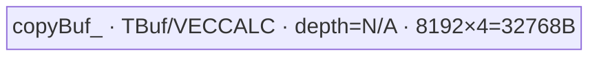
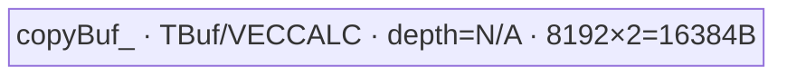

# KdaLayoutSwap12 A2/A3 ACLNN 算子知识

## 先看 rank，再看搬运路线

A2/A3 的状态布局转换先提供 x 的 rank、完整 shape、dtype，以及 y 的实际布局/容量和可选 dependency。rank3 交换0/1，rank≥4交换1/2；先按[接口与语义](#接口与语义)推导输出，再决定是否适合调用，不能统一套 `transpose(1,2)`。

要分析搬运成本，按[Route 选择](#route-选择)先由 dtype 选 key，再由 Device 分组谓词决定 GroupedRows/SingleRows；六个 Route 不是六个独立 TilingKey，也不是失败后再 launch 的 fallback。具体 D、对齐和 stride 条件继续看[Route 与参数设计](#route-与参数设计)。

y 没有输出连续化/重叠安全保证，dependency 不被 Device 读数值也不形成自有跨 stream 等待协议。原地、strided 输出或 producer 同步未闭合时，先按[限制与失败边界](#限制与失败边界)停止泛化，验证真实写回和哨兵区后再谈性能。

## 算子速览

| 项目 | 内容 |
|---|---|
| 实际入口 | 公开aclnnKdaLayoutSwap12GetWorkspaceSize → aclnnKdaLayoutSwap12；Torch kda_layout_swap12 |
| 计算语义 | 物理搬运实现轴交换；rank3为0/1交换，rank≥4为1/2交换；不做门控、缩放或累加 |
| 输入输出 | ND float32、float16、bfloat16；y与x同dtype，dependency可选且shape等于y |
| 执行类型 | 单个AIV_VECTOR节点N1，仅MTE2/UB/MTE3数据搬运；没有Vector数学、Cube、SIMT、NDDMA或通信节点 |
| Kernel 路线 | 三个dtype模板分别运行GroupedRows或SingleRows，展开R-001..R-006；这是3个静态模板与2个Device运行时分支，不是6个TilingKey |
| 核心资源 | 每AIV一个copyBuf_ TBuf，8192元素；float32768B，half/BF1616384B；无TQue和double buffer；Device不消费workspace |
| 来源闭包 | source_closed：公开API→Contiguous/l0op→Tiling/六字段→三模板与两种实际搬运循环→手动同步及选中构建；生成bridge、Device解析头和SDK intrinsic为明确框架边界 |
| 验证状态 | 已完成源码闭包检查；本次知识提取未执行编译、真机、数值或性能测试。 |

A2/A3范围由固定公开产品表、OpDef的ascend910b/ascend910_93、build_aclnn平台列表与Dockerfile/Dockerfile.a3共同支持。基础镜像CANN9.2.0_20261022115200另外安装ops-transformer9.3.0；cann_versions的9.2.0不证明weekly生成Device头、运行库和编译产物ABI身份。950也有独立OpDef与SOC构建接线，平台依据由独立950卡闭合；不从Torch注册推导310P、310B、910或麒麟可执行。

## 接口与语义

### 计算语义

KDA layout swap12只交换两条逻辑轴并将结果物化为连续输出，不是reshape元数据变化，也不改变尾部元素顺序。rank3输入[I,J,D]输出[J,I,D]，对应TND↔NTD；rank4输入[B,I,J,D]输出[B,J,I,D]，可用于BSND↔BNSD。rank≥5同样交换轴1/2，将第3维及以后全部折叠为D=product(x[3:])，输出保留这些tail维的原shape与顺序。rank3与rank≥4的交换轴不同，不能把transpose(1,2)照搬到rank3。

在合法连续存储、维度乘积不溢出且输出容量匹配的前提下，扁平地址单位为T元素：

```text
x_src(b,i,j,d) = ((b*I+i)*J+j)*D+d
y_dst(b,j,i,d) = ((b*J+j)*I+i)*D+d
0<=b<B, 0<=i<I, 0<=j<J, 0<=d<D
rank3: B=1,I=x[0],J=x[1],D=x[2]
rank>=4: B=x[0],I=x[1],J=x[2],D=product(x[3:])
```

dependencyOptional作为第二输入传入框架launcher，但Device把dependency参数显式(void)忽略；其数值不参与y的数学结果。它不是加数、gate、累加初值或跨核flag。可将其理解为提供框架输入依赖的接线位置，不能据此声称任意跨stream producer已经同步；本算子没有读取dependency内容或自定义等待协议。非连续dependency仍可能先由Contiguous物化，因此数值不参与不等于没有准备成本。

### 输入、输出与属性

| 参数 | shape/layout | dtype | 约束、默认值与语义 |
|---|---|---|---|
| x | ND，rank≥3；rank3[I,J,D]或rank≥4[B,I,J,...tail] | OpDef float32/float16/bfloat16 | 非空；公开API只检查rank和与y dtype一致，不逐一复写dtype枚举；Torch另检查三种dtype |
| yOut / y | rank3[J,I,D]；其余[B,J,I,...tail] | 与x相同 | 非空，同rank，按上述轴关系逐维校验；直接传给launcher，没有输出Contiguous/ViewCopy或别名安全检查 |
| dependencyOptional / dependency | 必须与yOut同shape；可为空 | OpDef配对列表限制 | C++/Torch只显式检查shape；缺少单独dtype检查不代表任意dtype支持；Torch schema默认None |
| workspaceSize/executor | 两阶段接口的输出参数 | uint64_t*/aclOpExecutor** | executor汇总准备操作与launch工作区；本算子不增加额外自有GM scratch |
| workspace/stream | 第二阶段框架对象 | void*/aclrtStream | CommonOpExecutorRun管理框架执行；不能把Device未用workspace推成公开size恒为0 |

OpDef的(x,dependency,y) dtype配对是(float,float,float)、(half,half,half)、(BF16,BF16,BF16)、(half,float,half)、(BF16,float,BF16)。后两项允许低精度x搭配float依赖，不是dependency参与float算术或输出升精度。dependency缺省时仍走同一核心数学算子。无axis属性、scale、chunk_size或分组开关；GroupedRows由Device根据D、J和dtype自行决定。

### 入口与版本

固定提交只有这一组公开ACLNN入口，没有可见V2/V3族选择。l0op::KdaLayoutSwap12还有无dependency的C++重载，它仅传nullptr委托，不是另一组公开API。Torch适配函数根据rank生成y_sizes并at::empty创建输出；两个注册位置暴露同一schema。kda_layout_swap12_meta对rank3交换SymDim0/1，否则交换1/2，忽略dependency并返回同options的empty_symint；它没有完整rank/dtype/依赖检查，Meta成功不能替代公开校验或Device执行。

固定vllm_ascend Python运行源码未检出kda_layout_swap12直接调用；Torch schema和源级e2e存在不证明具体模型已默认启用。模型KDA/RecoverSSM调度、packed sequence约定与本算子接口是独立职责。

## Host/Launcher 执行流程

### 参数校验与前处理

公开第一阶段先CREATE_EXECUTOR，失败返回ACLNN_ERR_INNER_CREATE_EXECUTOR。KdaLayoutSwapCheckParams依次核对x/y非空、x rank≥3、y同rank、rank3的0/1轴关系或其余的batch/1/2轴/tail关系、x/y同dtype，再在dependency存在时用KdaLayoutSwapSameShape检查其与y逐维相等。内层非空检查的NULLPTR等错误在公开第一阶段统一映射为ACLNN_ERR_PARAM_INVALID；不补造逐项不同的外层码。

随后对x、dependencyOptional依次调用KdaLayoutSwapDataContiguous；null optional直接成功，非空经l0op::Contiguous并检查返回。连续化失败也被该第一阶段映射为PARAM_INVALID。yOut没有连续化、ViewCopy或与x/dependency重叠检查；合法shape不证明任意strided输出或原地转置安全。

l0op注册KdaLayoutSwap12，并以OP_INPUT(x,dependency)、OP_OUTPUT(y)、空OP_ATTR()添加到ADD_TO_LAUNCHER_LIST_AICORE。失败记录日志并返回{nullptr}，公开接口映射ACLNN_ERR_INNER_NULLPTR；成功返回y，汇总workspaceSize并ReleaseTo(executor)。第二阶段直接返回CommonOpExecutorRun的状态。生成的inner bridge和executor内部、Contiguous与SDK运行库是框架边界；本仓自有校验、参数、Tiling与Device算法已继续下钻。

公开头中的aclnn_util.h是仓内include，不能伪装为SDK缺失：common/include/external与utils/inc两份候选头都仅定义ACLNN_API visibility宏；OPAPI_INCLUDE与全局utils/inc参与包含路径。本头的两条函数声明未使用ACLNN_API宏，两份头没有数学、Tiling或运行时分发；实际编译命令的包含优先级未在本次执行验证。

### 参数、Workspace 与生命周期

Host Tiling读取输入和输出StorageShape，x rank<3或xDesc为空返回GRAPH_FAILED；GetOptionalInputShape与GetOutputShape在这些检查前已被解引用，并没有为任意直接Tiling调用补齐null保护。公开合法rank3输出触发B1归一化，否则按rank≥4的B/I/J/tail公式生产六字段。ViewShape的公开关系与StorageShape地址推导应同时保留，不把未连续化的输出外推为任意stride支持。

Host请求一个workspace槽，workspace[0]=PlatformAscendC::GetLibApiWorkSpaceSize；Device显式忽略workspace，没有额外workspace切片、动态GM分配或跨Kernel中间张量。公开executor工作区还可能包含x/依赖的Contiguous准备，不能宣称它恒为0或只等于lib槽值。

x/y与存在的dependency由caller提供，Torch单独创建y；caller和框架按executor、stream消费生命周期保持这些对象与准备结果有效。TPipe在当前entry栈上，copyBuf_按每个AIV实例初始化，直到该Kernel结束；event1在每次CopyOut后回收本地buffer。没有自有跨stream owner转移、异步释放或dependency GM轮询协议。

### 启动图与失败传播

```text
公开GetWorkspaceSize
 -> CheckParams -> Contiguous(x) -> Contiguous(optional dependency)
 -> l0op::KdaLayoutSwap12 / ADD_TO_LAUNCHER_LIST_AICORE
 -> Tiling4KdaLayoutSwap12: shape/rowCount/key/blockDim/48B静态wire/lib workspace
 -> N1 kda_layout_swap12(x,dependency,y,workspace,tiling)
    GET_TILING_DATA -> TPipe -> KdaLayoutSwap12Kernel<T>::Init/Process
    CanUseGroupedCopy ? ProcessGroupedRows : ProcessSingleRows
公开aclnnKdaLayoutSwap12 -> CommonOpExecutorRun(stream)
```

| 节点/边 | producer→consumer | offset/extent与dtype/layout | ordering与owner/lifetime | 失败边界 |
|---|---|---|---|---|
| N1 | l0op launcher→kda_layout_swap12 | x/y为同dtype扁平ND，六字段POD，blockDim按行数；dependency/Device workspace不消费 | 框架executor/stream；N1内部MTE事件串联输入输出与UB回收 | Check/Contiguous/launcher错误先返回，不伪造继续执行成功 |
| 准备→N1 | Contiguous结果→x及optional dependency参数 | x同逻辑shape；依赖数值不进入Device算法 | 由框架准备/调度维持，书写先后不是自有跨stream协议 | 生成bridge及框架内部为边界 |
| N1→y | GM x→UB copyBuf_→GM y | 同元素dtype；地址实现轴交换，无跨核心workspace边 | caller拥有y，MTE2_MTE3与MTE3_MTE2保护同核buffer | 未验证指针/输出stride/重叠或非法维安全性 |

## Route 与参数设计

### 分核与资源计算

Host顺序为shape→B/I/J/D→AIV核数→rowCount=B*I*J→blockDim=uint32(min<int64_t>(rowCount,coreNum))，blockDim为0时置1，usedCoreNum保存同一个值。没有按UB容量或Grouped实际任务数重选Host grid，也没有完整负维、乘法溢出、uint32窄化保护；下列推导只在合法非负形状和可表示乘积范围内成立。

定义E=sizeof(T)、U=8192、rowBytes=D*E、L=rowBytes/32。Device的Grouped条件G为rowBytes≥32、rowBytes%32==0、L>0、L≤65535、(J>0?(J-1)*L:0)≤65535且D≤8192。只有G成立才调用GroupRows，R=min(64,max(1,8192/D))；合法G已保证D>0。Grouped的tileCount=ceil(I/R)、taskCount=B*J*tileCount，按task=GetBlockIdx();task<taskCount;task+=usedCoreNum分配。每task固定b/j，连续处理firstStart..firstStart+rows的I方向行。

G不成立走SingleRows：rowCount=B*I*J，按row=coreIdx;row<rowCount;row+=usedCoreNum；解码b/i/j后，off从0到D每次加8192，elems=min(D-off,8192)。这个fallback可以处理不对齐、stride超界或D>8192的合法行；它不是任意非法shape/dtype/指针的容错承诺。

例如合法shape[1,64,2,128]时R=64、Grouped任务只有2个，而Host仍按128行选择blockDim。多余核可能没有task，不能把较少DMA请求等同于更高全机并行度或实测加速。float的L=16、half/BF16的L=8；相同D下J上限可能不同。显式UB每AIV固定8192*E，而不是本次rows*D*E；Host没有查询UB容量或使用UB阈值选择器。

### Route 选择

| 顺序 | Route | Key/模板 | 精确选择条件与优先级 | 不适用去向 |
|---:|---|---|---|---|
| 1 | R-001 float GroupedRows | key0 / KdaLayoutSwap12Kernel<float> | OpDef合法float；Host key0；Device G=true | 同模板G=false进入R-002 |
| 2 | R-002 float SingleRows | key0 / KdaLayoutSwap12Kernel<float> | key0且G=false | 当前dtype不匹配由Host选择key1/2；不是R-001失败后再次launch |
| 3 | R-003 BF16 GroupedRows | key1 / KdaLayoutSwap12Kernel<bfloat16_t> | 合法BF16；Host key1；G=true | G=false进入R-004 |
| 4 | R-004 BF16 SingleRows | key1 / KdaLayoutSwap12Kernel<bfloat16_t> | key1且G=false | 其它dtype由Host路由 |
| 5 | R-005 half GroupedRows | key2 / KdaLayoutSwap12Kernel<half> | 合法float16；Host else key2；G=true | G=false进入R-006 |
| 6 | R-006 half SingleRows | key2 / KdaLayoutSwap12Kernel<half> | key2且G=false | 未知Device key没有匹配分支，不是自动half fallback |

```text
公开API/OpDef有效域
  Host dtype==FLOAT -> SetTilingKey(0), wire dataType=2
  else dtype==BF16 -> SetTilingKey(1), wire dataType=1
  else -> SetTilingKey(2), wire dataType=0   # 公开域只有FLOAT16；非任意dtype支持
  entry key0/1/2 -> float/bfloat16_t/half -> Init -> Process
    G=true -> GroupRows/ProcessGroupedRows/CopySwappedRows
    G=false -> ProcessSingleRows/CopySwappedRow/CopyTile
  unknown key -> 无匹配body；没有报错分支或自动补写输出
```

### 模板/实现执行矩阵

| Route | key/selector | dtype/shape/platform 完整命中条件 | 执行拓扑与 Kernel 节点 | 实际模板/body | 内存与同步特征 | tail/fallback |
|---|---|---|---|---|---|---|
| R-001 | key0,G | A2/A3；float、rank≥3公开合同；G | 单AIV N1 | KdaLayoutSwap12Kernel<float>/ProcessGroupedRows | 32768B一个TBuf，MTE2_MTE3 event0、MTE3_MTE2 event1 | 最后I组rows=min(R,I-firstStart)；G否走R-002 |
| R-002 | key0,!G | float、同公开合同；非G | 单AIV N1 | 同float模板/ProcessSingleRows | 32768B固定；逐8192元素tile复用 | 不对齐tile用Pad字节数；无数据类型转换 |
| R-003 | key1,G | BF16、公开合同；G | 单AIV N1 | KdaLayoutSwap12Kernel<bfloat16_t>/Grouped | 16384B，两个MTE事件，无Vector算术 | 组尾缩行，无额外GM中间片 |
| R-004 | key1,!G | BF16、公开合同；非G | 单AIV N1 | 同BF16模板/Single | 16384B；每tile输入输出串行 | D8193时末1元素2B Pad |
| R-005 | key2,G | half、公开合同；G | 单AIV N1 | KdaLayoutSwap12Kernel<half>/Grouped | 16384B；32B块stride与紧凑UB | 不能从Host else推导其它dtype支持 |
| R-006 | key2,!G | half、公开合同；非G | 单AIV N1 | 同half模板/Single | 16384B；逐tile回收 | 不对齐、D大或stride大触发；非法域未保护 |

### 隐藏性能 Guard

| Guard | Host/Tiling 条件 | Device/资源原因 | 影响 Route | 不满足时去向 | 源码符号 |
|---|---|---|---|---|---|
| 分组行对齐 | Host不分组，Device rowBytes≥32且mod32==0 | 分组DataCopyParams用32B块长度与stride | R-001/003/005 | 相同dtype SingleRows | CanUseGroupedCopy |
| 分组参数范围 | L>0、L≤65535、srcStride≤65535 | 转uint16的blockLen/stride需保留范围 | 同Grouped路线 | SingleRows；不是拒绝整个合法tensor | CanUseGroupedCopy/CopySwappedRows |
| 整行与分组UB容量 | D≤8192，R=min(64,max(1,8192/D)) | rows*D≤8192且blockCount≤64；不随有效tail减少分配 | 全路线资源，Grouped选择 | D>8192改逐tile；Host未查询平台UB | GroupRows/Init |
| SingleRows每tile对齐 | elems*E≥32且mod32==0 | aligned DataCopy count为元素，Pad blockLen为字节 | R-002/004/006 | DataCopyPad输入和输出分别处理同一有效字节数 | CopyTile |
| Host grid与实际任务 | blockDim来自B*I*J而非Grouped taskCount | Grouped可能大幅减少任务，造成空闲核 | 全部 | 没有额外重分核fallback | Tiling4KdaLayoutSwap12/ProcessGroupedRows |
| 空域及数值窄化 | 无完整正维/溢出guard；零block转1 | B/I/J为0时task循环空；D0不能分组，Single内tile循环空 | 全部 | 不扩为任意负维/overflow保护 | Tiling/Process/CopySwappedRow |

### POD/ABI

KdaLayoutSwap12TilingData由Host宏字段保存并在Device GET_TILING_DATA解析。固定metadef v9.2.0的FieldHandler字段大小对齐和尾部8B对齐支持下列静态wire推导：六个int64，offset0/8/16/24/32/40，extent48B、线对齐8。它不是带宏Host对象的C++ sizeof/offsetof实测；生成Device头和weekly SDK制品身份未在固定源码集合证明，不能用静态wire代替二进制ABI验证。

| 结构 | 字段 | 类型/位宽 | ABI 布局 | 单位 | Host/launcher producer | Device consumer | 边界 |
|---|---|---|---|---|---|---|---|
| KdaLayoutSwap12TilingData | batch | int64_t/64 | wire0..7，align8 | batch数 | rank≥4 x[0]；合法rank3改1 | Init转uint64→batch_；taskCount与地址 | 负值/乘积overflow未完整保护 |
| 同结构 | firstDim | int64_t/64 | wire8..15 | I行数 | 默认x[1]；rank3改x[0] | firstDim_；rowCount、tileCount与src/dst | rank3分支基于输出shape匹配 |
| 同结构 | secondDim | int64_t/64 | wire16..23 | J列数 | 默认x[2]；rank3改x[1] | secondDim_；任务解码、srcStride、地址 | J0无task时不执行除法；非完整非法域证明 |
| 同结构 | tailDim | int64_t/64 | wire24..31 | 每行连续T元素数D | 默认product(x[3:])；rank3改x[2] | tailDim_；G、R、tileloop、地址 | 无完整正维/乘积上限检查 |
| 同结构 | dataType | int64_t/64 | wire32..39 | DTypeCode编码 | BF16→1、float→2、else→0 | Device不读取该字段 | 与实际TilingKey float0/BF161/half2不是同一映射 |
| 同结构 | usedCoreNum | int64_t/64 | wire40..47；总48B | core循环stride | blockDim==0?1:blockDim | Init转uint64；task/row循环增量 | 不等于Grouped taskCount，须非零 |

### Route 源码闭包

| Route | Key/selector | Host/Tiling producer | POD/参数 | Kernel entry/router 节点 | Kernel body/直接依赖 | 构建接线 |
|---|---|---|---|---|---|---|
| R-001 | key0,G=true | op_host/kda_layout_swap12_tiling.cpp::Tiling4KdaLayoutSwap12 | 六字段48B wire、同blockDim/lib槽 | entry→KdaLayoutSwap12Kernel<float>::Init/Process | CanUseGroupedCopy→GroupRows/ProcessGroupedRows/CopySwappedRows；外部kernel_operator.h为SDK边界 | OpDef A2/A3、op_host CMake auto-sync off、SOC列表与实际op target |
| R-002 | key0,G=false | op_host/kda_layout_swap12_tiling.cpp::Tiling4KdaLayoutSwap12 | 六字段48B wire、同blockDim/lib槽 | entry→KdaLayoutSwap12Kernel<float>::Init/Process | CanUseGroupedCopy→ProcessSingleRows/CopySwappedRow/CopyTile；外部kernel_operator.h为SDK边界 | OpDef A2/A3、op_host CMake auto-sync off、SOC列表与实际op target |
| R-003 | key1,G=true | op_host/kda_layout_swap12_tiling.cpp::Tiling4KdaLayoutSwap12 | 六字段48B wire、同blockDim/lib槽 | entry→KdaLayoutSwap12Kernel<bfloat16_t>::Init/Process | CanUseGroupedCopy→GroupRows/ProcessGroupedRows/CopySwappedRows；外部kernel_operator.h为SDK边界 | OpDef A2/A3、op_host CMake auto-sync off、SOC列表与实际op target |
| R-004 | key1,G=false | op_host/kda_layout_swap12_tiling.cpp::Tiling4KdaLayoutSwap12 | 六字段48B wire、同blockDim/lib槽 | entry→KdaLayoutSwap12Kernel<bfloat16_t>::Init/Process | CanUseGroupedCopy→ProcessSingleRows/CopySwappedRow/CopyTile；外部kernel_operator.h为SDK边界 | OpDef A2/A3、op_host CMake auto-sync off、SOC列表与实际op target |
| R-005 | key2,G=true | op_host/kda_layout_swap12_tiling.cpp::Tiling4KdaLayoutSwap12 | 六字段48B wire、同blockDim/lib槽 | entry→KdaLayoutSwap12Kernel<half>::Init/Process | CanUseGroupedCopy→GroupRows/ProcessGroupedRows/CopySwappedRows；外部kernel_operator.h为SDK边界 | OpDef A2/A3、op_host CMake auto-sync off、SOC列表与实际op target |
| R-006 | key2,G=false | op_host/kda_layout_swap12_tiling.cpp::Tiling4KdaLayoutSwap12 | 六字段48B wire、同blockDim/lib槽 | entry→KdaLayoutSwap12Kernel<half>::Init/Process | CanUseGroupedCopy→ProcessSingleRows/CopySwappedRow/CopyTile；外部kernel_operator.h为SDK边界 | OpDef A2/A3、op_host CMake auto-sync off、SOC列表与实际op target |

## Kernel 实现

### 公共执行流程

活动op_kernel/kda_layout_swap12.cpp自包含模板类与entry，只include外部kernel_operator.h，没有隐藏同名大头body或父类算法。entry参数顺序为x、dependency、y、workspace、tiling；忽略dependency/workspace，解析POD、构造TPipe，再按TILING_KEY_IS(0/1/2)建立float/BF16/half实例，均声明KERNEL_TYPE_AIV_ONLY。OpDef中的AiCore不是Cube证据。

Init将x/y绑定为GlobalTensor<T>，将B/I/J/D/usedCore从int64转uint64，InitBuffer(copyBuf_,8192*sizeof(T))。Process先做运行时G判断，true执行Grouped并return，false执行Single；两个分支不是两次kernel launch。每core只持有自己的一个TBuf，Get<T>()从本地offset0复用，不共享跨核UB。

无Vector数学、mask/repeat算术、Cast、累加、atomic或TQue；对应资源为N/A。实际网络是MTE2把GM拷到copyBuf_，event0使MTE3可消费，MTE3写y，event1使MTE2可覆盖。没有PIPE_V或可推导的double buffer/计算通信交叠；CMake显式--cce-auto-sync=off，因此不可删除已有手动SetFlag/WaitFlag并假设编译器会补回。

### Route R-001：float32 分组行搬运

#### 适用条件

##### 选择证据

| 层级 | 文件 | 符号 | 源码谓词/参数 | 结果/下一跳 |
|---|---|---|---|---|
| 公开API | op_host/op_api/aclnn_kda_layout_swap12.cpp | KdaLayoutSwapCheckParams | rank≥3、y轴交换shape、x/y同dtype、optional dependency同y shape | 前处理及l0op；OpDef有效dtype域同时保留 |
| Host | op_host/kda_layout_swap12_tiling.cpp | Tiling4KdaLayoutSwap12 | dtype==DT_FLOAT | SetTilingKey(0)，DTypeCode字段2 |
| entry | op_kernel/kda_layout_swap12.cpp | kda_layout_swap12 | TILING_KEY_IS(0) | KdaLayoutSwap12Kernel<float> / AIV_ONLY |
| Body | 同一自包含CPP | CanUseGroupedCopy/Process | G=true，E=4B；完整G见选择表 | ProcessGroupedRows；G否进R-002 |

本路线平台为A2/A3，输入和输出均为float32，只搬运有效元素。G要求D*4≥32且mod32==0，D≤8192，32B块数L及输入stride均在uint16上限；不是只看D对齐。

#### Device 数据流

##### 函数级调用链

```text
l0op launcher / Tiling4KdaLayoutSwap12(key0,blockDim,48B wire)
 -> N1 kda_layout_swap12 -> KdaLayoutSwap12Kernel<float>::Init/Process
 -> CanUseGroupedCopy -> ProcessGroupedRows
 -> GroupRows -> task解码 -> CopySwappedRows
 -> GM x / MTE2 -> copyBuf_ -> event0 MTE2_MTE3 -> MTE3 / GM y
 -> event1 MTE3_MTE2 -> 下一组task或结束
```

##### 源码等价伪码

```text
# 伪码；offset/count依各API保持元素或32B/字节单位
E=4; U=8192; usedCore=POD.usedCoreNum; core=GetBlockIdx()
rowBytes=D*E; L=rowBytes/32
R=min(64,max(1,U/D)); tiles=ceil(I/R); tasks=B*J*tiles
for task=core; task<tasks; task+=usedCore:
  tileIdx=task%tiles; rem=task/tiles; j=rem%J; b=rem/J
  firstStart=tileIdx*R; rows=min(I-firstStart,R)
  src=((b*I+firstStart)*J+j)*D; dst=((b*J+j)*I+firstStart)*D
  local=copyBuf_.Get<T>()  # offset0，容量U元素
  DataCopy(local,x[src],blockCount=rows,blockLen=L,srcStride=(J-1)*L,dstStride=0)
  SetFlag/WaitFlag<MTE2_MTE3>(0)
  DataCopy(y[dst],local,rows*D元素)
  SetFlag/WaitFlag<MTE3_MTE2>(1)
```

Grouped沿I方向收集同一个b/j的rows行；srcStride跳过每行其余J-1段，UB dstStride=0紧凑排列，输出对同一个b/j的I连续rows*D元素。分组发生在DMA搬运网络，不是Vector Transpose，也不需要转置GM scratch。

#### 内存与数据搬运

##### 资源与搬运表

| 层级/缓冲区 | offset/地址公式 | extent/容量公式 | dtype/layout | producer | consumer | owner/lifetime | 对齐/复用 |
|---|---|---|---|---|---|---|---|
| GM x | ((b*I+firstStart)*J+j)*D | rows条离散行，每行D元素 | float32扁平ND | caller/框架连续化 | MTE2 CopyIn | caller/executor到stream消费完成 | rowBytes为32B整数倍；GM相邻被选行相隔J*D |
| UB copyBuf_ | LocalTensor<T> offset0；不是GM offset | 8192×4=32768B固定；本次有效rows*D≤8192 | float；紧凑线性 | MTE2 | MTE3 | 当前AIV/TPipe；整个N1 | TBuf无depth参数；event1后可重写；没有输入/输出双份分配 |
| GM y | ((b*J+j)*I+firstStart)*D | rows*D个连续元素 | 同float32；轴交换后连续 | MTE3 CopyOut | 后续框架/模型消费者 | caller拥有，按stream维持有效 | count为rows*D元素，不是字节或block数 |
| dependency | 参数存在但Device不解引用 | 无Device内容读取或额外本地buffer | OpDef配对dtype/同输出shape | caller/可选Contiguous | 框架输入边 | caller/executor维持 | 不等于本算子提供跨stream等待 |
| workspace | Host一个lib槽；Device(void) | 无自有scratch切片 | 框架字节区 | executor/caller | 框架运行库 | 框架生命周期 | 公开size可能含准备工作，不能推成0 |

##### 分层内存布局



图仅表示源码显式分配的单个本地资源，不是平台物理UB地址图；本地offset0是Get<T>()的逻辑起点，不给TPipe内部安置补造绝对offset。本组有效rows*D最多8192，但尾组不会缩小InitBuffer容量。寄存器仅有标量索引和对象描述，实际编译器寄存器字节数不可从这些声明实测。

##### 字节账与复用顺序

```text
UB_explicit = copyBuf_ = 8192 * sizeof(float) = 32768B / AIV
TQue / double buffer / Vector scratch / dynamic UB = N/A
rows=min(I-firstStart,R); R=min(64,max(1,8192/D)); rows*D<=8192
Host未调用UB容量查询或用UB_total<=available_ub选择路线；这里不是实测总占用/平台容量保证
Device workspace slices = 0；public executor size还可能包括lib和前处理
```

| 复用子区 | 写入者 | 读取者/消费点 | 下一次覆盖 | 同步或释放依据 | 安全条件 |
|---|---|---|---|---|---|
| copyBuf_[0:rows*D] | CopySwappedRows的strided MTE2 | 同一方法中的MTE3写出 | 下一task输入从offset0写入 | event0先连接输入到输出；event1在输出后连接到输入复用 | 最后一次输出也执行Set/Wait event1；不得靠异步DMA函数返回推断完成 |

#### 同步、精度与尾块

##### 同步与数值边界表

| 阶段 | primitive/机制 | producer | consumer/等待点 | 保护对象 | 精度/尾块 |
|---|---|---|---|---|---|
| CopyIn→CopyOut | SetFlag/WaitFlag<HardEvent::MTE2_MTE3>(SWAP12_MTE2_MTE3_EVENT_ID=0) | MTE2写copyBuf_ | MTE3读同一UB | 本组rows*D数据可见 | 同dtype搬运，没有cast、round、accumulate或scale |
| CopyOut→复用 | SetFlag/WaitFlag<HardEvent::MTE3_MTE2>(SWAP12_MTE3_MTE2_EVENT_ID=1) | MTE3消费UB并写GM | 下一MTE2写同buffer | 防止提前覆盖 | 最末迭代同样等待；不补造双缓冲重叠 |
| 有效尾部 | rows=min(I-firstStart,R)，组尾降低blockCount | 任务/row循环 | 当前输入/输出DMA | I方向最后一组 | 不复制额外无效行；合法G下每行已对齐 |
| 空域/非法域 | 循环范围与公开校验 | Host和Device控制流 | task/row/tile入口 | 零任务不进入解码；D0不执行CopyTile | 负维、溢出、坏指针、未知key没有完整保护，不从零域推导一般安全 |
| 跨核/外部依赖 | 无自有barrier、atomic或dependency读取 | 各core的离散task域 | 不同y有效行/组 | 合法非重叠输出的地址所有权 | 不证明x/y原地重叠安全，也不提供跨stream事件 |

源码只有数据拷贝，数值dtype保持float32；零容差源级测试断言不等于本次运行通过，更不证明所有NaN、Inf、signed-zero模式或所有硬件的bitwise结果。测试仅覆盖rank4示例，Grouped路径的源级形状例子不是所有G边界验收。

#### 关键实现

##### 符号证据表

| 阶段 | 文件 | 符号/模板实例 | 实现事实 |
|---|---|---|---|
| Host/Tiling producer | op_host/kda_layout_swap12_tiling.cpp | Tiling4KdaLayoutSwap12 / DTypeCode | B/I/J/D归一化、rowCount grid、六字段、key0；dataType编码与key分离 |
| Kernel entry/router | op_kernel/kda_layout_swap12.cpp | kda_layout_swap12 / KdaLayoutSwap12Kernel<float> | TILING_KEY_IS(0)→AIV_ONLY→Init/Process→G=true |
| Device body/helper | 同一自包含CPP | GroupRows/ProcessGroupedRows/CopySwappedRows | b/j/tile分配、32B stride gather、连续写rows*D、event0/1 |

### Route R-002：float32 单行分块搬运

#### 适用条件

##### 选择证据

| 层级 | 文件 | 符号 | 源码谓词/参数 | 结果/下一跳 |
|---|---|---|---|---|
| 公开API | op_host/op_api/aclnn_kda_layout_swap12.cpp | KdaLayoutSwapCheckParams | rank≥3、y轴交换shape、x/y同dtype、optional dependency同y shape | 前处理及l0op；OpDef有效dtype域同时保留 |
| Host | op_host/kda_layout_swap12_tiling.cpp | Tiling4KdaLayoutSwap12 | dtype==DT_FLOAT | SetTilingKey(0)，DTypeCode字段2 |
| entry | op_kernel/kda_layout_swap12.cpp | kda_layout_swap12 | TILING_KEY_IS(0) | KdaLayoutSwap12Kernel<float> / AIV_ONLY |
| Body | 同一自包含CPP | CanUseGroupedCopy/Process | G=false，E=4B；完整G见选择表 | ProcessSingleRows；G真进R-001 |

本路线平台为A2/A3，输入和输出均为float32，只搬运有效元素。本路线是完整G的否定，不是简单的D不对齐：D过大或输入stride超界也会进入；单行内部仍逐tile判断aligned或Pad。

#### Device 数据流

##### 函数级调用链

```text
l0op launcher / Tiling4KdaLayoutSwap12(key0,blockDim,48B wire)
 -> N1 kda_layout_swap12 -> KdaLayoutSwap12Kernel<float>::Init/Process
 -> CanUseGroupedCopy -> ProcessSingleRows
 -> row解码 -> CopySwappedRow -> off循环 -> CopyTile
 -> GM x / MTE2 -> copyBuf_ -> event0 MTE2_MTE3 -> MTE3 / GM y
 -> event1 MTE3_MTE2 -> 下一tile或row或结束
```

##### 源码等价伪码

```text
# 伪码；offset/count依各API保持元素或32B/字节单位
E=4; U=8192; usedCore=POD.usedCoreNum; core=GetBlockIdx()
rows=B*I*J
for row=core; row<rows; row+=usedCore:
  perBatch=I*J; b=row/perBatch; rem=row-b*perBatch; i=rem/J; j=rem-i*J
  src=((b*I+i)*J+j)*D; dst=((b*J+j)*I+i)*D
  for off=0; off<D; off+=U:
    elems=min(D-off,U); rowBytes=elems*E; local=copyBuf_.Get<T>()
    if rowBytes>=32 and rowBytes%32==0: DataCopy(local,x[src+off],elems元素)
    else: DataCopyPad(local,x[src+off],blockCount=1,blockLen=rowBytes字节,strides=0,pad={false,0,0,0})
    SetFlag/WaitFlag<MTE2_MTE3>(0)
    if rowBytes>=32 and rowBytes%32==0: DataCopy(y[dst+off],local,elems元素)
    else: DataCopyPad(y[dst+off],local,blockCount=1,blockLen=rowBytes字节,strides=0)
    SetFlag/WaitFlag<MTE3_MTE2>(1)
```

Single保持每行D连续元素顺序，只用GM源/目的base改变行位置。一次完整8192元素tile占满本地buffer；最后tile只提交elems有效元素。Group失败不代表aligned DataCopy不可用：回退的大行前部仍可走对齐DMA，仅残尾需要Pad。

#### 内存与数据搬运

##### 资源与搬运表

| 层级/缓冲区 | offset/地址公式 | extent/容量公式 | dtype/layout | producer | consumer | owner/lifetime | 对齐/复用 |
|---|---|---|---|---|---|---|---|
| GM x | ((b*I+i)*J+j)*D+off | elems=min(D-off,8192)元素 | float32扁平ND | caller/框架连续化 | MTE2 CopyIn | caller/executor到stream消费完成 | 每tile判断rowBytes，Pad有效字节不换单位 |
| UB copyBuf_ | LocalTensor<T> offset0；不是GM offset | 8192×4=32768B固定；本次有效elems≤8192 | float；紧凑线性 | MTE2 | MTE3 | 当前AIV/TPipe；整个N1 | TBuf无depth参数；event1后可重写；没有输入/输出双份分配 |
| GM y | ((b*J+j)*I+i)*D+off | elems有效元素 | 同float32；轴交换后连续 | MTE3 CopyOut | 后续框架/模型消费者 | caller拥有，按stream维持有效 | aligned count为elems；Pad blockLen为elems*E字节 |
| dependency | 参数存在但Device不解引用 | 无Device内容读取或额外本地buffer | OpDef配对dtype/同输出shape | caller/可选Contiguous | 框架输入边 | caller/executor维持 | 不等于本算子提供跨stream等待 |
| workspace | Host一个lib槽；Device(void) | 无自有scratch切片 | 框架字节区 | executor/caller | 框架运行库 | 框架生命周期 | 公开size可能含准备工作，不能推成0 |

##### 分层内存布局


图仅表示源码显式分配的单个本地资源，不是平台物理UB地址图；本地offset0是Get<T>()的逻辑起点，不给TPipe内部安置补造绝对offset。最后tile的有效elems更少，InitBuffer仍为完整8192元素。寄存器仅有标量索引和对象描述，实际编译器寄存器字节数不可从这些声明实测。

##### 字节账与复用顺序

```text
UB_explicit = copyBuf_ = 8192 * sizeof(float) = 32768B / AIV
TQue / double buffer / Vector scratch / dynamic UB = N/A
elems=min(D-off,8192)<=8192; CopyTile只消费本tile有效区域
Host未调用UB容量查询或用UB_total<=available_ub选择路线；这里不是实测总占用/平台容量保证
Device workspace slices = 0；public executor size还可能包括lib和前处理
```

| 复用子区 | 写入者 | 读取者/消费点 | 下一次覆盖 | 同步或释放依据 | 安全条件 |
|---|---|---|---|---|---|
| copyBuf_[0:elems] | CopyTile的DataCopy或DataCopyPad MTE2 | 同一方法中的MTE3写出 | 下一tile或row输入从offset0写入 | event0先连接输入到输出；event1在输出后连接到输入复用 | 最后一次输出也执行Set/Wait event1；不得靠异步DMA函数返回推断完成 |

#### 同步、精度与尾块

##### 同步与数值边界表

| 阶段 | primitive/机制 | producer | consumer/等待点 | 保护对象 | 精度/尾块 |
|---|---|---|---|---|---|
| CopyIn→CopyOut | SetFlag/WaitFlag<HardEvent::MTE2_MTE3>(SWAP12_MTE2_MTE3_EVENT_ID=0) | MTE2写copyBuf_ | MTE3读同一UB | 本tile elems数据可见 | 同dtype搬运，没有cast、round、accumulate或scale |
| CopyOut→复用 | SetFlag/WaitFlag<HardEvent::MTE3_MTE2>(SWAP12_MTE3_MTE2_EVENT_ID=1) | MTE3消费UB并写GM | 下一MTE2写同buffer | 防止提前覆盖 | 最末迭代同样等待；不补造双缓冲重叠 |
| 有效尾部 | elems=min(D-off,8192)，对齐DMA或Pad只提交有效长度 | 任务/row循环 | 当前输入/输出DMA | D方向最后tile | 输入和输出有效字节相同，padParams false/0不构成数值填零算法 |
| 空域/非法域 | 循环范围与公开校验 | Host和Device控制流 | task/row/tile入口 | 零任务不进入解码；D0不执行CopyTile | 负维、溢出、坏指针、未知key没有完整保护，不从零域推导一般安全 |
| 跨核/外部依赖 | 无自有barrier、atomic或dependency读取 | 各core的离散task域 | 不同y有效行/组 | 合法非重叠输出的地址所有权 | 不证明x/y原地重叠安全，也不提供跨stream事件 |

源码只有数据拷贝，数值dtype保持float32；零容差源级测试断言不等于本次运行通过，更不证明所有NaN、Inf、signed-zero模式或所有硬件的bitwise结果。测试仅覆盖rank4示例，Single的unaligned、stride超界、D>8192与最后Pad未获得该e2e覆盖。

#### 关键实现

##### 符号证据表

| 阶段 | 文件 | 符号/模板实例 | 实现事实 |
|---|---|---|---|
| Host/Tiling producer | op_host/kda_layout_swap12_tiling.cpp | Tiling4KdaLayoutSwap12 / DTypeCode | B/I/J/D归一化、rowCount grid、六字段、key0；dataType编码与key分离 |
| Kernel entry/router | op_kernel/kda_layout_swap12.cpp | kda_layout_swap12 / KdaLayoutSwap12Kernel<float> | TILING_KEY_IS(0)→AIV_ONLY→Init/Process→G=false |
| Device body/helper | 同一自包含CPP | ProcessSingleRows/CopySwappedRow/CopyTile | 逐row/8192元素tile、元素与Pad字节单位、event0/1和有效尾块 |

### Route R-003：BF16 分组行搬运

#### 适用条件

##### 选择证据

| 层级 | 文件 | 符号 | 源码谓词/参数 | 结果/下一跳 |
|---|---|---|---|---|
| 公开API | op_host/op_api/aclnn_kda_layout_swap12.cpp | KdaLayoutSwapCheckParams | rank≥3、y轴交换shape、x/y同dtype、optional dependency同y shape | 前处理及l0op；OpDef有效dtype域同时保留 |
| Host | op_host/kda_layout_swap12_tiling.cpp | Tiling4KdaLayoutSwap12 | dtype==DT_BF16 | SetTilingKey(1)，DTypeCode字段1 |
| entry | op_kernel/kda_layout_swap12.cpp | kda_layout_swap12 | TILING_KEY_IS(1) | KdaLayoutSwap12Kernel<bfloat16_t> / AIV_ONLY |
| Body | 同一自包含CPP | CanUseGroupedCopy/Process | G=true，E=2B；完整G见选择表 | ProcessGroupedRows；G否进R-004 |

本路线平台为A2/A3，输入和输出均为BF16，只搬运有效元素。G要求D*2≥32且mod32==0，D≤8192，32B块数L及输入stride均在uint16上限；不是只看D对齐。

#### Device 数据流

##### 函数级调用链

```text
l0op launcher / Tiling4KdaLayoutSwap12(key1,blockDim,48B wire)
 -> N1 kda_layout_swap12 -> KdaLayoutSwap12Kernel<bfloat16_t>::Init/Process
 -> CanUseGroupedCopy -> ProcessGroupedRows
 -> GroupRows -> task解码 -> CopySwappedRows
 -> GM x / MTE2 -> copyBuf_ -> event0 MTE2_MTE3 -> MTE3 / GM y
 -> event1 MTE3_MTE2 -> 下一组task或结束
```

##### 源码等价伪码

```text
# 伪码；offset/count依各API保持元素或32B/字节单位
E=2; U=8192; usedCore=POD.usedCoreNum; core=GetBlockIdx()
rowBytes=D*E; L=rowBytes/32
R=min(64,max(1,U/D)); tiles=ceil(I/R); tasks=B*J*tiles
for task=core; task<tasks; task+=usedCore:
  tileIdx=task%tiles; rem=task/tiles; j=rem%J; b=rem/J
  firstStart=tileIdx*R; rows=min(I-firstStart,R)
  src=((b*I+firstStart)*J+j)*D; dst=((b*J+j)*I+firstStart)*D
  local=copyBuf_.Get<T>()  # offset0，容量U元素
  DataCopy(local,x[src],blockCount=rows,blockLen=L,srcStride=(J-1)*L,dstStride=0)
  SetFlag/WaitFlag<MTE2_MTE3>(0)
  DataCopy(y[dst],local,rows*D元素)
  SetFlag/WaitFlag<MTE3_MTE2>(1)
```

Grouped沿I方向收集同一个b/j的rows行；srcStride跳过每行其余J-1段，UB dstStride=0紧凑排列，输出对同一个b/j的I连续rows*D元素。分组发生在DMA搬运网络，不是Vector Transpose，也不需要转置GM scratch。

#### 内存与数据搬运

##### 资源与搬运表

| 层级/缓冲区 | offset/地址公式 | extent/容量公式 | dtype/layout | producer | consumer | owner/lifetime | 对齐/复用 |
|---|---|---|---|---|---|---|---|
| GM x | ((b*I+firstStart)*J+j)*D | rows条离散行，每行D元素 | BF16扁平ND | caller/框架连续化 | MTE2 CopyIn | caller/executor到stream消费完成 | rowBytes为32B整数倍；GM相邻被选行相隔J*D |
| UB copyBuf_ | LocalTensor<T> offset0；不是GM offset | 8192×2=16384B固定；本次有效rows*D≤8192 | bfloat16_t；紧凑线性 | MTE2 | MTE3 | 当前AIV/TPipe；整个N1 | TBuf无depth参数；event1后可重写；没有输入/输出双份分配 |
| GM y | ((b*J+j)*I+firstStart)*D | rows*D个连续元素 | 同BF16；轴交换后连续 | MTE3 CopyOut | 后续框架/模型消费者 | caller拥有，按stream维持有效 | count为rows*D元素，不是字节或block数 |
| dependency | 参数存在但Device不解引用 | 无Device内容读取或额外本地buffer | OpDef配对dtype/同输出shape | caller/可选Contiguous | 框架输入边 | caller/executor维持 | 不等于本算子提供跨stream等待 |
| workspace | Host一个lib槽；Device(void) | 无自有scratch切片 | 框架字节区 | executor/caller | 框架运行库 | 框架生命周期 | 公开size可能含准备工作，不能推成0 |

##### 分层内存布局



图仅表示源码显式分配的单个本地资源，不是平台物理UB地址图；本地offset0是Get<T>()的逻辑起点，不给TPipe内部安置补造绝对offset。本组有效rows*D最多8192，但尾组不会缩小InitBuffer容量。寄存器仅有标量索引和对象描述，实际编译器寄存器字节数不可从这些声明实测。

##### 字节账与复用顺序

```text
UB_explicit = copyBuf_ = 8192 * sizeof(bfloat16_t) = 16384B / AIV
TQue / double buffer / Vector scratch / dynamic UB = N/A
rows=min(I-firstStart,R); R=min(64,max(1,8192/D)); rows*D<=8192
Host未调用UB容量查询或用UB_total<=available_ub选择路线；这里不是实测总占用/平台容量保证
Device workspace slices = 0；public executor size还可能包括lib和前处理
```

| 复用子区 | 写入者 | 读取者/消费点 | 下一次覆盖 | 同步或释放依据 | 安全条件 |
|---|---|---|---|---|---|
| copyBuf_[0:rows*D] | CopySwappedRows的strided MTE2 | 同一方法中的MTE3写出 | 下一task输入从offset0写入 | event0先连接输入到输出；event1在输出后连接到输入复用 | 最后一次输出也执行Set/Wait event1；不得靠异步DMA函数返回推断完成 |

#### 同步、精度与尾块

##### 同步与数值边界表

| 阶段 | primitive/机制 | producer | consumer/等待点 | 保护对象 | 精度/尾块 |
|---|---|---|---|---|---|
| CopyIn→CopyOut | SetFlag/WaitFlag<HardEvent::MTE2_MTE3>(SWAP12_MTE2_MTE3_EVENT_ID=0) | MTE2写copyBuf_ | MTE3读同一UB | 本组rows*D数据可见 | 同dtype搬运，没有cast、round、accumulate或scale |
| CopyOut→复用 | SetFlag/WaitFlag<HardEvent::MTE3_MTE2>(SWAP12_MTE3_MTE2_EVENT_ID=1) | MTE3消费UB并写GM | 下一MTE2写同buffer | 防止提前覆盖 | 最末迭代同样等待；不补造双缓冲重叠 |
| 有效尾部 | rows=min(I-firstStart,R)，组尾降低blockCount | 任务/row循环 | 当前输入/输出DMA | I方向最后一组 | 不复制额外无效行；合法G下每行已对齐 |
| 空域/非法域 | 循环范围与公开校验 | Host和Device控制流 | task/row/tile入口 | 零任务不进入解码；D0不执行CopyTile | 负维、溢出、坏指针、未知key没有完整保护，不从零域推导一般安全 |
| 跨核/外部依赖 | 无自有barrier、atomic或dependency读取 | 各core的离散task域 | 不同y有效行/组 | 合法非重叠输出的地址所有权 | 不证明x/y原地重叠安全，也不提供跨stream事件 |

源码只有数据拷贝，数值dtype保持BF16；零容差源级测试断言不等于本次运行通过，更不证明所有NaN、Inf、signed-zero模式或所有硬件的bitwise结果。测试仅覆盖rank4示例，Grouped路径的源级形状例子不是所有G边界验收。

#### 关键实现

##### 符号证据表

| 阶段 | 文件 | 符号/模板实例 | 实现事实 |
|---|---|---|---|
| Host/Tiling producer | op_host/kda_layout_swap12_tiling.cpp | Tiling4KdaLayoutSwap12 / DTypeCode | B/I/J/D归一化、rowCount grid、六字段、key1；dataType编码与key分离 |
| Kernel entry/router | op_kernel/kda_layout_swap12.cpp | kda_layout_swap12 / KdaLayoutSwap12Kernel<bfloat16_t> | TILING_KEY_IS(1)→AIV_ONLY→Init/Process→G=true |
| Device body/helper | 同一自包含CPP | GroupRows/ProcessGroupedRows/CopySwappedRows | b/j/tile分配、32B stride gather、连续写rows*D、event0/1 |

### Route R-004：BF16 单行分块搬运

#### 适用条件

##### 选择证据

| 层级 | 文件 | 符号 | 源码谓词/参数 | 结果/下一跳 |
|---|---|---|---|---|
| 公开API | op_host/op_api/aclnn_kda_layout_swap12.cpp | KdaLayoutSwapCheckParams | rank≥3、y轴交换shape、x/y同dtype、optional dependency同y shape | 前处理及l0op；OpDef有效dtype域同时保留 |
| Host | op_host/kda_layout_swap12_tiling.cpp | Tiling4KdaLayoutSwap12 | dtype==DT_BF16 | SetTilingKey(1)，DTypeCode字段1 |
| entry | op_kernel/kda_layout_swap12.cpp | kda_layout_swap12 | TILING_KEY_IS(1) | KdaLayoutSwap12Kernel<bfloat16_t> / AIV_ONLY |
| Body | 同一自包含CPP | CanUseGroupedCopy/Process | G=false，E=2B；完整G见选择表 | ProcessSingleRows；G真进R-003 |

本路线平台为A2/A3，输入和输出均为BF16，只搬运有效元素。本路线是完整G的否定，不是简单的D不对齐：D过大或输入stride超界也会进入；单行内部仍逐tile判断aligned或Pad。

#### Device 数据流

##### 函数级调用链

```text
l0op launcher / Tiling4KdaLayoutSwap12(key1,blockDim,48B wire)
 -> N1 kda_layout_swap12 -> KdaLayoutSwap12Kernel<bfloat16_t>::Init/Process
 -> CanUseGroupedCopy -> ProcessSingleRows
 -> row解码 -> CopySwappedRow -> off循环 -> CopyTile
 -> GM x / MTE2 -> copyBuf_ -> event0 MTE2_MTE3 -> MTE3 / GM y
 -> event1 MTE3_MTE2 -> 下一tile或row或结束
```

##### 源码等价伪码

```text
# 伪码；offset/count依各API保持元素或32B/字节单位
E=2; U=8192; usedCore=POD.usedCoreNum; core=GetBlockIdx()
rows=B*I*J
for row=core; row<rows; row+=usedCore:
  perBatch=I*J; b=row/perBatch; rem=row-b*perBatch; i=rem/J; j=rem-i*J
  src=((b*I+i)*J+j)*D; dst=((b*J+j)*I+i)*D
  for off=0; off<D; off+=U:
    elems=min(D-off,U); rowBytes=elems*E; local=copyBuf_.Get<T>()
    if rowBytes>=32 and rowBytes%32==0: DataCopy(local,x[src+off],elems元素)
    else: DataCopyPad(local,x[src+off],blockCount=1,blockLen=rowBytes字节,strides=0,pad={false,0,0,0})
    SetFlag/WaitFlag<MTE2_MTE3>(0)
    if rowBytes>=32 and rowBytes%32==0: DataCopy(y[dst+off],local,elems元素)
    else: DataCopyPad(y[dst+off],local,blockCount=1,blockLen=rowBytes字节,strides=0)
    SetFlag/WaitFlag<MTE3_MTE2>(1)
```

Single保持每行D连续元素顺序，只用GM源/目的base改变行位置。一次完整8192元素tile占满本地buffer；最后tile只提交elems有效元素。Group失败不代表aligned DataCopy不可用：回退的大行前部仍可走对齐DMA，仅残尾需要Pad。

#### 内存与数据搬运

##### 资源与搬运表

| 层级/缓冲区 | offset/地址公式 | extent/容量公式 | dtype/layout | producer | consumer | owner/lifetime | 对齐/复用 |
|---|---|---|---|---|---|---|---|
| GM x | ((b*I+i)*J+j)*D+off | elems=min(D-off,8192)元素 | BF16扁平ND | caller/框架连续化 | MTE2 CopyIn | caller/executor到stream消费完成 | 每tile判断rowBytes，Pad有效字节不换单位 |
| UB copyBuf_ | LocalTensor<T> offset0；不是GM offset | 8192×2=16384B固定；本次有效elems≤8192 | bfloat16_t；紧凑线性 | MTE2 | MTE3 | 当前AIV/TPipe；整个N1 | TBuf无depth参数；event1后可重写；没有输入/输出双份分配 |
| GM y | ((b*J+j)*I+i)*D+off | elems有效元素 | 同BF16；轴交换后连续 | MTE3 CopyOut | 后续框架/模型消费者 | caller拥有，按stream维持有效 | aligned count为elems；Pad blockLen为elems*E字节 |
| dependency | 参数存在但Device不解引用 | 无Device内容读取或额外本地buffer | OpDef配对dtype/同输出shape | caller/可选Contiguous | 框架输入边 | caller/executor维持 | 不等于本算子提供跨stream等待 |
| workspace | Host一个lib槽；Device(void) | 无自有scratch切片 | 框架字节区 | executor/caller | 框架运行库 | 框架生命周期 | 公开size可能含准备工作，不能推成0 |

##### 分层内存布局


图仅表示源码显式分配的单个本地资源，不是平台物理UB地址图；本地offset0是Get<T>()的逻辑起点，不给TPipe内部安置补造绝对offset。最后tile的有效elems更少，InitBuffer仍为完整8192元素。寄存器仅有标量索引和对象描述，实际编译器寄存器字节数不可从这些声明实测。

##### 字节账与复用顺序

```text
UB_explicit = copyBuf_ = 8192 * sizeof(bfloat16_t) = 16384B / AIV
TQue / double buffer / Vector scratch / dynamic UB = N/A
elems=min(D-off,8192)<=8192; CopyTile只消费本tile有效区域
Host未调用UB容量查询或用UB_total<=available_ub选择路线；这里不是实测总占用/平台容量保证
Device workspace slices = 0；public executor size还可能包括lib和前处理
```

| 复用子区 | 写入者 | 读取者/消费点 | 下一次覆盖 | 同步或释放依据 | 安全条件 |
|---|---|---|---|---|---|
| copyBuf_[0:elems] | CopyTile的DataCopy或DataCopyPad MTE2 | 同一方法中的MTE3写出 | 下一tile或row输入从offset0写入 | event0先连接输入到输出；event1在输出后连接到输入复用 | 最后一次输出也执行Set/Wait event1；不得靠异步DMA函数返回推断完成 |

#### 同步、精度与尾块

##### 同步与数值边界表

| 阶段 | primitive/机制 | producer | consumer/等待点 | 保护对象 | 精度/尾块 |
|---|---|---|---|---|---|
| CopyIn→CopyOut | SetFlag/WaitFlag<HardEvent::MTE2_MTE3>(SWAP12_MTE2_MTE3_EVENT_ID=0) | MTE2写copyBuf_ | MTE3读同一UB | 本tile elems数据可见 | 同dtype搬运，没有cast、round、accumulate或scale |
| CopyOut→复用 | SetFlag/WaitFlag<HardEvent::MTE3_MTE2>(SWAP12_MTE3_MTE2_EVENT_ID=1) | MTE3消费UB并写GM | 下一MTE2写同buffer | 防止提前覆盖 | 最末迭代同样等待；不补造双缓冲重叠 |
| 有效尾部 | elems=min(D-off,8192)，对齐DMA或Pad只提交有效长度 | 任务/row循环 | 当前输入/输出DMA | D方向最后tile | 输入和输出有效字节相同，padParams false/0不构成数值填零算法 |
| 空域/非法域 | 循环范围与公开校验 | Host和Device控制流 | task/row/tile入口 | 零任务不进入解码；D0不执行CopyTile | 负维、溢出、坏指针、未知key没有完整保护，不从零域推导一般安全 |
| 跨核/外部依赖 | 无自有barrier、atomic或dependency读取 | 各core的离散task域 | 不同y有效行/组 | 合法非重叠输出的地址所有权 | 不证明x/y原地重叠安全，也不提供跨stream事件 |

源码只有数据拷贝，数值dtype保持BF16；零容差源级测试断言不等于本次运行通过，更不证明所有NaN、Inf、signed-zero模式或所有硬件的bitwise结果。测试仅覆盖rank4示例，Single的unaligned、stride超界、D>8192与最后Pad未获得该e2e覆盖。

#### 关键实现

##### 符号证据表

| 阶段 | 文件 | 符号/模板实例 | 实现事实 |
|---|---|---|---|
| Host/Tiling producer | op_host/kda_layout_swap12_tiling.cpp | Tiling4KdaLayoutSwap12 / DTypeCode | B/I/J/D归一化、rowCount grid、六字段、key1；dataType编码与key分离 |
| Kernel entry/router | op_kernel/kda_layout_swap12.cpp | kda_layout_swap12 / KdaLayoutSwap12Kernel<bfloat16_t> | TILING_KEY_IS(1)→AIV_ONLY→Init/Process→G=false |
| Device body/helper | 同一自包含CPP | ProcessSingleRows/CopySwappedRow/CopyTile | 逐row/8192元素tile、元素与Pad字节单位、event0/1和有效尾块 |

### Route R-005：float16 分组行搬运

#### 适用条件

##### 选择证据

| 层级 | 文件 | 符号 | 源码谓词/参数 | 结果/下一跳 |
|---|---|---|---|---|
| 公开API | op_host/op_api/aclnn_kda_layout_swap12.cpp | KdaLayoutSwapCheckParams | rank≥3、y轴交换shape、x/y同dtype、optional dependency同y shape | 前处理及l0op；OpDef有效dtype域同时保留 |
| Host | op_host/kda_layout_swap12_tiling.cpp | Tiling4KdaLayoutSwap12 | dtype非FLOAT/BF16的else；公开域为FLOAT16 | SetTilingKey(2)，DTypeCode字段0 |
| entry | op_kernel/kda_layout_swap12.cpp | kda_layout_swap12 | TILING_KEY_IS(2) | KdaLayoutSwap12Kernel<half> / AIV_ONLY |
| Body | 同一自包含CPP | CanUseGroupedCopy/Process | G=true，E=2B；完整G见选择表 | ProcessGroupedRows；G否进R-006 |

本路线平台为A2/A3，输入和输出均为float16，只搬运有效元素。G要求D*2≥32且mod32==0，D≤8192，32B块数L及输入stride均在uint16上限；不是只看D对齐。

#### Device 数据流

##### 函数级调用链

```text
l0op launcher / Tiling4KdaLayoutSwap12(key2,blockDim,48B wire)
 -> N1 kda_layout_swap12 -> KdaLayoutSwap12Kernel<half>::Init/Process
 -> CanUseGroupedCopy -> ProcessGroupedRows
 -> GroupRows -> task解码 -> CopySwappedRows
 -> GM x / MTE2 -> copyBuf_ -> event0 MTE2_MTE3 -> MTE3 / GM y
 -> event1 MTE3_MTE2 -> 下一组task或结束
```

##### 源码等价伪码

```text
# 伪码；offset/count依各API保持元素或32B/字节单位
E=2; U=8192; usedCore=POD.usedCoreNum; core=GetBlockIdx()
rowBytes=D*E; L=rowBytes/32
R=min(64,max(1,U/D)); tiles=ceil(I/R); tasks=B*J*tiles
for task=core; task<tasks; task+=usedCore:
  tileIdx=task%tiles; rem=task/tiles; j=rem%J; b=rem/J
  firstStart=tileIdx*R; rows=min(I-firstStart,R)
  src=((b*I+firstStart)*J+j)*D; dst=((b*J+j)*I+firstStart)*D
  local=copyBuf_.Get<T>()  # offset0，容量U元素
  DataCopy(local,x[src],blockCount=rows,blockLen=L,srcStride=(J-1)*L,dstStride=0)
  SetFlag/WaitFlag<MTE2_MTE3>(0)
  DataCopy(y[dst],local,rows*D元素)
  SetFlag/WaitFlag<MTE3_MTE2>(1)
```

Grouped沿I方向收集同一个b/j的rows行；srcStride跳过每行其余J-1段，UB dstStride=0紧凑排列，输出对同一个b/j的I连续rows*D元素。分组发生在DMA搬运网络，不是Vector Transpose，也不需要转置GM scratch。

#### 内存与数据搬运

##### 资源与搬运表

| 层级/缓冲区 | offset/地址公式 | extent/容量公式 | dtype/layout | producer | consumer | owner/lifetime | 对齐/复用 |
|---|---|---|---|---|---|---|---|
| GM x | ((b*I+firstStart)*J+j)*D | rows条离散行，每行D元素 | float16扁平ND | caller/框架连续化 | MTE2 CopyIn | caller/executor到stream消费完成 | rowBytes为32B整数倍；GM相邻被选行相隔J*D |
| UB copyBuf_ | LocalTensor<T> offset0；不是GM offset | 8192×2=16384B固定；本次有效rows*D≤8192 | half；紧凑线性 | MTE2 | MTE3 | 当前AIV/TPipe；整个N1 | TBuf无depth参数；event1后可重写；没有输入/输出双份分配 |
| GM y | ((b*J+j)*I+firstStart)*D | rows*D个连续元素 | 同float16；轴交换后连续 | MTE3 CopyOut | 后续框架/模型消费者 | caller拥有，按stream维持有效 | count为rows*D元素，不是字节或block数 |
| dependency | 参数存在但Device不解引用 | 无Device内容读取或额外本地buffer | OpDef配对dtype/同输出shape | caller/可选Contiguous | 框架输入边 | caller/executor维持 | 不等于本算子提供跨stream等待 |
| workspace | Host一个lib槽；Device(void) | 无自有scratch切片 | 框架字节区 | executor/caller | 框架运行库 | 框架生命周期 | 公开size可能含准备工作，不能推成0 |

##### 分层内存布局


图仅表示源码显式分配的单个本地资源，不是平台物理UB地址图；本地offset0是Get<T>()的逻辑起点，不给TPipe内部安置补造绝对offset。本组有效rows*D最多8192，但尾组不会缩小InitBuffer容量。寄存器仅有标量索引和对象描述，实际编译器寄存器字节数不可从这些声明实测。

##### 字节账与复用顺序

```text
UB_explicit = copyBuf_ = 8192 * sizeof(half) = 16384B / AIV
TQue / double buffer / Vector scratch / dynamic UB = N/A
rows=min(I-firstStart,R); R=min(64,max(1,8192/D)); rows*D<=8192
Host未调用UB容量查询或用UB_total<=available_ub选择路线；这里不是实测总占用/平台容量保证
Device workspace slices = 0；public executor size还可能包括lib和前处理
```

| 复用子区 | 写入者 | 读取者/消费点 | 下一次覆盖 | 同步或释放依据 | 安全条件 |
|---|---|---|---|---|---|
| copyBuf_[0:rows*D] | CopySwappedRows的strided MTE2 | 同一方法中的MTE3写出 | 下一task输入从offset0写入 | event0先连接输入到输出；event1在输出后连接到输入复用 | 最后一次输出也执行Set/Wait event1；不得靠异步DMA函数返回推断完成 |

#### 同步、精度与尾块

##### 同步与数值边界表

| 阶段 | primitive/机制 | producer | consumer/等待点 | 保护对象 | 精度/尾块 |
|---|---|---|---|---|---|
| CopyIn→CopyOut | SetFlag/WaitFlag<HardEvent::MTE2_MTE3>(SWAP12_MTE2_MTE3_EVENT_ID=0) | MTE2写copyBuf_ | MTE3读同一UB | 本组rows*D数据可见 | 同dtype搬运，没有cast、round、accumulate或scale |
| CopyOut→复用 | SetFlag/WaitFlag<HardEvent::MTE3_MTE2>(SWAP12_MTE3_MTE2_EVENT_ID=1) | MTE3消费UB并写GM | 下一MTE2写同buffer | 防止提前覆盖 | 最末迭代同样等待；不补造双缓冲重叠 |
| 有效尾部 | rows=min(I-firstStart,R)，组尾降低blockCount | 任务/row循环 | 当前输入/输出DMA | I方向最后一组 | 不复制额外无效行；合法G下每行已对齐 |
| 空域/非法域 | 循环范围与公开校验 | Host和Device控制流 | task/row/tile入口 | 零任务不进入解码；D0不执行CopyTile | 负维、溢出、坏指针、未知key没有完整保护，不从零域推导一般安全 |
| 跨核/外部依赖 | 无自有barrier、atomic或dependency读取 | 各core的离散task域 | 不同y有效行/组 | 合法非重叠输出的地址所有权 | 不证明x/y原地重叠安全，也不提供跨stream事件 |

源码只有数据拷贝，数值dtype保持float16；零容差源级测试断言不等于本次运行通过，更不证明所有NaN、Inf、signed-zero模式或所有硬件的bitwise结果。测试仅覆盖rank4示例，Grouped路径的源级形状例子不是所有G边界验收。

#### 关键实现

##### 符号证据表

| 阶段 | 文件 | 符号/模板实例 | 实现事实 |
|---|---|---|---|
| Host/Tiling producer | op_host/kda_layout_swap12_tiling.cpp | Tiling4KdaLayoutSwap12 / DTypeCode | B/I/J/D归一化、rowCount grid、六字段、key2；dataType编码与key分离 |
| Kernel entry/router | op_kernel/kda_layout_swap12.cpp | kda_layout_swap12 / KdaLayoutSwap12Kernel<half> | TILING_KEY_IS(2)→AIV_ONLY→Init/Process→G=true |
| Device body/helper | 同一自包含CPP | GroupRows/ProcessGroupedRows/CopySwappedRows | b/j/tile分配、32B stride gather、连续写rows*D、event0/1 |

### Route R-006：float16 单行分块搬运

#### 适用条件

##### 选择证据

| 层级 | 文件 | 符号 | 源码谓词/参数 | 结果/下一跳 |
|---|---|---|---|---|
| 公开API | op_host/op_api/aclnn_kda_layout_swap12.cpp | KdaLayoutSwapCheckParams | rank≥3、y轴交换shape、x/y同dtype、optional dependency同y shape | 前处理及l0op；OpDef有效dtype域同时保留 |
| Host | op_host/kda_layout_swap12_tiling.cpp | Tiling4KdaLayoutSwap12 | dtype非FLOAT/BF16的else；公开域为FLOAT16 | SetTilingKey(2)，DTypeCode字段0 |
| entry | op_kernel/kda_layout_swap12.cpp | kda_layout_swap12 | TILING_KEY_IS(2) | KdaLayoutSwap12Kernel<half> / AIV_ONLY |
| Body | 同一自包含CPP | CanUseGroupedCopy/Process | G=false，E=2B；完整G见选择表 | ProcessSingleRows；G真进R-005 |

本路线平台为A2/A3，输入和输出均为float16，只搬运有效元素。本路线是完整G的否定，不是简单的D不对齐：D过大或输入stride超界也会进入；单行内部仍逐tile判断aligned或Pad。

#### Device 数据流

##### 函数级调用链

```text
l0op launcher / Tiling4KdaLayoutSwap12(key2,blockDim,48B wire)
 -> N1 kda_layout_swap12 -> KdaLayoutSwap12Kernel<half>::Init/Process
 -> CanUseGroupedCopy -> ProcessSingleRows
 -> row解码 -> CopySwappedRow -> off循环 -> CopyTile
 -> GM x / MTE2 -> copyBuf_ -> event0 MTE2_MTE3 -> MTE3 / GM y
 -> event1 MTE3_MTE2 -> 下一tile或row或结束
```

##### 源码等价伪码

```text
# 伪码；offset/count依各API保持元素或32B/字节单位
E=2; U=8192; usedCore=POD.usedCoreNum; core=GetBlockIdx()
rows=B*I*J
for row=core; row<rows; row+=usedCore:
  perBatch=I*J; b=row/perBatch; rem=row-b*perBatch; i=rem/J; j=rem-i*J
  src=((b*I+i)*J+j)*D; dst=((b*J+j)*I+i)*D
  for off=0; off<D; off+=U:
    elems=min(D-off,U); rowBytes=elems*E; local=copyBuf_.Get<T>()
    if rowBytes>=32 and rowBytes%32==0: DataCopy(local,x[src+off],elems元素)
    else: DataCopyPad(local,x[src+off],blockCount=1,blockLen=rowBytes字节,strides=0,pad={false,0,0,0})
    SetFlag/WaitFlag<MTE2_MTE3>(0)
    if rowBytes>=32 and rowBytes%32==0: DataCopy(y[dst+off],local,elems元素)
    else: DataCopyPad(y[dst+off],local,blockCount=1,blockLen=rowBytes字节,strides=0)
    SetFlag/WaitFlag<MTE3_MTE2>(1)
```

Single保持每行D连续元素顺序，只用GM源/目的base改变行位置。一次完整8192元素tile占满本地buffer；最后tile只提交elems有效元素。Group失败不代表aligned DataCopy不可用：回退的大行前部仍可走对齐DMA，仅残尾需要Pad。

#### 内存与数据搬运

##### 资源与搬运表

| 层级/缓冲区 | offset/地址公式 | extent/容量公式 | dtype/layout | producer | consumer | owner/lifetime | 对齐/复用 |
|---|---|---|---|---|---|---|---|
| GM x | ((b*I+i)*J+j)*D+off | elems=min(D-off,8192)元素 | float16扁平ND | caller/框架连续化 | MTE2 CopyIn | caller/executor到stream消费完成 | 每tile判断rowBytes，Pad有效字节不换单位 |
| UB copyBuf_ | LocalTensor<T> offset0；不是GM offset | 8192×2=16384B固定；本次有效elems≤8192 | half；紧凑线性 | MTE2 | MTE3 | 当前AIV/TPipe；整个N1 | TBuf无depth参数；event1后可重写；没有输入/输出双份分配 |
| GM y | ((b*J+j)*I+i)*D+off | elems有效元素 | 同float16；轴交换后连续 | MTE3 CopyOut | 后续框架/模型消费者 | caller拥有，按stream维持有效 | aligned count为elems；Pad blockLen为elems*E字节 |
| dependency | 参数存在但Device不解引用 | 无Device内容读取或额外本地buffer | OpDef配对dtype/同输出shape | caller/可选Contiguous | 框架输入边 | caller/executor维持 | 不等于本算子提供跨stream等待 |
| workspace | Host一个lib槽；Device(void) | 无自有scratch切片 | 框架字节区 | executor/caller | 框架运行库 | 框架生命周期 | 公开size可能含准备工作，不能推成0 |

##### 分层内存布局


图仅表示源码显式分配的单个本地资源，不是平台物理UB地址图；本地offset0是Get<T>()的逻辑起点，不给TPipe内部安置补造绝对offset。最后tile的有效elems更少，InitBuffer仍为完整8192元素。寄存器仅有标量索引和对象描述，实际编译器寄存器字节数不可从这些声明实测。

##### 字节账与复用顺序

```text
UB_explicit = copyBuf_ = 8192 * sizeof(half) = 16384B / AIV
TQue / double buffer / Vector scratch / dynamic UB = N/A
elems=min(D-off,8192)<=8192; CopyTile只消费本tile有效区域
Host未调用UB容量查询或用UB_total<=available_ub选择路线；这里不是实测总占用/平台容量保证
Device workspace slices = 0；public executor size还可能包括lib和前处理
```

| 复用子区 | 写入者 | 读取者/消费点 | 下一次覆盖 | 同步或释放依据 | 安全条件 |
|---|---|---|---|---|---|
| copyBuf_[0:elems] | CopyTile的DataCopy或DataCopyPad MTE2 | 同一方法中的MTE3写出 | 下一tile或row输入从offset0写入 | event0先连接输入到输出；event1在输出后连接到输入复用 | 最后一次输出也执行Set/Wait event1；不得靠异步DMA函数返回推断完成 |

#### 同步、精度与尾块

##### 同步与数值边界表

| 阶段 | primitive/机制 | producer | consumer/等待点 | 保护对象 | 精度/尾块 |
|---|---|---|---|---|---|
| CopyIn→CopyOut | SetFlag/WaitFlag<HardEvent::MTE2_MTE3>(SWAP12_MTE2_MTE3_EVENT_ID=0) | MTE2写copyBuf_ | MTE3读同一UB | 本tile elems数据可见 | 同dtype搬运，没有cast、round、accumulate或scale |
| CopyOut→复用 | SetFlag/WaitFlag<HardEvent::MTE3_MTE2>(SWAP12_MTE3_MTE2_EVENT_ID=1) | MTE3消费UB并写GM | 下一MTE2写同buffer | 防止提前覆盖 | 最末迭代同样等待；不补造双缓冲重叠 |
| 有效尾部 | elems=min(D-off,8192)，对齐DMA或Pad只提交有效长度 | 任务/row循环 | 当前输入/输出DMA | D方向最后tile | 输入和输出有效字节相同，padParams false/0不构成数值填零算法 |
| 空域/非法域 | 循环范围与公开校验 | Host和Device控制流 | task/row/tile入口 | 零任务不进入解码；D0不执行CopyTile | 负维、溢出、坏指针、未知key没有完整保护，不从零域推导一般安全 |
| 跨核/外部依赖 | 无自有barrier、atomic或dependency读取 | 各core的离散task域 | 不同y有效行/组 | 合法非重叠输出的地址所有权 | 不证明x/y原地重叠安全，也不提供跨stream事件 |

源码只有数据拷贝，数值dtype保持float16；零容差源级测试断言不等于本次运行通过，更不证明所有NaN、Inf、signed-zero模式或所有硬件的bitwise结果。测试仅覆盖rank4示例，Single的unaligned、stride超界、D>8192与最后Pad未获得该e2e覆盖。

#### 关键实现

##### 符号证据表

| 阶段 | 文件 | 符号/模板实例 | 实现事实 |
|---|---|---|---|
| Host/Tiling producer | op_host/kda_layout_swap12_tiling.cpp | Tiling4KdaLayoutSwap12 / DTypeCode | B/I/J/D归一化、rowCount grid、六字段、key2；dataType编码与key分离 |
| Kernel entry/router | op_kernel/kda_layout_swap12.cpp | kda_layout_swap12 / KdaLayoutSwap12Kernel<half> | TILING_KEY_IS(2)→AIV_ONLY→Init/Process→G=false |
| Device body/helper | 同一自包含CPP | ProcessSingleRows/CopySwappedRow/CopyTile | 逐row/8192元素tile、元素与Pad字节单位、event0/1和有效尾块 |

## 算子特定优化

### Trick T-001：分组stride读入与连续写出

#### 触发与源码依据

- 适用 Route：R-001、R-003、R-005。
- 触发条件：合法G，固定b/j，rows=min(I-firstStart,R)。
- Golden 来源：[kda_layout_swap12.cpp::分组stride读入与连续写出](https://github.com/vllm-project/vllm-ascend/blob/ceac1a2bdff3139ca8fbd1a60b3a9befd68cadf2/csrc/attention/kda_layout_swap12/op_kernel/kda_layout_swap12.cpp#L102-L113)。

**官方源码（固定 Commit 连续逐字摘录）**：

```cpp
        DataCopyParams copyInParams;
        copyInParams.blockCount = static_cast<uint16_t>(rows);
        copyInParams.blockLen = static_cast<uint16_t>(blockLen);
        copyInParams.srcStride = static_cast<uint16_t>((secondDim_ - 1) * blockLen);
        copyInParams.dstStride = 0;
        DataCopy(local, x_[srcBase], copyInParams);
        SetFlag<HardEvent::MTE2_MTE3>(SWAP12_MTE2_MTE3_EVENT_ID);
        WaitFlag<HardEvent::MTE2_MTE3>(SWAP12_MTE2_MTE3_EVENT_ID);

        DataCopy(y_[dstBase], local, static_cast<uint32_t>(rows * tailDim_));
        SetFlag<HardEvent::MTE3_MTE2>(SWAP12_MTE3_MTE2_EVENT_ID);
        WaitFlag<HardEvent::MTE3_MTE2>(SWAP12_MTE3_MTE2_EVENT_ID);
```

#### 机制与设计原因

blockCount来自实际尾组rows，blockLen=L是D*E/32个32B块，srcStride=(J-1)*L跳过同I内其余J段，dstStride=0把各行压紧到同一UB。输出count=rows*D是T元素数；在DMA阶段完成布局交换，不创建中间GM转置结果。

#### 迁移边界

- 适用：保持本公开接口与A2/A3平台范围的布局搬运实现。
- 前提：只有G和rows*D容量证明成立才可批量读写；不能把srcStride直接写成(J-1)*D元素。
- 失效：改变dtype、shape折叠、DMA接口、分组或同步后重新建立闭包；不能当作源码已有的自动安全机制。
- 未验证：本次知识提取未执行编译、真机、数值或性能测试。

#### 错误做法

源码用SingleRows覆盖G否的合法行；不能移除guard后仍沿用uint16参数。

### Trick T-002：分组行数同时受UB与blockCount约束

#### 触发与源码依据

- 适用 Route：R-001、R-003、R-005。
- 触发条件：仅在G真、D>0时调用GroupRows。
- Golden 来源：[kda_layout_swap12.cpp::分组行数同时受UB与blockCount约束](https://github.com/vllm-project/vllm-ascend/blob/ceac1a2bdff3139ca8fbd1a60b3a9befd68cadf2/csrc/attention/kda_layout_swap12/op_kernel/kda_layout_swap12.cpp#L55-L62)。

**官方源码（固定 Commit 连续逐字摘录）**：

```cpp
        uint64_t rows = SWAP12_UB_ELEMENTS / tailDim_;
        if (rows == 0) {
            rows = 1;
        }
        if (rows > SWAP12_MAX_GROUP_ROWS) {
            rows = SWAP12_MAX_GROUP_ROWS;
        }
        return rows;
```

#### 机制与设计原因

rowsPerTile从8192/D向下取整，再限制到1..64；合法G使分母非零且D≤8192，故任意尾组rows*D≤8192且blockCount≤64。float与低精度的元素上限相同、字节占用不同，尾组也不缩减固定分配。

#### 迁移边界

- 适用：保持本公开接口与A2/A3平台范围的布局搬运实现。
- 前提：保留8192元素而非8192字节，以及每个实例的sizeof(T)；修改R必须重新核对capacity和16位blockCount。
- 失效：改变dtype、shape折叠、DMA接口、分组或同步后重新建立闭包；不能当作源码已有的自动安全机制。
- 未验证：本次知识提取未执行编译、真机、数值或性能测试。

#### 错误做法

不能把R固定64用于任意D；D大时容量约束是R变小的来源。

### Trick T-003：完整分组guard与真实单行fallback

#### 触发与源码依据

- 适用 Route：全部六Route。
- 触发条件：Device在Process开头按D、J与模板元素字节数计算G。
- Golden 来源：[kda_layout_swap12.cpp::完整分组guard与真实单行fallback](https://github.com/vllm-project/vllm-ascend/blob/ceac1a2bdff3139ca8fbd1a60b3a9befd68cadf2/csrc/attention/kda_layout_swap12/op_kernel/kda_layout_swap12.cpp#L46-L50)。

**官方源码（固定 Commit 连续逐字摘录）**：

```cpp
        uint64_t rowBytes = tailDim_ * static_cast<uint64_t>(sizeof(T));
        uint64_t blockLen = rowBytes / 32;
        uint64_t srcStride = secondDim_ > 0 ? (secondDim_ - 1) * blockLen : 0;
        return rowBytes >= 32 && rowBytes % 32 == 0 && blockLen > 0 && blockLen <= 65535 &&
               srcStride <= 65535 && tailDim_ <= SWAP12_UB_ELEMENTS;
```

#### 机制与设计原因

rowBytes对齐、32B块长度和源stride范围、D≤8192共同决定是否批处理。Float的D对齐最小倍数8，half/BF16为16；同D与J下的stride范围并不只由逻辑shape决定。G假直接进入同一个模板的单行循环，无额外Kernel或性能收益测量。

#### 迁移边界

- 适用：保持本公开接口与A2/A3平台范围的布局搬运实现。
- 前提：保持完整布尔式与short-circuit；移植到另一DMA接口需要重新确认32B单位、uint16范围和UB容量。
- 失效：改变dtype、shape折叠、DMA接口、分组或同步后重新建立闭包；不能当作源码已有的自动安全机制。
- 未验证：本次知识提取未执行编译、真机、数值或性能测试。

#### 错误做法

只检查D%16或只检查D≤8192会遗漏stride超界；源码提供SingleRows去向，而不是拒绝所有大D。

### Trick T-004：大行分tile且尾部只提交有效元素

#### 触发与源码依据

- 适用 Route：R-002、R-004、R-006。
- 触发条件：G假，逐row进入CopySwappedRow，合法D≥0。
- Golden 来源：[kda_layout_swap12.cpp::大行分tile且尾部只提交有效元素](https://github.com/vllm-project/vllm-ascend/blob/ceac1a2bdff3139ca8fbd1a60b3a9befd68cadf2/csrc/attention/kda_layout_swap12/op_kernel/kda_layout_swap12.cpp#L147-L154)。

**官方源码（固定 Commit 连续逐字摘录）**：

```cpp
        uint64_t srcBase = ((b * firstDim_ + i) * secondDim_ + j) * tailDim_;
        uint64_t dstBase = ((b * secondDim_ + j) * firstDim_ + i) * tailDim_;
        for (uint64_t off = 0; off < tailDim_; off += SWAP12_UB_ELEMENTS) {
            uint64_t elems = tailDim_ - off;
            if (elems > SWAP12_UB_ELEMENTS) {
                elems = SWAP12_UB_ELEMENTS;
            }
            CopyTile(srcBase + off, dstBase + off, elems);
```

#### 机制与设计原因

源与目的base分别表达轴交换；off每轮加8192，elems=min(D-off,8192)。不要求整行放进UB，大D的前段仍可走aligned DataCopy，末尾由CopyTile按字节数转Pad。D=8193时，float最后1元素4B，half/BF16为2B。

#### 迁移边界

- 适用：保持本公开接口与A2/A3平台范围的布局搬运实现。
- 前提：保持off与elems的元素单位和每tile相同的src/dst偏移；不扩大DataCopyPad的有效输出到8192元素。
- 失效：改变dtype、shape折叠、DMA接口、分组或同步后重新建立闭包；不能当作源码已有的自动安全机制。
- 未验证：本次知识提取未执行编译、真机、数值或性能测试。

#### 错误做法

最后tile不得按完整8192元素写出；源码用elems收口，输出越界的后果未在本次真机测试。

### Trick T-005：纯DMA链的双向事件与单TBuf复用

#### 触发与源码依据

- 适用 Route：全部六Route。
- 触发条件：CopyTile的unaligned输入分支及后续输出；Grouped有同构event0/1。
- Golden 来源：[kda_layout_swap12.cpp::纯DMA链的双向事件与单TBuf复用](https://github.com/vllm-project/vllm-ascend/blob/ceac1a2bdff3139ca8fbd1a60b3a9befd68cadf2/csrc/attention/kda_layout_swap12/op_kernel/kda_layout_swap12.cpp#L123-L136)。

**官方源码（固定 Commit 连续逐字摘录）**：

```cpp
            DataCopyParams params{1, static_cast<uint16_t>(rowBytes), 0, 0};
            DataCopyPadParams padParams{false, 0, 0, 0};
            DataCopyPad(local, x_[srcOffset], params, padParams);
        }
        SetFlag<HardEvent::MTE2_MTE3>(SWAP12_MTE2_MTE3_EVENT_ID);
        WaitFlag<HardEvent::MTE2_MTE3>(SWAP12_MTE2_MTE3_EVENT_ID);
        if (rowBytes >= 32 && rowBytes % 32 == 0) {
            DataCopy(y_[dstOffset], local, static_cast<uint32_t>(elems));
        } else {
            DataCopyParams params{1, static_cast<uint16_t>(rowBytes), 0, 0};
            DataCopyPad(y_[dstOffset], local, params);
        }
        SetFlag<HardEvent::MTE3_MTE2>(SWAP12_MTE3_MTE2_EVENT_ID);
        WaitFlag<HardEvent::MTE3_MTE2>(SWAP12_MTE3_MTE2_EVENT_ID);
```

#### 机制与设计原因

Pad输入blockCount1、blockLen=rowBytes字节、两stride0，padding配置false/0；MTE2_MTE3 event0连接输入到输出，MTE3_MTE2 event1在输出之后回收copyBuf_。无需Vector算术或额外输出buffer，且末tile也等待回收；auto-sync关闭时这些手动事件是可见同步依据。

#### 迁移边界

- 适用：保持本公开接口与A2/A3平台范围的布局搬运实现。
- 前提：保留每个Set/Wait的方向、ID、当前数据域和覆写位置；Pad长度与Grouped32B块数不能混写。
- 失效：改变dtype、shape折叠、DMA接口、分组或同步后重新建立闭包；不能当作源码已有的自动安全机制。
- 未验证：本次知识提取未执行编译、真机、数值或性能测试。

#### 错误做法

源码没有删除事件后的可验证运行反例；固定仓未提供可验证反例，不据此编造race的实测结果。

## 模板与实现对比

| 对比维度 | R-001/R-003/R-005 Grouped | R-002/R-004/R-006 Single | 设计选择依据 |
|---|---|---|---|
| 命中条件/优先级 | 完整G为真，优先并return | 完整G为假 | Device运行时选择，不是多个Host key重试 |
| 模板与dtype | key0float、key1BF16、key2half | 同三个真实模板 | 3静态模板×2运行时搬运路线；无算术dtype转换 |
| 循环与分核 | B*J*ceil(I/R)个task；每task多I行 | B*I*J行；每行ceil(D/8192)个tile | Host仍按行总数选grid，Grouped任务少时会空闲 |
| Queue/TBuf/寄存器/dynamic UB | 一个8192元素TBuf，标量b/j/tile/rows | 同buffer，标量b/i/j/off/elems | 无队列、double buffer、SIMT dynamic UB或通信window |
| 内存总占用与复用 | float32768B，BF16/half16384B；尾组有效更小 | 分配相同，尾tile有效更小 | 不把有效长度当分配量；event1后覆盖offset0 |
| 搬运API | strided DataCopyParams以32B块计；输出count是元素 | aligned DataCopy以元素计；DataCopyPad长度是字节 | 两个单位体系不能互换 |
| 同步、精度与tail | MTE2_MTE3/0与MTE3_MTE2/1；I尾缩rows | 同事件；D尾缩elems并按需Pad | 全部同dtype拷贝，没有Vector math/repeat或累加 |
| fallback/失败边界 | G否进入Single | 不是任意非法输入保护；未知key无body | 公开OpDef/shape约束、输出stride/alias边界仍有效 |

## 平台差异

| 项目 | A2 | A3 | Ascend 950 |
|---|---|---|---|
| 支持状态 | 本文范围：公开产品表、OpDef ascend910b、SOC列表 | 本文范围：ascend910_93与A3镜像 | OpDef/build有ascend950，但独立卡闭合950DT与镜像；不扩入本卡 |
| Host/Launcher | 同一公开API与六字段、按平台AIV核数/lib workspace | 共用Host，不假定同核数或延迟 | 共享源码不是跨平台制品ABI证明 |
| Kernel/资源 | 同一standalone AIV纯DMA CPP；三模板×两运行分支 | 同资源公式与事件，非性能比较 | 存在共享body不证明950PR/DT已数值或性能验证 |

310P的build平台列表与本OpDef没有本算子接线；310B、910和麒麟同样不由Torch schema存在获得本文支持结论。两份仓内aclnn_util头只是visibility宏上下文，不形成硬件支持或运行路径差异。

## 限制与失败边界

- rank3交换0/1，rank≥4交换1/2；输出必须按实际rank保留tail，不能用统一transpose(1,2)或简单reshape替代。
- OpDef只有float32、float16、BF16及声明的依赖dtype配对；Host else key2和公开检查未枚举dtype不代表其它dtype有效。
- dependency同输出shape但Device不读取其数值；连续化可能仍有准备成本，框架输入边不等于自有跨stream等待协议。
- y直接写GM，未做输出连续化、ViewCopy或重叠检查；原地/别名转置不能据地址置换推导安全。来源未提供通用strided输出实现。
- Grouped对齐、L/stride范围、D≤8192与rows容量均需保留；回退允许逐tile，不等于对负维、溢出、坏指针或未知key有安全兜底。
- 零B/I/J时无任务，D0不能分组且Single无tile；这些局部控制流不是任意非法域验证，乘积溢出与uint窄化边界仍未完整保护。
- 显式UB是每AIV固定8192元素；不含TPipe内部开销或编译器实测分配。Host未查询可用UB，不能写成已证明所有平台均有足够容量。
- 源级e2e只有rank4[1,64,2,128]的float/half/BF16与BF16元数据；dependency=True只给half示例。其参考为transpose(1,2).contiguous，断言rtol=0、atol=0；本次未执行，也未覆盖rank3/5+、不对齐、D>8192、stride边界、alias或所有硬件。
- 静态48B线布局来自固定metadef9.2宏语义，不是Host对象memcpy、编译sizeof/offsetof或weekly生成Device头身份验证。
- 本次知识提取未执行编译、真机、数值或性能测试；不把数据搬运机制或源级测试声明当作实测收益与准确性结果。

## 源码索引

### 链路索引

| 链路阶段 | 文件 | 关键符号 | 支撑内容 |
|---|---|---|---|
| 公开API/Host | `csrc/attention/kda_layout_swap12/CMakeLists.txt` | CMakeLists.txt | 当前入口或选中依赖；全文，不外推整文件共享语义 |
| 公开API/Host | `csrc/attention/kda_layout_swap12/kda_layout_swap12_torch_adpt.h` | kda_layout_swap12_torch_adpt.h | 当前入口或选中依赖；全文，不外推整文件共享语义 |
| 公开API/Host | `csrc/attention/kda_layout_swap12/op_host/CMakeLists.txt` | CMakeLists.txt | 当前入口或选中依赖；全文，不外推整文件共享语义 |
| 公开API/Host | `csrc/attention/kda_layout_swap12/op_host/kda_layout_swap12_def.cpp` | kda_layout_swap12_def.cpp | 当前入口或选中依赖；全文，不外推整文件共享语义 |
| 公开API/Host | `csrc/attention/kda_layout_swap12/op_host/kda_layout_swap12_tiling.cpp` | kda_layout_swap12_tiling.cpp | 当前入口或选中依赖；全文，不外推整文件共享语义 |
| 公开API/Host | `csrc/attention/kda_layout_swap12/op_host/kda_layout_swap12_tiling.h` | kda_layout_swap12_tiling.h | 当前入口或选中依赖；全文，不外推整文件共享语义 |
| 公开API/Host | `csrc/attention/kda_layout_swap12/op_host/op_api/aclnn_kda_layout_swap12.cpp` | aclnn_kda_layout_swap12.cpp | 当前入口或选中依赖；全文，不外推整文件共享语义 |
| 公开API/Host | `csrc/attention/kda_layout_swap12/op_host/op_api/aclnn_kda_layout_swap12.h` | aclnn_kda_layout_swap12.h | 当前入口或选中依赖；全文，不外推整文件共享语义 |
| 公开API/Host | `csrc/attention/kda_layout_swap12/op_host/op_api/kda_layout_swap12.cpp` | kda_layout_swap12.cpp | 当前入口或选中依赖；全文，不外推整文件共享语义 |
| 公开API/Host | `csrc/attention/kda_layout_swap12/op_host/op_api/kda_layout_swap12.h` | kda_layout_swap12.h | 当前入口或选中依赖；全文，不外推整文件共享语义 |
| Kernel entry/body | `csrc/attention/kda_layout_swap12/op_kernel/kda_layout_swap12.cpp` | kda_layout_swap12.cpp | 当前入口或选中依赖；全文，不外推整文件共享语义 |
| 测试证据 | `tests/e2e/nightly/single_node/ops/singlecard_ops/test_kda_layout_swap12.py` | test_kda_layout_swap12.py | 当前入口或选中依赖；全文，不外推整文件共享语义 |
| 构建与平台接线 | `csrc/torch_binding.cpp` | torch_binding.cpp | 当前入口或选中依赖；有界48..59,2774..2805,3505..3536，不外推整文件共享语义 |
| 构建与平台接线 | `csrc/torch_binding_meta.cpp` | torch_binding_meta.cpp | 当前入口或选中依赖；有界1555..1568,1759..1760,1860..1861，不外推整文件共享语义 |
| 构建与平台接线 | `csrc/attention/CMakeLists.txt` | CMakeLists.txt | 当前入口或选中依赖；全文，不外推整文件共享语义 |
| 构建与平台接线 | `csrc/build_aclnn.sh` | build_aclnn.sh | 当前入口或选中依赖；全文，不外推整文件共享语义 |
| 构建与平台接线 | `csrc/CMakeLists.txt` | CMakeLists.txt | 当前入口或选中依赖；全文，不外推整文件共享语义 |
| 构建与平台接线 | `csrc/cmake/func.cmake` | func.cmake | 当前入口或选中依赖；有界1..125,150..200,289..355，不外推整文件共享语义 |
| 构建与平台接线 | `csrc/cmake/variables.cmake` | variables.cmake | 当前入口或选中依赖；有界95..180,303..319，不外推整文件共享语义 |
| 构建与平台接线 | `csrc/cmake/obj_func.cmake` | obj_func.cmake | 当前入口或选中依赖；有界1..255,575..610，不外推整文件共享语义 |
| 构建与平台接线 | `csrc/cmake/custom_build.cmake` | custom_build.cmake | 当前入口或选中依赖；有界210..260，不外推整文件共享语义 |
| 构建与平台接线 | `csrc/common/include/cann_compat.h` | cann_compat.h | 当前入口或选中依赖；全文，不外推整文件共享语义 |
| 构建与平台接线 | `docs/source/getting_started/installation/supported_hardware.inc.md` | supported_hardware.inc.md | 当前入口或选中依赖；全文，不外推整文件共享语义 |
| 构建与平台接线 | `Dockerfile` | Dockerfile | 当前入口或选中依赖；全文，不外推整文件共享语义 |
| 构建与平台接线 | `Dockerfile.a3` | Dockerfile.a3 | 当前入口或选中依赖；全文，不外推整文件共享语义 |
| 静态线布局依据 | `inc/external/register/tilingdata_base.h` | tilingdata_base.h | 当前入口或选中依赖；全文，不外推整文件共享语义 |
| 静态线布局依据 | `base/asc/tilingdata_base_impl.cc` | tilingdata_base_impl.cc | 当前入口或选中依赖；全文，不外推整文件共享语义 |
| 静态线布局依据 | `pkg_inc/base/asc/tilingdata_base_impl.h` | tilingdata_base_impl.h | 当前入口或选中依赖；全文，不外推整文件共享语义 |
| 构建与平台接线 | `csrc/common/include/external/aclnn_util.h` | aclnn_util.h | 当前入口或选中依赖；全文，不外推整文件共享语义 |
| 构建与平台接线 | `csrc/utils/inc/aclnn_util.h` | aclnn_util.h | 当前入口或选中依赖；全文，不外推整文件共享语义 |

### 实现复用检查

| 检查项 | 可复用事实 | 不得改变的约束 | 源码符号 |
|---|---|---|---|
| ABI/POD | 六int64静态48B wire；dataType未被Device读 | DTypeCode与TilingKey的映射不同，字段顺序/位宽和生成头身份边界保留 | KdaLayoutSwap12TilingData/Tiling4KdaLayoutSwap12 |
| 调用顺序 | Check→两路Contiguous→l0op→单核心N1 | dependency数值不消费，不消除其框架准备/生命周期 | KdaLayoutSwapCheckParams/KdaLayoutSwapDataContiguous |
| workspace/内存 | 单8192元素TBuf与lib槽，无GM中间转置片 | sizeof(T)、每AIV容量、输出非alias前提与公开工作区边界 | Init/CopySwappedRows/CopyTile |
| 同步 | event0 MTE2_MTE3、event1 MTE3_MTE2 | 每次输出后等待再覆盖；auto-sync关闭 | SWAP12_MTE2_MTE3_EVENT_ID/SWAP12_MTE3_MTE2_EVENT_ID |
| 精度与尾块 | 同dtype纯拷贝；I尾缩组、D尾缩tile | 单位、Pad有效长度、rank轴关系；不补造cast或bitwise实测 | GroupRows/CopySwappedRow/CopyTile |
| 失败边界 | G否走Single；API错误映射与未知key无body | 不扩为非法dtype、strided/overlap输出或任意空指针保护 | CanUseGroupedCopy/kda_layout_swap12 |

与[自定义 ACLNN 接入](../../../../guides/integration/vllm_ascend_custom_aclnn_binding.md)、[GLM-Next KDA 接入指南](../../../../guides/integration/vllm_ascend_glm_next_kda_dispatch_contract.md)配合核对框架接线；与[KDA 门控累加 A2/A3 算子](vllm_ascend_kda_gate_cumsum.md)分别使用，布局搬运不会自动执行gate变换或前缀累加。
