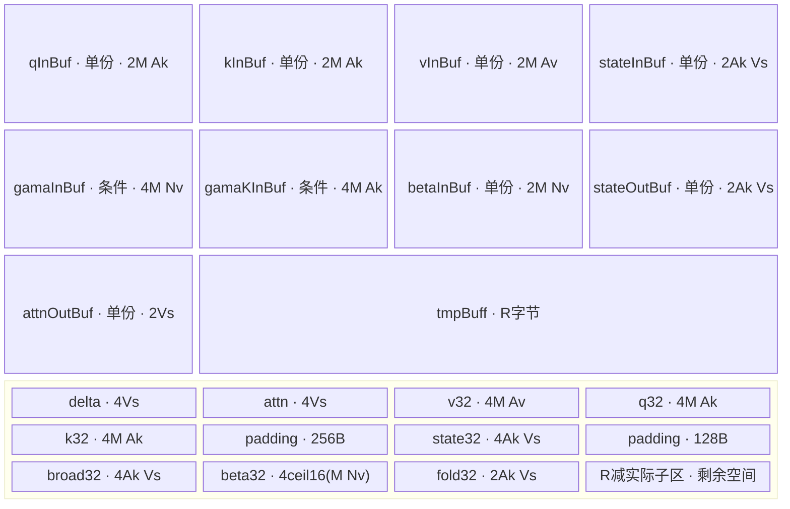

# RecurrentGatedDeltaRuleV310 310P ACLNN 算子知识

## 接 recurrent 前先确认请求和 state 索引

310P 这条 FP16 路线消费分离 q/k/v、已激活 beta 和已准备的 q/k；先保存各 shape、scale、可选 g/gk、实际每请求长度、accepted 与 state slot 映射。它不包含 Sigmoid、L2Norm 或卷积，不能直接接另一融合实现的原始输入。

1. 先读[接口与语义](#接口与语义)：actualSeqLengths 是长度数组，非 cu 前缀；正长度的 Device 域为≤8，accepted 选择初态而非缩短本请求遍历范围。
2. 再核[Host/Launcher](#hostlauncher-执行流程)及[Route 选择](#route-选择)：只有 key0/R-001，Host 三个资源 profile 不增加数学路线。
3. 沿[限制与失败边界](#限制与失败边界)查 slot 容量/冲突、FP16 对齐与真实 state/out 写回，再按[310P 数值验收](../../../../guides/bringup/vllm_ascend_310p_gdn_numerical_validation.md)分别比较输出、选中 state、未选哨兵行和 finite。

非法长度触发 Device return 不带 Host 错误码，且可能留下部分输出/state；没有事务回滚。长度、accepted、slot 或连续布局未闭合时先停止状态推进，保留前后状态并定位，不能仅凭返回码或非空 output 继续整模型验收。

## 算子速览

| 项目 | 内容 |
|---|---|
| 实际入口 | 公开 C ABI `aclnnRecurrentGatedDeltaRuleV310GetWorkspaceSize` / `aclnnRecurrentGatedDeltaRuleV310`；固定仓 ceac1a2bdff3139ca8fbd1a60b3a9befd68cadf2 |
| 计算语义 | 分离 q/k/v 的 gated delta 递推；beta 已激活，q/k 已准备；本算子不含 Sigmoid、L2Norm 或卷积 |
| 输入输出 | q/k[T,Nk,Dk]、v/out[T,Nv,Dv]、state[slots,Nv,Dv,Dk]；主数据 FP16，内部 FP32 |
| 执行类型 | 一个核心语义节点，AIV_VECTOR / `KERNEL_TYPE_AIV_ONLY`；无 Cube/AIC、SIMT、NDDMA 或通信节点 |
| Kernel 路线 | R-001：key0、`RGDR<half, half>`；Host 三个 profile 不构成三条 Device Route |
| 核心资源 | GM 原地 state；单份 VECCALC TBuf；tmpBuff 子区；16MiB system workspace，Device 未使用其指针 |
| 来源闭包 | source_closed：公开 API→l0 launcher→InferShape/OpDef→priority0 Tiling→共享 POD→entry→674行 body/helper→构建选择闭合。CANN executor、框架复制和 AscendC primitive 内部为外部边界 |
| 验证状态 | 已完成固定源码链分析；本次知识提取未执行编译、真机、数值或性能测试。stable 表示可用的源码知识，未声明硬件实测通过 |

## 接口与语义

### 计算语义

令 batch b 的紧凑 token 区间为 [s,e)，长度 L=actualSeqLengths[b]；value head h 对应 q/k head `h/(Nv/Nk)`。初态槽为 indices[s]；accepted 存在时改为 `indices[s+accepted[b]-1]`。accepted 只选择初态，随后仍遍历本请求的全部 L 个 token，并逐 token 写回 indices[t]。

对 state 的每个 V 行和 K 列，按下列顺序在 FP32 工作区递推：

```text
q' = float(q) * scale
Sbar[v,k] = S[v,k] * (g存在 ? exp(g[t,h]) : 1)
Sbar[v,k] *= (gk存在 ? exp(gk[t,h,k]) : 1)
prediction[v] = sum_k(Sbar[v,k] * float(k[t,qh,k]))
delta[v] = (float(value[t,h,v]) - prediction[v]) * float(beta[t,h])
S[v,k] = Sbar[v,k] + delta[v] * float(k[t,qh,k])
out[t,h,v] = half(sum_k(S[v,k] * q'[t,qh,k]))
state[indices[t],h,v,k] = half(S[v,k])
```

同一序列内下一 token 使用仍在 UB 的 FP32 S，不重新读刚降精度的 GM state；跨调用持久状态为 FP16。空段不写输出；非法长度触发 Device return 时也可能留下此前已写结果，不应假定返回零值或事务回滚。与其他仓库的 BF16 mixed-qkv、内置 Sigmoid/L2Norm 融合实现不可互换。

### 输入、输出与属性

| 参数 | shape/layout | dtype | 约束、默认值与语义 |
|---|---|---|---|
| query、key | [T,Nk,Dk]，ND | FP16 | 两者 shape 相等；调用者负责归一化，kernel 仅给 query 乘 scale |
| value | [T,Nv,Dv]，ND | FP16 | T 与 q 相同，Nv 为 Nk 整数倍 |
| beta | [T,Nv]，ND | FP16 | 直接用作更新系数，无 Sigmoid；Host 检查与 value 的 Nv 相等 |
| stateRef | [slots,Nv,Dv,Dk]，ND 连续物理布局 | FP16 | 同时为输入和输出，不执行 Contiguous；不能把仅格式为 ND 当作 stride 已验证 |
| actualSeqLengths | [B]，紧凑每请求长度 | INT32 | 是长度数组，不是 cu_seqlens 前缀和；Device 对正长度要求 ≤8 |
| ssmStateIndices | 逻辑至少 [T] | INT32 | Host 只查一维；调用者保证每次读取都在数组内，且槽值位于 [0,slots) |
| g | 可选 [T,Nv] | FP32 | 传入 log decay，CopyIn 后 Exp；缺省衰减为1 |
| gk | 可选 [T,Nv,Dk] | FP32 | 每 K 列 log decay；实际 Device 寻址要求此布局，Host 未校验该 shape |
| numAcceptedTokens | 可选 [B] | INT32 | 对实际处理请求要求 1≤accepted≤L；缺省取首槽 |
| scaleValue | 标量属性 | float32 | OpDef 默认1.0；API 接收显式值，不自动计算 Dk^-0.5 |
| out | [T,Nv,Dv]，ND | FP16 | API 用 Contiguous(out) 后 ViewCopy 到该结果；任意非连续原 out 的回写不能从此代码推出 |
| workspaceSize、executor | Host 输出指针 | uint64 / aclOpExecutor** | 必须由调用者提供有效地址；本 API 未调用 OP_CHECK_COMM_INPUT 检查二者 |

### 入口与版本

公开头文件直接导出上述两阶段 C 接口。固定仓只有该逻辑算子的 V310 公开版本；`RecurrentGatedDeltaRuleV310` 是 OpDef/launcher 类型名，不能替换为其他同名语义的原生 NPU API。

平台依据为 OpDef 显式 `AddConfig("ascend310p")` 和 build_aclnn.sh 的 ascend310 分支。CANN 9.2.0 依据 Dockerfile.310p 第18行镜像 `9.2.0_20261022115200-310p-ubuntu22.04-py3.12`；该文件同时选择 vLLM v0.32.0 和 ascend310p1。这是固定构建基线，不证明任意 9.2 补丁、其他 CANN 或任意配对 vLLM ABI 兼容。

## Host/Launcher 执行流程

### 参数校验与前处理

`GetWorkspaceSize` 用 RecurrentGatedDeltaRuleV310Params 聚合 tensor 指针、scaleValue 和 out。顺序为 CREATE_EXECUTOR→CheckNotNull→CheckParams/CheckDtypeVaild→PreProcess→Contiguous→l0op→ViewCopy→GetWorkspaceSize/ReleaseTo。executor 创建失败返回 ACLNN_ERR_INNER_CREATE_EXECUTOR；必需 tensor 判空和 dtype 不符均返回 ACLNN_ERR_PARAM_INVALID。

PreProcess 把 q/k/v/beta/state/长度/索引的 OriginalShape 设为 ViewShape；不处理可选输入和 out。六个必需非 state 输入及三个存在的可选输入进入 Contiguous；stateRef 原样传递。代码没有逐个判 Contiguous 结果是否为空，不能把宏外部行为补成显式检查。

l0op 分配 query dtype 的 ND out，InferShape 把 value 的三维复制到 out、state 的四维复制到 state 输出；输出 dtype 沿 query。随后 ADD_TO_LAUNCHER_LIST_AICORE 的 OP_OUTPUT 为 (out,stateRef)，明确 state 输入输出使用同一对象。AllocTensor、InferShape 或 launcher 添加失败返回 nullptr，公开入口折为 ACLNN_ERR_INNER_NULLPTR；ViewCopy 失败也返回该值。

真正的 shape 检查发生在 Tiling：q/k/v 3D、beta2D、state4D、长度和索引1D；校验 q=k、共享 T、beta/value Nv、state 的 Nv/Dv/Dk。填入 uint32 POD 后要求 Nk/Nv≤256、Dk/Dv≤512 和 Nv%Nk==0。缺少 Nk>0 等正维保护，不能把这些上界表述为完整安全输入域。

AnalyzeFormat 拒绝 q/k/v/state/长度/索引以及已提供可选输入的 FRACTAL_NZ；未单独检查 beta。OpDef 列 ND。可选输入只检查 dtype、存在性和格式，未校验 shape/元素数。

### 参数、Workspace 与生命周期

Tiling 的算子 system workspace 为16,777,216字节；公开阶段一返回的是 executor 汇总后的 workspace，可能还包含框架前后处理，不能强制调用者只分配16MiB。workspace 由调用者持有，连同 tensor backing storage、executor 保持有效直到阶段二在指定 stream 的实际工作完成；本实现不替调用者同步。

阶段二只调用 `CommonOpExecutorRun(workspace, workspaceSize, executor, stream)` 并透传返回。executor 的销毁和内部复制 kernel 的调度属于 CANN 框架边界，固定仓没有其实现，不能宣称已验证跨 stream、graph replay 或非连续 out 复制安全。

### 启动图与失败传播

```text
公开阶段一
  -> CANN Contiguous 输入/输出准备（框架边界）
  -> l0op::RecurrentGatedDeltaRuleV310
     -> INFER_SHAPE -> ADD_TO_LAUNCHER_LIST_AICORE(out,stateRef)
     -> TilingRegistry priority0 -> TilingBaseClass::DoTiling
        -> shape/dtype/attrs/optional/format -> UB -> key0 -> workspace -> PostTiling
  -> ViewCopy(outRet,out_)（框架边界）
公开阶段二 -> CommonOpExecutorRun(stream)
  -> 核心节点 K1 recurrent_gated_delta_rule_v310 -> RGDR<half,half>::Init/Process
```

| 节点/边 | producer→consumer | offset/extent、dtype/layout | ordering、owner/lifetime、失败 |
|---|---|---|---|
| K1 | l0 launcher→entry | blockDim=vectorCoreNum；72B POD；q/k/v/beta/state/长度/索引/可选指针；workspaceGM 无消费 | 一个核心语义节点；框架前后处理可另含复制 kernel，不能称整个 executor 只有一次 launch |
| 连续输入临时量 | Contiguous→K1 | q/k 各 T·Nk·Dk、v T·Nv·Dv、beta T·Nv；可选输入沿上表 | executor 管理临时量；实际框架调度顺序为外部边界 |
| 状态别名 | 调用者 stateRef→K1→同一 stateRef | FP16 [slots,Nv,Dv,Dk]；初槽、每 token 槽分别寻址 | caller 管理；head/V 行任务无跨核 barrier，禁止并发请求冲突写同一 slot/head |
| outRet | K1→ViewCopy(outRet,out_) | FP16 [T,Nv,Dv] | executor 管理中间 out，调用者持有最终 out backing storage |
| workspace | caller→executor | 汇总大小；K1 system声明16MiB，无算子内 slice/跨节点中间结果 | 生命周期延续至 stream 完成；不要由 workspaceGM 未使用推导可传任意空指针 |

TilingBaseClass 的实际顺序为 GetShapeAttrsInfo→GetPlatformInfo→IsCapable→DoOpTiling→DoLibApiTiling→GetWorkspaceSize→PostTiling→SetTilingKey。任一步非成功即返回；Registry 的 std::map 按小 priority 优先，只有 GRAPH_PARAM_INVALID 才继续下一模板。本算子只有 priority0、IsCapable=true；错误无第二实现兜底。

## Route 与参数设计

### 分核与资源计算

设 M=8，Ak=ceil16(Dk)，Av=ceil16(Dv)，An=ceil16(Nv)，U=平台可用 UB 字节。InitCompileInfo 读取 AIV 核数与 U；缺 platform 或核数异常时仅日志返回，GetPlatformInfo 本身总成功，后续 UB/shape 才可能失败。动态 blockDim 为 `min(max(1,B·Nv), max(1,aivNum))`。

Host 的 CalcFixedUbBytes、CalcWorkingUbBytes 和 CalcVStepCoeff 依次生成下列固定量、工作集与 profile 系数；所有乘积须在有效正维和不溢出的前提下解释：

```text
F = M*(4Ak+2Av) + 128 + hasGk*M*4Ak + hasG*M*4An + M*2An
W = F + M*(8Ak+4Av+4An) + 384
profile(ds,da)依次为 (1,1)、(1,2)、(2,2)
Q = (2+2ds)*Ak + 4da
C = Q + 10Ak + 8
v0 = trunc((U-W)/C/8)*8
v0<8 -> 当前profile无效
r = CeilDiv(Dv,v0)
Vs = CeilAlign(CeilDiv(Dv,r),8)
Vs<8 -> 当前profile无效
优选：r较小；r相等时ds+da较大；再相等时Vs较大
rest = U - F - Q*Vs；rest<0或全部profile无效 -> GRAPH_FAILED
```

`FinalizeVStepFromUb` 忽略传入的初始 coeff，调用 EvaluateBufferProfile 逐 profile 重算，再用 IsBetterProfile 按上表顺序比较。`CeilDiv(a,0)` 在仓内返回 a，不能套一般除零公式；这不构成零维输入整体安全证明。ds/da 写 POD 但 Device 不读取，实际输出缓冲仍各一份 TBuf。profile 是保守预算/分块选择，不能声称开启双缓冲或三条不同 kernel。

Device ComputeAvgload 对所有长度求 realT，再 `avgload=Ceil(realT*Nv,GetBlockNum())`。每个 core 重复按 batch/head 扫描：load+=L，任务在 blockIdx==usedblk 时归该核；达到 avgload 后 load 清零、usedblk++。余量不结转，无独立 former/tail-core 分支。负长度在求和时涉及有符号到无符号转换，不能以 Process 的跳过逻辑证明加权调度正常。

### Route 选择

| 顺序 | Route | Key/模板 | 精确选择条件与优先级 | 不适用去向 |
|---:|---|---|---|---|
| 1 | R-001 FP16 gated recurrence | 0 / RGDR<half, half> | ascend310p 构建/OpDef，公开 API dtype通过，priority0；shape→attrs→optional→format→UB规则均成功，IsCapable=true | 校验/资源失败即返回；没有下一 Route |

```text
必需tensor/dtype失败 -> ACLNN_ERR_PARAM_INVALID
框架/l0准备失败 -> ACLNN_ERR_INNER_NULLPTR
Tiling shape/format/UB/PostTiling失败 -> GRAPH_FAILED；无fallback
成功 -> key0 -> AIV_ONLY -> RGDR<half,half>
entry收到非0 key -> 不调用Process，不提交输出；不是另一实现
```

### 模板/实现执行矩阵

| Route | key/selector | dtype/shape/platform 完整命中条件 | 执行拓扑与 Kernel 节点 | 实际模板/body | 内存与同步特征 | tail/fallback |
|---|---|---|---|---|---|---|
| R-001 | key0，priority0 | 310P；q/k/v/beta/state/out FP16，g/gk FP32、长度/索引/accepted INT32；上述 rank/关系/上界/Nv%Nk、非NZ与有效UB profile；调用者另满足未校验的地址/长度/对齐前提 | 单核心 K1 AIV_VECTOR，框架复制另计 | RGDR<half,half>；Process→ProcessHead→Compute | 单份 TBuf，FP32 state/broad 交换，MTE2_V与V_MTE3/MTE3_V；编译auto-sync开启 | V分块用min，物理DMA及归约另有尾部缺口；无正确性fallback |

### 隐藏性能 Guard

| Guard | Host/Tiling 条件 | Device/资源原因 | 影响 Route | 不满足时去向 | 源码符号 |
|---|---|---|---|---|---|
| UB最小块 | Vs≥8且至少一个 profile有效 | state/broad/fold容量随 Ak·Vs 增长 | R-001 | GRAPH_FAILED | EvaluateBufferProfile / FinalizeVStepFromUb |
| head比例 | Nv%Nk==0；缺 Nk>0检查 | qh=h/(Nv/Nk) | R-001 | 余数非0失败；Nk=0没有安全错误分支 | CheckShapeValueRangeAndRule / ProcessHead |
| 请求长度 | Host仅rank；Device L≤0跳过，L>8 return | q/k/v输入UB只存M=8行 | R-001 | return可能留下部分结果，不是错误码fallback | Process |
| accepted | Host未查值；Device 1≤accepted≤L | 初态索引 s+accepted-1 | R-001 | 本core提前return | Process |
| 槽值与数组范围 | Host未查 indices长度、槽上下界 | raw GM寻址，不读取sBlockNum作边界检查 | R-001 | 无保护；负值/越界输入不可用 | SetGlobalTensors / ProcessHead |
| 32B搬运 | Host只给Vs对齐8，未强制所有FP16尾块16元素 | 310P helper将字节向32B取整，忽略padParams | R-001 | 无精确尾块fallback；需调用者限制/目标实现修正后验证 | DataCopyPadCustom / DataCopyCustom |
| 64lane归约 | Host只令Dk≤512，未限定Ak为64乘二幂 | fold后WholeReduceSum仍用mask64 | R-001 | Ak<64或非二幂折叠结果不能据源码承诺；无保护 | ReduceSumDispatch |
| 输出复用 | 每token cast前等待MTE3_V | stateOut/attnOut各单份 | R-001 | 删除等待会改变复用合同 | Compute / CopyOutState |
| 预取依赖 | build开启--cce-auto-sync=on；源码无显式state Cast后V_MTE2 | 同一FP16 stateInBuf下一次MTE2写与当前Vector读的顺序 | R-001 | 必须复核编译器插入同步；未实测，不假定显式事件已闭合 | LoadPrefetchedState / ProcessHead / op_host CMake |

### POD/ABI

共享 `RecurrentGatedDeltaRuleV310TilingData` 位于同一 op_kernel 头；`#pragma pack(8)` 配 `alignas(8)`。17个4字节字段，静态布局推导 sizeof=72、alignof=8，尾填充4B；未编译测量。PostTiling 以 sizeof 整体 memcpy_s，entry GET_TILING_DATA 解析同结构。下表偏移单位为字节。

| 结构 | 字段 | 类型/位宽 | ABI 布局 | 单位 | Host/launcher producer | Device consumer | 边界 |
|---|---|---|---|---|---|---|---|
| TilingData | vectorCoreNum | uint32/32 | offset0 | core | UpdateDynamicBlockDimByTaskUnits=min任务/核数；PostTiling SetBlockDim | body不读字段；GetBlockNum取launch值 | 至少1 |
| TilingData | ubCalSize | uint32/32 | offset4 | byte | FinalizeVStepFromUb=compileInfo.ubSize | body不读 | uint64平台量窄化 |
| TilingData | ubRestBytes | uint32/32 | offset8 | byte | U-F-Q·Vs | constructor restUbSize→tmpBuff InitBuffer | 非负后窄化 |
| TilingData | t | uint32/32 | offset12 | token | FillTilingShapeData=query[0] | constructor T_→Process区间判断 | int64 shape窄化 |
| TilingData | nk | uint32/32 | offset16 | head | query[1] | NK_→GVA、qk stride | 上界256；缺正值检查 |
| TilingData | dk | uint32/32 | offset20 | element | query[2] | realK_、alignK_→搬运/计算 | 上界512；非通用tail证明 |
| TilingData | nv | uint32/32 | offset24 | head | value[1] | NV_→batch/head/GM寻址 | 上界256、Nv%Nk |
| TilingData | dv | uint32/32 | offset28 | element | value[2] | realV_、alignV_→V循环 | 上界512 |
| TilingData | sBlockNum | uint32/32 | offset32 | slot | state[0] | body不读，不做slot校验 | 不能视为bounds guard |
| TilingData | b | uint32/32 | offset36 | request | actualSeqLengths.shape[0] | B_→ComputeAvgload/Process | 数组内容/总和未Host验证 |
| TilingData | vStep | uint32/32 | offset40 | V row | selected.vStep | vStep_→InitBuffer/V分块 | ≥8且8对齐 |
| TilingData | stateOutBufferNum | uint32/32 | offset44 | profile depth | selected.stateOutBufferNum | body不读 | 1或2不代表实际双缓冲 |
| TilingData | attnOutBufferNum | uint32/32 | offset48 | profile depth | selected.attnOutBufferNum | body不读 | 1或2不代表实际双缓冲 |
| TilingData | scale | float/32 | offset52 | scalar | GetScale=*attrs.GetAttrPointer<float>(0) | scale_→CopyInQKV Muls(q) | attrs指针无本地判空 |
| TilingData | hasGama | uint32/32 | offset56 | flag | GetOptionalInput，g desc存在为1否则0 | ==1→g buffer/Exp/scalar衰减 | 必须与GM指针一致 |
| TilingData | hasGamaK | uint32/32 | offset60 | flag | gk desc存在为1否则0 | ==1→gk buffer/列衰减 | gk shape未校验 |
| TilingData | hasAcceptedTokens | uint32/32 | offset64 | flag | accepted desc存在为1否则0 | ==1→初态token索引选择 | accepted值Device检查 |

### Route 源码闭包

| Route | Key/selector | Host/Tiling producer | POD/参数 | Kernel entry/router 节点 | Kernel body/直接依赖 | 构建接线 |
|---|---|---|---|---|---|---|
| R-001 | priority0 / key0 | op_host 的 Tiling.cpp：shape rules→UB rules→PostTiling；common TilingBase/Registry | op_kernel tiling_data.h同结构；GM参数顺序见entry | op_kernel .cpp：AIV_ONLY、TILING_KEY_IS(0) | 同目录674行.h：RGDR及搬运/Vector/同步helper；kernel_operator.h为CANN外部primitive边界 | build_aclnn ascend310列表→build.sh参数→attention目录→op_host模块→generated kernel target |

## Kernel 实现

### 公共执行流程

entry 参数依次为 query/key/value/beta/state/cuSeqlens/indices/g/gk/accepted/out/stateOut/workspaceGM/tilingGM。RGDRInitParams 将其重排为 query/key/value/g/gk/beta/state/长度/索引/accepted/out/stateOut。TPipe 为 key0 分支栈内对象；Init 绑定所有 raw GlobalTensor，未提供 extent；Process 结束后随 kernel 生命周期结束。

全程用 VECCALC TBuf，未使用 TQue 的 EnQue/DeQue/FreeTensor、Cube L1/L0、SIMT dynamic UB 或通信 window。框架前后处理不属于额外 GDN 语义 Route。

### Route R-001：FP16 gated recurrence

#### 适用条件

##### 选择证据

| 层级 | 文件 | 符号 | 源码谓词/参数 | 结果/下一跳 |
|---|---|---|---|---|
| API | op_host/op_api/aclnn_recurrent_gated_delta_rule_v310.cpp | CheckDtypeVaild | FP16主数据、FP32 g/gk、INT32控制数组 | l0op；不符返回PARAM_INVALID |
| 定义 | op_host/recurrent_gated_delta_rule_v310_def.cpp | RecurrentGatedDeltaRuleV310 | AddConfig ascend310p；ND | 该平台构建配置 |
| Tiling | op_host/recurrent_gated_delta_rule_v310_tiling.cpp | REGISTER_OPS_TILING_TEMPLATE / DoLibApiTiling | priority0，IsCapable=true，全部规则成功 | key0、72B POD、blockDim |
| Router | op_kernel/recurrent_gated_delta_rule_v310.cpp | recurrent_gated_delta_rule_v310 | TILING_KEY_IS(0) | RGDR<half,half>；其他key无输出 |

#### Device 数据流

##### 函数级调用链

```text
l0op::RecurrentGatedDeltaRuleV310 -> ADD_TO_LAUNCHER_LIST_AICORE
  -> recurrent_gated_delta_rule_v310(key0)
     -> RGDR<half,half>::Init -> SetGlobalTensors -> InitLocalBuffers
     -> Process -> ComputeAvgload
        -> batch/head: IsCurrentBlock -> CopyInGamaBeta（该batch/core一次）
           -> ProcessHead -> CopyInQKV
              -> 首块PrefetchState
              -> V块: LoadPrefetchedState -> 条件预取下一块
                 -> token: Compute -> CopyOutAttn -> CopyOutState
                    Compute: MatVecMul -> ReduceSumDispatch -> Sub/Muls
                             -> Broadcast -> MulAddDst -> MatVecMul -> ReduceSumDispatch -> Cast
```

##### 源码等价伪码

```text
伪码；地址均以元素为单位，DMA参数另按字节换算
realT=sum(length[b]); avg=ceil(realT*Nv/blockDim); cursor=0; load=usedblk=0
for b in [0,B):
  L=length[b]
  if L<=0: continue
  if L>8 or cursor<0 or cursor>T or cursor+L>T: return
  s=cursor; e=s+L; cursor=e; copied=false
  for h in [0,Nv):
    load+=L; mine=(blockIdx==usedblk)
    if load>=avg: load=0; usedblk++
    if not mine: continue
    if not copied:
      if accepted存在且(accepted[b]<=0 or accepted[b]>L): return
      initSlot=indices[s+(accepted存在 ? accepted[b]-1 : 0)]
      CopyInGamaBeta(s,e); copied=true
    qkBase=(s*Nk+h/(Nv/Nk))*Dk; vBase=(s*Nv+h)*Dv
    CopyInQKV(vBase,qkBase,L)
    PrefetchState(((initSlot*Nv+h)*Dv)*Dk,min(Vs,Dv))
    for vi in [0,Dv) step Vs:
      cv=min(Vs,Dv-vi)
      LoadPrefetchedState(cv)  # FP16 -> FP32 stateInUb
      if vi+Vs<Dv: PrefetchState(((initSlot*Nv+h)*Dv+vi+Vs)*Dk,min(Vs,Dv-vi-Vs))
      fetch MTE3_V/V_MTE3 event IDs; seed MTE3_V
      for t in [s,e):
        beta=betaInUb[(t-s)*Nv+h]; gamma=g存在 ? expg[(t-s)*Nv+h] : 1
        Compute(cv,(t-s)*Ak,(t-s)*Av+vi)
        CopyOutAttn((t*Nv+h)*Dv+vi,cv)
        CopyOutState(((indices[t]*Nv+h)*Dv+vi)*Dk,cv)
      Wait MTE3_V
```

Compute 的 MatVecMul 每次处理最多64个 K 元素，repeat 按 V 行每255行拆分；rowStride=Ak/8，repeat-stride 为 {rowStride,rowStride,0}，让同一 K 向量广播到各行。isAdd=false 用 Mul，true 用 MulAddDst 直接更新 FP32 state。Broadcast 的目标 shape=[cv,Ak]、源=[cv,1]，将 delta 按 K 列扩展。

310P ReduceSumDispatch 在 curK>64 时连续对半 Add，src 与 foldTmp ping-pong；mask=half，batch≤255，源/目标 repeat-stride 为 curK/8 与 half/8。末尾 WholeReduceSum 固定 mask64。`RGDR_ENABLE_ADD_FOLD_REDUCE` 只赋给未消费的 useAddFoldReduce_，不是可关闭 fold 的真实分支。

#### 内存与数据搬运

##### 资源与搬运表

以下 TBuf 容量均为 `InitBuffer` 请求字节；每个缓冲只有一份，等效 depth=1。记 G/Gk 为0或1，R=ubRestBytes，β32=4·ceil16(M·Nv)。

| 层级/缓冲区 | offset/地址公式 | extent/容量公式 | dtype/layout | producer | consumer | owner/lifetime | 对齐/复用 |
|---|---|---|---|---|---|---|---|
| GM q/k | (s·Nk+qh)·Dk | L行，每行Dk | FP16 TND | caller/框架复制 | CopyInQKV | caller/executor到stream完成 | DMA blockCount=L，blockLen=2Dk，srcStride=2(Nk-1)Dk |
| GM v | (s·Nv+h)·Dv | L行，每行Dv | FP16 TND | caller | CopyInQKV | 同上 | blockLen=2Dv，srcStride=2(Nv-1)Dv |
| GM state | ((slot·Nv+h)·Dv+vi)·Dk | cv行Dk | FP16 [slot,H,V,K] | caller或先前调用 | PrefetchState/CopyOutState | caller；输入输出别名 | 每行2Dk字节；slot由初态或当前token索引决定 |
| GM g/gk/beta | g/beta从s·Nv；gk从vBase/Dv·Dk | g/beta L·Nv；gk L行Dk | FP32/FP16 | caller | CopyInGamaBeta/CopyInQKV | 同上 | gk srcStride=4(Nv-1)Dk；Host未查可选shape |
| qInBuf_ | TPipe分配 | 2M·Ak | FP16 | MTE2 | Cast qInUb | TPipe整个head | L≤M |
| kInBuf_ | TPipe分配 | 2M·Ak | FP16 | MTE2 | Cast kInUb | 同上 | 单份 |
| vInBuf_ | TPipe分配 | 2M·Av | FP16 | MTE2 | Cast vInUb | 同上 | 单份 |
| stateInBuf_ | TPipe分配 | 2Ak·Vs | FP16 | PrefetchState | LoadPrefetchedState | 每V块复用 | 下一块预取复用同一半精度buffer |
| gamaInBuf_ | 条件分配 G=1 | 4M·Nv | FP32 | CopyInGamaBeta/Exp | token标量读 | 每batch/core复用 | 缺省无buffer |
| gamaKInBuf_ | 条件分配 Gk=1 | 4M·Ak | FP32 | Duplicate/MTE2/Exp | MatVecMul列衰减 | 每head | 先zero再Exp；DMA helper不等于语义pad |
| betaInBuf_ | TPipe分配 | 2M·Nv | FP16 | MTE2 | Cast betaInUb | 每batch/core复用 | 搬运/转换按16元素取整，原分配请求未显式取整 |
| stateOutBuf_ | TPipe分配 | 2Ak·Vs | FP16 | Compute Cast | CopyOutState MTE3 | 每token复用 | MTE3_V保护下次cast |
| attnOutBuf_ | TPipe分配 | 2Vs | FP16 | Compute Cast | CopyOutAttn MTE3 | 每token复用 | 8元素步长并不保证32B尾块 |
| tmpBuff | TPipe分配 | R | FP32子区 | 以下各stage | Vector计算 | 全kernel | 同一个TBuf，子区见图和字节账 |
| tmp.delta | 0 | 4Vs | FP32 | Reduce/Sub/Muls | Broadcast | 每token | 原地delta更新 |
| tmp.attn | 4Vs | 4Vs | FP32 | ReduceSumDispatch | Cast out | 每token | 单份 |
| tmp.v | 8Vs | 4M·Av | FP32 | Cast | Sub | 每head | L行有效 |
| tmp.q | 8Vs+4M·Av | 4M·Ak | FP32 | Cast/Muls scale | MatVecMul | 每head | 不做L2Norm |
| tmp.k | 上项后 | 4M·Ak，随后空隙256B | FP32 | Cast | 两次MatVecMul | 每head | bank padding来自源码分配，不代表实测收益 |
| tmp.state | k后+256 | 4Ak·Vs，随后空隙128B | FP32 | Load/Compute | 递推和Cast | 每V块 | 可与broad交换LocalTensor描述符 |
| tmp.broad | state后+128 | 4Ak·Vs | FP32 | Mul/Broadcast | Reduce/更新 | 每token | 不与state同时别名 |
| tmp.beta | broad后 | β32 | FP32 | Cast beta | token标量读 | 每batch/core | GetWithOffset传入betaUbSize作float个数，描述符长度比字节保留量大，实际访问须按有效batch范围核对 |
| tmp.fold | beta后 | 2Ak·Vs | FP32，Ak/2列 | fold Add | WholeReduceSum | 每次归约 | 与src交替，非第二state队列 |

##### 分层内存布局



##### 字节账与复用顺序

```text
Fdev = M*(4Ak+2Av) + Gk*M*4Ak + G*M*4Nv + M*2Nv
Qdev = 4Ak+2
UB_requested = Fdev + Qdev*Vs + R
             = U - (F-Fdev) - (Q-Qdev)*Vs <= U
tmp_needed = (10Ak+8)*Vs + M*(8Ak+4Av) + 4ceil16(M*Nv) + 384
Vs预算中 W、C 对上述子区作保守预留；在有效正维和未窄化溢出前提下 tmp_needed<=R。
F-Fdev至少含128B保留；An>=Nv，profile系数也不小于实际单份缓冲。
这里证明的是请求字节账；TPipe内部物理对齐/分配和生成指令仍须目标CANN编译确认。
dynamic_ub = N/A（非SIMT）；TQue depth = N/A（全部TBuf）
workspace_system = 16MiB；operator_workspace_slices = 0
public_workspace_total = executor.GetWorkspaceSize()（含框架临时量，不能由16MiB直接替代）
```

| 复用子区 | 写入者 | 读取者/消费点 | 下一次覆盖 | 同步或释放依据 | 安全条件 |
|---|---|---|---|---|---|
| FP16 stateInBuf | 当前PrefetchState | LoadPrefetchedState Cast | 下一V块PrefetchState | MTE2_V保护DMA→Cast；Cast→下次DMA无显式V_MTE2 | 保留auto-sync编译依赖并审核实际同步；不宣称已实测 |
| FP32 state/broad | Load、Muls、MulAddDst | 递推/归约/Cast | 下一token或下一V块 | PIPE_V；SwapTensor只换描述符 | 两块各4Ak·Vs，保持读写区不同 |
| beta/gama | 该batch/core首次CopyIn | 所有分给该core的head/token | 下一batch CopyIn | MTE2_V、PIPE_V及auto-sync | 不提前覆盖仍在消费的标量/向量 |
| stateOut/attnOut | Compute Cast | 两路MTE3 | 下一token Cast | cast前Wait MTE3_V；CopyOutState后Set MTE3_V | 两路输出保持源码顺序 |
| fold/src | 一层Add | 下一层Add/最终reduce | 后续fold或下一归约 | PIPE_V | 维度必须满足真实mask/stride前提 |

#### 同步、精度与尾块

##### 同步与数值边界表

| 阶段 | primitive/机制 | producer | consumer/等待点 | 保护对象 | 精度/尾块 |
|---|---|---|---|---|---|
| q/k/v输入 | SetWaitFlag MTE2_V | DataCopy | CastOrCopy | 半精度输入 | FP16→FP32 CAST_NONE，随后q乘scale |
| gk | Duplicate→V_MTE2→MTE2_V→Exp→PIPE_V | 初始化/搬运 | 列衰减 | gk buffer | 先置0再Exp；310P helper忽略padParams/dstStride，非对齐Dk的行布局须独立核对 |
| state输入 | MTE2_V | PrefetchState | LoadPrefetchedState | stateInBuf | Cast后立即发下一预取；无显式V_MTE2，不把源码顺序当硬件完成顺序 |
| 标量读取 | V_S | Exp/beta Cast等Vector | GetValue/标量系数使用 | g/beta/中间量 | 源码含V_S；不推导任意异步流水都安全 |
| 递推计算 | PIPE_V | decay、MatVecMul、reduce、delta、Broadcast | 下一Vector阶段 | FP32 state/broad | 无Sigmoid、L2Norm和有限值过滤 |
| 输出复用 | MTE3_V / V_MTE3 | 上次MTE3/本次Cast | cast前等待/CopyOutAttn等待 | 单份输出TBuf | 310P float→half CAST_NONE；非目标宏分支CAST_RINT不扩为其他平台支持 |
| 状态完成 | Set MTE3_V，V块末Wait | CopyOutState | 下一token/V块 | stateOut与attnOut | 各token均写GM，未跳过未接受token的结果 |
| 310P输入tail | DataCopyPadCustom | raw GM | 对齐UB行 | q/k/v/gk/state | blockLen向32B取整；padParams未使用，不能认定无效lane为0，可能读取实际行外 |
| 310P输出tail | DataCopyCustom的DataCopyParams重载 | FP16输出TBuf | GM | attn/state | blockLen从字节向32B取整、stride置0；Vs8对齐不保证cv16对齐，无精确尾写保护 |
| 310P归约tail | fold Add / WholeReduceSum | broad | delta/attn | FP32 K行 | Ak为64、128、256、512可满足折叠到64的结构；其他Ak未由Host拒绝，不能推广数值正确 |
| 空/非法域 | continue / return | Process | 无后续提交保证 | 输出有效域 | L≤0跳过；L>8、越T或非法accepted提前return；不回滚已写结果 |

#### 关键实现

##### 符号证据表

| 阶段 | 文件 | 符号/模板实例 | 实现事实 |
|---|---|---|---|
| Host/Tiling producer | op_host/recurrent_gated_delta_rule_v310_tiling.cpp | AnalyzeShapes / CalUbSize / FinalizeVStepFromUb | 四条shape rule、五条UB rule；三个保守profile比较，唯一key0 |
| Kernel entry/router | op_kernel/recurrent_gated_delta_rule_v310.cpp | recurrent_gated_delta_rule_v310 / RGDR<half,half> | AIV_ONLY、同一POD，workspaceGM未读 |
| Device body/helper | op_kernel/recurrent_gated_delta_rule_v310.h | Process / ProcessHead | 长度加权head调度，按V块再按token递推，初态与每token输出槽分开 |
| Device body/helper | op_kernel/recurrent_gated_delta_rule_v310.h | InitLocalBuffers / SwapTensor | 单份TBuf、两个FP32矩阵区交换、子区与384B padding |
| Device body/helper | op_kernel/recurrent_gated_delta_rule_v310.h | MatVecMul / ReduceSumDispatch / Compute | 64列mask、255 repeat拆分、310P fold归约和FP32原地更新 |
| Device body/helper | op_kernel/recurrent_gated_delta_rule_v310.h | DataCopyPadCustom / DataCopyCustom | 活动调用分别用ExtParams输入helper及DataCopyParams输出/标量搬运重载；needBack/isAtomic重载不是本Route实际fallback |

## 算子特定优化

### Trick T-001：FP16 状态预取与 FP32 递推工作区分离

#### 触发与源码依据

- 适用 Route：R-001。
- 触发条件：当前head的 Dv>Vs 且下一V块存在；当前块先转为FP32，再向同一半精度输入buffer预取下一块。
- Golden 来源：[ProcessHead，574–582行](https://github.com/vllm-project/vllm-ascend/blob/ceac1a2bdff3139ca8fbd1a60b3a9befd68cadf2/csrc/attention/recurrent_gated_delta_rule_v310/op_kernel/recurrent_gated_delta_rule_v310.h#L574-L582)。

**官方源码（固定 Commit 连续逐字摘录）**：

```cpp
        for (uint64_t v_i = 0; v_i < realV_; v_i += vStep_) {
            uint32_t curSingleV = v_i + vStep_ > realV_ ? realV_ - v_i : vStep_;
            LoadPrefetchedState(curSingleV);
            nextVOffset = v_i + vStep_;
            if (nextVOffset < realV_) {
                nextSingleV = nextVOffset + vStep_ > realV_ ? realV_ - nextVOffset : vStep_;
                nextStateOffset = ((stateOffset * NV_ + head_i) * realV_ + nextVOffset) * realK_;
                PrefetchState(nextStateOffset, nextSingleV);
            }
```

#### 机制与设计原因

Vs 来自Host UB预算，curSingleV=min(Vs,Dv-vi)；下一状态地址按 [slot,Nv,Dv,Dk] 的下一V行计算。当前递推保留在FP32 stateInUb，下一块DMA目的为独立FP16 stateInBuf，源码提供计算与预取的交叠窗口，无需分配第二份FP32 state矩阵作为预取区。

这不等于双缓冲队列。LoadPrefetchedState 的 MTE2_V只闭合前次DMA→Cast；紧随的下一次DMA复用同一半精度区，源码没有显式 Cast→DMA 的V_MTE2，依赖开启auto-sync的编译路径，实际同步和收益仍待验证。

#### 迁移边界

- 适用：按V行分块、K连续、半精度持久state与FP32递推分离的场景。
- 前提：合法独立槽/行域、完整UB预算、DMA对齐、目标CANN编译依赖与输出事件协议。
- 失效：只有一个V块时没有下一块预取；缺少安全同步或精确tail时需先调整实现并验证，固定仓没有另一Route自动接管。
- 未验证：本次知识提取未执行编译、真机、数值或性能测试。

#### 错误做法

固定仓未提供可验证反例。不能从两个profile depth字段推导实际双缓冲，也不能删除同步或改成覆盖FP32当前状态后仍沿用本机制的正确性结论。

### Trick T-002：衰减后交换 LocalTensor 描述符复用两块矩阵区

#### 触发与源码依据

- 适用 Route：R-001。
- 触发条件：hasGama_ 为真；stateInUb 和 broadTmpInUb 均有 Ak·Vs 个float容量。
- Golden 来源：[Compute，469–472行](https://github.com/vllm-project/vllm-ascend/blob/ceac1a2bdff3139ca8fbd1a60b3a9befd68cadf2/csrc/attention/recurrent_gated_delta_rule_v310/op_kernel/recurrent_gated_delta_rule_v310.h#L469-L472)。

**官方源码（固定 Commit 连续逐字摘录）**：

```cpp
        if (hasGama_) {
            Muls(broadTmpInUb, stateInUb, gama_, alignK_ * curSingleV);
            SwapTensor(stateInUb, broadTmpInUb);
        }
```

#### 机制与设计原因

Muls 把当前标量 exp(g) 的衰减结果直接写入 broad 区，长度为 Ak·curSingleV；SwapTensor 交换两个 LocalTensor 描述符，使后续 MatVecMul 读取衰减结果所在区，旧state区随即成为新broad工作区。避免再把衰减矩阵复制回原state地址；两块物理区域仍都存在，不能声称少分配一块矩阵。

#### 迁移边界

- 适用：相同容量/类型的两块工作区，一块结果可成为下一阶段主输入。
- 前提：保持PIPE_V依赖、描述符交换后的真实地址与下一token/V块覆盖顺序；不能让两个描述符同时指向同一块。
- 失效：g缺省时不交换；若更改容量、alias或异步消费顺序，必须重新推导生命周期。
- 未验证：本次知识提取未执行编译、真机、数值或性能测试。

#### 错误做法

固定仓未提供可验证反例。不得把描述符交换改写成state与broad永久别名；本实现后续归约仍需要一个独立的乘积工作区。

## 模板与实现对比

| 对比维度 | R-001 FP16 gated recurrence | 设计选择依据 |
|---|---|---|
| 命中条件/优先级 | priority0、key0、310P，全部Host规则通过 | 无第二Host可达实现 |
| 模板与 dtype | RGDR<half,half>；内部float | 不从其他平台同名算子推BF16支持 |
| 循环与分核 | 加权batch/head→V块→token | 同head状态沿token顺序推进 |
| Queue/TBuf/寄存器/dynamic UB/通信 window | VECCALC TBuf；标量gama_/beta_；其余资源N/A | Host profile不改变实际缓冲份数 |
| 内存总占用与复用 | Fdev+(4Ak+2)Vs+R请求字节；state/broad交换 | 明确请求容量与CANN内部物理分配边界 |
| 搬运/Vector/SIMT/NDDMA/通信 API | 310P自定义32B DataCopy，Mul/MulAddDst、fold、Broadcast、Cast | 只有Vector路线；helper其他重载不作fallback |
| 同步、精度与 tail | FP32递推，FP16 CAST_NONE，显式事件+auto-sync | 非对齐DMA和固定mask64仍须输入前提/验证 |
| fallback/失败边界 | Host失败返回，Device非法域return、unknown key不处理 | 无替代实现、无自动回滚或清零 |

## 平台差异

| 项目 | 310P | A2 | A3 | Ascend 950 |
|---|---|---|---|---|
| 支持状态 | 此V310实现的OpDef与活动构建显式选择；未实测 | 无此算子AddConfig/默认构建选择证据 | 无此算子AddConfig/默认构建选择证据 | 无此算子AddConfig/默认构建选择证据 |
| Host/Launcher | ascend310分支选recurrent_gated_delta_rule_v310；SOC_ARG=ascend310p | 不扩为本卡支持 | 不扩为本卡支持 | 不扩为本卡支持 |
| Kernel/资源 | 目标宏__CCE_AICORE__==200下自定义搬运/fold/CAST_NONE | body的#else不是公开产品支持 | 同左 | 同左 |

## 限制与失败边界

- Host 的上界与关系检查不覆盖所有合法性：Nk=0取模、shape转uint32窄化、T/B/indices容量、sum(length)、可选输入shape、槽上下界及重复槽冲突均需调用侧核对；sBlockNum没有Device消费。
- 输入为分离q/k/v、已激活beta及准备好的q/k。把其他融合实现的Sigmoid/L2Norm或mixed-qkv合同套入会改变数学语义；不能只因GDN同名而复用参数。
- 310P DataCopyPadCustom 忽略padParams；DataCopyCustom活动重载把字节长度向32B取整并清stride。Dk非16对齐、cv非16对齐、标量控制块未满足物理可读容量等情况没有精确tail保护；gk按FP32对齐后的行距也不能等同Ak。
- ReduceSumDispatch固定mask64和对半fold没有Host完整shape guard。上表64/128/256/512仅说明源码结构对应关系，不是本次新增的硬件认证或对任意输入数值正确承诺。
- 预取复用半精度输入区缺少显式V_MTE2，构建开启auto-sync；实际编译调度、primitive语义、TPipe对齐和工作区实现为待目标栈验证边界，不将源码书写顺序等同跨pipe完成顺序。
- stateRef不做Contiguous；out只对Contiguous(out)结果ViewCopy，没有显式再次复制回任意原始strided out的代码。使用连续布局并验证实际别名/写回；这里没有复现或修复上游故障。
- Device提前return不产生Host错误码，可能留下部分state/out；没有原子提交。finite、untouched state、accepted变化、ragged、重复索引、graph/多stream、完整模型数值和性能均未在本次运行。

## 源码索引

### 链路索引

下列路径均相对固定 vllm-ascend 仓库。算子局部文件为全文分析；公共构建脚本仅分析当前路线所需函数/范围，未声明整个构建系统语义闭合。

| 链路阶段 | 文件 | 关键符号 | 支撑内容 |
|---|---|---|---|
| 入口声明/约束 | csrc/attention/recurrent_gated_delta_rule_v310/op_host/op_api/aclnn_recurrent_gated_delta_rule_v310.h | 公开两阶段API | C ABI、参数次序和dtype注释 |
| 入口实现 | csrc/attention/recurrent_gated_delta_rule_v310/op_host/op_api/aclnn_recurrent_gated_delta_rule_v310.cpp | CheckDtypeVaild / PreProcess / 两阶段入口 | 前处理、state原样、out复制、executor |
| l0 launcher | csrc/attention/recurrent_gated_delta_rule_v310/op_host/op_api/recurrent_gated_delta_rule_v310.cpp | l0op::RecurrentGatedDeltaRuleV310 | AllocTensor、InferShape、out/stateRef输出 |
| l0声明 | csrc/attention/recurrent_gated_delta_rule_v310/op_host/recurrent_gated_delta_rule_v310.h | l0op声明 | 参数签名 |
| 定义 | csrc/attention/recurrent_gated_delta_rule_v310/op_host/recurrent_gated_delta_rule_v310_def.cpp | OpDef / AddConfig | ND、FP16、可选输入、ascend310p |
| shape推导 | csrc/attention/recurrent_gated_delta_rule_v310/op_host/recurrent_gated_delta_rule_v310_infershape.cpp | InferShape / InferDataType | value形状out、state形状输出 |
| Host/Tiling | csrc/attention/recurrent_gated_delta_rule_v310/op_host/recurrent_gated_delta_rule_v310_tiling.cpp | priority0 / rule chain / profile | shape、UB、key、blockDim、16MiB |
| Host/Tiling声明 | csrc/attention/recurrent_gated_delta_rule_v310/op_host/recurrent_gated_delta_rule_v310_tiling.h | Tiling类 / BufferProfile | 基类及profile结构 |
| Host include | csrc/attention/recurrent_gated_delta_rule_v310/op_host/math_util.h | CeilDivision / Align | 被include；当前tiling实际使用Transformer CeilDiv/CeilAlign，不能替换为该工具的算法 |
| POD | csrc/attention/recurrent_gated_delta_rule_v310/op_kernel/recurrent_gated_delta_rule_v310_tiling_data.h | TilingData | 17字段、pack8/align8 |
| Kernel entry | csrc/attention/recurrent_gated_delta_rule_v310/op_kernel/recurrent_gated_delta_rule_v310.cpp | key0 / AIV_ONLY | 唯一实例、GM参数重排 |
| Kernel body | csrc/attention/recurrent_gated_delta_rule_v310/op_kernel/recurrent_gated_delta_rule_v310.h | RGDR / helpers | 本卡循环、字节账、同步、trick与边界 |
| 公共基类 | csrc/common/include/tiling_base/tiling_base.h | TilingBaseClass::DoTiling | 实际虚函数调用顺序 |
| 公共注册 | csrc/common/include/tiling_base/tiling_templates_registry.h | TilingRegistry / REGISTER_OPS_TILING_TEMPLATE | 小priority优先、失败传播 |
| 公共取整 | csrc/common/include/tiling_base/tiling_util.h | CeilDiv / CeilAlign | Host实际取整与除数0语义 |
| 公共错误宏 | csrc/common/include/tiling_base/error_log.h | OP_CHECK_IF / OP_CHECK_NULL_WITH_CONTEXT | 规则短路返回 |
| CANN兼容头 | csrc/common/include/cann_compat.h | OP / log types guard | 全局强制include接线，不是算子算法 |
| API校验宏 | csrc/common/include/external/aclnn_kernels/common/op_error_check.h | OP_CHECK_NULL / OP_CHECK_DTYPE_NOT_SUPPORT | 宏实际检查；COMM_INPUT宏存在但入口未调用 |
| 框架复制声明 | csrc/common/include/external/aclnn_kernels/contiguous.h | Contiguous / ViewCopy | 接口语义；实现属于外部CANN边界 |
| 算子目录构建 | csrc/attention/recurrent_gated_delta_rule_v310/CMakeLists.txt | 子目录遍历 | 进入op_host |
| 算子Host构建 | csrc/attention/recurrent_gated_delta_rule_v310/op_host/CMakeLists.txt | add_modules_sources / compile options | aclnn_exclude、tiling include、auto-sync=on |
| attention选择 | csrc/attention/CMakeLists.txt | ASCEND_OP_NAME过滤 | 目标算子目录命中 |
| CANN项目构建 | csrc/CMakeLists.txt | BUILD_OPEN_PROJECT / common include | 自定义包路径和兼容头 |
| include变量 | csrc/cmake/variables.cmake | OPAPI_INCLUDE / OP_TILING_INCLUDE | common/include与external路径候选；实际安装CANN优先级须目标构建确认 |
| 构建配置 | csrc/cmake/config.cmake | ASCEND_CANN_PACKAGE_PATH / OPS_ADV_UTILS_KERNEL_INC | 1–90行CANN路径和generated路径 |
| 构建函数 | csrc/cmake/func.cmake | add_op_to_compiled_list / add_ops_compile_options / add_ops_src_copy / add_bin_compile_target | 85–169、289–313、376–798行的选择、源复制与生成脚本调用 |
| Host模块 | csrc/cmake/obj_func.cmake | add_modules_sources / add_opapi_modules / add_tiling_modules | 16–133、473–522、582–638行，收集op_api、infer、tiling、def |
| 自定义包接线 | csrc/cmake/custom_build.cmake | attention子目录 / ops_transformer_kernel | 255–375、780–884行的目录选择和kernel target |
| 产品构建入口 | csrc/build_aclnn.sh | ascend310分支 / CUSTOM_OPS_ARRAY | V310显式入选、SOC_ARG与包安装流程；未执行脚本 |
| 构建参数 | csrc/build.sh | --ops / --soc / CUSTOM_OPTION | 890–938、1180–1210行，把选择传为ASCEND_OP_NAME/COMPUTE_UNIT |
| Python构建接线 | setup.py | build_and_install_aclnn / run | 180–205、390–406行，COMPILE_CUSTOM_KERNELS时调用ACLNN构建 |
| 版本约束 | Dockerfile.310p | FROM / SOC_VERSION / VLLM_TAG | CANN9.2.0固定镜像、ascend310p1、v0.32.0 |

### 实现复用检查

| 检查项 | 可复用事实 | 不得改变的约束 | 源码符号 |
|---|---|---|---|
| ABI/POD | 共享17字段、72B静态布局 | 字段顺序、uint32窄化、scale float、无Device消费字段不能变成已实现特性 | TilingData / PostTiling / GET_TILING_DATA |
| 调用顺序 | 前处理→l0→Tiling→K1→框架复制 | accepted选初态与全部token写回顺序；框架内部实现不外推 | 公开API / ProcessHead |
| workspace/内存 | executor汇总workspace；单份TBuf与FP32两矩阵 | 实际容量、384B padding、可选buffer、原地state与槽冲突 | InitLocalBuffers / CalcWorkingUbBytes |
| 同步 | MTE2_V、V_MTE3/MTE3_V、PIPE_V、auto-sync构建 | state预取复用缺显式V_MTE2须复核；输出未完成不可覆盖 | LoadPrefetchedState / Compute / CopyOutState |
| 精度与尾块 | FP32递推、FP16存储、scale、log decay | 不额外Sigmoid/L2Norm；32B DMA与mask64条件不能靠上界校验代替 | CopyInQKV / ReduceSumDispatch / CastOrCopy |
| 失败边界 | Host错误终止；Device return可能部分结果 | 无fallback、无rollback、无越界槽保护，不能伪造支持范围 | CheckShapeValueRangeAndRule / Process |
