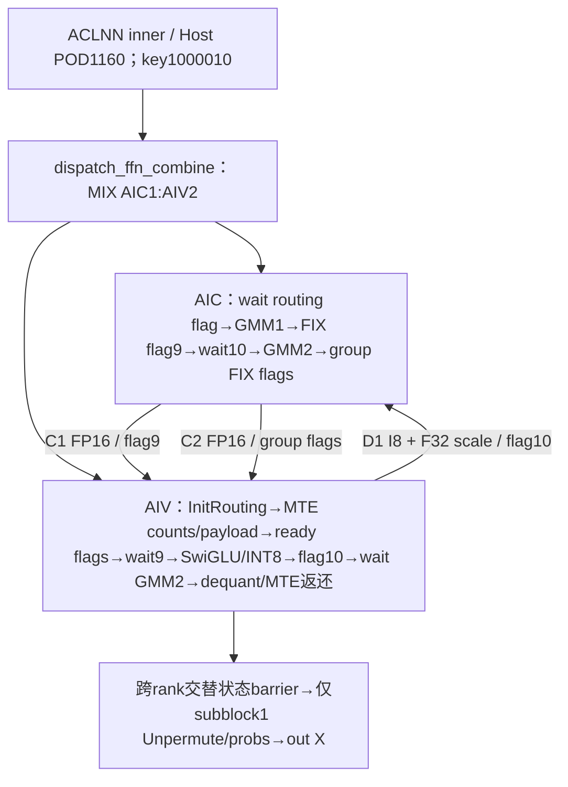
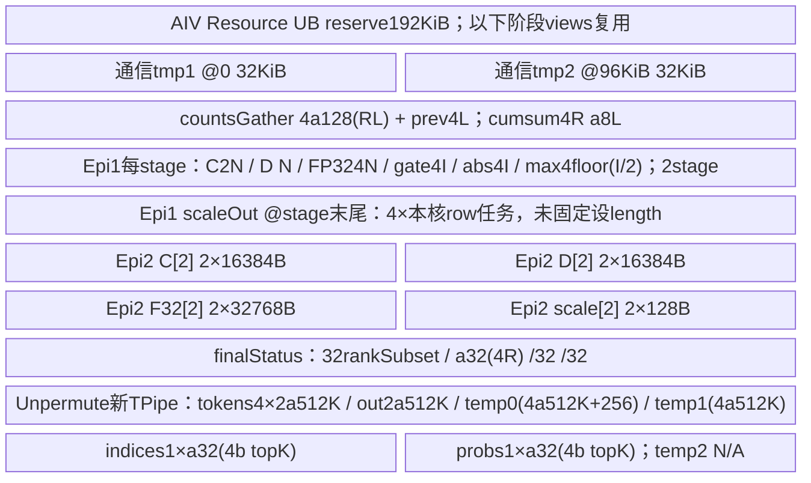
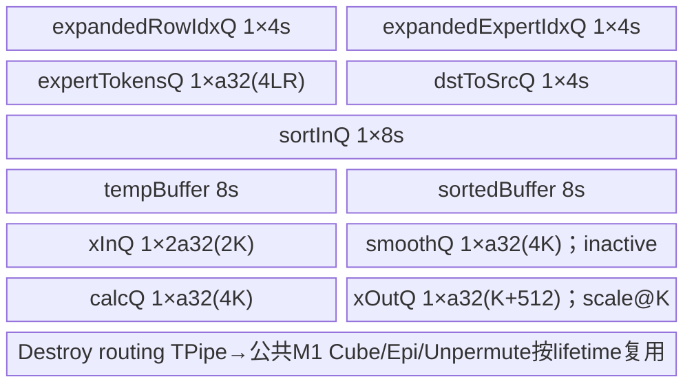
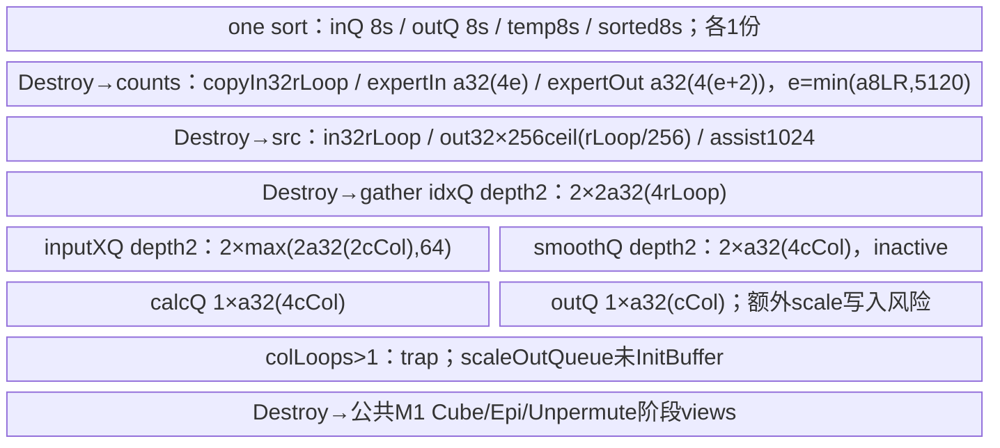

# DeepEP Dispatch FFN Combine INT8 A3 ACLNN 算子知识

## 算子速览

| 项目 | 内容 |
|---|---|
| 实际入口 | aclnnDispatchFFNCombineGetWorkspaceSize / aclnnDispatchFFNCombine；公开两段ACLNN |
| 计算语义 | 动态INT8路由/Dispatch→INT8 GMM1→channel dequant→SwiGLU/动态INT8→GMM2→dequant回传→F32权重Unpermute/Combine |
| 输入输出 | X=FP16/BF16 ND；两组INT8标准NZ权重，I64通道scale位串，I32 ids、F32 probs；输出X[M,K]和本地I32 counts[L] |
| 执行类型 | 单Kernel MIX_CV：KERNEL_TYPE_MIX_AIC_1_2；AIC_CUBE两段Mmad，AIV_VECTOR排序/量化/激活/归约及MTE跨rank访问；无独立SIMT/NDDMA/CCU节点 |
| Kernel 路线 | R-001..R-006：2种X精度×3种内层路由key；G1/G2同步和colLoops失败selector逐项列出 |
| 核心资源 | GM caller workspace/IPC window；L1A/B双stage、L0A/B双stage、I32 L0C单stage；UB192KiB分阶段手工views+内层TPipe |
| 来源闭包 | source_closed：wrapper→完整Host/内层tiling→1000010 MIX entry→当前CATLASS specialization和自有MTE算法→固定SDK primitive。draft保留自有静态计算/资源缺陷，不表示运行正确 |
| 验证状态 | 已完成源码闭包检查；本次知识提取未执行编译、真机、数值或性能测试。 |


## 接口与语义

### 计算语义

P3=`csrc/deepep/ops/`，K19=P3+`op_kernel/dispatch_ffn_combine_kernel/`。固定SGL dda6d36b0cdb4081e102d14c0a2fb276fc416e69，CATLASS70eda02b1271ff0e8c47db94469fae576feba97b，SDK asc-devkit e5451c7feba11f9e259f4fbc19c4bf82f8c0496c。公开[DeepEP融合API卡](../../../../apis/deepep/deepep_fused_deep_moe.md)已全文阅读；它区分Mode1/2/3而未闭合Mode2 Device，本卡create，不覆盖Mode1实现。

记X=FP16或BF16且sizeof(X)=2，M=x.dim0，K=x.dim1，N=w1.dim2（完整gate+up宽度），I=floor(N/2)，L=w1.dim0（本rank专家数），R=attr epRankSize，T=M*topK，Z=maxOutputSize，A=平台AIV数，C=实际AIC数。runtime.rank/rankSize另来自HCCL context，Host没有强制它们与attrs相等。`ap(v)=ceil(v/p)*p`：有字节公式时单位B，a32(T)在排序预算中按**元素**向32对齐，不能误换a32(4T)/4。

对每token，把topK展开的expert slots按expert排序，生成src→dst逆permutation；按原token进行动态INT8量化并写排序后的packet，再由目的expert rank拉取。令sX=maxAbs(Xrow)/127，源码计算F32 X/sX→FP16 CAST_TRUNC→INT8 CAST_ROUND。这里**没有maxAbs=0保护**，不能用后续SwiGLU的零值保护替代。packet有效K个I8后附8个相同F32 scale共32B，物理stride K+512；每原token可复制到多个排序slot。

GMM1使用A1 INT8 row-major与W1 INT8 zN，I32 Mmad累计，经Fixpipe VDEQF16按每输出channel的uint64 quant word应用scale1，物化FP16 C1。AIV再把C1转F32乘每token sX，前I为gate、后I为up，计算gate/(1+exp(-gate))*up。absmax为0时改1，scale2token=maxAbs/127；缩放127/maxAbs后依次I32 CAST_RINT→FP16 CAST_RINT（SetDeqScale half1）→I8 CAST_RINT。此处与最初动态量化的TRUNC/ROUND不同，必须保留。

GMM2用该INT8激活与W2，I32累计→Fixpipe通道scale2→FP16 C2；AIV转F32乘第二个token scale，RINT到X并按source rank/expert顺序回写packed输出。最后Unpermute从X取每slot，按k升序转F32乘probs并F32 Add，只在token末尾RINT到X。两次FP16 Fixpipe物化和中途RINT X都会影响精度，不等同理想全F32 MoE公式；无bias、shared expert或SiTU。

### 输入、输出与属性

| 参数 | shape/layout | dtype | 约束、默认值与语义 |
|---|---|---|---|
| x/a | [M,K] ND | X | 公开C++分支以weight1是否INT8选择；Device initrouting按X读取，Params.ptrA虽I8*仍传原X地址。 |
| weight1/w1 | 逻辑[L,K,N]，实际要求standard NZ zN | INT8 | public固定Nz=true、TB=false；OpDef含BF16+NZ，也含ND tuple，kernel不按输入format切布局。 |
| weight2/w2 | 逻辑[L,I,K]，standard NZ zN | INT8 | GMM2 K=I；不复用Mode1 permuted GMM1格式。 |
| expertId/expertIdx | [M,topK] ND | INT32 | Python topk_idx.int()；Host只读dim1并要求非0，数据值安全需要调用者。 |
| scale1 | [L,N] ND，按通道quant word | INT64传输/Device uint64_t | caller准备Fixpipe VDEQF16所需位表示；不做I64数值cast来替代；无自动转换。 |
| scale2 | [L,K] ND | INT64/uint64_t | 每expert每channel；GMM2 Fixpipe消费。 |
| probs | [M,topK] ND | FP32 | 最终Unpermute按k序乘权重并F32累加。 |
| group | 非空string | char* attr | strlen非0；Host未上限检查；MC2组与runtime context一致由调用者保证。 |
| epRankSize | R | 公开int64→Host GetAttrPointer<int>→u32 | 不假设宽度不一致已经运行兼容；Host未完整检查R>0/负值上限。 |
| epRankId | rank | 公开int64→Host int | 检查≥0且<转u32后的R；Device真正rank读取runtime。 |
| maxOutputSize/M attr | Z>0为意图 | 公开int64→Host int→u32 | 赋值后按u32检查≤0；是本rank总dispatch接收容量，常取max_bs*R*topK。 |
| transB | false | inner bool | 公开wrapper固定false，不能当可选public属性。 |
| weightNz | true | inner bool | 公开wrapper固定true，key1000010；Host OpDef默认false不覆盖wrapper。 |
| out | [M,K] ND | X | C++按expert_ids.dim0分配；Host Infer空success不自动推导或核全shape。 |
| expertTokenNums | [L] ND | INT32 | 返回本rank各expert跨source counts，写未按Z截断的cumsum最后rank值。 |
| workspace/workspaceSize/executor/stream | 两段ACLNN参数 | void*/u64/opaque/stream | GetWorkspaceSize报告，caller申请并保持到stream完成；weak setter在第二段选MTE。 |
| quant_mode / activation / shared | Python Mode2控制 | int/string/输入 | 整数quant_mode在C++中不驱动新实现，权重INT8决定唯一路径；SiTU策略拒绝；无shared/bias实现。 |


### 入口与版本

公开FUSED_DEEP_MOE文档明确Mode2对应独立aclnnDispatchFFNCombine，只有SwiGLU、无shared，返回本地counts[L]，不能复用Mode1 tile-N permutation。Buffer文档要求Mode2 standard NZ、I64 scale位表示、Z为整个本rank最大接收数；C++只在weight1为INT8时调用本ACLNN，BF16权重直接assert；quant_mode整数参数未传入ACLNN selector，不按0/1机械拆算子。Python非MegaMoe字符串quant_mode拒绝，SiTU在Mode2策略NotImplementedError。

README A3适配9.0/9.1，本卡固定CANN9.1.0；OpDef仅ascend910_93，活动P3 Host注册/Wrapper/Kernel保留，故仅a3。950 CMake明确移除Mode2 def/infer/tiling及wrapper，kernel带DEEPEP_SKIP_DISPATCH_FFN_COMBINE，不能拿A5包含目录或CATLASS ArchTag补950支持。Arch::AtlasA2是当前库实现标签，可在A3实例化，不推导A2公开支持。

固定CATLASS依赖由P3 build.sh A3分支选择catlass-v1-stable，当前来源集合固定70eda；A5 v1.6.1分支不属于本卡。该脚本查找安装moe_distribute_base.h后实际cp命令已注释，只对本地custom结构名sed；不能说本卡运行时自动替换为另一SDK头。HCCL runtime context与安装二进制ABI仍是边界，未借其它版本对照补成实测。

## Host/Launcher 执行流程

### 参数校验与前处理

公开wrapper固定transB=false、weightNz=true后调用inner workspace函数，原样返回status；第二段若weak NnopbaseSetHcclServerType存在则设置MTE，再调用inner Execute。wrapper不做额外Contiguous/format cast，不检查executor非null。自动inner/executor由框架生成，固定仓不可见，作为框架边界，不虚构前后处理kernel。

Host DispatchFFNCombineCheckAttrAndSetTiling按顺序要求attrs、group非空、rankSize/rankId/transB/weightNz/maxOutput指针非null；maxOutput先写u32再检≤0，rankSize int先转u32，rankId要求非负且<该R；R=0会由rankId>=R拒绝，但负R转u32/上限/字符串长度/64位attr读取宽度没有完整校验。随后只检查x/ids/w1 shape指针，直接读x.dim0/1、w1.dim0/2、ids.dim1，写M/K/N/L/topK/listLen1，要求K/topK非0。没有完整rank、W2/scale/probs/output shape、dtype/format、M/N/L正数、N偶数或padding容量guard。InferShape和InferDataType仅return GRAPH_SUCCESS，不为缺失检查兜底。

平台AIV/UB写Info（UB窄化u32），CoCTiling写固定tile/move字段；blockDim=CalcTschBlockDim(AIV,AIC,AIV)。outer key=1000000+transB+10*weightNz，公开固定1000010，router也只有该key。随后内层DoTiling硬编码40AIV、196352B UB、quantMode1、drop0、active0、capacity0、expertNum=LR、countflag2、smooth0，返回bool未检查；产生21000/11000/11010及内层POD。不能把实际平台A/UB自动带入内层预算。

Host检查3*T*K+10MiB≤envW（报错字符串旧称3MB不改变实际10MiB），准备workspace，配置Mc2CcTilingConfig(group,opType8,AlltoAll=level0:fullmesh;level1:pairwise)并GetTiling两次，返回值没有逐项检查。公开路径无其他outer key支持Route；未知key是router无匹配body终点，不推测具体Codegen/runtime错误。

### 参数、Workspace 与生命周期

定义P=4a256(M)*topK，B=4R²L。下表是Device WorkspaceInfo相对**收到的workspaceGM**的实际slice，依次推进且没有额外逐slice padding：

| slice | offset（相对收到的workspaceGM） | extent | dtype/layout | producer | consumer | owner/lifetime | 边界 |
|---|---|---|---|---|---|---|---|
| expandedRowIdx | 0 | P=4a256(M)*topK | I32 source→sorted destination | InitRouting | Unpermute | 全kernel | 内层temporary从同base+P开始 |
| cumsumMM | P | B=4R²L | I32/rank×local expert | AIV prefix | AIC GMM/MTE gather | 路由后到GMM/归并 | 只有有效R*L部分使用，Host多预留 |
| 预留gap | P+B | B | inactive | 无 | 无 | 预留 | 构造只推进offset未建tensor |
| perTokenScale1 | P+2B | 4Z | F32 | MTE拆packet | SwiGLU | GMM1完成前后 | 与Fixpipe channelScale区别 |
| perTokenScale2 | P+2B+4Z | 4Z | F32 | SwiGLU量化 | GMM2 Vector dequant | 至combine完成 | 每row scale |
| ptrTokenPerExpert GM副本 | P+2B+8Z | B | I32/inactive | 未实际写 | 实际tokenPerExpert绑定window | 全kernel | 不编造GM该slice使用 |
| C1 | P+3B+8Z | 2ZN | FP16 row-major | GMM1 Fixpipe | SwiGLU | flag9保护 | channel scale已在Fixpipe应用 |
| C2 | 前项末尾 | 2ZK | FP16 row-major | GMM2 Fixpipe | Epilogue2 | group flags保护 | 输出scale2已应用 |
| A1 | 前项末尾 | ZK | INT8 row-major | MTE从remote packet gather | GMM1 | 每group send flag保护 | 附加scale分离进scale1 |
| D1/A2 | 前项末尾 | ZI | INT8 row-major | SwiGLU动态量化 | GMM2 | flag10保护 | 两chunk分批producer |
| sumBeforeRank | 前项末尾 | 64R | I32前缀 | AIV counts gather | 远端回写映射 | 通信阶段 | Device实际可能按R*L写，无L≤16等容量guard |
| softFlagBase | 前项末尾 | 64(L+R) | F32/预留 | 当前自有BlockMmad构造ptrSoftFlag=null | 当前实际走CrossCoreFlag | 全kernel | 源存在其它soft flag方法但当前未调用 |


cocWorkspace=P+3B+8Z+2ZN+2ZK+ZK+ZI+64R+64(L+R)。内层initRoutingWorkspace=32T+320+16MiB，若gather colLoops>1再加40*K*4B；outer报告16MiB+max(cocWorkspace,initRoutingWorkspace)。内层router实际收到workspaceGM+P，固定router无显式GetUserWorkspace/+16MiB转换；因此必须核对框架传入基址与P+内层workspace的实际高水位，不能由max公式自动证明充分。部分Device offset表达式先做u32/i32乘法再遇sizeof，极大维度溢出风险未被Host完整防护。

通信S=context.winSize，peer A@0，独立scale区@a512(S/3)长1MiB（当前全列量化scale附在A packet中，单独区不是全列consumer），peer D@a512(S/3)+1MiB，counts矩阵@S-2MiB；final状态@S-1MiB+512*rank，self交替状态@S-1MiB+256KiB+128*(2b+s)。当前AIV任务逻辑ID v=b+s*C，SDK GetBlockIdx物理ID=2b+s；两种索引分别用于任务/状态，不混为同一排列。

所有输入、workspace、output、组context/window在该stream完整kernel结束前存活。内层routing临时与后续GM计算slice按真实SyncAll/TPipe Destroy阶段交接；R各rank配对调用、runtime资源可访问和初始counts/status合法由调用方/runtime保证。Host返回不是设备完成；源无独立status回写转换为ACLNN错误。

### 启动图与失败传播



只有一个设备launch，不把内层函数/TPipe Destroy误记多kernel。blockDim按平台计算，entry KERNEL_TASK_TYPE明确MIX_AIC_1_2。AIC index=b、count=C；AIV逻辑v=b+s*C、count=2C，任务ratio2。kernel构造resource与HcclShmem，分别由AIC operator()执行GMM1/等待10/GMM2，由AIV执行DispatchAndCombine。Host任何GRAPH_FAILED阻断正常launch；内层colLoops>1明确trap；其余设备无限轮询/越界/数值风险不伪造具体错误码。

## Route 与参数设计

### 分核与资源计算

内层Ssort=floor(floor(196352/32)/32)*32=6112。全载F精确条件为T≤6112、K≤8192、drop0，且196352-[36a32(T)+a32(4LR)+13a32(K)+64]>0；否则T≤6112走11000，T>6112走11010。排序用-I32expert→F32键、尾部MIN_FP32，Sort/Extract恢复expert升序与原slot index；多核按4的幂列表数分核、perCore/lastCore按32对齐与循环，4-waymerge每list最多2040、必要时多层ping-pong GM。实际字段逐项见POD。

gather令r=ceil(T/40)，last=T-(needCore-1)r。rowSize=4a32(4r)，colSize=21a32(K)，scaleSize64；K=7168/smooth0且196352>colSize+64+512时允许按onceRow=floor((196352-colSize-64-384)/16/8)*8分row循环；否则row+col+64<196352可全行。若仍不满足，Ccol初6144，rLoop=floor(a32floor((196352-21a32(6144)-64)/4)/4)，按K小于6144或r小于rLoop调整Ccol/rLoop，再生成colLoops=ceil(K/Ccol)。Device colLoops>1立即trap，不能沿未调用Partial helper补造可用fallback。src逆索引每核r，perLoop上限1516，尾批由减法；gather使用GetPerOrLastValue，多倍尾可能0，保留源码语义不修正。

GMM每expert currentM=跨rank counts总数，在累计达到Z后置0/截尾。tile(128,256)，scheduler GemmIdentityBlockSwizzle<9,1>：沿N按9列分组，组内M变化，奇数组反转M；startCoreIdx跨expert按coreLoops轮转。GMM1(K,N)、GMM2(I,K)，Ktile512，L0K128；startK=b%ceil(Kactual/512)打散加载，按实际kTileIdx取尾tile，首次**执行的**K块initC=true，最后执行块Fixpipe输出。

AIV初始每logical v分source ranks，按counts拉取到expert连续GM；CopyGMToGMPerToken每row读K+512字节，在UB把前K字节与byteK处首F32拆到A1/scale1。GMM2 epilogue复用同scheduler，以16行条带划分两个subblock，subblock1接额外尾strip；每条带保留actual M/N tail。Unpermute仅subblock1，以C核均分M，batch b=min(floor(M/C),600)，前余核增加一个token并增加末批，hidden全K一段。

### Route 选择

G1=L=1是已见计算失败分支：granularity0导致两次SwiGLU计算均跳过，仍发flag10，后续D1/scale2没有本路径producer。G2=L≥2有两chunk计算；L=0、M=0、N奇数/零等Host未完整拒绝的域见限制，不能自动当正常支持。

| 顺序 | Route | Key/模板 | 精确选择条件与优先级 | 不适用去向 |
|---|---|---|---|---|
| 1 | R-001 BF16 / 全载路由量化 | outer1000010 / inner21000 | A3公开ACLNN，outer1000010/TBfalse/Nztrue，X=BF16，W1/W2 INT8，Host基础检查和3TK+10MiB≤envW；F：T≤6112且K≤8192且196352-(36a32(T)+a32(4LR)+13a32(K)+64)>0。L=1取G1，L≥2取G2（见同步矩阵），非full另分colLoops=1到有效body或>1显式trap | G1静态失败；非full col>1 trap；不改换数学模式 |
| 2 | R-002 BF16 / 单核排序后量化 | outer1000010 / inner11000 | A3公开ACLNN，outer1000010/TBfalse/Nztrue，X=BF16，W1/W2 INT8，Host基础检查和3TK+10MiB≤envW；!F且T≤6112。L=1取G1，L≥2取G2（见同步矩阵），非full另分colLoops=1到有效body或>1显式trap | G1静态失败；非full col>1 trap；不改换数学模式 |
| 3 | R-003 BF16 / 多核排序后量化 | outer1000010 / inner11010 | A3公开ACLNN，outer1000010/TBfalse/Nztrue，X=BF16，W1/W2 INT8，Host基础检查和3TK+10MiB≤envW；!F且T>6112。L=1取G1，L≥2取G2（见同步矩阵），非full另分colLoops=1到有效body或>1显式trap | G1静态失败；非full col>1 trap；不改换数学模式 |
| 4 | R-004 FP16 / 全载路由量化 | outer1000010 / inner21000 | A3公开ACLNN，outer1000010/TBfalse/Nztrue，X=FP16，W1/W2 INT8，Host基础检查和3TK+10MiB≤envW；F：T≤6112且K≤8192且196352-(36a32(T)+a32(4LR)+13a32(K)+64)>0。L=1取G1，L≥2取G2（见同步矩阵），非full另分colLoops=1到有效body或>1显式trap | G1静态失败；非full col>1 trap；不改换数学模式 |
| 5 | R-005 FP16 / 单核排序后量化 | outer1000010 / inner11000 | A3公开ACLNN，outer1000010/TBfalse/Nztrue，X=FP16，W1/W2 INT8，Host基础检查和3TK+10MiB≤envW；!F且T≤6112。L=1取G1，L≥2取G2（见同步矩阵），非full另分colLoops=1到有效body或>1显式trap | G1静态失败；非full col>1 trap；不改换数学模式 |
| 6 | R-006 FP16 / 多核排序后量化 | outer1000010 / inner11010 | A3公开ACLNN，outer1000010/TBfalse/Nztrue，X=FP16，W1/W2 INT8，Host基础检查和3TK+10MiB≤envW；!F且T>6112。L=1取G1，L≥2取G2（见同步矩阵），非full另分colLoops=1到有效body或>1显式trap | G1静态失败；非full col>1 trap；不改换数学模式 |


```text
public TBfalse/Nztrue → outer1000010
quantMode1/drop0/smooth0/40cores/196352UB：
  F → inner21000 full
  !F && T≤6112 →11000 one-sort
  !F && T>6112 →11010 multi-sort
11000/11010：colLoops>1 →trap；否则gather allcols/row loops
X=BF16/FP16按OpDef/DTYPE_OUT实例；L=1→G1失败，L≥2→G2两chunk
```

### 模板/实现执行矩阵

| Route | key/selector | dtype/shape/platform 完整命中条件 | 执行族与 kernel 节点 | 实际模板/body | 内存与同步特征 | tail/fallback |
|---|---|---|---|---|---|---|
| R-001.G1 | 1000010/21000 | A3；BF16；F：T≤6112且K≤8192且196352-(36a32(T)+a32(4LR)+13a32(K)+64)>0；L=1，SwiGLU跳过静态失败；nonfull col1或>1trap | 单MIX_CV+AIV MTE；非多个launch | MoeV2FullLoadDynamicQuant<bfloat16_t>；outer DispatchFFNCombine<I8,I8,bfloat16_t,false,true> | routing UB=36a32(T)+a32(4LR)+2a32(2K)+2a32(4K)+a32(K+512)；共用Cube/Epi/Unpermute账 | D1/scale2未写，不能复用为正常结果 |
| R-001.G2 | 1000010/21000 | A3；BF16；F：T≤6112且K≤8192且196352-(36a32(T)+a32(4LR)+13a32(K)+64)>0；L≥2，two chunks；nonfull col1或>1trap | 单MIX_CV+AIV MTE；非多个launch | MoeV2FullLoadDynamicQuant<bfloat16_t>；outer DispatchFFNCombine<I8,I8,bfloat16_t,false,true> | routing UB=36a32(T)+a32(4LR)+2a32(2K)+2a32(4K)+a32(K+512)；共用Cube/Epi/Unpermute账 | Z截断/空expert/row/列尾边界见正文 |
| R-002.G1 | 1000010/11000 | A3；BF16；!F且T≤6112；L=1，SwiGLU跳过静态失败；nonfull col1或>1trap | 单MIX_CV+AIV MTE；非多个launch | MoeV2SortOneCore→MoeV2ExpertTokenOut→MoeV2SrcToDstOp→MoeV2GatherDynamicQuant<bfloat16_t>；outer DispatchFFNCombine<I8,I8,bfloat16_t,false,true> | routing UB=max(32a32(T),Ucount,Usrc,Ugather)；共用Cube/Epi/Unpermute账 | D1/scale2未写，不能复用为正常结果 |
| R-002.G2 | 1000010/11000 | A3；BF16；!F且T≤6112；L≥2，two chunks；nonfull col1或>1trap | 单MIX_CV+AIV MTE；非多个launch | MoeV2SortOneCore→MoeV2ExpertTokenOut→MoeV2SrcToDstOp→MoeV2GatherDynamicQuant<bfloat16_t>；outer DispatchFFNCombine<I8,I8,bfloat16_t,false,true> | routing UB=max(32a32(T),Ucount,Usrc,Ugather)；共用Cube/Epi/Unpermute账 | Z截断/空expert/row/列尾边界见正文 |
| R-003.G1 | 1000010/11010 | A3；BF16；!F且T>6112；L=1，SwiGLU跳过静态失败；nonfull col1或>1trap | 单MIX_CV+AIV MTE；非多个launch | MoeV2SortMultiCore→MoeV2ExpertTokenOut→MoeV2SrcToDstOp→MoeV2GatherDynamicQuant<bfloat16_t>；outer DispatchFFNCombine<I8,I8,bfloat16_t,false,true> | routing UB=max(24a32(max(8160,vbsLoopElems)),Ucount,Usrc,Ugather)；共用Cube/Epi/Unpermute账 | D1/scale2未写，不能复用为正常结果 |
| R-003.G2 | 1000010/11010 | A3；BF16；!F且T>6112；L≥2，two chunks；nonfull col1或>1trap | 单MIX_CV+AIV MTE；非多个launch | MoeV2SortMultiCore→MoeV2ExpertTokenOut→MoeV2SrcToDstOp→MoeV2GatherDynamicQuant<bfloat16_t>；outer DispatchFFNCombine<I8,I8,bfloat16_t,false,true> | routing UB=max(24a32(max(8160,vbsLoopElems)),Ucount,Usrc,Ugather)；共用Cube/Epi/Unpermute账 | Z截断/空expert/row/列尾边界见正文 |
| R-004.G1 | 1000010/21000 | A3；FP16；F：T≤6112且K≤8192且196352-(36a32(T)+a32(4LR)+13a32(K)+64)>0；L=1，SwiGLU跳过静态失败；nonfull col1或>1trap | 单MIX_CV+AIV MTE；非多个launch | MoeV2FullLoadDynamicQuant<half>；outer DispatchFFNCombine<I8,I8,half,false,true> | routing UB=36a32(T)+a32(4LR)+2a32(2K)+2a32(4K)+a32(K+512)；共用Cube/Epi/Unpermute账 | D1/scale2未写，不能复用为正常结果 |
| R-004.G2 | 1000010/21000 | A3；FP16；F：T≤6112且K≤8192且196352-(36a32(T)+a32(4LR)+13a32(K)+64)>0；L≥2，two chunks；nonfull col1或>1trap | 单MIX_CV+AIV MTE；非多个launch | MoeV2FullLoadDynamicQuant<half>；outer DispatchFFNCombine<I8,I8,half,false,true> | routing UB=36a32(T)+a32(4LR)+2a32(2K)+2a32(4K)+a32(K+512)；共用Cube/Epi/Unpermute账 | Z截断/空expert/row/列尾边界见正文 |
| R-005.G1 | 1000010/11000 | A3；FP16；!F且T≤6112；L=1，SwiGLU跳过静态失败；nonfull col1或>1trap | 单MIX_CV+AIV MTE；非多个launch | MoeV2SortOneCore→MoeV2ExpertTokenOut→MoeV2SrcToDstOp→MoeV2GatherDynamicQuant<half>；outer DispatchFFNCombine<I8,I8,half,false,true> | routing UB=max(32a32(T),Ucount,Usrc,Ugather)；共用Cube/Epi/Unpermute账 | D1/scale2未写，不能复用为正常结果 |
| R-005.G2 | 1000010/11000 | A3；FP16；!F且T≤6112；L≥2，two chunks；nonfull col1或>1trap | 单MIX_CV+AIV MTE；非多个launch | MoeV2SortOneCore→MoeV2ExpertTokenOut→MoeV2SrcToDstOp→MoeV2GatherDynamicQuant<half>；outer DispatchFFNCombine<I8,I8,half,false,true> | routing UB=max(32a32(T),Ucount,Usrc,Ugather)；共用Cube/Epi/Unpermute账 | Z截断/空expert/row/列尾边界见正文 |
| R-006.G1 | 1000010/11010 | A3；FP16；!F且T>6112；L=1，SwiGLU跳过静态失败；nonfull col1或>1trap | 单MIX_CV+AIV MTE；非多个launch | MoeV2SortMultiCore→MoeV2ExpertTokenOut→MoeV2SrcToDstOp→MoeV2GatherDynamicQuant<half>；outer DispatchFFNCombine<I8,I8,half,false,true> | routing UB=max(24a32(max(8160,vbsLoopElems)),Ucount,Usrc,Ugather)；共用Cube/Epi/Unpermute账 | D1/scale2未写，不能复用为正常结果 |
| R-006.G2 | 1000010/11010 | A3；FP16；!F且T>6112；L≥2，two chunks；nonfull col1或>1trap | 单MIX_CV+AIV MTE；非多个launch | MoeV2SortMultiCore→MoeV2ExpertTokenOut→MoeV2SrcToDstOp→MoeV2GatherDynamicQuant<half>；outer DispatchFFNCombine<I8,I8,half,false,true> | routing UB=max(24a32(max(8160,vbsLoopElems)),Ucount,Usrc,Ugather)；共用Cube/Epi/Unpermute账 | Z截断/空expert/row/列尾边界见正文 |


### 隐藏性能 Guard

| Guard | Host/Tiling 条件 | Device/资源原因 | 影响 Route | 不满足时去向 | 源码符号 |
|---|---|---|---|---|---|
| 公开TB/NZ | wrapper false/true | router只有1000010 | 全部 | 其它key无匹配体 | ACLNN wrapper/router |
| BF16权重/SiTU | C++weight1 Char；Pythonactivation!=situ | 当前INT8/SwiGLU唯一body | 全部 | assert / NotImplementedError | Buffer::dispatch_ffn_combine/strategy |
| 内层全载预算 | F且remainingUB>0 | 排序与quant共存 | full | one/multi sort | IsFullLoadDynamicQuant |
| 分列 | Host可生成colLoops>1 | GatherDynamic实际不支持 | one/multi | Device显式trap | MoeV2GatherDynamicQuant::Process |
| L=1 | Host未拒绝；granularity0 | 没有SwiGLU producer | 全部G1 | 已知计算失败分支，无安全fallback | DispatchAndCombine |
| 动态scale尾部 | outQueue仅a32(K)，写scale8F32@K | Compute+CopyOut要K+32 | one/multi col1 | Host未完整拒绝 | GatherDynamic Init/Compute |
| 资源硬编码 | 内层40/196352；Resource192KiB | 实际A/UB未统一校验 | 全部 | 无全面fallback | Host/Arch::AtlasA2 |
| 维度/格式 | 只K/topK非0，publicNztrue | N/2、NZ padding、16/32对齐、固定repeat | 全部 | 未完整拒绝；draft | CheckShape/epilogues |
| 容量与window | 3TK+10MiB≤envW、Z赋值后>0 | packet K+512/peer分区/截断/metadata | 全部 | 仅部分Host失败；其余未保护 | GetMaxWindowSize/PeermemInfo |
| 同步域 | flagidx/15，固定9/10 | mode2 counter/SyncAll保留域 | 全部 | 无L/flag冲突统一guard | BlockMmad::Finalize/SDK CrossCore |


### POD/ABI

以下自然布局是固定声明在常规64位ABI上的源码推导，未编译测量。外层Info48、inner量化488、CoC536、outer1160；SDK MC2容器64/512。Params含layout类，是Device局部C++对象而非跨Host flat POD，不伪造其安装offsetof。runtime custom context全部直接字段保留，消费字段与inactive明确分开；大保留域类型尺寸仅服务本声明布局，不构成安装ABI实测。

| 结构 | 字段 | 类型/位宽 | ABI 布局 | 单位 | Host/launcher producer | Device consumer | 边界 |
|---|---|---|---|---|---|---|---|
| DispatchFFNCombineInfo | M | u32 | @0 | 元素/flag/core按字段 | x.dim0 | routing n / T / unpermute本token数 | size48/align4；未完整检查shape/窄化 |
| DispatchFFNCombineInfo | K | u32 | @4 | 元素/flag/core按字段 | x.dim1，要求非0 | GMM1 K/GMM2 N/packet hidden | size48/align4；未完整检查shape/窄化 |
| DispatchFFNCombineInfo | N | u32 | @8 | 元素/flag/core按字段 | w1.dim2 | GMM1 N；GMM2 K=N/2 | size48/align4；未完整检查shape/窄化 |
| DispatchFFNCombineInfo | expertPerRank | u32 | @12 | 元素/flag/core按字段 | w1.dim0 | L expert循环/tiling expertNum | size48/align4；未完整检查shape/窄化 |
| DispatchFFNCombineInfo | maxOutputSize | u32 | @16 | 元素/flag/core按字段 | attr GetAttrPointer<int>→u32，赋值后仅检查>0 | Z，截断GM workspace计算域 | size48/align4；未完整检查shape/窄化 |
| DispatchFFNCombineInfo | isTransposeB | u32 | @20 | 元素/flag/core按字段 | public固定false | outer key +1；本card false | size48/align4；未完整检查shape/窄化 |
| DispatchFFNCombineInfo | isWeightNz | u32 | @24 | 元素/flag/core按字段 | public固定true | outer key +10；B layout zN | size48/align4；未完整检查shape/窄化 |
| DispatchFFNCombineInfo | aivNum | u32 | @28 | 元素/flag/core按字段 | 平台GetCoreNumAiv | epilogueCoreNum=A/2；core模板实际get_block_num*2 | size48/align4；未完整检查shape/窄化 |
| DispatchFFNCombineInfo | totalUbSize | u32 | @32 | 元素/flag/core按字段 | 平台u64 UB→u32 | Init读取后未用于全面资源guard | size48/align4；未完整检查shape/窄化 |
| DispatchFFNCombineInfo | topK | u32 | @36 | 元素/flag/core按字段 | expertIdx.dim1非0 | T=MtopK / unpermute | size48/align4；未完整检查shape/窄化 |
| DispatchFFNCombineInfo | worldSize | u32 | @40 | 元素/flag/core按字段 | rankSize attr int→u32 | EP业务轴，与runtime rankSize分别来源 | size48/align4；未完整检查shape/窄化 |
| DispatchFFNCombineInfo | listLen | u32 | @44 | 元素/flag/core按字段 | 常量1 | stacked权重每expert连续offset | size48/align4；未完整检查shape/窄化 |
| CoCTiling | m0 | i32 | @0 | tile/flag/分片 | SetTilingData=128 | Init读取；当前编译时tile/scheduler实际不据此分发 | m0/k0/n0不替代实际L1(128,256,512)/L0(128,256,128) |
| CoCTiling | k0 | i32 | @4 | tile/flag/分片 | SetTilingData=256 | Init读取；当前编译时tile/scheduler实际不据此分发 | m0/k0/n0不替代实际L1(128,256,512)/L0(128,256,128) |
| CoCTiling | n0 | i32 | @8 | tile/flag/分片 | SetTilingData=256 | Init读取；当前编译时tile/scheduler实际不据此分发 | m0/k0/n0不替代实际L1(128,256,512)/L0(128,256,128) |
| CoCTiling | swizzleDirect | i32 | @12 | tile/flag/分片 | SetTilingData=1 | Init读取；当前编译时tile/scheduler实际不据此分发 | m0/k0/n0不替代实际L1(128,256,512)/L0(128,256,128) |
| CoCTiling | swizzleOffset | i32 | @16 | tile/flag/分片 | SetTilingData=7 | Init读取；当前编译时tile/scheduler实际不据此分发 | m0/k0/n0不替代实际L1(128,256,512)/L0(128,256,128) |
| CoCTiling | ubMoveNum | i32 | @20 | 元素 | SetTilingData=16384 | Params.ubMoveNum；CopyGMToGM | m0/k0/n0不替代实际L1(128,256,512)/L0(128,256,128) |
| CoCTiling | pValue | i32 | @24 | tile/flag/分片 | SetTilingData=1 | Init读取；当前编译时tile/scheduler实际不据此分发 | m0/k0/n0不替代实际L1(128,256,512)/L0(128,256,128) |
| CoCTiling | commNpuSplit | i32 | @28 | tile/flag/分片 | SetTilingData=R | Init读取；当前编译时tile/scheduler实际不据此分发 | m0/k0/n0不替代实际L1(128,256,512)/L0(128,256,128) |
| CoCTiling | commDataSplit | i32 | @32 | tile/flag/分片 | SetTilingData=1 | Init读取；当前编译时tile/scheduler实际不据此分发 | m0/k0/n0不替代实际L1(128,256,512)/L0(128,256,128) |
| CoCTiling | lenPerLoop | i32 | @36 | 元素 | SetTilingData=16384 | Init读取；当前编译时tile/scheduler实际不据此分发 | m0/k0/n0不替代实际L1(128,256,512)/L0(128,256,128) |
| CoCTiling | initRoutingQuantTilingKey | u64 | @40 | key | DoTiling.GetTilingKey | moe_init_routing_quant_v2 router | 21000/11000/11010 |
| CoCTiling | moeInitRoutingQuantV2TilingData | 488B | @48 | 混合 | quantTilingData逐项复制 | 内层各helper | 总536B/align8 |
| DispatchFFNCombineTilingData | mc2InitTiling | 64B | @0 | 混合 | Mc2CcTilingConfig.GetTiling | MC2框架 | 自然size1160/align8；非安装编译实测 |
| DispatchFFNCombineTilingData | mc2CcTiling | 512B | @64 | 混合 | 同上 | EP组资源 | 自然size1160/align8；非安装编译实测 |
| DispatchFFNCombineTilingData | dispatchFFNCombineInfo | 48B | @576 | 混合 | 自有Host | DispatchFFNCombine::Init | 自然size1160/align8；非安装编译实测 |
| DispatchFFNCombineTilingData | cocTiling | 536B | @624 | 混合 | SetTilingData/内层DoTiling | Process/内层router | 自然size1160/align8；非安装编译实测 |
| MoeInitRoutingQuantV2TilingData | coreNum | i64 | @0 | 元素/enum | GetShapeAttrsInfo/CopyTilingData=40 | helper分核/SyncAll | core40/UB196352为外Host硬编码 |
| MoeInitRoutingQuantV2TilingData | n | i64 | @8 | 元素/enum | GetShapeAttrsInfo/CopyTilingData=M | 原token数 | core40/UB196352为外Host硬编码 |
| MoeInitRoutingQuantV2TilingData | cols | i64 | @16 | 元素/enum | GetShapeAttrsInfo/CopyTilingData=K | hidden | core40/UB196352为外Host硬编码 |
| MoeInitRoutingQuantV2TilingData | k | i64 | @24 | 元素/enum | GetShapeAttrsInfo/CopyTilingData=topK | 展开slot数 | core40/UB196352为外Host硬编码 |
| MoeInitRoutingQuantV2TilingData | expertCapacity | i64 | @32 | 元素/enum | GetShapeAttrsInfo/CopyTilingData=0 | drop0 inactive | core40/UB196352为外Host硬编码 |
| MoeInitRoutingQuantV2TilingData | expertNum | i64 | @40 | 元素/enum | GetShapeAttrsInfo/CopyTilingData=L*R | expert count | core40/UB196352为外Host硬编码 |
| MoeInitRoutingQuantV2TilingData | dropPadMode | i64 | @48 | 元素/enum | GetShapeAttrsInfo/CopyTilingData=0 | dropless | core40/UB196352为外Host硬编码 |
| MoeInitRoutingQuantV2TilingData | expertTokensCountOrCumsumFlag | i64 | @56 | 元素/enum | GetShapeAttrsInfo/CopyTilingData=2 | 输出每expert counts | core40/UB196352为外Host硬编码 |
| MoeInitRoutingQuantV2TilingData | expertTokensBeforeCapacityFlag | i64 | @64 | 元素/enum | GetShapeAttrsInfo/CopyTilingData=0 | inactive | core40/UB196352为外Host硬编码 |
| MoeInitRoutingQuantV2TilingData | smoothType | i64 | @72 | 元素/enum | GetShapeAttrsInfo/CopyTilingData=0 | 无smooth输入 | core40/UB196352为外Host硬编码 |
| MoeInitRoutingQuantV2TilingData | vbsComputeParamsOp | 80B | @80 | 混合 | 各Tiling4*并CopyTilingData | sort one/multi/full | size488/align8；字段inactive仍在序列化结构 |
| MoeInitRoutingQuantV2TilingData | vmsMiddleComputeParamsOp | 8B | @160 | 混合 | 各Tiling4*并CopyTilingData | merge stages | size488/align8；字段inactive仍在序列化结构 |
| MoeInitRoutingQuantV2TilingData | sortOutComputeParamsOp | 8B | @168 | 混合 | 各Tiling4*并CopyTilingData | 2040 chunk | size488/align8；字段inactive仍在序列化结构 |
| MoeInitRoutingQuantV2TilingData | srcToDstComputeParamsOp | 104B | @176 | 混合 | 各Tiling4*并CopyTilingData | expert count/src inverse | size488/align8；字段inactive仍在序列化结构 |
| MoeInitRoutingQuantV2TilingData | srcToDstCapacityComputeParamsOp | 104B | @280 | 混合 | 各Tiling4*并CopyTilingData | drop0非当前消费者 | size488/align8；字段inactive仍在序列化结构 |
| MoeInitRoutingQuantV2TilingData | gatherOutComputeParamsOp | 104B | @384 | 混合 | 各Tiling4*并CopyTilingData | full/gather dynamic | size488/align8；字段inactive仍在序列化结构 |
| InnerMoeV2VBSComputeTilingData | needCoreNum | i64 | @0 | 元素/core/loop按名 | Tiling4VBS*：T≤S→1；否则min(4^ceilLog4(ceil(T/S)),40)，按32对齐分配后可重新ceil | 执行核范围 | size80；默认成员0，outer逐项拷贝 |
| InnerMoeV2VBSComputeTilingData | perCoreElements | i64 | @8 | 元素/core/loop按名 | Tiling4VBS*：单核T；多核floor/ceil到32，必要时减32迭代保证lastCoreLast>0 | core起点/长度 | size80；默认成员0，outer逐项拷贝 |
| InnerMoeV2VBSComputeTilingData | perCoreLoops | i64 | @16 | 元素/core/loop按名 | Tiling4VBS*：ceil(perCoreElements/S) | 排序批数 | size80；默认成员0，outer逐项拷贝 |
| InnerMoeV2VBSComputeTilingData | perCorePerLoopElements | i64 | @24 | 元素/core/loop按名 | Tiling4VBS*：min(perCoreElements,S) | 每次排序大小 | size80；默认成员0，outer逐项拷贝 |
| InnerMoeV2VBSComputeTilingData | perCoreLastLoopElements | i64 | @32 | 元素/core/loop按名 | Tiling4VBS*：perCoreElements-(perCoreLoops-1)*perCorePerLoopElements | 尾批 | size80；默认成员0，outer逐项拷贝 |
| InnerMoeV2VBSComputeTilingData | lastCoreElements | i64 | @40 | 元素/core/loop按名 | Tiling4VBS*：T-(needCoreNum-1)*perCoreElements | 尾核总量 | size80；默认成员0，outer逐项拷贝 |
| InnerMoeV2VBSComputeTilingData | lastCoreLoops | i64 | @48 | 元素/core/loop按名 | Tiling4VBS*：多核=perCoreLoops；单核1 | 尾核循环 | size80；默认成员0，outer逐项拷贝 |
| InnerMoeV2VBSComputeTilingData | lastCorePerLoopElements | i64 | @56 | 元素/core/loop按名 | Tiling4VBS*：a32(ceil(lastCoreElements/lastCoreLoops))；单核T | 尾核批 | size80；默认成员0，outer逐项拷贝 |
| InnerMoeV2VBSComputeTilingData | lastCoreLastLoopElements | i64 | @64 | 元素/core/loop按名 | Tiling4VBS*：lastCoreElements-(lastCoreLoops-1)*lastCorePerLoopElements | 尾核尾批 | size80；默认成员0，outer逐项拷贝 |
| InnerMoeV2VBSComputeTilingData | oneLoopMaxElements | i64 | @72 | 元素/core/loop按名 | Tiling4VBS*：S=6112 | Host边界/Device工作集 | size80；默认成员0，outer逐项拷贝 |
| InnerMoeV2VMSMiddleComputeTilingData | needCoreNum | i64 | @0 | core | VBS核≤4→0；否则ceil(VBS核/4) | VMSProcess各轮≤4-way merge | size8/align8 |
| InnerMoeV2SortOutComputeTilingData | oneLoopMaxElements | i64 | @0 | 元素 | 2040 | MoeV2Mrgsort/Out每list批 | size8/align8 |
| InnerMoeV2GatherOutComputeTilingData（src/cap/gather分别实例） | needCoreNum | i64 | @0 | 元素/core/loop按名 | 对应Tiling4SrcToDst*/Tiling4GatherDynamicQuant：ceil(T/ceil(T/40))，T空域则0 | 核范围 | size104；cap当前drop0 inactive；GetPerOrLastValue多倍尾可能0，保留实际 |
| InnerMoeV2GatherOutComputeTilingData（src/cap/gather分别实例） | activateRows | i64 | @8 | 元素/core/loop按名 | 对应Tiling4SrcToDst*/Tiling4GatherDynamicQuant：gather=T（activeNum0）；src/cap当前Host未赋默认为0 | gather outIndex有效域 | size104；cap当前drop0 inactive；GetPerOrLastValue多倍尾可能0，保留实际 |
| InnerMoeV2GatherOutComputeTilingData（src/cap/gather分别实例） | perCoreRows | i64 | @16 | 元素/core/loop按名 | 对应Tiling4SrcToDst*/Tiling4GatherDynamicQuant：r=ceil(T/40) | core原始起点 | size104；cap当前drop0 inactive；GetPerOrLastValue多倍尾可能0，保留实际 |
| InnerMoeV2GatherOutComputeTilingData（src/cap/gather分别实例） | perCorePerLoopRows | i64 | @24 | 元素/core/loop按名 | 对应Tiling4SrcToDst*/Tiling4GatherDynamicQuant：src=min(r,1516)；gather见资源推导rLoop | 非尾核批 | size104；cap当前drop0 inactive；GetPerOrLastValue多倍尾可能0，保留实际 |
| InnerMoeV2GatherOutComputeTilingData（src/cap/gather分别实例） | perCoreLastLoopRows | i64 | @32 | 元素/core/loop按名 | 对应Tiling4SrcToDst*/Tiling4GatherDynamicQuant：src=r-(ceil(r/1516)-1)*min(r,1516)；gather GetPerOrLastValue(r,rLoop) | 非尾核末批 | size104；cap当前drop0 inactive；GetPerOrLastValue多倍尾可能0，保留实际 |
| InnerMoeV2GatherOutComputeTilingData（src/cap/gather分别实例） | lastCoreRows | i64 | @40 | 元素/core/loop按名 | 对应Tiling4SrcToDst*/Tiling4GatherDynamicQuant：T-(needCoreNum-1)r | 尾核总量 | size104；cap当前drop0 inactive；GetPerOrLastValue多倍尾可能0，保留实际 |
| InnerMoeV2GatherOutComputeTilingData（src/cap/gather分别实例） | lastCorePerLoopRows | i64 | @48 | 元素/core/loop按名 | 对应Tiling4SrcToDst*/Tiling4GatherDynamicQuant：对应src/cap/gather的min(lastRows,rLoop) | 尾核批 | size104；cap当前drop0 inactive；GetPerOrLastValue多倍尾可能0，保留实际 |
| InnerMoeV2GatherOutComputeTilingData（src/cap/gather分别实例） | lastCoreLastLoopRows | i64 | @56 | 元素/core/loop按名 | 对应Tiling4SrcToDst*/Tiling4GatherDynamicQuant：src按减法；gather GetPerOrLastValue(lastRows,rLoop) | 尾核末批 | size104；cap当前drop0 inactive；GetPerOrLastValue多倍尾可能0，保留实际 |
| InnerMoeV2GatherOutComputeTilingData（src/cap/gather分别实例） | perCoreLoops | i64 | @64 | 元素/core/loop按名 | 对应Tiling4SrcToDst*/Tiling4GatherDynamicQuant：src/cap无赋值consumer自行ceil；gather ceil(r/rLoop) | gather row循环 | size104；cap当前drop0 inactive；GetPerOrLastValue多倍尾可能0，保留实际 |
| InnerMoeV2GatherOutComputeTilingData（src/cap/gather分别实例） | lastCoreLoops | i64 | @72 | 元素/core/loop按名 | 对应Tiling4SrcToDst*/Tiling4GatherDynamicQuant：src/cap无赋值；gather ceil(lastRows/lastLoopRowsBase) | 尾核loop | size104；cap当前drop0 inactive；GetPerOrLastValue多倍尾可能0，保留实际 |
| InnerMoeV2GatherOutComputeTilingData（src/cap/gather分别实例） | perLoopCols | i64 | @80 | 元素/core/loop按名 | 对应Tiling4SrcToDst*/Tiling4GatherDynamicQuant：gather C（全列K或分列6144/预算floor）；cap按其Host函数，当前drop0不读 | 列tile | size104；cap当前drop0 inactive；GetPerOrLastValue多倍尾可能0，保留实际 |
| InnerMoeV2GatherOutComputeTilingData（src/cap/gather分别实例） | lastLoopCols | i64 | @88 | 元素/core/loop按名 | 对应Tiling4SrcToDst*/Tiling4GatherDynamicQuant：GetPerOrLastValue(K,C)或全列K | 列尾 | size104；cap当前drop0 inactive；GetPerOrLastValue多倍尾可能0，保留实际 |
| InnerMoeV2GatherOutComputeTilingData（src/cap/gather分别实例） | colLoops | i64 | @96 | 元素/core/loop按名 | 对应Tiling4SrcToDst*/Tiling4GatherDynamicQuant：全列1；否则ceil(K/C)；>1实际trap | gather选择 | size104；cap当前drop0 inactive；GetPerOrLastValue多倍尾可能0，保留实际 |
| Mc2InitTilingInner | version | u32 | @0 | 协议 | GetTiling：100 | MC2框架 | 容器64；version100 |
| Mc2InitTilingInner | mc2HcommCnt | u32 | @4 | 组数 | GetTiling：本entry一组 | MC2框架 | 容器64；version100 |
| Mc2InitTilingInner | offset | u32[8] | @8 | 字节offset | GetTiling：offset[0]=64，其余0，其余0 | MC2框架 | 容器64；version100 |
| Mc2InitTilingInner | debugMode | u8 | @40 | enum | GetTiling：default0 | MC2框架 | 容器64；version100 |
| Mc2InitTilingInner | preparePosition | u8 | @41 | enum | GetTiling：default0 | MC2框架 | 容器64；version100 |
| Mc2InitTilingInner | queueNum | u16 | @42 | queue数 | GetTiling：default0 | MC2框架 | 容器64；version100 |
| Mc2InitTilingInner | commBlockNum | u16 | @44 | block数 | GetTiling：default0 | MC2框架 | 容器64；version100 |
| Mc2InitTilingInner | devType | u8 | @46 | SoC enum | GetTiling：runtime SoC | MC2框架 | 容器64；version100 |
| Mc2InitTilingInner | reserved | char[17] | @47 | B | GetTiling：未显式清全部；不依赖 | MC2框架 | 容器64；version100 |
| Mc2CcTilingInner | skipLocalRankCopy | u8 | @0 | flag | GetTiling：default0 | 框架资源；自有shmem算法不读为payload dtype | 容器512；version1；GetTiling结果Host未检查 |
| Mc2CcTilingInner | skipBufferWindowCopy | u8 | @1 | flag | GetTiling：default0 | 框架资源；自有shmem算法不读为payload dtype | 容器512；version1；GetTiling结果Host未检查 |
| Mc2CcTilingInner | stepSize | u8 | @2 | step | GetTiling：default0 | 框架资源；自有shmem算法不读为payload dtype | 容器512；version1；GetTiling结果Host未检查 |
| Mc2CcTilingInner | version | u8 | @3 | 协议 | GetTiling：1 | 框架资源；自有shmem算法不读为payload dtype | 容器512；version1；GetTiling结果Host未检查 |
| Mc2CcTilingInner | reserved | char[9] | @4 | B | GetTiling：memset0 | 框架资源；自有shmem算法不读为payload dtype | 容器512；version1；GetTiling结果Host未检查 |
| Mc2CcTilingInner | commEngine | u8 | @13 | enum | GetTiling：default0；second wrapper weak MTE另设置 | 框架资源；自有shmem算法不读为payload dtype | 容器512；version1；GetTiling结果Host未检查 |
| Mc2CcTilingInner | srcDataType | u8 | @14 | dtype enum | GetTiling：default0=INT8；MTE payload由X模板决定 | 框架资源；自有shmem算法不读为payload dtype | 容器512；version1；GetTiling结果Host未检查 |
| Mc2CcTilingInner | dstDataType | u8 | @15 | dtype enum | GetTiling：default0；本body不读为数据类型 | 框架资源；自有shmem算法不读为payload dtype | 容器512；version1；GetTiling结果Host未检查 |
| Mc2CcTilingInner | groupName | char[128] | @16 | 字符 | GetTiling：EP group | 框架资源；自有shmem算法不读为payload dtype | 容器512；version1；GetTiling结果Host未检查 |
| Mc2CcTilingInner | algConfig | char[128] | @144 | 字符 | GetTiling：AlltoAll=level0:fullmesh;level1:pairwise | 框架资源；自有shmem算法不读为payload dtype | 容器512；version1；GetTiling结果Host未检查 |
| Mc2CcTilingInner | opType | u32 | @272 | cmd enum | GetTiling：8 | 框架资源；自有shmem算法不读为payload dtype | 容器512；version1；GetTiling结果Host未检查 |
| Mc2CcTilingInner | reduceType | u32 | @276 | enum | GetTiling：default0；本MTE不据此reduce | 框架资源；自有shmem算法不读为payload dtype | 容器512；version1；GetTiling结果Host未检查 |
| Mc2CcTilingInner | reserved2 | char[232] | @280 | B | GetTiling：未显式清全部；inactive | 框架资源；自有shmem算法不读为payload dtype | 容器512；version1；GetTiling结果Host未检查 |
| MoeTokenUnpermuteTilingData | hidden_size | i64 | @0 | 元素/loop/slots | Device MoeTokenUnpermuteTiling=K | DMA/Vector hidden | size96/align8；不是Host launch POD |
| MoeTokenUnpermuteTilingData | top_k | i64 | @8 | 元素/loop/slots | Device MoeTokenUnpermuteTiling=topK | 每token权重归并 | size96/align8；不是Host launch POD |
| MoeTokenUnpermuteTilingData | num_out_tokens | i64 | @16 | 元素/loop/slots | Device MoeTokenUnpermuteTiling=M*topK | indices仅检查上界 | size96/align8；不是Host launch POD |
| MoeTokenUnpermuteTilingData | hidden_splited_length | i64 | @24 | 元素/loop/slots | Device MoeTokenUnpermuteTiling=K | 全hidden一段 | size96/align8；不是Host launch POD |
| MoeTokenUnpermuteTilingData | hidden_splited_num | i64 | @32 | 元素/loop/slots | Device MoeTokenUnpermuteTiling=1 | 固定1 | size96/align8；不是Host launch POD |
| MoeTokenUnpermuteTilingData | hidden_splited_remain | i64 | @40 | 元素/loop/slots | Device MoeTokenUnpermuteTiling=0 | inactive | size96/align8；不是Host launch POD |
| MoeTokenUnpermuteTilingData | tokens_core_length | i64 | @48 | 元素/loop/slots | Device MoeTokenUnpermuteTiling=floor(M/(A/2)) | 核token数，Device前余核+1 | size96/align8；不是Host launch POD |
| MoeTokenUnpermuteTilingData | tokens_core_remain | i64 | @56 | 元素/loop/slots | Device MoeTokenUnpermuteTiling=M%(A/2) | 前余核 | size96/align8；不是Host launch POD |
| MoeTokenUnpermuteTilingData | tokens_splited_length | i64 | @64 | 元素/loop/slots | Device MoeTokenUnpermuteTiling=b=min(tokens_core_length,600) | index/probs批 | size96/align8；不是Host launch POD |
| MoeTokenUnpermuteTilingData | tokens_splited_num | i64 | @72 | 元素/loop/slots | Device MoeTokenUnpermuteTiling=b>0?floor(tokens_core_length/b):0 | 完整批 | size96/align8；不是Host launch POD |
| MoeTokenUnpermuteTilingData | tokens_splited_remain | i64 | @80 | 元素/loop/slots | Device MoeTokenUnpermuteTiling=b>0?tokens_core_length%b:0；Device前余核+1 | 末批 | size96/align8；不是Host launch POD |
| MoeTokenUnpermuteTilingData | buffer_num | i64 | @88 | 元素/loop/slots | Device MoeTokenUnpermuteTiling=4 | tokens queue物理slots | size96/align8；不是Host launch POD |
| HcclOpResParamCustom | mc2WorkSpace | HcclMC2WorkSpace16 | @0 | 字段类型对应单位 | runtime建立，非本operator构造 | 当前实际body不消费 | 自然size2122640/align8源码推导；安装runtime ABI未实测 |
| HcclOpResParamCustom | localUsrRankId | u32 | @16 | 字段类型对应单位 | runtime建立，非本operator构造 | rank/member HcclShmem | 自然size2122640/align8源码推导；安装runtime ABI未实测 |
| HcclOpResParamCustom | rankSize | u32 | @20 | 字段类型对应单位 | runtime建立，非本operator构造 | rankSize/member HcclShmem | 自然size2122640/align8源码推导；安装runtime ABI未实测 |
| HcclOpResParamCustom | winSize | u64 | @24 | B | runtime建立，非本operator构造 | SegmentSize/PeermemInfo | 自然size2122640/align8源码推导；安装runtime ABI未实测 |
| HcclOpResParamCustom | localWindowsIn | u64 | @32 | 字段类型对应单位 | runtime建立，非本operator构造 | local shmem base | 自然size2122640/align8源码推导；安装runtime ABI未实测 |
| HcclOpResParamCustom | localWindowsOut | u64 | @40 | 字段类型对应单位 | runtime建立，非本operator构造 | 当前实际body不消费 | 自然size2122640/align8源码推导；安装runtime ABI未实测 |
| HcclOpResParamCustom | hcomId | char[128] | @48 | 字段类型对应单位 | runtime建立，非本operator构造 | 当前实际body不消费 | 自然size2122640/align8源码推导；安装runtime ABI未实测 |
| HcclOpResParamCustom | winExpSize | u64 | @176 | B | runtime建立，非本operator构造 | 当前实际body不消费 | 自然size2122640/align8源码推导；安装runtime ABI未实测 |
| HcclOpResParamCustom | localWindowsExp | u64 | @184 | 字段类型对应单位 | runtime建立，非本operator构造 | 当前实际body不消费 | 自然size2122640/align8源码推导；安装runtime ABI未实测 |
| HcclOpResParamCustom | rWinStart | u32 | @192 | 字段类型对应单位 | runtime建立，非本operator构造 | 当前实际body不消费 | 自然size2122640/align8源码推导；安装runtime ABI未实测 |
| HcclOpResParamCustom | rWinOffset | u32 | @196 | 字段类型对应单位 | runtime建立，非本operator构造 | 当前实际body不消费 | 自然size2122640/align8源码推导；安装runtime ABI未实测 |
| HcclOpResParamCustom | version | u64 | @200 | 字段类型对应单位 | runtime建立，非本operator构造 | 当前实际body不消费 | 自然size2122640/align8源码推导；安装runtime ABI未实测 |
| HcclOpResParamCustom | reservedStruct | ReservedStruct2472 | @208 | 字段类型对应单位 | runtime建立，非本operator构造 | 当前实际body不消费 | 自然size2122640/align8源码推导；安装runtime ABI未实测 |
| HcclOpResParamCustom | topoInfo | AlgoTopoInfo160 | @2680 | 字段类型对应单位 | runtime建立，非本operator构造 | 当前实际body不消费 | 自然size2122640/align8源码推导；安装runtime ABI未实测 |
| HcclOpResParamCustom | config | HcclOpConfig48 | @2840 | 字段类型对应单位 | runtime建立，非本operator构造 | 当前实际body不消费 | 自然size2122640/align8源码推导；安装runtime ABI未实测 |
| HcclOpResParamCustom | hostStateInfo | u64 | @2888 | 字段类型对应单位 | runtime建立，非本operator构造 | 当前实际body不消费 | 自然size2122640/align8源码推导；安装runtime ABI未实测 |
| HcclOpResParamCustom | aicpuStateInfo | u64 | @2896 | 字段类型对应单位 | runtime建立，非本operator构造 | 当前实际body不消费 | 自然size2122640/align8源码推导；安装runtime ABI未实测 |
| HcclOpResParamCustom | lockAddr | u64 | @2904 | 字段类型对应单位 | runtime建立，非本operator构造 | 当前实际body不消费 | 自然size2122640/align8源码推导；安装runtime ABI未实测 |
| HcclOpResParamCustom | rsv | u32[16] | @2912 | 字段类型对应单位 | runtime建立，非本operator构造 | 当前实际body不消费 | 自然size2122640/align8源码推导；安装runtime ABI未实测 |
| HcclOpResParamCustom | notifysize | u32 | @2976 | 字段类型对应单位 | runtime建立，非本operator构造 | 当前实际body不消费 | 自然size2122640/align8源码推导；安装runtime ABI未实测 |
| HcclOpResParamCustom | remoteResNum | u32 | @2980 | 字段类型对应单位 | runtime建立，非本operator构造 | 当前实际body不消费 | 自然size2122640/align8源码推导；安装runtime ABI未实测 |
| HcclOpResParamCustom | remoteRes | RemoteResPtr[131072] | @2984 | 字段类型对应单位 | runtime建立，非本operator构造 | remote nextDevicePtr→windowsIn | 自然size2122640/align8源码推导；安装runtime ABI未实测 |
| HcclOpResParamCustom | kfcControlTransferH2DParams | HDCommunicateParams40 | @2100136 | 字段类型对应单位 | runtime建立，非本operator构造 | 当前实际body不消费 | 自然size2122640/align8源码推导；安装runtime ABI未实测 |
| HcclOpResParamCustom | kfcStatusTransferD2HParams | HDCommunicateParams40 | @2100176 | 字段类型对应单位 | runtime建立，非本operator构造 | 当前实际body不消费 | 自然size2122640/align8源码推导；安装runtime ABI未实测 |
| HcclOpResParamCustom | tinyMem | u64 | @2100216 | 字段类型对应单位 | runtime建立，非本operator构造 | 当前实际body不消费 | 自然size2122640/align8源码推导；安装runtime ABI未实测 |
| HcclOpResParamCustom | tinyMemSize | u64 | @2100224 | B | runtime建立，非本operator构造 | 当前实际body不消费 | 自然size2122640/align8源码推导；安装runtime ABI未实测 |
| HcclOpResParamCustom | zeroCopyHeadPtr | u64 | @2100232 | 字段类型对应单位 | runtime建立，非本operator构造 | 当前实际body不消费 | 自然size2122640/align8源码推导；安装runtime ABI未实测 |
| HcclOpResParamCustom | zeroCopyTailPtr | u64 | @2100240 | 字段类型对应单位 | runtime建立，非本operator构造 | 当前实际body不消费 | 自然size2122640/align8源码推导；安装runtime ABI未实测 |
| HcclOpResParamCustom | zeroCopyRingBuffer | u64 | @2100248 | 字段类型对应单位 | runtime建立，非本operator构造 | 当前实际body不消费 | 自然size2122640/align8源码推导；安装runtime ABI未实测 |
| HcclOpResParamCustom | zeroCopyIpcPtrs | u64[32] | @2100256 | 字段类型对应单位 | runtime建立，非本operator构造 | 当前实际body不消费 | 自然size2122640/align8源码推导；安装runtime ABI未实测 |
| HcclOpResParamCustom | zeroCopyDevicePhyId | u32[32] | @2100512 | 字段类型对应单位 | runtime建立，非本operator构造 | 当前实际body不消费 | 自然size2122640/align8源码推导；安装runtime ABI未实测 |
| HcclOpResParamCustom | utraceStatusFlag | bool | @2100640 | 字段类型对应单位 | runtime建立，非本operator构造 | 当前实际body不消费 | 自然size2122640/align8源码推导；安装runtime ABI未实测 |
| HcclOpResParamCustom | opCounterInfo | OpCounterInfo32 | @2100648 | 字段类型对应单位 | runtime建立，非本operator构造 | 当前实际body不消费 | 自然size2122640/align8源码推导；安装runtime ABI未实测 |
| HcclOpResParamCustom | hierarchicalAlgInfo | HierarchicalAlgInfo32 | @2100680 | 字段类型对应单位 | runtime建立，非本operator构造 | 当前实际body不消费 | 自然size2122640/align8源码推导；安装runtime ABI未实测 |
| HcclOpResParamCustom | localRes | LocalResInfoV2_3464 | @2100712 | 字段类型对应单位 | runtime建立，非本operator构造 | 当前实际body不消费 | 自然size2122640/align8源码推导；安装runtime ABI未实测 |
| HcclOpResParamCustom | debugConfig | u64 | @2104176 | 字段类型对应单位 | runtime建立，非本operator构造 | 当前实际body不消费 | 自然size2122640/align8源码推导；安装runtime ABI未实测 |
| HcclOpResParamCustom | aicpuCustomParamAddr | u64 | @2104184 | 字段类型对应单位 | runtime建立，非本operator构造 | 当前实际body不消费 | 自然size2122640/align8源码推导；安装runtime ABI未实测 |
| HcclOpResParamCustom | aicpuCustomParamSize | u64 | @2104192 | B | runtime建立，非本operator构造 | 当前实际body不消费 | 自然size2122640/align8源码推导；安装runtime ABI未实测 |
| HcclOpResParamCustom | userMemRes | MemDetails1[768] | @2104200 | 字段类型对应单位 | runtime建立，非本operator构造 | 当前实际body不消费 | 自然size2122640/align8源码推导；安装runtime ABI未实测 |
| HcclOpResParamCustom | userMemType | u32 | @2122632 | 字段类型对应单位 | runtime建立，非本operator构造 | 当前实际body不消费 | 自然size2122640/align8源码推导；安装runtime ABI未实测 |
| RemoteResPtr | nextHostPtr | u64 | @0 | 元素/地址按字段 | runtime | inactive | size依次16/64/24；自然布局 |
| RemoteResPtr | nextDevicePtr | u64 | @8 | 元素/地址按字段 | runtime | HcclShmem远端映射 | size依次16/64/24；自然布局 |
| HcclRankRelationResV2Custom | remoteUsrRankId | u32 | @0 | 元素/地址按字段 | runtime | inactive | size依次16/64/24；自然布局 |
| HcclRankRelationResV2Custom | remoteWorldRank | u32 | @4 | 元素/地址按字段 | runtime | inactive | size依次16/64/24；自然布局 |
| HcclRankRelationResV2Custom | windowsIn | u64 | @8 | 元素/地址按字段 | runtime | HcclShmem远端映射 | size依次16/64/24；自然布局 |
| HcclRankRelationResV2Custom | windowsOut | u64 | @16 | 元素/地址按字段 | runtime | inactive | size依次16/64/24；自然布局 |
| HcclRankRelationResV2Custom | windowsExp | u64 | @24 | 元素/地址按字段 | runtime | inactive | size依次16/64/24；自然布局 |
| HcclRankRelationResV2Custom | nextTagRes | ListCommon32 | @32 | 元素/地址按字段 | runtime | inactive | size依次16/64/24；自然布局 |
| MoeV2MrgsortParam | perListElements | i64 | @0 | 元素/地址按字段 | SortMulti各轮更新 | Mrgsort/Out list循环 | size依次16/64/24；自然布局 |
| MoeV2MrgsortParam | lastListElements | i64 | @8 | 元素/地址按字段 | SortMulti各轮更新 | Mrgsort/Out list循环 | size依次16/64/24；自然布局 |
| MoeV2MrgsortParam | oneLoopMaxElements | i64 | @16 | 元素/地址按字段 | SortMulti各轮更新 | Mrgsort/Out list循环 | size依次16/64/24；自然布局 |
| DispatchFFNCombineKernel::Params | problemShape | GemmCoord | C++对象布局不作为序列化ABI | 维度/地址/selector | DispatchFFNCombine::Process Params构造：(M,N,K) | 对应kernel方法；未赋成员见producer | Device局部C++对象，非flat launch ABI；布局含class对象，不声明安装offsetof |
| DispatchFFNCombineKernel::Params | ptrA | I8* | C++对象布局不作为序列化ABI | 维度/地址/selector | DispatchFFNCombine::Process Params构造：x原始地址；routing按X解释 | 对应kernel方法；未赋成员见producer | Device局部C++对象，非flat launch ABI；布局含class对象，不声明安装offsetof |
| DispatchFFNCombineKernel::Params | layoutA | RowMajor | C++对象布局不作为序列化ABI | 维度/地址/selector | DispatchFFNCombine::Process Params构造：M,K | 对应kernel方法；未赋成员见producer | Device局部C++对象，非flat launch ABI；布局含class对象，不声明安装offsetof |
| DispatchFFNCombineKernel::Params | layoutA2 | RowMajor | C++对象布局不作为序列化ABI | 维度/地址/selector | DispatchFFNCombine::Process Params构造：M,N/2 | 对应kernel方法；未赋成员见producer | Device局部C++对象，非flat launch ABI；布局含class对象，不声明安装offsetof |
| DispatchFFNCombineKernel::Params | ptrB1 | I8* | C++对象布局不作为序列化ABI | 维度/地址/selector | DispatchFFNCombine::Process Params构造：w1 | 对应kernel方法；未赋成员见producer | Device局部C++对象，非flat launch ABI；布局含class对象，不声明安装offsetof |
| DispatchFFNCombineKernel::Params | layoutB1 | zN | C++对象布局不作为序列化ABI | 维度/地址/selector | DispatchFFNCombine::Process Params构造：MakeLayout<I8>(K,N) | 对应kernel方法；未赋成员见producer | Device局部C++对象，非flat launch ABI；布局含class对象，不声明安装offsetof |
| DispatchFFNCombineKernel::Params | ptrB2 | I8* | C++对象布局不作为序列化ABI | 维度/地址/selector | DispatchFFNCombine::Process Params构造：w2 | 对应kernel方法；未赋成员见producer | Device局部C++对象，非flat launch ABI；布局含class对象，不声明安装offsetof |
| DispatchFFNCombineKernel::Params | layoutB2 | zN | C++对象布局不作为序列化ABI | 维度/地址/selector | DispatchFFNCombine::Process Params构造：MakeLayout<I8>(N/2,K) | 对应kernel方法；未赋成员见producer | Device局部C++对象，非flat launch ABI；布局含class对象，不声明安装offsetof |
| DispatchFFNCombineKernel::Params | ptrScale1 | u64* | C++对象布局不作为序列化ABI | 维度/地址/selector | DispatchFFNCombine::Process Params构造：scale1位串 | 对应kernel方法；未赋成员见producer | Device局部C++对象，非flat launch ABI；布局含class对象，不声明安装offsetof |
| DispatchFFNCombineKernel::Params | layoutScale1 | VectorLayout | C++对象布局不作为序列化ABI | 维度/地址/selector | DispatchFFNCombine::Process Params构造：N | 对应kernel方法；未赋成员见producer | Device局部C++对象，非flat launch ABI；布局含class对象，不声明安装offsetof |
| DispatchFFNCombineKernel::Params | ptrScale2 | u64* | C++对象布局不作为序列化ABI | 维度/地址/selector | DispatchFFNCombine::Process Params构造：scale2位串 | 对应kernel方法；未赋成员见producer | Device局部C++对象，非flat launch ABI；布局含class对象，不声明安装offsetof |
| DispatchFFNCombineKernel::Params | layoutScale2 | VectorLayout | C++对象布局不作为序列化ABI | 维度/地址/selector | DispatchFFNCombine::Process Params构造：K | 对应kernel方法；未赋成员见producer | Device局部C++对象，非flat launch ABI；布局含class对象，不声明安装offsetof |
| DispatchFFNCombineKernel::Params | ptrOutput | X* | C++对象布局不作为序列化ABI | 维度/地址/selector | DispatchFFNCombine::Process Params构造：out | 对应kernel方法；未赋成员见producer | Device局部C++对象，非flat launch ABI；布局含class对象，不声明安装offsetof |
| DispatchFFNCombineKernel::Params | layoutD1 | RowMajor | C++对象布局不作为序列化ABI | 维度/地址/selector | DispatchFFNCombine::Process Params构造：Z,N/2 | 对应kernel方法；未赋成员见producer | Device局部C++对象，非flat launch ABI；布局含class对象，不声明安装offsetof |
| DispatchFFNCombineKernel::Params | layoutD2 | RowMajor | C++对象布局不作为序列化ABI | 维度/地址/selector | DispatchFFNCombine::Process Params构造：MtopK,K | 对应kernel方法；未赋成员见producer | Device局部C++对象，非flat launch ABI；布局含class对象，不声明安装offsetof |
| DispatchFFNCombineKernel::Params | ptrWorkspace | GM_ADDR | C++对象布局不作为序列化ABI | 维度/地址/selector | DispatchFFNCombine::Process Params构造：收到的workspaceGM | 对应kernel方法；未赋成员见producer | Device局部C++对象，非flat launch ABI；布局含class对象，不声明安装offsetof |
| DispatchFFNCombineKernel::Params | ptrExpertTokenNums | GM_ADDR | C++对象布局不作为序列化ABI | 维度/地址/selector | DispatchFFNCombine::Process Params构造：输出counts | 对应kernel方法；未赋成员见producer | Device局部C++对象，非flat launch ABI；布局含class对象，不声明安装offsetof |
| DispatchFFNCombineKernel::Params | EP | i32 | C++对象布局不作为序列化ABI | 维度/地址/selector | DispatchFFNCombine::Process Params构造：Info.worldSize | 对应kernel方法；未赋成员见producer | Device局部C++对象，非flat launch ABI；布局含class对象，不声明安装offsetof |
| DispatchFFNCombineKernel::Params | listLen | i32 | C++对象布局不作为序列化ABI | 维度/地址/selector | DispatchFFNCombine::Process Params构造：1 | 对应kernel方法；未赋成员见producer | Device局部C++对象，非flat launch ABI；布局含class对象，不声明安装offsetof |
| DispatchFFNCombineKernel::Params | expertPerRank | i32 | C++对象布局不作为序列化ABI | 维度/地址/selector | DispatchFFNCombine::Process Params构造：Info.L | 对应kernel方法；未赋成员见producer | Device局部C++对象，非flat launch ABI；布局含class对象，不声明安装offsetof |
| DispatchFFNCombineKernel::Params | maxOutputSize | u32 | C++对象布局不作为序列化ABI | 维度/地址/selector | DispatchFFNCombine::Process Params构造：Info.Z | 对应kernel方法；未赋成员见producer | Device局部C++对象，非flat launch ABI；布局含class对象，不声明安装offsetof |
| DispatchFFNCombineKernel::Params | rank | u32 | C++对象布局不作为序列化ABI | 维度/地址/selector | DispatchFFNCombine::Process Params构造：context.localUsrRankId | 对应kernel方法；未赋成员见producer | Device局部C++对象，非flat launch ABI；布局含class对象，不声明安装offsetof |
| DispatchFFNCombineKernel::Params | rankSize | u32 | C++对象布局不作为序列化ABI | 维度/地址/selector | DispatchFFNCombine::Process Params构造：context.rankSize | 对应kernel方法；未赋成员见producer | Device局部C++对象，非flat launch ABI；布局含class对象，不声明安装offsetof |
| DispatchFFNCombineKernel::Params | ubMoveNum | i32 | C++对象布局不作为序列化ABI | 维度/地址/selector | DispatchFFNCombine::Process Params构造：16384 | 对应kernel方法；未赋成员见producer | Device局部C++对象，非flat launch ABI；布局含class对象，不声明安装offsetof |
| DispatchFFNCombineKernel::Params | symmetricPtr | GM_ADDR | C++对象布局不作为序列化ABI | 维度/地址/selector | DispatchFFNCombine::Process Params构造：构造未赋；HCCL_COMM不读 | 对应kernel方法；未赋成员见producer | Device局部C++对象，非flat launch ABI；布局含class对象，不声明安装offsetof |
| DispatchFFNCombineKernel::Params | expertIdx | GM_ADDR | C++对象布局不作为序列化ABI | 维度/地址/selector | DispatchFFNCombine::Process Params构造：expertIds | 对应kernel方法；未赋成员见producer | Device局部C++对象，非flat launch ABI；布局含class对象，不声明安装offsetof |
| DispatchFFNCombineKernel::Params | moeInitRoutingQuantV2Scale | GM_ADDR | C++对象布局不作为序列化ABI | 维度/地址/selector | DispatchFFNCombine::Process Params构造：null | 对应kernel方法；未赋成员见producer | Device局部C++对象，非flat launch ABI；布局含class对象，不声明安装offsetof |
| DispatchFFNCombineKernel::Params | moeInitRoutingQuantV2Offset | GM_ADDR | C++对象布局不作为序列化ABI | 维度/地址/selector | DispatchFFNCombine::Process Params构造：null | 对应kernel方法；未赋成员见producer | Device局部C++对象，非flat launch ABI；布局含class对象，不声明安装offsetof |
| DispatchFFNCombineKernel::Params | expandedX | GM_ADDR | C++对象布局不作为序列化ABI | 维度/地址/selector | DispatchFFNCombine::Process Params构造：构造未赋；当前改用shmem+offsetA | 对应kernel方法；未赋成员见producer | Device局部C++对象，非flat launch ABI；布局含class对象，不声明安装offsetof |
| DispatchFFNCombineKernel::Params | expandedRowIdx | GM_ADDR | C++对象布局不作为序列化ABI | 维度/地址/selector | DispatchFFNCombine::Process Params构造：构造未赋；当前WorkspaceInfo成员 | 对应kernel方法；未赋成员见producer | Device局部C++对象，非flat launch ABI；布局含class对象，不声明安装offsetof |
| DispatchFFNCombineKernel::Params | expertTokensCountOrCumsum | GM_ADDR | C++对象布局不作为序列化ABI | 维度/地址/selector | DispatchFFNCombine::Process Params构造：构造未赋；当前window counts | 对应kernel方法；未赋成员见producer | Device局部C++对象，非flat launch ABI；布局含class对象，不声明安装offsetof |
| DispatchFFNCombineKernel::Params | expertTokensBeforeCapacity | GM_ADDR | C++对象布局不作为序列化ABI | 维度/地址/selector | DispatchFFNCombine::Process Params构造：null/drop0不读 | 对应kernel方法；未赋成员见producer | Device局部C++对象，非flat launch ABI；布局含class对象，不声明安装offsetof |
| DispatchFFNCombineKernel::Params | dynamicQuantScale | GM_ADDR | C++对象布局不作为序列化ABI | 维度/地址/selector | DispatchFFNCombine::Process Params构造：构造未赋；调用直接shmem scale | 对应kernel方法；未赋成员见producer | Device局部C++对象，非flat launch ABI；布局含class对象，不声明安装offsetof |
| DispatchFFNCombineKernel::Params | probs | GM_ADDR | C++对象布局不作为序列化ABI | 维度/地址/selector | DispatchFFNCombine::Process Params构造：F32 topkWeights | 对应kernel方法；未赋成员见producer | Device局部C++对象，非flat launch ABI；布局含class对象，不声明安装offsetof |
| DispatchFFNCombineKernel::Params | topK | i64 | C++对象布局不作为序列化ABI | 维度/地址/selector | DispatchFFNCombine::Process Params构造：Info.topK | 对应kernel方法；未赋成员见producer | Device局部C++对象，非flat launch ABI；布局含class对象，不声明安装offsetof |
| DispatchFFNCombineKernel::Params | initRoutingQuantTilingKey | u64 | C++对象布局不作为序列化ABI | 维度/地址/selector | DispatchFFNCombine::Process Params构造：Host key | 对应kernel方法；未赋成员见producer | Device局部C++对象，非flat launch ABI；布局含class对象，不声明安装offsetof |
| DispatchFFNCombineKernel::Params | epilogueCoreNum | u32 | C++对象布局不作为序列化ABI | 维度/地址/selector | DispatchFFNCombine::Process Params构造：AIV/2 | 对应kernel方法；未赋成员见producer | Device局部C++对象，非flat launch ABI；布局含class对象，不声明安装offsetof |
| DispatchFFNCombineKernel::Params | epilogueGranularity | u32 | C++对象布局不作为序列化ABI | 维度/地址/selector | DispatchFFNCombine::Process Params构造：L>0?L-1:0 | 对应kernel方法；未赋成员见producer | Device局部C++对象，非flat launch ABI；布局含class对象，不声明安装offsetof |
| DispatchFFNCombineKernel::Params | moeInitRoutingQuantV2TilingData | 488B | C++对象布局不作为序列化ABI | 维度/地址/selector | DispatchFFNCombine::Process Params构造：Host inner POD | 对应kernel方法；未赋成员见producer | Device局部C++对象，非flat launch ABI；布局含class对象，不声明安装offsetof |
| WorkspaceInfo | ptrA | GM_ADDR（末项float*） | @0 | 地址 | WorkspaceInfo(params)：offset逐slice见workspace表 | GMM/epilogue/route helper | Device局部88B/align8自然推导；ptrTokenPerExpert当前body不读该GM副本 |
| WorkspaceInfo | ptrPerTokenScale | GM_ADDR（末项float*） | @8 | 地址 | WorkspaceInfo(params)：offset逐slice见workspace表 | GMM/epilogue/route helper | Device局部88B/align8自然推导；ptrTokenPerExpert当前body不读该GM副本 |
| WorkspaceInfo | ptrcumsumMM | GM_ADDR（末项float*） | @16 | 地址 | WorkspaceInfo(params)：offset逐slice见workspace表 | GMM/epilogue/route helper | Device局部88B/align8自然推导；ptrTokenPerExpert当前body不读该GM副本 |
| WorkspaceInfo | ptrC | GM_ADDR（末项float*） | @24 | 地址 | WorkspaceInfo(params)：offset逐slice见workspace表 | GMM/epilogue/route helper | Device局部88B/align8自然推导；ptrTokenPerExpert当前body不读该GM副本 |
| WorkspaceInfo | ptrC2 | GM_ADDR（末项float*） | @32 | 地址 | WorkspaceInfo(params)：offset逐slice见workspace表 | GMM/epilogue/route helper | Device局部88B/align8自然推导；ptrTokenPerExpert当前body不读该GM副本 |
| WorkspaceInfo | ptrPermutedToken | GM_ADDR（末项float*） | @40 | 地址 | WorkspaceInfo(params)：offset逐slice见workspace表 | GMM/epilogue/route helper | Device局部88B/align8自然推导；ptrTokenPerExpert当前body不读该GM副本 |
| WorkspaceInfo | ptrPerTokenScale2 | GM_ADDR（末项float*） | @48 | 地址 | WorkspaceInfo(params)：offset逐slice见workspace表 | GMM/epilogue/route helper | Device局部88B/align8自然推导；ptrTokenPerExpert当前body不读该GM副本 |
| WorkspaceInfo | expandedRowIdx | GM_ADDR（末项float*） | @56 | 地址 | WorkspaceInfo(params)：offset逐slice见workspace表 | GMM/epilogue/route helper | Device局部88B/align8自然推导；ptrTokenPerExpert当前body不读该GM副本 |
| WorkspaceInfo | ptrTokenPerExpert | GM_ADDR（末项float*） | @64 | 地址 | WorkspaceInfo(params)：offset逐slice见workspace表 | GMM/epilogue/route helper | Device局部88B/align8自然推导；ptrTokenPerExpert当前body不读该GM副本 |
| WorkspaceInfo | ptrSumBeforeRank | GM_ADDR（末项float*） | @72 | 地址 | WorkspaceInfo(params)：offset逐slice见workspace表 | GMM/epilogue/route helper | Device局部88B/align8自然推导；ptrTokenPerExpert当前body不读该GM副本 |
| WorkspaceInfo | ptrSoftFlagBase | GM_ADDR（末项float*） | @80 | 地址 | WorkspaceInfo(params)：offset逐slice见workspace表 | GMM/epilogue/route helper | Device局部88B/align8自然推导；ptrTokenPerExpert当前body不读该GM副本 |
| PeermemInfo | offsetA | i64 | @0 | B | 0 / a512(S/3) / S-2MiB / a512(S/3)+1MiB（按字段名） | shmem packet/metadata/output | size32/align8；S取runtime.winSize |
| PeermemInfo | offsetPeerPerTokenScale | i64 | @8 | B | 0 / a512(S/3) / S-2MiB / a512(S/3)+1MiB（按字段名） | shmem packet/metadata/output | size32/align8；S取runtime.winSize |
| PeermemInfo | offsetPeerTokenPerExpert | i64 | @16 | B | 0 / a512(S/3) / S-2MiB / a512(S/3)+1MiB（按字段名） | shmem packet/metadata/output | size32/align8；S取runtime.winSize |
| PeermemInfo | offsetD | i64 | @24 | B | 0 / a512(S/3) / S-2MiB / a512(S/3)+1MiB（按字段名） | shmem packet/metadata/output | size32/align8；S取runtime.winSize |


### Route 源码闭包

| Route | Key/selector | Host/Tiling producer | POD/参数 | Kernel entry/router | Kernel body/直接依赖 | 构建接线 |
|---|---|---|---|---|---|---|
| R-001 | 1000010 / 21000，G1/G2和col子selector | P3 op_host/dispatch_ffn_combine_tiling.cpp + K19 moe_init_routing_quant_v2/*tiling.h | outer1160 / inner488 / Params局部对象 | P3 op_kernel/dispatch_ffn_combine.cpp→K19 moe_init_routing_quant_v2.cpp | MoeV2FullLoadDynamicQuant<X>；P3 dispatch_ffn_combine_kernel.hpp + utils BlockMmad/Epi/HcclShmem + CATLASS当前type traits | P3 Host CMake/Kernel CMake→ops build CATLASS A3 stable，950删除/skip |
| R-002 | 1000010 / 11000，G1/G2和col子selector | P3 op_host/dispatch_ffn_combine_tiling.cpp + K19 moe_init_routing_quant_v2/*tiling.h | outer1160 / inner488 / Params局部对象 | P3 op_kernel/dispatch_ffn_combine.cpp→K19 moe_init_routing_quant_v2.cpp | MoeV2SortOneCore→MoeV2ExpertTokenOut→MoeV2SrcToDstOp→MoeV2GatherDynamicQuant<X>；P3 dispatch_ffn_combine_kernel.hpp + utils BlockMmad/Epi/HcclShmem + CATLASS当前type traits | P3 Host CMake/Kernel CMake→ops build CATLASS A3 stable，950删除/skip |
| R-003 | 1000010 / 11010，G1/G2和col子selector | P3 op_host/dispatch_ffn_combine_tiling.cpp + K19 moe_init_routing_quant_v2/*tiling.h | outer1160 / inner488 / Params局部对象 | P3 op_kernel/dispatch_ffn_combine.cpp→K19 moe_init_routing_quant_v2.cpp | MoeV2SortMultiCore→MoeV2ExpertTokenOut→MoeV2SrcToDstOp→MoeV2GatherDynamicQuant<X>；P3 dispatch_ffn_combine_kernel.hpp + utils BlockMmad/Epi/HcclShmem + CATLASS当前type traits | P3 Host CMake/Kernel CMake→ops build CATLASS A3 stable，950删除/skip |
| R-004 | 1000010 / 21000，G1/G2和col子selector | P3 op_host/dispatch_ffn_combine_tiling.cpp + K19 moe_init_routing_quant_v2/*tiling.h | outer1160 / inner488 / Params局部对象 | P3 op_kernel/dispatch_ffn_combine.cpp→K19 moe_init_routing_quant_v2.cpp | MoeV2FullLoadDynamicQuant<X>；P3 dispatch_ffn_combine_kernel.hpp + utils BlockMmad/Epi/HcclShmem + CATLASS当前type traits | P3 Host CMake/Kernel CMake→ops build CATLASS A3 stable，950删除/skip |
| R-005 | 1000010 / 11000，G1/G2和col子selector | P3 op_host/dispatch_ffn_combine_tiling.cpp + K19 moe_init_routing_quant_v2/*tiling.h | outer1160 / inner488 / Params局部对象 | P3 op_kernel/dispatch_ffn_combine.cpp→K19 moe_init_routing_quant_v2.cpp | MoeV2SortOneCore→MoeV2ExpertTokenOut→MoeV2SrcToDstOp→MoeV2GatherDynamicQuant<X>；P3 dispatch_ffn_combine_kernel.hpp + utils BlockMmad/Epi/HcclShmem + CATLASS当前type traits | P3 Host CMake/Kernel CMake→ops build CATLASS A3 stable，950删除/skip |
| R-006 | 1000010 / 11010，G1/G2和col子selector | P3 op_host/dispatch_ffn_combine_tiling.cpp + K19 moe_init_routing_quant_v2/*tiling.h | outer1160 / inner488 / Params局部对象 | P3 op_kernel/dispatch_ffn_combine.cpp→K19 moe_init_routing_quant_v2.cpp | MoeV2SortMultiCore→MoeV2ExpertTokenOut→MoeV2SrcToDstOp→MoeV2GatherDynamicQuant<X>；P3 dispatch_ffn_combine_kernel.hpp + utils BlockMmad/Epi/HcclShmem + CATLASS当前type traits | P3 Host CMake/Kernel CMake→ops build CATLASS A3 stable，950删除/skip |


## Kernel 实现

### 公共执行流程

当前完整实例：ArchTag=Catlass::Arch::AtlasA2；A=I8 RowMajor、B=I8 zN、C=half RowMajor；L1TileShape<128,256,512>、L0TileShape<128,256,128>；MmadAtlasA2PreloadAsyncFixpipe<1,2,2,2,1,false,true>，preload1/L1双/L0A双/L0B双/L0C单、unitFlag关闭、shuffleK开启。BlockScheduler=GemmIdentityBlockSwizzle<9,1>；Epi1=EpilogueAtlasA2PerTokenDequantSwigluQuant<2>、Epi2=EpilogueAtlasA2PerTokenDequantV2<2>；Scale=u64 VectorLayout、PerTokenScale=F32 VectorLayout、D1=I8 RowMajor、D2=X RowMajor；TileCopy为当前C/Scale/PerTokenScale/D四参数实例。未实例化的UnQuant/row epilogue、drop-pad、static quant、BF16权重和SHMEM外部分支skip，不据include存在扩路线。

Cube路径C1：GM I8 A→ND2NZ L1 zN，B zN→zN DMA；A LoadData2D到L0A zZ，B I8特化LoadDataWithTranspose到L0B nZ，I32 Mmad累计到L0C zN；最后K从GM搬u64 channel scale到L1，MTE2_FIX→M_FIX后Fixpipe VDEQF16/CFG_ROW_MAJOR到GM FP16。A搬运ndNum1/dValue=actualK/nValue=actualM，srcDValue=GM row stride，dstNzC0Stride=L1stride3/32；stride≥65536改逐row；B DMA blockCount=ceil(actualN/32)，blockLen=a16(actualK)个32B块，stride由NZ stride3/32减blockLen。L0A LoadData repeat=L0shape3、srcStride=L1stride3/512、无transpose；L0B transpose repeat=ceil(actualN/32)、srcStride=L1stride3/1024、dstGap1，按ceil(actualK/32)循环。Mmad(mRound≤128,nRound≤256,kPart≤128)，initC仅首执行K片；unitFlag0；小分形数量<10时库额外PIPE_M。Fixpipe Relu=false，nSize/mSize取实际输出tile，srcStride=L0C stride3/stride0，dstStride=GM N，不把padded M/N全写出。

同步图S1：AIV counts ready发mode2 MTE3 flag0；每expert拉取payload后SyncAll<true>再发flag(seq/15)。AIC GMM1按seq等待后计算，group=L-2处drain/Finalize(flag9)通知第一chunk，所有group结束再Finalize(flag9)第二chunk；L=1只有最后一次flag9但两次activation均跳过。G2 AIV等待9/全AIVSyncAll→第一chunk用A/2个AIV→全AIVSyncAll→发flag10；再等待9→第二chunk用全部AIV→发10。AIC初始wait10后进入GMM2，并在groupIdx+1==L-1处等待第二次10，保留源码这个等待位置，不改成理想的groupIdx==L-1。

GMM2每组最后分配tile给BlockMmad syncLoopIdx=g，最后K Fixpipe后Finalize按g/15发mode2 flag，AIV CombineV2在消费该group前等待同组flag；mode2需要同AIC对应两个AIV上报才能释放AIC，而AIC上报释放两个AIV。当前源码还使用硬件SyncAll<true>，SDK实现PIPE_ALL后mode0同步AIV，内部flag与用户9/10、seq/15共用受限域，L很大时缺少统一guard。SDK A3 Wait模板mode/pipe不改变等待流水，实际wait_flag_dev阻塞全部后续指令，不能套950指定pipe语义。

最后Epi2.Finalize/SyncAll，最后逻辑AIV清counts矩阵；所有AIV按物理ID翻self状态0/1，subblock0负责每rank写32B首值状态，subblock1按rank子集轮询每512B slot的首float，经GatherMask/Sum到target±0.5后mode0 9/10配对，本subblock1随后Unpermute。没有额外外部collective核心调用：Hccl<>成员存在但本体不调用其AlltoAll；实际通信核心就是这些可见MTE拷贝/状态循环。

公共分层资源表M1，所有Route取当前X/inner资源，再按lifetime overlay，不把同阶段共存buffer取max：

| 层级/缓冲区 | offset/地址公式 | extent/容量公式 | dtype/layout | producer | consumer | owner/lifetime | 对齐/复用 |
|---|---|---|---|---|---|---|---|
| L1 A stage0/1 | 0 / 65536 | 2*65536=131072 | I8 zN | GM A→ND2NZ | LoadData L0A | 当前BlockMmad直到drain/destruct | MTE1_MTE2 IDs0/1 |
| L1 B stage0/1 | 131072 /262144 | 2*131072=262144 | I8 zN | GM NZ DMA | LoadDataWithTranspose L0B | 同上 | MTE1_MTE2 IDs2/3 |
| L1 channelScale | 393216 | 2048 | u64[256] | GM scale g*N+nTile / g*K+nTile | Fixpipe VDEQF16 | 每tile最后K→FIX_MTE2完成 | 单份；staticassert保守按两份 |
| L0A stage0/1 | 0/16384 | used32768；Resource reserve65536 | I8 zZ | L1 LoadData2D | Mmad | M_MTE1 ID0/1 | 512B对齐 |
| L0B stage0/1 | 0/32768 | used=reserve65536 | I8 nZ | L1 transpose | Mmad | M_MTE1 ID2/3 | 512B对齐 |
| L0C | 0 | used=reserve131072 | I32 zN | Mmad initC/accum | Fixpipe | FIX_M0 / M_FIX0 | 单份，tile128*256*4 |
| BT / fp pool | Resource自身 | reserve1024 /7168 | opaque | Resource构造 | 当前biasvoid；不消费BT/fp | 资源对象 | 不能伪造bias；scale实际L1 |
| UB Resource | 0 | 192KiB整体 | byte pool | LocalTensorBuffer/TPipe | 通信/epilogue byte views | routing独立TPipe Destroy后复用 | GetBufferByByte不做新分配/边界检查 |
| GM→GM tmp1/tmp2 | UB0 /96KiB | 每view声明32KiB | 实际模板I8/I32 | CopyGMToGM/PerToken | MTE3 | ping-pong events0/1 | ubMoveNum=16384元素；I32一次可64KiB，与view32KiB区分 |
| countsGather tmp | UB0 | 4*a128(RL) | I32 | MTE2 counts | +0x800000广播/减offset | 本轮counts | 每512B首字poll非0 |
| countsGather prev | UB4*a128(RL) | 至少4L | I32 | scalar prefix | GM sumBeforeRank | counts阶段 | 无统一UB guard |
| cumsum tmp | UB0 | 4R*a8(L) | I32 | strided counts | Add prefix→GM cumsum | 到MTE3完成 | srcStride=(a128(RL)-L)*4，blockLen=4L字节 |
| Epi1 ubC[2] | stage base 12N*i | 每份2N | FP16 | MTE2 C1 | Cast F32 | V_MTE2(i) | 2stage |
| Epi1 ubD[2] | 12N*i+2N | 每份N（实际有效I） | I8 | quant Cast | MTE3 D1 | MTE3_V(i) | 过量N分配不是I |
| Epi1 ubCFp32[2] | 12N*i+3N | 每份4N | F32 | Cast C1*tokenScale | SwiGLU | Vector | stage2 |
| Epi1 ubCFp32ChunkN[2] | 12N*i+7N | 每份4I=2N（N偶数时） | F32 | gate exp/div/up | quant | Vector | N奇数floor I需按实际公式 |
| Epi1 ubAbs/QuantS32/QuantF16[2] | 12N*i+9N | 每份4I=2N | F32/I32/half alias | Abs→ReduceMax→scaledX→casts | quant chain | Reduce后覆盖/PIPE_V | 同地址三dtype |
| Epi1 ubMax[2] | 12N*i+11N | 每份4floor(I/2)=N（N可4整除时） | F32 | ReduceMax | scalar scale | V_S | Reduce临时与输出同view |
| Epi1 perTokenScaleOutput | 两个stage末尾，N可4整除时24N | 写4*当前AIV任务数，未显式设固定length | F32 | scalar max/127 | GM scale2 | S_MTE3完成 | UB余量需容纳，没有Host总量guard |
| Epi2 ubC[2] | base65664*i | 每份16384 | FP16 | GM C2 | Cast F32 | V_MTE2 0/1 | max_len8192 |
| Epi2 ubD[2] | base+16384 | 每份16384 | X | RINT | remote MTE3 | MTE3_V0/1 | 与Epi1 views全从0开始但阶段不重叠 |
| Epi2 ubFp32[2] | base+32768 | 每份32768 | F32 | Cast*rowScale | RINT X | Vector | fixed repeat128/8192 lanes |
| Epi2 scaleUb[2] | base+65536 | 每份128 | F32[32] | MTE2 perTokenScale2 | scalar row scale | MTE2_S和MTE2_V、后S_MTE2/V_MTE2 | 按source_scale_offset缓存；n0=256 |
| finalStatus statusTensor | UB0 | 32*rankCountPerAIC | F32 block32B/rank | strided MTE2 window | GatherMask | CrossRankSyncV2Wait结束 | 每rank window slot512B |
| finalStatus gatherMaskOut | 其后 | a32(4R) | F32 | GatherMask | Sum | 同上 | 只收每32B首float |
| finalStatus gatherTmp | 其后 | 32 | u32 | scalar1 | GatherMask | 同上 | S_V |
| finalStatus sumOut | 其后 | 32 | F32 | Sum | scalar target±0.5 | 同上 | 状态在0/1轮次间交替 |
| Unpermute tokens_inque | 新TPipe pool | 4*2a512(K) | X；模板depth1/physical4 | MTE2 packed token | F32 convert | EnQue/DeQue/Free | 仅subblock1执行 |
| Unpermute indices_inque | 其后 | a32(4b*topK) | I32；1slot | workspace inverse index | slot scalar | 一次最多b=min(floor(M/C),600)token | 余核处理+1/小M边界 |
| Unpermute outque | 其后 | 2a512(K) | X；1slot | RINT F32sum | GM out | queue生命周期 | GM tail不32B整除用DataCopyPad |
| Unpermute temp_buffer0 | 其后 | 4a512(K)+256 | F32 | 首token*prob/zero | sumK | 每输出token | 独立256B追加 |
| Unpermute temp_buffer1 | 其后 | 4a512(K) | F32 | 后续token*prob | sumK | 每slot | 按k固定序 |
| Unpermute probs_inque | 其后 | a32(4b*topK) | F32；1slot | GM probs | scalar权重 | 批内活到消费完 | temp_buffer2 N/A（T3=F32） |




L1 used=395264B（A131072+B262144+S2048），static_assert保守按两份scale得397312B≤512KiB；L0A used32768≤reserve65536，L0B65536，L0C131072。Epi1精确U=2*(2N+N+4N+4floor(N/2)+4floor(N/2)+4floor(floor(N/2)/2))+scaleOutExtent；N可4整除时24N+scaleOutExtent。Epi2 U=2*(8192*2+8192*2+8192*4+32*4)=131328B。两者views都从0起，构造共存但Epi1 Finalize后才消费Epi2，按阶段别名而非InitBuffer双分配；共享resource没有自动边界保护。Unpermute U=18a512(K)+256+2a32(4b*topK)（实际前余核可多一个末批token，需要额外核对index/probs容量）。最大各阶段仍需≤192KiB，Host未做此完整校验。


### Route R-001：BF16 / 全载路由量化

#### 适用条件

A3公开ACLNN，outer1000010/TBfalse/Nztrue，X=BF16，W1/W2 INT8，Host基础检查和3TK+10MiB≤envW；F：T≤6112且K≤8192且196352-(36a32(T)+a32(4LR)+13a32(K)+64)>0。L=1取G1，L≥2取G2（见同步矩阵），非full另分colLoops=1到有效body或>1显式trap。FP16/ND或BF16/ND tuple虽然可通过OpDef，body始终zN解释权重；只有实际standard NZ权重满足本实现布局，格式不一致属于draft边界。G1的无producer与nonfull分列trap显式保留为失败selector。

##### 选择证据

| 层级 | 文件 | 符号 | 源码谓词/参数 | 结果/下一跳 |
|---|---|---|---|---|
| API | P3 op_host/op_api/aclnn_dispatch_ffn_combine.cpp | GetWorkspaceSize | TB=false/NZ=true | inner→1000010 |
| Host | K19 moe_init_routing_quant_v2/moe_init_routing_quant_v2_tiling.h | IsFullLoad/GetTilingKey | F：T≤6112且K≤8192且196352-(36a32(T)+a32(4LR)+13a32(K)+64)>0 | inner21000 |
| Router | P3 op_kernel/dispatch_ffn_combine.cpp / K19 moe_init_routing_quant_v2.cpp | dispatch_ffn_combine / moe_init_routing_quant_v2 | outer1000010，X=BF16，inner21000 | MoeV2FullLoadDynamicQuant<bfloat16_t> |
| 同步子selector | P3 op_kernel/dispatch_ffn_combine.h / dispatch_ffn_combine_kernel.hpp | epilogueGranularity / DispatchAndCombine | G1 L1→0；G2 L≥2→L-1 | G1跳过SwiGLU；G2两chunk |


#### Device 数据流

##### 函数级调用链

```text
dispatch_ffn_combine(1000010 MIX1:2)→DispatchFFNCombine<I8,I8,bfloat16_t,false,true>::Init/Process
→DispatchFFNCombineKernel Params / WorkspaceInfo / PeermemInfo
  AIC：GMM1→当前BlockMmad C1→wait10→GMM2→当前BlockMmad C1
  AIV：DispatchAndCombine→inner21000 MoeV2FullLoadDynamicQuant<bfloat16_t>
    →countsAllGather/Prefix→CopyGMToGMPerToken→ready flags
    →wait9→Epi1 SwiGLU/quant（G1实际不执行计算；G2按两chunk）
    →CombineSetFlag→CombineV2/Epi2→状态barrier→Unpermute<bfloat16_t,I32,F32,true>
```

##### 源码等价伪码

```text
# 按源等价蒸馏；C1/M1/S1公共推导均对本Route精确适用
每active v完整读取T ids、构造index，按expert升序Sort/Extract
再按原slot构造src→dst逆索引；core0写GM逆表，最后active核统计counts
本核按r=ceil(T/40)切原slot范围；每原token quant一次，再按逆表多目的写
每row输入Cast F32→absmax/127→Div→half TRUNC→I8 ROUND；packet strideK+512、有效K+32
scale首F32随packet拉取；本分支输出allocation包含K+512，零max仍无guard
outer SyncAll后MTE counts以+0x800000作为到达编码；poll首字→减编码→prefix/cumsum；发ready0
for g in[0,L):按source counts拉K+512 packet到A1，拆sX；SyncAll→发ready(seq/15)
AIC按ready逐expert求truncated currentM、蛇形tile、shuffleK；I32Mmad→channelScale Fixpipe FP16 C1
G2: 先L-1专家chunk用A/2 AIV、再最后专家chunk用全部AIV；每chunk wait9/SyncAll→SwiGLU/quant→SyncAll/set10
G1: granularity0，sum1=0且第二chunk条件false；仍set10，D1/scale2未写（静态失败）
AIC GMM2两次wait10位置保持S1；C2每group FIX flag→AIV16row strips dequant/RINT BF16回原source
Epi2 Finalize→SyncAll→clear counts→跨rank交替状态barrier；仅subblock1按k序F32*probs归约→RINT BF16
```

#### 内存与数据搬运

##### 资源与搬运表

routing的全部本Route分配如下；后续完整逐buffer M1与workspace/peer表以相同公式代入本X，不存在其它未列分配。

| 层级/缓冲区 | offset/地址公式 | extent/容量公式 | dtype/layout | producer | consumer | owner/lifetime | 对齐/复用 |
|---|---|---|---|---|---|---|---|
| expandedRowIdxCopyOutQueue | sort pool顺序 | 1×4s | I32 src→dst | 双排序Extract | 全局逆索引/本核source映射 | sort+quant整段 | s=a32(T) |
| expandedExpertIdxCopyOutQueue | 其后 | 1×4s | I32 expert | Sort Extract | counts | counts之后Free | 与下一views不alias |
| expertTokensCopyOutQueue | 其后 | 1×a32(4LR) | I32 counts | scalar统计 | window counts | counts MTE3后Free | 仅最后needCore-1写全counts |
| expandDstToSrcRowQueue | 其后 | 1×4s | u32 slot | Sort Extract | 逆索引第二排序 | quant前Free | source order恢复 |
| sortDataCopyInQueue | 其后 | 1×8s | key/index | GM ids+ArithProgression | Sort | 每activeAIV完整T | 非每核仅r ids |
| tempBuffer | 其后 | 8s | F32排序scratch | Concat/Sort | Sort/Extract | 整个sort | TBuf |
| sortedBuffer | 其后 | 8s | F32 KV | Sort | Extract | 整个sort | TBuf |
| xCopyInQueue | 其后 | 1×2a32(2K) | X/F32 inplace | GM x@高半 | Cast/quant | 每原token | depth1 |
| smoothInQueue | 其后 | 1×a32(4K) | F32 inactive | 无smooth0 | 无 | 仍分配 | 不是来源缺失 |
| calcQueue | 其后 | 1×a32(4K) | F32/half | abs/max/div | CAST_TRUNC/ROUND | 每token | alias half |
| inputXOutQueue | 其后 | 1×a32(K+512) | I8+F32 | Compute量化 | MTE3 K+32B | 每token多目的write | scale@byteK，写8F32 |
| Cube L1/L0/scale | 公共M1 C1路径 | L1used395264；L0A32768/B65536/C131072 | I8/I32/u64 | GMM1/GMM2当前BlockMmad | Fixpipe→GM C1/C2 | 两个GMM阶段顺序复用 | 完整stage/event见M1 |
| GM slices/window | workspace表/peer布局 | P+3B+8Z+2ZN+3ZK+ZI+64R+64(L+R)；packetK+512 | typed GM | routing/MTE/Cube/Epi | 下一phase | 同stream完成前 | 每条实际边见下表 |
| AIV Epi1/Epi2 | 公共M1所有buffer行 | Uepi1与Uepi2=131328B；同base0阶段alias | F32/half/I8/X | C1/C2 dequant | D1/remoteD2 | Epi1 Finalize后才Epi2 | G1不计算Epi1，不得视为正常 |
| Unpermute各queue/TBuf | 公共M1逐buffer图 | 18a512K+256+2a32(4b topK) | X/I32/F32 | remoteD2/idx/probs | out X | 仅subblock1 | 小M/余核末批资源边界 |


##### 分层内存布局



Cube GM→L1→L0→Fixpipe→GM与AIV Epi/Unpermute图均使用公共M1，当前X=BF16、inner=21000；M1中每stage、offset与字节不变，未将G1跳过的计算补画成已执行。

##### 字节账、交接边与复用顺序

```text
U_routing=36a32(T)+a32(4LR)+2a32(2K)+2a32(4K)+a32(K+512)
Ucount=a32(32rLoop)+a32(4e)+a32(4(e+2))，e=min(a8(LR),5120)
Usrc=a32(32rLoop)+a32(32*256ceil(rLoop/256))+1024
Ugather=4a32(4rLoop)+2max(2a32(2cCol),64)+3a32(4cCol)+a32(cCol)
U阶段=max(routing各phase,copy/counts,Uepi1,Uepi2,Ustatus,Uunpermute)；不是把Destroy前后全加
L1/L0当前完整模板及used/reserve分别见M1；动态UB=N/A
```

| 边/复用子区 | producer | offset/extent | dtype/layout | consumer | ordering/sync | owner/lifetime | 安全条件 |
|---|---|---|---|---|---|---|---|
| route temporary→后续workspace | inner sort/count/src/gather | received workspace+P；内层工作区高水位另核 | I32/F32/packed | counts/GMM slices | 内层SyncAll、TPipe Destroy、outer SyncAll | caller至kernel结束 | outer max未直接证明P+inner充分 |
| peer packet→A1/scale1 | 当前inner量化 | peerA+(K+512)*row；有效K+32B | I8+F32 | MTE CopyPerToken | counts到达编码+SyncAll；MTE3→mode2 ready | 每group消费后供后继 | zero max/packet capacity/UB append风险 |
| C1→Epi1→D1+scale2 | GMM1 Fixpipe→AIV | C1 2currentM*N；D1 currentM*I；scale4currentM | FP16→F32→I8 | GMM2 | drain/flag9→AIVSyncAll→flag10 | two chunks，G1无producer | L≥2才实际有SwiGLU计算 |
| C2→remoteD2 | GMM2 Fixpipe/Epi2 | C2 2currentM*K；peerD+destRow*2K | FP16→X | Unpermute | group flag→Epi2 events→跨rank状态barrier | rank window | 16row strips actualtail；capacity Z |
| UB views overlay | routingTPipe/通信/Epi1/Epi2/status | 本表+M1 | 多dtype | 下一phase | Destroy/Finalize/SyncAll | kernel resourcepool | 不能删同步并把存活buffer重叠 |
| remoteD2→out | Epi2 | 每slot2K读；permutation4T；probs4T；output2MK | X→F32 sum→X | 调用者 | 状态完成→queue/event→GM | stream完成 | 负index下界/小M批容量未统一guard |


#### 同步、精度与尾块

##### 同步与数值边界表

| 阶段 | primitive/机制 | producer | consumer/等待点 | 保护对象 | 精度/尾块 |
|---|---|---|---|---|---|
| 路由 | Sort/Extract/SyncAll/Destroy | inner21000 | counts/payload | permutation/packed | 每active核全T排序；input halfTRUNC→I8ROUND，无zero guard |
| Cube | MTE2_MTE1→MTE1_M→M_MTE1→M_FIX/FIX_M | 当前BlockMmad | Fixpipe | L1/L0 buffer | I32 accumulate、shuffleK实际尾、VDEQF16 FP16物化；Relu=false |
| CV | mode2 flag seq/15、9/10；S1 | AIV/AIC | 配对wait | A1/C1/D1/C2 | G1缺SwiGLU producer；G2两chunk；A3Wait阻塞全部流水 |
| Epi | V/S/MTE events / alias | FP16 C1/C2 | I8 D1 / X remoteD2 | M1 UB views | SwiGLUmax0→1保护仅此段；I32→half→I8全RINT |
| 末归约 | 状态0/1 toggle / perrank512stride / queues | remoteD2 | Unpermute | output | 每k F32顺序Add→最后RINT BF16；仅检查index<total，无非负guard |


#### 关键实现

##### 符号证据表

| 阶段 | 文件 | 符号/模板实例 | 实现事实 |
|---|---|---|---|
| Host/Tiling producer | P3 op_host/dispatch_ffn_combine_tiling.cpp / K19 moe_init_routing_quant_v2/*tiling.h | DispatchFFNCombineTilingFuncImpl / GetTilingKey | F：T≤6112且K≤8192且196352-(36a32(T)+a32(4LR)+13a32(K)+64)>0 |
| Kernel entry/router | P3 op_kernel/dispatch_ffn_combine.cpp / K19 moe_init_routing_quant_v2.cpp | 1000010 MIX1:2→inner21000 | MoeV2FullLoadDynamicQuant<bfloat16_t> |
| Device body/helper | P3 op_kernel/dispatch_ffn_combine_kernel.hpp | GMM1/GMM2/DispatchAndCombine/CombineV2 | 当前X=BF16；G1/G2实际同步图 |
| 当前Cube specialization | K19 utils/block_mmad_preload_async_fixpipe_quant.hpp | MmadAtlasA2PreloadAsyncFixpipe<1,2,2,2,1,false,true> | C1 Mmad/I32/Fixpipe/typed memory |
| AIV/通信 | K19 utils/hccl_shmem.hpp + block_epilogue_pertoken_swiglu.hpp + block_epilogue_pertoken_v2.hpp | 自有MTE/两epilogue | 没有未读的外部collective核心 |


### Route R-002：BF16 / 单核排序后量化

#### 适用条件

A3公开ACLNN，outer1000010/TBfalse/Nztrue，X=BF16，W1/W2 INT8，Host基础检查和3TK+10MiB≤envW；!F且T≤6112。L=1取G1，L≥2取G2（见同步矩阵），非full另分colLoops=1到有效body或>1显式trap。FP16/ND或BF16/ND tuple虽然可通过OpDef，body始终zN解释权重；只有实际standard NZ权重满足本实现布局，格式不一致属于draft边界。G1的无producer与nonfull分列trap显式保留为失败selector。

##### 选择证据

| 层级 | 文件 | 符号 | 源码谓词/参数 | 结果/下一跳 |
|---|---|---|---|---|
| API | P3 op_host/op_api/aclnn_dispatch_ffn_combine.cpp | GetWorkspaceSize | TB=false/NZ=true | inner→1000010 |
| Host | K19 moe_init_routing_quant_v2/moe_init_routing_quant_v2_tiling.h | IsFullLoad/GetTilingKey | !F且T≤6112 | inner11000 |
| Router | P3 op_kernel/dispatch_ffn_combine.cpp / K19 moe_init_routing_quant_v2.cpp | dispatch_ffn_combine / moe_init_routing_quant_v2 | outer1000010，X=BF16，inner11000 | MoeV2SortOneCore→MoeV2ExpertTokenOut→MoeV2SrcToDstOp→MoeV2GatherDynamicQuant<bfloat16_t> |
| 同步子selector | P3 op_kernel/dispatch_ffn_combine.h / dispatch_ffn_combine_kernel.hpp | epilogueGranularity / DispatchAndCombine | G1 L1→0；G2 L≥2→L-1 | G1跳过SwiGLU；G2两chunk |


#### Device 数据流

##### 函数级调用链

```text
dispatch_ffn_combine(1000010 MIX1:2)→DispatchFFNCombine<I8,I8,bfloat16_t,false,true>::Init/Process
→DispatchFFNCombineKernel Params / WorkspaceInfo / PeermemInfo
  AIC：GMM1→当前BlockMmad C1→wait10→GMM2→当前BlockMmad C1
  AIV：DispatchAndCombine→inner11000 MoeV2SortOneCore→MoeV2ExpertTokenOut→MoeV2SrcToDstOp→MoeV2GatherDynamicQuant<bfloat16_t>
    →countsAllGather/Prefix→CopyGMToGMPerToken→ready flags
    →wait9→Epi1 SwiGLU/quant（G1实际不执行计算；G2按两chunk）
    →CombineSetFlag→CombineV2/Epi2→状态barrier→Unpermute<bfloat16_t,I32,F32,true>
```

##### 源码等价伪码

```text
# 按源等价蒸馏；C1/M1/S1公共推导均对本Route精确适用
core0读T ids，-expert F32排序，Extract sortedExpert/dst→src；SyncAll
ExpertTokenOut逐连续expert段计数，AtomicAdd到预清counts；SyncAll
SrcToDst使用assist展开索引，逐dstIndex把source→dst逆表4B写回；SyncAll
Gather按每核r、rLoop与尾批遍历；colLoops>1直接trap，不进入Partial函数
col1/smooth0：以原token量化一次，按逆表多目的写，strideK+512/有效K+32B
输入CastF32→max/127→Div→halfTRUNC→I8ROUND；outQueue名义a32K但scale追加8F32，保留静态风险
每阶段独立TPipe Destroy，不能把全部阶段InitBuffer相加为单峰值
outer SyncAll后MTE counts以+0x800000作为到达编码；poll首字→减编码→prefix/cumsum；发ready0
for g in[0,L):按source counts拉K+512 packet到A1，拆sX；SyncAll→发ready(seq/15)
AIC按ready逐expert求truncated currentM、蛇形tile、shuffleK；I32Mmad→channelScale Fixpipe FP16 C1
G2: 先L-1专家chunk用A/2 AIV、再最后专家chunk用全部AIV；每chunk wait9/SyncAll→SwiGLU/quant→SyncAll/set10
G1: granularity0，sum1=0且第二chunk条件false；仍set10，D1/scale2未写（静态失败）
AIC GMM2两次wait10位置保持S1；C2每group FIX flag→AIV16row strips dequant/RINT BF16回原source
Epi2 Finalize→SyncAll→clear counts→跨rank交替状态barrier；仅subblock1按k序F32*probs归约→RINT BF16
```

#### 内存与数据搬运

##### 资源与搬运表

routing的全部本Route分配如下；后续完整逐buffer M1与workspace/peer表以相同公式代入本X，不存在其它未列分配。

| 层级/缓冲区 | offset/地址公式 | extent/容量公式 | dtype/layout | producer | consumer | owner/lifetime | 对齐/复用 |
|---|---|---|---|---|---|---|---|
| sortDataCopyInQueue | sort phase pool | 1×8s | I32/F32 KV | GM ids/ArithProgression | Sort | core0计算，其它核等待 | s=a32(T) |
| sortDataCopyOutQueue | 其后 | 1×8s | I32 keys/index | Sort/Extract | GM sorted表 | MTE3后释放 | 源负key还原 |
| tempBuffer | 其后 | 8s | F32 | Concat | Sort | sort阶段 | TBuf |
| sortedBuffer | 其后 | 8s | F32 KV | Sort | Extract | sort阶段 | TBuf |
| counts copyInQueue | 新TPipe | 1×32rLoop | I32 | sortedExpert MTE2 | scalar计数 | 每batch | rLoop来自src tiling |
| expertTokenIdxCopyInQueue | 其后 | 1×a32(4min(a8(LR),5120)) | I32 inactive | 无实际producer | 无 | 仍分配 | 源class成员 |
| expertTokenIdxCopyOutQueue | 其后 | 1×a32(4(min(a8(LR),5120)+2)) | I32 | expert连续段计数 | AtomicAdd counts | V/S→MTE3后释放 | drop0/countflag2 |
| src copyInQueue | 新TPipe | 1×32rLoop | I32 | dst→src表 | scalar index | 每batch | sourceRange guard0≤idx<T |
| src copyOutQueue | 其后 | 1×32*256ceil(rLoop/256) | I32展开块 | assist index序列 | 逐idx DataCopyPad4B | 每batch | 实际每index占8I32 |
| src assistBuffer | 其后 | 1024 | I32 assist[256] | 常量GM+offset | Adds | src阶段 | 256常量项 |
| gather expandRowIdxInQueue | 新TPipe | 2slots×2a32(4rLoop) | I32；模板depth2 | GM inverse | scalar outIndex | 每rowbatch | smooth0只用前半但分配两半 |
| gather inputXInQueue | 其后 | 2slots×max(2a32(2cCol),64) | X/F32 | GM x高半 | F32 Cast/quant | 每token | cCol=K当前col1 |
| gather smoothInQueue | 其后 | 2slots×a32(4cCol) | F32 inactive | smooth0无读 | 无 | 仍分配 | depth2 |
| gather calcQueue | 其后 | 1×a32(4cCol) | F32/half alias | abs/max/div | casts | 每token | nozero maxguard |
| gather inputXOutQueue | 其后 | 1×a32(cCol) | I8 / appended scale越名义extent风险 | I8 Cast+8F32@byteK | MTE3 K+32B | 每token | 此源未追加scale headroom |
| gather scaleOutQueue | 未InitBuffer | N/A | declared-only | 当前smooth0 col1不使用该queue | N/A | inactive | col>1提前trap |
| Cube L1/L0/scale | 公共M1 C1路径 | L1used395264；L0A32768/B65536/C131072 | I8/I32/u64 | GMM1/GMM2当前BlockMmad | Fixpipe→GM C1/C2 | 两个GMM阶段顺序复用 | 完整stage/event见M1 |
| GM slices/window | workspace表/peer布局 | P+3B+8Z+2ZN+3ZK+ZI+64R+64(L+R)；packetK+512 | typed GM | routing/MTE/Cube/Epi | 下一phase | 同stream完成前 | 每条实际边见下表 |
| AIV Epi1/Epi2 | 公共M1所有buffer行 | Uepi1与Uepi2=131328B；同base0阶段alias | F32/half/I8/X | C1/C2 dequant | D1/remoteD2 | Epi1 Finalize后才Epi2 | G1不计算Epi1，不得视为正常 |
| Unpermute各queue/TBuf | 公共M1逐buffer图 | 18a512K+256+2a32(4b topK) | X/I32/F32 | remoteD2/idx/probs | out X | 仅subblock1 | 小M/余核末批资源边界 |


##### 分层内存布局



Cube GM→L1→L0→Fixpipe→GM与AIV Epi/Unpermute图均使用公共M1，当前X=BF16、inner=11000；M1中每stage、offset与字节不变，未将G1跳过的计算补画成已执行。

##### 字节账、交接边与复用顺序

```text
U_routing=max(32a32(T),Ucount,Usrc,Ugather)
Ucount=a32(32rLoop)+a32(4e)+a32(4(e+2))，e=min(a8(LR),5120)
Usrc=a32(32rLoop)+a32(32*256ceil(rLoop/256))+1024
Ugather=4a32(4rLoop)+2max(2a32(2cCol),64)+3a32(4cCol)+a32(cCol)
U阶段=max(routing各phase,copy/counts,Uepi1,Uepi2,Ustatus,Uunpermute)；不是把Destroy前后全加
L1/L0当前完整模板及used/reserve分别见M1；动态UB=N/A
```

| 边/复用子区 | producer | offset/extent | dtype/layout | consumer | ordering/sync | owner/lifetime | 安全条件 |
|---|---|---|---|---|---|---|---|
| route temporary→后续workspace | inner sort/count/src/gather | received workspace+P；内层工作区高水位另核 | I32/F32/packed | counts/GMM slices | 内层SyncAll、TPipe Destroy、outer SyncAll | caller至kernel结束 | outer max未直接证明P+inner充分 |
| peer packet→A1/scale1 | 当前inner量化 | peerA+(K+512)*row；有效K+32B | I8+F32 | MTE CopyPerToken | counts到达编码+SyncAll；MTE3→mode2 ready | 每group消费后供后继 | zero max/packet capacity/UB append风险 |
| C1→Epi1→D1+scale2 | GMM1 Fixpipe→AIV | C1 2currentM*N；D1 currentM*I；scale4currentM | FP16→F32→I8 | GMM2 | drain/flag9→AIVSyncAll→flag10 | two chunks，G1无producer | L≥2才实际有SwiGLU计算 |
| C2→remoteD2 | GMM2 Fixpipe/Epi2 | C2 2currentM*K；peerD+destRow*2K | FP16→X | Unpermute | group flag→Epi2 events→跨rank状态barrier | rank window | 16row strips actualtail；capacity Z |
| UB views overlay | routingTPipe/通信/Epi1/Epi2/status | 本表+M1 | 多dtype | 下一phase | Destroy/Finalize/SyncAll | kernel resourcepool | 不能删同步并把存活buffer重叠 |
| remoteD2→out | Epi2 | 每slot2K读；permutation4T；probs4T；output2MK | X→F32 sum→X | 调用者 | 状态完成→queue/event→GM | stream完成 | 负index下界/小M批容量未统一guard |


#### 同步、精度与尾块

##### 同步与数值边界表

| 阶段 | primitive/机制 | producer | consumer/等待点 | 保护对象 | 精度/尾块 |
|---|---|---|---|---|---|
| 路由 | Sort/Extract/SyncAll/Destroy | inner11000 | counts/payload | permutation/packed | one/multi尾padding32；col>1 trap；col1 scale append越名义extent |
| Cube | MTE2_MTE1→MTE1_M→M_MTE1→M_FIX/FIX_M | 当前BlockMmad | Fixpipe | L1/L0 buffer | I32 accumulate、shuffleK实际尾、VDEQF16 FP16物化；Relu=false |
| CV | mode2 flag seq/15、9/10；S1 | AIV/AIC | 配对wait | A1/C1/D1/C2 | G1缺SwiGLU producer；G2两chunk；A3Wait阻塞全部流水 |
| Epi | V/S/MTE events / alias | FP16 C1/C2 | I8 D1 / X remoteD2 | M1 UB views | SwiGLUmax0→1保护仅此段；I32→half→I8全RINT |
| 末归约 | 状态0/1 toggle / perrank512stride / queues | remoteD2 | Unpermute | output | 每k F32顺序Add→最后RINT BF16；仅检查index<total，无非负guard |


#### 关键实现

##### 符号证据表

| 阶段 | 文件 | 符号/模板实例 | 实现事实 |
|---|---|---|---|
| Host/Tiling producer | P3 op_host/dispatch_ffn_combine_tiling.cpp / K19 moe_init_routing_quant_v2/*tiling.h | DispatchFFNCombineTilingFuncImpl / GetTilingKey | !F且T≤6112 |
| Kernel entry/router | P3 op_kernel/dispatch_ffn_combine.cpp / K19 moe_init_routing_quant_v2.cpp | 1000010 MIX1:2→inner11000 | MoeV2SortOneCore→MoeV2ExpertTokenOut→MoeV2SrcToDstOp→MoeV2GatherDynamicQuant<bfloat16_t> |
| Device body/helper | P3 op_kernel/dispatch_ffn_combine_kernel.hpp | GMM1/GMM2/DispatchAndCombine/CombineV2 | 当前X=BF16；G1/G2实际同步图 |
| 当前Cube specialization | K19 utils/block_mmad_preload_async_fixpipe_quant.hpp | MmadAtlasA2PreloadAsyncFixpipe<1,2,2,2,1,false,true> | C1 Mmad/I32/Fixpipe/typed memory |
| AIV/通信 | K19 utils/hccl_shmem.hpp + block_epilogue_pertoken_swiglu.hpp + block_epilogue_pertoken_v2.hpp | 自有MTE/两epilogue | 没有未读的外部collective核心 |


### Route R-003：BF16 / 多核排序后量化

#### 适用条件

A3公开ACLNN，outer1000010/TBfalse/Nztrue，X=BF16，W1/W2 INT8，Host基础检查和3TK+10MiB≤envW；!F且T>6112。L=1取G1，L≥2取G2（见同步矩阵），非full另分colLoops=1到有效body或>1显式trap。FP16/ND或BF16/ND tuple虽然可通过OpDef，body始终zN解释权重；只有实际standard NZ权重满足本实现布局，格式不一致属于draft边界。G1的无producer与nonfull分列trap显式保留为失败selector。

##### 选择证据

| 层级 | 文件 | 符号 | 源码谓词/参数 | 结果/下一跳 |
|---|---|---|---|---|
| API | P3 op_host/op_api/aclnn_dispatch_ffn_combine.cpp | GetWorkspaceSize | TB=false/NZ=true | inner→1000010 |
| Host | K19 moe_init_routing_quant_v2/moe_init_routing_quant_v2_tiling.h | IsFullLoad/GetTilingKey | !F且T>6112 | inner11010 |
| Router | P3 op_kernel/dispatch_ffn_combine.cpp / K19 moe_init_routing_quant_v2.cpp | dispatch_ffn_combine / moe_init_routing_quant_v2 | outer1000010，X=BF16，inner11010 | MoeV2SortMultiCore→MoeV2ExpertTokenOut→MoeV2SrcToDstOp→MoeV2GatherDynamicQuant<bfloat16_t> |
| 同步子selector | P3 op_kernel/dispatch_ffn_combine.h / dispatch_ffn_combine_kernel.hpp | epilogueGranularity / DispatchAndCombine | G1 L1→0；G2 L≥2→L-1 | G1跳过SwiGLU；G2两chunk |


#### Device 数据流

##### 函数级调用链

```text
dispatch_ffn_combine(1000010 MIX1:2)→DispatchFFNCombine<I8,I8,bfloat16_t,false,true>::Init/Process
→DispatchFFNCombineKernel Params / WorkspaceInfo / PeermemInfo
  AIC：GMM1→当前BlockMmad C1→wait10→GMM2→当前BlockMmad C1
  AIV：DispatchAndCombine→inner11010 MoeV2SortMultiCore→MoeV2ExpertTokenOut→MoeV2SrcToDstOp→MoeV2GatherDynamicQuant<bfloat16_t>
    →countsAllGather/Prefix→CopyGMToGMPerToken→ready flags
    →wait9→Epi1 SwiGLU/quant（G1实际不执行计算；G2按两chunk）
    →CombineSetFlag→CombineV2/Epi2→状态barrier→Unpermute<bfloat16_t,I32,F32,true>
```

##### 源码等价伪码

```text
# 按源等价蒸馏；C1/M1/S1公共推导均对本Route精确适用
按vbs per/last核分批Sort，4路分层MrgSort，GM两块各8a8(T)字节ping-pong；core0最终Extract；SyncAll
ExpertTokenOut逐连续expert段计数，AtomicAdd到预清counts；SyncAll
SrcToDst使用assist展开索引，逐dstIndex把source→dst逆表4B写回；SyncAll
Gather按每核r、rLoop与尾批遍历；colLoops>1直接trap，不进入Partial函数
col1/smooth0：以原token量化一次，按逆表多目的写，strideK+512/有效K+32B
输入CastF32→max/127→Div→halfTRUNC→I8ROUND；outQueue名义a32K但scale追加8F32，保留静态风险
每阶段独立TPipe Destroy，不能把全部阶段InitBuffer相加为单峰值
outer SyncAll后MTE counts以+0x800000作为到达编码；poll首字→减编码→prefix/cumsum；发ready0
for g in[0,L):按source counts拉K+512 packet到A1，拆sX；SyncAll→发ready(seq/15)
AIC按ready逐expert求truncated currentM、蛇形tile、shuffleK；I32Mmad→channelScale Fixpipe FP16 C1
G2: 先L-1专家chunk用A/2 AIV、再最后专家chunk用全部AIV；每chunk wait9/SyncAll→SwiGLU/quant→SyncAll/set10
G1: granularity0，sum1=0且第二chunk条件false；仍set10，D1/scale2未写（静态失败）
AIC GMM2两次wait10位置保持S1；C2每group FIX flag→AIV16row strips dequant/RINT BF16回原source
Epi2 Finalize→SyncAll→clear counts→跨rank交替状态barrier；仅subblock1按k序F32*probs归约→RINT BF16
```

#### 内存与数据搬运

##### 资源与搬运表

routing的全部本Route分配如下；后续完整逐buffer M1与workspace/peer表以相同公式代入本X，不存在其它未列分配。

| 层级/缓冲区 | offset/地址公式 | extent/容量公式 | dtype/layout | producer | consumer | owner/lifetime | 对齐/复用 |
|---|---|---|---|---|---|---|---|
| sortDataCopyInQueue | sort phase pool | 1×8s | I32/F32 KV | 各VBS读/merge读 | Sort/MrgSort | VBS/VMS顺序复用 | s=a32(max(8160,vbsLoopElements)) |
| sortDataCopyOutQueue | 其后 | 1×8s | F32 KV | Sort/MrgSort | GM ping-pong | 每次消费后释放 | 4list×2040 |
| sortedBuffer | 其后 | 8s | F32 KV | Sort/Merge scratch | Extract | sort阶段 | 不分配tempBuffer |
| counts copyInQueue | 新TPipe | 1×32rLoop | I32 | sortedExpert MTE2 | scalar计数 | 每batch | rLoop来自src tiling |
| expertTokenIdxCopyInQueue | 其后 | 1×a32(4min(a8(LR),5120)) | I32 inactive | 无实际producer | 无 | 仍分配 | 源class成员 |
| expertTokenIdxCopyOutQueue | 其后 | 1×a32(4(min(a8(LR),5120)+2)) | I32 | expert连续段计数 | AtomicAdd counts | V/S→MTE3后释放 | drop0/countflag2 |
| src copyInQueue | 新TPipe | 1×32rLoop | I32 | dst→src表 | scalar index | 每batch | sourceRange guard0≤idx<T |
| src copyOutQueue | 其后 | 1×32*256ceil(rLoop/256) | I32展开块 | assist index序列 | 逐idx DataCopyPad4B | 每batch | 实际每index占8I32 |
| src assistBuffer | 其后 | 1024 | I32 assist[256] | 常量GM+offset | Adds | src阶段 | 256常量项 |
| gather expandRowIdxInQueue | 新TPipe | 2slots×2a32(4rLoop) | I32；模板depth2 | GM inverse | scalar outIndex | 每rowbatch | smooth0只用前半但分配两半 |
| gather inputXInQueue | 其后 | 2slots×max(2a32(2cCol),64) | X/F32 | GM x高半 | F32 Cast/quant | 每token | cCol=K当前col1 |
| gather smoothInQueue | 其后 | 2slots×a32(4cCol) | F32 inactive | smooth0无读 | 无 | 仍分配 | depth2 |
| gather calcQueue | 其后 | 1×a32(4cCol) | F32/half alias | abs/max/div | casts | 每token | nozero maxguard |
| gather inputXOutQueue | 其后 | 1×a32(cCol) | I8 / appended scale越名义extent风险 | I8 Cast+8F32@byteK | MTE3 K+32B | 每token | 此源未追加scale headroom |
| gather scaleOutQueue | 未InitBuffer | N/A | declared-only | 当前smooth0 col1不使用该queue | N/A | inactive | col>1提前trap |
| Cube L1/L0/scale | 公共M1 C1路径 | L1used395264；L0A32768/B65536/C131072 | I8/I32/u64 | GMM1/GMM2当前BlockMmad | Fixpipe→GM C1/C2 | 两个GMM阶段顺序复用 | 完整stage/event见M1 |
| GM slices/window | workspace表/peer布局 | P+3B+8Z+2ZN+3ZK+ZI+64R+64(L+R)；packetK+512 | typed GM | routing/MTE/Cube/Epi | 下一phase | 同stream完成前 | 每条实际边见下表 |
| AIV Epi1/Epi2 | 公共M1所有buffer行 | Uepi1与Uepi2=131328B；同base0阶段alias | F32/half/I8/X | C1/C2 dequant | D1/remoteD2 | Epi1 Finalize后才Epi2 | G1不计算Epi1，不得视为正常 |
| Unpermute各queue/TBuf | 公共M1逐buffer图 | 18a512K+256+2a32(4b topK) | X/I32/F32 | remoteD2/idx/probs | out X | 仅subblock1 | 小M/余核末批资源边界 |


##### 分层内存布局


Cube GM→L1→L0→Fixpipe→GM与AIV Epi/Unpermute图均使用公共M1，当前X=BF16、inner=11010；M1中每stage、offset与字节不变，未将G1跳过的计算补画成已执行。

##### 字节账、交接边与复用顺序

```text
U_routing=max(24a32(max(8160,vbsLoopElems)),Ucount,Usrc,Ugather)
Ucount=a32(32rLoop)+a32(4e)+a32(4(e+2))，e=min(a8(LR),5120)
Usrc=a32(32rLoop)+a32(32*256ceil(rLoop/256))+1024
Ugather=4a32(4rLoop)+2max(2a32(2cCol),64)+3a32(4cCol)+a32(cCol)
U阶段=max(routing各phase,copy/counts,Uepi1,Uepi2,Ustatus,Uunpermute)；不是把Destroy前后全加
L1/L0当前完整模板及used/reserve分别见M1；动态UB=N/A
```

| 边/复用子区 | producer | offset/extent | dtype/layout | consumer | ordering/sync | owner/lifetime | 安全条件 |
|---|---|---|---|---|---|---|---|
| route temporary→后续workspace | inner sort/count/src/gather | received workspace+P；内层工作区高水位另核 | I32/F32/packed | counts/GMM slices | 内层SyncAll、TPipe Destroy、outer SyncAll | caller至kernel结束 | outer max未直接证明P+inner充分 |
| peer packet→A1/scale1 | 当前inner量化 | peerA+(K+512)*row；有效K+32B | I8+F32 | MTE CopyPerToken | counts到达编码+SyncAll；MTE3→mode2 ready | 每group消费后供后继 | zero max/packet capacity/UB append风险 |
| C1→Epi1→D1+scale2 | GMM1 Fixpipe→AIV | C1 2currentM*N；D1 currentM*I；scale4currentM | FP16→F32→I8 | GMM2 | drain/flag9→AIVSyncAll→flag10 | two chunks，G1无producer | L≥2才实际有SwiGLU计算 |
| C2→remoteD2 | GMM2 Fixpipe/Epi2 | C2 2currentM*K；peerD+destRow*2K | FP16→X | Unpermute | group flag→Epi2 events→跨rank状态barrier | rank window | 16row strips actualtail；capacity Z |
| UB views overlay | routingTPipe/通信/Epi1/Epi2/status | 本表+M1 | 多dtype | 下一phase | Destroy/Finalize/SyncAll | kernel resourcepool | 不能删同步并把存活buffer重叠 |
| remoteD2→out | Epi2 | 每slot2K读；permutation4T；probs4T；output2MK | X→F32 sum→X | 调用者 | 状态完成→queue/event→GM | stream完成 | 负index下界/小M批容量未统一guard |


#### 同步、精度与尾块

##### 同步与数值边界表

| 阶段 | primitive/机制 | producer | consumer/等待点 | 保护对象 | 精度/尾块 |
|---|---|---|---|---|---|
| 路由 | Sort/Extract/SyncAll/Destroy | inner11010 | counts/payload | permutation/packed | one/multi尾padding32；col>1 trap；col1 scale append越名义extent |
| Cube | MTE2_MTE1→MTE1_M→M_MTE1→M_FIX/FIX_M | 当前BlockMmad | Fixpipe | L1/L0 buffer | I32 accumulate、shuffleK实际尾、VDEQF16 FP16物化；Relu=false |
| CV | mode2 flag seq/15、9/10；S1 | AIV/AIC | 配对wait | A1/C1/D1/C2 | G1缺SwiGLU producer；G2两chunk；A3Wait阻塞全部流水 |
| Epi | V/S/MTE events / alias | FP16 C1/C2 | I8 D1 / X remoteD2 | M1 UB views | SwiGLUmax0→1保护仅此段；I32→half→I8全RINT |
| 末归约 | 状态0/1 toggle / perrank512stride / queues | remoteD2 | Unpermute | output | 每k F32顺序Add→最后RINT BF16；仅检查index<total，无非负guard |


#### 关键实现

##### 符号证据表

| 阶段 | 文件 | 符号/模板实例 | 实现事实 |
|---|---|---|---|
| Host/Tiling producer | P3 op_host/dispatch_ffn_combine_tiling.cpp / K19 moe_init_routing_quant_v2/*tiling.h | DispatchFFNCombineTilingFuncImpl / GetTilingKey | !F且T>6112 |
| Kernel entry/router | P3 op_kernel/dispatch_ffn_combine.cpp / K19 moe_init_routing_quant_v2.cpp | 1000010 MIX1:2→inner11010 | MoeV2SortMultiCore→MoeV2ExpertTokenOut→MoeV2SrcToDstOp→MoeV2GatherDynamicQuant<bfloat16_t> |
| Device body/helper | P3 op_kernel/dispatch_ffn_combine_kernel.hpp | GMM1/GMM2/DispatchAndCombine/CombineV2 | 当前X=BF16；G1/G2实际同步图 |
| 当前Cube specialization | K19 utils/block_mmad_preload_async_fixpipe_quant.hpp | MmadAtlasA2PreloadAsyncFixpipe<1,2,2,2,1,false,true> | C1 Mmad/I32/Fixpipe/typed memory |
| AIV/通信 | K19 utils/hccl_shmem.hpp + block_epilogue_pertoken_swiglu.hpp + block_epilogue_pertoken_v2.hpp | 自有MTE/两epilogue | 没有未读的外部collective核心 |


### Route R-004：FP16 / 全载路由量化

#### 适用条件

A3公开ACLNN，outer1000010/TBfalse/Nztrue，X=FP16，W1/W2 INT8，Host基础检查和3TK+10MiB≤envW；F：T≤6112且K≤8192且196352-(36a32(T)+a32(4LR)+13a32(K)+64)>0。L=1取G1，L≥2取G2（见同步矩阵），非full另分colLoops=1到有效body或>1显式trap。FP16/ND或BF16/ND tuple虽然可通过OpDef，body始终zN解释权重；只有实际standard NZ权重满足本实现布局，格式不一致属于draft边界。G1的无producer与nonfull分列trap显式保留为失败selector。

##### 选择证据

| 层级 | 文件 | 符号 | 源码谓词/参数 | 结果/下一跳 |
|---|---|---|---|---|
| API | P3 op_host/op_api/aclnn_dispatch_ffn_combine.cpp | GetWorkspaceSize | TB=false/NZ=true | inner→1000010 |
| Host | K19 moe_init_routing_quant_v2/moe_init_routing_quant_v2_tiling.h | IsFullLoad/GetTilingKey | F：T≤6112且K≤8192且196352-(36a32(T)+a32(4LR)+13a32(K)+64)>0 | inner21000 |
| Router | P3 op_kernel/dispatch_ffn_combine.cpp / K19 moe_init_routing_quant_v2.cpp | dispatch_ffn_combine / moe_init_routing_quant_v2 | outer1000010，X=FP16，inner21000 | MoeV2FullLoadDynamicQuant<half> |
| 同步子selector | P3 op_kernel/dispatch_ffn_combine.h / dispatch_ffn_combine_kernel.hpp | epilogueGranularity / DispatchAndCombine | G1 L1→0；G2 L≥2→L-1 | G1跳过SwiGLU；G2两chunk |


#### Device 数据流

##### 函数级调用链

```text
dispatch_ffn_combine(1000010 MIX1:2)→DispatchFFNCombine<I8,I8,half,false,true>::Init/Process
→DispatchFFNCombineKernel Params / WorkspaceInfo / PeermemInfo
  AIC：GMM1→当前BlockMmad C1→wait10→GMM2→当前BlockMmad C1
  AIV：DispatchAndCombine→inner21000 MoeV2FullLoadDynamicQuant<half>
    →countsAllGather/Prefix→CopyGMToGMPerToken→ready flags
    →wait9→Epi1 SwiGLU/quant（G1实际不执行计算；G2按两chunk）
    →CombineSetFlag→CombineV2/Epi2→状态barrier→Unpermute<half,I32,F32,true>
```

##### 源码等价伪码

```text
# 按源等价蒸馏；C1/M1/S1公共推导均对本Route精确适用
每active v完整读取T ids、构造index，按expert升序Sort/Extract
再按原slot构造src→dst逆索引；core0写GM逆表，最后active核统计counts
本核按r=ceil(T/40)切原slot范围；每原token quant一次，再按逆表多目的写
每row输入Cast F32→absmax/127→Div→half TRUNC→I8 ROUND；packet strideK+512、有效K+32
scale首F32随packet拉取；本分支输出allocation包含K+512，零max仍无guard
outer SyncAll后MTE counts以+0x800000作为到达编码；poll首字→减编码→prefix/cumsum；发ready0
for g in[0,L):按source counts拉K+512 packet到A1，拆sX；SyncAll→发ready(seq/15)
AIC按ready逐expert求truncated currentM、蛇形tile、shuffleK；I32Mmad→channelScale Fixpipe FP16 C1
G2: 先L-1专家chunk用A/2 AIV、再最后专家chunk用全部AIV；每chunk wait9/SyncAll→SwiGLU/quant→SyncAll/set10
G1: granularity0，sum1=0且第二chunk条件false；仍set10，D1/scale2未写（静态失败）
AIC GMM2两次wait10位置保持S1；C2每group FIX flag→AIV16row strips dequant/RINT FP16回原source
Epi2 Finalize→SyncAll→clear counts→跨rank交替状态barrier；仅subblock1按k序F32*probs归约→RINT FP16
```

#### 内存与数据搬运

##### 资源与搬运表

routing的全部本Route分配如下；后续完整逐buffer M1与workspace/peer表以相同公式代入本X，不存在其它未列分配。

| 层级/缓冲区 | offset/地址公式 | extent/容量公式 | dtype/layout | producer | consumer | owner/lifetime | 对齐/复用 |
|---|---|---|---|---|---|---|---|
| expandedRowIdxCopyOutQueue | sort pool顺序 | 1×4s | I32 src→dst | 双排序Extract | 全局逆索引/本核source映射 | sort+quant整段 | s=a32(T) |
| expandedExpertIdxCopyOutQueue | 其后 | 1×4s | I32 expert | Sort Extract | counts | counts之后Free | 与下一views不alias |
| expertTokensCopyOutQueue | 其后 | 1×a32(4LR) | I32 counts | scalar统计 | window counts | counts MTE3后Free | 仅最后needCore-1写全counts |
| expandDstToSrcRowQueue | 其后 | 1×4s | u32 slot | Sort Extract | 逆索引第二排序 | quant前Free | source order恢复 |
| sortDataCopyInQueue | 其后 | 1×8s | key/index | GM ids+ArithProgression | Sort | 每activeAIV完整T | 非每核仅r ids |
| tempBuffer | 其后 | 8s | F32排序scratch | Concat/Sort | Sort/Extract | 整个sort | TBuf |
| sortedBuffer | 其后 | 8s | F32 KV | Sort | Extract | 整个sort | TBuf |
| xCopyInQueue | 其后 | 1×2a32(2K) | X/F32 inplace | GM x@高半 | Cast/quant | 每原token | depth1 |
| smoothInQueue | 其后 | 1×a32(4K) | F32 inactive | 无smooth0 | 无 | 仍分配 | 不是来源缺失 |
| calcQueue | 其后 | 1×a32(4K) | F32/half | abs/max/div | CAST_TRUNC/ROUND | 每token | alias half |
| inputXOutQueue | 其后 | 1×a32(K+512) | I8+F32 | Compute量化 | MTE3 K+32B | 每token多目的write | scale@byteK，写8F32 |
| Cube L1/L0/scale | 公共M1 C1路径 | L1used395264；L0A32768/B65536/C131072 | I8/I32/u64 | GMM1/GMM2当前BlockMmad | Fixpipe→GM C1/C2 | 两个GMM阶段顺序复用 | 完整stage/event见M1 |
| GM slices/window | workspace表/peer布局 | P+3B+8Z+2ZN+3ZK+ZI+64R+64(L+R)；packetK+512 | typed GM | routing/MTE/Cube/Epi | 下一phase | 同stream完成前 | 每条实际边见下表 |
| AIV Epi1/Epi2 | 公共M1所有buffer行 | Uepi1与Uepi2=131328B；同base0阶段alias | F32/half/I8/X | C1/C2 dequant | D1/remoteD2 | Epi1 Finalize后才Epi2 | G1不计算Epi1，不得视为正常 |
| Unpermute各queue/TBuf | 公共M1逐buffer图 | 18a512K+256+2a32(4b topK) | X/I32/F32 | remoteD2/idx/probs | out X | 仅subblock1 | 小M/余核末批资源边界 |


##### 分层内存布局


Cube GM→L1→L0→Fixpipe→GM与AIV Epi/Unpermute图均使用公共M1，当前X=FP16、inner=21000；M1中每stage、offset与字节不变，未将G1跳过的计算补画成已执行。

##### 字节账、交接边与复用顺序

```text
U_routing=36a32(T)+a32(4LR)+2a32(2K)+2a32(4K)+a32(K+512)
Ucount=a32(32rLoop)+a32(4e)+a32(4(e+2))，e=min(a8(LR),5120)
Usrc=a32(32rLoop)+a32(32*256ceil(rLoop/256))+1024
Ugather=4a32(4rLoop)+2max(2a32(2cCol),64)+3a32(4cCol)+a32(cCol)
U阶段=max(routing各phase,copy/counts,Uepi1,Uepi2,Ustatus,Uunpermute)；不是把Destroy前后全加
L1/L0当前完整模板及used/reserve分别见M1；动态UB=N/A
```

| 边/复用子区 | producer | offset/extent | dtype/layout | consumer | ordering/sync | owner/lifetime | 安全条件 |
|---|---|---|---|---|---|---|---|
| route temporary→后续workspace | inner sort/count/src/gather | received workspace+P；内层工作区高水位另核 | I32/F32/packed | counts/GMM slices | 内层SyncAll、TPipe Destroy、outer SyncAll | caller至kernel结束 | outer max未直接证明P+inner充分 |
| peer packet→A1/scale1 | 当前inner量化 | peerA+(K+512)*row；有效K+32B | I8+F32 | MTE CopyPerToken | counts到达编码+SyncAll；MTE3→mode2 ready | 每group消费后供后继 | zero max/packet capacity/UB append风险 |
| C1→Epi1→D1+scale2 | GMM1 Fixpipe→AIV | C1 2currentM*N；D1 currentM*I；scale4currentM | FP16→F32→I8 | GMM2 | drain/flag9→AIVSyncAll→flag10 | two chunks，G1无producer | L≥2才实际有SwiGLU计算 |
| C2→remoteD2 | GMM2 Fixpipe/Epi2 | C2 2currentM*K；peerD+destRow*2K | FP16→X | Unpermute | group flag→Epi2 events→跨rank状态barrier | rank window | 16row strips actualtail；capacity Z |
| UB views overlay | routingTPipe/通信/Epi1/Epi2/status | 本表+M1 | 多dtype | 下一phase | Destroy/Finalize/SyncAll | kernel resourcepool | 不能删同步并把存活buffer重叠 |
| remoteD2→out | Epi2 | 每slot2K读；permutation4T；probs4T；output2MK | X→F32 sum→X | 调用者 | 状态完成→queue/event→GM | stream完成 | 负index下界/小M批容量未统一guard |


#### 同步、精度与尾块

##### 同步与数值边界表

| 阶段 | primitive/机制 | producer | consumer/等待点 | 保护对象 | 精度/尾块 |
|---|---|---|---|---|---|
| 路由 | Sort/Extract/SyncAll/Destroy | inner21000 | counts/payload | permutation/packed | 每active核全T排序；input halfTRUNC→I8ROUND，无zero guard |
| Cube | MTE2_MTE1→MTE1_M→M_MTE1→M_FIX/FIX_M | 当前BlockMmad | Fixpipe | L1/L0 buffer | I32 accumulate、shuffleK实际尾、VDEQF16 FP16物化；Relu=false |
| CV | mode2 flag seq/15、9/10；S1 | AIV/AIC | 配对wait | A1/C1/D1/C2 | G1缺SwiGLU producer；G2两chunk；A3Wait阻塞全部流水 |
| Epi | V/S/MTE events / alias | FP16 C1/C2 | I8 D1 / X remoteD2 | M1 UB views | SwiGLUmax0→1保护仅此段；I32→half→I8全RINT |
| 末归约 | 状态0/1 toggle / perrank512stride / queues | remoteD2 | Unpermute | output | 每k F32顺序Add→最后RINT FP16；仅检查index<total，无非负guard |


#### 关键实现

##### 符号证据表

| 阶段 | 文件 | 符号/模板实例 | 实现事实 |
|---|---|---|---|
| Host/Tiling producer | P3 op_host/dispatch_ffn_combine_tiling.cpp / K19 moe_init_routing_quant_v2/*tiling.h | DispatchFFNCombineTilingFuncImpl / GetTilingKey | F：T≤6112且K≤8192且196352-(36a32(T)+a32(4LR)+13a32(K)+64)>0 |
| Kernel entry/router | P3 op_kernel/dispatch_ffn_combine.cpp / K19 moe_init_routing_quant_v2.cpp | 1000010 MIX1:2→inner21000 | MoeV2FullLoadDynamicQuant<half> |
| Device body/helper | P3 op_kernel/dispatch_ffn_combine_kernel.hpp | GMM1/GMM2/DispatchAndCombine/CombineV2 | 当前X=FP16；G1/G2实际同步图 |
| 当前Cube specialization | K19 utils/block_mmad_preload_async_fixpipe_quant.hpp | MmadAtlasA2PreloadAsyncFixpipe<1,2,2,2,1,false,true> | C1 Mmad/I32/Fixpipe/typed memory |
| AIV/通信 | K19 utils/hccl_shmem.hpp + block_epilogue_pertoken_swiglu.hpp + block_epilogue_pertoken_v2.hpp | 自有MTE/两epilogue | 没有未读的外部collective核心 |


### Route R-005：FP16 / 单核排序后量化

#### 适用条件

A3公开ACLNN，outer1000010/TBfalse/Nztrue，X=FP16，W1/W2 INT8，Host基础检查和3TK+10MiB≤envW；!F且T≤6112。L=1取G1，L≥2取G2（见同步矩阵），非full另分colLoops=1到有效body或>1显式trap。FP16/ND或BF16/ND tuple虽然可通过OpDef，body始终zN解释权重；只有实际standard NZ权重满足本实现布局，格式不一致属于draft边界。G1的无producer与nonfull分列trap显式保留为失败selector。

##### 选择证据

| 层级 | 文件 | 符号 | 源码谓词/参数 | 结果/下一跳 |
|---|---|---|---|---|
| API | P3 op_host/op_api/aclnn_dispatch_ffn_combine.cpp | GetWorkspaceSize | TB=false/NZ=true | inner→1000010 |
| Host | K19 moe_init_routing_quant_v2/moe_init_routing_quant_v2_tiling.h | IsFullLoad/GetTilingKey | !F且T≤6112 | inner11000 |
| Router | P3 op_kernel/dispatch_ffn_combine.cpp / K19 moe_init_routing_quant_v2.cpp | dispatch_ffn_combine / moe_init_routing_quant_v2 | outer1000010，X=FP16，inner11000 | MoeV2SortOneCore→MoeV2ExpertTokenOut→MoeV2SrcToDstOp→MoeV2GatherDynamicQuant<half> |
| 同步子selector | P3 op_kernel/dispatch_ffn_combine.h / dispatch_ffn_combine_kernel.hpp | epilogueGranularity / DispatchAndCombine | G1 L1→0；G2 L≥2→L-1 | G1跳过SwiGLU；G2两chunk |


#### Device 数据流

##### 函数级调用链

```text
dispatch_ffn_combine(1000010 MIX1:2)→DispatchFFNCombine<I8,I8,half,false,true>::Init/Process
→DispatchFFNCombineKernel Params / WorkspaceInfo / PeermemInfo
  AIC：GMM1→当前BlockMmad C1→wait10→GMM2→当前BlockMmad C1
  AIV：DispatchAndCombine→inner11000 MoeV2SortOneCore→MoeV2ExpertTokenOut→MoeV2SrcToDstOp→MoeV2GatherDynamicQuant<half>
    →countsAllGather/Prefix→CopyGMToGMPerToken→ready flags
    →wait9→Epi1 SwiGLU/quant（G1实际不执行计算；G2按两chunk）
    →CombineSetFlag→CombineV2/Epi2→状态barrier→Unpermute<half,I32,F32,true>
```

##### 源码等价伪码

```text
# 按源等价蒸馏；C1/M1/S1公共推导均对本Route精确适用
core0读T ids，-expert F32排序，Extract sortedExpert/dst→src；SyncAll
ExpertTokenOut逐连续expert段计数，AtomicAdd到预清counts；SyncAll
SrcToDst使用assist展开索引，逐dstIndex把source→dst逆表4B写回；SyncAll
Gather按每核r、rLoop与尾批遍历；colLoops>1直接trap，不进入Partial函数
col1/smooth0：以原token量化一次，按逆表多目的写，strideK+512/有效K+32B
输入CastF32→max/127→Div→halfTRUNC→I8ROUND；outQueue名义a32K但scale追加8F32，保留静态风险
每阶段独立TPipe Destroy，不能把全部阶段InitBuffer相加为单峰值
outer SyncAll后MTE counts以+0x800000作为到达编码；poll首字→减编码→prefix/cumsum；发ready0
for g in[0,L):按source counts拉K+512 packet到A1，拆sX；SyncAll→发ready(seq/15)
AIC按ready逐expert求truncated currentM、蛇形tile、shuffleK；I32Mmad→channelScale Fixpipe FP16 C1
G2: 先L-1专家chunk用A/2 AIV、再最后专家chunk用全部AIV；每chunk wait9/SyncAll→SwiGLU/quant→SyncAll/set10
G1: granularity0，sum1=0且第二chunk条件false；仍set10，D1/scale2未写（静态失败）
AIC GMM2两次wait10位置保持S1；C2每group FIX flag→AIV16row strips dequant/RINT FP16回原source
Epi2 Finalize→SyncAll→clear counts→跨rank交替状态barrier；仅subblock1按k序F32*probs归约→RINT FP16
```

#### 内存与数据搬运

##### 资源与搬运表

routing的全部本Route分配如下；后续完整逐buffer M1与workspace/peer表以相同公式代入本X，不存在其它未列分配。

| 层级/缓冲区 | offset/地址公式 | extent/容量公式 | dtype/layout | producer | consumer | owner/lifetime | 对齐/复用 |
|---|---|---|---|---|---|---|---|
| sortDataCopyInQueue | sort phase pool | 1×8s | I32/F32 KV | GM ids/ArithProgression | Sort | core0计算，其它核等待 | s=a32(T) |
| sortDataCopyOutQueue | 其后 | 1×8s | I32 keys/index | Sort/Extract | GM sorted表 | MTE3后释放 | 源负key还原 |
| tempBuffer | 其后 | 8s | F32 | Concat | Sort | sort阶段 | TBuf |
| sortedBuffer | 其后 | 8s | F32 KV | Sort | Extract | sort阶段 | TBuf |
| counts copyInQueue | 新TPipe | 1×32rLoop | I32 | sortedExpert MTE2 | scalar计数 | 每batch | rLoop来自src tiling |
| expertTokenIdxCopyInQueue | 其后 | 1×a32(4min(a8(LR),5120)) | I32 inactive | 无实际producer | 无 | 仍分配 | 源class成员 |
| expertTokenIdxCopyOutQueue | 其后 | 1×a32(4(min(a8(LR),5120)+2)) | I32 | expert连续段计数 | AtomicAdd counts | V/S→MTE3后释放 | drop0/countflag2 |
| src copyInQueue | 新TPipe | 1×32rLoop | I32 | dst→src表 | scalar index | 每batch | sourceRange guard0≤idx<T |
| src copyOutQueue | 其后 | 1×32*256ceil(rLoop/256) | I32展开块 | assist index序列 | 逐idx DataCopyPad4B | 每batch | 实际每index占8I32 |
| src assistBuffer | 其后 | 1024 | I32 assist[256] | 常量GM+offset | Adds | src阶段 | 256常量项 |
| gather expandRowIdxInQueue | 新TPipe | 2slots×2a32(4rLoop) | I32；模板depth2 | GM inverse | scalar outIndex | 每rowbatch | smooth0只用前半但分配两半 |
| gather inputXInQueue | 其后 | 2slots×max(2a32(2cCol),64) | X/F32 | GM x高半 | F32 Cast/quant | 每token | cCol=K当前col1 |
| gather smoothInQueue | 其后 | 2slots×a32(4cCol) | F32 inactive | smooth0无读 | 无 | 仍分配 | depth2 |
| gather calcQueue | 其后 | 1×a32(4cCol) | F32/half alias | abs/max/div | casts | 每token | nozero maxguard |
| gather inputXOutQueue | 其后 | 1×a32(cCol) | I8 / appended scale越名义extent风险 | I8 Cast+8F32@byteK | MTE3 K+32B | 每token | 此源未追加scale headroom |
| gather scaleOutQueue | 未InitBuffer | N/A | declared-only | 当前smooth0 col1不使用该queue | N/A | inactive | col>1提前trap |
| Cube L1/L0/scale | 公共M1 C1路径 | L1used395264；L0A32768/B65536/C131072 | I8/I32/u64 | GMM1/GMM2当前BlockMmad | Fixpipe→GM C1/C2 | 两个GMM阶段顺序复用 | 完整stage/event见M1 |
| GM slices/window | workspace表/peer布局 | P+3B+8Z+2ZN+3ZK+ZI+64R+64(L+R)；packetK+512 | typed GM | routing/MTE/Cube/Epi | 下一phase | 同stream完成前 | 每条实际边见下表 |
| AIV Epi1/Epi2 | 公共M1所有buffer行 | Uepi1与Uepi2=131328B；同base0阶段alias | F32/half/I8/X | C1/C2 dequant | D1/remoteD2 | Epi1 Finalize后才Epi2 | G1不计算Epi1，不得视为正常 |
| Unpermute各queue/TBuf | 公共M1逐buffer图 | 18a512K+256+2a32(4b topK) | X/I32/F32 | remoteD2/idx/probs | out X | 仅subblock1 | 小M/余核末批资源边界 |


##### 分层内存布局


Cube GM→L1→L0→Fixpipe→GM与AIV Epi/Unpermute图均使用公共M1，当前X=FP16、inner=11000；M1中每stage、offset与字节不变，未将G1跳过的计算补画成已执行。

##### 字节账、交接边与复用顺序

```text
U_routing=max(32a32(T),Ucount,Usrc,Ugather)
Ucount=a32(32rLoop)+a32(4e)+a32(4(e+2))，e=min(a8(LR),5120)
Usrc=a32(32rLoop)+a32(32*256ceil(rLoop/256))+1024
Ugather=4a32(4rLoop)+2max(2a32(2cCol),64)+3a32(4cCol)+a32(cCol)
U阶段=max(routing各phase,copy/counts,Uepi1,Uepi2,Ustatus,Uunpermute)；不是把Destroy前后全加
L1/L0当前完整模板及used/reserve分别见M1；动态UB=N/A
```

| 边/复用子区 | producer | offset/extent | dtype/layout | consumer | ordering/sync | owner/lifetime | 安全条件 |
|---|---|---|---|---|---|---|---|
| route temporary→后续workspace | inner sort/count/src/gather | received workspace+P；内层工作区高水位另核 | I32/F32/packed | counts/GMM slices | 内层SyncAll、TPipe Destroy、outer SyncAll | caller至kernel结束 | outer max未直接证明P+inner充分 |
| peer packet→A1/scale1 | 当前inner量化 | peerA+(K+512)*row；有效K+32B | I8+F32 | MTE CopyPerToken | counts到达编码+SyncAll；MTE3→mode2 ready | 每group消费后供后继 | zero max/packet capacity/UB append风险 |
| C1→Epi1→D1+scale2 | GMM1 Fixpipe→AIV | C1 2currentM*N；D1 currentM*I；scale4currentM | FP16→F32→I8 | GMM2 | drain/flag9→AIVSyncAll→flag10 | two chunks，G1无producer | L≥2才实际有SwiGLU计算 |
| C2→remoteD2 | GMM2 Fixpipe/Epi2 | C2 2currentM*K；peerD+destRow*2K | FP16→X | Unpermute | group flag→Epi2 events→跨rank状态barrier | rank window | 16row strips actualtail；capacity Z |
| UB views overlay | routingTPipe/通信/Epi1/Epi2/status | 本表+M1 | 多dtype | 下一phase | Destroy/Finalize/SyncAll | kernel resourcepool | 不能删同步并把存活buffer重叠 |
| remoteD2→out | Epi2 | 每slot2K读；permutation4T；probs4T；output2MK | X→F32 sum→X | 调用者 | 状态完成→queue/event→GM | stream完成 | 负index下界/小M批容量未统一guard |


#### 同步、精度与尾块

##### 同步与数值边界表

| 阶段 | primitive/机制 | producer | consumer/等待点 | 保护对象 | 精度/尾块 |
|---|---|---|---|---|---|
| 路由 | Sort/Extract/SyncAll/Destroy | inner11000 | counts/payload | permutation/packed | one/multi尾padding32；col>1 trap；col1 scale append越名义extent |
| Cube | MTE2_MTE1→MTE1_M→M_MTE1→M_FIX/FIX_M | 当前BlockMmad | Fixpipe | L1/L0 buffer | I32 accumulate、shuffleK实际尾、VDEQF16 FP16物化；Relu=false |
| CV | mode2 flag seq/15、9/10；S1 | AIV/AIC | 配对wait | A1/C1/D1/C2 | G1缺SwiGLU producer；G2两chunk；A3Wait阻塞全部流水 |
| Epi | V/S/MTE events / alias | FP16 C1/C2 | I8 D1 / X remoteD2 | M1 UB views | SwiGLUmax0→1保护仅此段；I32→half→I8全RINT |
| 末归约 | 状态0/1 toggle / perrank512stride / queues | remoteD2 | Unpermute | output | 每k F32顺序Add→最后RINT FP16；仅检查index<total，无非负guard |


#### 关键实现

##### 符号证据表

| 阶段 | 文件 | 符号/模板实例 | 实现事实 |
|---|---|---|---|
| Host/Tiling producer | P3 op_host/dispatch_ffn_combine_tiling.cpp / K19 moe_init_routing_quant_v2/*tiling.h | DispatchFFNCombineTilingFuncImpl / GetTilingKey | !F且T≤6112 |
| Kernel entry/router | P3 op_kernel/dispatch_ffn_combine.cpp / K19 moe_init_routing_quant_v2.cpp | 1000010 MIX1:2→inner11000 | MoeV2SortOneCore→MoeV2ExpertTokenOut→MoeV2SrcToDstOp→MoeV2GatherDynamicQuant<half> |
| Device body/helper | P3 op_kernel/dispatch_ffn_combine_kernel.hpp | GMM1/GMM2/DispatchAndCombine/CombineV2 | 当前X=FP16；G1/G2实际同步图 |
| 当前Cube specialization | K19 utils/block_mmad_preload_async_fixpipe_quant.hpp | MmadAtlasA2PreloadAsyncFixpipe<1,2,2,2,1,false,true> | C1 Mmad/I32/Fixpipe/typed memory |
| AIV/通信 | K19 utils/hccl_shmem.hpp + block_epilogue_pertoken_swiglu.hpp + block_epilogue_pertoken_v2.hpp | 自有MTE/两epilogue | 没有未读的外部collective核心 |


### Route R-006：FP16 / 多核排序后量化

#### 适用条件

A3公开ACLNN，outer1000010/TBfalse/Nztrue，X=FP16，W1/W2 INT8，Host基础检查和3TK+10MiB≤envW；!F且T>6112。L=1取G1，L≥2取G2（见同步矩阵），非full另分colLoops=1到有效body或>1显式trap。FP16/ND或BF16/ND tuple虽然可通过OpDef，body始终zN解释权重；只有实际standard NZ权重满足本实现布局，格式不一致属于draft边界。G1的无producer与nonfull分列trap显式保留为失败selector。

##### 选择证据

| 层级 | 文件 | 符号 | 源码谓词/参数 | 结果/下一跳 |
|---|---|---|---|---|
| API | P3 op_host/op_api/aclnn_dispatch_ffn_combine.cpp | GetWorkspaceSize | TB=false/NZ=true | inner→1000010 |
| Host | K19 moe_init_routing_quant_v2/moe_init_routing_quant_v2_tiling.h | IsFullLoad/GetTilingKey | !F且T>6112 | inner11010 |
| Router | P3 op_kernel/dispatch_ffn_combine.cpp / K19 moe_init_routing_quant_v2.cpp | dispatch_ffn_combine / moe_init_routing_quant_v2 | outer1000010，X=FP16，inner11010 | MoeV2SortMultiCore→MoeV2ExpertTokenOut→MoeV2SrcToDstOp→MoeV2GatherDynamicQuant<half> |
| 同步子selector | P3 op_kernel/dispatch_ffn_combine.h / dispatch_ffn_combine_kernel.hpp | epilogueGranularity / DispatchAndCombine | G1 L1→0；G2 L≥2→L-1 | G1跳过SwiGLU；G2两chunk |


#### Device 数据流

##### 函数级调用链

```text
dispatch_ffn_combine(1000010 MIX1:2)→DispatchFFNCombine<I8,I8,half,false,true>::Init/Process
→DispatchFFNCombineKernel Params / WorkspaceInfo / PeermemInfo
  AIC：GMM1→当前BlockMmad C1→wait10→GMM2→当前BlockMmad C1
  AIV：DispatchAndCombine→inner11010 MoeV2SortMultiCore→MoeV2ExpertTokenOut→MoeV2SrcToDstOp→MoeV2GatherDynamicQuant<half>
    →countsAllGather/Prefix→CopyGMToGMPerToken→ready flags
    →wait9→Epi1 SwiGLU/quant（G1实际不执行计算；G2按两chunk）
    →CombineSetFlag→CombineV2/Epi2→状态barrier→Unpermute<half,I32,F32,true>
```

##### 源码等价伪码

```text
# 按源等价蒸馏；C1/M1/S1公共推导均对本Route精确适用
按vbs per/last核分批Sort，4路分层MrgSort，GM两块各8a8(T)字节ping-pong；core0最终Extract；SyncAll
ExpertTokenOut逐连续expert段计数，AtomicAdd到预清counts；SyncAll
SrcToDst使用assist展开索引，逐dstIndex把source→dst逆表4B写回；SyncAll
Gather按每核r、rLoop与尾批遍历；colLoops>1直接trap，不进入Partial函数
col1/smooth0：以原token量化一次，按逆表多目的写，strideK+512/有效K+32B
输入CastF32→max/127→Div→halfTRUNC→I8ROUND；outQueue名义a32K但scale追加8F32，保留静态风险
每阶段独立TPipe Destroy，不能把全部阶段InitBuffer相加为单峰值
outer SyncAll后MTE counts以+0x800000作为到达编码；poll首字→减编码→prefix/cumsum；发ready0
for g in[0,L):按source counts拉K+512 packet到A1，拆sX；SyncAll→发ready(seq/15)
AIC按ready逐expert求truncated currentM、蛇形tile、shuffleK；I32Mmad→channelScale Fixpipe FP16 C1
G2: 先L-1专家chunk用A/2 AIV、再最后专家chunk用全部AIV；每chunk wait9/SyncAll→SwiGLU/quant→SyncAll/set10
G1: granularity0，sum1=0且第二chunk条件false；仍set10，D1/scale2未写（静态失败）
AIC GMM2两次wait10位置保持S1；C2每group FIX flag→AIV16row strips dequant/RINT FP16回原source
Epi2 Finalize→SyncAll→clear counts→跨rank交替状态barrier；仅subblock1按k序F32*probs归约→RINT FP16
```

#### 内存与数据搬运

##### 资源与搬运表

routing的全部本Route分配如下；后续完整逐buffer M1与workspace/peer表以相同公式代入本X，不存在其它未列分配。

| 层级/缓冲区 | offset/地址公式 | extent/容量公式 | dtype/layout | producer | consumer | owner/lifetime | 对齐/复用 |
|---|---|---|---|---|---|---|---|
| sortDataCopyInQueue | sort phase pool | 1×8s | I32/F32 KV | 各VBS读/merge读 | Sort/MrgSort | VBS/VMS顺序复用 | s=a32(max(8160,vbsLoopElements)) |
| sortDataCopyOutQueue | 其后 | 1×8s | F32 KV | Sort/MrgSort | GM ping-pong | 每次消费后释放 | 4list×2040 |
| sortedBuffer | 其后 | 8s | F32 KV | Sort/Merge scratch | Extract | sort阶段 | 不分配tempBuffer |
| counts copyInQueue | 新TPipe | 1×32rLoop | I32 | sortedExpert MTE2 | scalar计数 | 每batch | rLoop来自src tiling |
| expertTokenIdxCopyInQueue | 其后 | 1×a32(4min(a8(LR),5120)) | I32 inactive | 无实际producer | 无 | 仍分配 | 源class成员 |
| expertTokenIdxCopyOutQueue | 其后 | 1×a32(4(min(a8(LR),5120)+2)) | I32 | expert连续段计数 | AtomicAdd counts | V/S→MTE3后释放 | drop0/countflag2 |
| src copyInQueue | 新TPipe | 1×32rLoop | I32 | dst→src表 | scalar index | 每batch | sourceRange guard0≤idx<T |
| src copyOutQueue | 其后 | 1×32*256ceil(rLoop/256) | I32展开块 | assist index序列 | 逐idx DataCopyPad4B | 每batch | 实际每index占8I32 |
| src assistBuffer | 其后 | 1024 | I32 assist[256] | 常量GM+offset | Adds | src阶段 | 256常量项 |
| gather expandRowIdxInQueue | 新TPipe | 2slots×2a32(4rLoop) | I32；模板depth2 | GM inverse | scalar outIndex | 每rowbatch | smooth0只用前半但分配两半 |
| gather inputXInQueue | 其后 | 2slots×max(2a32(2cCol),64) | X/F32 | GM x高半 | F32 Cast/quant | 每token | cCol=K当前col1 |
| gather smoothInQueue | 其后 | 2slots×a32(4cCol) | F32 inactive | smooth0无读 | 无 | 仍分配 | depth2 |
| gather calcQueue | 其后 | 1×a32(4cCol) | F32/half alias | abs/max/div | casts | 每token | nozero maxguard |
| gather inputXOutQueue | 其后 | 1×a32(cCol) | I8 / appended scale越名义extent风险 | I8 Cast+8F32@byteK | MTE3 K+32B | 每token | 此源未追加scale headroom |
| gather scaleOutQueue | 未InitBuffer | N/A | declared-only | 当前smooth0 col1不使用该queue | N/A | inactive | col>1提前trap |
| Cube L1/L0/scale | 公共M1 C1路径 | L1used395264；L0A32768/B65536/C131072 | I8/I32/u64 | GMM1/GMM2当前BlockMmad | Fixpipe→GM C1/C2 | 两个GMM阶段顺序复用 | 完整stage/event见M1 |
| GM slices/window | workspace表/peer布局 | P+3B+8Z+2ZN+3ZK+ZI+64R+64(L+R)；packetK+512 | typed GM | routing/MTE/Cube/Epi | 下一phase | 同stream完成前 | 每条实际边见下表 |
| AIV Epi1/Epi2 | 公共M1所有buffer行 | Uepi1与Uepi2=131328B；同base0阶段alias | F32/half/I8/X | C1/C2 dequant | D1/remoteD2 | Epi1 Finalize后才Epi2 | G1不计算Epi1，不得视为正常 |
| Unpermute各queue/TBuf | 公共M1逐buffer图 | 18a512K+256+2a32(4b topK) | X/I32/F32 | remoteD2/idx/probs | out X | 仅subblock1 | 小M/余核末批资源边界 |


##### 分层内存布局


Cube GM→L1→L0→Fixpipe→GM与AIV Epi/Unpermute图均使用公共M1，当前X=FP16、inner=11010；M1中每stage、offset与字节不变，未将G1跳过的计算补画成已执行。

##### 字节账、交接边与复用顺序

```text
U_routing=max(24a32(max(8160,vbsLoopElems)),Ucount,Usrc,Ugather)
Ucount=a32(32rLoop)+a32(4e)+a32(4(e+2))，e=min(a8(LR),5120)
Usrc=a32(32rLoop)+a32(32*256ceil(rLoop/256))+1024
Ugather=4a32(4rLoop)+2max(2a32(2cCol),64)+3a32(4cCol)+a32(cCol)
U阶段=max(routing各phase,copy/counts,Uepi1,Uepi2,Ustatus,Uunpermute)；不是把Destroy前后全加
L1/L0当前完整模板及used/reserve分别见M1；动态UB=N/A
```

| 边/复用子区 | producer | offset/extent | dtype/layout | consumer | ordering/sync | owner/lifetime | 安全条件 |
|---|---|---|---|---|---|---|---|
| route temporary→后续workspace | inner sort/count/src/gather | received workspace+P；内层工作区高水位另核 | I32/F32/packed | counts/GMM slices | 内层SyncAll、TPipe Destroy、outer SyncAll | caller至kernel结束 | outer max未直接证明P+inner充分 |
| peer packet→A1/scale1 | 当前inner量化 | peerA+(K+512)*row；有效K+32B | I8+F32 | MTE CopyPerToken | counts到达编码+SyncAll；MTE3→mode2 ready | 每group消费后供后继 | zero max/packet capacity/UB append风险 |
| C1→Epi1→D1+scale2 | GMM1 Fixpipe→AIV | C1 2currentM*N；D1 currentM*I；scale4currentM | FP16→F32→I8 | GMM2 | drain/flag9→AIVSyncAll→flag10 | two chunks，G1无producer | L≥2才实际有SwiGLU计算 |
| C2→remoteD2 | GMM2 Fixpipe/Epi2 | C2 2currentM*K；peerD+destRow*2K | FP16→X | Unpermute | group flag→Epi2 events→跨rank状态barrier | rank window | 16row strips actualtail；capacity Z |
| UB views overlay | routingTPipe/通信/Epi1/Epi2/status | 本表+M1 | 多dtype | 下一phase | Destroy/Finalize/SyncAll | kernel resourcepool | 不能删同步并把存活buffer重叠 |
| remoteD2→out | Epi2 | 每slot2K读；permutation4T；probs4T；output2MK | X→F32 sum→X | 调用者 | 状态完成→queue/event→GM | stream完成 | 负index下界/小M批容量未统一guard |


#### 同步、精度与尾块

##### 同步与数值边界表

| 阶段 | primitive/机制 | producer | consumer/等待点 | 保护对象 | 精度/尾块 |
|---|---|---|---|---|---|
| 路由 | Sort/Extract/SyncAll/Destroy | inner11010 | counts/payload | permutation/packed | one/multi尾padding32；col>1 trap；col1 scale append越名义extent |
| Cube | MTE2_MTE1→MTE1_M→M_MTE1→M_FIX/FIX_M | 当前BlockMmad | Fixpipe | L1/L0 buffer | I32 accumulate、shuffleK实际尾、VDEQF16 FP16物化；Relu=false |
| CV | mode2 flag seq/15、9/10；S1 | AIV/AIC | 配对wait | A1/C1/D1/C2 | G1缺SwiGLU producer；G2两chunk；A3Wait阻塞全部流水 |
| Epi | V/S/MTE events / alias | FP16 C1/C2 | I8 D1 / X remoteD2 | M1 UB views | SwiGLUmax0→1保护仅此段；I32→half→I8全RINT |
| 末归约 | 状态0/1 toggle / perrank512stride / queues | remoteD2 | Unpermute | output | 每k F32顺序Add→最后RINT FP16；仅检查index<total，无非负guard |


#### 关键实现

##### 符号证据表

| 阶段 | 文件 | 符号/模板实例 | 实现事实 |
|---|---|---|---|
| Host/Tiling producer | P3 op_host/dispatch_ffn_combine_tiling.cpp / K19 moe_init_routing_quant_v2/*tiling.h | DispatchFFNCombineTilingFuncImpl / GetTilingKey | !F且T>6112 |
| Kernel entry/router | P3 op_kernel/dispatch_ffn_combine.cpp / K19 moe_init_routing_quant_v2.cpp | 1000010 MIX1:2→inner11010 | MoeV2SortMultiCore→MoeV2ExpertTokenOut→MoeV2SrcToDstOp→MoeV2GatherDynamicQuant<half> |
| Device body/helper | P3 op_kernel/dispatch_ffn_combine_kernel.hpp | GMM1/GMM2/DispatchAndCombine/CombineV2 | 当前X=FP16；G1/G2实际同步图 |
| 当前Cube specialization | K19 utils/block_mmad_preload_async_fixpipe_quant.hpp | MmadAtlasA2PreloadAsyncFixpipe<1,2,2,2,1,false,true> | C1 Mmad/I32/Fixpipe/typed memory |
| AIV/通信 | K19 utils/hccl_shmem.hpp + block_epilogue_pertoken_swiglu.hpp + block_epilogue_pertoken_v2.hpp | 自有MTE/两epilogue | 没有未读的外部collective核心 |


## 算子特定优化

### Trick T-001：Fixpipe完成标志按轮次分组，交接两段SwiGLU与逐expert归并

#### 触发与源码依据

- 适用 Route：R-001..R-006的G2；G1保留失败事实
- 触发条件：BlockMmad构造ptrSoftFlag=null，实际走CrossCore分支；target由GMM1 chunk或GMM2 syncLoopIdx产生
- Golden 来源：[固定SGL csrc/deepep/ops/op_kernel/dispatch_ffn_combine_kernel/utils/block_mmad_preload_async_fixpipe_quant.hpp L233–L236](https://github.com/sgl-project/sgl-kernel-npu/blob/dda6d36b0cdb4081e102d14c0a2fb276fc416e69/csrc/deepep/ops/op_kernel/dispatch_ffn_combine_kernel/utils/block_mmad_preload_async_fixpipe_quant.hpp#L233-L236)

**官方源码（固定 Commit 连续逐字摘录）**：

```cpp
            for (; syncGroupIdx <= target; syncGroupIdx++) {
                int32_t flagId = syncGroupIdx / 15 + flag;
                AscendC::CrossCoreSetFlag<0x2, PIPE_FIX>(flagId);
            }
```

#### 机制与设计原因

自有BlockMmad保留preload1和L1双stage，SynchronizeBlock先drain待算tile，Finalize用PIPE_FIX上报已物化GM的结果。syncGroupIdx逐轮递增，每15轮换flagId，base flag可取9（C1到SwiGLU）或0（C2逐group到Vector）。GMM1在L-1专家边界与末尾产生两个chunk；AIV在对应等待后消费GM C1并发flag10让GMM2继续。这个协议把数据可见性绑定Fixpipe完成，不能仅靠Host launch顺序解释同kernel交接。

#### 迁移边界

- 适用：本卡A3 INT8标准NZ与SwiGLU实例。
- 前提：mode2 MIX1:2；每flag计数0..15、标志ID0..15，两个AIV上报条件和所有消费次数必须配对；同步域不与其它活跃flag重叠。
- 失效：Host未guard的资源或同步域不因固定源码存在而自动安全；G1和trap失败selector不可当正常fallback。
- 未验证：本次知识提取未执行编译、真机、数值或性能测试。

#### 错误做法

在还有preload待计算或Fixpipe未完成时提前发Vector可消费信号，会破坏C1/C2 producer→consumer时序。固定源码明确先SynchronizeBlock再Finalize，不可删除drain；未执行错误实现。


### Trick T-002：SwiGLU行级scale与多dtype临时区复用

#### 触发与源码依据

- 适用 Route：R-001..R-006的G2、有效SwiGLU row
- 触发条件：Epi1完成F32 gate/(1+exp(-gate))*up与absmax，当前行max==0时置1
- Golden 来源：[固定SGL csrc/deepep/ops/op_kernel/dispatch_ffn_combine_kernel/utils/block_epilogue_pertoken_swiglu.hpp L221–L228](https://github.com/sgl-project/sgl-kernel-npu/blob/dda6d36b0cdb4081e102d14c0a2fb276fc416e69/csrc/deepep/ops/op_kernel/dispatch_ffn_combine_kernel/utils/block_epilogue_pertoken_swiglu.hpp#L221-L228)

**官方源码（固定 Commit 连续逐字摘录）**：

```cpp
            ElementPerTokenScale GMubDequantScale = ubReduceMax.GetValue(0);
            if (GMubDequantScale == 0.f) {
                GMubDequantScale = 1.f;
            }
            AscendC::SetFlag<AscendC::HardEvent::S_V>(0);

            auto ubPerTokenScaleOutputOffset = loopIdx - loopStartIdx;
            ubPerTokenScaleOutput.SetValue(ubPerTokenScaleOutputOffset, GMubDequantScale / 127.f);
```

#### 机制与设计原因

per-token absmax为0时用1防该段除0，写回scale=max/127；F32乘127/max后I32 RINT，再SetDeqScale half1转FP16 RINT，最后INT8 RINT。abs temporary在ReduceMax完成后被缩放输出覆盖，再重解释I32/half存Cast中间值；两个UB stage各有独立in/out事件，避免未完成MTE3输出被新quant覆盖。共用临时区减少同阶段共存，而channel dequant与token dequant仍按先后精度准确保留。

#### 迁移边界

- 适用：本卡A3 INT8标准NZ与SwiGLU实例。
- 前提：N偶数且当前stage容量/scaleOutput剩余空间足够；Abs→ReduceMax→V_S→scalar取值→S_V→casts和MTE事件不得删；最初InitRouting量化没有相同zero guard。
- 失效：Host未guard的资源或同步域不因固定源码存在而自动安全；G1和trap失败selector不可当正常fallback。
- 未验证：本次知识提取未执行编译、真机、数值或性能测试。

#### 错误做法

把本零值保护泛化为整个算子的零输入/非有限保证是错误结论：InitRouting full/gather实际直接max/127后Div，没有该if。不能把I32→half→I8三次RINT简化为未经证据支持的直接Cast。


## 模板与实现对比

| 对比维度 | full 21000（R-001/R-004） | one-sort 11000（R-002/R-005） | multi-sort11010（R-003/R-006） | 设计选择依据 |
|---|---|---|---|---|
| 命中条件/优先级 | F全部成立 | !F且T≤6112 | !F且T>6112 | full优先；当前quant1/drop0/smooth0 |
| 执行族/节点图 | 单MIX；每active AIV完整路由排序/量化 | 单MIX；core0sort后分核count/src/gather | 单MIX；分核VBS/多路merge再count/src/gather | 都共用相同AIC双GMM和AIV epilogues |
| M/N/K、tile/scheduler | GMM1(Mg,N,K)、GMM2(Mg,K,I) | 同左 | 同左 | tileL1 128/256/512，L0 128/256/128，swizzle9,1 |
| workspace/L1/L0/UB | full排序9*4s+quant与expert共存 | sort/count/src/gather各Destroy取max | sort merge195840B量级，另count/src/gather | 三者后续Cube/Epi/Unpermute公共M1；outermax高水位另核 |
| AIC/AIV交接 | G1失败/G2两chunk | 同左 | 同左 | 按flag9/10与seq/15而非独立launch串行 |
| 同步/精度/tail | 输入halfTRUNC→I8ROUND；初始scale无zero guard | 同精度；outQueue缺scale空间；col>1trap | 同左，额外32pad与merge尾列表 | 输出FP16/BF16分别实例，最后F32按k归约 |
| fallback/失败 | F不满足转one/multi | Host可分列但Device trap | 同左 | 无BF16权重或SiTU fallback；G1无SwiGLU producer |


## 平台差异

| 项目 | A2 | A3 | Ascend 950 |
|---|---|---|---|
| 支持状态 | 本公开OpDef未注册，不由AtlasA2库tag推导支持 | 唯一目标平台；draft静态限制 | 活动build明确移除Mode2，不生成本卡 |
| Host/Launcher | 无本入口支持证据 | P3 def ascend910_93 + wrapper TBfalse/Nztrue | 删除dispatch_ffn_combine def/infer/tiling/wrapper |
| Kernel/资源 | CATLASS AtlasA2 tag为共享库实现机制 | MIX_AIC_1_2；当前I8/I32/VDEQF16 specialization | DEEPEP_SKIP_DISPATCH_FFN_COMBINE，router被编译guard包围 |
| 版本 | 不扩大本任务范围 | README支持CANN9.1.0；固定SDK同版本 | 不拿v1.6.1 CATLASS另分支补Mode2 |


## 限制与失败边界

- 本卡draft/source_closed描述固定来源的可达选择/实际body；没有编译、真机、数值或性能验证。来源闭合不等于Host接受的全部输入都可运行或结果正确。
- L=1公开Host可接受但granularity0：dequantSum1始终0，第二SwiGLU条件0<granularity不成立，尽管dequantSum2累积，仍不执行量化producer；AIV照常发flag10，GMM2读取未由该路径写出的D1/scale2。它是已知失败selector，不能写成单expert支持。L=0、M=0、N=0/奇数等也无完整拒绝；例如N/2向下取整、M0排序/计数读首元素、K2=0 shuffle取模分母0风险都按源码边界保留，不臆测具体错误。
- GatherDynamic colLoops>1明确trap；Partial量化helper虽存在，Process不调用，不能用其内容宣称分列算法可用。当前smooth0 col1 Compute在outLocal[cols]写8个F32并CopyOut K+32B，但Init inputXOutQueue只有a32(K) B，通常没有完整32B scale尾部空间，属名义allocation extent冲突。
- full分支outQueue分配a32(K+512)，其余quant队列确实同时存活；Host全载预算量化13a32(K)+64与实际2a32(2K)+2a32(4K)+a32(K+512)不同。K为32倍数时实际多448B；Hostremaining>0条件不能自动证明真实UB不越界。
- 内层tiling固定40AIV/196352B，外层平台A/UB与Resource192KiB不同源；不存在统一一致性校验。每active核full sort读取全T，不能误写每核仅ceil(T/A)的sort容量。Epi1 U在N可4整除时24N+scaleOutput写域，Epi2 U131328，Unpermute U18a512(K)+256+indices/probs；Host没有检查这些全部≤UB。
- Unpermute b=min(floor(M/C),600)用于indices/probs分配，余核末批会+1；M<C时b0仍可能处理一个余token，或末批扩大，名义容量未统一覆盖。index只比较< num_out_tokens，没有>=0检查；初始路由/公开-1语义不能自动证明此最终读地址安全。
- Host w1用GetStorageShape().dim2直接作为N、dim0作为L，没有完整Origin/NZ storage descriptor核对；public固定Nztrue但OpDef还允许ND weight tuple（FP16只有ND列，BF16也有ND列），当前body全按zN解释，不能声称框架自动format cast。实际可复用输入必须准备standard NZ及物理padding，权重每expert offset按逻辑K*N/I*K推进，未检查与rounded NZ capacity相符。
- Host未全核W2/scale/probs/output shape或format，读attr使用GetAttrPointer<int>而公开属性为int64；M/K/N/L/topK及UB有u32窄化、部分Device乘法先在32位发生。group strlen无最大长度guard，R负值转u32及Z赋值后检查均不能作为原始域完整校验。
- Z是全rank本地接收总容量；GMM与MTE数据按Z截断但counts输出未同步截断，permutation/归并有效域不会自动修复。容量不足时不能保证被丢弃的packed rows已有定义值。window Host公式3TK+10MiB未显式覆盖packet K+512 stride、所有counts/状态/输出分区，实际S从runtime取而envW另源。
- WorkspaceInfo内层temporary起点=收到的workspaceGM+P，而outer申请16MiB+max(coc,initRoutingWorkspace)；框架基址/系统区如何对应是边界，固定router无显式+16MiB转换。需核算P+inner高水位和后续slice共存，不能把max当无条件充分证明。sumBeforeRank只分64R但按R*L项索引的容量同样无完整L guard。
- counts广播函数循环变量dstEpIdx递增coreNum，但实际remote地址使用coreIdx；R超过实际AIV task数时目标映射不能按期望轮转，Host未守此域。tmp view声明32KiB，CopyGMToGM ubMoveNum=16384**元素**，I32 chunk可达64KiB，与view长度不等同；不得套字节单位。
- SDK mode2标志ID0..15、每计数器0..15；源码seq/15以及9/10、final mode0状态协议必须完整配对，硬件SyncAll内部也用保留flag域。Host没有完整L/flag上限guard；不根据源码静态存在断言具体死锁或异常。A3 wait_flag_dev不按模板指定pipeline过滤。
- 初始input动态量化max0无保护，后续SwiGLU max0→1只保护该阶段；两段FP16 Fixpipe、BF16/FP16输出Cast与最终F32 k序归约不能省略。未保证所有非有限输入结果有限，未测精度误差或性能收益。
- HcclShmem使用localWindowsIn及remoteRes.nextDevicePtr→windowsIn，算法自己的MTE与轮次循环已经闭合，不以HCCL调用名掩盖缺失核心；GetHcclContext/跨设备映射、自动inner、硬件primitive与安装ABI为明确边界。Custom context的自然布局仅来自本固定声明，不能当二进制实测或借其它CANN版本替代。
- 当前Body未调用的InitArithProgress/UpdateAicFlags/softFlag、row/UnQuant epilogue、static quant/drop-pad/SHMEM外部分支没有纳入支持路线；不能从include与声明补造可达节点。

## 源码索引

### 链路索引

每行只对应一个文件，全部绑定sources中的40位commit。SGL primary为公开Fused API文档；CATLASS primary为固定Arch资源声明；SDK primary为公开CrossCoreSetFlag文档，各repo恰好一个primary。

| 链路阶段 | 文件 | 关键符号 | 支撑内容 |
|---|---|---|---|
| 入口/Host/Device/build | [sgl: python/deep_ep/doc/FUSED_DEEP_MOE.md](https://github.com/sgl-project/sgl-kernel-npu/blob/dda6d36b0cdb4081e102d14c0a2fb276fc416e69/python/deep_ep/doc/FUSED_DEEP_MOE.md) | FuseMode.DISPATCH_FFN_COMBINE | 公开Mode2语义/激活/返回值与Mode1差异 |
| 入口/Host/Device/build | [sgl: README.md](https://github.com/sgl-project/sgl-kernel-npu/blob/dda6d36b0cdb4081e102d14c0a2fb276fc416e69/README.md) | 版本/构建 | 仓固定版本上下文 |
| 入口/Host/Device/build | [sgl: python/deep_ep/README.md](https://github.com/sgl-project/sgl-kernel-npu/blob/dda6d36b0cdb4081e102d14c0a2fb276fc416e69/python/deep_ep/README.md) | A3 CANN9.1/Mode2 | 公开平台与CANN版本 |
| 入口/Host/Device/build | [sgl: python/deep_ep/deep_ep/buffer.py](https://github.com/sgl-project/sgl-kernel-npu/blob/dda6d36b0cdb4081e102d14c0a2fb276fc416e69/python/deep_ep/deep_ep/buffer.py) | Buffer.fused_deep_moe | Mode2 NZ/I64 scale/maxOutput契约 |
| 入口/Host/Device/build | [sgl: python/deep_ep/deep_ep/strategies/fused_strategy.py](https://github.com/sgl-project/sgl-kernel-npu/blob/dda6d36b0cdb4081e102d14c0a2fb276fc416e69/python/deep_ep/deep_ep/strategies/fused_strategy.py) | DispatchFFNCombineStrategy.fused_moe | SiTU拒绝与参数透传 |
| 入口/Host/Device/build | [sgl: csrc/deepep/deep_ep.cpp](https://github.com/sgl-project/sgl-kernel-npu/blob/dda6d36b0cdb4081e102d14c0a2fb276fc416e69/csrc/deepep/deep_ep.cpp) | Buffer::dispatch_ffn_combine | INT8分支/输出与counts |
| 入口/Host/Device/build | [sgl: csrc/deepep/pybind_extension.cpp](https://github.com/sgl-project/sgl-kernel-npu/blob/dda6d36b0cdb4081e102d14c0a2fb276fc416e69/csrc/deepep/pybind_extension.cpp) | dispatch_ffn_combine binding | Python到C++ |
| 入口/Host/Device/build | [sgl: csrc/deepep/pytorch_npu_helper.hpp](https://github.com/sgl-project/sgl-kernel-npu/blob/dda6d36b0cdb4081e102d14c0a2fb276fc416e69/csrc/deepep/pytorch_npu_helper.hpp) | EXEC_NPU_CMD | workspace/executor框架调用 |
| 入口/Host/Device/build | [sgl: build.sh](https://github.com/sgl-project/sgl-kernel-npu/blob/dda6d36b0cdb4081e102d14c0a2fb276fc416e69/build.sh) | deepep Ascend910C | 平台入口 |
| 入口/Host/Device/build | [sgl: csrc/deepep/CMakeLists.txt](https://github.com/sgl-project/sgl-kernel-npu/blob/dda6d36b0cdb4081e102d14c0a2fb276fc416e69/csrc/deepep/CMakeLists.txt) | deep_ep_cpp | 扩展编译/链接 |
| 入口/Host/Device/build | [sgl: csrc/deepep/compile_ascend_proj.sh](https://github.com/sgl-project/sgl-kernel-npu/blob/dda6d36b0cdb4081e102d14c0a2fb276fc416e69/csrc/deepep/compile_ascend_proj.sh) | ops project | 活动包构建 |
| 入口/Host/Device/build | [sgl: csrc/deepep/ops/build.sh](https://github.com/sgl-project/sgl-kernel-npu/blob/dda6d36b0cdb4081e102d14c0a2fb276fc416e69/csrc/deepep/ops/build.sh) | CATLASS_REF_A3 | 稳定分支依赖与固定源恢复边界 |
| 入口/Host/Device/build | [sgl: csrc/deepep/ops/CMakeLists.txt](https://github.com/sgl-project/sgl-kernel-npu/blob/dda6d36b0cdb4081e102d14c0a2fb276fc416e69/csrc/deepep/ops/CMakeLists.txt) | npu_op_package | 包配置 |
| 入口/Host/Device/build | [sgl: csrc/deepep/ops/op_host/CMakeLists.txt](https://github.com/sgl-project/sgl-kernel-npu/blob/dda6d36b0cdb4081e102d14c0a2fb276fc416e69/csrc/deepep/ops/op_host/CMakeLists.txt) | npu_op_code_gen/cust_opapi/cust_optiling | A3保留Mode2，950移除Host/wrapper |
| 入口/Host/Device/build | [sgl: csrc/deepep/ops/op_kernel/CMakeLists.txt](https://github.com/sgl-project/sgl-kernel-npu/blob/dda6d36b0cdb4081e102d14c0a2fb276fc416e69/csrc/deepep/ops/op_kernel/CMakeLists.txt) | ascendc_kernels | CATLASS include和950 SKIP宏 |
| 入口/Host/Device/build | [sgl: csrc/deepep/ops/op_host/op_api/aclnn_dispatch_ffn_combine.h](https://github.com/sgl-project/sgl-kernel-npu/blob/dda6d36b0cdb4081e102d14c0a2fb276fc416e69/csrc/deepep/ops/op_host/op_api/aclnn_dispatch_ffn_combine.h) | ACLNN声明 | 公开参数 |
| 入口/Host/Device/build | [sgl: csrc/deepep/ops/op_host/op_api/aclnn_dispatch_ffn_combine.cpp](https://github.com/sgl-project/sgl-kernel-npu/blob/dda6d36b0cdb4081e102d14c0a2fb276fc416e69/csrc/deepep/ops/op_host/op_api/aclnn_dispatch_ffn_combine.cpp) | GetWorkspaceSize/Execute | 固定TBfalse/Nztrue；second段weak MTE |
| 入口/Host/Device/build | [sgl: csrc/deepep/ops/op_host/dispatch_ffn_combine_def.cpp](https://github.com/sgl-project/sgl-kernel-npu/blob/dda6d36b0cdb4081e102d14c0a2fb276fc416e69/csrc/deepep/ops/op_host/dispatch_ffn_combine_def.cpp) | DispatchFFNCombine OpDef | dtype/format tuples和A3注册 |
| 入口/Host/Device/build | [sgl: csrc/deepep/ops/op_host/dispatch_ffn_combine_infer.cpp](https://github.com/sgl-project/sgl-kernel-npu/blob/dda6d36b0cdb4081e102d14c0a2fb276fc416e69/csrc/deepep/ops/op_host/dispatch_ffn_combine_infer.cpp) | InferShape/InferDataType | 空success推导边界 |
| 入口/Host/Device/build | [sgl: csrc/deepep/ops/op_host/dispatch_ffn_combine_tiling.cpp](https://github.com/sgl-project/sgl-kernel-npu/blob/dda6d36b0cdb4081e102d14c0a2fb276fc416e69/csrc/deepep/ops/op_host/dispatch_ffn_combine_tiling.cpp) | DispatchFFNCombineTilingFuncImpl | 自有全部Host/嵌套tiling/workspace |
| 入口/Host/Device/build | [sgl: csrc/deepep/ops/op_kernel/dispatch_ffn_combine_tiling.h](https://github.com/sgl-project/sgl-kernel-npu/blob/dda6d36b0cdb4081e102d14c0a2fb276fc416e69/csrc/deepep/ops/op_kernel/dispatch_ffn_combine_tiling.h) | Info/CoCTiling/TilingData | 外层POD |
| 入口/Host/Device/build | [sgl: csrc/deepep/ops/op_kernel/dispatch_ffn_combine.cpp](https://github.com/sgl-project/sgl-kernel-npu/blob/dda6d36b0cdb4081e102d14c0a2fb276fc416e69/csrc/deepep/ops/op_kernel/dispatch_ffn_combine.cpp) | dispatch_ffn_combine | 1000010 MIX1:2 router |
| 入口/Host/Device/build | [sgl: csrc/deepep/ops/op_kernel/dispatch_ffn_combine.h](https://github.com/sgl-project/sgl-kernel-npu/blob/dda6d36b0cdb4081e102d14c0a2fb276fc416e69/csrc/deepep/ops/op_kernel/dispatch_ffn_combine.h) | DispatchFFNCombine::Init/Process | 唯一CATLASS实例/Params |
| 入口/Host/Device/build | [sgl: csrc/deepep/ops/op_kernel/dispatch_ffn_combine_kernel.hpp](https://github.com/sgl-project/sgl-kernel-npu/blob/dda6d36b0cdb4081e102d14c0a2fb276fc416e69/csrc/deepep/ops/op_kernel/dispatch_ffn_combine_kernel.hpp) | DispatchFFNCombineKernel | AIC/AIV完整任务图、workspace、MTE/sync |
| 入口/Host/Device/build | [sgl: csrc/deepep/ops/op_kernel/dispatch_ffn_combine_kernel/utils/block_mmad_preload_async_fixpipe_quant.hpp](https://github.com/sgl-project/sgl-kernel-npu/blob/dda6d36b0cdb4081e102d14c0a2fb276fc416e69/csrc/deepep/ops/op_kernel/dispatch_ffn_combine_kernel/utils/block_mmad_preload_async_fixpipe_quant.hpp) | BlockMmad<MmadAtlasA2PreloadAsyncFixpipe> | L1/L0/preload/shuffle/Fixpipe/flags实际specialization |
| 入口/Host/Device/build | [sgl: csrc/deepep/ops/op_kernel/dispatch_ffn_combine_kernel/utils/dispatch_policy_custom.hpp](https://github.com/sgl-project/sgl-kernel-npu/blob/dda6d36b0cdb4081e102d14c0a2fb276fc416e69/csrc/deepep/ops/op_kernel/dispatch_ffn_combine_kernel/utils/dispatch_policy_custom.hpp) | MmadAtlasA2PreloadAsyncFixpipe/Epilogue policies | 策略参数 |
| 入口/Host/Device/build | [sgl: csrc/deepep/ops/op_kernel/dispatch_ffn_combine_kernel/utils/copy_gm_to_l1_custom.hpp](https://github.com/sgl-project/sgl-kernel-npu/blob/dda6d36b0cdb4081e102d14c0a2fb276fc416e69/csrc/deepep/ops/op_kernel/dispatch_ffn_combine_kernel/utils/copy_gm_to_l1_custom.hpp) | CopyGmToL1<VectorLayout> | channel scale DMA |
| 入口/Host/Device/build | [sgl: csrc/deepep/ops/op_kernel/dispatch_ffn_combine_kernel/utils/copy_l0c_to_gm_custom.hpp](https://github.com/sgl-project/sgl-kernel-npu/blob/dda6d36b0cdb4081e102d14c0a2fb276fc416e69/csrc/deepep/ops/op_kernel/dispatch_ffn_combine_kernel/utils/copy_l0c_to_gm_custom.hpp) | CopyL0CToGm PER_CHANNEL | VDEQF16 Fixpipe输出 |
| 入口/Host/Device/build | [sgl: csrc/deepep/ops/op_kernel/dispatch_ffn_combine_kernel/utils/block_epilogue_pertoken_swiglu.hpp](https://github.com/sgl-project/sgl-kernel-npu/blob/dda6d36b0cdb4081e102d14c0a2fb276fc416e69/csrc/deepep/ops/op_kernel/dispatch_ffn_combine_kernel/utils/block_epilogue_pertoken_swiglu.hpp) | BlockEpilogue Swiglu | FP32 activation/INT8量化/UB |
| 入口/Host/Device/build | [sgl: csrc/deepep/ops/op_kernel/dispatch_ffn_combine_kernel/utils/block_epilogue_pertoken_v2.hpp](https://github.com/sgl-project/sgl-kernel-npu/blob/dda6d36b0cdb4081e102d14c0a2fb276fc416e69/csrc/deepep/ops/op_kernel/dispatch_ffn_combine_kernel/utils/block_epilogue_pertoken_v2.hpp) | BlockEpilogue PerTokenDequantV2 | 输出X并回传原rank |
| 入口/Host/Device/build | [sgl: csrc/deepep/ops/op_kernel/dispatch_ffn_combine_kernel/utils/hccl_shmem.hpp](https://github.com/sgl-project/sgl-kernel-npu/blob/dda6d36b0cdb4081e102d14c0a2fb276fc416e69/csrc/deepep/ops/op_kernel/dispatch_ffn_combine_kernel/utils/hccl_shmem.hpp) | HcclShmem | 自有MTE映射/跨rank状态协议 |
| 入口/Host/Device/build | [sgl: csrc/deepep/ops/op_kernel/dispatch_ffn_combine_kernel/utils/moe_distribute_base.h](https://github.com/sgl-project/sgl-kernel-npu/blob/dda6d36b0cdb4081e102d14c0a2fb276fc416e69/csrc/deepep/ops/op_kernel/dispatch_ffn_combine_kernel/utils/moe_distribute_base.h) | HcclOpResParamCustom/RelationCustom | runtime自有ABI声明 |
| 入口/Host/Device/build | [sgl: csrc/deepep/ops/op_kernel/dispatch_ffn_combine_kernel/utils/const_args.hpp](https://github.com/sgl-project/sgl-kernel-npu/blob/dda6d36b0cdb4081e102d14c0a2fb276fc416e69/csrc/deepep/ops/op_kernel/dispatch_ffn_combine_kernel/utils/const_args.hpp) | FLAGSTRIDE/CROSS_CORE_FLAG_MAX_SET_COUNT | 标志常量 |
| 入口/Host/Device/build | [sgl: csrc/deepep/ops/op_kernel/dispatch_ffn_combine_kernel/utils/layout3d.hpp](https://github.com/sgl-project/sgl-kernel-npu/blob/dda6d36b0cdb4081e102d14c0a2fb276fc416e69/csrc/deepep/ops/op_kernel/dispatch_ffn_combine_kernel/utils/layout3d.hpp) | Layout3D | counts stride |
| 入口/Host/Device/build | [sgl: csrc/deepep/ops/op_kernel/dispatch_ffn_combine_kernel/utils/select_helper.hpp](https://github.com/sgl-project/sgl-kernel-npu/blob/dda6d36b0cdb4081e102d14c0a2fb276fc416e69/csrc/deepep/ops/op_kernel/dispatch_ffn_combine_kernel/utils/select_helper.hpp) | LayoutBInitializer<zN> | NZ物理布局 |
| 入口/Host/Device/build | [sgl: csrc/deepep/ops/op_kernel/dispatch_ffn_combine_kernel/moe_init_routing_quant_v2/tiling_base.h](https://github.com/sgl-project/sgl-kernel-npu/blob/dda6d36b0cdb4081e102d14c0a2fb276fc416e69/csrc/deepep/ops/op_kernel/dispatch_ffn_combine_kernel/moe_init_routing_quant_v2/tiling_base.h) | TilingBaseClass::DoTiling | 嵌套Host流程 |
| 入口/Host/Device/build | [sgl: csrc/deepep/ops/op_kernel/dispatch_ffn_combine_kernel/moe_init_routing_quant_v2/moe_init_routing_v2_tiling.h](https://github.com/sgl-project/sgl-kernel-npu/blob/dda6d36b0cdb4081e102d14c0a2fb276fc416e69/csrc/deepep/ops/op_kernel/dispatch_ffn_combine_kernel/moe_init_routing_quant_v2/moe_init_routing_v2_tiling.h) | InnerMoeInitRoutingV2TilingBase | VBS/VMS/src/内层POD |
| 入口/Host/Device/build | [sgl: csrc/deepep/ops/op_kernel/dispatch_ffn_combine_kernel/moe_init_routing_quant_v2/moe_init_routing_quant_v2_tiling.h](https://github.com/sgl-project/sgl-kernel-npu/blob/dda6d36b0cdb4081e102d14c0a2fb276fc416e69/csrc/deepep/ops/op_kernel/dispatch_ffn_combine_kernel/moe_init_routing_quant_v2/moe_init_routing_quant_v2_tiling.h) | MoeInitRoutingQuantV2TilingBase | 21000/11000/11010选择与gather预算 |
| 入口/Host/Device/build | [sgl: csrc/deepep/ops/op_kernel/dispatch_ffn_combine_kernel/moe_init_routing_quant_v2/moe_init_routing_quant_v2.cpp](https://github.com/sgl-project/sgl-kernel-npu/blob/dda6d36b0cdb4081e102d14c0a2fb276fc416e69/csrc/deepep/ops/op_kernel/dispatch_ffn_combine_kernel/moe_init_routing_quant_v2/moe_init_routing_quant_v2.cpp) | moe_init_routing_quant_v2 | 实际嵌套router/TPipe Destroy |
| 入口/Host/Device/build | [sgl: csrc/deepep/ops/op_kernel/dispatch_ffn_combine_kernel/moe_init_routing_quant_v2/moe_v2_common.h](https://github.com/sgl-project/sgl-kernel-npu/blob/dda6d36b0cdb4081e102d14c0a2fb276fc416e69/csrc/deepep/ops/op_kernel/dispatch_ffn_combine_kernel/moe_init_routing_quant_v2/moe_v2_common.h) | Align/SetWaitFlag/assist | 公共对齐与同步 |
| 入口/Host/Device/build | [sgl: csrc/deepep/ops/op_kernel/dispatch_ffn_combine_kernel/moe_init_routing_quant_v2/moe_v2_sort_base.h](https://github.com/sgl-project/sgl-kernel-npu/blob/dda6d36b0cdb4081e102d14c0a2fb276fc416e69/csrc/deepep/ops/op_kernel/dispatch_ffn_combine_kernel/moe_init_routing_quant_v2/moe_v2_sort_base.h) | MoeV2SortBase | queue深度与SyncAll |
| 入口/Host/Device/build | [sgl: csrc/deepep/ops/op_kernel/dispatch_ffn_combine_kernel/moe_init_routing_quant_v2/moe_v2_fullload_dynamic_quant.h](https://github.com/sgl-project/sgl-kernel-npu/blob/dda6d36b0cdb4081e102d14c0a2fb276fc416e69/csrc/deepep/ops/op_kernel/dispatch_ffn_combine_kernel/moe_init_routing_quant_v2/moe_v2_fullload_dynamic_quant.h) | MoeV2FullLoadDynamicQuant | 21000 sort/动态量化/packet |
| 入口/Host/Device/build | [sgl: csrc/deepep/ops/op_kernel/dispatch_ffn_combine_kernel/moe_init_routing_quant_v2/moe_v2_sort_one_core.h](https://github.com/sgl-project/sgl-kernel-npu/blob/dda6d36b0cdb4081e102d14c0a2fb276fc416e69/csrc/deepep/ops/op_kernel/dispatch_ffn_combine_kernel/moe_init_routing_quant_v2/moe_v2_sort_one_core.h) | MoeV2SortOneCore | 11000 Sort/Extract |
| 入口/Host/Device/build | [sgl: csrc/deepep/ops/op_kernel/dispatch_ffn_combine_kernel/moe_init_routing_quant_v2/moe_v2_sort_multi_core.h](https://github.com/sgl-project/sgl-kernel-npu/blob/dda6d36b0cdb4081e102d14c0a2fb276fc416e69/csrc/deepep/ops/op_kernel/dispatch_ffn_combine_kernel/moe_init_routing_quant_v2/moe_v2_sort_multi_core.h) | MoeV2SortMultiCore | 11010分核排序与多路merge |
| 入口/Host/Device/build | [sgl: csrc/deepep/ops/op_kernel/dispatch_ffn_combine_kernel/moe_init_routing_quant_v2/moe_v2_mrgsort.h](https://github.com/sgl-project/sgl-kernel-npu/blob/dda6d36b0cdb4081e102d14c0a2fb276fc416e69/csrc/deepep/ops/op_kernel/dispatch_ffn_combine_kernel/moe_init_routing_quant_v2/moe_v2_mrgsort.h) | MoeV2Mrgsort | 四路合并循环 |
| 入口/Host/Device/build | [sgl: csrc/deepep/ops/op_kernel/dispatch_ffn_combine_kernel/moe_init_routing_quant_v2/moe_v2_mrgsort_out.h](https://github.com/sgl-project/sgl-kernel-npu/blob/dda6d36b0cdb4081e102d14c0a2fb276fc416e69/csrc/deepep/ops/op_kernel/dispatch_ffn_combine_kernel/moe_init_routing_quant_v2/moe_v2_mrgsort_out.h) | MoeV2MrgsortOut | merge末端拆key/index |
| 入口/Host/Device/build | [sgl: csrc/deepep/ops/op_kernel/dispatch_ffn_combine_kernel/moe_init_routing_quant_v2/moe_v2_expert_token_out.h](https://github.com/sgl-project/sgl-kernel-npu/blob/dda6d36b0cdb4081e102d14c0a2fb276fc416e69/csrc/deepep/ops/op_kernel/dispatch_ffn_combine_kernel/moe_init_routing_quant_v2/moe_v2_expert_token_out.h) | MoeV2ExpertTokenOut | 每expert计数原子累加 |
| 入口/Host/Device/build | [sgl: csrc/deepep/ops/op_kernel/dispatch_ffn_combine_kernel/moe_init_routing_quant_v2/moe_v2_src_to_dst_op.h](https://github.com/sgl-project/sgl-kernel-npu/blob/dda6d36b0cdb4081e102d14c0a2fb276fc416e69/csrc/deepep/ops/op_kernel/dispatch_ffn_combine_kernel/moe_init_routing_quant_v2/moe_v2_src_to_dst_op.h) | MoeV2SrcToDstOp | 逆permutation索引 |
| 入口/Host/Device/build | [sgl: csrc/deepep/ops/op_kernel/dispatch_ffn_combine_kernel/moe_init_routing_quant_v2/moe_v2_gather_quant.h](https://github.com/sgl-project/sgl-kernel-npu/blob/dda6d36b0cdb4081e102d14c0a2fb276fc416e69/csrc/deepep/ops/op_kernel/dispatch_ffn_combine_kernel/moe_init_routing_quant_v2/moe_v2_gather_quant.h) | BUFFER_NUM=2 | 只复用此常量；q0模板不实例化 |
| 入口/Host/Device/build | [sgl: csrc/deepep/ops/op_kernel/dispatch_ffn_combine_kernel/moe_init_routing_quant_v2/moe_v2_gather_dynamic_quant.h](https://github.com/sgl-project/sgl-kernel-npu/blob/dda6d36b0cdb4081e102d14c0a2fb276fc416e69/csrc/deepep/ops/op_kernel/dispatch_ffn_combine_kernel/moe_init_routing_quant_v2/moe_v2_gather_dynamic_quant.h) | MoeV2GatherDynamicQuant | 动态量化gather与colLoops>1 trap |
| 入口/Host/Device/build | [sgl: csrc/deepep/ops/op_kernel/dispatch_ffn_combine_kernel/unpermute/moe_token_unpermute_tiling.h](https://github.com/sgl-project/sgl-kernel-npu/blob/dda6d36b0cdb4081e102d14c0a2fb276fc416e69/csrc/deepep/ops/op_kernel/dispatch_ffn_combine_kernel/unpermute/moe_token_unpermute_tiling.h) | MoeTokenUnpermuteTiling | Device local 96B POD |
| 入口/Host/Device/build | [sgl: csrc/deepep/ops/op_kernel/dispatch_ffn_combine_kernel/unpermute/moe_token_unpermute.h](https://github.com/sgl-project/sgl-kernel-npu/blob/dda6d36b0cdb4081e102d14c0a2fb276fc416e69/csrc/deepep/ops/op_kernel/dispatch_ffn_combine_kernel/unpermute/moe_token_unpermute.h) | KernelMoeTokenUnpermute<X,I32,F32,true> | 最终权重F32归约/RINT输出 |
| 当前CATLASS实例 | [cat: include/catlass/arch/arch.hpp](https://gitcode.com/cann/catlass/blob/70eda02b1271ff0e8c47db94469fae576feba97b/include/catlass/arch/arch.hpp) | Arch::AtlasA2 | 512KiB L1/192KiB UB/64KiB L0A/B/128KiB L0C，库tag非平台支持 |
| 当前CATLASS实例 | [cat: include/catlass/catlass.hpp](https://gitcode.com/cann/catlass/blob/70eda02b1271ff0e8c47db94469fae576feba97b/include/catlass/catlass.hpp) | BYTE_PER_C0/C0_NUM_PER_FRACTAL | 32B/16元素分形与stride限制 |
| 当前CATLASS实例 | [cat: include/catlass/arch/resource.hpp](https://gitcode.com/cann/catlass/blob/70eda02b1271ff0e8c47db94469fae576feba97b/include/catlass/arch/resource.hpp) | Resource | 全层pool/pipe Destroy |
| 当前CATLASS实例 | [cat: include/catlass/arch/local_tensor_buffer.hpp](https://gitcode.com/cann/catlass/blob/70eda02b1271ff0e8c47db94469fae576feba97b/include/catlass/arch/local_tensor_buffer.hpp) | LocalTensorBuffer/GetBufferByByte | 逐层全容量分配与byte view |
| 当前CATLASS实例 | [cat: include/catlass/gemm/block/block_mmad.hpp](https://gitcode.com/cann/catlass/blob/70eda02b1271ff0e8c47db94469fae576feba97b/include/catlass/gemm/block/block_mmad.hpp) | BlockMmad默认参数 | 当前TileCopy/TileMmad实例映射 |
| 当前CATLASS实例 | [cat: include/catlass/gemm/block/block_swizzle.hpp](https://gitcode.com/cann/catlass/blob/70eda02b1271ff0e8c47db94469fae576feba97b/include/catlass/gemm/block/block_swizzle.hpp) | GemmIdentityBlockSwizzle<9,1> | 蛇形9列组调度和actual tail |
| 当前CATLASS实例 | [cat: include/catlass/gemm/helper.hpp](https://gitcode.com/cann/catlass/blob/70eda02b1271ff0e8c47db94469fae576feba97b/include/catlass/gemm/helper.hpp) | AccumulatorSelector/L1TypeSelector/L1AlignHelper | I32累加与zN/L0布局选择 |
| 当前CATLASS实例 | [cat: include/catlass/gemm/tile/tile_copy.hpp](https://gitcode.com/cann/catlass/blob/70eda02b1271ff0e8c47db94469fae576feba97b/include/catlass/gemm/tile/tile_copy.hpp) | TileCopy<AtlasA2,I8Row,I8zN,halfRow> | 当前搬运types |
| 当前CATLASS实例 | [cat: include/catlass/gemm/tile/tile_mmad.hpp](https://gitcode.com/cann/catlass/blob/70eda02b1271ff0e8c47db94469fae576feba97b/include/catlass/gemm/tile/tile_mmad.hpp) | TileMmad无bias | MmadParams和小tile PIPE_M |
| 当前CATLASS实例 | [cat: include/catlass/gemm/tile/copy_gm_to_l1.hpp](https://gitcode.com/cann/catlass/blob/70eda02b1271ff0e8c47db94469fae576feba97b/include/catlass/gemm/tile/copy_gm_to_l1.hpp) | CopyGmToL1 RowMajor/zN | ND2NZ与NZ DMA |
| 当前CATLASS实例 | [cat: include/catlass/gemm/tile/copy_l1_to_l0a.hpp](https://gitcode.com/cann/catlass/blob/70eda02b1271ff0e8c47db94469fae576feba97b/include/catlass/gemm/tile/copy_l1_to_l0a.hpp) | CopyL1ToL0A zN→zZ | LoadData2D参数 |
| 当前CATLASS实例 | [cat: include/catlass/gemm/tile/copy_l1_to_l0b.hpp](https://gitcode.com/cann/catlass/blob/70eda02b1271ff0e8c47db94469fae576feba97b/include/catlass/gemm/tile/copy_l1_to_l0b.hpp) | CopyL1ToL0B I8 zN→nZ | LoadDataWithTranspose参数 |
| 当前CATLASS实例 | [cat: include/catlass/gemm/tile/copy_l0c_to_gm.hpp](https://gitcode.com/cann/catlass/blob/70eda02b1271ff0e8c47db94469fae576feba97b/include/catlass/gemm/tile/copy_l0c_to_gm.hpp) | CopyL0CToGmQuantMode<I32,half,PER_CHANNEL> | VDEQF16 |
| 当前CATLASS实例 | [cat: include/catlass/epilogue/tile/tile_copy.hpp](https://gitcode.com/cann/catlass/blob/70eda02b1271ff0e8c47db94469fae576feba97b/include/catlass/epilogue/tile/tile_copy.hpp) | TileCopy<C,Scale,TokenScale,D> | 当前UB搬运组合 |
| 当前CATLASS实例 | [cat: include/catlass/epilogue/tile/copy_gm_to_ub.hpp](https://gitcode.com/cann/catlass/blob/70eda02b1271ff0e8c47db94469fae576feba97b/include/catlass/epilogue/tile/copy_gm_to_ub.hpp) | CopyGm2Ub<RowMajor/Vector> | 字节blockLen/stride/padding |
| 当前CATLASS实例 | [cat: include/catlass/epilogue/tile/copy_ub_to_gm.hpp](https://gitcode.com/cann/catlass/blob/70eda02b1271ff0e8c47db94469fae576feba97b/include/catlass/epilogue/tile/copy_ub_to_gm.hpp) | CopyUb2Gm<RowMajor/Vector> | tail长度/stride单位 |
| 当前CATLASS实例 | [cat: include/catlass/layout/matrix.hpp](https://gitcode.com/cann/catlass/blob/70eda02b1271ff0e8c47db94469fae576feba97b/include/catlass/layout/matrix.hpp) | RowMajor/zN | logical→physical offset/round |
| 当前CATLASS实例 | [cat: include/catlass/layout/vector.hpp](https://gitcode.com/cann/catlass/blob/70eda02b1271ff0e8c47db94469fae576feba97b/include/catlass/layout/vector.hpp) | VectorLayout | scale stride1 |
| 固定SDK边界 | [sdk: include/adv_api/hccl/hccl_tiling.h](https://gitcode.com/cann/asc-devkit/blob/e5451c7feba11f9e259f4fbc19c4bf82f8c0496c/include/adv_api/hccl/hccl_tiling.h) | Mc2CcTilingConfig | Host setter/GetTiling |
| 固定SDK边界 | [sdk: include/adv_api/hccl/hccl_tilingdata.h](https://gitcode.com/cann/asc-devkit/blob/e5451c7feba11f9e259f4fbc19c4bf82f8c0496c/include/adv_api/hccl/hccl_tilingdata.h) | Mc2InitTiling/Mc2CcTiling | 64/512字节opaque容器 |
| 固定SDK边界 | [sdk: include/adv_api/hccl/internal/hccl_tiling_msg.h](https://gitcode.com/cann/asc-devkit/blob/e5451c7feba11f9e259f4fbc19c4bf82f8c0496c/include/adv_api/hccl/internal/hccl_tiling_msg.h) | Mc2InitTilingInner/Mc2CcTilingInner | 逐字段序列化布局 |
| 固定SDK边界 | [sdk: impl/adv_api/tiling/hccl/hccl_tiling_impl_def.h](https://gitcode.com/cann/asc-devkit/blob/e5451c7feba11f9e259f4fbc19c4bf82f8c0496c/impl/adv_api/tiling/hccl/hccl_tiling_impl_def.h) | Mc2CcTilingConfigImpl | Host 赋值/默认项 |
| 固定SDK边界 | [sdk: impl/adv_api/tiling/hccl/hccl_tiling.cpp](https://gitcode.com/cann/asc-devkit/blob/e5451c7feba11f9e259f4fbc19c4bf82f8c0496c/impl/adv_api/tiling/hccl/hccl_tiling.cpp) | GetTiling | init/cc 序列化 |
| 固定SDK边界 | [sdk: impl/basic_api/kernel_tpipe_impl.h](https://gitcode.com/cann/asc-devkit/blob/e5451c7feba11f9e259f4fbc19c4bf82f8c0496c/impl/basic_api/kernel_tpipe_impl.h) | TPipe::InitBuffer/Reset | 32B对齐、pool与句柄递增、Reset生命周期 |
| 固定SDK边界 | [sdk: version.cmake](https://gitcode.com/cann/asc-devkit/blob/e5451c7feba11f9e259f4fbc19c4bf82f8c0496c/version.cmake) | ASCENDC_VERSION | 固定9.1.0 |
| 固定SDK边界 | [sdk: docs/api/SIMD-API/基础API/同步控制/核间同步/CrossCoreSetFlag_ISASI.md](https://gitcode.com/cann/asc-devkit/blob/e5451c7feba11f9e259f4fbc19c4bf82f8c0496c/docs/api/SIMD-API/基础API/同步控制/核间同步/CrossCoreSetFlag_ISASI.md) | mode2/flag counter | A3 MIX1:2配对同步与0..15标志域 |
| 固定SDK边界 | [sdk: docs/api/SIMD-API/基础API/同步控制/核间同步/CrossCoreWaitFlag_ISASI.md](https://gitcode.com/cann/asc-devkit/blob/e5451c7feba11f9e259f4fbc19c4bf82f8c0496c/docs/api/SIMD-API/基础API/同步控制/核间同步/CrossCoreWaitFlag_ISASI.md) | CrossCoreWaitFlag | A3模板mode/pipe不生效，等待阻塞全部后续流水 |
| 固定SDK边界 | [sdk: impl/basic_api/kernel_operator_block_sync_intf_impl.h](https://gitcode.com/cann/asc-devkit/blob/e5451c7feba11f9e259f4fbc19c4bf82f8c0496c/impl/basic_api/kernel_operator_block_sync_intf_impl.h) | SyncAll/CrossCoreSetFlag/Wait | 接口到arch实现映射 |
| 固定SDK边界 | [sdk: impl/basic_api/dav_c220/kernel_operator_sync_impl.h](https://gitcode.com/cann/asc-devkit/blob/e5451c7feba11f9e259f4fbc19c4bf82f8c0496c/impl/basic_api/dav_c220/kernel_operator_sync_impl.h) | SyncAllImpl | A3硬件SyncAll flags与当前MIX映射 |
| 固定SDK边界 | [sdk: impl/basic_api/dav_c220/kernel_operator_sys_var_impl.h](https://gitcode.com/cann/asc-devkit/blob/e5451c7feba11f9e259f4fbc19c4bf82f8c0496c/impl/basic_api/dav_c220/kernel_operator_sys_var_impl.h) | GetBlockIdxImpl/GetTaskRationImpl | AIV 2b+s物理ID，与group-major任务逻辑ID分开 |
| 当前CATLASS实例 | [cat: include/catlass/gemm/dispatch_policy.hpp](https://gitcode.com/cann/catlass/blob/70eda02b1271ff0e8c47db94469fae576feba97b/include/catlass/gemm/dispatch_policy.hpp) | MmadAtlasA2PreloadAsync<1,2,2,2,1,false,true> | ASYNC=true与stage参数继承 |


### 实现复用检查

| 检查项 | 可复用事实 | 不得改变的约束 | 源码符号 |
|---|---|---|---|
| ABI/POD | Info48、CoC536、inner488、outer1160，SDK64/512；runtime consumed offsets明确 | 字段位宽/单位/自然padding，C++Params不冒充flat ABI；context源与安装兼容分开 | DispatchFFNCombineTilingData/Params/HcclOpResParamCustom |
| 调用顺序 | 单MIX launch内AIC/AIV独立任务图 | GMM1→flag9→SwiGLU→flag10→GMM2→group flags→状态→Unpermute；G1失败不掩盖 | DispatchFFNCombineKernel |
| workspace/内存 | 阶段TPipe Destroy与manualUB views复用，L1/L0stage容量逐项 | P偏移、Z容量、真实packet stride/scale追加、pool reserve vs used、G1无producer | WorkspaceInfo/PeermemInfo/InitBuffer |
| 同步 | MTE/Vector/PIPE_FIX/CrossCore的实际event/flag图 | Finalize/drain/SyncAll/两AIV配对、final rank轮次，不能以Host顺序替代 | BlockMmad/DispatchAndCombine/HcclShmem |
| 精度与尾块 | 初始TRUNC+ROUND；SwiGLU三次RINT；FP16 Fixpipe/最后F32 k序 | 零值保护分阶段；NZ padded物理stride；M/N/K实际tail与无guard边界 | MoeV2*DynamicQuant/BlockEpilogue/Unpermute |
| 失败边界 | col>1 trap、L=1无SwiGLU、ND/NZ冲突与UB/window容量静态问题 | source_closed不等于运行正确；未运行测试/编译/校验 | router/Host/Device当前固定实现 |
