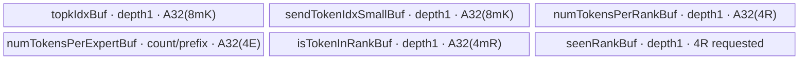
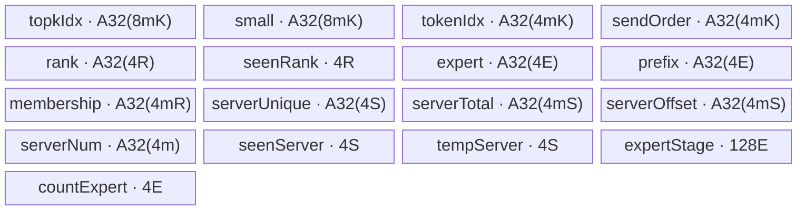

# SGL DeepEP DispatchLayout A2/A3 ACLNN 算子知识

## 算子速览

| 项目 | 内容 |
|---|---|
| 实际入口 | 公开两段式 `aclnnDispatchLayoutGetWorkspaceSize` / `aclnnDispatchLayout`，没有V2/V3后缀；Python default策略只是调用者。 |
| 计算语义 | 对每个token的top-k专家计数，按目的rank去重，并生成同一专家内按token/top-k次序排列的发送序号；A2跨机还生成server去重、偏移和专家到server位置表。 |
| 输入输出 | 输入连续ND `topkIdx:int64[N,K]`；五个ACLNN输出均为INT32：rank计数、逐轮expert计数、token/rank membership、notify打包区、`sendTokenIdxSmall[N,K]`。 |
| 执行类型 | 每条Route均为单个 `dispatch_layout` AIV_VECTOR节点；标量索引、Vector清零、MTE和INT32原子加。没有Cube、MIX、SIMT或远端collective。 |
| Kernel 路线 | R-001：A3通用多轮，key23；R-002：A2单机通用多轮，key23；R-003：A2跨机布局，key123。 |
| 核心资源 | caller输出GM同时承载前缀scratch；TPipe的单份TBuf，没有TQue/双缓冲；Tiling申请18MiB workspace，body不寻址该参数。 |
| 来源闭包 | `source_closed`：ACLNN、OpDef、Host/POD、活动key、完整body与构建闭合；生成式inner bridge及AscendC primitive为框架边界。A2跨机前缀别名的全核读完保护无法在源码证明，卡片保留draft并准确描述该限制。 |
| 验证状态 | 已完成源码闭包检查；本次知识提取未执行编译、真机、数值或性能测试。 |

## 接口与语义

### 计算语义

令 `N=num_tokens`、`R=num_ranks`、`E=num_experts`、`K=num_topk`、`L=local_ranksize`、`P=per_round_tokens`。有效专家集合为 `0<=e<E`，每个rank拥有 `E/R` 个连续专家，目的rank为 `d(e)=floor(e/(E/R))`。通用R-001/R-002按INT64检查并跳过无效专家；R-003第一/第三遍同样按INT64检查，但第二遍先把INT64赋给int再检查，超INT32范围ID可在该遍窄化为合法expert并推进游标，因此不满足无效ID一致跳过合同，调用方须提供合法ID；`sendTokenIdxSmall`的无效槽位没有被初始化，不能消费其值。

对通用路线，第r轮token区间为 `I_r=[rP,min((r+1)P,N))`：

```text
expert_count[r,e] = Σ(t in I_r) Σ(j<K) [topkIdx[t,j]=e]
membership[t,d] = [存在有效j，使d(topkIdx[t,j])=d]
rank_count[d] = Σ(t<N) membership[t,d]
small[t,j] = Σ((u,v)在同一轮中按(u,v)字典序早于(t,j)) [topkIdx[u,v]=topkIdx[t,j]]
```

expert计数按出现次数计算，同一token多次选择同一rank只计一个rank token；同一专家重复出现仍累计多次。`small`是零起点，通用多轮每轮重新开始，不是全N范围连续序号。`notifySendData`在通用路线只作为按核expert exclusive-prefix scratch使用，不能按A2跨机打包协议解释。

A2跨机路线不分轮。令 `S=ceil(R/L)`、`s(e)=floor(d(e)/L)`：每个token的每个server只增加一次unique计数，但`total_count[t,s]`保留全部top-k出现次数；`server_offset[t,s]`在membership非零时写该token在server内的一起点位置，未命中写零。`send_order[t,j]=small[t,j]+1`；`expert_rank_token_idx[e,k]`保存该专家第k次出现对应的server一起点位置。它们都是本rank准备的数据，没有发送到远端。

### 输入、输出与属性

| 参数 | shape/layout | dtype | 约束、默认值与语义 |
|---|---|---|---|
| `topkIdx` | 连续ND `[N,K]` | INT64 | `1<=K<=16`；索引值不在Host扫描；有效槽位为`0<=e<E`。 |
| `num_tokens` | 标量 | ACLNN INT64→POD UINT32 | 与输入首维一致；通用路线P>0且N=0时Q=0、不写输出但仍按P分配UB；A2跨机N=0会以A=0进行分核除法。 |
| `num_ranks` | 标量 | INT64→UINT32 | `1<=R<=384`；`E%R==0`。 |
| `num_experts` | 标量 | INT64→UINT32 | 公开接口约束`1<=E<=512`；活动ops2上限512、ops上限1024；公开合同仍取512。 |
| `num_topk` | 标量 | INT64→UINT32 | 等于K；ops校验与输入第二维一致，ops2只验证输入为二维，直接ACLNN调用者必须自行保持一致。 |
| `local_ranksize` | 标量 | INT64→UINT32 | Buffer固定8；A2跨机要求1..8且R%L==0；该值参与活动A2的Route选择。 |
| `per_round_tokens` | 标量 | ACLNN INT32→属性INT64→UINT32 | 通用路线要求P>0；Buffer默认8192，配置范围32..8192。 |
| `rank_id` | 标量 | ACLNN INT32→UINT32 | Buffer校验`0<=rank<R`；布局body读取后不参与地址/结果计算。 |
| `numTokensPerRank` | `[R]` | INT32 | 原子累加，必须由caller预先清零；计数覆盖全部实际轮。 |
| `numTokensPerExpert` | `[configured_rounds,E]`或等价连续容量 | INT32 | 通用路线按rE存放计数；A2跨机只写前E项；原子目标应清零。 |
| `isTokenInRank` | `[N,R]` | INT32 | 精确0/1；实际C++原样返回INT32，没有转BOOL。 |
| `notifySendData` | 连续打包GM | INT32 | 通用路线为核前缀scratch，A2跨机为下文布局；caller分配并清零。 |
| `sendTokenIdxSmall` | `[N,K]` | INT32 | 有效专家槽位的零起点顺序；无效槽位无定义。 |
| `workspaceSize/executor` | 输出指针 | UINT64/框架对象 | GetWorkspaceSize产生；执行函数显式接收workspace、executor和stream。 |

### 入口与版本

公开文档 `GET_DISPATCH_LAYOUT_API.md`给出A2/A3/A5支持；DeepEP README声明CANN9.0.0与9.1.0，本卡冻结较新的9.1.0。公开文档的expert上限512和token范围优先保留；Buffer的131072总token容量和Host的1024专家校验属于实现边界，不能自动放大公开范围。A2公开单机N<=8192、跨机N<=4096；A3不开长序列N<=8192，开启时文档上限32k。

Python `Buffer.get_dispatch_layout` → `DefaultNormalCommStrategy.get_dispatch_layout` → pybind `deep_ep::Buffer::get_dispatch_layout` → ACLNN。`DEEP_USE_MODE=alltoall`选另一套Python算法，不到本入口，不是本卡fallback。文档返回BOOL、单维E计数的描述与当前C++不完全一致：当前返回INT32 membership及`configured_rounds*E`展平计数；事件与RDMA计数返回nullopt。

## Host/Launcher 执行流程

### 参数校验与前处理

1. Buffer校验二维、contiguous、E>0、N<=131072、P在32..8192、rank有效、N不超过配置round*P、实际轮数不超过256；`round`与`P`环境变量必须同时设置或同时缺省，乘积不超过131072。
2. Buffer以同设备INT32 `zeros`分配五个输出。没有对输入进行dtype cast、Sort或布局变换；ACLNN Host检查INT64输入和全部INT32输出、ND由OpDef定义。
3. `aclnnDispatchLayoutGetWorkspaceSize`直接透传同名inner版本；没有自有Contiguous/View或额外核心算子。inner代码由`npu_op_code_gen`生成，是框架边界。
4. `GetAttrAndSetTilingData`校验属性与指针，随后`TilingCheckTensor`检查dtype/shape，`SetWorkSpace`请求单段workspace，再选择key、blockDim和totalUbSize。任一步返回`GRAPH_FAILED`则不形成有效执行计划。
5. `aclnnDispatchLayout`若弱符号`NnopbaseSetHcclServerType`存在则设MTE server，随后调用inner执行；这里没有HCCL group、window、BatchWrite、RDMA或CCU操作。

### 参数、Workspace 与生命周期

Tiling的workspace请求为 `16MiB+1MiB+1MiB=18,874,368 bytes`，不随N变化。Body接收`workspace`但没有读写该指针，实际算法scratch位于caller的`notifySendData`。该18MiB不可伪装成自定义tensor的可用容量，也没有仓内证据可把其任意slice分配给layout算法。`SyncAll<true>`的内部机制属于AscendC primitive边界。

Buffer的notify分配为 `4*[4097E+floor(R/8)+4096*(1+2floor(R/8)+2K)] bytes`，以`MAX_BATCH_SIZE=4096`固定打包。`this->notify_send_data`、`send_token_idx_small`保存张量供后续notify/dispatch；前者是本卡输出scratch而非远端window。重叠调用同一个Buffer会覆盖这些成员，不能在后续消费者完成前复用。

直接ACLNN调用者持有输入、输出和workspace直到stream上执行完成。C++桥`EXEC_NPU_CMD`查询workspace后分配BYTE tensor，将裸指针捕获到`OpCommand` handler；局部workspace tensor在块结束即离开作用域，源码依赖NPU allocator/OpCommand的框架生命周期保证，没有显式stream record或同步。本卡不据此宣称已验证异步内存安全。转换出的ACL tensor描述在成功调用后释放，executor释放由inner框架管理。

### 启动图与失败传播


| 节点/边 | producer→consumer | offset/extent、dtype/layout | ordering与owner/lifetime | 失败传播 |
|---|---|---|---|---|
| 计划 | `aclnnInnerDispatchLayoutGetWorkspaceSize`→Tiling | 完整POD及18MiB请求 | 框架executor拥有计划；非Device节点 | wrapper原样返回status |
| 唯一Device节点 | inner launcher→`dispatch_layout` | 八参数：六个tensor GM、workspace、tiling；blockDim=C=GetCoreNumAiv；无动态UB参数 | caller stream；TPipe是entry局部对象 | 未知key无body、没有fallback错误输出 |
| 输出 | `Process`→后续caller | rank/expert/membership/small、notify区域，见逐Route字节表 | 同stream消费或调用者显式建立跨stream依赖；Buffer不消费previous_event | EXEC宏在workspace/launch非零status时TORCH_CHECK；没有后继核心kernel |

`zeros`属于调用者初始化，不是隐藏在本ACLNN内的第二核心节点。该launch graph没有kernel间workspace边、远端通信handle或通信失败重试。

## Route 与参数设计

### 分核与资源计算

记 `A32(x)=32*ceil(x/32)`。通用路线 `Q=ceil(N/P)`；首轮大小 `F=(Q==1?N:P)`，`A=min(F,C)`。核c持有 `m=floor(F/A)+[c<F%A]` 个token，起点 `s=c*floor(F/A)+min(c,F%A)`。UB按首轮m分配一次；末轮先用此前A求m与s，再更新`A=min(tail,C)`，inactive核仍参加每轮两次SyncAll。

A2跨机路线 `A=min(N,C)`，相同former/tail核公式直接作用于全部N，不读取P，也不分Q轮；`S=ceil(R/L)`，公开有效域R%L=0时为R/L。expert表硬编码4096列，暂存flush硬编码32项。

Host只读取物理UB大小到POD，没有以UB大小调整P、m、核数或选择fallback。下文各项之和必须能被平台TPipe分配，不能把`totalUbSize`当作已经执行了容量准入。

### Route 选择

| 顺序 | Route | Key/模板 | 精确选择条件与优先级 | 不适用去向 |
|---:|---|---|---|---|
| 1 | R-001 A3通用多轮 | 23 / `DispatchLayout<int32_t>` | build.sh选择ops，Short_SoC不为Ascend910B | 未知key不写输出 |
| 2 | R-002 A2单机通用多轮 | 23 / `DispatchLayout<int32_t>` | build.sh选择ops2，Short_SoC=Ascend910B且`R<=L` | 下一Route仅在R>L时选择 |
| 3 | R-003 A2跨机布局 | 123 / `DispatchLayoutA2<int32_t>` | ops2且Short_SoC=Ascend910B、`R>L`；L在1..8、R%L=0 | 属性错误GRAPH_FAILED |

```text
A3 -> ops -> key23 -> ops/DispatchLayout<int32_t>
A2 -> ops2 -> CheckIfA2MultiMachine:
  Short_SoC==Ascend910B && uint32(R)>uint32(L) -> key123 -> ops2/DispatchLayoutA2<int32_t>
  else -> key23 -> ops2/DispatchLayout<int32_t>
```

### 模板/实现执行矩阵

| Route | key/selector | dtype/shape/platform 完整命中条件 | 执行拓扑与 Kernel 节点 | 实际模板/body | 内存与同步特征 | tail/fallback |
|---|---|---|---|---|---|---|
| R-001 A3通用多轮 | 23 | A3、INT64→INT32、N/P>0、公开E<=512 | 单节点dispatch_layout | `MoeDispatchLayout::DispatchLayout<int32_t>`，ops版 | 六TBuf、每轮两次SyncAll、前缀scratch | 分轮tail；无fallback |
| R-002 A2单机通用多轮 | 23 | A2、R<=L、INT64→INT32、N/P>0 | 单节点dispatch_layout | 同名类的ops2版 | 与R-001同算法，部分地址乘法未先扩64位 | 分轮tail；无fallback |
| R-003 A2跨机布局 | 123 | A2、R>L、1<=L<=8、R%L=0、N<=4096 | 单节点dispatch_layout | `MoeDispatchLayoutA2::DispatchLayoutA2<int32_t>`，ops2版 | 17次TBuf分配、全N一次处理、一次SyncAll、打包scratch复用 | 按专家32项flush及rest；无fallback |

### 隐藏性能 Guard

| Guard | Host/Tiling 条件 | Device/资源原因 | 影响 Route | 不满足时去向 | 源码符号 |
|---|---|---|---|---|---|
| P/核数及跨机N非零 | Buffer允许N=0；ops允许P=0；没有专用空域selector | 通用P=0会除零；通用P>0且N=0为Q=0无输出；A2跨机A=min(N,C)，A=0会除零 | 通用；A2跨机 | 无备用模板；按各body边界调用 | `DispatchLayout::Init`、`DispatchLayoutA2::Init` |
| UB容量 | 只记录UB，无`UB_req<=UB`拒绝 | 所有核一次容纳mK输入、mR membership；跨机还有mS及E*32表 | 全部 | 超容量无第二模板 | `InitBuffer`与`totalUbSize` |
| E%R=0 | 显式拒绝不整除 | 专家→rank整除映射 | 全部 | GRAPH_FAILED | `GetAttrAndSetTilingData` |
| A2跨机L | 活动ops2在R>L时校验1..8、R%L=0 | 专家→server及固定notify布局 | A2跨机 | GRAPH_FAILED | `CheckIfA2MultiMachine` |
| DMA物理extent | 输入按A32(8mK)读取；多个expert搬运按A32(4E) | 逻辑末尾不足整32B仍发起对齐长度DMA | 全部 | 无自动guard；caller确保物理容量，不能把未参与计算的padding当有效数据 | `DataCopyExtParams` |
| 原子目标初值 | ACLNN wrapper不清零，Buffer用zeros | rank/expert与A2前缀scratch使用AtomicAdd | 全部 | 旧值会累计进结果，没有自动reset全部目标 | Buffer分配、`SetAtomicAdd<int32_t>` |
| 公开/实现容量 | 文档E<=512；ops校验E<=1024；跨机N<=4096 | 不同层约束不是同一支持声明 | 全部 | 不扩大公开有效域 | 公开API、Host常量、MAX_BATCH_SIZE |

### POD/ABI

`DispatchLayoutInfo`七个UINT32之后为UINT64。按声明的自然8字节UINT64对齐，字段内偏移为下表，Info的预期sizeof=40、alignof=8；这是源码布局推导，未编译测量。`DispatchLayoutTilingData`先含两个外部SDK的Mc2结构，因此Info在外层的绝对offsetof、整个POD的sizeof/alignof无法仅从固定仓确定；Host/Device必须使用同版本SDK头文件，不能硬编码猜测。

| 结构 | 字段 | 类型/位宽 | ABI 布局 | 单位 | Host/launcher producer | Device consumer | 边界 |
|---|---|---|---|---|---|---|---|
| DispatchLayoutInfo | numTokens | UINT32/32 | Info+0，4字节 | token | `uint32(*numTokensPtr)` | 两类Init；轮数/核分片 | ops先检查0..UINT32_MAX；ops2直接窄化；实际N>0 |
| DispatchLayoutInfo | numRanks | UINT32/32 | Info+4 | rank | `uint32(*numRanksPtr)` | rank映射、mR、rank计数 | 1..384 |
| DispatchLayoutInfo | numExperts | UINT32/32 | Info+8 | expert | `uint32(*numExpertsPtr)` | expert/rank映射、计数、prefix | ops上限1024、ops2上限512；公开512 |
| DispatchLayoutInfo | numTopk | UINT32/32 | Info+12 | 每token项数 | `uint32(*numTopkPtr)` | mK输入/输出及循环 | 1..16 |
| DispatchLayoutInfo | localRankSize | UINT32/32 | Info+16 | rank/server | `uint32(*localRankSizePtr)` | 通用Init不读；A2跨机算S和server_id | 通用inactive；跨机1..8且R%L=0 |
| DispatchLayoutInfo | perRoundTokens | UINT32/32 | Info+20 | token/轮 | `uint32(*perRoundTokensPtr)` | 通用Init/Process算Q和轮偏移 | A2跨机inactive；通用P>0 |
| DispatchLayoutInfo | rankId | UINT32/32 | Info+24 | rank | `uint32(*rankIdPtr)` | Init存入rankId_，之后不参与计算 | 不能据存在字段推断跨rank通信 |
| DispatchLayoutInfo | totalUbSize | UINT64/64 | Info+32，前4字节padding | byte | `GetCoreMemSize(UB,ubSize)` | 当前两个body均不读取 | 仅记录，不是UB guard |
| DispatchLayoutTilingData | mc2InitTiling | 外部Mc2InitTiling | 外层+0，sizeof/alignof固定仓不可见 | SDK定义 | 本算子Tiling未赋值 | 本算子body不消费 | inactive；不假设默认零 |
| DispatchLayoutTilingData | mc2CcTiling1 | 外部Mc2CcTiling | 外层offsetof固定仓不可见 | SDK定义 | 未赋值 | 不消费 | inactive |
| DispatchLayoutTilingData | dispatchLayoutInfo | 上述Info | 外层offsetof取决于前两结构 | 混合 | `GetTilingData<DispatchLayoutTilingData>()`直接逐字段填充 | `GET_TILING_DATA_WITH_STRUCT`后Init读取 | 无仓内序列化转换 |

### Route 源码闭包

| Route | Key/selector | Host/Tiling producer | POD/参数 | Kernel entry/router 节点 | Kernel body/直接依赖 | 构建接线 |
|---|---|---|---|---|---|---|
| R-001 | 23 / A3 | `ops/op_host/dispatch_layout_tiling.cc::DispatchLayoutTilingFuncImpl` | DispatchLayoutTilingData | ops的dispatch_layout | ops的DispatchLayout::Init/Process/SyncFunc | build.sh→ops、AddConfig(ascend910_93)、ascendc_kernels |
| R-002 | 23 / A2、R<=L | `ops2/op_host/dispatch_layout_tiling.cc::DispatchLayoutTilingFuncImpl` | 同声明POD、不同Host约束 | ops2的dispatch_layout | ops2的DispatchLayout::Init/Process/SyncFunc | build.sh→ops2、AddConfig(ascend910b) |
| R-003 | 123 / A2、R>L | 同上、CheckIfA2MultiMachine | 同POD、P inactive | ops2的dispatch_layout | ops2的DispatchLayoutA2::Init/Process/MultiCoreCompute/SyncFunc | 同上 |

固定仓include的`data_copy.h`、`sync_collectives.h`、`moe_distribute_base.h`没有被本body实例化为通信算法；实际调用只有AscendC Ceil、TBuf/TPipe、DataCopyPad、Duplicate、Cast、Atomic、SyncAll和本类SyncFunc。不存在未闭合的HCCL核心节点。

## Kernel 实现

### 公共执行流程

entry按参数次序解包GM，注册/读取同一POD，创建局部TPipe，以23/123选择一个对象，依次调用Init与Process。没有`g_coreType==AIC`主体、Mmad/Matmul或MIX任务声明。所谓layout是计数/索引预处理，不是NDDMA维度交换。未知key经过两个分支后直接退出，不清空输出，也不返回Device错误码。

### Route R-001：A3通用多轮

#### 适用条件

##### 选择证据

| 层级 | 文件 | 符号 | 源码谓词/参数 | 结果/下一跳 |
|---|---|---|---|---|
| Host | `csrc/deepep/ops/op_host/dispatch_layout_tiling.cc` | DispatchLayoutTilingFuncImpl | SoC为A3，活动ops，key23 | key23，C个AIV |
| Router | `csrc/deepep/ops/op_kernel/dispatch_layout.cpp` | dispatch_layout | TILING_KEY_IS(23) | `MoeDispatchLayout::DispatchLayout<int32_t>` |
| Body | `csrc/deepep/ops/op_kernel/dispatch_layout.h` | Init/Process | N>0、P>0、UB可容纳首轮m | Q轮计数和prefix回读；没有备用body |

#### Device 数据流

##### 函数级调用链

```text
aclnnDispatchLayout -> generated inner launcher
 -> dispatch_layout(...,workspace,tiling), blockDim=C
 -> DispatchLayout<int32_t>::Init : Q、首轮分片、6个TBuf尺寸与GM绑定
 -> DispatchLayout<int32_t>::Process
    -> 每轮tail重算/两次inactive SyncAll
    -> DataCopyPad(topk) / Duplicate / 清本核prefix scratch / SyncAll
    -> 两层scalar token/top-k循环及seenRank去重
    -> membership写回 / AtomicAdd前缀、rank_count、expert_count
    -> SyncAll / 回读exclusive-prefix
    -> 第二遍token/top-k循环写small / DataCopyPad输出
```

##### 源码等价伪码

```text
# 伪码；所有GM偏移下面以元素表示，实际指针需乘相应sizeof
Init: Q=ceil(N/P); F=(Q==1?N:P); A=min(F,C)
      分配时m=floor(F/A)+[c<F%A], s=c*floor(F/A)+min(c,F%A)
for r in [0,Q):
  nr=P
  if 最后一轮且N%P!=0:
    nr=N%P; 用此前A重算m、s和输入/membership有效搬运长度
  A=min(nr,C)
  if c>=A: SyncAll(); SyncAll(); continue
  topk_base=(rP+s)*K; member_base=(rP+s)*R; expert_base=rE
  CopyIn A32(8mK)字节INT64 topk，等待MTE2_S
  Duplicate(rankLocal,0,A32(4R)/4)
  Duplicate(memberLocal,0,A32(4mR)/4); Duplicate(expertLocal,0,A32(4E)/4)
  CopyOut scratch[cE:] <- 0，长度A32(4E); MTE3 barrier; SyncAll()
  for i<m:
    Duplicate(seenRank,0,R); wait V_S
    for j<K:
      e=topk[iK+j]; if e<0 or e>=E: continue
      expertLocal[e]++
      d=e/(E/R)
      if !seenRank[d]: memberLocal[iR+d]=1; seenRank[d]=1; rankLocal[d]++
  CopyOut membership[member_base:], 4mR字节
  AtomicAdd开启
  for k in [c+1,A): scratch[kE:] += expertLocal，搬运A32(4E)字节
  rank_count += rankLocal，4R字节
  expert_count[rE:] += expertLocal，4E字节
  AtomicAdd关闭; MTE3 barrier; SyncAll(); MTE3_MTE2
  CopyIn expertLocal <- scratch[cE:]，A32(4E)字节; wait MTE2_S
  for i<m:
    for j<K:
      e=topk[iK+j]; if e<0 or e>=E: continue
      smallLocal[iK+j]=expertLocal[e]; expertLocal[e]++
  wait S_MTE3; CopyOut small[(rP+s)K:], 4mK字节
```

#### 内存与数据搬运

##### 资源与搬运表

| 层级/缓冲区 | offset/地址公式 | extent/容量公式 | dtype/layout | producer | consumer | owner/lifetime | 对齐/复用 |
|---|---|---|---|---|---|---|---|
| GM topk | `(rP+s)K*8` byte | 有效8mK；DMA A32(8mK) | INT64 `[m,K]` | caller | 第一/二遍标量循环 | caller到stream完成 | 输入末尾须提供DMA可读extent |
| UB topkIdxBuf_ | TPipe独立块 | A32(8mK_first) | INT64 | MTE2 | 两遍计数 | kernel整个Q轮 | depth1，轮间覆盖 |
| UB sendTokenIdxSmallBuf_ | 独立块 | **同输入A32(8mK_first)**，不是A32(4mK) | INT32、超额容量 | 第二遍scalar | MTE3 | 每轮输出完成后再写 | 无效slot未初始化 |
| UB numTokensPerRankBuf_ | 独立块 | A32(4R) | INT32 | Duplicate/scalar | AtomicAdd写rank GM | 每轮清零/累加 | depth1 |
| UB numTokensPerExpertBuf_ | 独立块 | A32(4E) | INT32 | 第一遍local计数；后回读prefix | 原子写回；第二遍序号 | 每轮两阶段覆盖 | 计数与prefix同物理块 |
| UB isTokenInRankBuf_ | 独立块 | A32(4m_first R) | INT32 `[m,R]` | Duplicate/scalar | MTE3 | 每轮 | tail只缩有效extent |
| UB seenRankBuf_ | 独立块 | 请求4R | INT32 | 每token Duplicate | scalar去重 | 每token重用 | TPipe隐式对齐属SDK边界 |
| GM notify prefix | `4*cE` byte | 至少`4AE`，对齐DMA还需末尾padding | INT32 `[A,E]` | 各核k<c原子加 | 核c回读 | 每轮清本核行，第二SyncAll后读取 | 第r轮覆盖第r-1轮内容 |
| GM rank/expert | rank从0；expert从4rE | 4R；4E | INT32 | AtomicAdd | caller | 必须预清零 | expert逐轮，rank跨轮累计 |
| GM membership/small | 4(rP+s)R；4(rP+s)K | 4mR；4mK | INT32 | scalar/Vector | caller | caller持有 | CopyOut无padding写入 |
| workspace/远端window | workspace参数未寻址；无window | Tiling18MiB；算法自有workspace字节为0 | N/A | 框架 | 无算法consumer | caller/框架 | 不挪用notify替代框架workspace |

所有DataCopyExtParams均`blockCount=1,srcStride=0,dstStride=0,rsv=0`；blockLen单位byte。GM→UB padParams为`false,0,0,0`，输入按照对齐字节读取而非只读取有效8mK后由硬件补齐。Duplicate使用count重载，没有仓内显式repeat/mask/stride参数，具体指令分解是AscendC边界。

##### 分层内存布局



##### 字节账与复用顺序

```text
UB_requested(c) = 2*A32(8*m_first*K)+A32(4R)+A32(4E)+A32(4*m_first*R)+4R
UB_reserved = UB_requested + TPipe对未显式对齐请求的分配开销
必要条件：每核UB_reserved <= totalUbSize；Host没有检查该不等式
algorithm_workspace=0；Tiling_workspace=18,874,368 bytes；dynamic_ub=N/A
scratch=4AE bytes + A32(4E)带来的末行padding
整次调用输入有效读取=8NK byte；DMA读取=Σ(r,c)A32(8m_rc K)
每轮prefix清零=A*A32(4E)
每轮前缀原子流量=A(A-1)/2*A32(4E)
每轮rank原子流量=4AR；expert原子流量=4AE
每轮prefix回读=A*A32(4E)；membership提交=4nrR；small提交=4nrK
```

| 复用子区 | 写入者 | 读取者/消费点 | 下一次覆盖 | 同步或释放依据 | 安全条件 |
|---|---|---|---|---|---|
| expert TBuf | 第一遍scalar计数 | MTE3原子输出 | MTE2回读prefix | MTE3 barrier、SyncAll、MTE3_MTE2、MTE2_S | 本轮原子输出完成后才覆盖 |
| notify[c,E] | 清零核c；k<c原子加 | 核c第二遍 | 下一轮清零 | 本轮清零SyncAll和原子SyncAll | 独占调用，不能并发复用相同notify |
| seenRank TBuf | Duplicate置零 | 单个token的top-k scalar | 下一token Duplicate | S_V/V_S | 只去重rank，不去重expert出现次数 |
| topk/small TBuf | MTE2 / scalar | 两遍计算 / MTE3 | 下一轮 | topk MTE2_S、small S_MTE3及下一轮MTE3_V等现有pipe次序 | 保持源码各pipe事件；不新增异步队列假设 |

#### 同步、精度与尾块

##### 同步与数值边界表

| 阶段 | primitive/机制 | producer | consumer/等待点 | 保护对象 | 精度/尾块 |
|---|---|---|---|---|---|
| topk输入 | S_MTE2、MTE2_S | GM输入DMA | scalar GetValue | topk TBuf | INT64原值，不经float |
| 清零与读取 | MTE3_V、V_S、V_MTE3 | Duplicate | scalar计数/清GM | rank/expert/membership | 清到对齐长度，但只有效token参与循环 |
| 前缀初始化 | PIPE_MTE3+SyncAll<true> | 每核清自己scratch行 | 所有核原子加 | notify[A,E] | inactive核也参加 |
| 原子归约完成 | SetAtomicAdd/SetAtomicNone、PIPE_MTE3、SyncAll | 全部核计数 | prefix回读 | rank/expert/notify | INT32加，无浮点舍入；计数不得溢出INT32 |
| prefix回读/序号 | MTE3_MTE2、MTE2_S | scratch DMA | 第二遍scalar | expert TBuf | 无效e跳过，但small槽位未置零 |
| tail与输出 | S_MTE3 | scalar small | MTE3 CopyOut | 4mK输出 | 最后一轮缩m；无效核执行两次SyncAll后continue |

#### 关键实现

##### 符号证据表

| 阶段 | 文件 | 符号/模板实例 | 实现事实 |
|---|---|---|---|
| Host/Tiling producer | `csrc/deepep/ops/op_host/dispatch_layout_tiling.cc` | DispatchLayoutTilingFuncImpl、SetWorkSpace | key23、C个AIV、18MiB、只记录UB |
| Kernel entry/router | `csrc/deepep/ops/op_kernel/dispatch_layout.cpp` | dispatch_layout / TILING_KEY_INT | 23映射INT32通用类 |
| Device body/helper | `csrc/deepep/ops/op_kernel/dispatch_layout.h` | DispatchLayout<int32_t>::Init/Process、SyncFunc | Q轮、前缀atomic扇出、两遍scalar与六TBuf |

### Route R-002：A2单机通用多轮

#### 适用条件

##### 选择证据

| 层级 | 文件 | 符号 | 源码谓词/参数 | 结果/下一跳 |
|---|---|---|---|---|
| Host | `csrc/deepep/ops2/op_host/dispatch_layout_tiling.cc` | DispatchLayoutTilingFuncImpl | SoC=Ascend910B，活动ops2且R<=L，key23 | key23，C个AIV |
| Router | `csrc/deepep/ops2/op_kernel/dispatch_layout.cpp` | dispatch_layout | TILING_KEY_IS(23) | `MoeDispatchLayout::DispatchLayout<int32_t>` |
| Body | `csrc/deepep/ops2/op_kernel/dispatch_layout.h` | Init/Process | N>0、P>0、UB可容纳首轮m | Q轮计数和prefix回读；没有备用body |

#### Device 数据流

##### 函数级调用链

```text
aclnnDispatchLayout -> generated inner launcher
 -> dispatch_layout(...,workspace,tiling), blockDim=C
 -> DispatchLayout<int32_t>::Init : Q、首轮分片、6个TBuf尺寸与GM绑定
 -> DispatchLayout<int32_t>::Process
    -> 每轮tail重算/两次inactive SyncAll
    -> DataCopyPad(topk) / Duplicate / 清本核prefix scratch / SyncAll
    -> 两层scalar token/top-k循环及seenRank去重
    -> membership写回 / AtomicAdd前缀、rank_count、expert_count
    -> SyncAll / 回读exclusive-prefix
    -> 第二遍token/top-k循环写small / DataCopyPad输出
```

##### 源码等价伪码

```text
# 伪码；所有GM偏移下面以元素表示，实际指针需乘相应sizeof
Init: Q=ceil(N/P); F=(Q==1?N:P); A=min(F,C)
      分配时m=floor(F/A)+[c<F%A], s=c*floor(F/A)+min(c,F%A)
for r in [0,Q):
  nr=P
  if 最后一轮且N%P!=0:
    nr=N%P; 用此前A重算m、s和输入/membership有效搬运长度
  A=min(nr,C)
  if c>=A: SyncAll(); SyncAll(); continue
  topk_base=(rP+s)*K; member_base=(rP+s)*R; expert_base=rE
  CopyIn A32(8mK)字节INT64 topk，等待MTE2_S
  Duplicate(rankLocal,0,A32(4R)/4)
  Duplicate(memberLocal,0,A32(4mR)/4); Duplicate(expertLocal,0,A32(4E)/4)
  CopyOut scratch[cE:] <- 0，长度A32(4E); MTE3 barrier; SyncAll()
  for i<m:
    Duplicate(seenRank,0,R); wait V_S
    for j<K:
      e=topk[iK+j]; if e<0 or e>=E: continue
      expertLocal[e]++
      d=e/(E/R)
      if !seenRank[d]: memberLocal[iR+d]=1; seenRank[d]=1; rankLocal[d]++
  CopyOut membership[member_base:], 4mR字节
  AtomicAdd开启
  for k in [c+1,A): scratch[kE:] += expertLocal，搬运A32(4E)字节
  rank_count += rankLocal，4R字节
  expert_count[rE:] += expertLocal，4E字节
  AtomicAdd关闭; MTE3 barrier; SyncAll(); MTE3_MTE2
  CopyIn expertLocal <- scratch[cE:]，A32(4E)字节; wait MTE2_S
  for i<m:
    for j<K:
      e=topk[iK+j]; if e<0 or e>=E: continue
      smallLocal[iK+j]=expertLocal[e]; expertLocal[e]++
  wait S_MTE3; CopyOut small[(rP+s)K:], 4mK字节
```

#### 内存与数据搬运

##### 资源与搬运表

| 层级/缓冲区 | offset/地址公式 | extent/容量公式 | dtype/layout | producer | consumer | owner/lifetime | 对齐/复用 |
|---|---|---|---|---|---|---|---|
| GM topk | `(rP+s)K*8` byte | 有效8mK；DMA A32(8mK) | INT64 `[m,K]` | caller | 第一/二遍标量循环 | caller到stream完成 | 输入末尾须提供DMA可读extent |
| UB topkIdxBuf_ | TPipe独立块 | A32(8mK_first) | INT64 | MTE2 | 两遍计数 | kernel整个Q轮 | depth1，轮间覆盖 |
| UB sendTokenIdxSmallBuf_ | 独立块 | **同输入A32(8mK_first)**，不是A32(4mK) | INT32、超额容量 | 第二遍scalar | MTE3 | 每轮输出完成后再写 | 无效slot未初始化 |
| UB numTokensPerRankBuf_ | 独立块 | A32(4R) | INT32 | Duplicate/scalar | AtomicAdd写rank GM | 每轮清零/累加 | depth1 |
| UB numTokensPerExpertBuf_ | 独立块 | A32(4E) | INT32 | 第一遍local计数；后回读prefix | 原子写回；第二遍序号 | 每轮两阶段覆盖 | 计数与prefix同物理块 |
| UB isTokenInRankBuf_ | 独立块 | A32(4m_first R) | INT32 `[m,R]` | Duplicate/scalar | MTE3 | 每轮 | tail只缩有效extent |
| UB seenRankBuf_ | 独立块 | 请求4R | INT32 | 每token Duplicate | scalar去重 | 每token重用 | TPipe隐式对齐属SDK边界 |
| GM notify prefix | `4*cE` byte | 至少`4AE`，对齐DMA还需末尾padding | INT32 `[A,E]` | 各核k<c原子加 | 核c回读 | 每轮清本核行，第二SyncAll后读取 | 第r轮覆盖第r-1轮内容 |
| GM rank/expert | rank从0；expert从4rE | 4R；4E | INT32 | AtomicAdd | caller | 必须预清零 | expert逐轮，rank跨轮累计 |
| GM membership/small | 4(rP+s)R；4(rP+s)K | 4mR；4mK | INT32 | scalar/Vector | caller | caller持有 | CopyOut无padding写入 |
| workspace/远端window | workspace参数未寻址；无window | Tiling18MiB；算法自有workspace字节为0 | N/A | 框架 | 无算法consumer | caller/框架 | 不挪用notify替代框架workspace |

所有DataCopyExtParams均`blockCount=1,srcStride=0,dstStride=0,rsv=0`；blockLen单位byte。GM→UB padParams为`false,0,0,0`，输入按照对齐字节读取而非只读取有效8mK后由硬件补齐。Duplicate使用count重载，没有仓内显式repeat/mask/stride参数，具体指令分解是AscendC边界。

##### 分层内存布局


##### 字节账与复用顺序

```text
UB_requested(c) = 2*A32(8*m_first*K)+A32(4R)+A32(4E)+A32(4*m_first*R)+4R
UB_reserved = UB_requested + TPipe对未显式对齐请求的分配开销
必要条件：每核UB_reserved <= totalUbSize；Host没有检查该不等式
algorithm_workspace=0；Tiling_workspace=18,874,368 bytes；dynamic_ub=N/A
scratch=4AE bytes + A32(4E)带来的末行padding
整次调用输入有效读取=8NK byte；DMA读取=Σ(r,c)A32(8m_rc K)
每轮prefix清零=A*A32(4E)
每轮前缀原子流量=A(A-1)/2*A32(4E)
每轮rank原子流量=4AR；expert原子流量=4AE
每轮prefix回读=A*A32(4E)；membership提交=4nrR；small提交=4nrK
```

| 复用子区 | 写入者 | 读取者/消费点 | 下一次覆盖 | 同步或释放依据 | 安全条件 |
|---|---|---|---|---|---|
| expert TBuf | 第一遍scalar计数 | MTE3原子输出 | MTE2回读prefix | MTE3 barrier、SyncAll、MTE3_MTE2、MTE2_S | 本轮原子输出完成后才覆盖 |
| notify[c,E] | 清零核c；k<c原子加 | 核c第二遍 | 下一轮清零 | 本轮清零SyncAll和原子SyncAll | 独占调用，不能并发复用相同notify |
| seenRank TBuf | Duplicate置零 | 单个token的top-k scalar | 下一token Duplicate | S_V/V_S | 只去重rank，不去重expert出现次数 |
| topk/small TBuf | MTE2 / scalar | 两遍计算 / MTE3 | 下一轮 | topk MTE2_S、small S_MTE3及下一轮MTE3_V等现有pipe次序 | 保持源码各pipe事件；不新增异步队列假设 |

#### 同步、精度与尾块

##### 同步与数值边界表

| 阶段 | primitive/机制 | producer | consumer/等待点 | 保护对象 | 精度/尾块 |
|---|---|---|---|---|---|
| topk输入 | S_MTE2、MTE2_S | GM输入DMA | scalar GetValue | topk TBuf | INT64原值，不经float |
| 清零与读取 | MTE3_V、V_S、V_MTE3 | Duplicate | scalar计数/清GM | rank/expert/membership | 清到对齐长度，但只有效token参与循环 |
| 前缀初始化 | PIPE_MTE3+SyncAll<true> | 每核清自己scratch行 | 所有核原子加 | notify[A,E] | inactive核也参加 |
| 原子归约完成 | SetAtomicAdd/SetAtomicNone、PIPE_MTE3、SyncAll | 全部核计数 | prefix回读 | rank/expert/notify | INT32加，无浮点舍入；计数不得溢出INT32 |
| prefix回读/序号 | MTE3_MTE2、MTE2_S | scratch DMA | 第二遍scalar | expert TBuf | 无效e跳过，但small槽位未置零 |
| tail与输出 | S_MTE3 | scalar small | MTE3 CopyOut | 4mK输出 | 最后一轮缩m；无效核执行两次SyncAll后continue |

#### 关键实现

##### 符号证据表

| 阶段 | 文件 | 符号/模板实例 | 实现事实 |
|---|---|---|---|
| Host/Tiling producer | `csrc/deepep/ops2/op_host/dispatch_layout_tiling.cc` | DispatchLayoutTilingFuncImpl、SetWorkSpace | key23、C个AIV、18MiB、只记录UB |
| Kernel entry/router | `csrc/deepep/ops2/op_kernel/dispatch_layout.cpp` | dispatch_layout / TILING_KEY_INT | 23映射INT32通用类 |
| Device body/helper | `csrc/deepep/ops2/op_kernel/dispatch_layout.h` | DispatchLayout<int32_t>::Init/Process、SyncFunc | Q轮、前缀atomic扇出、两遍scalar与六TBuf |

### Route R-003：A2跨机server与expert打包布局

#### 适用条件

##### 选择证据

| 层级 | 文件 | 符号 | 源码谓词/参数 | 结果/下一跳 |
|---|---|---|---|---|
| Host | `csrc/deepep/ops2/op_host/dispatch_layout_tiling.cc` | CheckIfA2MultiMachine | Short_SoC=Ascend910B && R>L | key123；L在1..8且R%L=0 |
| Router | `csrc/deepep/ops2/op_kernel/dispatch_layout.cpp` | dispatch_layout | TILING_KEY_IS(123) | DispatchLayoutA2<int32_t> |
| Body | `csrc/deepep/ops2/op_kernel/dispatch_layout_a2.h` | Init/Process/MultiCoreCompute | N>0、N<=4096、UB容得下全核分片 | 不分轮；N小于C时其他核只参加一次SyncAll |

#### Device 数据流

##### 函数级调用链

```text
inner launcher -> dispatch_layout key123
 -> MoeDispatchLayoutA2::DispatchLayoutA2<int32_t>::Init
    -> 全N分核、17个TBuf尺寸、notify八区及scratch别名绑定
 -> Process -> active: MultiCoreCompute; inactive: SyncAll<true>
 -> topk CopyIn + INT64→INT32 Cast + 初始化
 -> token/top-k第一遍：expert计数、rank/server去重、server总数
 -> CopyOut membership/server字段/tokenIdx + 原子前缀扇出/全局计数
 -> PIPE_MTE3 + SyncAll + 回读expert/server prefix
 -> 清理本核prefix GM + 生成server一起点offset；第二遍INT64→int窄化后检查，生成expert一起点send_order
 -> 第三遍：按expert累计32项server offset并flush、写small
 -> 每expert余数flush；没有后继Device节点
```

##### 源码等价伪码

```text
# 伪码；W=4096，B=E+S+W*(1+2S+2K)，T=int32
A=min(N,C); q=N/A; rem=N%A; m=q+[c<rem]; s=c*q+min(c,rem)
if c>=A: SyncAll(); return
CopyIn topk[sK:], length=A32(8mK); Duplicate全部实际分配的计数/标志
Cast(tokenIdx:int32, topk:int64, CAST_NONE, A32(8mK)/8)
for i<m:
  seenRank[:]=0; seenServer[:]=0
  for j<K:
    e=topk[iK+j]; if e<0 or e>=E: continue
    expertLocal[e]++; d=e/(E/R); h=d/L
    if !seenServer[h]: uniqueLocal[h]++; serverFlag[iS+h]=1; serverNum[i]++; seenServer[h]=1
    totalLocal[iS+h]++
    if !seenRank[d]: rankLocal[d]++; member[iR+d]=1; seenRank[d]=1
CopyOut member、serverNum、totalLocal、tokenIdx，全部用有效字节数
AtomicAdd开启
for k in (c,A): notify[B+kE:] += expertLocal (A32(4E)字节)
for k in (c,A): notify[B+AE+kS:] += uniqueLocal (4S字节)
notify[E:E+S] += uniqueLocal; rank_count += rankLocal (A32(4R)字节)
notify[0:E] += expertLocal; expert_count[0:E] += expertLocal (A32(4E)字节)
AtomicAdd关闭; PIPE_MTE3; SyncAll; MTE3_MTE2
回读本核exclusiveExpert和exclusiveServer到UB
MTE2_MTE3；把本核prefix GM行清零；MTE3_V、MTE3_S
serverCursor=exclusiveServer; expertCursor=exclusiveExpert
for i<m:
  for h<S:
    flag=serverFlag[iS+h]
    serverOffset[iS+h]=flag*serverCursor[h]+flag
    serverCursor[h]+=flag
for i<m:
  for j<K:
    e=int32(topk[iK+j]); if e<0 or e>=E: continue  # 第二遍先窄化，再检查；与第一/第三遍INT64检查不同
    sendOrder[iK+j]=++expertCursor[e]
CopyOut sendOrder与serverOffset
countExpert[:]=0
for i<m:
  for j<K:
    e=topk[iK+j]; if invalid: continue
    h=(e/(E/R))/L; pos=serverOffset[iS+h]; k=countExpert[e]
    expertStage[e*32+k%32]=pos; countExpert[e]++
    small[iK+j]=sendOrder[iK+j]-1
    if countExpert[e]%32==0:
      CopyOut notify[B+eW+exclusiveExpert[e]+countExpert[e]-32:],128字节
      wait MTE3_S，允许覆盖该expert的stage
CopyOut small，4mK字节
for e<E:
  tail=countExpert[e]%32
  if tail>0: CopyOut notify[B+eW+exclusiveExpert[e]+countExpert[e]-tail:],4tail字节
```

#### 内存与数据搬运

##### 资源与搬运表

下表notify偏移与extent均以INT32元素计，转换byte统一乘4。`W=4096`，`B=E+S+W*(1+2S+2K)`；本核token起点s。所有区域位于同一caller GM allocation。

| 层级/缓冲区 | offset/地址公式 | extent/容量公式 | dtype/layout | producer | consumer | owner/lifetime | 对齐/复用 |
|---|---|---|---|---|---|---|---|
| GM expert总数 | notify+0 | E | INT32 | 原子加 | 下游notify | caller先清零 | expert_count另独立输出同值 |
| GM server去重总数 | notify+E | S | INT32 | 原子加 | 下游notify | caller先清零 | 每token/server只计1 |
| GM token/server总数 | notify+E+S+sS | WS容量、有效mS | INT32 `[W,S]` | 第一遍scalar | 下游notify | caller | CopyOut 4mS |
| GM token的server数 | notify+E+S+WS+s | W容量、有效m | INT32 | 第一遍scalar | 下游notify | caller | CopyOut 4m |
| GM server位置 | notify+E+S+W(S+1)+sS | WS容量、有效mS | INT32 | serverCursor | 下游notify及expert表生成 | caller/当前body | 一起点，未命中0 |
| GM sendOrder | notify+E+S+W(1+2S)+sK | WK容量、有效mK | INT32 | expertCursor | 下游notify | caller | 一起点，按top-k稀疏保存 |
| GM tokenIdx | notify+E+S+W(1+2S+K)+sK | WK容量、有效mK | INT32 | Cast(INT64) | 下游notify | caller | 无效索引不进入统计 |
| GM expert位置表 | notify+B+eW+expertPrefix[e] | EW容量，专家e实际count项 | INT32 `[E,W]` | 32项stage/余数 | 下游notify | caller | 起始B同时承载临时prefix |
| GM tempExpert别名 | notify+B+cE | AE | INT32 | 低编号核原子加 | 核c回读 | 第一阶段到回读完成 | 与expert位置表同base B |
| GM tempServer别名 | notify+B+AE+cS | AS | INT32 | 低编号核原子加 | 核c回读 | 同上 | 需A(E+S)<=WE才能落在预留尾区 |
| UB输入/小输出 | 独立topkIdxBuf/sendTokenIdxSmallBuf | 各A32(8mK) | INT64 / INT32 | MTE2 / scalar | scalar / MTE3 | 全kernel | small按INT64容量分配 |
| UB tokenIdx/sendOrder | tokenIdxBuf/sendTokenIdxBuf | 各A32(4mK) | INT32 | Cast / scalar | MTE3 | 全kernel | 不建立mE稠密路由矩阵 |
| UB rank/seenRank | numTokensPerRankBuf/seenRankBuf | A32(4R) / 4R请求 | INT32 | Duplicate/scalar | 原子加/去重 | 每核 | 单份 |
| UB expert/prefix/count | numTokensPerExpertBuf/prefixCountPerExpertBuf/countExpertBuf | 两份A32(4E)+4E请求 | INT32 | 本核计数/GM回读/scalar | 原子加、expert序号、flush | 分阶段复用 | prefixCount先清零后用于清GM再装prefix |
| UB membership | isTokenInRankBuf | A32(4mR) | INT32 | scalar | MTE3 | 每核 | 有效mR |
| UB server计数/offset | localTokenServerUniqCountBuf、localTokenServerTotalCountBuf、localTokenServerOffsetBuf、localTokenServerNumBuf | A32(4S)、两份A32(4mS)、A32(4m) | INT32 | scalar | MTE3/后序scalar | 每核 | offset由0/1改为一起点序号 |
| UB seenServer/tempServer | 两个独立块 | 各4S请求 | INT32 | Duplicate、prefix回读后scalar | 去重/serverCursor | 每核 | 不与其他TBuf物理alias |
| UB expert stage | expertRankTokenIdxBuf | A32(4E*32)=128E | INT32 `[E,32]` | 第三遍scalar | MTE3 | 每expert每32项 | 完整flush后MTE3_S再覆盖 |

总共17次InitBuffer，`countServerBuf_`只是声明而没有分配/使用，不计入UB。没有队列、双缓冲、L1/L0、dynamic UB或远端window。

##### 分层内存布局



##### 字节账与复用顺序

```text
UB_requested = 2*A32(8mK)+2*A32(4mK)+A32(4R)+4R
             +2*A32(4E)+4E+A32(4mR)+A32(4S)
             +2*A32(4mS)+A32(4m)+8S+128E
UB_reserved = UB_requested + TPipe隐式对齐分配开销；必须<=平台UB，Host没有检查
notify allocation = 4*(B+WE)，caller必须清零所有原子目标/prefix scratch
prefix overlay必要容量 = 4*A*(E+S) <= 4WE
输入DMA=Σc A32(8mK)；Cast count=A32(8mK)/8
prefix expert扇出=A(A-1)/2*A32(4E)，server扇出=A(A-1)/2*4S
原子汇总每核：A32(4R)+2*A32(4E)+4S
expert表完整组每组128 bytes，余数组每组4*(count%32) bytes
Tiling_workspace=18MiB；算法workspace=0；dynamic_ub=N/A
```

| 复用子区 | 写入者 | 读取者/消费点 | 下一次覆盖 | 同步或释放依据 | 安全条件 |
|---|---|---|---|---|---|
| notify+B的prefix/expert表重叠 | 前缀原子加 | 各核MTE2回读 | 先清自己的prefix，再写expert位置表 | 原子后SyncAll；本核MTE2_MTE3、MTE3_S | 仓内没有“全部核均已回读”的第二个SyncAll；不能把本核完成外推为跨核alias绝对安全，属于未实测的竞争边界 |
| expert UB计数→exclusivePrefix | 第一遍scalar | 原子输出/回读后第三遍 | MTE2回读 | PIPE_MTE3、SyncAll、MTE3_MTE2 | 保留本核prefix读写次序 |
| prefixCount UB | Duplicate清零 | 清本核GM scratch | DataCopy装exclusivePrefix | MTE2_MTE3、MTE3_V/MTE3_S、PIPE_V | 清GM提交后才能覆盖清零buffer |
| expertStage[e,32] | 第三遍scalar | 每32项MTE3 | 同expert下32项 | 完整组后MTE3_S | rest只写实际个数；N和每expert有效出现数不得超过W槽位 |
| serverOffset UB | 初始membership标志 | serverCursor | 改写一起点offset | scalar循环顺序、S_MTE3 | 只有命中server的项参与加一 |

#### 同步、精度与尾块

##### 同步与数值边界表

| 阶段 | primitive/机制 | producer | consumer/等待点 | 保护对象 | 精度/尾块 |
|---|---|---|---|---|---|
| 输入/初始化 | MTE2_S、V_S | topk DMA/计数Duplicate | scalar第一遍 | 各TBuf | tokenIdx用CAST_NONE INT64→INT32；有效专家<=512可精确表示 |
| 局部统计到GM | S_MTE3、AtomicAdd/None | scalar local count | MTE3写GM | rank/expert/server/prefix | INT32；无效e跳过，top-k重复仍算出现次数 |
| 跨核前缀 | PIPE_MTE3、SyncAll、MTE3_MTE2 | 全部原子加 | prefix DMA | tempExpert/tempServer | 全C核参加一次；inactive核不提前退出 |
| prefix清理到后续 | MTE2_MTE3、MTE3_V、MTE3_S | 本核回读与写零 | prefixCount和tempServer覆盖 | UB及本核GM行 | 没有额外全核读完barrier，重叠竞争不作已验证保证 |
| INT32局部复制 | DataCopy(...,E)、PIPE_V | expert前缀 | scalar expertCursor | prefixCount | 计数重载无显式repeat参数 |
| expertStage复用 | S_MTE3、MTE3_S | 累计32项 | 下32项scalar覆盖 | 128bytes/e | rest为count%32，仅传4rest bytes |
| 末尾输出 | S_MTE3 | small与余数stage | MTE3 | 最后部分 | small无效槽位未初始化；没有N=0安全路 |

#### 关键实现

##### 符号证据表

| 阶段 | 文件 | 符号/模板实例 | 实现事实 |
|---|---|---|---|
| Host/Tiling producer | `csrc/deepep/ops2/op_host/dispatch_layout_tiling.cc` | CheckIfA2MultiMachine、GetAttrAndSetTilingData | R>L选择123、R%L校验、E<=512 |
| Kernel entry/router | `csrc/deepep/ops2/op_kernel/dispatch_layout.cpp` | TILING_KEY_A2_INT | 123映射DispatchLayoutA2<int32_t> |
| Device body/helper | `csrc/deepep/ops2/op_kernel/dispatch_layout_a2.h` | Init、MultiCoreCompute、SyncFunc | 稀疏mK、server去重、prefix别名、32项flush与17块UB |

## 算子特定优化

### Trick T-001：把exclusive-prefix写入扇出原子累加

#### 触发与源码依据

- 适用 Route：全部通用路线；A2跨机对expert/server各做一次相同扇出。
- 触发条件：A个活动核按token连续分片，目标scratch先清零，各核保留局部expert计数，核c只向k>c的scratch行加自己的计数。
Golden 来源：[csrc/deepep/ops/op_kernel/dispatch_layout.h:191–196](https://github.com/sgl-project/sgl-kernel-npu/blob/dda6d36b0cdb4081e102d14c0a2fb276fc416e69/csrc/deepep/ops/op_kernel/dispatch_layout.h#L191-L196)。

**官方源码（固定 Commit 连续逐字摘录）**：

```cpp
            AscendC::SetAtomicAdd<T>();
            const DataCopyExtParams tempExpertDataCopyParams{1U, numTokensPerExpert32AlignIntLen_, 0U, 0U, 0U};
            for (int i = coreIdx_ + 1; i < aivNum_; ++i) {
                DataCopyPad(tempExpertGM_[static_cast<int64_t>(i) * numExperts_], numTokensPerExpertTensor,
                            tempExpertDataCopyParams);
            }
```

#### 机制与设计原因

读取`scratch[c,e]`即可得到所有编号小于c的核对e的计数和，再由本核按token/top-k顺序递增，避免额外prefix kernel或排序节点。`i`是目标核行，`numExperts_`是行跨度，`tempExpertDataCopyParams.blockLen=A32(4E)`来自expert TBuf分配；AtomicAdd使多核写同一目标行可归约。代价可直接算为A(A-1)/2次expert向量搬运，不宣称对任意核数更快。通用路线每轮先清各核行并同步，使同一scratch跨轮复用。

#### 迁移边界

- 适用：按核连续token分片、希望生成expert稳定出现次序的布局预处理。
- 前提：INT32计数容量、初始化与两次全核同步、完整scratch物理extent。
- 失效：去掉清零/全核同步或改变核到token的顺序会破坏exclusive-prefix；没有另一个fallback模板。
- 未验证：本次知识提取未执行编译、真机、数值或性能测试。

#### 错误做法

不能把无效核直接return：源码明确让其执行与活动核同数量的SyncAll，否则同步参与者不匹配。原子输出未清零会累计旧值；Buffer使用zeros提供该初值。

### Trick T-002：按轮限制通用路线的UB常驻token数

#### 触发与源码依据

- 适用 Route：全部通用路线。
- 触发条件：Q=ceil(N/P)>1；首轮以P分核并分配UB，末轮只缩有效长度。
Golden 来源：[csrc/deepep/ops/op_kernel/dispatch_layout.h:37–44](https://github.com/sgl-project/sgl-kernel-npu/blob/dda6d36b0cdb4081e102d14c0a2fb276fc416e69/csrc/deepep/ops/op_kernel/dispatch_layout.h#L37-L44)。

**官方源码（固定 Commit 连续逐字摘录）**：

```cpp
        numTokens_ = tilingData->dispatchLayoutInfo.numTokens;
        numRanks_ = tilingData->dispatchLayoutInfo.numRanks;
        numExperts_ = tilingData->dispatchLayoutInfo.numExperts;
        numTopk_ = tilingData->dispatchLayoutInfo.numTopk;
        perRoundTokens_ = tilingData->dispatchLayoutInfo.perRoundTokens;
        rankId_ = tilingData->dispatchLayoutInfo.rankId;
        round_ = (numTokens_ + perRoundTokens_ - 1) / perRoundTokens_;
        tpipe_ = pipe;
```

#### 机制与设计原因

常驻topk和membership容量从全N的分片改成单轮P的分片；同六块TBuf在Q轮重用，expert_count保持每轮独立，rank_count跨轮累加。尾轮若活动核数缩小，inactive核仍参加两次barrier。P只控制布局轮，不代表A2跨机body也分轮；该专用body忽略P。

#### 迁移边界

- 适用：单轮UB能容纳、长序列可拆分且下游理解逐轮expert计数/序号重置。
- 前提：P>0、configured_rounds足够、核内输入DMA物理extent可读。
- 失效：UB连一轮都放不下时Host没有自适应减P；需要调用者调整有效配置。
- 未验证：本次知识提取未执行编译、真机、数值或性能测试。

#### 错误做法

不能将每轮small直接当作全序列expert全局序号；源码每轮重新清prefix。固定仓没有自动在small中累计前轮expert数量。

### Trick T-003：A2以top-k稀疏序号替代token×expert稠密矩阵

#### 触发与源码依据

- 适用 Route：R-003。
- 触发条件：活动ops2的A2跨机body，用已回读的expert前缀遍历有效top-k槽位；输出sendOrder采用mK容量。
Golden 来源：[csrc/deepep/ops2/op_kernel/dispatch_layout_a2.h:274–283](https://github.com/sgl-project/sgl-kernel-npu/blob/dda6d36b0cdb4081e102d14c0a2fb276fc416e69/csrc/deepep/ops2/op_kernel/dispatch_layout_a2.h#L274-L283)。

**官方源码（固定 Commit 连续逐字摘录）**：

```cpp
        for (int i = 0; i < tempTokens_; ++i) {
            for (int j = 0; j < numTopk_; ++j) {
                int expert_idx = topkIdxTensor.GetValue(i * numTopk_ + j);
                if (expert_idx < 0 || expert_idx >= numExperts_) {
                    continue;
                }
                int offset = prefixCountPerExpertTensor.GetValue(expert_idx);
                sendTokenIdxTensor.SetValue(i * numTopk_ + j, offset + 1);
                prefixCountPerExpertTensor.SetValue(expert_idx, offset + 1);
            }
```

#### 机制与设计原因

`prefixCountPerExpertTensor[e]`同时保存累计出现位置，直接向`i*K+j`写`offset+1`，无需token×expert的0/1矩阵和逐行E宽Mul/Add扫描。UB的sendTokenIdx与GM的sendOrder由mE变为mK；本地stage仍是E×32，以128字节批量写每expert的位置表。这里的区别由两个源码树的实际分配和循环证明，不是性能测量。

#### 迁移边界

- 适用：K明显小于E且顺序由token/top-k扫描定义的稀疏路由。
- 前提：使用ops2全部打包偏移；下游同版本消费者理解新增tokenIdx[m,K]区。
- 失效：不能混用ops中旧A2 body的mE打包偏移；旧body不是活动A2构建，不纳入正式Route。
- 未验证：本次知识提取未执行编译、真机、数值或性能测试。

#### 错误做法

只替换局部mK分配而保留mE索引会越界；固定ops2在Init、sendOrder写入、small读取和notify字段跨度上同时使用K。prefix/expert表的GM重叠仍保留前述跨核读完边界，不能据稀疏化声称已证明其并发安全。

## 模板与实现对比

| 对比维度 | R-001 A3通用 | R-002 A2单机通用 | R-003 A2跨机 | 设计选择依据 |
|---|---|---|---|---|
| 命中条件/优先级 | ops、非910B、23 | ops2、R<=L、23 | ops2、R>L、123 | 活动build和selector共同决定 |
| 模板与 dtype | DispatchLayout<int32_t> | ops2同名类 | DispatchLayoutA2<int32_t> | INT64输入、INT32输出 |
| 循环与分核 | Q轮 | Q轮 | 全N一次，expert每32项flush | 公开跨机N<=4096 |
| Queue/TBuf/寄存器/dynamic UB/通信 window | 六TBuf | 六TBuf | 17块TBuf | 无TQue/双缓冲/远端window |
| 内存总占用与复用 | 通用UB公式 | 同公式，地址乘法扩宽较少 | mK稀疏输出+128E stage+GM重叠prefix | 实际InitBuffer/GM绑定 |
| 搬运/Vector/SIMT/NDDMA/通信 API | DataCopyPad/Duplicate/Atomic | 同左 | 加Cast和UB DataCopy | 不涉及HCCL传输 |
| 同步、精度与 tail | 每轮两SyncAll | 同左 | 一次SyncAll、flush事件 | INT32计数，不经float |
| fallback/失败边界 | ops有N/维度窄化检查 | ops2检查较弱 | 固定W表与prefix重叠边界 | 均没有资源fallback |

## 平台差异

| 项目 | A2 | A3 | Ascend 950 |
|---|---|---|---|
| 支持状态 | 公开支持，CANN9.1.0 | 公开支持，CANN9.1.0 | 公开A5对应Ascend950，CANN9.1.0 |
| Host/Launcher | build.sh→ops2；仅跨机R>L为123；专家上限512 | build.sh→ops；23；实现校验到1024但公开512 | build.sh→ops；`__DAV_C310__`启用AddConfig(ascend950)；DispatchLayout wrapper没有替换ABI |
| Kernel/资源 | 单机通用六TBuf；跨机17TBuf/固定4096表 | 通用多轮六TBuf | 与A3同文件同body，仅平台C/UB改变 |

950完整路线见[对应算子卡](sgl_deepep_dispatch_layout_950.md)。

## 限制与失败边界

- `source_closed`表示源码链路已覆盖，不表示未知输入全部安全或已实测。通用P=0或物理核数C=0没有安全分核路径；通用P>0、N=0时Q=0，Process不写输出但仍按P分配UB。A2跨机N=0得到A=0并继续除法；不要把Host允许值等同Device有效域。
- 输出shape/容量未被自有Host完整校验；原子输出必须预清零，输入对齐DMA可读长度、所有输出打包容量与UB总量由调用者核实。`totalUbSize`从未用于资源拒绝。
- `small`的无效expert槽位在UB没有初始化，整块写回后值无定义；不能据Buffer zeros期待这些槽位保持0。计数/序号使用INT32，不能超过其上界。
- 公开文档E<=512、A2跨机N<=4096等边界不能由较宽Host校验静默扩张。A2 ops2对N/P/rankId先窄化及只检查二维的行为与ops不同；直接调用需自行满足真实shape和数值域。
- 通用scratch按E项步进但DMA搬运A32(4E)；E不是8的倍数时物理DMA覆盖相邻行/末尾padding，不能据逻辑[E]容量证明无越界。rank原子在A2跨机也按A32(4R)提交，预分配需考虑物理extent。没有针对这些小维边界的本次数值验证。
- A2跨机prefix scratch与expert表同base B。源码有原子完成SyncAll、本核读回/清零事件，没有第二个“所有核读完”SyncAll；跨核alias提前覆盖的排除证明不在源码中，不将该复用描述为已验证安全。每expert固定W槽位还要求有效出现次数不超过4096；重复expert可能突破按token数估计的容量。
- Tiling外层Mc2结构由SDK定义、未赋值且当前body不消费；没有版本化SDK结构sizeof证据时不能跨SDK拷贝裸POD。wrapper的MTE设置不能推导出远端通信。
- Python事件参数当前未消费，返回nullopt；异步跨stream消费需要调用方建立依赖。EXEC桥的workspace和executor生命周期依赖框架，未做本次运行验证。
- 本次知识提取未执行编译、真机、数值或性能测试。

## 源码索引

### 链路索引

| 链路阶段 | 文件 | 关键符号 | 支撑内容 |
|---|---|---|---|
| 公开说明 | [python/deep_ep/doc/GET_DISPATCH_LAYOUT_API.md](https://github.com/sgl-project/sgl-kernel-npu/blob/dda6d36b0cdb4081e102d14c0a2fb276fc416e69/python/deep_ep/doc/GET_DISPATCH_LAYOUT_API.md) | `公开接口、支持平台` | 公开接口、支持平台与公开有效域 |
| 平台/版本 | [python/deep_ep/README.md](https://github.com/sgl-project/sgl-kernel-npu/blob/dda6d36b0cdb4081e102d14c0a2fb276fc416e69/python/deep_ep/README.md) | `A2/A3/A5、CANN9.0/9.1` | A2/A3/A5、CANN9.0/9.1与构建说明 |
| 实现/构建 | [build.sh](https://github.com/sgl-project/sgl-kernel-npu/blob/dda6d36b0cdb4081e102d14c0a2fb276fc416e69/build.sh) | `build_deepep_kernels` | build_deepep_kernels和平台选择 |
| 实现/构建 | [csrc/deepep/deep_ep.cpp](https://github.com/sgl-project/sgl-kernel-npu/blob/dda6d36b0cdb4081e102d14c0a2fb276fc416e69/csrc/deepep/deep_ep.cpp) | `Buffer::get_dispatch_layout` | Buffer::get_dispatch_layout与初始清零、容量和输出所有权 |
| 实现/构建 | [csrc/deepep/pytorch_npu_helper.hpp](https://github.com/sgl-project/sgl-kernel-npu/blob/dda6d36b0cdb4081e102d14c0a2fb276fc416e69/csrc/deepep/pytorch_npu_helper.hpp) | `EXEC_NPU_CMD、ConvertType` | EXEC_NPU_CMD、ConvertType与失败传播 |
| 实现/构建 | [python/deep_ep/deep_ep/buffer.py](https://github.com/sgl-project/sgl-kernel-npu/blob/dda6d36b0cdb4081e102d14c0a2fb276fc416e69/python/deep_ep/deep_ep/buffer.py) | `Buffer.get_dispatch_layout策略委派` | Buffer.get_dispatch_layout策略委派 |
| 实现/构建 | [python/deep_ep/deep_ep/strategies/normal_strategy.py](https://github.com/sgl-project/sgl-kernel-npu/blob/dda6d36b0cdb4081e102d14c0a2fb276fc416e69/python/deep_ep/deep_ep/strategies/normal_strategy.py) | `DefaultNormalCommStrategy.get_dispatch_layout` | DefaultNormalCommStrategy.get_dispatch_layout |
| POD/声明 | [csrc/deepep/ops/op_host/op_api/aclnn_dispatch_layout.h](https://github.com/sgl-project/sgl-kernel-npu/blob/dda6d36b0cdb4081e102d14c0a2fb276fc416e69/csrc/deepep/ops/op_host/op_api/aclnn_dispatch_layout.h) | `两段ACLNN签名` | 两段ACLNN签名 |
| 实现/构建 | [csrc/deepep/ops/op_host/op_api/aclnn_dispatch_layout.cpp](https://github.com/sgl-project/sgl-kernel-npu/blob/dda6d36b0cdb4081e102d14c0a2fb276fc416e69/csrc/deepep/ops/op_host/op_api/aclnn_dispatch_layout.cpp) | `ACLNN透传` | ACLNN透传与可选MTE设置 |
| 实现/构建 | [csrc/deepep/ops/op_host/dispatch_layout.cpp](https://github.com/sgl-project/sgl-kernel-npu/blob/dda6d36b0cdb4081e102d14c0a2fb276fc416e69/csrc/deepep/ops/op_host/dispatch_layout.cpp) | `DispatchLayout OpDef` | DispatchLayout OpDef和AddConfig |
| 实现/构建 | [csrc/deepep/ops/op_host/dispatch_layout_tiling.cc](https://github.com/sgl-project/sgl-kernel-npu/blob/dda6d36b0cdb4081e102d14c0a2fb276fc416e69/csrc/deepep/ops/op_host/dispatch_layout_tiling.cc) | `DispatchLayoutTilingFuncImpl、属性` | DispatchLayoutTilingFuncImpl、属性和key |
| POD/声明 | [csrc/deepep/ops/op_kernel/dispatch_layout_tiling.h](https://github.com/sgl-project/sgl-kernel-npu/blob/dda6d36b0cdb4081e102d14c0a2fb276fc416e69/csrc/deepep/ops/op_kernel/dispatch_layout_tiling.h) | `DispatchLayoutInfo` | DispatchLayoutInfo和DispatchLayoutTilingData |
| 实现/构建 | [csrc/deepep/ops/op_kernel/dispatch_layout.cpp](https://github.com/sgl-project/sgl-kernel-npu/blob/dda6d36b0cdb4081e102d14c0a2fb276fc416e69/csrc/deepep/ops/op_kernel/dispatch_layout.cpp) | `dispatch_layout` | dispatch_layout和key路由 |
| 实现/构建 | [csrc/deepep/ops/op_kernel/dispatch_layout.h](https://github.com/sgl-project/sgl-kernel-npu/blob/dda6d36b0cdb4081e102d14c0a2fb276fc416e69/csrc/deepep/ops/op_kernel/dispatch_layout.h) | `通用DispatchLayout::Init/Process` | 通用DispatchLayout::Init/Process |
| 实现/构建 | [csrc/deepep/ops/op_host/CMakeLists.txt](https://github.com/sgl-project/sgl-kernel-npu/blob/dda6d36b0cdb4081e102d14c0a2fb276fc416e69/csrc/deepep/ops/op_host/CMakeLists.txt) | `cust_opapi/cust_optiling` | cust_opapi/cust_optiling和inner codegen |
| 实现/构建 | [csrc/deepep/ops/op_kernel/CMakeLists.txt](https://github.com/sgl-project/sgl-kernel-npu/blob/dda6d36b0cdb4081e102d14c0a2fb276fc416e69/csrc/deepep/ops/op_kernel/CMakeLists.txt) | `ascendc_kernels、--cce-auto-sync=off` | ascendc_kernels、--cce-auto-sync=off |
| POD/声明 | [csrc/deepep/ops2/op_host/op_api/aclnn_dispatch_layout.h](https://github.com/sgl-project/sgl-kernel-npu/blob/dda6d36b0cdb4081e102d14c0a2fb276fc416e69/csrc/deepep/ops2/op_host/op_api/aclnn_dispatch_layout.h) | `两段ACLNN签名` | 两段ACLNN签名 |
| 实现/构建 | [csrc/deepep/ops2/op_host/op_api/aclnn_dispatch_layout.cpp](https://github.com/sgl-project/sgl-kernel-npu/blob/dda6d36b0cdb4081e102d14c0a2fb276fc416e69/csrc/deepep/ops2/op_host/op_api/aclnn_dispatch_layout.cpp) | `ACLNN透传` | ACLNN透传与可选MTE设置 |
| 实现/构建 | [csrc/deepep/ops2/op_host/dispatch_layout.cpp](https://github.com/sgl-project/sgl-kernel-npu/blob/dda6d36b0cdb4081e102d14c0a2fb276fc416e69/csrc/deepep/ops2/op_host/dispatch_layout.cpp) | `DispatchLayout OpDef` | DispatchLayout OpDef和AddConfig |
| 实现/构建 | [csrc/deepep/ops2/op_host/dispatch_layout_tiling.cc](https://github.com/sgl-project/sgl-kernel-npu/blob/dda6d36b0cdb4081e102d14c0a2fb276fc416e69/csrc/deepep/ops2/op_host/dispatch_layout_tiling.cc) | `DispatchLayoutTilingFuncImpl、属性` | DispatchLayoutTilingFuncImpl、属性和key |
| POD/声明 | [csrc/deepep/ops2/op_kernel/dispatch_layout_tiling.h](https://github.com/sgl-project/sgl-kernel-npu/blob/dda6d36b0cdb4081e102d14c0a2fb276fc416e69/csrc/deepep/ops2/op_kernel/dispatch_layout_tiling.h) | `DispatchLayoutInfo` | DispatchLayoutInfo和DispatchLayoutTilingData |
| 实现/构建 | [csrc/deepep/ops2/op_kernel/dispatch_layout.cpp](https://github.com/sgl-project/sgl-kernel-npu/blob/dda6d36b0cdb4081e102d14c0a2fb276fc416e69/csrc/deepep/ops2/op_kernel/dispatch_layout.cpp) | `dispatch_layout` | dispatch_layout和key路由 |
| 实现/构建 | [csrc/deepep/ops2/op_kernel/dispatch_layout.h](https://github.com/sgl-project/sgl-kernel-npu/blob/dda6d36b0cdb4081e102d14c0a2fb276fc416e69/csrc/deepep/ops2/op_kernel/dispatch_layout.h) | `通用DispatchLayout::Init/Process` | 通用DispatchLayout::Init/Process |
| 实现/构建 | [csrc/deepep/ops2/op_host/CMakeLists.txt](https://github.com/sgl-project/sgl-kernel-npu/blob/dda6d36b0cdb4081e102d14c0a2fb276fc416e69/csrc/deepep/ops2/op_host/CMakeLists.txt) | `cust_opapi/cust_optiling` | cust_opapi/cust_optiling和inner codegen |
| 实现/构建 | [csrc/deepep/ops2/op_kernel/CMakeLists.txt](https://github.com/sgl-project/sgl-kernel-npu/blob/dda6d36b0cdb4081e102d14c0a2fb276fc416e69/csrc/deepep/ops2/op_kernel/CMakeLists.txt) | `ascendc_kernels、--cce-auto-sync=off` | ascendc_kernels、--cce-auto-sync=off |
| 实现/构建 | [csrc/deepep/ops2/op_kernel/dispatch_layout_a2.h](https://github.com/sgl-project/sgl-kernel-npu/blob/dda6d36b0cdb4081e102d14c0a2fb276fc416e69/csrc/deepep/ops2/op_kernel/dispatch_layout_a2.h) | `活动A2跨机DispatchLayoutA2::Init/MultiCoreCompute` | 活动A2跨机DispatchLayoutA2::Init/MultiCoreCompute |

### 实现复用检查

| 检查项 | 可复用事实 | 不得改变的约束 | 源码符号 |
|---|---|---|---|
| ABI/POD | 同DispatchLayoutInfo、两段ACLNN | 七UINT32、UINT64与外层Mc2布局；不新增不存在的tokenIdxMap/validBs参数 | aclnn_dispatch_layout.h、dispatch_layout_tiling.h |
| 调用顺序 | 先GetWorkspaceSize、初始化输出，再execute | 原子初值、同stream可见性；不得把PythonAlltoAll当fallback | Buffer::get_dispatch_layout、EXEC_NPU_CMD |
| workspace/内存 | 18MiB框架请求，算法scratch在notify输出 | GM打包偏移、实际DMAextent、首轮UB容量、A2跨机W=4096 | SetWorkSpace、InitBuffer、Init |
| 同步 | 通用每轮两次全核barrier；A2跨机一次及flush事件 | inactive核参与；不夸大本核事件为跨核读完保证 | Process、MultiCoreCompute、SyncFunc |
| 精度与尾块 | INT64 expert输入、INT32计数/序号；A2 tokenIdx窄化 | 有效expert索引域、invalid small无定义、INT32上界 | GetValue/SetValue、Cast(CAST_NONE)、tail分支 |
| 失败边界 | Host GRAPH_FAILED与wrapper status透传 | 没有UB fallback；通用N=0不写输出，跨机N=0不安全；未知key无输出 | TilingCheckTensor、dispatch_layout、inner wrapper |
