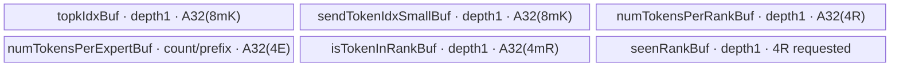

# SGL DeepEP DispatchLayout 950 ACLNN 算子知识

## 算子速览

| 项目 | 内容 |
|---|---|
| 实际入口 | 公开两段式 `aclnnDispatchLayoutGetWorkspaceSize` / `aclnnDispatchLayout`，没有V2/V3后缀；Python default策略只是调用者。 |
| 计算语义 | 对每个token的top-k专家计数，按目的rank去重，并生成同一专家内按token/top-k次序排列的发送序号；通用多轮只处理本地GM。 |
| 输入输出 | 输入连续ND `topkIdx:int64[N,K]`；五个ACLNN输出均为INT32：rank计数、逐轮expert计数、token/rank membership、notify打包区、`sendTokenIdxSmall[N,K]`。 |
| 执行类型 | 每条Route均为单个 `dispatch_layout` AIV_VECTOR节点；标量索引、Vector清零、MTE和INT32原子加。没有Cube、MIX、SIMT或远端collective。 |
| Kernel 路线 | R-001：950通用多轮，key23。 |
| 核心资源 | caller输出GM同时承载前缀scratch；TPipe的单份TBuf，没有TQue/双缓冲；Tiling申请18MiB workspace，body不寻址该参数。 |
| 来源闭包 | `source_closed`：ACLNN、OpDef、Host/POD、活动key、完整body与构建闭合；生成式inner bridge及AscendC primitive为框架边界。 |
| 验证状态 | 已完成源码闭包检查；本次知识提取未执行编译、真机、数值或性能测试。 |

## 接口与语义

### 计算语义

令 `N=num_tokens`、`R=num_ranks`、`E=num_experts`、`K=num_topk`、`L=local_ranksize`、`P=per_round_tokens`。有效专家集合为 `0<=e<E`，每个rank拥有 `E/R` 个连续专家，目的rank为 `d(e)=floor(e/(E/R))`。无效专家会被Device跳过；`sendTokenIdxSmall`的无效槽位没有被初始化，不能消费其值。

对通用路线，第r轮token区间为 `I_r=[rP,min((r+1)P,N))`：

```text
expert_count[r,e] = Σ(t in I_r) Σ(j<K) [topkIdx[t,j]=e]
membership[t,d] = [存在有效j，使d(topkIdx[t,j])=d]
rank_count[d] = Σ(t<N) membership[t,d]
small[t,j] = Σ((u,v)在同一轮中按(u,v)字典序早于(t,j)) [topkIdx[u,v]=topkIdx[t,j]]
```

expert计数按出现次数计算，同一token多次选择同一rank只计一个rank token；同一专家重复出现仍累计多次。`small`是零起点，通用多轮每轮重新开始，不是全N范围连续序号。`notifySendData`在通用路线只作为按核expert exclusive-prefix scratch使用，不能按A2跨机打包协议解释。

### 输入、输出与属性

| 参数 | shape/layout | dtype | 约束、默认值与语义 |
|---|---|---|---|
| `topkIdx` | 连续ND `[N,K]` | INT64 | `1<=K<=16`；索引值不在Host扫描；有效槽位为`0<=e<E`。 |
| `num_tokens` | 标量 | ACLNN INT64→POD UINT32 | 与输入首维一致；通用路线P>0且N=0时Q=0、不写输出但仍按P分配UB；A2跨机N=0会以A=0进行分核除法。 |
| `num_ranks` | 标量 | INT64→UINT32 | `1<=R<=384`；`E%R==0`。 |
| `num_experts` | 标量 | INT64→UINT32 | 公开接口约束`1<=E<=512`；ops Host允许到1024，但本卡不把该放宽宣称为公开支持。 |
| `num_topk` | 标量 | INT64→UINT32 | 等于K；Host校验与输入第二维一致。 |
| `local_ranksize` | 标量 | INT64→UINT32 | Buffer固定8；当前body不消费。 |
| `per_round_tokens` | 标量 | ACLNN INT32→属性INT64→UINT32 | 通用路线要求P>0；Buffer默认8192，配置范围32..8192。 |
| `rank_id` | 标量 | ACLNN INT32→UINT32 | Buffer校验`0<=rank<R`；布局body读取后不参与地址/结果计算。 |
| `numTokensPerRank` | `[R]` | INT32 | 原子累加，必须由caller预先清零；计数覆盖全部实际轮。 |
| `numTokensPerExpert` | `[configured_rounds,E]`或等价连续容量 | INT32 | 通用路线按rE存放计数；A2跨机只写前E项；原子目标应清零。 |
| `isTokenInRank` | `[N,R]` | INT32 | 精确0/1；实际C++原样返回INT32，没有转BOOL。 |
| `notifySendData` | 连续打包GM | INT32 | 通用路线为核前缀scratch，A2跨机为下文布局；caller分配并清零。 |
| `sendTokenIdxSmall` | `[N,K]` | INT32 | 有效专家槽位的零起点顺序；无效槽位无定义。 |
| `workspaceSize/executor` | 输出指针 | UINT64/框架对象 | GetWorkspaceSize产生；执行函数显式接收workspace、executor和stream。 |

### 入口与版本

公开文档 `GET_DISPATCH_LAYOUT_API.md`给出A2/A3/A5支持；DeepEP README声明CANN9.0.0与9.1.0，本卡冻结较新的9.1.0。公开文档的expert上限512和token范围优先保留；Buffer的131072总token容量和Host的1024专家校验属于实现边界，不能自动放大公开范围。950的数字token上限没有在该接口文档单列，实际Buffer仍执行131072、configured_rounds*P和最多256轮校验。

Python `Buffer.get_dispatch_layout` → `DefaultNormalCommStrategy.get_dispatch_layout` → pybind `deep_ep::Buffer::get_dispatch_layout` → ACLNN。`DEEP_USE_MODE=alltoall`选另一套Python算法，不到本入口，不是本卡fallback。文档返回BOOL、单维E计数的描述与当前C++不完全一致：当前返回INT32 membership及`configured_rounds*E`展平计数；事件与RDMA计数返回nullopt。950仍使用同一DispatchLayout ACLNN签名及POD；A5专用FusedDeepMoe ABI覆盖与本算子无关，不能套用。

## Host/Launcher 执行流程

### 参数校验与前处理

1. Buffer校验二维、contiguous、E>0、N<=131072、P在32..8192、rank有效、N不超过配置round*P、实际轮数不超过256；`round`与`P`环境变量必须同时设置或同时缺省，乘积不超过131072。
2. Buffer以同设备INT32 `zeros`分配五个输出。没有对输入进行dtype cast、Sort或布局变换；ACLNN Host检查INT64输入和全部INT32输出、ND由OpDef定义。
3. `aclnnDispatchLayoutGetWorkspaceSize`直接透传同名inner版本；没有自有Contiguous/View或额外核心算子。inner代码由`npu_op_code_gen`生成，是框架边界。
4. `GetAttrAndSetTilingData`校验属性与指针，随后`TilingCheckTensor`检查dtype/shape，`SetWorkSpace`请求单段workspace，再选择key、blockDim和totalUbSize。任一步返回`GRAPH_FAILED`则不形成有效执行计划。
5. `aclnnDispatchLayout`若弱符号`NnopbaseSetHcclServerType`存在则设MTE server，随后调用inner执行；这里没有HCCL group、window、BatchWrite、RDMA或CCU操作。

### 参数、Workspace 与生命周期

Tiling的workspace请求为 `16MiB+1MiB+1MiB=18,874,368 bytes`，不随N变化。Body接收`workspace`但没有读写该指针，实际算法scratch位于caller的`notifySendData`。该18MiB不可伪装成自定义tensor的可用容量，也没有仓内证据可把其任意slice分配给layout算法。`SyncAll<true>`的内部机制属于AscendC primitive边界。

Buffer的notify分配为 `4*[4097E+floor(R/8)+4096*(1+2floor(R/8)+2K)] bytes`，以`MAX_BATCH_SIZE=4096`固定打包。`this->notify_send_data`、`send_token_idx_small`保存张量供后续notify/dispatch；前者是本卡输出scratch而非远端window。重叠调用同一个Buffer会覆盖这些成员，不能在后续消费者完成前复用。

直接ACLNN调用者持有输入、输出和workspace直到stream上执行完成。C++桥`EXEC_NPU_CMD`查询workspace后分配BYTE tensor，将裸指针捕获到`OpCommand` handler；局部workspace tensor在块结束即离开作用域，源码依赖NPU allocator/OpCommand的框架生命周期保证，没有显式stream record或同步。本卡不据此宣称已验证异步内存安全。转换出的ACL tensor描述在成功调用后释放，executor释放由inner框架管理。

### 启动图与失败传播


| 节点/边 | producer→consumer | offset/extent、dtype/layout | ordering与owner/lifetime | 失败传播 |
|---|---|---|---|---|
| 计划 | `aclnnInnerDispatchLayoutGetWorkspaceSize`→Tiling | 完整POD及18MiB请求 | 框架executor拥有计划；非Device节点 | wrapper原样返回status |
| 唯一Device节点 | inner launcher→`dispatch_layout` | 八参数：六个tensor GM、workspace、tiling；blockDim=C=GetCoreNumAiv；无动态UB参数 | caller stream；TPipe是entry局部对象 | 未知key无body、没有fallback错误输出 |
| 输出 | `Process`→后续caller | rank/expert/membership/small、notify区域，见逐Route字节表 | 同stream消费或调用者显式建立跨stream依赖；Buffer不消费previous_event | EXEC宏在workspace/launch非零status时TORCH_CHECK；没有后继核心kernel |

`zeros`属于调用者初始化，不是隐藏在本ACLNN内的第二核心节点。该launch graph没有kernel间workspace边、远端通信handle或通信失败重试。

## Route 与参数设计

### 分核与资源计算

记 `A32(x)=32*ceil(x/32)`。通用路线 `Q=ceil(N/P)`；首轮大小 `F=(Q==1?N:P)`，`A=min(F,C)`。核c持有 `m=floor(F/A)+[c<F%A]` 个token，起点 `s=c*floor(F/A)+min(c,F%A)`。UB按首轮m分配一次；末轮先用此前A求m与s，再更新`A=min(tail,C)`，inactive核仍参加每轮两次SyncAll。

A2跨机路线 `A=min(N,C)`，相同former/tail核公式直接作用于全部N，不读取P，也不分Q轮；`S=ceil(R/L)`，公开有效域R%L=0时为R/L。expert表硬编码4096列，暂存flush硬编码32项。

Host只读取物理UB大小到POD，没有以UB大小调整P、m、核数或选择fallback。下文各项之和必须能被平台TPipe分配，不能把`totalUbSize`当作已经执行了容量准入。

### Route 选择

| 顺序 | Route | Key/模板 | 精确选择条件与优先级 | 不适用去向 |
|---:|---|---|---|---|
| 1 | R-001 950通用多轮 | 23 / `DispatchLayout<int32_t>` | 活动ops构建且SoC=Ascend950；`CheckIfA2Machine`为false | 未知key不写输出 |

```text
Ascend950 -> ops/DispatchLayout -> 校验 -> key=23 -> DispatchLayout<int32_t>::Init/Process
```

### 模板/实现执行矩阵

| Route | key/selector | dtype/shape/platform 完整命中条件 | 执行拓扑与 Kernel 节点 | 实际模板/body | 内存与同步特征 | tail/fallback |
|---|---|---|---|---|---|---|
| R-001 950通用多轮 | 23 | 950、INT64→INT32、N>0、P>0、公开E<=512 | 单节点dispatch_layout | `MoeDispatchLayout::DispatchLayout<int32_t>` | 六TBuf、每轮两次SyncAll、前缀scratch | 最后一轮与inactive核；无fallback |

### 隐藏性能 Guard

| Guard | Host/Tiling 条件 | Device/资源原因 | 影响 Route | 不满足时去向 | 源码符号 |
|---|---|---|---|---|---|
| P/核数及跨机N非零 | Buffer允许N=0；ops允许P=0；没有专用空域selector | 通用P=0会除零；通用P>0且N=0为Q=0无输出；A2跨机A=min(N,C)，A=0会除零 | 通用；A2跨机 | 无备用模板；按各body边界调用 | `DispatchLayout::Init`、`DispatchLayoutA2::Init` |
| UB容量 | 只记录UB，无`UB_req<=UB`拒绝 | 所有核一次容纳mK输入、mR membership；跨机还有mS及E*32表 | 全部 | 超容量无第二模板 | `InitBuffer`与`totalUbSize` |
| E%R=0 | 显式拒绝不整除 | 专家→rank整除映射 | 全部 | GRAPH_FAILED | `GetAttrAndSetTilingData` |
| A2跨机L | 活动ops2在R>L时校验1..8、R%L=0 | 专家→server及固定notify布局 | A2跨机 | GRAPH_FAILED | `CheckIfA2MultiMachine` |
| DMA物理extent | 输入按A32(8mK)读取；多个expert搬运按A32(4E) | 逻辑末尾不足整32B仍发起对齐长度DMA | 全部 | 无自动guard；caller确保物理容量，不能把未参与计算的padding当有效数据 | `DataCopyExtParams` |
| 原子目标初值 | ACLNN wrapper不清零，Buffer用zeros | rank/expert与A2前缀scratch使用AtomicAdd | 全部 | 旧值会累计进结果，没有自动reset全部目标 | Buffer分配、`SetAtomicAdd<int32_t>` |
| 公开/实现容量 | 文档E<=512；ops校验E<=1024；跨机N<=4096 | 不同层约束不是同一支持声明 | 全部 | 不扩大公开有效域 | 公开API、Host常量、MAX_BATCH_SIZE |

### POD/ABI

`DispatchLayoutInfo`七个UINT32之后为UINT64。按声明的自然8字节UINT64对齐，字段内偏移为下表，Info的预期sizeof=40、alignof=8；这是源码布局推导，未编译测量。`DispatchLayoutTilingData`先含两个外部SDK的Mc2结构，因此Info在外层的绝对offsetof、整个POD的sizeof/alignof无法仅从固定仓确定；Host/Device必须使用同版本SDK头文件，不能硬编码猜测。

| 结构 | 字段 | 类型/位宽 | ABI 布局 | 单位 | Host/launcher producer | Device consumer | 边界 |
|---|---|---|---|---|---|---|---|
| DispatchLayoutInfo | numTokens | UINT32/32 | Info+0，4字节 | token | `uint32(*numTokensPtr)` | 两类Init；轮数/核分片 | ops先检查0..UINT32_MAX；ops2直接窄化；实际N>0 |
| DispatchLayoutInfo | numRanks | UINT32/32 | Info+4 | rank | `uint32(*numRanksPtr)` | rank映射、mR、rank计数 | 1..384 |
| DispatchLayoutInfo | numExperts | UINT32/32 | Info+8 | expert | `uint32(*numExpertsPtr)` | expert/rank映射、计数、prefix | ops上限1024、ops2上限512；公开512 |
| DispatchLayoutInfo | numTopk | UINT32/32 | Info+12 | 每token项数 | `uint32(*numTopkPtr)` | mK输入/输出及循环 | 1..16 |
| DispatchLayoutInfo | localRankSize | UINT32/32 | Info+16 | rank/server | `uint32(*localRankSizePtr)` | 通用Init不读；A2跨机算S和server_id | 通用inactive；跨机1..8且R%L=0 |
| DispatchLayoutInfo | perRoundTokens | UINT32/32 | Info+20 | token/轮 | `uint32(*perRoundTokensPtr)` | 通用Init/Process算Q和轮偏移 | A2跨机inactive；通用P>0 |
| DispatchLayoutInfo | rankId | UINT32/32 | Info+24 | rank | `uint32(*rankIdPtr)` | Init存入rankId_，之后不参与计算 | 不能据存在字段推断跨rank通信 |
| DispatchLayoutInfo | totalUbSize | UINT64/64 | Info+32，前4字节padding | byte | `GetCoreMemSize(UB,ubSize)` | 当前两个body均不读取 | 仅记录，不是UB guard |
| DispatchLayoutTilingData | mc2InitTiling | 外部Mc2InitTiling | 外层+0，sizeof/alignof固定仓不可见 | SDK定义 | 本算子Tiling未赋值 | 本算子body不消费 | inactive；不假设默认零 |
| DispatchLayoutTilingData | mc2CcTiling1 | 外部Mc2CcTiling | 外层offsetof固定仓不可见 | SDK定义 | 未赋值 | 不消费 | inactive |
| DispatchLayoutTilingData | dispatchLayoutInfo | 上述Info | 外层offsetof取决于前两结构 | 混合 | `GetTilingData<DispatchLayoutTilingData>()`直接逐字段填充 | `GET_TILING_DATA_WITH_STRUCT`后Init读取 | 无仓内序列化转换 |

### Route 源码闭包

| Route | Key/selector | Host/Tiling producer | POD/参数 | Kernel entry/router 节点 | Kernel body/直接依赖 | 构建接线 |
|---|---|---|---|---|---|---|
| R-001 | 23 / 950 | `ops/op_host/dispatch_layout_tiling.cc::DispatchLayoutTilingFuncImpl` | DispatchLayoutTilingData、C=物理AIV | `ops/op_kernel/dispatch_layout.cpp::dispatch_layout` | `ops/op_kernel/dispatch_layout.h::Init/Process/SyncFunc` | ops Host AddConfig(ascend950)、ASCEND_COMPUTE_UNIT、ascendc_kernels |

固定仓include的`data_copy.h`、`sync_collectives.h`、`moe_distribute_base.h`没有被本body实例化为通信算法；实际调用只有AscendC Ceil、TBuf/TPipe、DataCopyPad、Duplicate、Cast、Atomic、SyncAll和本类SyncFunc。不存在未闭合的HCCL核心节点。

## Kernel 实现

### 公共执行流程

entry按参数次序解包GM，注册/读取同一POD，创建局部TPipe，以23/123选择一个对象，依次调用Init与Process。没有`g_coreType==AIC`主体、Mmad/Matmul或MIX任务声明。所谓layout是计数/索引预处理，不是NDDMA维度交换。未知key经过两个分支后直接退出，不清空输出，也不返回Device错误码。

### Route R-001：950通用多轮

#### 适用条件

##### 选择证据

| 层级 | 文件 | 符号 | 源码谓词/参数 | 结果/下一跳 |
|---|---|---|---|---|
| Host | `csrc/deepep/ops/op_host/dispatch_layout_tiling.cc` | DispatchLayoutTilingFuncImpl | SoC=Ascend950，活动ops，key23 | key23，C个AIV |
| Router | `csrc/deepep/ops/op_kernel/dispatch_layout.cpp` | dispatch_layout | TILING_KEY_IS(23) | `MoeDispatchLayout::DispatchLayout<int32_t>` |
| Body | `csrc/deepep/ops/op_kernel/dispatch_layout.h` | Init/Process | N>0、P>0、UB可容纳首轮m | Q轮计数和prefix回读；没有备用body |

#### Device 数据流

##### 函数级调用链

```text
aclnnDispatchLayout -> generated inner launcher
 -> dispatch_layout(...,workspace,tiling), blockDim=C
 -> DispatchLayout<int32_t>::Init : Q、首轮分片、6个TBuf尺寸与GM绑定
 -> DispatchLayout<int32_t>::Process
    -> 每轮tail重算/两次inactive SyncAll
    -> DataCopyPad(topk) / Duplicate / 清本核prefix scratch / SyncAll
    -> 两层scalar token/top-k循环及seenRank去重
    -> membership写回 / AtomicAdd前缀、rank_count、expert_count
    -> SyncAll / 回读exclusive-prefix
    -> 第二遍token/top-k循环写small / DataCopyPad输出
```

##### 源码等价伪码

```text
# 伪码；所有GM偏移下面以元素表示，实际指针需乘相应sizeof
Init: Q=ceil(N/P); F=(Q==1?N:P); A=min(F,C)
      分配时m=floor(F/A)+[c<F%A], s=c*floor(F/A)+min(c,F%A)
for r in [0,Q):
  nr=P
  if 最后一轮且N%P!=0:
    nr=N%P; 用此前A重算m、s和输入/membership有效搬运长度
  A=min(nr,C)
  if c>=A: SyncAll(); SyncAll(); continue
  topk_base=(rP+s)*K; member_base=(rP+s)*R; expert_base=rE
  CopyIn A32(8mK)字节INT64 topk，等待MTE2_S
  Duplicate(rankLocal,0,A32(4R)/4)
  Duplicate(memberLocal,0,A32(4mR)/4); Duplicate(expertLocal,0,A32(4E)/4)
  CopyOut scratch[cE:] <- 0，长度A32(4E); MTE3 barrier; SyncAll()
  for i<m:
    Duplicate(seenRank,0,R); wait V_S
    for j<K:
      e=topk[iK+j]; if e<0 or e>=E: continue
      expertLocal[e]++
      d=e/(E/R)
      if !seenRank[d]: memberLocal[iR+d]=1; seenRank[d]=1; rankLocal[d]++
  CopyOut membership[member_base:], 4mR字节
  AtomicAdd开启
  for k in [c+1,A): scratch[kE:] += expertLocal，搬运A32(4E)字节
  rank_count += rankLocal，4R字节
  expert_count[rE:] += expertLocal，4E字节
  AtomicAdd关闭; MTE3 barrier; SyncAll(); MTE3_MTE2
  CopyIn expertLocal <- scratch[cE:]，A32(4E)字节; wait MTE2_S
  for i<m:
    for j<K:
      e=topk[iK+j]; if e<0 or e>=E: continue
      smallLocal[iK+j]=expertLocal[e]; expertLocal[e]++
  wait S_MTE3; CopyOut small[(rP+s)K:], 4mK字节
```

#### 内存与数据搬运

##### 资源与搬运表

| 层级/缓冲区 | offset/地址公式 | extent/容量公式 | dtype/layout | producer | consumer | owner/lifetime | 对齐/复用 |
|---|---|---|---|---|---|---|---|
| GM topk | `(rP+s)K*8` byte | 有效8mK；DMA A32(8mK) | INT64 `[m,K]` | caller | 第一/二遍标量循环 | caller到stream完成 | 输入末尾须提供DMA可读extent |
| UB topkIdxBuf_ | TPipe独立块 | A32(8mK_first) | INT64 | MTE2 | 两遍计数 | kernel整个Q轮 | depth1，轮间覆盖 |
| UB sendTokenIdxSmallBuf_ | 独立块 | **同输入A32(8mK_first)**，不是A32(4mK) | INT32、超额容量 | 第二遍scalar | MTE3 | 每轮输出完成后再写 | 无效slot未初始化 |
| UB numTokensPerRankBuf_ | 独立块 | A32(4R) | INT32 | Duplicate/scalar | AtomicAdd写rank GM | 每轮清零/累加 | depth1 |
| UB numTokensPerExpertBuf_ | 独立块 | A32(4E) | INT32 | 第一遍local计数；后回读prefix | 原子写回；第二遍序号 | 每轮两阶段覆盖 | 计数与prefix同物理块 |
| UB isTokenInRankBuf_ | 独立块 | A32(4m_first R) | INT32 `[m,R]` | Duplicate/scalar | MTE3 | 每轮 | tail只缩有效extent |
| UB seenRankBuf_ | 独立块 | 请求4R | INT32 | 每token Duplicate | scalar去重 | 每token重用 | TPipe隐式对齐属SDK边界 |
| GM notify prefix | `4*cE` byte | 至少`4AE`，对齐DMA还需末尾padding | INT32 `[A,E]` | 各核k<c原子加 | 核c回读 | 每轮清本核行，第二SyncAll后读取 | 第r轮覆盖第r-1轮内容 |
| GM rank/expert | rank从0；expert从4rE | 4R；4E | INT32 | AtomicAdd | caller | 必须预清零 | expert逐轮，rank跨轮累计 |
| GM membership/small | 4(rP+s)R；4(rP+s)K | 4mR；4mK | INT32 | scalar/Vector | caller | caller持有 | CopyOut无padding写入 |
| workspace/远端window | workspace参数未寻址；无window | Tiling18MiB；算法自有workspace字节为0 | N/A | 框架 | 无算法consumer | caller/框架 | 不挪用notify替代框架workspace |

所有DataCopyExtParams均`blockCount=1,srcStride=0,dstStride=0,rsv=0`；blockLen单位byte。GM→UB padParams为`false,0,0,0`，输入按照对齐字节读取而非只读取有效8mK后由硬件补齐。Duplicate使用count重载，没有仓内显式repeat/mask/stride参数，具体指令分解是AscendC边界。

##### 分层内存布局



##### 字节账与复用顺序

```text
UB_requested(c) = 2*A32(8*m_first*K)+A32(4R)+A32(4E)+A32(4*m_first*R)+4R
UB_reserved = UB_requested + TPipe对未显式对齐请求的分配开销
必要条件：每核UB_reserved <= totalUbSize；Host没有检查该不等式
algorithm_workspace=0；Tiling_workspace=18,874,368 bytes；dynamic_ub=N/A
scratch=4AE bytes + A32(4E)带来的末行padding
整次调用输入有效读取=8NK byte；DMA读取=Σ(r,c)A32(8m_rc K)
每轮prefix清零=A*A32(4E)
每轮前缀原子流量=A(A-1)/2*A32(4E)
每轮rank原子流量=4AR；expert原子流量=4AE
每轮prefix回读=A*A32(4E)；membership提交=4nrR；small提交=4nrK
```

| 复用子区 | 写入者 | 读取者/消费点 | 下一次覆盖 | 同步或释放依据 | 安全条件 |
|---|---|---|---|---|---|
| expert TBuf | 第一遍scalar计数 | MTE3原子输出 | MTE2回读prefix | MTE3 barrier、SyncAll、MTE3_MTE2、MTE2_S | 本轮原子输出完成后才覆盖 |
| notify[c,E] | 清零核c；k<c原子加 | 核c第二遍 | 下一轮清零 | 本轮清零SyncAll和原子SyncAll | 独占调用，不能并发复用相同notify |
| seenRank TBuf | Duplicate置零 | 单个token的top-k scalar | 下一token Duplicate | S_V/V_S | 只去重rank，不去重expert出现次数 |
| topk/small TBuf | MTE2 / scalar | 两遍计算 / MTE3 | 下一轮 | topk MTE2_S、small S_MTE3及下一轮MTE3_V等现有pipe次序 | 保持源码各pipe事件；不新增异步队列假设 |

#### 同步、精度与尾块

##### 同步与数值边界表

| 阶段 | primitive/机制 | producer | consumer/等待点 | 保护对象 | 精度/尾块 |
|---|---|---|---|---|---|
| topk输入 | S_MTE2、MTE2_S | GM输入DMA | scalar GetValue | topk TBuf | INT64原值，不经float |
| 清零与读取 | MTE3_V、V_S、V_MTE3 | Duplicate | scalar计数/清GM | rank/expert/membership | 清到对齐长度，但只有效token参与循环 |
| 前缀初始化 | PIPE_MTE3+SyncAll<true> | 每核清自己scratch行 | 所有核原子加 | notify[A,E] | inactive核也参加 |
| 原子归约完成 | SetAtomicAdd/SetAtomicNone、PIPE_MTE3、SyncAll | 全部核计数 | prefix回读 | rank/expert/notify | INT32加，无浮点舍入；计数不得溢出INT32 |
| prefix回读/序号 | MTE3_MTE2、MTE2_S | scratch DMA | 第二遍scalar | expert TBuf | 无效e跳过，但small槽位未置零 |
| tail与输出 | S_MTE3 | scalar small | MTE3 CopyOut | 4mK输出 | 最后一轮缩m；无效核执行两次SyncAll后continue |

#### 关键实现

##### 符号证据表

| 阶段 | 文件 | 符号/模板实例 | 实现事实 |
|---|---|---|---|
| Host/Tiling producer | `csrc/deepep/ops/op_host/dispatch_layout_tiling.cc` | DispatchLayoutTilingFuncImpl、SetWorkSpace | key23、C个AIV、18MiB、只记录UB |
| Kernel entry/router | `csrc/deepep/ops/op_kernel/dispatch_layout.cpp` | dispatch_layout / TILING_KEY_INT | 23映射INT32通用类 |
| Device body/helper | `csrc/deepep/ops/op_kernel/dispatch_layout.h` | DispatchLayout<int32_t>::Init/Process、SyncFunc | Q轮、前缀atomic扇出、两遍scalar与六TBuf |

## 算子特定优化

### Trick T-001：把exclusive-prefix写入扇出原子累加

#### 触发与源码依据

- 适用 Route：全部通用路线；A2跨机对expert/server各做一次相同扇出。
- 触发条件：A个活动核按token连续分片，目标scratch先清零，各核保留局部expert计数，核c只向k>c的scratch行加自己的计数。
Golden 来源：[csrc/deepep/ops/op_kernel/dispatch_layout.h:191–196](https://github.com/sgl-project/sgl-kernel-npu/blob/dda6d36b0cdb4081e102d14c0a2fb276fc416e69/csrc/deepep/ops/op_kernel/dispatch_layout.h#L191-L196)。

**官方源码（固定 Commit 连续逐字摘录）**：

```cpp
            AscendC::SetAtomicAdd<T>();
            const DataCopyExtParams tempExpertDataCopyParams{1U, numTokensPerExpert32AlignIntLen_, 0U, 0U, 0U};
            for (int i = coreIdx_ + 1; i < aivNum_; ++i) {
                DataCopyPad(tempExpertGM_[static_cast<int64_t>(i) * numExperts_], numTokensPerExpertTensor,
                            tempExpertDataCopyParams);
            }
```

#### 机制与设计原因

读取`scratch[c,e]`即可得到所有编号小于c的核对e的计数和，再由本核按token/top-k顺序递增，避免额外prefix kernel或排序节点。`i`是目标核行，`numExperts_`是行跨度，`tempExpertDataCopyParams.blockLen=A32(4E)`来自expert TBuf分配；AtomicAdd使多核写同一目标行可归约。代价可直接算为A(A-1)/2次expert向量搬运，不宣称对任意核数更快。通用路线每轮先清各核行并同步，使同一scratch跨轮复用。

#### 迁移边界

- 适用：按核连续token分片、希望生成expert稳定出现次序的布局预处理。
- 前提：INT32计数容量、初始化与两次全核同步、完整scratch物理extent。
- 失效：去掉清零/全核同步或改变核到token的顺序会破坏exclusive-prefix；没有另一个fallback模板。
- 未验证：本次知识提取未执行编译、真机、数值或性能测试。

#### 错误做法

不能把无效核直接return：源码明确让其执行与活动核同数量的SyncAll，否则同步参与者不匹配。原子输出未清零会累计旧值；Buffer使用zeros提供该初值。

### Trick T-002：按轮限制通用路线的UB常驻token数

#### 触发与源码依据

- 适用 Route：全部通用路线。
- 触发条件：Q=ceil(N/P)>1；首轮以P分核并分配UB，末轮只缩有效长度。
Golden 来源：[csrc/deepep/ops/op_kernel/dispatch_layout.h:37–44](https://github.com/sgl-project/sgl-kernel-npu/blob/dda6d36b0cdb4081e102d14c0a2fb276fc416e69/csrc/deepep/ops/op_kernel/dispatch_layout.h#L37-L44)。

**官方源码（固定 Commit 连续逐字摘录）**：

```cpp
        numTokens_ = tilingData->dispatchLayoutInfo.numTokens;
        numRanks_ = tilingData->dispatchLayoutInfo.numRanks;
        numExperts_ = tilingData->dispatchLayoutInfo.numExperts;
        numTopk_ = tilingData->dispatchLayoutInfo.numTopk;
        perRoundTokens_ = tilingData->dispatchLayoutInfo.perRoundTokens;
        rankId_ = tilingData->dispatchLayoutInfo.rankId;
        round_ = (numTokens_ + perRoundTokens_ - 1) / perRoundTokens_;
        tpipe_ = pipe;
```

#### 机制与设计原因

常驻topk和membership容量从全N的分片改成单轮P的分片；同六块TBuf在Q轮重用，expert_count保持每轮独立，rank_count跨轮累加。尾轮若活动核数缩小，inactive核仍参加两次barrier。P只控制布局轮，不代表A2跨机body也分轮；该专用body忽略P。

#### 迁移边界

- 适用：单轮UB能容纳、长序列可拆分且下游理解逐轮expert计数/序号重置。
- 前提：P>0、configured_rounds足够、核内输入DMA物理extent可读。
- 失效：UB连一轮都放不下时Host没有自适应减P；需要调用者调整有效配置。
- 未验证：本次知识提取未执行编译、真机、数值或性能测试。

#### 错误做法

不能将每轮small直接当作全序列expert全局序号；源码每轮重新清prefix。固定仓没有自动在small中累计前轮expert数量。

## 模板与实现对比

| 对比维度 | R-001 950通用多轮 | 同固定源码A3通用body | 设计选择依据 |
|---|---|---|---|
| 命中条件/优先级 | Ascend950、key23 | A3、key23 | 活动平台AddConfig和Host选择 |
| 模板与 dtype | DispatchLayout<int32_t>、INT64输入 | 相同 | 没有950替换ABI |
| 循环与分核 | Q轮、首轮定UB、末轮缩m | 相同文件/同方法 | 不引入虚构arch35算法 |
| Queue/TBuf/寄存器/dynamic UB/通信 window | 六TBuf；其余N/A | 相同 | TPipe分配和本地GM |
| 内存总占用与复用 | 2A32(8mK)+A32(4R)+A32(4E)+A32(4mR)+4R | 相同 | 物理C、UB从目标平台读取 |
| 搬运/Vector/SIMT/NDDMA/通信 API | DataCopyPad、Duplicate、AtomicAdd | 相同 | 无远端collective |
| 同步、精度与 tail | 每轮两SyncAll、INT32、small轮内序号 | 相同 | body完全复用 |
| fallback/失败边界 | UB无自动guard；P=0不安全，N=0无输出 | 相同 | 不把平台复用写成额外安全保证 |

## 平台差异

| 项目 | A2 | A3 | Ascend 950 |
|---|---|---|---|
| 支持状态 | 公开支持，CANN9.1.0 | 公开支持，CANN9.1.0 | 公开A5对应Ascend950，CANN9.1.0 |
| Host/Launcher | build.sh→ops2；仅跨机R>L为123；专家上限512 | build.sh→ops；23；实现校验到1024但公开512 | build.sh→ops；`__DAV_C310__`启用AddConfig(ascend950)；DispatchLayout wrapper没有替换ABI |
| Kernel/资源 | 单机通用六TBuf；跨机17TBuf/固定4096表 | 通用多轮六TBuf | 与A3同文件同body，仅平台C/UB改变 |

本卡只对950路线作完整提取；A2/A3实现见[对应算子卡](sgl_deepep_dispatch_layout.md)。

## 限制与失败边界

- `source_closed`表示源码链路已覆盖，不表示未知输入全部安全或已实测。通用P=0或物理核数C=0没有安全分核路径；通用P>0、N=0时Q=0，Process不写输出但仍按P分配UB。A2跨机N=0得到A=0并继续除法；不要把Host允许值等同Device有效域。
- 输出shape/容量未被自有Host完整校验；原子输出必须预清零，输入对齐DMA可读长度、所有输出打包容量与UB总量由调用者核实。`totalUbSize`从未用于资源拒绝。
- `small`的无效expert槽位在UB没有初始化，整块写回后值无定义；不能据Buffer zeros期待这些槽位保持0。计数/序号使用INT32，不能超过其上界。
- 公开文档E<=512、A2跨机N<=4096等边界不能由较宽Host校验静默扩张。A2 ops2对N/P/rankId先窄化及只检查二维的行为与ops不同；直接调用需自行满足真实shape和数值域。
- 通用scratch按E项步进但DMA搬运A32(4E)；E不是8的倍数时物理DMA覆盖相邻行/末尾padding，不能据逻辑[E]容量证明无越界。rank原子在A2跨机也按A32(4R)提交，预分配需考虑物理extent。没有针对这些小维边界的本次数值验证。
- A2跨机prefix scratch与expert表同base B。源码有原子完成SyncAll、本核读回/清零事件，没有第二个“所有核读完”SyncAll；跨核alias提前覆盖的排除证明不在源码中，不将该复用描述为已验证安全。每expert固定W槽位还要求有效出现次数不超过4096；重复expert可能突破按token数估计的容量。
- Tiling外层Mc2结构由SDK定义、未赋值且当前body不消费；没有版本化SDK结构sizeof证据时不能跨SDK拷贝裸POD。wrapper的MTE设置不能推导出远端通信。
- Python事件参数当前未消费，返回nullopt；异步跨stream消费需要调用方建立依赖。EXEC桥的workspace和executor生命周期依赖框架，未做本次运行验证。
- 本次知识提取未执行编译、真机、数值或性能测试。

## 源码索引

### 链路索引

| 链路阶段 | 文件 | 关键符号 | 支撑内容 |
|---|---|---|---|
| 公开说明 | [python/deep_ep/doc/GET_DISPATCH_LAYOUT_API.md](https://github.com/sgl-project/sgl-kernel-npu/blob/dda6d36b0cdb4081e102d14c0a2fb276fc416e69/python/deep_ep/doc/GET_DISPATCH_LAYOUT_API.md) | `公开接口、支持平台` | 公开接口、支持平台与公开有效域 |
| 平台/版本 | [python/deep_ep/README.md](https://github.com/sgl-project/sgl-kernel-npu/blob/dda6d36b0cdb4081e102d14c0a2fb276fc416e69/python/deep_ep/README.md) | `A2/A3/A5、CANN9.0/9.1` | A2/A3/A5、CANN9.0/9.1与构建说明 |
| 实现/构建 | [build.sh](https://github.com/sgl-project/sgl-kernel-npu/blob/dda6d36b0cdb4081e102d14c0a2fb276fc416e69/build.sh) | `build_deepep_kernels` | build_deepep_kernels和平台选择 |
| 实现/构建 | [csrc/deepep/deep_ep.cpp](https://github.com/sgl-project/sgl-kernel-npu/blob/dda6d36b0cdb4081e102d14c0a2fb276fc416e69/csrc/deepep/deep_ep.cpp) | `Buffer::get_dispatch_layout` | Buffer::get_dispatch_layout与初始清零、容量和输出所有权 |
| 实现/构建 | [csrc/deepep/pytorch_npu_helper.hpp](https://github.com/sgl-project/sgl-kernel-npu/blob/dda6d36b0cdb4081e102d14c0a2fb276fc416e69/csrc/deepep/pytorch_npu_helper.hpp) | `EXEC_NPU_CMD、ConvertType` | EXEC_NPU_CMD、ConvertType与失败传播 |
| 实现/构建 | [python/deep_ep/deep_ep/buffer.py](https://github.com/sgl-project/sgl-kernel-npu/blob/dda6d36b0cdb4081e102d14c0a2fb276fc416e69/python/deep_ep/deep_ep/buffer.py) | `Buffer.get_dispatch_layout策略委派` | Buffer.get_dispatch_layout策略委派 |
| 实现/构建 | [python/deep_ep/deep_ep/strategies/normal_strategy.py](https://github.com/sgl-project/sgl-kernel-npu/blob/dda6d36b0cdb4081e102d14c0a2fb276fc416e69/python/deep_ep/deep_ep/strategies/normal_strategy.py) | `DefaultNormalCommStrategy.get_dispatch_layout` | DefaultNormalCommStrategy.get_dispatch_layout |
| POD/声明 | [csrc/deepep/ops/op_host/op_api/aclnn_dispatch_layout.h](https://github.com/sgl-project/sgl-kernel-npu/blob/dda6d36b0cdb4081e102d14c0a2fb276fc416e69/csrc/deepep/ops/op_host/op_api/aclnn_dispatch_layout.h) | `两段ACLNN签名` | 两段ACLNN签名 |
| 实现/构建 | [csrc/deepep/ops/op_host/op_api/aclnn_dispatch_layout.cpp](https://github.com/sgl-project/sgl-kernel-npu/blob/dda6d36b0cdb4081e102d14c0a2fb276fc416e69/csrc/deepep/ops/op_host/op_api/aclnn_dispatch_layout.cpp) | `ACLNN透传` | ACLNN透传与可选MTE设置 |
| 实现/构建 | [csrc/deepep/ops/op_host/dispatch_layout.cpp](https://github.com/sgl-project/sgl-kernel-npu/blob/dda6d36b0cdb4081e102d14c0a2fb276fc416e69/csrc/deepep/ops/op_host/dispatch_layout.cpp) | `DispatchLayout OpDef` | DispatchLayout OpDef和AddConfig |
| 实现/构建 | [csrc/deepep/ops/op_host/dispatch_layout_tiling.cc](https://github.com/sgl-project/sgl-kernel-npu/blob/dda6d36b0cdb4081e102d14c0a2fb276fc416e69/csrc/deepep/ops/op_host/dispatch_layout_tiling.cc) | `DispatchLayoutTilingFuncImpl、属性` | DispatchLayoutTilingFuncImpl、属性和key |
| POD/声明 | [csrc/deepep/ops/op_kernel/dispatch_layout_tiling.h](https://github.com/sgl-project/sgl-kernel-npu/blob/dda6d36b0cdb4081e102d14c0a2fb276fc416e69/csrc/deepep/ops/op_kernel/dispatch_layout_tiling.h) | `DispatchLayoutInfo` | DispatchLayoutInfo和DispatchLayoutTilingData |
| 实现/构建 | [csrc/deepep/ops/op_kernel/dispatch_layout.cpp](https://github.com/sgl-project/sgl-kernel-npu/blob/dda6d36b0cdb4081e102d14c0a2fb276fc416e69/csrc/deepep/ops/op_kernel/dispatch_layout.cpp) | `dispatch_layout` | dispatch_layout和key路由 |
| 实现/构建 | [csrc/deepep/ops/op_kernel/dispatch_layout.h](https://github.com/sgl-project/sgl-kernel-npu/blob/dda6d36b0cdb4081e102d14c0a2fb276fc416e69/csrc/deepep/ops/op_kernel/dispatch_layout.h) | `通用DispatchLayout::Init/Process` | 通用DispatchLayout::Init/Process |
| 实现/构建 | [csrc/deepep/ops/op_host/CMakeLists.txt](https://github.com/sgl-project/sgl-kernel-npu/blob/dda6d36b0cdb4081e102d14c0a2fb276fc416e69/csrc/deepep/ops/op_host/CMakeLists.txt) | `cust_opapi/cust_optiling` | cust_opapi/cust_optiling和inner codegen |
| 实现/构建 | [csrc/deepep/ops/op_kernel/CMakeLists.txt](https://github.com/sgl-project/sgl-kernel-npu/blob/dda6d36b0cdb4081e102d14c0a2fb276fc416e69/csrc/deepep/ops/op_kernel/CMakeLists.txt) | `ascendc_kernels、--cce-auto-sync=off` | ascendc_kernels、--cce-auto-sync=off |

### 实现复用检查

| 检查项 | 可复用事实 | 不得改变的约束 | 源码符号 |
|---|---|---|---|
| ABI/POD | 同DispatchLayoutInfo、两段ACLNN | 七UINT32、UINT64与外层Mc2布局；不新增不存在的tokenIdxMap/validBs参数 | aclnn_dispatch_layout.h、dispatch_layout_tiling.h |
| 调用顺序 | 先GetWorkspaceSize、初始化输出，再execute | 原子初值、同stream可见性；不得把PythonAlltoAll当fallback | Buffer::get_dispatch_layout、EXEC_NPU_CMD |
| workspace/内存 | 18MiB框架请求，算法scratch在notify输出 | GM打包偏移、实际DMAextent、首轮UB容量、A2跨机W=4096 | SetWorkSpace、InitBuffer、Init |
| 同步 | 通用每轮两次全核barrier；A2跨机一次及flush事件 | inactive核参与；不夸大本核事件为跨核读完保证 | Process、MultiCoreCompute、SyncFunc |
| 精度与尾块 | INT64 expert输入、INT32计数/序号；A2 tokenIdx窄化 | 有效expert索引域、invalid small无定义、INT32上界 | GetValue/SetValue、Cast(CAST_NONE)、tail分支 |
| 失败边界 | Host GRAPH_FAILED与wrapper status透传 | 没有UB fallback；通用N=0不写输出，跨机N=0不安全；未知key无输出 | TilingCheckTensor、dispatch_layout、inner wrapper |
