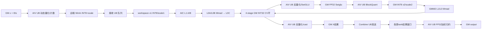
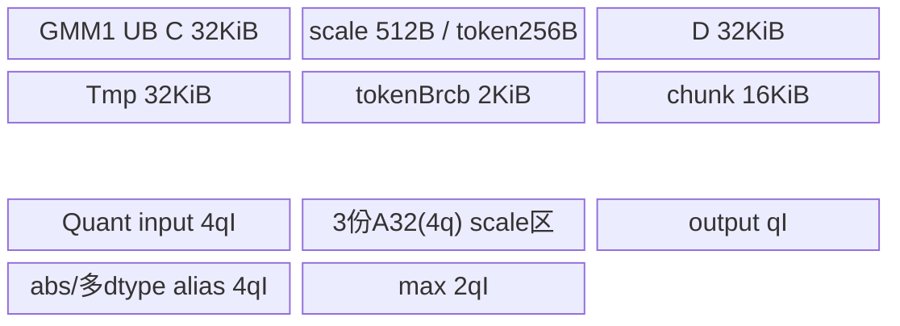
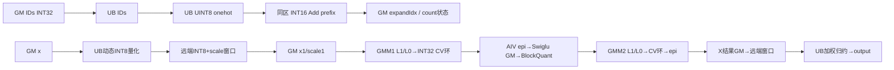
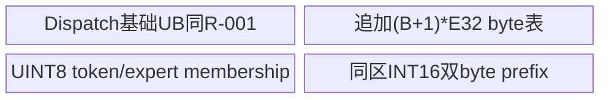
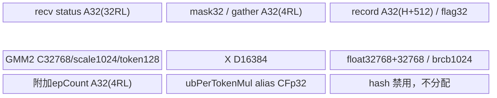

# SGL DeepEP FusedDeepMoe A3 ACLNN 算子知识

## 算子速览

| 项目 | 内容 |
|---|---|
| 实际入口 | 两段式公开 `aclnnFusedDeepMoeGetWorkspaceSize` / `aclnnFusedDeepMoe`；Python `FuseMode.FUSED_DEEP_MOE=1` 调用此入口。 |
| 计算语义 | Dispatch 动态量化 token → INT8×INT8 GMM1/INT32 累加 → FP32 反量化与 SwiGLU → 按行动态 INT8 量化 → INT8×INT8 GMM2/INT32 累加 → FP32 反量化后转输入 dtype → 按 top-k 权重做 FP32 Combine；可加一个分片共享专家结果。 |
| 输入输出 | `x:[B,H]` BF16/FP16，`expertIds:[B,K]` INT32；两组 INT8 FRACTAL_NZ 权重和 FP32 通道 scale；输出 `[B,H]` 与 INT32 原始接收计数 `[G×R]`。 |
| 执行类型 | 单个 `fused_deep_moe`，`KERNEL_TYPE_MIX_AIC_1_2`：每组 1 AIC_CUBE + 2 AIV_VECTOR，含 MTE 访问映射远端 GM、标量轮询和通信状态协议；不是多个 Kernel 启动。 |
| Kernel 路线 | R-001：key0、标量发送计数；R-002：key0、小批量 UINT8 前缀表；R-003：key1、Dispatch/GMM1 深融合与 GMM2/Combine 深融合。 |
| 核心资源 | 两个 GMM 复用 4-stage INT32 GM CV 环；GMM1 L1 384KiB、GMM2 L1 512KiB；UB 以阶段复用；HCCL 负责提供通信窗口，实际 token/状态搬运在本地源码内。 |
| 来源闭包 | `source_closed`：公开 wrapper → OpDef/infer/tiling → POD/key → 单 MIX Kernel → 两个选中 BlockMmad/epilogue、量化、分发/归约及构建闭合。生成式 inner bridge、AscendC 指令 primitive、HCCL 上下文分配是框架边界；没有将外部 collective 当作尚未展开的核心计算。 |
| 验证状态 | 已完成源码闭包检查；本次知识提取未执行编译、真机、数值或性能测试。`draft` 保留静态别名、计数宽度、资源 guard 和输入边界问题；闭包不表示这些问题已经运行验证。 |

本卡复用已完整阅读的 [DeepEP fused_deep_moe API 卡](../../../../apis/deepep/deepep_fused_deep_moe.md)，补充其未覆盖的完整 A3 实现。下文路径缩写：`K/ = csrc/deepep/ops/op_kernel/`，`U/ = csrc/deepep/ops/utils/op_kernel/operator/`，`A/ = U/catlass/act/`；均指同一固定提交，不指外部 CATLASS checkout。

## 接口与语义

### 计算语义

令 `R=epRankSize`、`r=epRankId`、`S=sharedExpertRankNum`、`E=moeExpertNum`、`L=E/(R-S)`、`B=x.shape[0]`、`H=x.shape[1]`、`K=expertIds.shape[1]`、`N=gmm1Weight.originShape[2]`、`I=N/2`、`P=globalBs/R`。本 rank 是共享专家时 `G=1`，否则 `G=L`。路由专家 e 位于 `d(e)=S+floor(e/L)`，本地专家号 `e%L`。Dispatch 将来自各源 rank 的 token 按本地专家、源 rank、源 token/top-k 出现次序排列；`expandIdx[t,j]` 保存该源 rank 中同一专家之前已发送的出现次数。

```text
a1[t] = max_h abs(float(x[t,h]))
s1[t] = a1[t]/127
q1[t,h] = Cast_INT8(dispatch_round_chain(127*float(x[t,h])/a1[t]))
C1_e[m,n] = Σ_h int32(q1_e[m,h]) * int32(W1_e[h,n])
D1_e[m,n] = float(C1_e[m,n]) * weightScale1_e[n] * s1_e[m]
Z_e[m,i] = gate_e[m,i] / (1 + exp(-gate_e[m,i])) * up_e[m,i]
a2_e[m] = max_i abs(Z_e[m,i]); s2_e[m] = a2_e[m]/127
q2_e[m,i] = Cast_INT8(quant_round_chain(127*Z_e[m,i]/a2_e[m]))
C2_e[m,h] = Σ_i int32(q2_e[m,i]) * int32(W2_e[i,h])
Y_e[m,h] = Cast_x_dtype(float(C2_e[m,h]) * weightScale2_e[h] * s2_e[m])
Y_e^(r)[u,h] = Y_e[prefix_sources_before_r(e)+u,h]  # DoCombineSend按epSendCount分段回传到源rank r的视图
out[t,h] = Cast_x_dtype(Σ_j expertScales[t,j] * float(Y_expertIds[t,j]^(r)[expandIdx[t,j],h])
                          + assigned_shared_result[t,h])
```

权重 1 与 scale1 已按每 128 列 `[64 gate,64 up]` 交错，不能把未置换的 `[所有 gate,所有 up]` 直接当作输入。`test_fused_deep_moe.py::reshape_fusion_gmm_weight/permute_weight` 给出构造依据：对最后维拆成 `2 × (N/128) × 64`，交换前两段维度；这只是读到的输入准备方法，本次未执行测试。GMM2 的 INT8 权重由 `layout::nZ` 按 `[I,H]` 解释，不能因两者都标 FRACTAL_NZ 而互换。

两次动态量化均不加 epsilon，也没有全零行特殊路径。Dispatch 的 float→INT32 `CAST_RINT`、INT32→half `CAST_ROUND`、half→INT8 `CAST_TRUNC` 与 `BlockQuant` 三次 `CAST_RINT` 是不同源码链；不能统一成未限定舍入的数学 `round`。GMM1 激活及 GMM2 反量化在 FP32 中进行；GMM2 转 BF16/FP16 后，Combine 才重新转 FP32 累加，不能擅自合并成 FP32 GEMM2→Combine 的无中间舍入式。

`ep_recv_count[e_local*R+src]` 是该本地专家从 src 接收的原始出现计数，不是累计前缀，也不是其他 fused mode 的 INT64 `[G]` 专家 token 数。workspace 内 `epSendCount` 才是本地专家/源 rank 展开后的累计边界，`groupList[e]` 是 INT64 的专家累计 token 边界。共享专家按源 token 区间分片，每个 token 只对应一个共享专家输出，该分支在 Combine 中直接加，未乘 top-k gate weight。

### 输入、输出与属性

| 参数 | shape/layout | dtype | 约束、默认值与语义 |
|---|---|---|---|
| `x` | ND `[B,H]` | BF16 或 FP16 | OpDef 两组 dtype；公开主要范围 B=1..256、H=512..7168。Host 实际接受 H≤8192；本卡不把更宽接受范围当作公开支持保证。 |
| `expertIds` | ND `[B,K]` | INT32 | Python `.int()`；公开 K=1..12，Host 仅检查 K≤16，未拒绝 K=0，也未扫描 ID 上界/重复。负 ID 的预期是跳过，但 R-001 共享专家计数路径有先加 S 的边界。 |
| `gmm1PermutedWeight` | origin `[G,H,N]`，storage FRACTAL_NZ | INT8 | Device `layout::zN::MakeLayout<int8_t>(H,N)`；128 列内 gate/up 置换；公开 N=1024..6144，Host 接受1024..7168。 |
| `gmm1PermutedWeightScale` | ND `[G,N]`，同列置换 | FLOAT32 | C++ Python bridge `.to(at::kFloat)`；每通道乘，非 INT64 打包 dequant 参数。 |
| `gmm2Weight` | 每专家矩阵 `[I,H]` 的 nZ 物理表示 | INT8 | OpDef FRACTAL_NZ；Device 按 nZ 访问；测试先将常规第二层权重作 format cast，不能用第一层 zN 解释代替。 |
| `gmm2WeightScale` | ND `[G,H]` | FLOAT32 | 每个输出通道一个 scale，C++ bridge 转 float。 |
| `expertSmoothScalesOptional` | OpDef 可选 ND | FLOAT32 | Python A3 固定传 nullptr；实际 Dispatch 实例 `isSmoothScalesExist=false`、dynamicQuant=true；深融合传作 `debugGm` 而不做平滑乘，不构成额外平滑语义 Route。 |
| `expertScalesOptional` | ND `[B,K]` | FLOAT32 | Python top-k 权重，虽然 OpDef 标 OPTIONAL，选中的 Combine 会读它；直接 ACLNN 调用应提供有效指针/完整大小。 |
| `groupEp` | NUL 结尾字符串 | char* | MC2 group_ep 通信域；所有 rank 的容量、维度、专家划分及调用顺序必须一致。 |
| `epRankSize` | 标量 | INT64→UINT32 | R；S<R 保证后续 R-S 非零；没有独立 rank 上界或窗口 remoteRes/状态区容量检查。 |
| `epRankId` | 标量 | INT64→UINT32 | 要求转后 r<R；Host 负数判断在无符号转换后，`r<0` 无效。 |
| `moeExpertNum` | 标量 | INT64→UINT32 | E>0、E%(R-S)=0；公开≤512、Host≤1024；L≤aivNum/2。 |
| `shareExpertNum` | 标量 | INT64→UINT32 | 必须等于1，即使 S=0；不是任意共享专家数。 |
| `shareExpertRankNum` | 标量 | INT64→UINT32 | S∈[0,R)；前 S 个 rank 为共享专家 rank，后面每 rank L 个路由专家。 |
| `quantMode` | 标量 | INT64→UINT32 | wrapper 只接受0或1；本 A3 body 两值都实例化 INT8 权重和两次动态 INT8 量化，未用此值选择 BF16 GEMM。 |
| `globalBs` | 标量 | INT64→UINT32 | 0时 CheckData 改为 R×B；非零须可被 R 整除。Python 使用 `max(B,capacity)*R`，不为 A3 padding x。调用者还须保证 P≥各 rank B。 |
| `output` | ND `[B,H]` | 同 x | infer 首维来自 expertIds.dim0，次维来自 x.dim1；Host 未校验两输入首维一致，Python C++ 有 assert。 |
| `outputRecvCount` | ND `[G*R]` | INT32 | infer 共享 rank 用R，否则用R×L；被 Dispatch 写原始 count。 |
| `workspaceSize/executor` | 两段式出参 | UINT64 / aclOpExecutor** | GetWorkspaceSize 交给生成式 inner；执行时 caller 提供足量 workspace 与 stream，生命周期覆盖异步执行。 |

### 入口与版本

公开函数声明在 `op_host/op_api/aclnn_fused_deep_moe.h`，实现没有 V2/V3 后缀。A3 `fused_deep_moe.cpp` OpDef 只 `AddConfig("ascend910_93")`，MC2 使用 group_ep。固定 README 公开 A3 的 CANN9.0.0/9.1.0，本卡采用最新该公开范围的9.1.0；没有从旧文档或其他算子的 CANN9.2 推导版本。

`Buffer.fused_deep_moe` → `FusedDeepMoeStrategy::fused_moe` → C++ `Buffer::fused_deep_moe` → `EXEC_NPU_CMD(aclnnFusedDeepMoe,...)`。A3 只接受 SwiGLU；SiTU 在 C++ 非 `__DAV_C310__` 分支拒绝。`FuseMode.DISPATCH_FFN_COMBINE=2`、`MEGA_MOE=3` 是其他入口，未纳入此卡。950 的同名 ACLNN 由构建替换 Host/API 和 `__DAV_C310__` entry，参数表和数学路径不同；本卡仅 a3。

## Host/Launcher 执行流程

### 参数校验与前处理

1. Python strategy 将 top-k ID 转 INT32；C++ 要求 x/IDs/gate weights 均二维，首维和 top-k shape 对齐，quant_mode∈{0,1}，A3 activation="swiglu"。读取 Buffer 通信组名，分配 `[B,H]` 输出和 `[G*R]` 接收计数，weight scales 转 FLOAT32，传 smooth=nullptr。此路径不重排权重、不对 x 做 padding，也没有在自有 ACLNN wrapper 中做 Contiguous/TransData。
2. 公共 GetWorkspaceSize 若 quantMode 不为0/1立即返回 `ACL_ERROR_INVALID_PARAM`，否则直接返回 `aclnnInnerFusedDeepMoeGetWorkspaceSize`。生成式 inner 的标准 Tensor 校验、executor 创建和可能的通用格式处理属于框架边界，不补造未见步骤。
3. infer 设置 output shape/dtype 和 recv count shape。`FusedDeepMoeTilingFuncImpl` 先读 x storage二维、写 B/H；读 IDs storage二维、写 K；读属性指针并转 UINT32，校验 S<R、r<R、E>0/E≤1024、shareExpertNum==1、E%(R-S)==0，写 L；从 gmm1 originDim(2) 取 N；平台读 aicNum/aivNum。
4. Host 先检查通信窗口请求，再执行 `CheckData`：B=1..256、H=512..8192、N=1024..7168、K≤16；globalBs=0置 R×B，否则校验 `%R==0`；L≤aivNum/2。`CheckTensorShape` 虽定义了部分 weight/scale shape 验证，活动 tiling 函数没有调用它，不能当作已生效 guard。
5. `SetWorkSpace` → `SetHcommCfg` → L==1 取key0，否则key1 → blockDim=aicNum。任何显式 `OPS_ERR_IF` 返回 GRAPH_FAILED。没有资源不足转到其他实现的 fallback。

### 参数、Workspace 与生命周期

定义 `A512(x)=ceil(x/512)*512`、`A32(x)=ceil(x/32)*32`、`C=aicNum`。容量 `M=globalBs/S`（r<S），否则 `M=globalBs*min(K,L)`。以下 Device slice 按顺序从传入 `workspaceGM_+0` 起累计，`o0=0, o(i+1)=oi+size_i`；源码没有在 `Process` 中加16MiB系统区偏移，不能将自有切片起点擅自改为16MiB。

| slice / Device 指针 | 相对 offset | 字节容量 | producer → consumer / owner |
|---|---|---|---|
| `gmX2` | o0 | A512(MI) | BlockQuant INT8 → GMM2 A；本次 executor workspace。 |
| `gmPerTokenScale2` | o1 | A512(4M) | BlockQuant → GMM2 epilogue。 |
| `gmWorkspace=gmCVSwap` | o2 | A512(C×256×128×4×4)=524288C | 两 GMM 的4-stage INT32 CV环；GM1结束/统一屏障后 GM2覆盖。 |
| `gmSwigluOut` | o3 | A512(4MI) | GMM1 epilogue FP32 → BlockQuant；kernel内部以 CV base+524288C 再求同一地址。 |
| `gmGroupList` | o4 | A512(8G) | Dispatch 写专家累计行数 → 两 GMM 分组调度。 |
| `gmExpandIdx` | o5 | A512(4BK) | Dispatch 写源专家出现序号 → Combine 反置换。 |
| `gmEpSendCount` | o6 | A512(4RG) | Dispatch 累计 count → GMM1总行数、GMM2/Combine按源发送边界。 |
| `gmX1Token` | o7 | A512(MH) | Dispatch INT8 token → GMM1 A。 |
| `gmX1Scale` | o8 | A512(4M) | Dispatch行scale → GMM1 epilogue。 |
| `gmGmm2DepOut` | o9 | A512(2MH) | key0 GMM2 BF16/FP16 → Combine；key1 epilogue直接发远端，该完整中间片仍被保留分配。 |
| `gmResvered` | o10 | A512(256KiB) | 传入深融合Params；当前可达核心没有用作主数据区，不用于补偿UB超配。 |

Host 请求 `workspace_total=16MiB+Σsize_i`，但 Host 的 groupList/epSendCount 两项用 L，Device 共享 rank 用 G=1；因此共享 rank 的 Device 后续 offset 可与 Host 账本不同。Host 是总量申请，Device各消费者均依据同一Device切片，不应各自按Host L重建地址。系统16MiB的框架实际用途和生成式inner执行器管理未在固定源码展开；上表只陈述自有body实际寻址。输入、输出、workspace、通信窗口必须活到 stream 中该调用及远端消费完成；kernel 中 TPipe/Resource 的 Destroy、析构或 ResetTPipe 只结束本地阶段资源，不释放 caller GM。

HCCL 域的窗口由运行时提供，非 workspace slice。每个专家/源 rank 的数据容量为 `Q=2PH` 字节；两轮 ping-pong 偏移为 `dataState*R*L*Q`；远端基址由 `HcclOpResParam.remoteRes[rank].nextDevicePtr→HcclRankRelationResV2.windowsIn/windowsExp` 或本地对应字段取得。数据窗口还加 `rank*512` 的 rank padding。Dispatch 每条 INT8 记录为 H+128字节（key0）或H+512字节（key1），前H为token，后面首4字节为FLOAT32 scale；深融合再用其后4字节存token flag。Combine 记录为2H字节。

Host 窗口估计 `4RPLH`，与环境 MiB 大小比较。先选 `DEEPEP_HCCL_BUFFSIZE`，不存在才选 `HCCL_BUFFSIZE`，默认200，`stoi`写入UINT16，异常只记录错误并保留默认。计算窗口估计发生在 globalBs=0 被规范化之前，该情形估计为0；它也没有核对实际 `winSize/winExpSize`、rank padding和状态片。`H≥512`使 `H+512≤2H`，header本身可落在2H的token容量内；不能简单把未单列header推断为必然越界。

### 启动图与失败传播

`aclnnFusedDeepMoe` 若弱符号 `NnopbaseSetHcclServerType` 存在，A3选择MTE server；wrapper中910B选AICPU的兼容分支并不证明本OpDef支持A2。随后原样返回 `aclnnInnerFusedDeepMoe(workspace,workspaceSize,executor,stream)` 的状态。启动或异步设备失败由框架/stream机制传播；自有body没有失败后补做 unfused MoE 的路线。

```text
ACLNN executor，blockDim=C；单 fused_deep_moe，1C:2V
 key0: AIV Dispatch (R-001或R-002) → AIV全核完成/flag0 → AIC GMM1
                              AIC INT32 CV环 ↔ AIV Dequant/SwiGLU
                              → AIV BlockQuant → flag0 → AIC GMM2
                              AIC INT32 CV环 ↔ AIV Dequant+cast → GM结果
                              → AIV Combine发送 → 远端完成flag → 加权反置换输出
 key1: 奇AIV发token，偶AIV收token/发布专家ready；AIC按ready做GMM1
                              AIC INT32 CV环 ↔ 偶AIV Dequant/SwiGLU
                              → 全AIV清理/BlockQuant → flag0 → AIC GMM2
                              AIC INT32 CV环 ↔ 两AIV分epilogue并直接发送远端
                              → sub0发送完成信号 || sub1等待/加权反置换输出
```

深融合共享 rank 的 `localExpertNum=1` 时保留“全2C AIV先发后收”，不是奇偶分工；Host仍按全局L>1取key1。所有rank须以相同顺序调用并保证窗口初始状态正确，不能并发复用同一通信域的状态槽。

## Route 与参数设计

### 分核与资源计算

C取平台实际AIC数，不写死芯片核数；MIX实例假定AIV=2C。Host另取物理aivNum用L≤aivNum/2，未验证物理关系或C能被G整除。key0 shallow Dispatch 用aivNum；深融合普通rank用C个send与C个recv，每专家recv核数 `C/G`，共享rank用2C个recv、G=1。GMM按 `M_g=groupList[g]-(g?groupList[g-1]:0)` 调度；深融合GMM1先读ready区中的当前专家行数，groupList在后面汇总。

| 阶段 | 问题与 tile | scheduler / 数值 | 资源 |
|---|---|---|---|
| GMM1 | `[M_g,N,H]`；L1 `(256,128,512)`，L0 `(256,128,128)`；epilogue `(64,128)`输出64列SwiGLU | `GemmIdentityBlockSwizzle<3,0>`；M方向每3块成组，奇数组反转N遍历；任务数ceil(Mg/256)×ceil(N/128)，跨专家旋转起始core。 | L1 A两份256×512=262144B，B两份128×512=131072B；L0A两份256×128=65536B，L0B两份128×128=32768B，L0C一份256×128×4=131072B。 |
| GMM2 | `[M_g,H,I]`；L1 `(128,256,512)`，L0 `(128,256,128)`；epilogue `(32,256)` | 相同swizzle参数；ceil(Mg/128)×ceil(H/256)，K按512块；命中条件时A驻留L1。 | L1 A四份128×512=262144B，B两份256×512=262144B；L0A四份128×128=65536B，L0B两份128×256=65536B；L0C一份128×256×4=131072B。 |
| BlockQuant | 实际总行数T、列I；`q=min(8,floor(16384/I))`，外块2q行、内块q行 | 每AIC组对应的两个AIV按subblockIdx分块，组间步长C；full q×I Vector计算，实际shape限定搬运/写回。 | 命名UB片申请量 `11qI+3A32(4q)`；q≤8、qI≤16384给≤180320B；固定64-lane归约的实际触达仍需另核，不能把该申请量当作全部Vector访问已安全的证明。 |
| Combine | B≥AIV参与数时分token；B较小时同token分H | 每token的K条lowprec结果转FP32、乘gate、累加；尾H由最后参与core接收。 | 分H的基础长度 `floor((H/32)/coresPerToken)*32` 元素，不是byte；如果core多于H/32可能出现零长片，Host无guard。 |

两GMM调度无split-K；每个AIC完整累加该tile的K，first K清零C，后续累加。`CUSTOM_ENABLE_SHUFFLE_K=true` 令起始K tile为 `aicIdx%ceil(Kdim/512)`，环绕遍历；不是改变INT8/INT32乘加的逻辑覆盖。L1 one-stage preload与双/四缓冲的事件仍保留。`AtlasA2` 是vendored Act的架构trait名字，本A3实例实际通过ascend910_93编译，不能把这个名字当作A2产品支持证据。

### Route 选择

定义 `T=(B<=64 && ceil(E/32)*32<=256 && K%8==0)`。T在key0 dispatcher.Init中计算；不是另一个Host tiling key。

| 顺序 | Route | Key/模板 | 精确选择条件与优先级 | 不适用去向 |
|---:|---|---|---|---|
| 1 | R-001 标量浅融合 | key0，EXEC_FLAG=0 | 所有前置校验成功，L==1且!T | L==1且T→R-002；L>1→R-003；校验失败终止。 |
| 2 | R-002 前缀表浅融合 | key0，EXEC_FLAG=0，enableAivOpt=true | L==1且T；status/量化/两GMM/Combine与R-001相同，前缀表改变计数与expandIdx产生方式/UB | !T回R-001，不是资源运行失败fallback。 |
| 3 | R-003 深融合 | key1，EXEC_FLAG_DEEP_FUSE=1 | 前置校验成功，L>1；普通rank G=L，共享rank G=1 | 无其它key/fallback。 |

```text
平台=ascend910_93，INT8 NZ weights，x BF16或FP16，quantMode0/1
 ├─ 校验失败 → GRAPH_FAILED / ACLNN错误
 ├─ L==1 → key0 → dispatcher.Init
 │                 ├─ T → R-002
 │                 └─ !T → R-001
 └─ L>1 → key1 → R-003
Device entry非key0/1 → 不执行Process，不写输出；Host不会产生此值。
```

### 模板/实现执行矩阵

| Route | key/selector | dtype/shape/platform 完整命中条件 | 执行族与 kernel 节点 | 实际模板/body | 内存与同步特征 | tail/fallback |
|---|---|---|---|---|---|---|
| R-001 | 0 / !T | a3，前述OpDef dtype、Host范围和L==1，公开较窄范围另见接口表 | 单MIX节点：AIV dispatch→AIC/AIV GMM1→AIV quant→AIC/AIV GMM2→AIV combine | `FusedDeepMoe<DTYPE_X,int32_t,false,0>`；`CamMoeDistributeDispatch<X,int8_t,false,true,false,false>`；`GroupedMatmulSliceMPerTokenDequantSwigluQuantMultiStageWorkspaceWithShallowDispatch`；GMM2 `GroupedMatmulSliceMPerTokenDequantMultiStageWorkspace<X,int32_t,false,0,...>` | INT32 scalar count、128B记录header；GMM1/2 CV环硬flag0..7；dispatch/quant阶段barrier8+flag0 | Tile actual shape；quant Vector仍用满tile；没有自动修复非法ID/shape。 |
| R-002 | 0 / T | 与R-001相同，加B≤64、E32对齐≤256、K%8=0 | 同单MIX图，替换AIV计数子图 | 与R-001同外层实例；`AlltoAllDispatch` 内前缀Add表路线 | `(B+1)*E32` UINT8 UB，两个byte打包为INT16求前缀；其余同R-001 | 每token重复同专家会被onehot折叠，与scalar出现计数不同；调用者应避免重复。 |
| R-003 | 1 | a3，前述有效域，L>1；共享rank仅G改为1 | 同单MIX节点中通信/计算重叠；普通rank奇send/偶recv+epi，AIC按expert ready开算 | `FusedDeepMoe<DTYPE_X,int32_t,false,1>`；`GroupedMatmulSliceMPerTokenDequantSwigluQuantMultiStageWorkspace<X,...,4,int64_t>`；GMM2 `...MultiStageWorkspace<X,int32_t,false,1,...>` | 512B记录header，token ready flag；GM uint8 soft sync；GMM2 epi直接远端MTE3，Combine sub0/sub1事件9/10 | 没有L不能均分C、soft counter过宽或alias问题的fallback；保留draft。 |

### 隐藏性能 Guard

| Guard | Host/Tiling 条件 | Device/资源原因 | 影响 Route | 不满足时去向 | 源码符号 |
|---|---|---|---|---|---|
| L≤aivNum/2 | CheckData显式 | 给多专家至少一个recv核；未同时检查C%G==0 | 全部，尤其R-003 | GRAPH_FAILED；整除缺口无fallback | `CheckData`、`RecvCoreFunc` |
| 通信窗口估计 | `4RPLH<=envMiB`，且在globalBs0默认化之前 | 两个轮换数据片；未比对runtime实际窗口与exp状态区 | 全部 | 超限GRAPH_FAILED；其他缺口无guard | `GetMaxWindowSize`、`FusedDeepMoeTilingFuncImpl` |
| 小表预算/byte计数 | B≤64，E32≤256，K%8==0 | `(B+1)*E32≤16640B`，UINT8逐token前缀避免超过255；INT16加两个byte | R-002 | R-001 | `CamMoeDistributeDispatch::Init` |
| GMM1/2本地容量 | 编译期tile static_assert；Host不计算 | 上表L1/L0占用，最大GMM2恰为512KiB L1、64KiB L0A/B、128KiB L0C | 全部 | 编译不满足，非运行fallback | 两个选中BlockMmad |
| A驻留 | `ceil(I/512)==4 && !isFirstLoad && gmA==lastGmA`，Device内部 | 4个512K块放入4份L1A，复用同一M tile跨N的A | 全部 | 重新GM→L1 A | `BlockMmadResidentA::operator()` |
| GMM2 epi深融合UB | 编译期仅检查116864B基片，额外加A32(4RL) | 附加epSendCount用于按源rank直接远端发结果 | R-003 | Host没有UB上界拒绝/降级 | FLOAT32 specialization构造器 |
| 量化行数 | q=min(8,16384/I)，N范围确保q>0 | 11qI的UB；归约以64 lane与逐次折半实现 | 全部 | 没有非整齐I的另一个归约/epsilon分支 | `CalQuantRow`、`BlockQuant` |
| token容量 | Python P=max(B,capacity)；direct Host未校验B≤P | 每源/专家仅2PH字节槽位 | 全部 | direct不满足无安全fallback | C++ Buffer、Device地址公式 |
| expert ready计数 | recvCoreNum/G，Host未检查整除 | 一个专家的recv核集合与AIC等待目标须一致 | R-003 | 固定源码无fallback | `RecvCoreFunc` / AIC ready loop |
| soft sync计数宽度 | UINT8值，target为UINT32；无tile数≤255 guard | 每512B一个计数槽，会逐tile增且在阶段后清零 | R-003 GMM1 | 只有轮询超时assert，未自动换硬flag路线 | `EncreaseSyncFlag` / `CheckSyncFlag` |

### POD/ABI

`FusedDeepMoeInfo` 逐字段布局如下；offset/size按源码基础类型和常见8字节自然对齐推导，未执行编译/offsetof探针。13个UINT32后4字节padding，三个UINT64，推导sizeof=80、alignof=8；不可声称已实测ABI。外层MC2结构的完整CANN类型定义/sizeof不在本repo，自有Device使用同一头声明解析；不得凭名称猜其固定字节数。

| 结构 | 字段 | 类型/位宽 | ABI 布局 | 单位 | Host/launcher producer | Device consumer | 边界 |
|---|---|---|---|---|---|---|---|
| FusedDeepMoeTilingData | mc2InitTiling | Mc2InitTiling | offset0；size由CANN定义 | 配置 | SetHcommCfg/GetTiling | MC2框架建域 | 外部框架ABI |
| FusedDeepMoeTilingData | mc2CcTiling | Mc2CcTiling | 在前一对象后，确切offset未在固定repo展开 | 配置 | 同上 | 同上 | alltoall opType8，fullmesh/pairwise配置 |
| FusedDeepMoeTilingData | disGmmDeqSwigluQuantGmmDeqComInfo | FusedDeepMoeInfo | 外层offset取决于前两对象；内部下表 | POD | TilingFuncImpl | entry GET_TILING_DATA | 不把80B当作整个tiling大小 |
| FusedDeepMoeInfo | epRankSize | UINT32/32 | +0 | rank | 属性ep_rank_size转换 | Init/窗口/路由 | S<R，缺少独立上界 |
| FusedDeepMoeInfo | epRankId | UINT32/32 | +4 | rank | 属性ep_rank_id转换 | 共享判断/remote地址 | r<R |
| FusedDeepMoeInfo | moeExpertNum | UINT32/32 | +8 | 专家 | 属性moe_expert_num转换 | Dispatcher计数/ID | E>0且可整除R-S |
| FusedDeepMoeInfo | moeExpertNumPerRank | UINT32/32 | +12 | 专家/rank | E/(R-S) | key、G、recv映射 | L≤aivNum/2 |
| FusedDeepMoeInfo | sharedExpertNum | UINT32/32 | +16 | 专家 | 属性share_expert_num | 深融合Params保留 | Host强制1，不能改成任意值 |
| FusedDeepMoeInfo | sharedExpertRankNum | UINT32/32 | +20 | rank | 属性share_expert_rank_num | shared划分/Combine直接加 | 0≤S<R |
| FusedDeepMoeInfo | quantMode | UINT32/32 | +24 | 枚举 | 属性quant_mode转换 | Fused.Init→deep Params | compatibility0/1，当前不分计算模板 |
| FusedDeepMoeInfo | globalBs | UINT32/32 | +28 | token容量 | 属性，CheckData0→RB | P/M/窗口 | 检查前后顺序不能交换解读 |
| FusedDeepMoeInfo | bs | UINT32/32 | +32 | token | x.storageDim0 | Dispatch、Combine、expand | 1..256 |
| FusedDeepMoeInfo | k | UINT32/32 | +36 | top-k槽位 | IDs.storageDim1 | Dispatch/Combine | 仅检查≤16 |
| FusedDeepMoeInfo | h | UINT32/32 | +40 | 元素/token | x.storageDim1 | tileK、窗口、DMA | Host512..8192，公开更窄 |
| FusedDeepMoeInfo | aicNum | UINT32/32 | +44 | 核 | Platform.GetCoreNumAic | Host workspace；blockDim | C>0由平台提供，非自有显式guard |
| FusedDeepMoeInfo | aivNum | UINT32/32 | +48 | 核 | Platform.GetCoreNumAiv | shallow Dispatch、Combine | deep另以2C推导 |
| FusedDeepMoeInfo | totalUbSize | UINT64/64 | +56；+52..55 padding | byte | 活动Host未赋值 | Combine.Init读入ubSize_后未再用 | 不将该值当有效预算，也不虚构活动越界 |
| FusedDeepMoeInfo | totalWinSize | UINT64/64 | +64 | byte | 活动Host未赋值 | Dispatch/Combine.Init读入同名成员后未再用 | 与runtime winSize不是同一来源 |
| FusedDeepMoeInfo | gmm1HLen | UINT64/64 | +72 | N元素 | gmm1.originDim2 | n_=N、I=N/2 | Host验证1024..7168，无偶数/128整除检查 |

Device内部`Params`并非Host序列化POD；其布局包含指针与Act layout对象，由同一编译器在调用点构造。固定源码未提供其sizeof/offsetof断言，不伪造跨编译器ABI。下表逐字段记载实际handoff（GMM1 shallow使用前16字段；deep再接后18字段；GMM2使用对应前12个矩阵字段加workspace和combiner；字段的精确声明见源码索引）。

| 结构 | 字段 | 类型/位宽 | ABI 布局 | 单位 | Host/launcher producer | Device consumer | 边界 |
|---|---|---|---|---|---|---|---|
| GMM1 Params | problemShape | GemmCoord | Device内部，未实测 | M,N,K元素 | GmmDeqSwigluQuant `{M,N,H}` | AIC scheduler | M为容量，实际M按专家count |
| GMM1 Params | problemCount | UINT32 | 同上 | group | groupCount=G | 分组循环 | shared为1 |
| GMM1 Params | ptrGroupList | GM INT64* | 同上 | 累计行 | gmGroupList | shallow AIC/AIV | deep在结束才生成 |
| GMM1 Params | ptrA | GM INT8* | 同上 | 元素 | gmX1Token | AIC / deep recv producer | 行宽H |
| GMM1 Params | layoutA | RowMajor | 同上 | 元素stride | `{M,H}` | A偏移 | row strideH |
| GMM1 Params | ptrB | GM INT8* | 同上 | 元素 | weight1 | AIC copy | per-group HN |
| GMM1 Params | layoutB | zN | 同上 | blocked stride | MakeLayout<int8_t>(H,N) | B偏移 | 非ND |
| GMM1 Params | ptrScale | GM FLOAT32* | 同上 | scale | weightScale1 | epilogue | per-group N |
| GMM1 Params | layoutScale | VectorLayout | 同上 | 元素 | `{N}` | epilogue scale偏移 | 列置换保持 |
| GMM1 Params | ptrPerTokenScale | GM FLOAT32* | 同上 | scale | gmX1Scale | recv写/epi读 | 每行一个 |
| GMM1 Params | layoutPerTokenScale | VectorLayout | 同上 | 元素 | `{M}` | epi偏移 | 按实际行 |
| GMM1 Params | ptrOutput | GM INT8* | 同上 | 元素 | gmX2 | BlockQuant写 | 非Swiglu float输出 |
| GMM1 Params | layoutOutput | RowMajor | 同上 | 元素stride | `{M,I}` | Swiglu/quant | 输出I列 |
| GMM1 Params | ptrDequantScale | GM FLOAT32* | 同上 | scale | gmPerTokenScale2 | BlockQuant写 | 每行一个 |
| GMM1 Params | layoutDequantScale | VectorLayout | 同上 | 元素 | `{M}` | BlockQuant写回偏移 | 同真实行 |
| GMM1 Params | ptrWorkspace | GM_ADDR | 同上 | byte | gmCVSwap | CV环及其后Swiglu片 | 不指整块workspace起点 |
| deep Params | gmX | GM_ADDR | 同上 | byte | 输入x | SendCoreFunc | dtype X |
| deep Params | debugGm | GM_ADDR | 同上 | byte | smooth指针 | 无核心语义读写 | Pythonnullptr |
| deep Params | gmexpertIds | GM_ADDR | 同上 | INT32元素 | expertIds | SendCoreFunc | 上界未检查 |
| deep Params | gmExpandIdx | GM_ADDR | 同上 | INT32元素 | expand slice | sender写 | 供Combine |
| deep Params | gmEpSendCount | GM_ADDR | 同上 | INT32元素 | ep count slice | recv写、quant读 | 累计边界 |
| deep Params | gmResvered | GM_ADDR | 同上 | byte | reserved slice | 当前主路径未消费其容量 | 非UB替代 |
| deep Params | gmOutputRecvCount | GM_ADDR | 同上 | INT32元素 | outputRecvCount | recvCore0写 | 原始计数 |
| deep Params | epRankSize | UINT32 | 同上 | rank | POD R | 通信循环 | 不能跨域改变 |
| deep Params | epRankId | UINT32 | 同上 | rank | POD r | 通信地址 | 同域rank |
| deep Params | moeExpertNum | UINT32 | 同上 | 专家 | POD E | count | 非G |
| deep Params | moeExpertNumPerRank | UINT32 | 同上 | 专家 | POD L | 目的窗口/路由 | shared依旧保留L |
| deep Params | sharedExpertNum | UINT32 | 同上 | 专家 | POD值1 | Params保留 | 不生成其它模板 |
| deep Params | sharedExpertRankNum | UINT32 | 同上 | rank | POD S | shared发送/接收 | S0跳过 |
| deep Params | quantMode | UINT32 | 同上 | 枚举 | POD0/1 | Params保留 | 不分GEMM dtype |
| deep Params | globalBs | UINT32 | 同上 | token容量 | POD值 | P/窗口 | 不是本地B |
| deep Params | bs | UINT32 | 同上 | token | POD B | 发送任务 | 未pad |
| deep Params | topK | UINT32 | 同上 | 槽位 | POD K | 发送任务/expand | validID前提 |
| deep Params | tokenLen | UINT32 | 同上 | 元素 | POD H | 记录宽度 | bytes另乘sizeofX |
| GMM2 Params | combiner | void* | Device内部指针，非Host ABI | 对象 | GmmDeq传栈上CamMoeDistributeCombine地址 | AIV epilogue/末尾Process | AIC不使用该指针 |

以下进一步列出直接参与通信/量化handoff的Device字段。ABI均为Device内部同编译器对象，固定源码未给出完整sizeof/offsetof断言；单位和producer/consumer不能因其非Host序列化而省略。

| 结构 | 字段 | 类型/位宽 | ABI 布局 | 单位 | Host/launcher producer | Device consumer | 边界 |
|---|---|---|---|---|---|---|---|
| GMM2 Params | problemShape | GemmCoord | Device内部 | M,H,I元素 | GmmDeq `{M,H,I}` | grouped scheduler | 不是GMM1 M,N,H |
| GMM2 Params | problemCount | UINT32 | 同上 | group | G | group循环 | shared1 |
| GMM2 Params | ptrGroupList | GM INT64* | 同上 | 累计行 | gmGroupList | 实际M差分 | Dispatch/deep清理阶段产生 |
| GMM2 Params | ptrA | GM INT8* | 同上 | 元素 | gmX2 | AIC | 行宽I |
| GMM2 Params | layoutA | RowMajor | 同上 | 元素stride | `{M,I}` | A偏移 | resident条件比地址 |
| GMM2 Params | ptrB | GM INT8* | 同上 | 元素 | weight2 | AIC | 每group IH |
| GMM2 Params | layoutB | nZ | 同上 | blocked stride | MakeLayout<int8_t>(I,H) | B偏移 | 与W1不同 |
| GMM2 Params | ptrScale | GM FLOAT32* | 同上 | scale | scale2权重输入 | epi | 每group H |
| GMM2 Params | layoutScale | VectorLayout | 同上 | 元素 | `{H}` | epi | 通道scale |
| GMM2 Params | ptrPerTokenScale | GM FLOAT32* | 同上 | scale | gmPerTokenScale2 | epi | 由BlockQuant产生 |
| GMM2 Params | layoutPerTokenScale | VectorLayout | 同上 | 元素 | `{M}` | epi | 按group真实M偏移 |
| GMM2 Params | ptrD | GM X* | 同上 | 元素 | gmGmm2DepOut | key0 epi写/Combine读 | key1直发，不依靠此GM片 |
| GMM2 Params | layoutD | RowMajor | 同上 | 元素stride | `{M,H}` | epi/DoCombineSend | 每行H |
| GMM2 Params | ptrWorkspace | GM_ADDR | 同上 | byte | gmCVSwap | AIC/AIV | 复用4stage环 |
| BlockQuant Params | ptrInput | GM FLOAT32* | 同上 | 元素 | CVbase+524288C | CopyGm2Ub | Swiglu输出 |
| BlockQuant Params | layoutInput | RowMajor | 同上 | 元素stride | `{M,I}` | quant输入寻址 | actual rows另传 |
| BlockQuant Params | ptrDequantScale | GM FLOAT32* | 同上 | scale | gmPerTokenScale2 | CopyUb2Gm | 输出每行amax/127 |
| BlockQuant Params | layoutDequantScale | VectorLayout | 同上 | 元素 | `{M}` | scale写回 | actual rows限定 |
| BlockQuant Params | ptrOutput | GM INT8* | 同上 | 元素 | gmX2 | CopyUb2Gm | 非float激活片 |
| BlockQuant Params | layoutOutput | RowMajor | 同上 | 元素stride | `{M,I}` | INT8写回 | 尾块actual shape |
| BlockQuant Params | tileRow | UINT32 | 同上 | 行 | CalQuantRow的q | UB/Vector/tile循环 | q≤8 |
| BlockQuant Params | tileColumn | UINT32 | 同上 | 列 | I=N/2 | UB/归约 | 归约规整性未Host校验 |
| GMM2 Epilogue Params | ptrScale | GM FLOAT32* | 同上 | scale | weightScale2+group*H | CopyGm2Ub | 不选dtype=X的另一specialization |
| GMM2 Epilogue Params | layoutScale | VectorLayout | 同上 | 元素 | `{H}` | channel偏移 | ND |
| GMM2 Epilogue Params | ptrPerTokenScale | GM FLOAT32* | 同上 | scale | s2+前组真实行数 | CopyGm2Ub | group真实M |
| GMM2 Epilogue Params | layoutPerTokenScale | VectorLayout | 同上 | 元素 | group tile layout | token偏移 | ND |
| GMM2 Epilogue Params | ptrD | GM X* | 同上 | 元素 | gmGmm2DepOut+groupOffsetD | key0写回 | key1另DoCombineSend |
| GMM2 Epilogue Params | layoutD | RowMajor | 同上 | 元素stride | group实际M/H | copy/直发 | 保留H行stride |
| CombineCalcInfo | expertPerSizeOnWin_ | UINT64 | Device内部定义顺序 | byte | combiner.Init:2PH | DoCombineSend | 一源一专家容量 |
| CombineCalcInfo | epRankId_ | UINT32 | 同上 | rank | r | 直发地址helper | 当前expert rank |
| CombineCalcInfo | epWorldSize_ | UINT32 | 同上 | rank | R | 扫描源rank边界 | 与epCount维度一致 |
| CombineCalcInfo | moeExpertPerRankNum_ | UINT32 | 同上 | 专家 | L | 远端expert区域 | shared仍传L |
| CombineCalcInfo | sharedExpertRankNum_ | UINT32 | 同上 | rank | S | shared直发 | 不替代G |
| CombineCalcInfo | axisH_ | UINT32 | 同上 | 元素 | H | token行/列拆分 | byte乘sizeofX |
| CombineCalcInfo | moeSendNum_ | UINT32 | 同上 | count元素 | R*L | 附加epCount UB大小 | shared仍预留RL |
| CombineCalcInfo | isShardExpert_ | bool | 同上，padding未实测 | 布尔 | r<S | shared地址/epCount copy长R | 源码拼写Shard |
| CombineCalcInfo | epSendCount_ | GM_ADDR | 同上 | INT32元素 | gmEpSendCount | epi DMA/源rank区间 | shared仅G=1有效 |
| CombineCalcInfo | epWinContext_ | GM HcclOpResParam* | 同上 | 指针 | GetHcclContext0 | remote/local窗口 | runtime对象ABI |
| CombineCalcInfo | winDataSizeOffset_ | UINT64 | 同上 | byte | dataState*RLQ | DoCombineSend | 与对应归约同parity |

`HcclOpResParam`不是本算子Host产生的POD。实际可达窗口字段为`localWindowsIn:uint64`、`localWindowsExp:uint64`、`remoteRes:RemoteResPtr[131072]`及其中`nextDevicePtr:uint64`；远端对象`HcclRankRelationResV2`用`windowsIn:uint64/windowsExp:uint64`。这些字段各自的producer是CANN运行时建域，consumer是本地/远端地址helper。`winSize/winExpSize`在本repo有声明，当前Host未用它们做实际容量验证；完整对象含大量未命中字段，不能缩成这几个字段后重定义ABI。

### Route 源码闭包

| Route | Key/selector | Host/Tiling producer | POD/参数 | Kernel entry/router | Kernel body/直接依赖 | 构建接线 |
|---|---|---|---|---|---|---|
| R-001 | 0 / !T | op_host/FusedDeepMoeTilingFuncImpl→L==1 | FusedDeepMoeTilingData、GMM1 shallow/GMM2 Params | K/fused_deep_moe.cpp→FusedDeepMoe<X,int32,false,0> | K/fused_deep_moe.h；U/cam.../a3/cam_moe_distribute_dispatch.h scalar；U/gemm/kernel/...Swiglu...h shallow；A/gemm/kernel/...dequant...hpp；selected BlockMmad/epi、Combine | root build A3选ops；OpDef ascend910_93；Host CMake npu_op_code_gen/cust_opapi/cust_optiling；kernel CMake ascendc_kernels |
| R-002 | 0 / T | 同Host key0，dispatcher.Init中enableAivOpt | 同POD，额外UINT8表UB，无新POD | 同key0 | 同R-001的全部主图；dispatcher前缀表subroute | 同R-001，无单独binary key |
| R-003 | 1 / L>1 | 同Host，L!=1→EXEC_FLAG_DEEP_FUSE | deep GMM1 Params、CombineCalcInfo | K/fused_deep_moe.cpp→FusedDeepMoe<X,int32,false,1> | U/gemm/kernel/...Swiglu...h deep；其内send/recv/CompCore/BlockQuant；A/gemm/kernel/...dequant...hpp及FLOAT32 epi直发；A3 Combine | 同A3 ops；非950 `__DAV_C310__` 分支 |

## Kernel 实现

### 公共执行流程

entry先 `icache_preload(8)`、注册/读取FusedDeepMoeTilingData，声明MIX_AIC_1_2，只对key0/1实例化。`FusedDeepMoe::Init`绑定GM，取HCCL_GROUP_ID_0上下文并推导M/N/H/I/G；Process按上表构造workspace和layout，GMM1→BlockQuant后全AIV `CrossCoreBarrier<0,PIPE_MTE3>` 使用flag8，然后mode2、PIPE_MTE3发flag0，AIC等待flag0才进入GMM2。key0在最前Dispatch结束也采用相同barrier8/flag0，必须先耗尽之前阶段stage flags再复用ID0。

两GMM的共同选中搬运链为：

```text
GM INT8 row-major A --Nd2Nz DataCopy--> L1 zN
GM INT8 W1 zN 或 W2 nZ --blocked DataCopy--> L1 zN/nZ
L1 A --LoadData zN→zZ--> L0A
L1 B1 --LoadDataWithTranspose INT8 zN→nZ--> L0B
L1 B2 --LoadData nZ→nZ--> L0B
L0A × L0B --Mmad(INT8,INT32,firstK清零)--> L0C zN
L0C --Fixpipe CFG_ROW_MAJOR / no quant / unitFlag11--> GM CV INT32环
GM CV --DataCopyPad实际tile--> AIV UB FP32反量化/激活或cast
```

`CopyGmToL1<RowMajor>` 的 Nd2Nz参数ndNum=1、dValue=实际K、nValue=实际M，srcDValue=行stride；stride超硬件限制时逐行搬运。W1 zN按ceil(N/32)块、roundup(H,16)长度，W2 nZ按ceil(I/32)块、roundup(H,16)长度；大stride时每个block独立搬运。L1→L0A不transpose；INT8 W1用2dTranspose的dstGap1、dstFracGap0及32元素分片；W2连续布局命中单次LoadData，否则按layout slice搬。Fixpipe mSize/nSize取actual tile，srcStride为L0C fractal stride，dstStride为行跨度；没有在Fixpipe反量化，INT32 GM环是真实交接。

AIC的L1 MTE2/MTE1及L0 MTE1/M事件保护双/四缓冲，Mmad使用unitFlag10中间、11最终；`TileMmad`在(m/16)*(n/16)<10时插入PIPE_M屏障。Vector epilogue先INT32→FP32 CAST_RINT，通道scale沿行广播、token scale经Brcb扩为每行8个float后沿列乘。GMM1再用每行128跨度的gate/up切片做Muls(-1)、Exp、Adds(1)、StrideDiv、StrideMul；GMM2再转X CAST_RINT。TileStride helper的mask最多64 float、repeat最多255，repeat row strides=128/8、半输出=64/8；列broadcast helper反转块/重复方向复用token scale。DMA仅按actual rows/cols写回，full-tile Vector scratch的未搬运部分不应被当作有效输出。

公共GM CV环每stage/core `[256,128]`或`[128,256]` INT32均131072B，地址 `CVbase+(stage*C+core)*131072`，stage模4推进。GMM1结束后的统一屏障保证GMM2可复用整个环及UB；GMM1输出float区、quant INT8区是不同GM slice，不能因UB alias而将GM也原地覆盖。寄存器只持有tile坐标、计数、地址、标量scale/状态，源码没有独立动态寄存器预算或NDDMA/SIMT节点。


### Route R-001：标量计数浅融合

#### 适用条件

##### 选择证据

| 层级 | 文件 | 符号 | 源码谓词/参数 | 结果/下一跳 |
|---|---|---|---|---|
| API | op_host/op_api/aclnn_fused_deep_moe.cpp | GetWorkspaceSize | quantMode==0或1 | inner→Host tiling |
| Host | op_host/fused_deep_moe_tiling.cpp | FusedDeepMoeTilingFuncImpl | E/(R-S)==1 | key0，blockDim=C |
| Router | K/fused_deep_moe.cpp | fused_deep_moe | TILING_KEY_IS(0) | FusedDeepMoe<X,int32_t,false,0> |
| Device selector | U/cam_moe_distribute_combine/op_kernel/a3/cam_moe_distribute_dispatch.h | Init / AlltoAllDispatch | `!(B<=64 && E32<=256 && K%8==0)` | enableAivOpt=false，scalar count；不是换key |

#### Device 数据流

##### 函数级调用链

```text
fused_deep_moe → FusedDeepMoe::Init/Process
 AIV: CamMoeDistributeDispatch<X,int8_t,false,true,false,false>::Init/Process
      → AlltoAllDispatch (scalar count和expandIdx)
      → SendToMoeExpert / SendToSharedExpert → QuantProcess → 远端窗口
      → SetStatus → WaitDispatch → LocalWindowCopy → GetCumSum → UpdataTokenNumsOut
      → Destroy(TPipe) → barrier8 / flag0
 AIC+AIV: GmmDeqSwigluQuant<0>
      → ...WithShallowDispatch::operator()<AIC/AIV>
      → selected BlockMmad → GM CV环 → BlockEpilogue<...DequantSwiglu<1,0>>
      → barrier8 → BlockQuant → flag0
 AIC+AIV: GmmDeq<...,0,Gmm2DispatchPolicy>
      → ...DequantMultiStageWorkspace::operator()<AIC/AIV>
      → BlockMmadResidentA → GM CV环 → FLOAT32-scale BlockEpilogue → gmGmm2DepOut
 AIV: CamMoeDistributeCombine<X,int32_t,false,0>::Process
      → BuffInit → SetWaitTpStatusAndDisPatch → ExpertAlltoAllDispatchCopyAdd
      → AlltoAllBuffInit → SetStatus → WaitDispatch → LocalWindowCopy → output
```

`IsNeedReduceScatter=false`，所以 TP allgather/reduce-scatter及其队列/窗口分支没有实例化。本路不存在 HcclBatchWrite/HcclAllToAll 核心调用；带AlltoAll名称的方法由本地MTE窗口搬运、计数与轮询实现。

##### 源码等价伪码

```text
# 伪码；保留实际顺序和寻址，不表示额外kernel
AIV dispatcher.Init:
  从Exp+900KiB+physicalAiv*128取得/翻转dataState
  winOffset=dataState*R*L*Q；statusBase=Exp+dataState*512KiB
  从statusBase+256KiB+physicalAiv*128翻转0/float(1)目标
  分配2深度输入/量化输出/接收队列，status、IDs、counts及float scratch
AlltoAllDispatch:
  拷贝所有BK IDs
  每AIV在自己的UB按flatten(t,j)遍历全部BK，统计专家出现数与expertCount
  SendToMoeExpert中最后moe发送核将完整expertCount写GM expandIdx
  # scalar路径先把ID加S再判断负数；S>0且ID=-1的缺陷见边界
  各moe发送核按商余数划分flatten BK，跳过负ID
  e=ID；dst=S+e/L；local=e%L；count=此前同源同专家出现数
  读x[t,:]→UB，转float/absmax/量化，scale写记录第H字节
  写Win(dst)+winOffset+dst*512+(r*L+local)*Q+count*(H+128)
  若S>0，用后段shared发送核划分token，计算目标shared rank及其局部序号后发送
  所有AIV SyncAll，SetStatus将32B(flag,count,...)写对端Exp的(src+localExpert*R)*stride
WaitDispatch:
  各AIV轮询其分配的R*L条32B状态，读取间隔stride=512 (R*L<=512) 否则256
  GatherMask取首float，sum与目标0或n比较，容差0.5；全AIV SyncAll
GetCumSum / LocalWindowCopy:
  GatherMask第二槽INT32 count，先写原始outputRecvCount[G*R]
  使用count位模式的float ReduceSum形成累计count，而非数值cast
  按(localExpert,src)读本地窗口中的H+128记录，经TQue写x1[globalRow,H]及scale1
  epSendCount累加，最后更新groupList(INT64累计行数)
AIC/AIV shallowGMM1:
  每group从groupList差分M，设置scheduler ceil(M/256)*ceil(N/128)
  每core从旋转startCoreIdx分配tile；A+=前组MH，B+=HN
  AIC stage=(stage+1)%4；覆盖已用stage前等AIVdone(2s+1)
  BlockMmad完成K累加，Fixpipe前/后callback控制stage，发AICready(2s)
  AIV等待ready，经BlockEpilogue做FP32反量化+SwiGLU，写SwigluOut，再发done
  AIC析构排空L1预取/剩余stage；AIV全核barrier8
  两sub-AIV各自对总行数中的q行tile做BlockQuant，写x2和scale2
全AIV MTE3 barrier8→mode2 flag0；AIC等待，复用CV环进入GMM2
GMM2每group按128x256 tile，同样4stage硬flag；AIV subblock分配32x256 epilogue
  反量化→cast X→gmGmm2DepOut
Combine.Process:
  SyncAll；BuffInit；按epSendCount每专家/源rank分段GM→UB queue→远端结果窗口
  reset TPipe后分配归约UB；PIPE_ALL后发布32B发送完成状态
  轮询来自全部R rank的完成状态并SyncAll
  按token/H分核，从Win(self)+winOffset+self*512+S*L*Q+e*Q+expandIdx*2H+tokenOffset*2取结果
  负ID跳过；float(result)*gate累加，S>0再加对应shared结果
  CAST_RINT到X，输出本核有效H片
```

S>0共享分片地址沿用源码公式：`temp=floor(r*B/S)`，`sharedDst=ceil((t+1+temp)*S/B)-1-r`，`preCnt=floor((sharedDst+r)*B/S)-floor(r*B/S)`；token在其shared输出片内为`t-preCnt`。不能替换成简单`t%S`。浅发送使用源rank旋转其token遍历顺序但保留同一记录序号。

#### 内存与数据搬运

##### 资源与搬运表

| 层级/缓冲区 | offset/地址公式 | extent/容量公式 | dtype/layout | producer | consumer | owner/lifetime | 对齐/复用 |
|---|---|---|---|---|---|---|---|
| GM inputs/outputs | 公开tensor GM | x=2BH；IDs/gates各4BK；output=2BH；recv=4GR | ND，weights见接口表 | caller / Device | Device / caller | stream和远端消费完成前 | 输入不能边执行边改 |
| workspace | o0..o10 | 公共11 slice，ΣS+16MiB申请 | INT8/FLOAT32/INT32/INT64 | Dispatch/GMM/quant | 后继子阶段 | executor调用 | 512B对齐，CV复用 |
| L1/L0 | 当前GMM各自从本地buffer byte0分片 | GMM1 L1=393216B，L0A=65536、B=32768、C=131072；GMM2见公共表 | zN/nZ/zZ | MTE2/MTE1/Mmad | Mmad/Fixpipe | BlockMmad Resource作用域 | 阶段顺序复用，非两套同时相加 |
| shallow Dispatch UB status | TPipe InitBuffer | A32(32RL) | 每条8 INT32，首flag/次count | scalar/setstatus/接收 | GetCumSum | Dispatch整个阶段 | 与gather输出分离 |
| Dispatch接收/发送队列 | TPipe管理offset | xQueue两份A32(H+128)；xIn两份A32(2H)；xOut两份A32(H+128) | X输入、INT8+header | DMA/QuantProcess | DMA | EnQue/DeQue/Free后复用 | 容量2，单次Alloc/Free |
| Dispatch数值scratch | TPipe管理offset | A32(4H)输入float + A32(4H)abs/smooth复用 +32 rowMax + A32(4B)动态scale | FLOAT32 | QuantProcess | Vector/记录header | Dispatch阶段 | 不额外分配非动态smooth路径 |
| Dispatch IDs/expand | TPipe管理offset | 两份A32(4BK) | INT32 | GM IDs/scalar count | sender及expand写回 | Dispatch阶段 | 无UINT8 table |
| Dispatch其它scratch | TPipe管理offset | gatherMaskOut A32(4RL)、getTotal A32(4RL)、scalar64；GetCumSum另A32(RL)字节mask与A32(4R)工作区 | INT32位模式/FLOAT32 mask | GatherMask/ReduceSum | LocalWindowCopy | Dispatch阶段 | CreateZeroTensor的额外32B helper未被调用 |
| GMM1 epilogue UB | byte0顺序 | C32768、scale512、tokenScale256、D32768、Tmp32768、tokenBrcb2048、chunk16384，总117504B | INT32→FLOAT32 | CV/scale DMA、Vector | SwiGLU→GM | 每AIV epilogue作用域 | full64×128计算；output chunk64×64 |
| BlockQuant UB | byte0顺序 | input4qI、scaleA32(4q)、outqI、abs4qI、max2qI、reduceA32(4q)、quantScaleA32(4q) | FLOAT32/INT32/half/INT8 | Swiglu GM | quant→x2 GM | epilogue销毁后复用 | abs区依次alias inputTmp/quantF32/S32/F16；quantScale分配但未参与计算 |
| GMM2 epilogue UB | byte0顺序 | C32768、scale1024、token128、D16384、CFp3232768、Mul32768、tokenBrcb1024；总116864B | INT32→FLOAT32→X | CV和scales | 低精度GM结果 | GMM2 epi作用域 | ubPerTokenMul alias CFp32 |
| Combine发送 UB | TPipe重置后 | readState32 +A32(4RL) epCount +两份A32(2H) tokenqueue | INT32 / X | gmGmm2DepOut | 远端窗口 | BuffInit→AlltoAllBuffInit前 | false ReduceScatter只分配gmTpSendCountQueue |
| Combine归约 UB | 再Reset TPipe | A32(32)+A32(32*sendRankNum)+3A32(4BK)+A32(2H)+3A32(4H)+2A32(2H)+A32(4R)+A32(4)+A32(4) | X/FP32/INT32 | rank完成flag、结果GM、IDs/gate/idx | 加权归约输出 | AlltoAllBuffInit→Process结束 | moeSumQueue两buffer；tokenBuf又复用为输出cast |
| 通信数据窗口 | WinIn(rank)+state*RLQ+rank*512+(srcL+eLocal)Q | 每源/本地专家Q=2PH，两state | Dispatch INT8/header；Combine X | 本地/远端MTE3 | 远端/本地MTE2 | 通信域持有，跨调用轮换 | 初始状态由HCCL/Buffer建立 |
| 通信状态窗口 | WinExp+state*512KiB+index*stride | count状态每记录32B、stride512或256；256KiB self flag、900KiB data parity | INT32/float flag | 各rank sender | 本rank poller | 跨调用持久 | DCCI控制cache；不可清零掉另一state |

##### 分层内存布局





上图两组UB是先后使用同一Resource，不相加；Dispatch与Combine由各自TPipe管理，物理offset不能从C++对象声明次序推导，表中给的是实际InitBuffer请求大小。

##### 字节账、交接边与复用顺序

```text
WS = 16MiB + A512(MI)+A512(4M)+524288C+A512(4MI)
     +A512(8L)+A512(4BK)+A512(4RL)+A512(MH)+A512(4M)+A512(2MH)+256KiB # Host
Device将L换成G后逐项生成offset；不加16MiB偏移。
Dispatch UB请求和 = A32(32RL)+4*A32(H+128)+2*A32(2H)
                  +2*A32(4H)+32+A32(4B)+2*A32(4BK)+2*A32(4RL)+64
                  +A32(RL)+A32(4R)
GMM1 epi UB=117504；BlockQuant命名片申请量=11qI+3A32(4q)≤180320<196608；实际固定mask触达未由Host证明
GMM2 epi UB=116864；Combine分发送/归约两次TPipe预算，见表。
Host没有证明Dispatch/Combine各UB请求和≤平台UB；表不是已通过的资源验算。
```

| 边/复用子区 | producer | offset/extent | dtype/layout | consumer | ordering/sync | owner/lifetime | 安全条件 |
|---|---|---|---|---|---|---|---|
| Dispatch→GMM1 | LocalWindowCopy | x1=MH，s1=4M，groupList8G | INT8/FLOAT32/INT64 | AIC/epi | AIV全核barrier8，mode2 MTE3 flag0→AICwait | workspace本次调用 | 远端count及本地copy均完成；caller容量足 |
| AIC→AIV | BlockMmad/Fixpipe | CV+(sC+core)*131072 | INT32 row-major tile | BlockEpilogue | AIC ready flag2s；AIV done flag2s+1 | 一stage直到done | 4stage环覆盖前等待，尾stage排空 |
| SwiGLU→量化 | GMM1 epi | SwigluOut+row*I*4 | FLOAT32 | BlockQuant | 全AIVbarrier8 / pipe顺序 | x2独立GM slice | 实际行数≤M，q/I归约有效 |
| 量化→GMM2 | BlockQuant | x2=MI、s2=4M | INT8/FLOAT32 | AIC/epi | barrier8+mode2flag0 | 同workspace | 不能省掉跨核MTE3完成 |
| GMM2→Combine | epi | gmm2DepOut=2MH | BF16/FP16 | ExpertAlltoAllDispatchCopyAdd | hardflag、stage drain、SyncAll | GM结果活到发送完成 | 不得用FP32片代替 |
| 输入queue复用 | QuantProcess | 2H字节X输入及H+128输出 | X/INT8 | MTE3 | TQue EnQue/DeQue/Free与HardEvent | 当前token buffer | buffer仍在DMA时不可Free后覆盖 |
| 远端结果→output | 远端MTE3 | 每rank/expert Q片中的expandIdx*2H | X | LocalWindowCopy | 32B完成flag、WaitDispatch/SyncAll | 窗口本state | flag必须在该rank全部payload后发布 |

#### 同步、精度与尾块

##### 同步与数值边界表

| 阶段 | primitive/机制 | producer | consumer/等待点 | 保护对象 | 精度/尾块 |
|---|---|---|---|---|---|
| Dispatch本核 | TQue、MTE2_V/V_MTE3/MTE3_* HardEvent | GM→UB、QuantProcess | sender/copy | 队列输入输出 | X→float；amax0无专门处理 |
| Dispatch全域 | PIPE_ALL、SyncAll、状态0/float1翻转、GatherMask/ReduceSum | SetStatus | WaitDispatch | 远端token与count | 每条状态只搬32B，按512/256 stride |
| GMM1初始 | CrossCoreBarrier mode0 flag8 + mode2 MTE3 flag0 | 全AIV | AIC | x1/scales/count边 | 不假设stream顺序能代替同kernel跨核同步 |
| L1/L0流水 | MTE1_MTE2/MTE2_MTE1，M_MTE1/MTE1_M；unitFlag | BlockMmad | 预取/Mmad/Fixpipe | 本地A/B/C各stage | actual K尾；firstK清零 |
| CV环 | CrossCoreFlag偶数ready/奇数done0..7 | AIC Fixpipe / AIV epi | 对方wait / callbacks | GM INT32 tile | 4stage排空后再复用flag0 |
| shallow GMM1 epi | 两sub-AIV都用相同`coreIdx=GetBlockIdx()/subBlockNum`，epilogue内固定subblockIdx0/subblockNum1 | 两AIV | 同tile epilogue | GM Swiglu | 两AIV可对同一tile重复写相同数学结果；源码未让奇AIV闲置，不能擅自改为只有偶核；正确性/开销未运行验证 |
| 量化 | V_MTE2(0)、MTE2_V(0)、MTE3_V/V_MTE3(0/1)，析构drain | BlockQuant | 下一tile/后继flag0 | UB alias和GM写回 | absmax归约折半，q行满tile Vector，DMA按actual rows；不输出尾部无效行 |
| GMM2→归约 | ready/done；SyncAll；PIPE_ALL后SetStatus | epi/发送copy | WaitDispatch/LocalWindowCopy | GM结果及远端完成 | Cast X RINT后再FP32加权；负ID跳过 |
| 小B分H尾 | 商余数分token或每token分核 | LocalWindowCopy | 输出MTE3 | output[t,offset:offset+len] | 最后core取余下H；不擅自读取其它core片 |

#### 关键实现

##### 符号证据表

| 阶段 | 文件 | 符号/模板实例 | 实现事实 |
|---|---|---|---|
| Host/Tiling producer | op_host/fused_deep_moe_tiling.cpp | CheckData、SetWorkSpace、TilingFuncImpl | L==1→0，workSpace/核数/窗口公式 |
| Kernel entry/router | K/fused_deep_moe.cpp | FusedDeepMoe<X,int32_t,false,0> | MIX 1C2V |
| Device body/helper | U/cam_moe_distribute_combine/op_kernel/a3/cam_moe_distribute_dispatch.h | AlltoAllDispatch、QuantProcess、WaitDispatch、GetCumSum、LocalWindowCopy | scalar计数、H+128记录和原始recv count |
| Device body/helper | U/gemm/kernel/grouped_matmul_slice_m_per_token_dequant_swiglu_quant_multistage_workspace.h | ...WithShallowDispatch、BlockQuant | 硬flag CV环、SwiGLU→量化 |
| Device body/helper | A/gemm/kernel/grouped_matmul_slice_m_per_token_dequant_multistage_workspace.hpp | ...MultiStageWorkspace<...,0,...> | GMM2 subblock epilogue/Combine.Process |
| Device body/helper | U/cam_moe_distribute_combine/op_kernel/a3/cam_moe_distribute_combine.h | ExpertAlltoAllDispatchCopyAdd、LocalWindowCopy | 完成flag后按ID/expandIdx加权反置换 |

### Route R-002：小批量 UINT8 前缀表浅融合

#### 适用条件

##### 选择证据

| 层级 | 文件 | 符号 | 源码谓词/参数 | 结果/下一跳 |
|---|---|---|---|---|
| Host/router | op_host/fused_deep_moe_tiling.cpp、K/fused_deep_moe.cpp | TilingFuncImpl、entry | L==1→key0 | 同R-001 MIX实例 |
| Device selector | U/cam_moe_distribute_combine/op_kernel/a3/cam_moe_distribute_dispatch.h | Init | B<=64 && E32<=256 && K%8==0 | enableAivOpt=true，tableElemCount=(B+1)*E32 |
| Device body | 同上 | AlltoAllDispatch | if(enableAivOpt_) | UINT8表填1、reinterpret INT16 Add前缀；不走scalar count |

#### Device 数据流

##### 函数级调用链

```text
fused_deep_moe(key0) → FusedDeepMoe::Process
 → dispatcher.Init(enableAivOpt=true)
 → AlltoAllDispatch:
      Copy IDs → UINT8 onehot表 → INT16逐row Add prefix
      → 表查expandIdx → 表末行查counts/SetStatus数据
 → SendToMoeExpert / SendToSharedExpert / QuantProcess
 → SetStatus → WaitDispatch → LocalWindowCopy/GetCumSum → barrier8/flag0
 → shallowGMM1(epi/BlockQuant) → barrier8/flag0 → GMM2(key0)
 → Combine.Process(远端copy/完成flag/FP32加权归约) → output
```

后半图的完整GMM/通信实现、slice和交接与R-001严格相同；本Route独立记录是因为 selector、计数语义边界和UB布局变化，未将一个数学算子拆成另一张卡。

##### 源码等价伪码

```text
# 伪码；table下标单位为UINT8元素
E32=ceil(E/32)*32；table[(B+1),E32]=0，首行全零
for flattened tokenIndex in [0,BK):
  e=IDs[tokenIndex]
  if e<0: continue
  table[(tokenIndex/K+1),e]=1  # 同token重复e覆盖同一byte
reinterpret table 为 INT16[(B+1),E32/2]
for row=1..B:
  table16[row,:] += table16[row-1,:]  # 每INT16打包两个byte
每moe发送core按flatten BK商余数划分任务，然后取覆盖到的整token行：
  expandIdx[row,j]=table[row,IDs[row,j]]  # 发送当前行前的同专家token数
  将该row K个INT32序号写GM；相邻core可能覆盖同一整row但写相同前缀
按sharedRanks+E的专家集合商余数分core：
  routedCount[e]=table[B,e]，写待发送32B status记录的count
  sharedCount按相同区间公式另外填
随后复用R-001的量化、远端H+128记录、完成状态、接收、两GMM和Combine
```

表是token/expert membership，不是每top-k槽位出现计数；若同一token重复e，表将其折叠成1，两个槽位得到相同expandIdx。源码未检查“每token有效专家不重复”，因此这不是对任意输入都等价于R-001的优化。负ID在写表前跳过，e≥E没有上界检查，会访问表外或padding列，不能将padding容量当作更多合法专家。

#### 内存与数据搬运

##### 资源与搬运表

| 层级/缓冲区 | offset/地址公式 | extent/容量公式 | dtype/layout | producer | consumer | owner/lifetime | 对齐/复用 |
|---|---|---|---|---|---|---|---|
| 新增前缀表UB | TPipe最后InitBuffer；row*E32+e | `(B+1)*E32`字节≤16640 | UINT8；同区reinterpret INT16 | Duplicate、scalar填1、Add | 发送序号/状态count | Dispatch阶段 | E32为32对齐，E32/2个INT16每行 |
| IDs/count UB | 同R-001 | 两份A32(4BK) | INT32 | GM IDs/table查值 | expandIdx与sender | Dispatch阶段 | 未删除原expertCountBuf |
| Dispatch其余UB | 同R-001所有InitBuffer | R-001预算再加table | INT8/X/FP32/INT32 | 量化/状态 | 接收/发送 | Dispatch阶段 | 无Host动态预算检查 |
| workspace/通信GM | 公共slice和R-001窗口公式 | 不因小B删减 | 同R-001 | 所有子阶段 | 后继 | 调用/域生命周期 | 同一H+128header |
| L1/L0/epi/quant/Combine UB | 与R-001完全相同 | GMM1 L1 384KiB；GMM2 L1 512KiB；epi117504/116864；quant≤180320B | 同R-001 | Cube/Vector | Cube/Vector/通信 | 各阶段分时 | table在Destroy后才可被GMM资源覆盖 |
| 寄存器/SIMT/NDDMA | scalar索引/计数；其它N/A | 无独立动态申请 | scalar | Device | Device | 当前循环 | 本route未新增执行族 |

##### 分层内存布局





##### 字节账、交接边与复用顺序

```text
Dispatch_UB_R002 = Dispatch_UB_R001 + (B+1)*E32
(B+1)*E32≤65*256=16640B；仅此新增片，不代表整个Dispatch预算≤192KiB。
workspace_total、L1、L0、GMM epi/quant及Combine预算同R-001。
```

| 边/复用子区 | producer | offset/extent | dtype/layout | consumer | ordering/sync | owner/lifetime | 安全条件 |
|---|---|---|---|---|---|---|---|
| IDs→table | GM→UB copy | 4BK→(B+1)E32 | INT32→UINT8 onehot | scalar填表 | TQueSync MTE2/S、V/S | Dispatch | 有效ID<E、同token不重复 |
| table row前缀 | Add前row/current row | 两row各E32 byte | INT16 packed | 下一row Add | 每row PIPE_V | 同一table | B≤64防byte carry，不可放宽到256 |
| prefix→expandIdx | scalar读table[row,e] | 当前token行K个4B | UINT8→INT32 | GM expand、sender | V_S / S_MTE3 | table直到发送结束 | table[row]为exclusive，末row为总量 |
| Dispatch→两GMM→Combine | 同R-001 | 同11 slice/CV/窗口 | 同R-001 | 同后继 | barrier8/flag0、stage0..7、远端完成flag | 同R-001 | 不可因统计更快省略任一交接 |
| table→GMM UB复用 | TPipe.Destroy | 全Dispatch UB | 先表后epi | Resource | Dispatch完成后才创建GMM阶段 | 分时owner | table不能跨GMM保留指针 |

#### 同步、精度与尾块

##### 同步与数值边界表

| 阶段 | primitive/机制 | producer | consumer/等待点 | 保护对象 | 精度/尾块 |
|---|---|---|---|---|---|
| 清表/填表 | INT16 Duplicate零、V_S/PIPE_ALL | 本核Vector/Scalar | 前缀Add | UINT8表 | 同token重复expert折叠，无有效上界检查 |
| 前缀Add | PIPE_V逐row | row-1 / row | 下一row | packed INT16 | 每byte≤64；并行core各有本地完整表，无跨核共享表 |
| expandIdx写回 | S_MTE3、按整token行 | 本核前缀读值 | sender/Combine | INT32 GM序号 | K%8使32B对齐；跨core整row重复写值一致但仍未真机验证 |
| Dispatch后半图 | TQue/HardEvent、remote状态、barrier8/flag0 | 与R-001相同 | 与R-001相同 | token/计数/GM x1 | H+128记录；dynamicquant0行边界不变 |
| GMM/quant/Combine | 同R-001 stage0..7、L1/L0事件、barrier、窗口完成信号 | 同R-001 | 同R-001 | CV环/UB/结果窗口 | 相同INT8/INT32/FP32/lowprec舍入、actual tile尾块 |

#### 关键实现

##### 符号证据表

| 阶段 | 文件 | 符号/模板实例 | 实现事实 |
|---|---|---|---|
| Host/Tiling producer | op_host/fused_deep_moe_tiling.cpp | L==1分支 | 仍是key0，不含table判定 |
| Kernel entry/router | K/fused_deep_moe.h | dispatcher.Init | 实例dynamicQuant=true，selector在Device |
| Device body/helper | U/cam_moe_distribute_combine/op_kernel/a3/cam_moe_distribute_dispatch.h | Init | 三项T条件与16640B表上限 |
| Device body/helper | 同上 | AlltoAllDispatch if(enableAivOpt_) | onehot UINT8表、INT16逐row前缀、expandIdx/末行count |
| Device body/helper | U/gemm/kernel/grouped_matmul_slice_m_per_token_dequant_swiglu_quant_multistage_workspace.h | shallow GMM1/BlockQuant | 与R-001同实例、同资源/同步 |
| Device body/helper | A/gemm/kernel/grouped_matmul_slice_m_per_token_dequant_multistage_workspace.hpp | GMM2 key0 | 与R-001同epilogue和Combine.Process |


### Route R-003：多专家通信与计算深融合

#### 适用条件

##### 选择证据

| 层级 | 文件 | 符号 | 源码谓词/参数 | 结果/下一跳 |
|---|---|---|---|---|
| Host | op_host/fused_deep_moe_tiling.cpp | FusedDeepMoeTilingFuncImpl | L>1，已过L≤aivNum/2等CheckData | key EXEC_FLAG_DEEP_FUSE=1 |
| Router | K/fused_deep_moe.cpp | fused_deep_moe | TILING_KEY_IS(1) | FusedDeepMoe<X,int32_t,false,1> |
| GMM1选择 | K/fused_deep_moe.h | GmmDeqSwigluQuant | EXEC_FLAG &1 | GroupedMatmulSliceMPerTokenDequantSwigluQuantMultiStageWorkspace<X,...,4,int64_t> |
| GMM2选择 | 同上 | GmmDeq | EXEC_FLAG=1，false ReduceScatter | resident-A BlockMmad + FLOAT32-scale EpilogueAtlasA2PerTokenDequant<1,1> |
| 通信分工 | U/gemm/kernel/grouped_matmul_slice_m_per_token_dequant_swiglu_quant_multistage_workspace.h | AivInitParams | 普通rank G=L>1；共享rank G=1 | 普通奇send偶recv+compute；共享全2C先send后recv、偶compute |
| Combine分工 | A/gemm/kernel/grouped_matmul_slice_m_per_token_dequant_multistage_workspace.hpp | operator()<AIV>末尾 | EXEC_FLAG&1、get_subblockid()==0/else | sub0 AllToAllSend，sub1 ReducePermute |

#### Device 数据流

##### 函数级调用链

```text
fused_deep_moe(key1) → FusedDeepMoe::Init/Process
 → GmmDeqSwigluQuant<1> → deep GemmKernel::operator()<AIC/AIV>
   AIV: AivInitParams → AivInitState
      SendCoreFunc → CalAndSendTokenCount → CalExpandxIdx
                   → routed/shared token发送 → QuantToken → 远端H+512记录
      RecvCoreFunc → RecvCount → GetCumSum → RecvToken → 发布group ready
      偶AIV: CompCoreFunc → 等group ready/soft flag → BlockEpilogue → soft done
      全AIV: SyncAll<false> → UpdateAndCleanInfo → BlockQuant → flag0
   AIC: 等group ready → BlockScheduler → BlockMmad
        → soft wait-before-Fix / soft set-after-Fix → GM INT32 CV环
 → GmmDeq<...,1,Gmm2DispatchPolicy> → GMM2 grouped kernel
   AIC: resident-A BlockMmad → hard flag0..7的CV环
   AIV: FLOAT32-scale BlockEpilogue<1,1> → DoCombineSend → 直接远端WinIn
       sub0: pipe.Init → combiner.AllToAllSend → pipe.Destroy
       sub1: pipe.Init → combiner.ReducePermute → pipe.Destroy
 → FP32加权反置换 → output
```

关键外部边界不是一句“调用HCCL”：`GetHcclContext<HCCL_GROUP_ID_0>` 取得 `HcclOpResParam`，本地读取 `localWindowsIn/localWindowsExp`；远端通过 `remoteRes[dst].nextDevicePtr` 解释成 `HcclRankRelationResV2`，再读取 `windowsIn/windowsExp`。这些可达字段的本地声明和寻址 helper 在 `K/moe_distribute_base.h`；token、计数、ready、softsync和输出聚合全部在上述本地body中。上下文如何由CANN分配、地址映射的硬件可见性及远端失联处理仍是HCCL/AscendC框架责任，未伪造为本卡实现过的transport。

##### 源码等价伪码

```text
# 伪码，AIC/AIV为同一MIX kernel的并行core
AIV AivInitParams:
  aivIdx=GetBlockIdx；groupIdx=aivIdx/2；compIdx=groupIdx
  G=(r<S?1:L)；send/recv默认都启用，核数2C
  if G>1: odd发送，even接收；sendIdx=recvIdx=aivIdx/2，核数C
  每记录H+512，Q=2PH，所有地址均带state*RLQ及dst*512
AivInitState:
  Exp+900KiB的[aivIdx*128]翻转dataState，选本轮payload片
  同区[(3C+aivIdx)*128]翻转CV状态，选vToCFlag=0x03030303或0x05050505
  Exp+state*512KiB+256KiB+aivIdx*128翻转0/float1目标
  同时选tokenFlag=0x55555555或0x33333333
发送核:
  IDs读入A32(4BK)；按S+E专家商余数分core计算并发32B(flag,count)
  routed count/expand采用CalExpandxIdx逐目标统计此前flatten ID出现数
  # 当前函数三局部tensor错误地都取同ubOffset；不把意图等同正确执行
  发送任务按flatten BK分核，skip ID<0
  量化token，scale存byte H、tokenFlag存byte H+4
  MTE3写Win(dst)+state*RLQ+dst*512+(rL+e%L)*Q+count*(H+512)
  S>0按共享区间公式发送；shared本rank拥有的token可直接写gmX1/gmX1Scale
接收核:
  RecvCount轮询所有RL条count状态（32B、512B间隔），GatherMask首flag求sum直到目标
  每专家recvCoreNum/G核，组内按源rank商余数划分，允许零源rank核仍发ready贡献
  GetCumSum/RecvToken必须共享同一个UB起点：重用RecvCount已经读入的status
  recvCoreIdx==0先写原始outputRecvCount；位模式float ReduceSum算前缀
  对每(src,localExpert)的每条token:
    poll记录H+4处tokenFlag，匹配后清0并DCCI
    读H+512到UB，分别写H个INT8到gmX1和4Bscale到gmX1Scale
  写epSendCount的本核累计边界
  PIPE_ALL后用32B INT32原子加发布group ready记录
  原子记录实际显式赋值flag槽0、groupId槽1、selfCount槽3；每专家stride128B
  PRE_COUNT/TOTAL_COUNT常量虽存在，当前计算不读其作为有效前缀
AIC与偶AIV:
  每group等Exp+932KiB+group*128首INT32 == (recvCoreNum/G)*vToCFlag
  从selfCount槽(3)取当前M；跨group的A/scale/D偏移按已处理M累加
  用同一swizzle和core任务分配进行GMM1/epilogue
  AIC每次复用4stage前等soft[core]≥target；Fixpipe后soft[C+core]++
  偶AIV等soft[C+core]≥target，读对应CV stage，反量化/SwiGLU到GM，soft[core]++
  soft槽每512B一个UINT8，以DCCI+PIPE_ALL读写；target为UINT32、逐tile累加
  偶AIV结束清自己的两soft槽首32B；AIC SynchronizeBlock后SyncAll<false>
全AIV SyncAll<false>，最后AIV清group ready区；最后recv核把epCount专家边界写INT64 groupList
  totalM=epSendCount[G*R-1]
  全AIV按q和subblock分工BlockQuant，再barrier8/mode2 MTE3 flag0 → AIC等待
GMM2:
  grouped hard flag4stage流水同R-001；两AIV按subblockIdx分32x256 epilogue
  FP32反量化→X CAST_RINT，DoCombineSend依据epSendCount累计边界逐源rank切分当前tile行
  将UB X结果直接MTE3到该源rank的WinIn，按expert/source区域与tokenOffset分列
  # 不将整块结果先写gmGmm2DepOut
  epilogue作用域析构/drain后切换TPipe
  sub0: AllToAllSend，发布SEND事件9并等待9；SetStatus发完成flag；等待RECV事件10
  sub1: ReducePermute，发布SEND9；WaitDispatch等远端完成并以RECV10配合握手
        LocalWindowCopy执行与R-001相同的float加权反置换；末尾等SEND9
```

GMM2 AIV在进入epilogue之前，sub0先mode0/MTE3发布RECV_SYNC_EVENT_ID10；这与末尾两方法内部的9/10握手共同构成源码协议，不能将编号10简化成一个“所有归约结束事件”。`SEND_SYNC_EVENT_ID=9`、`RECV_SYNC_EVENT_ID=10`与CV stage0..7有分开的使用阶段，均是跨核flag，不是另外的aclrtEvent或额外stream。

`DoCombineSend` 以 `startToken=(groupOffsetD+tileOffsetD)/H`、`tokenOffset=(groupOffsetD+tileOffsetD)%H` 求当前输出子矩阵，扫描该expert的R条累计边界，将行区间拆给对应源rank。每段 `copyTokenLen=actualCols*sizeof(X)`，UB源stride以32B block计，GM目的stride以byte计；远端token序号是“当前token减去上一源累计边界”。普通专家的目标窗口以`localRank=当前expert rank`、`remoteRank=原源rank`布置；shared分支交换其相应源/目的语义，由同一helper生成，不能把group全局行号直接当远端token序号。`ENABLE_EP_SEND_COUNT_HASH=0`，当前真实实现线性扫描边界，没有分配token→rank hash表。

#### 内存与数据搬运

##### 资源与搬运表

| 层级/缓冲区 | offset/地址公式 | extent/容量公式 | dtype/layout | producer | consumer | owner/lifetime | 对齐/复用 |
|---|---|---|---|---|---|---|---|
| 主workspace | 公共o0..o10 | 同Host申请/Device切片表；key1仍保留2MH结果片 | INT8/FLOAT32/INT32/INT64 | send/recv/GMM/quant | 后继子图 | 当前executor | GM CV按4stage复用 |
| deep send IDs UB | Resource.ubBuf从byte0 | A32(4BK) | INT32 | GM IDs | CalExpandxIdx、sender | SendCoreFunc | 后续helper用传入ubOffset |
| deep count发送UB | IDs后当前ubOffset | A32(32*roundup(RL,8)) +统计临时片 | 32B状态/INT32/float位模式 | CalAndSendTokenCount | MTE3远端状态 | 发送count子阶段 | 所有S+E专家分核；临时别名见限制 |
| deep token发送UB | IDs和helper阶段后的局部offset | 两份A32(2H)输入、两份A32(H+512)输出、A32(4BK)专家count；QuantToken再用两份A32(4H)+32 | X / INT8+scale+flag / FP32 | MTE2、QuantToken | MTE3 | token ping-pong、send作用域 | event0/1分别保护两份；helper复用同资源而非累计常驻 |
| CalExpandxIdx视图 | 三次均`GetBufferByByte(ubOffset)` | 每次按tokenIndex元素做Vector；源码仅推进未使用subUbOffset的4096B步长 | dstExpId INT32 / subExpId INT32 / work FLOAT32 | Duplicate/Sub/Abs/Mins | ReduceSum | helper当前调用 | 三者实际alias；不能按意图画成三块独立scratch |
| RecvCount UB | byte0起顺序 | A32(32RL)+32+A32(4RL)+32+1024 | status、mask、gather、sum、tmp | 远端count DMA/Vector | GetCumSum/RecvToken | 同recv过程 | 1024为SUM_TMP_TENSOR_SIZE固定工作片 |
| GetCumSum UB | 与RecvCount同起点 | 相同status/mask/gather前缀，后接ReduceSum work | INT32位模式作为float | 已读status | 累计count | recv过程 | work大小源码未计算，只以当前offset提供；不伪造资源证明 |
| RecvToken UB | 同起点 | A32(32RL)+32+A32(4RL)+A32(H+512)+32 | status/mask/gather/token/flag32B | MTE2+flag poll | x1/scale1/epCount写 | recv过程 | token区float视图读取byte H的scale |
| group ready发布UB | byte0临时32B | 8×INT32=32B | flag/groupId/pre/self/total/... | recv核统计 | 原子加→Exp groupinfo | recv阶段末 | 覆盖recv scratch前PIPE_ALL |
| L1/L0 | 同公共tile表 | GMM1 L1 384KiB；GMM2 L1 512KiB，L0A/B/C见公共表 | INT8/INT32 | AIC | AIC/Fixpipe | BlockMmad | 本卡没有外部matmul core缺口 |
| GMM1 epi/BlockQuant UB | byte0先后复用 | 117504B / `11qI+3A32(4q)` | INT32/float/INT8 | 偶AIVCompCore、全AIVquant | GM Swiglu、x2/s2 | 各自作用域 | 先SyncAll后清状态/量化，不能并行覆盖 |
| GMM2 epi UB | byte0顺序基片116864，后append | 116864+A32(4RL) | INT32/float/X、INT32累计count | CV/scales/epCount | DoCombineSend | epi作用域 | shared仅copyR count但仍按RL预留；hash禁用 |
| GMM2→Combine UB重用 | Resource.pipe.Init/ResetTPipe | sub0发送预算、sub1归约预算同R-001相应项 | 各自AIV私有UB | epi析构/drain后 | AllToAllSend/ReducePermute | 每subAIV | 不将两个subAIV的UB大小相加到单核 |
| 数据window | WinIn+state*RLQ+rank*512 | 每rank/expert Q；Dispatch记录H+512、Combine2H | INT8/header/X | sender/DoCombineSend | receiver/归约 | 通信域跨调用 | caller窗口容量和parity一致 |
| count状态 | WinExp+state*512KiB+expertSrc*512 | 每条32B，索引eLocal*R+src | 首float0/1、INT32 count | 各rank send核 | RecvCount | 本轮state | 不同于token ready flag |
| parity/自状态 | Exp+900KiB；Exp+state*512KiB+256KiB | parity每core128B；多类索引见下表 | INT32位 | AIC/AIV/Combine.Init | 当前调用 | 跨调用持久 | 不得在每kernel任意全清 |
| 专家ready | Exp+932KiB+g*128 | 32×INT32=128B/group，其中前32B原子记录 | INT32 | recv核32Batomic add | AIC、偶AIV | GMM1阶段，最后AIV清零 | 仅在全消费者结束后清 |
| GM softsync | Exp+964KiB+index*512 | 2C个槽，每槽读写UINT8，清首32B | UINT8 | AIC Fix / 偶AIVepi | 对方poll | GMM1阶段 | 与rank数据window独立 |
| 寄存器 | 地址/目标计数/coord | 未提供动态预算 | scalar | Device | Device | 本循环 | 无SIMT/NDDMA节点 |

##### 分层内存布局





```mermaid
flowchart LR
  X["x/IDs GM"] --> SEND["奇AIV UB量化/计数"] --> WIN["远端INT8+scale+flag窗口"]
  WIN --> RECV["偶AIV UB接收"] --> X1["GM x1/scale1"]
  RECV --> READY["Exp group ready 原子状态"]
  READY --> AIC["AIC L1/L0 GMM1"]
  X1 --> AIC --> CV1["4-stage INT32 GM环"] --> EPI1["偶AIV UB Dequant/SwiGLU"]
  EPI1 --> SOFT["Exp soft done/ready"] --> AIC
  EPI1 --> SW["GM Swiglu"] --> QU["全AIV BlockQuant"] --> X2["GM x2/scale2"]
  X2 --> G2["AIC GMM2 L1/L0"] --> CV2["复用INT32 GM环"] --> EP2["两AIV UB Dequant/cast"]
  EP2 --> REM["直接MTE3到源rank结果窗口"] --> RED["sub1 UB归约→output"]
  EP2 --> FLAG["sub0 完成状态；flags9/10"] --> RED
```

recv、GMM1epi、quant、GMM2epi和Combine都是同一AIV的阶段复用；奇AIV在普通rank不跑GMM1激活但仍参加全AIV屏障和量化。共享rank的前半通信改为全核先发后收，并不改变GMM2的sub0/sub1分工。

##### 字节账、交接边与复用顺序

```text
Host workspace同公共公式；Device的G=shared?1:L。
数据窗口主要容量=2*R*L*(2PH)=4RPLH，另有rank*512偏移与状态窗口约定。
GMM1 GM CV=4*C*256*128*4=524288C B；GMM2 tile乘积128*256相同，原片复用。
RecvCount显式UB前缀=A32(32RL)+32+A32(4RL)+32+1024。
RecvToken显式UB前缀=A32(32RL)+32+A32(4RL)+A32(H+512)+32。
SendToken显式主片=A32(4BK)+2A32(2H)+2A32(H+512)+A32(4BK)
                    +2A32(4H)+32 # helper调用点、非额外长期驻留片
GMM1 epi=117504；quant≤180320；GMM2 epi=116864+A32(4RL)。
UB_budget_trait=192KiB，但Host没有证明所有Send/Recv/Combine helper和额外epCount预算≤此值。
GetCumSum工作区和CalExpandxIdx alias保留源码风险，不伪造UB≤预算结论。
```

| 边/复用子区 | producer | offset/extent | dtype/layout | consumer | ordering/sync | owner/lifetime | 安全条件 |
|---|---|---|---|---|---|---|---|
| count发送→接收 | CalAndSendTokenCount | 32B记录，Exp+state512KiB+(eLocalR+src)*512 | float flag/INT32 count | RecvCount | PIPE_ALL和flag sum轮询 | 通信本state | 所有rank同parity/维度；不能先发无效count |
| token发送→接收 | QuantToken/MTE3 | (srcL+eLocal)Q+idx(H+512)；flag在H+4 | INT8+FP32+INT32flag | RecvToken | tokenFlag匹配→清零DCCI→读取record；MTE3_MTE2事件0保护复用 | 每token record到接收完成 | scale/flag与payload偏移必须一致 |
| 接收→专家计算 | RecvToken末尾原子加 | Exp+932KiB+g128，32B贡献 | INT32 ready和count | AIC/偶AIV | 32B atomic add、等flag==coresPerGroup*vToCFlag | 本专家GMM1结束 | recv核均分假定与计数宽度成立 |
| CV双向交接 | AIC Fix / CompCore epi | CV+(sC+core)131072；soft两个index各512B | INT32 / UINT8 | CompCore / AIC | DCCI、PIPE_ALL、soft≥target | 4stage环 | UINT8不能达到target≥256；无相关Host拒绝 |
| phase结束→状态清理 | AIC/AIV所有group完成 | ready G128、soft2C槽 | INT32/byte | UpdateAndCleanInfo / 下次调用 | SyncAll<false>，最后AIV清ready，偶AIV清自己的soft槽 | 持久窗口 | 不得省略同步提前清 |
| groupList/quant→GMM2 | 最后recv核/全AIVquant | groupList8G、x2 MI、s2 4M | INT64/INT8/FP32 | GMM2 AIC/epi | DCCI写groupList，barrier8/flag0 | 本workspace | 总行数≤M，实际row边界一致 |
| GMM2 CV→远端 | BlockEpilogue/DoCombineSend | rank切分row，tokenOffset列；2byte/element | X | 源rank归约 | 本地MTE3 drain、SEND9同步、SetStatus | 窗口state | 源stride块单位、目的stride字节不能混用 |
| 结果窗口→归约 | 各rank DoCombineSend | 同R-001的S*L*Q+eQ+expandIdx2H | X | sub1 ReducePermute | 完成状态poll、RECV10/SEND9握手 | source窗口 | 不可只等AIC stage就认为远端完成 |

#### 同步、精度与尾块

##### 同步与数值边界表

| 阶段 | primitive/机制 | producer | consumer/等待点 | 保护对象 | 精度/尾块 |
|---|---|---|---|---|---|
| 数据片轮换 | Exp900KiB状态+DCCI | 每physicalAIV、AIC/epi独立index | 当前调用地址 | dataState/CV状态 | AIV parity索引aivIdx；AIC 2C+aicIdx；epi 3C+aivIdx |
| count就绪 | float0/1状态、GatherMask+Sum、容差0.5 | sendcore | RecvCount | count及后续token数量 | count为INT32位模式，不是scale float |
| token就绪 | 0x55555555/0x33333333 flag、DCCI清0 | QuantToken/send | RecvToken轮询 | 单token H+512记录 | 无超时的token轮询分支；flag不是普通FP32数 |
| group ready | INT32 atomic add 32B、DCCI poll | 各recv核 | AIC与偶AIV逐专家等待 | gmX1/scales与M | G=1时recv核2C；G>1时C/G，源码假定可整除 |
| deep GMM1环 | UINT8 softflag+PIPE_ALL+DCCI | AIC/偶AIV | CheckSyncFlag(target) | CV4stage | target UINT32、value UINT8；轮询按cycle/50计时，assert阈值5e9，不能称已测超时或误码 |
| deep drain | SynchronizeBlock、SyncAll<false>、清soft/ready | AIC、各AIV | UpdateAndCleanInfo/quant | 未完成Mmad/epi/状态 | AIC结束循环只调整stage target，最后SyncAll兜住整体阶段；不补造逐尾stagewait |
| quant/后继 | BlockQuant事件、barrier8/mode2flag0 | 全AIV | GMM2 AIC | x2/scale2 | 和key0同舍入/全零行/非规整I限制 |
| GMM2 CV | hardflags0..7、mode2 PIPE_FIX/MTE3 | AIC、两AIV epi | 对方callbacks | INT32 tile /UB输出 | 两sub-AIV真实分32行epiloop，无shallow GMM1的固定subblock0写法 |
| Combine直发和归约 | SEND9、RECV10、状态发布/轮询 | sub0/sub1及其它rank | AllToAllSend/ReducePermute | 远端X结果、本地UB复用 | 无额外GM cast结果拷贝；仍保留低精度中间舍入 |
| 空/尾任务 | scheduler实际M/N/K；没有可计算token的rank也参与协议 | core分配 | 屏障/ready贡献 | 空group/尾tile | B=0被Host拒绝；合法B不保证每expert非空；K=0未拒绝不代表已支持安全空MoE |

#### 关键实现

##### 符号证据表

| 阶段 | 文件 | 符号/模板实例 | 实现事实 |
|---|---|---|---|
| Host/Tiling producer | op_host/fused_deep_moe_tiling.cpp | SetTilingKey(EXEC_FLAG_DEEP_FUSE) | L>1，C blockDim |
| Kernel entry/router | K/fused_deep_moe.h | GmmDeqSwigluQuant<1> | deep GemmKernel实例及完整通信参数 |
| Device body/helper | U/gemm/kernel/grouped_matmul_slice_m_per_token_dequant_swiglu_quant_multistage_workspace.h | AivInitParams/AivInitState/SendCoreFunc/CalExpandxIdx/RecvCoreFunc/CompCoreFunc | 奇偶分工、header、专家ready、软同步、实际alias |
| Device body/helper | 同上 | UpdateAndCleanInfo、BlockQuant | 清理ready、groupList、按真实总行数量化 |
| Device body/helper | U/gemm/block/block_mmad_preload_async_with_callback_resident_a.h | operator()/L1TileMmad | GMM2驻留A精确谓词、L1/L0流水、Fixpipecallbacks |
| Device body/helper | A/epilogue/block/block_epilogue_per_token_dequant.hpp | FLOAT32 specialization、DoCombineSend | 反量化后直接分rank写远端，不走已禁用hash |
| Device body/helper | U/cam_moe_distribute_combine/op_kernel/a3/cam_moe_distribute_combine.h | AllToAllSend、ReducePermute、LocalWindowCopy | sub0发布、sub1归约、9/10握手、加权输出 |


## 算子特定优化

### Trick T-001：小批量双 byte 打包前缀表

#### 触发与源码依据

- 适用 Route：R-002。
- 触发条件：key0且B≤64、ceil(E/32)*32≤256、K%8==0；dtype/平台与公开A3契约一致。
- Golden 来源：[cam_moe_distribute_dispatch.h 第339–347行](https://github.com/sgl-project/sgl-kernel-npu/blob/dda6d36b0cdb4081e102d14c0a2fb276fc416e69/csrc/deepep/ops/utils/op_kernel/operator/cam_moe_distribute_combine/op_kernel/a3/cam_moe_distribute_dispatch.h#L339-L347)。

**官方源码（固定 Commit 连续逐字摘录）**：

```cpp
    if (axisBS_ <= LOOP_OPT_MAX_BS && moeExpertRankNumAligned_ <= LOOP_OPT_MAX_MOE_RANK &&
        axisK_ % TOPK_ELEM_COUNT_PER_BLOCK == 0) {
        // UB空间限制BS不大于64、路由专家数量不大于256；对齐要求限制axisK_是8的倍数
        enableAivOpt_ = true;
        moeExpertRankNumInt16Aligned_ = moeExpertRankNumAligned_ / 2;  // 每个int16_t装2个uint8_t
        tableElemCount_ = (axisBS_ + 1) * moeExpertRankNumAligned_;    // 额外加一行（首行全0）

        tpipe_->InitBuffer(sendTableIdsBuf_, tableElemCount_ * sizeof(countType));
        tableLocalTensor_ = sendTableIdsBuf_.Get<countType>();
```

#### 机制与设计原因

把“对每个路由槽扫描此前专家出现”的工作变成 `[B+1,E32]` UINT8表：首行零，token行onehot，逐行前缀。两个byte作为INT16一次Add，前缀次数≤64不会跨byte进位；K的8元素对齐使INT32 expandIdx每行能按32B写回。额外UB最高16640B。源码未提供实测收益，不能以“更快”代替其资源/语义条件。

#### 迁移边界

- 适用：每token有效专家不重复的小批量路由布局。
- 前提：上述三项selector和完整Dispatch UB预算均可满足，prefix含义是token membership。
- 失效：大B、大E、K非8倍数回R-001；重复expert时不能直接用此membership替代出现计数。
- 未验证：本次知识提取未执行编译、真机、数值或性能测试。

#### 错误做法

将B上界放宽到256而保留UINT8前缀会使计数无法表示256，并可能在INT16双byte加法中进位；源码保留scalar fallback正是不能忽略的迁移边界。将同token重复expert视为两次发送也与表中单byte填1不一致。

### Trick T-002：GMM2 完整 K 四段命中时驻留 A

#### 触发与源码依据

- 适用 Route：R-001、R-002、R-003的GMM2。
- 触发条件：`ceil(I/512)==GMM2_L1A_STAGES(4)`、非首次加载、当前A块物理地址与上一块相同。
- Golden 来源：[resident_a.h 第124–128行](https://github.com/sgl-project/sgl-kernel-npu/blob/dda6d36b0cdb4081e102d14c0a2fb276fc416e69/csrc/deepep/ops/utils/op_kernel/operator/gemm/block/block_mmad_preload_async_with_callback_resident_a.h#L124-L128)。

**官方源码（固定 Commit 连续逐字摘录）**：

```cpp
        uint32_t kTileCount = CeilDiv<L1TileShape::K>(actualShape.k());
        bool useResidentA =
            (kTileCount == L1A_STAGES) && (!isFirstLoad) && (gmBlockA.GetPhyAddr() == lastGmBlockA.GetPhyAddr());
        isFirstLoad = false;
        lastGmBlockA = gmBlockA;
```

#### 机制与设计原因

GMM2配置4份128×512 INT8 L1A恰好覆盖四个K块。调度跨N而保持同一M/A块时，下一tile保留A在L1，只在`!useResidentA`时执行GM→L1 A；B仍每tile加载，L1→L0 A仍进行，全部MTE1/MTE2和Mmad事件仍维持。I只有落在使ceil(I/512)=4的范围才可能命中；不能将“I=2048”写成唯一源码条件，也不能把address相同替换成“同expert”。总L1 A/B合计512KiB。

#### 迁移边界

- 适用：相邻输出tile复用相同A、全K能够由四份L1A保留的INT8 GEMM。
- 前提：保持4/2 L1A/B、4/2 L0A/B配置、K shuffle和stage回绕一致，A数据在两次tile间未变化。
- 失效：首次、K块数不是4或A地址变化都重新加载，不是失败。
- 未验证：本次知识提取未执行编译、真机、数值或性能测试。

#### 错误做法

只比较A地址而删掉kTileCount==4会把未完整驻留或已回绕覆盖的K块当作有效数据；源码在这些条件不满足时明确执行copyGmToL1A。省略L1事件也不等于省掉一次拷贝，仍会破坏其它pipeline阶段的owner关系。

### Trick T-003：GMM2 epilogue 直接按源 rank 写远端结果

#### 触发与源码依据

- 适用 Route：R-003。
- 触发条件：`EXEC_FLAG & EXEC_FLAG_DEEP_FUSE`，FLOAT32 weight/token-scale与BF16/FP16输出specialization。
- Golden 来源：[block_epilogue_per_token_dequant.hpp 第684–689行](https://github.com/sgl-project/sgl-kernel-npu/blob/dda6d36b0cdb4081e102d14c0a2fb276fc416e69/csrc/deepep/ops/utils/op_kernel/operator/catlass/act/epilogue/block/block_epilogue_per_token_dequant.hpp#L684-L689)。

**官方源码（固定 Commit 连续逐字摘录）**：

```cpp
            if constexpr (EXEC_FLAG & EXEC_FLAG_DEEP_FUSE) {
                DoCombineSend(ubD, layoutGmTileD, layoutUbD, groupOffsetD, expertIdx, tileOffsetD);
            } else {
                auto gmTileD = gmD[tileOffsetD];
                copyUbToGmD(gmTileD, ubD, layoutGmTileD, layoutUbD);
            }
```

#### 机制与设计原因

在UB中完成FP32反量化和X cast后，借助Dispatch已生成的INT32 epSendCount累计边界，将epilogue tile的行拆到原始源rank，MTE3直接投递X结果。省掉key0中整块`gmGmm2DepOut`写回后再GM→UB→远端的中转路径；Host仍按相同公式保留该slice，不能据此减少申请大小。sub0只承担完成状态阶段，sub1等待/加权反置换，两者通过9/10事件配合；远端结果何时可消费取决于这个完成协议，而非AIC完成一次Mmad。

#### 迁移边界

- 适用：GMM分组顺序和Dispatch前缀完全一致、输出行可按源rank连续分段的融合MoE。
- 前提：额外epCount UB、跨rank窗口映射/容量、shared地址分支、stride单位及MTE3完成事件都保留；中间dtype必须保持X舍入。
- 失效：key0走copyUbToGmD并由Combine显式发送；不能只改selector而不带通信状态/Combine分工。
- 未验证：本次知识提取未执行编译、真机、数值或性能测试。

#### 错误做法

固定源码提供了key0的中转fallback。若将DoCombineSend替换为普通GM写回但仍运行key1 AllToAllSend，后者不会补发完整payload；反之若直发后仍再执行key0数据发送，会重复写窗口。不得将这两个方法图的后半段机械拼接。

### Trick T-004：深融合按专家就绪推进计算、按 tile 软计数复用 CV 环

#### 触发与源码依据

- 适用 Route：R-003 GMM1。
- 触发条件：key1；普通rank以C/G个接收核汇合一个专家，AIC和偶AIV等待该专家ready；stage复用用GM byte softsync。
- Golden 来源：[grouped_matmul_slice_m_per_token_dequant_swiglu_quant_multistage_workspace.h 第306–320行](https://github.com/sgl-project/sgl-kernel-npu/blob/dda6d36b0cdb4081e102d14c0a2fb276fc416e69/csrc/deepep/ops/utils/op_kernel/operator/gemm/kernel/grouped_matmul_slice_m_per_token_dequant_swiglu_quant_multistage_workspace.h#L306-L320)。

**官方源码（固定 Commit 连续逐字摘录）**：

```cpp
__aicore__ inline static void EncreaseSyncFlag(__gm__ uint8_t *flagAddr, uint8_t idx)
{
    // flag++，类似set flag
    AscendC::PipeBarrier<PIPE_ALL>();
    AscendC::GlobalTensor<uint8_t> global;
    global.SetGlobalBuffer(flagAddr + idx * SOFT_SYNC_SPACE_SIZE);
    __asm__ __volatile__("");
    AscendC::DataCacheCleanAndInvalid<uint8_t, AscendC::CacheLine::SINGLE_CACHE_LINE, AscendC::DcciDst::CACHELINE_OUT>(
        global);
    __asm__ __volatile__("");
    uint8_t value = global.GetValue(0);
    global.SetValue(0, value + 1);
    __asm__ __volatile__("");
    AscendC::DataCacheCleanAndInvalid<uint8_t, AscendC::CacheLine::SINGLE_CACHE_LINE, AscendC::DcciDst::CACHELINE_OUT>(
        global);
```

#### 机制与设计原因

奇AIV继续发送时，偶AIV接收并给一个专家发布count/ready；AIC无需等待全专家分发结束。AIC/偶AIV用两组相隔512B的byte计数槽替代GMM1逐tile硬flag互通知，四份GM CV stage使producer可领先到环可复用的位置。大间隔是源码地址协议，卡片不推断为已经验证的cacheline性能收益。DCCI与PIPE_ALL是每次计数交接的一部分。

#### 迁移边界

- 适用：接收核按专家正确汇合、计算消费者任务数和顺序一致的通信/计算重叠。
- 前提：ready原子计数、C/G整除假定、byte计数范围、清理时机及cache维护全部成立。
- 失效：固定源码没有针对counter target≥256的fallback；不能直接宣称任意M/N均可复用。本卡因此保持draft。
- 未验证：本次知识提取未执行编译、真机、数值或性能测试。

#### 错误做法

源码的CheckSyncFlag读取UINT8并与UINT32 target比较；如果省掉轮次清零或无限增加tile数，byte值不能代表任意大的target。该结论是类型与比较的静态边界，不是本次观测到的超时案例。

## 模板与实现对比

| 对比维度 | R-001 标量浅融合 | R-002 前缀表浅融合 | R-003 深融合 | 设计选择依据 |
|---|---|---|---|---|
| 命中条件/优先级 | L==1且!T | L==1且T | L>1；shared rank仍key1 | Host先key0/1，只有key0再Device selector |
| 执行族/节点图 | 单MIX，完整Dispatch结束后GMM1 | 同图替换计数子段 | 单MIX，普通rank奇发偶收，按专家ready推进GMM1；GMM2直接远端发送 | 不是拆成多个kernel或量化模式算子 |
| M/N/K、tile与scheduler | GMM1 256×128×512；GMM2 128×256×512；swizzle<3,0> | 完全相同 | 完全相同；GMM1当前M来自ready而非先读groupList | 所有路线两个GMM数学形状相同 |
| workspace/L1/L0/UB | scalar基础Dispatch预算；GM结果中转 | 追加≤16640B前缀表 | deep通信helper预算，GMM2 epi加A32(4RL)；仍分配GM结果片 | 资源是阶段私有，不能以最大tile表代替所有comm UB |
| AIC/AIV或kernel交接 | GMM1/2硬flag0..7；barrier8/flag0阶段交接 | 同R-001 | GMM1 ready+softbyte；GMM2硬flag；Combine9/10 | 生命周期与模板必须成对迁移 |
| 同步、精度与tail | INT8/INT32、FP32 SwiGLU、RINT/ROUND/TRUNC链；actual DMA | 相同数值链；membership计数要求无重复ID | 相同计算与舍入；512B header/tokenflag、source rank分段直发 | key0/1不改变quant_mode语义 |
| fallback/失败边界 | Host失败终止；scalar负ID+S问题 | !T回scalar；重复expert不等价 | 无C/G整除、软counter、alias问题fallback | 发现缺陷保持draft，不补造修复实现 |

## 平台差异

| 项目 | A2 | A3 | Ascend 950 |
|---|---|---|---|
| 支持状态 | 本公开FusedDeepMoe文档不列A2，活动A2 ops2无本完整实例；不纳入本卡 | 文档公开支持，OpDef ascend910_93，CANN9.1.0 | 文档支持同名API，但为独立Host/ABI/Device实现，不纳入本卡 |
| Host/Launcher | wrapper910B server类型兼容判断不等于完整产品支持 | 本卡8 tensor/8 attrs/2 outputs ABI；MC2 group_ep | op_host/CMake在ascend950删除本Host三文件与wrapper，再加入fused_deep_moe_a5版本 |
| Kernel/资源 | 无本卡可达binary承诺 | 非__DAV_C310__，MIX_AIC_1_2，vendored Act AtlasA2 trait | canonical entry的__DAV_C310__ include a5/entry；不同权重dtype/layout、capacity、激活与返回计数 |

根build将Ascend910_9382选deepep/ops，Ascend910B1选ops2；`compile_ascend_proj.sh`进入对应ops构建。Host CMake生成inner、cust_opapi/cust_optiling/cust_op_proto，Kernel CMake扫描本目录构建ascendc_kernels，并设置`--cce-auto-sync=off`，因此源码显式事件协议不能按自动同步假设删减。ops/build.sh虽恢复外部CATLASS并将其include加入全局构建，本A3 FusedDeepMoe实际所选计算/通信模板均是本repo U/下vendored Act，不把dispatch_ffn_combine或950命中的外部依赖强行纳入当前核心。该build脚本及上游源码均未执行。

## 限制与失败边界

- 本卡是固定提交的来源闭包，状态draft，无编译/数值/多rank/性能验证事件，未填写verified。使用前需要按自己的B/H/I/K/R/S/G与硬件核数验证资源、协议和精度；来源固定不能代替运行正确性。
- 公开shape范围比Host实际CheckData窄；Host未调用CheckTensorShape，未验证gmm1 origin维数充分、gmm2完整shape、两个weight/scale的专家/通道维、输入首维一致、gate tensor存在且形状正确。Python断言覆盖一部分，不等于direct ACLNN安全。OpDef dtype/format声明也不等于Device能处理任意strided存储。
- Host允许K=0、只按整数N/2取I，未拒绝N奇数或验证N/128、H/32、I归约规整性。BlockQuant以halfColumn与逐次折半到64 lane求最大值，并用固定tileRow计算；中间Max的mask固定64 float，块stride=halfColumn/8、重复stride=1，按8行lane布局寻址，q<8时不能只依据q行命名片尺寸宣称全部触达安全。对非规整I、q<8和未搬入尾行，不能补造mask/epsilon或声称任意列宽数值正确。
- `CalExpandxIdx`的dstExpIdTensor、subExpIdTensor、workLocalTensor三次均用相同`ubOffset`；局部`subUbOffset`虽逐次加4096，却未传给这三次GetBufferByByte。Duplicate/Sub/Abs/Mins/ReduceSum存在实际别名，是源码可见事实；不能把意图中的三块scratch当成安全闭包。当前未运行该分支，不断言具体输出错误/超时表现。
- R-001 scalar计数先`expertId=ID+S`再判`expertId<0`；S>0且ID=-1时可能计入共享槽，而sender/Combine会按原始负ID跳过。共享count还会在后续按分片公式覆盖部分槽位；因此准确边界是路径不一致，不能宣称所有配置必错或无条件支持-1。R-002负ID填表前跳过，但重复expert被membership折叠；所有路线缺少正ID上界检查。
- deep recv核按`recvCoreNum/G`分组，注释明确假定可整除且非零；Host只检查L≤aivNum/2，没有C%G guard。ready的32B原子记录只显式设置槽0、1、3，消费者当前读取ready/当前M；PRE_COUNT/TOTAL_COUNT常量存在不代表其它槽已被初始化为有效前缀，不能移植读取它们。
- softsync value是UINT8、target是UINT32，缺少tile数上界；每次递增及轮询均需DCCI/PIPE_ALL，阶段后清理。输入域可能产生超过byte表示范围的tile数量，源码没有降级到key0的分支。count/索引/地址若来自不一致rank维度或窗口parity会破坏协议；轮询通常没有通用失联fallback，只有softsync局部超时assert。
- Host没有把所有Dispatch、deep count/send/recv、GetCumSum工作区、Combine及额外GMM2 epCount UB总量闭合成运行guard；BlockMmad/固定epi static_assert仅证明其各自编译期片。`totalUbSize/totalWinSize`活动Host未赋、当前读入后不再参与寻址，既不能作为已校验资源，也不据此断言已经越界。
- globalBs=0规范化晚于窗口估计；UINT32后做`<0`判断不能拒绝有符号负值；环境MiB写入UINT16可能截断。direct调用者还须保证P≥所有rank实际B。窗口估计不验证实际HCCL数据/状态窗口长度和rank padding；900/932/964KiB等状态offset来自持久窗口协议，不能从workspace多申请的16MiB推断已覆盖。
- 运行时HCCL上下文、远端映射和MC2结构实际ABI由所安装CANN9.1.0负责；固定repo提供的HcclOpResParam大结构不能随意删字段或拿950/A2版本替换。没有将未读到的SDK transport行为、cache一致性保障或具体错误码补造成已验证事实。
- 无Grad、bias、SiTU、BF16权重GMM、INT4/FP8/FP4或TP reduce-scatter路线；quant_mode0兼容参数并不产生这些语义。切换到其他fuse mode需要重新准备权重layout/scales和第二返回值消费者。

## 源码索引

### 链路索引

| 链路阶段 | 文件 | 关键符号 | 支撑内容 |
|---|---|---|---|
| 公开约束 | `python/deep_ep/doc/FUSED_DEEP_MOE.md` | `fused_deep_moe / FuseMode` | A3/A5支持与融合语义、公开范围 |
| 公开支持 | `python/deep_ep/README.md` | `Supported Hardware Models` | A3 CANN9.0/9.1与构建说明 |
| 构建接线 | `build.sh` | `A3 ops build / dependencies` | 产品路由或ops构建入口，不执行 |
| 构建接线 | `csrc/deepep/compile_ascend_proj.sh` | `ops/ops2选择` | A3选ops |
| 构建接线 | `csrc/deepep/ops/build.sh` | `A3 ops build / dependencies` | 产品路由或ops构建入口，不执行 |
| Python入口 | `python/deep_ep/deep_ep/buffer.py` | `Buffer.fused_deep_moe` | fuse mode分发与参数 |
| Python策略 | `python/deep_ep/deep_ep/strategies/fused_strategy.py` | `FusedDeepMoeStrategy::fused_moe` | ID转INT32并调用runtime |
| C++桥 | `csrc/deepep/deep_ep.cpp` | `Buffer::fused_deep_moe` | 输入断言、scale转float、globalBs和输出分配 |
| ACLNN桥 | `csrc/deepep/pytorch_npu_helper.hpp` | `EXEC_NPU_CMD` | 两段式调用与stream/workspace桥 |
| 公开声明 | `csrc/deepep/ops/op_host/op_api/aclnn_fused_deep_moe.h` | `aclnnFusedDeepMoeGetWorkspaceSize/aclnnFusedDeepMoe` | A3公开ABI |
| 公开实现 | `csrc/deepep/ops/op_host/op_api/aclnn_fused_deep_moe.cpp` | `quantMode guard / HcclServerType` | 错误返回和inner透传 |
| OpDef | `csrc/deepep/ops/op_host/fused_deep_moe.cpp` | `FusedDeepMoe/OP_ADD` | dtype/format/attrs与ascend910_93注册 |
| Infer | `csrc/deepep/ops/op_host/fused_deep_moe_infer.cpp` | `InferShape/InferDataType` | 输出与recv count shape/dtype |
| Host/Tiling | `csrc/deepep/ops/op_host/fused_deep_moe_tiling.cpp` | `FusedDeepMoeTilingFuncImpl/SetWorkSpace` | key/核数/POD/窗口/资源申请 |
| POD/参数 | `csrc/deepep/ops/op_kernel/fused_deep_moe_tiling.h` | `FusedDeepMoeInfo/FusedDeepMoeTilingData` | 逐字段ABI与tile/stage常量 |
| Kernel入口 | `csrc/deepep/ops/op_kernel/fused_deep_moe.cpp` | `fused_deep_moe` | MIX_AIC_1_2、key0/1实例 |
| Device主图 | `csrc/deepep/ops/op_kernel/fused_deep_moe.h` | `FusedDeepMoe/GmmDeqSwigluQuant/GmmDeq` | 全部slice、模板选择、执行顺序 |
| 公共模板 | `csrc/deepep/ops/op_kernel/fused_deep_moe_base.h` | `TemplateMC2TypeClass` | 参数展开与基础include |
| 通信ABI | `csrc/deepep/ops/op_kernel/moe_distribute_base.h` | `HcclOpResParam/HcclRankRelationResV2/GetBaseWindAddrByRankId` | 本地/远端窗口声明与寻址 |
| 构建接线 | `csrc/deepep/ops/op_host/CMakeLists.txt` | `npu_op_code_gen / npu_op_kernel_library` | Host生成/库或Kernel编译接线 |
| 构建接线 | `csrc/deepep/ops/op_kernel/CMakeLists.txt` | `npu_op_code_gen / npu_op_kernel_library` | Host生成/库或Kernel编译接线 |
| GMM1/量化/通信 | `csrc/deepep/ops/utils/op_kernel/operator/gemm/kernel/grouped_matmul_slice_m_per_token_dequant_swiglu_quant_multistage_workspace.h` | `deep/shallow GemmKernel、BlockQuant` | 两种GMM1、deep全部通信/softsync闭包 |
| GMM2主图 | `csrc/deepep/ops/utils/op_kernel/operator/catlass/act/gemm/kernel/grouped_matmul_slice_m_per_token_dequant_multistage_workspace.hpp` | `GroupedMatmulSliceMPerTokenDequantMultiStageWorkspace` | 硬flag环及Combine子核分工 |
| Cube选择 | `csrc/deepep/ops/utils/op_kernel/operator/gemm/block/block_mmad.h` | `BlockMmad` | selected模板转接 |
| 模板策略 | `csrc/deepep/ops/utils/op_kernel/operator/gemm/dispatch_policy.h` | `GMM/Epilogue dispatch policy` | 当前stages/flag/arch实例 |
| GMM2 Cube | `csrc/deepep/ops/utils/op_kernel/operator/gemm/block/block_mmad_preload_async_with_callback_resident_a.h` | `BlockMmadResidentA/operator/L1TileMmad` | A驻留谓词、容量/事件/Mmad/Fixpipe |
| GMM1 Cube | `csrc/deepep/ops/utils/op_kernel/operator/catlass/act/gemm/block/block_mmad_preload_async_with_callback.hpp` | `BlockMmad/L1TileMmad` | 双缓冲preload、事件和Fix callbacks |
| 调度 | `csrc/deepep/ops/utils/op_kernel/operator/catlass/act/gemm/block/block_swizzle.hpp` | `GemmIdentityBlockSwizzle<3,0>` | 任务映射、实际tile/尾块 |
| 模板策略 | `csrc/deepep/ops/utils/op_kernel/operator/catlass/act/gemm/dispatch_policy.hpp` | `MmadAtlasA2PreloadAsyncWithCallback` | 架构和预取策略 |
| 布局选择 | `csrc/deepep/ops/utils/op_kernel/operator/catlass/act/gemm/helper.hpp` | `L1ATypeSelector/L1BTypeSelector/ElementAccumulatorSelector` | INT8/INT32、zN/nZ/zZ选择 |
| Cube primitive | `csrc/deepep/ops/utils/op_kernel/operator/catlass/act/gemm/tile/tile_mmad.hpp` | `TileMmad` | INT8 Mmad、unitFlag和小tile PIPE_M |
| 搬运选择 | `csrc/deepep/ops/utils/op_kernel/operator/catlass/act/gemm/tile/tile_copy.hpp` | `TileCopy` | 当前GMM或epilogue copy实例选择 |
| 搬运 | `csrc/deepep/ops/utils/op_kernel/operator/catlass/act/gemm/tile/copy_gm_to_l1.hpp` | `CopyGmToL1` | ND2NZ与blocked copy/stride fallback |
| 搬运 | `csrc/deepep/ops/utils/op_kernel/operator/catlass/act/gemm/tile/copy_l1_to_l0a.hpp` | `CopyL1ToL0A` | zN→zZ LoadData |
| 搬运 | `csrc/deepep/ops/utils/op_kernel/operator/catlass/act/gemm/tile/copy_l1_to_l0b.hpp` | `CopyL1ToL0B` | INT8 W1 transpose/W2 nZ LoadData |
| 搬运 | `csrc/deepep/ops/utils/op_kernel/operator/catlass/act/gemm/tile/copy_l0c_to_gm.hpp` | `CopyL0CToGm` | INT32 Fixpipe actual shape/unitFlag |
| 模板策略 | `csrc/deepep/ops/utils/op_kernel/operator/epilogue/dispatch_policy.h` | `GMM/Epilogue dispatch policy` | 当前stages/flag/arch实例 |
| Vector选择 | `csrc/deepep/ops/utils/op_kernel/operator/epilogue/block/block_epilogue.h` | `BlockEpilogue` | 选中反量化/激活实现include |
| GMM1 epilogue | `csrc/deepep/ops/utils/op_kernel/operator/epilogue/block/block_epilogue_per_token_dequant_swiglu.h` | `FLOAT32 BlockEpilogue` | 117504B UB、SwiGLU、固定subblock0 |
| Vector helper | `csrc/deepep/ops/utils/op_kernel/operator/epilogue/tile/tile_stride_muls.h` | `TileStrideMuls` | gate负号、行stride/mask/repeat |
| Vector helper | `csrc/deepep/ops/utils/op_kernel/operator/epilogue/tile/tile_stride_binary.h` | `TileStrideDiv/TileStrideMul` | SwiGLU的跨列块stride |
| GMM2 epilogue | `csrc/deepep/ops/utils/op_kernel/operator/catlass/act/epilogue/block/block_epilogue_per_token_dequant.hpp` | `FLOAT32-scale specialization/DoCombineSend` | 116864B UB、cast与key1直发 |
| Vector调度 | `csrc/deepep/ops/utils/op_kernel/operator/catlass/act/epilogue/tile/tile_swizzle.hpp` | `EpilogueHorizontalTileSwizzle` | tile/subblock与actual tail |
| Vector helper | `csrc/deepep/ops/utils/op_kernel/operator/catlass/act/epilogue/tile/tile_broadcast_mul.hpp` | `TileRowBroadcastMul/TileOneBlkColumnBroadcastMul` | 通道/token广播乘 |
| Vector helper | `csrc/deepep/ops/utils/op_kernel/operator/catlass/act/epilogue/tile/tile_broadcast_one_blk.hpp` | `TileBroadcastOneBlk` | Brcb每token一块 |
| 搬运选择 | `csrc/deepep/ops/utils/op_kernel/operator/catlass/act/epilogue/tile/tile_copy.hpp` | `TileCopy` | 当前GMM或epilogue copy实例选择 |
| Vector搬运 | `csrc/deepep/ops/utils/op_kernel/operator/catlass/act/epilogue/tile/copy_gm_to_ub.hpp` | `CopyGm2Ub` | actual shape DataCopyPad与stride单位 |
| Vector搬运 | `csrc/deepep/ops/utils/op_kernel/operator/catlass/act/epilogue/tile/copy_ub_to_gm.hpp` | `CopyUb2Gm` | actual shape输出与stride单位 |
| 架构资源 | `csrc/deepep/ops/utils/op_kernel/operator/catlass/act/arch/arch.hpp` | `AtlasA2 trait` | A3当前复用trait的UB/L1/L0容量 |
| 生命周期 | `csrc/deepep/ops/utils/op_kernel/operator/catlass/act/arch/resource.hpp` | `Resource` | TPipe/各存储buffer及Destroy约定 |
| 本地内存 | `csrc/deepep/ops/utils/op_kernel/operator/catlass/act/arch/local_tensor_buffer.hpp` | `LocalTensorBuffer/GetBufferByByte` | 各层buffer分配与字节视图 |
| 同步 | `csrc/deepep/ops/utils/op_kernel/operator/catlass/act/arch/cross_core_sync.hpp` | `CrossCoreFlag/CrossCoreBarrier` | 0..7 stage与8/9/10 barrier |
| 布局 | `csrc/deepep/ops/utils/op_kernel/operator/catlass/act/layout/matrix.hpp` | `RowMajor/zN/nZ` | shape/stride/blocked偏移 |
| 布局 | `csrc/deepep/ops/utils/op_kernel/operator/catlass/act/layout/vector.hpp` | `VectorLayout` | scale偏移与对齐 |
| 浅分发通信 | `csrc/deepep/ops/utils/op_kernel/operator/cam_moe_distribute_combine/op_kernel/a3/cam_moe_distribute_dispatch.h` | `CamMoeDistributeDispatch` | scalar/table两route、量化/窗口/计数/接收 |
| 归约通信 | `csrc/deepep/ops/utils/op_kernel/operator/cam_moe_distribute_combine/op_kernel/a3/cam_moe_distribute_combine.h` | `CamMoeDistributeCombine/CombineCalcInfo` | 按count发送、完成状态、反置换/加权归约 |
| 输入准备证据 | `tests/python/deepep/test_fused_deep_moe.py` | `reshape_fusion_gmm_weight/permute_weight` | 只读确认权重/scale置换，未执行测试 |

### 实现复用检查

| 检查项 | 可复用事实 | 不得改变的约束 | 源码符号 |
|---|---|---|---|
| ABI/POD | 16字段Info、MC2外层、Device Params与CombineCalcInfo | 类型/顺序/单位、shared G与全局L区别；未赋字段不是预算；运行时大结构不可删字段重排 | FusedDeepMoeInfo、moe_distribute_base.h、Params |
| 调用顺序 | key0分发→GMM1→quant→GMM2→Combine，key1按真实并行子图 | 单MIX图；前后阶段屏障/flag；quantMode0/1不切dtype | FusedDeepMoe::Process |
| workspace/内存 | 512B逐片，GM CV 4stage，SW/x1/x2/scale单独片 | Device从workspace+0起，Host系统16MiB不可擅自加偏移；shared Host/Device总量账区分 | SetWorkSpace、Process |
| 同步 | stage偶/奇flag，8/0阶段交接，deep专家ready/softbyte，Combine9/10 | stage排空、payload先于状态、DCCI、清理时机、C/G整除和byte上界 | CrossCoreFlag、RecvCoreFunc、CheckSyncFlag、AllToAllSend |
| 精度与尾块 | INT8×INT8→INT32，FP32激活/反量化，GMM2先cast X再Combine FP32 | 两种量化cast链、gate/up置换、actual DMA而fulltile Vector、零行/不规整I边界 | BlockQuant、两个BlockEpilogue、LocalWindowCopy |
| 失败边界 | wrapper quantguard、Host显式失败、R002→R001 selector回退 | 不补造资源fallback、负ID统一保证或外部transport实现；静态风险保持draft | CheckData、AlltoAllDispatch、CalExpandxIdx |
