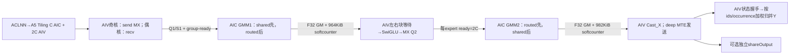
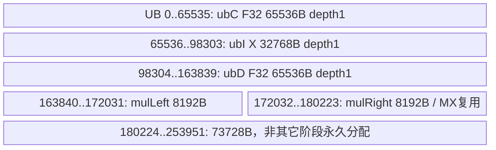
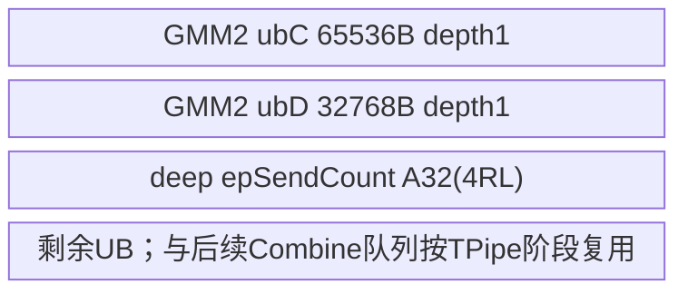
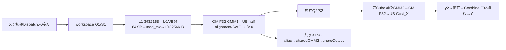
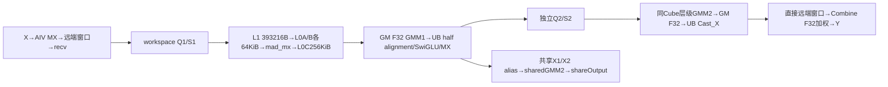
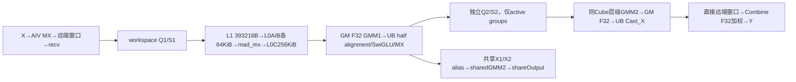

# DeepEP FusedDeepMoe MXFP8 E4M3 SwiGLU 950 ACLNN 算子知识

## 算子速览

| 项目 | 内容 |
|---|---|
| 实际入口 | 公开 `aclnnFusedDeepMoeGetWorkspaceSize/aclnnFusedDeepMoe`；SGL Mode1 的 A5 接口，区别于 A3 同名旧签名、Mode2 DispatchFFNCombine 与 Mode3 MegaMoe |
| 计算语义 | Dispatch→E4M3 MX GMM1→半精度对齐的 SwiGLU→动态 E4M3 MX→GMM2→按 top-k gate 加权 Combine；可另产共享专家输出 |
| 输入输出 | X/Y 为 BF16 或 FP16 ND；W1/W2 同为 E4M3，ND/NZ；scale 为 E8M0，每32逻辑K元素一项；expertIds INT32，gate FP32 |
| 执行类型 | 单 kernel `MIX_CV`，`KERNEL_TYPE_MIX_AIC_1_2`；AIC_CUBE 双 GMM；AIV_VECTOR 量化、SwiGLU、直接 MTE 通信与归并；无 SIMT、独立 NDDMA 或 CCU kernel |
| Kernel 路线 | R-001/002：L=1，无/有共享；R-003/004：L>1 dense，无/有共享；R-005/006：L>1 sparse，无/有共享；全部继续展开 ND/NZ、list、mask、smooth、X dtype、profile 维度 |
| 核心资源 | GM 全矩阵 F32 CV 交换；512B对齐 workspace；L1 393216B、L0A/B各65536B、L0C262144B；阶段复用253952B UB；HCCL对称窗口前1MiB状态区 |
| 来源闭包 | `source_closed`：公开入口→A5 Host/POD→32-key router→自有双GMM/量化/MTE body→固定CATLASS/9.1 Mc2/SDK/HCOMM当前实例；不表示算法正确或安装二进制ABI已实测 |
| 验证状态 | 已完成源码闭包检查；本次知识提取未执行编译、真机、数值或性能测试。L=1缺生产者、UnitFlag事件和H尾域等使本卡保持draft |

## 接口与语义

### 计算语义

记 R=EP rank数，r=本rank，E=总路由专家数，L=E/R，B=传入X的行数，P=globalBs/R，H=X列数，K=top-k，N=W1输出宽度，I=N/2，M=globalBs·min(K,L)。共享分支另记 Ns、Is=Ns/2、Bs=B；无共享时 Bs=0。定义 A_q(t)=ceil(t/q)·q，s(t)=2·ceil(t/64)，本卡 E4M3 存储 d(t)=t 字节。

对有效 token b 与专家 e，Dispatch 把 token、MX scale 按本地专家再源rank/occurrence排列。初始输入有 smooth 时先 `F32(X) * smooth[e,:]`，再 CAST_RINT 到 X dtype，随后每32元素动态MX量化，得到 Q1:E4M3 与 S1:E8M0。不存在 smooth 时直接从 X 做 MX。权重已有对应 E8M0 scale，不在本算子中重新量化。

GMM1 的逻辑矩阵为 Q1[m,H]·W1[e,H,N]，使用 MX scale 与 F32 累加。先把每个 F32 结果 CAST_RINT 到 X dtype，再转回 F32。前 I 列是 gate，后 I 列是 up；不是交错 gate/up：
`G = F32(round_X(GMM1[:,:I])); U = F32(round_X(GMM1[:,I:])); Z=G/(1+exp(-G))*U`。
Z 在 F32 相乘后 CAST_RINT 到 X dtype，再动态量化为 Q2:E4M3 与 S2:E8M0。GMM2 为 Q2[m,I]·W2[e,I,H]，F32 累加后 CAST_RINT 到 X dtype。返回路由归并为 `Y[b,h]=round_X(Σ_j F32(round_X(GMM2[e_j,occ_j,h]))·expertScales[b,j])`；负 expertId 被跳过。共享专家独立执行同样双GMM/SwiGLU，结果写 shareOutput，不在此内核中加到 Y。

动态MX并非 INT8 对称量化：`ComputeMaxExp/ComputeScale/ComputeFp8Data` 提取BF16指数、按32元素生成共享E8M0指数与BF16逆比例；E4M3最大指数常量为0x0400。FP16输入先 CAST_TRUNC 到BF16用于指数提取；数据通路FP16→F32乘逆比例→E4M3，BF16通路先在BF16乘逆比例再转F32/E4M3。最后FP8 CastTrait为 SAT、RINT；所选 `ClampE4m3Finite` 默认false，没有额外 ±448 Min/Max。0、NaN、特殊指数由源码位运算处理，不能据此保证所有非有限输入的数值性质。AIV置CTRL bit60=0是单指令模式，不能解释成全局饱和保证。

本卡限定 activationType=0。SiTU 的 `beta*tanh(gate/beta)/(1+exp(-gate))` 与可选 up soft saturation 是独立数学域。quantMode只被存入POD/Params，当前A5 body不以0/1选择不同计算；不能把0解释成无量化。本卡两次动态激活均随W1/W2的E4M3类型。

### 输入、输出与属性

| 参数 | shape/layout | dtype | 约束、默认值与语义 |
|---|---|---|---|
| x | [B,H] ND | BF16/FP16 | 输出相同dtype；Python可pad到capacity，mask为前bs行true |
| expertIds | [B,K] ND | INT32 | 源码跳过负值；无device上界/重复专家检查，合法路由须由调用方保证 |
| gmm1Weight | list L项[H,N]，或单项[L,H,N]；ND/NZ | E4M3 | ND逻辑不转置；NZ矩阵内按TLA zN；FP8组基址仍用逻辑K*N；全部item dtype/layout一致 |
| gmm2Weight | list L项[I,H]，或单项[L,I,H]；ND/NZ | E4M3 | 与W1同dtype、layout、listlen，无W1/W2混合精度路由 |
| gmm1WeightScale | listLen=L>1时每项[ceil(H/64),N,2]，或单项[L,ceil(H/64),N,2]（L=1必须[1,ceil(H/64),N,2]） | E8M0 | 每K32一scale，两个scale打包；Host兼容低维旧shape不等于MX body适配 |
| gmm2WeightScale | listLen=L>1时每项[ceil(I/64),H,2]，或单项[L,ceil(I/64),H,2]（L=1必须[1,ceil(I/64),H,2]） | E8M0 | scale list组织必须与对应weight一致 |
| expertScales | [B,K] ND | FP32 | Combine权重，在GMM2转回X dtype之后乘 |
| shareGmm1Weight/Scale | [H,Ns] 或NZ及对应MX scale | E4M3/E8M0 | shareW1存在启用共享；相关参数完整，dtype/layout须与路由权重匹配 |
| shareGmm2Weight/Scale | [Is,H] 或NZ及对应MX scale | E4M3/E8M0 | Host未完整检查shareW2 shape；输出独立shareOutput |
| expertSmoothScales | [E,H] ND，可选 | FP32 | 存在置bit4；按目标全局expertId读取 |
| shareSmoothScales | [H] ND，可选 | FP32 | 共享且smooth时需配套；不单独置key |
| xActiveMask | [B] ND，可选 | BOOL | Host存在置bit2；body求true总数后只处理此前缀，不实现任意稀疏洞mask |
| profileBuffer | U8 GM，可选 | UINT8 | session持有；使用profileEnable/Bytes/LaunchId和v5协议检查 |
| groupEp | HCCL group name | string | Host选全互联MTE资源；不能跨rank并发复用未清理的同一窗口状态 |
| epRankSize/epRankId/moeExpertNum | R/r/E | INT64属性→U32 | Host要求R>0、r<R、E>0、E%R=0、L≤256；窗口ABI为64rank，Host无R≤64保护 |
| quantMode | 标量 | INT64→U32 | 文档0/1兼容；A5不以其分支选择数学通路 |
| globalBs | 全局容量 | INT64→U32 | 0则Host设R·B；否则非负且整除R；Python设capacity·R |
| activationType/beta/linearBeta | 标量 | INT64/FLOAT/FLOAT | 本卡type0；C++默认beta4、linearBeta0，仅type1验证正值；type0不消费这两值 |
| profileEnable/Bytes/LaunchId | 标量 | INT64→U32/U64/U32 | profile关闭不读记录buffer；启用需有效sessionslot |
| output/shareOutput | [B,H] ND | 与x相同 | 公开输出均存在；无共享时shareOutput无有效生产者，Python不返回它 |
| expertTokenNums | [L] ND | INT64 | 各本地专家实际token数，非前缀；Python转成expertIds dtype后作为第二返回值 |

### 入口与版本

[FusedDeepMoe集成API](../../../../apis/deepep/deepep_fused_deep_moe.md)说明Python三种FuseMode。本卡覆盖A5 Mode1公开ACLNN的E4M3/SwiGLU实现，不复用A3旧INT8NZ算子事实。

`python/deep_ep/README.md`明确A5支持CANN9.0.0/9.1.0，当前A5 CI为9.1.0；FUSED_DEEP_MOE.md列950的E4M3/E5M2/E2M1/E1M2与FP8 ND/NZ。workflow的950/CANN9.1配置、A5 OpDef `AddConfig("ascend950")`和构建接线共同限定本卡9.1/950，CI配置不作为执行通过证据。CATLASS由A5 build选择v1.6.1，固定48f746；系统Mc2 header固定ops-transformer9.1的c77，SDK/HCOMM分别e545/4ca1。这里验证的是源码布局与调用映射，未验证安装库二进制。

## Host/Launcher 执行流程

### 参数校验与前处理

SGL策略依据FuseMode选择Mode1，C++ `Buffer::fused_deep_moe`先检查X、ids、gate二维及相同B/K，activation只接受swiglu/situ。950 capacity≥原始bs；capacity>bs时创建X/ids/gate零pad副本，构造前bs行true的BOOL mask。W/scale包成单项TensorList；分配capacity×H的output/shareOutput和[L]INT64 counts。此SGL调用不传共享专家、smooth，公开ACLNN仍可达这些分支。profile可选。返回output的前bs行和转成ids dtype的counts；shareOutput不返回。

A5 GetWorkspaceSize逐参转交generated `aclnnInnerFusedDeepMoeGetWorkspaceSize`；源码中不额外调用Contiguous/TransData或另加布局转换kernel，generated bridge、executor管理和普通框架tensor操作作为边界。执行阶段弱符号可用时设HCCL server类型：910B为AICPU，其它为MTE，再原样返回 `aclnnInnerFusedDeepMoe(workspace,size,executor,stream)`状态。

Tiling按顺序：读X与ids二维shape→属性→由W dtype设MX存储类型→weight list与W2 shape→同dtype/layout/stride→两个scale shape→HCCL容量→取AIC/AIV核数并要求C>0,V=2C→业务CheckData→可选mask→共享dtype/shape→smooth→workspace→Hcomm配置→key/blockDim。每处OPS_ERR_IF返回GRAPH_FAILED，无本地fallback。属性先窄化U32再检查，不能把unsigned `epRankId<0`视为有效负数保护；activation/beta/linearBeta指针未有对应空检查。

### 参数、Workspace 与生命周期

默认未定义DEBUG_SPACE时启用ENABLE_REUSE_MEMORY。以下以W为框架给kernel的workspace基地址，累加器o从0开始；Host申请额外16MiB system workspace，但Device按W+字段直接寻址，不应再平移16MiB。A512(t)=512B对齐；表中每一行写完后推进o，alias行不重复推进。

| 顺序/切片 | 字节范围/offset推导 | producer→consumer | owner/lifetime |
|---|---|---|---|
| 1 shared token reuse | shareX1=shareX2=o；o+=A512(max(BsH,BsIs)) | 初始共享MX→GMM1；随后共享Q2→GMM2 | workspace；GMM1共享读完才覆盖X1 |
| 2 routed X1 | x1=o；o+=A512(MH) | RecvCoreFunc→GMM1 AIC | 独立于X2；不因token tile完成提前覆盖 |
| 3 routed X2 | x2=o；o+=A512(MI) | routed SwiGLU/MX→GMM2 | 与仍在读的X1分离 |
| 4 shared scale reuse | shareS1=shareS2=o；o+=A512(max(Bs·s(H),Bs·s(Is))) | 两阶段共享MX→各自GMM | 与shared token相同复用序 |
| 5 routed S1 | s1=o；o+=A512(M·s(H)) | Dispatch→GMM1 | 接收实际写ceil(H/32)紧凑stride，与GMM偶数padding潜在冲突见限制 |
| 6 routed S2 | s2=o；o+=A512(M·s(I)) | 逐expert MX→GMM2 | 每行偶数scale padding |
| 7 GMM1交换/SwiGLU | sharedMm1=shareSwiglu=o；gmm1=swiglu=o+4BsNs；o+=A512(4(BsNs+MN)) | AIC F32 Fixpipe→AIV半精度对齐激活→原址F32 | 各256列tile生产者完成后可原址覆盖；左右半消费者另等待 |
| 8 GMM2交换 | sharedMm2=o；gmm2=o+4BsH；o+=A512(4(BsH+MH)) | AIC→AIV Cast/Combine | 与GMM1交换独立，直到GMM2消费者完毕 |
| 9 shallow output | y2=o；o+=A512(L>1?0:2MH) | GMM2 AIV→shallow window copy | deep直接发送，无此payload分配 |
| 10 groupList | o；o+=A512(8L) | Dispatch前缀INT64→两GMM调度 | 一次launch全程 |
| 11 expandIdx | o；o+=A512(4BK) | 源sender occurrence→源Combine | 每个有效flattened top-k项 |
| 12 epSendCount | o；o+=A512(4RL) | 接收方累计rank/expert计数→GMM2发送分段 | INT32前缀，非原始独立计数 |
| 13 routedGroupMeta | A32(o)；o+=A512(32L) | sparse receiver0→AIC/AIV | dense不依赖此表 |
| 14 activeGroupCount | o；o+=512 | sparse receiver0最后发布→全体调度 | U32 count，1个512B槽 |
| 15 activeGroupIds | o；o+=A512(4L) | sparse receiver0升序ID→双GMM | 可跳零expert，weight偏移仍按真实ID |
| 16 reserved | o；o+=262144 | 前131072B为256个512B X2-ready槽，其余预留 | sender清零→AIV通知→GMM2消费→结束清零 |

`workspaceSize=16MiB+o`。最大token公式在Host含U32乘法后再赋size_t，字段/容量不应当成任意INT64安全算术。DEBUG_SPACE编译分支关闭共享alias，shared/routed X1/X2和scale分别A512分配、两个F32 Swiglu另分配；对应Device把workspaceGM_指向shareSmoothGM而非常规workspace。它不是默认构建可验证的安全调试模式，不把该GM参数重定向外推到生产调用。

HCCL窗口不是上述workspace的别名，由通信group运行时持有跨launch的对称CCL GM；调用方须保持group、weights、所有输入输出和workspace直到stream完成，不能把ACLNN提交返回等同device已结束。profiling buffer由session持有，CompleteLaunch只增加captured计数，不释放或同步。session结束导出时读取持有的Tensor后Reset；导出库/框架的Host传输边界不改变本算子的device语义。

### 启动图与失败传播

`FusedDeepMoeTilingFuncImpl`设blockDim=C；entry预取icache、REGISTER_TILING_DEFAULT、KERNEL_TYPE_MIX_AIC_1_2，再由0..31编译期key实例化。单launch内部有下面的逻辑任务边，非多kernel串行：



图中Dispatch仅存在deep bit0=1；L=1实际未调用该生产者，后续body仍执行，不能把图中箭头补成已实现步骤。generated ACLNN bridge与设备launch状态由框架传播；自有kernel没有错误码输出或超时退出，通信/softcounter spin等待没有本地失败返回。因此Host成功只代表选路/提交条件成立；静态问题未在本次复现。

## Route 与参数设计

### 分核与资源计算

先由X/ids读B,H,K，再由E/R得L，由weightshape恢复N/I，CheckWeightLayout将本FP8的两个expert stride字段置0，ND/NZ均如此；T0 Device零值fallback按W1 H*N、W2 I*H逻辑元素偏移，dense累计、sparse按真实groupId，T1直接取list指针；仅FP4-NZ flat域另算padding物理byte stride；globalBs=0归一化为RB，否则P=globalBs/R。随后得到M=globalBs·min(K,L)、workspace、C/V。当前两GMM固定L1=256×256×256，L0=256×256×128，epilogue=64×256；不是Host按M/H自适应tile。

GMM1每expert问题[M_e,N,H]，GMM2为[M_e,H,I]；shared为[B,Ns,H]及[B,H,Is]。GemmIdentityBlockSwizzle<3,0>将M块按3行分组，奇数组反转N遍历；每core处理 `(core-startCore+C)%C + jC`，每group后轮转startCore。AIV映射到AIC的两subblock，GMM1右半块触发左右producer反查与乘/量化，64行epilogue按subblock交错分配。

FP8 policy为 `MmadMxWithCallback<Ascend950,true,16,1,false,2,2,2,2>`；L1 A/B各2×65536B，MXscale A/B各2×32768B，共393216B≤512KiB；L0A/B各2×32768B=65536B，L0C单256×256×4=262144B。UB上限由CATLASS Arch950常量248KiB=253952B，Host未对所有运行参数做逐阶段UB预算守卫。

### Route 选择

所有R均限定950、E4M3双权重、activationType=0、X∈{BF16,FP16}，下表与后续差异参数表共同给出完整实例集合。bit1=T为多项TensorList，bit2=A为mask存在，bit3=S为共享，bit4=Q为expertSmooth存在；D为L!=1。key=D+2T+4A+8S+16Q。

| 顺序 | Route | Key/模板 | 精确选择条件与优先级 | 不适用去向 |
|---:|---|---|---|---|
| 1 | R-001 shallow无共享 | 0,4,16,20 | L=1,S=0,T=0；A/Q逐bit | L>1转R003/005；S=1转R002 |
| 2 | R-002 shallow共享 | 8,12,24,28 | L=1,S=1,T=0；A/Q逐bit | L>1转R004/006 |
| 3 | R-003 dense无共享 | 1,3,5,7,17,19,21,23 | L>1,S=0 且4BK≥3L | 稀疏谓词转R005 |
| 4 | R-004 dense共享 | 9,11,13,15,25,27,29,31 | L>1,S=1 且4BK≥3L | 稀疏谓词转R006 |
| 5 | R-005 sparse无共享 | 与R003相同8key | L>1,S=0 且4BK<3L | 不满足转R003 |
| 6 | R-006 sparse共享 | 与R004相同8key | L>1,S=1 且4BK<3L | 不满足转R004 |

T由listLen>1置true，并要求listLen=L；单项二维或三维均置false。因此L=1只能T=0，key2/6/10/14/18/22/26/30虽然有router实例，却无本Host producer；Host真实可达24个key。L>1单项二维也没有明确L=1校验，不能把它当作足够的多expert backing保证。多项list仅详细检查第一item shape，后续item的dtype/layout循环检查不等于shape检查。

```text
dtype/layout/list/shape/HCCL/core校验失败 → GRAPH_FAILED
D = (L!=1); S = shareW1存在; A = mask存在; Q = expertSmooth存在; T = Host list判定
sparse = L>1 && uint64(B)*K*4 < uint64(L)*3
key = D | T<<1 | A<<2 | S<<3 | Q<<4
entry key0..31 → FusedDeepMoe<X,E4M3,WEIGHT_NZ,int32,false,key>
WEIGHT_NZ = FORMAT_GMM1_WEIGHT==FRACTAL_NZ
D0 → R001/002；D1且sparse0 → R003/004；D1且sparse1 → R005/006
未知key → entry无匹配分支，无输出提交；自有Host只产生0..31
```

### 模板/实现执行矩阵

| Route | key/selector | dtype/shape/platform 完整命中条件 | 执行族与 kernel 节点 | 实际模板/body | 内存与同步特征 | tail/fallback |
|---|---|---|---|---|---|---|
| R-001 | D0S0四key | 上表+下表全部变体 | 单MIX，AIC双GMM/AIV后处理和Combine | FusedDeepMoe→DispatchMxGmm1Swiglu→MxGmm2CastCombine；DEEP_FUSE=false | y2物化；跨阶段AIV→AIC flag0 | Dispatch生产者缺失，非可用fallback |
| R-002 | D0S1四key | R001加共享参数 | 同MIX，加shared GMM/独立输出 | 同前+共享分支；combiner由sub1执行 | shared X1/X2 alias，额外send6/recv7 | shared初始量化亦缺生产者 |
| R-003 | D1S0八key | L>1,dense | MTE dispatch、双GMM、归并同launch | send/recv→group-ready→paired epi→X2-ready→deepCombine | perexpert流水；发送与归并由两subblock分工 | 零expert dense仍贡献就绪计数 |
| R-004 | D1S1八key | R003加shared | sharedGMM1先/routedGMM2先 | sharedQuantCoreFunc+shared后量化+共享GMM2 | shared完成counter16；sub0 shared epi/sub1 combiner | Ns可不同于N，独立shape |
| R-005 | D1S0且sparse | 4BK<3L | 同MIX，无零expert Cube任务 | receiver0发布active list；双GMM按真实ID跳零 | metadata+SyncAll(false)；expected=meta[1] | activeCount0仍须GMM2完成哨兵 |
| R-006 | D1S1且sparse | R005加shared | sparse routed+不被跳过的shared | R005与shared路径分别编排 | metadata与shared counter分离 | routed全空仍处理shared |

以下维度是每个R的完整参数化子实例；其body、ABI、launch、同步差异不能被key集合隐去：

| 维度 | 精确分支 | 实际差异/不改变项 |
|---|---|---|
| weight ND/NZ | WEIGHT_NZ=false/true；W1/W2同格式 | ND RowMajor→L1zN用ND2NZ；NZ GMzN→L1zN直接分块copy，矩阵内用TLA zN stride；FP8 expert基址仍用逻辑K*N偏移；L0/Mmad/Fixpipe相同 |
| list T=0/1 | 单stack或逐expert指针 | T1 ListTensorDesc按group取W/scale；T0第0项基址+group·stride；sparse按真实groupId，不能按activePos取weight |
| mask A=0/1 | 缺省B或BOOL总和a | send/Combine仅前a token；mask求和UB先用后复用，payloadB域不因任意洞mask重排 |
| smooth Q=0/1 | 缺省或[E,H] FP32 | 每目标expert先F32 smooth乘后round_X，sender两份smooth UB；shared另[H]，后GMM1量化不重复smooth |
| X BF16/FP16 | 编译DTYPE_X | epilogue半精度对齐；初始MX指数提取/乘法精度不同，均回E4M3 SAT/RINT |
| profile关/开 | runtime条件，非key | 关闭不写profile；开启增加GM128B记录与时间戳，不改变tile/通信payload；固定最多36AIC+72AIV |
| quantMode0/1/其它窄化值 | 当前A5无body谓词 | 不新增数学/资源分支；公开文档只说明0/1兼容 |

### 隐藏性能 Guard

| Guard | Host/Tiling 条件 | Device/资源原因 | 影响 Route | 不满足时去向 | 源码符号 |
|---|---|---|---|---|---|
| 1C2V | C>0且V=2C | 奇偶send/recv、AIV pair以及shared/Combine subblock角色 | 全部 | GRAPH_FAILED | FusedDeepMoeTilingFuncImpl |
| E/R与local容量 | E%R=0,L≤256 | 256×512B X2槽和sparse表 | 全部 | GRAPH_FAILED | GetAttrAndSetTilingData |
| 公布/Host范围 | 文档B1..256,H512..7168,N1024..6144,K1..12,E1..512；HostB0..256,H512..8192,N1024..7168,N%1024=0,K≤16且≤E,E≤1024 | 公布域不能由更宽selector扩大 | 全部 | Host超界GRAPH_FAILED；宽域/零域保持draft边界 | CheckData |
| global容量 | globalBs=0→RB；否则≥0、%R=0 | 每源rank P槽，token/workspace上界 | 全部 | GRAPH_FAILED；不保证capacity数据安全 | CheckData |
| window demand | 4L·globalBs_attr_u32·H≤GetMaxWindowSize()（在CheckData归一化globalBs之前） | 2字节token、双buffer估算；不是完整header/状态布局证明 | 全部 | GRAPH_FAILED | CheckHcclBufferSize |
| MX对齐 | Host无H%64/H%256守卫 | s(H)偶数stride、256元素DINTLV与GMM2列tail | 全部 | 无fallback；见静态风险 | AivInitParams/ComputeMaxExp/DoCombineSend |
| UB | routed epi+mul静态≤248KiB；其余按参数增长无统一Host cap | sender计数/ids、receiver32E、smooth、sharedNs等 | deep/shared | 无自有资源fallback | SendCoreFunc/RecvCoreFunc/RoutedMulQuant |
| rank64 | Host未检查R≤64 | Mc2 windowsIn[64] | 全部 | 无源码保护；不支持任意R推断 | HcclCombinOpParam |
| sparse | L>1&&4BK<3L | 避免遍历零expert；metadata所有者/完成哨兵必需 | R005/006 | dense | enableRoutedSparseFastPath |
| W读取缓存 | ceil(M_e/256)==1 | 当前矩阵只有一M tile时对W禁用L2 hint | deep | 同body默认hint | DispatchMxGmm1Swiglu AIC |
| unitFlag=true | 所有当前FP8 policy | nativeMmad/Fixpipe完成协议；自有event数组初始化冲突 | 全部 | 无fallback，draft | BlockMmadTla ctor/mainloop |

### POD/ABI

以下offset为固定声明按C++常见自然布局推导，未编译测量ABI。`FusedDeepMoeInfo` align8/size144，offset68..71、116..119和138..143为padding；`WorkSpaceOffset` align8/size176。SDK公开Mc2 wrapper为64B/512B reserved字节，内部声明解释其中字段；因此外层 `FusedDeepMoeTilingData` 推导size896/align8。generated kernel_tiling头/编译器实际布局仍属框架ABI边界。

| 结构 | 字段 | 类型/位宽 | ABI 布局 | 单位 | Host/launcher producer | Device consumer | 边界 |
|---|---|---|---|---|---|---|---|
| FusedDeepMoeTilingData | mc2InitTiling | Mc2InitTiling/64B | off0 | bytes | SetHcommCfg/GetTiling | 框架资源准备 | Device双GMM不直接读 |
| FusedDeepMoeTilingData | mc2CcTiling | Mc2CcTiling/512B | off64 | bytes | SetHcommCfg/GetTiling | 框架通信配置 | 与Init相对offset64 |
| FusedDeepMoeTilingData | fusedDeepMoeInfo | Info/144B | off576 | struct | 各Host检查/赋值 | FusedDeepMoe::Init/Process | 下表逐字段 |
| FusedDeepMoeTilingData | workSpaceOffset | Offset/176B | off720 | struct | SetWorkSpace | Process构造各GM_ADDR | 相对W，不加16MiB |
| FusedDeepMoeInfo | epRankSize | u32 | off0 | rank | 属性窄化R | MTE、P与rank循环 | R>0；无64上界检查 |
| FusedDeepMoeInfo | epRankId | u32 | off4 | rank | 属性窄化r | 本地/远程窗口和目标expert | r<R |
| FusedDeepMoeInfo | moeExpertNum | u32 | off8 | expert | 属性E | send计数/ID范围 | 1..1024，公开≤512 |
| FusedDeepMoeInfo | moeExpertNumPerRank | u32 | off12 | expert | E/R | 双GMM组数、窗口布局 | 1..256 |
| FusedDeepMoeInfo | quantMode | u32 | off16 | 枚举 | quantMode属性 | Params透传 | reserved，无数学分支 |
| FusedDeepMoeInfo | activationType | u32 | off20 | 枚举 | activationType属性 | BlockEpilogue::ComputeActivation | 本卡0；device非1均Silu |
| FusedDeepMoeInfo | beta | f32 | off24 | 标量 | FLOAT属性，C++默认4 | 仅ComputeSitu | 本卡inactive |
| FusedDeepMoeInfo | linearBeta | f32 | off28 | 标量 | FLOAT属性，C++默认0 | 仅ComputeSitu | 本卡inactive |
| FusedDeepMoeInfo | mxActStorageFp4 | u32 | off32 | 枚举 | 由W dtype赋4或0 | Host MxActStorageBytes/CheckData | 本卡0；不是quantMode映射 |
| FusedDeepMoeInfo | profileEnable | u32 | off36 | bool语义 | profileEnable属性 | ProfileWriter::Init | 0关闭 |
| FusedDeepMoeInfo | profileLaunchId | u32 | off40 | slot | 属性/session captured | ProfileWriter launchOffset | 小于header capacity |
| FusedDeepMoeInfo | globalBs | u32 | off44 | token | CheckData归一化属性 | P、maxTokenNum | 非零需%R=0；先窄化 |
| FusedDeepMoeInfo | bs | u32 | off48 | token | X storage dim0 | sender/共享/Combine | Host允许0..256 |
| FusedDeepMoeInfo | k | u32 | off52 | top-k | ids storage dim1 | BK遍历 | ≤16且≤E，未要求>0 |
| FusedDeepMoeInfo | h | u32 | off56 | 元素 | X storage dim1 | tokenLength、GMM1 K/GMM2 N | 512..8192；本卡无偶数或64对齐guard |
| FusedDeepMoeInfo | aicNum | u32 | off60 | core | PlatformAscendC | 任务分配/ready | C>0 |
| FusedDeepMoeInfo | aivNum | u32 | off64 | core | PlatformAscendC | expectedAivNum | 必须2C |
| FusedDeepMoeInfo | profileBufferBytes | u64 | off72 | 字节 | 属性/session size | ProfileWriter bounds | GM实际Tensor长度未由Host对比 |
| FusedDeepMoeInfo | totalUbSize | u64 | off80 | 字节 | 本Host未赋值 | 所选body未读取 | inactive，不假设为248KiB |
| FusedDeepMoeInfo | totalWinSize | u64 | off88 | 字节 | 本Host未赋值 | 所选body未读取 | inactive，容量检查独立读env |
| FusedDeepMoeInfo | gmm1HLen | u64 | off96 | 元素 | CheckGmm1Shape恢复N | 两GMM与SwiGLU宽度 | N%1024=0 |
| FusedDeepMoeInfo | shareGmm1HLen | u64 | off104 | 元素 | 共享shape恢复Ns | 共享双GMM | 无共享inactive |
| FusedDeepMoeInfo | weightLayoutMode | u32 | off112 | 枚举 | CheckWeightLayout ND0/NZ1 | Device模板format另决定WEIGHT_NZ | Host布局一致性检查 |
| FusedDeepMoeInfo | gmm1WeightExpertStrideBytes | u64 | off120 | 字节 | CheckWeightLayout置0（本FP8） | GMM1 T0零值fallback用逻辑H*N元素组偏移 | T1取list指针；非零物理byte stride仅FP4-NZ flat另域 |
| FusedDeepMoeInfo | gmm2WeightExpertStrideBytes | u64 | off128 | 字节 | CheckWeightLayout置0（本FP8） | GMM2 T0零值fallback用逻辑I*H元素组偏移 | T1取list指针；与GMM1不可互换 |
| FusedDeepMoeInfo | isTensorList | bool | off136 | bool | CheckGmm1Shape listLen>1 | Host key bit1/模板 | 单item=false |
| FusedDeepMoeInfo | enableRoutedSparseFastPath | bool | off137 | bool | L>1&&4BK<3L | receiver meta/双GMM/AIV调度 | 非key runtime字段 |
| WorkSpaceOffset | shareX1TokenOffset | i64 | off0 | 字节 | SetWorkSpace前节同名切片 | Process的W+字段 | 共享关闭时inactive；alias按生命周期 |
| WorkSpaceOffset | x1TokenOffset | i64 | off8 | 字节 | SetWorkSpace前节同名切片 | Process的W+字段 | 相对workspace基址 |
| WorkSpaceOffset | shareX1ScaleOffset | i64 | off16 | 字节 | SetWorkSpace前节同名切片 | Process的W+字段 | 共享关闭时inactive；alias按生命周期 |
| WorkSpaceOffset | x1ScaleOffset | i64 | off24 | 字节 | SetWorkSpace前节同名切片 | Process的W+字段 | 相对workspace基址 |
| WorkSpaceOffset | shareSwigluOffset | i64 | off32 | 字节 | SetWorkSpace前节同名切片 | Process的W+字段 | 共享关闭时inactive；alias按生命周期 |
| WorkSpaceOffset | swigluOffset | i64 | off40 | 字节 | SetWorkSpace前节同名切片 | Process的W+字段 | 相对workspace基址 |
| WorkSpaceOffset | shareX2TokenOffset | i64 | off48 | 字节 | SetWorkSpace前节同名切片 | Process的W+字段 | 共享关闭时inactive；alias按生命周期 |
| WorkSpaceOffset | x2TokenOffset | i64 | off56 | 字节 | SetWorkSpace前节同名切片 | Process的W+字段 | 相对workspace基址 |
| WorkSpaceOffset | shareX2ScaleOffset | i64 | off64 | 字节 | SetWorkSpace前节同名切片 | Process的W+字段 | 共享关闭时inactive；alias按生命周期 |
| WorkSpaceOffset | x2ScaleOffset | i64 | off72 | 字节 | SetWorkSpace前节同名切片 | Process的W+字段 | 相对workspace基址 |
| WorkSpaceOffset | shareMm1SwapSpaceOffset | i64 | off80 | 字节 | SetWorkSpace前节同名切片 | Process的W+字段 | 共享关闭时inactive；alias按生命周期 |
| WorkSpaceOffset | shareMm2SwapSpaceOffset | i64 | off88 | 字节 | SetWorkSpace前节同名切片 | Process的W+字段 | 共享关闭时inactive；alias按生命周期 |
| WorkSpaceOffset | gmm1SwapSpaceOffset | i64 | off96 | 字节 | SetWorkSpace前节同名切片 | Process的W+字段 | 相对workspace基址 |
| WorkSpaceOffset | gmm2SwapSpaceOffset | i64 | off104 | 字节 | SetWorkSpace前节同名切片 | Process的W+字段 | 相对workspace基址 |
| WorkSpaceOffset | y2TokenOffset | i64 | off112 | 字节 | SetWorkSpace前节同名切片 | Process的W+字段 | 仅shallow物化 |
| WorkSpaceOffset | groupListOffset | i64 | off120 | 字节 | SetWorkSpace前节同名切片 | Process的W+字段 | 相对workspace基址 |
| WorkSpaceOffset | expandIdxOffset | i64 | off128 | 字节 | SetWorkSpace前节同名切片 | Process的W+字段 | 相对workspace基址 |
| WorkSpaceOffset | epSendCountOffset | i64 | off136 | 字节 | SetWorkSpace前节同名切片 | Process的W+字段 | 相对workspace基址 |
| WorkSpaceOffset | routedGroupMetaOffset | i64 | off144 | 字节 | SetWorkSpace前节同名切片 | Process的W+字段 | sparse元数据；dense不消费 |
| WorkSpaceOffset | routedActiveGroupCountOffset | i64 | off152 | 字节 | SetWorkSpace前节同名切片 | Process的W+字段 | sparse元数据；dense不消费 |
| WorkSpaceOffset | routedActiveGroupIdsOffset | i64 | off160 | 字节 | SetWorkSpace前节同名切片 | Process的W+字段 | sparse元数据；dense不消费 |
| WorkSpaceOffset | reservedOffset | i64 | off168 | 字节 | SetWorkSpace前节同名切片 | Process的W+字段 | X2-ready前128KiB，256槽 |
| RoutedGroupMeta | tokenCount | u32 | off0 | token | sparse recvCore0 | 双GMM currentM | 零group不进入activeIds |
| RoutedGroupMeta | computeActiveAivCount | u32 | off4 | core | tokenCount>0?2C:0 | GMM2 expected通知数 | 不按实际tile分配核数替换 |
| RoutedGroupMeta | padding | u8[24] | off8 | 字节 | sparse owner清零 | 不消费 | size32/align4；每group独占32B |

当前Device局部Params不是Host传输POD：`DispatchMxGmm1SwigluQuantFunc/MxGmm2CastCombineFunc`显式构造后在同TU消费，含TLA布局类型和指针，sizeof/alignof/offsetof依编译实例，固定源码不提供已测值。下面每个字段单行；同名两Params字段分别属于K1/K2，K1=DispatchMxGmm1Swiglu::Params，K2=MxGmm2CastCombine::Params。shape坐标均U32 M/N/K，GM指针为设备地址，layout包含对应shape/stride；不是额外GM传输buffer。

| 结构 | 字段 | 类型/位宽 | ABI 布局 | 单位 | Host/launcher producer | Device consumer | 边界 |
|---|---|---|---|---|---|---|---|
| K1 | problemShape | GemmCoord | 同TU局部，未测布局 | 对应语义 | DispatchMxGmm1SwigluQuantFunc：M,N,H | routed调度 | optional/shared/sparse按EXEC_FLAG/Info保护；无默认构造零初始化保证 |
| K1 | shareProblemShape | GemmCoord | 同TU局部，未测布局 | 对应语义 | DispatchMxGmm1SwigluQuantFunc：B,Ns,H | 共享调度 | optional/shared/sparse按EXEC_FLAG/Info保护；无默认构造零初始化保证 |
| K1 | problemCount | u32 | 同TU局部，未测布局 | 对应语义 | DispatchMxGmm1SwigluQuantFunc：L | expert循环 | optional/shared/sparse按EXEC_FLAG/Info保护；无默认构造零初始化保证 |
| K1 | ptrGroupList | GM i64* | 同TU局部，未测布局 | 地址 | DispatchMxGmm1SwigluQuantFunc：groupList | shallow前缀 | optional/shared/sparse按EXEC_FLAG/Info保护；无默认构造零初始化保证 |
| K1 | ptrA | GM E4* | 同TU局部，未测布局 | 地址 | DispatchMxGmm1SwigluQuantFunc：x1 | AIC输入 | optional/shared/sparse按EXEC_FLAG/Info保护；无默认构造零初始化保证 |
| K1 | ptrShareA | GM E4* | 同TU局部，未测布局 | 地址 | DispatchMxGmm1SwigluQuantFunc：shareX1 | 共享AIC输入 | optional/shared/sparse按EXEC_FLAG/Info保护；无默认构造零初始化保证 |
| K1 | layoutA | TLA RowMajor | 同TU局部，未测布局 | shape/stride | DispatchMxGmm1SwigluQuantFunc：[M,H] | A addressing | optional/shared/sparse按EXEC_FLAG/Info保护；无默认构造零初始化保证 |
| K1 | ptrB | GM E4* | 同TU局部，未测布局 | 地址 | DispatchMxGmm1SwigluQuantFunc：weight1 | list/stride读取 | optional/shared/sparse按EXEC_FLAG/Info保护；无默认构造零初始化保证 |
| K1 | ptrShareB | GM E4* | 同TU局部，未测布局 | 地址 | DispatchMxGmm1SwigluQuantFunc：shareWeight1 | 共享读取 | optional/shared/sparse按EXEC_FLAG/Info保护；无默认构造零初始化保证 |
| K1 | layoutB | TLA ND/zN | 同TU局部，未测布局 | shape/stride | DispatchMxGmm1SwigluQuantFunc：[H,N] | W1寻址 | optional/shared/sparse按EXEC_FLAG/Info保护；无默认构造零初始化保证 |
| K1 | layoutShareB | TLA ND/zN | 同TU局部，未测布局 | shape/stride | DispatchMxGmm1SwigluQuantFunc：[H,Ns] | 共享W1寻址 | optional/shared/sparse按EXEC_FLAG/Info保护；无默认构造零初始化保证 |
| K1 | ptrMxScaleA | GM E8M0* | 同TU局部，未测布局 | 地址 | DispatchMxGmm1SwigluQuantFunc：s1 | GMM1尺度 | optional/shared/sparse按EXEC_FLAG/Info保护；无默认构造零初始化保证 |
| K1 | ptrShareMxScaleA | GM E8M0* | 同TU局部，未测布局 | 地址 | DispatchMxGmm1SwigluQuantFunc：shareS1 | 共享尺度 | optional/shared/sparse按EXEC_FLAG/Info保护；无默认构造零初始化保证 |
| K1 | layoutMxScaleA | TLA MX-A | 同TU局部，未测布局 | shape/stride | DispatchMxGmm1SwigluQuantFunc：[M,ceil(H/32)]，rowstride s(H) | scale-A寻址 | optional/shared/sparse按EXEC_FLAG/Info保护；无默认构造零初始化保证 |
| K1 | ptrMxScaleB | GM E8M0* | 同TU局部，未测布局 | 地址 | DispatchMxGmm1SwigluQuantFunc：weightScale1 | MX权重尺度 | optional/shared/sparse按EXEC_FLAG/Info保护；无默认构造零初始化保证 |
| K1 | ptrShareMxScaleB | GM E8M0* | 同TU局部，未测布局 | 地址 | DispatchMxGmm1SwigluQuantFunc：shareWeightScale1 | 共享MX尺度 | optional/shared/sparse按EXEC_FLAG/Info保护；无默认构造零初始化保证 |
| K1 | layoutMxScaleB | TLA MX-B | 同TU局部，未测布局 | shape/stride | DispatchMxGmm1SwigluQuantFunc：[ceil(H/32),N]，相邻scale成对 | scale-B寻址 | optional/shared/sparse按EXEC_FLAG/Info保护；无默认构造零初始化保证 |
| K1 | layoutShareMxScaleB | TLA MX-B | 同TU局部，未测布局 | shape/stride | DispatchMxGmm1SwigluQuantFunc：[ceil(H/32),Ns] | 共享scale-B | optional/shared/sparse按EXEC_FLAG/Info保护；无默认构造零初始化保证 |
| K1 | ptrC | GM f32* | 同TU局部，未测布局 | 地址 | DispatchMxGmm1SwigluQuantFunc：gmm1Swap | Fixpipe输出 | optional/shared/sparse按EXEC_FLAG/Info保护；无默认构造零初始化保证 |
| K1 | ptrShareC | GM f32* | 同TU局部，未测布局 | 地址 | DispatchMxGmm1SwigluQuantFunc：shareMm1Swap | 共享Fixpipe | optional/shared/sparse按EXEC_FLAG/Info保护；无默认构造零初始化保证 |
| K1 | layoutC | TLA RowMajor | 同TU局部，未测布局 | shape/stride | DispatchMxGmm1SwigluQuantFunc：[M,N] | F32交换 | optional/shared/sparse按EXEC_FLAG/Info保护；无默认构造零初始化保证 |
| K1 | layoutShareC | TLA RowMajor | 同TU局部，未测布局 | shape/stride | DispatchMxGmm1SwigluQuantFunc：[B,Ns] | 共享F32交换 | optional/shared/sparse按EXEC_FLAG/Info保护；无默认构造零初始化保证 |
| K1 | gmSwigluOut | GM f32* | 同TU局部，未测布局 | 地址 | DispatchMxGmm1SwigluQuantFunc：swiglu=swap alias | 激活/乘 | optional/shared/sparse按EXEC_FLAG/Info保护；无默认构造零初始化保证 |
| K1 | gmShareSwigluOut | GM f32* | 同TU局部，未测布局 | 地址 | DispatchMxGmm1SwigluQuantFunc：shareSwiglu=shareSwap alias | 共享激活 | optional/shared/sparse按EXEC_FLAG/Info保护；无默认构造零初始化保证 |
| K1 | ptrX2 | GM E4* | 同TU局部，未测布局 | 地址 | DispatchMxGmm1SwigluQuantFunc：x2 | routed MX输出 | optional/shared/sparse按EXEC_FLAG/Info保护；无默认构造零初始化保证 |
| K1 | ptrShareX2 | GM E4* | 同TU局部，未测布局 | 地址 | DispatchMxGmm1SwigluQuantFunc：shareX2 | 共享MX输出 | optional/shared/sparse按EXEC_FLAG/Info保护；无默认构造零初始化保证 |
| K1 | gmX2Scale | GM E8M0* | 同TU局部，未测布局 | 地址 | DispatchMxGmm1SwigluQuantFunc：s2 | routed MX尺度输出 | optional/shared/sparse按EXEC_FLAG/Info保护；无默认构造零初始化保证 |
| K1 | gmShareX2Scale | GM E8M0* | 同TU局部，未测布局 | 地址 | DispatchMxGmm1SwigluQuantFunc：shareS2 | 共享MX尺度输出 | optional/shared/sparse按EXEC_FLAG/Info保护；无默认构造零初始化保证 |
| K1 | gmX | GM_ADDR | 同TU局部，未测布局 | 地址 | DispatchMxGmm1SwigluQuantFunc：x | Dispatch | optional/shared/sparse按EXEC_FLAG/Info保护；无默认构造零初始化保证 |
| K1 | gmExpertIds | GM_ADDR | 同TU局部，未测布局 | 地址 | DispatchMxGmm1SwigluQuantFunc：expertIds | sender路由 | optional/shared/sparse按EXEC_FLAG/Info保护；无默认构造零初始化保证 |
| K1 | gmXActiveMask | GM_ADDR | 同TU局部，未测布局 | 地址 | DispatchMxGmm1SwigluQuantFunc：mask/null | prefix active count | optional/shared/sparse按EXEC_FLAG/Info保护；无默认构造零初始化保证 |
| K1 | gmMoeSmoothScales | GM_ADDR | 同TU局部，未测布局 | 地址 | DispatchMxGmm1SwigluQuantFunc：expertSmooth/null | sender smooth | optional/shared/sparse按EXEC_FLAG/Info保护；无默认构造零初始化保证 |
| K1 | gmShareSmoothScales | GM_ADDR | 同TU局部，未测布局 | 地址 | DispatchMxGmm1SwigluQuantFunc：shareSmooth/null | shared smooth | optional/shared/sparse按EXEC_FLAG/Info保护；无默认构造零初始化保证 |
| K1 | gmExpandIdx | GM_ADDR | 同TU局部，未测布局 | 地址 | DispatchMxGmm1SwigluQuantFunc：expandIdx | occurrence输出 | optional/shared/sparse按EXEC_FLAG/Info保护；无默认构造零初始化保证 |
| K1 | gmEpSendCount | GM_ADDR | 同TU局部，未测布局 | 地址 | DispatchMxGmm1SwigluQuantFunc：epSendCount | 接收前缀输出 | optional/shared/sparse按EXEC_FLAG/Info保护；无默认构造零初始化保证 |
| K1 | gmExpertTokenNums | GM_ADDR | 同TU局部，未测布局 | 地址 | DispatchMxGmm1SwigluQuantFunc：expertTokenNums | 非前缀输出 | optional/shared/sparse按EXEC_FLAG/Info保护；无默认构造零初始化保证 |
| K1 | gmX2ReadyState | GM_ADDR | 同TU局部，未测布局 | 地址 | DispatchMxGmm1SwigluQuantFunc：reserved | 逐expert通知 | optional/shared/sparse按EXEC_FLAG/Info保护；无默认构造零初始化保证 |
| K1 | gmRoutedGroupMeta | GM_ADDR | 同TU局部，未测布局 | 地址 | DispatchMxGmm1SwigluQuantFunc：routedGroupMeta | sparse元数据 | optional/shared/sparse按EXEC_FLAG/Info保护；无默认构造零初始化保证 |
| K1 | gmRoutedActiveGroupCount | GM_ADDR | 同TU局部，未测布局 | 地址 | DispatchMxGmm1SwigluQuantFunc：activeCount | sparse发布 | optional/shared/sparse按EXEC_FLAG/Info保护；无默认构造零初始化保证 |
| K1 | gmRoutedActiveGroupIds | GM_ADDR | 同TU局部，未测布局 | 地址 | DispatchMxGmm1SwigluQuantFunc：activeIds | sparse索引 | optional/shared/sparse按EXEC_FLAG/Info保护；无默认构造零初始化保证 |
| K1 | profile | Device writer* | 同TU局部，未测布局 | 地址 | DispatchMxGmm1SwigluQuantFunc：局部profileWriter | 阶段记录 | optional/shared/sparse按EXEC_FLAG/Info保护；无默认构造零初始化保证 |
| K1 | epilogueParams | ActivationParams | 同TU局部，未测布局 | 对应语义 | DispatchMxGmm1SwigluQuantFunc：type/beta/linearBeta/hasLinearBeta | BlockEpilogue | optional/shared/sparse按EXEC_FLAG/Info保护；无默认构造零初始化保证 |
| K1 | epRankSize | u32 | 同TU局部，未测布局 | 对应语义 | DispatchMxGmm1SwigluQuantFunc：Info.R | MTE rank | optional/shared/sparse按EXEC_FLAG/Info保护；无默认构造零初始化保证 |
| K1 | epRankId | u32 | 同TU局部，未测布局 | 对应语义 | DispatchMxGmm1SwigluQuantFunc：Info.r | 本rank | optional/shared/sparse按EXEC_FLAG/Info保护；无默认构造零初始化保证 |
| K1 | moeExpertNum | u32 | 同TU局部，未测布局 | 对应语义 | DispatchMxGmm1SwigluQuantFunc：Info.E | 总专家 | optional/shared/sparse按EXEC_FLAG/Info保护；无默认构造零初始化保证 |
| K1 | moeExpertNumPerRank | u32 | 同TU局部，未测布局 | 对应语义 | DispatchMxGmm1SwigluQuantFunc：Info.L | 本地专家 | optional/shared/sparse按EXEC_FLAG/Info保护；无默认构造零初始化保证 |
| K1 | quantMode | u32 | 同TU局部，未测布局 | 对应语义 | DispatchMxGmm1SwigluQuantFunc：Info.quantMode | reserved | optional/shared/sparse按EXEC_FLAG/Info保护；无默认构造零初始化保证 |
| K1 | globalBs | u32 | 同TU局部，未测布局 | 对应语义 | DispatchMxGmm1SwigluQuantFunc：Info.globalBs | 容量 | optional/shared/sparse按EXEC_FLAG/Info保护；无默认构造零初始化保证 |
| K1 | bs | u32 | 同TU局部，未测布局 | 对应语义 | DispatchMxGmm1SwigluQuantFunc：Info.bs | 本地行 | optional/shared/sparse按EXEC_FLAG/Info保护；无默认构造零初始化保证 |
| K1 | topK | u32 | 同TU局部，未测布局 | 对应语义 | DispatchMxGmm1SwigluQuantFunc：Info.k | flattened路由 | optional/shared/sparse按EXEC_FLAG/Info保护；无默认构造零初始化保证 |
| K1 | tokenLen | u32 | 同TU局部，未测布局 | 对应语义 | DispatchMxGmm1SwigluQuantFunc：Info.h | 输入列 | optional/shared/sparse按EXEC_FLAG/Info保护；无默认构造零初始化保证 |
| K1 | shareN | u32 | 同TU局部，未测布局 | 对应语义 | DispatchMxGmm1SwigluQuantFunc：Info.Ns | 共享输出列 | optional/shared/sparse按EXEC_FLAG/Info保护；无默认构造零初始化保证 |
| K1 | weightExpertStrideBytes | u64 | 同TU局部，未测布局 | 对应语义 | DispatchMxGmm1SwigluQuantFunc：Info.gmm1WeightExpertStrideBytes | T0 W1偏移 | optional/shared/sparse按EXEC_FLAG/Info保护；无默认构造零初始化保证 |
| K1 | enableRoutedSparseFastPath | bool | 同TU局部，未测布局 | 对应语义 | DispatchMxGmm1SwigluQuantFunc：Info.sparse | sparse选择 | optional/shared/sparse按EXEC_FLAG/Info保护；无默认构造零初始化保证 |
| K2 | problemShape | GemmCoord | 同TU局部，未测布局 | 对应语义 | MxGmm2CastCombineFunc：M,H,I | routed调度 | optional/shared/sparse按EXEC_FLAG/Info保护；无默认构造零初始化保证 |
| K2 | problemCount | u32 | 同TU局部，未测布局 | 对应语义 | MxGmm2CastCombineFunc：L | expert循环 | optional/shared/sparse按EXEC_FLAG/Info保护；无默认构造零初始化保证 |
| K2 | ptrGroupList | GM i64* | 同TU局部，未测布局 | 地址 | MxGmm2CastCombineFunc：groupList | shallow前缀 | optional/shared/sparse按EXEC_FLAG/Info保护；无默认构造零初始化保证 |
| K2 | ptrA | GM E4* | 同TU局部，未测布局 | 地址 | MxGmm2CastCombineFunc：x2 | GMM2输入 | optional/shared/sparse按EXEC_FLAG/Info保护；无默认构造零初始化保证 |
| K2 | ptrSharedA | GM E4* | 同TU局部，未测布局 | 地址 | MxGmm2CastCombineFunc：shareX2 | 共享输入 | optional/shared/sparse按EXEC_FLAG/Info保护；无默认构造零初始化保证 |
| K2 | layoutA | TLA RowMajor | 同TU局部，未测布局 | shape/stride | MxGmm2CastCombineFunc：[M,I] | A寻址 | optional/shared/sparse按EXEC_FLAG/Info保护；无默认构造零初始化保证 |
| K2 | layoutSharedA | TLA RowMajor | 同TU局部，未测布局 | shape/stride | MxGmm2CastCombineFunc：[B,Is] | shared-A寻址 | optional/shared/sparse按EXEC_FLAG/Info保护；无默认构造零初始化保证 |
| K2 | ptrB | GM E4* | 同TU局部，未测布局 | 地址 | MxGmm2CastCombineFunc：weight2 | list/stride | optional/shared/sparse按EXEC_FLAG/Info保护；无默认构造零初始化保证 |
| K2 | ptrSharedB | GM E4* | 同TU局部，未测布局 | 地址 | MxGmm2CastCombineFunc：shareWeight2 | 共享W2 | optional/shared/sparse按EXEC_FLAG/Info保护；无默认构造零初始化保证 |
| K2 | layoutB | TLA ND/zN | 同TU局部，未测布局 | shape/stride | MxGmm2CastCombineFunc：[I,H] | B寻址 | optional/shared/sparse按EXEC_FLAG/Info保护；无默认构造零初始化保证 |
| K2 | layoutSharedB | TLA ND/zN | 同TU局部，未测布局 | shape/stride | MxGmm2CastCombineFunc：[Is,H] | 共享B寻址 | optional/shared/sparse按EXEC_FLAG/Info保护；无默认构造零初始化保证 |
| K2 | ptrMxScaleA | GM E8M0* | 同TU局部，未测布局 | 地址 | MxGmm2CastCombineFunc：s2 | MX输入尺度 | optional/shared/sparse按EXEC_FLAG/Info保护；无默认构造零初始化保证 |
| K2 | ptrSharedMxScaleA | GM E8M0* | 同TU局部，未测布局 | 地址 | MxGmm2CastCombineFunc：shareS2 | 共享输入尺度 | optional/shared/sparse按EXEC_FLAG/Info保护；无默认构造零初始化保证 |
| K2 | layoutMxScaleA | TLA MX-A | 同TU局部，未测布局 | shape/stride | MxGmm2CastCombineFunc：[M,ceil(I/32)] | MX-A | optional/shared/sparse按EXEC_FLAG/Info保护；无默认构造零初始化保证 |
| K2 | layoutSharedMxScaleA | TLA MX-A | 同TU局部，未测布局 | shape/stride | MxGmm2CastCombineFunc：[B,ceil(Is/32)] | 共享MX-A | optional/shared/sparse按EXEC_FLAG/Info保护；无默认构造零初始化保证 |
| K2 | ptrMxScaleB | GM E8M0* | 同TU局部，未测布局 | 地址 | MxGmm2CastCombineFunc：weightScale2 | MX权重尺度 | optional/shared/sparse按EXEC_FLAG/Info保护；无默认构造零初始化保证 |
| K2 | ptrSharedMxScaleB | GM E8M0* | 同TU局部，未测布局 | 地址 | MxGmm2CastCombineFunc：shareWeightScale2 | 共享权重尺度 | optional/shared/sparse按EXEC_FLAG/Info保护；无默认构造零初始化保证 |
| K2 | layoutMxScaleB | TLA MX-B | 同TU局部，未测布局 | shape/stride | MxGmm2CastCombineFunc：[ceil(I/32),H] | MX-B | optional/shared/sparse按EXEC_FLAG/Info保护；无默认构造零初始化保证 |
| K2 | layoutSharedMxScaleB | TLA MX-B | 同TU局部，未测布局 | shape/stride | MxGmm2CastCombineFunc：[ceil(Is/32),H] | 共享MX-B | optional/shared/sparse按EXEC_FLAG/Info保护；无默认构造零初始化保证 |
| K2 | ptrC | GM f32* | 同TU局部，未测布局 | 地址 | MxGmm2CastCombineFunc：gmm2Swap | Fixpipe输出 | optional/shared/sparse按EXEC_FLAG/Info保护；无默认构造零初始化保证 |
| K2 | ptrSharedC | GM f32* | 同TU局部，未测布局 | 地址 | MxGmm2CastCombineFunc：shareMm2Swap | 共享Fixpipe | optional/shared/sparse按EXEC_FLAG/Info保护；无默认构造零初始化保证 |
| K2 | layoutC | TLA RowMajor | 同TU局部，未测布局 | shape/stride | MxGmm2CastCombineFunc：[M,H] | F32交换 | optional/shared/sparse按EXEC_FLAG/Info保护；无默认构造零初始化保证 |
| K2 | ptrD | GM X* | 同TU局部，未测布局 | 地址 | MxGmm2CastCombineFunc：y2 | shallow输出；deep不物化 | optional/shared/sparse按EXEC_FLAG/Info保护；无默认构造零初始化保证 |
| K2 | ptrSharedD | GM X* | 同TU局部，未测布局 | 地址 | MxGmm2CastCombineFunc：shareOutput | 共享输出 | optional/shared/sparse按EXEC_FLAG/Info保护；无默认构造零初始化保证 |
| K2 | sharedProblemShape | GemmCoord | 同TU局部，未测布局 | 对应语义 | MxGmm2CastCombineFunc：B,H,Is | 共享问题 | optional/shared/sparse按EXEC_FLAG/Info保护；无默认构造零初始化保证 |
| K2 | combiner | void* | 同TU局部，未测布局 | 地址 | MxGmm2CastCombineFunc：局部CamMoeDistributeCombine | AIV发送/归并 | optional/shared/sparse按EXEC_FLAG/Info保护；无默认构造零初始化保证 |
| K2 | expectedAivNum | u32 | 同TU局部，未测布局 | 对应语义 | MxGmm2CastCombineFunc：Info.aivNum | routed-X2等待 | optional/shared/sparse按EXEC_FLAG/Info保护；无默认构造零初始化保证 |
| K2 | gmX2ReadyState | GM_ADDR | 同TU局部，未测布局 | 地址 | MxGmm2CastCombineFunc：reserved | ready槽 | optional/shared/sparse按EXEC_FLAG/Info保护；无默认构造零初始化保证 |
| K2 | gmRoutedGroupMeta | GM_ADDR | 同TU局部，未测布局 | 地址 | MxGmm2CastCombineFunc：meta | sparse expected | optional/shared/sparse按EXEC_FLAG/Info保护；无默认构造零初始化保证 |
| K2 | gmRoutedActiveGroupCount | GM_ADDR | 同TU局部，未测布局 | 地址 | MxGmm2CastCombineFunc：activeCount | active遍历 | optional/shared/sparse按EXEC_FLAG/Info保护；无默认构造零初始化保证 |
| K2 | gmRoutedActiveGroupIds | GM_ADDR | 同TU局部，未测布局 | 地址 | MxGmm2CastCombineFunc：activeIds | 真实groupId | optional/shared/sparse按EXEC_FLAG/Info保护；无默认构造零初始化保证 |
| K2 | enableRoutedSparseFastPath | bool | 同TU局部，未测布局 | 对应语义 | MxGmm2CastCombineFunc：Info.sparse | sparse调度 | optional/shared/sparse按EXEC_FLAG/Info保护；无默认构造零初始化保证 |
| K2 | weightExpertStrideBytes | u64 | 同TU局部，未测布局 | 对应语义 | MxGmm2CastCombineFunc：Info.gmm2WeightExpertStrideBytes | T0 W2偏移 | optional/shared/sparse按EXEC_FLAG/Info保护；无默认构造零初始化保证 |
| K2 | profile | Device writer* | 同TU局部，未测布局 | 地址 | MxGmm2CastCombineFunc：局部profileWriter | 阶段记录 | optional/shared/sparse按EXEC_FLAG/Info保护；无默认构造零初始化保证 |
| ActivationParams | activationType | u32 | off0推导 | enum | Info.activationType | ComputeActivation | 本卡0 |
| ActivationParams | beta | f32 | off4推导 | bound | Info.beta | ComputeSitu | type0 inactive |
| ActivationParams | linearBeta | f32 | off8推导 | bound | Info.linearBeta | ComputeSitu | type0 inactive |
| ActivationParams | hasLinearBeta | bool | off12，size16推导 | bool | linearBeta>0 | ComputeSitu | type0 inactive |

Mc2当前实例不使用Hccl高级collective/CCU算法：Host配置引导窗口资源准备，device直接MTE访问window。ops-transformer9.1的3510别名为全局HcclCombinOpParam，其声明前1088B与HCOMM producer对应；HCOMM完整对象后面还有opType/algorithmType/WQ/CQ，不能称整个对象等长。SDK自身HcclCombineOpParam只保证当前读取窗口前缀映射，后缀reserved与ops-transformer声明不同，不宣称安装ABI实测。

| 结构 | 字段 | 类型/位宽 | ABI 布局 | 单位 | Host/launcher producer | Device consumer | 边界 |
|---|---|---|---|---|---|---|---|
| HcclCombinOpParam消费声明 | workSpace | u64 | off0 | 地址 | HCOMM GenerateCommContext | 当前device不读 | 系统消息owner |
| HcclCombinOpParam消费声明 | workSpaceSize | u64 | off8 | 字节 | 同前 | 不读 | 系统消息空间 |
| HcclCombinOpParam消费声明 | rankId | u32 | off16 | rank | HCOMM localRank | GetStatusDataSpaceGm | 本地B_r+1024r |
| HcclCombinOpParam消费声明 | rankDim | u32 | off20 | rank | HCOMM rank数 | 所选body使用Info.R | 两来源需一致 |
| HcclCombinOpParam消费声明 | winSize | u64 | off24 | 字节 | AddCclBuffer bufferSize | 当前body不读 | producer为整个buffer大小 |
| HcclCombinOpParam消费声明 | windowsIn | u64[64] | off32 | 地址 | AddCclBuffer本地CCL基址/远端映射 | 三个Mc2Kernel window helper | 本地与远程GM可访问地址，须保持group生命周期 |
| HcclCombinOpParam消费声明 | windowsOut | u64[64] | off544 | 地址 | AddCclBuffer B+bufferSize/2 | 当前MTEbody不读 | 不能据注释替换当前windowsIn使用 |
| HcclCombinOpParam消费声明 | xnAddr | u64 | off1056 | 地址 | CCU资源字段 | 不读 | 当前无CCU |
| HcclCombinOpParam消费声明 | ckeAddr | u64 | off1064 | 地址 | CCU资源字段 | 不读 | 当前无CCU |
| HcclCombinOpParam消费声明 | msAddr | u64 | off1072 | 地址 | CCU保留字段 | 不读 | 不与SDKreserved解释等同 |
| HcclCombinOpParam消费声明 | msSize | u64 | off1080 | 数量 | CCU保留字段 | 不读 | 消费声明size1088 |
| Mc2InitTilingInner/64B | version | u32 | off0 | 配置 | SDK GetTiling：100 | 框架通信资源准备 | Device body不直接消费 |
| Mc2InitTilingInner/64B | mc2HcommCnt | u32 | off4 | 配置 | SDK GetTiling：先0，GetTiling(Cc)后1 | 框架通信资源准备 | Device body不直接消费 |
| Mc2InitTilingInner/64B | offset | u32[8] | off8 | 配置 | SDK GetTiling：offset[0]=64，其余0 | 框架通信资源准备 | Device body不直接消费 |
| Mc2InitTilingInner/64B | debugMode | u8 | off40 | 配置 | SDK GetTiling：默认0 | 框架通信资源准备 | Device body不直接消费 |
| Mc2InitTilingInner/64B | preparePosition | u8 | off41 | 配置 | SDK GetTiling：0 | 框架通信资源准备 | Device body不直接消费 |
| Mc2InitTilingInner/64B | queueNum | u16 | off42 | 配置 | SDK GetTiling：默认0 | 框架通信资源准备 | Device body不直接消费 |
| Mc2InitTilingInner/64B | commBlockNum | u16 | off44 | 配置 | SDK GetTiling：默认0 | 框架通信资源准备 | Device body不直接消费 |
| Mc2InitTilingInner/64B | devType | u8 | off46 | 配置 | SDK GetTiling：SDK查rtGetSocVersion；950走UINT8_MAX | 框架通信资源准备 | Device body不直接消费 |
| Mc2InitTilingInner/64B | reserved | char[17] | off47 | 配置 | SDK GetTiling：该函数未显式填充 | 框架通信资源准备 | Device body不直接消费 |
| Mc2CcTilingInner/512B | skipLocalRankCopy | u8 | off0 | 配置 | SDK GetTiling：默认0 | HCOMM/框架资源准备 | SGL SetHcommCfg未检查GetTiling返回值 |
| Mc2CcTilingInner/512B | skipBufferWindowCopy | u8 | off1 | 配置 | SDK GetTiling：默认0 | HCOMM/框架资源准备 | SGL SetHcommCfg未检查GetTiling返回值 |
| Mc2CcTilingInner/512B | stepSize | u8 | off2 | 配置 | SDK GetTiling：默认0 | HCOMM/框架资源准备 | SGL SetHcommCfg未检查GetTiling返回值 |
| Mc2CcTilingInner/512B | version | u8 | off3 | 配置 | SDK GetTiling：1 | HCOMM/框架资源准备 | SGL SetHcommCfg未检查GetTiling返回值 |
| Mc2CcTilingInner/512B | reserved | char[9] | off4 | 配置 | SDK GetTiling：memset0 | HCOMM/框架资源准备 | SGL SetHcommCfg未检查GetTiling返回值 |
| Mc2CcTilingInner/512B | commEngine | u8 | off13 | 配置 | SDK GetTiling：SetCommEngine(3)，AIV/MTE | HCOMM/框架资源准备 | SGL SetHcommCfg未检查GetTiling返回值 |
| Mc2CcTilingInner/512B | srcDataType | u8 | off14 | 配置 | SDK GetTiling：constructor缺省HCCL类型 | HCOMM/框架资源准备 | SGL SetHcommCfg未检查GetTiling返回值 |
| Mc2CcTilingInner/512B | dstDataType | u8 | off15 | 配置 | SDK GetTiling：constructor缺省HCCL类型 | HCOMM/框架资源准备 | SGL SetHcommCfg未检查GetTiling返回值 |
| Mc2CcTilingInner/512B | groupName | char[128] | off16 | 配置 | SDK GetTiling：groupEp经strcpy_s | HCOMM/框架资源准备 | SGL SetHcommCfg未检查GetTiling返回值 |
| Mc2CcTilingInner/512B | algConfig | char[128] | off144 | 配置 | SDK GetTiling：AlltoAll=level0:fullmesh;level1:pairwise | HCOMM/框架资源准备 | SGL SetHcommCfg未检查GetTiling返回值 |
| Mc2CcTilingInner/512B | opType | u32 | off272 | 配置 | SDK GetTiling：8 | HCOMM/框架资源准备 | SGL SetHcommCfg未检查GetTiling返回值 |
| Mc2CcTilingInner/512B | reduceType | u32 | off276 | 配置 | SDK GetTiling：默认0 | HCOMM/框架资源准备 | SGL SetHcommCfg未检查GetTiling返回值 |
| Mc2CcTilingInner/512B | reserved2 | char[232] | off280 | 配置 | SDK GetTiling：该函数未显式填充 | HCOMM/框架资源准备 | SGL SetHcommCfg未检查GetTiling返回值 |

profile协议为附加GM输出，不是MoE数学参数：Header64B+StageLayout64B，dataOffset128；record align64/size128。stage数13，容量16，每rank逻辑核容量108=36AIC+72AIV，发生次数由adapter按L设置；每launch记录数=108·ΣstageOccurrence，persistentBytes=128+launchCapacity·A64(records·128)，session限制≤256MiB。Host Begin/EnsureOpSession检查launch正数/U32容量、L1..256且同session配置不可变，at::zeros分配并写header；PrepareLaunch超过expectedLaunches则增dropped并禁用本launch。Device验证magic/version/stages/bytes/slot，非法时禁用记录而非修改数学通路。

| 结构 | 字段 | 类型/位宽 | ABI 布局 | 单位 | Host/launcher producer | Device consumer | 边界 |
|---|---|---|---|---|---|---|---|
| ProfileHeader | magic | u64 | off0 | 协议 | session::BuildHeader：0x46444D5035413031 | ProfileWriter::Init | 固定v5 |
| ProfileHeader | version | u64 | off8 | 协议 | session::BuildHeader：5 | ProfileWriter::Init | 固定v5 |
| ProfileHeader | cycleToUs | u64 | off16 | 协议 | session::BuildHeader：1000 | ProfileWriter::Init | 固定v5 |
| ProfileHeader | launchCountsPacked | u64 | off24 | 协议 | session::BuildHeader：capacity高32/captured低32 | ProfileWriter::Init | 固定v5 |
| ProfileHeader | layoutPacked0 | u64 | off32 | 协议 | session::BuildHeader：stageCount/L/1AIC/2AIV，各16位 | ProfileWriter::Init | 固定v5 |
| ProfileHeader | layoutPacked1 | u64 | off40 | 协议 | session::BuildHeader：logicalCoreCapacity高32/recordsPerLaunch低32 | ProfileWriter::Init | 固定v5 |
| ProfileHeader | stageOccurrencesPacked | u64 | off48 | 协议 | session::BuildHeader：0，v3以后reserved | ProfileWriter::Init | 固定v5 |
| ProfileHeader | flagsPacked | u64 | off56 | 协议 | session::BuildHeader：dropped高32/sessionFlag低32 | ProfileWriter::Init | 固定v5 |
| ProfileStageLayout | occurrenceCount | u16[16] | off0 | occurrence | adapter按stage/L赋值 | GetProfileStageBaseOffset | 每stage≤256 |
| ProfileStageLayout | stageCount | u16 | off32 | stage | schema13 | writer校验 | ≤16 |
| ProfileStageLayout | activeStageCapacity | u16 | off34 | stage | adapter | writer协议 | 固定容量 |
| ProfileStageLayout | reserved | u32[7] | off36 | 字节 | 零初始化 | 不读 | size64 |
| ProfileRecord | coreType | u64 | off0 | 协议 | device Record：AIC1/AIV2 | session exporter | record index=(stageBase+occurrence)·108+linearCore；AIV linear=36+coreIdx |
| ProfileRecord | coreIdx | u64 | off8 | 协议 | device Record：物理coreId | session exporter | record index=(stageBase+occurrence)·108+linearCore；AIV linear=36+coreIdx |
| ProfileRecord | stageId | u64 | off16 | 协议 | device Record：stage枚举 | session exporter | record index=(stageBase+occurrence)·108+linearCore；AIV linear=36+coreIdx |
| ProfileRecord | occurrenceId | u64 | off24 | 协议 | device Record：group或0 | session exporter | record index=(stageBase+occurrence)·108+linearCore；AIV linear=36+coreIdx |
| ProfileRecord | launchId | u64 | off32 | 协议 | device Record：当前session slot | session exporter | record index=(stageBase+occurrence)·108+linearCore；AIV linear=36+coreIdx |
| ProfileRecord | startCycle | u64 | off40 | 协议 | device Record：GetSystemCycle | session exporter | record index=(stageBase+occurrence)·108+linearCore；AIV linear=36+coreIdx |
| ProfileRecord | endCycle | u64 | off48 | 协议 | device Record：GetSystemCycle | session exporter | record index=(stageBase+occurrence)·108+linearCore；AIV linear=36+coreIdx |
| ProfileRecord | private0 | u64 | off56 | 协议 | device Record：valid/format/stage值 | session exporter | record index=(stageBase+occurrence)·108+linearCore；AIV linear=36+coreIdx |
| ProfileRecord | private1 | u64 | off64 | 协议 | device Record：私有payload | session exporter | record index=(stageBase+occurrence)·108+linearCore；AIV linear=36+coreIdx |
| ProfileRecord | private2 | u64 | off72 | 协议 | device Record：私有payload | session exporter | record index=(stageBase+occurrence)·108+linearCore；AIV linear=36+coreIdx |
| ProfileRecord | reserved0 | u64 | off80 | 协议 | device Record：0 | session exporter | record index=(stageBase+occurrence)·108+linearCore；AIV linear=36+coreIdx |
| ProfileRecord | reserved1 | u64 | off88 | 协议 | device Record：0 | session exporter | record index=(stageBase+occurrence)·108+linearCore；AIV linear=36+coreIdx |
| ProfileRecord | reserved2 | u64 | off96 | 协议 | device Record：0 | session exporter | record index=(stageBase+occurrence)·108+linearCore；AIV linear=36+coreIdx |
| ProfileRecord | reserved3 | u64 | off104 | 协议 | device Record：0 | session exporter | record index=(stageBase+occurrence)·108+linearCore；AIV linear=36+coreIdx |
| ProfileRecord | reserved4 | u64 | off112 | 协议 | device Record：0 | session exporter | record index=(stageBase+occurrence)·108+linearCore；AIV linear=36+coreIdx |
| ProfileRecord | reserved5 | u64 | off120 | 协议 | device Record：0 | session exporter | record index=(stageBase+occurrence)·108+linearCore；AIV linear=36+coreIdx |

### Route 源码闭包

| Route | Key/selector | Host/Tiling producer | POD/参数 | Kernel entry/router | Kernel body/直接依赖 | 构建接线 |
|---|---|---|---|---|---|---|
| R-001 | D0S0四key | csrc/deepep/ops/op_host/fused_deep_moe_a5/fused_deep_moe_tiling.cpp::FusedDeepMoeTilingFuncImpl | Info、Offset、K1/K2；T0 | csrc/deepep/ops/op_kernel/fused_deep_moe_a5/entry.h::fused_deep_moe | DispatchMxGmm1Swiglu/MxGmm2CastCombine/CamMoeDistributeCombine；缺实际Dispatch producer | op_host/CMake筛A5；op_kernel/CMake的3510/MIX |
| R-002 | D0S1四key | 同Host，共享W1存在 | 同前+shared GM | 同entry共享模板 | 同前+shared epi；初始sharedQuant未调用 | 同前 |
| R-003 | D1S0八key,dense | 同Host，L>1,4BK≥3L | ready、groupList、epSendCount | 同entry D1 | SendCoreFunc/RecvCoreFunc、双GMM、deepCombine | 同前，system Mc2 header |
| R-004 | D1S1八key,dense | 同Host+shared | shared alias/counter16 | 同entry D1S1 | sharedQuant、shared双GMM及R003 | 同前 |
| R-005 | D1S0八key,sparse | 同Host，4BK<3L | RoutedGroupMeta+activeIds | 与R003相同实例，runtime sparse | sparse receiver0、active expert双GMM、完成哨兵 | 同前 |
| R-006 | D1S1八key,sparse | 同Host+shared | meta与shared独立 | 与R004相同实例，runtime sparse | R005与shared流水 | 同前 |

构建闭包：根build.sh选择ascend950，经compile_ascend_proj.sh→ops；ops/build.sh拉取CATLASS v1.6.1。op_host/CMake以A5的OpDef/Infer/Tiling/API替换旧同名A3文件并定义__DAV_C310__。op_kernel/CMake定义CATLASS_ARCH=3510、DEEPEP_CATLASS_A5_COMPAT、A5专用include，按真实存在顺序选择 `op_kernel/moe_distribute_base.h`、`inc/kernel/moe_distribute_base.h`或裸header，缺少则编译期#error；当前选中语义用固定ops-transformer9.1 header映射。SKIP_FFN相关构建开关决定算子是否被编入，不生成另一个数学body。kernel外层fused_deep_moe.cpp对310走A5 entry，其它走旧实现。dtype宏防护用于同TU的CATLASS/AscendC命名兼容，不改变当前E4M3选择。

## Kernel 实现

### 公共执行流程

以下公共管线C/V/W/U与后续各Route的选择、图、同步差异共同定义完整实现；后续引用这些编号意味着保留其精确参数，不把不同生命周期合成一条Route。

**C：当前Cube specialization。** GMM1和GMM2均 `PackedMxTileCopyTla<Ascend950,E4M3,RowMajor,E4M3,ND?RowMajor:zN,E8M0,MX-A-layout,E8M0,MX-B-layout,F32,RowMajor,void>`，`BlockMmadTla<MmadMxWithCallback<Ascend950,true,16,1,false,2,2,2,2>,L1(256,256,256),L0(256,256,128),E4M3,E4M3,F32,void,TileCopy>`。无bias/Relu/Fixpipe量化，splitK=N/A：一个256×256输出tile的完整K由同AIC累加，不另开split-K kernel。FP8 L0元素trait选AscendC mx_fp8_e4m3_t tag，SDK以native mad_mx处理两个MX scale侧带，F32 accumulator；不是普通FP8无scale mad。

| 层级/阶段 | 物理布局与当前API参数 | 资源/owner/顺序 |
|---|---|---|
| GM A | RowMajor，routed按compact token；GMM1 K=H，GMM2 K=I | workspace Q1/Q2，与weight GM分开 |
| GM B ND | RowMajor[K,N]；ND2NZ nValue=actualK,dValue=actualN，srcDValue=全N | CopyGmToL1当前B specialization；A相应actualM/actualK |
| GM B NZ | GMzN→L1zN，32B C0=32E4元素；blockCount=ceil(cols/32)、blockLen=rows，stride取物理fractal | stride超上限时逐block copy，不额外TransData kernel |
| L1 A/B | zN；数据各2×256×256=131072B；总A+B262144B | MTE2加载下块，MTE1释放旧块；MTE1_MTE2与MTE2_MTE1事件对应各stage |
| GM MX-A | 每行scale步长s(K)，成对E8M0；逻辑[M,ceil(K/32)] | MakeMxScaleLayout<A,false> |
| GM MX-B | Kscale每2项交错，物理[ceil(K/64),N,2] | MakeMxScaleLayout<B,true> |
| L1 MX scale | A zZ、B nN；每次覆盖16个L1K=4096逻辑K，各A/B2×(256×128)=65536B | 两边scale合计131072B；每16个data Ktile或尾块推进scale stage |
| scale GM→L1 | 两E8M0重解释成half搬运；A Dn2Nz，nValue=ceil(scaleCols/2),dValue=M；B Nd2Nz，nValue=ceil(scaleRows/2),dValue=N | srcDValue/outerstride按成对scale布局；不把half解释成数值转换 |
| L0A | zN，2×256×128=65536B；LoadData mStart/16,kStart/32,mStep=ceil(M/16),kStep=ceil(K/32) | M_MTE1保护覆盖；scale LoadDataMX xcoord/16,ycoord/2，伴随native ca_mx侧带 |
| L0B | nZ，2×128×256=65536B；从zN转置load | N%C0==0单LoadDataTranspose，否则按K/C0循环；scale native cb_mx |
| Mmad | actual M/N/K、initC首Ktrue，其后false；disableGemv=true；unitFlag中间0b10/末0b11 | TileMmadTla→SDK Mmad→mad_mx F32；小tile(M/16)(N/16)<10加PIPE_M barrier |
| L0C | 单256×256 F32=262144B | unitFlag模式配Fixpipe；当前l0CEventList初始化缺陷见限制 |
| Fixpipe→GM | CopyL0CToGmTla<Ascend950,NO_QUANT,Relu=false>，actual m/n、GM整行dstStride、L0C srcStride，nz2nd=true，unitFlag0b11；SetFixpipeNz2ndFlag(1,1,1) | 全矩阵F32交换；callback在写出后发布softcounter |
| 未使用 | Bias BT、SIMT/shared-memory、独立NDDMA、独立CCU均N/A | 当前实际替代为上述MTE2/LoadData/Mmad/Fixpipe与AIV直接MTE |

BlockMmad prologue先取L1 stage并装数据/scale，mainloop预取下一L1，内层每128K装L0A/B→Mmad，scale按当前K/32取片；K尾向MX基础粒度补零由InitZeroInL1A/B处理，layout的逻辑originShape仍限制actual搬运。M/N尾用actualBlockShape，不能把L0容量当有效输出数。UnitFlag=true不走FIX_M/M_FIX显式分支，却仍有mainloop的MTE1_M数组读取；这正是未初始化事件风险所在，不能用native unitFlag完成位消除该源码事实。

**V1：GMM1激活与routed量化。** `EpilogueAtlasA5ActivationHalf<1>`，BlockEpilogue<F32,X,F32,64×256>。AIV pair按64行tile交错，等964KiB各生产AIC的递增int32 counter。右半N tile通过swizzle反函数找到左半生产者，分别等待左右所需轮次；两边都round_X，左做F32 SiLU，右恢复F32 up，写回原F32交换；随后8×256 F32左右块相乘→X CAST_RINT→逐行MX。量化结果Q2行stride=I，scale行stride=s(I)，256列产生8个E8M0，用DataCopyPad处理非32B scale写。epilogue只一stage，事件V_MTE2/MTE2_V/V_MTE3/MTE3_V各id0；mul额外id2，防与epilogue串扰。每expert结束时所有2C AIV均原子加X2-ready，即便自己没分到tile；sparse的零expert被跳过、expected=0。

**V2：GMM2 Cast/Combine。** `EpilogueAtlasA5CastCombine<EXEC_FLAG>`，BlockEpilogue<F32,X,64×256>，只单stage。AIV先等982KiB当前AIC softcounter，再GM→UB F32→CAST_RINT X；shallow写y2，deep按epSendCount累计区间切出源rank token段，直接写源rank窗口。共享group用sentinel expertId UINT32_MAX，但在对应分支只写shareOutput，不执行routed count寻址。深路由GMM2不生成完整低精度y2。DoCombineSend目前按TileShape::COLUMN=256搬运，即使actual尾列小于256；此处与Cast的actualM·actualN连续计数/UB stride256构成静态尾域问题。

**W：通信窗口和同步边。** 令B_t=HCOMM生成的windowsIn[t]，State_t=B_t+1024t，Status_self=B_r+1024r，Data_t=B_t+1MiB+1024t。SGL继续加OPT_RANK_OFFSET·t=512t，实际数据基址为B_t+1MiB+1536t。GetHcclContext<0>从SDK保留context指针槽取地址。HCOMM AddCclBuffer为本地记录CCL buffer并建立remote映射，windowsOut=B_t+bufferSize/2；GenerateCommContext把HcclCombinOpParam写入device并由group缓存持有。此链解释真正的owner与GM可见地址，不以通信调用名为终点；网络/设备runtime的GM可达映射与nativeDMA为明确外部运行边界。

| 区域/握手 | 地址/字节 | producer→consumer | 生命周期/ordering |
|---|---|---|---|
| payload ping-pong | Data_t+512t+parity·R·L·(2PH)+(srcRank·L+localExpert)·2PH+occ·hRec | 源sender→目标recv | HCCL group跨launch；parity防相邻launch覆盖，非允许同group任意并发 |
| token record | E4数据H字节+header A512(ceil(H/32)+4)；hRec=两者和 | MX payload先MTE3；PIPE_MTE3后scale+tokenFlag | recv先poll flag，再读整record，DCCI清flag0后输出Q1/S1 |
| count状态 | State_t+parity·512KiB+(srcRank+expert·R)·(E>512?256:512)，每项32B | sender CalAndSendTokenCount→RecvCount | float0/1位模式交替，容差±0.5 Sum等待，无timeout |
| parity | Status_self+900KiB，每物理AIV按32个int32间隔 | FlushAndSpinValue | 各物理核独立持久翻转；Dispatch/Combine各自取物理AIV轮次，状态bank加parity·512KiB；Dispatch另在该bank+256KiB按aivIdx·128B维护0/1状态 |
| group-ready | Status_self+932KiB，每expert128B(32int32) | 各recv核atomic add→GMM1 AIC | flag值0x03030303/0x05050505，期望C倍，只有完成清理后复用 |
| GMM1 CV soft | Status_self+964KiB，每AIC512B槽，首int32递增 | Fixpipe callback→AIV左右producer等待 | FlushAndGetValue/DCCI且value>=target；AIV全部结束后sub0清32B |
| GMM2 CV soft | Status_self+982KiB，每AIC512B槽 | Fixpipe callback→AIV epi | 仅DEEP_FUSE（R-003–R-006）在最后额外发完成哨兵，零group亦发；AIV先清routed X2 ready，sub0等哨兵并全AIV同步后再清soft/group状态；shallow无额外哨兵 |
| shared X1 ready | Status_self+1000KiB，首32B | shared quant atomic→共享GMM1 | 期望参与核数×轮次flag；lastAIV在GMM1后清 |
| routed X2 ready | W+reserved+group·512，首int32 | 所有2C AIV→GMM2 AIC | atomic int32增加，等于2C或meta.expected；结束清零 |
| shared X2 ready | group0 group-ready区的int32 index16，即额外64B偏移 | 每AIV共享后量化→sharedGMM2 | 仅DEEP_FUSE共享路线R-004/R-006等待期望2C；最终哨兵屏障后的CleanGroupTokenInfo连同清理；R-002不执行shared-ready等待 |
| cross-core Send/Recv | event6/event7 | send/receive subblock与shared epi | 0x0 PIPE_MTE3 Set/Wait；不沿用A3的9/10 |
| intra-AIV barrier | SyncAll<true> | 全AIV | deep dense recv后两次；deep cleanup在routed-ready清零后等待哨兵并同步，随后再清soft/group状态 |
| AIC+AIV barrier | SyncAll<false> | 全MIX | sparse metadata发布后；shallow阶段间使用AIV侧CrossCoreBarrier<0x0,PIPE_MTE3>及CrossCoreSetFlag<0x2,PIPE_MTE3>发布flag0，AIC只等待flag0 |

Dispatch与Combine窗口payload区域复用，但记录格式不同：Dispatch为H字节MX+E8M0/flag；Combine为2H字节X dtype；slot尺寸仍2PH每expert/src，不把hRec与2H混用。Host检查4LglobalBsH≤envWindow不显式包含1MiB、1536rank、header增长及所有stateextent，未建立完整窗口容量证明。GetMaxWindowSize默认200MiB，DEEPEP_HCCL_BUFFSIZE覆盖HCCL_BUFFSIZE，stoi先存uint16再转byte，不能把env值当成无截断的实际运行时buffer实测。

deep send奇AIV、recv偶AIV，均C核；recv每个expert都用全部C核分token，按quotient/remainder并轮转startCore，不按C/L固定分expert。无token或M_e<C时recv核0补C-min(M_e,C)的ready贡献，确保dense每expert期望C份。接收方epSendCount形成按expert、源rank的全局累积前缀；groupList为每expert结束前缀，expertTokenNums为相邻前缀之差。

Combine阶段根据2C或C角色数切rank和token域，状态flag交替0/1，WaitDispatch把所负责rank条目的flag Gather/Sum到期望±0.5；event7建立所有接收核就绪。LocalWindowCopy按token分核；当activeB<coreNum时改为分H，A32元素分片，尾核接剩余，可能0片。按ids和expandIdx取自窗expert/occ位置：X→F32乘gate并累加→X CAST_RINT；负id跳过，不做id上界/重复检查。全inactive时函数直接返回，不填充inactive output。IsNeedReduceScatter固定false，TP窗口/额外队列分支均inactive。

**U：分阶段UB账。** 各函数使用同一Resource的raw UB并在阶段barrier/析构drain后重新从offset0分配；下表是不同阶段峰值，不能全部相加，也不能漏depth。A32(t)以32B对齐，a=active prefix行，F=aK，J=E=RL，q=ceil(H/32)，p=H+A512(q+4)，Tsum=1024B（SUM_TMP_TENSOR_SIZE），Treduce=4096B（REDUCE_SUM_WORK_SIZE）。

| 阶段/缓冲 | depth×容量B/顺序 | 复用/条件 |
|---|---|---|
| sender ids/status/counts | A32(4F)+A32(ceil(J/8)·8·32)+A32(4F) | status每32B一count；不是4J字节 |
| sender ping-pong | 2·(A32(2H)+A32(p)+Q·A32(4H)) | input X、MX record、可选smooth各2份 |
| sender scratch | A32(4H)+8q+A32(4F)+Treduce | F32 smooth临时、maxExp/inverse scratch、dstExp/FP32 reinterpret、reduce |
| mask先行阶段 | A32(B)+A32(2B)+A32(Tsum)+Sum所需临时 | 执行完ubOffset重置0；与后续sender取max而非相加 |
| receiver | A32(32J)+32+A32(4J)+32+A32(Tsum)+A32(p)+32+32+A32(4(floor(J/C)+1))+Treduce | status、gatherindex、counts、sum、record、flag、sendCount、notify、reduce |
| sparse recv owner0增量 | 2·A32(8·256)+A32(32·256)+A32(4·256)=13312 | 完整固定上限表，不按activeCount缩小 |
| dense meta finalize | 2·A32(8·assignedExpertCount) | receiver阶段后重用UB0，写groupList与非前缀count |
| shared X1 quant | 2(A32(2H)+A32(p))+A32(4H)+8q+32+Q·A32(4H) | 独立阶段，smooth一份；输出token/scale不经远程 |
| GMM1 activation | C:F32 64·256·4=65536；I:X=32768；D:F32=65536；depth1，总163840 | raw offsets0/65536/98304；dtypeX都是2B |
| routed mul | 左/right各8·256·4=8192，两份，总16384 | 紧随epilogue，总180224≤253952 |
| routed MX复用right | X输入4096+E4输出256+scale32+scratch64=4448≤8192 | Mul完成后right operand不再活跃，复用right，不增加总UB |
| shared后量化 | 4Ns+2Ns+Is+A32(s(Is))+A32(8s(Is)) | token整Ns F32、X和量化输出；各区域按源码CEIL_UP；非routed 8×256微块 |
| GMM2 epi | F32 65536+X32768=98304；deep另A32(4RL) | source constructor局部ubOffset屏蔽成员，base98304已对齐；仍保留tail边界 |
| Combine send init | 32+A32(4RL)+2·A32(2H) | 深路径可能只用状态，不再次发送epi已写payload |
| Combine reduce | 32+A32(32·sendRankNum)+3A32(4BK)+A32(2H)+3A32(4H)+2A32(2H)+A32(4R)+64 | readState/status，ids/expand/gate，tokenBuf，F32三缓冲，moeSumQueue实际InitBuffer depth2（模板depth1是队列接口上限标签），moeQueue在固定IsNeedReduceScatter=false时不分配，sendCount和两个32B临时 |
| Combine mask附加 | A32(B)+2A32(B)+2A32(B)=5A32(B) | 三个TBuf按声明分配；与reduce活跃区相加 |
| profiling writer | GM记录；仅少量标量/stack | 不分配UB队列；固定寄存器数源码未给，不能虚构 |





shared quant等全行临时buffer与routed epi不同时活跃，reuse须依源码AIV barrier/析构事件，不能只因地址都从0起就删掉同步。GMM2在调用combiner前TPipeSet(&resource.pipe)，返回后TPipeSet(nullptr)；Init时暂存nullptr不代表body解引用空pipe。TPipe/Resource分配整层容量，再用LocalTensorBuffer byte offset划片；Destroy/重新初始化是阶段资源协议的一部分，裸GetBufferByByte不做动态bounds检验。


### Route R-001：L=1 shallow，无共享

#### 适用条件

L=1、S=0、T=0、sparse=false；A/Q任意合法bit，ND/NZ与X dtype按公共子实例表。完整key=0/4/16/20。公共Cube/V1/V2/W/U的类型、tile、bytes、精度和对应子实例差异均为本Route的一部分；下面仅参数化相同body，不省去其执行边。

##### 选择证据

| 层级 | 文件 | 符号 | 源码谓词/参数 | 结果/下一跳 |
|---|---|---|---|---|
| API | op_host/fused_deep_moe_a5/op_api/aclnn_fused_deep_moe.cpp | GetWorkspaceSize/执行pair | E4M3、type0、公开950 | generated bridge→A5 Host |
| Host | op_host/fused_deep_moe_a5/fused_deep_moe_tiling.cpp | FusedDeepMoeTilingFuncImpl | L=1、S=0、T=0、sparse=false；A/Q任意合法bit，ND/NZ与X dtype按公共子实例表 | key 0/4/16/20 |
| router | op_kernel/fused_deep_moe_a5/entry.h | CALL_FUSED_DEEP_MOE | FusedDeepMoe<X,E4M3,WEIGHT_NZ,int32,false,key> | Process |
| body | op_kernel/fused_deep_moe_a5/fused_deep_moe_a5.h | DispatchMxGmm1SwigluQuantFunc→MxGmm2CastCombineFunc | D=0,S=0,sparse=0 | 缺生产者的真实body继续，无自有错误返回 |

#### Device 数据流

##### 函数级调用链

```text
fused_deep_moe → FusedDeepMoe::Init/Process
 → DispatchMxGmm1SwigluQuantFunc
   → DispatchMxGmm1Swiglu::operator()<AIC/AIV>
   → DEEP_FUSE块不实例化；直接GMM1调度/epilogue
   → BlockMmadTla(callback)/BlockEpilogueActivationHalfBase/RoutedMulQuant
 → AIV barrier + 跨侧flag0
 → CamMoeDistributeCombine::Init
 → MxGmm2CastCombineFunc
   → MxGmm2CastCombine::operator()<AIC/AIV>
   → BlockMmadTla(callback)/BlockEpilogueCastCombine
   → CamMoeDistributeCombine::Process
 → LocalWindowCopy / cleanup
```

##### 源码等价伪码

```text
AIC/AIV: Init workspace与context；调用DispatchMxGmm1Swiglu
AIV: AivInitParams；if constexpr(DEEP_FUSE)块被编译消去
     所以没有SendCoreFunc/RecvCoreFunc，也没有Q1/S1/groupList/expandIdx/epCount生产
AIC: 仍从groupList派生currentM并读Q1/S1，调用公共C的GMM1
AIV: 仍等待GMM1 softcounter，公共V1激活/乘/MX Q2
仅AIV执行CrossCoreBarrier<0x0,PIPE_MTE3>，再CrossCoreSetFlag<0x2,PIPE_MTE3>发布flag0；AIC仅等待flag0
AIC: 从同groupList调度GMM2，公共C
AIV: 公共V2 CAST_X写workspace y2
所有AIV: combiner.Process→BuffInit→send y2到远程窗口→SetStatus/WaitDispatch→LocalWindowCopy
结果有效性不成立于源码生产者闭包；不补造预先Dispatch/其它launch
```

#### 内存与数据搬运

##### 资源与搬运表

| 层级/缓冲区 | offset/地址公式 | extent/容量公式 | dtype/layout | producer | consumer | owner/lifetime | 对齐/复用 |
|---|---|---|---|---|---|---|---|
| GM Q1/S1 | W+Offset.x1Token/x1Scale | MH、M·s(H) | E4M3/E8M0 | 当前图缺失 | GMM1 | workspace至stream结束 | 无合法初始化保证 |
| GM CV交换 | W+gmm1/2Swap | 4MN、4MH；shared按Bs增加 | RowMajor F32 | AIC Fixpipe | AIV V1/V2 | 每tile producer/consumer轮次 | GMM1 Swiglu原址alias |
| GM Q2/S2 | W+x2/s2 | MI、M·s(I) | E4M3/E8M0 | AIV V1 | GMM2 | perexpert ready后读 | 512B切片/成对scale |
| GM辅助 | groupList/expandIdx/epSendCount；meta分配但不消费 | 公共workspace表逐片 | INT64/INT32/meta | 初始生产者缺失 | 双GMM/Combine | 一launch | dense前缀/阶段协议 |
| L1 | Resource层级byte切片 | 393216B=2A+2B+2scaleA+2scaleB | data zN；scale zZ/nN | GM MTE2 | LoadData | AIC tile与Kstage | 2stage及16Ktile scale周期 |
| L0A/B/C | 各自Resource base | 65536/65536/262144B | mx-FP8 sidecar/F32 | LoadData/Mmad | Mmad/Fixpipe | AIC单输出tile | L0A/B2stage，C1stage |
| UB V1/V2 | 公共U布局 | 180224B / 98304B | F32/X/E4/E8 | MTE2/V | V/MTE3 | 各AIV阶段复用 | epi事件0、mul事件2 |
| UB通信 | Combine TPipe队列 | 公共U逐buffer公式 | INT32/F32/X/E4 | MTE2/V/S | MTE3/V/S | 自有阶段顺序 | ping-pong depth2及TQue depth见U |
| 窗口 | 公共W的Data/State地址 | parity双buffer、2PH每expert/src，含状态区 | Dispatch E4/scale/flag；Combine X | 仅后续Combine当前有调用 | recv/LocalWindowCopy | HCOMM group跨launch | event6/7与flag/payload次序 |
| shared区 | N/A | Bs=0，无共享payload | N/A | N/A | N/A | N/A | N/A |
| 寄存器/其它 | 标量调度、RegTensor | 固定寄存器字节源码未公布 | F32/U16/E4 | Vector MicroAPI | Cast/MX | 指令/局部作用域 | SIMT/NDDMA动态UB=N/A |

##### 分层内存布局


本Route的Vector资源为公共U两张真实block-beta布局及通信逐buffer表；无shared全行量化分配。

##### 字节账、交接边与复用顺序

```text
Bs=0；L=1；无sparse owner附加
workspace = 16MiB + 公共Workspace表16片逐项A512之和
L1 = 2*65536 + 2*65536 + 2*32768 + 2*32768 = 393216
L0A=2*32768=65536；L0B=65536；L0C=256*256*4=262144
UB routed V1=163840+2*8192=180224 <=253952
UB V2=98304；通信/共享/profile按公共U取实际阶段峰值
```

| 边/复用子区 | producer | offset/extent | dtype/layout | consumer | ordering/sync | owner/lifetime | 安全条件 |
|---|---|---|---|---|---|---|---|
| input→GMM1 | 自有图缺producer | x1/s1，MH/Ms(H) | E4/E8 | AIC | 没有可声明的生产边 | workspace | 不能假设预填 |
| GMM1→V1 | Fixpipe callback | gmm1Swap F32 | [M,N] | 左右AIV epi | soft964KiB轮次、左右producer反查 | tile原址可覆盖 | 两producer所需target均满足 |
| V1→GMM2 | 每AIV routed MX | x2/s2与512B ready槽 | E4/E8 | AIC | phase flag0 | perexpert生命周期 | 不覆盖仍读的X1 |
| GMM2→Combine | AIC→AIV Cast | F32 swap→y2→window | F32→X | LocalWindowCopy | soft982KiB、Send6/Recv7、状态Sum | group窗口 | actualH尾域未证明完整安全 |
| sparse发布 | N/A | N/A | N/A | N/A | N/A | N/A | N/A |
| shared复用 | N/A | N/A | N/A | N/A | N/A | N/A | N/A |

y2由GMM2产生再由Combine发送；此前Q1/S1和索引没有自有生产者。

#### 同步、精度与尾块

##### 同步与数值边界表

| 阶段 | primitive/机制 | producer | consumer/等待点 | 保护对象 | 精度/尾块 |
|---|---|---|---|---|---|
| Dispatch | DEEP_FUSE编译期false | 缺少 | AIC仍消费未生产输入 | Q1/S1/route metadata | E4 SAT/RINT；H非256倍/奇数尾域保留风险 |
| group可见性 | dense AIV双barrier与group-ready不提供缺失生产者 | receiver | GMM1 | expert count/token | 零group处理见伪码 |
| Cube→Vector | 964/982KiB int32 softcounter+DCCI | Fixpipe callback | CheckSyncFlag | 全矩阵F32 tile | half CAST_RINT在activation前，GMM2输出前 |
| Vector→Cube | phase flag0 | AIV | GMM2 | E4 Q2/E8 scale | 初/后量化顺序不得互换 |
| Combine | Send6/Recv7+状态等待 | epi/sender | receiver/归并 | window payload | F32乘gate/累加→X RINT；负id跳过 |
| cleanup | shallow不发额外GMM2完成哨兵、不执行deep清理屏障；sub0清本AIC GMM2 softcounter | AIV sub0 | 下次launch | 本轮softcounter；无deep routed/shared ready清理 | 保留真实阶段flag0及Combine握手；无timeout |
| profile | v5记录bounds与slot | 各实际阶段 | exporter | GM128B records | 无profile时不写；不替代数值验证 |

这不是Host拒绝或router noop；所选body继续执行。source_closed只表示该静态缺陷可定位，不能作为可复用的正确shallow实现。 所有Route共有UnitFlag未初始化事件、H尾域/scale stride、零域与Host范围问题；仅陈述静态源码，不宣称具体Runtime错误或已复现数值故障。

#### 关键实现

##### 符号证据表

| 阶段 | 文件 | 符号/模板实例 | 实现事实 |
|---|---|---|---|
| Host/Tiling producer | op_host/fused_deep_moe_a5/fused_deep_moe_tiling.cpp | FusedDeepMoeTilingFuncImpl/SetWorkSpace | D=0,S=0,sparse=0 |
| Kernel entry/router | op_kernel/fused_deep_moe_a5/entry.h | FusedDeepMoe<X,E4M3,WEIGHT_NZ,int32,false,key> | 本Route key集合，ND/NZ模板同dtype |
| Device body/helper | op_kernel/fused_deep_moe_a5/fused_deep_moe/gemm/kernel/dispatch_mx_gmm1_swiglu.h | AIC/AIV operator/SendCoreFunc/RecvCoreFunc/RoutedMulQuant | 生产者调用被条件消去，后body仍执行 |
| Device body/helper | op_kernel/fused_deep_moe_a5/fused_deep_moe/gemm/kernel/mx_gmm2_cast_combine.h | MxGmm2CastCombine AIC/AIV/Clean | shallow仅清GMM2 softcounter；deep-only ready/完成哨兵链不执行 |
| Device body/helper | op_kernel/fused_deep_moe_a5/fused_deep_moe/raw_distributed/cam_moe_distribute_combine.h | Process | 本Route真实Combine owner与event6/7 |

### Route R-002：L=1 shallow，带共享专家

#### 适用条件

L=1、S=1、T=0、sparse=false；shared参数满足Host现有检查，A/Q/ND/NZ/X变体按公共表。完整key=8/12/24/28。公共Cube/V1/V2/W/U的类型、tile、bytes、精度和对应子实例差异均为本Route的一部分；下面仅参数化相同body，不省去其执行边。

##### 选择证据

| 层级 | 文件 | 符号 | 源码谓词/参数 | 结果/下一跳 |
|---|---|---|---|---|
| API | op_host/fused_deep_moe_a5/op_api/aclnn_fused_deep_moe.cpp | GetWorkspaceSize/执行pair | E4M3、type0、公开950 | generated bridge→A5 Host |
| Host | op_host/fused_deep_moe_a5/fused_deep_moe_tiling.cpp | FusedDeepMoeTilingFuncImpl | L=1、S=1、T=0、sparse=false；shared参数满足Host现有检查，A/Q/ND/NZ/X变体按公共表 | key 8/12/24/28 |
| router | op_kernel/fused_deep_moe_a5/entry.h | CALL_FUSED_DEEP_MOE | FusedDeepMoe<X,E4M3,WEIGHT_NZ,int32,false,key> | Process |
| body | op_kernel/fused_deep_moe_a5/fused_deep_moe_a5.h | DispatchMxGmm1SwigluQuantFunc→MxGmm2CastCombineFunc | D=0,S=1,sparse=0 | 缺生产者的真实body继续，无自有错误返回 |

#### Device 数据流

##### 函数级调用链

```text
fused_deep_moe → FusedDeepMoe::Init/Process
 → DispatchMxGmm1SwigluQuantFunc
   → DispatchMxGmm1Swiglu::operator()<AIC/AIV>
   → DEEP_FUSE块不实例化；直接GMM1调度/epilogue
   → BlockMmadTla(callback)/BlockEpilogueActivationHalfBase/RoutedMulQuant
 → AIV barrier + 跨侧flag0
 → CamMoeDistributeCombine::Init
 → MxGmm2CastCombineFunc
   → MxGmm2CastCombine::operator()<AIC/AIV>
   → BlockMmadTla(callback)/BlockEpilogueCastCombine
   → sub0共享epi；sub1 ProcessCombine
 → LocalWindowCopy / cleanup
```

##### 源码等价伪码

```text
构造shared/routed两个GMM1问题以及alias workspace
AIV: DEEP_FUSE=false，sharedQuantCoreFunc也未调用；shared Q1/S1缺生产者
AIC: 共享GMM1在路由GMM1之前，均使用公共C
AIV: shared half-activation→全行乘/MX；routed用V1；公共shared alias只在GMM1后覆盖
阶段间仅AIV执行CrossCoreBarrier<0x0,PIPE_MTE3>并CrossCoreSetFlag<0x2,PIPE_MTE3>发布flag0；AIC只等待flag0
AIC: 路由GMM2后执行共享GMM2；D=0不调用WaitSharedX2Ready，shared-ready握手仅D=1的R-004/R-006执行
AIV sub0: routed epi→SetSend6与SetRecv7；shared epi写shareOutput→Wait6/7
AIV sub1: ProcessCombine→等待Send6→shallow y2发送/状态握手/LocalWindowCopy
路由和shared初始输入/索引的producer缺口均保持显式；shareOutput不加入Y
```

#### 内存与数据搬运

##### 资源与搬运表

| 层级/缓冲区 | offset/地址公式 | extent/容量公式 | dtype/layout | producer | consumer | owner/lifetime | 对齐/复用 |
|---|---|---|---|---|---|---|---|
| GM Q1/S1 | W+Offset.x1Token/x1Scale | MH、M·s(H) | E4M3/E8M0 | 当前图缺失 | GMM1 | workspace至stream结束 | 无合法初始化保证 |
| GM CV交换 | W+gmm1/2Swap | 4MN、4MH；shared按Bs增加 | RowMajor F32 | AIC Fixpipe | AIV V1/V2 | 每tile producer/consumer轮次 | GMM1 Swiglu原址alias |
| GM Q2/S2 | W+x2/s2 | MI、M·s(I) | E4M3/E8M0 | AIV V1 | GMM2 | perexpert ready后读 | 512B切片/成对scale |
| GM辅助 | groupList/expandIdx/epSendCount；meta分配但不消费 | 公共workspace表逐片 | INT64/INT32/meta | 初始生产者缺失 | 双GMM/Combine | 一launch | dense前缀/阶段协议 |
| L1 | Resource层级byte切片 | 393216B=2A+2B+2scaleA+2scaleB | data zN；scale zZ/nN | GM MTE2 | LoadData | AIC tile与Kstage | 2stage及16Ktile scale周期 |
| L0A/B/C | 各自Resource base | 65536/65536/262144B | mx-FP8 sidecar/F32 | LoadData/Mmad | Mmad/Fixpipe | AIC单输出tile | L0A/B2stage，C1stage |
| UB V1/V2 | 公共U布局 | 180224B / 98304B | F32/X/E4/E8 | MTE2/V | V/MTE3 | 各AIV阶段复用 | epi事件0、mul事件2 |
| UB通信 | Combine TPipe队列 | 公共U逐buffer公式 | INT32/F32/X/E4 | MTE2/V/S | MTE3/V/S | 自有阶段顺序 | ping-pong depth2及TQue depth见U |
| 窗口 | 公共W的Data/State地址 | parity双buffer、2PH每expert/src，含状态区 | Dispatch E4/scale/flag；Combine X | 仅后续Combine当前有调用 | recv/LocalWindowCopy | HCOMM group跨launch | event6/7与flag/payload次序 |
| shared区 | W+shareX1==shareX2、shareS1==shareS2、shareSwap；shareOutput | max(BH,BIs)等公共alias公式；4BNs/4BH；2BH输出 | E4/E8/F32/X | shared量化/双GMM | 后续shared GMM/输出 | GMM1读完后复用；output独立 | counter index16，不归并Y |
| 寄存器/其它 | 标量调度、RegTensor | 固定寄存器字节源码未公布 | F32/U16/E4 | Vector MicroAPI | Cast/MX | 指令/局部作用域 | SIMT/NDDMA动态UB=N/A |

##### 分层内存布局



本Route的Vector资源为公共U两张真实block-beta布局及通信逐buffer表；shared全行后量化与routed 8×256量化的峰值分别核算。

##### 字节账、交接边与复用顺序

```text
Bs=B；L=1；无sparse owner附加
workspace = 16MiB + 公共Workspace表16片逐项A512之和
L1 = 2*65536 + 2*65536 + 2*32768 + 2*32768 = 393216
L0A=2*32768=65536；L0B=65536；L0C=256*256*4=262144
UB routed V1=163840+2*8192=180224 <=253952
UB V2=98304；通信/共享/profile按公共U取实际阶段峰值
```

| 边/复用子区 | producer | offset/extent | dtype/layout | consumer | ordering/sync | owner/lifetime | 安全条件 |
|---|---|---|---|---|---|---|---|
| input→GMM1 | 自有图缺producer | x1/s1，MH/Ms(H) | E4/E8 | AIC | 没有可声明的生产边 | workspace | 不能假设预填 |
| GMM1→V1 | Fixpipe callback | gmm1Swap F32 | [M,N] | 左右AIV epi | soft964KiB轮次、左右producer反查 | tile原址可覆盖 | 两producer所需target均满足 |
| V1→GMM2 | 每AIV routed MX | x2/s2与512B ready槽 | E4/E8 | AIC | phase flag0 | perexpert生命周期 | 不覆盖仍读的X1 |
| GMM2→Combine | AIC→AIV Cast | F32 swap→y2→window | F32→X | LocalWindowCopy | soft982KiB、Send6/Recv7、状态Sum | group窗口 | actualH尾域未证明完整安全 |
| sparse发布 | N/A | N/A | N/A | N/A | N/A | N/A | N/A |
| shared复用 | sharedGMM1消费者结束 | shareQ/S同址 | E4/E8 | shared后量化/GMM2 | GMM1 AIV阶段barrier与index16 | 同workspace | 初始生产者缺口未被alias解决 |

shared X1/X2与scale按公共alias，新增shared GMM1/GMM2 GM交换；共享输出由sub0独立写。

#### 同步、精度与尾块

##### 同步与数值边界表

| 阶段 | primitive/机制 | producer | consumer/等待点 | 保护对象 | 精度/尾块 |
|---|---|---|---|---|---|
| Dispatch | DEEP_FUSE编译期false | 缺少 | AIC仍消费未生产输入 | Q1/S1/route metadata | E4 SAT/RINT；H非256倍/奇数尾域保留风险 |
| group可见性 | dense AIV双barrier与group-ready不提供缺失生产者 | receiver | GMM1 | expert count/token | 零group处理见伪码 |
| Cube→Vector | 964/982KiB int32 softcounter+DCCI | Fixpipe callback | CheckSyncFlag | 全矩阵F32 tile | half CAST_RINT在activation前，GMM2输出前 |
| Vector→Cube | phase flag0 | AIV | GMM2 | E4 Q2/E8 scale | 初/后量化顺序不得互换 |
| Combine | Send6/Recv7+状态等待 | epi/sender | receiver/归并 | window payload | F32乘gate/累加→X RINT；负id跳过 |
| cleanup | shallow不发额外GMM2完成哨兵、不执行deep清理屏障；sub0清本AIC GMM2 softcounter | AIV sub0 | 下次launch | 本轮softcounter；无deep routed/shared ready清理 | 保留真实阶段flag0及Combine握手；无timeout |
| profile | v5记录bounds与slot | 各实际阶段 | exporter | GM128B records | 无profile时不写；不替代数值验证 |

shallow初始sharedQuant和routed Dispatch均未接入；不能由include内存在CamMoeDistributeDispatch推断已调用。 所有Route共有UnitFlag未初始化事件、H尾域/scale stride、零域与Host范围问题；仅陈述静态源码，不宣称具体Runtime错误或已复现数值故障。

#### 关键实现

##### 符号证据表

| 阶段 | 文件 | 符号/模板实例 | 实现事实 |
|---|---|---|---|
| Host/Tiling producer | op_host/fused_deep_moe_a5/fused_deep_moe_tiling.cpp | FusedDeepMoeTilingFuncImpl/SetWorkSpace | D=0,S=1,sparse=0 |
| Kernel entry/router | op_kernel/fused_deep_moe_a5/entry.h | FusedDeepMoe<X,E4M3,WEIGHT_NZ,int32,false,key> | 本Route key集合，ND/NZ模板同dtype |
| Device body/helper | op_kernel/fused_deep_moe_a5/fused_deep_moe/gemm/kernel/dispatch_mx_gmm1_swiglu.h | AIC/AIV operator/SendCoreFunc/RecvCoreFunc/RoutedMulQuant | 生产者调用被条件消去，后body仍执行 |
| Device body/helper | op_kernel/fused_deep_moe_a5/fused_deep_moe/gemm/kernel/mx_gmm2_cast_combine.h | MxGmm2CastCombine AIC/AIV/Clean | routed先/shared后；counter16 |
| Device body/helper | op_kernel/fused_deep_moe_a5/fused_deep_moe/raw_distributed/cam_moe_distribute_combine.h | ProcessCombine | 本Route真实Combine owner与event6/7 |

### Route R-003：L>1 dense，无共享专家

#### 适用条件

L>1、S=0、4BK≥3L；T/A/Q各bit合法，ND/NZ、X dtype、profile按公共表。完整key=1/3/5/7/17/19/21/23。公共Cube/V1/V2/W/U的类型、tile、bytes、精度和对应子实例差异均为本Route的一部分；下面仅参数化相同body，不省去其执行边。

##### 选择证据

| 层级 | 文件 | 符号 | 源码谓词/参数 | 结果/下一跳 |
|---|---|---|---|---|
| API | op_host/fused_deep_moe_a5/op_api/aclnn_fused_deep_moe.cpp | GetWorkspaceSize/执行pair | E4M3、type0、公开950 | generated bridge→A5 Host |
| Host | op_host/fused_deep_moe_a5/fused_deep_moe_tiling.cpp | FusedDeepMoeTilingFuncImpl | L>1、S=0、4BK≥3L；T/A/Q各bit合法，ND/NZ、X dtype、profile按公共表 | key 1/3/5/7/17/19/21/23 |
| router | op_kernel/fused_deep_moe_a5/entry.h | CALL_FUSED_DEEP_MOE | FusedDeepMoe<X,E4M3,WEIGHT_NZ,int32,false,key> | Process |
| body | op_kernel/fused_deep_moe_a5/fused_deep_moe_a5.h | DispatchMxGmm1SwigluQuantFunc→MxGmm2CastCombineFunc | D=1,S=0,sparse=0 | 全部L组，空组按计数协议处理 |

#### Device 数据流

##### 函数级调用链

```text
fused_deep_moe → FusedDeepMoe::Init/Process
 → DispatchMxGmm1SwigluQuantFunc
   → DispatchMxGmm1Swiglu::operator()<AIC/AIV>
   → SendCoreFunc/RecvCoreFunc
   → BlockMmadTla(callback)/BlockEpilogueActivationHalfBase/RoutedMulQuant
 → 按expert routed-X2 ready；无需全routed GMM1结束
 → CamMoeDistributeCombine::Init
 → MxGmm2CastCombineFunc
   → MxGmm2CastCombine::operator()<AIC/AIV>
   → BlockMmadTla(callback)/BlockEpilogueCastCombine
   → sub0 AllToAllSend；sub1 ReducePermute
 → LocalWindowCopy / cleanup
```

##### 源码等价伪码

```text
AIV奇核: SendCoreFunc，先每全局expert count后按localExpert外循环发token MX record
AIV偶核: RecvCount等待全部count；每expert用全部C核按quotient/remainder接收token
           Q1/S1搬入workspace，清tokenFlag；更新epSendCount前缀和group-ready
全AIV AivOnlySync；FinalizeGroupMetaAfterRecv；再次AivOnlySync
AIC: 每expert等C*vToCFlag；按Swizzle<3,0>实际M_e做GMM1，发布964KiB轮次
AIV: 右半任务反查左右AIC并等待；公共V1；每expert所有2C核NotifyRoutedX2Ready
AIC: 每expert WaitRoutedX2Ready==2C；GMM2与前一阶段交错；最后发送完成哨兵
AIV: V2按epSendCount切rank直接写远端X payload
sub0 AllToAllSend: BuffInit/Send6握手→SetStatus→WaitRecv7
sub1 ReducePermute: SetSend6→WaitDispatch→Set/WaitRecv7→LocalWindowCopy→WaitSend6
两GMM的清理按公共W协议，输出Y与非前缀expertTokenNums
```

#### 内存与数据搬运

##### 资源与搬运表

| 层级/缓冲区 | offset/地址公式 | extent/容量公式 | dtype/layout | producer | consumer | owner/lifetime | 对齐/复用 |
|---|---|---|---|---|---|---|---|
| GM Q1/S1 | W+Offset.x1Token/x1Scale | MH、M·s(H) | E4M3/E8M0 | recv/initial MX | GMM1 | workspace至stream结束 | 与Q2/S2独立 |
| GM CV交换 | W+gmm1/2Swap | 4MN、4MH；shared按Bs增加 | RowMajor F32 | AIC Fixpipe | AIV V1/V2 | 每tile producer/consumer轮次 | GMM1 Swiglu原址alias |
| GM Q2/S2 | W+x2/s2 | MI、M·s(I) | E4M3/E8M0 | AIV V1 | GMM2 | perexpert ready后读 | 512B切片/成对scale |
| GM辅助 | groupList/expandIdx/epSendCount；meta分配但不消费 | 公共workspace表逐片 | INT64/INT32/meta | sender/receiver | 双GMM/Combine | 一launch | dense前缀/阶段协议 |
| L1 | Resource层级byte切片 | 393216B=2A+2B+2scaleA+2scaleB | data zN；scale zZ/nN | GM MTE2 | LoadData | AIC tile与Kstage | 2stage及16Ktile scale周期 |
| L0A/B/C | 各自Resource base | 65536/65536/262144B | mx-FP8 sidecar/F32 | LoadData/Mmad | Mmad/Fixpipe | AIC单输出tile | L0A/B2stage，C1stage |
| UB V1/V2 | 公共U布局 | 180224B / 98304B+A32(4RL) | F32/X/E4/E8 | MTE2/V | V/MTE3 | 各AIV阶段复用 | epi事件0、mul事件2 |
| UB通信 | sender/receiver raw offset；后Combine TPipe | 公共U逐buffer公式 | INT32/F32/X/E4 | MTE2/V/S | MTE3/V/S | 自有阶段顺序 | ping-pong depth2及TQue depth见U |
| 窗口 | 公共W的Data/State地址 | parity双buffer、2PH每expert/src，含状态区 | Dispatch E4/scale/flag；Combine X | sender与GMM2 epi | recv/LocalWindowCopy | HCOMM group跨launch | event6/7与flag/payload次序 |
| shared区 | N/A | Bs=0，无共享payload | N/A | N/A | N/A | N/A | N/A |
| 寄存器/其它 | 标量调度、RegTensor | 固定寄存器字节源码未公布 | F32/U16/E4 | Vector MicroAPI | Cast/MX | 指令/局部作用域 | SIMT/NDDMA动态UB=N/A |

##### 分层内存布局


本Route的Vector资源为公共U两张真实block-beta布局及通信逐buffer表；无shared全行量化分配。

##### 字节账、交接边与复用顺序

```text
Bs=0；L>1；无sparse owner附加
workspace = 16MiB + 公共Workspace表16片逐项A512之和
L1 = 2*65536 + 2*65536 + 2*32768 + 2*32768 = 393216
L0A=2*32768=65536；L0B=65536；L0C=256*256*4=262144
UB routed V1=163840+2*8192=180224 <=253952
UB V2=98304+A32(4RL)；通信/共享/profile按公共U取实际阶段峰值
```

| 边/复用子区 | producer | offset/extent | dtype/layout | consumer | ordering/sync | owner/lifetime | 安全条件 |
|---|---|---|---|---|---|---|---|
| input→GMM1 | recv MX | x1/s1，MH/Ms(H) | E4/E8 | AIC | count/token flag/group-ready | workspace | H scale stride与window容量见限制 |
| GMM1→V1 | Fixpipe callback | gmm1Swap F32 | [M,N] | 左右AIV epi | soft964KiB轮次、左右producer反查 | tile原址可覆盖 | 两producer所需target均满足 |
| V1→GMM2 | 每AIV routed MX | x2/s2与512B ready槽 | E4/E8 | AIC | atomic ready=2C | perexpert生命周期 | 不覆盖仍读的X1 |
| GMM2→Combine | AIC→AIV Cast | F32 swap→直接window | F32→X | LocalWindowCopy | soft982KiB、Send6/Recv7、状态Sum | group窗口 | actualH尾域未证明完整安全 |
| sparse发布 | N/A | N/A | N/A | N/A | N/A | N/A | N/A |
| shared复用 | N/A | N/A | N/A | N/A | N/A | N/A | N/A |

Q1与Q2并存不alias，V1按expert通知允许GMM2读取已完成Q2而不覆盖正在读的Q1；y2大小0。

#### 同步、精度与尾块

##### 同步与数值边界表

| 阶段 | primitive/机制 | producer | consumer/等待点 | 保护对象 | 精度/尾块 |
|---|---|---|---|---|---|
| Dispatch | count与tokenFlag交替、MTE3 payload后header | 奇核sender | 偶核receiver | Q1/S1/route metadata | E4 SAT/RINT；H非256倍/奇数尾域保留风险 |
| group可见性 | dense AIV双barrier与group-ready | receiver | GMM1 | expert count/token | 零group处理见伪码 |
| Cube→Vector | 964/982KiB int32 softcounter+DCCI | Fixpipe callback | CheckSyncFlag | 全矩阵F32 tile | half CAST_RINT在activation前，GMM2输出前 |
| Vector→Cube | 每expert原子ready | AIV | GMM2 | E4 Q2/E8 scale | 初/后量化顺序不得互换 |
| Combine | Send6/Recv7+状态等待 | epi/sender | receiver/归并 | window payload | F32乘gate/累加→X RINT；负id跳过 |
| cleanup | 先CleanRoutedX2ReadyState；sub0等待最后GMM2完成哨兵→PIPE_ALL→全AIV SyncAll(true)；sub0再清GMM2 softcounter并CleanGroupTokenInfo | AIC/全部AIV | 下次launch | routed-ready先清，soft/group/shared状态在哨兵屏障后清 | 不提前覆盖窗口；无timeout |
| profile | v5记录bounds与slot | 各实际阶段 | exporter | GM128B records | 无profile时不写；不替代数值验证 |

M_e=0仍使dense ready计数达到C/2C，Cube调度跳零M；source未提供超时或其它通信fallback。 所有Route共有UnitFlag未初始化事件、H尾域/scale stride、零域与Host范围问题；仅陈述静态源码，不宣称具体Runtime错误或已复现数值故障。

#### 关键实现

##### 符号证据表

| 阶段 | 文件 | 符号/模板实例 | 实现事实 |
|---|---|---|---|
| Host/Tiling producer | op_host/fused_deep_moe_a5/fused_deep_moe_tiling.cpp | FusedDeepMoeTilingFuncImpl/SetWorkSpace | D=1,S=0,sparse=0 |
| Kernel entry/router | op_kernel/fused_deep_moe_a5/entry.h | FusedDeepMoe<X,E4M3,WEIGHT_NZ,int32,false,key> | 本Route key集合，ND/NZ模板同dtype |
| Device body/helper | op_kernel/fused_deep_moe_a5/fused_deep_moe/gemm/kernel/dispatch_mx_gmm1_swiglu.h | AIC/AIV operator/SendCoreFunc/RecvCoreFunc/RoutedMulQuant | dense perexpert通知流水 |
| Device body/helper | op_kernel/fused_deep_moe_a5/fused_deep_moe/gemm/kernel/mx_gmm2_cast_combine.h | MxGmm2CastCombine AIC/AIV/Clean | routed-X2 ready和完成哨兵 |
| Device body/helper | op_kernel/fused_deep_moe_a5/fused_deep_moe/raw_distributed/cam_moe_distribute_combine.h | AllToAllSend/ReducePermute | 本Route真实Combine owner与event6/7 |

### Route R-004：L>1 dense，带共享专家

#### 适用条件

L>1、S=1、4BK≥3L；共享参数与routed dtype/layout一致，T/A/Q等子实例按公共表。完整key=9/11/13/15/25/27/29/31。公共Cube/V1/V2/W/U的类型、tile、bytes、精度和对应子实例差异均为本Route的一部分；下面仅参数化相同body，不省去其执行边。

##### 选择证据

| 层级 | 文件 | 符号 | 源码谓词/参数 | 结果/下一跳 |
|---|---|---|---|---|
| API | op_host/fused_deep_moe_a5/op_api/aclnn_fused_deep_moe.cpp | GetWorkspaceSize/执行pair | E4M3、type0、公开950 | generated bridge→A5 Host |
| Host | op_host/fused_deep_moe_a5/fused_deep_moe_tiling.cpp | FusedDeepMoeTilingFuncImpl | L>1、S=1、4BK≥3L；共享参数与routed dtype/layout一致，T/A/Q等子实例按公共表 | key 9/11/13/15/25/27/29/31 |
| router | op_kernel/fused_deep_moe_a5/entry.h | CALL_FUSED_DEEP_MOE | FusedDeepMoe<X,E4M3,WEIGHT_NZ,int32,false,key> | Process |
| body | op_kernel/fused_deep_moe_a5/fused_deep_moe_a5.h | DispatchMxGmm1SwigluQuantFunc→MxGmm2CastCombineFunc | D=1,S=1,sparse=0 | 全部L组，空组按计数协议处理 |

#### Device 数据流

##### 函数级调用链

```text
fused_deep_moe → FusedDeepMoe::Init/Process
 → DispatchMxGmm1SwigluQuantFunc
   → DispatchMxGmm1Swiglu::operator()<AIC/AIV>
   → SendCoreFunc/RecvCoreFunc/shareQuantCoreFunc
   → BlockMmadTla(callback)/BlockEpilogueActivationHalfBase/RoutedMulQuant
 → 按expert routed-X2 ready；无需全routed GMM1结束
 → CamMoeDistributeCombine::Init
 → MxGmm2CastCombineFunc
   → MxGmm2CastCombine::operator()<AIC/AIV>
   → BlockMmadTla(callback)/BlockEpilogueCastCombine
   → sub0共享epi；sub1 ProcessCombine
 → LocalWindowCopy / cleanup
```

##### 源码等价伪码

```text
deep AIV初始化状态，assigned sharedQuant cores先量化shared Q1/S1并原子发1000KiB ready
奇核做routed Send，偶核Recv；dense双AIV barrier整理groupList/counts
AIC: 等shared input ready，先shared GMM1；再每expert等group-ready做routed GMM1
AIV: shared半激活；routed每pair按V1流水产Q2并发2C ready
AIV共享GMM1读完后：shared整行gate*up→round_X→MX，复用sharedX1/S1为X2/S2
每AIV原子增加group0 index16；AIC routed GMM2之后等shared-ready=2C做shared GMM2
AIV sub0: routed V2直接MTE写远端；SetSend6；shared V2写shareOutput后Wait6/7
AIV sub1: ProcessCombine→Send6握手→SetStatus/WaitDispatch→LocalWindowCopy
清理964KiB、1000KiB、982KiB、routed-X2与group-ready/index16
```

#### 内存与数据搬运

##### 资源与搬运表

| 层级/缓冲区 | offset/地址公式 | extent/容量公式 | dtype/layout | producer | consumer | owner/lifetime | 对齐/复用 |
|---|---|---|---|---|---|---|---|
| GM Q1/S1 | W+Offset.x1Token/x1Scale | MH、M·s(H) | E4M3/E8M0 | recv/initial MX | GMM1 | workspace至stream结束 | 与Q2/S2独立 |
| GM CV交换 | W+gmm1/2Swap | 4MN、4MH；shared按Bs增加 | RowMajor F32 | AIC Fixpipe | AIV V1/V2 | 每tile producer/consumer轮次 | GMM1 Swiglu原址alias |
| GM Q2/S2 | W+x2/s2 | MI、M·s(I) | E4M3/E8M0 | AIV V1 | GMM2 | perexpert ready后读 | 512B切片/成对scale |
| GM辅助 | groupList/expandIdx/epSendCount；meta分配但不消费 | 公共workspace表逐片 | INT64/INT32/meta | sender/receiver | 双GMM/Combine | 一launch | dense前缀/阶段协议 |
| L1 | Resource层级byte切片 | 393216B=2A+2B+2scaleA+2scaleB | data zN；scale zZ/nN | GM MTE2 | LoadData | AIC tile与Kstage | 2stage及16Ktile scale周期 |
| L0A/B/C | 各自Resource base | 65536/65536/262144B | mx-FP8 sidecar/F32 | LoadData/Mmad | Mmad/Fixpipe | AIC单输出tile | L0A/B2stage，C1stage |
| UB V1/V2 | 公共U布局 | 180224B / 98304B+A32(4RL) | F32/X/E4/E8 | MTE2/V | V/MTE3 | 各AIV阶段复用 | epi事件0、mul事件2 |
| UB通信 | sender/receiver raw offset；后Combine TPipe | 公共U逐buffer公式 | INT32/F32/X/E4 | MTE2/V/S | MTE3/V/S | 自有阶段顺序 | ping-pong depth2及TQue depth见U |
| 窗口 | 公共W的Data/State地址 | parity双buffer、2PH每expert/src，含状态区 | Dispatch E4/scale/flag；Combine X | sender与GMM2 epi | recv/LocalWindowCopy | HCOMM group跨launch | event6/7与flag/payload次序 |
| shared区 | W+shareX1==shareX2、shareS1==shareS2、shareSwap；shareOutput | max(BH,BIs)等公共alias公式；4BNs/4BH；2BH输出 | E4/E8/F32/X | shared量化/双GMM | 后续shared GMM/输出 | GMM1读完后复用；output独立 | counter index16，不归并Y |
| 寄存器/其它 | 标量调度、RegTensor | 固定寄存器字节源码未公布 | F32/U16/E4 | Vector MicroAPI | Cast/MX | 指令/局部作用域 | SIMT/NDDMA动态UB=N/A |

##### 分层内存布局



本Route的Vector资源为公共U两张真实block-beta布局及通信逐buffer表；shared全行后量化与routed 8×256量化的峰值分别核算。

##### 字节账、交接边与复用顺序

```text
Bs=B；L>1；无sparse owner附加
workspace = 16MiB + 公共Workspace表16片逐项A512之和
L1 = 2*65536 + 2*65536 + 2*32768 + 2*32768 = 393216
L0A=2*32768=65536；L0B=65536；L0C=256*256*4=262144
UB routed V1=163840+2*8192=180224 <=253952
UB V2=98304+A32(4RL)；通信/共享/profile按公共U取实际阶段峰值
```

| 边/复用子区 | producer | offset/extent | dtype/layout | consumer | ordering/sync | owner/lifetime | 安全条件 |
|---|---|---|---|---|---|---|---|
| input→GMM1 | recv MX | x1/s1，MH/Ms(H) | E4/E8 | AIC | count/token flag/group-ready | workspace | H scale stride与window容量见限制 |
| GMM1→V1 | Fixpipe callback | gmm1Swap F32 | [M,N] | 左右AIV epi | soft964KiB轮次、左右producer反查 | tile原址可覆盖 | 两producer所需target均满足 |
| V1→GMM2 | 每AIV routed MX | x2/s2与512B ready槽 | E4/E8 | AIC | atomic ready=2C | perexpert生命周期 | 不覆盖仍读的X1 |
| GMM2→Combine | AIC→AIV Cast | F32 swap→直接window | F32→X | LocalWindowCopy | soft982KiB、Send6/Recv7、状态Sum | group窗口 | actualH尾域未证明完整安全 |
| sparse发布 | N/A | N/A | N/A | N/A | N/A | N/A | N/A |
| shared复用 | sharedGMM1消费者结束 | shareQ/S同址 | E4/E8 | shared后量化/GMM2 | GMM1 AIV阶段barrier与index16 | 同workspace | Ns独立、全部GMM1读取结束 |

共享X1/X2只在sharedGMM1全部读完后复用；routed不同phase仍保留独立Q/S。共享GMM2与Combine以subblock分工。

#### 同步、精度与尾块

##### 同步与数值边界表

| 阶段 | primitive/机制 | producer | consumer/等待点 | 保护对象 | 精度/尾块 |
|---|---|---|---|---|---|
| Dispatch | count与tokenFlag交替、MTE3 payload后header | 奇核sender | 偶核receiver | Q1/S1/route metadata | E4 SAT/RINT；H非256倍/奇数尾域保留风险 |
| group可见性 | dense AIV双barrier与group-ready | receiver | GMM1 | expert count/token | 零group处理见伪码 |
| Cube→Vector | 964/982KiB int32 softcounter+DCCI | Fixpipe callback | CheckSyncFlag | 全矩阵F32 tile | half CAST_RINT在activation前，GMM2输出前 |
| Vector→Cube | 每expert原子ready | AIV | GMM2 | E4 Q2/E8 scale | 初/后量化顺序不得互换 |
| Combine | Send6/Recv7+状态等待 | epi/sender | receiver/归并 | window payload | F32乘gate/累加→X RINT；负id跳过 |
| cleanup | 先CleanRoutedX2ReadyState；sub0等待最后GMM2完成哨兵→PIPE_ALL→全AIV SyncAll(true)；sub0再清GMM2 softcounter并CleanGroupTokenInfo | AIC/全部AIV | 下次launch | routed-ready先清，soft/group/shared状态在哨兵屏障后清 | 不提前覆盖窗口；无timeout |
| profile | v5记录bounds与slot | 各实际阶段 | exporter | GM128B records | 无profile时不写；不替代数值验证 |

Ns与N可不同，不能套routed每tile量化UB代替shared全行峰值；sharedW2 shape未完整guard。 所有Route共有UnitFlag未初始化事件、H尾域/scale stride、零域与Host范围问题；仅陈述静态源码，不宣称具体Runtime错误或已复现数值故障。

#### 关键实现

##### 符号证据表

| 阶段 | 文件 | 符号/模板实例 | 实现事实 |
|---|---|---|---|
| Host/Tiling producer | op_host/fused_deep_moe_a5/fused_deep_moe_tiling.cpp | FusedDeepMoeTilingFuncImpl/SetWorkSpace | D=1,S=1,sparse=0 |
| Kernel entry/router | op_kernel/fused_deep_moe_a5/entry.h | FusedDeepMoe<X,E4M3,WEIGHT_NZ,int32,false,key> | 本Route key集合，ND/NZ模板同dtype |
| Device body/helper | op_kernel/fused_deep_moe_a5/fused_deep_moe/gemm/kernel/dispatch_mx_gmm1_swiglu.h | AIC/AIV operator/SendCoreFunc/RecvCoreFunc/RoutedMulQuant | dense perexpert通知流水 |
| Device body/helper | op_kernel/fused_deep_moe_a5/fused_deep_moe/gemm/kernel/mx_gmm2_cast_combine.h | MxGmm2CastCombine AIC/AIV/Clean | routed先/shared后；counter16 |
| Device body/helper | op_kernel/fused_deep_moe_a5/fused_deep_moe/raw_distributed/cam_moe_distribute_combine.h | ProcessCombine | 本Route真实Combine owner与event6/7 |

### Route R-005：L>1 sparse，无共享专家

#### 适用条件

L>1、S=0、uint64(B)·K·4<uint64(L)·3，非按实际activeMask计数决定；其余变体按公共表。完整key=1/3/5/7/17/19/21/23 + sparse=true。公共Cube/V1/V2/W/U的类型、tile、bytes、精度和对应子实例差异均为本Route的一部分；下面仅参数化相同body，不省去其执行边。

##### 选择证据

| 层级 | 文件 | 符号 | 源码谓词/参数 | 结果/下一跳 |
|---|---|---|---|---|
| API | op_host/fused_deep_moe_a5/op_api/aclnn_fused_deep_moe.cpp | GetWorkspaceSize/执行pair | E4M3、type0、公开950 | generated bridge→A5 Host |
| Host | op_host/fused_deep_moe_a5/fused_deep_moe_tiling.cpp | FusedDeepMoeTilingFuncImpl | L>1、S=0、uint64(B)·K·4<uint64(L)·3，非按实际activeMask计数决定；其余变体按公共表 | key 1/3/5/7/17/19/21/23 + sparse=true |
| router | op_kernel/fused_deep_moe_a5/entry.h | CALL_FUSED_DEEP_MOE | FusedDeepMoe<X,E4M3,WEIGHT_NZ,int32,false,key> | Process |
| body | op_kernel/fused_deep_moe_a5/fused_deep_moe_a5.h | DispatchMxGmm1SwigluQuantFunc→MxGmm2CastCombineFunc | D=1,S=0,sparse=1 | activeIds非零组→双GMM；零active仍完成哨兵 |

#### Device 数据流

##### 函数级调用链

```text
fused_deep_moe → FusedDeepMoe::Init/Process
 → DispatchMxGmm1SwigluQuantFunc
   → DispatchMxGmm1Swiglu::operator()<AIC/AIV>
   → SendCoreFunc/RecvCoreFunc
   → BlockMmadTla(callback)/BlockEpilogueActivationHalfBase/RoutedMulQuant
 → 按expert routed-X2 ready；无需全routed GMM1结束
 → CamMoeDistributeCombine::Init
 → MxGmm2CastCombineFunc
   → MxGmm2CastCombine::operator()<AIC/AIV>
   → BlockMmadTla(callback)/BlockEpilogueCastCombine
   → sub0 AllToAllSend；sub1 ReducePermute
 → LocalWindowCopy / cleanup
```

##### 源码等价伪码

```text
sender不再按localExpert外循环，直接遍历本核flattened有效IDs发token
recvCount后各recv核逐expert算M_e；recv核0在固定256容量UB生成groupList/counts/meta
meta[e]={M_e,M_e?2C:0,zero padding}；activeIds按真实e升序，零expert不入表
接收并搬运Q1/S1；owner先写全部表，PIPE_MTE3后最后发布activeCount
全AIC/AIV SyncAll(false)，才读取activeCount/Ids
AIC GMM1、AIV V1、AIC GMM2：按activePos取e=activeIds[pos]，用真实e读W/scale/ready
Q1/Q2按active token compact前缀；不把activePos当W groupId
每非空expert所有2C AIV ready；GMM2等meta[e].computeActiveAivCount
activeCount=0仍发GMM2 completion sentinel
V2与无共享deep Combine同R003；结束清理也不能在零active时被跳过
```

#### 内存与数据搬运

##### 资源与搬运表

| 层级/缓冲区 | offset/地址公式 | extent/容量公式 | dtype/layout | producer | consumer | owner/lifetime | 对齐/复用 |
|---|---|---|---|---|---|---|---|
| GM Q1/S1 | W+Offset.x1Token/x1Scale | MH、M·s(H) | E4M3/E8M0 | recv/initial MX | GMM1 | workspace至stream结束 | 与Q2/S2独立 |
| GM CV交换 | W+gmm1/2Swap | 4MN、4MH；shared按Bs增加 | RowMajor F32 | AIC Fixpipe | AIV V1/V2 | 每tile producer/consumer轮次 | GMM1 Swiglu原址alias |
| GM Q2/S2 | W+x2/s2 | MI、M·s(I) | E4M3/E8M0 | AIV V1 | GMM2 | perexpert ready后读 | 512B切片/成对scale |
| GM辅助 | groupList/expandIdx/epSendCount；meta/activeCount/activeIds | 公共workspace表逐片 | INT64/INT32/meta | sender/receiver owner0 | 双GMM/Combine | 一launch | 最后发布count+全MIX barrier |
| L1 | Resource层级byte切片 | 393216B=2A+2B+2scaleA+2scaleB | data zN；scale zZ/nN | GM MTE2 | LoadData | AIC tile与Kstage | 2stage及16Ktile scale周期 |
| L0A/B/C | 各自Resource base | 65536/65536/262144B | mx-FP8 sidecar/F32 | LoadData/Mmad | Mmad/Fixpipe | AIC单输出tile | L0A/B2stage，C1stage |
| UB V1/V2 | 公共U布局 | 180224B / 98304B+A32(4RL) | F32/X/E4/E8 | MTE2/V | V/MTE3 | 各AIV阶段复用 | epi事件0、mul事件2 |
| UB通信 | sender/receiver raw offset；后Combine TPipe | 公共U逐buffer公式+recv0 13312B | INT32/F32/X/E4 | MTE2/V/S | MTE3/V/S | 自有阶段顺序 | ping-pong depth2及TQue depth见U |
| 窗口 | 公共W的Data/State地址 | parity双buffer、2PH每expert/src，含状态区 | Dispatch E4/scale/flag；Combine X | sender与GMM2 epi | recv/LocalWindowCopy | HCOMM group跨launch | event6/7与flag/payload次序 |
| shared区 | N/A | Bs=0，无共享payload | N/A | N/A | N/A | N/A | N/A |
| 寄存器/其它 | 标量调度、RegTensor | 固定寄存器字节源码未公布 | F32/U16/E4 | Vector MicroAPI | Cast/MX | 指令/局部作用域 | SIMT/NDDMA动态UB=N/A |

##### 分层内存布局


本Route的Vector资源为公共U两张真实block-beta布局及通信逐buffer表；sparse recv0另保留13312B完整metadata，不能与仍活跃recv区alias。

##### 字节账、交接边与复用顺序

```text
Bs=0；L>1；metadata owner0附加13312B
workspace = 16MiB + 公共Workspace表16片逐项A512之和
L1 = 2*65536 + 2*65536 + 2*32768 + 2*32768 = 393216
L0A=2*32768=65536；L0B=65536；L0C=256*256*4=262144
UB routed V1=163840+2*8192=180224 <=253952
UB V2=98304+A32(4RL)；通信/共享/profile按公共U取实际阶段峰值
```

| 边/复用子区 | producer | offset/extent | dtype/layout | consumer | ordering/sync | owner/lifetime | 安全条件 |
|---|---|---|---|---|---|---|---|
| input→GMM1 | recv MX | x1/s1，MH/Ms(H) | E4/E8 | AIC | count/token flag/group-ready | workspace | H scale stride与window容量见限制 |
| GMM1→V1 | Fixpipe callback | gmm1Swap F32 | [M,N] | 左右AIV epi | soft964KiB轮次、左右producer反查 | tile原址可覆盖 | 两producer所需target均满足 |
| V1→GMM2 | 每AIV routed MX | x2/s2与512B ready槽 | E4/E8 | AIC | atomic ready=meta.expected | perexpert生命周期 | 不覆盖仍读的X1 |
| GMM2→Combine | AIC→AIV Cast | F32 swap→直接window | F32→X | LocalWindowCopy | soft982KiB、Send6/Recv7、状态Sum | group窗口 | actualH尾域未证明完整安全 |
| sparse发布 | recv0 | 32L/meta+4L/Ids+count | INT32/U32 | AIC/AIV active调度 | MTE3完成后count最后，SyncAll(false) | 本launch metadata | 真实groupId寻址 |
| shared复用 | N/A | N/A | N/A | N/A | N/A | N/A | N/A |

额外meta32L、activeCount512、activeIds A512(4L)；recv0完整UB表+13312B；y2无payload。

#### 同步、精度与尾块

##### 同步与数值边界表

| 阶段 | primitive/机制 | producer | consumer/等待点 | 保护对象 | 精度/尾块 |
|---|---|---|---|---|---|
| Dispatch | count与tokenFlag交替、MTE3 payload后header | 奇核sender | 偶核receiver | Q1/S1/route metadata | E4 SAT/RINT；H非256倍/奇数尾域保留风险 |
| group可见性 | 全MIX SyncAll(false) | recv0 | GMM1 | active tables | 零group处理见伪码 |
| Cube→Vector | 964/982KiB int32 softcounter+DCCI | Fixpipe callback | CheckSyncFlag | 全矩阵F32 tile | half CAST_RINT在activation前，GMM2输出前 |
| Vector→Cube | 每expert原子ready | AIV | GMM2 | E4 Q2/E8 scale | 初/后量化顺序不得互换 |
| Combine | Send6/Recv7+状态等待 | epi/sender | receiver/归并 | window payload | F32乘gate/累加→X RINT；负id跳过 |
| cleanup | 先CleanRoutedX2ReadyState；sub0等待最后GMM2完成哨兵→PIPE_ALL→全AIV SyncAll(true)；sub0再清GMM2 softcounter并CleanGroupTokenInfo | AIC/全部AIV | 下次launch | routed-ready先清，soft/group/shared状态在哨兵屏障后清 | 不提前覆盖窗口；无timeout |
| profile | v5记录bounds与slot | 各实际阶段 | exporter | GM128B records | 无profile时不写；不替代数值验证 |

稀疏依据B*K上界，不依据本rank实际接收M；不满足谓词回dense。零active也保留同步/清理哨兵。 所有Route共有UnitFlag未初始化事件、H尾域/scale stride、零域与Host范围问题；仅陈述静态源码，不宣称具体Runtime错误或已复现数值故障。

#### 关键实现

##### 符号证据表

| 阶段 | 文件 | 符号/模板实例 | 实现事实 |
|---|---|---|---|
| Host/Tiling producer | op_host/fused_deep_moe_a5/fused_deep_moe_tiling.cpp | FusedDeepMoeTilingFuncImpl/SetWorkSpace | D=1,S=0,sparse=1 |
| Kernel entry/router | op_kernel/fused_deep_moe_a5/entry.h | FusedDeepMoe<X,E4M3,WEIGHT_NZ,int32,false,key> | 本Route key集合，ND/NZ模板同dtype |
| Device body/helper | op_kernel/fused_deep_moe_a5/fused_deep_moe/gemm/kernel/dispatch_mx_gmm1_swiglu.h | AIC/AIV operator/SendCoreFunc/RecvCoreFunc/RoutedMulQuant | active metadata与按真实ID调度 |
| Device body/helper | op_kernel/fused_deep_moe_a5/fused_deep_moe/gemm/kernel/mx_gmm2_cast_combine.h | MxGmm2CastCombine AIC/AIV/Clean | routed-X2 ready和完成哨兵 |
| Device body/helper | op_kernel/fused_deep_moe_a5/fused_deep_moe/raw_distributed/cam_moe_distribute_combine.h | AllToAllSend/ReducePermute | 本Route真实Combine owner与event6/7 |

### Route R-006：L>1 sparse，带共享专家

#### 适用条件

L>1、S=1、4BK<3L；shared完整参数、其余T/A/Q/ND/NZ/X/profile变体按公共表。完整key=9/11/13/15/25/27/29/31 + sparse=true。公共Cube/V1/V2/W/U的类型、tile、bytes、精度和对应子实例差异均为本Route的一部分；下面仅参数化相同body，不省去其执行边。

##### 选择证据

| 层级 | 文件 | 符号 | 源码谓词/参数 | 结果/下一跳 |
|---|---|---|---|---|
| API | op_host/fused_deep_moe_a5/op_api/aclnn_fused_deep_moe.cpp | GetWorkspaceSize/执行pair | E4M3、type0、公开950 | generated bridge→A5 Host |
| Host | op_host/fused_deep_moe_a5/fused_deep_moe_tiling.cpp | FusedDeepMoeTilingFuncImpl | L>1、S=1、4BK<3L；shared完整参数、其余T/A/Q/ND/NZ/X/profile变体按公共表 | key 9/11/13/15/25/27/29/31 + sparse=true |
| router | op_kernel/fused_deep_moe_a5/entry.h | CALL_FUSED_DEEP_MOE | FusedDeepMoe<X,E4M3,WEIGHT_NZ,int32,false,key> | Process |
| body | op_kernel/fused_deep_moe_a5/fused_deep_moe_a5.h | DispatchMxGmm1SwigluQuantFunc→MxGmm2CastCombineFunc | D=1,S=1,sparse=1 | activeIds非零组→双GMM；零active仍完成哨兵 |

#### Device 数据流

##### 函数级调用链

```text
fused_deep_moe → FusedDeepMoe::Init/Process
 → DispatchMxGmm1SwigluQuantFunc
   → DispatchMxGmm1Swiglu::operator()<AIC/AIV>
   → SendCoreFunc/RecvCoreFunc/shareQuantCoreFunc
   → BlockMmadTla(callback)/BlockEpilogueActivationHalfBase/RoutedMulQuant
 → 按expert routed-X2 ready；无需全routed GMM1结束
 → CamMoeDistributeCombine::Init
 → MxGmm2CastCombineFunc
   → MxGmm2CastCombine::operator()<AIC/AIV>
   → BlockMmadTla(callback)/BlockEpilogueCastCombine
   → sub0共享epi；sub1 ProcessCombine
 → LocalWindowCopy / cleanup
```

##### 源码等价伪码

```text
shared初始量化/ready与R004相同；routed sender/recv metadata与R005相同
owner0发布compact active表后全MIX SyncAll(false)
AIC sharedGMM1在先，再仅active routed GMM1；AIV分别处理shared全行与routed V1
shared X1/S1在消费完后复用成X2/S2，发group0 index16=2C
AIC先仅active routed GMM2，再shared GMM2；最后completion sentinel
sub0 routed V2远端写payload并SetSend6；随后shared V2写shareOutput/Wait6/7
sub1 ProcessCombine按原ids/occurrence归并Y；routed全空不取消shared计算
清理所有routed ready、index16与softcounter；metadata为本launch结果
```

#### 内存与数据搬运

##### 资源与搬运表

| 层级/缓冲区 | offset/地址公式 | extent/容量公式 | dtype/layout | producer | consumer | owner/lifetime | 对齐/复用 |
|---|---|---|---|---|---|---|---|
| GM Q1/S1 | W+Offset.x1Token/x1Scale | MH、M·s(H) | E4M3/E8M0 | recv/initial MX | GMM1 | workspace至stream结束 | 与Q2/S2独立 |
| GM CV交换 | W+gmm1/2Swap | 4MN、4MH；shared按Bs增加 | RowMajor F32 | AIC Fixpipe | AIV V1/V2 | 每tile producer/consumer轮次 | GMM1 Swiglu原址alias |
| GM Q2/S2 | W+x2/s2 | MI、M·s(I) | E4M3/E8M0 | AIV V1 | GMM2 | perexpert ready后读 | 512B切片/成对scale |
| GM辅助 | groupList/expandIdx/epSendCount；meta/activeCount/activeIds | 公共workspace表逐片 | INT64/INT32/meta | sender/receiver owner0 | 双GMM/Combine | 一launch | 最后发布count+全MIX barrier |
| L1 | Resource层级byte切片 | 393216B=2A+2B+2scaleA+2scaleB | data zN；scale zZ/nN | GM MTE2 | LoadData | AIC tile与Kstage | 2stage及16Ktile scale周期 |
| L0A/B/C | 各自Resource base | 65536/65536/262144B | mx-FP8 sidecar/F32 | LoadData/Mmad | Mmad/Fixpipe | AIC单输出tile | L0A/B2stage，C1stage |
| UB V1/V2 | 公共U布局 | 180224B / 98304B+A32(4RL) | F32/X/E4/E8 | MTE2/V | V/MTE3 | 各AIV阶段复用 | epi事件0、mul事件2 |
| UB通信 | sender/receiver raw offset；后Combine TPipe | 公共U逐buffer公式+recv0 13312B | INT32/F32/X/E4 | MTE2/V/S | MTE3/V/S | 自有阶段顺序 | ping-pong depth2及TQue depth见U |
| 窗口 | 公共W的Data/State地址 | parity双buffer、2PH每expert/src，含状态区 | Dispatch E4/scale/flag；Combine X | sender与GMM2 epi | recv/LocalWindowCopy | HCOMM group跨launch | event6/7与flag/payload次序 |
| shared区 | W+shareX1==shareX2、shareS1==shareS2、shareSwap；shareOutput | max(BH,BIs)等公共alias公式；4BNs/4BH；2BH输出 | E4/E8/F32/X | shared量化/双GMM | 后续shared GMM/输出 | GMM1读完后复用；output独立 | counter index16，不归并Y |
| 寄存器/其它 | 标量调度、RegTensor | 固定寄存器字节源码未公布 | F32/U16/E4 | Vector MicroAPI | Cast/MX | 指令/局部作用域 | SIMT/NDDMA动态UB=N/A |

##### 分层内存布局



本Route的Vector资源为公共U两张真实block-beta布局及通信逐buffer表；sparse recv0另保留13312B完整metadata，不能与仍活跃recv区alias。

##### 字节账、交接边与复用顺序

```text
Bs=B；L>1；metadata owner0附加13312B
workspace = 16MiB + 公共Workspace表16片逐项A512之和
L1 = 2*65536 + 2*65536 + 2*32768 + 2*32768 = 393216
L0A=2*32768=65536；L0B=65536；L0C=256*256*4=262144
UB routed V1=163840+2*8192=180224 <=253952
UB V2=98304+A32(4RL)；通信/共享/profile按公共U取实际阶段峰值
```

| 边/复用子区 | producer | offset/extent | dtype/layout | consumer | ordering/sync | owner/lifetime | 安全条件 |
|---|---|---|---|---|---|---|---|
| input→GMM1 | recv MX | x1/s1，MH/Ms(H) | E4/E8 | AIC | count/token flag/group-ready | workspace | H scale stride与window容量见限制 |
| GMM1→V1 | Fixpipe callback | gmm1Swap F32 | [M,N] | 左右AIV epi | soft964KiB轮次、左右producer反查 | tile原址可覆盖 | 两producer所需target均满足 |
| V1→GMM2 | 每AIV routed MX | x2/s2与512B ready槽 | E4/E8 | AIC | atomic ready=meta.expected | perexpert生命周期 | 不覆盖仍读的X1 |
| GMM2→Combine | AIC→AIV Cast | F32 swap→直接window | F32→X | LocalWindowCopy | soft982KiB、Send6/Recv7、状态Sum | group窗口 | actualH尾域未证明完整安全 |
| sparse发布 | recv0 | 32L/meta+4L/Ids+count | INT32/U32 | AIC/AIV active调度 | MTE3完成后count最后，SyncAll(false) | 本launch metadata | 真实groupId寻址 |
| shared复用 | sharedGMM1消费者结束 | shareQ/S同址 | E4/E8 | shared后量化/GMM2 | GMM1 AIV阶段barrier与index16 | 同workspace | Ns独立、全部GMM1读取结束 |

同时存在sparse固定表与shared alias，但phase/owner分离；共享分支不采用activeIds筛选。

#### 同步、精度与尾块

##### 同步与数值边界表

| 阶段 | primitive/机制 | producer | consumer/等待点 | 保护对象 | 精度/尾块 |
|---|---|---|---|---|---|
| Dispatch | count与tokenFlag交替、MTE3 payload后header | 奇核sender | 偶核receiver | Q1/S1/route metadata | E4 SAT/RINT；H非256倍/奇数尾域保留风险 |
| group可见性 | 全MIX SyncAll(false) | recv0 | GMM1 | active tables | 零group处理见伪码 |
| Cube→Vector | 964/982KiB int32 softcounter+DCCI | Fixpipe callback | CheckSyncFlag | 全矩阵F32 tile | half CAST_RINT在activation前，GMM2输出前 |
| Vector→Cube | 每expert原子ready | AIV | GMM2 | E4 Q2/E8 scale | 初/后量化顺序不得互换 |
| Combine | Send6/Recv7+状态等待 | epi/sender | receiver/归并 | window payload | F32乘gate/累加→X RINT；负id跳过 |
| cleanup | 先CleanRoutedX2ReadyState；sub0等待最后GMM2完成哨兵→PIPE_ALL→全AIV SyncAll(true)；sub0再清GMM2 softcounter并CleanGroupTokenInfo | AIC/全部AIV | 下次launch | routed-ready先清，soft/group/shared状态在哨兵屏障后清 | 不提前覆盖窗口；无timeout |
| profile | v5记录bounds与slot | 各实际阶段 | exporter | GM128B records | 无profile时不写；不替代数值验证 |

routed全空不是shared为空；B=0等Host宽域不保证参与核通知协议成立，保留draft。 所有Route共有UnitFlag未初始化事件、H尾域/scale stride、零域与Host范围问题；仅陈述静态源码，不宣称具体Runtime错误或已复现数值故障。

#### 关键实现

##### 符号证据表

| 阶段 | 文件 | 符号/模板实例 | 实现事实 |
|---|---|---|---|
| Host/Tiling producer | op_host/fused_deep_moe_a5/fused_deep_moe_tiling.cpp | FusedDeepMoeTilingFuncImpl/SetWorkSpace | D=1,S=1,sparse=1 |
| Kernel entry/router | op_kernel/fused_deep_moe_a5/entry.h | FusedDeepMoe<X,E4M3,WEIGHT_NZ,int32,false,key> | 本Route key集合，ND/NZ模板同dtype |
| Device body/helper | op_kernel/fused_deep_moe_a5/fused_deep_moe/gemm/kernel/dispatch_mx_gmm1_swiglu.h | AIC/AIV operator/SendCoreFunc/RecvCoreFunc/RoutedMulQuant | active metadata与按真实ID调度 |
| Device body/helper | op_kernel/fused_deep_moe_a5/fused_deep_moe/gemm/kernel/mx_gmm2_cast_combine.h | MxGmm2CastCombine AIC/AIV/Clean | routed先/shared后；counter16 |
| Device body/helper | op_kernel/fused_deep_moe_a5/fused_deep_moe/raw_distributed/cam_moe_distribute_combine.h | ProcessCombine | 本Route真实Combine owner与event6/7 |


## 算子特定优化

### Trick T-001：共享输入按生命周期复用，路由输入保留独立双阶段存储

#### 触发与源码依据

- 适用 Route：R-001..006；shared alias在R-002/004/006有效。
- 触发条件：默认ENABLE_REUSE_MEMORY；本卡E4M3，shared/routed布局与公共workspace表相同。
- Golden 来源：[SetWorkSpace共享alias与独立routed区](https://github.com/sgl-project/sgl-kernel-npu/blob/dda6d36b0cdb4081e102d14c0a2fb276fc416e69/csrc/deepep/ops/op_host/fused_deep_moe_a5/fused_deep_moe_tiling.cpp#L830-L837)。

**官方源码（固定 Commit 连续逐字摘录）**：

```cpp
    // Shared quant runs after GMM1, but routed quant now overlaps GMM1 and must not overwrite routed X1.
    tilingData.workSpaceOffset.shareX1TokenOffset = offset;
    tilingData.workSpaceOffset.shareX2TokenOffset = offset;
    offset += CeilUp(sharedTokenReuseSize, GM_ALIGN_SIZE);
    tilingData.workSpaceOffset.x1TokenOffset = offset;
    offset += CeilUp(routedX1TokenSize, GM_ALIGN_SIZE);
    tilingData.workSpaceOffset.x2TokenOffset = offset;
    offset += CeilUp(routedX2TokenSize, GM_ALIGN_SIZE);
```

#### 机制与设计原因

共享后量化在共享GMM1完成后才覆盖输入，故按max(BH,BIs)复用；路由后量化按expert与仍进行的GMM1重叠，Q1/Q2必须分离。scale同样按此生命周期组织。这样保留的是源码可证明的容量与交叠设计，不能据此给出性能增益数字，也不能修复L=1缺初始producer。

#### 迁移边界

- 适用：同一launch内逐expert产生Q2，同时后续expert仍读Q1。
- 前提：512B切片、perexpert ready、shared全部输入消费完的同步不可改。
- 失效：DEBUG_SPACE采用不同布局与GM参数；不能套默认alias。
- 未验证：本次知识提取未执行编译、真机、数值或性能测试。

#### 错误做法

把routedX1/X2也按max分配会跨越仍活跃的GMM1输入生命周期；连续源码直接保留两段分配，不能照搬shared的alias条件。

### Trick T-002：稀疏专家表改变双GMM调度域

#### 触发与源码依据

- 适用 Route：R-005/006。
- 触发条件：L>1且4BK<3L；不是依据actualMask或接收tokenCount事后选择。
- Golden 来源：[Host稀疏谓词](https://github.com/sgl-project/sgl-kernel-npu/blob/dda6d36b0cdb4081e102d14c0a2fb276fc416e69/csrc/deepep/ops/op_host/fused_deep_moe_a5/fused_deep_moe_tiling.cpp#L1003-L1007)。

**官方源码（固定 Commit 连续逐字摘录）**：

```cpp
    // factor = 0.75 = 3 / 4
    tilingData->fusedDeepMoeInfo.enableRoutedSparseFastPath =
        (tilingData->fusedDeepMoeInfo.moeExpertNumPerRank > 1 &&
         static_cast<uint64_t>(tilingData->fusedDeepMoeInfo.bs) * tilingData->fusedDeepMoeInfo.k * 4U <
             static_cast<uint64_t>(tilingData->fusedDeepMoeInfo.moeExpertNumPerRank) * 3U);
```

#### 机制与设计原因

recv0发布每expert tokenCount/expectedAIV与升序activeIds；全MIX barrier后仅非空expert进入Cube和AIV循环。MX输入仍compact，W/scale/ready依真实expertId寻址。所有expert为空时GMM2额外callback哨兵让AIV证明AIC已完成，不能在空activeList时直接退出清理协议。

#### 迁移边界

- 适用：L大、BK相对L小的固定上界域。
- 前提：metadata32B/expert、256容量owner UB、count最后发布、SyncAll(false)与真实groupId偏移。
- 失效：4BK≥3L回dense；共享expert始终另算，不被activeIds筛除。
- 未验证：本次知识提取未执行编译、真机、数值或性能测试。

#### 错误做法

用activePos寻址weight或移除零active时的完成哨兵违背当前调度/生命周期。源码提供dense fallback；没有可据以量化收益的运行反例。

### Trick T-003：routed乘法结束后复用右操作数UB进行MX

#### 触发与源码依据

- 适用 Route：所有实际进入routed后量化的Route；R-001/002仍受前置生产者缺陷约束。
- 触发条件：64×256 epilogue、8×256 mul微块，E4M3；quant workspace4448B≤right8192B静态约束。
- Golden 来源：[right buffer转量化workspace](https://github.com/sgl-project/sgl-kernel-npu/blob/dda6d36b0cdb4081e102d14c0a2fb276fc416e69/csrc/deepep/ops/op_kernel/fused_deep_moe_a5/fused_deep_moe/gemm/kernel/dispatch_mx_gmm1_swiglu.h#L1718-L1725)。

**官方源码（固定 Commit 连续逐字摘录）**：

```cpp
        uint32_t ubOffset = EPILOGUE_UB_SIZE;
        AscendC::LocalTensor<ElementC> leftLocalTensor = resource.ubBuf.template GetBufferByByte<ElementC>(ubOffset);
        ubOffset += MUL_BUFFER_SIZE;
        AscendC::LocalTensor<ElementC> rightLocalTensor = resource.ubBuf.template GetBufferByByte<ElementC>(ubOffset);
        // Mul no longer needs the right operand, so quant reuses that 8 KiB region.
        uint32_t quantUbOffset = ubOffset;
        AscendC::LocalTensor<XType> quantInputLocalTensor =
            resource.ubBuf.template GetBufferByByte<XType>(quantUbOffset);
```

#### 机制与设计原因

F32左右8KiB输入乘完后，仅left结果仍需保留，right的8192B变成X输入4096B+E4输出256B+scale32B+scratch64B。UB峰值仍163840+16384=180224B。mul用event2等搬运完成，与epilogue event0分开；不是为每行新增永久quant队列。

#### 迁移边界

- 适用：完整32元素MX组、256列pair及同样X两字节dtype。
- 前提：先等左右epi写GM，再MTE2读mul buffer；Mul完成后才重解释right；静态workspace约束和event2都保留。
- 失效：shared全行量化不使用该8×256布局；不同tile需重算bytes与scale padding。
- 未验证：本次知识提取未执行编译、真机、数值或性能测试。

#### 错误做法

在Mul消费right前覆盖成quantInput会越过真实最后使用点。固定仓未提供可验证的运行反例。

### Trick T-004：激活前显式半精度对齐形成可见数值合同

#### 触发与源码依据

- 适用 Route：全部；type0的gate和up都经过X dtype。
- 触发条件：BlockEpilogueActivationHalfBase<F32,X,F32,64×256>、UB_STAGES=1。
- Golden 来源：[半精度round位于激活之前](https://github.com/sgl-project/sgl-kernel-npu/blob/dda6d36b0cdb4081e102d14c0a2fb276fc416e69/csrc/deepep/ops/op_kernel/fused_deep_moe_a5/fused_deep_moe/epilogue/block/block_epilogue_silu_half.h#L155-L163)。

**官方源码（固定 Commit 连续逐字摘录）**：

```cpp
            auto &ubI = ubIList[ubListId];
            auto &ubD = ubDList[ubListId];
            // Half-precision alignment: round the fp32 accumulator through
            // ElementI so both halves carry the same rounding as the real
            // half-stored inference data path.
            Cast(ubI, ubC, AscendC::RoundMode::CAST_RINT, count);
            AscendC::PipeBarrier<PIPE_V>();

            ComputeActivation(ubC, ubI, ubD, count, isLeft, eventUbDMTE3VList[ubListId]);
```

#### 机制与设计原因

GMM1的F32交换不是保留全F32激活路径的保证。两半先round_X，再转F32做SiLU/乘法，乘积再次round_X后MX；GMM2亦先round_X再gate加权。此顺序是源码可复用的精度合同，不能用单个F32融合表达式替代。

#### 迁移边界

- 适用：X=BF16或FP16当前MX融合路径。
- 前提：round mode、gate/up半区、F32 Exp/Div与两次round的位置都不改。
- 失效：SiTU修改激活数学；其它Mode的INT8/per-token量化不能替换MX。
- 未验证：本次知识提取未执行编译、真机、数值或性能测试。

#### 错误做法

删除ubI半精度往返会改变明确的运算顺序。固定仓未提供可验证的运行反例。

## 模板与实现对比

| 对比维度 | R-001/002 shallow | R-003/004 dense | R-005/006 sparse | 设计选择依据 |
|---|---|---|---|---|
| 命中条件/优先级 | L1,T0 | L>1,4BK≥3L | L>1,4BK<3L | D bit和独立runtime sparse |
| 执行族/节点图 | 单MIX；前置producer缺失 | 单MIX，perexpert流水 | 单MIX，active表调度 | 无额外collective/CCU kernel |
| M/N/K、tile与scheduler | 与dense相同后续body | 每expert实际M、256³/256²×128、Swizzle3/0 | 相同tile，按真实groupId跳零expert | 数学与Cube实例不随sparse变 |
| workspace/L1/L0/UB | y2额外2MH；无Dispatch UB调用 | Q1/Q2独立；L1393216，L0 64/64/256KiB | 同dense加meta owner13312B | 不按数学名称假设四stageCV环 |
| AIC/AIV交接 | 阶段flag0，不能提供缺失输入 | group-ready/964soft/X2ready/982soft | metadata barrier后同perexpert交接 | 每轮计数、owner与clean一致 |
| shared差异 | sharedQuant也被D0消去 | shared先GMM1、后GMM2；subblock分工 | shared不受active表筛选 | S bit添加独立输出，不加到Y |
| 同步、精度与tail | 后续round/MX相同，初值无保证 | MX/RINT、float Combine，H tail静态风险 | 相同+零active完成哨兵 | source_closed不代表数值正确 |
| fallback/失败边界 | 不是合法fallback | Host失败GRAPH_FAILED；device等待无timeout | 谓词不符转dense | 无自有资源/数值自动降级 |

## 平台差异

| 项目 | A2 | A3 | Ascend 950 |
|---|---|---|---|
| 支持状态 | 本E4M3/SwiGLU A5实现无公开支持 | 旧同名Mode1为INT8NZ，不是本数学域 | README/OpDef/active build支持本FP8 ND/NZ域，CANN9.1.0 |
| Host/Launcher | 不生成A5签名/OpDef | 不生成A5签名；C++禁止SiTU | __DAV_C310__替换A5 OpDef/Tiling/API；MTE server |
| Kernel/资源 | N/A | 旧A3 GMM与资源不能迁移到本卡 | 3510 MIX1C2V，CATLASS1.6.1 MX primitives，系统9.1 Mc2 header |
| 复用边界 | 不按目录同名外推 | 已有A3完整Operator应独立复用 | 本卡不覆盖E5M2/FP4/SiTU/MegaMoe |

## 限制与失败边界

- flat FP8-NZ的Host expert stride为0，Device组基址按逻辑矩阵K*N元素推进；矩阵内部zN寻址不补偿组间padding。若实际padding物理extent不同于K*N，固定路径没有额外组基址修正；这是静态可见适用边界，未复现设备结果。

- 本卡draft。source_closed表示固定来源中的自有selector、body与库当前实例可定位；不等于编译正确、数值正确、通信完成或性能达标。
- **L=1实质缺生产者**：D0使DispatchMxGmm1Swiglu AIV的Send/Recv/sharedQuant全部不调用，Process没有另调CamMoeDistributeDispatch。Q1/S1、groupList、expandIdx、epSendCount及共享初始MX输入未在该launch图生产，后续body仍消费。不能称explicit noop/Host拒绝，不能杜撰缺失外部实现或预先填充步骤。
- **UnitFlag事件**：当前policy true；BlockMmad ctor仅在!ENABLE_UNIT_FLAG时赋l0CEventList，而mainloop仍读取该数组做MTE1_M Set/Wait。声明无初始化；保留为静态未初始化event ID风险，不宣称已经触发具体编译/Runtime错误。
- **GMM2 H尾域**：DoCombineSend固定256列搬运，epilogue Cast使用actualM·actualN但UB stride256；Host与公开域未要求H%256=0，不能证明所有尾列正确。
- **MX初始输入尾域/scale stride**：ComputeMaxExp按两向量DINTLV无mask加载，创建scaleMask1/2却对两个向量使用mask1；H非256倍可能把UB相邻/无效lane带入末组。sender/receiver使用ceil(H/32)行stride，而GMM MX-A layout/Host分配使用s(H)=2ceil(H/64)，当ceil(H/32)为奇数时两者布局不同。未添加源码不存在的H%64 guard或数值保证。
- **Host较宽域**：B=0/K=0、H最高8192、N最高7168、K最高16、E最高1024不等于公开文档正域范围。空域kernel仍有状态/通知协议，未证明任意零域完成；U32窄化、乘法和unsigned负数检查无通用防溢出保证。
- **输入检查缺口**：list只验证首weight shape，全部item仅dtype/layout检查；单项二维weight未要求L=1；legacy1D/2D scale形状被接受，但body按MX打包尺度寻址；共享W2 shape未完整验证。调用方仍需供足真实backing与对应MX布局。
- **路由有效域**：负expertId被skip，正id上界/重复未在device验证。容量M=globalBs·min(K,L)依赖合法top-k专家组织；不能把重复/越界id当公开支持。
- **mask为前缀语义**：BOOL求和后取此前缀，不保留任意洞。Pythonpad调用恰好构造true前缀；直接ACLNN的任意mask不具同样保证。inactive output未填充；无共享时shareOutput无有效值。
- **通信资源**：Host在CheckData把globalBs=0归一化为RB之前检查4LglobalBsH，传0时该检查的demand为0；也未联合证明header、1MiB状态、rank偏移、所有UB阶段预算；R无64上界检查，但窗口数组64项。native MTE、远程地址映射、generated ACLNN executor以及installed header版本为明确框架/runtime边界；五仓源码映射不是二进制ABI实测。
- **生命周期**：同group状态/窗口由物理核轮次和counter清理复用，不提供并发调用隔离；没有等待超时或错误输出。不得在stream消费结束前复用/释放workspace、session profileBuffer或通信group。
- **属性与profiling**：Host未逐项保护activation/beta/linearBeta空指针；ACLNN/C++会传值，但其它GE调用不能据此保证。profile Tensor实际numel与属性bytes未由Host交叉检查，device只依协议bounds判定；profile写入关闭不修复数学输入问题。
- 普通框架contiguous/pad/copy、generated inner bridge、nativeAscendC Cast/Exp/Div/DMA/mad_mx与HCOMM底层映射运行时作为标注边界；本次不宣称这些组件已安装/编译或执行通过。

## 源码索引

### 链路索引

所有链接固定到各自40位commit，每行一个文件。SGL以公开FUSED_DEEP_MOE.md为唯一primary；其余四仓各一primary。系统header版本替换和source mapping范围按POD表限定。

| 链路阶段 | 文件 | 关键符号 | 支撑内容 |
|---|---|---|---|
| 公开语义 | [python/deep_ep/doc/FUSED_DEEP_MOE.md](https://github.com/sgl-project/sgl-kernel-npu/blob/dda6d36b0cdb4081e102d14c0a2fb276fc416e69/python/deep_ep/doc/FUSED_DEEP_MOE.md) | 950 Mode1章节 | dtype/layout/shape与activation边界 |
| 公开版本/配置 | [python/deep_ep/README.md](https://github.com/sgl-project/sgl-kernel-npu/blob/dda6d36b0cdb4081e102d14c0a2fb276fc416e69/python/deep_ep/README.md) | A5/CANN9.1 | 支持与CI配置，不作为测试结果 |
| 公开版本/配置 | [.github/workflows/pr-test-kernels.yml](https://github.com/sgl-project/sgl-kernel-npu/blob/dda6d36b0cdb4081e102d14c0a2fb276fc416e69/.github/workflows/pr-test-kernels.yml) | A5/CANN9.1 | 支持与CI配置，不作为测试结果 |
| Python入口 | [python/deep_ep/deep_ep/buffer.py](https://github.com/sgl-project/sgl-kernel-npu/blob/dda6d36b0cdb4081e102d14c0a2fb276fc416e69/python/deep_ep/deep_ep/buffer.py) | fused_deep_moe/FuseMode | 模式、参数与激活透传 |
| Python入口 | [python/deep_ep/deep_ep/strategies/fused_strategy.py](https://github.com/sgl-project/sgl-kernel-npu/blob/dda6d36b0cdb4081e102d14c0a2fb276fc416e69/python/deep_ep/deep_ep/strategies/fused_strategy.py) | fused_deep_moe/FuseMode | 模式、参数与激活透传 |
| SGL launcher | [csrc/deepep/deep_ep.cpp](https://github.com/sgl-project/sgl-kernel-npu/blob/dda6d36b0cdb4081e102d14c0a2fb276fc416e69/csrc/deepep/deep_ep.cpp) | Buffer::fused_deep_moe | pad、prefix mask、profile与返回 |
| CATLASS traits | [csrc/deepep/pytorch_npu_helper.hpp](https://github.com/sgl-project/sgl-kernel-npu/blob/dda6d36b0cdb4081e102d14c0a2fb276fc416e69/csrc/deepep/pytorch_npu_helper.hpp) | L0ALayoutSelector/GetL0Element/SizeOfBits | F32累加与MX元素选择 |
| 构建接线 | [build.sh](https://github.com/sgl-project/sgl-kernel-npu/blob/dda6d36b0cdb4081e102d14c0a2fb276fc416e69/build.sh) | ascend950 / __DAV_C310__ / CATLASS_ARCH | A5替换与CATLASS版本/system header选择 |
| 构建接线 | [csrc/deepep/CMakeLists.txt](https://github.com/sgl-project/sgl-kernel-npu/blob/dda6d36b0cdb4081e102d14c0a2fb276fc416e69/csrc/deepep/CMakeLists.txt) | ascend950 / __DAV_C310__ / CATLASS_ARCH | A5替换与CATLASS版本/system header选择 |
| 构建接线 | [csrc/deepep/compile_ascend_proj.sh](https://github.com/sgl-project/sgl-kernel-npu/blob/dda6d36b0cdb4081e102d14c0a2fb276fc416e69/csrc/deepep/compile_ascend_proj.sh) | ascend950 / __DAV_C310__ / CATLASS_ARCH | A5替换与CATLASS版本/system header选择 |
| 构建接线 | [csrc/deepep/ops/build.sh](https://github.com/sgl-project/sgl-kernel-npu/blob/dda6d36b0cdb4081e102d14c0a2fb276fc416e69/csrc/deepep/ops/build.sh) | ascend950 / __DAV_C310__ / CATLASS_ARCH | A5替换与CATLASS版本/system header选择 |
| 构建接线 | [csrc/deepep/ops/CMakeLists.txt](https://github.com/sgl-project/sgl-kernel-npu/blob/dda6d36b0cdb4081e102d14c0a2fb276fc416e69/csrc/deepep/ops/CMakeLists.txt) | ascend950 / __DAV_C310__ / CATLASS_ARCH | A5替换与CATLASS版本/system header选择 |
| 构建接线 | [csrc/deepep/ops/op_host/CMakeLists.txt](https://github.com/sgl-project/sgl-kernel-npu/blob/dda6d36b0cdb4081e102d14c0a2fb276fc416e69/csrc/deepep/ops/op_host/CMakeLists.txt) | ascend950 / __DAV_C310__ / CATLASS_ARCH | A5替换与CATLASS版本/system header选择 |
| 构建接线 | [csrc/deepep/ops/op_kernel/CMakeLists.txt](https://github.com/sgl-project/sgl-kernel-npu/blob/dda6d36b0cdb4081e102d14c0a2fb276fc416e69/csrc/deepep/ops/op_kernel/CMakeLists.txt) | ascend950 / __DAV_C310__ / CATLASS_ARCH | A5替换与CATLASS版本/system header选择 |
| Host window预算 | [csrc/deepep/ops/op_host/mc2_tiling_utils.h](https://github.com/sgl-project/sgl-kernel-npu/blob/dda6d36b0cdb4081e102d14c0a2fb276fc416e69/csrc/deepep/ops/op_host/mc2_tiling_utils.h) | Mc2TilingUtils::GetMaxWindowSize | env优先级、uint16/200MiB缺省 |
| 公开ACLNN | [csrc/deepep/ops/op_host/fused_deep_moe_a5/op_api/aclnn_fused_deep_moe.h](https://github.com/sgl-project/sgl-kernel-npu/blob/dda6d36b0cdb4081e102d14c0a2fb276fc416e69/csrc/deepep/ops/op_host/fused_deep_moe_a5/op_api/aclnn_fused_deep_moe.h) | aclnnFusedDeepMoeGetWorkspaceSize/aclnnFusedDeepMoe | 签名、inner bridge与MTE server类型 |
| 公开ACLNN | [csrc/deepep/ops/op_host/fused_deep_moe_a5/op_api/aclnn_fused_deep_moe.cpp](https://github.com/sgl-project/sgl-kernel-npu/blob/dda6d36b0cdb4081e102d14c0a2fb276fc416e69/csrc/deepep/ops/op_host/fused_deep_moe_a5/op_api/aclnn_fused_deep_moe.cpp) | aclnnFusedDeepMoeGetWorkspaceSize/aclnnFusedDeepMoe | 签名、inner bridge与MTE server类型 |
| 公开OpDef | [csrc/deepep/ops/op_host/fused_deep_moe_a5/fused_deep_moe.cpp](https://github.com/sgl-project/sgl-kernel-npu/blob/dda6d36b0cdb4081e102d14c0a2fb276fc416e69/csrc/deepep/ops/op_host/fused_deep_moe_a5/fused_deep_moe.cpp) | FusedDeepMoe | A5输入、属性与ascend950注册 |
| 输出推导 | [csrc/deepep/ops/op_host/fused_deep_moe_a5/fused_deep_moe_infer.cpp](https://github.com/sgl-project/sgl-kernel-npu/blob/dda6d36b0cdb4081e102d14c0a2fb276fc416e69/csrc/deepep/ops/op_host/fused_deep_moe_a5/fused_deep_moe_infer.cpp) | InferShape/InferDataType注册 | 输出shape/dtype接线 |
| Host/Tiling | [csrc/deepep/ops/op_host/fused_deep_moe_a5/fused_deep_moe_tiling.cpp](https://github.com/sgl-project/sgl-kernel-npu/blob/dda6d36b0cdb4081e102d14c0a2fb276fc416e69/csrc/deepep/ops/op_host/fused_deep_moe_a5/fused_deep_moe_tiling.cpp) | FusedDeepMoeTilingFuncImpl/SetWorkSpace | key24可达/32router、POD与workspace |
| Kernel entry/router | [csrc/deepep/ops/op_kernel/fused_deep_moe.cpp](https://github.com/sgl-project/sgl-kernel-npu/blob/dda6d36b0cdb4081e102d14c0a2fb276fc416e69/csrc/deepep/ops/op_kernel/fused_deep_moe.cpp) | fused_deep_moe | MIX1C2V与0..31实例 |
| Kernel entry/router | [csrc/deepep/ops/op_kernel/fused_deep_moe_a5/entry.h](https://github.com/sgl-project/sgl-kernel-npu/blob/dda6d36b0cdb4081e102d14c0a2fb276fc416e69/csrc/deepep/ops/op_kernel/fused_deep_moe_a5/entry.h) | fused_deep_moe | MIX1C2V与0..31实例 |
| Device启动编排 | [csrc/deepep/ops/op_kernel/fused_deep_moe_a5/fused_deep_moe_a5.h](https://github.com/sgl-project/sgl-kernel-npu/blob/dda6d36b0cdb4081e102d14c0a2fb276fc416e69/csrc/deepep/ops/op_kernel/fused_deep_moe_a5/fused_deep_moe_a5.h) | FusedDeepMoe/DispatchMxGmm1SwigluQuantFunc/MxGmm2CastCombineFunc | 当前CATLASS类型、缺shallow producer |
| 当前模板/POD依赖 | [csrc/deepep/ops/op_kernel/fused_deep_moe_a5/fused_deep_moe_a5_base.h](https://github.com/sgl-project/sgl-kernel-npu/blob/dda6d36b0cdb4081e102d14c0a2fb276fc416e69/csrc/deepep/ops/op_kernel/fused_deep_moe_a5/fused_deep_moe_a5_base.h) | fused_deep_moe_a5_base.h | 支持本卡明确实例的类型、声明与构造接线；未实例化分支不扩域 |
| 当前模板/POD依赖 | [csrc/deepep/ops/op_kernel/fused_deep_moe_a5/fused_deep_moe_a5_tiling.h](https://github.com/sgl-project/sgl-kernel-npu/blob/dda6d36b0cdb4081e102d14c0a2fb276fc416e69/csrc/deepep/ops/op_kernel/fused_deep_moe_a5/fused_deep_moe_a5_tiling.h) | fused_deep_moe_a5_tiling.h | 支持本卡明确实例的类型、声明与构造接线；未实例化分支不扩域 |
| 可选profiling | [csrc/deepep/ops/op_kernel/fused_deep_moe_a5/fused_deep_moe_a5_profile.h](https://github.com/sgl-project/sgl-kernel-npu/blob/dda6d36b0cdb4081e102d14c0a2fb276fc416e69/csrc/deepep/ops/op_kernel/fused_deep_moe_a5/fused_deep_moe_a5_profile.h) | ProfileWriter/PrepareLaunch/CompleteLaunch/session | v5 ABI、bounds与持久owner |
| 同步协议 | [csrc/deepep/ops/op_kernel/fused_deep_moe_a5/fused_deep_moe/fused_deep_moe_utils.h](https://github.com/sgl-project/sgl-kernel-npu/blob/dda6d36b0cdb4081e102d14c0a2fb276fc416e69/csrc/deepep/ops/op_kernel/fused_deep_moe_a5/fused_deep_moe/fused_deep_moe_utils.h) | EncreaseSyncFlag/CheckSyncFlag/FusedDeepMoeSync | GM+DCCI、每槽512B与counter16 |
| 当前模板/POD依赖 | [csrc/deepep/ops/op_kernel/fused_deep_moe_a5/fused_deep_moe/gemm/block/block_mmad.h](https://github.com/sgl-project/sgl-kernel-npu/blob/dda6d36b0cdb4081e102d14c0a2fb276fc416e69/csrc/deepep/ops/op_kernel/fused_deep_moe_a5/fused_deep_moe/gemm/block/block_mmad.h) | block_mmad.h | 支持本卡明确实例的类型、声明与构造接线；未实例化分支不扩域 |
| 自有Cube当前实例 | [csrc/deepep/ops/op_kernel/fused_deep_moe_a5/fused_deep_moe/gemm/block/block_mmad_mx_tla_with_callback.h](https://github.com/sgl-project/sgl-kernel-npu/blob/dda6d36b0cdb4081e102d14c0a2fb276fc416e69/csrc/deepep/ops/op_kernel/fused_deep_moe_a5/fused_deep_moe/gemm/block/block_mmad_mx_tla_with_callback.h) | BlockMmadTla<MmadMxWithCallback> | L1/L0主循环、unitFlag/事件缺陷 |
| 当前模板/POD依赖 | [csrc/deepep/ops/op_kernel/fused_deep_moe_a5/fused_deep_moe/gemm/dispatch_policy.h](https://github.com/sgl-project/sgl-kernel-npu/blob/dda6d36b0cdb4081e102d14c0a2fb276fc416e69/csrc/deepep/ops/op_kernel/fused_deep_moe_a5/fused_deep_moe/gemm/dispatch_policy.h) | dispatch_policy.h | 支持本卡明确实例的类型、声明与构造接线；未实例化分支不扩域 |
| GMM1/Dispatch/Vector | [csrc/deepep/ops/op_kernel/fused_deep_moe_a5/fused_deep_moe/gemm/kernel/dispatch_mx_gmm1_swiglu.h](https://github.com/sgl-project/sgl-kernel-npu/blob/dda6d36b0cdb4081e102d14c0a2fb276fc416e69/csrc/deepep/ops/op_kernel/fused_deep_moe_a5/fused_deep_moe/gemm/kernel/dispatch_mx_gmm1_swiglu.h) | DispatchMxGmm1Swiglu | send/recv、swizzle、MX与逐expert同步 |
| GMM2/Combine编排 | [csrc/deepep/ops/op_kernel/fused_deep_moe_a5/fused_deep_moe/gemm/kernel/mx_gmm2_cast_combine.h](https://github.com/sgl-project/sgl-kernel-npu/blob/dda6d36b0cdb4081e102d14c0a2fb276fc416e69/csrc/deepep/ops/op_kernel/fused_deep_moe_a5/fused_deep_moe/gemm/kernel/mx_gmm2_cast_combine.h) | MxGmm2CastCombine | ready、shared、哨兵、清理 |
| Vector量化 | [csrc/deepep/ops/op_kernel/fused_deep_moe_a5/fused_deep_moe/gemm/kernel/dynamic_mx_quant.h](https://github.com/sgl-project/sgl-kernel-npu/blob/dda6d36b0cdb4081e102d14c0a2fb276fc416e69/csrc/deepep/ops/op_kernel/fused_deep_moe_a5/fused_deep_moe/gemm/kernel/dynamic_mx_quant.h) | ComputeMaxExp/ComputeScale/ComputeFp8Data | MX bit域、traits、mask边界 |
| 当前模板/POD依赖 | [csrc/deepep/ops/op_kernel/fused_deep_moe_a5/fused_deep_moe/epilogue/dispatch_policy.h](https://github.com/sgl-project/sgl-kernel-npu/blob/dda6d36b0cdb4081e102d14c0a2fb276fc416e69/csrc/deepep/ops/op_kernel/fused_deep_moe_a5/fused_deep_moe/epilogue/dispatch_policy.h) | dispatch_policy.h | 支持本卡明确实例的类型、声明与构造接线；未实例化分支不扩域 |
| 当前模板/POD依赖 | [csrc/deepep/ops/op_kernel/fused_deep_moe_a5/fused_deep_moe/epilogue/block/block_epilogue.h](https://github.com/sgl-project/sgl-kernel-npu/blob/dda6d36b0cdb4081e102d14c0a2fb276fc416e69/csrc/deepep/ops/op_kernel/fused_deep_moe_a5/fused_deep_moe/epilogue/block/block_epilogue.h) | block_epilogue.h | 支持本卡明确实例的类型、声明与构造接线；未实例化分支不扩域 |
| AIV激活 | [csrc/deepep/ops/op_kernel/fused_deep_moe_a5/fused_deep_moe/epilogue/block/block_epilogue_silu_half.h](https://github.com/sgl-project/sgl-kernel-npu/blob/dda6d36b0cdb4081e102d14c0a2fb276fc416e69/csrc/deepep/ops/op_kernel/fused_deep_moe_a5/fused_deep_moe/epilogue/block/block_epilogue_silu_half.h) | BlockEpilogueActivationHalfBase | half对齐、SiLU/SiTU分支 |
| AIV Cast/远端写 | [csrc/deepep/ops/op_kernel/fused_deep_moe_a5/fused_deep_moe/epilogue/block/block_epilogue_cast_combine.h](https://github.com/sgl-project/sgl-kernel-npu/blob/dda6d36b0cdb4081e102d14c0a2fb276fc416e69/csrc/deepep/ops/op_kernel/fused_deep_moe_a5/fused_deep_moe/epilogue/block/block_epilogue_cast_combine.h) | BlockEpilogue | CAST_RINT、actual tail与256列发送 |
| MTE通信/归并 | [csrc/deepep/ops/op_kernel/fused_deep_moe_a5/fused_deep_moe/raw_distributed/cam_moe_distribute_combine.h](https://github.com/sgl-project/sgl-kernel-npu/blob/dda6d36b0cdb4081e102d14c0a2fb276fc416e69/csrc/deepep/ops/op_kernel/fused_deep_moe_a5/fused_deep_moe/raw_distributed/cam_moe_distribute_combine.h) | CamMoeDistributeCombine | 窗口、event6/7、队列、float加权 |
| Vector量化 | [csrc/deepep/ops/op_kernel/common.h](https://github.com/sgl-project/sgl-kernel-npu/blob/dda6d36b0cdb4081e102d14c0a2fb276fc416e69/csrc/deepep/ops/op_kernel/common.h) | ComputeMaxExp/ComputeScale/ComputeFp8Data | MX bit域、traits、mask边界 |
| 可选profiling | [csrc/deepep/ops/op_kernel/profiling/kernel/profile_writer_kernel.h](https://github.com/sgl-project/sgl-kernel-npu/blob/dda6d36b0cdb4081e102d14c0a2fb276fc416e69/csrc/deepep/ops/op_kernel/profiling/kernel/profile_writer_kernel.h) | ProfileWriter/PrepareLaunch/CompleteLaunch/session | v5 ABI、bounds与持久owner |
| 可选profiling | [csrc/deepep/ops/op_kernel/profiling/adapters/fused_deep_moe_a5/fused_deep_moe_a5_profile_stage.h](https://github.com/sgl-project/sgl-kernel-npu/blob/dda6d36b0cdb4081e102d14c0a2fb276fc416e69/csrc/deepep/ops/op_kernel/profiling/adapters/fused_deep_moe_a5/fused_deep_moe_a5_profile_stage.h) | ProfileWriter/PrepareLaunch/CompleteLaunch/session | v5 ABI、bounds与持久owner |
| 可选profiling | [csrc/deepep/ops/op_kernel/profiling/adapters/fused_deep_moe_a5/fused_deep_moe_a5_profile_payload.h](https://github.com/sgl-project/sgl-kernel-npu/blob/dda6d36b0cdb4081e102d14c0a2fb276fc416e69/csrc/deepep/ops/op_kernel/profiling/adapters/fused_deep_moe_a5/fused_deep_moe_a5_profile_payload.h) | ProfileWriter/PrepareLaunch/CompleteLaunch/session | v5 ABI、bounds与持久owner |
| 可选profiling | [csrc/deepep/ops/profiling/common/profile_protocol_common_core.h](https://github.com/sgl-project/sgl-kernel-npu/blob/dda6d36b0cdb4081e102d14c0a2fb276fc416e69/csrc/deepep/ops/profiling/common/profile_protocol_common_core.h) | ProfileWriter/PrepareLaunch/CompleteLaunch/session | v5 ABI、bounds与持久owner |
| 可选profiling | [csrc/deepep/profiling/adapters/fused_deep_moe_a5/fused_deep_moe_a5_profile_adapter.cpp](https://github.com/sgl-project/sgl-kernel-npu/blob/dda6d36b0cdb4081e102d14c0a2fb276fc416e69/csrc/deepep/profiling/adapters/fused_deep_moe_a5/fused_deep_moe_a5_profile_adapter.cpp) | ProfileWriter/PrepareLaunch/CompleteLaunch/session | v5 ABI、bounds与持久owner |
| 可选profiling | [csrc/deepep/profiling/adapters/fused_deep_moe_a5/fused_deep_moe_a5_profile_traits.cpp](https://github.com/sgl-project/sgl-kernel-npu/blob/dda6d36b0cdb4081e102d14c0a2fb276fc416e69/csrc/deepep/profiling/adapters/fused_deep_moe_a5/fused_deep_moe_a5_profile_traits.cpp) | ProfileWriter/PrepareLaunch/CompleteLaunch/session | v5 ABI、bounds与持久owner |
| 可选profiling | [csrc/deepep/profiling/common/profile_protocol_common.h](https://github.com/sgl-project/sgl-kernel-npu/blob/dda6d36b0cdb4081e102d14c0a2fb276fc416e69/csrc/deepep/profiling/common/profile_protocol_common.h) | ProfileWriter/PrepareLaunch/CompleteLaunch/session | v5 ABI、bounds与持久owner |
| 可选profiling | [csrc/deepep/profiling/core/profile_runtime.cpp](https://github.com/sgl-project/sgl-kernel-npu/blob/dda6d36b0cdb4081e102d14c0a2fb276fc416e69/csrc/deepep/profiling/core/profile_runtime.cpp) | ProfileWriter/PrepareLaunch/CompleteLaunch/session | v5 ABI、bounds与持久owner |
| 可选profiling | [csrc/deepep/profiling/core/profile_runtime.hpp](https://github.com/sgl-project/sgl-kernel-npu/blob/dda6d36b0cdb4081e102d14c0a2fb276fc416e69/csrc/deepep/profiling/core/profile_runtime.hpp) | ProfileWriter/PrepareLaunch/CompleteLaunch/session | v5 ABI、bounds与持久owner |
| 可选profiling | [csrc/deepep/profiling/core/profile_session.cpp](https://github.com/sgl-project/sgl-kernel-npu/blob/dda6d36b0cdb4081e102d14c0a2fb276fc416e69/csrc/deepep/profiling/core/profile_session.cpp) | ProfileWriter/PrepareLaunch/CompleteLaunch/session | v5 ABI、bounds与持久owner |
| 可选profiling | [csrc/deepep/profiling/core/profile_session.hpp](https://github.com/sgl-project/sgl-kernel-npu/blob/dda6d36b0cdb4081e102d14c0a2fb276fc416e69/csrc/deepep/profiling/core/profile_session.hpp) | ProfileWriter/PrepareLaunch/CompleteLaunch/session | v5 ABI、bounds与持久owner |
| CATLASS MTE2 | [include/catlass/gemm/tile/ascend950/copy_gm_to_l1.hpp](https://gitcode.com/cann/catlass/blob/48f7461afcff7c9282c6372c19d8768d9c6e0d9d/include/catlass/gemm/tile/ascend950/copy_gm_to_l1.hpp) | CopyGmToL1Tla/MX specialization | ND2NZ、NZ直接copy、E8M0成对搬运 |
| CATLASS资源/同步 | [include/catlass/arch/arch.hpp](https://gitcode.com/cann/catlass/blob/48f7461afcff7c9282c6372c19d8768d9c6e0d9d/include/catlass/arch/arch.hpp) | Ascend950/Resource/LocalTensorBuffer/CrossCoreBarrier | 固定层级容量与owner/barrier |
| CATLASS资源/同步 | [include/catlass/arch/resource.hpp](https://gitcode.com/cann/catlass/blob/48f7461afcff7c9282c6372c19d8768d9c6e0d9d/include/catlass/arch/resource.hpp) | Ascend950/Resource/LocalTensorBuffer/CrossCoreBarrier | 固定层级容量与owner/barrier |
| CATLASS资源/同步 | [include/catlass/arch/local_tensor_buffer.hpp](https://gitcode.com/cann/catlass/blob/48f7461afcff7c9282c6372c19d8768d9c6e0d9d/include/catlass/arch/local_tensor_buffer.hpp) | Ascend950/Resource/LocalTensorBuffer/CrossCoreBarrier | 固定层级容量与owner/barrier |
| CATLASS资源/同步 | [include/catlass/arch/cross_core_sync.hpp](https://gitcode.com/cann/catlass/blob/48f7461afcff7c9282c6372c19d8768d9c6e0d9d/include/catlass/arch/cross_core_sync.hpp) | Ascend950/Resource/LocalTensorBuffer/CrossCoreBarrier | 固定层级容量与owner/barrier |
| CATLASS traits | [include/catlass/gemm/helper.hpp](https://gitcode.com/cann/catlass/blob/48f7461afcff7c9282c6372c19d8768d9c6e0d9d/include/catlass/gemm/helper.hpp) | L0ALayoutSelector/GetL0Element/SizeOfBits | F32累加与MX元素选择 |
| 当前模板/POD依赖 | [include/catlass/gemm/dispatch_policy.hpp](https://gitcode.com/cann/catlass/blob/48f7461afcff7c9282c6372c19d8768d9c6e0d9d/include/catlass/gemm/dispatch_policy.hpp) | dispatch_policy.hpp | 支持本卡明确实例的类型、声明与构造接线；未实例化分支不扩域 |
| 当前模板/POD依赖 | [include/catlass/gemm/block/block_mmad.hpp](https://gitcode.com/cann/catlass/blob/48f7461afcff7c9282c6372c19d8768d9c6e0d9d/include/catlass/gemm/block/block_mmad.hpp) | block_mmad.hpp | 支持本卡明确实例的类型、声明与构造接线；未实例化分支不扩域 |
| CATLASS调度 | [include/catlass/gemm/block/block_swizzle.hpp](https://gitcode.com/cann/catlass/blob/48f7461afcff7c9282c6372c19d8768d9c6e0d9d/include/catlass/gemm/block/block_swizzle.hpp) | GemmIdentityBlockSwizzle<3,0> | 三M行分组与奇组反序 |
| CATLASS实例选择 | [include/catlass/gemm/tile/tile_copy.hpp](https://gitcode.com/cann/catlass/blob/48f7461afcff7c9282c6372c19d8768d9c6e0d9d/include/catlass/gemm/tile/tile_copy.hpp) | PackedMxTileCopyTla | GM/L1/L0/Fixpipe当前type traits |
| CATLASS Cube | [include/catlass/gemm/tile/tile_mmad.hpp](https://gitcode.com/cann/catlass/blob/48f7461afcff7c9282c6372c19d8768d9c6e0d9d/include/catlass/gemm/tile/tile_mmad.hpp) | TileMmadTla | Mmad参数、disableGemv、小tile PIPE_M |
| CATLASS LoadData | [include/catlass/gemm/tile/ascend950/copy_l1_to_l0a.hpp](https://gitcode.com/cann/catlass/blob/48f7461afcff7c9282c6372c19d8768d9c6e0d9d/include/catlass/gemm/tile/ascend950/copy_l1_to_l0a.hpp) | CopyL1ToL0A/CopyL1ToL0B TLA specialization | zN/nZ与MX侧带当前参数 |
| CATLASS LoadData | [include/catlass/gemm/tile/ascend950/copy_l1_to_l0b.hpp](https://gitcode.com/cann/catlass/blob/48f7461afcff7c9282c6372c19d8768d9c6e0d9d/include/catlass/gemm/tile/ascend950/copy_l1_to_l0b.hpp) | CopyL1ToL0A/CopyL1ToL0B TLA specialization | zN/nZ与MX侧带当前参数 |
| CATLASS Fixpipe | [include/catlass/gemm/tile/ascend950/copy_l0c_to_gm.hpp](https://gitcode.com/cann/catlass/blob/48f7461afcff7c9282c6372c19d8768d9c6e0d9d/include/catlass/gemm/tile/ascend950/copy_l0c_to_gm.hpp) | CopyL0CToGmTla | F32 ND/actual m/n/unitFlag |
| CATLASS Vector搬运 | [include/catlass/epilogue/tile/copy_gm_to_ub_tla.hpp](https://gitcode.com/cann/catlass/blob/48f7461afcff7c9282c6372c19d8768d9c6e0d9d/include/catlass/epilogue/tile/copy_gm_to_ub_tla.hpp) | CopyGm2UbTla/CopyUb2GmTla | actual shape、行stride、DataCopyPad |
| CATLASS Vector搬运 | [include/catlass/epilogue/tile/copy_ub_to_gm_tla.hpp](https://gitcode.com/cann/catlass/blob/48f7461afcff7c9282c6372c19d8768d9c6e0d9d/include/catlass/epilogue/tile/copy_ub_to_gm_tla.hpp) | CopyGm2UbTla/CopyUb2GmTla | actual shape、行stride、DataCopyPad |
| AIV tile调度 | [include/catlass/epilogue/tile/tile_swizzle.hpp](https://gitcode.com/cann/catlass/blob/48f7461afcff7c9282c6372c19d8768d9c6e0d9d/include/catlass/epilogue/tile/tile_swizzle.hpp) | EpilogueHorizontalTileSwizzle | 64×256与实际尾shape |
| CATLASS traits | [include/catlass/numeric_size.hpp](https://gitcode.com/cann/catlass/blob/48f7461afcff7c9282c6372c19d8768d9c6e0d9d/include/catlass/numeric_size.hpp) | L0ALayoutSelector/GetL0Element/SizeOfBits | F32累加与MX元素选择 |
| 当前布局实例 | [include/tla/layout.hpp](https://gitcode.com/cann/catlass/blob/48f7461afcff7c9282c6372c19d8768d9c6e0d9d/include/tla/layout.hpp) | MakeLayout/MakeMxScaleLayout | ND/zN与成对scale stride |
| 当前tensor切片 | [include/tla/tensor.hpp](https://gitcode.com/cann/catlass/blob/48f7461afcff7c9282c6372c19d8768d9c6e0d9d/include/tla/tensor.hpp) | MakeTensor/GetTile | originShape、coord与stride继承 |
| 9.1 Mc2消费ABI | [mc2/common/op_kernel/moe_distribute_base.h](https://gitcode.com/cann/ops-transformer/blob/c77c0829f1f0f0b8f882db1d9b051a758b605472/mc2/common/op_kernel/moe_distribute_base.h) | Mc2Kernel::HcclOpParam/GetBaseWindAddrByRankId | 3510别名与实际window helper |
| 9.1 Mc2声明 | [mc2/common/op_kernel/moe_distribute_comm_ctx.h](https://gitcode.com/cann/ops-transformer/blob/c77c0829f1f0f0b8f882db1d9b051a758b605472/mc2/common/op_kernel/moe_distribute_comm_ctx.h) | HcclCombinOpParam | 64rank窗口与1088B消费布局 |
| SDK MX primitive | [impl/basic_api/dav_3510/kernel_operator_mm_impl.h](https://gitcode.com/cann/asc-devkit/blob/e5451c7feba11f9e259f4fbc19c4bf82f8c0496c/impl/basic_api/dav_3510/kernel_operator_mm_impl.h) | LoadDataMX/MmadMx | 3510 native ca_mx/cb_mx与mad_mx |
| SDK context入口 | [include/basic_api/kernel_common.h](https://gitcode.com/cann/asc-devkit/blob/e5451c7feba11f9e259f4fbc19c4bf82f8c0496c/include/basic_api/kernel_common.h) | GetHcclContext | 保留context槽→HCOMM GM对象 |
| SDK配置/ABI | [include/adv_api/hccl/hccl_tilingdata.h](https://gitcode.com/cann/asc-devkit/blob/e5451c7feba11f9e259f4fbc19c4bf82f8c0496c/include/adv_api/hccl/hccl_tilingdata.h) | Mc2CcTilingConfig/内部声明 | Host配置、64/512B封装与window前缀 |
| SDK配置/ABI | [include/adv_api/hccl/hccl_tiling.h](https://gitcode.com/cann/asc-devkit/blob/e5451c7feba11f9e259f4fbc19c4bf82f8c0496c/include/adv_api/hccl/hccl_tiling.h) | Mc2CcTilingConfig/内部声明 | Host配置、64/512B封装与window前缀 |
| SDK配置/ABI | [include/adv_api/hccl/internal/hccl_tiling_msg.h](https://gitcode.com/cann/asc-devkit/blob/e5451c7feba11f9e259f4fbc19c4bf82f8c0496c/include/adv_api/hccl/internal/hccl_tiling_msg.h) | Mc2CcTilingConfig/内部声明 | Host配置、64/512B封装与window前缀 |
| SDK配置/ABI | [impl/adv_api/tiling/hccl/hccl_tiling_impl_def.h](https://gitcode.com/cann/asc-devkit/blob/e5451c7feba11f9e259f4fbc19c4bf82f8c0496c/impl/adv_api/tiling/hccl/hccl_tiling_impl_def.h) | Mc2CcTilingConfig/内部声明 | Host配置、64/512B封装与window前缀 |
| SDK配置/ABI | [impl/adv_api/tiling/hccl/hccl_tiling.cpp](https://gitcode.com/cann/asc-devkit/blob/e5451c7feba11f9e259f4fbc19c4bf82f8c0496c/impl/adv_api/tiling/hccl/hccl_tiling.cpp) | Mc2CcTilingConfig/内部声明 | Host配置、64/512B封装与window前缀 |
| SDK配置/ABI | [impl/adv_api/detail/hccl/common/hccl_inner_def.h](https://gitcode.com/cann/asc-devkit/blob/e5451c7feba11f9e259f4fbc19c4bf82f8c0496c/impl/adv_api/detail/hccl/common/hccl_inner_def.h) | Mc2CcTilingConfig/内部声明 | Host配置、64/512B封装与window前缀 |
| SDK类型trait | [impl/basic_api/utils/kernel_utils_constants.h](https://gitcode.com/cann/asc-devkit/blob/e5451c7feba11f9e259f4fbc19c4bf82f8c0496c/impl/basic_api/utils/kernel_utils_constants.h) | mx_fp8_e4m3_t/GetDstType | E4M3 tag与8bit物理元素 |
| HCOMM资源producer | [src/legacy/ascend950/framework/aiv/aiv_mc2/aiv_mc2_compont.cpp](https://gitcode.com/cann/hcomm/blob/4ca1db912ce02a5f5075849a3fa3faaf731bdd60/src/legacy/ascend950/framework/aiv/aiv_mc2/aiv_mc2_compont.cpp) | AivMc2Compont::AddCclBuffer/GenerateCommContext | 本地/远程CCL地址与context GM owner |
| HCOMM当前ABI | [src/legacy/ascend950/common/types/mc2_type.h](https://gitcode.com/cann/hcomm/blob/4ca1db912ce02a5f5075849a3fa3faaf731bdd60/src/legacy/ascend950/common/types/mc2_type.h) | HcclCombinOpParam | 窗口前缀与额外尾字段，非整个对象等长 |
| 编译兼容 | [csrc/deepep/ops/op_kernel/catlass_dtype_macro_guard_begin.h](https://github.com/sgl-project/sgl-kernel-npu/blob/dda6d36b0cdb4081e102d14c0a2fb276fc416e69/csrc/deepep/ops/op_kernel/catlass_dtype_macro_guard_begin.h) | DEEPEP_CATLASS_A5_COMPAT | 保存/隐藏/恢复DT_*宏 |
| 编译兼容 | [csrc/deepep/ops/op_kernel/catlass_dtype_macro_guard_end.h](https://github.com/sgl-project/sgl-kernel-npu/blob/dda6d36b0cdb4081e102d14c0a2fb276fc416e69/csrc/deepep/ops/op_kernel/catlass_dtype_macro_guard_end.h) | DEEPEP_CATLASS_A5_COMPAT | 保存/隐藏/恢复DT_*宏 |
| CATLASS Fixpipe trait | [include/catlass/gemm/tile/ascend950/copy_l0c_to_dst.hpp](https://gitcode.com/cann/catlass/blob/48f7461afcff7c9282c6372c19d8768d9c6e0d9d/include/catlass/gemm/tile/ascend950/copy_l0c_to_dst.hpp) | CopyL0CToDstQuantMode<float,float,NO_QUANT> | QuantMode_t::NoQuant |

### 实现复用检查

| 检查项 | 可复用事实 | 不得改变的约束 | 源码符号 |
|---|---|---|---|
| ABI/POD | Info144、Offset176及Mc2窗口前缀的自然布局推导 | 64/512B通信封装、U32窄化、scale/stride单位、inactive字段；不是实测ABI | FusedDeepMoeTilingData/HcclCombinOpParam |
| 调用顺序 | 同launch sharedGMM1先、routedGMM2先，perexpert Q2 ready交接 | 不能补造shallow Dispatch；不能把shared加到Y；T与key可达性由Host决定 | FusedDeepMoe::Process/两GMM operator |
| workspace/内存 | shared Q/S alias、routed独立、GMM1 F32原址激活、right UB量化复用 | producer最后读写点、512B切片、全矩阵GM与layer depth不可改 | SetWorkSpace/RoutedMulQuant |
| 同步 | 964/982KiB int32轮次、group-ready、X2 atomic、6/7、完成哨兵 | payload先header、count最后、DCCI、barrier、下次调用前清理；R≤64实际backing | FusedDeepMoeSync/CamMoeDistributeCombine |
| 精度与尾块 | MX E4/E8M0每32元素、half round→F32 SiLU/乘→half round、GMM2先round再gate | SAT/RINT为该helper局部trait；CTRL非全局保证；H尾域风险不隐去 | dynamic_mx_quant/BlockEpilogue |
| 失败边界 | Host GRAPH_FAILED、unknown key无分支、device无timeout，公开与宽Host域分开 | source_closed不替代正确性；静态缺陷不伪装missing外部核心；不声称运行复现 | Tiling/entry/BlockMmad ctor |
