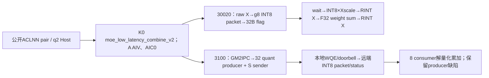
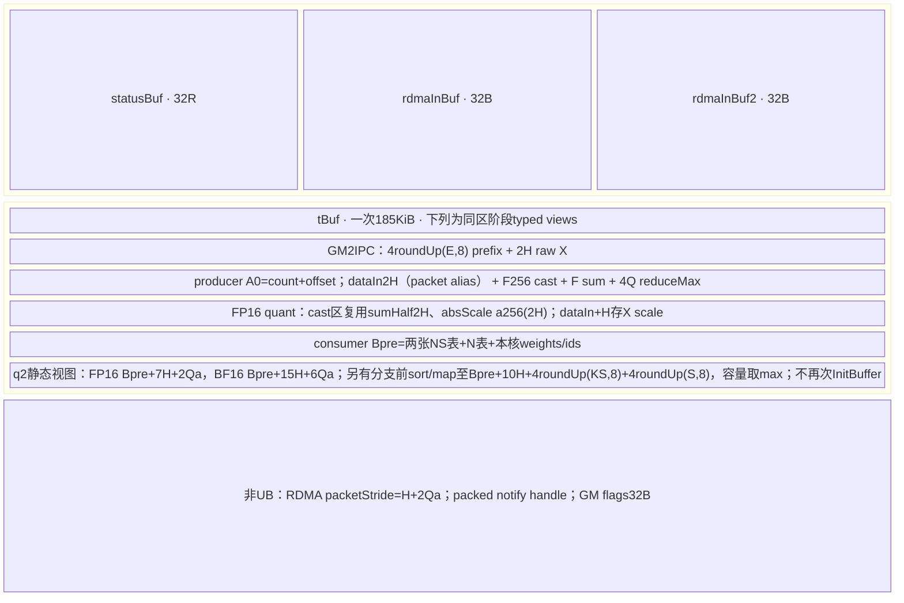
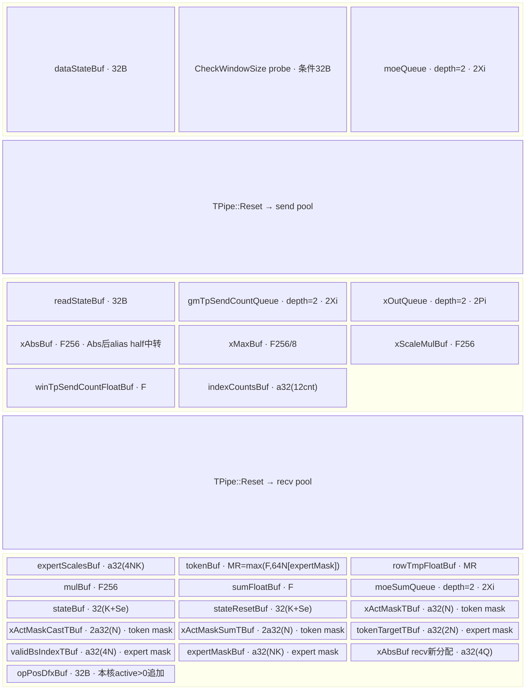

# DeepEP Low Combine INT8 A2/A3 ACLNN 算子知识

## 算子速览

| 项目 | 内容 |
|---|---|
| 实际入口 | aclnnMoeLowLatencyCombineV2GetWorkspaceSize / aclnnMoeLowLatencyCombineV2；公开ACLNN |
| 计算语义 | commQuantMode=2，通信内动态分组INT8量化/解量化的weighted combine；与无量化和MXFP8独立 |
| 输入输出 | BF16/FP16 expert rows与同dtype原token输出；INT32 handle/ids/counts、FP32权重；INT8 packet只在内部window |
| 执行类型 | AIV_VECTOR+MTE，A2 hierarchy另本地AIV RDMA WQE/doorbell；无可达Cube/AIC/MIX_CV |
| Kernel 路线 | R-001 A2 hierarchy INT8 FP16 g16；R-002 A2 hierarchy INT8 BF16 g8；R-003 A3 legacy INT8 g8；R-004 A3 hybrid INT8 g8 |
| 核心资源 | A3三阶段UB/packet queue/g8尺度、A2 185KiB typed-view pool与RMA window，HCCL context/注册keys |
| 来源闭包 | source_closed：公开pair→q2全Host选择/无body终点→逐字段POD→30020/3100实际实例→完整量化、传输、归并→固定SDK/HCOMM资源producer；止于Vector/DMA/driver primitive |
| 验证状态 | 已完成源码闭包检查；本次知识提取未执行编译、真机、数值或性能测试。draft明确A2 q2 producer未赋输入/flag与权重链缺陷，来源闭合不表示正确运行。 |


P3=`csrc/deepep/ops/`，P2=`csrc/deepep/ops2/`；SDK=asc-devkit e5451c7feba11f9e259f4fbc19c4bf82f8c0496c，HCOMM=4ca1db912ce02a5f5075849a3fa3faaf731bdd60，均固定9.1.0。SGL=dda6d36b0cdb4081e102d14c0a2fb276fc416e69。冻结查询候选[Low-Latency API](../../../../apis/deepep/deepep_low_latency_dispatch_combine.md)已完整阅读，只有API/策略事实，本卡采用create。符号X表示BF16或FP16，所有字节公式按sizeof(X)=2。定义`ap(x)=ceil(x/p)*p`，单位B；`Xi=a32(2H), F=a32(4H), F256=a256(4H), G=a512(2H)`。R=EP size，r=EP rank，E=MoE专家数，Sr=共享rank数，Se=共享expert数，L=E/(R-Sr)，N=本地token数，K=top-k，M=globalBs/R，A=AIV数。`split(T,A,c)`给start=floor(T/A)c+min(c,T%A)、count=floor(T/A)+[c<T%A]。

## 接口与语义

### 计算语义

公开逻辑是将expert FFN结果按原token/top-k权重返回并归并，通信内使用INT8分组量化。输入/输出仍X=BF16或FP16，不把INT8 window packet误作ACLNN输入dtype。原始dispatch handle必须配对，不能用Normal或CCU ordinal替换MTE triple/层级packed handle。

A3两种X都g=8个元素/scale。令Xi=a32(2H)，Q=Xi/16（向上覆盖8元素组），I=a32(H)字节，Pb=I+2Q，Pi=a32(Pb)，V=ceil(4H/256)。输入Cast为FP32，Abs/BlockReduceMax每8F32求max；s_float=maxAbs/127，保存s_X=CAST_RINT_X(s_float)，数据用未舍入s_float做Div后先CAST_RINT_FP16再CAST_RINT_INT8。packet前H字节为int8，补至I后保存Q个X尺度。接收int8→FP16→FP32，乘已舍入s_X的FP32值，再CAST_RINT_X；然后重新升FP32乘expert weight、按k加和，共享slot无权重加、sharedX升F32加，最后RINT_X输出。存在中间X舍入，不能等价为一次F32解量化加权总和。

A2 hierarchy选X=FP16时g16，scale和中间Div在FP16，最终解量化用FP16 MulAddDst累加；X=BF16时g8，量化分母FP32/保存BF16尺度，数据经half再int8，接收FP32 MulAddDst累加后RINT BF16。固定active _layered_custom.h的q2 producer却读取未先写sumFloatLocal，且segment flag第2个u64未赋而sender读取为copyOnceNum；q2最终分支也不使用已搬入expertScales。故这里只能给出源码执行序列/预期API目标，不能宣称A2完成了正确INT8 weighted combine，也不臆造具体输出或运行错误。

所有zero-max组都没有epsilon/显式零scale处理；源码没有定义可复用的非有限保证。MTE 1Dmask以true数量作前缀，2D A3槽skip；A2hierarchy不传mask/sharedX进body。

### 输入、输出与属性

同一公开签名如下；“API接受/Host检查”不等于当前q2 Route成功实现，精确平台终点见后文。

| 参数 | shape/layout | dtype | 约束、默认值与语义 |
|---|---|---|---|
| expandX | [T,H] ND / AutoContiguous | BF16/FP16 | 配对输出同X，expert compact rows；公开Python文档3D示意不是ACLNN shape |
| expertIds | [N,K] ND | INT32 | C++把topk转I32；值/handle须与dispatch一致 |
| assistInfoForCombine | 1D | INT32 | single/A3每expert结果12B triple；fullmesh扁平[N,K] ordinal；hierarchy不读取，实际用packed counts |
| epSendCounts | 1D | INT32 | expert-major/source-minor inclusive prefix；hierarchy追加分层表，须原样handle |
| expertScales | [N,K] | FP32 | 原token/top-k权重 |
| tpSendCountsOptional | 1D | INT32 | 公开声明可null，single/P3 MTE实际仍要求非null且长度TP；A3 TP2读另一rank count |
| xActiveMaskOptional | [N]或[N,K] | BOOL | 1D前缀计数；2D支持程度按Route |
| activationScaleOptional | optional | FP32 | 普通MTE要求null |
| weightScaleOptional | optional | FP32 | 普通MTE要求null |
| groupListOptional | optional | INT64 | 普通MTE要求null |
| expandScalesOptional | placeholder | FP32 | 本q0 body不读，不形成量化分支 |
| sharedExpertXOptional | [N,H]或3D flatten N×H | 同X | A3消费且要求Sr0；A2single q2无body；multi不转入body |
| groupEp/epWorldSize/epRankId/moeExpertNum | 属性 | char*/int64 | group1..127，rank/E范围按Host族 |
| groupTp/tpWorldSize/tpRankId | 属性 | char*/int64 | q2 ordinary只TP0/1；TP2 Host拒绝；A2multi强制0 |
| expertShardType | 属性 | int64 | 普通Host仅0；A2multi强制0 |
| sharedExpertNum/sharedExpertRankNum | 属性 | int64 | Se0..4/Sr<R；默认1/0→0/0，均零或正且Sr%Se=0；A2multi强制Sr0 |
| globalBs | 属性 | int64 | 0→NR；single/P3否则≥NR且%R0，M=globalBs/R；A2multi非0校验较弱 |
| outDtype | 属性 | int64 | 预留默认0，不产生独立dtype分支 |
| commQuantMode | 属性 | int64 | 唯一谓词2；0和3为独立逻辑语义 |
| groupListType | 属性 | int64 | 预留默认0 |
| commAlg | 属性 | char* | P2single不按其分拓扑；multi环境优先再fullmesh/hierarchy；P3非null后等ccu判断，其余都MTE |
| xOut | [N,H] ND | 同X | single严格shape；P3 MTE未检查dim0=N；multi检查较弱 |
| sendCostStats | placeholder输出 | 按OpDef | 当前body未写，不得作有效统计 |


### 入口与版本

公开LOW_LATENCY_API及header公开pair，OpDef的commQuantMode由Host确认0/2（P3还3），本卡只2；README/DeepEP README记录9.0/9.1最新，本卡固定9.1.0，SDK/HCOMM version.cmake均9.1.0。A2活动deepep2→ops2/910b，A3 deepep→ops/910_93；只有router实际命中与body闭合才入Route。

Python default Buffer→strategy→C++低延迟combine仅按use_mxfp8选择q3或q0，不产生q2；dispatch use_fp8/int8标志不能推导combine commQuantMode2。本卡q2由公开ACLNN属性直接可达。C++本身要求2D连续BF16、TP1，out/zero_copy/async/hook未拆真实不同launch；ops/alltoall为其它entry/backend，不当此q2路径。950非CCU key50020无router；q2+ccu早入60000且body无量化，语义冲突，不生成950 INT8卡。

## Host/Launcher 执行流程

### 参数校验与前处理

1. 两wrapper都固定elastic/oriX/alpha/V=null，zero/copy/const expert counts0。P2先检查workspaceSize/executor指针，Execute检查executor并按910B AICPU，否则MTE；P3 inner返回后检查ret/executor/*executor再按commAlg弱符号设server type，Execute转inner。生成inner/contiguous/executor/stream为框架边界，不补造手写launcher。
2. P2只910B。R≤8先single检查：R2..8/E1..1024，N0..512/K0..min16E/H1024..8192，shared/TP/capacity等同公开common参数；q2要求TP≤1，生成5020（sharedRole6020），router只5000无q2实例。这是已知无body终点。R>8/%8进入multi：环境PCIE恰1且ROCE恰0最先强制hierarchy，覆盖空/非法commAlg；否则非空fullmesh/hierarchy。q2 fullmesh明确GRAPH_FAILED，只有hierarchy3100。
3. P2multi检查R≤256/%8、E≤512/%R、N0..512、K1..16且≤E+public特殊0、H1..7168/%32；TP/rankTP/shard/sharedRank强制0，globalBs0→NR否则直接u32窄化；count/assist/weights/output dtype与extent未按single全面检查，mask虽查1/2D却不传hierarchy body。GetDataplaneMode!=AIV时router assert，没有旧_layered.h fallback。
4. P3 GetAttr先检查group1..127/R2..768/rank/E1..1024、Se0..4/Sr<R/default1/0→0/0，TP0..2但TP>1只允许commQuantMode0，故q2只有TP0/1。commAlg=ccu早交独立Host60000；A3非C310没有CCU实例，已知无body终点。非ccu非null任意字符串均普通MTE，不做白名单。
5. P3普通MTE检查2D expandX/ids/weights、1D assist/counts/tpCounts、ND/非NZ、X同输出、I32 ids/counts/F32 weights、mask BOOL rank1/2，activationScale/weightScale/groupList必须null。N0..512，K1..min16E，H1024..8192无实际H%32 guard，E%(R-Sr)=0/L>0。T≥C*TP、assist≥128C（不是12C字节下界），C普通=globalBs*min(L,K)，shared=M*ceil(R/(Sr/Se))；epCounts普通RL/sharedR乘TP，TPcounts长度TP且nonnull。TP0容量下界退化；sharedX需Sr0/flatten N×H；输出只查H未查N。
6. P3 q2读平台A/UB，A>0、M≤512，hybrid由env精确1选择；q2没有MXFP8 planner或完整UB拒绝。ID/triple/prefix/ordinal内容未全查；Host拒绝GRAPH_FAILED，router空终点不臆造Codegen/runtime错误码。

### 参数、Workspace 与生命周期

env优先DEEPEP_HCCL_BUFFSIZE再HCCL_BUFFSIZE，默认200MiB，stoi异常catch记录/保留默认，成功uint16窄化无范围兜底。P3 q2 Host仍以raw-X保守slot G=a512(2H)和dispatch packet Gd=a512(a32(2H)+44)预算：2*(M*Gd*R*L+M*G*(K+Se)+reservedHalf)≤Wenv，legacy reserved0/hybrid107MiB+48KiB；M*(K+Se)*32≤512KiB-32。实际packet仅Pb，slot仍G。caller workspace16MiB+10KiB*A，public特殊0使GM mask scratch无消费者。

A2 hierarchy caller workspace16MiB+8E，当前body不消费用户区；实际window保留800MiB RDMA双轮、4MiB IPC控制、400MiB notify及剩余IPC数据，Device assert W≥E*N*(2H+16K)+4MiB+800MiB+400MiB。Host不会仅按packet较小自动放宽这个raw-X公式。SQ/注册内存/context/workSpace由组持有，不属caller workspace；payload/flags需到传输和gather结束再复用。

CheckWindowSize的actual<planned分支是1B UB/INT32 条件DMA探针，不是可靠可恢复Host拒绝。构建从安装包复制base/comm_ctx头，仅固定fallback定义/SDK/HCOMM源码映射被闭合，未实测安装二进制ABI。

CheckWindowSize的精确动作是actual<planned时申请1字节TBuf（实际分配按SDK对齐），将传入exceptionAddr绑定为256个int32的GlobalTensor，再执行DataCopy到Local的1个int32请求。DATA_SIZE的256字节注释不能替代int32元素单位；此路径没有改写GM错误地址、没有向GM写错误码，也没有显式失败返回。DMA对齐与框架最终错误仍依赖匹配SDK/运行时，不能仅凭“探针”断言必然发生故障或安全终止。

### 启动图与失败传播



P2 blockDim=CalcTschBlockDim(A,0,A)、AICPUblock6、POD680；P3同AIV blockDim、schedule1、POD1192。A3 GM边triple12B→packet Pb/slotG→flag32B→gather，PIPE_MTE3保证数据先旗标，recv等/清slot再解量化。A2 GM2IPC raw2H→OUT packet→WQE remote packetBytes*rowCount→远端state32B，sender依据producer segment32B旗标；当前q2 rowCount未赋值，因此ordering存在不等于有效extent已正确。

A2实际网络核心AIVRDMAPostSend选dest*qpNum的QP0，poll head-tail<depth-1；32B RDMA_WRITE WQE(opcode3、owner反转(head>>15)&1、signaled)，16B单SGE，REMOTE_INPUT=1注册rkey/LOCAL_OUTPUT=2 lkey；WQE+SGE48B flush→PIPE_ALL→head++→8B doorbell(wqn,head%65536,sl)→4B head更新。HCOMM9.1 SetCommResource能力位HOST0/AICPU1/AIV2，AIV仅NormalQP&&IntraHierarchy成立；Mc2CreateAndLaunchContext把capability和H2DAiRMAInfo填context尾。GenAiRMAInfo/GenIbvAiRMAInfo从GetAiRMAQueueInfo/CopyAiWQInfo生成SQ HW_DB、WQ字段和四类注册MemDetails，复制rank*qp SQ/CQ/RQ/RCQ及每rank内存表。consumer null默认AICPU，bit2覆盖bit1为AIV，否则router assert。算法止于QP/driver MMIO和硬件RDMA primitive，未假造驱动内部；owner固定shift15未核对depth32768、dbMode无分支、只QP0均为边界。Hccl InitV2/SetCcTilingV2/Finalize只作A2资源/控制，不把Host名BatchWrite=hierarchy当实际payload算法调用。

## Route 与参数设计

### 分核与资源计算

A2固定8rank/server，32producer按S=R/8分组，每组g=floor32/S核，另S sender，第8consumer按N/8；所需A≥32+S、32R status至少544B及65项本地表范围Host未拒绝。A3先split selfSendCnt/A错位发送，再split activeN/A归并；quant repeat V=ceil(4H/256)、mask64F32/8blocks，使每32B g8最大值配Brcb。全部Byte/Scale/slot公式逐Route给出；q2 Upeak没有完整Host UBguard。

### Route 选择

| 顺序 | Route | Key/模板 | 精确选择条件与优先级 | 不适用去向 |
|---|---|---|---|---|
| 1 | R-001 A2 hierarchy INT8 FP16 g16 | 3100 / MoeDistributeCombineV2Layered<half,int32_t,int8_t> | ASCEND910B、q2、R>8≤256且%8=0、E≤512且%R=0、N0..512/H1..7168且%32=0；PCIE=1且ROCE=0优先hierarchy，否则commAlg=hierarchy；AIV capability；X=FP16 | Host失败/已知无body；无安全fallback |
| 2 | R-002 A2 hierarchy INT8 BF16 g8 | 3100 / MoeDistributeCombineV2Layered<bfloat16_t,int32_t,int8_t> | ASCEND910B、q2、R>8≤256且%8=0、E≤512且%R=0、N0..512/H1..7168且%32=0；PCIE=1且ROCE=0优先hierarchy，否则commAlg=hierarchy；AIV capability；X=BF16 | Host失败/已知无body；无安全fallback |
| 3 | R-003 A3 legacy INT8 g8 | 30020 / MoeDistributeCombineV2<X,X,int32_t,false,true> | ASCEND910_93、q2、commAlg非null且不等ccu、TP≤1、DEEPEP_HYBRID_DEPLOYMENT不为"1"；公共MTE shape/attrs通过；X=BF16/FP16 | Host失败/已知无body；无安全fallback |
| 4 | R-004 A3 hybrid INT8 g8 | 30020 / MoeDistributeCombineV2<X,X,int32_t,false,true> | ASCEND910_93、q2、commAlg非null且不等ccu、TP≤1、DEEPEP_HYBRID_DEPLOYMENT恰为"1"；公共MTE shape/attrs通过；X=BF16/FP16 | Host失败/已知无body；无安全fallback |


```text
q2，公开pair，特殊输入null/计数0
A2 P2:
 R≤8 → singleHost允许q2 TP≤1 →5020/6020，但router无匹配body
 R>8/%8 → env PCIE1/ROCE0优先hierarchy，否则commAlg fullmesh/hierarchy
   fullmesh+q2直接GRAPH_FAILED
   hierarchy+q2→3100，capability必须AIV→custom<X,I32,int8>；X half g16 / BF16 g8
A3 P3:
 TP2+q2 GetAttr先失败；30120 router存在但不可从当前公开Host到达
 commAlg ccu→60000，非C310无body；其它非null→30020
 hybrid env恰1→IN隔离状态/数据，否则legacy EXP
950非CCU50020无router；CCU60000为无量化语义，均不生成当前平台卡
```

### 模板/实现执行矩阵

| Route | key/selector | dtype/shape/platform 完整命中条件 | 执行拓扑与 Kernel 节点 | 实际模板/body | 内存与同步特征 | tail/fallback |
|---|---|---|---|---|---|---|
| R-001 | 3100 | ASCEND910B、q2、R>8≤256且%8=0、E≤512且%R=0、N0..512/H1..7168且%32=0；PCIE=1且ROCE=0优先hierarchy，否则commAlg=hierarchy；AIV capability；X=FP16 | GM2IPC raw→32 producer尝试量化→S AIV sender WQE→8 consumer解量化求和→Finalize | MoeDistributeCombineV2Layered<half,int32_t,int8_t> | U_total=185KiB+32R+64，局部四个65*u32数组共1040B非InitBuffer UB。Q=H/16，Qa=roundUp(Q,16)，packetBytes=H+2Q，packetStride=H+2Qa；sender remote一次WR长度packetBytes*copyOnceNum，src/dst起点按packetStride*累计row；若Qa>Q且count>1，单WR未按row跳过padding，额外布局风险，Host仅H%32而未H%256。user workspace16MiB+8E但body不消费。网络payload尝试按上述字节数，flag word1无赋值，不能声称具体有效行数；WQE32+SGE16、doorbell8/head4。 | 完整源码可追溯但当前q2 producer的sum与flag rowCount未在该分支先写，最终q2分支不使用expertScales；因此是source_closed的已知静态失败边界，不能称正确可运行INT8加权实现。A2single5020/6020无router；fullmesh直接Host拒绝q2。 |
| R-002 | 3100 | ASCEND910B、q2、R>8≤256且%8=0、E≤512且%R=0、N0..512/H1..7168且%32=0；PCIE=1且ROCE=0优先hierarchy，否则commAlg=hierarchy；AIV capability；X=BF16 | GM2IPC raw→32 producer尝试量化→S AIV sender WQE→8 consumer解量化求和→Finalize | MoeDistributeCombineV2Layered<bfloat16_t,int32_t,int8_t> | U_total=185KiB+32R+64，局部四个65*u32数组共1040B非InitBuffer UB。Q=H/8，Qa=roundUp(Q,16)，packetBytes=H+2Q，packetStride=H+2Qa；sender remote一次WR长度packetBytes*copyOnceNum，src/dst起点按packetStride*累计row；若Qa>Q且count>1，单WR未按row跳过padding，额外布局风险，Host仅H%32而未H%128。user workspace16MiB+8E但body不消费。网络payload尝试按上述字节数，flag word1无赋值，不能声称具体有效行数；WQE32+SGE16、doorbell8/head4。 | 完整源码可追溯但当前q2 producer的sum与flag rowCount未在该分支先写，最终q2分支不使用expertScales；因此是source_closed的已知静态失败边界，不能称正确可运行INT8加权实现。A2single5020/6020无router；fullmesh直接Host拒绝q2。 |
| R-003 | 30020 | ASCEND910_93、q2、commAlg非null且不等ccu、TP≤1、DEEPEP_HYBRID_DEPLOYMENT不为"1"；公共MTE shape/attrs通过；X=BF16/FP16 | MTE triple发送→g8 INT8量化packet→slotflag→反量化成X→FP32加权归并 | MoeDistributeCombineV2<X,X,int32_t,false,true> | Q=Xi/16，I=a32(H)字节，Pb=I+2Q、Pi=a32(Pb)，V=ceil(4H/256)。U_init=32+32[probe]+2Xi；U_send=32+2Xi+2Pi+2F256+F256/8+F+a32(12cnt)；U_recv=a32(4NK)+2MR+F256+F+2Xi+64(K+Se)+a32(4Q)+mask项+32[本核active>0]。Upeak=max阶段；Host无q2完整UBguard。workspace16MiB+10KiB*A，public特殊0/null使GM mask scratch inactive。slot占G=a512(2H)，实际通信Pb而不是2H，每发送row读2H/写Pb+32flag，triple12B；recv每有效slot读Pb后本地解量化回X，再FP32加权。 | TP2 Host必须q0，30120虽router存在不属当前公开q2可达Route；A3 ccu产生60000但无C310 body。ops中910B key20020非活动A2 route；95050020无router且ccu60000为无量化，不生成950 INT8卡。 |
| R-004 | 30020 | ASCEND910_93、q2、commAlg非null且不等ccu、TP≤1、DEEPEP_HYBRID_DEPLOYMENT恰为"1"；公共MTE shape/attrs通过；X=BF16/FP16 | MTE triple发送→g8 INT8量化packet→slotflag→反量化成X→FP32加权归并 | MoeDistributeCombineV2<X,X,int32_t,false,true> | Q=Xi/16，I=a32(H)字节，Pb=I+2Q、Pi=a32(Pb)，V=ceil(4H/256)。U_init=32+32[probe]+2Xi；U_send=32+2Xi+2Pi+2F256+F256/8+F+a32(12cnt)；U_recv=a32(4NK)+2MR+F256+F+2Xi+64(K+Se)+a32(4Q)+mask项+32[本核active>0]。Upeak=max阶段；Host无q2完整UBguard。workspace16MiB+10KiB*A，public特殊0/null使GM mask scratch inactive。slot占G=a512(2H)，实际通信Pb而不是2H，每发送row读2H/写Pb+32flag，triple12B；recv每有效slot读Pb后本地解量化回X，再FP32加权。 | TP2 Host必须q0，30120虽router存在不属当前公开q2可达Route；A3 ccu产生60000但无C310 body。ops中910B key20020非活动A2 route；95050020无router且ccu60000为无量化，不生成950 INT8卡。 |


### 隐藏性能 Guard

| Guard | Host/Tiling 条件 | Device/资源原因 | 影响 Route | 不满足时去向 | 源码符号 |
|---|---|---|---|---|---|
| q2实际key | A2single5020/6020；A3TP2需q0 | router无singleq2；30120非Host可达 | terminal | 不是支持Route，不假缺源 | CalTilingKey/router |
| A2 fullmesh | !isLayered&&q!=0直接失败 | 当前q2仅hierarchy | A2 | GRAPH_FAILED | CheckAttrAndSetTiling |
| A2 producer值流 | Host不扫描Device数据流 | 量化读sumFloat未先写；flag word1未赋 | R-001/002 | 已知静态失败边界，draft | SumToWindow/AlltoAllServerDispatch |
| A2 packet padding | Host仅H%32 | Qa=roundUp(Q,16)，remote WR按packetBytes*count不逐row跳padding | R-001/002 | 无对应guard/fallback | AlltoAllServerDispatch |
| UB | A3无q2完整planner；A2固定185KiB | 各packet/scratch/mask/metadata随H/N/K/S增长 | 全部 | 未证明≤UB，不伪造拒绝 | BuffInit/SumToServer |
| scale zero | 无epsilon/zero-max检查 | Div0及后续cast没有在本源码定义保护 | 全部 | 不宣称特定NaN/Inf结果 | Int8QuantProcess/quant branch |
| A2核/状态 | 无A≥32+S、544B/65项拒绝 | 固定producer/sender/status视图 | R-001/002 | 无资源fallback | Process/AlltoAllServerDispatch |
| mask/sharedX | A2Host部分接受但router未传body | q2不能消费对应语义 | R-001/002 | 已知忽略，不套A3 mask事实 | router/Init |
| 精度 | 保存X尺度而Div用F32原尺度 | 反量化后先RINT X，再权重F32；FP16层级原生累加 | 全部 | 不能泛称全FP32或无损 | Int8DequantProcess/SumToServer |


### POD/ABI

P2 Info104/outer680与P3 Info104/outer1192均自然8B对齐源码推导，未经编译sizeof/安装ABI实测；P2有padding68..71/98..103，P3有73..75。相同入口POD仍保留其它Host分支字段，当前q2 consumer/inactive条件明确，不能用结构相同推出路由支持。

| 结构 | 字段 | 类型/位宽 | ABI 布局 | 单位 | Host/launcher producer | Device consumer | 边界 |
|---|---|---|---|---|---|---|---|
| P2 MoeDistributeCombineV2Info | epWorldSize | u32 | @0 | rank数 | 公共GetAttr写R；A2multi单独CheckAttr写R | 窗口/EP分核 | A2≤256；A3/950≤768；不是实际数组容量 |
| P2 MoeDistributeCombineV2Info | tpWorldSize | u32 | @4 | rank数 | single/MTE0..2；A2multi强制0；CCU必须1 | key/TP条件 | 0不规范成1，容量下界可退化 |
| P2 MoeDistributeCombineV2Info | epRankId | u32 | @8 | rank | 公共r | 目标/源rank | 0≤r<R |
| P2 MoeDistributeCombineV2Info | tpRankId | u32 | @12 | rank | single/A3 TP≤1要求属性tpRankId=0，非零拒绝；A2multi覆盖为0 | A3 TP2另一rank=1-t | 950/A2single TP2无router |
| P2 MoeDistributeCombineV2Info | expertSharedType | u32 | @16 | enum | P3仅0；P2字段名expertSharedType且multi强制0 | 无分片计算 | 字段名不同，不能混用类型 |
| P2 MoeDistributeCombineV2Info | sharedExpertNum | u32 | @20 | expert数 | single/MTE Se0..4，默认1/Sr0→0；CCU同规则 | K+Se/无权重共享项 | A2multi未赋且body不读 |
| P2 MoeDistributeCombineV2Info | sharedExpertRankNum | u32 | @24 | rank数 | Sr<R，与Se同零/正且Sr%Se=0；A2multi0 | shared role/L | 共享rank的A2single key6000无body |
| P2 MoeDistributeCombineV2Info | moeExpertNum | u32 | @28 | expert数 | E；A2multi≤512，余≤1024 | L/counts/ID域 | 不全量检查ID值 |
| P2 MoeDistributeCombineV2Info | moeExpertPerRankNum | u32 | @32 | expert/rank | single/MTE E/(R-Sr)并检整除；CCU取floor未检整除 | selfSendCount尾索引/CCU stride | A2multi未赋但body自行E/R |
| P2 MoeDistributeCombineV2Info | zeroExpertNum | u32 | @36 | expert数 | public wrapper0；P3/Multi复制，P2single未赋 | P3/多机特殊分支 | public0；single body不读 |
| P2 MoeDistributeCombineV2Info | copyExpertNum | u32 | @40 | expert数 | 同zeroExpertNum | P3/多机特殊分支 | public0；single body不读 |
| P2 MoeDistributeCombineV2Info | constExpertNum | u32 | @44 | expert数 | 同zeroExpertNum | P3/多机特殊分支 | public0；single body不读 |
| P2 MoeDistributeCombineV2Info | globalBs | u32 | @48 | token容量 | single/P3 0→NR，否则≥NR且%R=0；A2multi非0未同样检查 | M=globalBs/R | 未完整检查int64→u32窄化 |
| P2 MoeDistributeCombineV2Info | bs | u32 | @52 | token数 | expertIds.dim0=N，MTE0..512；CCU1..512 | active/token输出域 | mask prefix与M容量分开 |
| P2 MoeDistributeCombineV2Info | k | u32 | @56 | slot/token | P3 MTE1..min16E；A2single0..min16E；A2multi1..16；CCU1..16 | NK/等待/metadata | CCU未≤E |
| P2 MoeDistributeCombineV2Info | h | u32 | @60 | 元素/token | expandX.dim1；single/P3 1024..8192；A2multi1..7168且%32=0 | 2H payload/Vector | P3无%32guard；CCU bool错误返回另列 |
| P2 MoeDistributeCombineV2Info | aivNum | u32 | @64 | core数 | GetCoreNumAiv；CCU最后才写 | split/selector512A | CCU预算先读该字段；Host未统一UB安全判定 |
| P2 Info | totalUbSize | u64 | @72 | B | 平台 UB | 日志/资源字段 | 非动态安全拒绝 |
| P2 Info | totalWinSize | u64 | @80 | B | single env W；multi未赋值 | single窗口/CheckWindowSize；multi实际context W | multi不消费此field |
| P2 Info | isTokenMask | bool | @88 | flag | mask rank1 | 前缀activeN | multi/single |
| P2 Info | isExpertMask | bool | @89 | flag | mask rank2 | single只target；fullmesh也skipk；hierarchy未传mask | 不可泛化 |
| P2 Info | hasSharedExpertX | bool | @90 | flag | single输入存在；multi未赋 | single共享X；multi不读 | 不假默认 |
| P2 Info | reserved | int8[7] | @91 | B | 未显式赋值 | inactive | 其后98..103自然padding |
| P2 TilingData | mc2InitTiling | 64B | @0 | 混合 | GetTiling/Host | InitV2 | 总680/align8 |
| P2 TilingData | mc2CcTiling | 512B | @64 | 混合 | GetTiling/Host | EP | 总680/align8 |
| P2 TilingData | moeDistributeCombineV2Info | 104B | @576 | 混合 | GetTiling/Host | Init attrs | 总680/align8 |
| P3 MoeDistributeCombineV2Info | epWorldSize | u32 | @0 | rank数 | 公共GetAttr写R；A2multi单独CheckAttr写R | 窗口/EP分核 | A2≤256；A3/950≤768；不是实际数组容量 |
| P3 MoeDistributeCombineV2Info | tpWorldSize | u32 | @4 | rank数 | single/MTE0..2；A2multi强制0；CCU必须1 | key/TP条件 | 0不规范成1，容量下界可退化 |
| P3 MoeDistributeCombineV2Info | epRankId | u32 | @8 | rank | 公共r | 目标/源rank | 0≤r<R |
| P3 MoeDistributeCombineV2Info | tpRankId | u32 | @12 | rank | single/A3 TP≤1要求属性tpRankId=0，非零拒绝；A2multi覆盖为0 | A3 TP2另一rank=1-t | 950/A2single TP2无router |
| P3 MoeDistributeCombineV2Info | expertShardType | u32 | @16 | enum | P3仅0；P2字段名expertSharedType且multi强制0 | 无分片计算 | 字段名不同，不能混用类型 |
| P3 MoeDistributeCombineV2Info | sharedExpertNum | u32 | @20 | expert数 | single/MTE Se0..4，默认1/Sr0→0；CCU同规则 | K+Se/无权重共享项 | A2multi未赋且body不读 |
| P3 MoeDistributeCombineV2Info | sharedExpertRankNum | u32 | @24 | rank数 | Sr<R，与Se同零/正且Sr%Se=0；A2multi0 | shared role/L | 共享rank的A2single key6000无body |
| P3 MoeDistributeCombineV2Info | moeExpertNum | u32 | @28 | expert数 | E；A2multi≤512，余≤1024 | L/counts/ID域 | 不全量检查ID值 |
| P3 MoeDistributeCombineV2Info | moeExpertPerRankNum | u32 | @32 | expert/rank | single/MTE E/(R-Sr)并检整除；CCU取floor未检整除 | selfSendCount尾索引/CCU stride | A2multi未赋但body自行E/R |
| P3 MoeDistributeCombineV2Info | zeroExpertNum | u32 | @36 | expert数 | public wrapper0；P3/Multi复制，P2single未赋 | P3/多机特殊分支 | public0；single body不读 |
| P3 MoeDistributeCombineV2Info | copyExpertNum | u32 | @40 | expert数 | 同zeroExpertNum | P3/多机特殊分支 | public0；single body不读 |
| P3 MoeDistributeCombineV2Info | constExpertNum | u32 | @44 | expert数 | 同zeroExpertNum | P3/多机特殊分支 | public0；single body不读 |
| P3 MoeDistributeCombineV2Info | globalBs | u32 | @48 | token容量 | single/P3 0→NR，否则≥NR且%R=0；A2multi非0未同样检查 | M=globalBs/R | 未完整检查int64→u32窄化 |
| P3 MoeDistributeCombineV2Info | bs | u32 | @52 | token数 | expertIds.dim0=N，MTE0..512；CCU1..512 | active/token输出域 | mask prefix与M容量分开 |
| P3 MoeDistributeCombineV2Info | k | u32 | @56 | slot/token | P3 MTE1..min16E；A2single0..min16E；A2multi1..16；CCU1..16 | NK/等待/metadata | CCU未≤E |
| P3 MoeDistributeCombineV2Info | h | u32 | @60 | 元素/token | expandX.dim1；single/P3 1024..8192；A2multi1..7168且%32=0 | 2H payload/Vector | P3无%32guard；CCU bool错误返回另列 |
| P3 MoeDistributeCombineV2Info | aivNum | u32 | @64 | core数 | GetCoreNumAiv；CCU最后才写 | split/selector512A | CCU预算先读该字段；Host未统一UB安全判定 |
| P3 Info | isTokenMask | bool | @68 | flag | mask rank1；CCU任意mask非null | prefix mask统计 | CCU二维mask冲突 |
| P3 Info | isExpertMask | bool | @69 | flag | MTE mask rank2；CCU未写 | MTE validToken/skip；CCU不读 | 不假默认 |
| P3 Info | hasSharedExpertX | bool | @70 | flag | 可选输入存在 | sharedX加法；CCU队列 | A2multi无此consumer |
| P3 Info | hasElasticInfo | bool | @71 | flag | public null→false；CCU不写 | MTE弹性分支 | public inactive |
| P3 Info | isHybridDeployment | bool | @72 | flag | MTE env DEEPEP_HYBRID_DEPLOYMENT精确1 | MTE窗口布局 | CCU不读 |
| P3 Info | a5MxCombineBufferNum | u32 | @76 | queue depth | outer默认2 | q2不读，MXFP8另卡 | 不能用q2证明量化planner |
| P3 Info | totalUbSize | u64 | @80 | B | 平台GetCoreMemSize UB；CCU最后写 | 资源字段/日志 | q2无全面预算guard |
| P3 Info | totalWinSize | u64 | @88 | B | MTE env W；CCU=2envW | MTE实际基准；CCU不读此field | runtime context size另源 |
| P3 Info | armAvgFactor | float | @96 | inactive | 当前Host未赋值 | q2 body不读 | 不假默认 |
| P3 Info | epsilon | float | @100 | inactive | 当前Host未赋值 | q2 body不读 | 不假默认 |
| P3 TilingData | mc2InitTiling | 64B | @0 | 混合 | GetTiling/Host | InitV2 | 总1192/align8 |
| P3 TilingData | mc2CcTiling1 | 512B | @64 | 混合 | GetTiling/Host | EP | 总1192/align8 |
| P3 TilingData | mc2CcTiling2 | 512B | @576 | 混合 | GetTiling/Host | TP | 总1192/align8 |
| P3 TilingData | moeDistributeCombineV2Info | 104B | @1088 | 混合 | GetTiling/Host | Init attrs | 总1192/align8 |

SDK opaque init64/cc512内部逐字段如下。P2single q2虽Host可序列化，其key无Device；当前A2有效候选为multi一组EP18/engine0，A3为EP8/TP7两CC/engine3，q2 TP2仍被拒绝。

| 结构 | 字段 | 类型/位宽 | ABI 布局 | 单位 | Host/launcher producer | Device consumer | 边界 |
|---|---|---|---|---|---|---|---|
| Mc2InitTilingInner | version | u32 | @0 | 协议 | GetTiling: 100 | SDK InitV2/框架 | version100；reserved不假初始化 |
| Mc2InitTilingInner | mc2HcommCnt | u32 | @4 | 组数 | GetTiling: P2一组；P3 EP+TP两组 | SDK InitV2/框架 | version100；reserved不假初始化 |
| Mc2InitTilingInner | offset | u32[8] | @8 | 字节offset | GetTiling: P2首64；P3首64/次576，其余0 | SDK InitV2/框架 | version100；reserved不假初始化 |
| Mc2InitTilingInner | debugMode | u8 | @40 | enum | GetTiling: default0 | SDK InitV2/框架 | version100；reserved不假初始化 |
| Mc2InitTilingInner | preparePosition | u8 | @41 | enum | GetTiling: default0 | SDK InitV2/框架 | version100；reserved不假初始化 |
| Mc2InitTilingInner | queueNum | u16 | @42 | queue数 | GetTiling: default0 | SDK InitV2/框架 | version100；reserved不假初始化 |
| Mc2InitTilingInner | commBlockNum | u16 | @44 | block数 | GetTiling: default0 | SDK InitV2/框架 | version100；reserved不假初始化 |
| Mc2InitTilingInner | devType | u8 | @46 | SoC enum | GetTiling: runtime SoC | SDK InitV2/框架 | version100；reserved不假初始化 |
| Mc2InitTilingInner | reserved | char[17] | @47 | B | GetTiling: 未显式清全部；不依赖 | SDK InitV2/框架 | version100；reserved不假初始化 |
| Mc2CcTilingInner | skipLocalRankCopy | u8 | @0 | flag | GetTiling: default0 | SetCcTilingV2/框架 | version1；payload由实际template决定 |
| Mc2CcTilingInner | skipBufferWindowCopy | u8 | @1 | flag | GetTiling: default0 | SetCcTilingV2/框架 | version1；payload由实际template决定 |
| Mc2CcTilingInner | stepSize | u8 | @2 | step | GetTiling: default0 | SetCcTilingV2/框架 | version1；payload由实际template决定 |
| Mc2CcTilingInner | version | u8 | @3 | 协议 | GetTiling: 1 | SetCcTilingV2/框架 | version1；payload由实际template决定 |
| Mc2CcTilingInner | reserved | char[9] | @4 | B | GetTiling: memset0 | SetCcTilingV2/框架 | version1；payload由实际template决定 |
| Mc2CcTilingInner | commEngine | u8 | @13 | enum | GetTiling: A2multi0；A3 MTE3（CCU失败terminal5） | SetCcTilingV2/框架 | version1；payload由实际template决定 |
| Mc2CcTilingInner | srcDataType | u8 | @14 | dtype enum | GetTiling: default0=INT8；MTE payload由X模板决定 | SetCcTilingV2/框架 | version1；payload由实际template决定 |
| Mc2CcTilingInner | dstDataType | u8 | @15 | dtype enum | GetTiling: default0；本body不读为数据类型 | SetCcTilingV2/框架 | version1；payload由实际template决定 |
| Mc2CcTilingInner | groupName | char[128] | @16 | 字符 | GetTiling: EP/TP group | SetCcTilingV2/框架 | version1；payload由实际template决定 |
| Mc2CcTilingInner | algConfig | char[128] | @144 | 字符 | GetTiling: EP fullmesh/pairwise或hierarchy，TP ReduceScatterRing；CCU mesh | SetCcTilingV2/框架 | version1；payload由实际template决定 |
| Mc2CcTilingInner | opType | u32 | @272 | cmd enum | GetTiling: A2multi EP18；A3 EP8/TP7（CCU失败terminal20） | SetCcTilingV2/框架 | version1；payload由实际template决定 |
| Mc2CcTilingInner | reduceType | u32 | @276 | enum | GetTiling: default0；本MTE不据此reduce | SetCcTilingV2/框架 | version1；payload由实际template决定 |
| Mc2CcTilingInner | reserved2 | char[232] | @280 | B | GetTiling: 未显式清全部；inactive | SetCcTilingV2/框架 | version1；payload由实际template决定 |

外部context由HCCL组创建，非算子Host序列化。实际使用的prefix和AiRMAInfo字段如下；A3 localWindowsExp184/remoteRes2984由固定ReservedStruct/Topo/Config自然布局推导，A2 legacy tail8928来自HCOMM展开结构；不把未消费的大型保留树伪造自有POD。

| 结构 | 字段 | 类型/位宽 | ABI 布局 | 单位 | Host/launcher producer | Device consumer | 边界 |
|---|---|---|---|---|---|---|---|
| A3 HcclOpResParam | localUsrRankId | u32 | @16 | rank | runtime | InitWinState一致性 | 源码映射，非安装二进制实测 |
| 同上 | rankSize | u32 | @20 | rank数 | runtime | InitWinState | 源码映射，非安装二进制实测 |
| 同上 | winSize | u64 | @24 | B | runtime | CheckWindowSize | 源码映射，非安装二进制实测 |
| 同上 | localWindowsIn | u64 | @32 | 地址 | runtime | self data/hybrid | 源码映射，非安装二进制实测 |
| 同上 | localWindowsExp | u64 | @184 | 地址 | runtime | legacy selector/state | 源码映射，非安装二进制实测 |
| 同上 | remoteRes | RemoteResPtr[131072] | @2984 | 关系数组 | runtime | nextDevicePtr取remote IN/EXP | 源码映射，非安装二进制实测 |
| RemoteResPtr | nextHostPtr | u64 | @0 | 地址 | runtime | 未消费 | 源码映射，非安装二进制实测 |
| 同上 | nextDevicePtr | u64 | @8 | 地址 | runtime | remote关系 | 源码映射，非安装二进制实测 |
| HcclRankRelationResV2 | windowsIn | u64 | @8 | 地址 | runtime | remote data/hybrid | 源码映射，非安装二进制实测 |
| 同上 | windowsExp | u64 | @24 | 地址 | runtime | remote legacy state | 源码映射，非安装二进制实测 |
| A2 SDK/本地legacy context | workSpace | u64 | @0 | 地址 | runtime | SDK client消息 | 源码映射，非安装二进制实测 |
| 同上 | workSpaceSize | u64 | @8 | B | runtime | SDK初始化 | 源码映射，非安装二进制实测 |
| 同上 | rankId | u32 | @16 | rank | runtime | GetWindows | 源码映射，非安装二进制实测 |
| 同上 | rankNum | u32 | @20 | rank数 | runtime | GetRankDim | 源码映射，非安装二进制实测 |
| 同上 | winSize | u64 | @24 | B | runtime | A2body直接读取 | 源码映射，非安装二进制实测 |
| 同上 | windowsIn | u64[32] | @32 | 地址 | runtime | multiFlag0地址 | 源码映射，非安装二进制实测 |
| 同上 | windowsOut | u64[32] | @288 | 地址 | runtime | multiFlag0地址 | 源码映射，非安装二进制实测 |
| HcclA2CombineOpParam | res | u8[8328] | @544 | opaque B | HCOMM context结构 | 仅跨过opaque区 | 源码映射，非安装二进制实测 |
| 同上 | multiFlag | u8 | @8872 | flag | HCOMM multiServerFlag | SDK910B地址分支 | 源码映射，非安装二进制实测 |
| 同上 | data | IbVerbsData* | @8880 | 地址 | HCOMM ibverbsData | SDK local/remote IN/OUT | 源码映射，非安装二进制实测 |
| 同上 | dataSize | u64 | @8888 | B | HCOMM ibverbsDataSize | 本body未直接读 | 源码映射，非安装二进制实测 |
| 同上 | sizeOfAiRMAInfo | u64 | @8896 | B | H2DAiRMAInfo | 未显式校验 | 源码映射，非安装二进制实测 |
| 同上 | aiRMAInfo | u64 | @8904 | 地址 | H2DAiRMAInfo | custom Init/AIVRDMAPostSend | 源码映射，非安装二进制实测 |
| 同上 | capability | CombinedCapability* | @8912 | 地址 | Mc2CreateAndLaunchContext | GetDataplaneMode | 源码映射，非安装二进制实测 |
| 同上 | capabilitySize | u64 | @8920 | B | sizeof CombinedCapability=8 | 读取但未检查 | 源码映射，非安装二进制实测 |
| CombinedCapability | dataplaneModeBitmap | u64 | @0 | bits | SetCommResource | bit1 AICPU，bit2 AIV覆盖 | 源码映射，非安装二进制实测 |
| HcclAiRMAInfo | curRankId | u32 | @0 | 对应字段单位 | GenAiRMAInfo/H2D | cur rank | 源码映射，非安装二进制实测 |
| HcclAiRMAInfo | rankNum | u32 | @4 | 对应字段单位 | GenAiRMAInfo/H2D | 表域 | 源码映射，非安装二进制实测 |
| HcclAiRMAInfo | qpNum | u32 | @8 | 对应字段单位 | GenAiRMAInfo/H2D | dest*qpNum，QP0 | 源码映射，非安装二进制实测 |
| HcclAiRMAInfo | sizeOfAiRMAWQ | u32 | @12 | 对应字段单位 | GenAiRMAInfo/H2D | WQ步长64 | 源码映射，非安装二进制实测 |
| HcclAiRMAInfo | sizeOfAiRMACQ | u32 | @16 | 对应字段单位 | GenAiRMAInfo/H2D | CQ步长56，本body不读 | 源码映射，非安装二进制实测 |
| HcclAiRMAInfo | sizeOfAiRMAMem | u32 | @20 | 对应字段单位 | GenAiRMAInfo/H2D | MemInfo步长16 | 源码映射，非安装二进制实测 |
| HcclAiRMAInfo | sqPtr | u64 | @24 | 对应字段单位 | GenAiRMAInfo/H2D | WQ数组 | 源码映射，非安装二进制实测 |
| HcclAiRMAInfo | scqPtr | u64 | @32 | 对应字段单位 | GenAiRMAInfo/H2D | 未消费CQ/RQ | 源码映射，非安装二进制实测 |
| HcclAiRMAInfo | rqPtr | u64 | @40 | 对应字段单位 | GenAiRMAInfo/H2D | 未消费CQ/RQ | 源码映射，非安装二进制实测 |
| HcclAiRMAInfo | rcqPtr | u64 | @48 | 对应字段单位 | GenAiRMAInfo/H2D | 未消费CQ/RQ | 源码映射，非安装二进制实测 |
| HcclAiRMAInfo | memPtr | u64 | @56 | 对应字段单位 | GenAiRMAInfo/H2D | 每rank MemInfo数组 | 源码映射，非安装二进制实测 |
| HcclAiRMAWQ | wqn | u32 | @0 | 对应字段单位 | CopyAiWQInfo | doorbell tag | 源码映射，非安装二进制实测 |
| HcclAiRMAWQ | bufAddr | u64 | @8 | 对应字段单位 | CopyAiWQInfo | WQE首址 | 源码映射，非安装二进制实测 |
| HcclAiRMAWQ | wqeSize | u32 | @16 | 对应字段单位 | CopyAiWQInfo | 步长 | 源码映射，非安装二进制实测 |
| HcclAiRMAWQ | depth | u32 | @20 | 对应字段单位 | CopyAiWQInfo | SQ容量 | 源码映射，非安装二进制实测 |
| HcclAiRMAWQ | headAddr | u64 | @24 | 对应字段单位 | CopyAiWQInfo | poll/update | 源码映射，非安装二进制实测 |
| HcclAiRMAWQ | tailAddr | u64 | @32 | 对应字段单位 | CopyAiWQInfo | poll | 源码映射，非安装二进制实测 |
| HcclAiRMAWQ | dbMode | i32 enum | @40 | 对应字段单位 | CopyAiWQInfo | 本body不分支 | 源码映射，非安装二进制实测 |
| HcclAiRMAWQ | dbAddr | u64 | @48 | 对应字段单位 | CopyAiWQInfo | doorbell地址 | 源码映射，非安装二进制实测 |
| HcclAiRMAWQ | sl | u32 | @56 | 对应字段单位 | CopyAiWQInfo | 服务级别 | 源码映射，非安装二进制实测 |
| HcclAiRMAMemInfo | memMaxNum | u32 | @0 | mem类数 | GenAiRMAInfo | 未检查 | 源码映射，非安装二进制实测 |
| 同上 | sizeOfMemDetails | u32 | @4 | B | sizeof24 | mem表步长 | 源码映射，非安装二进制实测 |
| 同上 | memDetailPtr | u64 | @8 | 地址 | H2D | 四类注册mem key | 源码映射，非安装二进制实测 |
| MemDetails | size | u64 | @0 | B | transport注册 | AIV不做len校验 | 源码映射，非安装二进制实测 |
| MemDetails | addr | u64 | @8 | 地址 | transport注册 | 实际addr由调用另传 | 源码映射，非安装二进制实测 |
| MemDetails | key | u32 | @16 | rkey/lkey | transport注册 | WQE+20/SGE+4 | 源码映射，非安装二进制实测 |

A2 SDK910B按devType/multiFlag分支取数组或IbVerbsData的local/remote IN/OUT；四个MemDetails依次@0/24/48/72，res[24]@96，自然120B。HCOMM legacy prefix544后hcomId128、streamInfo512、227*32B信号、OpConfig48、overflow8、onlyRead及对齐、2*40B HDC、padding16、winExpSize8、windowsExp256，使multiFlag8872/data8880/dataSize8888/RMA size8896/ptr8904/cap8912/size8920与本地res[8328] view相合。只作固定源码映射，安装base复制头仍另有边界。

下表为Device派生标量，不是跨Host序列化字段，类对象offsetof不作为协议；每个量的producer/consumer/单位明确。

| 结构 | 字段 | 类型/位宽 | ABI 布局 | 单位 | Host/launcher producer | Device consumer | 边界 |
|---|---|---|---|---|---|---|---|
| A3 Device state | hExpandXAlign32Size_ | u32 | N/A Device私有 | B | InitAttrs: Xi=a32(2H) | queue/Q计算 | H1024..8192 |
| 同上 | hAlign32Size_ | u32 | N/A | B | InitAttrs: I=a32(H) | packet INT8区/scales byteoffset | 不是a32(2H) |
| 同上 | hFloatAlign32Size_ | u32 | N/A | B | InitAttrs: F=a32(4H) | FP32 scratch | 区别F256 |
| 同上 | hFloatAlign256Size_ | u32 | N/A | B | InitAttrs: F256=a256(4H) | Abs/Brcb/mul资源 | H元素padding |
| 同上 | scaleNum_ | u32 | N/A | group数 | InitInt8Quant: (Xi/2)/(32/4)=Xi/16 | scale cast/Muls/dequant | 两X类型都g8 |
| 同上 | repeatNum_ | u32 | N/A | repeat | F256/256 | BlockReduceMax/Brcb | 每repeat64F32→8组 |
| 同上 | mask_ | u32 | N/A | F32元素 | 256/4=64 | BlockReduceMax | strides1/1/8 |
| 同上 | scaleValFloat_ | float | N/A | 比例 | 1.0f/127.0f | Muls maxima | 无epsilon |
| 同上 | tokenScaleCnt_ | u32 | N/A | X元素 | I/2+Q | DMA Pb=2*tokenScaleCnt | I8 payload按2B容器传 |
| 同上 | scaleNumAlignSize_ | u32 | N/A | B | recv a32(4Q) | xAbsBuf scaleF32 | 与send xAbs F256不同生命周期 |
| 同上 | hAlignWinSize_ | u32 | N/A | B | InitAttrs: G=a512(2H) | 每slot window步长 | 未缩到Pb |
| A2 Device state | SCALE_GRANU | u32 | N/A | 元素/group | Init: FP16 16，BF16 8 | scaleNum=H/g | H%32确保整组 |
| 同上 | scaleNum | u32 | N/A | group数 | H/SCALE_GRANU | packetBytes H+2Q | 不按Qa算有效scale |
| 同上 | scaleNumAlign | u32 | N/A | X元素 | roundUp(Q,32/2=16) | packetStride H+2Qa | 有效packetBytes和stride不同 |
| 同上 | repeatNum | u32 | N/A | repeat | FP16 ceilH128，BF16 ceilH64 | BlockReduceMax/Brcb | 8 blocks/repeat |
| 同上 | mask | u32 | N/A | 元素 | FP16 min(H,128)，BF16 min(H,64) | BlockReduceMax | padding未作为有效H |
| 同上 | scaleMulVal | half/float | N/A | 比例 | OutputType<half>=half；BF16=float，赋1/127 | Muls maxima | dtype精度分支真实不同 |

### Route 源码闭包

| Route | Key/selector | Host/Tiling producer | POD/参数 | Kernel entry/router 节点 | Kernel body/直接依赖 | 构建接线 |
|---|---|---|---|---|---|---|
| R-001 | 3100 | csrc/deepep/ops2/op_host/moe_distribute_combine_v2_tiling.cc::MoeDistributeCombineA2TilingFuncImpl/MoeDistributeCombineCheckCommAlg | P2 Info104/outer680，AiRMAInfo/WQ/注册内存 | csrc/deepep/ops2/op_kernel/moe_low_latency_combine_v2.cpp::moe_low_latency_combine_v2 | csrc/deepep/ops2/op_kernel/moe_distribute_combine_v2_layered_custom.h::MoeDistributeCombineV2Layered<half,int32_t,int8_t>；base/v2base/check_winsize/window/RMA资源 | deepep2→ops2 cust_optiling/ascendc_kernels |
| R-002 | 3100 | csrc/deepep/ops2/op_host/moe_distribute_combine_v2_tiling.cc::MoeDistributeCombineA2TilingFuncImpl/MoeDistributeCombineCheckCommAlg | P2 Info104/outer680，AiRMAInfo/WQ/注册内存 | csrc/deepep/ops2/op_kernel/moe_low_latency_combine_v2.cpp::moe_low_latency_combine_v2 | csrc/deepep/ops2/op_kernel/moe_distribute_combine_v2_layered_custom.h::MoeDistributeCombineV2Layered<bfloat16_t,int32_t,int8_t>；base/v2base/check_winsize/window/RMA资源 | deepep2→ops2 cust_optiling/ascendc_kernels |
| R-003 | 30020 | csrc/deepep/ops/op_host/moe_distribute_combine_v2_tiling.cpp::MoeDistributeCombineV2TilingFuncImpl/CalTilingKey | P3 Info104/outer1192，Q/I/V/packet Device标量 | csrc/deepep/ops/op_kernel/moe_low_latency_combine_v2.cpp::moe_low_latency_combine_v2 | csrc/deepep/ops/op_kernel/moe_distribute_combine_v2.h::MoeDistributeCombineV2<X,X,int32_t,false,true>；base/v2base/check_winsize/window/RMA资源 | deepep→ops cust_optiling/ascendc_kernels |
| R-004 | 30020 | csrc/deepep/ops/op_host/moe_distribute_combine_v2_tiling.cpp::MoeDistributeCombineV2TilingFuncImpl/CalTilingKey | P3 Info104/outer1192，Q/I/V/packet Device标量 | csrc/deepep/ops/op_kernel/moe_low_latency_combine_v2.cpp::moe_low_latency_combine_v2 | csrc/deepep/ops/op_kernel/moe_distribute_combine_v2.h::MoeDistributeCombineV2<X,X,int32_t,false,true>；base/v2base/check_winsize/window/RMA资源 | deepep→ops cust_optiling/ascendc_kernels |


## Kernel 实现

### 公共执行流程

公开pair两阶段、inner launch、AIV entry、q2谓词相同，真实body分别如下。A3 packet携INT8和X scales，A2hierarchy INT8在32producer处生成并用直接AIV RDMA，不把Host BatchWrite算法名称替代核心闭包。所有可达body无Cube/AIC/MIX_CV。public特殊0/null使elastic/特殊expert不可达；TP2 router条目和single q2 key均不列Device-only Route。


### Route R-001：A2 hierarchy INT8 FP16 g16

#### 适用条件

ASCEND910B、q2、R>8≤256且%8=0、E≤512且%R=0、N0..512/H1..7168且%32=0；PCIE=1且ROCE=0优先hierarchy，否则commAlg=hierarchy；AIV capability；X=FP16。完整源码可追溯但当前q2 producer的sum与flag rowCount未在该分支先写，最终q2分支不使用expertScales；因此是source_closed的已知静态失败边界，不能称正确可运行INT8加权实现。A2single5020/6020无router；fullmesh直接Host拒绝q2。

##### 选择证据

| 层级 | 文件 | 符号 | 源码谓词/参数 | 结果/下一跳 |
|---|---|---|---|---|
| API | csrc/deepep/ops2/op_host/op_api/aclnn_moe_distribute_combine_v2.cpp | aclnnMoeLowLatencyCombineV2GetWorkspaceSize | commQuantMode=2，由调用者原样透传；特殊输入null/特殊数0 | inner |
| Host/Tiling | csrc/deepep/ops2/op_host/moe_distribute_combine_v2_tiling.cc | MoeDistributeCombineA2TilingFuncImpl/MoeDistributeCombineCheckCommAlg | ASCEND910B、q2、R>8≤256且%8=0、E≤512且%R=0、N0..512/H1..7168且%32=0；PCIE=1且ROCE=0优先hierarchy，否则commAlg=hierarchy；AIV capability；X=FP16 | key=3100 |
| Router | csrc/deepep/ops2/op_kernel/moe_low_latency_combine_v2.cpp | moe_low_latency_combine_v2 | TILING_KEY_IS(3100) 与ORIG_DTYPE BF16/FP16 | MoeDistributeCombineV2Layered<half,int32_t,int8_t> |
| Device | csrc/deepep/ops2/op_kernel/moe_distribute_combine_v2_layered_custom.h | MoeDistributeCombineV2Layered<half,int32_t,int8_t>::Init/Process | 当前实例全部可达方法 | AIV/通信，无Cube |


#### Device 数据流

##### 函数级调用链

```text
ACLNN inner → MoeDistributeCombineA2TilingFuncImpl/MoeDistributeCombineCheckCommAlg → moe_low_latency_combine_v2(key=3100,blockDim=CalcTschBlockDim(A,0,A))
  → MoeDistributeCombineV2Layered<half,int32_t,int8_t>
  → Init/BuffInit/SplitCoreCal → GM2IPC → WaitIPC → SumToWindow ∥ AlltoAllServerDispatch/AIVRDMAPostSend → Preload → WaitDispatch → SumToServer → Finalize
图内节点：GM2IPC raw→32 producer尝试量化→S AIV sender WQE→8 consumer解量化求和→Finalize
```

##### 源码等价伪码

```text
# 按固定源码流程蒸馏的伪码；不是可编译替代实现
S=R/8；window/packed counts/IPC与本卡公共布局相同
GM2IPC raw X 2H按expert/source prefix重排到IPC；flags12345+magic、8core wait/clear
32 producer按server/group循环读取countInner/offsetInner；每expert row MTE IPC→dataIn(X)→OUT raw位置
到该token segment结束：
  Cast sumFloatLocal(F32)→sumHalfLocal(FP16,RINT)；Abs/BlockReduceMax(g16)；scaleData_half=max*half(1/127)；Brcb scale_half；Div half；Cast int8 RINT
  packet=[H int8 bytes, Q个X scale]，写OUT compact stride H+2Qa；发32B flag123+magic
  # 源码缺陷：该分支未见sumFloatLocal先写；flag word1未赋（只有q0分支赋copyNum）
S sender：读flag word1为copyOnceNum；remote WQE_RDMA_WRITE(packetBytes*copyOnceNum)，从packetStride*rdmaAddrOffset开始；self按packetStride逐row copy
结尾remote RDMA32B state；全核SyncAll；magic++/z^1
前8 consumer Preload外层count/offset/weights/ids；WaitDispatch远端状态→SyncAll
for token:
  sumHalf=0；每packet读H int8和Qa half scales，int8→half，Brcb(g16)；MulAddDst(sumHalf,halfData,scaleHalf)，FP16累加；直接输出
  # q2最终分支没有使用载入的expertScales；不得宣称已完成权重计算
全核SyncAll→Finalize

```

#### 内存与数据搬运

##### 资源与搬运表

| 层级/缓冲区 | offset/地址公式 | extent/容量公式 | dtype/layout | producer | consumer | owner/lifetime | 对齐/复用 |
|---|---|---|---|---|---|---|---|
| RDMA window | IN/OUT+z*400MiB+server*8P | 800MiB双轮；D=400MiB-1MiB，P=alignDown(D/R,32) | packet=[H I8, Q X scales]，stride H+2Qa | 32producer（有已见数据流缺陷） | AIV sender/8 consumer | HCCL组 | Q=floor(H/g)，Qa=roundUp(Q,16)，g=16 |
| IPC共享window | IN同机rank+800MiB+4MiB+dest*slice | slice=alignDown((W-800MiB-4MiB-400MiB)/R,32) | 按dest/expert compact X | GM2IPC | 32 reorder AIV | 组；magic跨次 | 每rank sharebase+2MiB-1024存u64 magic |
| 同步 | sharebase+server segment flags；remote IN+D+512sourceServer | 32B/u64[4]，producer只写word0，word1在q2未赋 | 123/321+magic、sender读word1 rowCount | SumToWindow | AlltoAllServerDispatch | 组/同轮magic | 不能把q0 rowCount赋值外推q2 |
| packed epSendCounts | I32偏移i0=E,i1=i0+globalBs*S/2,i2=i1+globalBs*K*S,i3=i2+N,i4=i3+NS | prefixE；countInner I16@4i0、offsetInner I32@4i1、countOuter@4i2、offsetOuter@4i3、countPerServer@4i4 | 分层dispatch handle | 匹配dispatch | SumToWindow/Preload/SumToServer | 必须原handle | i值为元素offset，实际typed*4；assistInfo不被本body读 |
| UB分配 | statusBuf/rdmaInBuf/rdmaInBuf2/tBuf | 32R+32+32+185KiB | TBuf一次分配无Reset | BuffInit | 所有阶段 | wholekernel | 视图按阶段复用，非各自再次分配 |
| tBuf producer视图 | A0=2roundUp(m,16)+4roundUp(mK,8)，m=min(512,globalBs) | dataIn2H；castF32 F256；sumF32 F；reduceMaxF32 4Q另在其后；FP16 sumHalf/absScale等与castF32复用 | F32/X/INT8/scales | SumToWindow | quant branch | 185KiB内固定view | sumFloatLocal在本q2 branch无先写；packet scaleData位于dataIn+H字节 |
| tBuf consumer视图 | Bpre=8roundUp(NS,8)+4roundUp(N,8)+8roundUp(cK,8)；后续FP16/BF16 typed aliases | FP16 active end=Bpre+7H+2Qa；BF16 dequant end=Bpre+15H+6Qa；sort/map在quant分支前有源码写入：末端Bpre+10H+4roundUp(KS,8)+4roundUp(S,8)，静态容量取该端点与dtype dequant端点的最大值 | INT8/X/F32 | Preload/SumToServer | dequant accumulate | 前8core，固定185KiB | 所有view范围需满足容量；权重/ids已读但q2归约不消费权重 |


##### 分层内存布局



##### 字节账与复用顺序

U_total=185KiB+32R+64，局部四个65*u32数组共1040B非InitBuffer UB。Q=H/16，Qa=roundUp(Q,16)，packetBytes=H+2Q，packetStride=H+2Qa；sender remote一次WR长度packetBytes*copyOnceNum，src/dst起点按packetStride*累计row；若Qa>Q且count>1，单WR未按row跳过padding，额外布局风险，Host仅H%32而未H%256。user workspace16MiB+8E但body不消费。网络payload尝试按上述字节数，flag word1无赋值，不能声称具体有效行数；WQE32+SGE16、doorbell8/head4。

dynamic_ub=N/A（未发SIMT/NDDMA）；无L0/L1 Cube buffer。SDK InitBuffer逐次以32B对齐追加pool，FreeTensor不把pool回退；只有实际Reset才可按峰值而不是总和记账。Host读到平台UB值不等于已经证明上述各阶段≤UB；需要真实值代入，源码缺少的guard不会补造为已拒绝。

| 复用子区 | 写入者 | 读取者/消费点 | 下一次覆盖 | 同步或释放依据 | 安全条件 |
|---|---|---|---|---|---|
| 本Route列出的UB/TBuf | MoeDistributeCombineV2Layered<half,int32_t,int8_t>各阶段 | Init/BuffInit/SplitCoreCal → GM2IPC → WaitIPC → SumToWindow ∥ AlltoAllServerDispatch/AIVRDMAPostSend → Preload → WaitDispatch → SumToServer → Finalize | 下一token/阶段 | GM2IPC使用tBuf prefix+raw row；SyncAll后32producer与Ssender不同core有私有185KiB；typed aliases原地复用dataIn给int8+X scales，FP16 sum/abs等复用castF32区域，BF16 half复用sumF32。producer写flag后sender才读OUT；源区不能在SQ发送完成前覆盖。q2缺失的sum初始化/rowCount不由事件自动补齐。 | 不能跳过该Route实际event/Reset/SyncAll |
| 通信window及元数据 | 当前组本轮producer | 归并或通信consumer | 下一轮z/magic | 对应flag/Wait/Finalize；entry结束 | 同组各rank必须配对调用且handle来自同一dispatch |
| caller user workspace | Host定义的slice producer | 本Route实际consumer | executor完成之后 | 当前stream launch完成 | 不与HCCL私有workSpace/descriptor窗口混为一体 |


#### 同步、精度与尾块

##### 同步与数值边界表

| 阶段 | primitive/机制 | producer | consumer/等待点 | 保护对象 | 精度/尾块 |
|---|---|---|---|---|---|
| 传输 | Queue/HardEvent/PIPE，实际网络路径见图 | MoeDistributeCombineV2Layered<half,int32_t,int8_t> producer | MoeDistributeCombineV2Layered<half,int32_t,int8_t> consumer | 上表GM/UB slice | IPC和RDMA状态/全核同步保持源序；q2 FP16 g16、scale半精度及最终FP16 MulAddDst累加；0max无epsilon/零scale保护，不编造NaN/Inf结果。N0/零count分支/65项数组问题照原实现，不造fallback。 |
| 分核 | split(T,A,c)或Route明确的32/8核固定分工 | Host A/blockDim | Device标量循环 | 有效token/rank范围 | 余数归前核；不得替换为整除假设 |
| 生命周期 | Reset/旗标清零/SDK Wait或Finalize | 上一阶段 | 复用/返回 | pool/window/通信源区 | 完整源码可追溯但当前q2 producer的sum与flag rowCount未在该分支先写，最终q2分支不使用expertScales；因此是source_closed的已知静态失败边界，不能称正确可运行INT8加权实现。A2single5020/6020无router；fullmesh直接Host拒绝q2。 |


#### 关键实现

##### 符号证据表

| 阶段 | 文件 | 符号/模板实例 | 实现事实 |
|---|---|---|---|
| Host/Tiling producer | csrc/deepep/ops2/op_host/moe_distribute_combine_v2_tiling.cc | MoeDistributeCombineA2TilingFuncImpl/MoeDistributeCombineCheckCommAlg | ASCEND910B、q2、R>8≤256且%8=0、E≤512且%R=0、N0..512/H1..7168且%32=0；PCIE=1且ROCE=0优先hierarchy，否则commAlg=hierarchy；AIV capability；X=FP16 |
| Kernel entry/router | csrc/deepep/ops2/op_kernel/moe_low_latency_combine_v2.cpp | moe_low_latency_combine_v2 | 3100 → MoeDistributeCombineV2Layered<half,int32_t,int8_t> |
| Device body/helper | csrc/deepep/ops2/op_kernel/moe_distribute_combine_v2_layered_custom.h | Init/BuffInit/SplitCoreCal → GM2IPC → WaitIPC → SumToWindow ∥ AlltoAllServerDispatch/AIVRDMAPostSend → Preload → WaitDispatch → SumToServer → Finalize | GM2IPC raw→32 producer尝试量化→S AIV sender WQE→8 consumer解量化求和→Finalize；字节与时序逐项见本Route |


### Route R-002：A2 hierarchy INT8 BF16 g8

#### 适用条件

ASCEND910B、q2、R>8≤256且%8=0、E≤512且%R=0、N0..512/H1..7168且%32=0；PCIE=1且ROCE=0优先hierarchy，否则commAlg=hierarchy；AIV capability；X=BF16。完整源码可追溯但当前q2 producer的sum与flag rowCount未在该分支先写，最终q2分支不使用expertScales；因此是source_closed的已知静态失败边界，不能称正确可运行INT8加权实现。A2single5020/6020无router；fullmesh直接Host拒绝q2。

##### 选择证据

| 层级 | 文件 | 符号 | 源码谓词/参数 | 结果/下一跳 |
|---|---|---|---|---|
| API | csrc/deepep/ops2/op_host/op_api/aclnn_moe_distribute_combine_v2.cpp | aclnnMoeLowLatencyCombineV2GetWorkspaceSize | commQuantMode=2，由调用者原样透传；特殊输入null/特殊数0 | inner |
| Host/Tiling | csrc/deepep/ops2/op_host/moe_distribute_combine_v2_tiling.cc | MoeDistributeCombineA2TilingFuncImpl/MoeDistributeCombineCheckCommAlg | ASCEND910B、q2、R>8≤256且%8=0、E≤512且%R=0、N0..512/H1..7168且%32=0；PCIE=1且ROCE=0优先hierarchy，否则commAlg=hierarchy；AIV capability；X=BF16 | key=3100 |
| Router | csrc/deepep/ops2/op_kernel/moe_low_latency_combine_v2.cpp | moe_low_latency_combine_v2 | TILING_KEY_IS(3100) 与ORIG_DTYPE BF16/FP16 | MoeDistributeCombineV2Layered<bfloat16_t,int32_t,int8_t> |
| Device | csrc/deepep/ops2/op_kernel/moe_distribute_combine_v2_layered_custom.h | MoeDistributeCombineV2Layered<bfloat16_t,int32_t,int8_t>::Init/Process | 当前实例全部可达方法 | AIV/通信，无Cube |


#### Device 数据流

##### 函数级调用链

```text
ACLNN inner → MoeDistributeCombineA2TilingFuncImpl/MoeDistributeCombineCheckCommAlg → moe_low_latency_combine_v2(key=3100,blockDim=CalcTschBlockDim(A,0,A))
  → MoeDistributeCombineV2Layered<bfloat16_t,int32_t,int8_t>
  → Init/BuffInit/SplitCoreCal → GM2IPC → WaitIPC → SumToWindow ∥ AlltoAllServerDispatch/AIVRDMAPostSend → Preload → WaitDispatch → SumToServer → Finalize
图内节点：GM2IPC raw→32 producer尝试量化→S AIV sender WQE→8 consumer解量化求和→Finalize
```

##### 源码等价伪码

```text
# 按固定源码流程蒸馏的伪码；不是可编译替代实现
S=R/8；window/packed counts/IPC与本卡公共布局相同
GM2IPC raw X 2H按expert/source prefix重排到IPC；flags12345+magic、8core wait/clear
32 producer按server/group循环读取countInner/offsetInner；每expert row MTE IPC→dataIn(X)→OUT raw位置
到该token segment结束：
  Abs sumFloatLocal(F32)→BlockReduceMax(g8)；scaleFloat=max/127；Brcb F32 scale；Div sumFloatLocal/scaleFloat；scaleCast BF16(RINT)；数据Cast half(RINT)再int8(RINT)
  packet=[H int8 bytes, Q个X scale]，写OUT compact stride H+2Qa；发32B flag123+magic
  # 源码缺陷：该分支未见sumFloatLocal先写；flag word1未赋（只有q0分支赋copyNum）
S sender：读flag word1为copyOnceNum；remote WQE_RDMA_WRITE(packetBytes*copyOnceNum)，从packetStride*rdmaAddrOffset开始；self按packetStride逐row copy
结尾remote RDMA32B state；全核SyncAll；magic++/z^1
前8 consumer Preload外层count/offset/weights/ids；WaitDispatch远端状态→SyncAll
for token:
  sumF32=0；每packet int8→half→F32，BF16scale→F32，Brcb(g8)，MulAddDst F32；RINT→BF16输出
  # q2最终分支没有使用载入的expertScales；不得宣称已完成权重计算
全核SyncAll→Finalize

```

#### 内存与数据搬运

##### 资源与搬运表

| 层级/缓冲区 | offset/地址公式 | extent/容量公式 | dtype/layout | producer | consumer | owner/lifetime | 对齐/复用 |
|---|---|---|---|---|---|---|---|
| RDMA window | IN/OUT+z*400MiB+server*8P | 800MiB双轮；D=400MiB-1MiB，P=alignDown(D/R,32) | packet=[H I8, Q X scales]，stride H+2Qa | 32producer（有已见数据流缺陷） | AIV sender/8 consumer | HCCL组 | Q=floor(H/g)，Qa=roundUp(Q,16)，g=8 |
| IPC共享window | IN同机rank+800MiB+4MiB+dest*slice | slice=alignDown((W-800MiB-4MiB-400MiB)/R,32) | 按dest/expert compact X | GM2IPC | 32 reorder AIV | 组；magic跨次 | 每rank sharebase+2MiB-1024存u64 magic |
| 同步 | sharebase+server segment flags；remote IN+D+512sourceServer | 32B/u64[4]，producer只写word0，word1在q2未赋 | 123/321+magic、sender读word1 rowCount | SumToWindow | AlltoAllServerDispatch | 组/同轮magic | 不能把q0 rowCount赋值外推q2 |
| packed epSendCounts | I32偏移i0=E,i1=i0+globalBs*S/2,i2=i1+globalBs*K*S,i3=i2+N,i4=i3+NS | prefixE；countInner I16@4i0、offsetInner I32@4i1、countOuter@4i2、offsetOuter@4i3、countPerServer@4i4 | 分层dispatch handle | 匹配dispatch | SumToWindow/Preload/SumToServer | 必须原handle | i值为元素offset，实际typed*4；assistInfo不被本body读 |
| UB分配 | statusBuf/rdmaInBuf/rdmaInBuf2/tBuf | 32R+32+32+185KiB | TBuf一次分配无Reset | BuffInit | 所有阶段 | wholekernel | 视图按阶段复用，非各自再次分配 |
| tBuf producer视图 | A0=2roundUp(m,16)+4roundUp(mK,8)，m=min(512,globalBs) | dataIn2H；castF32 F256；sumF32 F；reduceMaxF32 4Q另在其后；FP16 sumHalf/absScale等与castF32复用 | F32/X/INT8/scales | SumToWindow | quant branch | 185KiB内固定view | sumFloatLocal在本q2 branch无先写；packet scaleData位于dataIn+H字节 |
| tBuf consumer视图 | Bpre=8roundUp(NS,8)+4roundUp(N,8)+8roundUp(cK,8)；后续FP16/BF16 typed aliases | FP16 active end=Bpre+7H+2Qa；BF16 dequant end=Bpre+15H+6Qa；sort/map在quant分支前有源码写入：末端Bpre+10H+4roundUp(KS,8)+4roundUp(S,8)，静态容量取该端点与dtype dequant端点的最大值 | INT8/X/F32 | Preload/SumToServer | dequant accumulate | 前8core，固定185KiB | 所有view范围需满足容量；权重/ids已读但q2归约不消费权重 |


##### 分层内存布局


##### 字节账与复用顺序

U_total=185KiB+32R+64，局部四个65*u32数组共1040B非InitBuffer UB。Q=H/8，Qa=roundUp(Q,16)，packetBytes=H+2Q，packetStride=H+2Qa；sender remote一次WR长度packetBytes*copyOnceNum，src/dst起点按packetStride*累计row；若Qa>Q且count>1，单WR未按row跳过padding，额外布局风险，Host仅H%32而未H%128。user workspace16MiB+8E但body不消费。网络payload尝试按上述字节数，flag word1无赋值，不能声称具体有效行数；WQE32+SGE16、doorbell8/head4。

dynamic_ub=N/A（未发SIMT/NDDMA）；无L0/L1 Cube buffer。SDK InitBuffer逐次以32B对齐追加pool，FreeTensor不把pool回退；只有实际Reset才可按峰值而不是总和记账。Host读到平台UB值不等于已经证明上述各阶段≤UB；需要真实值代入，源码缺少的guard不会补造为已拒绝。

| 复用子区 | 写入者 | 读取者/消费点 | 下一次覆盖 | 同步或释放依据 | 安全条件 |
|---|---|---|---|---|---|
| 本Route列出的UB/TBuf | MoeDistributeCombineV2Layered<bfloat16_t,int32_t,int8_t>各阶段 | Init/BuffInit/SplitCoreCal → GM2IPC → WaitIPC → SumToWindow ∥ AlltoAllServerDispatch/AIVRDMAPostSend → Preload → WaitDispatch → SumToServer → Finalize | 下一token/阶段 | GM2IPC使用tBuf prefix+raw row；SyncAll后32producer与Ssender不同core有私有185KiB；typed aliases原地复用dataIn给int8+X scales，FP16 sum/abs等复用castF32区域，BF16 half复用sumF32。producer写flag后sender才读OUT；源区不能在SQ发送完成前覆盖。q2缺失的sum初始化/rowCount不由事件自动补齐。 | 不能跳过该Route实际event/Reset/SyncAll |
| 通信window及元数据 | 当前组本轮producer | 归并或通信consumer | 下一轮z/magic | 对应flag/Wait/Finalize；entry结束 | 同组各rank必须配对调用且handle来自同一dispatch |
| caller user workspace | Host定义的slice producer | 本Route实际consumer | executor完成之后 | 当前stream launch完成 | 不与HCCL私有workSpace/descriptor窗口混为一体 |


#### 同步、精度与尾块

##### 同步与数值边界表

| 阶段 | primitive/机制 | producer | consumer/等待点 | 保护对象 | 精度/尾块 |
|---|---|---|---|---|---|
| 传输 | Queue/HardEvent/PIPE，实际网络路径见图 | MoeDistributeCombineV2Layered<bfloat16_t,int32_t,int8_t> producer | MoeDistributeCombineV2Layered<bfloat16_t,int32_t,int8_t> consumer | 上表GM/UB slice | IPC和RDMA状态/全核同步保持源序；q2 BF16 g8、量化分母FP32但保存BF16 scale，最终FP32 MulAddDst后RINT BF16；0max无epsilon/零scale保护，不编造NaN/Inf结果。N0/零count分支/65项数组问题照原实现，不造fallback。 |
| 分核 | split(T,A,c)或Route明确的32/8核固定分工 | Host A/blockDim | Device标量循环 | 有效token/rank范围 | 余数归前核；不得替换为整除假设 |
| 生命周期 | Reset/旗标清零/SDK Wait或Finalize | 上一阶段 | 复用/返回 | pool/window/通信源区 | 完整源码可追溯但当前q2 producer的sum与flag rowCount未在该分支先写，最终q2分支不使用expertScales；因此是source_closed的已知静态失败边界，不能称正确可运行INT8加权实现。A2single5020/6020无router；fullmesh直接Host拒绝q2。 |


#### 关键实现

##### 符号证据表

| 阶段 | 文件 | 符号/模板实例 | 实现事实 |
|---|---|---|---|
| Host/Tiling producer | csrc/deepep/ops2/op_host/moe_distribute_combine_v2_tiling.cc | MoeDistributeCombineA2TilingFuncImpl/MoeDistributeCombineCheckCommAlg | ASCEND910B、q2、R>8≤256且%8=0、E≤512且%R=0、N0..512/H1..7168且%32=0；PCIE=1且ROCE=0优先hierarchy，否则commAlg=hierarchy；AIV capability；X=BF16 |
| Kernel entry/router | csrc/deepep/ops2/op_kernel/moe_low_latency_combine_v2.cpp | moe_low_latency_combine_v2 | 3100 → MoeDistributeCombineV2Layered<bfloat16_t,int32_t,int8_t> |
| Device body/helper | csrc/deepep/ops2/op_kernel/moe_distribute_combine_v2_layered_custom.h | Init/BuffInit/SplitCoreCal → GM2IPC → WaitIPC → SumToWindow ∥ AlltoAllServerDispatch/AIVRDMAPostSend → Preload → WaitDispatch → SumToServer → Finalize | GM2IPC raw→32 producer尝试量化→S AIV sender WQE→8 consumer解量化求和→Finalize；字节与时序逐项见本Route |


### Route R-003：A3 legacy INT8 g8

#### 适用条件

ASCEND910_93、q2、commAlg非null且不等ccu、TP≤1、DEEPEP_HYBRID_DEPLOYMENT不为"1"；公共MTE shape/attrs通过；X=BF16/FP16。TP2 Host必须q0，30120虽router存在不属当前公开q2可达Route；A3 ccu产生60000但无C310 body。ops中910B key20020非活动A2 route；95050020无router且ccu60000为无量化，不生成950 INT8卡。

##### 选择证据

| 层级 | 文件 | 符号 | 源码谓词/参数 | 结果/下一跳 |
|---|---|---|---|---|
| API | csrc/deepep/ops/op_host/op_api/aclnn_moe_distribute_combine_v2.cpp | aclnnMoeLowLatencyCombineV2GetWorkspaceSize | commQuantMode=2，由调用者原样透传；特殊输入null/特殊数0 | inner |
| Host/Tiling | csrc/deepep/ops/op_host/moe_distribute_combine_v2_tiling.cpp | MoeDistributeCombineV2TilingFuncImpl/CalTilingKey | ASCEND910_93、q2、commAlg非null且不等ccu、TP≤1、DEEPEP_HYBRID_DEPLOYMENT不为"1"；公共MTE shape/attrs通过；X=BF16/FP16 | key=30020 |
| Router | csrc/deepep/ops/op_kernel/moe_low_latency_combine_v2.cpp | moe_low_latency_combine_v2 | TILING_KEY_IS(30020) 与ORIG_DTYPE BF16/FP16 | MoeDistributeCombineV2<X,X,int32_t,false,true> |
| Device | csrc/deepep/ops/op_kernel/moe_distribute_combine_v2.h | MoeDistributeCombineV2<X,X,int32_t,false,true>::Init/Process | 当前实例全部可达方法 | AIV/通信，无Cube |


#### Device 数据流

##### 函数级调用链

```text
ACLNN inner → MoeDistributeCombineV2TilingFuncImpl/CalTilingKey → moe_low_latency_combine_v2(key=30020,blockDim=CalcTschBlockDim(A,0,A))
  → MoeDistributeCombineV2<X,X,int32_t,false,true>
  → Init/InitAttrs/InitWinState → BuffInit → SetWaitTpStatusAndDisPatch/ExpertAlltoAllDispatchCopyAdd → AlltoAllBuffInitAndMaskCal → LocalWindowCopy/WaitDispatch/ProcessMoeExpert
图内节点：MTE triple发送→g8 INT8量化packet→slotflag→反量化成X→FP32加权归并
```

##### 源码等价伪码

```text
# 按固定源码流程蒸馏的伪码；不是可编译替代实现
selector=EXPself+975KiB+512c，InitWinState拿旧z
data(q)=IN(q)+zW/2
state(q)=EXP(q)+64KiB+z500KiB
H8=Xi/16（group scale数Q）；I=a32(H) bytes；Pb=I+2Q；Pi=a32(Pb)；V=ceil(4H/256)
split selfSendCount/A；InitBuffer后Abs scratch清F256字节对应F32 padding0
for tk错位loop及triple(q,n,k):
  X row2H→inputQueue；Cast→FP32 H；Abs；BlockReduceMax(repeats V,mask64, strides1/1/8)
  group g8：scaleFloat=maxAbs/127；scaleX=RINT_X(scaleFloat)，写packet byte I后2Q
  Brcb未舍入scaleFloat，Div inputF32/scaleFloat；RINT FP16→RINT INT8，写前H字节
  MTE packet Pb bytes→data(q)+G*(n*(K+Se)+k)；PIPE_MTE3后flag32B八1
Reset到recv；token/expert mask处理，split active/A
for token：WaitDispatch有效K+Se flag总和成功并清
  for k有效槽：load packet Pb；scaleX→F32，int8→half→F32；Brcb g8；
    productF32=int8*scaleFloatFromX；RINT→X（覆盖recv queue），再Cast→F32 *expertWeight，按k累加
  Se slot同样解量化后无权Add；sharedX若有F32Add；最终RINT→X输出

```

#### 内存与数据搬运

##### 资源与搬运表

| 层级/缓冲区 | offset/地址公式 | extent/容量公式 | dtype/layout | producer | consumer | owner/lifetime | 对齐/复用 |
|---|---|---|---|---|---|---|---|
| EP data | data(q)+G*(n*(K+Se)+k) | slot G=a512(2H)，实际packet Pb=I+2Q | [H int8, padding至I字节, Q个X scale] | Int8QuantProcess后MTE3 | Int8DequantProcess→FP32 weight | HCCL组，当前z | scale byte offset I；不把packet stride缩为Pb |
| EP state/selector | 上述state/selector | 每slot32B，stateguard M*(K+Se)*32≤512KiB-32 | F32 flag/I32selector | MTE3数据后写flag | WaitDispatch Sum/clear | 组有序配对 | hybrid state512KiB、末32B timeout probe |
| TP window | N/A | N/A | N/A | q2 TP2由Host拒绝 | 模板false无TP搬运 | N/A | 30120 router条目不代表Host可达 |
| Init UB | dataState临时32、CheckWin probe、moeQueue | 32+32[probe]+2Xi | Queue depth2/helper TBuf | Init | TP transfer或随Reset释放 | 首次Reset前 | InitInt8Quant只设标量；量化scratch在send阶段 |
| send UB | readState/inputQueue/packetQueue/abs/max/scaleDup/winFloat/indexCounts | 32+2Xi+2Pi+2F256+F256/8+F+a32(12cnt) | depth2输入Xi与packet Pi；F32/half aliases | BuffInit | Int8QuantProcess/发送 | 第二Reset前 | xAbs和xScaleMul各F256；xMax=F256/8；winTpFloat=F |
| recv UB | weights/token/row/mul/sum/moeSumQueue/state/reset | a32(4NK)+2MR+F256+F+2Xi+64(K+Se) | TBuf/Queue depth2，tokenBuf实际MR；解量化回X再F32加权 | AlltoAllBuffInit | LocalWindowCopy | recv阶段，含a32(4Q)反量化scale额外分配 | 源码tokenBuf实际用MR，非其计算后未用的maxSizeTokenBuf |
| mask/DFX UB | token3buf或expert3buf；LocalWindowCopy再append32 | token:5a32(N)；expert:a32(2N)+a32(4N)+a32(NK)；+32[本核active>0] | BOOL/half/I32 | mask/LocalWindowCopy | validBsIndex/target/mask/DFX | Reset后累积pool | DFX写selector后第2I32，非输出数据 |
| recv scale UB | xAbsBuf追加分配；mulBuf与rowTmpFloat复用 | a32(4Q)额外；mulBuf half2H→F32 Brcb4H，rowTmpFloat作为dequantF32 | F32/X scale/int8 | AlltoAllBuffInit/Int8DequantProcess | ProcessMoeExpert/共享loop | recv阶段 | 不是另分half buffer，pipe保证旧输入已读完 |


##### 分层内存布局



##### 字节账与复用顺序

Q=Xi/16，I=a32(H)字节，Pb=I+2Q、Pi=a32(Pb)，V=ceil(4H/256)。U_init=32+32[probe]+2Xi；U_send=32+2Xi+2Pi+2F256+F256/8+F+a32(12cnt)；U_recv=a32(4NK)+2MR+F256+F+2Xi+64(K+Se)+a32(4Q)+mask项+32[本核active>0]。Upeak=max阶段；Host无q2完整UBguard。workspace16MiB+10KiB*A，public特殊0/null使GM mask scratch inactive。slot占G=a512(2H)，实际通信Pb而不是2H，每发送row读2H/写Pb+32flag，triple12B；recv每有效slot读Pb后本地解量化回X，再FP32加权。

dynamic_ub=N/A（未发SIMT/NDDMA）；无L0/L1 Cube buffer。SDK InitBuffer逐次以32B对齐追加pool，FreeTensor不把pool回退；只有实际Reset才可按峰值而不是总和记账。Host读到平台UB值不等于已经证明上述各阶段≤UB；需要真实值代入，源码缺少的guard不会补造为已拒绝。

| 复用子区 | 写入者 | 读取者/消费点 | 下一次覆盖 | 同步或释放依据 | 安全条件 |
|---|---|---|---|---|---|
| 本Route列出的UB/TBuf | MoeDistributeCombineV2<X,X,int32_t,false,true>各阶段 | Init/InitAttrs/InitWinState → BuffInit → SetWaitTpStatusAndDisPatch/ExpertAlltoAllDispatchCopyAdd → AlltoAllBuffInitAndMaskCal → LocalWindowCopy/WaitDispatch/ProcessMoeExpert | 下一token/阶段 | quant发送xAbs F256先Abs/Reduce、后复用half中转RINT，scaleDup另F256；packetQueue首I字节保留I8、其后2Q字节X scale，padding未承诺初始化。recv scaleX先Cast到独立a32(4Q)；int8→half在mulBuf前2H，Cast到rowTmpFloat后紧接Brcb在同mulBuf写F32 scale，随后PIPE_V再Mul；这两条Vector操作之间源码没有额外PipeBarrier，不能补造；Mul后PIPE_V再Cast回queue X用于加权。Reset间pool可复用，单phase各分配求和。 | 不能跳过该Route实际event/Reset/SyncAll |
| 通信window及元数据 | 当前组本轮producer | 归并或通信consumer | 下一轮z/magic | 对应flag/Wait/Finalize；entry结束 | 同组各rank必须配对调用且handle来自同一dispatch |
| caller user workspace | Host定义的slice producer | 本Route实际consumer | executor完成之后 | 当前stream launch完成 | 不与HCCL私有workSpace/descriptor窗口混为一体 |


#### 同步、精度与尾块

##### 同步与数值边界表

| 阶段 | primitive/机制 | producer | consumer/等待点 | 保护对象 | 精度/尾块 |
|---|---|---|---|---|---|
| 传输 | Queue/HardEvent/PIPE，实际网络路径见图 | MoeDistributeCombineV2<X,X,int32_t,false,true> producer | MoeDistributeCombineV2<X,X,int32_t,false,true> consumer | 上表GM/UB slice | 量化组8（两种X都8），BlockReduceMax mask64/repeat V/strides1,1,8，paddingAbs预清零。scale分母FP32，传输scale先RINT_X，数据先RINT_FP16再RINT_INT8；反量化乘已舍入scale并再RINT_X，然后FP32权重求和，最终RINT_X。零max没有epsilon/zero-scale保护，不假设非有限处理。2Dmask跳false；1D仅prefix。flag/timeout探针与非量化协议相同，probe后继续poll。 |
| 分核 | split(T,A,c)或Route明确的32/8核固定分工 | Host A/blockDim | Device标量循环 | 有效token/rank范围 | 余数归前核；不得替换为整除假设 |
| 生命周期 | Reset/旗标清零/SDK Wait或Finalize | 上一阶段 | 复用/返回 | pool/window/通信源区 | TP2 Host必须q0，30120虽router存在不属当前公开q2可达Route；A3 ccu产生60000但无C310 body。ops中910B key20020非活动A2 route；95050020无router且ccu60000为无量化，不生成950 INT8卡。 |


#### 关键实现

##### 符号证据表

| 阶段 | 文件 | 符号/模板实例 | 实现事实 |
|---|---|---|---|
| Host/Tiling producer | csrc/deepep/ops/op_host/moe_distribute_combine_v2_tiling.cpp | MoeDistributeCombineV2TilingFuncImpl/CalTilingKey | ASCEND910_93、q2、commAlg非null且不等ccu、TP≤1、DEEPEP_HYBRID_DEPLOYMENT不为"1"；公共MTE shape/attrs通过；X=BF16/FP16 |
| Kernel entry/router | csrc/deepep/ops/op_kernel/moe_low_latency_combine_v2.cpp | moe_low_latency_combine_v2 | 30020 → MoeDistributeCombineV2<X,X,int32_t,false,true> |
| Device body/helper | csrc/deepep/ops/op_kernel/moe_distribute_combine_v2.h | Init/InitAttrs/InitWinState → BuffInit → SetWaitTpStatusAndDisPatch/ExpertAlltoAllDispatchCopyAdd → AlltoAllBuffInitAndMaskCal → LocalWindowCopy/WaitDispatch/ProcessMoeExpert | MTE triple发送→g8 INT8量化packet→slotflag→反量化成X→FP32加权归并；字节与时序逐项见本Route |


### Route R-004：A3 hybrid INT8 g8

#### 适用条件

ASCEND910_93、q2、commAlg非null且不等ccu、TP≤1、DEEPEP_HYBRID_DEPLOYMENT恰为"1"；公共MTE shape/attrs通过；X=BF16/FP16。TP2 Host必须q0，30120虽router存在不属当前公开q2可达Route；A3 ccu产生60000但无C310 body。ops中910B key20020非活动A2 route；95050020无router且ccu60000为无量化，不生成950 INT8卡。

##### 选择证据

| 层级 | 文件 | 符号 | 源码谓词/参数 | 结果/下一跳 |
|---|---|---|---|---|
| API | csrc/deepep/ops/op_host/op_api/aclnn_moe_distribute_combine_v2.cpp | aclnnMoeLowLatencyCombineV2GetWorkspaceSize | commQuantMode=2，由调用者原样透传；特殊输入null/特殊数0 | inner |
| Host/Tiling | csrc/deepep/ops/op_host/moe_distribute_combine_v2_tiling.cpp | MoeDistributeCombineV2TilingFuncImpl/CalTilingKey | ASCEND910_93、q2、commAlg非null且不等ccu、TP≤1、DEEPEP_HYBRID_DEPLOYMENT恰为"1"；公共MTE shape/attrs通过；X=BF16/FP16 | key=30020 |
| Router | csrc/deepep/ops/op_kernel/moe_low_latency_combine_v2.cpp | moe_low_latency_combine_v2 | TILING_KEY_IS(30020) 与ORIG_DTYPE BF16/FP16 | MoeDistributeCombineV2<X,X,int32_t,false,true> |
| Device | csrc/deepep/ops/op_kernel/moe_distribute_combine_v2.h | MoeDistributeCombineV2<X,X,int32_t,false,true>::Init/Process | 当前实例全部可达方法 | AIV/通信，无Cube |


#### Device 数据流

##### 函数级调用链

```text
ACLNN inner → MoeDistributeCombineV2TilingFuncImpl/CalTilingKey → moe_low_latency_combine_v2(key=30020,blockDim=CalcTschBlockDim(A,0,A))
  → MoeDistributeCombineV2<X,X,int32_t,false,true>
  → Init/InitAttrs/InitWinState → BuffInit → SetWaitTpStatusAndDisPatch/ExpertAlltoAllDispatchCopyAdd → AlltoAllBuffInitAndMaskCal → LocalWindowCopy/WaitDispatch/ProcessMoeExpert
图内节点：MTE triple发送→g8 INT8量化packet→slotflag→反量化成X→FP32加权归并
```

##### 源码等价伪码

```text
# 按固定源码流程蒸馏的伪码；不是可编译替代实现
selector=INself+A3.kLlCombineSelectorOffset+512c，InitWinState拿旧z
data(q)=IN(q)+zW/2+A3.kDataOffset
state(q)=IN(q)+zW/2+A3.kLlCombineStateOffset
H8=Xi/16（group scale数Q）；I=a32(H) bytes；Pb=I+2Q；Pi=a32(Pb)；V=ceil(4H/256)
split selfSendCount/A；InitBuffer后Abs scratch清F256字节对应F32 padding0
for tk错位loop及triple(q,n,k):
  X row2H→inputQueue；Cast→FP32 H；Abs；BlockReduceMax(repeats V,mask64, strides1/1/8)
  group g8：scaleFloat=maxAbs/127；scaleX=RINT_X(scaleFloat)，写packet byte I后2Q
  Brcb未舍入scaleFloat，Div inputF32/scaleFloat；RINT FP16→RINT INT8，写前H字节
  MTE packet Pb bytes→data(q)+G*(n*(K+Se)+k)；PIPE_MTE3后flag32B八1
Reset到recv；token/expert mask处理，split active/A
for token：WaitDispatch有效K+Se flag总和成功并清
  for k有效槽：load packet Pb；scaleX→F32，int8→half→F32；Brcb g8；
    productF32=int8*scaleFloatFromX；RINT→X（覆盖recv queue），再Cast→F32 *expertWeight，按k累加
  Se slot同样解量化后无权Add；sharedX若有F32Add；最终RINT→X输出

```

#### 内存与数据搬运

##### 资源与搬运表

| 层级/缓冲区 | offset/地址公式 | extent/容量公式 | dtype/layout | producer | consumer | owner/lifetime | 对齐/复用 |
|---|---|---|---|---|---|---|---|
| EP data | data(q)+G*(n*(K+Se)+k) | slot G=a512(2H)，实际packet Pb=I+2Q | [H int8, padding至I字节, Q个X scale] | Int8QuantProcess后MTE3 | Int8DequantProcess→FP32 weight | HCCL组，当前z | scale byte offset I；不把packet stride缩为Pb |
| EP state/selector | 上述state/selector | 每slot32B，stateguard M*(K+Se)*32≤512KiB-32 | F32 flag/I32selector | MTE3数据后写flag | WaitDispatch Sum/clear | 组有序配对 | hybrid state512KiB、末32B timeout probe |
| TP window | N/A | N/A | N/A | q2 TP2由Host拒绝 | 模板false无TP搬运 | N/A | 30120 router条目不代表Host可达 |
| Init UB | dataState临时32、CheckWin probe、moeQueue | 32+32[probe]+2Xi | Queue depth2/helper TBuf | Init | TP transfer或随Reset释放 | 首次Reset前 | InitInt8Quant只设标量；量化scratch在send阶段 |
| send UB | readState/inputQueue/packetQueue/abs/max/scaleDup/winFloat/indexCounts | 32+2Xi+2Pi+2F256+F256/8+F+a32(12cnt) | depth2输入Xi与packet Pi；F32/half aliases | BuffInit | Int8QuantProcess/发送 | 第二Reset前 | xAbs和xScaleMul各F256；xMax=F256/8；winTpFloat=F |
| recv UB | weights/token/row/mul/sum/moeSumQueue/state/reset | a32(4NK)+2MR+F256+F+2Xi+64(K+Se) | TBuf/Queue depth2，tokenBuf实际MR；解量化回X再F32加权 | AlltoAllBuffInit | LocalWindowCopy | recv阶段，含a32(4Q)反量化scale额外分配 | 源码tokenBuf实际用MR，非其计算后未用的maxSizeTokenBuf |
| mask/DFX UB | token3buf或expert3buf；LocalWindowCopy再append32 | token:5a32(N)；expert:a32(2N)+a32(4N)+a32(NK)；+32[本核active>0] | BOOL/half/I32 | mask/LocalWindowCopy | validBsIndex/target/mask/DFX | Reset后累积pool | DFX写selector后第2I32，非输出数据 |
| recv scale UB | xAbsBuf追加分配；mulBuf与rowTmpFloat复用 | a32(4Q)额外；mulBuf half2H→F32 Brcb4H，rowTmpFloat作为dequantF32 | F32/X scale/int8 | AlltoAllBuffInit/Int8DequantProcess | ProcessMoeExpert/共享loop | recv阶段 | 不是另分half buffer，pipe保证旧输入已读完 |


##### 分层内存布局


##### 字节账与复用顺序

Q=Xi/16，I=a32(H)字节，Pb=I+2Q、Pi=a32(Pb)，V=ceil(4H/256)。U_init=32+32[probe]+2Xi；U_send=32+2Xi+2Pi+2F256+F256/8+F+a32(12cnt)；U_recv=a32(4NK)+2MR+F256+F+2Xi+64(K+Se)+a32(4Q)+mask项+32[本核active>0]。Upeak=max阶段；Host无q2完整UBguard。workspace16MiB+10KiB*A，public特殊0/null使GM mask scratch inactive。slot占G=a512(2H)，实际通信Pb而不是2H，每发送row读2H/写Pb+32flag，triple12B；recv每有效slot读Pb后本地解量化回X，再FP32加权。

dynamic_ub=N/A（未发SIMT/NDDMA）；无L0/L1 Cube buffer。SDK InitBuffer逐次以32B对齐追加pool，FreeTensor不把pool回退；只有实际Reset才可按峰值而不是总和记账。Host读到平台UB值不等于已经证明上述各阶段≤UB；需要真实值代入，源码缺少的guard不会补造为已拒绝。

| 复用子区 | 写入者 | 读取者/消费点 | 下一次覆盖 | 同步或释放依据 | 安全条件 |
|---|---|---|---|---|---|
| 本Route列出的UB/TBuf | MoeDistributeCombineV2<X,X,int32_t,false,true>各阶段 | Init/InitAttrs/InitWinState → BuffInit → SetWaitTpStatusAndDisPatch/ExpertAlltoAllDispatchCopyAdd → AlltoAllBuffInitAndMaskCal → LocalWindowCopy/WaitDispatch/ProcessMoeExpert | 下一token/阶段 | quant发送xAbs F256先Abs/Reduce、后复用half中转RINT，scaleDup另F256；packetQueue首I字节保留I8、其后2Q字节X scale，padding未承诺初始化。recv scaleX先Cast到独立a32(4Q)；int8→half在mulBuf前2H，Cast到rowTmpFloat后紧接Brcb在同mulBuf写F32 scale，随后PIPE_V再Mul；这两条Vector操作之间源码没有额外PipeBarrier，不能补造；Mul后PIPE_V再Cast回queue X用于加权。Reset间pool可复用，单phase各分配求和。 | 不能跳过该Route实际event/Reset/SyncAll |
| 通信window及元数据 | 当前组本轮producer | 归并或通信consumer | 下一轮z/magic | 对应flag/Wait/Finalize；entry结束 | 同组各rank必须配对调用且handle来自同一dispatch |
| caller user workspace | Host定义的slice producer | 本Route实际consumer | executor完成之后 | 当前stream launch完成 | 不与HCCL私有workSpace/descriptor窗口混为一体 |


#### 同步、精度与尾块

##### 同步与数值边界表

| 阶段 | primitive/机制 | producer | consumer/等待点 | 保护对象 | 精度/尾块 |
|---|---|---|---|---|---|
| 传输 | Queue/HardEvent/PIPE，实际网络路径见图 | MoeDistributeCombineV2<X,X,int32_t,false,true> producer | MoeDistributeCombineV2<X,X,int32_t,false,true> consumer | 上表GM/UB slice | 量化组8（两种X都8），BlockReduceMax mask64/repeat V/strides1,1,8，paddingAbs预清零。scale分母FP32，传输scale先RINT_X，数据先RINT_FP16再RINT_INT8；反量化乘已舍入scale并再RINT_X，然后FP32权重求和，最终RINT_X。零max没有epsilon/zero-scale保护，不假设非有限处理。2Dmask跳false；1D仅prefix。flag/timeout探针与非量化协议相同，probe后继续poll。 |
| 分核 | split(T,A,c)或Route明确的32/8核固定分工 | Host A/blockDim | Device标量循环 | 有效token/rank范围 | 余数归前核；不得替换为整除假设 |
| 生命周期 | Reset/旗标清零/SDK Wait或Finalize | 上一阶段 | 复用/返回 | pool/window/通信源区 | TP2 Host必须q0，30120虽router存在不属当前公开q2可达Route；A3 ccu产生60000但无C310 body。ops中910B key20020非活动A2 route；95050020无router且ccu60000为无量化，不生成950 INT8卡。 |


#### 关键实现

##### 符号证据表

| 阶段 | 文件 | 符号/模板实例 | 实现事实 |
|---|---|---|---|
| Host/Tiling producer | csrc/deepep/ops/op_host/moe_distribute_combine_v2_tiling.cpp | MoeDistributeCombineV2TilingFuncImpl/CalTilingKey | ASCEND910_93、q2、commAlg非null且不等ccu、TP≤1、DEEPEP_HYBRID_DEPLOYMENT恰为"1"；公共MTE shape/attrs通过；X=BF16/FP16 |
| Kernel entry/router | csrc/deepep/ops/op_kernel/moe_low_latency_combine_v2.cpp | moe_low_latency_combine_v2 | 30020 → MoeDistributeCombineV2<X,X,int32_t,false,true> |
| Device body/helper | csrc/deepep/ops/op_kernel/moe_distribute_combine_v2.h | Init/InitAttrs/InitWinState → BuffInit → SetWaitTpStatusAndDisPatch/ExpertAlltoAllDispatchCopyAdd → AlltoAllBuffInitAndMaskCal → LocalWindowCopy/WaitDispatch/ProcessMoeExpert | MTE triple发送→g8 INT8量化packet→slotflag→反量化成X→FP32加权归并；字节与时序逐项见本Route |


## 算子特定优化

### Trick T-001：32B分组最大值配Brcb生成g8通信packet

#### 触发与源码依据

- 适用 Route：R-003/004
- 触发条件：q2非TP2，输入已Cast FP32 H，abs scratch的F256 padding预清零，V=F256/256，mask64/BLOCK_NUM8
- Golden 来源：[csrc/deepep/ops/op_kernel/moe_distribute_combine_v2.h:L887-L903](https://github.com/sgl-project/sgl-kernel-npu/blob/dda6d36b0cdb4081e102d14c0a2fb276fc416e69/csrc/deepep/ops/op_kernel/moe_distribute_combine_v2.h#L887-L903)

**官方源码（固定 Commit 连续逐字摘录）**：

```cpp
    PipeBarrier<PIPE_V>();
    Abs(absFloatTensor_, winTpSendCountFloatTensor_, axisH_);  // absFloatTensor_ align到256并写0，支持ReduceMax与Brcb
    PipeBarrier<PIPE_V>();
    BlockReduceMax(reduceMaxFloatTensor_, absFloatTensor_, repeatNum_, mask_, 1, 1, BLOCK_NUM);  // 32->1 256->8
    PipeBarrier<PIPE_V>();
    Muls(reduceMaxFloatTensor_, reduceMaxFloatTensor_, scaleValFloat_, scaleNum_);  // 有效个数
    PipeBarrier<PIPE_V>();
    Cast(scaleDivTensor_, reduceMaxFloatTensor_, RoundMode::CAST_RINT, scaleNum_);  // 有效个数
    PipeBarrier<PIPE_V>();
    Brcb(scaleDupLocalTensor_, reduceMaxFloatTensor_, repeatNum_, {1, BLOCK_NUM});  // 一次256
    PipeBarrier<PIPE_V>();
    Div(winTpSendCountFloatTensor_, winTpSendCountFloatTensor_, scaleDupLocalTensor_, axisH_);  // 有效个数
    PipeBarrier<PIPE_V>();
    Cast(fp16CastTensor_, winTpSendCountFloatTensor_, RoundMode::CAST_RINT, axisH_);
    PipeBarrier<PIPE_V>();
    Cast(castLocalTensor_, fp16CastTensor_, RoundMode::CAST_RINT, axisH_);
    SyncFunc<AscendC::HardEvent::V_MTE3>();
```

#### 机制与设计原因

BlockReduceMax的repeat V和mask64表示每256B/64F32一轮，每32B/8F32归约一scale；strides 1/1/8保持block与repeat布局。Muls仅Q个max乘1/127；保存尺度先RINT X，而Brcb广播仍用FP32未舍入尺度。Div H后以FP16作中转再int8 RINT，网络Pb=I+2Q，比slot G/raw2H小但slot步长不改。尺度/数据/反量化舍入顺序均是协议，不把该链说成无损量化。

#### 迁移边界

- 适用：动态g8通信、X尺度且能保留源与packet separate queues
- 前提：保留X dtype、H有效域、Q/V/Pb/Pi/G及mask/repeat/stride和pool容量，真实dispatch handle。
- 失效：换分组宽度/尺度dtype/舍入顺序必须重算packet与Vector参数；不能直接套MXFP8或INT8 input数学语义。
- 未验证：本次知识提取未执行编译、真机、数值或性能测试。

#### 错误做法

全零组max=0时源码没有epsilon或零scale分支；声称这条链自动提供零输出/非有限保护没有依据。只改G为Pb也会改变所有slot定位，固定源码没有该fallback。

### Trick T-002：反量化以mulBuf复用half中转和F32广播尺度

#### 触发与源码依据

- 适用 Route：R-003/004
- 触发条件：recv packet已到UB；scaleX先复制到独立scaleDivFloatTensor，fp16CastTensor和scaleDupLocalTensor都取同一mulBuf
- Golden 来源：[csrc/deepep/ops/op_kernel/moe_distribute_combine_v2.h:L1039-L1048](https://github.com/sgl-project/sgl-kernel-npu/blob/dda6d36b0cdb4081e102d14c0a2fb276fc416e69/csrc/deepep/ops/op_kernel/moe_distribute_combine_v2.h#L1039-L1048)

**官方源码（固定 Commit 连续逐字摘录）**：

```cpp
    Cast(scaleDivFloatTensor_, scaleDivTensor_, RoundMode::CAST_NONE, scaleNum_);
    Cast(fp16CastTensor_, castLocalTensor_, RoundMode::CAST_NONE, axisH_);
    PipeBarrier<PIPE_V>();
    Cast(absFloatTensor_, fp16CastTensor_, RoundMode::CAST_NONE, axisH_);
    Brcb(scaleDupLocalTensor_, scaleDivFloatTensor_, repeatNum_, {1, BLOCK_NUM});
    PipeBarrier<PIPE_V>();
    Mul(absFloatTensor_, absFloatTensor_, scaleDupLocalTensor_, axisH_);
    PipeBarrier<PIPE_V>();
    Cast(src, absFloatTensor_, RoundMode::CAST_RINT, axisH_);
    PipeBarrier<PIPE_V>();
```

#### 机制与设计原因

scaleX→F32 Q，int8→half H写mulBuf首2H，PIPE_V后Cast到rowTmpFloat的F32 H；随后Brcb在同mulBuf写F32广播尺度4H，PIPE_V后Mul rowTmpFloat，再RINT回packet queue X。这样half中转不另分2H UB，mulBuf容量F256覆盖两种阶段view。源码在Cast(absFloatTensor,fp16CastTensor)与Brcb之间没有额外PipeBarrier，本卡保持原Vector顺序，不补造同步保证；后续可复用需据编译/硬件约束确认。

#### 迁移边界

- 适用：同一Vector管线阶段复用、half中转已消费后才覆盖相同物理区
- 前提：保留X dtype、H有效域、Q/V/Pb/Pi/G及mask/repeat/stride和pool容量，真实dispatch handle。
- 失效：换分组宽度/尺度dtype/舍入顺序必须重算packet与Vector参数；不能直接套MXFP8或INT8 input数学语义。
- 未验证：本次知识提取未执行编译、真机、数值或性能测试。

#### 错误做法

把两个LocalTensor视图当独立分配会错误计算UB；把Brcb提前到half消费前将破坏本源码明示的值流顺序。固定仓未提供该改写的运行反例，不虚构具体故障。

## 模板与实现对比

| 对比维度 | R-001 A2 FP16 | R-002 A2 BF16 | R-003/004 A3 | 设计选择依据 |
|---|---|---|---|---|
| 命中条件/优先级 | q2 hierarchy/AIV/H%32，X FP16 | 同条件X BF16 | q2非ccu TP≤1；hybrid env分layout | 真实Host布尔关系 |
| 模板与dtype | Layered<half,I32,int8> | Layered<BF16,I32,int8> | V2<X,X,I32,false,true> | q2不表示I8输入tensor |
| 循环与分核 | 32producer+Ssender+8consumer | 同拓扑，g8/F32精度分支 | selfRows/A发送、activeN/A归并，g8 | A2固定核/zero-count限制 |
| Queue/TBuf/寄存器/dynamic UB/通信 window | 185KiB tBuf phase typed aliases，g16 packet | 185KiB，g8更大scale数/FP32 scratch | 3阶段Reset，2slot packetQueue/Pi、Abs/max/Brcb/scaleF32 | dynamic UB=N/A |
| 内存总占用与复用 | 185KiB+32R+64，consumer静态末端max(Bpre+7H+2Qa,Bpre+10H+4roundUp(KS,8)+4roundUp(S,8)) | 相同分配，consumer静态末端max(Bpre+15H+6Qa,Bpre+10H+4roundUp(KS,8)+4roundUp(S,8)) | Upeak=max init/send/recv，额外a32(4Q) | view大小与InitBuffer不混为重复分配 |
| 搬运/Vector/通信API | half尺度/Div/CastI8、WQE | F32尺度、half中转/I8、WQE | BlockReduceMax/Brcb、MTE2/3、解量化X后权重F32 | A2实际payload不是SDK BatchWrite |
| 同步/精度/tail | 最终FP16 MulAddDst/native accumulation | 最终F32 MulAddDst→RINT BF16 | scaleX舍入、dequant RINT X、weight F32最终RINT X | 不能统一为一次F32 |
| fallback/失败边界 | sum未先写/flag word1未赋/最终不读weight | 同静态缺陷，另packetStride padding | 0scale/UB/metadata/rank/timeout探针边界 | source_closed与draft并存 |


## 平台差异

| 项目 | A2 | A3 | Ascend 950 |
|---|---|---|---|
| 支持状态 | 公开q2 hierarchy3100有实际body，保留明确静态失败边界；single无body/fullmesh拒绝 | 30020 legacy/hybrid，有真实q2实现，未实测 | 本项不生成950卡 |
| Host/Launcher | ops2、env优先、AIV capability | ops、q2 TP2先拒绝，ccu早进无C310body | 非CCU50020无router；q2ccu60000无量化，语义冲突 |
| Kernel/资源 | g16 FP16/g8 BF16，直接SQ WQE/RMA | 两X都g8，MTE slot/packet三阶段资源 | 不以同名API或Host接受推量化支持 |


## 限制与失败边界

- draft/source_closed表示入口、路由、POD、全部实际body和外部RMA资源源可追溯，不表示A2 q2正确。A2量化读取的sumFloatLocal未在该分支先写；producer q2只写flag word0，sender读word1为copyOnceNum；q2最终不读expertScales。这些不是缺外部算法源码，不能以已闭合来源隐去。
- A2 single q2 key5020/6020没有router，fullmesh明确Host失败；A3 TP2 q2在Host拒绝，30120仅Device条目，不列可达Route。A3ccu60000非C310无body。
- 95050020缺router；q2+ccu实际60000无通信量化，不能只以调用名宣称INT8支持。本卡目标仅A2/A3。
- Zero max没有epsilon/显式0scale处理；保存X尺度、数据FP16中转、解量化再RINT X与权重FP32计算都会影响结果。不能宣称全FP32或固定非有限保证。
- A2 packetBytes=H+2Q与stride=H+2Qa不同；remote单WR length=packetBytes*count而起点stride*累计row，不逐row跳padding；FP16 H非256倍数或BF16非128倍数时需重查实际行布局，Host仅H%32。
- q2 UB无完整Host安全拒绝。A2固定核32+S、status[64..67]需544B、65项表与N0/zero-count early break未有安全fallback；A3 weights/index/mask/scale等峰值需全部计入。
- A2hierarchy忽略mask/sharedX；A3 tokenMask只true数前缀，expertMask才槽skip。ID/triple/ordinal/prefix范围、单调性和DMA物理padding未全校验，不能由Host shape推正确内容。
- A3 timeout只广播探针继续poll；A2状态/SQ loop亦无本body可靠恢复。SDK/HCOMM driver capability、安装复制头/二进制ABI与编译/真机/数值/性能均未实测，不写verified。

## 源码索引

### 链路索引

| 链路阶段 | 文件 | 关键符号 | 支撑内容 |
|---|---|---|---|
| sgl 公开约束 | [python/deep_ep/doc/LOW_LATENCY_API.md](https://github.com/sgl-project/sgl-kernel-npu/blob/dda6d36b0cdb4081e102d14c0a2fb276fc416e69/python/deep_ep/doc/LOW_LATENCY_API.md) | low_latency_combine | 平台、配套handle与加权语义 |
| sgl 版本 | [README.md](https://github.com/sgl-project/sgl-kernel-npu/blob/dda6d36b0cdb4081e102d14c0a2fb276fc416e69/README.md) | CANN | 9.1.0来源 |
| sgl 版本/平台 | [python/deep_ep/README.md](https://github.com/sgl-project/sgl-kernel-npu/blob/dda6d36b0cdb4081e102d14c0a2fb276fc416e69/python/deep_ep/README.md) | DeepEP | 9.0/9.1最新支持、A2/A3/A5 |
| sgl Python入口 | [python/deep_ep/deep_ep/buffer.py](https://github.com/sgl-project/sgl-kernel-npu/blob/dda6d36b0cdb4081e102d14c0a2fb276fc416e69/python/deep_ep/deep_ep/buffer.py) | Buffer.low_latency_combine | default策略与参数 |
| sgl Python策略 | [python/deep_ep/deep_ep/strategies/low_latency_strategy.py](https://github.com/sgl-project/sgl-kernel-npu/blob/dda6d36b0cdb4081e102d14c0a2fb276fc416e69/python/deep_ep/deep_ep/strategies/low_latency_strategy.py) | DefaultLowLatencyCommStrategy.low_latency_combine | default只给q0/q3；q2需直接ACLNN属性，不能从dispatch INT8推combine INT8 |
| sgl C++入口 | [csrc/deepep/deep_ep.cpp](https://github.com/sgl-project/sgl-kernel-npu/blob/dda6d36b0cdb4081e102d14c0a2fb276fc416e69/csrc/deepep/deep_ep.cpp) | Buffer::low_latency_combine | BF16、globalBs/commAlg/q0与实际ACLNN调用 |
| sgl Python绑定 | [csrc/deepep/pybind_extension.cpp](https://github.com/sgl-project/sgl-kernel-npu/blob/dda6d36b0cdb4081e102d14c0a2fb276fc416e69/csrc/deepep/pybind_extension.cpp) | deep_ep::Buffer::low_latency_combine | runtime方法绑定 |
| sgl launcher | [csrc/deepep/pytorch_npu_helper.hpp](https://github.com/sgl-project/sgl-kernel-npu/blob/dda6d36b0cdb4081e102d14c0a2fb276fc416e69/csrc/deepep/pytorch_npu_helper.hpp) | EXEC_NPU_CMD | executor/workspace/current stream |
| sgl 构建 | [build.sh](https://github.com/sgl-project/sgl-kernel-npu/blob/dda6d36b0cdb4081e102d14c0a2fb276fc416e69/build.sh) | deepep/deepep2 | A2 ops2、A3/950 ops |
| sgl 构建 | [csrc/deepep/CMakeLists.txt](https://github.com/sgl-project/sgl-kernel-npu/blob/dda6d36b0cdb4081e102d14c0a2fb276fc416e69/csrc/deepep/CMakeLists.txt) | deep_ep_cpp | opapi/HCCL链接 |
| sgl 构建 | [csrc/deepep/compile_ascend_proj.sh](https://github.com/sgl-project/sgl-kernel-npu/blob/dda6d36b0cdb4081e102d14c0a2fb276fc416e69/csrc/deepep/compile_ascend_proj.sh) | BuildAscendProj/CopyOps | 对应目录生成/复制 |
| sgl 构建 | [csrc/deepep/ops/CMakeLists.txt](https://github.com/sgl-project/sgl-kernel-npu/blob/dda6d36b0cdb4081e102d14c0a2fb276fc416e69/csrc/deepep/ops/CMakeLists.txt) | npu_op_package | Host/kernel子目录 |
| sgl 构建 | [csrc/deepep/ops/op_host/CMakeLists.txt](https://github.com/sgl-project/sgl-kernel-npu/blob/dda6d36b0cdb4081e102d14c0a2fb276fc416e69/csrc/deepep/ops/op_host/CMakeLists.txt) | cust_opapi/cust_optiling | 生成/链接，950保留Low wrapper |
| sgl 构建 | [csrc/deepep/ops/op_kernel/CMakeLists.txt](https://github.com/sgl-project/sgl-kernel-npu/blob/dda6d36b0cdb4081e102d14c0a2fb276fc416e69/csrc/deepep/ops/op_kernel/CMakeLists.txt) | ascendc_kernels | 安装base/comm_ctx头复制和auto-sync off |
| sgl 入口声明 | [csrc/deepep/ops/op_host/op_api/aclnn_moe_distribute_combine_v2.h](https://github.com/sgl-project/sgl-kernel-npu/blob/dda6d36b0cdb4081e102d14c0a2fb276fc416e69/csrc/deepep/ops/op_host/op_api/aclnn_moe_distribute_combine_v2.h) | aclnnMoeLowLatencyCombineV2* | 公开签名 |
| sgl 入口实现 | [csrc/deepep/ops/op_host/op_api/aclnn_moe_distribute_combine_v2.cpp](https://github.com/sgl-project/sgl-kernel-npu/blob/dda6d36b0cdb4081e102d14c0a2fb276fc416e69/csrc/deepep/ops/op_host/op_api/aclnn_moe_distribute_combine_v2.cpp) | GetWorkspaceSize/Execute | 固定null特殊输入/0特殊expert |
| sgl OpDef | [csrc/deepep/ops/op_host/moe_distribute_combine_v2_def.cpp](https://github.com/sgl-project/sgl-kernel-npu/blob/dda6d36b0cdb4081e102d14c0a2fb276fc416e69/csrc/deepep/ops/op_host/moe_distribute_combine_v2_def.cpp) | MoeLowLatencyCombineV2 | 平台、dtype/属性/default/AutoContiguous |
| sgl Host | [csrc/deepep/ops/op_host/moe_distribute_combine_v2_tiling.cpp](https://github.com/sgl-project/sgl-kernel-npu/blob/dda6d36b0cdb4081e102d14c0a2fb276fc416e69/csrc/deepep/ops/op_host/moe_distribute_combine_v2_tiling.cpp) | MoeDistributeCombineV2TilingFuncImpl | 全部Host route/字段/资源 |
| sgl POD | [csrc/deepep/ops/op_kernel/moe_distribute_combine_v2_tiling.h](https://github.com/sgl-project/sgl-kernel-npu/blob/dda6d36b0cdb4081e102d14c0a2fb276fc416e69/csrc/deepep/ops/op_kernel/moe_distribute_combine_v2_tiling.h) | MoeDistributeCombineV2Info/TilingData | 逐字段布局 |
| sgl router | [csrc/deepep/ops/op_kernel/moe_low_latency_combine_v2.cpp](https://github.com/sgl-project/sgl-kernel-npu/blob/dda6d36b0cdb4081e102d14c0a2fb276fc416e69/csrc/deepep/ops/op_kernel/moe_low_latency_combine_v2.cpp) | moe_low_latency_combine_v2 | key与实际模板实例 |
| sgl Device helper | [csrc/deepep/ops/op_kernel/moe_distribute_base.h](https://github.com/sgl-project/sgl-kernel-npu/blob/dda6d36b0cdb4081e102d14c0a2fb276fc416e69/csrc/deepep/ops/op_kernel/moe_distribute_base.h) | Hccl contexts/GetWinAddr | context与ABI边界 |
| sgl Device body | [csrc/deepep/ops/op_kernel/moe_distribute_combine_v2.h](https://github.com/sgl-project/sgl-kernel-npu/blob/dda6d36b0cdb4081e102d14c0a2fb276fc416e69/csrc/deepep/ops/op_kernel/moe_distribute_combine_v2.h) | MoeDistributeCombineV2 | MTE通信和加权归并 |
| sgl CCU Host声明 | [csrc/deepep/ops/op_host/moe_distribute_combine_v2_ccu_tiling.h](https://github.com/sgl-project/sgl-kernel-npu/blob/dda6d36b0cdb4081e102d14c0a2fb276fc416e69/csrc/deepep/ops/op_host/moe_distribute_combine_v2_ccu_tiling.h) | MoeDistributeCombineTilingImpl | 独立Host流程 |
| sgl CCU Host | [csrc/deepep/ops/op_host/moe_distribute_combine_v2_ccu_tiling.cpp](https://github.com/sgl-project/sgl-kernel-npu/blob/dda6d36b0cdb4081e102d14c0a2fb276fc416e69/csrc/deepep/ops/op_host/moe_distribute_combine_v2_ccu_tiling.cpp) | MoeDistributeCombineTilingImpl | 提前返回、shape/窗口/workspace |
| sgl Host helper | [csrc/deepep/ops/op_host/moe_distribute_combine_tiling_helper.h](https://github.com/sgl-project/sgl-kernel-npu/blob/dda6d36b0cdb4081e102d14c0a2fb276fc416e69/csrc/deepep/ops/op_host/moe_distribute_combine_tiling_helper.h) | CombineV2Config/索引 | 属性与窗口参数 |
| sgl Host helper | [csrc/deepep/ops/op_host/mc2_tiling_utils.h](https://github.com/sgl-project/sgl-kernel-npu/blob/dda6d36b0cdb4081e102d14c0a2fb276fc416e69/csrc/deepep/ops/op_host/mc2_tiling_utils.h) | GetMaxWindowSize/IsHybridDeployment | 窗口env优先级/窄化 |
| sgl Device helper | [csrc/deepep/ops/op_kernel/moe_distribute_v2_base.h](https://github.com/sgl-project/sgl-kernel-npu/blob/dda6d36b0cdb4081e102d14c0a2fb276fc416e69/csrc/deepep/ops/op_kernel/moe_distribute_v2_base.h) | InitWinState/SyncFunc | selector magic与事件 |
| sgl window布局 | [csrc/deepep/ops/op_kernel/window_layout.h](https://github.com/sgl-project/sgl-kernel-npu/blob/dda6d36b0cdb4081e102d14c0a2fb276fc416e69/csrc/deepep/ops/op_kernel/window_layout.h) | A3WindowLayout/A5WindowLayout | legacy/hybrid offset和状态尺寸 |
| sgl Device探针 | [csrc/deepep/ops/op_kernel/check_winsize.h](https://github.com/sgl-project/sgl-kernel-npu/blob/dda6d36b0cdb4081e102d14c0a2fb276fc416e69/csrc/deepep/ops/op_kernel/check_winsize.h) | CheckWindowSize | actual<planned时条件读取DMA探针，无显式拒绝返回 |
| sgl 构建 | [csrc/deepep/ops2/CMakeLists.txt](https://github.com/sgl-project/sgl-kernel-npu/blob/dda6d36b0cdb4081e102d14c0a2fb276fc416e69/csrc/deepep/ops2/CMakeLists.txt) | npu_op_package | Host/kernel子目录 |
| sgl 构建 | [csrc/deepep/ops2/op_host/CMakeLists.txt](https://github.com/sgl-project/sgl-kernel-npu/blob/dda6d36b0cdb4081e102d14c0a2fb276fc416e69/csrc/deepep/ops2/op_host/CMakeLists.txt) | cust_opapi/cust_optiling | 生成/链接，950保留Low wrapper |
| sgl 构建 | [csrc/deepep/ops2/op_kernel/CMakeLists.txt](https://github.com/sgl-project/sgl-kernel-npu/blob/dda6d36b0cdb4081e102d14c0a2fb276fc416e69/csrc/deepep/ops2/op_kernel/CMakeLists.txt) | ascendc_kernels | 安装base/comm_ctx头复制和auto-sync off |
| sgl 入口声明 | [csrc/deepep/ops2/op_host/op_api/aclnn_moe_distribute_combine_v2.h](https://github.com/sgl-project/sgl-kernel-npu/blob/dda6d36b0cdb4081e102d14c0a2fb276fc416e69/csrc/deepep/ops2/op_host/op_api/aclnn_moe_distribute_combine_v2.h) | aclnnMoeLowLatencyCombineV2* | 公开签名 |
| sgl 入口实现 | [csrc/deepep/ops2/op_host/op_api/aclnn_moe_distribute_combine_v2.cpp](https://github.com/sgl-project/sgl-kernel-npu/blob/dda6d36b0cdb4081e102d14c0a2fb276fc416e69/csrc/deepep/ops2/op_host/op_api/aclnn_moe_distribute_combine_v2.cpp) | GetWorkspaceSize/Execute | 固定null特殊输入/0特殊expert |
| sgl OpDef | [csrc/deepep/ops2/op_host/moe_distribute_combine_v2.cpp](https://github.com/sgl-project/sgl-kernel-npu/blob/dda6d36b0cdb4081e102d14c0a2fb276fc416e69/csrc/deepep/ops2/op_host/moe_distribute_combine_v2.cpp) | MoeLowLatencyCombineV2 | 平台、dtype/属性/default/AutoContiguous |
| sgl Host | [csrc/deepep/ops2/op_host/moe_distribute_combine_v2_tiling.cc](https://github.com/sgl-project/sgl-kernel-npu/blob/dda6d36b0cdb4081e102d14c0a2fb276fc416e69/csrc/deepep/ops2/op_host/moe_distribute_combine_v2_tiling.cc) | MoeDistributeCombineA2TilingFuncImpl | 全部Host route/字段/资源 |
| sgl POD | [csrc/deepep/ops2/op_kernel/moe_distribute_combine_v2_tiling.h](https://github.com/sgl-project/sgl-kernel-npu/blob/dda6d36b0cdb4081e102d14c0a2fb276fc416e69/csrc/deepep/ops2/op_kernel/moe_distribute_combine_v2_tiling.h) | MoeDistributeCombineV2Info/TilingData | 逐字段布局 |
| sgl router | [csrc/deepep/ops2/op_kernel/moe_low_latency_combine_v2.cpp](https://github.com/sgl-project/sgl-kernel-npu/blob/dda6d36b0cdb4081e102d14c0a2fb276fc416e69/csrc/deepep/ops2/op_kernel/moe_low_latency_combine_v2.cpp) | moe_low_latency_combine_v2 | key与实际模板实例 |
| sgl Device helper | [csrc/deepep/ops2/op_kernel/moe_distribute_base.h](https://github.com/sgl-project/sgl-kernel-npu/blob/dda6d36b0cdb4081e102d14c0a2fb276fc416e69/csrc/deepep/ops2/op_kernel/moe_distribute_base.h) | Hccl contexts/GetWinAddr | context与ABI边界 |
| sgl Device body | [csrc/deepep/ops2/op_kernel/moe_distribute_combine_v2_layered_custom.h](https://github.com/sgl-project/sgl-kernel-npu/blob/dda6d36b0cdb4081e102d14c0a2fb276fc416e69/csrc/deepep/ops2/op_kernel/moe_distribute_combine_v2_layered_custom.h) | MoeDistributeCombineV2Layered | 活动AIV hierarchy与WQE/doorbell |
| sgl Device探针 | [csrc/deepep/ops2/op_kernel/check_winsize.h](https://github.com/sgl-project/sgl-kernel-npu/blob/dda6d36b0cdb4081e102d14c0a2fb276fc416e69/csrc/deepep/ops2/op_kernel/check_winsize.h) | CheckWindowSize | actual<planned时探针 |
| sdk SDK公开约束 | [docs/api/SIMD-API/高阶API/HCCL通信类/HCCL-Tiling侧接口/GetTiling-100.md](https://gitcode.com/cann/asc-devkit/blob/e5451c7feba11f9e259f4fbc19c4bf82f8c0496c/docs/api/SIMD-API/高阶API/HCCL通信类/HCCL-Tiling侧接口/GetTiling-100.md) | Mc2CcTilingConfig::GetTiling | 非0结果不可消费 |
| sdk SDK接口 | [include/adv_api/hccl/hccl_tiling.h](https://gitcode.com/cann/asc-devkit/blob/e5451c7feba11f9e259f4fbc19c4bf82f8c0496c/include/adv_api/hccl/hccl_tiling.h) | Mc2CcTilingConfig | Host setter/GetTiling |
| sdk SDK POD | [include/adv_api/hccl/hccl_tilingdata.h](https://gitcode.com/cann/asc-devkit/blob/e5451c7feba11f9e259f4fbc19c4bf82f8c0496c/include/adv_api/hccl/hccl_tilingdata.h) | Mc2InitTiling/Mc2CcTiling | 64/512字节opaque容器 |
| sdk SDK POD | [include/adv_api/hccl/internal/hccl_tiling_msg.h](https://gitcode.com/cann/asc-devkit/blob/e5451c7feba11f9e259f4fbc19c4bf82f8c0496c/include/adv_api/hccl/internal/hccl_tiling_msg.h) | Mc2InitTilingInner/Mc2CcTilingInner | 逐字段序列化布局 |
| sdk SDK producer | [impl/adv_api/tiling/hccl/hccl_tiling_impl_def.h](https://gitcode.com/cann/asc-devkit/blob/e5451c7feba11f9e259f4fbc19c4bf82f8c0496c/impl/adv_api/tiling/hccl/hccl_tiling_impl_def.h) | Mc2CcTilingConfigImpl | Host 赋值/默认项 |
| sdk SDK producer | [impl/adv_api/tiling/hccl/hccl_tiling.cpp](https://gitcode.com/cann/asc-devkit/blob/e5451c7feba11f9e259f4fbc19c4bf82f8c0496c/impl/adv_api/tiling/hccl/hccl_tiling.cpp) | GetTiling | init/cc 序列化 |
| sdk SDK内存机制 | [impl/basic_api/kernel_tpipe_impl.h](https://gitcode.com/cann/asc-devkit/blob/e5451c7feba11f9e259f4fbc19c4bf82f8c0496c/impl/basic_api/kernel_tpipe_impl.h) | TPipe::InitBuffer/Reset | 32B对齐、pool与句柄递增、Reset生命周期 |
| sdk SDK版本 | [version.cmake](https://gitcode.com/cann/asc-devkit/blob/e5451c7feba11f9e259f4fbc19c4bf82f8c0496c/version.cmake) | ASCENDC_VERSION | 固定9.1.0 |
| sdk SDK公开地址契约 | [docs/api/SIMD-API/高阶API/HCCL通信类/HCCL-Kernel侧接口/GetWindowsInAddr.md](https://gitcode.com/cann/asc-devkit/blob/e5451c7feba11f9e259f4fbc19c4bf82f8c0496c/docs/api/SIMD-API/高阶API/HCCL通信类/HCCL-Kernel侧接口/GetWindowsInAddr.md) | GetWindowsInAddr | rank非法返回nullptr |
| sdk SDK接口 | [include/adv_api/hccl/hccl.h](https://gitcode.com/cann/asc-devkit/blob/e5451c7feba11f9e259f4fbc19c4bf82f8c0496c/include/adv_api/hccl/hccl.h) | Hccl<AICPU> | 默认config与Finalize |
| sdk SDK实现选择 | [include/adv_api/hccl/internal/hccl.h](https://gitcode.com/cann/asc-devkit/blob/e5451c7feba11f9e259f4fbc19c4bf82f8c0496c/include/adv_api/hccl/internal/hccl.h) | HcclImpl | 平台实例分发 |
| sdk SDK AICPU client | [impl/adv_api/detail/hccl/impl/platform_v220/hccl_aicpu.h](https://gitcode.com/cann/asc-devkit/blob/e5451c7feba11f9e259f4fbc19c4bf82f8c0496c/impl/adv_api/detail/hccl/impl/platform_v220/hccl_aicpu.h) | InitV2/GetWindowsInAddr | devType/multiFlag地址映射 |
| sdk SDK client | [impl/adv_api/detail/hccl/common/hccl_aicpu_impl.h](https://gitcode.com/cann/asc-devkit/blob/e5451c7feba11f9e259f4fbc19c4bf82f8c0496c/impl/adv_api/detail/hccl/common/hccl_aicpu_impl.h) | InitInner/Finalize/SendMsgToServer | 消息区对齐、finalize控制与等待 |
| sdk SDK client helper | [impl/adv_api/detail/hccl/common/hccl_aicpu_common.h](https://gitcode.com/cann/asc-devkit/blob/e5451c7feba11f9e259f4fbc19c4bf82f8c0496c/impl/adv_api/detail/hccl/common/hccl_aicpu_common.h) | HcclImpl | cache/restart与上下文访问 |
| sdk SDK context | [impl/adv_api/detail/hccl/common/hccl_inner_def.h](https://gitcode.com/cann/asc-devkit/blob/e5451c7feba11f9e259f4fbc19c4bf82f8c0496c/impl/adv_api/detail/hccl/common/hccl_inner_def.h) | HcclCombineOpParam/IbVerbsData | multiFlag/data与32项数组ABI |
| sdk SDK client声明 | [impl/adv_api/detail/hccl/common/hccl_aicpu_def.h](https://gitcode.com/cann/asc-devkit/blob/e5451c7feba11f9e259f4fbc19c4bf82f8c0496c/impl/adv_api/detail/hccl/common/hccl_aicpu_def.h) | HcclImpl | 成员/working core/handle状态 |
| sdk SDK控制 | [impl/adv_api/detail/hccl/common/hccl_control.h](https://gitcode.com/cann/asc-devkit/blob/e5451c7feba11f9e259f4fbc19c4bf82f8c0496c/impl/adv_api/detail/hccl/common/hccl_control.h) | ControlMsgType/HCCL_CHECK_RESTART | Finalize消息/重试边界 |
| sdk SDK通信核心 | [impl/adv_api/detail/hccl/cc/src/aicpu_kfc/framework/device/aicpu_kfc/framework/aicpu_kfc_process.cc](https://gitcode.com/cann/asc-devkit/blob/e5451c7feba11f9e259f4fbc19c4bf82f8c0496c/impl/adv_api/detail/hccl/cc/src/aicpu_kfc/framework/device/aicpu_kfc/framework/aicpu_kfc_process.cc) | RunRpcServerApi/GetCommonHcclMsg | 910B/多server gate、cmd18实际服务 |
| hcomm A2 AIV RDMA资源 | [README.md](https://gitcode.com/cann/hcomm/blob/4ca1db912ce02a5f5075849a3fa3faaf731bdd60/README.md) | HCOMM版本 | 固定9.1 |
| hcomm A2 AIV RDMA资源 | [version.cmake](https://gitcode.com/cann/hcomm/blob/4ca1db912ce02a5f5075849a3fa3faaf731bdd60/version.cmake) | HCOMM版本 | 版本9.1.0 |
| hcomm A2 AIV RDMA资源 | [src/legacy/ascend910/pub_inc/aicpu_operator_pub.h](https://gitcode.com/cann/hcomm/blob/4ca1db912ce02a5f5075849a3fa3faaf731bdd60/src/legacy/ascend910/pub_inc/aicpu_operator_pub.h) | HcclCombinOpParam/CombinedCapability | legacy context与能力位 |
| hcomm A2 AIV RDMA资源 | [src/legacy/ascend910/pub_inc/hdc_pub.h](https://gitcode.com/cann/hcomm/blob/4ca1db912ce02a5f5075849a3fa3faaf731bdd60/src/legacy/ascend910/pub_inc/hdc_pub.h) | HDCommunicateParams | context40B字段推导 |
| hcomm A2 AIV RDMA资源 | [src/legacy/ascend910/pub_inc/hccl_common.h](https://gitcode.com/cann/hcomm/blob/4ca1db912ce02a5f5075849a3fa3faaf731bdd60/src/legacy/ascend910/pub_inc/hccl_common.h) | HcclSignalInfo | context32B字段推导 |
| hcomm A2 AIV RDMA资源 | [src/legacy/ascend910/pub_inc/transport_pub.h](https://gitcode.com/cann/hcomm/blob/4ca1db912ce02a5f5075849a3fa3faaf731bdd60/src/legacy/ascend910/pub_inc/transport_pub.h) | HcclAiRMAWQ/MemDetails | WQ64、内存key24字节 |
| hcomm A2 AIV RDMA资源 | [src/legacy/ascend910/algorithm/pub_inc/hccl_aiv.h](https://gitcode.com/cann/hcomm/blob/4ca1db912ce02a5f5075849a3fa3faaf731bdd60/src/legacy/ascend910/algorithm/pub_inc/hccl_aiv.h) | HcclAiRMAMemType/HcclAiRMAMemInfo | 0/1/2/3枚举和mem表 |
| hcomm A2 AIV RDMA资源 | [src/legacy/ascend910/framework/common/src/h2d_dto/transport_h2d.h](https://gitcode.com/cann/hcomm/blob/4ca1db912ce02a5f5075849a3fa3faaf731bdd60/src/legacy/ascend910/framework/common/src/h2d_dto/transport_h2d.h) | HcclAiRMAInfo | 6u32/5ptr结构 |
| hcomm A2 AIV RDMA资源 | [src/legacy/ascend910/framework/communicator/impl/hccl_communicator.cc](https://gitcode.com/cann/hcomm/blob/4ca1db912ce02a5f5075849a3fa3faaf731bdd60/src/legacy/ascend910/framework/communicator/impl/hccl_communicator.cc) | GenAiRMAInfo/H2DAiRMAInfo/GenIbvAiRMAInfo | QP+四类注册内存keys与Device复制 |
| hcomm A2 AIV RDMA资源 | [src/legacy/ascend910/framework/communicator/impl/hccl_communicator_host.cc](https://gitcode.com/cann/hcomm/blob/4ca1db912ce02a5f5075849a3fa3faaf731bdd60/src/legacy/ascend910/framework/communicator/impl/hccl_communicator_host.cc) | SetCommResource/Mc2CreateAndLaunchContext | 能力位与RMAInfo context连接 |
| hcomm A2 AIV RDMA资源 | [src/legacy/ascend910/platform/resource/transport/transport.cc](https://gitcode.com/cann/hcomm/blob/4ca1db912ce02a5f5075849a3fa3faaf731bdd60/src/legacy/ascend910/platform/resource/transport/transport.cc) | GetAiRMAQueueInfo | transport实际派发 |
| hcomm A2 AIV RDMA资源 | [src/legacy/ascend910/platform/resource/transport/host/transport_ibverbs_pub.h](https://gitcode.com/cann/hcomm/blob/4ca1db912ce02a5f5075849a3fa3faaf731bdd60/src/legacy/ascend910/platform/resource/transport/host/transport_ibverbs_pub.h) | CopyAiWQInfo | 硬/软doorbell字段映射 |
| hcomm A2 AIV RDMA资源 | [src/legacy/ascend910/platform/resource/transport/host/transport_ibverbs.cc](https://gitcode.com/cann/hcomm/blob/4ca1db912ce02a5f5075849a3fa3faaf731bdd60/src/legacy/ascend910/platform/resource/transport/host/transport_ibverbs.cc) | GetAiRMAQueueInfo | NormalQP门禁、SQ硬doorbell资源 |
| sgl 直接依赖 | [csrc/deepep/ops/op_host/tiling_args.h](https://github.com/sgl-project/sgl-kernel-npu/blob/dda6d36b0cdb4081e102d14c0a2fb276fc416e69/csrc/deepep/ops/op_host/tiling_args.h) | Host常量 | 包含关系；本卡资源以实际函数为准 |
| sgl 直接依赖 | [csrc/deepep/ops/op_kernel/moe_distribute_combine_tiling.h](https://github.com/sgl-project/sgl-kernel-npu/blob/dda6d36b0cdb4081e102d14c0a2fb276fc416e69/csrc/deepep/ops/op_kernel/moe_distribute_combine_tiling.h) | 普通Combine POD声明 | Host包含但当前低延迟POD另有结构 |
| sgl 直接依赖 | [csrc/deepep/ops2/op_host/mc2_tiling_utils.h](https://github.com/sgl-project/sgl-kernel-npu/blob/dda6d36b0cdb4081e102d14c0a2fb276fc416e69/csrc/deepep/ops2/op_host/mc2_tiling_utils.h) | GetMaxWindowSize | A2单机窗口env |


### 实现复用检查

| 检查项 | 可复用事实 | 不得改变的约束 | 源码符号 |
|---|---|---|---|
| ABI/POD | P2 outer680/P3 outer1192与固定RMA尾、每个Device标量producer | 字段顺序/单位/未赋inactive值；q2实际key与dtype分组 | Info/InitInt8Quant/AiRMAInfo |
| 调用顺序 | q2 Host→3100或30020→实际packet/通信/归并 | 不把single/TP2/950无body或非量化终点当支持 | Host/router/Process |
| workspace/内存 | A3阶段峰值，A2固定pool/view边界；packet有效len与stride分开 | Queue depth2、尺度dtype/byteoffset、Reset/alias次序和owner | BuffInit/AlltoAllBuffInit/SumToServer |
| 同步 | 数据先flag、SQ flush后doorbell、state到达后gather | 不补造Cast/Brcb间barrier；不把flag未赋字节假定0 | Int8DequantProcess/AIVRDMAPostSend |
| 精度与尾块 | g8/g16、X尺度舍入、FP16中转、解量化X与最终累加差异 | H有效域、mask前缀/槽行为、Q/Qa/Pb/Pi/G | quant/dequant/LocalWindowCopy |
| 失败边界 | 全部Host拒绝/无body和A2静态失败链 | source_closed不等运行正确，未知实际错误不臆测 | Guard/限制 |
