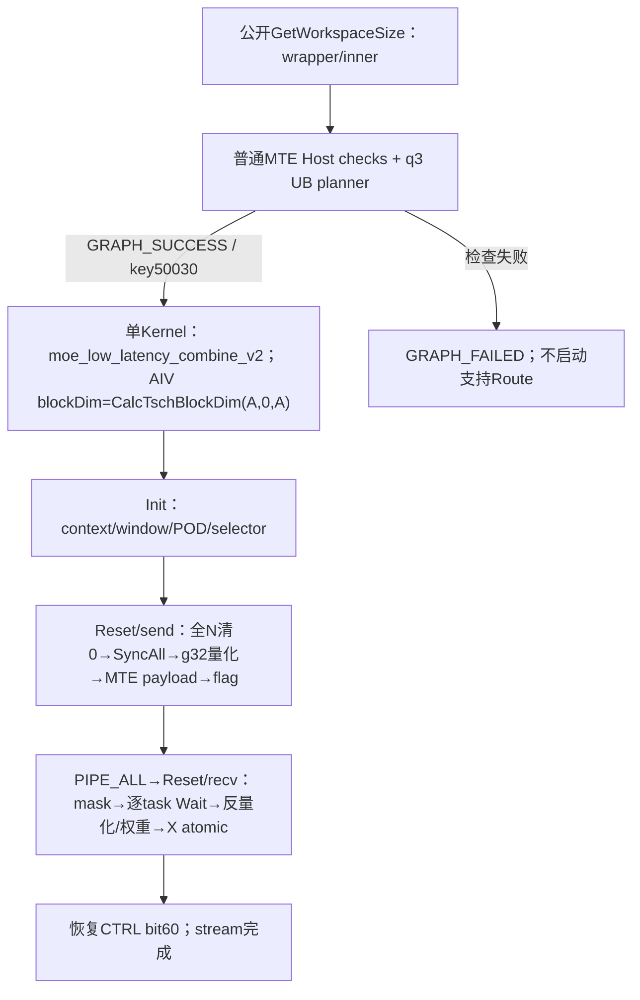
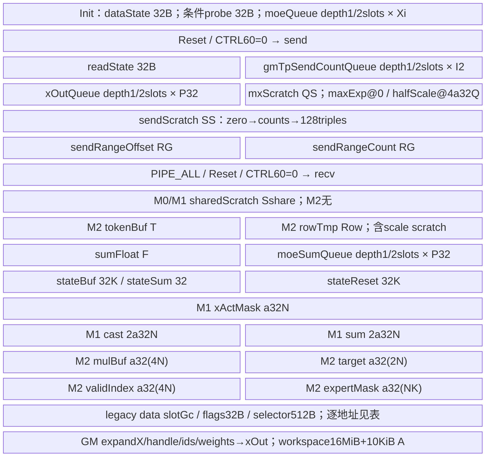

# DeepEP Low Combine MXFP8 950 ACLNN 算子知识

## 算子速览

| 项目 | 内容 |
|---|---|
| 实际入口 | aclnnMoeLowLatencyCombineV2GetWorkspaceSize / aclnnMoeLowLatencyCombineV2；公开两段ACLNN，q3 |
| 计算语义 | 把FFN结果按dispatch handle回传；g32动态E4M3+E8量化/反量化，逐top-k乘router权重、RINT X后原子加到原token |
| 输入输出 | expandX[Trows,H]、ids/weights[N,K]、assist/counts；X=FP16/BF16；输出X[N,H] |
| 执行类型 | 一个AIV_VECTOR kernel；含MTE跨rank window访问与MicroAPI/Reg矢量计算；没有可达Cube、MIX_CV、SIMT、NDDMA、CCU任务 |
| Kernel 路线 | R-001..R-008：同key50030，layout×slots×dtype×mask的完整资源/精度分支 |
| 核心资源 | 每核三阶段UB pool/Reset；physical1/2 slots；g32量化scratch；double window/32B flags/selector；workspace16MiB+10KiB A |
| 来源闭包 | source_closed：公开wrapper→Host/POD→50030 A5 body→MoeMxfp8算法→固定SDK9.1 primitive契约与实现。自动inner/executor和MTE硬件映射为框架边界；无丢失通信算法body |
| 验证状态 | 已完成源码闭包检查；本次知识提取未执行编译、真机、数值或性能测试。draft记录尾域/ABI/输出shape等静态风险。 |


## 接口与语义

### 计算语义

P3=`csrc/deepep/ops/`；P2=`csrc/deepep/ops2/`。SGL固定dda6d36b0cdb4081e102d14c0a2fb276fc416e69，SDK asc-devkit固定e5451c7feba11f9e259f4fbc19c4bf82f8c0496c。冻结查询候选[Low-Latency API](../../../../apis/deepep/deepep_low_latency_dispatch_combine.md)已经完整阅读；该API卡没有本量化实现闭包，采用create。本卡唯一语义为commQuantMode=3的E4M3/E8M0通信加权归并，不把相同entry的q0/q2混入。

所有字节公式中`ap(x)=ceil(x/p)*p`；X=FP16或BF16且sizeof(X)=2。R=EP size，r=EP rank，E=MoE专家数，L=E/R，N=本rank输入token数，K=top-k，M=globalBs/R，A=AIV核数。Se/Sr为共享expert/rank数，本卡可达值均0。`split(T,A,c)`的start=floor(T/A)c+min(c,T%A)，count=floor(T/A)+[c<T%A]。

`Q=a2(ceil(H/32)),D=a256(H),P=D+Q,P32=a32(P),I2=2a128(H),Xi=a32(2H),F=a32(4H),RG=a32(4L),EC=a32(4LR),QS=max(a32(4a32(Q)+2Q),256),SS=max(EC,1536,Xi)`。D是FP8数据区的**字节**长度；I2按X元素128对齐后乘2，不混用单位。`Sshare=max(Xi,F,a32(16Q)),T=max(Xi,32N),Row=max(F,64N)`。

对每个原token n和有效slot k，dispatch handle把本rank FFN输出row映射回目标rank/n/k。sender每32个X元素生成一个共享E8 scale和E4M3数据；receiver重建F32向量、乘F32 expertScales[n,k]。实际异步归并是`xOut[n] = AtomicAdd_X(...AtomicAdd_X(0,RINT_X(weight[n,k]*Dequant(packet[n,k])))...)`；每项在F32中计算后先RINT到X，再做X dtype原子加。它不等于先把K项全放F32按固定k序求和再一次Cast，也未给出bitwise确定性承诺。

ComputeMaxExp双寄存器解交织输入，按32个原元素取最大指数；FP16先检测0x7c00非有限指数，再以TRUNC转换BF16提取0x7f80指数；BF16直接提取。ComputeScale<E4M3>使用target0x0400：maxExp先限到不小于target，sharedExp=maxExp-target，scaleByte=sharedExp>>7；原非有限指数选255，零指数选0。BF16倒数位串为0x7f00-sharedExp，非有限选0x7f81，零选0，sharedExp==0x7f00选0x0040。普通有限值可理解为基于floor(log2(maxAbs))-8的2次幂scale，但微小值/零/非有限严格以这些位分支为准。FP16在FP32中乘BF16倒数；BF16先BF16乘再Cast到FP32。F32→E4M3 CastTrait明确SAT、RINT，不沿用per-token FP8的NO_SAT规则。

反量化把E8字节UNPACK到u32后左移23位，按F32解释，INTLV复制scale用于g32广播；scale字节0实际变float0，255实际变+Inf。E4→F32后依次乘scale、router权重，Add到本task清零的sumFloat。该位算法不是对全部E8特殊编码的抽象标准保证，不承诺NaN/Inf输入得到有限输出。

输出所有N行先清0；无mask处理全部N；一维mask统计true数后按该长度的**前缀**处理，不能宣称保留任意稀疏位置；二维mask按有有效slot的token生成compact索引，并逐slot跳false。public特殊expert数都0，id≥E的task直接无贡献，负id转u32后也落此域。assist/counts必须来自对应dispatch并满足有效范围，Host不扫描全部数据内容。

### 输入、输出与属性

| 参数 | shape/layout | dtype | 约束、默认值与语义 |
|---|---|---|---|
| expandX | [Trows,H]，ND | X | 普通MTE检查容量Trows≥C，C=globalBs*min(L,K)；H1024..8192。实际只处理epCounts尾值对应行。 |
| expertIds | [N,K]，ND | INT32 | N0..512，K1..min(16,E)；内容无完整Host扫描，Device把id转u32，id≥E的task不贡献。 |
| assistInfoForCombine | [≥128C] | INT32 | 对应dispatch handle；有效每row三元组{rank,token,topk}共12B；不允许跨次handle。 |
| epSendCounts | [R*L] | INT32 | expert-major/rank-minor前缀和；最后值selfSendCnt；未全量检查单调性和负值。 |
| expertScales | [N,K] | FLOAT32 | router权重；逐task scalar读取，MXFP8不分配NK权重UB。 |
| tpSendCountsOptional | [1] | INT32 | 普通检查要求非null/维度长度匹配，TP1下不参与ReduceScatter。 |
| xActiveMaskOptional | null、[N]或[N,K] | BOOL | 无mask全N；一维数true后按前缀处理；二维生成有效token列表并逐slot跳false。 |
| activationScaleOptional | 可选 | 框架声明 | 当前非fused MXFP8 body不消费；不能作为本通信E8 scale输入。 |
| weightScaleOptional | 可选 | 框架声明 | 本body不消费。 |
| groupListOptional | 可选 | 框架声明 | 本body不消费。 |
| expandScalesOptional | 可选 | 框架声明 | 本body不消费；通信scale在quant helper内生成。 |
| sharedExpertXOptional | 必须null | X | MXFP8 Host明确拒绝存在。 |
| groupEp | 非空、strnlen<128 | char* | MC2 EP组名；字符串由框架在executor准备阶段使用。 |
| epWorldSize | R2..768 | int64 attr→u32 | 源码上限不是本地MTE IN[32]容量证明。 |
| epRankId | 0≤r<R | int64→u32 | 本地窗口/rank-major分核。 |
| moeExpertNum | E1..1024且E%R=0 | int64→u32 | L=E/R必须>0。 |
| groupTp | TP1可为空 | char* | 仅TP>1要求非空；本q3不存在TP2。 |
| tpWorldSize | 恰为1 | int64→u32 | 早期允许0..2，但MXFP8晚期IsSupported只接受1；TP0已知Host拒绝。 |
| tpRankId | 0 | int64→u32 | TP≤1要求0。 |
| expertShardType | 0 | int64→u32 | 不支持其他分片方式。 |
| sharedExpertNum | 规范化后0 | int64→u32 | 默认1且Sr0会归一为0；其余非0对q3失败。 |
| sharedExpertRankNum | 0 | int64→u32 | 本卡仅普通EP。 |
| globalBs | 0→N*R；否则≥N*R且%R=0 | int64→u32 | 后续MXFP8要求M≤512；窄化前未完整u32范围guard。 |
| outDtype | 公开属性透传；当前Host不读取 | int64 attr | 实际输出由desc/router X约束，不从此属性推导FP32支持。 |
| commQuantMode | 3 | int64→Host局部u32 | 50030，E4M3数据+每32元素E8 scale。 |
| groupListType | 公开属性透传 | int64 | 普通通信路径不作为分发/矩阵计算参数。 |
| commAlg | 非null且非ccu；Python默认MTE选择 | char* | 精确字符串ccu在q3前置拒绝；非ccu走普通MTE，不新增CCU实例。 |
| xOut | [N,H]为接口意图；Host只核对末维H | X，ND | Device无论mask都先写2NH清0，再逐task X原子加；dim0安全性需要调用者保证。 |
| sendCostStats | 可选框架输出 | 框架声明 | 本q3实例不产生可复用统计承诺。 |
| workspace/workspaceSize/executor/stream | ACLNN第二段 | void*/u64/opaque/stream | 调用者申请第一段报告的workspace并保持到该stream执行完成；executor归框架管理。 |


### 入口与版本

DeepEP README公开A5=Ascend950并支持CANN9.0/9.1，当前A5 CI使用9.1；本任务固定CANN9.1.0，SDK version.cmake同为9.1.0。公开Low API文档介绍dispatch/combine配对及handle，未逐项展开本ACLNN commQuantMode=3；固定C++低时延combine已把use_mxfp8映射3，ops策略同样传comm_quant_mode=3，alltoall策略明确拒绝use_mxfp8。Python默认BF16上下文不削去公开ACLNN OpDef和router的FP16分支。

P3 OpDef AddConfig(ascend950)及__DAV_C310__ body/Host匹配。P2 A2只接受q0/q2；P3在q3要求socVersion ASCEND950，A3不生成q3路线。当前只有本950卡；Normal Dispatch的MXFP8 E5M2、MXFP4以及Low Dispatch量化模式属于不同逻辑语义，不从它们复制枚举含义。

## Host/Launcher 执行流程

### 参数校验与前处理

公开wrapper把elasticInfo/oriX/constant参数传null、zero/copy/constant expert数传0，透传17个实际输入与公开属性到aclnnInnerMoeLowLatencyCombineV2GetWorkspaceSize。inner返回失败即传播；成功后检查executor及*executor非null，否则-1。weak NnopbaseSetHcclServerType存在时按commAlg精确等于ccu选择CCU，否则MTE；本q3 Host会在此成功前拒绝ccu。第二段原样转发workspace/size/executor/stream。

Host先检查context/platform/attrs并读commAlg/commQuantMode，q3+ccu直接GRAPH_FAILED；普通MTE取得平台信息后读attrs。groupEp非空且长度<128，R2..768、rank合法、TP0..2、TP≤1要求tpRankId0、shard0、E1..1024，shared参数合法并把默认Se1/Sr0归零，commQuantMode只0/2/3。TP>1时要求q0，故q3 TP2在此失败。普通shape/dtype/format检查expandX/ids/assist/counts/weights/tpCounts和output，mask仅BOOL rank1/2与N/K匹配；X/输出同FP16或BF16、ND，ids/counts/assist为I32、weights为F32。可选非fused scale/groupList在本body没有消费者。

shape依赖依次确定H、K、L=E/(R-Sr)（要求整除且L>0）、N、globalBs；globalBs0→NR，否则≥NR且%R=0。C=globalBs*min(L,K)，expandX第0维≥C*TP，本q3 TP1；assist长度≥128C、counts=LR、tpCounts长度1、weights[N,K]。xOut只核对第1维H，不补造第0维N检查。Host检查MTE窗口预算、获取workspace后，q3附加socVersion950、TP1、Sr/Se/sharedX/elastic/special0、A1..72、M≤512、state区域容量和UB planner。所有成功条件才设置key50030/BlockDim；失败返回GRAPH_FAILED。

### 参数、Workspace 与生命周期

Host workspace[0]=16MiB+A*10KiB，调用者按第一段返回分配到第二段stream执行完成。16MiB为Host命名的系统预留；Device直接令maskCalcWorkspaceGM=收到的workspaceGM+c*10KiB，固定router没有显式+16MiB或GetUserWorkspace转换；框架如何传入该地址是边界；本q3无特殊expert，MaskAlign分支不可达，不虚构其workspace producer。该空间不等于HCCL context私有workSpace、IPC window或网络注册内存。

Info/POD在准备阶段由Host生产，inner/框架完成tiling序列化及kernel参数包装。自动生成的aclnnInner bridge、框架executor/任何Contiguous处理不在固定SGL正文，作为明确框架边界，不声称存在额外算法kernel。调用者的expandX/ids/weights/handle/window必须活到同stream kernel结束；所有rank保持相同组和配对调用顺序。host返回不代表设备执行已完成。

通信地址来自GetHcclContext<0>()：本body转为SGL HcclCombinOpParam并直接读取IN[]，跨rank映射/内存注册由runtime准备，payload算法本身是当前AIV MTE3/MTE2，没有BatchWrite/CCU核心调用。源码固定SDK用于MC2 tiling和primitive边界，不把SDK64项CCU结构当SGL32项MTE ABI。安装头替换的最终ABI与实际runtime映射未编译/实测；本卡不借用9.2 ops-transformer对照来宣称9.1安装兼容。

InitWinState按本核selector读旧z返回，不验证旧值为0/1；写入下轮z、固定1、rank/E/R/globalBs和DFX op计数，合计32B。context rank/size不同仅写额外诊断字，不是失败返回。它不检查shape变化、不清整window，更不是A2 hierarchy magic协议。需要runtime初始selector合法、各rank/z配对；不能推定首次自动清零。

### 启动图与失败传播



| 节点/边 | producer→consumer | offset/extent | dtype/layout | ordering | owner/lifetime/失败 |
|---|---|---|---|---|---|
| N0 | Host Tiling→kernel Init | POD1192B；Info@1088 | 逐字段见POD | inner准备先于launch | 框架管理；Host失败阻断launch |
| K0 | moe_low_latency_combine_v2→A5 Init/Process | grid=CalcTschBlockDim(A,0,A)，AIV c=GetBlockIdx | AIV_VECTOR/MTE | 当前stream | 只有一个算法kernel；非Cube |
| E0 | caller FFN output→sender | row*2H，按assist triple回原rank | X→g32 E4/E8 packet | MTE2/queue/V_MTE3 | 输入保持到send完成 |
| E1 | sender→target window→receiver | dataBase+Gc*(nK+k)，P B；stateBase+32*(nK+k) | E4/E8+8F32 flag | payload PIPE_MTE3后flag；Wait后清flag | 组window/z；下一轮配对才复用 |
| E2 | 量化→反量化→output | 私有UB phases→xOut[n,H] | F32计算→RINT X→AtomicAdd X | Reset/pipe/localbar/event，先全核zero SyncAll | 每task唯一owner；X原子到达序非固定 |
| E3 | caller workspace→kernel | 16MiB+10KiB A | opaque框架/可选mask空间 | launch同stream | 本q3无special workspace消费；不报不存在算法边 |


本体无设备status回传转换为GRAPH_FAILED；flag等待无有限重试上界，CheckWindowSize在actual<planned时执行条件DMA探针（1B请求TBuf、从XOut读入），没有Host失败返回，不是安全Host拒绝。具体Codegen/runtime报错未经执行，不推测。

## Route 与参数设计

### 分核与资源计算

所有字节公式中`ap(x)=ceil(x/p)*p`；X=FP16或BF16且sizeof(X)=2。R=EP size，r=EP rank，E=MoE专家数，L=E/R，N=本rank输入token数，K=top-k，M=globalBs/R，A=AIV核数。Se/Sr为共享expert/rank数，本卡可达值均0。`split(T,A,c)`的start=floor(T/A)c+min(c,T%A)，count=floor(T/A)+[c<T%A]。

`Q=a2(ceil(H/32)),D=a256(H),P=D+Q,P32=a32(P),I2=2a128(H),Xi=a32(2H),F=a32(4H),RG=a32(4L),EC=a32(4LR),QS=max(a32(4a32(Q)+2Q),256),SS=max(EC,1536,Xi)`。D是FP8数据区的**字节**长度；I2按X元素128对齐后乘2，不混用单位。`Sshare=max(Xi,F,a32(16Q)),T=max(Xi,32N),Row=max(F,64N)`。

send count按expert-major/rank-minor前缀存。A<R时split(selfSendCnt,A,c)；A≥R时先把A核按rank分组，再对该rank跨L专家的总token均分并映射为≤L个连续range，独立offset/count各RG B。每range每128行读一批三元组，batch=128*3*4=1536B。不把不同expert边界当单一整除tile。recv task数量active*K，taskId=c;t<active*K;t+=A，每task唯一负责其slot flag和输出atomic。全N清0使用split(N,A,c)。

send UB=32+q(I2+P32)+QS+2RG+SS；recv无mask/token-mask把token/row/scale不相交lifetime合并Sshare，expert-mask同时保留T+Row（并要求Row≥a32(16Q)）；之后F、qP32、stateBuf32K、stateResetBuf32K、stateSum32，加mask资源。token额外5a32(N)；expert额外a32(4N)+a32(2N)+a32(4N)+a32(NK)。Uq=max(sendPeak,receivePeak)，Init的32+条件32+qXi被H≥1024下send峰值覆盖。Host先q2，若U2>UB改q1；若U1仍>UB则GRAPH_FAILED。它核算名义InitBuffer容量，不自动修复primitive全宽尾访问。

Gd=a512(a32(2H)+44)用于已有dispatch footprint，Gc=a512(D+Q)用于combine packet；perHalf=M*Gd*R*L+M*Gc*K；W=totalWinSize，DEEPEP_HCCL_BUFFSIZE设置时优先读取，仅未设置时回退HCCL_BUFFSIZE，均解释为MiB，默认200MiB，帮助函数用stoi转uint16，异常/窄化不补造稳健解析。检查2*(perHalf+reserved)≤W，hybrid reserved=109MiB+72KiB，legacy=0。实际MTE先跳过4MiB状态前缀，再按(W-4MiB)/2选择z half，legacy预算没显式加此前缀。hybrid data/state/selector常量见每Route；32MK≤512KiB-32限制实际flag区。

### Route 选择

公共谓词C0：commQuantMode=3，commAlg非null且!="ccu"，socVersion=ASCEND950/__DAV_C310__，TP1，Sr/Se0，sharedX/elastic无，特殊expert数0，公共shape/format/窗口/状态guard通过。Uq按mask实际资源分支计算；M0=mask null，M1=BOOL[N]且isTokenMask，M2=BOOL[N,K]且isExpertMask。每族M0/M1/M2是独立的精确资源selector，不把三个分配分支视为相同。

| 顺序 | Route | Key/模板 | 精确选择条件与优先级 | 不适用去向 |
|---|---|---|---|---|
| 1 | R-001 legacy MTE FP16 2缓冲 | 50030 / <half,half,I32,false,false,true> | C0；hybrid=false（env精确1）；X=FP16；U2≤UB→slots2；再精确分M0/M1/M2 | 相应同族mask selector；U1>UB/guard失败→GRAPH_FAILED |
| 2 | R-002 legacy MTE BF16 2缓冲 | 50030 / <bfloat16_t,bfloat16_t,I32,false,false,true> | C0；hybrid=false（env精确1）；X=BF16；U2≤UB→slots2；再精确分M0/M1/M2 | 相应同族mask selector；U1>UB/guard失败→GRAPH_FAILED |
| 3 | R-003 legacy MTE FP16 1缓冲 | 50030 / <half,half,I32,false,false,true> | C0；hybrid=false（env精确1）；X=FP16；U2>UB且U1≤UB→slots1；再精确分M0/M1/M2 | 相应同族mask selector；U1>UB/guard失败→GRAPH_FAILED |
| 4 | R-004 legacy MTE BF16 1缓冲 | 50030 / <bfloat16_t,bfloat16_t,I32,false,false,true> | C0；hybrid=false（env精确1）；X=BF16；U2>UB且U1≤UB→slots1；再精确分M0/M1/M2 | 相应同族mask selector；U1>UB/guard失败→GRAPH_FAILED |
| 5 | R-005 hybrid MTE FP16 2缓冲 | 50030 / <half,half,I32,false,false,true> | C0；hybrid=true（env精确1）；X=FP16；U2≤UB→slots2；再精确分M0/M1/M2 | 相应同族mask selector；U1>UB/guard失败→GRAPH_FAILED |
| 6 | R-006 hybrid MTE BF16 2缓冲 | 50030 / <bfloat16_t,bfloat16_t,I32,false,false,true> | C0；hybrid=true（env精确1）；X=BF16；U2≤UB→slots2；再精确分M0/M1/M2 | 相应同族mask selector；U1>UB/guard失败→GRAPH_FAILED |
| 7 | R-007 hybrid MTE FP16 1缓冲 | 50030 / <half,half,I32,false,false,true> | C0；hybrid=true（env精确1）；X=FP16；U2>UB且U1≤UB→slots1；再精确分M0/M1/M2 | 相应同族mask selector；U1>UB/guard失败→GRAPH_FAILED |
| 8 | R-008 hybrid MTE BF16 1缓冲 | 50030 / <bfloat16_t,bfloat16_t,I32,false,false,true> | C0；hybrid=true（env精确1）；X=BF16；U2>UB且U1≤UB→slots1；再精确分M0/M1/M2 | 相应同族mask selector；U1>UB/guard失败→GRAPH_FAILED |


```text
public wrapper → q3 && commAlg=="ccu" ? GRAPH_FAILED
普通GetAttr/checks → soc!=950 / TP>1 / shared/elastic/special ? GRAPH_FAILED
shape/format/dtype/window/workspace通过 → IsSupported(TP==1)否则GRAPH_FAILED
A范围、M容量、state guard → 按实际mask计算U2/U1；slots2或slots1或GRAPH_FAILED
hybrid=getenv精确"1"；X=FP16/BF16；mask=M0/M1/M2
key50030 → A5<X,X,I32,false,false,true>，每次一个kernel
```

### 模板/实现执行矩阵

下表24项保持全部精确selector；8个R标题按同一实例的公共数据流组织，内存和mask差异用M0/M1/M2分别列出。

| Route | key/selector | dtype/shape/platform 完整命中条件 | 执行拓扑与 Kernel 节点 | 实际模板/body | 内存与同步特征 | tail/fallback |
|---|---|---|---|---|---|---|
| R-001.M0 | 50030/2slots/M0 | C0；legacy；FP16；U2≤UB；null mask | 单AIV→MTE send→同kernel recv | <half,half,I32,false,false,true> | Urecv=Sshare+F+2P32+64K+32+0；Reset/flag/X atomic | 无H对齐fallback；容量失败不改数学模式 |
| R-001.M1 | 50030/2slots/M1 | C0；legacy；FP16；U2≤UB；BOOL[N] token mask | 单AIV→MTE send→同kernel recv | <half,half,I32,false,false,true> | Urecv=Sshare+F+2P32+64K+32+5a32(N)；Reset/flag/X atomic | 无H对齐fallback；容量失败不改数学模式 |
| R-001.M2 | 50030/2slots/M2 | C0；legacy；FP16；U2≤UB；BOOL[N,K] expert mask | 单AIV→MTE send→同kernel recv | <half,half,I32,false,false,true> | Urecv=T+Row+F+2P32+64K+32+a32(4N)+a32(2N)+a32(4N)+a32(NK)；Reset/flag/X atomic | 无H对齐fallback；容量失败不改数学模式 |
| R-002.M0 | 50030/2slots/M0 | C0；legacy；BF16；U2≤UB；null mask | 单AIV→MTE send→同kernel recv | <bfloat16_t,bfloat16_t,I32,false,false,true> | Urecv=Sshare+F+2P32+64K+32+0；Reset/flag/X atomic | 无H对齐fallback；容量失败不改数学模式 |
| R-002.M1 | 50030/2slots/M1 | C0；legacy；BF16；U2≤UB；BOOL[N] token mask | 单AIV→MTE send→同kernel recv | <bfloat16_t,bfloat16_t,I32,false,false,true> | Urecv=Sshare+F+2P32+64K+32+5a32(N)；Reset/flag/X atomic | 无H对齐fallback；容量失败不改数学模式 |
| R-002.M2 | 50030/2slots/M2 | C0；legacy；BF16；U2≤UB；BOOL[N,K] expert mask | 单AIV→MTE send→同kernel recv | <bfloat16_t,bfloat16_t,I32,false,false,true> | Urecv=T+Row+F+2P32+64K+32+a32(4N)+a32(2N)+a32(4N)+a32(NK)；Reset/flag/X atomic | 无H对齐fallback；容量失败不改数学模式 |
| R-003.M0 | 50030/1slots/M0 | C0；legacy；FP16；U2>UB且U1≤UB；null mask | 单AIV→MTE send→同kernel recv | <half,half,I32,false,false,true> | Urecv=Sshare+F+1P32+64K+32+0；Reset/flag/X atomic | 无H对齐fallback；容量失败不改数学模式 |
| R-003.M1 | 50030/1slots/M1 | C0；legacy；FP16；U2>UB且U1≤UB；BOOL[N] token mask | 单AIV→MTE send→同kernel recv | <half,half,I32,false,false,true> | Urecv=Sshare+F+1P32+64K+32+5a32(N)；Reset/flag/X atomic | 无H对齐fallback；容量失败不改数学模式 |
| R-003.M2 | 50030/1slots/M2 | C0；legacy；FP16；U2>UB且U1≤UB；BOOL[N,K] expert mask | 单AIV→MTE send→同kernel recv | <half,half,I32,false,false,true> | Urecv=T+Row+F+1P32+64K+32+a32(4N)+a32(2N)+a32(4N)+a32(NK)；Reset/flag/X atomic | 无H对齐fallback；容量失败不改数学模式 |
| R-004.M0 | 50030/1slots/M0 | C0；legacy；BF16；U2>UB且U1≤UB；null mask | 单AIV→MTE send→同kernel recv | <bfloat16_t,bfloat16_t,I32,false,false,true> | Urecv=Sshare+F+1P32+64K+32+0；Reset/flag/X atomic | 无H对齐fallback；容量失败不改数学模式 |
| R-004.M1 | 50030/1slots/M1 | C0；legacy；BF16；U2>UB且U1≤UB；BOOL[N] token mask | 单AIV→MTE send→同kernel recv | <bfloat16_t,bfloat16_t,I32,false,false,true> | Urecv=Sshare+F+1P32+64K+32+5a32(N)；Reset/flag/X atomic | 无H对齐fallback；容量失败不改数学模式 |
| R-004.M2 | 50030/1slots/M2 | C0；legacy；BF16；U2>UB且U1≤UB；BOOL[N,K] expert mask | 单AIV→MTE send→同kernel recv | <bfloat16_t,bfloat16_t,I32,false,false,true> | Urecv=T+Row+F+1P32+64K+32+a32(4N)+a32(2N)+a32(4N)+a32(NK)；Reset/flag/X atomic | 无H对齐fallback；容量失败不改数学模式 |
| R-005.M0 | 50030/2slots/M0 | C0；hybrid；FP16；U2≤UB；null mask | 单AIV→MTE send→同kernel recv | <half,half,I32,false,false,true> | Urecv=Sshare+F+2P32+64K+32+0；Reset/flag/X atomic | 无H对齐fallback；容量失败不改数学模式 |
| R-005.M1 | 50030/2slots/M1 | C0；hybrid；FP16；U2≤UB；BOOL[N] token mask | 单AIV→MTE send→同kernel recv | <half,half,I32,false,false,true> | Urecv=Sshare+F+2P32+64K+32+5a32(N)；Reset/flag/X atomic | 无H对齐fallback；容量失败不改数学模式 |
| R-005.M2 | 50030/2slots/M2 | C0；hybrid；FP16；U2≤UB；BOOL[N,K] expert mask | 单AIV→MTE send→同kernel recv | <half,half,I32,false,false,true> | Urecv=T+Row+F+2P32+64K+32+a32(4N)+a32(2N)+a32(4N)+a32(NK)；Reset/flag/X atomic | 无H对齐fallback；容量失败不改数学模式 |
| R-006.M0 | 50030/2slots/M0 | C0；hybrid；BF16；U2≤UB；null mask | 单AIV→MTE send→同kernel recv | <bfloat16_t,bfloat16_t,I32,false,false,true> | Urecv=Sshare+F+2P32+64K+32+0；Reset/flag/X atomic | 无H对齐fallback；容量失败不改数学模式 |
| R-006.M1 | 50030/2slots/M1 | C0；hybrid；BF16；U2≤UB；BOOL[N] token mask | 单AIV→MTE send→同kernel recv | <bfloat16_t,bfloat16_t,I32,false,false,true> | Urecv=Sshare+F+2P32+64K+32+5a32(N)；Reset/flag/X atomic | 无H对齐fallback；容量失败不改数学模式 |
| R-006.M2 | 50030/2slots/M2 | C0；hybrid；BF16；U2≤UB；BOOL[N,K] expert mask | 单AIV→MTE send→同kernel recv | <bfloat16_t,bfloat16_t,I32,false,false,true> | Urecv=T+Row+F+2P32+64K+32+a32(4N)+a32(2N)+a32(4N)+a32(NK)；Reset/flag/X atomic | 无H对齐fallback；容量失败不改数学模式 |
| R-007.M0 | 50030/1slots/M0 | C0；hybrid；FP16；U2>UB且U1≤UB；null mask | 单AIV→MTE send→同kernel recv | <half,half,I32,false,false,true> | Urecv=Sshare+F+1P32+64K+32+0；Reset/flag/X atomic | 无H对齐fallback；容量失败不改数学模式 |
| R-007.M1 | 50030/1slots/M1 | C0；hybrid；FP16；U2>UB且U1≤UB；BOOL[N] token mask | 单AIV→MTE send→同kernel recv | <half,half,I32,false,false,true> | Urecv=Sshare+F+1P32+64K+32+5a32(N)；Reset/flag/X atomic | 无H对齐fallback；容量失败不改数学模式 |
| R-007.M2 | 50030/1slots/M2 | C0；hybrid；FP16；U2>UB且U1≤UB；BOOL[N,K] expert mask | 单AIV→MTE send→同kernel recv | <half,half,I32,false,false,true> | Urecv=T+Row+F+1P32+64K+32+a32(4N)+a32(2N)+a32(4N)+a32(NK)；Reset/flag/X atomic | 无H对齐fallback；容量失败不改数学模式 |
| R-008.M0 | 50030/1slots/M0 | C0；hybrid；BF16；U2>UB且U1≤UB；null mask | 单AIV→MTE send→同kernel recv | <bfloat16_t,bfloat16_t,I32,false,false,true> | Urecv=Sshare+F+1P32+64K+32+0；Reset/flag/X atomic | 无H对齐fallback；容量失败不改数学模式 |
| R-008.M1 | 50030/1slots/M1 | C0；hybrid；BF16；U2>UB且U1≤UB；BOOL[N] token mask | 单AIV→MTE send→同kernel recv | <bfloat16_t,bfloat16_t,I32,false,false,true> | Urecv=Sshare+F+1P32+64K+32+5a32(N)；Reset/flag/X atomic | 无H对齐fallback；容量失败不改数学模式 |
| R-008.M2 | 50030/1slots/M2 | C0；hybrid；BF16；U2>UB且U1≤UB；BOOL[N,K] expert mask | 单AIV→MTE send→同kernel recv | <bfloat16_t,bfloat16_t,I32,false,false,true> | Urecv=T+Row+F+1P32+64K+32+a32(4N)+a32(2N)+a32(4N)+a32(NK)；Reset/flag/X atomic | 无H对齐fallback；容量失败不改数学模式 |


### 隐藏性能 Guard

| Guard | Host/Tiling 条件 | Device/资源原因 | 影响 Route | 不满足时去向 | 源码符号 |
|---|---|---|---|---|---|
| 前置CCU拒绝 | commQuantMode=3且commAlg==ccu | 该量化体只有MTE packet协议 | 全部 | GRAPH_FAILED，无CCU fallback | MoeDistributeCombineV2TilingFunc |
| 平台/TP/共享 | socVersion==ASCEND950；IsSupportedA5Mxfp8Combine且TP=1 | 没有TP2/共享/弹性/特殊expert量化实例 | 全部 | GRAPH_FAILED，TP0也失败 | IsSupportedA5Mxfp8Combine |
| 核/状态域 | A>0且A≤72，M≤512，32MK≤512KiB-32 | hybrid selector与512KiB combine flags区 | 全部 | GRAPH_FAILED | MXFP8附加检查 |
| 双→单缓冲 | U2≤UB；否则U1≤UB | 物理queue slots减少 | q2或q1 | 单缓冲仍超UB→GRAPH_FAILED | CalcA5Mxfp8CombinePeakUb |
| expert-mask scale | Row≥a32(16Q) | row临时与scale复用容量 | expert-mask | Calc返回UINT64_MAX，planner失败 | CalcA5Mxfp8CombinePeakUb |
| window预算 | 2*(M Gd R L+M Gc K+reserved)≤W | dispatch与combine共用double window | 全部 | GRAPH_FAILED；actual不足另有探针 | CheckWinSize/CheckWindowSize |
| H对齐缺guard | Host只H1024..8192，无%128/%256条件 | 双load/store与nominal allocation尾域不等价 | 全部 | 无源码fallback；draft限制 | ComputeMaxExp/ComputeFp8Data/Dequantize |
| rank数组缺guard | HostR≤768，SGL windowsIn[32] | 远端MTE地址数组是本地ABI | 全部 | 未统一拒绝R>32，不造支持 | HcclCombinOpParam/GetBaseWindAddrByRankId |
| N=0 mask | N允许0，mask路径无完整空域早退 | 条件分配mulBuf与后续Get/Vector空域 | token/expert mask | 无安全fallback证明 | ExpertMaskCalCnt/TokenMaskCalCnt |


### POD/ABI

Info104B/align8，padding73..75；outer1192B/align8。以下offset为固定声明在常规64位自然布局下逐字段推导，未经安装编译实测。SDK64/512为容器大小，内部声明分别64B与512B；Host local breakdown136B未序列化。SGL MTE context完整自有声明576B；SDK C310 context为64项IN/OUT及不同后缀，当前q3不用SDKCCU字段，不把同名prefix看成全结构安装ABI证明。

| 结构 | 字段 | 类型/位宽 | ABI 布局 | 单位 | Host/launcher producer | Device consumer | 边界 |
|---|---|---|---|---|---|---|---|
| P3 MoeDistributeCombineV2Info | epWorldSize | u32 | @0 | rank数 | GetAttr R2..768 | range分核/远端IN地址 | Host上界不保护IN[32] |
| P3 MoeDistributeCombineV2Info | tpWorldSize | u32 | @4 | rank数 | GetAttr0..2；q3晚期要求1 | IsAsync/无ReduceScatter | 0已知失败，不归一成1 |
| P3 MoeDistributeCombineV2Info | epRankId | u32 | @8 | rank | GetAttr 0≤r<R | self selector/counts/window | 调用组一致 |
| P3 MoeDistributeCombineV2Info | tpRankId | u32 | @12 | rank | TP≤1要求0 | 本q3无TP通信 | 保留但inactive |
| P3 MoeDistributeCombineV2Info | expertShardType | u32 | @16 | enum | GetAttr要求0 | 无独立分片分支 | 仅0 |
| P3 MoeDistributeCombineV2Info | sharedExpertNum | u32 | @20 | expert数 | 默认1/Sr0→0；q3最终0 | K+Se/IsAsync | 本卡Se0 |
| P3 MoeDistributeCombineV2Info | sharedExpertRankNum | u32 | @24 | rank数 | GetAttr后q3要求0 | L=E/R | 无共享role路线 |
| P3 MoeDistributeCombineV2Info | moeExpertNum | u32 | @28 | expert数 | GetAttr E1..1024 | ID有效域/InitWinState | 特殊ID没有贡献 |
| P3 MoeDistributeCombineV2Info | moeExpertPerRankNum | u32 | @32 | expert/rank | CheckTensorShape E%R=0；L>0 | epCounts尾值/L段ranges | 非向下取整 |
| P3 MoeDistributeCombineV2Info | zeroExpertNum | u32 | @36 | expert数 | 公开wrapper固定0 | q3 Host校验/Device特殊分支关闭 | 本卡0 |
| P3 MoeDistributeCombineV2Info | copyExpertNum | u32 | @40 | expert数 | 公开wrapper固定0 | 同上 | 本卡0 |
| P3 MoeDistributeCombineV2Info | constExpertNum | u32 | @44 | expert数 | 公开wrapper固定0 | 同上 | 本卡0 |
| P3 MoeDistributeCombineV2Info | globalBs | u32 | @48 | token容量 | 0→NR，否则≥NR且%R=0；晚期M≤512 | M/窗口计划/InitWinState | int64→u32窄化未全检 |
| P3 MoeDistributeCombineV2Info | bs | u32 | @52 | token数 | expertIds.dim0 N0..512 | 全N清0/active mask | xOut.dim0未同样检查 |
| P3 MoeDistributeCombineV2Info | k | u32 | @56 | slot/token | expertIds.dim1 K1..min(16,E) | NK tasks/flags | ≤16使a32K=32 |
| P3 MoeDistributeCombineV2Info | h | u32 | @60 | 元素/token | expandX.dim1 H1024..8192 | quant/dequant/DMA长度 | 无%128/%256 guard |
| P3 MoeDistributeCombineV2Info | aivNum | u32 | @64 | core数 | 平台GetCoreNumAiv；q3要求1..72 | split/tasks/512core selector | blockDim=CalcTschBlockDim(A,0,A) |
| P3 MoeDistributeCombineV2Info | isTokenMask | bool | @68 | flag | optional mask rank1 | TokenMaskCalCnt | null false；prefix语义 |
| P3 MoeDistributeCombineV2Info | isExpertMask | bool | @69 | flag | optional mask rank2 | ExpertMaskCalCnt/skip | 与token互斥 |
| P3 MoeDistributeCombineV2Info | hasSharedExpertX | bool | @70 | flag | 可选输入存在；q3要求false | IsAsyncCombinePath | public可选但q3拒绝存在 |
| P3 MoeDistributeCombineV2Info | hasElasticInfo | bool | @71 | flag | 公开wrapper null→false | q3 Host guard | public inactive |
| P3 MoeDistributeCombineV2Info | isHybridDeployment | bool | @72 | flag | env DEEPEP_HYBRID_DEPLOYMENT精确1 | 窗口base/flag/selector | 非1为legacy |
| P3 MoeDistributeCombineV2Info | a5MxCombineBufferNum | u32 | @76 | slots | CalcPeak先2，超UB再1 | InitTilingAttrs→bufferNum三组queue | q3有效；自然padding73..75 |
| P3 MoeDistributeCombineV2Info | totalUbSize | u64 | @80 | B | 平台GetCoreMemSize UB | Host q选择；Device资源字段 | 非实际尾域证明 |
| P3 MoeDistributeCombineV2Info | totalWinSize | u64 | @88 | B | GetHcclBufferSize环境W | baseW=W-4MiB/window offsets | 实际context.winSize另检查 |
| P3 MoeDistributeCombineV2Info | armAvgFactor | float | @96 | inactive | 当前Host不赋值 | 本q3不读 | 不假默认 |
| P3 MoeDistributeCombineV2Info | epsilon | float | @100 | inactive | 当前Host不赋值 | 本q3不读 | 不假默认 |
| MoeDistributeCombineV2TilingData | mc2InitTiling | 64B | @0 | 混合 | Host GetTiling/写Info | MC2资源准备 | 总1192/align8；源码自然布局推导 |
| MoeDistributeCombineV2TilingData | mc2CcTiling1 | 512B | @64 | 混合 | Host GetTiling/写Info | EP组 | 总1192/align8；源码自然布局推导 |
| MoeDistributeCombineV2TilingData | mc2CcTiling2 | 512B | @576 | 混合 | Host GetTiling/写Info | TP组，TP1 body不读 | 总1192/align8；源码自然布局推导 |
| MoeDistributeCombineV2TilingData | moeDistributeCombineV2Info | 104B | @1088 | 混合 | Host GetTiling/写Info | InitTilingAttrs | 总1192/align8；源码自然布局推导 |


| 结构 | 字段 | 类型/位宽 | ABI 布局 | 单位 | Host/launcher producer | Device consumer | 边界 |
|---|---|---|---|---|---|---|---|
| Mc2InitTilingInner | version | u32 | @0 | 协议 | GetTiling：100 | MC2框架资源准备 | version100；64B/align4，非device自有算法体 |
| Mc2InitTilingInner | mc2HcommCnt | u32 | @4 | 组数 | GetTiling：EP+TP两组 | MC2框架资源准备 | version100；64B/align4，非device自有算法体 |
| Mc2InitTilingInner | offset | u32[8] | @8 | 字节offset | GetTiling：64/576，其余0 | MC2框架资源准备 | version100；64B/align4，非device自有算法体 |
| Mc2InitTilingInner | debugMode | u8 | @40 | enum | GetTiling：default0 | MC2框架资源准备 | version100；64B/align4，非device自有算法体 |
| Mc2InitTilingInner | preparePosition | u8 | @41 | enum | GetTiling：default0 | MC2框架资源准备 | version100；64B/align4，非device自有算法体 |
| Mc2InitTilingInner | queueNum | u16 | @42 | queue数 | GetTiling：default0 | MC2框架资源准备 | version100；64B/align4，非device自有算法体 |
| Mc2InitTilingInner | commBlockNum | u16 | @44 | block数 | GetTiling：default0 | MC2框架资源准备 | version100；64B/align4，非device自有算法体 |
| Mc2InitTilingInner | devType | u8 | @46 | SoC enum | GetTiling：runtime SoC | MC2框架资源准备 | version100；64B/align4，非device自有算法体 |
| Mc2InitTilingInner | reserved | char[17] | @47 | B | GetTiling：未显式清全部；不依赖 | MC2框架资源准备 | version100；64B/align4，非device自有算法体 |
| Mc2CcTilingInner | skipLocalRankCopy | u8 | @0 | flag | GetTiling：default0 | MC2框架；实际payload由本卡MTE body | version1；512B/align4；未读字段inactive |
| Mc2CcTilingInner | skipBufferWindowCopy | u8 | @1 | flag | GetTiling：default0 | MC2框架；实际payload由本卡MTE body | version1；512B/align4；未读字段inactive |
| Mc2CcTilingInner | stepSize | u8 | @2 | step | GetTiling：default0 | MC2框架；实际payload由本卡MTE body | version1；512B/align4；未读字段inactive |
| Mc2CcTilingInner | version | u8 | @3 | 协议 | GetTiling：1 | MC2框架；实际payload由本卡MTE body | version1；512B/align4；未读字段inactive |
| Mc2CcTilingInner | reserved | char[9] | @4 | B | GetTiling：memset0 | MC2框架；实际payload由本卡MTE body | version1；512B/align4；未读字段inactive |
| Mc2CcTilingInner | commEngine | u8 | @13 | enum | GetTiling：本卡MTE3 | MC2框架；实际payload由本卡MTE body | version1；512B/align4；未读字段inactive |
| Mc2CcTilingInner | srcDataType | u8 | @14 | dtype enum | GetTiling：default0=INT8；MTE payload由X模板决定 | MC2框架；实际payload由本卡MTE body | version1；512B/align4；未读字段inactive |
| Mc2CcTilingInner | dstDataType | u8 | @15 | dtype enum | GetTiling：default0；本body不读为数据类型 | MC2框架；实际payload由本卡MTE body | version1；512B/align4；未读字段inactive |
| Mc2CcTilingInner | groupName | char[128] | @16 | 字符 | GetTiling：EP/TP group | MC2框架；实际payload由本卡MTE body | version1；512B/align4；未读字段inactive |
| Mc2CcTilingInner | algConfig | char[128] | @144 | 字符 | GetTiling：EP fullmesh/pairwise，TP ReduceScatterRing | MC2框架；实际payload由本卡MTE body | version1；512B/align4；未读字段inactive |
| Mc2CcTilingInner | opType | u32 | @272 | cmd enum | GetTiling：本卡EP8/TP7 | MC2框架；实际payload由本卡MTE body | version1；512B/align4；未读字段inactive |
| Mc2CcTilingInner | reduceType | u32 | @276 | enum | GetTiling：default0；本MTE不据此reduce | MC2框架；实际payload由本卡MTE body | version1；512B/align4；未读字段inactive |
| Mc2CcTilingInner | reserved2 | char[232] | @280 | B | GetTiling：未显式清全部；inactive | MC2框架；实际payload由本卡MTE body | version1；512B/align4；未读字段inactive |
| A5Mxfp8CombineUbBreakdown | inputBytes | u64 | @0 | B | CalcA5Mxfp8CombinePeakUb：I2 | Host OP_LOGD；max(sendPeak,receivePeak)驱动q选择 | Host局部，size136/align8；不序列化进device POD |
| A5Mxfp8CombineUbBreakdown | packetBytes | u64 | @8 | B | CalcA5Mxfp8CombinePeakUb：P32 | Host OP_LOGD；max(sendPeak,receivePeak)驱动q选择 | Host局部，size136/align8；不序列化进device POD |
| A5Mxfp8CombineUbBreakdown | mxScratchBytes | u64 | @16 | B | CalcA5Mxfp8CombinePeakUb：QS | Host OP_LOGD；max(sendPeak,receivePeak)驱动q选择 | Host局部，size136/align8；不序列化进device POD |
| A5Mxfp8CombineUbBreakdown | rangeCntBytes | u64 | @24 | B | CalcA5Mxfp8CombinePeakUb：RG | Host OP_LOGD；max(sendPeak,receivePeak)驱动q选择 | Host局部，size136/align8；不序列化进device POD |
| A5Mxfp8CombineUbBreakdown | epSendCountBytes | u64 | @32 | B | CalcA5Mxfp8CombinePeakUb：EC | Host OP_LOGD；max(sendPeak,receivePeak)驱动q选择 | Host局部，size136/align8；不序列化进device POD |
| A5Mxfp8CombineUbBreakdown | indexBatchBytes | u64 | @40 | B | CalcA5Mxfp8CombinePeakUb：1536 | Host OP_LOGD；max(sendPeak,receivePeak)驱动q选择 | Host局部，size136/align8；不序列化进device POD |
| A5Mxfp8CombineUbBreakdown | asyncZeroBytes | u64 | @48 | B | CalcA5Mxfp8CombinePeakUb：Xi | Host OP_LOGD；max(sendPeak,receivePeak)驱动q选择 | Host局部，size136/align8；不序列化进device POD |
| A5Mxfp8CombineUbBreakdown | sendScratchBytes | u64 | @56 | B | CalcA5Mxfp8CombinePeakUb：SS | Host OP_LOGD；max(sendPeak,receivePeak)驱动q选择 | Host局部，size136/align8；不序列化进device POD |
| A5Mxfp8CombineUbBreakdown | tokenBufBytes | u64 | @64 | B | CalcA5Mxfp8CombinePeakUb：expertMask?T:Xi | Host OP_LOGD；max(sendPeak,receivePeak)驱动q选择 | Host局部，size136/align8；不序列化进device POD |
| A5Mxfp8CombineUbBreakdown | rowTmpBytes | u64 | @72 | B | CalcA5Mxfp8CombinePeakUb：expertMask?Row:F | Host OP_LOGD；max(sendPeak,receivePeak)驱动q选择 | Host局部，size136/align8；不序列化进device POD |
| A5Mxfp8CombineUbBreakdown | mxScaleBytes | u64 | @80 | B | CalcA5Mxfp8CombinePeakUb：a32(16Q) | Host OP_LOGD；max(sendPeak,receivePeak)驱动q选择 | Host局部，size136/align8；不序列化进device POD |
| A5Mxfp8CombineUbBreakdown | receiveScratchBytes | u64 | @88 | B | CalcA5Mxfp8CombinePeakUb：expertMask?T+Row:Sshare | Host OP_LOGD；max(sendPeak,receivePeak)驱动q选择 | Host局部，size136/align8；不序列化进device POD |
| A5Mxfp8CombineUbBreakdown | sumFloatBytes | u64 | @96 | B | CalcA5Mxfp8CombinePeakUb：F | Host OP_LOGD；max(sendPeak,receivePeak)驱动q选择 | Host局部，size136/align8；不序列化进device POD |
| A5Mxfp8CombineUbBreakdown | stateBytes | u64 | @104 | B | CalcA5Mxfp8CombinePeakUb：64K+32 | Host OP_LOGD；max(sendPeak,receivePeak)驱动q选择 | Host局部，size136/align8；不序列化进device POD |
| A5Mxfp8CombineUbBreakdown | maskBytes | u64 | @112 | B | CalcA5Mxfp8CombinePeakUb：none0/token5a32N/expert a32(4N)+a32(2N)+a32(4N)+a32(NK) | Host OP_LOGD；max(sendPeak,receivePeak)驱动q选择 | Host局部，size136/align8；不序列化进device POD |
| A5Mxfp8CombineUbBreakdown | sendPeak | u64 | @120 | B | CalcA5Mxfp8CombinePeakUb：32+q(I2+P32)+QS+2RG+SS | Host OP_LOGD；max(sendPeak,receivePeak)驱动q选择 | Host局部，size136/align8；不序列化进device POD |
| A5Mxfp8CombineUbBreakdown | receivePeak | u64 | @128 | B | CalcA5Mxfp8CombinePeakUb：receiveScratchBytes+F+qP32+stateBytes+maskBytes | Host OP_LOGD；max(sendPeak,receivePeak)驱动q选择 | Host局部，size136/align8；不序列化进device POD |
| SGL HcclCombinOpParam | workSpace | u64 | @0 | 地址 | runtime填充；自有SGL声明 | 本q3不读 | 自然size576/align8；不是SDK64项CCU结构 |
| SGL HcclCombinOpParam | workSpaceSize | u64 | @8 | B | runtime填充；自有SGL声明 | 本q3不读 | 自然size576/align8；不是SDK64项CCU结构 |
| SGL HcclCombinOpParam | rankId | u32 | @16 | rank | runtime填充；自有SGL声明 | InitWinState诊断 | 自然size576/align8；不是SDK64项CCU结构 |
| SGL HcclCombinOpParam | rankDim | u32 | @20 | rank数 | runtime填充；自有SGL声明 | InitWinState诊断 | 自然size576/align8；不是SDK64项CCU结构 |
| SGL HcclCombinOpParam | winSize | u64 | @24 | B | runtime填充；自有SGL声明 | CheckWindowSize | 自然size576/align8；不是SDK64项CCU结构 |
| SGL HcclCombinOpParam | windowsIn | u64[32] | @32 | 地址数组 | runtime填充；自有SGL声明 | data/state/selector | 自然size576/align8；不是SDK64项CCU结构 |
| SGL HcclCombinOpParam | windowsOut | u64[32] | @288 | 地址数组 | runtime填充；自有SGL声明 | 本q3不读 | 自然size576/align8；不是SDK64项CCU结构 |
| SGL HcclCombinOpParam | xnAddr | u64 | @544 | 地址 | runtime填充；自有SGL声明 | 本q3不读 | 自然size576/align8；不是SDK64项CCU结构 |
| SGL HcclCombinOpParam | ckeAddr | u64 | @552 | 地址 | runtime填充；自有SGL声明 | 本q3不读 | 自然size576/align8；不是SDK64项CCU结构 |
| SGL HcclCombinOpParam | msAddr | u64 | @560 | 地址 | runtime填充；自有SGL声明 | 本q3不读 | 自然size576/align8；不是SDK64项CCU结构 |
| SGL HcclCombinOpParam | msSize | u64 | @568 | 个数 | runtime填充；自有SGL声明 | 本q3不读 | 自然size576/align8；不是SDK64项CCU结构 |


### Route 源码闭包

| Route | Key/selector | Host/Tiling producer | POD/参数 | Kernel entry/router 节点 | Kernel body/直接依赖 | 构建接线 |
|---|---|---|---|---|---|---|
| R-001 M0/M1/M2 | 50030；legacy MTE FP16 2缓冲 | P3 op_host/moe_distribute_combine_v2_tiling.cpp::MoeDistributeCombineV2TilingFuncImpl/CalcA5Mxfp8CombinePeakUb | TilingData1192；bufferNum=2，mask flags分别见矩阵 | P3 op_kernel/moe_low_latency_combine_v2.cpp | P3 op_kernel/moe_distribute_combine_v2_a5.h→quantize_functions.h/common.h→moe_distribute_v2_base.h/window_layout.h/check_winsize.h | P3 op_host/CMakeLists.txt保留wrapper/注册→op_kernel/CMakeLists.txt kernel sources |
| R-002 M0/M1/M2 | 50030；legacy MTE BF16 2缓冲 | P3 op_host/moe_distribute_combine_v2_tiling.cpp::MoeDistributeCombineV2TilingFuncImpl/CalcA5Mxfp8CombinePeakUb | TilingData1192；bufferNum=2，mask flags分别见矩阵 | P3 op_kernel/moe_low_latency_combine_v2.cpp | P3 op_kernel/moe_distribute_combine_v2_a5.h→quantize_functions.h/common.h→moe_distribute_v2_base.h/window_layout.h/check_winsize.h | P3 op_host/CMakeLists.txt保留wrapper/注册→op_kernel/CMakeLists.txt kernel sources |
| R-003 M0/M1/M2 | 50030；legacy MTE FP16 1缓冲 | P3 op_host/moe_distribute_combine_v2_tiling.cpp::MoeDistributeCombineV2TilingFuncImpl/CalcA5Mxfp8CombinePeakUb | TilingData1192；bufferNum=1，mask flags分别见矩阵 | P3 op_kernel/moe_low_latency_combine_v2.cpp | P3 op_kernel/moe_distribute_combine_v2_a5.h→quantize_functions.h/common.h→moe_distribute_v2_base.h/window_layout.h/check_winsize.h | P3 op_host/CMakeLists.txt保留wrapper/注册→op_kernel/CMakeLists.txt kernel sources |
| R-004 M0/M1/M2 | 50030；legacy MTE BF16 1缓冲 | P3 op_host/moe_distribute_combine_v2_tiling.cpp::MoeDistributeCombineV2TilingFuncImpl/CalcA5Mxfp8CombinePeakUb | TilingData1192；bufferNum=1，mask flags分别见矩阵 | P3 op_kernel/moe_low_latency_combine_v2.cpp | P3 op_kernel/moe_distribute_combine_v2_a5.h→quantize_functions.h/common.h→moe_distribute_v2_base.h/window_layout.h/check_winsize.h | P3 op_host/CMakeLists.txt保留wrapper/注册→op_kernel/CMakeLists.txt kernel sources |
| R-005 M0/M1/M2 | 50030；hybrid MTE FP16 2缓冲 | P3 op_host/moe_distribute_combine_v2_tiling.cpp::MoeDistributeCombineV2TilingFuncImpl/CalcA5Mxfp8CombinePeakUb | TilingData1192；bufferNum=2，mask flags分别见矩阵 | P3 op_kernel/moe_low_latency_combine_v2.cpp | P3 op_kernel/moe_distribute_combine_v2_a5.h→quantize_functions.h/common.h→moe_distribute_v2_base.h/window_layout.h/check_winsize.h | P3 op_host/CMakeLists.txt保留wrapper/注册→op_kernel/CMakeLists.txt kernel sources |
| R-006 M0/M1/M2 | 50030；hybrid MTE BF16 2缓冲 | P3 op_host/moe_distribute_combine_v2_tiling.cpp::MoeDistributeCombineV2TilingFuncImpl/CalcA5Mxfp8CombinePeakUb | TilingData1192；bufferNum=2，mask flags分别见矩阵 | P3 op_kernel/moe_low_latency_combine_v2.cpp | P3 op_kernel/moe_distribute_combine_v2_a5.h→quantize_functions.h/common.h→moe_distribute_v2_base.h/window_layout.h/check_winsize.h | P3 op_host/CMakeLists.txt保留wrapper/注册→op_kernel/CMakeLists.txt kernel sources |
| R-007 M0/M1/M2 | 50030；hybrid MTE FP16 1缓冲 | P3 op_host/moe_distribute_combine_v2_tiling.cpp::MoeDistributeCombineV2TilingFuncImpl/CalcA5Mxfp8CombinePeakUb | TilingData1192；bufferNum=1，mask flags分别见矩阵 | P3 op_kernel/moe_low_latency_combine_v2.cpp | P3 op_kernel/moe_distribute_combine_v2_a5.h→quantize_functions.h/common.h→moe_distribute_v2_base.h/window_layout.h/check_winsize.h | P3 op_host/CMakeLists.txt保留wrapper/注册→op_kernel/CMakeLists.txt kernel sources |
| R-008 M0/M1/M2 | 50030；hybrid MTE BF16 1缓冲 | P3 op_host/moe_distribute_combine_v2_tiling.cpp::MoeDistributeCombineV2TilingFuncImpl/CalcA5Mxfp8CombinePeakUb | TilingData1192；bufferNum=1，mask flags分别见矩阵 | P3 op_kernel/moe_low_latency_combine_v2.cpp | P3 op_kernel/moe_distribute_combine_v2_a5.h→quantize_functions.h/common.h→moe_distribute_v2_base.h/window_layout.h/check_winsize.h | P3 op_host/CMakeLists.txt保留wrapper/注册→op_kernel/CMakeLists.txt kernel sources |


## Kernel 实现

### 公共执行流程

所有8个实现族/24个精确子selector共用50030单kernel。Init读取Info/context/selector并分配init pool，router保存CTRL[60]；BuffInit Reset并清bit60到0；先全N输出清0/SyncAll，再按rank-major发送量化packet和flag；PIPE_ALL后AlltoAllBuffInitAndMaskCal第二Reset重建recv并清bit60到0；LocalWindowCopy必走async，每task WaitOneTopK清其slot后反量化加权、RINT X、X atomic。router末尾恢复入口CTRL[60]。SDK文档定义0为单指令饱和控制模式，具体FP8转换是否饱和取当前CastTrait；此处量化Cast明确SAT/RINT，不声称“全局强制饱和”。

MTE跨rank读写由注册window映射和AscendC DataCopyPad primitive承担，算法自己的offset、packet、flags和生命周期均见Route。没有隐藏HCCL BatchWrite/AlltoAllvWrite节点，未调用HCOMM CCU算法，因此本卡不引入HCOMM作为虚假核心闭包。AIV UB图按真实InitBuffer逐个列出physical slots及模板depth，Reset间按峰值，阶段内按总和。

下表是各族参数化的公共资源账，q仅取当前Route的1或2；GM/window由layout选择，其余地址按InitBuffer顺序追加。每Route再次列出实际q和mask选择的分配，避免把资源分支合并。数据类型/producer/consumer/owner/sync在此表完整定义并由各族引用。

| 层级/缓冲区 | offset/地址公式 | extent/容量公式 | dtype/layout | producer | consumer | owner/lifetime | 对齐/复用 |
|---|---|---|---|---|---|---|---|
| GM expandX | row tkIndex*H | 2H/row；容量2TH | X/ND | 上游FFN | 量化send | 调用者/本executor完成 | 按handle的expert/source前缀 |
| GM handle/counts | assist三元组@3tkIndex；epCounts[eR+rank] | 12B/row；4LR counts；assist容量≥512C B | I32 | 对应dispatch | rank-major ranges/ProcessSendRange | 同组同一dispatch→combine | Host assist长度≥128C个I32 |
| GM ids/weights/mask | (token*K+k) | 4NK+4NK+mask N或NK B | I32/F32/BOOL | 调用者 | ProcessAsyncTopK/mask helper | 当前kernel | 权重逐task标量读，无全NK UB副本 |
| window packet | IN(qRank)+4MiB+z*(W-4MiB)/2+Gc*(token*K+slot) | slotGc=a512(D+Q)；有效P=D+Q | E4M3字节[0,D)+E8[ D,D+Q) | source AIV量化→MTE3 | target AIV packet queue | 组持有/当前z；对端消费后复用 | D=a256(H)，Q=a2ceil(H/32) |
| window flags | IN(qRank)+64KiB+z*500KiB+32*(token*K+slot) | 32B/slot；hybrid区512KiB | 8F32=1 | payload PIPE_MTE3后 | WaitOneTopK sum∈[7.5,8.5]后清零 | 各rank本轮配对 | flag无量化scale含义 |
| window selector | INself+1100KiB+512c | 每core512B；InitWinState DMA32B | u32[6]+u64 counter | runtime旧状态→InitWinState | z选择/DFX | 跨次z与DFX计数配对；仅改32B元数据 | 不验证shape变化，不清整个window |
| Init dataStateBuf | pool顺序32B | 32B | u32 | InitWinState | InitAttrs/后续标量 | 第一次Reset前 | 另32B probe仅actualW<planned时 |
| Init moeQueue | pool顺序 | physical slots=q，每slot Xi | TQue depth模板1，X | InitAttrs | q3无TP2消费者 | 第一次Reset前 | 即使inactive仍InitBuffer |
| send readStateBuf | pool首32B | 32B | F32 | BuffInit写1 | 每次32B flag发送 | send阶段 | 保留到第二Reset |
| send gmTpSendCountQueue | 其后追加 | physical slots=q，每slot I2 | X；模板depth1 | Duplicate I2为0/GM MTE2 2H | QuantizeE4M3 | 每row EnQue→DeQue→FreeTensor | I2=2a128(H)；双load实际尾域见下 |
| send xOutQueue | pool追加 | physical slots=q，每slot P32 | byte packet；模板depth1 | 量化Vector | MTE3远端P B | EnQue→DeQue→FreeTensor | P32=a32(D+Q)，先全P32清0 |
| send mxScratchBuf | pool追加 | QS=max(a32(4a32(Q)+2Q),256) | maxExp u16；reciprocal BF16 | ComputeMaxExp/ComputeScale | ComputeFp8Data | 每row量化到V_MTE3完成 | maxExp byte0；halfScale byte4a32(Q) |
| send sendScratchBuf | pool追加 | SS=max(a32(4LR),1536,Xi) | X/I32三个view | 输出zero→counts→128 triples | MTE3 zero /range建表/ProcessSendRange | 三个lifetime顺序复用 | MTE3_S+SyncAll；counts MTE2_S |
| send sendRangeOffsetBuf | pool追加 | RG=a32(4L) | I32 offset | InitRankMajorSendRange | 每本核range | send整个阶段 | L项 |
| send sendRangeCntBuf | pool追加 | RG=a32(4L) | I32 count | InitRankMajorSendRange | ProcessSendRange | send整个阶段 | 与offset独立分配 |
| GM xOut | token*H | 2NH清零；每task2H AtomicAdd | X/ND | InitAsyncOutputEarly / ProcessAsyncTopK | 调用者后续stream节点 | executor完成后有效 | Host只检查H，不补造dim0=N guard |
| caller workspace | user基址，maskCalc=收到的workspaceGM+c*10KiB（router无显式+16MiB） | 16MiB+10KiB*A | 框架opaque+每core mask空间 | Host/runtime | 当前q3特殊expert0，maskCalc无可达消费者 | 调用者保持到stream完成 | 不等同context私有workSpace/window |


公共源码等价过程C1（每族按其layout/q/X/M分支代入，不代表新增可编译实现）：

```text
Init: CTRLentry保存；InitWinState从当前layout的selector读旧z（要求0/1）；只写32B下轮元数据，非清窗；W=Info.totalWinSize
TPipe.Reset；CTRL60=0；按q slots和上表分配send；sourceCount=epCounts[L*R-1]
split(N,A,c)逐行清xOut全2NH；MTE3_S→SyncAll(true)
sendScratch加载4LR counts，MTE2_S；A<R用split(sourceCount,A,c)，A≥R按rank分核组、组内均分该rank跨L专家token，保存≤L ranges
for 每range，每128 metadata triples:
  读取{targetRank,token,slot}；X input先清I2 B，再DMA 2H；EnQue→DeQue
  packet先清P32 B；ComputeMaxExp(g32)→ComputeScale(E8)→ComputeFp8Data<E4,SAT,RINT>
  data=D字节区，scale=Q字节区；MTE3向当前layout的dataBase+Gc*(token*K+slot)写P B
  PIPE_MTE3后向当前layout的stateBase+32*(token*K+slot)写8F32=1；当前batch用完才覆盖scratch
PIPE_ALL；TPipe.Reset；CTRL60=0；按上表分配recv，stateReset=0
M0 active=N；M1 true总数作前缀；M2每行mask计数/validBsIndex并逐slot跳false
for task=c; task<active*K; task+=A:
  token=M2?validBsIndex[task/K]:task/K；slot=task%K；读取id/weight；id≥E则本task return
  WaitOneTopK循环：MTE2 32B flag→Sum 8F32，7.5≤sum≤8.5后写0并MTE3_S；无timeout成功替代路径
  sumFloat=0；DMA P B packet；E8位<<23转F32、INTLV复制scale→LocalMemBar(STORE,LOAD)
  E4转F32，乘每32元素scale再乘scalar weight并加到sumFloat
  M0/M1用shared scratch、M2用tokenBuf在scale消费后作为X输出；PipeV→Cast RINT X→V_MTE3
  SetAtomicAdd<X>；向xOut[token,H] DMA 2H；PIPE_MTE3→SetAtomicNone
恢复CTRLentry；不含HCCL AlltoAllvWrite/CCU任务
```


### Route R-001：legacy MTE FP16 2缓冲

#### 适用条件

950/__DAV_C310__，commQuantMode=3，commAlg非null且不等于"ccu"，TP=1，Sr=Se=0，无sharedExpertX/elastic/特殊expert；DEEPEP_HYBRID_DEPLOYMENT不为"1"；X=FP16；U2≤UB；公共shape/窗口/状态guard均通过。三个不混同的资源selector：R-001.M0: null，Urecv=Sshare+F+2P32+64K+32+0；R-001.M1: BOOL[N]，Urecv=Sshare+F+2P32+64K+32+5a32(N)；R-001.M2: BOOL[N,K]，Urecv=T+Row+F+2P32+64K+32+a32(4N)+a32(2N)+a32(4N)+a32(NK)。

##### 选择证据

| 层级 | 文件 | 符号 | 源码谓词/参数 | 结果/下一跳 |
|---|---|---|---|---|
| Host | P3 op_host/moe_distribute_combine_v2_tiling.cpp | MoeDistributeCombineV2TilingFuncImpl/CalcA5Mxfp8CombinePeakUb | 950/__DAV_C310__，commQuantMode=3，commAlg非null且不等于"ccu"，TP=1，Sr=Se=0，无sharedExpertX/elastic/特殊expert；DEEPEP_HYBRID_DEPLOYMENT不为"1"；X=FP16；U2≤UB；公共shape/窗口/状态guard均通过 | Info.bufferNum=2，flags M0/M1/M2 |
| Router | P3 op_kernel/moe_low_latency_combine_v2.cpp | moe_low_latency_combine_v2 | 50030 + FP16 | MoeDistributeCombineV2A5<half,half,int32_t,false,false,true> |
| Device | P3 op_kernel/moe_distribute_combine_v2_a5.h | Init/Process | layout=false / slots=2 / mask三选一 | C1精确数据流，无Cube/CCU |


#### Device 数据流

##### 函数级调用链

公共C1函数链完整适用：InitAttrs/InitWinState→BuffInit→InitAsyncOutputEarly/SyncAll→rank-major send/Mxfp8QuantProcess→Reset/MaskCal→LocalWindowCopyAsync/WaitOneTopK→Mxfp8DequantProcess→ProcessAsyncTopK。当前实例X=half、slots=2、layout=legacy。M0无mask；M1 TokenMaskCalCnt；M2 ExpertMaskCalCnt/validBsIndex/slot skip，三者资源逐行见表。

##### 源码等价伪码

```text
# 代入公共C1；完整公共循环/顺序不省略为未知调用
layout=legacy：data/state/selector采用本Route表常量；q=2；X=half
FP16输入：检测非有限→TRUNC BF16取指数；数据转F32乘BF16倒数→E4 SAT/RINT
M0: active=N；task=c;task<N*K;task+=A；token=task/K
M1: active=sum(mask[N])；同task循环只遍历前缀active，不做稀疏索引
M2: active=有效token数；token=validBsIndex[task/K]；原始mask[token,task%K]=false跳过
三者都先清全N行输出/SyncAll，再量化发送；每task Wait/清32B flag→E4/E8反量化权重→RINT X→X atomic
```

#### 内存与数据搬运

##### 资源与搬运表

地址、dtype、producer/consumer/owner逐项如下；公共GM表保持完整handle语义。M0/M1/M2条件不是同时分配，所有实际分配都计入下方公式。

| 层级/缓冲区 | offset/地址公式 | extent/容量公式 | dtype/layout | producer | consumer | owner/lifetime | 对齐/复用 |
|---|---|---|---|---|---|---|---|
| dataStateBuf / probe | Init pool | 32 / 条件32 | u32 / I32 | InitWinState / CheckWindowSize | selector / 探针 | 第一次Reset前 | 公共表 |
| moeQueue | Init追加 | 2Xi；depth1/2slots | X | InitAttrs | q3无TP消费者 | 第一次Reset前 | 仍占pool |
| readStateBuf | send首32B | 32 | F32 | Duplicate1 | flag MTE3 | send阶段 | 八个1 |
| gmTpSendCountQueue | send追加 | 2I2；depth1/2slots | X | 先zero再DMA2H | quant | 每row队列生命周期 | 双load尾域见限制 |
| xOutQueue | send追加 | 2P32；depth1/2slots | E4/E8 byte | quant | MTE3 P B | 每row队列生命周期 | P32先清零 |
| mxScratchBuf | send追加 | QS；maxExp@0，halfScale@4a32Q | u16/BF16 | maxExp/scale | FP8 Cast | 每row | V_MTE3 |
| sendScratchBuf | send追加 | SS | X/I32三个view | zero→counts→triples | output/ranges/send | send阶段顺序alias | MTE3_S+SyncAll/MTE2_S |
| sendRangeOffsetBuf | send追加 | RG | I32 | rank-major range | ProcessSendRange | send阶段 | 独立L项 |
| sendRangeCntBuf | send追加 | RG | I32 | rank-major range | ProcessSendRange | send阶段 | 独立L项 |
| mxfp8AsyncScratchBuf | recv M0/M1 | Sshare；M2不分配 | F32 scale→X输出 | E8 decode/最终Cast | dequant/MTE3 | 每task先scale后输出 | LocalMemBar/PipeV |
| tokenBuf | recv M2 | T；M0/M1不分配 | BOOL/half/X | mask→输出 | mask/atomic | mask完成后复用 | 与row共存 |
| rowTmpFloatBuf | recv M2 | Row≥a32(16Q)；M0/M1不分配 | half/F32 | mask→E8 scale | dequant | mask结束再覆盖 | Host显式guard |
| sumFloatBuf | recv追加 | F | F32 | 清0→weighted Add | RINT X | 每task | 全宽store尾域 |
| moeSumQueue | recv追加 | 2P32；depth1/2slots | E4/E8 | MTE2 packet | dequant | 每task队列生命周期 | P B实际DMA |
| stateBuf | recv追加 | 32K | F32 | flag MTE2 | Sum | 每poll | 每task只32B |
| stateSumBuf | recv追加 | 32 | F32 | Sum | scalar | 每poll | V_S |
| stateResetBuf | recv追加 | 32K | F32零 | Duplicate0 | 清flag | recv阶段 | MTE3_S |
| xActMaskTBuf | recv M1 | a32N；M0/M2无 | BOOL | GM mask | Cast | mask计数 | prefix |
| xActMaskCastTBuf | recv M1 | 2a32N；M0/M2无 | half | Cast | ReduceSum | mask计数 | V/S顺序 |
| xActMaskSumTBuf | recv M1 | 2a32N；M0/M2无 | half | ReduceSum | active count | mask计数 | 不保留稀疏映射 |
| mulBuf | recv M2 | a32(4N)；M0/M1无 | I32 | vec index | validBsIndex | mask计数 | N0条件分配/Get边界 |
| tokenTargetTBuf | recv M2 | a32(2N) | half | row mask Sum | active判断 | mask阶段 | 每token有效slot数 |
| validBsIndexTBuf | recv M2 | a32(4N) | I32 | compact index | task→token | recv阶段 | 任意有效token位置 |
| expertMaskBuf | recv M2 | a32(NK) | BOOL | MTE2原mask | slot skip | recv阶段 | false不Wait |
| window data/flags/selector | data=IN+4MiB+zbaseW/2；state=IN+64KiB+z500KiB；selector=INself+1100KiB+512c | data每slot Gc，有效P；flag每slot32B；selector每core512B | E4/E8、F32 flags、u32元数据 | send/InitWinState | Wait/dequant | 当前z；跨次DFX配对 | 不清整window |
| workspace/xOut | 公共表地址 | 16MiB+10KiB A / 2NH | opaque/X | Host / zero+atomic | 框架 / 下游 | stream完成 | special mask workspace当前不消费 |


##### 分层内存布局



##### 字节账与复用顺序

```text
Init=32+32[probe]+2Xi
Send=32+2(I2+P32)+QS+2RG+SS
Recv(M0)=Sshare+F+2P32+64K+32
Recv(M1)=Recv(M0)+5a32(N)
Recv(M2)=T+Row+F+2P32+64K+32+a32(4N)+a32(2N)+a32(4N)+a32(NK)
Uq=max(Send,Recv(Mi))；本Route U2≤UB；dynamic_ub=N/A
workspace=16MiB+10KiB A；每row逻辑传输2H读/P写/32flag写；每task P读/32flag清/2H atomic
```

| 复用子区 | 写入者 | 读取者/消费点 | 下一次覆盖 | 同步或释放依据 | 安全条件 |
|---|---|---|---|---|---|
| sendScratch SS | zero→counts→triples | MTE3/range/send | 下一view/batch | MTE3_S+SyncAll→MTE2_S→batch消费完 | range两个独立TBuf仍存活 |
| M0/M1 sharedScratch | E8 scale展开 | dequant后Cast X输出 | 本task输出 | LocalMemBar STORE_LOAD、PipeV | 不同时读scale/写X |
| M2 token/row | mask计算 | valid list/scale/输出 | mask完后逐task | V/S和PipeV | Row≥a32(16Q)，两buffer mask时共存 |
| queues/window/输出 | 公共C1 producer | 公共C1消费者 | 下一slot/z/task | queue FreeTensor/flag清理/PIPE_MTE3 | Reset才回退pool；InitWinState仅32B元数据 |


#### 同步、精度与尾块

##### 同步与数值边界表

| 阶段 | primitive/机制 | producer | consumer/等待点 | 保护对象 | 精度/尾块 |
|---|---|---|---|---|---|
| send/recv | 公共C1 queue/events/PIPE_ALL/Reset | MTE/Vector | 远端WaitOneTopK | packet P /32B flags | slots=2，flag sum闭区间[7.5,8.5]；无有限等待上界 |
| 量化 | ComputeMaxExp→Scale→Fp8Data | X=FP16 | E4 packet | g32/H有效域 | F32缩放再E4 SAT/RINT |
| 归并 | dequant F32→weight→RINT X→X atomic | 每task唯一AIV | 全N清0后的xOut | 输出X | 非全K F32固定序；CTRL60=0为单指令模式，末尾恢复 |
| mask | M0/M1/M2精确selector | 输入mask | active/skip | task域 | M1前缀；M2按索引与slot；N0边界另列 |
| tail | 固定SDK unmasked双load/忽略mask双store | quant/dequant | UB | 真实访问范围 | 读2a256H vs I2；写4a128H vs F；E8读a64Q vs packet scale a32Q |


#### 关键实现

##### 符号证据表

| 阶段 | 文件 | 符号/模板实例 | 实现事实 |
|---|---|---|---|
| Host/Tiling producer | P3 op_host/moe_distribute_combine_v2_tiling.cpp | CalcA5Mxfp8CombinePeakUb/CalTilingKey | 当前slots=2，每mask单独预算 |
| Kernel entry/router | P3 op_kernel/moe_low_latency_combine_v2.cpp | 50030→<half,half,I32,false,false,true> | 当前dtype与layout，单AIV kernel |
| Device body/helper | P3 op_kernel/moe_distribute_combine_v2_a5.h | BuffInit/AlltoAllBuffInitAndMaskCal/ProcessAsyncTopK | M0/M1 sharedScratch；M2 token+row；q=2 |
| 量化core | P3 op_kernel/quantize_functions.h | QuantizeE4M3/DequantizeE4M3AndAccumulate | 精度/位串/尾域已在公共算法与本Route表闭合 |


### Route R-002：legacy MTE BF16 2缓冲

#### 适用条件

950/__DAV_C310__，commQuantMode=3，commAlg非null且不等于"ccu"，TP=1，Sr=Se=0，无sharedExpertX/elastic/特殊expert；DEEPEP_HYBRID_DEPLOYMENT不为"1"；X=BF16；U2≤UB；公共shape/窗口/状态guard均通过。三个不混同的资源selector：R-002.M0: null，Urecv=Sshare+F+2P32+64K+32+0；R-002.M1: BOOL[N]，Urecv=Sshare+F+2P32+64K+32+5a32(N)；R-002.M2: BOOL[N,K]，Urecv=T+Row+F+2P32+64K+32+a32(4N)+a32(2N)+a32(4N)+a32(NK)。

##### 选择证据

| 层级 | 文件 | 符号 | 源码谓词/参数 | 结果/下一跳 |
|---|---|---|---|---|
| Host | P3 op_host/moe_distribute_combine_v2_tiling.cpp | MoeDistributeCombineV2TilingFuncImpl/CalcA5Mxfp8CombinePeakUb | 950/__DAV_C310__，commQuantMode=3，commAlg非null且不等于"ccu"，TP=1，Sr=Se=0，无sharedExpertX/elastic/特殊expert；DEEPEP_HYBRID_DEPLOYMENT不为"1"；X=BF16；U2≤UB；公共shape/窗口/状态guard均通过 | Info.bufferNum=2，flags M0/M1/M2 |
| Router | P3 op_kernel/moe_low_latency_combine_v2.cpp | moe_low_latency_combine_v2 | 50030 + BF16 | MoeDistributeCombineV2A5<bfloat16_t,bfloat16_t,int32_t,false,false,true> |
| Device | P3 op_kernel/moe_distribute_combine_v2_a5.h | Init/Process | layout=false / slots=2 / mask三选一 | C1精确数据流，无Cube/CCU |


#### Device 数据流

##### 函数级调用链

公共C1函数链完整适用：InitAttrs/InitWinState→BuffInit→InitAsyncOutputEarly/SyncAll→rank-major send/Mxfp8QuantProcess→Reset/MaskCal→LocalWindowCopyAsync/WaitOneTopK→Mxfp8DequantProcess→ProcessAsyncTopK。当前实例X=bfloat16_t、slots=2、layout=legacy。M0无mask；M1 TokenMaskCalCnt；M2 ExpertMaskCalCnt/validBsIndex/slot skip，三者资源逐行见表。

##### 源码等价伪码

```text
# 代入公共C1；完整公共循环/顺序不省略为未知调用
layout=legacy：data/state/selector采用本Route表常量；q=2；X=bfloat16_t
BF16输入：直接提取指数；BF16乘倒数后Cast F32→E4 SAT/RINT
M0: active=N；task=c;task<N*K;task+=A；token=task/K
M1: active=sum(mask[N])；同task循环只遍历前缀active，不做稀疏索引
M2: active=有效token数；token=validBsIndex[task/K]；原始mask[token,task%K]=false跳过
三者都先清全N行输出/SyncAll，再量化发送；每task Wait/清32B flag→E4/E8反量化权重→RINT X→X atomic
```

#### 内存与数据搬运

##### 资源与搬运表

地址、dtype、producer/consumer/owner逐项如下；公共GM表保持完整handle语义。M0/M1/M2条件不是同时分配，所有实际分配都计入下方公式。

| 层级/缓冲区 | offset/地址公式 | extent/容量公式 | dtype/layout | producer | consumer | owner/lifetime | 对齐/复用 |
|---|---|---|---|---|---|---|---|
| dataStateBuf / probe | Init pool | 32 / 条件32 | u32 / I32 | InitWinState / CheckWindowSize | selector / 探针 | 第一次Reset前 | 公共表 |
| moeQueue | Init追加 | 2Xi；depth1/2slots | X | InitAttrs | q3无TP消费者 | 第一次Reset前 | 仍占pool |
| readStateBuf | send首32B | 32 | F32 | Duplicate1 | flag MTE3 | send阶段 | 八个1 |
| gmTpSendCountQueue | send追加 | 2I2；depth1/2slots | X | 先zero再DMA2H | quant | 每row队列生命周期 | 双load尾域见限制 |
| xOutQueue | send追加 | 2P32；depth1/2slots | E4/E8 byte | quant | MTE3 P B | 每row队列生命周期 | P32先清零 |
| mxScratchBuf | send追加 | QS；maxExp@0，halfScale@4a32Q | u16/BF16 | maxExp/scale | FP8 Cast | 每row | V_MTE3 |
| sendScratchBuf | send追加 | SS | X/I32三个view | zero→counts→triples | output/ranges/send | send阶段顺序alias | MTE3_S+SyncAll/MTE2_S |
| sendRangeOffsetBuf | send追加 | RG | I32 | rank-major range | ProcessSendRange | send阶段 | 独立L项 |
| sendRangeCntBuf | send追加 | RG | I32 | rank-major range | ProcessSendRange | send阶段 | 独立L项 |
| mxfp8AsyncScratchBuf | recv M0/M1 | Sshare；M2不分配 | F32 scale→X输出 | E8 decode/最终Cast | dequant/MTE3 | 每task先scale后输出 | LocalMemBar/PipeV |
| tokenBuf | recv M2 | T；M0/M1不分配 | BOOL/half/X | mask→输出 | mask/atomic | mask完成后复用 | 与row共存 |
| rowTmpFloatBuf | recv M2 | Row≥a32(16Q)；M0/M1不分配 | half/F32 | mask→E8 scale | dequant | mask结束再覆盖 | Host显式guard |
| sumFloatBuf | recv追加 | F | F32 | 清0→weighted Add | RINT X | 每task | 全宽store尾域 |
| moeSumQueue | recv追加 | 2P32；depth1/2slots | E4/E8 | MTE2 packet | dequant | 每task队列生命周期 | P B实际DMA |
| stateBuf | recv追加 | 32K | F32 | flag MTE2 | Sum | 每poll | 每task只32B |
| stateSumBuf | recv追加 | 32 | F32 | Sum | scalar | 每poll | V_S |
| stateResetBuf | recv追加 | 32K | F32零 | Duplicate0 | 清flag | recv阶段 | MTE3_S |
| xActMaskTBuf | recv M1 | a32N；M0/M2无 | BOOL | GM mask | Cast | mask计数 | prefix |
| xActMaskCastTBuf | recv M1 | 2a32N；M0/M2无 | half | Cast | ReduceSum | mask计数 | V/S顺序 |
| xActMaskSumTBuf | recv M1 | 2a32N；M0/M2无 | half | ReduceSum | active count | mask计数 | 不保留稀疏映射 |
| mulBuf | recv M2 | a32(4N)；M0/M1无 | I32 | vec index | validBsIndex | mask计数 | N0条件分配/Get边界 |
| tokenTargetTBuf | recv M2 | a32(2N) | half | row mask Sum | active判断 | mask阶段 | 每token有效slot数 |
| validBsIndexTBuf | recv M2 | a32(4N) | I32 | compact index | task→token | recv阶段 | 任意有效token位置 |
| expertMaskBuf | recv M2 | a32(NK) | BOOL | MTE2原mask | slot skip | recv阶段 | false不Wait |
| window data/flags/selector | data=IN+4MiB+zbaseW/2；state=IN+64KiB+z500KiB；selector=INself+1100KiB+512c | data每slot Gc，有效P；flag每slot32B；selector每core512B | E4/E8、F32 flags、u32元数据 | send/InitWinState | Wait/dequant | 当前z；跨次DFX配对 | 不清整window |
| workspace/xOut | 公共表地址 | 16MiB+10KiB A / 2NH | opaque/X | Host / zero+atomic | 框架 / 下游 | stream完成 | special mask workspace当前不消费 |


##### 分层内存布局


##### 字节账与复用顺序

```text
Init=32+32[probe]+2Xi
Send=32+2(I2+P32)+QS+2RG+SS
Recv(M0)=Sshare+F+2P32+64K+32
Recv(M1)=Recv(M0)+5a32(N)
Recv(M2)=T+Row+F+2P32+64K+32+a32(4N)+a32(2N)+a32(4N)+a32(NK)
Uq=max(Send,Recv(Mi))；本Route U2≤UB；dynamic_ub=N/A
workspace=16MiB+10KiB A；每row逻辑传输2H读/P写/32flag写；每task P读/32flag清/2H atomic
```

| 复用子区 | 写入者 | 读取者/消费点 | 下一次覆盖 | 同步或释放依据 | 安全条件 |
|---|---|---|---|---|---|
| sendScratch SS | zero→counts→triples | MTE3/range/send | 下一view/batch | MTE3_S+SyncAll→MTE2_S→batch消费完 | range两个独立TBuf仍存活 |
| M0/M1 sharedScratch | E8 scale展开 | dequant后Cast X输出 | 本task输出 | LocalMemBar STORE_LOAD、PipeV | 不同时读scale/写X |
| M2 token/row | mask计算 | valid list/scale/输出 | mask完后逐task | V/S和PipeV | Row≥a32(16Q)，两buffer mask时共存 |
| queues/window/输出 | 公共C1 producer | 公共C1消费者 | 下一slot/z/task | queue FreeTensor/flag清理/PIPE_MTE3 | Reset才回退pool；InitWinState仅32B元数据 |


#### 同步、精度与尾块

##### 同步与数值边界表

| 阶段 | primitive/机制 | producer | consumer/等待点 | 保护对象 | 精度/尾块 |
|---|---|---|---|---|---|
| send/recv | 公共C1 queue/events/PIPE_ALL/Reset | MTE/Vector | 远端WaitOneTopK | packet P /32B flags | slots=2，flag sum闭区间[7.5,8.5]；无有限等待上界 |
| 量化 | ComputeMaxExp→Scale→Fp8Data | X=BF16 | E4 packet | g32/H有效域 | BF16缩放后F32→E4 SAT/RINT |
| 归并 | dequant F32→weight→RINT X→X atomic | 每task唯一AIV | 全N清0后的xOut | 输出X | 非全K F32固定序；CTRL60=0为单指令模式，末尾恢复 |
| mask | M0/M1/M2精确selector | 输入mask | active/skip | task域 | M1前缀；M2按索引与slot；N0边界另列 |
| tail | 固定SDK unmasked双load/忽略mask双store | quant/dequant | UB | 真实访问范围 | 读2a256H vs I2；写4a128H vs F；E8读a64Q vs packet scale a32Q |


#### 关键实现

##### 符号证据表

| 阶段 | 文件 | 符号/模板实例 | 实现事实 |
|---|---|---|---|
| Host/Tiling producer | P3 op_host/moe_distribute_combine_v2_tiling.cpp | CalcA5Mxfp8CombinePeakUb/CalTilingKey | 当前slots=2，每mask单独预算 |
| Kernel entry/router | P3 op_kernel/moe_low_latency_combine_v2.cpp | 50030→<bfloat16_t,bfloat16_t,I32,false,false,true> | 当前dtype与layout，单AIV kernel |
| Device body/helper | P3 op_kernel/moe_distribute_combine_v2_a5.h | BuffInit/AlltoAllBuffInitAndMaskCal/ProcessAsyncTopK | M0/M1 sharedScratch；M2 token+row；q=2 |
| 量化core | P3 op_kernel/quantize_functions.h | QuantizeE4M3/DequantizeE4M3AndAccumulate | 精度/位串/尾域已在公共算法与本Route表闭合 |


### Route R-003：legacy MTE FP16 1缓冲

#### 适用条件

950/__DAV_C310__，commQuantMode=3，commAlg非null且不等于"ccu"，TP=1，Sr=Se=0，无sharedExpertX/elastic/特殊expert；DEEPEP_HYBRID_DEPLOYMENT不为"1"；X=FP16；U2>UB且U1≤UB；公共shape/窗口/状态guard均通过。三个不混同的资源selector：R-003.M0: null，Urecv=Sshare+F+1P32+64K+32+0；R-003.M1: BOOL[N]，Urecv=Sshare+F+1P32+64K+32+5a32(N)；R-003.M2: BOOL[N,K]，Urecv=T+Row+F+1P32+64K+32+a32(4N)+a32(2N)+a32(4N)+a32(NK)。

##### 选择证据

| 层级 | 文件 | 符号 | 源码谓词/参数 | 结果/下一跳 |
|---|---|---|---|---|
| Host | P3 op_host/moe_distribute_combine_v2_tiling.cpp | MoeDistributeCombineV2TilingFuncImpl/CalcA5Mxfp8CombinePeakUb | 950/__DAV_C310__，commQuantMode=3，commAlg非null且不等于"ccu"，TP=1，Sr=Se=0，无sharedExpertX/elastic/特殊expert；DEEPEP_HYBRID_DEPLOYMENT不为"1"；X=FP16；U2>UB且U1≤UB；公共shape/窗口/状态guard均通过 | Info.bufferNum=1，flags M0/M1/M2 |
| Router | P3 op_kernel/moe_low_latency_combine_v2.cpp | moe_low_latency_combine_v2 | 50030 + FP16 | MoeDistributeCombineV2A5<half,half,int32_t,false,false,true> |
| Device | P3 op_kernel/moe_distribute_combine_v2_a5.h | Init/Process | layout=false / slots=1 / mask三选一 | C1精确数据流，无Cube/CCU |


#### Device 数据流

##### 函数级调用链

公共C1函数链完整适用：InitAttrs/InitWinState→BuffInit→InitAsyncOutputEarly/SyncAll→rank-major send/Mxfp8QuantProcess→Reset/MaskCal→LocalWindowCopyAsync/WaitOneTopK→Mxfp8DequantProcess→ProcessAsyncTopK。当前实例X=half、slots=1、layout=legacy。M0无mask；M1 TokenMaskCalCnt；M2 ExpertMaskCalCnt/validBsIndex/slot skip，三者资源逐行见表。

##### 源码等价伪码

```text
# 代入公共C1；完整公共循环/顺序不省略为未知调用
layout=legacy：data/state/selector采用本Route表常量；q=1；X=half
FP16输入：检测非有限→TRUNC BF16取指数；数据转F32乘BF16倒数→E4 SAT/RINT
M0: active=N；task=c;task<N*K;task+=A；token=task/K
M1: active=sum(mask[N])；同task循环只遍历前缀active，不做稀疏索引
M2: active=有效token数；token=validBsIndex[task/K]；原始mask[token,task%K]=false跳过
三者都先清全N行输出/SyncAll，再量化发送；每task Wait/清32B flag→E4/E8反量化权重→RINT X→X atomic
```

#### 内存与数据搬运

##### 资源与搬运表

地址、dtype、producer/consumer/owner逐项如下；公共GM表保持完整handle语义。M0/M1/M2条件不是同时分配，所有实际分配都计入下方公式。

| 层级/缓冲区 | offset/地址公式 | extent/容量公式 | dtype/layout | producer | consumer | owner/lifetime | 对齐/复用 |
|---|---|---|---|---|---|---|---|
| dataStateBuf / probe | Init pool | 32 / 条件32 | u32 / I32 | InitWinState / CheckWindowSize | selector / 探针 | 第一次Reset前 | 公共表 |
| moeQueue | Init追加 | 1Xi；depth1/1slots | X | InitAttrs | q3无TP消费者 | 第一次Reset前 | 仍占pool |
| readStateBuf | send首32B | 32 | F32 | Duplicate1 | flag MTE3 | send阶段 | 八个1 |
| gmTpSendCountQueue | send追加 | 1I2；depth1/1slots | X | 先zero再DMA2H | quant | 每row队列生命周期 | 双load尾域见限制 |
| xOutQueue | send追加 | 1P32；depth1/1slots | E4/E8 byte | quant | MTE3 P B | 每row队列生命周期 | P32先清零 |
| mxScratchBuf | send追加 | QS；maxExp@0，halfScale@4a32Q | u16/BF16 | maxExp/scale | FP8 Cast | 每row | V_MTE3 |
| sendScratchBuf | send追加 | SS | X/I32三个view | zero→counts→triples | output/ranges/send | send阶段顺序alias | MTE3_S+SyncAll/MTE2_S |
| sendRangeOffsetBuf | send追加 | RG | I32 | rank-major range | ProcessSendRange | send阶段 | 独立L项 |
| sendRangeCntBuf | send追加 | RG | I32 | rank-major range | ProcessSendRange | send阶段 | 独立L项 |
| mxfp8AsyncScratchBuf | recv M0/M1 | Sshare；M2不分配 | F32 scale→X输出 | E8 decode/最终Cast | dequant/MTE3 | 每task先scale后输出 | LocalMemBar/PipeV |
| tokenBuf | recv M2 | T；M0/M1不分配 | BOOL/half/X | mask→输出 | mask/atomic | mask完成后复用 | 与row共存 |
| rowTmpFloatBuf | recv M2 | Row≥a32(16Q)；M0/M1不分配 | half/F32 | mask→E8 scale | dequant | mask结束再覆盖 | Host显式guard |
| sumFloatBuf | recv追加 | F | F32 | 清0→weighted Add | RINT X | 每task | 全宽store尾域 |
| moeSumQueue | recv追加 | 1P32；depth1/1slots | E4/E8 | MTE2 packet | dequant | 每task队列生命周期 | P B实际DMA |
| stateBuf | recv追加 | 32K | F32 | flag MTE2 | Sum | 每poll | 每task只32B |
| stateSumBuf | recv追加 | 32 | F32 | Sum | scalar | 每poll | V_S |
| stateResetBuf | recv追加 | 32K | F32零 | Duplicate0 | 清flag | recv阶段 | MTE3_S |
| xActMaskTBuf | recv M1 | a32N；M0/M2无 | BOOL | GM mask | Cast | mask计数 | prefix |
| xActMaskCastTBuf | recv M1 | 2a32N；M0/M2无 | half | Cast | ReduceSum | mask计数 | V/S顺序 |
| xActMaskSumTBuf | recv M1 | 2a32N；M0/M2无 | half | ReduceSum | active count | mask计数 | 不保留稀疏映射 |
| mulBuf | recv M2 | a32(4N)；M0/M1无 | I32 | vec index | validBsIndex | mask计数 | N0条件分配/Get边界 |
| tokenTargetTBuf | recv M2 | a32(2N) | half | row mask Sum | active判断 | mask阶段 | 每token有效slot数 |
| validBsIndexTBuf | recv M2 | a32(4N) | I32 | compact index | task→token | recv阶段 | 任意有效token位置 |
| expertMaskBuf | recv M2 | a32(NK) | BOOL | MTE2原mask | slot skip | recv阶段 | false不Wait |
| window data/flags/selector | data=IN+4MiB+zbaseW/2；state=IN+64KiB+z500KiB；selector=INself+1100KiB+512c | data每slot Gc，有效P；flag每slot32B；selector每core512B | E4/E8、F32 flags、u32元数据 | send/InitWinState | Wait/dequant | 当前z；跨次DFX配对 | 不清整window |
| workspace/xOut | 公共表地址 | 16MiB+10KiB A / 2NH | opaque/X | Host / zero+atomic | 框架 / 下游 | stream完成 | special mask workspace当前不消费 |


##### 分层内存布局


##### 字节账与复用顺序

```text
Init=32+32[probe]+1Xi
Send=32+1(I2+P32)+QS+2RG+SS
Recv(M0)=Sshare+F+1P32+64K+32
Recv(M1)=Recv(M0)+5a32(N)
Recv(M2)=T+Row+F+1P32+64K+32+a32(4N)+a32(2N)+a32(4N)+a32(NK)
Uq=max(Send,Recv(Mi))；本Route U2>UB且U1≤UB；dynamic_ub=N/A
workspace=16MiB+10KiB A；每row逻辑传输2H读/P写/32flag写；每task P读/32flag清/2H atomic
```

| 复用子区 | 写入者 | 读取者/消费点 | 下一次覆盖 | 同步或释放依据 | 安全条件 |
|---|---|---|---|---|---|
| sendScratch SS | zero→counts→triples | MTE3/range/send | 下一view/batch | MTE3_S+SyncAll→MTE2_S→batch消费完 | range两个独立TBuf仍存活 |
| M0/M1 sharedScratch | E8 scale展开 | dequant后Cast X输出 | 本task输出 | LocalMemBar STORE_LOAD、PipeV | 不同时读scale/写X |
| M2 token/row | mask计算 | valid list/scale/输出 | mask完后逐task | V/S和PipeV | Row≥a32(16Q)，两buffer mask时共存 |
| queues/window/输出 | 公共C1 producer | 公共C1消费者 | 下一slot/z/task | queue FreeTensor/flag清理/PIPE_MTE3 | Reset才回退pool；InitWinState仅32B元数据 |


#### 同步、精度与尾块

##### 同步与数值边界表

| 阶段 | primitive/机制 | producer | consumer/等待点 | 保护对象 | 精度/尾块 |
|---|---|---|---|---|---|
| send/recv | 公共C1 queue/events/PIPE_ALL/Reset | MTE/Vector | 远端WaitOneTopK | packet P /32B flags | slots=1，flag sum闭区间[7.5,8.5]；无有限等待上界 |
| 量化 | ComputeMaxExp→Scale→Fp8Data | X=FP16 | E4 packet | g32/H有效域 | F32缩放再E4 SAT/RINT |
| 归并 | dequant F32→weight→RINT X→X atomic | 每task唯一AIV | 全N清0后的xOut | 输出X | 非全K F32固定序；CTRL60=0为单指令模式，末尾恢复 |
| mask | M0/M1/M2精确selector | 输入mask | active/skip | task域 | M1前缀；M2按索引与slot；N0边界另列 |
| tail | 固定SDK unmasked双load/忽略mask双store | quant/dequant | UB | 真实访问范围 | 读2a256H vs I2；写4a128H vs F；E8读a64Q vs packet scale a32Q |


#### 关键实现

##### 符号证据表

| 阶段 | 文件 | 符号/模板实例 | 实现事实 |
|---|---|---|---|
| Host/Tiling producer | P3 op_host/moe_distribute_combine_v2_tiling.cpp | CalcA5Mxfp8CombinePeakUb/CalTilingKey | 当前slots=1，每mask单独预算 |
| Kernel entry/router | P3 op_kernel/moe_low_latency_combine_v2.cpp | 50030→<half,half,I32,false,false,true> | 当前dtype与layout，单AIV kernel |
| Device body/helper | P3 op_kernel/moe_distribute_combine_v2_a5.h | BuffInit/AlltoAllBuffInitAndMaskCal/ProcessAsyncTopK | M0/M1 sharedScratch；M2 token+row；q=1 |
| 量化core | P3 op_kernel/quantize_functions.h | QuantizeE4M3/DequantizeE4M3AndAccumulate | 精度/位串/尾域已在公共算法与本Route表闭合 |


### Route R-004：legacy MTE BF16 1缓冲

#### 适用条件

950/__DAV_C310__，commQuantMode=3，commAlg非null且不等于"ccu"，TP=1，Sr=Se=0，无sharedExpertX/elastic/特殊expert；DEEPEP_HYBRID_DEPLOYMENT不为"1"；X=BF16；U2>UB且U1≤UB；公共shape/窗口/状态guard均通过。三个不混同的资源selector：R-004.M0: null，Urecv=Sshare+F+1P32+64K+32+0；R-004.M1: BOOL[N]，Urecv=Sshare+F+1P32+64K+32+5a32(N)；R-004.M2: BOOL[N,K]，Urecv=T+Row+F+1P32+64K+32+a32(4N)+a32(2N)+a32(4N)+a32(NK)。

##### 选择证据

| 层级 | 文件 | 符号 | 源码谓词/参数 | 结果/下一跳 |
|---|---|---|---|---|
| Host | P3 op_host/moe_distribute_combine_v2_tiling.cpp | MoeDistributeCombineV2TilingFuncImpl/CalcA5Mxfp8CombinePeakUb | 950/__DAV_C310__，commQuantMode=3，commAlg非null且不等于"ccu"，TP=1，Sr=Se=0，无sharedExpertX/elastic/特殊expert；DEEPEP_HYBRID_DEPLOYMENT不为"1"；X=BF16；U2>UB且U1≤UB；公共shape/窗口/状态guard均通过 | Info.bufferNum=1，flags M0/M1/M2 |
| Router | P3 op_kernel/moe_low_latency_combine_v2.cpp | moe_low_latency_combine_v2 | 50030 + BF16 | MoeDistributeCombineV2A5<bfloat16_t,bfloat16_t,int32_t,false,false,true> |
| Device | P3 op_kernel/moe_distribute_combine_v2_a5.h | Init/Process | layout=false / slots=1 / mask三选一 | C1精确数据流，无Cube/CCU |


#### Device 数据流

##### 函数级调用链

公共C1函数链完整适用：InitAttrs/InitWinState→BuffInit→InitAsyncOutputEarly/SyncAll→rank-major send/Mxfp8QuantProcess→Reset/MaskCal→LocalWindowCopyAsync/WaitOneTopK→Mxfp8DequantProcess→ProcessAsyncTopK。当前实例X=bfloat16_t、slots=1、layout=legacy。M0无mask；M1 TokenMaskCalCnt；M2 ExpertMaskCalCnt/validBsIndex/slot skip，三者资源逐行见表。

##### 源码等价伪码

```text
# 代入公共C1；完整公共循环/顺序不省略为未知调用
layout=legacy：data/state/selector采用本Route表常量；q=1；X=bfloat16_t
BF16输入：直接提取指数；BF16乘倒数后Cast F32→E4 SAT/RINT
M0: active=N；task=c;task<N*K;task+=A；token=task/K
M1: active=sum(mask[N])；同task循环只遍历前缀active，不做稀疏索引
M2: active=有效token数；token=validBsIndex[task/K]；原始mask[token,task%K]=false跳过
三者都先清全N行输出/SyncAll，再量化发送；每task Wait/清32B flag→E4/E8反量化权重→RINT X→X atomic
```

#### 内存与数据搬运

##### 资源与搬运表

地址、dtype、producer/consumer/owner逐项如下；公共GM表保持完整handle语义。M0/M1/M2条件不是同时分配，所有实际分配都计入下方公式。

| 层级/缓冲区 | offset/地址公式 | extent/容量公式 | dtype/layout | producer | consumer | owner/lifetime | 对齐/复用 |
|---|---|---|---|---|---|---|---|
| dataStateBuf / probe | Init pool | 32 / 条件32 | u32 / I32 | InitWinState / CheckWindowSize | selector / 探针 | 第一次Reset前 | 公共表 |
| moeQueue | Init追加 | 1Xi；depth1/1slots | X | InitAttrs | q3无TP消费者 | 第一次Reset前 | 仍占pool |
| readStateBuf | send首32B | 32 | F32 | Duplicate1 | flag MTE3 | send阶段 | 八个1 |
| gmTpSendCountQueue | send追加 | 1I2；depth1/1slots | X | 先zero再DMA2H | quant | 每row队列生命周期 | 双load尾域见限制 |
| xOutQueue | send追加 | 1P32；depth1/1slots | E4/E8 byte | quant | MTE3 P B | 每row队列生命周期 | P32先清零 |
| mxScratchBuf | send追加 | QS；maxExp@0，halfScale@4a32Q | u16/BF16 | maxExp/scale | FP8 Cast | 每row | V_MTE3 |
| sendScratchBuf | send追加 | SS | X/I32三个view | zero→counts→triples | output/ranges/send | send阶段顺序alias | MTE3_S+SyncAll/MTE2_S |
| sendRangeOffsetBuf | send追加 | RG | I32 | rank-major range | ProcessSendRange | send阶段 | 独立L项 |
| sendRangeCntBuf | send追加 | RG | I32 | rank-major range | ProcessSendRange | send阶段 | 独立L项 |
| mxfp8AsyncScratchBuf | recv M0/M1 | Sshare；M2不分配 | F32 scale→X输出 | E8 decode/最终Cast | dequant/MTE3 | 每task先scale后输出 | LocalMemBar/PipeV |
| tokenBuf | recv M2 | T；M0/M1不分配 | BOOL/half/X | mask→输出 | mask/atomic | mask完成后复用 | 与row共存 |
| rowTmpFloatBuf | recv M2 | Row≥a32(16Q)；M0/M1不分配 | half/F32 | mask→E8 scale | dequant | mask结束再覆盖 | Host显式guard |
| sumFloatBuf | recv追加 | F | F32 | 清0→weighted Add | RINT X | 每task | 全宽store尾域 |
| moeSumQueue | recv追加 | 1P32；depth1/1slots | E4/E8 | MTE2 packet | dequant | 每task队列生命周期 | P B实际DMA |
| stateBuf | recv追加 | 32K | F32 | flag MTE2 | Sum | 每poll | 每task只32B |
| stateSumBuf | recv追加 | 32 | F32 | Sum | scalar | 每poll | V_S |
| stateResetBuf | recv追加 | 32K | F32零 | Duplicate0 | 清flag | recv阶段 | MTE3_S |
| xActMaskTBuf | recv M1 | a32N；M0/M2无 | BOOL | GM mask | Cast | mask计数 | prefix |
| xActMaskCastTBuf | recv M1 | 2a32N；M0/M2无 | half | Cast | ReduceSum | mask计数 | V/S顺序 |
| xActMaskSumTBuf | recv M1 | 2a32N；M0/M2无 | half | ReduceSum | active count | mask计数 | 不保留稀疏映射 |
| mulBuf | recv M2 | a32(4N)；M0/M1无 | I32 | vec index | validBsIndex | mask计数 | N0条件分配/Get边界 |
| tokenTargetTBuf | recv M2 | a32(2N) | half | row mask Sum | active判断 | mask阶段 | 每token有效slot数 |
| validBsIndexTBuf | recv M2 | a32(4N) | I32 | compact index | task→token | recv阶段 | 任意有效token位置 |
| expertMaskBuf | recv M2 | a32(NK) | BOOL | MTE2原mask | slot skip | recv阶段 | false不Wait |
| window data/flags/selector | data=IN+4MiB+zbaseW/2；state=IN+64KiB+z500KiB；selector=INself+1100KiB+512c | data每slot Gc，有效P；flag每slot32B；selector每core512B | E4/E8、F32 flags、u32元数据 | send/InitWinState | Wait/dequant | 当前z；跨次DFX配对 | 不清整window |
| workspace/xOut | 公共表地址 | 16MiB+10KiB A / 2NH | opaque/X | Host / zero+atomic | 框架 / 下游 | stream完成 | special mask workspace当前不消费 |


##### 分层内存布局


##### 字节账与复用顺序

```text
Init=32+32[probe]+1Xi
Send=32+1(I2+P32)+QS+2RG+SS
Recv(M0)=Sshare+F+1P32+64K+32
Recv(M1)=Recv(M0)+5a32(N)
Recv(M2)=T+Row+F+1P32+64K+32+a32(4N)+a32(2N)+a32(4N)+a32(NK)
Uq=max(Send,Recv(Mi))；本Route U2>UB且U1≤UB；dynamic_ub=N/A
workspace=16MiB+10KiB A；每row逻辑传输2H读/P写/32flag写；每task P读/32flag清/2H atomic
```

| 复用子区 | 写入者 | 读取者/消费点 | 下一次覆盖 | 同步或释放依据 | 安全条件 |
|---|---|---|---|---|---|
| sendScratch SS | zero→counts→triples | MTE3/range/send | 下一view/batch | MTE3_S+SyncAll→MTE2_S→batch消费完 | range两个独立TBuf仍存活 |
| M0/M1 sharedScratch | E8 scale展开 | dequant后Cast X输出 | 本task输出 | LocalMemBar STORE_LOAD、PipeV | 不同时读scale/写X |
| M2 token/row | mask计算 | valid list/scale/输出 | mask完后逐task | V/S和PipeV | Row≥a32(16Q)，两buffer mask时共存 |
| queues/window/输出 | 公共C1 producer | 公共C1消费者 | 下一slot/z/task | queue FreeTensor/flag清理/PIPE_MTE3 | Reset才回退pool；InitWinState仅32B元数据 |


#### 同步、精度与尾块

##### 同步与数值边界表

| 阶段 | primitive/机制 | producer | consumer/等待点 | 保护对象 | 精度/尾块 |
|---|---|---|---|---|---|
| send/recv | 公共C1 queue/events/PIPE_ALL/Reset | MTE/Vector | 远端WaitOneTopK | packet P /32B flags | slots=1，flag sum闭区间[7.5,8.5]；无有限等待上界 |
| 量化 | ComputeMaxExp→Scale→Fp8Data | X=BF16 | E4 packet | g32/H有效域 | BF16缩放后F32→E4 SAT/RINT |
| 归并 | dequant F32→weight→RINT X→X atomic | 每task唯一AIV | 全N清0后的xOut | 输出X | 非全K F32固定序；CTRL60=0为单指令模式，末尾恢复 |
| mask | M0/M1/M2精确selector | 输入mask | active/skip | task域 | M1前缀；M2按索引与slot；N0边界另列 |
| tail | 固定SDK unmasked双load/忽略mask双store | quant/dequant | UB | 真实访问范围 | 读2a256H vs I2；写4a128H vs F；E8读a64Q vs packet scale a32Q |


#### 关键实现

##### 符号证据表

| 阶段 | 文件 | 符号/模板实例 | 实现事实 |
|---|---|---|---|
| Host/Tiling producer | P3 op_host/moe_distribute_combine_v2_tiling.cpp | CalcA5Mxfp8CombinePeakUb/CalTilingKey | 当前slots=1，每mask单独预算 |
| Kernel entry/router | P3 op_kernel/moe_low_latency_combine_v2.cpp | 50030→<bfloat16_t,bfloat16_t,I32,false,false,true> | 当前dtype与layout，单AIV kernel |
| Device body/helper | P3 op_kernel/moe_distribute_combine_v2_a5.h | BuffInit/AlltoAllBuffInitAndMaskCal/ProcessAsyncTopK | M0/M1 sharedScratch；M2 token+row；q=1 |
| 量化core | P3 op_kernel/quantize_functions.h | QuantizeE4M3/DequantizeE4M3AndAccumulate | 精度/位串/尾域已在公共算法与本Route表闭合 |


### Route R-005：hybrid MTE FP16 2缓冲

#### 适用条件

950/__DAV_C310__，commQuantMode=3，commAlg非null且不等于"ccu"，TP=1，Sr=Se=0，无sharedExpertX/elastic/特殊expert；DEEPEP_HYBRID_DEPLOYMENT恰为"1"；X=FP16；U2≤UB；公共shape/窗口/状态guard均通过。三个不混同的资源selector：R-005.M0: null，Urecv=Sshare+F+2P32+64K+32+0；R-005.M1: BOOL[N]，Urecv=Sshare+F+2P32+64K+32+5a32(N)；R-005.M2: BOOL[N,K]，Urecv=T+Row+F+2P32+64K+32+a32(4N)+a32(2N)+a32(4N)+a32(NK)。

##### 选择证据

| 层级 | 文件 | 符号 | 源码谓词/参数 | 结果/下一跳 |
|---|---|---|---|---|
| Host | P3 op_host/moe_distribute_combine_v2_tiling.cpp | MoeDistributeCombineV2TilingFuncImpl/CalcA5Mxfp8CombinePeakUb | 950/__DAV_C310__，commQuantMode=3，commAlg非null且不等于"ccu"，TP=1，Sr=Se=0，无sharedExpertX/elastic/特殊expert；DEEPEP_HYBRID_DEPLOYMENT恰为"1"；X=FP16；U2≤UB；公共shape/窗口/状态guard均通过 | Info.bufferNum=2，flags M0/M1/M2 |
| Router | P3 op_kernel/moe_low_latency_combine_v2.cpp | moe_low_latency_combine_v2 | 50030 + FP16 | MoeDistributeCombineV2A5<half,half,int32_t,false,false,true> |
| Device | P3 op_kernel/moe_distribute_combine_v2_a5.h | Init/Process | layout=true / slots=2 / mask三选一 | C1精确数据流，无Cube/CCU |


#### Device 数据流

##### 函数级调用链

公共C1函数链完整适用：InitAttrs/InitWinState→BuffInit→InitAsyncOutputEarly/SyncAll→rank-major send/Mxfp8QuantProcess→Reset/MaskCal→LocalWindowCopyAsync/WaitOneTopK→Mxfp8DequantProcess→ProcessAsyncTopK。当前实例X=half、slots=2、layout=hybrid。M0无mask；M1 TokenMaskCalCnt；M2 ExpertMaskCalCnt/validBsIndex/slot skip，三者资源逐行见表。

##### 源码等价伪码

```text
# 代入公共C1；完整公共循环/顺序不省略为未知调用
layout=hybrid：data/state/selector采用本Route表常量；q=2；X=half
FP16输入：检测非有限→TRUNC BF16取指数；数据转F32乘BF16倒数→E4 SAT/RINT
M0: active=N；task=c;task<N*K;task+=A；token=task/K
M1: active=sum(mask[N])；同task循环只遍历前缀active，不做稀疏索引
M2: active=有效token数；token=validBsIndex[task/K]；原始mask[token,task%K]=false跳过
三者都先清全N行输出/SyncAll，再量化发送；每task Wait/清32B flag→E4/E8反量化权重→RINT X→X atomic
```

#### 内存与数据搬运

##### 资源与搬运表

地址、dtype、producer/consumer/owner逐项如下；公共GM表保持完整handle语义。M0/M1/M2条件不是同时分配，所有实际分配都计入下方公式。

| 层级/缓冲区 | offset/地址公式 | extent/容量公式 | dtype/layout | producer | consumer | owner/lifetime | 对齐/复用 |
|---|---|---|---|---|---|---|---|
| dataStateBuf / probe | Init pool | 32 / 条件32 | u32 / I32 | InitWinState / CheckWindowSize | selector / 探针 | 第一次Reset前 | 公共表 |
| moeQueue | Init追加 | 2Xi；depth1/2slots | X | InitAttrs | q3无TP消费者 | 第一次Reset前 | 仍占pool |
| readStateBuf | send首32B | 32 | F32 | Duplicate1 | flag MTE3 | send阶段 | 八个1 |
| gmTpSendCountQueue | send追加 | 2I2；depth1/2slots | X | 先zero再DMA2H | quant | 每row队列生命周期 | 双load尾域见限制 |
| xOutQueue | send追加 | 2P32；depth1/2slots | E4/E8 byte | quant | MTE3 P B | 每row队列生命周期 | P32先清零 |
| mxScratchBuf | send追加 | QS；maxExp@0，halfScale@4a32Q | u16/BF16 | maxExp/scale | FP8 Cast | 每row | V_MTE3 |
| sendScratchBuf | send追加 | SS | X/I32三个view | zero→counts→triples | output/ranges/send | send阶段顺序alias | MTE3_S+SyncAll/MTE2_S |
| sendRangeOffsetBuf | send追加 | RG | I32 | rank-major range | ProcessSendRange | send阶段 | 独立L项 |
| sendRangeCntBuf | send追加 | RG | I32 | rank-major range | ProcessSendRange | send阶段 | 独立L项 |
| mxfp8AsyncScratchBuf | recv M0/M1 | Sshare；M2不分配 | F32 scale→X输出 | E8 decode/最终Cast | dequant/MTE3 | 每task先scale后输出 | LocalMemBar/PipeV |
| tokenBuf | recv M2 | T；M0/M1不分配 | BOOL/half/X | mask→输出 | mask/atomic | mask完成后复用 | 与row共存 |
| rowTmpFloatBuf | recv M2 | Row≥a32(16Q)；M0/M1不分配 | half/F32 | mask→E8 scale | dequant | mask结束再覆盖 | Host显式guard |
| sumFloatBuf | recv追加 | F | F32 | 清0→weighted Add | RINT X | 每task | 全宽store尾域 |
| moeSumQueue | recv追加 | 2P32；depth1/2slots | E4/E8 | MTE2 packet | dequant | 每task队列生命周期 | P B实际DMA |
| stateBuf | recv追加 | 32K | F32 | flag MTE2 | Sum | 每poll | 每task只32B |
| stateSumBuf | recv追加 | 32 | F32 | Sum | scalar | 每poll | V_S |
| stateResetBuf | recv追加 | 32K | F32零 | Duplicate0 | 清flag | recv阶段 | MTE3_S |
| xActMaskTBuf | recv M1 | a32N；M0/M2无 | BOOL | GM mask | Cast | mask计数 | prefix |
| xActMaskCastTBuf | recv M1 | 2a32N；M0/M2无 | half | Cast | ReduceSum | mask计数 | V/S顺序 |
| xActMaskSumTBuf | recv M1 | 2a32N；M0/M2无 | half | ReduceSum | active count | mask计数 | 不保留稀疏映射 |
| mulBuf | recv M2 | a32(4N)；M0/M1无 | I32 | vec index | validBsIndex | mask计数 | N0条件分配/Get边界 |
| tokenTargetTBuf | recv M2 | a32(2N) | half | row mask Sum | active判断 | mask阶段 | 每token有效slot数 |
| validBsIndexTBuf | recv M2 | a32(4N) | I32 | compact index | task→token | recv阶段 | 任意有效token位置 |
| expertMaskBuf | recv M2 | a32(NK) | BOOL | MTE2原mask | slot skip | recv阶段 | false不Wait |
| window data/flags/selector | data=IN+4MiB+zbaseW/2+107MiB72KiB；state=IN+4MiB+zbaseW/2+106MiB584KiB；selector=INself+4MiB+106MiB548KiB+512c | data每slot Gc，有效P；flag每slot32B；selector每core512B | E4/E8、F32 flags、u32元数据 | send/InitWinState | Wait/dequant | 当前z；跨次DFX配对 | 不清整window |
| workspace/xOut | 公共表地址 | 16MiB+10KiB A / 2NH | opaque/X | Host / zero+atomic | 框架 / 下游 | stream完成 | special mask workspace当前不消费 |


##### 分层内存布局


##### 字节账与复用顺序

```text
Init=32+32[probe]+2Xi
Send=32+2(I2+P32)+QS+2RG+SS
Recv(M0)=Sshare+F+2P32+64K+32
Recv(M1)=Recv(M0)+5a32(N)
Recv(M2)=T+Row+F+2P32+64K+32+a32(4N)+a32(2N)+a32(4N)+a32(NK)
Uq=max(Send,Recv(Mi))；本Route U2≤UB；dynamic_ub=N/A
workspace=16MiB+10KiB A；每row逻辑传输2H读/P写/32flag写；每task P读/32flag清/2H atomic
```

| 复用子区 | 写入者 | 读取者/消费点 | 下一次覆盖 | 同步或释放依据 | 安全条件 |
|---|---|---|---|---|---|
| sendScratch SS | zero→counts→triples | MTE3/range/send | 下一view/batch | MTE3_S+SyncAll→MTE2_S→batch消费完 | range两个独立TBuf仍存活 |
| M0/M1 sharedScratch | E8 scale展开 | dequant后Cast X输出 | 本task输出 | LocalMemBar STORE_LOAD、PipeV | 不同时读scale/写X |
| M2 token/row | mask计算 | valid list/scale/输出 | mask完后逐task | V/S和PipeV | Row≥a32(16Q)，两buffer mask时共存 |
| queues/window/输出 | 公共C1 producer | 公共C1消费者 | 下一slot/z/task | queue FreeTensor/flag清理/PIPE_MTE3 | Reset才回退pool；InitWinState仅32B元数据 |


#### 同步、精度与尾块

##### 同步与数值边界表

| 阶段 | primitive/机制 | producer | consumer/等待点 | 保护对象 | 精度/尾块 |
|---|---|---|---|---|---|
| send/recv | 公共C1 queue/events/PIPE_ALL/Reset | MTE/Vector | 远端WaitOneTopK | packet P /32B flags | slots=2，flag sum闭区间[7.5,8.5]；无有限等待上界 |
| 量化 | ComputeMaxExp→Scale→Fp8Data | X=FP16 | E4 packet | g32/H有效域 | F32缩放再E4 SAT/RINT |
| 归并 | dequant F32→weight→RINT X→X atomic | 每task唯一AIV | 全N清0后的xOut | 输出X | 非全K F32固定序；CTRL60=0为单指令模式，末尾恢复 |
| mask | M0/M1/M2精确selector | 输入mask | active/skip | task域 | M1前缀；M2按索引与slot；N0边界另列 |
| tail | 固定SDK unmasked双load/忽略mask双store | quant/dequant | UB | 真实访问范围 | 读2a256H vs I2；写4a128H vs F；E8读a64Q vs packet scale a32Q |


#### 关键实现

##### 符号证据表

| 阶段 | 文件 | 符号/模板实例 | 实现事实 |
|---|---|---|---|
| Host/Tiling producer | P3 op_host/moe_distribute_combine_v2_tiling.cpp | CalcA5Mxfp8CombinePeakUb/CalTilingKey | 当前slots=2，每mask单独预算 |
| Kernel entry/router | P3 op_kernel/moe_low_latency_combine_v2.cpp | 50030→<half,half,I32,false,false,true> | 当前dtype与layout，单AIV kernel |
| Device body/helper | P3 op_kernel/moe_distribute_combine_v2_a5.h | BuffInit/AlltoAllBuffInitAndMaskCal/ProcessAsyncTopK | M0/M1 sharedScratch；M2 token+row；q=2 |
| 量化core | P3 op_kernel/quantize_functions.h | QuantizeE4M3/DequantizeE4M3AndAccumulate | 精度/位串/尾域已在公共算法与本Route表闭合 |


### Route R-006：hybrid MTE BF16 2缓冲

#### 适用条件

950/__DAV_C310__，commQuantMode=3，commAlg非null且不等于"ccu"，TP=1，Sr=Se=0，无sharedExpertX/elastic/特殊expert；DEEPEP_HYBRID_DEPLOYMENT恰为"1"；X=BF16；U2≤UB；公共shape/窗口/状态guard均通过。三个不混同的资源selector：R-006.M0: null，Urecv=Sshare+F+2P32+64K+32+0；R-006.M1: BOOL[N]，Urecv=Sshare+F+2P32+64K+32+5a32(N)；R-006.M2: BOOL[N,K]，Urecv=T+Row+F+2P32+64K+32+a32(4N)+a32(2N)+a32(4N)+a32(NK)。

##### 选择证据

| 层级 | 文件 | 符号 | 源码谓词/参数 | 结果/下一跳 |
|---|---|---|---|---|
| Host | P3 op_host/moe_distribute_combine_v2_tiling.cpp | MoeDistributeCombineV2TilingFuncImpl/CalcA5Mxfp8CombinePeakUb | 950/__DAV_C310__，commQuantMode=3，commAlg非null且不等于"ccu"，TP=1，Sr=Se=0，无sharedExpertX/elastic/特殊expert；DEEPEP_HYBRID_DEPLOYMENT恰为"1"；X=BF16；U2≤UB；公共shape/窗口/状态guard均通过 | Info.bufferNum=2，flags M0/M1/M2 |
| Router | P3 op_kernel/moe_low_latency_combine_v2.cpp | moe_low_latency_combine_v2 | 50030 + BF16 | MoeDistributeCombineV2A5<bfloat16_t,bfloat16_t,int32_t,false,false,true> |
| Device | P3 op_kernel/moe_distribute_combine_v2_a5.h | Init/Process | layout=true / slots=2 / mask三选一 | C1精确数据流，无Cube/CCU |


#### Device 数据流

##### 函数级调用链

公共C1函数链完整适用：InitAttrs/InitWinState→BuffInit→InitAsyncOutputEarly/SyncAll→rank-major send/Mxfp8QuantProcess→Reset/MaskCal→LocalWindowCopyAsync/WaitOneTopK→Mxfp8DequantProcess→ProcessAsyncTopK。当前实例X=bfloat16_t、slots=2、layout=hybrid。M0无mask；M1 TokenMaskCalCnt；M2 ExpertMaskCalCnt/validBsIndex/slot skip，三者资源逐行见表。

##### 源码等价伪码

```text
# 代入公共C1；完整公共循环/顺序不省略为未知调用
layout=hybrid：data/state/selector采用本Route表常量；q=2；X=bfloat16_t
BF16输入：直接提取指数；BF16乘倒数后Cast F32→E4 SAT/RINT
M0: active=N；task=c;task<N*K;task+=A；token=task/K
M1: active=sum(mask[N])；同task循环只遍历前缀active，不做稀疏索引
M2: active=有效token数；token=validBsIndex[task/K]；原始mask[token,task%K]=false跳过
三者都先清全N行输出/SyncAll，再量化发送；每task Wait/清32B flag→E4/E8反量化权重→RINT X→X atomic
```

#### 内存与数据搬运

##### 资源与搬运表

地址、dtype、producer/consumer/owner逐项如下；公共GM表保持完整handle语义。M0/M1/M2条件不是同时分配，所有实际分配都计入下方公式。

| 层级/缓冲区 | offset/地址公式 | extent/容量公式 | dtype/layout | producer | consumer | owner/lifetime | 对齐/复用 |
|---|---|---|---|---|---|---|---|
| dataStateBuf / probe | Init pool | 32 / 条件32 | u32 / I32 | InitWinState / CheckWindowSize | selector / 探针 | 第一次Reset前 | 公共表 |
| moeQueue | Init追加 | 2Xi；depth1/2slots | X | InitAttrs | q3无TP消费者 | 第一次Reset前 | 仍占pool |
| readStateBuf | send首32B | 32 | F32 | Duplicate1 | flag MTE3 | send阶段 | 八个1 |
| gmTpSendCountQueue | send追加 | 2I2；depth1/2slots | X | 先zero再DMA2H | quant | 每row队列生命周期 | 双load尾域见限制 |
| xOutQueue | send追加 | 2P32；depth1/2slots | E4/E8 byte | quant | MTE3 P B | 每row队列生命周期 | P32先清零 |
| mxScratchBuf | send追加 | QS；maxExp@0，halfScale@4a32Q | u16/BF16 | maxExp/scale | FP8 Cast | 每row | V_MTE3 |
| sendScratchBuf | send追加 | SS | X/I32三个view | zero→counts→triples | output/ranges/send | send阶段顺序alias | MTE3_S+SyncAll/MTE2_S |
| sendRangeOffsetBuf | send追加 | RG | I32 | rank-major range | ProcessSendRange | send阶段 | 独立L项 |
| sendRangeCntBuf | send追加 | RG | I32 | rank-major range | ProcessSendRange | send阶段 | 独立L项 |
| mxfp8AsyncScratchBuf | recv M0/M1 | Sshare；M2不分配 | F32 scale→X输出 | E8 decode/最终Cast | dequant/MTE3 | 每task先scale后输出 | LocalMemBar/PipeV |
| tokenBuf | recv M2 | T；M0/M1不分配 | BOOL/half/X | mask→输出 | mask/atomic | mask完成后复用 | 与row共存 |
| rowTmpFloatBuf | recv M2 | Row≥a32(16Q)；M0/M1不分配 | half/F32 | mask→E8 scale | dequant | mask结束再覆盖 | Host显式guard |
| sumFloatBuf | recv追加 | F | F32 | 清0→weighted Add | RINT X | 每task | 全宽store尾域 |
| moeSumQueue | recv追加 | 2P32；depth1/2slots | E4/E8 | MTE2 packet | dequant | 每task队列生命周期 | P B实际DMA |
| stateBuf | recv追加 | 32K | F32 | flag MTE2 | Sum | 每poll | 每task只32B |
| stateSumBuf | recv追加 | 32 | F32 | Sum | scalar | 每poll | V_S |
| stateResetBuf | recv追加 | 32K | F32零 | Duplicate0 | 清flag | recv阶段 | MTE3_S |
| xActMaskTBuf | recv M1 | a32N；M0/M2无 | BOOL | GM mask | Cast | mask计数 | prefix |
| xActMaskCastTBuf | recv M1 | 2a32N；M0/M2无 | half | Cast | ReduceSum | mask计数 | V/S顺序 |
| xActMaskSumTBuf | recv M1 | 2a32N；M0/M2无 | half | ReduceSum | active count | mask计数 | 不保留稀疏映射 |
| mulBuf | recv M2 | a32(4N)；M0/M1无 | I32 | vec index | validBsIndex | mask计数 | N0条件分配/Get边界 |
| tokenTargetTBuf | recv M2 | a32(2N) | half | row mask Sum | active判断 | mask阶段 | 每token有效slot数 |
| validBsIndexTBuf | recv M2 | a32(4N) | I32 | compact index | task→token | recv阶段 | 任意有效token位置 |
| expertMaskBuf | recv M2 | a32(NK) | BOOL | MTE2原mask | slot skip | recv阶段 | false不Wait |
| window data/flags/selector | data=IN+4MiB+zbaseW/2+107MiB72KiB；state=IN+4MiB+zbaseW/2+106MiB584KiB；selector=INself+4MiB+106MiB548KiB+512c | data每slot Gc，有效P；flag每slot32B；selector每core512B | E4/E8、F32 flags、u32元数据 | send/InitWinState | Wait/dequant | 当前z；跨次DFX配对 | 不清整window |
| workspace/xOut | 公共表地址 | 16MiB+10KiB A / 2NH | opaque/X | Host / zero+atomic | 框架 / 下游 | stream完成 | special mask workspace当前不消费 |


##### 分层内存布局


##### 字节账与复用顺序

```text
Init=32+32[probe]+2Xi
Send=32+2(I2+P32)+QS+2RG+SS
Recv(M0)=Sshare+F+2P32+64K+32
Recv(M1)=Recv(M0)+5a32(N)
Recv(M2)=T+Row+F+2P32+64K+32+a32(4N)+a32(2N)+a32(4N)+a32(NK)
Uq=max(Send,Recv(Mi))；本Route U2≤UB；dynamic_ub=N/A
workspace=16MiB+10KiB A；每row逻辑传输2H读/P写/32flag写；每task P读/32flag清/2H atomic
```

| 复用子区 | 写入者 | 读取者/消费点 | 下一次覆盖 | 同步或释放依据 | 安全条件 |
|---|---|---|---|---|---|
| sendScratch SS | zero→counts→triples | MTE3/range/send | 下一view/batch | MTE3_S+SyncAll→MTE2_S→batch消费完 | range两个独立TBuf仍存活 |
| M0/M1 sharedScratch | E8 scale展开 | dequant后Cast X输出 | 本task输出 | LocalMemBar STORE_LOAD、PipeV | 不同时读scale/写X |
| M2 token/row | mask计算 | valid list/scale/输出 | mask完后逐task | V/S和PipeV | Row≥a32(16Q)，两buffer mask时共存 |
| queues/window/输出 | 公共C1 producer | 公共C1消费者 | 下一slot/z/task | queue FreeTensor/flag清理/PIPE_MTE3 | Reset才回退pool；InitWinState仅32B元数据 |


#### 同步、精度与尾块

##### 同步与数值边界表

| 阶段 | primitive/机制 | producer | consumer/等待点 | 保护对象 | 精度/尾块 |
|---|---|---|---|---|---|
| send/recv | 公共C1 queue/events/PIPE_ALL/Reset | MTE/Vector | 远端WaitOneTopK | packet P /32B flags | slots=2，flag sum闭区间[7.5,8.5]；无有限等待上界 |
| 量化 | ComputeMaxExp→Scale→Fp8Data | X=BF16 | E4 packet | g32/H有效域 | BF16缩放后F32→E4 SAT/RINT |
| 归并 | dequant F32→weight→RINT X→X atomic | 每task唯一AIV | 全N清0后的xOut | 输出X | 非全K F32固定序；CTRL60=0为单指令模式，末尾恢复 |
| mask | M0/M1/M2精确selector | 输入mask | active/skip | task域 | M1前缀；M2按索引与slot；N0边界另列 |
| tail | 固定SDK unmasked双load/忽略mask双store | quant/dequant | UB | 真实访问范围 | 读2a256H vs I2；写4a128H vs F；E8读a64Q vs packet scale a32Q |


#### 关键实现

##### 符号证据表

| 阶段 | 文件 | 符号/模板实例 | 实现事实 |
|---|---|---|---|
| Host/Tiling producer | P3 op_host/moe_distribute_combine_v2_tiling.cpp | CalcA5Mxfp8CombinePeakUb/CalTilingKey | 当前slots=2，每mask单独预算 |
| Kernel entry/router | P3 op_kernel/moe_low_latency_combine_v2.cpp | 50030→<bfloat16_t,bfloat16_t,I32,false,false,true> | 当前dtype与layout，单AIV kernel |
| Device body/helper | P3 op_kernel/moe_distribute_combine_v2_a5.h | BuffInit/AlltoAllBuffInitAndMaskCal/ProcessAsyncTopK | M0/M1 sharedScratch；M2 token+row；q=2 |
| 量化core | P3 op_kernel/quantize_functions.h | QuantizeE4M3/DequantizeE4M3AndAccumulate | 精度/位串/尾域已在公共算法与本Route表闭合 |


### Route R-007：hybrid MTE FP16 1缓冲

#### 适用条件

950/__DAV_C310__，commQuantMode=3，commAlg非null且不等于"ccu"，TP=1，Sr=Se=0，无sharedExpertX/elastic/特殊expert；DEEPEP_HYBRID_DEPLOYMENT恰为"1"；X=FP16；U2>UB且U1≤UB；公共shape/窗口/状态guard均通过。三个不混同的资源selector：R-007.M0: null，Urecv=Sshare+F+1P32+64K+32+0；R-007.M1: BOOL[N]，Urecv=Sshare+F+1P32+64K+32+5a32(N)；R-007.M2: BOOL[N,K]，Urecv=T+Row+F+1P32+64K+32+a32(4N)+a32(2N)+a32(4N)+a32(NK)。

##### 选择证据

| 层级 | 文件 | 符号 | 源码谓词/参数 | 结果/下一跳 |
|---|---|---|---|---|
| Host | P3 op_host/moe_distribute_combine_v2_tiling.cpp | MoeDistributeCombineV2TilingFuncImpl/CalcA5Mxfp8CombinePeakUb | 950/__DAV_C310__，commQuantMode=3，commAlg非null且不等于"ccu"，TP=1，Sr=Se=0，无sharedExpertX/elastic/特殊expert；DEEPEP_HYBRID_DEPLOYMENT恰为"1"；X=FP16；U2>UB且U1≤UB；公共shape/窗口/状态guard均通过 | Info.bufferNum=1，flags M0/M1/M2 |
| Router | P3 op_kernel/moe_low_latency_combine_v2.cpp | moe_low_latency_combine_v2 | 50030 + FP16 | MoeDistributeCombineV2A5<half,half,int32_t,false,false,true> |
| Device | P3 op_kernel/moe_distribute_combine_v2_a5.h | Init/Process | layout=true / slots=1 / mask三选一 | C1精确数据流，无Cube/CCU |


#### Device 数据流

##### 函数级调用链

公共C1函数链完整适用：InitAttrs/InitWinState→BuffInit→InitAsyncOutputEarly/SyncAll→rank-major send/Mxfp8QuantProcess→Reset/MaskCal→LocalWindowCopyAsync/WaitOneTopK→Mxfp8DequantProcess→ProcessAsyncTopK。当前实例X=half、slots=1、layout=hybrid。M0无mask；M1 TokenMaskCalCnt；M2 ExpertMaskCalCnt/validBsIndex/slot skip，三者资源逐行见表。

##### 源码等价伪码

```text
# 代入公共C1；完整公共循环/顺序不省略为未知调用
layout=hybrid：data/state/selector采用本Route表常量；q=1；X=half
FP16输入：检测非有限→TRUNC BF16取指数；数据转F32乘BF16倒数→E4 SAT/RINT
M0: active=N；task=c;task<N*K;task+=A；token=task/K
M1: active=sum(mask[N])；同task循环只遍历前缀active，不做稀疏索引
M2: active=有效token数；token=validBsIndex[task/K]；原始mask[token,task%K]=false跳过
三者都先清全N行输出/SyncAll，再量化发送；每task Wait/清32B flag→E4/E8反量化权重→RINT X→X atomic
```

#### 内存与数据搬运

##### 资源与搬运表

地址、dtype、producer/consumer/owner逐项如下；公共GM表保持完整handle语义。M0/M1/M2条件不是同时分配，所有实际分配都计入下方公式。

| 层级/缓冲区 | offset/地址公式 | extent/容量公式 | dtype/layout | producer | consumer | owner/lifetime | 对齐/复用 |
|---|---|---|---|---|---|---|---|
| dataStateBuf / probe | Init pool | 32 / 条件32 | u32 / I32 | InitWinState / CheckWindowSize | selector / 探针 | 第一次Reset前 | 公共表 |
| moeQueue | Init追加 | 1Xi；depth1/1slots | X | InitAttrs | q3无TP消费者 | 第一次Reset前 | 仍占pool |
| readStateBuf | send首32B | 32 | F32 | Duplicate1 | flag MTE3 | send阶段 | 八个1 |
| gmTpSendCountQueue | send追加 | 1I2；depth1/1slots | X | 先zero再DMA2H | quant | 每row队列生命周期 | 双load尾域见限制 |
| xOutQueue | send追加 | 1P32；depth1/1slots | E4/E8 byte | quant | MTE3 P B | 每row队列生命周期 | P32先清零 |
| mxScratchBuf | send追加 | QS；maxExp@0，halfScale@4a32Q | u16/BF16 | maxExp/scale | FP8 Cast | 每row | V_MTE3 |
| sendScratchBuf | send追加 | SS | X/I32三个view | zero→counts→triples | output/ranges/send | send阶段顺序alias | MTE3_S+SyncAll/MTE2_S |
| sendRangeOffsetBuf | send追加 | RG | I32 | rank-major range | ProcessSendRange | send阶段 | 独立L项 |
| sendRangeCntBuf | send追加 | RG | I32 | rank-major range | ProcessSendRange | send阶段 | 独立L项 |
| mxfp8AsyncScratchBuf | recv M0/M1 | Sshare；M2不分配 | F32 scale→X输出 | E8 decode/最终Cast | dequant/MTE3 | 每task先scale后输出 | LocalMemBar/PipeV |
| tokenBuf | recv M2 | T；M0/M1不分配 | BOOL/half/X | mask→输出 | mask/atomic | mask完成后复用 | 与row共存 |
| rowTmpFloatBuf | recv M2 | Row≥a32(16Q)；M0/M1不分配 | half/F32 | mask→E8 scale | dequant | mask结束再覆盖 | Host显式guard |
| sumFloatBuf | recv追加 | F | F32 | 清0→weighted Add | RINT X | 每task | 全宽store尾域 |
| moeSumQueue | recv追加 | 1P32；depth1/1slots | E4/E8 | MTE2 packet | dequant | 每task队列生命周期 | P B实际DMA |
| stateBuf | recv追加 | 32K | F32 | flag MTE2 | Sum | 每poll | 每task只32B |
| stateSumBuf | recv追加 | 32 | F32 | Sum | scalar | 每poll | V_S |
| stateResetBuf | recv追加 | 32K | F32零 | Duplicate0 | 清flag | recv阶段 | MTE3_S |
| xActMaskTBuf | recv M1 | a32N；M0/M2无 | BOOL | GM mask | Cast | mask计数 | prefix |
| xActMaskCastTBuf | recv M1 | 2a32N；M0/M2无 | half | Cast | ReduceSum | mask计数 | V/S顺序 |
| xActMaskSumTBuf | recv M1 | 2a32N；M0/M2无 | half | ReduceSum | active count | mask计数 | 不保留稀疏映射 |
| mulBuf | recv M2 | a32(4N)；M0/M1无 | I32 | vec index | validBsIndex | mask计数 | N0条件分配/Get边界 |
| tokenTargetTBuf | recv M2 | a32(2N) | half | row mask Sum | active判断 | mask阶段 | 每token有效slot数 |
| validBsIndexTBuf | recv M2 | a32(4N) | I32 | compact index | task→token | recv阶段 | 任意有效token位置 |
| expertMaskBuf | recv M2 | a32(NK) | BOOL | MTE2原mask | slot skip | recv阶段 | false不Wait |
| window data/flags/selector | data=IN+4MiB+zbaseW/2+107MiB72KiB；state=IN+4MiB+zbaseW/2+106MiB584KiB；selector=INself+4MiB+106MiB548KiB+512c | data每slot Gc，有效P；flag每slot32B；selector每core512B | E4/E8、F32 flags、u32元数据 | send/InitWinState | Wait/dequant | 当前z；跨次DFX配对 | 不清整window |
| workspace/xOut | 公共表地址 | 16MiB+10KiB A / 2NH | opaque/X | Host / zero+atomic | 框架 / 下游 | stream完成 | special mask workspace当前不消费 |


##### 分层内存布局


##### 字节账与复用顺序

```text
Init=32+32[probe]+1Xi
Send=32+1(I2+P32)+QS+2RG+SS
Recv(M0)=Sshare+F+1P32+64K+32
Recv(M1)=Recv(M0)+5a32(N)
Recv(M2)=T+Row+F+1P32+64K+32+a32(4N)+a32(2N)+a32(4N)+a32(NK)
Uq=max(Send,Recv(Mi))；本Route U2>UB且U1≤UB；dynamic_ub=N/A
workspace=16MiB+10KiB A；每row逻辑传输2H读/P写/32flag写；每task P读/32flag清/2H atomic
```

| 复用子区 | 写入者 | 读取者/消费点 | 下一次覆盖 | 同步或释放依据 | 安全条件 |
|---|---|---|---|---|---|
| sendScratch SS | zero→counts→triples | MTE3/range/send | 下一view/batch | MTE3_S+SyncAll→MTE2_S→batch消费完 | range两个独立TBuf仍存活 |
| M0/M1 sharedScratch | E8 scale展开 | dequant后Cast X输出 | 本task输出 | LocalMemBar STORE_LOAD、PipeV | 不同时读scale/写X |
| M2 token/row | mask计算 | valid list/scale/输出 | mask完后逐task | V/S和PipeV | Row≥a32(16Q)，两buffer mask时共存 |
| queues/window/输出 | 公共C1 producer | 公共C1消费者 | 下一slot/z/task | queue FreeTensor/flag清理/PIPE_MTE3 | Reset才回退pool；InitWinState仅32B元数据 |


#### 同步、精度与尾块

##### 同步与数值边界表

| 阶段 | primitive/机制 | producer | consumer/等待点 | 保护对象 | 精度/尾块 |
|---|---|---|---|---|---|
| send/recv | 公共C1 queue/events/PIPE_ALL/Reset | MTE/Vector | 远端WaitOneTopK | packet P /32B flags | slots=1，flag sum闭区间[7.5,8.5]；无有限等待上界 |
| 量化 | ComputeMaxExp→Scale→Fp8Data | X=FP16 | E4 packet | g32/H有效域 | F32缩放再E4 SAT/RINT |
| 归并 | dequant F32→weight→RINT X→X atomic | 每task唯一AIV | 全N清0后的xOut | 输出X | 非全K F32固定序；CTRL60=0为单指令模式，末尾恢复 |
| mask | M0/M1/M2精确selector | 输入mask | active/skip | task域 | M1前缀；M2按索引与slot；N0边界另列 |
| tail | 固定SDK unmasked双load/忽略mask双store | quant/dequant | UB | 真实访问范围 | 读2a256H vs I2；写4a128H vs F；E8读a64Q vs packet scale a32Q |


#### 关键实现

##### 符号证据表

| 阶段 | 文件 | 符号/模板实例 | 实现事实 |
|---|---|---|---|
| Host/Tiling producer | P3 op_host/moe_distribute_combine_v2_tiling.cpp | CalcA5Mxfp8CombinePeakUb/CalTilingKey | 当前slots=1，每mask单独预算 |
| Kernel entry/router | P3 op_kernel/moe_low_latency_combine_v2.cpp | 50030→<half,half,I32,false,false,true> | 当前dtype与layout，单AIV kernel |
| Device body/helper | P3 op_kernel/moe_distribute_combine_v2_a5.h | BuffInit/AlltoAllBuffInitAndMaskCal/ProcessAsyncTopK | M0/M1 sharedScratch；M2 token+row；q=1 |
| 量化core | P3 op_kernel/quantize_functions.h | QuantizeE4M3/DequantizeE4M3AndAccumulate | 精度/位串/尾域已在公共算法与本Route表闭合 |


### Route R-008：hybrid MTE BF16 1缓冲

#### 适用条件

950/__DAV_C310__，commQuantMode=3，commAlg非null且不等于"ccu"，TP=1，Sr=Se=0，无sharedExpertX/elastic/特殊expert；DEEPEP_HYBRID_DEPLOYMENT恰为"1"；X=BF16；U2>UB且U1≤UB；公共shape/窗口/状态guard均通过。三个不混同的资源selector：R-008.M0: null，Urecv=Sshare+F+1P32+64K+32+0；R-008.M1: BOOL[N]，Urecv=Sshare+F+1P32+64K+32+5a32(N)；R-008.M2: BOOL[N,K]，Urecv=T+Row+F+1P32+64K+32+a32(4N)+a32(2N)+a32(4N)+a32(NK)。

##### 选择证据

| 层级 | 文件 | 符号 | 源码谓词/参数 | 结果/下一跳 |
|---|---|---|---|---|
| Host | P3 op_host/moe_distribute_combine_v2_tiling.cpp | MoeDistributeCombineV2TilingFuncImpl/CalcA5Mxfp8CombinePeakUb | 950/__DAV_C310__，commQuantMode=3，commAlg非null且不等于"ccu"，TP=1，Sr=Se=0，无sharedExpertX/elastic/特殊expert；DEEPEP_HYBRID_DEPLOYMENT恰为"1"；X=BF16；U2>UB且U1≤UB；公共shape/窗口/状态guard均通过 | Info.bufferNum=1，flags M0/M1/M2 |
| Router | P3 op_kernel/moe_low_latency_combine_v2.cpp | moe_low_latency_combine_v2 | 50030 + BF16 | MoeDistributeCombineV2A5<bfloat16_t,bfloat16_t,int32_t,false,false,true> |
| Device | P3 op_kernel/moe_distribute_combine_v2_a5.h | Init/Process | layout=true / slots=1 / mask三选一 | C1精确数据流，无Cube/CCU |


#### Device 数据流

##### 函数级调用链

公共C1函数链完整适用：InitAttrs/InitWinState→BuffInit→InitAsyncOutputEarly/SyncAll→rank-major send/Mxfp8QuantProcess→Reset/MaskCal→LocalWindowCopyAsync/WaitOneTopK→Mxfp8DequantProcess→ProcessAsyncTopK。当前实例X=bfloat16_t、slots=1、layout=hybrid。M0无mask；M1 TokenMaskCalCnt；M2 ExpertMaskCalCnt/validBsIndex/slot skip，三者资源逐行见表。

##### 源码等价伪码

```text
# 代入公共C1；完整公共循环/顺序不省略为未知调用
layout=hybrid：data/state/selector采用本Route表常量；q=1；X=bfloat16_t
BF16输入：直接提取指数；BF16乘倒数后Cast F32→E4 SAT/RINT
M0: active=N；task=c;task<N*K;task+=A；token=task/K
M1: active=sum(mask[N])；同task循环只遍历前缀active，不做稀疏索引
M2: active=有效token数；token=validBsIndex[task/K]；原始mask[token,task%K]=false跳过
三者都先清全N行输出/SyncAll，再量化发送；每task Wait/清32B flag→E4/E8反量化权重→RINT X→X atomic
```

#### 内存与数据搬运

##### 资源与搬运表

地址、dtype、producer/consumer/owner逐项如下；公共GM表保持完整handle语义。M0/M1/M2条件不是同时分配，所有实际分配都计入下方公式。

| 层级/缓冲区 | offset/地址公式 | extent/容量公式 | dtype/layout | producer | consumer | owner/lifetime | 对齐/复用 |
|---|---|---|---|---|---|---|---|
| dataStateBuf / probe | Init pool | 32 / 条件32 | u32 / I32 | InitWinState / CheckWindowSize | selector / 探针 | 第一次Reset前 | 公共表 |
| moeQueue | Init追加 | 1Xi；depth1/1slots | X | InitAttrs | q3无TP消费者 | 第一次Reset前 | 仍占pool |
| readStateBuf | send首32B | 32 | F32 | Duplicate1 | flag MTE3 | send阶段 | 八个1 |
| gmTpSendCountQueue | send追加 | 1I2；depth1/1slots | X | 先zero再DMA2H | quant | 每row队列生命周期 | 双load尾域见限制 |
| xOutQueue | send追加 | 1P32；depth1/1slots | E4/E8 byte | quant | MTE3 P B | 每row队列生命周期 | P32先清零 |
| mxScratchBuf | send追加 | QS；maxExp@0，halfScale@4a32Q | u16/BF16 | maxExp/scale | FP8 Cast | 每row | V_MTE3 |
| sendScratchBuf | send追加 | SS | X/I32三个view | zero→counts→triples | output/ranges/send | send阶段顺序alias | MTE3_S+SyncAll/MTE2_S |
| sendRangeOffsetBuf | send追加 | RG | I32 | rank-major range | ProcessSendRange | send阶段 | 独立L项 |
| sendRangeCntBuf | send追加 | RG | I32 | rank-major range | ProcessSendRange | send阶段 | 独立L项 |
| mxfp8AsyncScratchBuf | recv M0/M1 | Sshare；M2不分配 | F32 scale→X输出 | E8 decode/最终Cast | dequant/MTE3 | 每task先scale后输出 | LocalMemBar/PipeV |
| tokenBuf | recv M2 | T；M0/M1不分配 | BOOL/half/X | mask→输出 | mask/atomic | mask完成后复用 | 与row共存 |
| rowTmpFloatBuf | recv M2 | Row≥a32(16Q)；M0/M1不分配 | half/F32 | mask→E8 scale | dequant | mask结束再覆盖 | Host显式guard |
| sumFloatBuf | recv追加 | F | F32 | 清0→weighted Add | RINT X | 每task | 全宽store尾域 |
| moeSumQueue | recv追加 | 1P32；depth1/1slots | E4/E8 | MTE2 packet | dequant | 每task队列生命周期 | P B实际DMA |
| stateBuf | recv追加 | 32K | F32 | flag MTE2 | Sum | 每poll | 每task只32B |
| stateSumBuf | recv追加 | 32 | F32 | Sum | scalar | 每poll | V_S |
| stateResetBuf | recv追加 | 32K | F32零 | Duplicate0 | 清flag | recv阶段 | MTE3_S |
| xActMaskTBuf | recv M1 | a32N；M0/M2无 | BOOL | GM mask | Cast | mask计数 | prefix |
| xActMaskCastTBuf | recv M1 | 2a32N；M0/M2无 | half | Cast | ReduceSum | mask计数 | V/S顺序 |
| xActMaskSumTBuf | recv M1 | 2a32N；M0/M2无 | half | ReduceSum | active count | mask计数 | 不保留稀疏映射 |
| mulBuf | recv M2 | a32(4N)；M0/M1无 | I32 | vec index | validBsIndex | mask计数 | N0条件分配/Get边界 |
| tokenTargetTBuf | recv M2 | a32(2N) | half | row mask Sum | active判断 | mask阶段 | 每token有效slot数 |
| validBsIndexTBuf | recv M2 | a32(4N) | I32 | compact index | task→token | recv阶段 | 任意有效token位置 |
| expertMaskBuf | recv M2 | a32(NK) | BOOL | MTE2原mask | slot skip | recv阶段 | false不Wait |
| window data/flags/selector | data=IN+4MiB+zbaseW/2+107MiB72KiB；state=IN+4MiB+zbaseW/2+106MiB584KiB；selector=INself+4MiB+106MiB548KiB+512c | data每slot Gc，有效P；flag每slot32B；selector每core512B | E4/E8、F32 flags、u32元数据 | send/InitWinState | Wait/dequant | 当前z；跨次DFX配对 | 不清整window |
| workspace/xOut | 公共表地址 | 16MiB+10KiB A / 2NH | opaque/X | Host / zero+atomic | 框架 / 下游 | stream完成 | special mask workspace当前不消费 |


##### 分层内存布局


##### 字节账与复用顺序

```text
Init=32+32[probe]+1Xi
Send=32+1(I2+P32)+QS+2RG+SS
Recv(M0)=Sshare+F+1P32+64K+32
Recv(M1)=Recv(M0)+5a32(N)
Recv(M2)=T+Row+F+1P32+64K+32+a32(4N)+a32(2N)+a32(4N)+a32(NK)
Uq=max(Send,Recv(Mi))；本Route U2>UB且U1≤UB；dynamic_ub=N/A
workspace=16MiB+10KiB A；每row逻辑传输2H读/P写/32flag写；每task P读/32flag清/2H atomic
```

| 复用子区 | 写入者 | 读取者/消费点 | 下一次覆盖 | 同步或释放依据 | 安全条件 |
|---|---|---|---|---|---|
| sendScratch SS | zero→counts→triples | MTE3/range/send | 下一view/batch | MTE3_S+SyncAll→MTE2_S→batch消费完 | range两个独立TBuf仍存活 |
| M0/M1 sharedScratch | E8 scale展开 | dequant后Cast X输出 | 本task输出 | LocalMemBar STORE_LOAD、PipeV | 不同时读scale/写X |
| M2 token/row | mask计算 | valid list/scale/输出 | mask完后逐task | V/S和PipeV | Row≥a32(16Q)，两buffer mask时共存 |
| queues/window/输出 | 公共C1 producer | 公共C1消费者 | 下一slot/z/task | queue FreeTensor/flag清理/PIPE_MTE3 | Reset才回退pool；InitWinState仅32B元数据 |


#### 同步、精度与尾块

##### 同步与数值边界表

| 阶段 | primitive/机制 | producer | consumer/等待点 | 保护对象 | 精度/尾块 |
|---|---|---|---|---|---|
| send/recv | 公共C1 queue/events/PIPE_ALL/Reset | MTE/Vector | 远端WaitOneTopK | packet P /32B flags | slots=1，flag sum闭区间[7.5,8.5]；无有限等待上界 |
| 量化 | ComputeMaxExp→Scale→Fp8Data | X=BF16 | E4 packet | g32/H有效域 | BF16缩放后F32→E4 SAT/RINT |
| 归并 | dequant F32→weight→RINT X→X atomic | 每task唯一AIV | 全N清0后的xOut | 输出X | 非全K F32固定序；CTRL60=0为单指令模式，末尾恢复 |
| mask | M0/M1/M2精确selector | 输入mask | active/skip | task域 | M1前缀；M2按索引与slot；N0边界另列 |
| tail | 固定SDK unmasked双load/忽略mask双store | quant/dequant | UB | 真实访问范围 | 读2a256H vs I2；写4a128H vs F；E8读a64Q vs packet scale a32Q |


#### 关键实现

##### 符号证据表

| 阶段 | 文件 | 符号/模板实例 | 实现事实 |
|---|---|---|---|
| Host/Tiling producer | P3 op_host/moe_distribute_combine_v2_tiling.cpp | CalcA5Mxfp8CombinePeakUb/CalTilingKey | 当前slots=1，每mask单独预算 |
| Kernel entry/router | P3 op_kernel/moe_low_latency_combine_v2.cpp | 50030→<bfloat16_t,bfloat16_t,I32,false,false,true> | 当前dtype与layout，单AIV kernel |
| Device body/helper | P3 op_kernel/moe_distribute_combine_v2_a5.h | BuffInit/AlltoAllBuffInitAndMaskCal/ProcessAsyncTopK | M0/M1 sharedScratch；M2 token+row；q=1 |
| 量化core | P3 op_kernel/quantize_functions.h | QuantizeE4M3/DequantizeE4M3AndAccumulate | 精度/位串/尾域已在公共算法与本Route表闭合 |


## 算子特定优化

### Trick T-001：按阶段峰值选择双缓冲，容量不足回退单缓冲

#### 触发与源码依据

- 适用 Route：R-001..R-008；各M0/M1/M2
- 触发条件：UB来自平台GetCoreMemSize；q1/q2计算必须包括mask分支、量化scratch、ranges、flag与sum资源。
- Golden 来源：[固定SGL源码 csrc/deepep/ops/op_host/moe_distribute_combine_v2_tiling.cpp L1453–L1468](https://github.com/sgl-project/sgl-kernel-npu/blob/dda6d36b0cdb4081e102d14c0a2fb276fc416e69/csrc/deepep/ops/op_host/moe_distribute_combine_v2_tiling.cpp#L1453-L1468)

**官方源码（固定 Commit 连续逐字摘录）**：

```cpp
        A5Mxfp8CombineUbBreakdown mxUbBreakdown;
        uint64_t mxPeakUbBytes =
            CalcA5Mxfp8CombinePeakUb(tilingData->moeDistributeCombineV2Info, MXFP8_BUFFER_DOUBLE, &mxUbBreakdown);
        uint32_t mxBufferNum = MXFP8_BUFFER_DOUBLE;
        if (mxPeakUbBytes > ubSize) {
            mxBufferNum = MXFP8_BUFFER_SINGLE;
            mxPeakUbBytes =
                CalcA5Mxfp8CombinePeakUb(tilingData->moeDistributeCombineV2Info, mxBufferNum, &mxUbBreakdown);
        }
        OP_TILING_CHECK(mxPeakUbBytes > ubSize,
                        OP_LOGE(nodeName,
                                "MXFP8 low-latency combine UB capacity is insufficient: peak=%lu bytes, UB=%lu bytes "
                                "even with a single queue buffer.",
                                mxPeakUbBytes, ubSize),
                        return ge::GRAPH_FAILED);
        tilingData->moeDistributeCombineV2Info.a5MxCombineBufferNum = mxBufferNum;
```

#### 机制与设计原因

先计算实际mask的U2，>UB时只把queueBufferNum从2变1并重新算U1，仍>UB就GRAPH_FAILED。A5Mxfp8CombineUbBreakdown记录完整17项Host局部字节；send与recv之间真实Reset，所以取max而非相加；同阶段各分配求和。该回退保持packet/精度不变，只减少三组queue物理slot，未实测吞吐差异。

#### 迁移边界

- 适用：本卡唯一g32 E4M3/E8通信语义，且上述精确Route条件成立。
- 前提：UB来自平台GetCoreMemSize；q1/q2计算必须包括mask分支、量化scratch、ranges、flag与sum资源。
- 失效：Host guard失败不自动改成另一量化数学模式；primitive实际尾域另见限制。
- 未验证：本次知识提取未执行编译、真机、数值或性能测试。

#### 错误做法

把send+recv相加会错过真实Reset复用；把两个阶段内所有buffer也取max则漏计共存。片段明确单缓冲仍超UB要拒绝，不能自行假设SDK会动态挪用UB。


### Trick T-002：E8字节直接映射F32指数并交织复制scale

#### 触发与源码依据

- 适用 Route：R-001..R-008所有selector
- 触发条件：VL=256B；scale scratch≥512ceil(Q/64) B。当前a32(16Q)在Q≥32覆盖scale全宽store；packet scale load边界和sumFloat fullstore仍独立检查。
- Golden 来源：[固定SGL源码 csrc/deepep/ops/op_kernel/quantize_functions.h L562–L570](https://github.com/sgl-project/sgl-kernel-npu/blob/dda6d36b0cdb4081e102d14c0a2fb276fc416e69/csrc/deepep/ops/op_kernel/quantize_functions.h#L562-L570)

**官方源码（固定 Commit 连续逐字摘录）**：

```cpp
        for (uint16_t i = 0; i < scaleRepeat; ++i) {
            scaleMask = MicroAPI::UpdateMask<float>(remainingScale);
            MicroAPI::DataCopy<fp8_e8m0_t, MicroAPI::LoadDist::DIST_UNPACK4_B8>(scaleReg, scale + i * fp32Vl);
            MicroAPI::ShiftLefts((MicroAPI::RegTensor<uint32_t> &)scaleFloatReg,
                                 (MicroAPI::RegTensor<uint32_t> &)scaleReg, static_cast<int16_t>(23), scaleMask);
            MicroAPI::DataCopy<float, MicroAPI::StoreDist::DIST_INTLV_B32>(scaleFloatPtr + i * fp32Vl * 2U,
                                                                           scaleFloatReg, scaleFloatReg, scaleMask);
        }
        MicroAPI::LocalMemBar<MicroAPI::MemType::VEC_STORE, MicroAPI::MemType::VEC_LOAD>();
```

#### 机制与设计原因

UNPACK4_B8把E8 scale装入u32槽，ShiftLefts23直接形成F32指数位；INTLV_B32把同一scale寄存器写两份交织布局，后续E2B_B32按32元素组广播。LocalMemBar<VEC_STORE,VEC_LOAD>明确保护scale写后读。省去独立浮点pow，但精确语义就是该位算法，不能扩展到未实现E8特殊值修正规则。SDK固定文档及dual vsts实现证明该StoreDist忽略mask、写2VL=512B；因此必须核算实际store范围。

#### 迁移边界

- 适用：本卡唯一g32 E4M3/E8通信语义，且上述精确Route条件成立。
- 前提：VL=256B；scale scratch≥512ceil(Q/64) B。当前a32(16Q)在Q≥32覆盖scale全宽store；packet scale load边界和sumFloat fullstore仍独立检查。
- 失效：Host guard失败不自动改成另一量化数学模式；primitive实际尾域另见限制。
- 未验证：本次知识提取未执行编译、真机、数值或性能测试。

#### 错误做法

仅因UpdateMask返回小mask就认为INTLV_B32只写有效元素，会低估真实extent。scale字节255被此位移解码+Inf，不能宣称自动得到NaN或有限结果。


### Trick T-003：标准EP异步归并共用scale和最终X输出scratch

#### 触发与源码依据

- 适用 Route：R-001..R-008的M0/M1；M2走else保留两buffer
- 触发条件：IsAsyncCombinePath且!isInputExpertMaskFlag且!enableSpecialExpert；scale消费完成后再覆盖X输出；F32 sumFloat仍单独分配。
- Golden 来源：[固定SGL源码 csrc/deepep/ops/op_kernel/moe_distribute_combine_v2_a5.h L809–L818](https://github.com/sgl-project/sgl-kernel-npu/blob/dda6d36b0cdb4081e102d14c0a2fb276fc416e69/csrc/deepep/ops/op_kernel/moe_distribute_combine_v2_a5.h#L809-L818)

**官方源码（固定 Commit 连续逐字摘录）**：

```cpp
    if (useMxfp8AsyncScratch) {
        const uint32_t mxScaleBytes = Ceil(mxScaleCount_ * 4U * sizeof(float), UB_ALIGN) * UB_ALIGN;
        uint32_t asyncScratchBytes = hExpandXAlign32Size_;
        asyncScratchBytes = asyncScratchBytes > hFloatAlign32Size_ ? asyncScratchBytes : hFloatAlign32Size_;
        asyncScratchBytes = asyncScratchBytes > mxScaleBytes ? asyncScratchBytes : mxScaleBytes;
        tpipe_->InitBuffer(mxfp8AsyncScratchBuf_, asyncScratchBytes);
    } else {
        tpipe_->InitBuffer(tokenBuf_, tokenBufBytes);
        tpipe_->InitBuffer(rowTmpFloatBuf_, maxSizeRowTmpFloatBuf);  // 32K 用于存储cast之后的fp32 token数据
    }
```

#### 机制与设计原因

标准EP无special、无expert mask时，tokenBuf、rowTmpFloat和scale展开的lifetime不重叠，选择max(Xi,F,a32(16Q))的一次分配。Mxfp8DequantProcess先把它当F32 scale scratch；ProcessAsyncTopK明确PipeV后才Get<XType>/Cast输出，V_MTE3保护atomic DMA。expert mask计算需要token/row同时存在，必须保留T+Row，不把它也合并。

#### 迁移边界

- 适用：本卡唯一g32 E4M3/E8通信语义，且上述精确Route条件成立。
- 前提：IsAsyncCombinePath且!isInputExpertMaskFlag且!enableSpecialExpert；scale消费完成后再覆盖X输出；F32 sumFloat仍单独分配。
- 失效：Host guard失败不自动改成另一量化数学模式；primitive实际尾域另见限制。
- 未验证：本次知识提取未执行编译、真机、数值或性能测试。

#### 错误做法

错误把M2也换成sharedScratch会丢掉mask阶段共存的token/row资源，固定源码else分支明确保留两次InitBuffer；本卡未执行该错误实现。


## 模板与实现对比

| 对比维度 | legacy / hybrid | 双slots / 单slots | FP16 / BF16 | M0 / M1 / M2 | 设计选择依据 |
|---|---|---|---|---|---|
| 命中条件/优先级 | env精确1为hybrid，其余legacy | 先U2，再U1，仍超UB失败 | OpDef+dtype router | null / rank1 / rank2 BOOL | 保持Host真实顺序及24selector |
| 模板与dtype | 同50030 A5模板，layout为运行字段 | bufferNum运行字段 | <half,half,I32,false,false,true> / <bfloat16_t,bfloat16_t,I32,false,false,true> | mask flags运行字段 | 精度/资源差异分别保留 |
| 循环与分核 | 同rank-major send / task strideA | 相同token域 | 相同索引 | 全N / 前缀active / valid索引且skip slot | mask改变有效域，不当语法别名 |
| Queue/TBuf/window | legacy前缀/状态独立，hybrid固定保留区 | 三组queue物理slots q，模板depth1 | sizeofX同2B | M0/M1 sharedScratch；M2 T+Row+mask资源 | 布局/共存生命周期 |
| 总占用与复用 | reserved0 /109MiB72KiB，均实际4MiB前缀 | Uq=max(send,recv) | Send名义bytes同，Vector舍入不同 | M1加5a32N；M2四类额外buf | Reset间峰值，阶段内求和 |
| 搬运/Vector API | MTE DataCopyPad窗口读写 | queue EnQue/DeQue/Free | FP16 F32缩放 / BF16 BF16缩放，E4 SAT/RINT | mask Cast/Sum/index | 固定SDK dual load/store |
| 同步/精度/tail | z与DFX配对，不是magic；flags32B | Reduce slots不改ordering | 每task F32→RINT X→X atomic | 无mask/一维/二维都先全N清0 | 尾域实际访问与mask计数分开 |
| fallback/失败 | 窗口/平台guard失败 | q1仍超UB GRAPH_FAILED | 其他dtype无50030体 | N0 mask/Get/空域风险未拒绝完整 | 无运行结果/性能断言 |


## 平台差异

| 项目 | A2 | A3 | Ascend 950 |
|---|---|---|---|
| 支持状态 | q3不接受，不生成本语义卡 | q3要求ASCEND950而拒绝 | 本公开ACLNN q3/MTE实例存在；draft静态限制 |
| Host/Launcher | P2只0/2 | P3通用Host，q3平台guard失败 | P3 OpDef asc950 + q3标准EP/预算planner |
| Kernel/资源 | A2层级/全连接不借作q3 body | 30000/30020等属其它语义 | 50030→A5 MXFP8、g32 E4/E8、single kernel MTE；无CCU量化 |
| 版本/活动build | 不据目录扩支持 | 同左 | README A5/9.1、OpDef注册、Host CMake保留Low wrapper、Kernel sources和__DAV_C310__匹配 |


## 限制与失败边界

- source_closed只表示固定来源下入口、selector、POD、实际body和primitive契约可追溯。draft不表示已实测运行；本次未编译、未真机、未数值/性能验证，也未确认安装二进制ABI。
- Host没有H%128或H%256 guard。固定SDK3510 VL256B；DIST_DINTLV_B16无predicate的dual load每次512B，即256个X；quant循环ceil(H/256)，实际读取2a256(H) B，而input queue名义I2=2a128(H)。H%256在1..128时跨出名义slot，先清I2并不能清超出部分。Vector UpdateMask只控制带mask指令，不回溯保护该unmasked load。
- 反量化sumFloat的dual DIST_INTLV_B32 store每128元素写512B且文档明确忽略mask；实际4a128(H) B，名义F=a32(4H)。H不是128倍数时可能越过本buffer名义extent；这属于静态内存所有权风险，未断言具体运行报错或已观测数值错误。
- E8 scale读取UNPACK4_B8每次VL/4=64B，实际a64(Q)；packet尾部只保证a32(Q) B，某些Q多读32B可跨packet名义slot。scale展开目标a32(16Q)在Q≥32覆盖512ceil(Q/64) B，但此事实不解决输入packet或sumFloat的独立尾域。不能用小mask统一声称尾块安全。
- R上限768与本地SGL MTE windowsIn[32]声明不一致，Host未统一按数组域拒绝。当前体仅依赖IN共同prefix；SDK64项CCU context后缀不同，不能用它证明R>32的MTE数组安全或安装ABI兼容。
- legacy窗口预算未显式计入实际4MiB prefix；实际context.winSize与环境计划W不同源。CheckWindowSize仅在actual<planned条件下请求1B TBuf（SDK按32B分配），GlobalTensor长度参数为256个int32（不能照源码注释说256B），并从exceptionAddr=XOut读取1个int32的条件DataCopy探针，没有Host失败返回；不宣称GM地址必错或任何具体运行错误。
- InitWinState只更新32B元数据并返回未经验证的旧z；其context rank/size不一致诊断不阻断执行。调用者/runtime需保证初始selector与各rank轮次；不推断自动清窗、shape变化保护或hierarchy magic。
- 全N输出先清0；Host只检查xOut的H，调用者必须实际提供2NH可写域。epCounts/assist未全量内容检查；非法rank/token/slot/前缀负值不能通过shape容量校验得到安全性保证。
- N允许0；M1/M2 mask helper没有完整统一空域早退，M2 mulBuf条件分配后仍有Get路径；只记录可见静态边界，不虚构硬件错误。无mask且N0循环为空也不推断跨rank协议可随意缺席。
- q3明确不支持CCU、TP0/2、sharedX/Se/Sr、elastic、special experts；q2的50020缺router不属于本卡q3路线。q1 fallback是源码可达资源分支，未实测该分支在具体950 UB容量上能命中。
- g32 scale按位算法、FP16/BF16缩放精度、E4 SAT/RINT、每task X原子序均需保留。bit60=0表示单指令模式，不能套源注释泛称全局强制饱和，也不保证零/非有限路径均有限。
- 自动inner/executor、设备primitive、runtime window建立是明确框架/硬件边界；本量化核心MoeMxfp8和自有通信payload/flag循环已读到实际body，不以外部调用名代替缺失算法。当前逻辑不调用HCOMM CCU，无外部算法源缺口。

## 源码索引

### 链路索引

以下每行只对应一个实际文件，均在sources固定commit；P3/P2缩写定义见接口语义。SDK的primary是固定StoreAlign公开约束文档，SGL primary是Low API公开文档，恰好每repo一个primary。

| 链路阶段 | 文件 | 关键符号 | 支撑内容 |
|---|---|---|---|
| 公开约束 | [sgl: python/deep_ep/doc/LOW_LATENCY_API.md](https://github.com/sgl-project/sgl-kernel-npu/blob/dda6d36b0cdb4081e102d14c0a2fb276fc416e69/python/deep_ep/doc/LOW_LATENCY_API.md) | low_latency_combine | 平台、配套handle与加权语义 |
| 版本 | [sgl: README.md](https://github.com/sgl-project/sgl-kernel-npu/blob/dda6d36b0cdb4081e102d14c0a2fb276fc416e69/README.md) | CANN | 9.1.0来源 |
| 版本/平台 | [sgl: python/deep_ep/README.md](https://github.com/sgl-project/sgl-kernel-npu/blob/dda6d36b0cdb4081e102d14c0a2fb276fc416e69/python/deep_ep/README.md) | DeepEP | 9.0/9.1最新支持、A2/A3/A5 |
| Python入口 | [sgl: python/deep_ep/deep_ep/buffer.py](https://github.com/sgl-project/sgl-kernel-npu/blob/dda6d36b0cdb4081e102d14c0a2fb276fc416e69/python/deep_ep/deep_ep/buffer.py) | Buffer.low_latency_combine | default策略与参数 |
| Python策略 | [sgl: python/deep_ep/deep_ep/strategies/low_latency_strategy.py](https://github.com/sgl-project/sgl-kernel-npu/blob/dda6d36b0cdb4081e102d14c0a2fb276fc416e69/python/deep_ep/deep_ep/strategies/low_latency_strategy.py) | DefaultLowLatencyCommStrategy.low_latency_combine | handle解包和C++调用；ops/alltoall不并入当前ACLNN |
| C++入口 | [sgl: csrc/deepep/deep_ep.cpp](https://github.com/sgl-project/sgl-kernel-npu/blob/dda6d36b0cdb4081e102d14c0a2fb276fc416e69/csrc/deepep/deep_ep.cpp) | Buffer::low_latency_combine | BF16、globalBs/commAlg/q0与实际ACLNN调用 |
| Python绑定 | [sgl: csrc/deepep/pybind_extension.cpp](https://github.com/sgl-project/sgl-kernel-npu/blob/dda6d36b0cdb4081e102d14c0a2fb276fc416e69/csrc/deepep/pybind_extension.cpp) | deep_ep::Buffer::low_latency_combine | runtime方法绑定 |
| launcher | [sgl: csrc/deepep/pytorch_npu_helper.hpp](https://github.com/sgl-project/sgl-kernel-npu/blob/dda6d36b0cdb4081e102d14c0a2fb276fc416e69/csrc/deepep/pytorch_npu_helper.hpp) | EXEC_NPU_CMD | executor/workspace/current stream |
| 构建 | [sgl: build.sh](https://github.com/sgl-project/sgl-kernel-npu/blob/dda6d36b0cdb4081e102d14c0a2fb276fc416e69/build.sh) | deepep/deepep2 | A2 ops2、A3/950 ops |
| 构建 | [sgl: csrc/deepep/CMakeLists.txt](https://github.com/sgl-project/sgl-kernel-npu/blob/dda6d36b0cdb4081e102d14c0a2fb276fc416e69/csrc/deepep/CMakeLists.txt) | deep_ep_cpp | opapi/HCCL链接 |
| 构建 | [sgl: csrc/deepep/compile_ascend_proj.sh](https://github.com/sgl-project/sgl-kernel-npu/blob/dda6d36b0cdb4081e102d14c0a2fb276fc416e69/csrc/deepep/compile_ascend_proj.sh) | BuildAscendProj/CopyOps | 对应目录生成/复制 |
| 构建 | [sgl: csrc/deepep/ops/CMakeLists.txt](https://github.com/sgl-project/sgl-kernel-npu/blob/dda6d36b0cdb4081e102d14c0a2fb276fc416e69/csrc/deepep/ops/CMakeLists.txt) | npu_op_package | Host/kernel子目录 |
| 构建 | [sgl: csrc/deepep/ops/op_host/CMakeLists.txt](https://github.com/sgl-project/sgl-kernel-npu/blob/dda6d36b0cdb4081e102d14c0a2fb276fc416e69/csrc/deepep/ops/op_host/CMakeLists.txt) | cust_opapi/cust_optiling | 生成/链接，950保留Low wrapper |
| 构建 | [sgl: csrc/deepep/ops/op_kernel/CMakeLists.txt](https://github.com/sgl-project/sgl-kernel-npu/blob/dda6d36b0cdb4081e102d14c0a2fb276fc416e69/csrc/deepep/ops/op_kernel/CMakeLists.txt) | ascendc_kernels | 安装base/comm_ctx头复制和auto-sync off |
| 入口声明 | [sgl: csrc/deepep/ops/op_host/op_api/aclnn_moe_distribute_combine_v2.h](https://github.com/sgl-project/sgl-kernel-npu/blob/dda6d36b0cdb4081e102d14c0a2fb276fc416e69/csrc/deepep/ops/op_host/op_api/aclnn_moe_distribute_combine_v2.h) | aclnnMoeLowLatencyCombineV2* | 公开签名 |
| 入口实现 | [sgl: csrc/deepep/ops/op_host/op_api/aclnn_moe_distribute_combine_v2.cpp](https://github.com/sgl-project/sgl-kernel-npu/blob/dda6d36b0cdb4081e102d14c0a2fb276fc416e69/csrc/deepep/ops/op_host/op_api/aclnn_moe_distribute_combine_v2.cpp) | GetWorkspaceSize/Execute | 固定null特殊输入/0特殊expert |
| OpDef | [sgl: csrc/deepep/ops/op_host/moe_distribute_combine_v2_def.cpp](https://github.com/sgl-project/sgl-kernel-npu/blob/dda6d36b0cdb4081e102d14c0a2fb276fc416e69/csrc/deepep/ops/op_host/moe_distribute_combine_v2_def.cpp) | MoeLowLatencyCombineV2 | 平台、dtype/属性/default/AutoContiguous |
| Host | [sgl: csrc/deepep/ops/op_host/moe_distribute_combine_v2_tiling.cpp](https://github.com/sgl-project/sgl-kernel-npu/blob/dda6d36b0cdb4081e102d14c0a2fb276fc416e69/csrc/deepep/ops/op_host/moe_distribute_combine_v2_tiling.cpp) | MoeDistributeCombineV2TilingFuncImpl | 全部Host route/字段/资源 |
| POD | [sgl: csrc/deepep/ops/op_kernel/moe_distribute_combine_v2_tiling.h](https://github.com/sgl-project/sgl-kernel-npu/blob/dda6d36b0cdb4081e102d14c0a2fb276fc416e69/csrc/deepep/ops/op_kernel/moe_distribute_combine_v2_tiling.h) | MoeDistributeCombineV2Info/TilingData | 逐字段布局 |
| router | [sgl: csrc/deepep/ops/op_kernel/moe_low_latency_combine_v2.cpp](https://github.com/sgl-project/sgl-kernel-npu/blob/dda6d36b0cdb4081e102d14c0a2fb276fc416e69/csrc/deepep/ops/op_kernel/moe_low_latency_combine_v2.cpp) | moe_low_latency_combine_v2 | key与实际模板实例 |
| Device helper | [sgl: csrc/deepep/ops/op_kernel/moe_distribute_base.h](https://github.com/sgl-project/sgl-kernel-npu/blob/dda6d36b0cdb4081e102d14c0a2fb276fc416e69/csrc/deepep/ops/op_kernel/moe_distribute_base.h) | Hccl contexts/GetWinAddr | context与ABI边界 |
| CCU Host声明 | [sgl: csrc/deepep/ops/op_host/moe_distribute_combine_v2_ccu_tiling.h](https://github.com/sgl-project/sgl-kernel-npu/blob/dda6d36b0cdb4081e102d14c0a2fb276fc416e69/csrc/deepep/ops/op_host/moe_distribute_combine_v2_ccu_tiling.h) | MoeDistributeCombineTilingImpl | 独立Host流程 |
| Host helper | [sgl: csrc/deepep/ops/op_host/mc2_tiling_utils.h](https://github.com/sgl-project/sgl-kernel-npu/blob/dda6d36b0cdb4081e102d14c0a2fb276fc416e69/csrc/deepep/ops/op_host/mc2_tiling_utils.h) | GetMaxWindowSize/IsHybridDeployment | 窗口env优先级/窄化 |
| Device helper | [sgl: csrc/deepep/ops/op_kernel/moe_distribute_v2_base.h](https://github.com/sgl-project/sgl-kernel-npu/blob/dda6d36b0cdb4081e102d14c0a2fb276fc416e69/csrc/deepep/ops/op_kernel/moe_distribute_v2_base.h) | InitWinState/SyncFunc | 每core32B selector与z/DFX计数；事件同步，不是hierarchy magic |
| window布局 | [sgl: csrc/deepep/ops/op_kernel/window_layout.h](https://github.com/sgl-project/sgl-kernel-npu/blob/dda6d36b0cdb4081e102d14c0a2fb276fc416e69/csrc/deepep/ops/op_kernel/window_layout.h) | A3WindowLayout/A5WindowLayout | legacy/hybrid offset和状态尺寸 |
| Device探针 | [sgl: csrc/deepep/ops/op_kernel/check_winsize.h](https://github.com/sgl-project/sgl-kernel-npu/blob/dda6d36b0cdb4081e102d14c0a2fb276fc416e69/csrc/deepep/ops/op_kernel/check_winsize.h) | CheckWindowSize | actual<planned的条件DMA探针；不返回Host失败，不推测具体错误 |
| Device body | [sgl: csrc/deepep/ops/op_kernel/moe_distribute_combine_v2_a5.h](https://github.com/sgl-project/sgl-kernel-npu/blob/dda6d36b0cdb4081e102d14c0a2fb276fc416e69/csrc/deepep/ops/op_kernel/moe_distribute_combine_v2_a5.h) | MoeDistributeCombineV2A5 | rank-major/batched metadata和async atomic |
| 直接依赖 | [sgl: csrc/deepep/ops/op_host/tiling_args.h](https://github.com/sgl-project/sgl-kernel-npu/blob/dda6d36b0cdb4081e102d14c0a2fb276fc416e69/csrc/deepep/ops/op_host/tiling_args.h) | Host常量 | 包含关系；本卡资源以实际函数为准 |
| MXFP8核心 | [sgl: csrc/deepep/ops/op_kernel/quantize_functions.h](https://github.com/sgl-project/sgl-kernel-npu/blob/dda6d36b0cdb4081e102d14c0a2fb276fc416e69/csrc/deepep/ops/op_kernel/quantize_functions.h) | MoeMxfp8::QuantizeE4M3/DequantizeE4M3AndAccumulate | 完整g32 E4M3/E8M0位算法、MicroAPI与尾域 |
| helper | [sgl: csrc/deepep/ops/op_kernel/common.h](https://github.com/sgl-project/sgl-kernel-npu/blob/dda6d36b0cdb4081e102d14c0a2fb276fc416e69/csrc/deepep/ops/op_kernel/common.h) | Align128/AlignUp/MicroAPI辅助 | 对齐与宏依赖 |
| SDK接口 | [sdk: include/adv_api/hccl/hccl_tiling.h](https://gitcode.com/cann/asc-devkit/blob/e5451c7feba11f9e259f4fbc19c4bf82f8c0496c/include/adv_api/hccl/hccl_tiling.h) | Mc2CcTilingConfig | Host setter/GetTiling |
| SDK POD | [sdk: include/adv_api/hccl/hccl_tilingdata.h](https://gitcode.com/cann/asc-devkit/blob/e5451c7feba11f9e259f4fbc19c4bf82f8c0496c/include/adv_api/hccl/hccl_tilingdata.h) | Mc2InitTiling/Mc2CcTiling | 64/512字节opaque容器 |
| SDK POD | [sdk: include/adv_api/hccl/internal/hccl_tiling_msg.h](https://gitcode.com/cann/asc-devkit/blob/e5451c7feba11f9e259f4fbc19c4bf82f8c0496c/include/adv_api/hccl/internal/hccl_tiling_msg.h) | Mc2InitTilingInner/Mc2CcTilingInner | 逐字段序列化布局 |
| SDK producer | [sdk: impl/adv_api/tiling/hccl/hccl_tiling_impl_def.h](https://gitcode.com/cann/asc-devkit/blob/e5451c7feba11f9e259f4fbc19c4bf82f8c0496c/impl/adv_api/tiling/hccl/hccl_tiling_impl_def.h) | Mc2CcTilingConfigImpl | Host 赋值/默认项 |
| SDK producer | [sdk: impl/adv_api/tiling/hccl/hccl_tiling.cpp](https://gitcode.com/cann/asc-devkit/blob/e5451c7feba11f9e259f4fbc19c4bf82f8c0496c/impl/adv_api/tiling/hccl/hccl_tiling.cpp) | GetTiling | init/cc 序列化 |
| SDK内存机制 | [sdk: impl/basic_api/kernel_tpipe_impl.h](https://gitcode.com/cann/asc-devkit/blob/e5451c7feba11f9e259f4fbc19c4bf82f8c0496c/impl/basic_api/kernel_tpipe_impl.h) | TPipe::InitBuffer/Reset | 32B对齐、pool与句柄递增、Reset生命周期 |
| SDK context | [sdk: impl/adv_api/detail/hccl/common/hccl_inner_def.h](https://gitcode.com/cann/asc-devkit/blob/e5451c7feba11f9e259f4fbc19c4bf82f8c0496c/impl/adv_api/detail/hccl/common/hccl_inner_def.h) | HcclCombineOpParam/IbVerbsData | SDK C310 context64项声明仅作ABI边界说明；q3不调用CCU |
| SDK版本 | [sdk: version.cmake](https://gitcode.com/cann/asc-devkit/blob/e5451c7feba11f9e259f4fbc19c4bf82f8c0496c/version.cmake) | ASCENDC_VERSION | 固定9.1.0 |
| SDK公开约束 | [sdk: docs/api/SIMD-API/基础API/Reg矢量计算/Reg数据搬出/StoreAlign_continuous.md](https://gitcode.com/cann/asc-devkit/blob/e5451c7feba11f9e259f4fbc19c4bf82f8c0496c/docs/api/SIMD-API/基础API/Reg矢量计算/Reg数据搬出/StoreAlign_continuous.md) | DIST_INTLV_B32 | 双寄存器交织忽略mask，dst2VL |
| SDK公开约束 | [sdk: docs/api/SIMD-API/基础API/Reg矢量计算/Reg数据搬入/LoadAlign_continuous.md](https://gitcode.com/cann/asc-devkit/blob/e5451c7feba11f9e259f4fbc19c4bf82f8c0496c/docs/api/SIMD-API/基础API/Reg矢量计算/Reg数据搬入/LoadAlign_continuous.md) | DIST_DINTLV_B16/DIST_UNPACK4_B8 | 2VL双载入及VL/4尺度读取 |
| SDK公开约束 | [sdk: docs/api/SIMD-API/基础API/特殊寄存器访问/SetCtrlSpr_ISASI.md](https://gitcode.com/cann/asc-devkit/blob/e5451c7feba11f9e259f4fbc19c4bf82f8c0496c/docs/api/SIMD-API/基础API/特殊寄存器访问/SetCtrlSpr_ISASI.md) | CTRL[60] | 950单指令模式与显式SAT trait |
| SDK命名映射 | [sdk: impl/basic_api/kernel_macros.h](https://gitcode.com/cann/asc-devkit/blob/e5451c7feba11f9e259f4fbc19c4bf82f8c0496c/impl/basic_api/kernel_macros.h) | namespace MicroAPI=Reg | 3510旧名与Reg API同实现 |
| SDK宽度 | [sdk: impl/basic_api/utils/kernel_utils_constants.h](https://gitcode.com/cann/asc-devkit/blob/e5451c7feba11f9e259f4fbc19c4bf82f8c0496c/impl/basic_api/utils/kernel_utils_constants.h) | VECTOR_REG_WIDTH | 3510 VL256B，2VL512B |
| SDK接口 | [sdk: include/basic_api/reg_compute/kernel_reg_compute_datacopy_intf.h](https://gitcode.com/cann/asc-devkit/blob/e5451c7feba11f9e259f4fbc19c4bf82f8c0496c/include/basic_api/reg_compute/kernel_reg_compute_datacopy_intf.h) | LoadAlign/StoreAlign | 双寄存器签名/模板 |
| SDK包装映射 | [sdk: impl/basic_api/reg_compute/kernel_reg_compute_datacopy_intf_impl.h](https://gitcode.com/cann/asc-devkit/blob/e5451c7feba11f9e259f4fbc19c4bf82f8c0496c/impl/basic_api/reg_compute/kernel_reg_compute_datacopy_intf_impl.h) | DataCopy/LoadAlign/StoreAlign | 共同下钻DataCopyImpl |
| SDK搬运primitive边界 | [sdk: impl/basic_api/reg_compute/dav_3510/kernel_reg_compute_datacopy_load_impl.h](https://gitcode.com/cann/asc-devkit/blob/e5451c7feba11f9e259f4fbc19c4bf82f8c0496c/impl/basic_api/reg_compute/dav_3510/kernel_reg_compute_datacopy_load_impl.h) | DataCopyImpl dual vlds | 无predicate mask的全2VL load |
| SDK搬运primitive边界 | [sdk: impl/basic_api/reg_compute/dav_3510/kernel_reg_compute_datacopy_store_impl.h](https://gitcode.com/cann/asc-devkit/blob/e5451c7feba11f9e259f4fbc19c4bf82f8c0496c/impl/basic_api/reg_compute/dav_3510/kernel_reg_compute_datacopy_store_impl.h) | DataCopyImpl dual vsts | 真实dist参数及mask传递 |
| SDK mask primitive | [sdk: impl/basic_api/reg_compute/dav_3510/kernel_reg_compute_maskreg_impl.h](https://gitcode.com/cann/asc-devkit/blob/e5451c7feba11f9e259f4fbc19c4bf82f8c0496c/impl/basic_api/reg_compute/dav_3510/kernel_reg_compute_maskreg_impl.h) | UpdateMaskImpl | plt_b8/b16/b32 POST_UPDATE边界 |
| 平台边界 | [sgl: csrc/deepep/ops2/op_host/moe_distribute_combine_v2_tiling.cc](https://github.com/sgl-project/sgl-kernel-npu/blob/dda6d36b0cdb4081e102d14c0a2fb276fc416e69/csrc/deepep/ops2/op_host/moe_distribute_combine_v2_tiling.cc) | single/multi commQuantMode检查 | A2只允许0/2，不生成q3 Route |


### 实现复用检查

| 检查项 | 可复用事实 | 不得改变的约束 | 源码符号 |
|---|---|---|---|
| ABI/POD | Info104、outer1192、SDK64/512、Host breakdown136 | 逐字段位宽/offset/单位、inactive值不假默认；MTE32项与SDK64项区分 | MoeDistributeCombineV2Info/HcclCombinOpParam |
| 调用顺序 | q3+ccu前置拒绝，planner2→1→失败；single kernel | 先全N清0/SyncAll→send→Reset→recv，不新增CCU节点 | MoeDistributeCombineV2TilingFuncImpl/Process |
| workspace/内存 | 每phase共存求和、Reset间max；M0/M1 scratch alias | q physical slots、TQue depth1、M2共存buffers、实际尾域 | BuffInit/AlltoAllBuffInitAndMaskCal |
| 同步 | payload后32B flag，唯一task poll/clear→dequant→atomic | MTE3_S/MTE2_S/V_MTE3/PipeV/LocalMemBar不得删 | WaitOneTopK/ProcessAsyncTopK/DequantizeE4M3AndAccumulate |
| 精度/尾块 | g32 E4/E8、FP16/BF16不同缩放、RINT X后原子 | mask不保护unmasked load/ignoremask store，bit60语义准确 | ComputeScale/ComputeFp8Data/SDK StoreAlign |
| 失败边界 | q1仍超UB拒绝；public unsupported明确终点 | source_closed不等于安全/正确；无编译/运行验证 | CalcA5Mxfp8CombinePeakUb/CheckWindowSize |
