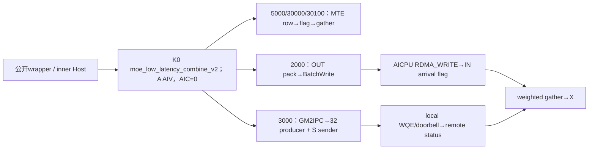
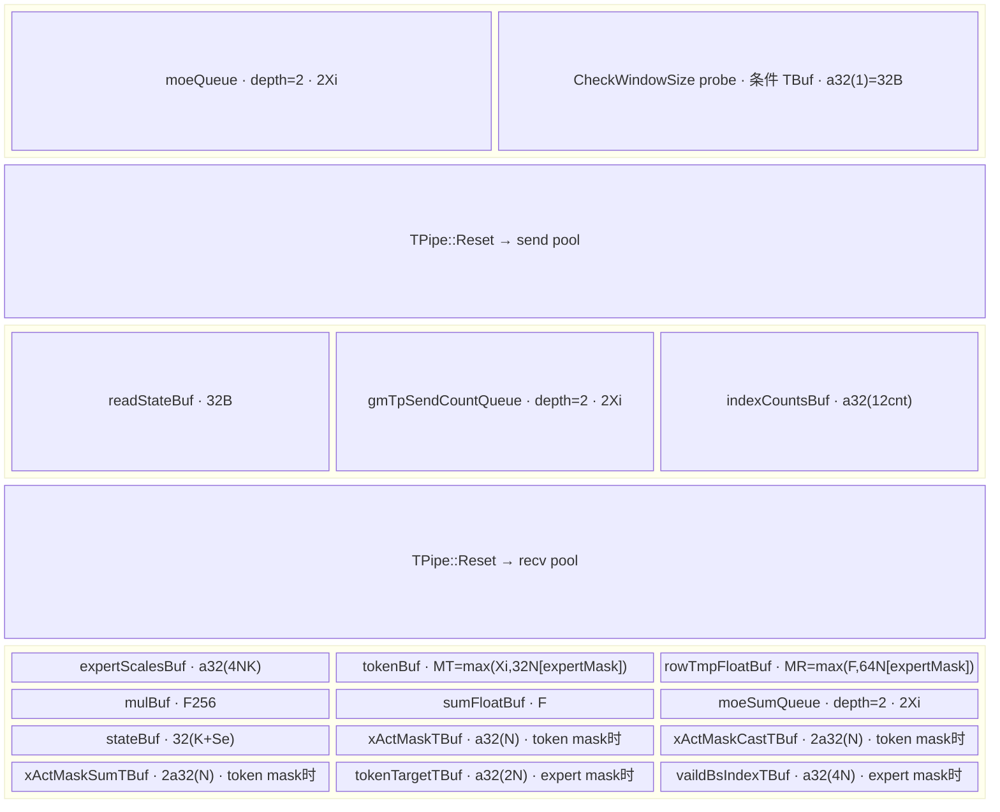
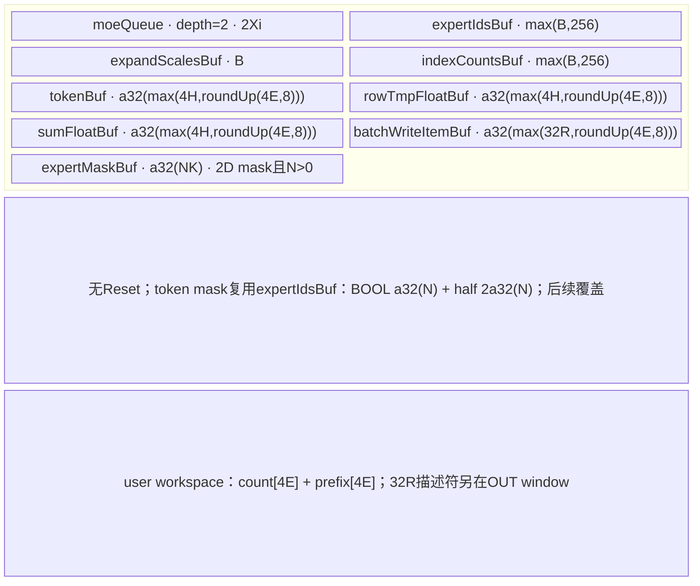
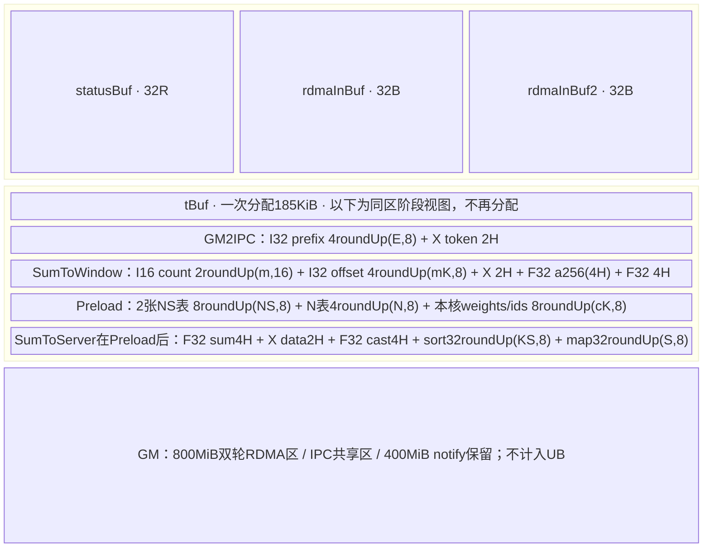
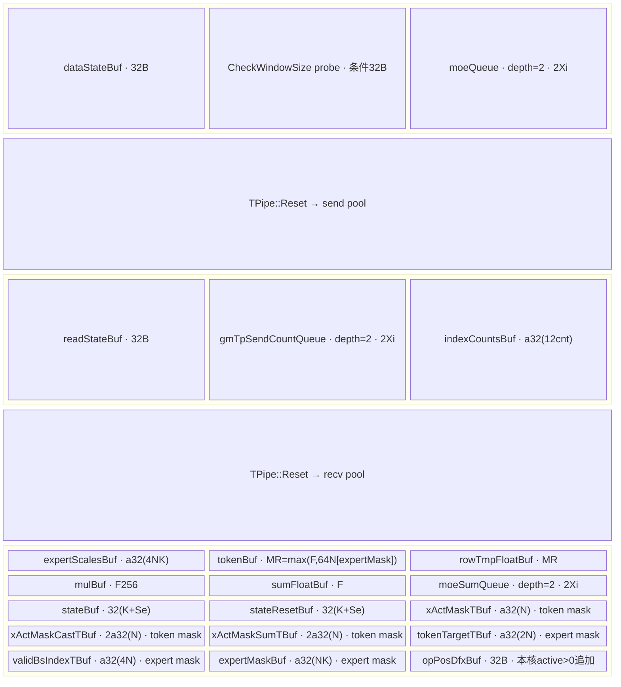
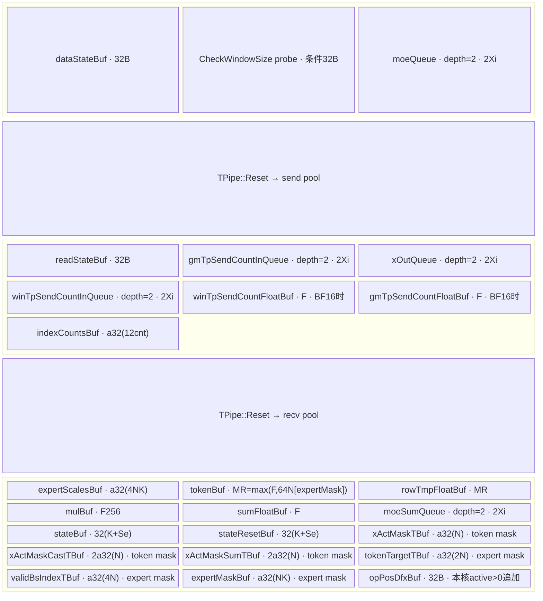

# DeepEP Low Combine 无量化 A2/A3 ACLNN 算子知识

## 算子速览

| 项目 | 内容 |
|---|---|
| 实际入口 | aclnnMoeLowLatencyCombineV2GetWorkspaceSize / aclnnMoeLowLatencyCombineV2；公开ACLNN两阶段executor |
| 计算语义 | commQuantMode=0；dispatch expert结果反向归并，FP32加权求和，追加实际可达共享项 |
| 输入输出 | expandX[T,H]、xOut[N,H]同BF16/FP16；I32 ids/assist/counts、FP32[N,K]权重 |
| 执行类型 | AIV_VECTOR+MTE；A2fullmesh另AICPU RDMA_WRITE，hierarchy另AIV WQE；所有可达节点无Cube/AIC/MIX_CV |
| Kernel 路线 | R-001 A2 单机 MTE；R-002 A2 多机 fullmesh BatchWrite；R-003 A2 多机 AIV hierarchy；R-004 A3 legacy MTE EP；R-005 A3 legacy MTE TP2；R-006 A3 hybrid MTE EP；R-007 A3 hybrid MTE TP2 |
| 核心资源 | 逐Route Queue/TBuf、caller workspace、HCCL IN/OUT/EXP双轮window、RMA WQ/注册内存/消息 |
| 来源闭包 | source_closed：公开wrapper→全部Host selector/POD→key/无body终点→活动body→SDK BatchWrite核心与HCOMM A2资源producer；止于driver/硬件primitive |
| 验证状态 | 已完成源码闭包检查；本次知识提取未执行编译、真机、数值或性能测试。draft保留静态资源、mask、路由限制。 |


P3=`csrc/deepep/ops/`，P2=`csrc/deepep/ops2/`；SDK=asc-devkit e5451c7feba11f9e259f4fbc19c4bf82f8c0496c，HCOMM=4ca1db912ce02a5f5075849a3fa3faaf731bdd60，均固定9.1.0。SGL=dda6d36b0cdb4081e102d14c0a2fb276fc416e69。冻结查询候选[Low-Latency API](../../../../apis/deepep/deepep_low_latency_dispatch_combine.md)已完整阅读，只有API/策略事实，本卡采用create。符号X表示BF16或FP16，所有字节公式按sizeof(X)=2。定义`ap(x)=ceil(x/p)*p`，单位B；`Xi=a32(2H), F=a32(4H), F256=a256(4H), G=a512(2H)`。R=EP size，r=EP rank，E=MoE专家数，Sr=共享rank数，Se=共享expert数，L=E/(R-Sr)，N=本地token数，K=top-k，M=globalBs/R，A=AIV数。`split(T,A,c)`给start=floor(T/A)c+min(c,T%A)、count=floor(T/A)+[c<T%A]。

## 接口与语义

### 计算语义

公开目标为 xOut[n,h]=Σ有效k weight[n,k]*expertResult[expertIds[n,k],n,h]，再加Se个无权共享结果和sharedExpertX（仅Route实际消费时）。q0不量化通信。A3 TP2先将两个TP expert结果相加并舍入为X，再EP回传，不能等价为全程FP32一次舍入。single/A3发送handle是12B triple(sourceRank,sourceToken,sourceTopk)；A2fullmesh用expert内ordinal；hierarchy从packed epSendCounts恢复server/IPC位置。handle不互换。1Dmask以true数量作有效前缀，非位置过滤；每Route mask/负ID/共享行为见限制，不能用目标公式掩盖静态冲突。

### 输入、输出与属性

| 参数 | shape/layout | dtype | 约束、默认值与语义 |
|---|---|---|---|
| expandX | [T,H] ND / AutoContiguous | BF16/FP16 | 配对输出同X，expert compact rows；公开Python文档3D示意不是ACLNN shape |
| expertIds | [N,K] ND | INT32 | C++把topk转I32；值/handle须与dispatch一致 |
| assistInfoForCombine | 1D | INT32 | single/A3每expert结果12B triple；fullmesh扁平[N,K] ordinal；hierarchy不读取，实际用packed counts |
| epSendCounts | 1D | INT32 | expert-major/source-minor inclusive prefix；hierarchy追加分层表，须原样handle |
| expertScales | [N,K] | FP32 | 原token/top-k权重 |
| tpSendCountsOptional | 1D | INT32 | 公开声明可null，single/P3 MTE实际仍要求非null且长度TP；A3 TP2读另一rank count |
| xActiveMaskOptional | [N]或[N,K] | BOOL | 1D前缀计数；2D支持程度按Route |
| activationScaleOptional | optional | FP32 | 普通MTE要求null |
| weightScaleOptional | optional | FP32 | 普通MTE要求null |
| groupListOptional | optional | INT64 | 普通MTE要求null |
| expandScalesOptional | placeholder | FP32 | 本q0 body不读，不形成量化分支 |
| sharedExpertXOptional | [N,H]或3D flatten N×H | 同X | single/A3消费且普通MTE要求Sr0；A2multi不转入body |
| groupEp/epWorldSize/epRankId/moeExpertNum | 属性 | char*/int64 | group1..127，rank/E范围按Host族 |
| groupTp/tpWorldSize/tpRankId | 属性 | char*/int64 | single/P3 TP0..2；TP2 L1及合法组；A2multi强制0 |
| expertShardType | 属性 | int64 | 普通Host仅0；A2multi强制0 |
| sharedExpertNum/sharedExpertRankNum | 属性 | int64 | Se0..4/Sr<R；默认1/0→0/0，均零或正且Sr%Se=0；A2multi强制Sr0 |
| globalBs | 属性 | int64 | 0→NR；single/P3否则≥NR且%R0，M=globalBs/R；A2multi非0校验较弱 |
| outDtype | 属性 | int64 | 预留默认0，不产生独立dtype分支 |
| commQuantMode | 属性 | int64 | 唯一谓词0；INT8=2、MXFP8=3另卡 |
| groupListType | 属性 | int64 | 预留默认0 |
| commAlg | 属性 | char* | P2single不按其分拓扑；multi环境优先再fullmesh/hierarchy；P3非null后等ccu判断，其余都MTE |
| xOut | [N,H] ND | 同X | single严格shape；P3 MTE未检查dim0=N；multi检查较弱 |
| sendCostStats | placeholder输出 | 按OpDef | 当前body未写，不得作有效统计 |


### 入口与版本

LOW_LATENCY_API公开A2/A3/A5；README/DeepEP README记录9.0/9.1最新要求，本卡固定CANN9.1.0，SDK/HCOMM version.cmake均9.1.0。活动build A2 deepep2→ops2/910b，A3 deepep→ops/910_93；950独立卡。router include matmul_intf但无任何可达Cube实例。

Python Buffer→default strategy→C++ Buffer::low_latency_combine→此ACLNN。C++要求连续2D BF16、capacity≥topk rows；新分配输出，TP1，globalBs=capacity*R，use_mxfp8=false→q0；A2默认fullmesh，A3 fullmesh_v1，MOE_ENABLE_CCU=1可选ccu。MOE_ENABLE_TOPK_NEG_ONE=1创建2Dmask并拒绝A2layered。out/zero_copy/async/return_recv_hook未产生此C++不同launch，event为空、hook空函数。ops策略调用torch_npu不同公开入口，alltoall不同算法，不并入此ACLNN。

## Host/Launcher 执行流程

### 参数校验与前处理

1. public wrapper固定elasticInfo/oriX/alpha1/alpha2/V=null，zero/copy/const expert counts=0，再调inner。P2先检查workspaceSize/executor指针；P3先inner，再检查ret/executor/*executor并弱符号设server type（ccu→CCU，否则MTE）。Execute转inner；Contiguous/生成launcher/executor为框架边界。
2. P2只910B；GetIsSingle先按R≤8分流。single检查R2..8/E1..1024、group/rank/Se/Sr/TP0..2、dim/dtype/format；N0..512，K0..min16E，H1024..8192，E%(R-Sr)=0。C普通=globalBs*min(L,K)，shared=M*ceil(R/(Sr/Se))；T≥C*TP、assist≥128C、epCounts普通RL/sharedR乘TP、tpCounts长度TP；sharedX需Sr0，输出[N,H]严格。single sharedRole/TP2仍能产无body key。
3. P2multi环境PCIE精确1且ROCE精确0时直接hierarchy并返回，覆盖空/非法commAlg；否则只非空fullmesh/hierarchy。shape N0..512、K1..min16(E+特殊数)、H1..7168且%32=0；R>8≤256/%8，E≤512/%R。TP/rankTP/shard/sharedRank强制0；count/assist/weights/output dtype和extent未按single同等检查。mask查1/2D但hierarchy不传body；globalBs非0窄化无同等范围检查。
4. P3 GetAttr处理EP/TP/Se/Sr/E和固定特殊0。commAlg=ccu立即转独立CCU Host，早于普通tensor/attrs/window校验；A3无C310 CCU body，已知终点。其余非null字符串都MTE。普通N0..512/K1..min16E/H1024..8192、TP2只q0/L1、TP≤1rank0；TP0不归一1。capacity与single同公式，输出只检查H未检查N。A>0、M≤512，state预算见下；未全量校验ID/triple/prefix值。Host拒绝返回GRAPH_FAILED，不推测未匹配router的实际runtime码。

### 参数、Workspace 与生命周期

window env优先DEEPEP_HCCL_BUFFSIZE，再HCCL_BUFFSIZE，默认200MiB；stoi后存uint16再乘MiB，未补负数/过大/窄化guard。Gd=a512(a32(2H)+44)，q0combine G=a512(2H)。

| 路线 | Host workspace/真实使用 | window预算/owner | 生命周期 |
|---|---|---|---|
| P2single | 16MiB，q0用户payload无slice | 2*(M*Gd*R*L+M*G*(K+Se))≤Wenv；未同等计3MiB/half前缀 | caller workspace/executor到stream结束；window组持有 |
| P2multi | 16MiB+8E；fullmesh 4E count+4E prefix；hierarchy不消费用户区 | fullmesh Device winSizeMin仅计算未使用；hierarchy实际assert含400MiB notify域 | 32R descriptors在OUT+D+8KiB，非caller workspace |
| P3 MTE | 16MiB+10KiB*A，特殊0故GM mask scratch inactive | 2*(M*Gd*R*L+M*G*(K+Se)+reservedHalf)≤Wenv；legacy0，hybrid107MiB+48KiB；M*(K+Se)*32≤512KiB-32 | EP/TP context分组，双轮selector配对；不允许并发覆盖 |
| SDK/HCOMM | context.workSpace/消息/QP/注册内存由组owner持有 | 与ACLNN用户workspace分开 | 通信源/descriptor需到完成；Finalize不修复错误payload |


CheckWindowSize在actualW<plannedW时用1B UB发INT32 DMA探针，不是可靠Host错误返回。op_kernel/CMakeLists从安装CANN ops_transformer路径复制base/comm_ctx头；此卡闭合固定仓fallback定义及固定SDK/HCOMM真实producer/consumer，不声称未知安装复制头或二进制ABI已验证。

CheckWindowSize的精确动作是actual<planned时申请1字节TBuf（实际分配按SDK对齐），将传入exceptionAddr绑定为256个int32的GlobalTensor，再执行DataCopy到Local的1个int32请求。DATA_SIZE的256字节注释不能替代int32元素单位；此路径没有改写GM错误地址、没有向GM写错误码，也没有显式失败返回。DMA对齐与框架最终错误仍依赖匹配SDK/运行时，不能仅凭“探针”断言必然发生故障或安全终止。

### 启动图与失败传播



Host→K0携带P2 outer680或P3 outer1192，blockDim=CalcTschBlockDim(A,0,A)、AIC0；single/P3 MTE schedule1，P2multi AICPUblock6。MTE边payload2H、slot G、flag32B八F32；数据pipe后flag，poll/clear后消费。fullmesh边OUT+D+8KiB/32R descriptors由SyncAll后core0提交，远端2Ht+36B，self由AIV copy；SGL不Wait(handle)，以到达flag后gather，Finalize结束服务。hierarchy 32producer→Ssender经32Bflag(123+magic,rowCount)，末321；网络data后同QP写32B远端state。所有边owner/offset/extent逐Route展开。

SDK BatchWrite完整核心：platform_v220::BatchWrite→CommonPrepare/SendMsgToServer→AssembleHcclMsg(cmd18/descriptor/itemNum)→RunRpcServerApi(910B&&multiServerFlag)→HandleBatchWriteOperation/ConcurrentPostSendWqe按remoteRank%worker，跳self→PostSend/Getkey取localOutput/remoteInput registered keys→Transport::HcclBatchWrite(CCL_KERNEL)→HnsPostSend SGE/WR(RDMA_WRITE，末项SIGNALED)→HrtHnsIbvExpPostSend动态verbs；非normal QP另RdmaSend/LaunchTask写SQ doorbell。Getkey只检查起点不保证len末端。库错误不能当作SGL已检查每个handle/Wait结果。

hierarchy实际核心在本地AIVRDMAPostSend：dest*qpNum选QP0，poll head-tail<depth-1；32B RDMA_WRITE WQE(op3/owner(head>>15)&1/signaled)+16B单SGE，rkey取REMOTE_INPUT=1，lkey取LOCAL_OUTPUT=2；flush48B→PIPE_ALL→head++→8B doorbell(wqn,head%65536,sl)→4B head。HCOMM GenAiRMAInfo/GenIbvAiRMAInfo从TransportIbverbs::GetAiRMAQueueInfo/CopyAiWQInfo产生SQ硬doorbell/QP与四类注册keys，H2DAiRMAInfo拷rank*qp SQ/SCQ/RQ/RCQ、每rank4类MemDetails并填context尾。SetCommResource仅isSupportAIVNormalQP&&isA2MC2IntraHie置bit2，另host bit0/AICPU bit1；Mc2CreateAndLaunchContext传capability/RMAInfo。consumer null→AICPU、bit1→AICPU、bit2覆盖AIV。止于driver/QP MMIO和硬件RDMA primitive；不虚构驱动内部。owner shift15无depth32768 guard、dbMode无分支、只QP0，均保留边界。

## Route 与参数设计

### 分核与资源计算

single/A3先split selfSendCnt/A，r错位发送；recv再split activeN/A。A3 TP2另split tpRemoteCount/A。fullmesh split R→split NK计数→split N归并。hierarchy固定8rank/server、32producer与S=R/8 sender、最后8consumer；需A≥32+S且32%S=0、view≤185KiB、65项局部表容量，Host未对应拒绝。不能把Reset前后资源相加，也不能把同阶段第二次InitBuffer当覆盖释放。

### Route 选择

| 顺序 | Route | Key/模板 | 精确选择条件与优先级 | 不适用去向 |
|---|---|---|---|---|
| 1 | R-001 A2 单机 MTE | 5000 / MoeDistributeCombineV2Single<X,X,int32_t,false,false,false> | ASCEND910B、2≤R≤8、TP≠2、r≥Sr、q0；single Host检查通过；X=输出同dtype BF16/FP16 | Host失败/其它Route/已知无body终点 |
| 2 | R-002 A2 多机 fullmesh BatchWrite | 2000 / MoeDistributeCombineV2<X,int32_t> | ASCEND910B、R>8且≤256、R%8=0、q0；环境不是PCIE=1且ROCE=0，commAlg=fullmesh；X=BF16/FP16 | Host失败/其它Route/已知无body终点 |
| 3 | R-003 A2 多机 AIV hierarchy | 3000 / MoeDistributeCombineV2Layered<X,int32_t,X> | ASCEND910B、R>8且≤256、R%8=0、q0；优先PCIE=1且ROCE=0，否则commAlg=hierarchy；GetDataplaneMode(context)==AIV；X=BF16/FP16 | Host失败/其它Route/已知无body终点 |
| 4 | R-004 A3 legacy MTE EP | 30000 / MoeDistributeCombineV2<X,X,int32_t,false,false> | ASCEND910_93、q0、commAlg非null且不等ccu、TP≠2、DEEPEP_HYBRID_DEPLOYMENT不为"1"；公共MTE shape/attrs通过；X=BF16/FP16 | Host失败/其它Route/已知无body终点 |
| 5 | R-005 A3 legacy MTE TP2 | 30100 / MoeDistributeCombineV2<X,X,int32_t,true,false> | ASCEND910_93、q0、commAlg非null且不等ccu、TP=2且L=1、groupTp/rank有效、DEEPEP_HYBRID_DEPLOYMENT不为"1"；公共MTE shape/attrs通过；X=BF16/FP16 | Host失败/其它Route/已知无body终点 |
| 6 | R-006 A3 hybrid MTE EP | 30000 / MoeDistributeCombineV2<X,X,int32_t,false,false> | ASCEND910_93、q0、commAlg非null且不等ccu、TP≠2、DEEPEP_HYBRID_DEPLOYMENT恰为"1"；公共MTE shape/attrs通过；X=BF16/FP16 | Host失败/其它Route/已知无body终点 |
| 7 | R-007 A3 hybrid MTE TP2 | 30100 / MoeDistributeCombineV2<X,X,int32_t,true,false> | ASCEND910_93、q0、commAlg非null且不等ccu、TP=2且L=1、groupTp/rank有效、DEEPEP_HYBRID_DEPLOYMENT恰为"1"；公共MTE shape/attrs通过；X=BF16/FP16 | Host失败/其它Route/已知无body终点 |


```text
q0，X=同输出BF16/FP16，public特殊0/null
A2 P2: R≤8 → single key5000+(TP2?100:0)+(sharedRole?1000:0)
  仅5000匹配；5100/6000/6100无body
 R>8/%8: PCIE="1"&&ROCE="0"优先hierarchy，否则commAlg严格fullmesh/hierarchy
  fullmesh→2000；hierarchy→3000→AIV capability则custom body，否则assert
A3 P3: GetAttr后commAlg=="ccu"→独立Host60000，非C310无实例
  非ccu非null→30000+(TP2?100:0)；hybrid env恰"1"选隔离IN布局，否则legacy EXP
ops 910B key20000非活动A2路由；未知key无匹配后结束，不猜Codegen/runtime报错
```

### 模板/实现执行矩阵

| Route | key/selector | dtype/shape/platform 完整命中条件 | 执行拓扑与 Kernel 节点 | 实际模板/body | 内存与同步特征 | tail/fallback |
|---|---|---|---|---|---|---|
| R-001 | 5000 | ASCEND910B、2≤R≤8、TP≠2、r≥Sr、q0；single Host检查通过；X=输出同dtype BF16/FP16 | InitV2→selector→MTE send/triple flag→masked token gather→SyncAll→Finalize | MoeDistributeCombineV2Single<X,X,int32_t,false,false,false> | U_init=2Xi+32[CheckWindowSize探针分支] | TP2产生5100，shared rank产生6000（TP2为6100），均不匹配router；即使某非共享rank有5000实例，也不能宣称整个含共享rank通信配置已实现。K0可被single Host接受但非普遍安全。 |
| R-002 | 2000 | ASCEND910B、R>8且≤256、R%8=0、q0；环境不是PCIE=1且ROCE=0，commAlg=fullmesh；X=BF16/FP16 | AIV pack→BatchWrite AICPU→parallel counts/prefix→arrival flags→FP32 combine→Finalize | MoeDistributeCombineV2<X,int32_t> | U=2Xi+2max(B,256)+B+3a32(max(4H,roundUp(4E,8)))+a32(max(32R,roundUp(4E,8)))+a32(NK)[expertMask]。work=16MiB+8E | A2multi强制TP/共享rank等属性0，没有TP数学语义，sharedExpertX未转入body。半窗下溢、分区容量、UB与metadata物理padding未Host完整校验。 |
| R-003 | 3000 | ASCEND910B、R>8且≤256、R%8=0、q0；优先PCIE=1且ROCE=0，否则commAlg=hierarchy；GetDataplaneMode(context)==AIV；X=BF16/FP16 | GM2IPC→IPC flags→32 AIV reorder与S sender并行→AIV RDMA WQE→8 AIV weighted combine→Finalize | MoeDistributeCombineV2Layered<X,int32_t,X> | U_total=185KiB+32R+64，另外本地标量数组offsetIndexs/copyNums/dataOffsets/scaleOffsets各65*u32共1040B（非UB InitBuffer）。需要每阶段实际view终点≤185KiB，且statusBuf≥544B | capability null或AIV bit未置位→router assert固定driver-too-low文字，不编造实际driver状态。零count提前break、未初始化offsetIndexs[0]/最后一次读下项、65项数组边界、N0、A不足等均无安全fallback；全无有效token可留下输出未写。 |
| R-004 | 30000 | ASCEND910_93、q0、commAlg非null且不等ccu、TP≠2、DEEPEP_HYBRID_DEPLOYMENT不为"1"；公共MTE shape/attrs通过；X=BF16/FP16 | InitWinState→EP MTE raw row+flag→masked FP32 combine | MoeDistributeCombineV2<X,X,int32_t,false,false> | U_init=32+32[probe]+2Xi | Hostq0无UB预算拒绝；out.dim0未要求N、metadata值域未完整校验；TP0容量下界退化。A3 commAlg=ccu早进60000但C310 guard不编译CCU body，已知无body终点。普通ops A2 key20000也非活动A2 build支持。 |
| R-005 | 30100 | ASCEND910_93、q0、commAlg非null且不等ccu、TP=2且L=1、groupTp/rank有效、DEEPEP_HYBRID_DEPLOYMENT不为"1"；公共MTE shape/attrs通过；X=BF16/FP16 | InitWinState→TP transfer/signal/add→EP MTE raw row+flag→masked FP32 combine | MoeDistributeCombineV2<X,X,int32_t,true,false> | U_init=32+32[probe]+2Xi | Hostq0无UB预算拒绝；out.dim0未要求N、metadata值域未完整校验；TP0容量下界退化。A3 commAlg=ccu早进60000但C310 guard不编译CCU body，已知无body终点。普通ops A2 key20000也非活动A2 build支持。 |
| R-006 | 30000 | ASCEND910_93、q0、commAlg非null且不等ccu、TP≠2、DEEPEP_HYBRID_DEPLOYMENT恰为"1"；公共MTE shape/attrs通过；X=BF16/FP16 | InitWinState→EP MTE raw row+flag→masked FP32 combine | MoeDistributeCombineV2<X,X,int32_t,false,false> | U_init=32+32[probe]+2Xi | Hostq0无UB预算拒绝；out.dim0未要求N、metadata值域未完整校验；TP0容量下界退化。A3 commAlg=ccu早进60000但C310 guard不编译CCU body，已知无body终点。普通ops A2 key20000也非活动A2 build支持。 |
| R-007 | 30100 | ASCEND910_93、q0、commAlg非null且不等ccu、TP=2且L=1、groupTp/rank有效、DEEPEP_HYBRID_DEPLOYMENT恰为"1"；公共MTE shape/attrs通过；X=BF16/FP16 | InitWinState→TP transfer/signal/add→EP MTE raw row+flag→masked FP32 combine | MoeDistributeCombineV2<X,X,int32_t,true,false> | U_init=32+32[probe]+2Xi | Hostq0无UB预算拒绝；out.dim0未要求N、metadata值域未完整校验；TP0容量下界退化。A3 commAlg=ccu早进60000但C310 guard不编译CCU body，已知无body终点。普通ops A2 key20000也非活动A2 build支持。 |


### 隐藏性能 Guard

| Guard | Host/Tiling 条件 | Device/资源原因 | 影响 Route | 不满足时去向 | 源码符号 |
|---|---|---|---|---|---|
| 路由空终点 | single TP2/sharedRole或A3ccu可接受 | 无对应key/C310实例 | single/A3ccu | 已知无body；非支持Route | CalTilingKey/router |
| 状态容量 | P3 M*(K+Se)*32≤512KiB-32 | 末32B timeout probe | A3 | GRAPH_FAILED；single缺同等guard | SetHcommCfg/window_layout |
| UB | q0只读UB，无全面Upeak判定 | S/A indexbulk、mask、追加InitBuffer | 全部 | 无安全fallback，draft | BuffInit/AlltoAllBuffInitAndMaskCal |
| single二维mask | Host接受[N,K] | wait有效K但sum仍所有K | R-001 | 已知语义冲突 | WaitDispatch/LocalWindowCopy |
| hierarchy mask/sharedX | Host部分接受 | 未传body | R-003 | 已知忽略 | router/Init |
| 固定核/表 | Host无A≥32+S/status/view检查 | 32+S核、u64[64..67]需544B、65项表 | R-003 | 无resource fallback | SumToWindow/AlltoAllServerDispatch |
| metadata/物理padding | 未全查ID/ordinal/padding | fullmesh中int32 expId与uint32 E比较，负值转无符号后不进入expId<E；Preload也以uint32读ID；standard DataCopy roundUp | 全部 | caller需真实handle，不假拒绝 | Preload/ProcessMoeAndCopyExpert |
| 安装头 | CMake copy | 实际编译base可替换 | 全部 | 固定源码不证明安装ABI | op_kernel/CMakeLists |


### POD/ABI

64位自然8B对齐源码推导，未经sizeof/alignof或安装二进制实测。P2 Info104含padding68..71/98..103，outer680；P3 Info104含padding73..75，outer1192。两者不能互换。

| 结构 | 字段 | 类型/位宽 | ABI 布局 | 单位 | Host/launcher producer | Device consumer | 边界 |
|---|---|---|---|---|---|---|---|
| P2 MoeDistributeCombineV2Info | epWorldSize | u32 | @0 | rank数 | 公共GetAttr写R；A2multi单独CheckAttr写R | 窗口/EP分核 | A2≤256；A3/950≤768；不是实际数组容量 |
| P2 MoeDistributeCombineV2Info | tpWorldSize | u32 | @4 | rank数 | single/MTE0..2；A2multi强制0；CCU必须1 | key/TP条件 | 0不规范成1，容量下界可退化 |
| P2 MoeDistributeCombineV2Info | epRankId | u32 | @8 | rank | 公共r | 目标/源rank | 0≤r<R |
| P2 MoeDistributeCombineV2Info | tpRankId | u32 | @12 | rank | single/A3 TP≤1要求属性tpRankId=0，非零拒绝；A2multi覆盖为0 | A3 TP2另一rank=1-t | 950/A2single TP2无router |
| P2 MoeDistributeCombineV2Info | expertSharedType | u32 | @16 | enum | P3仅0；P2字段名expertSharedType且multi强制0 | 无分片计算 | 字段名不同，不能混用类型 |
| P2 MoeDistributeCombineV2Info | sharedExpertNum | u32 | @20 | expert数 | single/MTE Se0..4，默认1/Sr0→0；CCU同规则 | K+Se/无权重共享项 | A2multi未赋且body不读 |
| P2 MoeDistributeCombineV2Info | sharedExpertRankNum | u32 | @24 | rank数 | Sr<R，与Se同零/正且Sr%Se=0；A2multi0 | shared role/L | 共享rank的A2single key6000无body |
| P2 MoeDistributeCombineV2Info | moeExpertNum | u32 | @28 | expert数 | E；A2multi≤512，余≤1024 | L/counts/ID域 | 不全量检查ID值 |
| P2 MoeDistributeCombineV2Info | moeExpertPerRankNum | u32 | @32 | expert/rank | single/MTE E/(R-Sr)并检整除；CCU取floor未检整除 | selfSendCount尾索引/CCU stride | A2multi未赋但body自行E/R |
| P2 MoeDistributeCombineV2Info | zeroExpertNum | u32 | @36 | expert数 | public wrapper0；P3/Multi复制，P2single未赋 | P3/多机特殊分支 | public0；single body不读 |
| P2 MoeDistributeCombineV2Info | copyExpertNum | u32 | @40 | expert数 | 同zeroExpertNum | P3/多机特殊分支 | public0；single body不读 |
| P2 MoeDistributeCombineV2Info | constExpertNum | u32 | @44 | expert数 | 同zeroExpertNum | P3/多机特殊分支 | public0；single body不读 |
| P2 MoeDistributeCombineV2Info | globalBs | u32 | @48 | token容量 | single/P3 0→NR，否则≥NR且%R=0；A2multi非0未同样检查 | M=globalBs/R | 未完整检查int64→u32窄化 |
| P2 MoeDistributeCombineV2Info | bs | u32 | @52 | token数 | expertIds.dim0=N，MTE0..512；CCU1..512 | active/token输出域 | mask prefix与M容量分开 |
| P2 MoeDistributeCombineV2Info | k | u32 | @56 | slot/token | P3 MTE1..min16E；A2single0..min16E；A2multi1..16；CCU1..16 | NK/等待/metadata | CCU未≤E |
| P2 MoeDistributeCombineV2Info | h | u32 | @60 | 元素/token | expandX.dim1；single/P3 1024..8192；A2multi1..7168且%32=0 | 2H payload/Vector | P3无%32guard；CCU bool错误返回另列 |
| P2 MoeDistributeCombineV2Info | aivNum | u32 | @64 | core数 | GetCoreNumAiv；CCU最后才写 | split/selector512A | CCU预算先读该字段；Host未统一UB安全判定 |
| P2 Info | totalUbSize | u64 | @72 | B | 平台 UB | 日志/资源字段 | 非动态安全拒绝 |
| P2 Info | totalWinSize | u64 | @80 | B | single env W；multi未赋值 | single窗口/CheckWindowSize；multi实际context W | multi不消费此field |
| P2 Info | isTokenMask | bool | @88 | flag | mask rank1 | 前缀activeN | multi/single |
| P2 Info | isExpertMask | bool | @89 | flag | mask rank2 | single只target；fullmesh也skipk；hierarchy未传mask | 不可泛化 |
| P2 Info | hasSharedExpertX | bool | @90 | flag | single输入存在；multi未赋 | single共享X；multi不读 | 不假默认 |
| P2 Info | reserved | int8[7] | @91 | B | 未显式赋值 | inactive | 其后98..103自然padding |
| P2 TilingData | mc2InitTiling | 64B | @0 | 混合 | GetTiling/Host | InitV2 | 总680/align8 |
| P2 TilingData | mc2CcTiling | 512B | @64 | 混合 | GetTiling/Host | EP | 总680/align8 |
| P2 TilingData | moeDistributeCombineV2Info | 104B | @576 | 混合 | GetTiling/Host | Init attrs | 总680/align8 |
| P3 MoeDistributeCombineV2Info | epWorldSize | u32 | @0 | rank数 | 公共GetAttr写R；A2multi单独CheckAttr写R | 窗口/EP分核 | A2≤256；A3/950≤768；不是实际数组容量 |
| P3 MoeDistributeCombineV2Info | tpWorldSize | u32 | @4 | rank数 | single/MTE0..2；A2multi强制0；CCU必须1 | key/TP条件 | 0不规范成1，容量下界可退化 |
| P3 MoeDistributeCombineV2Info | epRankId | u32 | @8 | rank | 公共r | 目标/源rank | 0≤r<R |
| P3 MoeDistributeCombineV2Info | tpRankId | u32 | @12 | rank | single/A3 TP≤1要求属性tpRankId=0，非零拒绝；A2multi覆盖为0 | A3 TP2另一rank=1-t | 950/A2single TP2无router |
| P3 MoeDistributeCombineV2Info | expertShardType | u32 | @16 | enum | P3仅0；P2字段名expertSharedType且multi强制0 | 无分片计算 | 字段名不同，不能混用类型 |
| P3 MoeDistributeCombineV2Info | sharedExpertNum | u32 | @20 | expert数 | single/MTE Se0..4，默认1/Sr0→0；CCU同规则 | K+Se/无权重共享项 | A2multi未赋且body不读 |
| P3 MoeDistributeCombineV2Info | sharedExpertRankNum | u32 | @24 | rank数 | Sr<R，与Se同零/正且Sr%Se=0；A2multi0 | shared role/L | 共享rank的A2single key6000无body |
| P3 MoeDistributeCombineV2Info | moeExpertNum | u32 | @28 | expert数 | E；A2multi≤512，余≤1024 | L/counts/ID域 | 不全量检查ID值 |
| P3 MoeDistributeCombineV2Info | moeExpertPerRankNum | u32 | @32 | expert/rank | single/MTE E/(R-Sr)并检整除；CCU取floor未检整除 | selfSendCount尾索引/CCU stride | A2multi未赋但body自行E/R |
| P3 MoeDistributeCombineV2Info | zeroExpertNum | u32 | @36 | expert数 | public wrapper0；P3/Multi复制，P2single未赋 | P3/多机特殊分支 | public0；single body不读 |
| P3 MoeDistributeCombineV2Info | copyExpertNum | u32 | @40 | expert数 | 同zeroExpertNum | P3/多机特殊分支 | public0；single body不读 |
| P3 MoeDistributeCombineV2Info | constExpertNum | u32 | @44 | expert数 | 同zeroExpertNum | P3/多机特殊分支 | public0；single body不读 |
| P3 MoeDistributeCombineV2Info | globalBs | u32 | @48 | token容量 | single/P3 0→NR，否则≥NR且%R=0；A2multi非0未同样检查 | M=globalBs/R | 未完整检查int64→u32窄化 |
| P3 MoeDistributeCombineV2Info | bs | u32 | @52 | token数 | expertIds.dim0=N，MTE0..512；CCU1..512 | active/token输出域 | mask prefix与M容量分开 |
| P3 MoeDistributeCombineV2Info | k | u32 | @56 | slot/token | P3 MTE1..min16E；A2single0..min16E；A2multi1..16；CCU1..16 | NK/等待/metadata | CCU未≤E |
| P3 MoeDistributeCombineV2Info | h | u32 | @60 | 元素/token | expandX.dim1；single/P3 1024..8192；A2multi1..7168且%32=0 | 2H payload/Vector | P3无%32guard；CCU bool错误返回另列 |
| P3 MoeDistributeCombineV2Info | aivNum | u32 | @64 | core数 | GetCoreNumAiv；CCU最后才写 | split/selector512A | CCU预算先读该字段；Host未统一UB安全判定 |
| P3 Info | isTokenMask | bool | @68 | flag | mask rank1；CCU任意mask非null | prefix mask统计 | CCU二维mask冲突 |
| P3 Info | isExpertMask | bool | @69 | flag | MTE mask rank2；CCU未写 | MTE validToken/skip；CCU不读 | 不假默认 |
| P3 Info | hasSharedExpertX | bool | @70 | flag | 可选输入存在 | sharedX加法；CCU队列 | A2multi无此consumer |
| P3 Info | hasElasticInfo | bool | @71 | flag | public null→false；CCU不写 | MTE弹性分支 | public inactive |
| P3 Info | isHybridDeployment | bool | @72 | flag | MTE env DEEPEP_HYBRID_DEPLOYMENT精确1 | MTE窗口布局 | CCU不读 |
| P3 Info | a5MxCombineBufferNum | u32 | @76 | queue depth | outer默认2 | q0不读，MXFP8另卡 | 不能用q0证明量化planner |
| P3 Info | totalUbSize | u64 | @80 | B | 平台GetCoreMemSize UB；CCU最后写 | 资源字段/日志 | q0无全面预算guard |
| P3 Info | totalWinSize | u64 | @88 | B | MTE env W；CCU=2envW | MTE实际基准；CCU不读此field | runtime context size另源 |
| P3 Info | armAvgFactor | float | @96 | inactive | 当前Host未赋值 | q0 body不读 | 不假默认 |
| P3 Info | epsilon | float | @100 | inactive | 当前Host未赋值 | q0 body不读 | 不假默认 |
| P3 TilingData | mc2InitTiling | 64B | @0 | 混合 | GetTiling/Host | InitV2 | 总1192/align8 |
| P3 TilingData | mc2CcTiling1 | 512B | @64 | 混合 | GetTiling/Host | EP | 总1192/align8 |
| P3 TilingData | mc2CcTiling2 | 512B | @576 | 混合 | GetTiling/Host | TP | 总1192/align8 |
| P3 TilingData | moeDistributeCombineV2Info | 104B | @1088 | 混合 | GetTiling/Host | Init attrs | 总1192/align8 |

SDK opaque容器为Mc2InitTiling64/Mc2CcTiling512，内部逐字段如下。GetTiling非0结果不能消费，部分Host调用未逐项检查返回，不能当已成功初始化。

| 结构 | 字段 | 类型/位宽 | ABI 布局 | 单位 | Host/launcher producer | Device consumer | 边界 |
|---|---|---|---|---|---|---|---|
| Mc2InitTilingInner | version | u32 | @0 | 协议 | GetTiling: 100 | SDK InitV2/框架 | reserved不补默认 |
| Mc2InitTilingInner | mc2HcommCnt | u32 | @4 | 组数 | GetTiling: P2一组；P3 EP+TP两组 | SDK InitV2/框架 | reserved不补默认 |
| Mc2InitTilingInner | offset | u32[8] | @8 | 字节offset | GetTiling: P2首64；P3首64/次576，其余0 | SDK InitV2/框架 | reserved不补默认 |
| Mc2InitTilingInner | debugMode | u8 | @40 | enum | GetTiling: default0 | SDK InitV2/框架 | reserved不补默认 |
| Mc2InitTilingInner | preparePosition | u8 | @41 | enum | GetTiling: default0 | SDK InitV2/框架 | reserved不补默认 |
| Mc2InitTilingInner | queueNum | u16 | @42 | queue数 | GetTiling: default0 | SDK InitV2/框架 | reserved不补默认 |
| Mc2InitTilingInner | commBlockNum | u16 | @44 | block数 | GetTiling: default0 | SDK InitV2/框架 | reserved不补默认 |
| Mc2InitTilingInner | devType | u8 | @46 | SoC enum | GetTiling: runtime SoC | SDK InitV2/框架 | reserved不补默认 |
| Mc2InitTilingInner | reserved | char[17] | @47 | B | GetTiling: 未显式清全部；不依赖 | SDK InitV2/框架 | reserved不补默认 |
| Mc2CcTilingInner | skipLocalRankCopy | u8 | @0 | flag | GetTiling: default0 | SetCcTilingV2/框架 | 自然布局，无安装ABI实测 |
| Mc2CcTilingInner | skipBufferWindowCopy | u8 | @1 | flag | GetTiling: default0 | SetCcTilingV2/框架 | 自然布局，无安装ABI实测 |
| Mc2CcTilingInner | stepSize | u8 | @2 | step | GetTiling: default0 | SetCcTilingV2/框架 | 自然布局，无安装ABI实测 |
| Mc2CcTilingInner | version | u8 | @3 | 协议 | GetTiling: 1 | SetCcTilingV2/框架 | 自然布局，无安装ABI实测 |
| Mc2CcTilingInner | reserved | char[9] | @4 | B | GetTiling: memset0 | SetCcTilingV2/框架 | 自然布局，无安装ABI实测 |
| Mc2CcTilingInner | commEngine | u8 | @13 | enum | GetTiling: A2默认0；P3 MTE3；CCU5 | SetCcTilingV2/框架 | 自然布局，无安装ABI实测 |
| Mc2CcTilingInner | srcDataType | u8 | @14 | dtype enum | GetTiling: default0=INT8；MTE payload由X模板决定 | SetCcTilingV2/框架 | 自然布局，无安装ABI实测 |
| Mc2CcTilingInner | dstDataType | u8 | @15 | dtype enum | GetTiling: default0；本body不读为数据类型 | SetCcTilingV2/框架 | 自然布局，无安装ABI实测 |
| Mc2CcTilingInner | groupName | char[128] | @16 | 字符 | GetTiling: EP/TP group | SetCcTilingV2/框架 | 自然布局，无安装ABI实测 |
| Mc2CcTilingInner | algConfig | char[128] | @144 | 字符 | GetTiling: EP fullmesh/pairwise或hierarchy，TP ReduceScatterRing；CCU mesh | SetCcTilingV2/框架 | 自然布局，无安装ABI实测 |
| Mc2CcTilingInner | opType | u32 | @272 | cmd enum | GetTiling: P2single/P3 EP8、TP7；P2multi18；CCU20 | SetCcTilingV2/框架 | 自然布局，无安装ABI实测 |
| Mc2CcTilingInner | reduceType | u32 | @276 | enum | GetTiling: default0；本MTE不据此reduce | SetCcTilingV2/框架 | 自然布局，无安装ABI实测 |
| Mc2CcTilingInner | reserved2 | char[232] | @280 | B | GetTiling: 未显式清全部；inactive | SetCcTilingV2/框架 | 自然布局，无安装ABI实测 |

通信context由框架持有，非算子Host序列化POD。只列实际消费的外部字段，不将未消费的庞大保留树伪造成自有参数。offset均自然布局推导；A3的184/2984由固定ReservedStruct/AlgoTopoInfo/HcclOpConfig等声明确定，非安装实测。A2本地tail总8928/align8，RMAInfo64/WQ64/MemInfo16/MemDetails24/BatchWriteItem32。

| 结构 | 字段 | 类型/位宽 | ABI 布局 | 单位 | Host/launcher producer | Device consumer | 边界 |
|---|---|---|---|---|---|---|---|
| A3 HcclOpResParam | localUsrRankId | u32 | @16 | rank | runtime | InitWinState一致性 | 固定源码映射；不自行构造runtime对象 |
| 同上 | rankSize | u32 | @20 | rank数 | runtime | InitWinState | 固定源码映射；不自行构造runtime对象 |
| 同上 | winSize | u64 | @24 | B | runtime | CheckWindowSize | 固定源码映射；不自行构造runtime对象 |
| 同上 | localWindowsIn | u64 | @32 | 地址 | runtime | self data/hybrid | 固定源码映射；不自行构造runtime对象 |
| 同上 | localWindowsExp | u64 | @184 | 地址 | runtime | legacy selector/state | 固定源码映射；不自行构造runtime对象 |
| 同上 | remoteRes | RemoteResPtr[131072] | @2984 | 关系数组 | runtime | nextDevicePtr取remote IN/EXP | 固定源码映射；不自行构造runtime对象 |
| RemoteResPtr | nextHostPtr | u64 | @0 | 地址 | runtime | 未消费 | 固定源码映射；不自行构造runtime对象 |
| 同上 | nextDevicePtr | u64 | @8 | 地址 | runtime | remote关系 | 固定源码映射；不自行构造runtime对象 |
| HcclRankRelationResV2 | windowsIn | u64 | @8 | 地址 | runtime | remote data/hybrid | 固定源码映射；不自行构造runtime对象 |
| 同上 | windowsExp | u64 | @24 | 地址 | runtime | remote legacy state | 固定源码映射；不自行构造runtime对象 |
| A2 SDK/本地legacy context | workSpace | u64 | @0 | 地址 | runtime | SDK client消息 | 固定源码映射；不自行构造runtime对象 |
| 同上 | workSpaceSize | u64 | @8 | B | runtime | SDK初始化 | 固定源码映射；不自行构造runtime对象 |
| 同上 | rankId | u32 | @16 | rank | runtime | GetWindows | 固定源码映射；不自行构造runtime对象 |
| 同上 | rankNum | u32 | @20 | rank数 | runtime | GetRankDim | 固定源码映射；不自行构造runtime对象 |
| 同上 | winSize | u64 | @24 | B | runtime | A2body直接读取 | 固定源码映射；不自行构造runtime对象 |
| 同上 | windowsIn | u64[32] | @32 | 地址 | runtime | multiFlag0地址 | 固定源码映射；不自行构造runtime对象 |
| 同上 | windowsOut | u64[32] | @288 | 地址 | runtime | multiFlag0地址 | 固定源码映射；不自行构造runtime对象 |
| HcclA2CombineOpParam | res | u8[8328] | @544 | opaque B | HCOMM context结构 | 仅跨过opaque区 | 固定源码映射；不自行构造runtime对象 |
| 同上 | multiFlag | u8 | @8872 | flag | HCOMM multiServerFlag | SDK910B地址分支 | 固定源码映射；不自行构造runtime对象 |
| 同上 | data | IbVerbsData* | @8880 | 地址 | HCOMM ibverbsData | SDK local/remote IN/OUT | 固定源码映射；不自行构造runtime对象 |
| 同上 | dataSize | u64 | @8888 | B | HCOMM ibverbsDataSize | 本body未直接读 | 固定源码映射；不自行构造runtime对象 |
| 同上 | sizeOfAiRMAInfo | u64 | @8896 | B | H2DAiRMAInfo | 未显式校验 | 固定源码映射；不自行构造runtime对象 |
| 同上 | aiRMAInfo | u64 | @8904 | 地址 | H2DAiRMAInfo | custom Init/AIVRDMAPostSend | 固定源码映射；不自行构造runtime对象 |
| 同上 | capability | CombinedCapability* | @8912 | 地址 | Mc2CreateAndLaunchContext | GetDataplaneMode | 固定源码映射；不自行构造runtime对象 |
| 同上 | capabilitySize | u64 | @8920 | B | sizeof CombinedCapability=8 | 读取但未检查 | 固定源码映射；不自行构造runtime对象 |
| CombinedCapability | dataplaneModeBitmap | u64 | @0 | bits | SetCommResource | bit1 AICPU，bit2 AIV覆盖 | 固定源码映射；不自行构造runtime对象 |
| HcclAiRMAInfo | curRankId | u32 | @0 | 对应字段单位 | GenAiRMAInfo/H2D | cur rank | 固定源码映射；不自行构造runtime对象 |
| HcclAiRMAInfo | rankNum | u32 | @4 | 对应字段单位 | GenAiRMAInfo/H2D | 表域 | 固定源码映射；不自行构造runtime对象 |
| HcclAiRMAInfo | qpNum | u32 | @8 | 对应字段单位 | GenAiRMAInfo/H2D | dest*qpNum，QP0 | 固定源码映射；不自行构造runtime对象 |
| HcclAiRMAInfo | sizeOfAiRMAWQ | u32 | @12 | 对应字段单位 | GenAiRMAInfo/H2D | WQ步长64 | 固定源码映射；不自行构造runtime对象 |
| HcclAiRMAInfo | sizeOfAiRMACQ | u32 | @16 | 对应字段单位 | GenAiRMAInfo/H2D | CQ步长56，本body不读 | 固定源码映射；不自行构造runtime对象 |
| HcclAiRMAInfo | sizeOfAiRMAMem | u32 | @20 | 对应字段单位 | GenAiRMAInfo/H2D | MemInfo步长16 | 固定源码映射；不自行构造runtime对象 |
| HcclAiRMAInfo | sqPtr | u64 | @24 | 对应字段单位 | GenAiRMAInfo/H2D | WQ数组 | 固定源码映射；不自行构造runtime对象 |
| HcclAiRMAInfo | scqPtr | u64 | @32 | 对应字段单位 | GenAiRMAInfo/H2D | 未消费CQ/RQ | 固定源码映射；不自行构造runtime对象 |
| HcclAiRMAInfo | rqPtr | u64 | @40 | 对应字段单位 | GenAiRMAInfo/H2D | 未消费CQ/RQ | 固定源码映射；不自行构造runtime对象 |
| HcclAiRMAInfo | rcqPtr | u64 | @48 | 对应字段单位 | GenAiRMAInfo/H2D | 未消费CQ/RQ | 固定源码映射；不自行构造runtime对象 |
| HcclAiRMAInfo | memPtr | u64 | @56 | 对应字段单位 | GenAiRMAInfo/H2D | 每rank MemInfo数组 | 固定源码映射；不自行构造runtime对象 |
| HcclAiRMAWQ | wqn | u32 | @0 | 对应字段单位 | CopyAiWQInfo | doorbell tag | 固定源码映射；不自行构造runtime对象 |
| HcclAiRMAWQ | bufAddr | u64 | @8 | 对应字段单位 | CopyAiWQInfo | WQE首址 | 固定源码映射；不自行构造runtime对象 |
| HcclAiRMAWQ | wqeSize | u32 | @16 | 对应字段单位 | CopyAiWQInfo | 步长 | 固定源码映射；不自行构造runtime对象 |
| HcclAiRMAWQ | depth | u32 | @20 | 对应字段单位 | CopyAiWQInfo | SQ容量 | 固定源码映射；不自行构造runtime对象 |
| HcclAiRMAWQ | headAddr | u64 | @24 | 对应字段单位 | CopyAiWQInfo | poll/update | 固定源码映射；不自行构造runtime对象 |
| HcclAiRMAWQ | tailAddr | u64 | @32 | 对应字段单位 | CopyAiWQInfo | poll | 固定源码映射；不自行构造runtime对象 |
| HcclAiRMAWQ | dbMode | i32 enum | @40 | 对应字段单位 | CopyAiWQInfo | 本body不分支 | 固定源码映射；不自行构造runtime对象 |
| HcclAiRMAWQ | dbAddr | u64 | @48 | 对应字段单位 | CopyAiWQInfo | doorbell地址 | 固定源码映射；不自行构造runtime对象 |
| HcclAiRMAWQ | sl | u32 | @56 | 对应字段单位 | CopyAiWQInfo | 服务级别 | 固定源码映射；不自行构造runtime对象 |
| HcclAiRMAMemInfo | memMaxNum | u32 | @0 | mem类数 | GenAiRMAInfo | 未检查 | 固定源码映射；不自行构造runtime对象 |
| 同上 | sizeOfMemDetails | u32 | @4 | B | sizeof24 | mem表步长 | 固定源码映射；不自行构造runtime对象 |
| 同上 | memDetailPtr | u64 | @8 | 地址 | H2D | 四类注册mem key | 固定源码映射；不自行构造runtime对象 |
| MemDetails | size | u64 | @0 | B | transport注册 | AIV不做len校验 | 固定源码映射；不自行构造runtime对象 |
| MemDetails | addr | u64 | @8 | 地址 | transport注册 | 实际addr由调用另传 | 固定源码映射；不自行构造runtime对象 |
| MemDetails | key | u32 | @16 | rkey/lkey | transport注册 | WQE+20/SGE+4 | 固定源码映射；不自行构造runtime对象 |
| BatchWriteItem | localBuf | u64 | @0 | 地址 | AlltoAllDispatch: OUT packed rows | SDK PostSend | 固定源码映射；不自行构造runtime对象 |
| BatchWriteItem | remoteBuf | u64 | @8 | 地址 | AlltoAllDispatch: target IN | SDK PostSend | 固定源码映射；不自行构造runtime对象 |
| BatchWriteItem | count | u64 | @16 | X元素 | AlltoAllDispatch: tH+18 | dtype2B×count | 固定源码映射；不自行构造runtime对象 |
| BatchWriteItem | dataType | u32 | @24 | enum | AlltoAllDispatch: FP16 | 只按2B搬运BF16，不做数值转换 | 固定源码映射；不自行构造runtime对象 |
| BatchWriteItem | remoteRankId | u32 | @28 | rank | AlltoAllDispatch: dest | SDK线程/self过滤 | 固定源码映射；不自行构造runtime对象 |

HCOMM与本地tail映射不是同名推断：prefix544后hcomId128、streamInfo512、227个SignalInfo各32=7264、OpConfig48、overflow8、onlyRead1后补齐、2个HDCommunicateParams各40、padding16、winExpSize8、windowsExp256，multiServerFlag自然落8872；ibverbsData8880/size8888、RMAInfo size8896/ptr8904、capability8912/size8920。SDK910B GetWindows先看devType，再multiFlag用数组或IbVerbsData(local/remoteInput/Output.addr)；没有把A3 remoteRes解释成此结构。IbVerbsData四个MemDetails依次@0/24/48/72，res[24]@96，自然size120。

### Route 源码闭包

| Route | Key/selector | Host/Tiling producer | POD/参数 | Kernel entry/router 节点 | Kernel body/直接依赖 | 构建接线 |
|---|---|---|---|---|---|---|
| R-001 | 5000 | csrc/deepep/ops2/op_host/moe_distribute_combine_v2_tiling.cc::MoeDistributeCombineA2SingleTilingFuncImpl | P2 Info104/outer680 | csrc/deepep/ops2/op_kernel/moe_low_latency_combine_v2.cpp::moe_low_latency_combine_v2 | csrc/deepep/ops2/op_kernel/moe_distribute_combine_v2_single.h::MoeDistributeCombineV2Single<X,X,int32_t,false,false,false>；base/check_winsize/window | deepep2/ops2 cust_optiling/ascendc_kernels |
| R-002 | 2000 | csrc/deepep/ops2/op_host/moe_distribute_combine_v2_tiling.cc::MoeDistributeCombineA2TilingFuncImpl | P2 Info104/outer680 | csrc/deepep/ops2/op_kernel/moe_low_latency_combine_v2.cpp::moe_low_latency_combine_v2 | csrc/deepep/ops2/op_kernel/moe_distribute_combine_v2.h::MoeDistributeCombineV2<X,int32_t>；base/check_winsize/window | deepep2/ops2 cust_optiling/ascendc_kernels |
| R-003 | 3000 | csrc/deepep/ops2/op_host/moe_distribute_combine_v2_tiling.cc::MoeDistributeCombineA2TilingFuncImpl/MoeDistributeCombineCheckCommAlg | P2 Info104/outer680 | csrc/deepep/ops2/op_kernel/moe_low_latency_combine_v2.cpp::moe_low_latency_combine_v2 | csrc/deepep/ops2/op_kernel/moe_distribute_combine_v2_layered_custom.h::MoeDistributeCombineV2Layered<X,int32_t,X>；base/check_winsize/window | deepep2/ops2 cust_optiling/ascendc_kernels |
| R-004 | 30000 | csrc/deepep/ops/op_host/moe_distribute_combine_v2_tiling.cpp::MoeDistributeCombineV2TilingFuncImpl/CalTilingKey | P3 Info104/outer1192 | csrc/deepep/ops/op_kernel/moe_low_latency_combine_v2.cpp::moe_low_latency_combine_v2 | csrc/deepep/ops/op_kernel/moe_distribute_combine_v2.h::MoeDistributeCombineV2<X,X,int32_t,false,false>；base/check_winsize/window | deepep/ops cust_optiling/ascendc_kernels |
| R-005 | 30100 | csrc/deepep/ops/op_host/moe_distribute_combine_v2_tiling.cpp::MoeDistributeCombineV2TilingFuncImpl/CalTilingKey | P3 Info104/outer1192 | csrc/deepep/ops/op_kernel/moe_low_latency_combine_v2.cpp::moe_low_latency_combine_v2 | csrc/deepep/ops/op_kernel/moe_distribute_combine_v2.h::MoeDistributeCombineV2<X,X,int32_t,true,false>；base/check_winsize/window | deepep/ops cust_optiling/ascendc_kernels |
| R-006 | 30000 | csrc/deepep/ops/op_host/moe_distribute_combine_v2_tiling.cpp::MoeDistributeCombineV2TilingFuncImpl/CalTilingKey | P3 Info104/outer1192 | csrc/deepep/ops/op_kernel/moe_low_latency_combine_v2.cpp::moe_low_latency_combine_v2 | csrc/deepep/ops/op_kernel/moe_distribute_combine_v2.h::MoeDistributeCombineV2<X,X,int32_t,false,false>；base/check_winsize/window | deepep/ops cust_optiling/ascendc_kernels |
| R-007 | 30100 | csrc/deepep/ops/op_host/moe_distribute_combine_v2_tiling.cpp::MoeDistributeCombineV2TilingFuncImpl/CalTilingKey | P3 Info104/outer1192 | csrc/deepep/ops/op_kernel/moe_low_latency_combine_v2.cpp::moe_low_latency_combine_v2 | csrc/deepep/ops/op_kernel/moe_distribute_combine_v2.h::MoeDistributeCombineV2<X,X,int32_t,true,false>；base/check_winsize/window | deepep/ops cust_optiling/ascendc_kernels |


## Kernel 实现

### 公共执行流程

全部共用公开pair、inner launch及AIV entry，q0仅BF16/FP16配对。每Route的handle、window、同步与FP32/X舍入如下。AICPU/直接AIV RDMA是图内真实节点，HCCL异步资源生命周期属于闭包；不把拓扑当执行族。所有可达body/helper没有Cube/AIC或MIX_CV，引用未被调用的matmul头不改变判定。


### Route R-001：A2 单机 MTE

#### 适用条件

ASCEND910B、2≤R≤8、TP≠2、r≥Sr、q0；single Host检查通过；X=输出同dtype BF16/FP16。TP2产生5100，shared rank产生6000（TP2为6100），均不匹配router；即使某非共享rank有5000实例，也不能宣称整个含共享rank通信配置已实现。K0可被single Host接受但非普遍安全。

##### 选择证据

| 层级 | 文件 | 符号 | 源码谓词/参数 | 结果/下一跳 |
|---|---|---|---|---|
| API | csrc/deepep/ops2/op_host/op_api/aclnn_moe_distribute_combine_v2.cpp | aclnnMoeLowLatencyCombineV2GetWorkspaceSize | commQuantMode=0，特殊输入null/特殊数0 | inner |
| Host/Tiling | csrc/deepep/ops2/op_host/moe_distribute_combine_v2_tiling.cc | MoeDistributeCombineA2SingleTilingFuncImpl | ASCEND910B、2≤R≤8、TP≠2、r≥Sr、q0；single Host检查通过；X=输出同dtype BF16/FP16 | key=5000 |
| Router | csrc/deepep/ops2/op_kernel/moe_low_latency_combine_v2.cpp | moe_low_latency_combine_v2 | TILING_KEY_IS(5000) 与ORIG_DTYPE BF16/FP16 | MoeDistributeCombineV2Single<X,X,int32_t,false,false,false> |
| Device | csrc/deepep/ops2/op_kernel/moe_distribute_combine_v2_single.h | MoeDistributeCombineV2Single<X,X,int32_t,false,false,false>::Init/Process | 当前实例全部可达方法 | AIV/通信，无Cube |


#### Device 数据流

##### 函数级调用链

```text
ACLNN inner → MoeDistributeCombineA2SingleTilingFuncImpl → moe_low_latency_combine_v2(key=5000,blockDim=CalcTschBlockDim(A,0,A))
  → MoeDistributeCombineV2Single<X,X,int32_t,false,false,false>
  → Init/InitDataStatus/InitAttrs → SplitCoreCal → BuffInit → SetWaitTpStatusAndDisPatch → ExpertAlltoAllDispatchCopyAdd/InnerCopyAdd → AlltoAllBuffInitAndMaskCal → LocalWindowCopy/WaitDispatch → Finalize
图内节点：InitV2→selector→MTE send/triple flag→masked token gather→SyncAll→Finalize
```

##### 源码等价伪码

```text
# 按固定源码流程蒸馏的伪码；不是可编译替代实现
z=IN(self)[975KiB+512c].firstI32; 写z^1并DCCI
S=epSendCounts[RL-1]; [lo,cnt]=split(S,A,c)
data(q)=IN(q)+z*W/2+3MiB
state(q)=IN(q)+z*W/2+64KiB+z*500KiB
Reset; readState32、双slotXi和triples12cnt
for loop<cnt: tk=lo+(loop+r)%cnt
  [q,n,k]=assist[3tk:3tk+3]; MTE expandX[tk,H]→data(q)+G*(n*(K+Se)+k)
  PIPE_ALL; MTE 32B八个F32=1→state(q)+32*(n*(K+Se)+k)
Reset并分配gather资源；tokenMask→true总数active，expertMask→有任意true的token列表/每token activeK
for token in split(active,A,c):
  轮询整token32*(K+Se) flags之和到8*(activeK+Se)，清全部flag
  sumF32=0; for k=0..K-1: 原样读每个slot（本body不跳过expertMask=false）
    sum += F32(slot)*weight[token,k]
  sum += 所有Se共享slot + sharedExpertX（存在时）；RINT→X输出
SyncAll；hccl.Finalize
```

#### 内存与数据搬运

##### 资源与搬运表

| 层级/缓冲区 | offset/地址公式 | extent/容量公式 | dtype/layout | producer | consumer | owner/lifetime | 对齐/复用 |
|---|---|---|---|---|---|---|---|
| 通信data | IN(q)+zW/2+3MiB+G*(n*(K+Se)+k) | 每slot占G，实际payload2H | X，triple寻址 | 各expert发送AIV | 原token gather | 组持有，旧z本次、z^1下一调用 | 不与dispatch的selector/状态混用 |
| 通信flag/selector | state公式；INself+975KiB+512c | 每slot32B；selector每core512B | 八F32=1/首I32selector | send后PIPE_ALL | WaitDispatch总和→清0 | 同一组配对调用 | 无timeout/错误返回 |
| Init UB | CheckWindowSize临时probe；moeQueue | probe启用a32(1)=32；2Xi | 队列depth2 | Init | 当前q0不做TP传输 | 首次Reset前 | SDK工作区另属组 |
| send UB | readState、gmTpSendCountQueue、indexCounts | 32+2Xi+a32(12cnt) | F32flag/X/I32triples | BuffInit | 循环send | 第二次Reset前 | bulk元数据与rotated顺序一致 |
| recv UB | weights/token/row/mul/sum/moeSumQueue/state | a32(4NK)+MT+MR+F256+F+2Xi+32(K+Se) | TBuf/Queue depth2 | AlltoAllBuffInit | LocalWindowCopy | 到kernel结束 | MT=max(Xi,32N*expertMask),MR=max(F,64N*expertMask) |
| mask UB | token3buf或expert2buf | token:5a32(N)；expert:a32(2N)+a32(4N) | BOOL/half/I32 | mask计算 | active列表/target | recv阶段 | 无expertMask原始表供k循环跳过 |


##### 分层内存布局



##### 字节账与复用顺序

U_init=2Xi+32[CheckWindowSize探针分支]；U_send=32+2Xi+a32(12cnt)；U_recv=上表逐项和；U_peak=max(U_init,U_send,U_recv)。Host没有用U_peak≤UB作q0安全拒绝。workspace=16MiB，body没有用户区payload slice。每发送row读取2H、写远端2H+32Bflag、读triple12B；gather每active token读4K权重+2H(K+Se+[sharedX])，写2H，轮询流量不设有限上界。

dynamic_ub=N/A（未发SIMT/NDDMA）；无L0/L1 Cube buffer。SDK InitBuffer逐次以32B对齐追加pool，FreeTensor不把pool回退；只有实际Reset才可按峰值而不是总和记账。Host读到平台UB值不等于已经证明上述各阶段≤UB；需要真实值代入，源码缺少的guard不会补造为已拒绝。

| 复用子区 | 写入者 | 读取者/消费点 | 下一次覆盖 | 同步或释放依据 | 安全条件 |
|---|---|---|---|---|---|
| 本Route列出的UB/TBuf | MoeDistributeCombineV2Single<X,X,int32_t,false,false,false>各阶段 | Init/InitDataStatus/InitAttrs → SplitCoreCal → BuffInit → SetWaitTpStatusAndDisPatch → ExpertAlltoAllDispatchCopyAdd/InnerCopyAdd → AlltoAllBuffInitAndMaskCal → LocalWindowCopy/WaitDispatch → Finalize | 下一token/阶段 | 两次TPipe::Reset隔开Init/send/recv，FreeTensor不回收整个pool；readState生成八个1，后续复用仅本阶段；tokenBuf最终Cast与下一次MTE2间硬事件保护。expertIds在本body不作ID过滤。 | 不能跳过该Route实际event/Reset/SyncAll |
| 通信window及元数据 | 当前组本轮producer | 归并或通信consumer | 下一轮z/magic | 对应flag/Wait/Finalize；entry结束 | 同组各rank必须配对调用且handle来自同一dispatch |
| caller user workspace | Host定义的slice producer | 本Route实际consumer | executor完成之后 | 当前stream launch完成 | 不与HCCL私有workSpace/descriptor窗口混为一体 |


#### 同步、精度与尾块

##### 同步与数值边界表

| 阶段 | primitive/机制 | producer | consumer/等待点 | 保护对象 | 精度/尾块 |
|---|---|---|---|---|---|
| 传输 | Queue/HardEvent/PIPE，实际网络路径见图 | MoeDistributeCombineV2Single<X,X,int32_t,false,false,false> producer | MoeDistributeCombineV2Single<X,X,int32_t,false,false,false> consumer | 上表GM/UB slice | 每slot数据PIPE_ALL后才flag；WaitDispatch对所有slot八F32求和，误差窗±0.5；清状态后消费payload。FP32 Muls/Add按k序，最后一次CAST_RINT到X；tokenMask处理true数量的前缀，不按位置过滤。expert-mask的等待/求和不一致是已见静态限制。N0仍完成通信/Finalize，输出无有效行。 |
| 分核 | split(T,A,c)或Route明确的32/8核固定分工 | Host A/blockDim | Device标量循环 | 有效token/rank范围 | 余数归前核；不得替换为整除假设 |
| 生命周期 | Reset/旗标清零/SDK Wait或Finalize | 上一阶段 | 复用/返回 | pool/window/通信源区 | TP2产生5100，shared rank产生6000（TP2为6100），均不匹配router；即使某非共享rank有5000实例，也不能宣称整个含共享rank通信配置已实现。K0可被single Host接受但非普遍安全。 |


#### 关键实现

##### 符号证据表

| 阶段 | 文件 | 符号/模板实例 | 实现事实 |
|---|---|---|---|
| Host/Tiling producer | csrc/deepep/ops2/op_host/moe_distribute_combine_v2_tiling.cc | MoeDistributeCombineA2SingleTilingFuncImpl | ASCEND910B、2≤R≤8、TP≠2、r≥Sr、q0；single Host检查通过；X=输出同dtype BF16/FP16 |
| Kernel entry/router | csrc/deepep/ops2/op_kernel/moe_low_latency_combine_v2.cpp | moe_low_latency_combine_v2 | 5000 → MoeDistributeCombineV2Single<X,X,int32_t,false,false,false> |
| Device body/helper | csrc/deepep/ops2/op_kernel/moe_distribute_combine_v2_single.h | Init/InitDataStatus/InitAttrs → SplitCoreCal → BuffInit → SetWaitTpStatusAndDisPatch → ExpertAlltoAllDispatchCopyAdd/InnerCopyAdd → AlltoAllBuffInitAndMaskCal → LocalWindowCopy/WaitDispatch → Finalize | InitV2→selector→MTE send/triple flag→masked token gather→SyncAll→Finalize；字节与时序逐项见本Route |


### Route R-002：A2 多机 fullmesh BatchWrite

#### 适用条件

ASCEND910B、R>8且≤256、R%8=0、q0；环境不是PCIE=1且ROCE=0，commAlg=fullmesh；X=BF16/FP16。A2multi强制TP/共享rank等属性0，没有TP数学语义，sharedExpertX未转入body。半窗下溢、分区容量、UB与metadata物理padding未Host完整校验。

##### 选择证据

| 层级 | 文件 | 符号 | 源码谓词/参数 | 结果/下一跳 |
|---|---|---|---|---|
| API | csrc/deepep/ops2/op_host/op_api/aclnn_moe_distribute_combine_v2.cpp | aclnnMoeLowLatencyCombineV2GetWorkspaceSize | commQuantMode=0，特殊输入null/特殊数0 | inner |
| Host/Tiling | csrc/deepep/ops2/op_host/moe_distribute_combine_v2_tiling.cc | MoeDistributeCombineA2TilingFuncImpl | ASCEND910B、R>8且≤256、R%8=0、q0；环境不是PCIE=1且ROCE=0，commAlg=fullmesh；X=BF16/FP16 | key=2000 |
| Router | csrc/deepep/ops2/op_kernel/moe_low_latency_combine_v2.cpp | moe_low_latency_combine_v2 | TILING_KEY_IS(2000) 与ORIG_DTYPE BF16/FP16 | MoeDistributeCombineV2<X,int32_t> |
| Device | csrc/deepep/ops2/op_kernel/moe_distribute_combine_v2.h | MoeDistributeCombineV2<X,int32_t>::Init/Process | 当前实例全部可达方法 | AIV/通信，无Cube |


#### Device 数据流

##### 函数级调用链

```text
ACLNN inner → MoeDistributeCombineA2TilingFuncImpl → moe_low_latency_combine_v2(key=2000,blockDim=CalcTschBlockDim(A,0,A))
  → MoeDistributeCombineV2<X,int32_t>
  → Init/BuffInit/TokenActiveMaskCal → SplitCoreCal → AlltoAllDispatch → Preload → WaitDispatch → LocalWindowCopy/ProcessMoeAndCopyExpert → Finalize
图内节点：AIV pack→BatchWrite AICPU→parallel counts/prefix→arrival flags→FP32 combine→Finalize
```

##### 源码等价伪码

```text
# 按固定源码流程蒸馏的伪码；不是可编译替代实现
W=context.winSize; half=floor(W/2); D=half-1MiB; P=alignDown(D/R,32)
z=INself[D].I32; IN/OUT各加z*half；descriptorBase=OUT+D+8KiB
split R by A；按dest、localExpert遍历E项inclusive prefix，把token2H连续打包至OUT+dest*P
每dest尾部留32B再写I32全1flag，构造32B BatchWriteItem，count=t*H+16+2，dtypeFP16
所有AIV SyncAll；core0 BatchWrite<true>(descriptorBase,R)，z^1；self rank由对应AIV MTE copy并写flag
Preload：分NK槽计算expert计数；最后核清GMcounts→SyncAll→I32 AtomicAdd→SyncAll
  分rank为localExpert求exclusive prefix，存workspace第二E项→SyncAll
  分N token给AIV，只搬本核weights/ids/ordinal片段
WaitDispatch：分R轮询 IN+source*P+2H*sourceTokenCount+32 的I32==FFFFFFFF，清flag→SyncAll
for token: sumF32=Σ有效k F32(IN+expertRank*P+2H*(expertPrefix[e]+ordinal[n,k]))*weight[n,k]
  RINT→X输出；Finalize
```

#### 内存与数据搬运

##### 资源与搬运表

| 层级/缓冲区 | offset/地址公式 | extent/容量公式 | dtype/layout | producer | consumer | owner/lifetime | 对齐/复用 |
|---|---|---|---|---|---|---|---|
| 双轮window | IN/OUT+z*half；P分source/dest片 | D=half-1MiB，P=alignDown(D/R,32) | compact X | AlltoAllDispatch | remote write/LocalWindowCopy | HCCL组 | Host无实际D容量判定 |
| BatchWrite描述符 | OUT+D+8KiB+32dest | 32R，单item [local64,remote64,count64,dtype32,rank32] | FP16枚举按2B传BF16原始字节 | split dest核 | AICPU server | Finalize前保持 | payload2Ht+尾flag4B，总2Ht+36B |
| user workspace | user+0、user+4E | 4E计数+4E prefix | I32 | Preload atomic/prefix | Wait/gather | kernel生命周期 | Host16MiB+8E；不是描述符owner |
| UB queues | moeQueue | 2a32(2H) | depth2 X | pack/localcopy/gather | DataCopy | 全kernel无Reset | 标准DataCopy要求实际对齐 |
| UB metadata | expertIds/weights/index | 2max(B,256)+B，其中B=a32(roundUp(4*roundUp(N,A)*K,8)) | I32/F32 | 阶段DMA | counts/gather | 同kernel复用 | 源码roundUp(N,A)，不是ceil(N/A) |
| UB scratch | token/row/sum/descriptor | 3a32(max(4H,roundUp(4E,8)))+a32(max(32R,roundUp(4E,8))) | TBuf | counts/flags | prefix/Vector | 阶段间SyncAll | tokenMask复用ids内至少3a32(N) |
| UB expert mask | expertMaskBuf | a32(NK)，仅mask2D且N>0 | BOOL | Init DMA | counts/k skip | wholekernel | 1D只调整前缀N |


##### 分层内存布局



##### 字节账与复用顺序

U=2Xi+2max(B,256)+B+3a32(max(4H,roundUp(4E,8)))+a32(max(32R,roundUp(4E,8)))+a32(NK)[expertMask]。work=16MiB+8E；winSizeMin=(2H*N*R*min(L,K)+2MiB)*2只是计算，未被assert或分支使用。每dest RDMA字节2H*t_dest+36；self本地copy2H*t_self另写4Bflag；Finalize前远端通信owner仍在组。负ID和未匹配ordinal未做值检查。

dynamic_ub=N/A（未发SIMT/NDDMA）；无L0/L1 Cube buffer。SDK InitBuffer逐次以32B对齐追加pool，FreeTensor不把pool回退；只有实际Reset才可按峰值而不是总和记账。Host读到平台UB值不等于已经证明上述各阶段≤UB；需要真实值代入，源码缺少的guard不会补造为已拒绝。

| 复用子区 | 写入者 | 读取者/消费点 | 下一次覆盖 | 同步或释放依据 | 安全条件 |
|---|---|---|---|---|---|
| 本Route列出的UB/TBuf | MoeDistributeCombineV2<X,int32_t>各阶段 | Init/BuffInit/TokenActiveMaskCal → SplitCoreCal → AlltoAllDispatch → Preload → WaitDispatch → LocalWindowCopy/ProcessMoeAndCopyExpert → Finalize | 下一token/阶段 | Preload的rowTmpFloat/count与batchWriteItem/prefix共用各自TBuf，通信描述符已先搬到OUT窗口，不受UB覆盖；清GMcounts→SyncAll→AtomicAdd→SyncAll→读回；prefix所有rank写完再次SyncAll。metadata先按槽片读、后按本核token片覆盖。 | 不能跳过该Route实际event/Reset/SyncAll |
| 通信window及元数据 | 当前组本轮producer | 归并或通信consumer | 下一轮z/magic | 对应flag/Wait/Finalize；entry结束 | 同组各rank必须配对调用且handle来自同一dispatch |
| caller user workspace | Host定义的slice producer | 本Route实际consumer | executor完成之后 | 当前stream launch完成 | 不与HCCL私有workSpace/descriptor窗口混为一体 |


#### 同步、精度与尾块

##### 同步与数值边界表

| 阶段 | primitive/机制 | producer | consumer/等待点 | 保护对象 | 精度/尾块 |
|---|---|---|---|---|---|
| 传输 | Queue/HardEvent/PIPE，实际网络路径见图 | MoeDistributeCombineV2<X,int32_t> producer | MoeDistributeCombineV2<X,int32_t> consumer | 上表GM/UB slice | AICPU BatchWrite异步，SGL不Wait(handle)，用与payload同WR尾部flag检查到达；self由AIV另做copy，SDK服务跳过self。SDK实际PostSend+verbs结束及Finalize详见公共闭包。q0 FP32权重Muls/Add，最后RINT X；2Dmask跳过false，1D仍只调整前缀N。 |
| 分核 | split(T,A,c)或Route明确的32/8核固定分工 | Host A/blockDim | Device标量循环 | 有效token/rank范围 | 余数归前核；不得替换为整除假设 |
| 生命周期 | Reset/旗标清零/SDK Wait或Finalize | 上一阶段 | 复用/返回 | pool/window/通信源区 | A2multi强制TP/共享rank等属性0，没有TP数学语义，sharedExpertX未转入body。半窗下溢、分区容量、UB与metadata物理padding未Host完整校验。 |


#### 关键实现

##### 符号证据表

| 阶段 | 文件 | 符号/模板实例 | 实现事实 |
|---|---|---|---|
| Host/Tiling producer | csrc/deepep/ops2/op_host/moe_distribute_combine_v2_tiling.cc | MoeDistributeCombineA2TilingFuncImpl | ASCEND910B、R>8且≤256、R%8=0、q0；环境不是PCIE=1且ROCE=0，commAlg=fullmesh；X=BF16/FP16 |
| Kernel entry/router | csrc/deepep/ops2/op_kernel/moe_low_latency_combine_v2.cpp | moe_low_latency_combine_v2 | 2000 → MoeDistributeCombineV2<X,int32_t> |
| Device body/helper | csrc/deepep/ops2/op_kernel/moe_distribute_combine_v2.h | Init/BuffInit/TokenActiveMaskCal → SplitCoreCal → AlltoAllDispatch → Preload → WaitDispatch → LocalWindowCopy/ProcessMoeAndCopyExpert → Finalize | AIV pack→BatchWrite AICPU→parallel counts/prefix→arrival flags→FP32 combine→Finalize；字节与时序逐项见本Route |


### Route R-003：A2 多机 AIV hierarchy

#### 适用条件

ASCEND910B、R>8且≤256、R%8=0、q0；优先PCIE=1且ROCE=0，否则commAlg=hierarchy；GetDataplaneMode(context)==AIV；X=BF16/FP16。capability null或AIV bit未置位→router assert固定driver-too-low文字，不编造实际driver状态。零count提前break、未初始化offsetIndexs[0]/最后一次读下项、65项数组边界、N0、A不足等均无安全fallback；全无有效token可留下输出未写。

##### 选择证据

| 层级 | 文件 | 符号 | 源码谓词/参数 | 结果/下一跳 |
|---|---|---|---|---|
| API | csrc/deepep/ops2/op_host/op_api/aclnn_moe_distribute_combine_v2.cpp | aclnnMoeLowLatencyCombineV2GetWorkspaceSize | commQuantMode=0，特殊输入null/特殊数0 | inner |
| Host/Tiling | csrc/deepep/ops2/op_host/moe_distribute_combine_v2_tiling.cc | MoeDistributeCombineA2TilingFuncImpl/MoeDistributeCombineCheckCommAlg | ASCEND910B、R>8且≤256、R%8=0、q0；优先PCIE=1且ROCE=0，否则commAlg=hierarchy；GetDataplaneMode(context)==AIV；X=BF16/FP16 | key=3000 |
| Router | csrc/deepep/ops2/op_kernel/moe_low_latency_combine_v2.cpp | moe_low_latency_combine_v2 | TILING_KEY_IS(3000) 与ORIG_DTYPE BF16/FP16 | MoeDistributeCombineV2Layered<X,int32_t,X> |
| Device | csrc/deepep/ops2/op_kernel/moe_distribute_combine_v2_layered_custom.h | MoeDistributeCombineV2Layered<X,int32_t,X>::Init/Process | 当前实例全部可达方法 | AIV/通信，无Cube |


#### Device 数据流

##### 函数级调用链

```text
ACLNN inner → MoeDistributeCombineA2TilingFuncImpl/MoeDistributeCombineCheckCommAlg → moe_low_latency_combine_v2(key=3000,blockDim=CalcTschBlockDim(A,0,A))
  → MoeDistributeCombineV2Layered<X,int32_t,X>
  → Init/BuffInit/SplitCoreCal → GM2IPC → WaitIPC → SumToWindow ∥ AlltoAllServerDispatch/AIVRDMAPostSend → Preload → WaitDispatch → SumToServer → Finalize
图内节点：GM2IPC→IPC flags→32 AIV reorder与S sender并行→AIV RDMA WQE→8 AIV weighted combine→Finalize
```

##### 源码等价伪码

```text
# 按固定源码流程蒸馏的伪码；不是可编译替代实现
S=R/8；RDMA区800MiB，两half400MiB；D=400MiB-1MiB；P=alignDown(D/R,32)
z=INself[D+512R].I32；选中IN/OUT half；share[q_local]=IN同机rank+800MiB
IPC_size=W-800MiB-4MiB-400MiB；slice=alignDown(IPC_size/R,32)
Device assert W≥ E*N*(2H+16K)+4MiB+800MiB+400MiB
GM2IPC split R by A：按E项prefix把raw expert rows2H放own share+4MiB+dest*slice
SyncAll；前8cores分别写32B(12345+magic)→8个rank shareflags；SyncAll；前8poll/clear→SyncAll
前32AIV SumToWindow：g=floor(32/S)，serverId=coreIdx/g，按server分组、token%g分核；需要32%S=0（源码无此Host检查）；否则如R24/S3使core30/31得到serverId3，越过server0..2。此为静态边界，未做真机复现；
  按packed countInner/offsetInner把各expert raw rows放OUT+server*8P；写local flag123+magic并附rowCount；结尾flag321+magic
另S个AIV AlltoAllServerDispatch：消费这些flags；remote按连续segment提交RDMA_WRITE(2H*count)，self MTE
  末尾remote再RDMA32B到INhalf+D+512sourceServer；全部SyncAll
core0 magic++；zselector^1；Preload前8cores读packed counts/offsets、ids/weights；前Scores poll远端state==本轮交替值→SyncAll
前8cores按N/8分token；按server把K权重重排；FP32 Axpy逐expert累加→RINT X
SyncAll→Finalize
```

#### 内存与数据搬运

##### 资源与搬运表

| 层级/缓冲区 | offset/地址公式 | extent/容量公式 | dtype/layout | producer | consumer | owner/lifetime | 对齐/复用 |
|---|---|---|---|---|---|---|---|
| RDMA window | IN/OUT+z*400MiB+server*8P | 800MiB双half，each D=400MiB-1MiB | raw X rows，不量化 | SumToWindow | AIVRDMAPostSend/recv | HCCL组 | 还保留400MiB notify域 |
| IPC共享window | IN同机rank+800MiB+4MiB+dest*slice | slice=alignDown((W-800MiB-4MiB-400MiB)/R,32) | 按dest/expert compact X | GM2IPC | 32 reorder AIV | 组；magic跨次 | 每rank sharebase+2MiB-1024存u64 magic |
| 同步 | sharebase+32sourceLocal/后续server区域 | FLAG_TOTAL_SIZE=512*8*4=16384元素偏移；实际每flag4u64=32B | 12345/123/321+magic、第二word rowCount | IPC/producer | IPC/sender/recv | 跨次magic与z | statusLocal读取u64[64..67]需至少544B |
| packed epSendCounts | I32偏移i0=E,i1=i0+globalBs*S/2,i2=i1+globalBs*K*S,i3=i2+N,i4=i3+NS | prefixE；countInner I16@4i0、offsetInner I32@4i1、countOuter@4i2、offsetOuter@4i3、countPerServer@4i4 | 分层dispatch handle | 匹配dispatch | SumToWindow/Preload/SumToServer | 必须原handle | i值为元素offset，实际typed*4；assistInfo不被本body读 |
| UB分配 | statusBuf/rdmaInBuf/rdmaInBuf2/tBuf | 32R+32+32+185KiB | TBuf一次分配无Reset | BuffInit | 所有阶段 | wholekernel | 视图按阶段复用，非各自再次分配 |
| tBuf producer视图 | count+offset+dataIn+cast+sum | 2roundUp(m,16)+4roundUp(mK,8)+2H+a256(4H)+4H；m=min(512,globalBs) | I16/I32/X/F32 | SumToWindow | 当前q0 reorder | 32 producer核 | quant views在当前q0不算实际写入；数组65项 |
| tBuf consumer视图 | tables/weights/ids→sum/data/cast/sort | Bpre=8roundUp(NS,8)+4roundUp(N,8)+8roundUp(cK,8)；Bpre+10H+32roundUp(KS,8)+32roundUp(S,8) | c=本核N/8；F32 Axpy | Preload | SumToServer | 前8 consumer核 | 后续quant专用views为inactive |


##### 分层内存布局



##### 字节账与复用顺序

U_total=185KiB+32R+64，另外本地标量数组offsetIndexs/copyNums/dataOffsets/scaleOffsets各65*u32共1040B（非UB InitBuffer）。需要每阶段实际view终点≤185KiB，且statusBuf≥544B；R16只有512B，代码没有相应guard。workspaceHost16MiB+8E，本body不消费用户区。每raw row经过GM→IPC、IPC→OUT、RDMA/本地IN、IN→UB，各段2H；每IPC/segment/status flag32B，remote RDMA WQE32B+SGE16B、doorbell8B和head4B。

dynamic_ub=N/A（未发SIMT/NDDMA）；无L0/L1 Cube buffer。SDK InitBuffer逐次以32B对齐追加pool，FreeTensor不把pool回退；只有实际Reset才可按峰值而不是总和记账。Host读到平台UB值不等于已经证明上述各阶段≤UB；需要真实值代入，源码缺少的guard不会补造为已拒绝。

| 复用子区 | 写入者 | 读取者/消费点 | 下一次覆盖 | 同步或释放依据 | 安全条件 |
|---|---|---|---|---|---|
| 本Route列出的UB/TBuf | MoeDistributeCombineV2Layered<X,int32_t,X>各阶段 | Init/BuffInit/SplitCoreCal → GM2IPC → WaitIPC → SumToWindow ∥ AlltoAllServerDispatch/AIVRDMAPostSend → Preload → WaitDispatch → SumToServer → Finalize | 下一token/阶段 | tBuf先E项count+rawtoken，SyncAll后reorder视图，producer/sender在不同AIV上有各自私有UB；跨核共享仅window flag。sender等待flag消费rowCount再发网络，末尾状态与data同QP排序；Preload之后同一tBuf覆盖为tables/weights/ids，通信payload已在GM。 | 不能跳过该Route实际event/Reset/SyncAll |
| 通信window及元数据 | 当前组本轮producer | 归并或通信consumer | 下一轮z/magic | 对应flag/Wait/Finalize；entry结束 | 同组各rank必须配对调用且handle来自同一dispatch |
| caller user workspace | Host定义的slice producer | 本Route实际consumer | executor完成之后 | 当前stream launch完成 | 不与HCCL私有workSpace/descriptor窗口混为一体 |


#### 同步、精度与尾块

##### 同步与数值边界表

| 阶段 | primitive/机制 | producer | consumer/等待点 | 保护对象 | 精度/尾块 |
|---|---|---|---|---|---|
| 传输 | Queue/HardEvent/PIPE，实际网络路径见图 | MoeDistributeCombineV2Layered<X,int32_t,X> producer | MoeDistributeCombineV2Layered<X,int32_t,X> consumer | 上表GM/UB slice | GM2IPC两次SyncAll和WaitIPC，32 producer与S sender共同各一次SyncAll；需要A≥32+S、g=floor(32/S)>0且32%S=0；S≤32并不足以保证合法serverId分组，Host未执行这些核数/整除拒绝。AIV WQE链详见公共闭包。q0保持raw X，到最终按server重排的FP32 Axpy才加权并单次RINT。mask/sharedX不传body，不能宣传这些组合有语义支持。 |
| 分核 | split(T,A,c)或Route明确的32/8核固定分工 | Host A/blockDim | Device标量循环 | 有效token/rank范围 | 余数归前核；不得替换为整除假设 |
| 生命周期 | Reset/旗标清零/SDK Wait或Finalize | 上一阶段 | 复用/返回 | pool/window/通信源区 | capability null或AIV bit未置位→router assert固定driver-too-low文字，不编造实际driver状态。零count提前break、未初始化offsetIndexs[0]/最后一次读下项、65项数组边界、N0、A不足等均无安全fallback；全无有效token可留下输出未写。 |


#### 关键实现

##### 符号证据表

| 阶段 | 文件 | 符号/模板实例 | 实现事实 |
|---|---|---|---|
| Host/Tiling producer | csrc/deepep/ops2/op_host/moe_distribute_combine_v2_tiling.cc | MoeDistributeCombineA2TilingFuncImpl/MoeDistributeCombineCheckCommAlg | ASCEND910B、R>8且≤256、R%8=0、q0；优先PCIE=1且ROCE=0，否则commAlg=hierarchy；GetDataplaneMode(context)==AIV；X=BF16/FP16 |
| Kernel entry/router | csrc/deepep/ops2/op_kernel/moe_low_latency_combine_v2.cpp | moe_low_latency_combine_v2 | 3000 → MoeDistributeCombineV2Layered<X,int32_t,X> |
| Device body/helper | csrc/deepep/ops2/op_kernel/moe_distribute_combine_v2_layered_custom.h | Init/BuffInit/SplitCoreCal → GM2IPC → WaitIPC → SumToWindow ∥ AlltoAllServerDispatch/AIVRDMAPostSend → Preload → WaitDispatch → SumToServer → Finalize | GM2IPC→IPC flags→32 AIV reorder与S sender并行→AIV RDMA WQE→8 AIV weighted combine→Finalize；字节与时序逐项见本Route |


### Route R-004：A3 legacy MTE EP

#### 适用条件

ASCEND910_93、q0、commAlg非null且不等ccu、TP≠2、DEEPEP_HYBRID_DEPLOYMENT不为"1"；公共MTE shape/attrs通过；X=BF16/FP16。Hostq0无UB预算拒绝；out.dim0未要求N、metadata值域未完整校验；TP0容量下界退化。A3 commAlg=ccu早进60000但C310 guard不编译CCU body，已知无body终点。普通ops A2 key20000也非活动A2 build支持。

##### 选择证据

| 层级 | 文件 | 符号 | 源码谓词/参数 | 结果/下一跳 |
|---|---|---|---|---|
| API | csrc/deepep/ops/op_host/op_api/aclnn_moe_distribute_combine_v2.cpp | aclnnMoeLowLatencyCombineV2GetWorkspaceSize | commQuantMode=0，特殊输入null/特殊数0 | inner |
| Host/Tiling | csrc/deepep/ops/op_host/moe_distribute_combine_v2_tiling.cpp | MoeDistributeCombineV2TilingFuncImpl/CalTilingKey | ASCEND910_93、q0、commAlg非null且不等ccu、TP≠2、DEEPEP_HYBRID_DEPLOYMENT不为"1"；公共MTE shape/attrs通过；X=BF16/FP16 | key=30000 |
| Router | csrc/deepep/ops/op_kernel/moe_low_latency_combine_v2.cpp | moe_low_latency_combine_v2 | TILING_KEY_IS(30000) 与ORIG_DTYPE BF16/FP16 | MoeDistributeCombineV2<X,X,int32_t,false,false> |
| Device | csrc/deepep/ops/op_kernel/moe_distribute_combine_v2.h | MoeDistributeCombineV2<X,X,int32_t,false,false>::Init/Process | 当前实例全部可达方法 | AIV/通信，无Cube |


#### Device 数据流

##### 函数级调用链

```text
ACLNN inner → MoeDistributeCombineV2TilingFuncImpl/CalTilingKey → moe_low_latency_combine_v2(key=30000,blockDim=CalcTschBlockDim(A,0,A))
  → MoeDistributeCombineV2<X,X,int32_t,false,false>
  → Init/InitAttrs/InitWinState → BuffInit → SetWaitTpStatusAndDisPatch/ExpertAlltoAllDispatchCopyAdd → AlltoAllBuffInitAndMaskCal → LocalWindowCopy/WaitDispatch/ProcessMoeExpert
图内节点：InitWinState→EP MTE raw row+flag→masked FP32 combine
```

##### 源码等价伪码

```text
# 按固定源码流程蒸馏的伪码；不是可编译替代实现
selector=EXPself+975KiB+512c；InitWinState拿旧z并设下轮
data(q)=IN(q)+zW/2
state(q)=EXP(q)+64KiB+z500KiB
S=sharedRole?epCounts[R-1]:epCounts[RL-1]；split(S,A,c)
Reset后直接raw X发送
按本coretriple12cnt批量读取、以r错位循环，MTE 原row 2H→目标data+G*(token*(K+Se)+slot)
PIPE_MTE3后写目标32B八F32=1；Reset→分配gather/mask
1Dmask计true数作为前缀active；2Dmask构造validToken和原始BOOL表
for token in split(active,A,c):
  WaitDispatch合计所有flag至8*(有效K+Se)，清flag；超时只广播探针，不退出
  F32 sum=0；for k顺序：expertMask=false跳过；public E内expert读取slot并Muls/Add
  追加Se无权共享slot、sharedX（如有）；CAST_RINT X→xOut

```

#### 内存与数据搬运

##### 资源与搬运表

| 层级/缓冲区 | offset/地址公式 | extent/容量公式 | dtype/layout | producer | consumer | owner/lifetime | 对齐/复用 |
|---|---|---|---|---|---|---|---|
| EP data | 上述data(q)+G*(n*(K+Se)+k) | slot容量G、有效payload2H | X raw；TP2先归约成X | ExpertAlltoAllDispatchCopyAdd | 原token的ProcessMoeExpert | HCCL组；同轮z | hybrid data从107MiB+48KiB开始 |
| EP state/selector | 上述state/selector | 每slot32B，stateguard M*(K+Se)*32≤512KiB-32 | F32 flag/I32selector | MTE3数据后写flag | WaitDispatch Sum/clear | 组有序配对 | hybrid state512KiB、末32B timeout probe |
| TP window | N/A | N/A | N/A | ReduceScatterTrans | InnerCopyAdd | 同kernel/TP组 | 模板false不读TP |
| Init UB | dataState临时32、CheckWin probe、moeQueue | 32+32[probe]+2Xi | Queue depth2/helper TBuf | Init | TP transfer或随Reset释放 | 首次Reset前 | 本q0无quantbuf |
| send UB | readState/queue/indexCounts | 32+2Xi+a32(12cnt) | TBuf/Queue depth2 | BuffInit | TP+EP copy | 第二Reset前 | TPtrue三双slotqueue；indexbulk12cnt |
| recv UB | weights/token/row/mul/sum/moeSumQueue/state/reset | a32(4NK)+2MR+F256+F+2Xi+64(K+Se) | MR=max(F,64N[expertMask])；depth2queue | AlltoAllBuffInit | LocalWindowCopy | kernel结束 | 源码tokenBuf实际用MR，非其计算后未用的maxSizeTokenBuf |
| mask/DFX UB | token3buf或expert3buf；LocalWindowCopy再append32 | token:5a32(N)；expert:a32(2N)+a32(4N)+a32(NK)；+32[本核active>0] | BOOL/half/I32 | mask/LocalWindowCopy | validBsIndex/target/mask/DFX | Reset后累积pool | DFX写selector后第2I32，非输出数据 |


##### 分层内存布局



##### 字节账与复用顺序

U_init=32+32[probe]+2Xi；U_send=32+2Xi+a32(12cnt)；U_recv=上表recv+mask+DFX项，U_peak=max三阶段。Host workspace16MiB+10KiB*A；public特殊expert全0，MaskSpecialExpert不会消费每core10KiB GM，q0用户payload使用量0。每EP发送row2H+flag32B和triple12B；无TP window读写。 gather每active token4K weights+有效slot2H，以及flag重试流量；无量化scale。

dynamic_ub=N/A（未发SIMT/NDDMA）；无L0/L1 Cube buffer。SDK InitBuffer逐次以32B对齐追加pool，FreeTensor不把pool回退；只有实际Reset才可按峰值而不是总和记账。Host读到平台UB值不等于已经证明上述各阶段≤UB；需要真实值代入，源码缺少的guard不会补造为已拒绝。

| 复用子区 | 写入者 | 读取者/消费点 | 下一次覆盖 | 同步或释放依据 | 安全条件 |
|---|---|---|---|---|---|
| 本Route列出的UB/TBuf | MoeDistributeCombineV2<X,X,int32_t,false,false>各阶段 | Init/InitAttrs/InitWinState → BuffInit → SetWaitTpStatusAndDisPatch/ExpertAlltoAllDispatchCopyAdd → AlltoAllBuffInitAndMaskCal → LocalWindowCopy/WaitDispatch/ProcessMoeExpert | 下一token/阶段 | Reset隔开资源阶段；send的indexCounts直到本core所有triple完成才可重用；recv的tokenBuf/rowTmpFloat在mask计算后复用为X/F32，硬事件防覆盖；stateReset全0在recv阶段重复使用，先Wait成功清对应flag再gather；外部caller不能并发复用组window。 | 不能跳过该Route实际event/Reset/SyncAll |
| 通信window及元数据 | 当前组本轮producer | 归并或通信consumer | 下一轮z/magic | 对应flag/Wait/Finalize；entry结束 | 同组各rank必须配对调用且handle来自同一dispatch |
| caller user workspace | Host定义的slice producer | 本Route实际consumer | executor完成之后 | 当前stream launch完成 | 不与HCCL私有workSpace/descriptor窗口混为一体 |


#### 同步、精度与尾块

##### 同步与数值边界表

| 阶段 | primitive/机制 | producer | consumer/等待点 | 保护对象 | 精度/尾块 |
|---|---|---|---|---|---|
| 传输 | Queue/HardEvent/PIPE，实际网络路径见图 | MoeDistributeCombineV2<X,X,int32_t,false,false> producer | MoeDistributeCombineV2<X,X,int32_t,false,false> consumer | 上表GM/UB slice | 全部AIV，无Cube和SDK payload collectives；本地MTE2/Vector/MTE3通过Queue/HardEvent/PIPE同步。WaitDispatch目标8*(有效K+Se)，每slot32B；超时cycle/50>50000仅将8F32状态写timeoutProbe并继续poll，不能报告有可靠timeout退出。2Dmask跳false；1Dmask前缀；FP32权重Muls/Add按k，单次RINT X。 |
| 分核 | split(T,A,c)或Route明确的32/8核固定分工 | Host A/blockDim | Device标量循环 | 有效token/rank范围 | 余数归前核；不得替换为整除假设 |
| 生命周期 | Reset/旗标清零/SDK Wait或Finalize | 上一阶段 | 复用/返回 | pool/window/通信源区 | Hostq0无UB预算拒绝；out.dim0未要求N、metadata值域未完整校验；TP0容量下界退化。A3 commAlg=ccu早进60000但C310 guard不编译CCU body，已知无body终点。普通ops A2 key20000也非活动A2 build支持。 |


#### 关键实现

##### 符号证据表

| 阶段 | 文件 | 符号/模板实例 | 实现事实 |
|---|---|---|---|
| Host/Tiling producer | csrc/deepep/ops/op_host/moe_distribute_combine_v2_tiling.cpp | MoeDistributeCombineV2TilingFuncImpl/CalTilingKey | ASCEND910_93、q0、commAlg非null且不等ccu、TP≠2、DEEPEP_HYBRID_DEPLOYMENT不为"1"；公共MTE shape/attrs通过；X=BF16/FP16 |
| Kernel entry/router | csrc/deepep/ops/op_kernel/moe_low_latency_combine_v2.cpp | moe_low_latency_combine_v2 | 30000 → MoeDistributeCombineV2<X,X,int32_t,false,false> |
| Device body/helper | csrc/deepep/ops/op_kernel/moe_distribute_combine_v2.h | Init/InitAttrs/InitWinState → BuffInit → SetWaitTpStatusAndDisPatch/ExpertAlltoAllDispatchCopyAdd → AlltoAllBuffInitAndMaskCal → LocalWindowCopy/WaitDispatch/ProcessMoeExpert | InitWinState→EP MTE raw row+flag→masked FP32 combine；字节与时序逐项见本Route |


### Route R-005：A3 legacy MTE TP2

#### 适用条件

ASCEND910_93、q0、commAlg非null且不等ccu、TP=2且L=1、groupTp/rank有效、DEEPEP_HYBRID_DEPLOYMENT不为"1"；公共MTE shape/attrs通过；X=BF16/FP16。Hostq0无UB预算拒绝；out.dim0未要求N、metadata值域未完整校验；TP0容量下界退化。A3 commAlg=ccu早进60000但C310 guard不编译CCU body，已知无body终点。普通ops A2 key20000也非活动A2 build支持。

##### 选择证据

| 层级 | 文件 | 符号 | 源码谓词/参数 | 结果/下一跳 |
|---|---|---|---|---|
| API | csrc/deepep/ops/op_host/op_api/aclnn_moe_distribute_combine_v2.cpp | aclnnMoeLowLatencyCombineV2GetWorkspaceSize | commQuantMode=0，特殊输入null/特殊数0 | inner |
| Host/Tiling | csrc/deepep/ops/op_host/moe_distribute_combine_v2_tiling.cpp | MoeDistributeCombineV2TilingFuncImpl/CalTilingKey | ASCEND910_93、q0、commAlg非null且不等ccu、TP=2且L=1、groupTp/rank有效、DEEPEP_HYBRID_DEPLOYMENT不为"1"；公共MTE shape/attrs通过；X=BF16/FP16 | key=30100 |
| Router | csrc/deepep/ops/op_kernel/moe_low_latency_combine_v2.cpp | moe_low_latency_combine_v2 | TILING_KEY_IS(30100) 与ORIG_DTYPE BF16/FP16 | MoeDistributeCombineV2<X,X,int32_t,true,false> |
| Device | csrc/deepep/ops/op_kernel/moe_distribute_combine_v2.h | MoeDistributeCombineV2<X,X,int32_t,true,false>::Init/Process | 当前实例全部可达方法 | AIV/通信，无Cube |


#### Device 数据流

##### 函数级调用链

```text
ACLNN inner → MoeDistributeCombineV2TilingFuncImpl/CalTilingKey → moe_low_latency_combine_v2(key=30100,blockDim=CalcTschBlockDim(A,0,A))
  → MoeDistributeCombineV2<X,X,int32_t,true,false>
  → Init/InitAttrs/InitWinState → ReduceScatterTrans → BuffInit → SetWaitTpStatusAndDisPatch/ExpertAlltoAllDispatchCopyAdd → AlltoAllBuffInitAndMaskCal → LocalWindowCopy/WaitDispatch/ProcessMoeExpert
图内节点：InitWinState→TP transfer/signal/add→EP MTE raw row+flag→masked FP32 combine
```

##### 源码等价伪码

```text
# 按固定源码流程蒸馏的伪码；不是可编译替代实现
selector=EXPself+975KiB+512c；InitWinState拿旧z并设下轮
data(q)=IN(q)+zW/2
state(q)=EXP(q)+64KiB+z500KiB
S=sharedRole?epCounts[R-1]:epCounts[RL-1]；split(S,A,c)
先把expandX从S*H后的tpRemoteSendCnt行分AIV→另一TP window[row*G]；Reset；用每core512B状态firstI32=1握手；当前输入行与TPwindow行相加（BF16经F32再RINT，FP16原生Add）
按本coretriple12cnt批量读取、以r错位循环，MTE TP加和row 2H→目标data+G*(token*(K+Se)+slot)
PIPE_MTE3后写目标32B八F32=1；Reset→分配gather/mask
1Dmask计true数作为前缀active；2Dmask构造validToken和原始BOOL表
for token in split(active,A,c):
  WaitDispatch合计所有flag至8*(有效K+Se)，清flag；超时只广播探针，不退出
  F32 sum=0；for k顺序：expertMask=false跳过；public E内expert读取slot并Muls/Add
  追加Se无权共享slot、sharedX（如有）；CAST_RINT X→xOut

```

#### 内存与数据搬运

##### 资源与搬运表

| 层级/缓冲区 | offset/地址公式 | extent/容量公式 | dtype/layout | producer | consumer | owner/lifetime | 对齐/复用 |
|---|---|---|---|---|---|---|---|
| EP data | 上述data(q)+G*(n*(K+Se)+k) | slot容量G、有效payload2H | X raw；TP2先归约成X | ExpertAlltoAllDispatchCopyAdd | 原token的ProcessMoeExpert | HCCL组；同轮z | hybrid data从107MiB+48KiB开始 |
| EP state/selector | 上述state/selector | 每slot32B，stateguard M*(K+Se)*32≤512KiB-32 | F32 flag/I32selector | MTE3数据后写flag | WaitDispatch Sum/clear | 组有序配对 | hybrid state512KiB、末32B timeout probe |
| TP window | TP_IN(other)+zW/2+payloadOffset+row*G | tpRemoteCount行各G、2H有效；percore状态512B | X/首I32=1 | ReduceScatterTrans | InnerCopyAdd | 同kernel/TP组 | BF16 F32双scratch，FP16原生Add |
| Init UB | dataState临时32、CheckWin probe、moeQueue | 32+32[probe]+2Xi | Queue depth2/helper TBuf | Init | TP transfer或随Reset释放 | 首次Reset前 | 本q0无quantbuf |
| send UB | readState/queue/indexCounts | 32+6Xi+2F[BF16]+a32(12cnt) | TBuf/Queue depth2 | BuffInit | TP+EP copy | 第二Reset前 | TPtrue三双slotqueue；indexbulk12cnt |
| recv UB | weights/token/row/mul/sum/moeSumQueue/state/reset | a32(4NK)+2MR+F256+F+2Xi+64(K+Se) | MR=max(F,64N[expertMask])；depth2queue | AlltoAllBuffInit | LocalWindowCopy | kernel结束 | 源码tokenBuf实际用MR，非其计算后未用的maxSizeTokenBuf |
| mask/DFX UB | token3buf或expert3buf；LocalWindowCopy再append32 | token:5a32(N)；expert:a32(2N)+a32(4N)+a32(NK)；+32[本核active>0] | BOOL/half/I32 | mask/LocalWindowCopy | validBsIndex/target/mask/DFX | Reset后累积pool | DFX写selector后第2I32，非输出数据 |


##### 分层内存布局



##### 字节账与复用顺序

U_init=32+32[probe]+2Xi；U_send=32+6Xi+2F[BF16]+a32(12cnt)；U_recv=上表recv+mask+DFX项，U_peak=max三阶段。Host workspace16MiB+10KiB*A；public特殊expert全0，MaskSpecialExpert不会消费每core10KiB GM，q0用户payload使用量0。每EP发送row2H+flag32B和triple12B；TP额外每row一次2H远端write及本地2H+TPwindow2H读取；每有效core握手32B。 gather每active token4K weights+有效slot2H，以及flag重试流量；无量化scale。

dynamic_ub=N/A（未发SIMT/NDDMA）；无L0/L1 Cube buffer。SDK InitBuffer逐次以32B对齐追加pool，FreeTensor不把pool回退；只有实际Reset才可按峰值而不是总和记账。Host读到平台UB值不等于已经证明上述各阶段≤UB；需要真实值代入，源码缺少的guard不会补造为已拒绝。

| 复用子区 | 写入者 | 读取者/消费点 | 下一次覆盖 | 同步或释放依据 | 安全条件 |
|---|---|---|---|---|---|
| 本Route列出的UB/TBuf | MoeDistributeCombineV2<X,X,int32_t,true,false>各阶段 | Init/InitAttrs/InitWinState → ReduceScatterTrans → BuffInit → SetWaitTpStatusAndDisPatch/ExpertAlltoAllDispatchCopyAdd → AlltoAllBuffInitAndMaskCal → LocalWindowCopy/WaitDispatch/ProcessMoeExpert | 下一token/阶段 | Reset隔开资源阶段；send的indexCounts直到本core所有triple完成才可重用；recv的tokenBuf/rowTmpFloat在mask计算后复用为X/F32，硬事件防覆盖；stateReset全0在recv阶段重复使用，先Wait成功清对应flag再gather；外部caller不能并发复用组window。 | 不能跳过该Route实际event/Reset/SyncAll |
| 通信window及元数据 | 当前组本轮producer | 归并或通信consumer | 下一轮z/magic | 对应flag/Wait/Finalize；entry结束 | 同组各rank必须配对调用且handle来自同一dispatch |
| caller user workspace | Host定义的slice producer | 本Route实际consumer | executor完成之后 | 当前stream launch完成 | 不与HCCL私有workSpace/descriptor窗口混为一体 |


#### 同步、精度与尾块

##### 同步与数值边界表

| 阶段 | primitive/机制 | producer | consumer/等待点 | 保护对象 | 精度/尾块 |
|---|---|---|---|---|---|
| 传输 | Queue/HardEvent/PIPE，实际网络路径见图 | MoeDistributeCombineV2<X,X,int32_t,true,false> producer | MoeDistributeCombineV2<X,X,int32_t,true,false> consumer | 上表GM/UB slice | 全部AIV，无Cube和SDK payload collectives；本地MTE2/Vector/MTE3通过Queue/HardEvent/PIPE同步。WaitDispatch目标8*(有效K+Se)，每slot32B；超时cycle/50>50000仅将8F32状态写timeoutProbe并继续poll，不能报告有可靠timeout退出。2Dmask跳false；1Dmask前缀；FP32权重Muls/Add按k，单次RINT X。 |
| 分核 | split(T,A,c)或Route明确的32/8核固定分工 | Host A/blockDim | Device标量循环 | 有效token/rank范围 | 余数归前核；不得替换为整除假设 |
| 生命周期 | Reset/旗标清零/SDK Wait或Finalize | 上一阶段 | 复用/返回 | pool/window/通信源区 | Hostq0无UB预算拒绝；out.dim0未要求N、metadata值域未完整校验；TP0容量下界退化。A3 commAlg=ccu早进60000但C310 guard不编译CCU body，已知无body终点。普通ops A2 key20000也非活动A2 build支持。 |


#### 关键实现

##### 符号证据表

| 阶段 | 文件 | 符号/模板实例 | 实现事实 |
|---|---|---|---|
| Host/Tiling producer | csrc/deepep/ops/op_host/moe_distribute_combine_v2_tiling.cpp | MoeDistributeCombineV2TilingFuncImpl/CalTilingKey | ASCEND910_93、q0、commAlg非null且不等ccu、TP=2且L=1、groupTp/rank有效、DEEPEP_HYBRID_DEPLOYMENT不为"1"；公共MTE shape/attrs通过；X=BF16/FP16 |
| Kernel entry/router | csrc/deepep/ops/op_kernel/moe_low_latency_combine_v2.cpp | moe_low_latency_combine_v2 | 30100 → MoeDistributeCombineV2<X,X,int32_t,true,false> |
| Device body/helper | csrc/deepep/ops/op_kernel/moe_distribute_combine_v2.h | Init/InitAttrs/InitWinState → ReduceScatterTrans → BuffInit → SetWaitTpStatusAndDisPatch/ExpertAlltoAllDispatchCopyAdd → AlltoAllBuffInitAndMaskCal → LocalWindowCopy/WaitDispatch/ProcessMoeExpert | InitWinState→TP transfer/signal/add→EP MTE raw row+flag→masked FP32 combine；字节与时序逐项见本Route |


### Route R-006：A3 hybrid MTE EP

#### 适用条件

ASCEND910_93、q0、commAlg非null且不等ccu、TP≠2、DEEPEP_HYBRID_DEPLOYMENT恰为"1"；公共MTE shape/attrs通过；X=BF16/FP16。Hostq0无UB预算拒绝；out.dim0未要求N、metadata值域未完整校验；TP0容量下界退化。A3 commAlg=ccu早进60000但C310 guard不编译CCU body，已知无body终点。普通ops A2 key20000也非活动A2 build支持。

##### 选择证据

| 层级 | 文件 | 符号 | 源码谓词/参数 | 结果/下一跳 |
|---|---|---|---|---|
| API | csrc/deepep/ops/op_host/op_api/aclnn_moe_distribute_combine_v2.cpp | aclnnMoeLowLatencyCombineV2GetWorkspaceSize | commQuantMode=0，特殊输入null/特殊数0 | inner |
| Host/Tiling | csrc/deepep/ops/op_host/moe_distribute_combine_v2_tiling.cpp | MoeDistributeCombineV2TilingFuncImpl/CalTilingKey | ASCEND910_93、q0、commAlg非null且不等ccu、TP≠2、DEEPEP_HYBRID_DEPLOYMENT恰为"1"；公共MTE shape/attrs通过；X=BF16/FP16 | key=30000 |
| Router | csrc/deepep/ops/op_kernel/moe_low_latency_combine_v2.cpp | moe_low_latency_combine_v2 | TILING_KEY_IS(30000) 与ORIG_DTYPE BF16/FP16 | MoeDistributeCombineV2<X,X,int32_t,false,false> |
| Device | csrc/deepep/ops/op_kernel/moe_distribute_combine_v2.h | MoeDistributeCombineV2<X,X,int32_t,false,false>::Init/Process | 当前实例全部可达方法 | AIV/通信，无Cube |


#### Device 数据流

##### 函数级调用链

```text
ACLNN inner → MoeDistributeCombineV2TilingFuncImpl/CalTilingKey → moe_low_latency_combine_v2(key=30000,blockDim=CalcTschBlockDim(A,0,A))
  → MoeDistributeCombineV2<X,X,int32_t,false,false>
  → Init/InitAttrs/InitWinState → BuffInit → SetWaitTpStatusAndDisPatch/ExpertAlltoAllDispatchCopyAdd → AlltoAllBuffInitAndMaskCal → LocalWindowCopy/WaitDispatch/ProcessMoeExpert
图内节点：InitWinState→EP MTE raw row+flag→masked FP32 combine
```

##### 源码等价伪码

```text
# 按固定源码流程蒸馏的伪码；不是可编译替代实现
selector=INself+A3.kLlCombineSelectorOffset+512c；InitWinState拿旧z并设下轮
data(q)=IN(q)+zW/2+A3.kDataOffset
state(q)=IN(q)+zW/2+A3.kLlCombineStateOffset
S=sharedRole?epCounts[R-1]:epCounts[RL-1]；split(S,A,c)
Reset后直接raw X发送
按本coretriple12cnt批量读取、以r错位循环，MTE 原row 2H→目标data+G*(token*(K+Se)+slot)
PIPE_MTE3后写目标32B八F32=1；Reset→分配gather/mask
1Dmask计true数作为前缀active；2Dmask构造validToken和原始BOOL表
for token in split(active,A,c):
  WaitDispatch合计所有flag至8*(有效K+Se)，清flag；超时只广播探针，不退出
  F32 sum=0；for k顺序：expertMask=false跳过；public E内expert读取slot并Muls/Add
  追加Se无权共享slot、sharedX（如有）；CAST_RINT X→xOut

```

#### 内存与数据搬运

##### 资源与搬运表

| 层级/缓冲区 | offset/地址公式 | extent/容量公式 | dtype/layout | producer | consumer | owner/lifetime | 对齐/复用 |
|---|---|---|---|---|---|---|---|
| EP data | 上述data(q)+G*(n*(K+Se)+k) | slot容量G、有效payload2H | X raw；TP2先归约成X | ExpertAlltoAllDispatchCopyAdd | 原token的ProcessMoeExpert | HCCL组；同轮z | hybrid data从107MiB+48KiB开始 |
| EP state/selector | 上述state/selector | 每slot32B，stateguard M*(K+Se)*32≤512KiB-32 | F32 flag/I32selector | MTE3数据后写flag | WaitDispatch Sum/clear | 组有序配对 | hybrid state512KiB、末32B timeout probe |
| TP window | N/A | N/A | N/A | ReduceScatterTrans | InnerCopyAdd | 同kernel/TP组 | 模板false不读TP |
| Init UB | dataState临时32、CheckWin probe、moeQueue | 32+32[probe]+2Xi | Queue depth2/helper TBuf | Init | TP transfer或随Reset释放 | 首次Reset前 | 本q0无quantbuf |
| send UB | readState/queue/indexCounts | 32+2Xi+a32(12cnt) | TBuf/Queue depth2 | BuffInit | TP+EP copy | 第二Reset前 | TPtrue三双slotqueue；indexbulk12cnt |
| recv UB | weights/token/row/mul/sum/moeSumQueue/state/reset | a32(4NK)+2MR+F256+F+2Xi+64(K+Se) | MR=max(F,64N[expertMask])；depth2queue | AlltoAllBuffInit | LocalWindowCopy | kernel结束 | 源码tokenBuf实际用MR，非其计算后未用的maxSizeTokenBuf |
| mask/DFX UB | token3buf或expert3buf；LocalWindowCopy再append32 | token:5a32(N)；expert:a32(2N)+a32(4N)+a32(NK)；+32[本核active>0] | BOOL/half/I32 | mask/LocalWindowCopy | validBsIndex/target/mask/DFX | Reset后累积pool | DFX写selector后第2I32，非输出数据 |


##### 分层内存布局


##### 字节账与复用顺序

U_init=32+32[probe]+2Xi；U_send=32+2Xi+a32(12cnt)；U_recv=上表recv+mask+DFX项，U_peak=max三阶段。Host workspace16MiB+10KiB*A；public特殊expert全0，MaskSpecialExpert不会消费每core10KiB GM，q0用户payload使用量0。每EP发送row2H+flag32B和triple12B；无TP window读写。 gather每active token4K weights+有效slot2H，以及flag重试流量；无量化scale。

dynamic_ub=N/A（未发SIMT/NDDMA）；无L0/L1 Cube buffer。SDK InitBuffer逐次以32B对齐追加pool，FreeTensor不把pool回退；只有实际Reset才可按峰值而不是总和记账。Host读到平台UB值不等于已经证明上述各阶段≤UB；需要真实值代入，源码缺少的guard不会补造为已拒绝。

| 复用子区 | 写入者 | 读取者/消费点 | 下一次覆盖 | 同步或释放依据 | 安全条件 |
|---|---|---|---|---|---|
| 本Route列出的UB/TBuf | MoeDistributeCombineV2<X,X,int32_t,false,false>各阶段 | Init/InitAttrs/InitWinState → BuffInit → SetWaitTpStatusAndDisPatch/ExpertAlltoAllDispatchCopyAdd → AlltoAllBuffInitAndMaskCal → LocalWindowCopy/WaitDispatch/ProcessMoeExpert | 下一token/阶段 | Reset隔开资源阶段；send的indexCounts直到本core所有triple完成才可重用；recv的tokenBuf/rowTmpFloat在mask计算后复用为X/F32，硬事件防覆盖；stateReset全0在recv阶段重复使用，先Wait成功清对应flag再gather；外部caller不能并发复用组window。 | 不能跳过该Route实际event/Reset/SyncAll |
| 通信window及元数据 | 当前组本轮producer | 归并或通信consumer | 下一轮z/magic | 对应flag/Wait/Finalize；entry结束 | 同组各rank必须配对调用且handle来自同一dispatch |
| caller user workspace | Host定义的slice producer | 本Route实际consumer | executor完成之后 | 当前stream launch完成 | 不与HCCL私有workSpace/descriptor窗口混为一体 |


#### 同步、精度与尾块

##### 同步与数值边界表

| 阶段 | primitive/机制 | producer | consumer/等待点 | 保护对象 | 精度/尾块 |
|---|---|---|---|---|---|
| 传输 | Queue/HardEvent/PIPE，实际网络路径见图 | MoeDistributeCombineV2<X,X,int32_t,false,false> producer | MoeDistributeCombineV2<X,X,int32_t,false,false> consumer | 上表GM/UB slice | 全部AIV，无Cube和SDK payload collectives；本地MTE2/Vector/MTE3通过Queue/HardEvent/PIPE同步。WaitDispatch目标8*(有效K+Se)，每slot32B；超时cycle/50>50000仅将8F32状态写timeoutProbe并继续poll，不能报告有可靠timeout退出。2Dmask跳false；1Dmask前缀；FP32权重Muls/Add按k，单次RINT X。 |
| 分核 | split(T,A,c)或Route明确的32/8核固定分工 | Host A/blockDim | Device标量循环 | 有效token/rank范围 | 余数归前核；不得替换为整除假设 |
| 生命周期 | Reset/旗标清零/SDK Wait或Finalize | 上一阶段 | 复用/返回 | pool/window/通信源区 | Hostq0无UB预算拒绝；out.dim0未要求N、metadata值域未完整校验；TP0容量下界退化。A3 commAlg=ccu早进60000但C310 guard不编译CCU body，已知无body终点。普通ops A2 key20000也非活动A2 build支持。 |


#### 关键实现

##### 符号证据表

| 阶段 | 文件 | 符号/模板实例 | 实现事实 |
|---|---|---|---|
| Host/Tiling producer | csrc/deepep/ops/op_host/moe_distribute_combine_v2_tiling.cpp | MoeDistributeCombineV2TilingFuncImpl/CalTilingKey | ASCEND910_93、q0、commAlg非null且不等ccu、TP≠2、DEEPEP_HYBRID_DEPLOYMENT恰为"1"；公共MTE shape/attrs通过；X=BF16/FP16 |
| Kernel entry/router | csrc/deepep/ops/op_kernel/moe_low_latency_combine_v2.cpp | moe_low_latency_combine_v2 | 30000 → MoeDistributeCombineV2<X,X,int32_t,false,false> |
| Device body/helper | csrc/deepep/ops/op_kernel/moe_distribute_combine_v2.h | Init/InitAttrs/InitWinState → BuffInit → SetWaitTpStatusAndDisPatch/ExpertAlltoAllDispatchCopyAdd → AlltoAllBuffInitAndMaskCal → LocalWindowCopy/WaitDispatch/ProcessMoeExpert | InitWinState→EP MTE raw row+flag→masked FP32 combine；字节与时序逐项见本Route |


### Route R-007：A3 hybrid MTE TP2

#### 适用条件

ASCEND910_93、q0、commAlg非null且不等ccu、TP=2且L=1、groupTp/rank有效、DEEPEP_HYBRID_DEPLOYMENT恰为"1"；公共MTE shape/attrs通过；X=BF16/FP16。Hostq0无UB预算拒绝；out.dim0未要求N、metadata值域未完整校验；TP0容量下界退化。A3 commAlg=ccu早进60000但C310 guard不编译CCU body，已知无body终点。普通ops A2 key20000也非活动A2 build支持。

##### 选择证据

| 层级 | 文件 | 符号 | 源码谓词/参数 | 结果/下一跳 |
|---|---|---|---|---|
| API | csrc/deepep/ops/op_host/op_api/aclnn_moe_distribute_combine_v2.cpp | aclnnMoeLowLatencyCombineV2GetWorkspaceSize | commQuantMode=0，特殊输入null/特殊数0 | inner |
| Host/Tiling | csrc/deepep/ops/op_host/moe_distribute_combine_v2_tiling.cpp | MoeDistributeCombineV2TilingFuncImpl/CalTilingKey | ASCEND910_93、q0、commAlg非null且不等ccu、TP=2且L=1、groupTp/rank有效、DEEPEP_HYBRID_DEPLOYMENT恰为"1"；公共MTE shape/attrs通过；X=BF16/FP16 | key=30100 |
| Router | csrc/deepep/ops/op_kernel/moe_low_latency_combine_v2.cpp | moe_low_latency_combine_v2 | TILING_KEY_IS(30100) 与ORIG_DTYPE BF16/FP16 | MoeDistributeCombineV2<X,X,int32_t,true,false> |
| Device | csrc/deepep/ops/op_kernel/moe_distribute_combine_v2.h | MoeDistributeCombineV2<X,X,int32_t,true,false>::Init/Process | 当前实例全部可达方法 | AIV/通信，无Cube |


#### Device 数据流

##### 函数级调用链

```text
ACLNN inner → MoeDistributeCombineV2TilingFuncImpl/CalTilingKey → moe_low_latency_combine_v2(key=30100,blockDim=CalcTschBlockDim(A,0,A))
  → MoeDistributeCombineV2<X,X,int32_t,true,false>
  → Init/InitAttrs/InitWinState → ReduceScatterTrans → BuffInit → SetWaitTpStatusAndDisPatch/ExpertAlltoAllDispatchCopyAdd → AlltoAllBuffInitAndMaskCal → LocalWindowCopy/WaitDispatch/ProcessMoeExpert
图内节点：InitWinState→TP transfer/signal/add→EP MTE raw row+flag→masked FP32 combine
```

##### 源码等价伪码

```text
# 按固定源码流程蒸馏的伪码；不是可编译替代实现
selector=INself+A3.kLlCombineSelectorOffset+512c；InitWinState拿旧z并设下轮
data(q)=IN(q)+zW/2+A3.kDataOffset
state(q)=IN(q)+zW/2+A3.kLlCombineStateOffset
S=sharedRole?epCounts[R-1]:epCounts[RL-1]；split(S,A,c)
先把expandX从S*H后的tpRemoteSendCnt行分AIV→另一TP window[row*G]；Reset；用每core512B状态firstI32=1握手；当前输入行与TPwindow行相加（BF16经F32再RINT，FP16原生Add）
按本coretriple12cnt批量读取、以r错位循环，MTE TP加和row 2H→目标data+G*(token*(K+Se)+slot)
PIPE_MTE3后写目标32B八F32=1；Reset→分配gather/mask
1Dmask计true数作为前缀active；2Dmask构造validToken和原始BOOL表
for token in split(active,A,c):
  WaitDispatch合计所有flag至8*(有效K+Se)，清flag；超时只广播探针，不退出
  F32 sum=0；for k顺序：expertMask=false跳过；public E内expert读取slot并Muls/Add
  追加Se无权共享slot、sharedX（如有）；CAST_RINT X→xOut

```

#### 内存与数据搬运

##### 资源与搬运表

| 层级/缓冲区 | offset/地址公式 | extent/容量公式 | dtype/layout | producer | consumer | owner/lifetime | 对齐/复用 |
|---|---|---|---|---|---|---|---|
| EP data | 上述data(q)+G*(n*(K+Se)+k) | slot容量G、有效payload2H | X raw；TP2先归约成X | ExpertAlltoAllDispatchCopyAdd | 原token的ProcessMoeExpert | HCCL组；同轮z | hybrid data从107MiB+48KiB开始 |
| EP state/selector | 上述state/selector | 每slot32B，stateguard M*(K+Se)*32≤512KiB-32 | F32 flag/I32selector | MTE3数据后写flag | WaitDispatch Sum/clear | 组有序配对 | hybrid state512KiB、末32B timeout probe |
| TP window | TP_IN(other)+zW/2+payloadOffset+row*G | tpRemoteCount行各G、2H有效；percore状态512B | X/首I32=1 | ReduceScatterTrans | InnerCopyAdd | 同kernel/TP组 | BF16 F32双scratch，FP16原生Add |
| Init UB | dataState临时32、CheckWin probe、moeQueue | 32+32[probe]+2Xi | Queue depth2/helper TBuf | Init | TP transfer或随Reset释放 | 首次Reset前 | 本q0无quantbuf |
| send UB | readState/queue/indexCounts | 32+6Xi+2F[BF16]+a32(12cnt) | TBuf/Queue depth2 | BuffInit | TP+EP copy | 第二Reset前 | TPtrue三双slotqueue；indexbulk12cnt |
| recv UB | weights/token/row/mul/sum/moeSumQueue/state/reset | a32(4NK)+2MR+F256+F+2Xi+64(K+Se) | MR=max(F,64N[expertMask])；depth2queue | AlltoAllBuffInit | LocalWindowCopy | kernel结束 | 源码tokenBuf实际用MR，非其计算后未用的maxSizeTokenBuf |
| mask/DFX UB | token3buf或expert3buf；LocalWindowCopy再append32 | token:5a32(N)；expert:a32(2N)+a32(4N)+a32(NK)；+32[本核active>0] | BOOL/half/I32 | mask/LocalWindowCopy | validBsIndex/target/mask/DFX | Reset后累积pool | DFX写selector后第2I32，非输出数据 |


##### 分层内存布局


##### 字节账与复用顺序

U_init=32+32[probe]+2Xi；U_send=32+6Xi+2F[BF16]+a32(12cnt)；U_recv=上表recv+mask+DFX项，U_peak=max三阶段。Host workspace16MiB+10KiB*A；public特殊expert全0，MaskSpecialExpert不会消费每core10KiB GM，q0用户payload使用量0。每EP发送row2H+flag32B和triple12B；TP额外每row一次2H远端write及本地2H+TPwindow2H读取；每有效core握手32B。 gather每active token4K weights+有效slot2H，以及flag重试流量；无量化scale。

dynamic_ub=N/A（未发SIMT/NDDMA）；无L0/L1 Cube buffer。SDK InitBuffer逐次以32B对齐追加pool，FreeTensor不把pool回退；只有实际Reset才可按峰值而不是总和记账。Host读到平台UB值不等于已经证明上述各阶段≤UB；需要真实值代入，源码缺少的guard不会补造为已拒绝。

| 复用子区 | 写入者 | 读取者/消费点 | 下一次覆盖 | 同步或释放依据 | 安全条件 |
|---|---|---|---|---|---|
| 本Route列出的UB/TBuf | MoeDistributeCombineV2<X,X,int32_t,true,false>各阶段 | Init/InitAttrs/InitWinState → ReduceScatterTrans → BuffInit → SetWaitTpStatusAndDisPatch/ExpertAlltoAllDispatchCopyAdd → AlltoAllBuffInitAndMaskCal → LocalWindowCopy/WaitDispatch/ProcessMoeExpert | 下一token/阶段 | Reset隔开资源阶段；send的indexCounts直到本core所有triple完成才可重用；recv的tokenBuf/rowTmpFloat在mask计算后复用为X/F32，硬事件防覆盖；stateReset全0在recv阶段重复使用，先Wait成功清对应flag再gather；外部caller不能并发复用组window。 | 不能跳过该Route实际event/Reset/SyncAll |
| 通信window及元数据 | 当前组本轮producer | 归并或通信consumer | 下一轮z/magic | 对应flag/Wait/Finalize；entry结束 | 同组各rank必须配对调用且handle来自同一dispatch |
| caller user workspace | Host定义的slice producer | 本Route实际consumer | executor完成之后 | 当前stream launch完成 | 不与HCCL私有workSpace/descriptor窗口混为一体 |


#### 同步、精度与尾块

##### 同步与数值边界表

| 阶段 | primitive/机制 | producer | consumer/等待点 | 保护对象 | 精度/尾块 |
|---|---|---|---|---|---|
| 传输 | Queue/HardEvent/PIPE，实际网络路径见图 | MoeDistributeCombineV2<X,X,int32_t,true,false> producer | MoeDistributeCombineV2<X,X,int32_t,true,false> consumer | 上表GM/UB slice | 全部AIV，无Cube和SDK payload collectives；本地MTE2/Vector/MTE3通过Queue/HardEvent/PIPE同步。WaitDispatch目标8*(有效K+Se)，每slot32B；超时cycle/50>50000仅将8F32状态写timeoutProbe并继续poll，不能报告有可靠timeout退出。2Dmask跳false；1Dmask前缀；FP32权重Muls/Add按k，单次RINT X。 |
| 分核 | split(T,A,c)或Route明确的32/8核固定分工 | Host A/blockDim | Device标量循环 | 有效token/rank范围 | 余数归前核；不得替换为整除假设 |
| 生命周期 | Reset/旗标清零/SDK Wait或Finalize | 上一阶段 | 复用/返回 | pool/window/通信源区 | Hostq0无UB预算拒绝；out.dim0未要求N、metadata值域未完整校验；TP0容量下界退化。A3 commAlg=ccu早进60000但C310 guard不编译CCU body，已知无body终点。普通ops A2 key20000也非活动A2 build支持。 |


#### 关键实现

##### 符号证据表

| 阶段 | 文件 | 符号/模板实例 | 实现事实 |
|---|---|---|---|
| Host/Tiling producer | csrc/deepep/ops/op_host/moe_distribute_combine_v2_tiling.cpp | MoeDistributeCombineV2TilingFuncImpl/CalTilingKey | ASCEND910_93、q0、commAlg非null且不等ccu、TP=2且L=1、groupTp/rank有效、DEEPEP_HYBRID_DEPLOYMENT恰为"1"；公共MTE shape/attrs通过；X=BF16/FP16 |
| Kernel entry/router | csrc/deepep/ops/op_kernel/moe_low_latency_combine_v2.cpp | moe_low_latency_combine_v2 | 30100 → MoeDistributeCombineV2<X,X,int32_t,true,false> |
| Device body/helper | csrc/deepep/ops/op_kernel/moe_distribute_combine_v2.h | Init/InitAttrs/InitWinState → ReduceScatterTrans → BuffInit → SetWaitTpStatusAndDisPatch/ExpertAlltoAllDispatchCopyAdd → AlltoAllBuffInitAndMaskCal → LocalWindowCopy/WaitDispatch/ProcessMoeExpert | InitWinState→TP transfer/signal/add→EP MTE raw row+flag→masked FP32 combine；字节与时序逐项见本Route |


## 算子特定优化

### Trick T-001：按rank错位发送且数据先于slot完成标志

#### 触发与源码依据

- 适用 Route：R-001（A3同机制）
- 触发条件：sendCntNum>0，当前核triple bulk DMA完成后循环
- Golden 来源：[csrc/deepep/ops2/op_kernel/moe_distribute_combine_v2_single.h:L631-L645](https://github.com/sgl-project/sgl-kernel-npu/blob/dda6d36b0cdb4081e102d14c0a2fb276fc416e69/csrc/deepep/ops2/op_kernel/moe_distribute_combine_v2_single.h#L631-L645)

**官方源码（固定 Commit 连续逐字摘录）**：

```cpp
    SyncFunc<AscendC::HardEvent::MTE2_S>();
    for (uint32_t loop = 0; loop < sendCntNum_; loop++) {
        uint32_t tkIndex = startTokenId_ + ((loop + epRankId_) % sendCntNum_);  // 错位发送
        uint32_t baseOffset = (tkIndex - startTokenId_) * EXPAND_IDX_INFO;
        uint32_t toRankId = static_cast<uint32_t>(expandIdxLocal(baseOffset));     // 位置0是rank_id
        uint32_t tokenId = static_cast<uint32_t>(expandIdxLocal(baseOffset + 1));  // 位置1是token_id
        uint32_t topkId = static_cast<uint32_t>(expandIdxLocal(baseOffset + 2));   // 位置2是topk_id

        ExpertAlltoAllDispatchInnerCopyAdd(toRankId, tokenId, topkId, tkIndex);
        PipeBarrier<PIPE_ALL>();
        GM_ADDR stateGM = GetWinStateAddrByRankId(toRankId, EP_DOMAIN) + tokenId * flagRcvCount_ * stateOffset_ +
                          topkId * stateOffset_;  // 计算地址偏移
        GlobalTensor<float> stateGMTensor;
        stateGMTensor.SetGlobalBuffer((__gm__ float *)stateGM);
        DataCopy<float>(stateGMTensor, statusTensor, FLOAT_PER_UB_ALIGN);  // 8是数据大小，按32对齐拷贝
```

#### 机制与设计原因

tk=lo+(loop+r)%cnt使每rank在本核段内循环错位，baseOffset仍按tk-lo索引同份triple。InnerCopyAdd先提交2H原始payload，PIPE_ALL之后写八个F32=1共32B，Wait端合计目标8*(K+Se)。这是数据/完成旗标协议，不能只复制错位取模而删barrier。

#### 迁移边界

- 适用：三元组编码、每slot G字节、32B flag且一次只有同轮writer的MTE归并
- 前提：保持本Route平台、dtype、shape、真实资源与事件条件；调用handle来自同一次dispatch。
- 失效：改变metadata编码、窗口offset、通信完成顺序或有效域后必须重新设计，原Route不会自动补偿。
- 未验证：本次知识提取未执行编译、真机、数值或性能测试。

#### 错误做法

single二维mask的wait目标仅有效K而sum仍全部K，是固定源码可见反例；不能把wait成功等同于所有K payload都有效。

### Trick T-002：按槽分核计数后原子汇总expert前缀

#### 触发与源码依据

- 适用 Route：R-002
- 触发条件：NK槽已分各AIV，最后核清GMcount并全核同步，当前核局部E项统计完成
- Golden 来源：[csrc/deepep/ops2/op_kernel/moe_distribute_combine_v2.h:L454-L461](https://github.com/sgl-project/sgl-kernel-npu/blob/dda6d36b0cdb4081e102d14c0a2fb276fc416e69/csrc/deepep/ops2/op_kernel/moe_distribute_combine_v2.h#L454-L461)

**官方源码（固定 Commit 连续逐字摘录）**：

```cpp
    SyncFunc<AscendC::HardEvent::S_MTE3>();

    SetAtomicAdd<int32_t>();
    DataCopyPad(expertRecvCountGlobal_, recvCountLocal_,
                {1, static_cast<uint32_t>(moeExpertNum_ * sizeof(uint32_t)), 0, 0, 0});
    SetAtomicNone();

    SyncAll<true>();
```

#### 机制与设计原因

每核先在UB累计E项I32，SetAtomicAdd<int32_t>使DataCopyPad向同一4E字节workspace表求和，随后SetAtomicNone恢复写模式；SyncAll保证后续读回的是所有核贡献。第二张E项表存每destination内部expert exclusive prefix，令ordinal定位不必重新搬完整token表。counts与数据通信可并行，但生命周期必须区分。

#### 迁移边界

- 适用：完整dispatch expert id及ordinal协议，GM计数4E+prefix4E，SyncAll支持的AIV
- 前提：保持本Route平台、dtype、shape、真实资源与事件条件；调用handle来自同一次dispatch。
- 失效：改变metadata编码、窗口offset、通信完成顺序或有效域后必须重新设计，原Route不会自动补偿。
- 未验证：本次知识提取未执行编译、真机、数值或性能测试。

#### 错误做法

删掉clear后的SyncAll会破坏初始化与累加顺序；固定实现给出了原子更新后SyncAll才读回的真实约束。

### Trick T-003：AIV直接使用注册内存key提交RDMA WQE

#### 触发与源码依据

- 适用 Route：R-003
- 触发条件：AIV capability命中、NormalQP资源有效，SQ未满且QP0可用
- Golden 来源：[csrc/deepep/ops2/op_kernel/moe_distribute_combine_v2_layered_custom.h:L285-L313](https://github.com/sgl-project/sgl-kernel-npu/blob/dda6d36b0cdb4081e102d14c0a2fb276fc416e69/csrc/deepep/ops2/op_kernel/moe_distribute_combine_v2_layered_custom.h#L285-L313)

**官方源码（固定 Commit 连续逐字摘录）**：

```cpp
    *(__gm__ uint32_t *)(wqeAddr + 16) = 0;          // [128:151] start_sge_idx = 0;
    __gm__ HcclAiRMAMemInfo *memDetail = (__gm__ HcclAiRMAMemInfo *)(mem_info_table + sizeof_memdetail * destRankId);
    *(__gm__ uint32_t *)(wqeAddr + 20) =
        ((__gm__ MemDetails *)(memDetail->memDetailPtr +
                               memDetail->sizeOfMemDetails * static_cast<uint32_t>(HcclAiRMAMemType::REMOTE_INPUT)))
            ->key;
    *(__gm__ uint64_t *)(wqeAddr + 24) = (uint64_t)destDmaAddr;  // destination VA

    // Setup SGE and write to GM
    __gm__ uint8_t *sgeAddr = wqeAddr + sizeof(struct hns_roce_rc_sq_wqe);
    *(__gm__ uint32_t *)(sgeAddr) = messageLen;
    memDetail = (__gm__ HcclAiRMAMemInfo *)(mem_info_table + sizeof_memdetail * destRankId);
    *(__gm__ uint32_t *)(sgeAddr + sizeof(uint32_t)) =
        ((__gm__ MemDetails *)(memDetail->memDetailPtr +
                               memDetail->sizeOfMemDetails * static_cast<uint32_t>(HcclAiRMAMemType::LOCAL_OUTPUT)))
            ->key;  // L_Key
    *(__gm__ uint64_t *)(sgeAddr + 2 * sizeof(uint32_t)) =
        (uint64_t)srcDmaAddr;  // src VA addr memory registered by RNIC

    // wqe & sge cache flush
    cacheWriteThrough(wqeAddr, sizeof(struct hns_roce_rc_sq_wqe) + sizeof(struct hns_roce_lite_wqe_data_seg));
    PipeBarrier<PIPE_ALL>();
    curHead++;

    uint64_t doorBellInfo = 0;
    doorBellInfo |= qp_ctx_entry->wqn;                     // [0:23] DB_TAG (qp_num)
    doorBellInfo |= 0UL << 24UL;                           // [24:27] DB_CMD = HNS_ROCE_V2_SQ_DB (0)
    doorBellInfo |= (curHead % 65536UL) << 32UL;           // [32:47] DB_PI = sq.head
    doorBellInfo |= (uint64_t)(qp_ctx_entry->sl) << 48UL;  // [48:50] DB_SL = qp.sl
```

#### 机制与设计原因

rkey从目标rank的REMOTE_INPUT表项取，lkey从LOCAL_OUTPUT取；messageLen同时填WQE和SGE，remoteVA/localVA保持源目标对应。48B WQE+SGE先cache flush并PIPE_ALL，再head++，doorbell编码wqn/PI/SL，最后按8B/4B DMA提交doorbell/head。HCOMM实际provider输出SQ HW_DB字段和4类mem枚举，源码映射已列，不假设任意context都能直接使用。

#### 迁移边界

- 适用：该固定9.1 HCOMM AiRMAInfo/WQ/MemInfo/MemDetails布局和HNS SQ，保持单QP、owner shift及driver capability边界
- 前提：保持本Route平台、dtype、shape、真实资源与事件条件；调用handle来自同一次dispatch。
- 失效：改变metadata编码、窗口offset、通信完成顺序或有效域后必须重新设计，原Route不会自动补偿。
- 未验证：本次知识提取未执行编译、真机、数值或性能测试。

#### 错误做法

固定router未命中AIV会assert而非调用旧AICPU层级body；不能将旧_layered.h当实际fallback。

## 模板与实现对比

| 对比维度 | R-001 single / R-004..007 A3 MTE | R-002 fullmesh | R-003 hierarchy | 设计选择依据 |
|---|---|---|---|---|
| 命中条件/优先级 | single R≤8；A3非ccu，hybrid/TP分支 | A2multi fullmesh且未被环境覆盖 | A2multi hierarchy、env优先、AIV能力 | 按实际Host先后 |
| 模板与dtype | X/X/I32，A3 TPbool真有body；A2single仅false | X/I32 | X/I32/X；q0非int8 | 所有BF16/FP16配对 |
| 循环与分核 | send S/A，recv activeN/A | R/A→NK/A→N/A | 32 producer+S sender，8 consumer | 固定核不能泛化 |
| Queue/TBuf/寄存器/dynamic UB/通信 window | 三阶段Reset，G slots+32Bflags | 整kernel固定UB，P分rank compact区+4B尾flag | 185KiB tBuf阶段视图、800MiB RDMA/IPC区、SQ | dynamic UB=N/A |
| 内存总占用与复用 | Upeak=max三阶段；A3 recv extraDFX | U总和，4E+4E userworkspace | 185KiB+32R+64；scalar数组1040B | FreeTensor不回退pool |
| 搬运/计算/通信API | MTE2/3、Cast/Muls/Add、TP Add | BatchWrite→AICPU RDMA；I32 Atomic counts | AIV WQE+doorbell；最终FP32 Axpy | 真实网络核心不同 |
| 同步/精度/tail | 每slotflag、FP32 sum→RINT，TP先X舍入 | 远端尾flag；FP32 sum→RINT | magic/segment状态，server重排后FP32 Axpy→RINT | 1Dmask均非位置过滤；hierarchy忽略mask |
| fallback/失败边界 | single未匹配key；A3ccu无body | capacity/UB/negative ID缺guard | 固定核/零count/表界限，无旧body fallback | draft不伪造运行错误 |


## 平台差异

| 项目 | A2 | A3 | Ascend 950 |
|---|---|---|---|
| 支持状态 | 本卡三族实际body；有明确不支持终点 | 30000/30100的legacy/hybrid | 独立950卡 |
| Host/Launcher | ops2 single/multi与env优先 | ops通用MTE；ccu早进但无C310body | 不得借A3 TP2推950 |
| Kernel/资源 | single MTE、multi SDK BatchWrite或AIV RDMA | remoteRes+IN/EXP/hybrid隔离；真实TP2 Add | 950 ABI/4MiB prefix/CCU须单独闭合 |


## 限制与失败边界

- source_closed说明自有selector/实现和实际外部核心可追溯，不说明所有Host接受组合正确；无body终点不是缺源藏在draft里，也不推测具体Codegen/Runtime错误。
- P2 single TP2/sharedRole、P3 A3ccu无匹配；A3 TP2真实body存在。A2fullmesh/hierarchy强制TP/共享属性并不等于实现TP或共享语义。
- 公开文档HCCL窗口粗公式和A5扣1MiB叙述不能替代活动body预算；层级Device额外保留400MiB notify，普通MTE前缀预算亦有差异。
- q0 UB无完整Host安全拒绝；single2Dmask等待/归约冲突；hierarchy忽略mask/sharedX、32+S核、status u64[64..67]、65项数组/zero-count早break等均保留源码限制。
- ID、ordinal、prefix单调性、目标rank和slot范围未被全部检查。不同容量M>N的padding、standard DMA向上对齐、窄化/无符号下溢不能当成已经验证安全。
- A3 timeout只广播探针继续poll；A2 polling也无本body可靠超时返回。通信、同步或metadata错误不会被Finalize自动修复。
- 安装base/comm_ctx复制边界、固定SDK/HCOMM源码映射与实际driver capability均未做安装/编译/通信/数值/性能实测；不得写verified。

## 源码索引

### 链路索引

| 链路阶段 | 文件 | 关键符号 | 支撑内容 |
|---|---|---|---|
| sgl 公开约束 | [python/deep_ep/doc/LOW_LATENCY_API.md](https://github.com/sgl-project/sgl-kernel-npu/blob/dda6d36b0cdb4081e102d14c0a2fb276fc416e69/python/deep_ep/doc/LOW_LATENCY_API.md) | low_latency_combine | 平台、配套handle与加权语义 |
| sgl 版本 | [README.md](https://github.com/sgl-project/sgl-kernel-npu/blob/dda6d36b0cdb4081e102d14c0a2fb276fc416e69/README.md) | CANN | 9.1.0来源 |
| sgl 版本/平台 | [python/deep_ep/README.md](https://github.com/sgl-project/sgl-kernel-npu/blob/dda6d36b0cdb4081e102d14c0a2fb276fc416e69/python/deep_ep/README.md) | DeepEP | 9.0/9.1最新支持、A2/A3/A5 |
| sgl Python入口 | [python/deep_ep/deep_ep/buffer.py](https://github.com/sgl-project/sgl-kernel-npu/blob/dda6d36b0cdb4081e102d14c0a2fb276fc416e69/python/deep_ep/deep_ep/buffer.py) | Buffer.low_latency_combine | default策略与参数 |
| sgl Python策略 | [python/deep_ep/deep_ep/strategies/low_latency_strategy.py](https://github.com/sgl-project/sgl-kernel-npu/blob/dda6d36b0cdb4081e102d14c0a2fb276fc416e69/python/deep_ep/deep_ep/strategies/low_latency_strategy.py) | DefaultLowLatencyCommStrategy.low_latency_combine | handle解包和C++调用；ops/alltoall不并入当前ACLNN |
| sgl C++入口 | [csrc/deepep/deep_ep.cpp](https://github.com/sgl-project/sgl-kernel-npu/blob/dda6d36b0cdb4081e102d14c0a2fb276fc416e69/csrc/deepep/deep_ep.cpp) | Buffer::low_latency_combine | BF16、globalBs/commAlg/q0与实际ACLNN调用 |
| sgl Python绑定 | [csrc/deepep/pybind_extension.cpp](https://github.com/sgl-project/sgl-kernel-npu/blob/dda6d36b0cdb4081e102d14c0a2fb276fc416e69/csrc/deepep/pybind_extension.cpp) | deep_ep::Buffer::low_latency_combine | runtime方法绑定 |
| sgl launcher | [csrc/deepep/pytorch_npu_helper.hpp](https://github.com/sgl-project/sgl-kernel-npu/blob/dda6d36b0cdb4081e102d14c0a2fb276fc416e69/csrc/deepep/pytorch_npu_helper.hpp) | EXEC_NPU_CMD | executor/workspace/current stream |
| sgl 构建 | [build.sh](https://github.com/sgl-project/sgl-kernel-npu/blob/dda6d36b0cdb4081e102d14c0a2fb276fc416e69/build.sh) | deepep/deepep2 | A2 ops2、A3/950 ops |
| sgl 构建 | [csrc/deepep/CMakeLists.txt](https://github.com/sgl-project/sgl-kernel-npu/blob/dda6d36b0cdb4081e102d14c0a2fb276fc416e69/csrc/deepep/CMakeLists.txt) | deep_ep_cpp | opapi/HCCL链接 |
| sgl 构建 | [csrc/deepep/compile_ascend_proj.sh](https://github.com/sgl-project/sgl-kernel-npu/blob/dda6d36b0cdb4081e102d14c0a2fb276fc416e69/csrc/deepep/compile_ascend_proj.sh) | BuildAscendProj/CopyOps | 对应目录生成/复制 |
| sgl 构建 | [csrc/deepep/ops/CMakeLists.txt](https://github.com/sgl-project/sgl-kernel-npu/blob/dda6d36b0cdb4081e102d14c0a2fb276fc416e69/csrc/deepep/ops/CMakeLists.txt) | npu_op_package | Host/kernel子目录 |
| sgl 构建 | [csrc/deepep/ops/op_host/CMakeLists.txt](https://github.com/sgl-project/sgl-kernel-npu/blob/dda6d36b0cdb4081e102d14c0a2fb276fc416e69/csrc/deepep/ops/op_host/CMakeLists.txt) | cust_opapi/cust_optiling | 生成/链接，950保留Low wrapper |
| sgl 构建 | [csrc/deepep/ops/op_kernel/CMakeLists.txt](https://github.com/sgl-project/sgl-kernel-npu/blob/dda6d36b0cdb4081e102d14c0a2fb276fc416e69/csrc/deepep/ops/op_kernel/CMakeLists.txt) | ascendc_kernels | 安装base/comm_ctx头复制和auto-sync off |
| sgl 入口声明 | [csrc/deepep/ops/op_host/op_api/aclnn_moe_distribute_combine_v2.h](https://github.com/sgl-project/sgl-kernel-npu/blob/dda6d36b0cdb4081e102d14c0a2fb276fc416e69/csrc/deepep/ops/op_host/op_api/aclnn_moe_distribute_combine_v2.h) | aclnnMoeLowLatencyCombineV2* | 公开签名 |
| sgl 入口实现 | [csrc/deepep/ops/op_host/op_api/aclnn_moe_distribute_combine_v2.cpp](https://github.com/sgl-project/sgl-kernel-npu/blob/dda6d36b0cdb4081e102d14c0a2fb276fc416e69/csrc/deepep/ops/op_host/op_api/aclnn_moe_distribute_combine_v2.cpp) | GetWorkspaceSize/Execute | 固定null特殊输入/0特殊expert |
| sgl OpDef | [csrc/deepep/ops/op_host/moe_distribute_combine_v2_def.cpp](https://github.com/sgl-project/sgl-kernel-npu/blob/dda6d36b0cdb4081e102d14c0a2fb276fc416e69/csrc/deepep/ops/op_host/moe_distribute_combine_v2_def.cpp) | MoeLowLatencyCombineV2 | 平台、dtype/属性/default/AutoContiguous |
| sgl Host | [csrc/deepep/ops/op_host/moe_distribute_combine_v2_tiling.cpp](https://github.com/sgl-project/sgl-kernel-npu/blob/dda6d36b0cdb4081e102d14c0a2fb276fc416e69/csrc/deepep/ops/op_host/moe_distribute_combine_v2_tiling.cpp) | MoeDistributeCombineV2TilingFuncImpl | 全部Host route/字段/资源 |
| sgl POD | [csrc/deepep/ops/op_kernel/moe_distribute_combine_v2_tiling.h](https://github.com/sgl-project/sgl-kernel-npu/blob/dda6d36b0cdb4081e102d14c0a2fb276fc416e69/csrc/deepep/ops/op_kernel/moe_distribute_combine_v2_tiling.h) | MoeDistributeCombineV2Info/TilingData | 逐字段布局 |
| sgl router | [csrc/deepep/ops/op_kernel/moe_low_latency_combine_v2.cpp](https://github.com/sgl-project/sgl-kernel-npu/blob/dda6d36b0cdb4081e102d14c0a2fb276fc416e69/csrc/deepep/ops/op_kernel/moe_low_latency_combine_v2.cpp) | moe_low_latency_combine_v2 | key与实际模板实例 |
| sgl Device helper | [csrc/deepep/ops/op_kernel/moe_distribute_base.h](https://github.com/sgl-project/sgl-kernel-npu/blob/dda6d36b0cdb4081e102d14c0a2fb276fc416e69/csrc/deepep/ops/op_kernel/moe_distribute_base.h) | Hccl contexts/GetWinAddr | context与ABI边界 |
| sgl Device body | [csrc/deepep/ops/op_kernel/moe_distribute_combine_v2.h](https://github.com/sgl-project/sgl-kernel-npu/blob/dda6d36b0cdb4081e102d14c0a2fb276fc416e69/csrc/deepep/ops/op_kernel/moe_distribute_combine_v2.h) | MoeDistributeCombineV2 | MTE通信和加权归并 |
| sgl CCU Host声明 | [csrc/deepep/ops/op_host/moe_distribute_combine_v2_ccu_tiling.h](https://github.com/sgl-project/sgl-kernel-npu/blob/dda6d36b0cdb4081e102d14c0a2fb276fc416e69/csrc/deepep/ops/op_host/moe_distribute_combine_v2_ccu_tiling.h) | MoeDistributeCombineTilingImpl | 独立Host流程 |
| sgl CCU Host | [csrc/deepep/ops/op_host/moe_distribute_combine_v2_ccu_tiling.cpp](https://github.com/sgl-project/sgl-kernel-npu/blob/dda6d36b0cdb4081e102d14c0a2fb276fc416e69/csrc/deepep/ops/op_host/moe_distribute_combine_v2_ccu_tiling.cpp) | MoeDistributeCombineTilingImpl | 提前返回、shape/窗口/workspace |
| sgl Host helper | [csrc/deepep/ops/op_host/moe_distribute_combine_tiling_helper.h](https://github.com/sgl-project/sgl-kernel-npu/blob/dda6d36b0cdb4081e102d14c0a2fb276fc416e69/csrc/deepep/ops/op_host/moe_distribute_combine_tiling_helper.h) | CombineV2Config/索引 | 属性与窗口参数 |
| sgl Host helper | [csrc/deepep/ops/op_host/mc2_tiling_utils.h](https://github.com/sgl-project/sgl-kernel-npu/blob/dda6d36b0cdb4081e102d14c0a2fb276fc416e69/csrc/deepep/ops/op_host/mc2_tiling_utils.h) | GetMaxWindowSize/IsHybridDeployment | 窗口env优先级/窄化 |
| sgl Device helper | [csrc/deepep/ops/op_kernel/moe_distribute_v2_base.h](https://github.com/sgl-project/sgl-kernel-npu/blob/dda6d36b0cdb4081e102d14c0a2fb276fc416e69/csrc/deepep/ops/op_kernel/moe_distribute_v2_base.h) | InitWinState/SyncFunc | selector magic与事件 |
| sgl window布局 | [csrc/deepep/ops/op_kernel/window_layout.h](https://github.com/sgl-project/sgl-kernel-npu/blob/dda6d36b0cdb4081e102d14c0a2fb276fc416e69/csrc/deepep/ops/op_kernel/window_layout.h) | A3WindowLayout/A5WindowLayout | legacy/hybrid offset和状态尺寸 |
| sgl Device探针 | [csrc/deepep/ops/op_kernel/check_winsize.h](https://github.com/sgl-project/sgl-kernel-npu/blob/dda6d36b0cdb4081e102d14c0a2fb276fc416e69/csrc/deepep/ops/op_kernel/check_winsize.h) | CheckWindowSize | actual<planned时条件读取DMA探针，无显式拒绝返回 |
| sgl 构建 | [csrc/deepep/ops2/CMakeLists.txt](https://github.com/sgl-project/sgl-kernel-npu/blob/dda6d36b0cdb4081e102d14c0a2fb276fc416e69/csrc/deepep/ops2/CMakeLists.txt) | npu_op_package | Host/kernel子目录 |
| sgl 构建 | [csrc/deepep/ops2/op_host/CMakeLists.txt](https://github.com/sgl-project/sgl-kernel-npu/blob/dda6d36b0cdb4081e102d14c0a2fb276fc416e69/csrc/deepep/ops2/op_host/CMakeLists.txt) | cust_opapi/cust_optiling | 生成/链接，950保留Low wrapper |
| sgl 构建 | [csrc/deepep/ops2/op_kernel/CMakeLists.txt](https://github.com/sgl-project/sgl-kernel-npu/blob/dda6d36b0cdb4081e102d14c0a2fb276fc416e69/csrc/deepep/ops2/op_kernel/CMakeLists.txt) | ascendc_kernels | 安装base/comm_ctx头复制和auto-sync off |
| sgl 入口声明 | [csrc/deepep/ops2/op_host/op_api/aclnn_moe_distribute_combine_v2.h](https://github.com/sgl-project/sgl-kernel-npu/blob/dda6d36b0cdb4081e102d14c0a2fb276fc416e69/csrc/deepep/ops2/op_host/op_api/aclnn_moe_distribute_combine_v2.h) | aclnnMoeLowLatencyCombineV2* | 公开签名 |
| sgl 入口实现 | [csrc/deepep/ops2/op_host/op_api/aclnn_moe_distribute_combine_v2.cpp](https://github.com/sgl-project/sgl-kernel-npu/blob/dda6d36b0cdb4081e102d14c0a2fb276fc416e69/csrc/deepep/ops2/op_host/op_api/aclnn_moe_distribute_combine_v2.cpp) | GetWorkspaceSize/Execute | 固定null特殊输入/0特殊expert |
| sgl OpDef | [csrc/deepep/ops2/op_host/moe_distribute_combine_v2.cpp](https://github.com/sgl-project/sgl-kernel-npu/blob/dda6d36b0cdb4081e102d14c0a2fb276fc416e69/csrc/deepep/ops2/op_host/moe_distribute_combine_v2.cpp) | MoeLowLatencyCombineV2 | 平台、dtype/属性/default/AutoContiguous |
| sgl Host | [csrc/deepep/ops2/op_host/moe_distribute_combine_v2_tiling.cc](https://github.com/sgl-project/sgl-kernel-npu/blob/dda6d36b0cdb4081e102d14c0a2fb276fc416e69/csrc/deepep/ops2/op_host/moe_distribute_combine_v2_tiling.cc) | MoeDistributeCombineA2TilingFuncImpl | 全部Host route/字段/资源 |
| sgl POD | [csrc/deepep/ops2/op_kernel/moe_distribute_combine_v2_tiling.h](https://github.com/sgl-project/sgl-kernel-npu/blob/dda6d36b0cdb4081e102d14c0a2fb276fc416e69/csrc/deepep/ops2/op_kernel/moe_distribute_combine_v2_tiling.h) | MoeDistributeCombineV2Info/TilingData | 逐字段布局 |
| sgl router | [csrc/deepep/ops2/op_kernel/moe_low_latency_combine_v2.cpp](https://github.com/sgl-project/sgl-kernel-npu/blob/dda6d36b0cdb4081e102d14c0a2fb276fc416e69/csrc/deepep/ops2/op_kernel/moe_low_latency_combine_v2.cpp) | moe_low_latency_combine_v2 | key与实际模板实例 |
| sgl Device helper | [csrc/deepep/ops2/op_kernel/moe_distribute_base.h](https://github.com/sgl-project/sgl-kernel-npu/blob/dda6d36b0cdb4081e102d14c0a2fb276fc416e69/csrc/deepep/ops2/op_kernel/moe_distribute_base.h) | Hccl contexts/GetWinAddr | context与ABI边界 |
| sgl Device body | [csrc/deepep/ops2/op_kernel/moe_distribute_combine_v2.h](https://github.com/sgl-project/sgl-kernel-npu/blob/dda6d36b0cdb4081e102d14c0a2fb276fc416e69/csrc/deepep/ops2/op_kernel/moe_distribute_combine_v2.h) | MoeDistributeCombineV2 | MTE通信和加权归并 |
| sgl Device body | [csrc/deepep/ops2/op_kernel/moe_distribute_combine_v2_single.h](https://github.com/sgl-project/sgl-kernel-npu/blob/dda6d36b0cdb4081e102d14c0a2fb276fc416e69/csrc/deepep/ops2/op_kernel/moe_distribute_combine_v2_single.h) | MoeDistributeCombineV2Single | A2单机MTE |
| sgl Device body | [csrc/deepep/ops2/op_kernel/moe_distribute_combine_v2_layered_custom.h](https://github.com/sgl-project/sgl-kernel-npu/blob/dda6d36b0cdb4081e102d14c0a2fb276fc416e69/csrc/deepep/ops2/op_kernel/moe_distribute_combine_v2_layered_custom.h) | MoeDistributeCombineV2Layered | 活动AIV hierarchy与WQE/doorbell |
| sgl Device探针 | [csrc/deepep/ops2/op_kernel/check_winsize.h](https://github.com/sgl-project/sgl-kernel-npu/blob/dda6d36b0cdb4081e102d14c0a2fb276fc416e69/csrc/deepep/ops2/op_kernel/check_winsize.h) | CheckWindowSize | actual<planned时探针 |
| sdk SDK公开约束 | [docs/api/SIMD-API/高阶API/HCCL通信类/HCCL-Tiling侧接口/GetTiling-100.md](https://gitcode.com/cann/asc-devkit/blob/e5451c7feba11f9e259f4fbc19c4bf82f8c0496c/docs/api/SIMD-API/高阶API/HCCL通信类/HCCL-Tiling侧接口/GetTiling-100.md) | Mc2CcTilingConfig::GetTiling | 非0结果不可消费 |
| sdk SDK接口 | [include/adv_api/hccl/hccl_tiling.h](https://gitcode.com/cann/asc-devkit/blob/e5451c7feba11f9e259f4fbc19c4bf82f8c0496c/include/adv_api/hccl/hccl_tiling.h) | Mc2CcTilingConfig | Host setter/GetTiling |
| sdk SDK POD | [include/adv_api/hccl/hccl_tilingdata.h](https://gitcode.com/cann/asc-devkit/blob/e5451c7feba11f9e259f4fbc19c4bf82f8c0496c/include/adv_api/hccl/hccl_tilingdata.h) | Mc2InitTiling/Mc2CcTiling | 64/512字节opaque容器 |
| sdk SDK POD | [include/adv_api/hccl/internal/hccl_tiling_msg.h](https://gitcode.com/cann/asc-devkit/blob/e5451c7feba11f9e259f4fbc19c4bf82f8c0496c/include/adv_api/hccl/internal/hccl_tiling_msg.h) | Mc2InitTilingInner/Mc2CcTilingInner | 逐字段序列化布局 |
| sdk SDK producer | [impl/adv_api/tiling/hccl/hccl_tiling_impl_def.h](https://gitcode.com/cann/asc-devkit/blob/e5451c7feba11f9e259f4fbc19c4bf82f8c0496c/impl/adv_api/tiling/hccl/hccl_tiling_impl_def.h) | Mc2CcTilingConfigImpl | Host 赋值/默认项 |
| sdk SDK producer | [impl/adv_api/tiling/hccl/hccl_tiling.cpp](https://gitcode.com/cann/asc-devkit/blob/e5451c7feba11f9e259f4fbc19c4bf82f8c0496c/impl/adv_api/tiling/hccl/hccl_tiling.cpp) | GetTiling | init/cc 序列化 |
| sdk SDK内存机制 | [impl/basic_api/kernel_tpipe_impl.h](https://gitcode.com/cann/asc-devkit/blob/e5451c7feba11f9e259f4fbc19c4bf82f8c0496c/impl/basic_api/kernel_tpipe_impl.h) | TPipe::InitBuffer/Reset | 32B对齐、pool与句柄递增、Reset生命周期 |
| sdk SDK版本 | [version.cmake](https://gitcode.com/cann/asc-devkit/blob/e5451c7feba11f9e259f4fbc19c4bf82f8c0496c/version.cmake) | ASCENDC_VERSION | 固定9.1.0 |
| sdk SDK公开地址契约 | [docs/api/SIMD-API/高阶API/HCCL通信类/HCCL-Kernel侧接口/GetWindowsInAddr.md](https://gitcode.com/cann/asc-devkit/blob/e5451c7feba11f9e259f4fbc19c4bf82f8c0496c/docs/api/SIMD-API/高阶API/HCCL通信类/HCCL-Kernel侧接口/GetWindowsInAddr.md) | GetWindowsInAddr | rank非法返回nullptr |
| sdk SDK接口 | [include/adv_api/hccl/hccl.h](https://gitcode.com/cann/asc-devkit/blob/e5451c7feba11f9e259f4fbc19c4bf82f8c0496c/include/adv_api/hccl/hccl.h) | Hccl<AICPU> | 默认config与Finalize |
| sdk SDK实现选择 | [include/adv_api/hccl/internal/hccl.h](https://gitcode.com/cann/asc-devkit/blob/e5451c7feba11f9e259f4fbc19c4bf82f8c0496c/include/adv_api/hccl/internal/hccl.h) | HcclImpl | 平台实例分发 |
| sdk SDK AICPU client | [impl/adv_api/detail/hccl/impl/platform_v220/hccl_aicpu.h](https://gitcode.com/cann/asc-devkit/blob/e5451c7feba11f9e259f4fbc19c4bf82f8c0496c/impl/adv_api/detail/hccl/impl/platform_v220/hccl_aicpu.h) | InitV2/GetWindowsInAddr | devType/multiFlag地址映射 |
| sdk SDK client | [impl/adv_api/detail/hccl/common/hccl_aicpu_impl.h](https://gitcode.com/cann/asc-devkit/blob/e5451c7feba11f9e259f4fbc19c4bf82f8c0496c/impl/adv_api/detail/hccl/common/hccl_aicpu_impl.h) | InitInner/Finalize/SendMsgToServer | 消息区对齐、finalize控制与等待 |
| sdk SDK client helper | [impl/adv_api/detail/hccl/common/hccl_aicpu_common.h](https://gitcode.com/cann/asc-devkit/blob/e5451c7feba11f9e259f4fbc19c4bf82f8c0496c/impl/adv_api/detail/hccl/common/hccl_aicpu_common.h) | HcclImpl | cache/restart与上下文访问 |
| sdk SDK context | [impl/adv_api/detail/hccl/common/hccl_inner_def.h](https://gitcode.com/cann/asc-devkit/blob/e5451c7feba11f9e259f4fbc19c4bf82f8c0496c/impl/adv_api/detail/hccl/common/hccl_inner_def.h) | HcclCombineOpParam/IbVerbsData | multiFlag/data与32项数组ABI |
| sdk SDK client声明 | [impl/adv_api/detail/hccl/common/hccl_aicpu_def.h](https://gitcode.com/cann/asc-devkit/blob/e5451c7feba11f9e259f4fbc19c4bf82f8c0496c/impl/adv_api/detail/hccl/common/hccl_aicpu_def.h) | HcclImpl | 成员/working core/handle状态 |
| sdk SDK控制 | [impl/adv_api/detail/hccl/common/hccl_control.h](https://gitcode.com/cann/asc-devkit/blob/e5451c7feba11f9e259f4fbc19c4bf82f8c0496c/impl/adv_api/detail/hccl/common/hccl_control.h) | ControlMsgType/HCCL_CHECK_RESTART | Finalize消息/重试边界 |
| sdk SDK公开约束 | [docs/api/SIMD-API/高阶API/HCCL通信类/HCCL-Kernel侧接口/BatchWrite.md](https://gitcode.com/cann/asc-devkit/blob/e5451c7feba11f9e259f4fbc19c4bf82f8c0496c/docs/api/SIMD-API/高阶API/HCCL通信类/HCCL-Kernel侧接口/BatchWrite.md) | BatchWrite | 32B A2 item、跨server/非self、handle与生命周期 |
| sdk SDK通信核心 | [impl/adv_api/detail/hccl/cc/src/aicpu_kfc/framework/device/aicpu_kfc/framework/aicpu_kfc_process.cc](https://gitcode.com/cann/asc-devkit/blob/e5451c7feba11f9e259f4fbc19c4bf82f8c0496c/impl/adv_api/detail/hccl/cc/src/aicpu_kfc/framework/device/aicpu_kfc/framework/aicpu_kfc_process.cc) | RunRpcServerApi/GetCommonHcclMsg | 910B/多server gate、cmd18实际服务 |
| sdk SDK通信核心 | [impl/adv_api/detail/hccl/cc/src/aicpu_kfc/framework/device/aicpu_kfc/framework/aicpu_kfc_batchwrite_process.cc](https://gitcode.com/cann/asc-devkit/blob/e5451c7feba11f9e259f4fbc19c4bf82f8c0496c/impl/adv_api/detail/hccl/cc/src/aicpu_kfc/framework/device/aicpu_kfc/framework/aicpu_kfc_batchwrite_process.cc) | HandleBatchWriteOperation/ConcurrentPostSendWqe | 按remoteRank分线程、每item/self跳过/完成计数 |
| sdk SDK通信核心 | [impl/adv_api/detail/hccl/cc/src/aicpu_kfc/framework/device/utils/hccl_aicpu_utils.cc](https://gitcode.com/cann/asc-devkit/blob/e5451c7feba11f9e259f4fbc19c4bf82f8c0496c/impl/adv_api/detail/hccl/cc/src/aicpu_kfc/framework/device/utils/hccl_aicpu_utils.cc) | PostSend/Getkey | buffer→registered key/MemDetails/doorbell |
| sdk SDK通信核心 | [impl/adv_api/detail/hccl/cc/src/aicpu_kfc/platform/resource/transport/transport.cc](https://gitcode.com/cann/asc-devkit/blob/e5451c7feba11f9e259f4fbc19c4bf82f8c0496c/impl/adv_api/detail/hccl/cc/src/aicpu_kfc/platform/resource/transport/transport.cc) | HcclBatchWrite | CCL_KERNEL RDMA_WRITE派发 |
| sdk SDK通信核心 | [impl/adv_api/detail/hccl/cc/src/aicpu_kfc/platform/resource/transport/device/transport_device_ibverbs.cc](https://gitcode.com/cann/asc-devkit/blob/e5451c7feba11f9e259f4fbc19c4bf82f8c0496c/impl/adv_api/detail/hccl/cc/src/aicpu_kfc/platform/resource/transport/device/transport_device_ibverbs.cc) | HnsPostSend | SGE/WR/RDMA_WRITE链和SIGNALED末项 |
| sdk SDK通信核心 | [impl/adv_api/detail/hccl/cc/src/aicpu_kfc/platform/common/adapter/adapter_verbs.cc](https://gitcode.com/cann/asc-devkit/blob/e5451c7feba11f9e259f4fbc19c4bf82f8c0496c/impl/adv_api/detail/hccl/cc/src/aicpu_kfc/platform/common/adapter/adapter_verbs.cc) | HrtHnsIbvExpPostSend | 动态verbs与AGAIN/NETWORK错误 |
| sdk SDK通信核心 | [impl/adv_api/detail/hccl/cc/src/aicpu_kfc/framework/device/aicpu_kfc/algorithm/aicpu_dispatcher.cc](https://gitcode.com/cann/asc-devkit/blob/e5451c7feba11f9e259f4fbc19c4bf82f8c0496c/impl/adv_api/detail/hccl/cc/src/aicpu_kfc/framework/device/aicpu_kfc/algorithm/aicpu_dispatcher.cc) | RdmaSend/LaunchTask | 非NORMAL QP doorbell SQE/SQ_TAIL |
| hcomm A2 AIV RDMA资源 | [README.md](https://gitcode.com/cann/hcomm/blob/4ca1db912ce02a5f5075849a3fa3faaf731bdd60/README.md) | HCOMM版本 | 固定9.1 |
| hcomm A2 AIV RDMA资源 | [version.cmake](https://gitcode.com/cann/hcomm/blob/4ca1db912ce02a5f5075849a3fa3faaf731bdd60/version.cmake) | HCOMM版本 | 版本9.1.0 |
| hcomm A2 AIV RDMA资源 | [src/legacy/ascend910/pub_inc/aicpu_operator_pub.h](https://gitcode.com/cann/hcomm/blob/4ca1db912ce02a5f5075849a3fa3faaf731bdd60/src/legacy/ascend910/pub_inc/aicpu_operator_pub.h) | HcclCombinOpParam/CombinedCapability | legacy context与能力位 |
| hcomm A2 AIV RDMA资源 | [src/legacy/ascend910/pub_inc/hdc_pub.h](https://gitcode.com/cann/hcomm/blob/4ca1db912ce02a5f5075849a3fa3faaf731bdd60/src/legacy/ascend910/pub_inc/hdc_pub.h) | HDCommunicateParams | context40B字段推导 |
| hcomm A2 AIV RDMA资源 | [src/legacy/ascend910/pub_inc/hccl_common.h](https://gitcode.com/cann/hcomm/blob/4ca1db912ce02a5f5075849a3fa3faaf731bdd60/src/legacy/ascend910/pub_inc/hccl_common.h) | HcclSignalInfo | context32B字段推导 |
| hcomm A2 AIV RDMA资源 | [src/legacy/ascend910/pub_inc/transport_pub.h](https://gitcode.com/cann/hcomm/blob/4ca1db912ce02a5f5075849a3fa3faaf731bdd60/src/legacy/ascend910/pub_inc/transport_pub.h) | HcclAiRMAWQ/MemDetails | WQ64、内存key24字节 |
| hcomm A2 AIV RDMA资源 | [src/legacy/ascend910/algorithm/pub_inc/hccl_aiv.h](https://gitcode.com/cann/hcomm/blob/4ca1db912ce02a5f5075849a3fa3faaf731bdd60/src/legacy/ascend910/algorithm/pub_inc/hccl_aiv.h) | HcclAiRMAMemType/HcclAiRMAMemInfo | 0/1/2/3枚举和mem表 |
| hcomm A2 AIV RDMA资源 | [src/legacy/ascend910/framework/common/src/h2d_dto/transport_h2d.h](https://gitcode.com/cann/hcomm/blob/4ca1db912ce02a5f5075849a3fa3faaf731bdd60/src/legacy/ascend910/framework/common/src/h2d_dto/transport_h2d.h) | HcclAiRMAInfo | 6u32/5ptr结构 |
| hcomm A2 AIV RDMA资源 | [src/legacy/ascend910/framework/communicator/impl/hccl_communicator.cc](https://gitcode.com/cann/hcomm/blob/4ca1db912ce02a5f5075849a3fa3faaf731bdd60/src/legacy/ascend910/framework/communicator/impl/hccl_communicator.cc) | GenAiRMAInfo/H2DAiRMAInfo/GenIbvAiRMAInfo | QP+四类注册内存keys与Device复制 |
| hcomm A2 AIV RDMA资源 | [src/legacy/ascend910/framework/communicator/impl/hccl_communicator_host.cc](https://gitcode.com/cann/hcomm/blob/4ca1db912ce02a5f5075849a3fa3faaf731bdd60/src/legacy/ascend910/framework/communicator/impl/hccl_communicator_host.cc) | SetCommResource/Mc2CreateAndLaunchContext | 能力位与RMAInfo context连接 |
| hcomm A2 AIV RDMA资源 | [src/legacy/ascend910/platform/resource/transport/transport.cc](https://gitcode.com/cann/hcomm/blob/4ca1db912ce02a5f5075849a3fa3faaf731bdd60/src/legacy/ascend910/platform/resource/transport/transport.cc) | GetAiRMAQueueInfo | transport实际派发 |
| hcomm A2 AIV RDMA资源 | [src/legacy/ascend910/platform/resource/transport/host/transport_ibverbs_pub.h](https://gitcode.com/cann/hcomm/blob/4ca1db912ce02a5f5075849a3fa3faaf731bdd60/src/legacy/ascend910/platform/resource/transport/host/transport_ibverbs_pub.h) | CopyAiWQInfo | 硬/软doorbell字段映射 |
| hcomm A2 AIV RDMA资源 | [src/legacy/ascend910/platform/resource/transport/host/transport_ibverbs.cc](https://gitcode.com/cann/hcomm/blob/4ca1db912ce02a5f5075849a3fa3faaf731bdd60/src/legacy/ascend910/platform/resource/transport/host/transport_ibverbs.cc) | GetAiRMAQueueInfo | NormalQP门禁、SQ硬doorbell资源 |
| sgl 直接依赖 | [csrc/deepep/ops/op_host/tiling_args.h](https://github.com/sgl-project/sgl-kernel-npu/blob/dda6d36b0cdb4081e102d14c0a2fb276fc416e69/csrc/deepep/ops/op_host/tiling_args.h) | Host常量 | 包含关系；本卡资源以实际函数为准 |
| sgl 直接依赖 | [csrc/deepep/ops/op_kernel/moe_distribute_combine_tiling.h](https://github.com/sgl-project/sgl-kernel-npu/blob/dda6d36b0cdb4081e102d14c0a2fb276fc416e69/csrc/deepep/ops/op_kernel/moe_distribute_combine_tiling.h) | 普通Combine POD声明 | Host包含但当前低延迟POD另有结构 |
| sgl 直接依赖 | [csrc/deepep/ops2/op_host/mc2_tiling_utils.h](https://github.com/sgl-project/sgl-kernel-npu/blob/dda6d36b0cdb4081e102d14c0a2fb276fc416e69/csrc/deepep/ops2/op_host/mc2_tiling_utils.h) | GetMaxWindowSize | A2单机窗口env |


### 实现复用检查

| 检查项 | 可复用事实 | 不得改变的约束 | 源码符号 |
|---|---|---|---|
| ABI/POD | P2 outer680/P3 outer1192；legacy RMA尾自然8928 | 字段顺序、padding、inactive未赋字段、实际安装头边界 | Info/TilingData/HcclA2CombineOpParam |
| 调用顺序 | 公开pair→inner→selector→匹配body→通信完成/gather | 不将无body key写支持；不混不同dispatch handle | router/Process |
| workspace/内存 | 逐Route分配与window slice及HCCL私有区分开 | Reset前后峰值、重复InitBuffer追加、真实padding/owner | BuffInit/Preload/AlltoAllBuffInitAndMaskCal |
| 同步 | payload先flag、Atomic后SyncAll、同QPdata后state | 不能以提交成功代到达；无timeout退出的不补造 | WaitDispatch/AIVRDMAPostSend/Finalize |
| 精度与尾块 | FP32权重归约，X RINT；A3 TP先X add | mask真实前缀/slot行为、server重排/标准DataCopy要求 | LocalWindowCopy/SumToServer/CustomAdd |
| 失败边界 | 所有已知router终点与静态冲突 | source_closed不等运行正确，draft不是缺核心源码的替代 | Host/route Guards |
