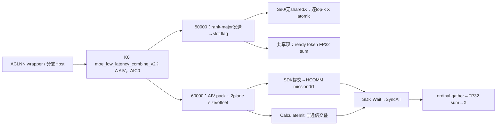
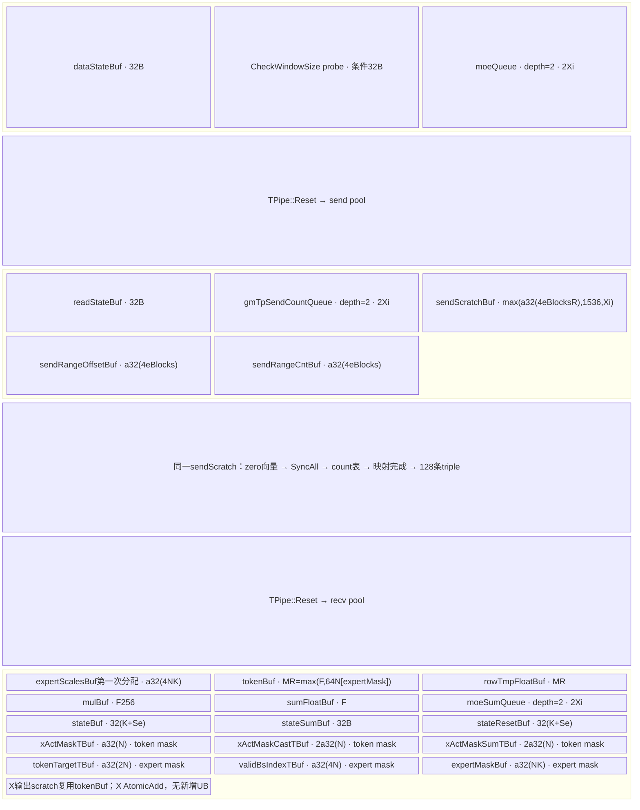
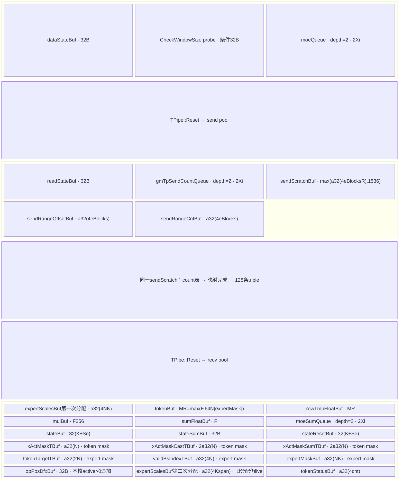
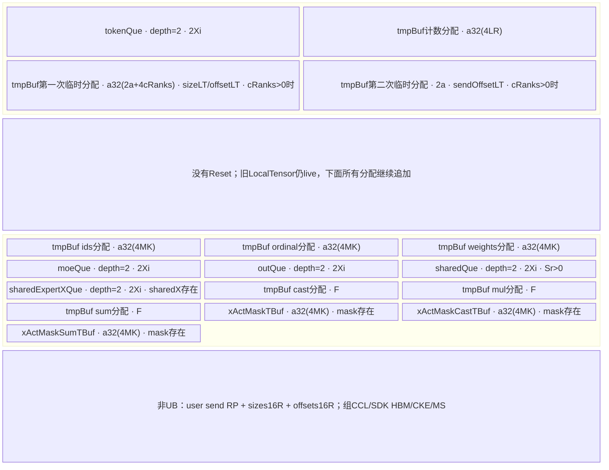

# DeepEP Low Combine 无量化 950 ACLNN 算子知识

## 算子速览

| 项目 | 内容 |
|---|---|
| 实际入口 | aclnnMoeLowLatencyCombineV2GetWorkspaceSize / aclnnMoeLowLatencyCombineV2，公开ACLNN两阶段 |
| 计算语义 | commQuantMode=0；expert结果回到原token加权归并，按MTE async/sync或CCU保留真实舍入顺序 |
| 输入输出 | expandX[T,H]、xOut[N,H]同BF16/FP16；INT32 ids/assist/counts、FP32[N,K]权重 |
| 执行类型 | AIV_VECTOR+直接MTE；或AIV scatter/gather+CCU两mission非Cube通信。所有可达节点无Cube/AIC/MIX_CV |
| Kernel 路线 | R-001 950 legacy MTE 逐top-k原子归并；R-002 950 legacy MTE 共享项同步归并；R-003 950 hybrid MTE 逐top-k原子归并；R-004 950 hybrid MTE 共享项同步归并；R-005 950 CCU MoE rank准备/归并；R-006 950 CCU 共享rank准备/归并 |
| 核心资源 | MTE分阶段Queue/TBuf/scratch/atomic；CCU无Reset累加UB、caller send workspace、SDK/HCOMM HBM参数/CKE/MS/window |
| 来源闭包 | source_closed：公开wrapper→两套Host/POD→50000/60000与无body key→全部body→SDK client与HCOMM实际Run/Algorithm/MC2；止于IR→硬件/driver原语 |
| 验证状态 | 已完成源码闭包检查；本次知识提取未执行编译、真机、数值或性能测试。draft保留UB、mask、初始化顺序、ABI/容量限制。 |


P3=`csrc/deepep/ops/`，P2=`csrc/deepep/ops2/`；SDK=asc-devkit e5451c7feba11f9e259f4fbc19c4bf82f8c0496c，HCOMM=4ca1db912ce02a5f5075849a3fa3faaf731bdd60，均固定9.1.0。SGL=dda6d36b0cdb4081e102d14c0a2fb276fc416e69。冻结查询候选[Low-Latency API](../../../../apis/deepep/deepep_low_latency_dispatch_combine.md)已完整阅读，只有API/策略事实，本卡采用create。符号X表示BF16或FP16，所有字节公式按sizeof(X)=2。定义`ap(x)=ceil(x/p)*p`，单位B；`Xi=a32(2H), F=a32(4H), F256=a256(4H), G=a512(2H)`。R=EP size，r=EP rank，E=MoE专家数，Sr=共享rank数，Se=共享expert数，L=E/(R-Sr)，N=本地token数，K=top-k，M=globalBs/R，A=AIV数。`split(T,A,c)`给start=floor(T/A)c+min(c,T%A)、count=floor(T/A)+[c<T%A]。

## 接口与语义

### 计算语义

公开目标xOut[n,h]=Σ有效k weight[n,k]*expertResult[expertIds[n,k],n,h]，追加Se个无权共享expert结果和sharedExpertX。q0不通信量化。MTE没有共享项时IsAsyncCombinePath=true：逐token×top-k任务独立等32B flag，FP32乘权重后先RINT X，再SetAtomicAdd<X>写输出；输出预先全N行清零。不同top-k按到达/调度在X精度累加，不是固定k序FP32总和。MTE有Se/sharedX时按token就绪轮询，k序FP32 Muls/Add再加共享项，最后一次RINT X。CCU按ordinal收齐后FP32 k序求和并一次RINT X。这些是同一noquant逻辑的真实数值Route，不机械拆成量化算子。

MTE assist为每expert结果12B triple(sourceRank,sourceToken,sourceTopk)。CCU assist为原token/top-k扁平ordinal，recv按source rank分P字节，不能互换handle。MTE 2Dmask能跳false；CCU任何mask只当1D读首N BOOL求active前缀，2D通过部分Host并不实现slot mask。CCU无invalid-ID skip，必须保持实际配对metadata。

### 输入、输出与属性

| 参数 | shape/layout | dtype | 约束、默认值与语义 |
|---|---|---|---|
| expandX | [T,H] ND/AutoContiguous | BF16/FP16 | 配对xOut同X；compact expert rows容量 |
| expertIds | [N,K] | INT32 | 原token路由；CCU DMA/UB按M*K而Hosttensor形状N*K |
| assistInfoForCombine | 1D | INT32 | MTE triples；CCU ordinal N*K但Device读M*K |
| epSendCounts | 1D | INT32 | expert/source inclusive prefix；shared只R有效，但CCU PrepareInit仍DMA L*R项 |
| expertScales | [N,K] | FP32 | 原token权重；CCU Device读M*K，非均匀M>N需物理padding |
| tpSendCountsOptional | 1D | INT32 | MTE Host即TP1仍要求非null/长度TP；CCU TP1允许null |
| xActiveMaskOptional | [N]或[N,K] | BOOL | MTE维度分token/expert；CCU只dim0局部查、存在即token mask |
| activationScaleOptional | optional | FP32 | MTE必须null；CCU提前Host未同样检查但body不读 |
| weightScaleOptional | optional | FP32 | MTE必须null；CCU不消费 |
| groupListOptional | optional | INT64 | MTE必须null；CCU不消费 |
| expandScalesOptional | placeholder | FP32 | 本q0 body不消费 |
| sharedExpertXOptional | [N,H]或3D flatten N×H | 同X | MTE要求Sr0，CCU不作同等Sr限制；实际均F32 add |
| groupEp/epWorldSize/epRankId/moeExpertNum | 属性 | char*/int64 | group1..127；R2..768/E1..1024/r合法；真实数组/通信域另限 |
| groupTp/tpWorldSize/tpRankId | 属性 | char*/int64 | MTE TP0..2，TP2产生50100无body；CCU强制TP1 |
| expertShardType | 属性 | int64 | 只0 |
| sharedExpertNum/sharedExpertRankNum | 属性 | int64 | Se0..4/Sr<R，默认1/0→0/0，两者均零或正且Sr%Se0 |
| globalBs | 属性 | int64 | 0→NR，否则≥NR/%R0；CCU存在mask额外强制globalBs=NR；M=globalBs/R |
| outDtype | 属性 | int64 | 预留0，不生成新dtype语义 |
| commQuantMode | 属性 | int64 | 唯一谓词0。2/3另卡；q2 50020缺router、q3禁止CCU |
| groupListType | 属性 | int64 | 预留0，body无groupList计算 |
| commAlg | 属性 | char* | 指针非null；精确ccu早转独立Host，其余字符串均MTE |
| xOut | [N,H] ND | 同X | CCU严格[N,H]；MTE只查H未检查N |
| sendCostStats | placeholder | 按OpDef | body不写，非有效统计 |


### 入口与版本

LOW_LATENCY_API公开A5；实际build deepep→ops，950 Host CMake/codegen/cust_opapi带__DAV_C310__，保留Low wrappers；OpDef有950配置，entry有C310 CCU。README/DeepEP README给9.0/9.1最新依据，本卡固定CANN9.1.0，SDK和HCOMM version.cmake均9.1.0，不借9.2头替换版本。

Python default→C++ low_latency_combine→本ACLNN，C++仅连续2D BF16、新建输出、TP1、globalBs=capacity*R；use_mxfp8=false给q0；MOE_ENABLE_CCU=1选ccu，否则fullmesh_v1。MOE_ENABLE_TOPK_NEG_ONE=1构造2Dmask，不能据此保证CCU支持负ID。out/async/hook/zero_copy在此C++未拆不同launch，event为空、hook空函数；MTE内部async指kernel逐top-k调度，不能混称Python异步接收。ops策略调用torch_npu不同entry，alltoall不同算法，不属本ACLNN闭包。

## Host/Launcher 执行流程

### 参数校验与前处理

1. wrapper固定elastic/oriX/alpha/V=null与zero/copy/const counts0，再inner GetWorkspaceSize；inner返回后检查ret/executor/*executor，weak NnopbaseSetHcclServerType按ccu设CCU、否则MTE。Execute直接inner，caller stream/executor管理为框架边界。
2. 外层先GetAttr：R2..768/E1..1024、group/rank/shard0、TP0..2、共享归一等。q3&&ccu先拒绝；q0 commAlg=ccu立即进入MoeDistributeCombineTilingImpl并return，绕过普通MTE tensor/dtype/format/CheckAttrs/window。其余非null字符串均MTE，无白名单。
3. MTE检查2D expandX/ids/weights、1D assist/epCounts/tpCounts，BF16/FP16同输出、ids/counts I32/weightsF32、maskBOOL rank1/2，拒绝NZ/不支持量化附加输入。N0..512，K1..min16E，H1024..8192（未实际H%32 guard），E%(R-Sr)=0/L>0；TP2只q0/L1与合法TPgroup/rank。TP0不改1，capacity下界可退化。
4. C普通=globalBs*min(L,K)，shared=M*ceil(R/(Sr/Se))；expandX rows≥C*TP、assist≥128C、epCounts普通RL/sharedR乘TP、tpCounts长度TP。sharedX存在需Sr0和flatten N×H。输出MTE只检查H未要求dim0=N。
5. CCU独立Host重复检查R/E/group/rank/共享/TP，TP必须1，N1..512，K1..16但无K≤E，L=floorE/(R-Sr)>0但无整除guard。无完整dtype/rank/format/null-scale等check，不能把OpDef列类型当已执行Host校验。assist只≥NK，counts普通RL/sharedR，TPcounts可null，output严格[N,H]，sharedX不限定Sr0；mask只dim0=N，非null全置isTokenMask。存在mask→globalBs=NR。H范围检查所在bool函数返回GRAPH_FAILED状态值，不能等价假定返回false。
6. CCU CheckCommAttrs在SetPlatformInfo之前用Info.aivNum计算窗口预算；外层没有提前写A。实际bool/未初始化值行为不证明预算正确。最后才写A/UB/blockDim；GetTiling若干返回未检查，不能证明成功资源。MTE A>0、M≤512、A≤72；q0没有完整UB预算拒绝。

### 参数、Workspace 与生命周期

env优先DEEPEP_HCCL_BUFFSIZE，再HCCL_BUFFSIZE，默认200MiB；stoi异常被catch记录并保持默认，成功后uint16窄化无完整范围guard。记Gd=a512(a32(2H)+44)。

| 路线 | Host workspace/Device实际slice | window/预算 | owner与生命周期 |
|---|---|---|---|
| MTE全部 | 16MiB+10KiB*A；public特殊0/null故每core10KiB GM mask scratch无可达消费者 | 2*(M*Gd*R*L+M*G*(K+Se)+reservedHalf)≤Wenv；hybrid reservedHalf=109MiB+72KiB，legacy0；M*(K+Se)*32≤512KiB-32 | user/workspace到stream完成；HCCL组window跨调用z |
| MTE实际window | 固定4MiB prefix后baseW=W-4MiB两half；data helper再加A5.kDataOffset仅hybrid | kDataOffset=107MiB+72KiB；hybrid half预算含2MiB分摊prefix；legacy没有显式同等4MiB预算 | selector/状态/数据不得跨轮并发 |
| CCU | Host16MiB+32R+R*M*G*L；Device send RP，再sizes16R、offsets16R，P=2HML | InfoW=2envW；CheckCommAttrs用未先写的A校验512A+2R*M*G*L≤2envW；实际window取context.W | send/sizes/offsets到SDKWait，receive到gather结束；不把arrays移到Hostalignedpayload尾 |
| CCU组私有 | 16MiB SDKworkspace、32768B参数、1024Bstart/end同步，另CCLbuffer | HCOMM AllocV2/MC2 owner，不是ACLNN用户workspace | 组创建清零，到组销毁；HW传输和Wait均需完成 |


CheckWindowSize是actualW<plannedW时1B UB/INT32 DMA探针，不是可靠可恢复Host返回。实际build从安装包复制base/comm_ctx头，本卡以固定本地fallback与SDK/HCOMM源闭合；不把未知安装复制头/二进制ABI称已验证。MTE/CCU的context结构、prefix、双轮选择不同，不能共享地址公式。

CheckWindowSize的精确动作是actual<planned时申请1字节TBuf（实际分配按SDK对齐），将传入exceptionAddr绑定为256个int32的GlobalTensor，再执行DataCopy到Local的1个int32请求。DATA_SIZE的256字节注释不能替代int32元素单位；此路径没有改写GM错误地址、没有向GM写错误码，也没有显式失败返回。DMA对齐与框架最终错误仍依赖匹配SDK/运行时，不能仅凭“探针”断言必然发生故障或安全终止。

### 启动图与失败传播



Host→K0为POD1192，blockDim=CalcTschBlockDim(A,0,A)，MTE schedule1，CCU最终SetPlatformInfo不设同样schedule1。MTE raw payload2H到目标G slot，PIPE_MTE3后32B flag；async全部N输出先清零/SyncAll，sync第二次权重InitBuffer仍追加资源。CCU send RP+32R由AIV先SyncAll；core0提交，与CalculateInit并行，Wait→SyncAll后才gather；caller/HCCL owner与extent逐Route展开。Unknown key结束无匹配，不能补造具体Runtime错误；库错误/handle返回未被SGL逐项传播。

固定SDK9.1 AlltoAllvWrite<true>(usrIn,sendOffsets,sendSizes,remoteWinOffset,localDataSize)生成HALF_ALLTOALLV=20，输入/输出类型INT8表示“按字节数传输”，不是将X值转INT8。CommonPrepare保存三个wParamExt u64；CcuPrepareForAllToAllVWrite构造9个u64：opId、sendBuf、sendSizes、sendOffsets、goSize的4项、remoteWinOffset。localDataSize按8×4096B=32768B分m/n/p：xn4=32768m、xn5=m；xn6/xn7由CalcLoopGroupParam按n/p编码（无余量0/0，只有n为Parallel(n-1,0,1)/4096，只有p为Parallel(0,0,1)/p，两者都有为Parallel(n-1,1,2)/p）。九项写xnOffset+resource*64*8并DCCI，再将对应commit地址写1；这里HCOMM AllocV2把xnAddr/ckeAddr映射为HBM参数与start/end队列，不声称都是物理寄存器。Wait轮询完成信号、更新finish计数/复位；SGL不检查handle/Wait返回。Finalize发送退出opCode并等待，不取代payload Wait。
SDK与HCOMM的enum20→OpType::HALFALLTOALLV、engine5→CCU_MS与selector默认CcuHalfAll2AllVMesh1D(enum13)相合；ins_all_to_all_sole_executor注册→TopoMatchMesh→CcuTempHalfAllToAllVMesh1D::CalcRes/Run。两个固定版本的ccu_instruction_half_alltoallv_mesh1d.h实际签名/字段/instType一致：Init(missionId,rank,scratchAddr,CollAlgOperator&,vTopo&)，CtxArg保存dimSize/rank/op/mission/cclBuffer/topology；不是仅同名映射。source mapping不声称安装二进制ABI通过实测。
Run要求1D非空topology、scratch非null，每peer取第一条link，两mission各Append同一insGroup/一条queue；CalcRes queNum=streamNum=1、mesh R-1 links，每transport CKE=max(3,ceil(R/16))。Context分配每rank token/sizeA/B/offsetA/B、ceil(R/16)个writeDone、两mission同步信号、8个loop×4096B本地搬运资源。mission0加载9参数（MC2第三输入插token），向mission1同步sendBuf/sizeAddr/offsetAddr/recvOffset；LoadArgsFromMem从sendSizes连续读4R u64（sizeA/R、sizeB/R、offsetA/R、offsetB/R），所以SGL把offset紧接sizes是实际ABI要求。
每mission逐peer选其size/offset：src=sendBuf+offsetMission[peer]，dst=该peer CCL+remoteWinOffset；mission1再加sizeA[peer]。remote count非0→Write，零count→LocalPost完成位；self不做网络，mission0以goSize LocalCopyByLoopGroup（两loop经MS buffer/LocalWait分片）复制完整selfDataSize。每16rank一组LocalWait(writeDone)→MissionSync→mission0对remote PostSync并GroupWait→MC2 MissionPostSync→HBM end=1→SDK Wait→SGL SyncAll→gather。止于CcuRep IR→CCU微码/硬件传输与driver primitive；实际Run/Algorithm已闭合，不能止于一个通信调用名。
组资源由Mc2Compont::AllocV2分配16MiB SDKworkspace、64*64*8=32768B参数、64*2*8=1024B同步并清零，context.windowsOut[0]=真实CCLbuffer、winSize=实际CCLsize；MC2循环每轮start poll/reset→加载32项每die参数→按opCode选择函数→注入token调用算法→mission同步→写end，64轮环形。这些非ACLNN user workspace，owner为通信组到销毁。公开SDK单次≤256MiB等约束/64rank context与Host≤768不能合并推成支持所有拓扑。

## Route 与参数设计

### 分核与资源计算

MTE rank-major：A<R退回总S连续均分；A≥R按rank均分核组，算每rank跨expert token数，组内均分后映射至≤eBlocks个range。triple每128条读，scratch在zero/counts/metadata间按事件序复用。async task c,c+A,...遍历active*K；sync按active/A分token并轮询ready列表。CCU split R/A准备；active<A时每token floor(A/active)核分H，chunk按16个X元素对齐、最后精确尾；active≥A按token商余数分核，闲核/零chunk不写。CCU没有Reset，UB必须求全部存活总和，不能套MTE max三阶段。

### Route 选择

| 顺序 | Route | Key/模板 | 精确选择条件与优先级 | 不适用去向 |
|---|---|---|---|---|
| 1 | R-001 950 legacy MTE 逐top-k原子归并 | 50000 / MoeDistributeCombineV2A5<X,X,int32_t,false,false,false> | 950/__DAV_C310__、q0、commAlg非null且!=ccu、TP≠2、Se=0且sharedExpertX=null、DEEPEP_HYBRID_DEPLOYMENT不为"1"；普通MTE attrs/shape通过；X=BF16/FP16 | Host失败/无body终点，不自动fallback |
| 2 | R-002 950 legacy MTE 共享项同步归并 | 50000 / MoeDistributeCombineV2A5<X,X,int32_t,false,false,false> | 950/__DAV_C310__、q0、commAlg非null且!=ccu、TP≠2、Se>0或sharedExpertX非null、DEEPEP_HYBRID_DEPLOYMENT不为"1"；普通MTE attrs/shape通过；X=BF16/FP16 | Host失败/无body终点，不自动fallback |
| 3 | R-003 950 hybrid MTE 逐top-k原子归并 | 50000 / MoeDistributeCombineV2A5<X,X,int32_t,false,false,false> | 950/__DAV_C310__、q0、commAlg非null且!=ccu、TP≠2、Se=0且sharedExpertX=null、DEEPEP_HYBRID_DEPLOYMENT恰为"1"；普通MTE attrs/shape通过；X=BF16/FP16 | Host失败/无body终点，不自动fallback |
| 4 | R-004 950 hybrid MTE 共享项同步归并 | 50000 / MoeDistributeCombineV2A5<X,X,int32_t,false,false,false> | 950/__DAV_C310__、q0、commAlg非null且!=ccu、TP≠2、Se>0或sharedExpertX非null、DEEPEP_HYBRID_DEPLOYMENT恰为"1"；普通MTE attrs/shape通过；X=BF16/FP16 | Host失败/无body终点，不自动fallback |
| 5 | R-005 950 CCU MoE rank准备/归并 | 60000 / MoeDistributeCombineA5<X,int32_t> | 950/__DAV_C310__、q0、commAlg=ccu、TP必须1、N1..512、R2..768/E1..1024、K1..16；r≥Sr；独立CCU Host局部检查与SDK/HCOMM 1D Mesh资源准备通过；X=BF16/FP16 | Host失败/无body终点，不自动fallback |
| 6 | R-006 950 CCU 共享rank准备/归并 | 60000 / MoeDistributeCombineA5<X,int32_t> | 950/__DAV_C310__、q0、commAlg=ccu、TP必须1、N1..512、R2..768/E1..1024、K1..16；r<Sr；独立CCU Host局部检查与SDK/HCOMM 1D Mesh资源准备通过；X=BF16/FP16 | Host失败/无body终点，不自动fallback |


```text
q0，X=同输出BF16/FP16
GetAttr后 commAlg=="ccu"：
 独立CCUHost（TP1，N>0，局部checks）→60000
 r<Sr→共享block特例，否则MoE L块；两者都实际实例MoeDistributeCombineA5<X,I32>
其它非nullcommAlg：
 ordinaryMTEchecks→50000+(TP2?100:0)
 50100无router；50000→MoeDistributeCombineV2A5<X,X,I32,false,false,false>
 hybrid=env恰"1"选隔离布局，否则legacy
 IsAsyncCombinePath = !IsNeedReduceScatter && Se==0 && !hasSharedExpertX
  true→输出预清/SyncAll→逐top-k Wait+X atomic
  false→ready token轮询→k序FP32/共享项→RINT X
q2 50020无router；q3 50030另一数学分支且Host拒绝CCU，不并入q0
```

### 模板/实现执行矩阵

| Route | key/selector | dtype/shape/platform 完整命中条件 | 执行拓扑与 Kernel 节点 | 实际模板/body | 内存与同步特征 | tail/fallback |
|---|---|---|---|---|---|---|
| R-001 | 50000 | 950/__DAV_C310__、q0、commAlg非null且!=ccu、TP≠2、Se=0且sharedExpertX=null、DEEPEP_HYBRID_DEPLOYMENT不为"1"；普通MTE attrs/shape通过；X=BF16/FP16 | InitWinState→先清所有N输出/SyncAll→rank-major分核/batch128 metadata→MTE payload/flag→逐top-k Wait/AtomicAdd<X> | MoeDistributeCombineV2A5<X,X,int32_t,false,false,false> | U_init=32+32[probe]+2Xi | TP2 Host50100无router；q2 Host50020也无router，但不属于本q0。MTE context本地windowsIn[32]与HostR≤768不等价；无完整R数组guard。legacy预算没显式4MiB prefix。 |
| R-002 | 50000 | 950/__DAV_C310__、q0、commAlg非null且!=ccu、TP≠2、Se>0或sharedExpertX非null、DEEPEP_HYBRID_DEPLOYMENT不为"1"；普通MTE attrs/shape通过；X=BF16/FP16 | InitWinState→rank-major分核/batch128 metadata→MTE payload/flag→就绪token轮询/FP32 gather/RINT | MoeDistributeCombineV2A5<X,X,int32_t,false,false,false> | U_init=32+32[probe]+2Xi | TP2 Host50100无router；q2 Host50020也无router，但不属于本q0。MTE context本地windowsIn[32]与HostR≤768不等价；无完整R数组guard。legacy预算没显式4MiB prefix。 |
| R-003 | 50000 | 950/__DAV_C310__、q0、commAlg非null且!=ccu、TP≠2、Se=0且sharedExpertX=null、DEEPEP_HYBRID_DEPLOYMENT恰为"1"；普通MTE attrs/shape通过；X=BF16/FP16 | InitWinState→先清所有N输出/SyncAll→rank-major分核/batch128 metadata→MTE payload/flag→逐top-k Wait/AtomicAdd<X> | MoeDistributeCombineV2A5<X,X,int32_t,false,false,false> | U_init=32+32[probe]+2Xi | TP2 Host50100无router；q2 Host50020也无router，但不属于本q0。MTE context本地windowsIn[32]与HostR≤768不等价；无完整R数组guard。legacy预算没显式4MiB prefix。 |
| R-004 | 50000 | 950/__DAV_C310__、q0、commAlg非null且!=ccu、TP≠2、Se>0或sharedExpertX非null、DEEPEP_HYBRID_DEPLOYMENT恰为"1"；普通MTE attrs/shape通过；X=BF16/FP16 | InitWinState→rank-major分核/batch128 metadata→MTE payload/flag→就绪token轮询/FP32 gather/RINT | MoeDistributeCombineV2A5<X,X,int32_t,false,false,false> | U_init=32+32[probe]+2Xi | TP2 Host50100无router；q2 Host50020也无router，但不属于本q0。MTE context本地windowsIn[32]与HostR≤768不等价；无完整R数组guard。legacy预算没显式4MiB prefix。 |
| R-005 | 60000 | 950/__DAV_C310__、q0、commAlg=ccu、TP必须1、N1..512、R2..768/E1..1024、K1..16；r≥Sr；独立CCU Host局部检查与SDK/HCOMM 1D Mesh资源准备通过；X=BF16/FP16 | AIV pack/dual sizes→SyncAll→core0 AlltoAllvWrite→CalculateInit重叠→Wait/SyncAll→ordinal gather→Finalize | MoeDistributeCombineA5<X,int32_t> | U_total=2Xi+a32(4LR)+[cRanks>0]*(a32(2a+4cRanks)+2a)+3a32(4MK)+4Xi+2Xi[Sr>0]+2Xi[sharedX]+3F+3a32(4MK)[mask]。没有Reset，必须求总和 | 独立CCU Host绕过普通tensor/dtype/format/null-check，E/(R-Sr)无整除guard、K无≤E；mask仅dim0且存在即isTokenMask。窗口预算在A字段初始化前读取；GetTiling未逐项检查。R>64超SDK context，R>32超SGL MTE，但CCU不能用MTE数组容量代替自己的约束。 |
| R-006 | 60000 | 950/__DAV_C310__、q0、commAlg=ccu、TP必须1、N1..512、R2..768/E1..1024、K1..16；r<Sr；独立CCU Host局部检查与SDK/HCOMM 1D Mesh资源准备通过；X=BF16/FP16 | AIV pack/dual sizes→SyncAll→core0 AlltoAllvWrite→CalculateInit重叠→Wait/SyncAll→ordinal gather→Finalize | MoeDistributeCombineA5<X,int32_t> | U_total=2Xi+a32(4LR)+[cRanks>0]*(a32(2a+4cRanks)+2a)+3a32(4MK)+4Xi+2Xi[Sr>0]+2Xi[sharedX]+3F+3a32(4MK)[mask]。没有Reset，必须求总和 | 独立CCU Host绕过普通tensor/dtype/format/null-check，E/(R-Sr)无整除guard、K无≤E；mask仅dim0且存在即isTokenMask。窗口预算在A字段初始化前读取；GetTiling未逐项检查。R>64超SDK context，R>32超SGL MTE，但CCU不能用MTE数组容量代替自己的约束。 |


### 隐藏性能 Guard

| Guard | Host/Tiling 条件 | Device/资源原因 | 影响 Route | 不满足时去向 | 源码符号 |
|---|---|---|---|---|---|
| TP2 | Host接受并生成50100 | router只有50000/q0 | MTE | 已知无body，非支持Route | CalTilingKey/router |
| q0 UB | MTE无完整UBplanner，CCU亦无 | 追加weights、无Reset CCU、metadataMK | 全部 | 未提供安全fallback | InitBuffer/ExpertScaleCopy |
| CCU A字段顺序 | 预算早于SetPlatformInfo | 尚未赋A参与512A项 | CCU | 已知静态缺陷，不能说预算有效 | CheckCommAttrs |
| CCU dtype/dim/attrs | ccu提前return独立Host | 绕普通checks；bool函数返回status | CCU | 不能用MTE约束伪闭合 | MoeDistributeCombineTilingImpl/CheckTensorShape |
| rank数组 | HostR≤768；SGL MTE IN32/SDK CCU64 | 不同context布局、actualrank资源 | 全部 | 超域无完整Host拒绝 | base.h/hccl_inner_def.h |
| CCU padding/长度 | Hostids/weights N*K，assist≥NK；sharedcounts R | Device DMA M*K和L*R；counts len castu16 | CCU | 未证明实际capacity，draft | PrepareInit/CalculateInit |
| mask/ID | CCU mask存在即token，ID无skip | 2D非槽语义；negative/invalid定位不受保护 | CCU | 无自动fallback | TokenMaskCalCnt/CalculateMoeResult |
| 精度 | Se0无sharedX自动async | 每项RINT X再X atomic，而非全FP32 | MTE async | 不能声称与sync bitwise等价 | ProcessAsyncTopK |
| 窗口预算 | legacy reserved0；CCU预算与actualcontext不同 | MTE4MiB prefix；CCU selector512A | 全部 | CheckWindowSize探针非安全拒绝 | GetWinAddr/CheckCommAttrs |


### POD/ABI

P3 Info104/align8；outer Mc2Init64@0、cc1 512@64、cc2 512@576、Info104@1088，总1192。offset为64位自然布局源码推导，未经编译/安装实测；padding73..75。CCU未产生字段标为inactive，不假默认。

| 结构 | 字段 | 类型/位宽 | ABI 布局 | 单位 | Host/launcher producer | Device consumer | 边界 |
|---|---|---|---|---|---|---|---|
| P3 MoeDistributeCombineV2Info | epWorldSize | u32 | @0 | rank数 | 公共GetAttr写R；A2multi单独CheckAttr写R | 窗口/EP分核 | A2≤256；A3/950≤768；不是实际数组容量 |
| P3 MoeDistributeCombineV2Info | tpWorldSize | u32 | @4 | rank数 | single/MTE0..2；A2multi强制0；CCU必须1 | key/TP条件 | 0不规范成1，容量下界可退化 |
| P3 MoeDistributeCombineV2Info | epRankId | u32 | @8 | rank | 公共r | 目标/源rank | 0≤r<R |
| P3 MoeDistributeCombineV2Info | tpRankId | u32 | @12 | rank | TP≤1归一0，A2multi0 | A3 TP2另一rank=1-t | 950/A2single TP2无router |
| P3 MoeDistributeCombineV2Info | expertShardType | u32 | @16 | enum | P3仅0；P2字段名expertSharedType且multi强制0 | 无分片计算 | 字段名不同，不能混用类型 |
| P3 MoeDistributeCombineV2Info | sharedExpertNum | u32 | @20 | expert数 | single/MTE Se0..4，默认1/Sr0→0；CCU同规则 | K+Se/无权重共享项 | A2multi未赋且body不读 |
| P3 MoeDistributeCombineV2Info | sharedExpertRankNum | u32 | @24 | rank数 | Sr<R，与Se同零/正且Sr%Se=0；A2multi0 | shared role/L | 共享rank的A2single key6000无body |
| P3 MoeDistributeCombineV2Info | moeExpertNum | u32 | @28 | expert数 | E；A2multi≤512，余≤1024 | L/counts/ID域 | 不全量检查ID值 |
| P3 MoeDistributeCombineV2Info | moeExpertPerRankNum | u32 | @32 | expert/rank | single/MTE E/(R-Sr)并检整除；CCU取floor未检整除 | selfSendCount尾索引/CCU stride | A2multi未赋但body自行E/R |
| P3 MoeDistributeCombineV2Info | zeroExpertNum | u32 | @36 | expert数 | public wrapper0；P3/Multi复制，P2single未赋 | P3/多机特殊分支 | public0；single body不读 |
| P3 MoeDistributeCombineV2Info | copyExpertNum | u32 | @40 | expert数 | 同zeroExpertNum | P3/多机特殊分支 | public0；single body不读 |
| P3 MoeDistributeCombineV2Info | constExpertNum | u32 | @44 | expert数 | 同zeroExpertNum | P3/多机特殊分支 | public0；single body不读 |
| P3 MoeDistributeCombineV2Info | globalBs | u32 | @48 | token容量 | single/P3 0→NR，否则≥NR且%R=0；A2multi非0未同样检查 | M=globalBs/R | 未完整检查int64→u32窄化 |
| P3 MoeDistributeCombineV2Info | bs | u32 | @52 | token数 | expertIds.dim0=N，MTE0..512；CCU1..512 | active/token输出域 | mask prefix与M容量分开 |
| P3 MoeDistributeCombineV2Info | k | u32 | @56 | slot/token | P3 MTE1..min16E；A2single0..min16E；A2multi1..16；CCU1..16 | NK/等待/metadata | CCU未≤E |
| P3 MoeDistributeCombineV2Info | h | u32 | @60 | 元素/token | expandX.dim1；single/P3 1024..8192；A2multi1..7168且%32=0 | 2H payload/Vector | P3无%32guard；CCU bool错误返回另列 |
| P3 MoeDistributeCombineV2Info | aivNum | u32 | @64 | core数 | GetCoreNumAiv；CCU最后才写 | split/selector512A | CCU预算先读该字段；Host未统一UB安全判定 |
| P3 Info | isTokenMask | bool | @68 | flag | mask rank1；CCU任意mask非null | prefix mask统计 | CCU二维mask冲突 |
| P3 Info | isExpertMask | bool | @69 | flag | MTE mask rank2；CCU未写 | MTE validToken/skip；CCU不读 | 不假默认 |
| P3 Info | hasSharedExpertX | bool | @70 | flag | 可选输入存在 | sharedX加法；CCU队列 | A2multi无此consumer |
| P3 Info | hasElasticInfo | bool | @71 | flag | public null→false；CCU不写 | MTE弹性分支 | public inactive |
| P3 Info | isHybridDeployment | bool | @72 | flag | MTE env DEEPEP_HYBRID_DEPLOYMENT精确1 | MTE窗口布局 | CCU不读 |
| P3 Info | a5MxCombineBufferNum | u32 | @76 | queue depth | outer默认2 | q0不读，MXFP8另卡 | 不能用q0证明量化planner |
| P3 Info | totalUbSize | u64 | @80 | B | 平台GetCoreMemSize UB；CCU最后写 | 资源字段/日志 | q0无全面预算guard |
| P3 Info | totalWinSize | u64 | @88 | B | MTE env W；CCU=2envW | MTE实际基准；CCU不读此field | runtime context size另源 |
| P3 Info | armAvgFactor | float | @96 | inactive | 当前Host未赋值 | q0 body不读 | 不假默认 |
| P3 Info | epsilon | float | @100 | inactive | 当前Host未赋值 | q0 body不读 | 不假默认 |
| P3 TilingData | mc2InitTiling | 64B | @0 | 混合 | GetTiling/Host | InitV2 | 总1192/align8 |
| P3 TilingData | mc2CcTiling1 | 512B | @64 | 混合 | GetTiling/Host | EP | 总1192/align8 |
| P3 TilingData | mc2CcTiling2 | 512B | @576 | 混合 | GetTiling/Host | TP | 总1192/align8 |
| P3 TilingData | moeDistributeCombineV2Info | 104B | @1088 | 混合 | GetTiling/Host | Init attrs | 总1192/align8 |

SDK两个opaque容器内部字段如下，MTE engine3/EP8-TP7，CCU engine5/EP与TP均20；CCU当前body只SetCcTilingV2(64)消费EP。

| 结构 | 字段 | 类型/位宽 | ABI 布局 | 单位 | Host/launcher producer | Device consumer | 边界 |
|---|---|---|---|---|---|---|---|
| Mc2InitTilingInner | version | u32 | @0 | 协议 | GetTiling: 100 | InitV2/框架 | version100；保留域不假初始化 |
| Mc2InitTilingInner | mc2HcommCnt | u32 | @4 | 组数 | GetTiling: EP/TP两组 | InitV2/框架 | version100；保留域不假初始化 |
| Mc2InitTilingInner | offset | u32[8] | @8 | 字节offset | GetTiling: 64/576，其余0 | InitV2/框架 | version100；保留域不假初始化 |
| Mc2InitTilingInner | debugMode | u8 | @40 | enum | GetTiling: default0 | InitV2/框架 | version100；保留域不假初始化 |
| Mc2InitTilingInner | preparePosition | u8 | @41 | enum | GetTiling: default0 | InitV2/框架 | version100；保留域不假初始化 |
| Mc2InitTilingInner | queueNum | u16 | @42 | queue数 | GetTiling: default0 | InitV2/框架 | version100；保留域不假初始化 |
| Mc2InitTilingInner | commBlockNum | u16 | @44 | block数 | GetTiling: default0 | InitV2/框架 | version100；保留域不假初始化 |
| Mc2InitTilingInner | devType | u8 | @46 | SoC enum | GetTiling: runtime SoC | InitV2/框架 | version100；保留域不假初始化 |
| Mc2InitTilingInner | reserved | char[17] | @47 | B | GetTiling: 未显式清全部；不依赖 | InitV2/框架 | version100；保留域不假初始化 |
| Mc2CcTilingInner | skipLocalRankCopy | u8 | @0 | flag | GetTiling: default0 | SetCcTilingV2/框架 | version1；q0无通信量化 |
| Mc2CcTilingInner | skipBufferWindowCopy | u8 | @1 | flag | GetTiling: default0 | SetCcTilingV2/框架 | version1；q0无通信量化 |
| Mc2CcTilingInner | stepSize | u8 | @2 | step | GetTiling: default0 | SetCcTilingV2/框架 | version1；q0无通信量化 |
| Mc2CcTilingInner | version | u8 | @3 | 协议 | GetTiling: 1 | SetCcTilingV2/框架 | version1；q0无通信量化 |
| Mc2CcTilingInner | reserved | char[9] | @4 | B | GetTiling: memset0 | SetCcTilingV2/框架 | version1；q0无通信量化 |
| Mc2CcTilingInner | commEngine | u8 | @13 | enum | GetTiling: MTE3/CCU5 | SetCcTilingV2/框架 | version1；q0无通信量化 |
| Mc2CcTilingInner | srcDataType | u8 | @14 | dtype enum | GetTiling: default0=INT8；MTE payload由X模板决定 | SetCcTilingV2/框架 | version1；q0无通信量化 |
| Mc2CcTilingInner | dstDataType | u8 | @15 | dtype enum | GetTiling: default0；本body不读为数据类型 | SetCcTilingV2/框架 | version1；q0无通信量化 |
| Mc2CcTilingInner | groupName | char[128] | @16 | 字符 | GetTiling: EP/TP group | SetCcTilingV2/框架 | version1；q0无通信量化 |
| Mc2CcTilingInner | algConfig | char[128] | @144 | 字符 | GetTiling: EP fullmesh/pairwise或hierarchy，TP ReduceScatterRing；CCU mesh | SetCcTilingV2/框架 | version1；q0无通信量化 |
| Mc2CcTilingInner | opType | u32 | @272 | cmd enum | GetTiling: MTE EP8/TP7；CCU EP/TP20 | SetCcTilingV2/框架 | version1；q0无通信量化 |
| Mc2CcTilingInner | reduceType | u32 | @276 | enum | GetTiling: default0；本MTE不据此reduce | SetCcTilingV2/框架 | version1；q0无通信量化 |
| Mc2CcTilingInner | reserved2 | char[232] | @280 | B | GetTiling: 未显式清全部；inactive | SetCcTilingV2/框架 | version1；q0无通信量化 |

SGL HcclCombinOpParam（注意少一个e）自然size576，MTE实际只消费共同prefix/IN；SDK C310 HcclCombineOpParam自然size8888/align8，OUT[0]在544，不能用SGL32项OUT@288替换。HCOMM9.1 mc2 context64项、MAX_OP_NUM8与xn/cke对应SDK布局，仍不是安装ABI实测。

| 结构 | 字段 | 类型/位宽 | ABI 布局 | 单位 | Host/launcher producer | Device consumer | 边界 |
|---|---|---|---|---|---|---|---|
| SGL MTE HcclCombinOpParam | workSpace | u64 | @0 | 地址 | runtime | MTE本body不消费消息 | IN32；Host未据此统一拒绝R>32 |
| SGL MTE HcclCombinOpParam | workSpaceSize | u64 | @8 | B | runtime | 本body不读 | IN32；Host未据此统一拒绝R>32 |
| SGL MTE HcclCombinOpParam | rankId | u32 | @16 | rank | runtime | InitWinState/GetStatus | IN32；Host未据此统一拒绝R>32 |
| SGL MTE HcclCombinOpParam | rankDim | u32 | @20 | rank数 | runtime | InitWinState | IN32；Host未据此统一拒绝R>32 |
| SGL MTE HcclCombinOpParam | winSize | u64 | @24 | B | runtime | CheckWindowSize | IN32；Host未据此统一拒绝R>32 |
| SGL MTE HcclCombinOpParam | windowsIn | u64[32] | @32 | 地址数组 | runtime | MTE data/state/selector，helper固定4MiB前缀 | IN32；Host未据此统一拒绝R>32 |
| SGL MTE HcclCombinOpParam | windowsOut | u64[32] | @288 | 地址数组 | runtime | 当前MTE不消费；不是CCU OUT64偏移 | IN32；Host未据此统一拒绝R>32 |
| SGL MTE HcclCombinOpParam | xnAddr | u64 | @544 | 地址 | runtime | MTE不读 | IN32；Host未据此统一拒绝R>32 |
| SGL MTE HcclCombinOpParam | ckeAddr | u64 | @552 | 地址 | runtime | MTE不读 | IN32；Host未据此统一拒绝R>32 |
| SGL MTE HcclCombinOpParam | msAddr | u64 | @560 | 地址 | runtime | 预留不读 | IN32；Host未据此统一拒绝R>32 |
| SGL MTE HcclCombinOpParam | msSize | u64 | @568 | MS个数 | runtime | 预留不读 | IN32；Host未据此统一拒绝R>32 |
| SDK C310 HcclCombineOpParam | workSpace | u64 | @0 | 地址 | AllocV2 | SDK handle/消息 | __NPU_ARCH__=3510，64rank/8op |
| SDK C310 HcclCombineOpParam | workSpaceSize | u64 | @8 | B | AllocV2=16MiB | SDK Init | __NPU_ARCH__=3510，64rank/8op |
| SDK C310 HcclCombineOpParam | rankId | u32 | @16 | rank | runtime | SDK rank | __NPU_ARCH__=3510，64rank/8op |
| SDK C310 HcclCombineOpParam | rankNum | u32 | @20 | rank数 | runtime | 数组/CCU配置 | __NPU_ARCH__=3510，64rank/8op |
| SDK C310 HcclCombineOpParam | winSize | u64 | @24 | B | CCLbuffer GetSize | SGL selector与half | __NPU_ARCH__=3510，64rank/8op |
| SDK C310 HcclCombineOpParam | windowsIn | u64[64] | @32 | 地址 | runtime | 本CCU body不读 | __NPU_ARCH__=3510，64rank/8op |
| SDK C310 HcclCombineOpParam | windowsOut | u64[64] | @544 | 地址 | AllocV2只本CCL填OUT[0] | SGL cclBuf取OUT[0] | __NPU_ARCH__=3510，64rank/8op |
| SDK C310 HcclCombineOpParam | xnOffset | GM_ADDR | @1056 | 地址 | HCOMM xnAddr | SDK 9个u64参数 | __NPU_ARCH__=3510，64rank/8op |
| SDK C310 HcclCombineOpParam | ckeOffset | GM_ADDR | @1064 | 地址 | HCOMM ckeAddr | SDK commit/Wait | __NPU_ARCH__=3510，64rank/8op |
| SDK C310 HcclCombineOpParam | res | u8[16] | @1072 | B | runtime | 当前不读 | __NPU_ARCH__=3510，64rank/8op |
| SDK C310 HcclCombineOpParam | opType | u32[8] | @1088 | cmd enum | MC2注册 | SDK op选择 | __NPU_ARCH__=3510，64rank/8op |
| SDK C310 HcclCombineOpParam | algorithmType | u8[8] | @1120 | alg enum | MC2注册 | SDK opId | __NPU_ARCH__=3510，64rank/8op |
| SDK C310 HcclCombineOpParam | res2 | u8[7744] | @1128 | B | runtime | opaque不消费 | __NPU_ARCH__=3510，64rank/8op |
| SDK C310 HcclCombineOpParam | multiFlag | u8 | @8872 | flag | runtime | 本CCU不读 | __NPU_ARCH__=3510，64rank/8op |
| SDK C310 HcclCombineOpParam | data | IbVerbsData* | @8880 | 地址 | runtime | 本CCU不读 | __NPU_ARCH__=3510，64rank/8op |
| SDK wParamExt（成员相对） | sendOffsets | u64 | @0 | 地址 | SGL user+RP+16R | SDK handle.wParamExt/CCU Load4R | 3u64/size24；实际顺序来自固定声明 |
| SDK wParamExt（成员相对） | sendSizes | u64 | @8 | 地址 | SGL user+RP | SDK handle.wParamExt/CCU Load4R | 3u64/size24；实际顺序来自固定声明 |
| SDK wParamExt（成员相对） | remoteWinOffset | u64 | @16 | B | 512A+zhalf+rP | SDK xn8→CCU dstoffset | 3u64/size24；实际顺序来自固定声明 |
| SDK九参数消息 | xn[0] | u64 | wire slot xn[0] | 对应字段单位 | CcuPrepareForAllToAllVWrite: MC2算法号/操作号 | opId | 9*8=72B；MC2插入token成为算法参数 |
| SDK九参数消息 | xn[1] | u64 | wire slot xn[1] | 对应字段单位 | CcuPrepareForAllToAllVWrite: caller user+0 | sendBuf | 9*8=72B；MC2插入token成为算法参数 |
| SDK九参数消息 | xn[2] | u64 | wire slot xn[2] | 对应字段单位 | CcuPrepareForAllToAllVWrite: RP后2R项u64 | sendSizes | 9*8=72B；MC2插入token成为算法参数 |
| SDK九参数消息 | xn[3] | u64 | wire slot xn[3] | 对应字段单位 | CcuPrepareForAllToAllVWrite: 紧接sizes；HCOMM从sizeAddr一次Load4R | sendOffsets | 9*8=72B；MC2插入token成为算法参数 |
| SDK九参数消息 | xn[4] | u64 | wire slot xn[4] | 对应字段单位 | CcuPrepareForAllToAllVWrite: 32768*m | goSize.addrOffset | 9*8=72B；MC2插入token成为算法参数 |
| SDK九参数消息 | xn[5] | u64 | wire slot xn[5] | 对应字段单位 | CcuPrepareForAllToAllVWrite: m | goSize.loopParam | 9*8=72B；MC2插入token成为算法参数 |
| SDK九参数消息 | xn[6] | u64 | wire slot xn[6] | 对应字段单位 | CcuPrepareForAllToAllVWrite: CalcLoopGroupParam(m,n,p) | goSize.parallelParam | 9*8=72B；MC2插入token成为算法参数 |
| SDK九参数消息 | xn[7] | u64 | wire slot xn[7] | 对应字段单位 | CcuPrepareForAllToAllVWrite: 0/4096/p按n,p | goSize.residual | 9*8=72B；MC2插入token成为算法参数 |
| SDK九参数消息 | xn[8] | u64 | wire slot xn[8] | 对应字段单位 | CcuPrepareForAllToAllVWrite: 512A+zhalf+rP | remoteWinOffset | 9*8=72B；MC2插入token成为算法参数 |

HCOMM instruction/context为C++对象而非SGL扁平POD：CtxArg逐成员dimSize(vector<u64>)、rankId(u32)、op(CollAlgOperator)、missionId(u32)、cclBufferAddr(u64)、tempVTopo(vector<vector<RankId>>)；Instruction私有instType、dimSize_、rankId_、missionId_、cclBufferAddr_、op_、tempVTopo_经Init/GetCtxArg传入。固定SDK/HCOMM签名及字段顺序逐项映射，含vector的sizeof/offset由编译ABI决定，未实测不造固定字节。实际跨设备协议为上表9u64、插token与4R u64表，已经闭合。

### Route 源码闭包

| Route | Key/selector | Host/Tiling producer | POD/参数 | Kernel entry/router 节点 | Kernel body/直接依赖 | 构建接线 |
|---|---|---|---|---|---|---|
| R-001 | 50000 | csrc/deepep/ops/op_host/moe_distribute_combine_v2_tiling.cpp::MoeDistributeCombineV2TilingFuncImpl/CalTilingKey | P3 Info104/outer1192；SGL MTE prefix/IN32 | csrc/deepep/ops/op_kernel/moe_low_latency_combine_v2.cpp::moe_low_latency_combine_v2 | csrc/deepep/ops/op_kernel/moe_distribute_combine_v2_a5.h::MoeDistributeCombineV2A5<X,X,int32_t,false,false,false>；base/v2base/window helpers | build deepep→ops；950 codegen/cust_opapi/kernel C310；CCU HCOMM注册/各CMake |
| R-002 | 50000 | csrc/deepep/ops/op_host/moe_distribute_combine_v2_tiling.cpp::MoeDistributeCombineV2TilingFuncImpl/CalTilingKey | P3 Info104/outer1192；SGL MTE prefix/IN32 | csrc/deepep/ops/op_kernel/moe_low_latency_combine_v2.cpp::moe_low_latency_combine_v2 | csrc/deepep/ops/op_kernel/moe_distribute_combine_v2_a5.h::MoeDistributeCombineV2A5<X,X,int32_t,false,false,false>；base/v2base/window helpers | build deepep→ops；950 codegen/cust_opapi/kernel C310；CCU HCOMM注册/各CMake |
| R-003 | 50000 | csrc/deepep/ops/op_host/moe_distribute_combine_v2_tiling.cpp::MoeDistributeCombineV2TilingFuncImpl/CalTilingKey | P3 Info104/outer1192；SGL MTE prefix/IN32 | csrc/deepep/ops/op_kernel/moe_low_latency_combine_v2.cpp::moe_low_latency_combine_v2 | csrc/deepep/ops/op_kernel/moe_distribute_combine_v2_a5.h::MoeDistributeCombineV2A5<X,X,int32_t,false,false,false>；base/v2base/window helpers | build deepep→ops；950 codegen/cust_opapi/kernel C310；CCU HCOMM注册/各CMake |
| R-004 | 50000 | csrc/deepep/ops/op_host/moe_distribute_combine_v2_tiling.cpp::MoeDistributeCombineV2TilingFuncImpl/CalTilingKey | P3 Info104/outer1192；SGL MTE prefix/IN32 | csrc/deepep/ops/op_kernel/moe_low_latency_combine_v2.cpp::moe_low_latency_combine_v2 | csrc/deepep/ops/op_kernel/moe_distribute_combine_v2_a5.h::MoeDistributeCombineV2A5<X,X,int32_t,false,false,false>；base/v2base/window helpers | build deepep→ops；950 codegen/cust_opapi/kernel C310；CCU HCOMM注册/各CMake |
| R-005 | 60000 | csrc/deepep/ops/op_host/moe_distribute_combine_v2_ccu_tiling.cpp::MoeDistributeCombineTilingImpl | P3 Info104/outer1192；SDK64rankcontext/9u64/4R表 | csrc/deepep/ops/op_kernel/moe_low_latency_combine_v2.cpp::moe_low_latency_combine_v2 | csrc/deepep/ops/op_kernel/moe_distribute_combine_v2_ccu.h::MoeDistributeCombineA5<X,int32_t>；base/v2base/window helpers→SDK/HCOMM HalfAlltoallv | build deepep→ops；950 codegen/cust_opapi/kernel C310；CCU HCOMM注册/各CMake |
| R-006 | 60000 | csrc/deepep/ops/op_host/moe_distribute_combine_v2_ccu_tiling.cpp::MoeDistributeCombineTilingImpl | P3 Info104/outer1192；SDK64rankcontext/9u64/4R表 | csrc/deepep/ops/op_kernel/moe_low_latency_combine_v2.cpp::moe_low_latency_combine_v2 | csrc/deepep/ops/op_kernel/moe_distribute_combine_v2_ccu.h::MoeDistributeCombineA5<X,int32_t>；base/v2base/window helpers→SDK/HCOMM HalfAlltoallv | build deepep→ops；950 codegen/cust_opapi/kernel C310；CCU HCOMM注册/各CMake |


## Kernel 实现

### 公共执行流程

当前只有K0公开launch，通信节点由同一entry内部MTE或SDK/HCOMM调度。public特殊输入/数0使elastic/special算法不可达，不把其未执行方法写为正式q0 Route。CTRL[60]在C310 entry读取旧值并结束恢复；q0没有MX/FP8内部清bit分支，不能凭注释泛称全局饱和或非有限保证。全部可达节点无Cube/MIX_CV。


### Route R-001：950 legacy MTE 逐top-k原子归并

#### 适用条件

950/__DAV_C310__、q0、commAlg非null且!=ccu、TP≠2、Se=0且sharedExpertX=null、DEEPEP_HYBRID_DEPLOYMENT不为"1"；普通MTE attrs/shape通过；X=BF16/FP16。TP2 Host50100无router；q2 Host50020也无router，但不属于本q0。MTE context本地windowsIn[32]与HostR≤768不等价；无完整R数组guard。legacy预算没显式4MiB prefix。

##### 选择证据

| 层级 | 文件 | 符号 | 源码谓词/参数 | 结果/下一跳 |
|---|---|---|---|---|
| API | csrc/deepep/ops/op_host/op_api/aclnn_moe_distribute_combine_v2.cpp | aclnnMoeLowLatencyCombineV2GetWorkspaceSize | commQuantMode=0，特殊输入null/特殊数0 | inner |
| Host/Tiling | csrc/deepep/ops/op_host/moe_distribute_combine_v2_tiling.cpp | MoeDistributeCombineV2TilingFuncImpl/CalTilingKey | 950/__DAV_C310__、q0、commAlg非null且!=ccu、TP≠2、Se=0且sharedExpertX=null、DEEPEP_HYBRID_DEPLOYMENT不为"1"；普通MTE attrs/shape通过；X=BF16/FP16 | key=50000 |
| Router | csrc/deepep/ops/op_kernel/moe_low_latency_combine_v2.cpp | moe_low_latency_combine_v2 | TILING_KEY_IS(50000) 与ORIG_DTYPE BF16/FP16 | MoeDistributeCombineV2A5<X,X,int32_t,false,false,false> |
| Device | csrc/deepep/ops/op_kernel/moe_distribute_combine_v2_a5.h | MoeDistributeCombineV2A5<X,X,int32_t,false,false,false>::Init/Process | 当前实例全部可达方法 | AIV/通信，无Cube |


#### Device 数据流

##### 函数级调用链

```text
ACLNN inner → MoeDistributeCombineV2TilingFuncImpl/CalTilingKey → moe_low_latency_combine_v2(key=50000,blockDim=CalcTschBlockDim(A,0,A))
  → MoeDistributeCombineV2A5<X,X,int32_t,false,false,false>
  → Init/InitTilingAttrs/InitAttrs/InitWinState → BuffInit → InitAsyncOutputEarly/SyncAll → SetWaitTpStatusAndDisPatch → ExpertAlltoAllDispatchCopyAdd/InitRankMajorSendRange/ProcessSendRange/InnerCopyAdd → AlltoAllBuffInitAndMaskCal → LocalWindowCopy/LocalWindowCopyAsync/ProcessAsyncTopK/WaitOneTopK
图内节点：InitWinState→先清所有N输出/SyncAll→rank-major分核/batch128 metadata→MTE payload/flag→逐top-k Wait/AtomicAdd<X>
```

##### 源码等价伪码

```text
# 按固定源码流程蒸馏的伪码；不是可编译替代实现
W=tiling totalWinSize；baseW=W-4MiB
selector=INself+1100KiB+512c；InitWinState拿旧z并设下轮
data(q)=IN(q)+4MiB+z*baseW/2
state(q)=IN(q)+64KiB+z*500KiB
S=selfCount尾值；eBlocks=sharedRole?1:L
Reset；分配32 readState、2Xi输入queue、scratch、2个range数组
scratch首个lifetime：split N/A把全部xOut行清0；MTE3_S→SyncAll；随后才复用counts
scratch加载eBlocks*R项counts；A<R则split S/A连续段；A≥R则按rank分核组，求该rank跨expert总token，再组内均分并映射≤eBlocks个连续段
for range: 每128条triple DMA至同scratch；每条MTE 2H到目标data+G*(token*(K+Se)+slot)，PIPE_MTE3后写32B八F32=1
Reset到recv池；1Dmask统计前缀active；2Dmask生成validToken/原始mask
for task=c; task<active*K; task+=A:
  token=validToken[task/K]或task/K；slot=task%K；expertMask=false则skip
  读取expertId/weight；id≥E（public特殊0）直接return本task
  WaitOneTopK只poll该32B flag，sum∈[7.5,8.5]后清32B，MTE3_S
  F32 sum=slot*weight；RINT到X；SetAtomicAdd<X>→MTE3 xOut[token,H]→PIPE_MTE3→SetAtomicNone

```

#### 内存与数据搬运

##### 资源与搬运表

| 层级/缓冲区 | offset/地址公式 | extent/容量公式 | dtype/layout | producer | consumer | owner/lifetime | 对齐/复用 |
|---|---|---|---|---|---|---|---|
| MTE data | IN(q)+4MiB+z*(W-4MiB)/2+G*(n*(K+Se)+slot) | 每slot G，有效2H | raw X | 每expert发送AIV | 归并AIV | 组持有/当前z | A5.kDataOffset=107MiB+72KiB |
| 状态/selector | IN(q)+64KiB+z500KiB；selector INself+1100KiB+512c | 每slot32B；hybrid512KiB状态 | F32/首I32 | send数据后flag | WaitOneTopK或WaitDispatch | 跨次z与DFX计数配对；InitWinState仅改写32B元数据，不检查shape变化或清整window | A5.kLlCombineSelectorOffset=106MiB+548KiB，state=106MiB+584KiB |
| Init UB | dataState32/probe/moeQueue | 32+32[probe]+2Xi | depth2 | Init | 当前q0 TPfalse | 首次Reset前 | a5MxBuffer值q0不消费 |
| send UB | readState/inputQueue/sendScratch/rangeOffset/rangeCount | 32+2Xi+Ss+2a32(4eBlocks)，Ss=max(a32(4eBlocksR),1536,Xi) | TBuf/2-slotqueue | BuffInit | zero/counts/triples/发送 | 第二Reset前 | metadata batch128×3×4=1536B |
| recv共用UB | weights/token/row/mul/sum/moeSumQueue/state/stateSum/stateReset | a32(4NK)+2MR+F256+F+2Xi+64(K+Se)+32，MR=max(F,64N[expertMask]) | depth2queue/TBuf | AlltoAllBuffInit | Wait/weight/cast | recv整个阶段 | tokenBuf实际MR；第一份weights在async仍分配但不消费 |
| mask UB | token三个buf或expert三个buf | token:5a32(N)；expert:a32(2N)+a32(4N)+a32(NK) | BOOL/half/I32 | mask计算 | validToken/target/skip | recv阶段 | token prefix；2D槽跳过 |
| async 输出 | xOut预清全部N后按task atomic | 2NH初始写；每task输出2H atomic | X / metadata | InitAsyncOutputEarly或LocalWindowCopy | 各task或ready-token loop | recv到kernel结束 | atomic不是F32累加，一项一RINT |


##### 分层内存布局



##### 字节账与复用顺序

U_init=32+32[probe]+2Xi；U_send=32+2Xi+max(a32(4eBlocksR),1536,Xi)+2a32(4eBlocks)；U_recv=上表recv共用+mask。U_peak=max三阶段，但Host q0未完整判断≤UB。workspace=16MiB+10KiB*A，public特殊0故GM maskCalc每core10KiB无可达消费者。send每row2H读/远端2H+32flag，triple12B，counts4eBlocksR；预清2NH、每有效task4B权重/4B id+2H input与2H atomic output；flag重试无限上界。

dynamic_ub=N/A（未发SIMT/NDDMA）；无L0/L1 Cube buffer。SDK InitBuffer逐次以32B对齐追加pool，FreeTensor不把pool回退；只有实际Reset才可按峰值而不是总和记账。Host读到平台UB值不等于已经证明上述各阶段≤UB；需要真实值代入，源码缺少的guard不会补造为已拒绝。

| 复用子区 | 写入者 | 读取者/消费点 | 下一次覆盖 | 同步或释放依据 | 安全条件 |
|---|---|---|---|---|---|
| 本Route列出的UB/TBuf | MoeDistributeCombineV2A5<X,X,int32_t,false,false,false>各阶段 | Init/InitTilingAttrs/InitAttrs/InitWinState → BuffInit → InitAsyncOutputEarly/SyncAll → SetWaitTpStatusAndDisPatch → ExpertAlltoAllDispatchCopyAdd/InitRankMajorSendRange/ProcessSendRange/InnerCopyAdd → AlltoAllBuffInitAndMaskCal → LocalWindowCopy/LocalWindowCopyAsync/ProcessAsyncTopK/WaitOneTopK | 下一token/阶段 | sendScratch zero向量→MTE3_S/SyncAll→count表→MTE2_S→range映射结束→128 triple batch，后batch覆盖前完成当前batch全部send。rangeOffset/count两个TBuf保持本核区间列表。Reset后recv资源重建；每task复用token/row/mul/sum；MTE3 barrier后恢复AtomicNone。 | 不能跳过该Route实际event/Reset/SyncAll |
| 通信window及元数据 | 当前组本轮producer | 归并或通信consumer | 下一轮z/magic | 对应flag/Wait/Finalize；entry结束 | 同组各rank必须配对调用且handle来自同一dispatch |
| caller user workspace | Host定义的slice producer | 本Route实际consumer | executor完成之后 | 当前stream launch完成 | 不与HCCL私有workSpace/descriptor窗口混为一体 |


#### 同步、精度与尾块

##### 同步与数值边界表

| 阶段 | primitive/机制 | producer | consumer/等待点 | 保护对象 | 精度/尾块 |
|---|---|---|---|---|---|
| 传输 | Queue/HardEvent/PIPE，实际网络路径见图 | MoeDistributeCombineV2A5<X,X,int32_t,false,false,false> producer | MoeDistributeCombineV2A5<X,X,int32_t,false,false,false> consumer | 上表GM/UB slice | 所有N先清0并SyncAll，随后才发/归并；不同top-k任务可由不同核处理。每task只等待/清自己32B flag，FP32乘权重后先RINT X，再X dtype原子加；全token累加顺序由实际到达/调度决定，不能声称固定FP32 k序。2Dmask跳false，invalid id≥E直接不贡献；1D mask仍active前缀。 |
| 分核 | split(T,A,c)或Route明确的32/8核固定分工 | Host A/blockDim | Device标量循环 | 有效token/rank范围 | 余数归前核；不得替换为整除假设 |
| 生命周期 | Reset/旗标清零/SDK Wait或Finalize | 上一阶段 | 复用/返回 | pool/window/通信源区 | TP2 Host50100无router；q2 Host50020也无router，但不属于本q0。MTE context本地windowsIn[32]与HostR≤768不等价；无完整R数组guard。legacy预算没显式4MiB prefix。 |


#### 关键实现

##### 符号证据表

| 阶段 | 文件 | 符号/模板实例 | 实现事实 |
|---|---|---|---|
| Host/Tiling producer | csrc/deepep/ops/op_host/moe_distribute_combine_v2_tiling.cpp | MoeDistributeCombineV2TilingFuncImpl/CalTilingKey | 950/__DAV_C310__、q0、commAlg非null且!=ccu、TP≠2、Se=0且sharedExpertX=null、DEEPEP_HYBRID_DEPLOYMENT不为"1"；普通MTE attrs/shape通过；X=BF16/FP16 |
| Kernel entry/router | csrc/deepep/ops/op_kernel/moe_low_latency_combine_v2.cpp | moe_low_latency_combine_v2 | 50000 → MoeDistributeCombineV2A5<X,X,int32_t,false,false,false> |
| Device body/helper | csrc/deepep/ops/op_kernel/moe_distribute_combine_v2_a5.h | Init/InitTilingAttrs/InitAttrs/InitWinState → BuffInit → InitAsyncOutputEarly/SyncAll → SetWaitTpStatusAndDisPatch → ExpertAlltoAllDispatchCopyAdd/InitRankMajorSendRange/ProcessSendRange/InnerCopyAdd → AlltoAllBuffInitAndMaskCal → LocalWindowCopy/LocalWindowCopyAsync/ProcessAsyncTopK/WaitOneTopK | InitWinState→先清所有N输出/SyncAll→rank-major分核/batch128 metadata→MTE payload/flag→逐top-k Wait/AtomicAdd<X>；字节与时序逐项见本Route |


### Route R-002：950 legacy MTE 共享项同步归并

#### 适用条件

950/__DAV_C310__、q0、commAlg非null且!=ccu、TP≠2、Se>0或sharedExpertX非null、DEEPEP_HYBRID_DEPLOYMENT不为"1"；普通MTE attrs/shape通过；X=BF16/FP16。TP2 Host50100无router；q2 Host50020也无router，但不属于本q0。MTE context本地windowsIn[32]与HostR≤768不等价；无完整R数组guard。legacy预算没显式4MiB prefix。

##### 选择证据

| 层级 | 文件 | 符号 | 源码谓词/参数 | 结果/下一跳 |
|---|---|---|---|---|
| API | csrc/deepep/ops/op_host/op_api/aclnn_moe_distribute_combine_v2.cpp | aclnnMoeLowLatencyCombineV2GetWorkspaceSize | commQuantMode=0，特殊输入null/特殊数0 | inner |
| Host/Tiling | csrc/deepep/ops/op_host/moe_distribute_combine_v2_tiling.cpp | MoeDistributeCombineV2TilingFuncImpl/CalTilingKey | 950/__DAV_C310__、q0、commAlg非null且!=ccu、TP≠2、Se>0或sharedExpertX非null、DEEPEP_HYBRID_DEPLOYMENT不为"1"；普通MTE attrs/shape通过；X=BF16/FP16 | key=50000 |
| Router | csrc/deepep/ops/op_kernel/moe_low_latency_combine_v2.cpp | moe_low_latency_combine_v2 | TILING_KEY_IS(50000) 与ORIG_DTYPE BF16/FP16 | MoeDistributeCombineV2A5<X,X,int32_t,false,false,false> |
| Device | csrc/deepep/ops/op_kernel/moe_distribute_combine_v2_a5.h | MoeDistributeCombineV2A5<X,X,int32_t,false,false,false>::Init/Process | 当前实例全部可达方法 | AIV/通信，无Cube |


#### Device 数据流

##### 函数级调用链

```text
ACLNN inner → MoeDistributeCombineV2TilingFuncImpl/CalTilingKey → moe_low_latency_combine_v2(key=50000,blockDim=CalcTschBlockDim(A,0,A))
  → MoeDistributeCombineV2A5<X,X,int32_t,false,false,false>
  → Init/InitTilingAttrs/InitAttrs/InitWinState → BuffInit → SetWaitTpStatusAndDisPatch → ExpertAlltoAllDispatchCopyAdd/InitRankMajorSendRange/ProcessSendRange/InnerCopyAdd → AlltoAllBuffInitAndMaskCal → LocalWindowCopy/ExpertScaleCopy/WaitDispatch/ProcessExpert
图内节点：InitWinState→rank-major分核/batch128 metadata→MTE payload/flag→就绪token轮询/FP32 gather/RINT
```

##### 源码等价伪码

```text
# 按固定源码流程蒸馏的伪码；不是可编译替代实现
W=tiling totalWinSize；baseW=W-4MiB
selector=INself+1100KiB+512c；InitWinState拿旧z并设下轮
data(q)=IN(q)+4MiB+z*baseW/2
state(q)=IN(q)+64KiB+z*500KiB
S=selfCount尾值；eBlocks=sharedRole?1:L
Reset；分配32 readState、2Xi输入queue、scratch、2个range数组
不清全部输出
scratch加载eBlocks*R项counts；A<R则split S/A连续段；A≥R则按rank分核组，求该rank跨expert总token，再组内均分并映射≤eBlocks个连续段
for range: 每128条triple DMA至同scratch；每条MTE 2H到目标data+G*(token*(K+Se)+slot)，PIPE_MTE3后写32B八F32=1
Reset到recv池；1Dmask统计前缀active；2Dmask生成validToken/原始mask
split active/A；有任务核再append DFX32B、第二份本核权重span、tokenStatus
while completed<本核token数：轮询尚未完成各token
  WaitDispatch整token flags合计有效K+Se；成功清全部对应flags
  按k序FP32加权Muls/Add；shared slots直接F32 Add，sharedX存在则F32 Add
  单次RINT X→输出；标记本核tokenStatus=1

```

#### 内存与数据搬运

##### 资源与搬运表

| 层级/缓冲区 | offset/地址公式 | extent/容量公式 | dtype/layout | producer | consumer | owner/lifetime | 对齐/复用 |
|---|---|---|---|---|---|---|---|
| MTE data | IN(q)+4MiB+z*(W-4MiB)/2+G*(n*(K+Se)+slot) | 每slot G，有效2H | raw X | 每expert发送AIV | 归并AIV | 组持有/当前z | A5.kDataOffset=107MiB+72KiB |
| 状态/selector | IN(q)+64KiB+z500KiB；selector INself+1100KiB+512c | 每slot32B；hybrid512KiB状态 | F32/首I32 | send数据后flag | WaitOneTopK或WaitDispatch | 跨次z与DFX计数配对；InitWinState仅改写32B元数据，不检查shape变化或清整window | A5.kLlCombineSelectorOffset=106MiB+548KiB，state=106MiB+584KiB |
| Init UB | dataState32/probe/moeQueue | 32+32[probe]+2Xi | depth2 | Init | 当前q0 TPfalse | 首次Reset前 | a5MxBuffer值q0不消费 |
| send UB | readState/inputQueue/sendScratch/rangeOffset/rangeCount | 32+2Xi+Ss+2a32(4eBlocks)，Ss=max(a32(4eBlocksR),1536) | TBuf/2-slotqueue | BuffInit | zero/counts/triples/发送 | 第二Reset前 | metadata batch128×3×4=1536B |
| recv共用UB | weights/token/row/mul/sum/moeSumQueue/state/stateSum/stateReset | a32(4NK)+2MR+F256+F+2Xi+64(K+Se)+32，MR=max(F,64N[expertMask]) | depth2queue/TBuf | AlltoAllBuffInit | Wait/weight/cast | recv整个阶段 | tokenBuf实际MR；第一份weights在async仍分配但不消费 |
| mask UB | token三个buf或expert三个buf | token:5a32(N)；expert:a32(2N)+a32(4N)+a32(NK) | BOOL/half/I32 | mask计算 | validToken/target/skip | recv阶段 | token prefix；2D槽跳过 |
| sync额外UB | opPosDfx/expertScalesBuf再次InitBuffer/tokenStatus | 32+a32(4Kspan)+a32(4cnt)，span=本核firstValid..lastValid token范围 | X / metadata | InitAsyncOutputEarly或LocalWindowCopy | 各task或ready-token loop | recv到kernel结束 | 第二份weights追加，旧a32(4NK)仍占pool |


##### 分层内存布局



##### 字节账与复用顺序

U_init=32+32[probe]+2Xi；U_send=32+2Xi+max(a32(4eBlocksR),1536)+2a32(4eBlocks)；U_recv=上表recv共用+mask＋32+a32(4Kspan)+a32(4cnt)。U_peak=max三阶段，但Host q0未完整判断≤UB。workspace=16MiB+10KiB*A，public特殊0故GM maskCalc每core10KiB无可达消费者。send每row2H读/远端2H+32flag，triple12B，counts4eBlocksR；每本核span权重4Kspan，token读有效K+Se+[sharedX]行各2H，输出2H；flags轮询无限上界。

dynamic_ub=N/A（未发SIMT/NDDMA）；无L0/L1 Cube buffer。SDK InitBuffer逐次以32B对齐追加pool，FreeTensor不把pool回退；只有实际Reset才可按峰值而不是总和记账。Host读到平台UB值不等于已经证明上述各阶段≤UB；需要真实值代入，源码缺少的guard不会补造为已拒绝。

| 复用子区 | 写入者 | 读取者/消费点 | 下一次覆盖 | 同步或释放依据 | 安全条件 |
|---|---|---|---|---|---|
| 本Route列出的UB/TBuf | MoeDistributeCombineV2A5<X,X,int32_t,false,false,false>各阶段 | Init/InitTilingAttrs/InitAttrs/InitWinState → BuffInit → SetWaitTpStatusAndDisPatch → ExpertAlltoAllDispatchCopyAdd/InitRankMajorSendRange/ProcessSendRange/InnerCopyAdd → AlltoAllBuffInitAndMaskCal → LocalWindowCopy/ExpertScaleCopy/WaitDispatch/ProcessExpert | 下一token/阶段 | sendScratch  count表→MTE2_S→range映射结束→128 triple batch，后batch覆盖前完成当前batch全部send。rangeOffset/count两个TBuf保持本核区间列表。Reset后recv资源重建；权重第二次InitBuffer没有Reset，必须计入追加pool；tokenStatus和DFX同阶段存活。 | 不能跳过该Route实际event/Reset/SyncAll |
| 通信window及元数据 | 当前组本轮producer | 归并或通信consumer | 下一轮z/magic | 对应flag/Wait/Finalize；entry结束 | 同组各rank必须配对调用且handle来自同一dispatch |
| caller user workspace | Host定义的slice producer | 本Route实际consumer | executor完成之后 | 当前stream launch完成 | 不与HCCL私有workSpace/descriptor窗口混为一体 |


#### 同步、精度与尾块

##### 同步与数值边界表

| 阶段 | primitive/机制 | producer | consumer/等待点 | 保护对象 | 精度/尾块 |
|---|---|---|---|---|---|
| 传输 | Queue/HardEvent/PIPE，实际网络路径见图 | MoeDistributeCombineV2A5<X,X,int32_t,false,false,false> producer | MoeDistributeCombineV2A5<X,X,int32_t,false,false,false> consumer | 上表GM/UB slice | WaitDispatch非阻塞检查整token，ready时清flags，外层轮询其它token；无timeout。按k FP32乘/加，mask跳false，Se共享不加权，sharedX F32加，最后单次RINT X；N0/active0不写输出。inactive行保持原内容。 |
| 分核 | split(T,A,c)或Route明确的32/8核固定分工 | Host A/blockDim | Device标量循环 | 有效token/rank范围 | 余数归前核；不得替换为整除假设 |
| 生命周期 | Reset/旗标清零/SDK Wait或Finalize | 上一阶段 | 复用/返回 | pool/window/通信源区 | TP2 Host50100无router；q2 Host50020也无router，但不属于本q0。MTE context本地windowsIn[32]与HostR≤768不等价；无完整R数组guard。legacy预算没显式4MiB prefix。 |


#### 关键实现

##### 符号证据表

| 阶段 | 文件 | 符号/模板实例 | 实现事实 |
|---|---|---|---|
| Host/Tiling producer | csrc/deepep/ops/op_host/moe_distribute_combine_v2_tiling.cpp | MoeDistributeCombineV2TilingFuncImpl/CalTilingKey | 950/__DAV_C310__、q0、commAlg非null且!=ccu、TP≠2、Se>0或sharedExpertX非null、DEEPEP_HYBRID_DEPLOYMENT不为"1"；普通MTE attrs/shape通过；X=BF16/FP16 |
| Kernel entry/router | csrc/deepep/ops/op_kernel/moe_low_latency_combine_v2.cpp | moe_low_latency_combine_v2 | 50000 → MoeDistributeCombineV2A5<X,X,int32_t,false,false,false> |
| Device body/helper | csrc/deepep/ops/op_kernel/moe_distribute_combine_v2_a5.h | Init/InitTilingAttrs/InitAttrs/InitWinState → BuffInit → SetWaitTpStatusAndDisPatch → ExpertAlltoAllDispatchCopyAdd/InitRankMajorSendRange/ProcessSendRange/InnerCopyAdd → AlltoAllBuffInitAndMaskCal → LocalWindowCopy/ExpertScaleCopy/WaitDispatch/ProcessExpert | InitWinState→rank-major分核/batch128 metadata→MTE payload/flag→就绪token轮询/FP32 gather/RINT；字节与时序逐项见本Route |


### Route R-003：950 hybrid MTE 逐top-k原子归并

#### 适用条件

950/__DAV_C310__、q0、commAlg非null且!=ccu、TP≠2、Se=0且sharedExpertX=null、DEEPEP_HYBRID_DEPLOYMENT恰为"1"；普通MTE attrs/shape通过；X=BF16/FP16。TP2 Host50100无router；q2 Host50020也无router，但不属于本q0。MTE context本地windowsIn[32]与HostR≤768不等价；无完整R数组guard。legacy预算没显式4MiB prefix。

##### 选择证据

| 层级 | 文件 | 符号 | 源码谓词/参数 | 结果/下一跳 |
|---|---|---|---|---|
| API | csrc/deepep/ops/op_host/op_api/aclnn_moe_distribute_combine_v2.cpp | aclnnMoeLowLatencyCombineV2GetWorkspaceSize | commQuantMode=0，特殊输入null/特殊数0 | inner |
| Host/Tiling | csrc/deepep/ops/op_host/moe_distribute_combine_v2_tiling.cpp | MoeDistributeCombineV2TilingFuncImpl/CalTilingKey | 950/__DAV_C310__、q0、commAlg非null且!=ccu、TP≠2、Se=0且sharedExpertX=null、DEEPEP_HYBRID_DEPLOYMENT恰为"1"；普通MTE attrs/shape通过；X=BF16/FP16 | key=50000 |
| Router | csrc/deepep/ops/op_kernel/moe_low_latency_combine_v2.cpp | moe_low_latency_combine_v2 | TILING_KEY_IS(50000) 与ORIG_DTYPE BF16/FP16 | MoeDistributeCombineV2A5<X,X,int32_t,false,false,false> |
| Device | csrc/deepep/ops/op_kernel/moe_distribute_combine_v2_a5.h | MoeDistributeCombineV2A5<X,X,int32_t,false,false,false>::Init/Process | 当前实例全部可达方法 | AIV/通信，无Cube |


#### Device 数据流

##### 函数级调用链

```text
ACLNN inner → MoeDistributeCombineV2TilingFuncImpl/CalTilingKey → moe_low_latency_combine_v2(key=50000,blockDim=CalcTschBlockDim(A,0,A))
  → MoeDistributeCombineV2A5<X,X,int32_t,false,false,false>
  → Init/InitTilingAttrs/InitAttrs/InitWinState → BuffInit → InitAsyncOutputEarly/SyncAll → SetWaitTpStatusAndDisPatch → ExpertAlltoAllDispatchCopyAdd/InitRankMajorSendRange/ProcessSendRange/InnerCopyAdd → AlltoAllBuffInitAndMaskCal → LocalWindowCopy/LocalWindowCopyAsync/ProcessAsyncTopK/WaitOneTopK
图内节点：InitWinState→先清所有N输出/SyncAll→rank-major分核/batch128 metadata→MTE payload/flag→逐top-k Wait/AtomicAdd<X>
```

##### 源码等价伪码

```text
# 按固定源码流程蒸馏的伪码；不是可编译替代实现
W=tiling totalWinSize；baseW=W-4MiB
selector=INself+4MiB+A5.kLlCombineSelectorOffset+512c；InitWinState拿旧z并设下轮
data(q)=IN(q)+4MiB+z*baseW/2+A5.kDataOffset
state(q)=IN(q)+4MiB+z*baseW/2+A5.kLlCombineStateOffset
S=selfCount尾值；eBlocks=sharedRole?1:L
Reset；分配32 readState、2Xi输入queue、scratch、2个range数组
scratch首个lifetime：split N/A把全部xOut行清0；MTE3_S→SyncAll；随后才复用counts
scratch加载eBlocks*R项counts；A<R则split S/A连续段；A≥R则按rank分核组，求该rank跨expert总token，再组内均分并映射≤eBlocks个连续段
for range: 每128条triple DMA至同scratch；每条MTE 2H到目标data+G*(token*(K+Se)+slot)，PIPE_MTE3后写32B八F32=1
Reset到recv池；1Dmask统计前缀active；2Dmask生成validToken/原始mask
for task=c; task<active*K; task+=A:
  token=validToken[task/K]或task/K；slot=task%K；expertMask=false则skip
  读取expertId/weight；id≥E（public特殊0）直接return本task
  WaitOneTopK只poll该32B flag，sum∈[7.5,8.5]后清32B，MTE3_S
  F32 sum=slot*weight；RINT到X；SetAtomicAdd<X>→MTE3 xOut[token,H]→PIPE_MTE3→SetAtomicNone

```

#### 内存与数据搬运

##### 资源与搬运表

| 层级/缓冲区 | offset/地址公式 | extent/容量公式 | dtype/layout | producer | consumer | owner/lifetime | 对齐/复用 |
|---|---|---|---|---|---|---|---|
| MTE data | IN(q)+4MiB+z*(W-4MiB)/2+A5.kDataOffset+G*(n*(K+Se)+slot) | 每slot G，有效2H | raw X | 每expert发送AIV | 归并AIV | 组持有/当前z | A5.kDataOffset=107MiB+72KiB |
| 状态/selector | IN(q)+4MiB+z*baseW/2+A5.kLlCombineStateOffset；selector见伪码 | 每slot32B；hybrid512KiB状态 | F32/首I32 | send数据后flag | WaitOneTopK或WaitDispatch | 跨次z与DFX计数配对；InitWinState仅改写32B元数据，不检查shape变化或清整window | A5.kLlCombineSelectorOffset=106MiB+548KiB，state=106MiB+584KiB |
| Init UB | dataState32/probe/moeQueue | 32+32[probe]+2Xi | depth2 | Init | 当前q0 TPfalse | 首次Reset前 | a5MxBuffer值q0不消费 |
| send UB | readState/inputQueue/sendScratch/rangeOffset/rangeCount | 32+2Xi+Ss+2a32(4eBlocks)，Ss=max(a32(4eBlocksR),1536,Xi) | TBuf/2-slotqueue | BuffInit | zero/counts/triples/发送 | 第二Reset前 | metadata batch128×3×4=1536B |
| recv共用UB | weights/token/row/mul/sum/moeSumQueue/state/stateSum/stateReset | a32(4NK)+2MR+F256+F+2Xi+64(K+Se)+32，MR=max(F,64N[expertMask]) | depth2queue/TBuf | AlltoAllBuffInit | Wait/weight/cast | recv整个阶段 | tokenBuf实际MR；第一份weights在async仍分配但不消费 |
| mask UB | token三个buf或expert三个buf | token:5a32(N)；expert:a32(2N)+a32(4N)+a32(NK) | BOOL/half/I32 | mask计算 | validToken/target/skip | recv阶段 | token prefix；2D槽跳过 |
| async 输出 | xOut预清全部N后按task atomic | 2NH初始写；每task输出2H atomic | X / metadata | InitAsyncOutputEarly或LocalWindowCopy | 各task或ready-token loop | recv到kernel结束 | atomic不是F32累加，一项一RINT |


##### 分层内存布局


##### 字节账与复用顺序

U_init=32+32[probe]+2Xi；U_send=32+2Xi+max(a32(4eBlocksR),1536,Xi)+2a32(4eBlocks)；U_recv=上表recv共用+mask。U_peak=max三阶段，但Host q0未完整判断≤UB。workspace=16MiB+10KiB*A，public特殊0故GM maskCalc每core10KiB无可达消费者。send每row2H读/远端2H+32flag，triple12B，counts4eBlocksR；预清2NH、每有效task4B权重/4B id+2H input与2H atomic output；flag重试无限上界。

dynamic_ub=N/A（未发SIMT/NDDMA）；无L0/L1 Cube buffer。SDK InitBuffer逐次以32B对齐追加pool，FreeTensor不把pool回退；只有实际Reset才可按峰值而不是总和记账。Host读到平台UB值不等于已经证明上述各阶段≤UB；需要真实值代入，源码缺少的guard不会补造为已拒绝。

| 复用子区 | 写入者 | 读取者/消费点 | 下一次覆盖 | 同步或释放依据 | 安全条件 |
|---|---|---|---|---|---|
| 本Route列出的UB/TBuf | MoeDistributeCombineV2A5<X,X,int32_t,false,false,false>各阶段 | Init/InitTilingAttrs/InitAttrs/InitWinState → BuffInit → InitAsyncOutputEarly/SyncAll → SetWaitTpStatusAndDisPatch → ExpertAlltoAllDispatchCopyAdd/InitRankMajorSendRange/ProcessSendRange/InnerCopyAdd → AlltoAllBuffInitAndMaskCal → LocalWindowCopy/LocalWindowCopyAsync/ProcessAsyncTopK/WaitOneTopK | 下一token/阶段 | sendScratch zero向量→MTE3_S/SyncAll→count表→MTE2_S→range映射结束→128 triple batch，后batch覆盖前完成当前batch全部send。rangeOffset/count两个TBuf保持本核区间列表。Reset后recv资源重建；每task复用token/row/mul/sum；MTE3 barrier后恢复AtomicNone。 | 不能跳过该Route实际event/Reset/SyncAll |
| 通信window及元数据 | 当前组本轮producer | 归并或通信consumer | 下一轮z/magic | 对应flag/Wait/Finalize；entry结束 | 同组各rank必须配对调用且handle来自同一dispatch |
| caller user workspace | Host定义的slice producer | 本Route实际consumer | executor完成之后 | 当前stream launch完成 | 不与HCCL私有workSpace/descriptor窗口混为一体 |


#### 同步、精度与尾块

##### 同步与数值边界表

| 阶段 | primitive/机制 | producer | consumer/等待点 | 保护对象 | 精度/尾块 |
|---|---|---|---|---|---|
| 传输 | Queue/HardEvent/PIPE，实际网络路径见图 | MoeDistributeCombineV2A5<X,X,int32_t,false,false,false> producer | MoeDistributeCombineV2A5<X,X,int32_t,false,false,false> consumer | 上表GM/UB slice | 所有N先清0并SyncAll，随后才发/归并；不同top-k任务可由不同核处理。每task只等待/清自己32B flag，FP32乘权重后先RINT X，再X dtype原子加；全token累加顺序由实际到达/调度决定，不能声称固定FP32 k序。2Dmask跳false，invalid id≥E直接不贡献；1D mask仍active前缀。 |
| 分核 | split(T,A,c)或Route明确的32/8核固定分工 | Host A/blockDim | Device标量循环 | 有效token/rank范围 | 余数归前核；不得替换为整除假设 |
| 生命周期 | Reset/旗标清零/SDK Wait或Finalize | 上一阶段 | 复用/返回 | pool/window/通信源区 | TP2 Host50100无router；q2 Host50020也无router，但不属于本q0。MTE context本地windowsIn[32]与HostR≤768不等价；无完整R数组guard。legacy预算没显式4MiB prefix。 |


#### 关键实现

##### 符号证据表

| 阶段 | 文件 | 符号/模板实例 | 实现事实 |
|---|---|---|---|
| Host/Tiling producer | csrc/deepep/ops/op_host/moe_distribute_combine_v2_tiling.cpp | MoeDistributeCombineV2TilingFuncImpl/CalTilingKey | 950/__DAV_C310__、q0、commAlg非null且!=ccu、TP≠2、Se=0且sharedExpertX=null、DEEPEP_HYBRID_DEPLOYMENT恰为"1"；普通MTE attrs/shape通过；X=BF16/FP16 |
| Kernel entry/router | csrc/deepep/ops/op_kernel/moe_low_latency_combine_v2.cpp | moe_low_latency_combine_v2 | 50000 → MoeDistributeCombineV2A5<X,X,int32_t,false,false,false> |
| Device body/helper | csrc/deepep/ops/op_kernel/moe_distribute_combine_v2_a5.h | Init/InitTilingAttrs/InitAttrs/InitWinState → BuffInit → InitAsyncOutputEarly/SyncAll → SetWaitTpStatusAndDisPatch → ExpertAlltoAllDispatchCopyAdd/InitRankMajorSendRange/ProcessSendRange/InnerCopyAdd → AlltoAllBuffInitAndMaskCal → LocalWindowCopy/LocalWindowCopyAsync/ProcessAsyncTopK/WaitOneTopK | InitWinState→先清所有N输出/SyncAll→rank-major分核/batch128 metadata→MTE payload/flag→逐top-k Wait/AtomicAdd<X>；字节与时序逐项见本Route |


### Route R-004：950 hybrid MTE 共享项同步归并

#### 适用条件

950/__DAV_C310__、q0、commAlg非null且!=ccu、TP≠2、Se>0或sharedExpertX非null、DEEPEP_HYBRID_DEPLOYMENT恰为"1"；普通MTE attrs/shape通过；X=BF16/FP16。TP2 Host50100无router；q2 Host50020也无router，但不属于本q0。MTE context本地windowsIn[32]与HostR≤768不等价；无完整R数组guard。legacy预算没显式4MiB prefix。

##### 选择证据

| 层级 | 文件 | 符号 | 源码谓词/参数 | 结果/下一跳 |
|---|---|---|---|---|
| API | csrc/deepep/ops/op_host/op_api/aclnn_moe_distribute_combine_v2.cpp | aclnnMoeLowLatencyCombineV2GetWorkspaceSize | commQuantMode=0，特殊输入null/特殊数0 | inner |
| Host/Tiling | csrc/deepep/ops/op_host/moe_distribute_combine_v2_tiling.cpp | MoeDistributeCombineV2TilingFuncImpl/CalTilingKey | 950/__DAV_C310__、q0、commAlg非null且!=ccu、TP≠2、Se>0或sharedExpertX非null、DEEPEP_HYBRID_DEPLOYMENT恰为"1"；普通MTE attrs/shape通过；X=BF16/FP16 | key=50000 |
| Router | csrc/deepep/ops/op_kernel/moe_low_latency_combine_v2.cpp | moe_low_latency_combine_v2 | TILING_KEY_IS(50000) 与ORIG_DTYPE BF16/FP16 | MoeDistributeCombineV2A5<X,X,int32_t,false,false,false> |
| Device | csrc/deepep/ops/op_kernel/moe_distribute_combine_v2_a5.h | MoeDistributeCombineV2A5<X,X,int32_t,false,false,false>::Init/Process | 当前实例全部可达方法 | AIV/通信，无Cube |


#### Device 数据流

##### 函数级调用链

```text
ACLNN inner → MoeDistributeCombineV2TilingFuncImpl/CalTilingKey → moe_low_latency_combine_v2(key=50000,blockDim=CalcTschBlockDim(A,0,A))
  → MoeDistributeCombineV2A5<X,X,int32_t,false,false,false>
  → Init/InitTilingAttrs/InitAttrs/InitWinState → BuffInit → SetWaitTpStatusAndDisPatch → ExpertAlltoAllDispatchCopyAdd/InitRankMajorSendRange/ProcessSendRange/InnerCopyAdd → AlltoAllBuffInitAndMaskCal → LocalWindowCopy/ExpertScaleCopy/WaitDispatch/ProcessExpert
图内节点：InitWinState→rank-major分核/batch128 metadata→MTE payload/flag→就绪token轮询/FP32 gather/RINT
```

##### 源码等价伪码

```text
# 按固定源码流程蒸馏的伪码；不是可编译替代实现
W=tiling totalWinSize；baseW=W-4MiB
selector=INself+4MiB+A5.kLlCombineSelectorOffset+512c；InitWinState拿旧z并设下轮
data(q)=IN(q)+4MiB+z*baseW/2+A5.kDataOffset
state(q)=IN(q)+4MiB+z*baseW/2+A5.kLlCombineStateOffset
S=selfCount尾值；eBlocks=sharedRole?1:L
Reset；分配32 readState、2Xi输入queue、scratch、2个range数组
不清全部输出
scratch加载eBlocks*R项counts；A<R则split S/A连续段；A≥R则按rank分核组，求该rank跨expert总token，再组内均分并映射≤eBlocks个连续段
for range: 每128条triple DMA至同scratch；每条MTE 2H到目标data+G*(token*(K+Se)+slot)，PIPE_MTE3后写32B八F32=1
Reset到recv池；1Dmask统计前缀active；2Dmask生成validToken/原始mask
split active/A；有任务核再append DFX32B、第二份本核权重span、tokenStatus
while completed<本核token数：轮询尚未完成各token
  WaitDispatch整token flags合计有效K+Se；成功清全部对应flags
  按k序FP32加权Muls/Add；shared slots直接F32 Add，sharedX存在则F32 Add
  单次RINT X→输出；标记本核tokenStatus=1

```

#### 内存与数据搬运

##### 资源与搬运表

| 层级/缓冲区 | offset/地址公式 | extent/容量公式 | dtype/layout | producer | consumer | owner/lifetime | 对齐/复用 |
|---|---|---|---|---|---|---|---|
| MTE data | IN(q)+4MiB+z*(W-4MiB)/2+A5.kDataOffset+G*(n*(K+Se)+slot) | 每slot G，有效2H | raw X | 每expert发送AIV | 归并AIV | 组持有/当前z | A5.kDataOffset=107MiB+72KiB |
| 状态/selector | IN(q)+4MiB+z*baseW/2+A5.kLlCombineStateOffset；selector见伪码 | 每slot32B；hybrid512KiB状态 | F32/首I32 | send数据后flag | WaitOneTopK或WaitDispatch | 跨次z与DFX计数配对；InitWinState仅改写32B元数据，不检查shape变化或清整window | A5.kLlCombineSelectorOffset=106MiB+548KiB，state=106MiB+584KiB |
| Init UB | dataState32/probe/moeQueue | 32+32[probe]+2Xi | depth2 | Init | 当前q0 TPfalse | 首次Reset前 | a5MxBuffer值q0不消费 |
| send UB | readState/inputQueue/sendScratch/rangeOffset/rangeCount | 32+2Xi+Ss+2a32(4eBlocks)，Ss=max(a32(4eBlocksR),1536) | TBuf/2-slotqueue | BuffInit | zero/counts/triples/发送 | 第二Reset前 | metadata batch128×3×4=1536B |
| recv共用UB | weights/token/row/mul/sum/moeSumQueue/state/stateSum/stateReset | a32(4NK)+2MR+F256+F+2Xi+64(K+Se)+32，MR=max(F,64N[expertMask]) | depth2queue/TBuf | AlltoAllBuffInit | Wait/weight/cast | recv整个阶段 | tokenBuf实际MR；第一份weights在async仍分配但不消费 |
| mask UB | token三个buf或expert三个buf | token:5a32(N)；expert:a32(2N)+a32(4N)+a32(NK) | BOOL/half/I32 | mask计算 | validToken/target/skip | recv阶段 | token prefix；2D槽跳过 |
| sync额外UB | opPosDfx/expertScalesBuf再次InitBuffer/tokenStatus | 32+a32(4Kspan)+a32(4cnt)，span=本核firstValid..lastValid token范围 | X / metadata | InitAsyncOutputEarly或LocalWindowCopy | 各task或ready-token loop | recv到kernel结束 | 第二份weights追加，旧a32(4NK)仍占pool |


##### 分层内存布局


##### 字节账与复用顺序

U_init=32+32[probe]+2Xi；U_send=32+2Xi+max(a32(4eBlocksR),1536)+2a32(4eBlocks)；U_recv=上表recv共用+mask＋32+a32(4Kspan)+a32(4cnt)。U_peak=max三阶段，但Host q0未完整判断≤UB。workspace=16MiB+10KiB*A，public特殊0故GM maskCalc每core10KiB无可达消费者。send每row2H读/远端2H+32flag，triple12B，counts4eBlocksR；每本核span权重4Kspan，token读有效K+Se+[sharedX]行各2H，输出2H；flags轮询无限上界。

dynamic_ub=N/A（未发SIMT/NDDMA）；无L0/L1 Cube buffer。SDK InitBuffer逐次以32B对齐追加pool，FreeTensor不把pool回退；只有实际Reset才可按峰值而不是总和记账。Host读到平台UB值不等于已经证明上述各阶段≤UB；需要真实值代入，源码缺少的guard不会补造为已拒绝。

| 复用子区 | 写入者 | 读取者/消费点 | 下一次覆盖 | 同步或释放依据 | 安全条件 |
|---|---|---|---|---|---|
| 本Route列出的UB/TBuf | MoeDistributeCombineV2A5<X,X,int32_t,false,false,false>各阶段 | Init/InitTilingAttrs/InitAttrs/InitWinState → BuffInit → SetWaitTpStatusAndDisPatch → ExpertAlltoAllDispatchCopyAdd/InitRankMajorSendRange/ProcessSendRange/InnerCopyAdd → AlltoAllBuffInitAndMaskCal → LocalWindowCopy/ExpertScaleCopy/WaitDispatch/ProcessExpert | 下一token/阶段 | sendScratch  count表→MTE2_S→range映射结束→128 triple batch，后batch覆盖前完成当前batch全部send。rangeOffset/count两个TBuf保持本核区间列表。Reset后recv资源重建；权重第二次InitBuffer没有Reset，必须计入追加pool；tokenStatus和DFX同阶段存活。 | 不能跳过该Route实际event/Reset/SyncAll |
| 通信window及元数据 | 当前组本轮producer | 归并或通信consumer | 下一轮z/magic | 对应flag/Wait/Finalize；entry结束 | 同组各rank必须配对调用且handle来自同一dispatch |
| caller user workspace | Host定义的slice producer | 本Route实际consumer | executor完成之后 | 当前stream launch完成 | 不与HCCL私有workSpace/descriptor窗口混为一体 |


#### 同步、精度与尾块

##### 同步与数值边界表

| 阶段 | primitive/机制 | producer | consumer/等待点 | 保护对象 | 精度/尾块 |
|---|---|---|---|---|---|
| 传输 | Queue/HardEvent/PIPE，实际网络路径见图 | MoeDistributeCombineV2A5<X,X,int32_t,false,false,false> producer | MoeDistributeCombineV2A5<X,X,int32_t,false,false,false> consumer | 上表GM/UB slice | WaitDispatch非阻塞检查整token，ready时清flags，外层轮询其它token；无timeout。按k FP32乘/加，mask跳false，Se共享不加权，sharedX F32加，最后单次RINT X；N0/active0不写输出。inactive行保持原内容。 |
| 分核 | split(T,A,c)或Route明确的32/8核固定分工 | Host A/blockDim | Device标量循环 | 有效token/rank范围 | 余数归前核；不得替换为整除假设 |
| 生命周期 | Reset/旗标清零/SDK Wait或Finalize | 上一阶段 | 复用/返回 | pool/window/通信源区 | TP2 Host50100无router；q2 Host50020也无router，但不属于本q0。MTE context本地windowsIn[32]与HostR≤768不等价；无完整R数组guard。legacy预算没显式4MiB prefix。 |


#### 关键实现

##### 符号证据表

| 阶段 | 文件 | 符号/模板实例 | 实现事实 |
|---|---|---|---|
| Host/Tiling producer | csrc/deepep/ops/op_host/moe_distribute_combine_v2_tiling.cpp | MoeDistributeCombineV2TilingFuncImpl/CalTilingKey | 950/__DAV_C310__、q0、commAlg非null且!=ccu、TP≠2、Se>0或sharedExpertX非null、DEEPEP_HYBRID_DEPLOYMENT恰为"1"；普通MTE attrs/shape通过；X=BF16/FP16 |
| Kernel entry/router | csrc/deepep/ops/op_kernel/moe_low_latency_combine_v2.cpp | moe_low_latency_combine_v2 | 50000 → MoeDistributeCombineV2A5<X,X,int32_t,false,false,false> |
| Device body/helper | csrc/deepep/ops/op_kernel/moe_distribute_combine_v2_a5.h | Init/InitTilingAttrs/InitAttrs/InitWinState → BuffInit → SetWaitTpStatusAndDisPatch → ExpertAlltoAllDispatchCopyAdd/InitRankMajorSendRange/ProcessSendRange/InnerCopyAdd → AlltoAllBuffInitAndMaskCal → LocalWindowCopy/ExpertScaleCopy/WaitDispatch/ProcessExpert | InitWinState→rank-major分核/batch128 metadata→MTE payload/flag→就绪token轮询/FP32 gather/RINT；字节与时序逐项见本Route |


### Route R-005：950 CCU MoE rank准备/归并

#### 适用条件

950/__DAV_C310__、q0、commAlg=ccu、TP必须1、N1..512、R2..768/E1..1024、K1..16；r≥Sr；独立CCU Host局部检查与SDK/HCOMM 1D Mesh资源准备通过；X=BF16/FP16。独立CCU Host绕过普通tensor/dtype/format/null-check，E/(R-Sr)无整除guard、K无≤E；mask仅dim0且存在即isTokenMask。窗口预算在A字段初始化前读取；GetTiling未逐项检查。R>64超SDK context，R>32超SGL MTE，但CCU不能用MTE数组容量代替自己的约束。

##### 选择证据

| 层级 | 文件 | 符号 | 源码谓词/参数 | 结果/下一跳 |
|---|---|---|---|---|
| API | csrc/deepep/ops/op_host/op_api/aclnn_moe_distribute_combine_v2.cpp | aclnnMoeLowLatencyCombineV2GetWorkspaceSize | commQuantMode=0，特殊输入null/特殊数0 | inner |
| Host/Tiling | csrc/deepep/ops/op_host/moe_distribute_combine_v2_ccu_tiling.cpp | MoeDistributeCombineTilingImpl | 950/__DAV_C310__、q0、commAlg=ccu、TP必须1、N1..512、R2..768/E1..1024、K1..16；r≥Sr；独立CCU Host局部检查与SDK/HCOMM 1D Mesh资源准备通过；X=BF16/FP16 | key=60000 |
| Router | csrc/deepep/ops/op_kernel/moe_low_latency_combine_v2.cpp | moe_low_latency_combine_v2 | TILING_KEY_IS(60000) 与ORIG_DTYPE BF16/FP16 | MoeDistributeCombineA5<X,int32_t> |
| Device | csrc/deepep/ops/op_kernel/moe_distribute_combine_v2_ccu.h | MoeDistributeCombineA5<X,int32_t>::Init/Process | 当前实例全部可达方法 | AIV/通信，无Cube |


#### Device 数据流

##### 函数级调用链

```text
ACLNN inner → MoeDistributeCombineTilingImpl → moe_low_latency_combine_v2(key=60000,blockDim=CalcTschBlockDim(A,0,A))
  → MoeDistributeCombineA5<X,int32_t>
  → Init/CalculateRecvBufAndRecvOffset → PrepareSendData/PrepareInit/SharedAndMoePrepare/HandleSharedAndMoeRank/CopyAndPadData → Communication/AlltoAllvWrite/CalculateInit/Wait/SyncAll → Calculate/HandleCalculateToken/CalculateMoeResult/HandleSharedExpertX → Finalize
图内节点：AIV pack/dual sizes→SyncAll→core0 AlltoAllvWrite→CalculateInit重叠→Wait/SyncAll→ordinal gather→Finalize
```

##### 源码等价伪码

```text
# 按固定源码流程蒸馏的伪码；不是可编译替代实现
M=globalBs/R；rowBytes=2H；P=rowBytes*M*L
workspace: send[R*P],sizes[2R]u64,offsets[2R]u64
CCUcontext C310 windowsOut[0]=cclBuf；每core512B状态首I32取旧z并toggle
recvBase=cclBuf+512A+z*(context.winSize-512A)/2
recvOffset=512A+z*half+r*P
准备：tokenQue2slot每2H、counts4LR；split R/A处理目标rank
按 L个expert block 和每source的inclusive-prefix差分，把raw rows放send+dest*P+dstRow*2H
sizes[mission0,dest]+=count*H；sizes[mission1,dest]+=count*H
offset0=dest*P；offset1=dest*P+size0；CopyAndPad双平面u64数组→GM
SyncAll；core0 localSize=selfDestRows*2H，AlltoAllvWrite<true>(send,offset,size,recvOffset,localSize)
所有core CalculateInit追加metadata(4MK三份)、queues、3F32行、mask；core0 Wait(handle)；SyncAll
若mask：读首N BOOL求active前缀；active=0 return
active<A则多core切同token H轴，除最后块外16 X元素对齐；active≥A则split active/A
for token and Hchunk:
 sumF32=Σk F32(recvBase+(id/L+Sr)*P+ordinal[n,k]*2H+chunk)*weight[n,k]（不跳无效id）
 shared项= recvBase+(r%Se)*P+sharedExpertIndex*(Sr/Se)*P+token*2H+chunk，无权Add
 sharedX存在则Add；RINT→X输出
core0 Finalize

```

#### 内存与数据搬运

##### 资源与搬运表

| 层级/缓冲区 | offset/地址公式 | extent/容量公式 | dtype/layout | producer | consumer | owner/lifetime | 对齐/复用 |
|---|---|---|---|---|---|---|---|
| CCU send workspace | user+0；sizes=user+RP；offset=user+RP+16R | RP+32R，P=2HML，2R u64各平面 | raw X/u64 byte sizes&offsets | AIV PrepareSendData | CCU mission0/1 | caller/executor，Wait前保持 | Host按aligned G·M·L分配保守上界；数组按Device RP紧接 |
| CCU receive window | context.windowsOut[0]+512A+z*(context.winSize-512A)/2 | 每source P，selector512A | raw X | CCU Write/selfCopy | CalculateMoeResult/共享项 | 组持有，旧z当前轮 | 不使用MTE 4MiB prefix/InfoW |
| Prepare UB | tokenQue/tmpCount | 2Xi+a32(4LR) | 2-slotX/I32prefix | PrepareInit | pack | 整个kernel无Reset | 共享rank实际只遍历R counts，但DMA仍4LR |
| percore temp UB | a=a32(8cRanks)；tmpBuf第一次/第二次InitBuffer | a32(2a+4cRanks)+2a，仅cRanks>0 | 2planes u64 size/offset及I32dstRow | SharedAndMoePrepare | CopyAndPadData | 第一份LocalTensor在第二分配后仍live | 同TBuf句柄不代表pool回收 |
| Calculate metadata UB | 连续3次InitBuffer | 3a32(4MK) | ids/ordinal/F32weights | CalculateInit | gather | 追加在Prepare UB后 | DMA全4MK；Host有些tensor仅N×K，M>N需物理padding |
| Calculate queues | moeQue/outQue/sharedQue/sharedXQue | 4Xi+2Xi[Sr>0]+2Xi[sharedX] | 均depth2 | CalculateInit | HandleCalculateToken | 到kernel结束 | 共享role按条件消费 |
| Calculate F32/mask UB | cast/mul/sum；mask三个buf | 3F+3a32(4MK)[mask非null] | F32/BOOL/half | CalculateInit/TokenMaskCalCnt | 权重归约与active统计 | 整个kernel | 任意mask都被当1D，2D不具槽mask语义 |
| SDK/HCOMM | 组context/Xn/CKE/参数HBM | SDK param64*64*8=32768B，start/end64*2*8=1024B；SDK work16MiB | 控制消息/u64 | MC2 AllocV2/Prepare | 两mission与SDKWait | 组创建→销毁 | 非ACLNN caller workspace |


##### 分层内存布局



##### 字节账与复用顺序

U_total=2Xi+a32(4LR)+[cRanks>0]*(a32(2a+4cRanks)+2a)+3a32(4MK)+4Xi+2Xi[Sr>0]+2Xi[sharedX]+3F+3a32(4MK)[mask]。没有Reset，必须求总和；Host没有完整UB/64句柄资源拒绝。Host workspace=16MiB+32R+R*M*G*L，Device实际RP+32R（不把sizes/offset移到Hostaligned payload尾）。网络每dest总rowCount*2H分两mission各rowCount*H；零count也完成CKE，不补写payload。metadata每core3*4MK；gather每tokenK个2H或Hchunk，再共享/SharedX行；一次输出2H。

dynamic_ub=N/A（未发SIMT/NDDMA）；无L0/L1 Cube buffer。SDK InitBuffer逐次以32B对齐追加pool，FreeTensor不把pool回退；只有实际Reset才可按峰值而不是总和记账。Host读到平台UB值不等于已经证明上述各阶段≤UB；需要真实值代入，源码缺少的guard不会补造为已拒绝。

| 复用子区 | 写入者 | 读取者/消费点 | 下一次覆盖 | 同步或释放依据 | 安全条件 |
|---|---|---|---|---|---|
| 本Route列出的UB/TBuf | MoeDistributeCombineA5<X,int32_t>各阶段 | Init/CalculateRecvBufAndRecvOffset → PrepareSendData/PrepareInit/SharedAndMoePrepare/HandleSharedAndMoeRank/CopyAndPadData → Communication/AlltoAllvWrite/CalculateInit/Wait/SyncAll → Calculate/HandleCalculateToken/CalculateMoeResult/HandleSharedExpertX → Finalize | 下一token/阶段 | Prepare tmpBuf第二次InitBuffer追加新pool，旧sizeLT/offsetLT依旧消费；CalculateInit的三个metadata、三个F32行同样各占独立分配。通信时并行CalculateInit，不可覆盖send/size/offset。Wait+SyncAll后才读receive window，metadata和counts一直活到kernel结束。 | 不能跳过该Route实际event/Reset/SyncAll |
| 通信window及元数据 | 当前组本轮producer | 归并或通信consumer | 下一轮z/magic | 对应flag/Wait/Finalize；entry结束 | 同组各rank必须配对调用且handle来自同一dispatch |
| caller user workspace | Host定义的slice producer | 本Route实际consumer | executor完成之后 | 当前stream launch完成 | 不与HCCL私有workSpace/descriptor窗口混为一体 |


#### 同步、精度与尾块

##### 同步与数值边界表

| 阶段 | primitive/机制 | producer | consumer/等待点 | 保护对象 | 精度/尾块 |
|---|---|---|---|---|---|
| 传输 | Queue/HardEvent/PIPE，实际网络路径见图 | MoeDistributeCombineA5<X,int32_t> producer | MoeDistributeCombineA5<X,int32_t> consumer | 上表GM/UB slice | Prepare所有核SyncAll后core0提交；CalculateInit与CCU通信重叠；core0Wait后全核SyncAll，然后gather。两mission源区/远端目标分半，具体SDK/HCOMM控制链见公共闭包。FP32按k顺序Cast/Muls/Add，追加共享/SharedX后一次RINT X；无2D槽skip或invalid-ID过滤。尾Hchunk最后一块精确，active0返回；Hchunk0的闲核不写。 |
| 分核 | split(T,A,c)或Route明确的32/8核固定分工 | Host A/blockDim | Device标量循环 | 有效token/rank范围 | 余数归前核；不得替换为整除假设 |
| 生命周期 | Reset/旗标清零/SDK Wait或Finalize | 上一阶段 | 复用/返回 | pool/window/通信源区 | 独立CCU Host绕过普通tensor/dtype/format/null-check，E/(R-Sr)无整除guard、K无≤E；mask仅dim0且存在即isTokenMask。窗口预算在A字段初始化前读取；GetTiling未逐项检查。R>64超SDK context，R>32超SGL MTE，但CCU不能用MTE数组容量代替自己的约束。 |


#### 关键实现

##### 符号证据表

| 阶段 | 文件 | 符号/模板实例 | 实现事实 |
|---|---|---|---|
| Host/Tiling producer | csrc/deepep/ops/op_host/moe_distribute_combine_v2_ccu_tiling.cpp | MoeDistributeCombineTilingImpl | 950/__DAV_C310__、q0、commAlg=ccu、TP必须1、N1..512、R2..768/E1..1024、K1..16；r≥Sr；独立CCU Host局部检查与SDK/HCOMM 1D Mesh资源准备通过；X=BF16/FP16 |
| Kernel entry/router | csrc/deepep/ops/op_kernel/moe_low_latency_combine_v2.cpp | moe_low_latency_combine_v2 | 60000 → MoeDistributeCombineA5<X,int32_t> |
| Device body/helper | csrc/deepep/ops/op_kernel/moe_distribute_combine_v2_ccu.h | Init/CalculateRecvBufAndRecvOffset → PrepareSendData/PrepareInit/SharedAndMoePrepare/HandleSharedAndMoeRank/CopyAndPadData → Communication/AlltoAllvWrite/CalculateInit/Wait/SyncAll → Calculate/HandleCalculateToken/CalculateMoeResult/HandleSharedExpertX → Finalize | AIV pack/dual sizes→SyncAll→core0 AlltoAllvWrite→CalculateInit重叠→Wait/SyncAll→ordinal gather→Finalize；字节与时序逐项见本Route |


### Route R-006：950 CCU 共享rank准备/归并

#### 适用条件

950/__DAV_C310__、q0、commAlg=ccu、TP必须1、N1..512、R2..768/E1..1024、K1..16；r<Sr；独立CCU Host局部检查与SDK/HCOMM 1D Mesh资源准备通过；X=BF16/FP16。独立CCU Host绕过普通tensor/dtype/format/null-check，E/(R-Sr)无整除guard、K无≤E；mask仅dim0且存在即isTokenMask。窗口预算在A字段初始化前读取；GetTiling未逐项检查。R>64超SDK context，R>32超SGL MTE，但CCU不能用MTE数组容量代替自己的约束。

##### 选择证据

| 层级 | 文件 | 符号 | 源码谓词/参数 | 结果/下一跳 |
|---|---|---|---|---|
| API | csrc/deepep/ops/op_host/op_api/aclnn_moe_distribute_combine_v2.cpp | aclnnMoeLowLatencyCombineV2GetWorkspaceSize | commQuantMode=0，特殊输入null/特殊数0 | inner |
| Host/Tiling | csrc/deepep/ops/op_host/moe_distribute_combine_v2_ccu_tiling.cpp | MoeDistributeCombineTilingImpl | 950/__DAV_C310__、q0、commAlg=ccu、TP必须1、N1..512、R2..768/E1..1024、K1..16；r<Sr；独立CCU Host局部检查与SDK/HCOMM 1D Mesh资源准备通过；X=BF16/FP16 | key=60000 |
| Router | csrc/deepep/ops/op_kernel/moe_low_latency_combine_v2.cpp | moe_low_latency_combine_v2 | TILING_KEY_IS(60000) 与ORIG_DTYPE BF16/FP16 | MoeDistributeCombineA5<X,int32_t> |
| Device | csrc/deepep/ops/op_kernel/moe_distribute_combine_v2_ccu.h | MoeDistributeCombineA5<X,int32_t>::Init/Process | 当前实例全部可达方法 | AIV/通信，无Cube |


#### Device 数据流

##### 函数级调用链

```text
ACLNN inner → MoeDistributeCombineTilingImpl → moe_low_latency_combine_v2(key=60000,blockDim=CalcTschBlockDim(A,0,A))
  → MoeDistributeCombineA5<X,int32_t>
  → Init/CalculateRecvBufAndRecvOffset → PrepareSendData/PrepareInit/SharedAndMoePrepare/HandleSharedAndMoeRank/CopyAndPadData → Communication/AlltoAllvWrite/CalculateInit/Wait/SyncAll → Calculate/HandleCalculateToken/CalculateMoeResult/HandleSharedExpertX → Finalize
图内节点：AIV pack/dual sizes→SyncAll→core0 AlltoAllvWrite→CalculateInit重叠→Wait/SyncAll→ordinal gather→Finalize
```

##### 源码等价伪码

```text
# 按固定源码流程蒸馏的伪码；不是可编译替代实现
M=globalBs/R；rowBytes=2H；P=rowBytes*M*L
workspace: send[R*P],sizes[2R]u64,offsets[2R]u64
CCUcontext C310 windowsOut[0]=cclBuf；每core512B状态首I32取旧z并toggle
recvBase=cclBuf+512A+z*(context.winSize-512A)/2
recvOffset=512A+z*half+r*P
准备：tokenQue2slot每2H、counts4LR；split R/A处理目标rank
按 1个shared block 和每source的inclusive-prefix差分，把raw rows放send+dest*P+dstRow*2H
sizes[mission0,dest]+=count*H；sizes[mission1,dest]+=count*H
offset0=dest*P；offset1=dest*P+size0；CopyAndPad双平面u64数组→GM
SyncAll；core0 localSize=selfDestRows*2H，AlltoAllvWrite<true>(send,offset,size,recvOffset,localSize)
所有core CalculateInit追加metadata(4MK三份)、queues、3F32行、mask；core0 Wait(handle)；SyncAll
若mask：读首N BOOL求active前缀；active=0 return
active<A则多core切同token H轴，除最后块外16 X元素对齐；active≥A则split active/A
for token and Hchunk:
 sumF32=Σk F32(recvBase+(id/L+Sr)*P+ordinal[n,k]*2H+chunk)*weight[n,k]（不跳无效id）
 shared项= 本地expandX+sharedExpertIndex*(Sr/Se)*P+token*2H+chunk，无权Add
 sharedX存在则Add；RINT→X输出
core0 Finalize

```

#### 内存与数据搬运

##### 资源与搬运表

| 层级/缓冲区 | offset/地址公式 | extent/容量公式 | dtype/layout | producer | consumer | owner/lifetime | 对齐/复用 |
|---|---|---|---|---|---|---|---|
| CCU send workspace | user+0；sizes=user+RP；offset=user+RP+16R | RP+32R，P=2HML，2R u64各平面 | raw X/u64 byte sizes&offsets | AIV PrepareSendData | CCU mission0/1 | caller/executor，Wait前保持 | Host按aligned G·M·L分配保守上界；数组按Device RP紧接 |
| CCU receive window | context.windowsOut[0]+512A+z*(context.winSize-512A)/2 | 每source P，selector512A | raw X | CCU Write/selfCopy | CalculateMoeResult/共享项 | 组持有，旧z当前轮 | 不使用MTE 4MiB prefix/InfoW |
| Prepare UB | tokenQue/tmpCount | 2Xi+a32(4LR) | 2-slotX/I32prefix | PrepareInit | pack | 整个kernel无Reset | 共享rank实际只遍历R counts，但DMA仍4LR |
| percore temp UB | a=a32(8cRanks)；tmpBuf第一次/第二次InitBuffer | a32(2a+4cRanks)+2a，仅cRanks>0 | 2planes u64 size/offset及I32dstRow | SharedAndMoePrepare | CopyAndPadData | 第一份LocalTensor在第二分配后仍live | 同TBuf句柄不代表pool回收 |
| Calculate metadata UB | 连续3次InitBuffer | 3a32(4MK) | ids/ordinal/F32weights | CalculateInit | gather | 追加在Prepare UB后 | DMA全4MK；Host有些tensor仅N×K，M>N需物理padding |
| Calculate queues | moeQue/outQue/sharedQue/sharedXQue | 4Xi+2Xi[Sr>0]+2Xi[sharedX] | 均depth2 | CalculateInit | HandleCalculateToken | 到kernel结束 | 共享role按条件消费 |
| Calculate F32/mask UB | cast/mul/sum；mask三个buf | 3F+3a32(4MK)[mask非null] | F32/BOOL/half | CalculateInit/TokenMaskCalCnt | 权重归约与active统计 | 整个kernel | 任意mask都被当1D，2D不具槽mask语义 |
| SDK/HCOMM | 组context/Xn/CKE/参数HBM | SDK param64*64*8=32768B，start/end64*2*8=1024B；SDK work16MiB | 控制消息/u64 | MC2 AllocV2/Prepare | 两mission与SDKWait | 组创建→销毁 | 非ACLNN caller workspace |


##### 分层内存布局


##### 字节账与复用顺序

U_total=2Xi+a32(4LR)+[cRanks>0]*(a32(2a+4cRanks)+2a)+3a32(4MK)+4Xi+2Xi[Sr>0]+2Xi[sharedX]+3F+3a32(4MK)[mask]。没有Reset，必须求总和；Host没有完整UB/64句柄资源拒绝。Host workspace=16MiB+32R+R*M*G*L，Device实际RP+32R（不把sizes/offset移到Hostaligned payload尾）。网络每dest总rowCount*2H分两mission各rowCount*H；零count也完成CKE，不补写payload。metadata每core3*4MK；gather每tokenK个2H或Hchunk，再共享/SharedX行；一次输出2H。

dynamic_ub=N/A（未发SIMT/NDDMA）；无L0/L1 Cube buffer。SDK InitBuffer逐次以32B对齐追加pool，FreeTensor不把pool回退；只有实际Reset才可按峰值而不是总和记账。Host读到平台UB值不等于已经证明上述各阶段≤UB；需要真实值代入，源码缺少的guard不会补造为已拒绝。

| 复用子区 | 写入者 | 读取者/消费点 | 下一次覆盖 | 同步或释放依据 | 安全条件 |
|---|---|---|---|---|---|
| 本Route列出的UB/TBuf | MoeDistributeCombineA5<X,int32_t>各阶段 | Init/CalculateRecvBufAndRecvOffset → PrepareSendData/PrepareInit/SharedAndMoePrepare/HandleSharedAndMoeRank/CopyAndPadData → Communication/AlltoAllvWrite/CalculateInit/Wait/SyncAll → Calculate/HandleCalculateToken/CalculateMoeResult/HandleSharedExpertX → Finalize | 下一token/阶段 | Prepare tmpBuf第二次InitBuffer追加新pool，旧sizeLT/offsetLT依旧消费；CalculateInit的三个metadata、三个F32行同样各占独立分配。通信时并行CalculateInit，不可覆盖send/size/offset。Wait+SyncAll后才读receive window，metadata和counts一直活到kernel结束。 | 不能跳过该Route实际event/Reset/SyncAll |
| 通信window及元数据 | 当前组本轮producer | 归并或通信consumer | 下一轮z/magic | 对应flag/Wait/Finalize；entry结束 | 同组各rank必须配对调用且handle来自同一dispatch |
| caller user workspace | Host定义的slice producer | 本Route实际consumer | executor完成之后 | 当前stream launch完成 | 不与HCCL私有workSpace/descriptor窗口混为一体 |


#### 同步、精度与尾块

##### 同步与数值边界表

| 阶段 | primitive/机制 | producer | consumer/等待点 | 保护对象 | 精度/尾块 |
|---|---|---|---|---|---|
| 传输 | Queue/HardEvent/PIPE，实际网络路径见图 | MoeDistributeCombineA5<X,int32_t> producer | MoeDistributeCombineA5<X,int32_t> consumer | 上表GM/UB slice | Prepare所有核SyncAll后core0提交；CalculateInit与CCU通信重叠；core0Wait后全核SyncAll，然后gather。两mission源区/远端目标分半，具体SDK/HCOMM控制链见公共闭包。FP32按k顺序Cast/Muls/Add，追加共享/SharedX后一次RINT X；无2D槽skip或invalid-ID过滤。尾Hchunk最后一块精确，active0返回；Hchunk0的闲核不写。 |
| 分核 | split(T,A,c)或Route明确的32/8核固定分工 | Host A/blockDim | Device标量循环 | 有效token/rank范围 | 余数归前核；不得替换为整除假设 |
| 生命周期 | Reset/旗标清零/SDK Wait或Finalize | 上一阶段 | 复用/返回 | pool/window/通信源区 | 独立CCU Host绕过普通tensor/dtype/format/null-check，E/(R-Sr)无整除guard、K无≤E；mask仅dim0且存在即isTokenMask。窗口预算在A字段初始化前读取；GetTiling未逐项检查。R>64超SDK context，R>32超SGL MTE，但CCU不能用MTE数组容量代替自己的约束。 |


#### 关键实现

##### 符号证据表

| 阶段 | 文件 | 符号/模板实例 | 实现事实 |
|---|---|---|---|
| Host/Tiling producer | csrc/deepep/ops/op_host/moe_distribute_combine_v2_ccu_tiling.cpp | MoeDistributeCombineTilingImpl | 950/__DAV_C310__、q0、commAlg=ccu、TP必须1、N1..512、R2..768/E1..1024、K1..16；r<Sr；独立CCU Host局部检查与SDK/HCOMM 1D Mesh资源准备通过；X=BF16/FP16 |
| Kernel entry/router | csrc/deepep/ops/op_kernel/moe_low_latency_combine_v2.cpp | moe_low_latency_combine_v2 | 60000 → MoeDistributeCombineA5<X,int32_t> |
| Device body/helper | csrc/deepep/ops/op_kernel/moe_distribute_combine_v2_ccu.h | Init/CalculateRecvBufAndRecvOffset → PrepareSendData/PrepareInit/SharedAndMoePrepare/HandleSharedAndMoeRank/CopyAndPadData → Communication/AlltoAllvWrite/CalculateInit/Wait/SyncAll → Calculate/HandleCalculateToken/CalculateMoeResult/HandleSharedExpertX → Finalize | AIV pack/dual sizes→SyncAll→core0 AlltoAllvWrite→CalculateInit重叠→Wait/SyncAll→ordinal gather→Finalize；字节与时序逐项见本Route |


## 算子特定优化

### Trick T-001：rank-major分核与三个生命周期共用发送scratch

#### 触发与源码依据

- 适用 Route：R-001..004
- 触发条件：key50000/q0；public弹性false；eBlocks=sharedRole?1:L
- Golden 来源：[csrc/deepep/ops/op_kernel/moe_distribute_combine_v2_a5.h:L659-L676](https://github.com/sgl-project/sgl-kernel-npu/blob/dda6d36b0cdb4081e102d14c0a2fb276fc416e69/csrc/deepep/ops/op_kernel/moe_distribute_combine_v2_a5.h#L659-L676)

**官方源码（固定 Commit 连续逐字摘录）**：

```cpp
    // 发送侧 rank-major 分核用：epSendCount 整块拷入 UB + 本核子区间列表
    // 共享专家卡的 epSendCount 按源 rank 排布（每 rank 一块），MoE 专家卡为 expert-major/rank-minor 前缀和
    uint32_t expertBlkNum = isShareExpertRankFlag_ ? 1U : moeExpertPerRankNum_;
    uint32_t countBlkAlignLen = Ceil(expertBlkNum * epWorldSize_ * sizeof(int32_t), UB_ALIGN) * UB_ALIGN;
    uint32_t rangeCntAlignLen = Ceil(expertBlkNum * sizeof(int32_t), UB_ALIGN) * UB_ALIGN;
    // These three send-side temporaries are used sequentially.  Keep one
    // scratch allocation and reuse it only after the preceding MTE operation
    // has completed (the helpers below provide the required event sync).
    const uint32_t indexBatchBytes = BATCH_SRC_INFO_CNT * EXPAND_IDX_INFO * sizeof(int32_t);
    uint32_t sendScratchBytes = countBlkAlignLen > indexBatchBytes ? countBlkAlignLen : indexBatchBytes;
    if constexpr (!IsNeedReduceScatter) {
        if (IsAsyncCombinePath()) {
            sendScratchBytes = sendScratchBytes > hExpandXAlign32Size_ ? sendScratchBytes : hExpandXAlign32Size_;
        }
    }
    tpipe_->InitBuffer(sendScratchBuf_, sendScratchBytes);
    tpipe_->InitBuffer(sendRangeOffsetBuf_, rangeCntAlignLen);
    tpipe_->InitBuffer(sendRangeCntBuf_, rangeCntAlignLen);
```

#### 机制与设计原因

countBlkAlignLen=a32(4eBlocksR)，indexBatchBytes=128*3*4=1536；async还需Xi清输出向量，sendScratch=max三者。两个a32(4eBlocks) range表独立保存映射，count解析完后scratch只作batch triples；async的zero lifetime在全核SyncAll前结束。A≥R为每rank划核组减少同核混rank发送，A<R保留连续token fallback；每段最多eBlocks个range，不靠假设一expert。

#### 迁移边界

- 适用：固定triple/prefix与A/R核组规则；scratch只在实际消费完成后覆盖
- 前提：保持本Route平台、dtype、shape、真实资源与事件条件；调用handle来自同一次dispatch。
- 失效：改变metadata编码、窗口offset、通信完成顺序或有效域后必须重新设计，原Route不会自动补偿。
- 未验证：本次知识提取未执行编译、真机、数值或性能测试。

#### 错误做法

把同一TBuf多次InitBuffer当成释放不是该优化：真实共享使用同一次sendScratch分配和不同LocalTensor view，事件/全核同步建立次序。

### Trick T-002：逐top-k就绪后以X原子累加

#### 触发与源码依据

- 适用 Route：R-001/003
- 触发条件：!IsNeedReduceScatter && Se==0 && !hasSharedExpertX；task满足mask/ID并已WaitOneTopK
- Golden 来源：[csrc/deepep/ops/op_kernel/moe_distribute_combine_v2_a5.h:L1669-L1676](https://github.com/sgl-project/sgl-kernel-npu/blob/dda6d36b0cdb4081e102d14c0a2fb276fc416e69/csrc/deepep/ops/op_kernel/moe_distribute_combine_v2_a5.h#L1669-L1676)

**官方源码（固定 Commit 连续逐字摘录）**：

```cpp
    Cast(sumTensor, sumFloatBufLocal_, AscendC::RoundMode::CAST_RINT, axisH_);
    PipeBarrier<PIPE_V>();
    SyncFunc<AscendC::HardEvent::V_MTE3>();
    // 同一token的不同topk原子累加到目的内存
    AscendC::SetAtomicAdd<XType>();
    DataCopyPad(expandOutGlobal_[static_cast<uint64_t>(tokenIndex) * axisH_], sumTensor, outputCopyParams);
    PipeBarrier<PIPE_MTE3>();
    AscendC::SetAtomicNone();
```

#### 机制与设计原因

每task的FP32乘权重结果先CAST_RINT到X，V_MTE3事件后开启SetAtomicAdd<X>、以2H DMA累加同token目的行；PIPE_MTE3完成后恢复AtomicNone。输出必须在发送前清所有N行并SyncAll，多个top-k由不同AIV独立推进。这个算法改变等待粒度和精度，不声称比同步路径快多少，也不能把X原子称FP32求和。

#### 迁移边界

- 适用：无共享expert/X输入，硬件支持本X atomic且保持清零/同步/flag owner
- 前提：保持本Route平台、dtype、shape、真实资源与事件条件；调用handle来自同一次dispatch。
- 失效：改变metadata编码、窗口offset、通信完成顺序或有效域后必须重新设计，原Route不会自动补偿。
- 未验证：本次知识提取未执行编译、真机、数值或性能测试。

#### 错误做法

若有共享项源码IsAsyncCombinePath=false，真实去向为同步token FP32归并；强行套用该路径会丢失源码给定的共享阶段。

### Trick T-003：CCU两mission各半payload并共享连续4R参数表

#### 触发与源码依据

- 适用 Route：R-005/006
- 触发条件：key60000/q0，目标source分块prefix差分curTokenNum已得到
- Golden 来源：[csrc/deepep/ops/op_kernel/moe_distribute_combine_v2_ccu.h:L323-L331](https://github.com/sgl-project/sgl-kernel-npu/blob/dda6d36b0cdb4081e102d14c0a2fb276fc416e69/csrc/deepep/ops/op_kernel/moe_distribute_combine_v2_ccu.h#L323-L331)

**官方源码（固定 Commit 连续逐字摘录）**：

```cpp
            inPreCount = curSumNum;
            uint64_t countByte = static_cast<uint64_t>(curTokenNum) * perTokenSize_;
            uint64_t halfSize = countByte / HALF_DATA_DIV;
            sizeLT(i) += halfSize;
            sizeLT(i + eachCnt) += countByte - halfSize;

            sendOffsetLT(i) = static_cast<uint64_t>(curRankId) * perRankDataSize_;
            sendOffsetLT(i + eachCnt) = static_cast<uint64_t>(curRankId) * perRankDataSize_ + sizeLT(i);
        }
```

#### 机制与设计原因

countByte=curTokenNum*2H始终偶数，两plane每次各加curTokenNum*H；offset0指向dest*P，offset1始终紧接累积plane0。CopyAndPadData把两组size和两组offset按2R u64复制，Device把offset数组紧接sizes。HCOMM真实LoadArgsFromMem从sizeAddr连续Load4R，mission1 dst再加sizeA，零count也置完成位，self由mission0一次LocalCopy完整数据。不能把这个half-write协议当普通alltoallv counts矩阵。

#### 迁移边界

- 适用：1D Mesh两mission、SDK9u64与HCOMM字段/枚举对应；source workspace到Wait保持
- 前提：保持本Route平台、dtype、shape、真实资源与事件条件；调用handle来自同一次dispatch。
- 失效：改变metadata编码、窗口offset、通信完成顺序或有效域后必须重新设计，原Route不会自动补偿。
- 未验证：本次知识提取未执行编译、真机、数值或性能测试。

#### 错误做法

把Host对齐payload容量尾当Device数组起点会让SDK/HCOMM读错连续表；固定body按实际P=2HML而非GML定位参数。

## 模板与实现对比

| 对比维度 | R-001/003 MTE async | R-002/004 MTE sync | R-005/006 CCU | 设计选择依据 |
|---|---|---|---|---|
| 命中条件/优先级 | 非ccu且Se0/无sharedX | 非ccu且Se>0或sharedX | commAlg精确ccu优先独立Host | 50000内部真实分支 vs60000 |
| 模板与dtype | A5<X,X,I32,false,false,false> | 同一实例 | CombineA5<X,I32> | BF16/FP16同输出 |
| 循环与分核 | rank-major发送，active*K cyclic tasks | 同发送，active/A tokens轮询ready | R/A prepare；active少时H多核切分 | 不同调度模型 |
| Queue/TBuf/寄存器/dynamic UB/通信 window | 三阶段Reset，scratch zero/count/triple | 三阶段Reset；权重二次分配和tokenStatus追加 | 无Reset总和，CCU params/CKE/MS/CCL | dynamic UB=N/A |
| 内存总占用与复用 | Upeak max三阶段；recv初始weights仍占pool | Upeak含旧全量weights及新spanweights | Prepare+Calculate所有分配总和；RP+32R user | owner/lifetime按实际函数 |
| 搬运/计算/通信API | MTE2/3+Muls+X AtomicAdd | MTE2/3+FP32 k序 Muls/Add | AlltoAllvWrite→HCOMM实际Write/selfCopy→Wait→gather | 无Cube节点 |
| 同步/精度/tail | 输出全N预清SyncAll；每slotflag；每项RINT再X atomic | 整tokenflags，ready轮询；最后RINT一次 | 两mission/CKE/MC2end→Wait/SyncAll；k序FP32→RINT | async与sync不保证bitwise等价 |
| fallback/失败边界 | 有共享项选sync；TP2无body | 容量/UB未全面拒绝 | mask/N-M/prefix/DMA/初始化顺序缺guard；拓扑/资源不匹配不自动MTE | draft准确保留边界 |


## 平台差异

| 项目 | A2 | A3 | Ascend 950 |
|---|---|---|---|
| 支持状态 | 独立A2/A3卡，5000/2000/3000 | 独立卡，30000/30100 | 本卡50000/60000；50100无body |
| Host/Launcher | ops2 | ops通用MTE；非C310无CCU body | ops/C310，CCU独立提前Host |
| Kernel/资源 | SDK BatchWrite或AIV WQE | 真实TP2 Add、remoteRes/EXP/hybrid | MTE固定4MiB prefix、X atomic；SDK64rank CCU与HCOMM双mission |


## 限制与失败边界

- source_closed仅说明selector/router/全部实际算法源可追溯，不表示Host接受的组合已正确实现。50100是已知无body终点，不能称TP2支持；50020 INT8缺router不拿draft假闭合，本卡只q0。
- 普通MTE q0无完整UB预算；async仍有未消费的全量weights分配，sync再次InitBuffer权重span追加；CCU所有InitBuffer存活相加，不可只计最大临时tensor。
- CCU预算在A初始化前读取；独立Host绕普通dtype/format/optional checks；bool函数返回GRAPH_FAILED不是规范false失败。R≤768不代表32项MTE或64项CCU context/硬件资源能承载。
- CCU所有metadata DMA按M*K，输入shape通常N*K；sharedcounts检查R而PrepareInit仍DMA L*R，且DataCopyParams blockLen窄为uint16。M、L、H乘积存u32的P未全面防溢出。不得把物理padding/容量当已校验。
- CCU任意mask当token前缀，2D无slot skip；id/ordinal无无效过滤，共享rank/extra sharedX与Sr组合未全面校验。MTE使用2Dmask的事实不外推CCU。
- MTE legacy预算未同等显式计4MiB前缀；CCU context.W与InfoW/env不同，不能以env配置替代真实window。CheckWindowSize故障探针不是可恢复Host检查。
- Wait/flag loops无本body可靠timeout恢复；SDK/HCOMM失败/handle结果未被SGL全部传播。无匹配拓扑/资源不自动切MTE，也不臆测具体Codegen/Runtime错误。
- C310只按源码保存/恢复CTRL bit；不凭量化代码注释泛称全局饱和/非有限保证。固定SDK/HCOMM签名、枚举和wire映射不是安装二进制ABI实测，安装base复制头仍有边界；未写verified。

## 源码索引

### 链路索引

| 链路阶段 | 文件 | 关键符号 | 支撑内容 |
|---|---|---|---|
| sgl 公开约束 | [python/deep_ep/doc/LOW_LATENCY_API.md](https://github.com/sgl-project/sgl-kernel-npu/blob/dda6d36b0cdb4081e102d14c0a2fb276fc416e69/python/deep_ep/doc/LOW_LATENCY_API.md) | low_latency_combine | 平台、配套handle与加权语义 |
| sgl 版本 | [README.md](https://github.com/sgl-project/sgl-kernel-npu/blob/dda6d36b0cdb4081e102d14c0a2fb276fc416e69/README.md) | CANN | 9.1.0来源 |
| sgl 版本/平台 | [python/deep_ep/README.md](https://github.com/sgl-project/sgl-kernel-npu/blob/dda6d36b0cdb4081e102d14c0a2fb276fc416e69/python/deep_ep/README.md) | DeepEP | 9.0/9.1最新支持、A2/A3/A5 |
| sgl Python入口 | [python/deep_ep/deep_ep/buffer.py](https://github.com/sgl-project/sgl-kernel-npu/blob/dda6d36b0cdb4081e102d14c0a2fb276fc416e69/python/deep_ep/deep_ep/buffer.py) | Buffer.low_latency_combine | default策略与参数 |
| sgl Python策略 | [python/deep_ep/deep_ep/strategies/low_latency_strategy.py](https://github.com/sgl-project/sgl-kernel-npu/blob/dda6d36b0cdb4081e102d14c0a2fb276fc416e69/python/deep_ep/deep_ep/strategies/low_latency_strategy.py) | DefaultLowLatencyCommStrategy.low_latency_combine | handle解包和C++调用；ops/alltoall不并入当前ACLNN |
| sgl C++入口 | [csrc/deepep/deep_ep.cpp](https://github.com/sgl-project/sgl-kernel-npu/blob/dda6d36b0cdb4081e102d14c0a2fb276fc416e69/csrc/deepep/deep_ep.cpp) | Buffer::low_latency_combine | BF16、globalBs/commAlg/q0与实际ACLNN调用 |
| sgl Python绑定 | [csrc/deepep/pybind_extension.cpp](https://github.com/sgl-project/sgl-kernel-npu/blob/dda6d36b0cdb4081e102d14c0a2fb276fc416e69/csrc/deepep/pybind_extension.cpp) | deep_ep::Buffer::low_latency_combine | runtime方法绑定 |
| sgl launcher | [csrc/deepep/pytorch_npu_helper.hpp](https://github.com/sgl-project/sgl-kernel-npu/blob/dda6d36b0cdb4081e102d14c0a2fb276fc416e69/csrc/deepep/pytorch_npu_helper.hpp) | EXEC_NPU_CMD | executor/workspace/current stream |
| sgl 构建 | [build.sh](https://github.com/sgl-project/sgl-kernel-npu/blob/dda6d36b0cdb4081e102d14c0a2fb276fc416e69/build.sh) | deepep/deepep2 | A2 ops2、A3/950 ops |
| sgl 构建 | [csrc/deepep/CMakeLists.txt](https://github.com/sgl-project/sgl-kernel-npu/blob/dda6d36b0cdb4081e102d14c0a2fb276fc416e69/csrc/deepep/CMakeLists.txt) | deep_ep_cpp | opapi/HCCL链接 |
| sgl 构建 | [csrc/deepep/compile_ascend_proj.sh](https://github.com/sgl-project/sgl-kernel-npu/blob/dda6d36b0cdb4081e102d14c0a2fb276fc416e69/csrc/deepep/compile_ascend_proj.sh) | BuildAscendProj/CopyOps | 对应目录生成/复制 |
| sgl 构建 | [csrc/deepep/ops/CMakeLists.txt](https://github.com/sgl-project/sgl-kernel-npu/blob/dda6d36b0cdb4081e102d14c0a2fb276fc416e69/csrc/deepep/ops/CMakeLists.txt) | npu_op_package | Host/kernel子目录 |
| sgl 构建 | [csrc/deepep/ops/op_host/CMakeLists.txt](https://github.com/sgl-project/sgl-kernel-npu/blob/dda6d36b0cdb4081e102d14c0a2fb276fc416e69/csrc/deepep/ops/op_host/CMakeLists.txt) | cust_opapi/cust_optiling | 生成/链接，950保留Low wrapper |
| sgl 构建 | [csrc/deepep/ops/op_kernel/CMakeLists.txt](https://github.com/sgl-project/sgl-kernel-npu/blob/dda6d36b0cdb4081e102d14c0a2fb276fc416e69/csrc/deepep/ops/op_kernel/CMakeLists.txt) | ascendc_kernels | 安装base/comm_ctx头复制和auto-sync off |
| sgl 入口声明 | [csrc/deepep/ops/op_host/op_api/aclnn_moe_distribute_combine_v2.h](https://github.com/sgl-project/sgl-kernel-npu/blob/dda6d36b0cdb4081e102d14c0a2fb276fc416e69/csrc/deepep/ops/op_host/op_api/aclnn_moe_distribute_combine_v2.h) | aclnnMoeLowLatencyCombineV2* | 公开签名 |
| sgl 入口实现 | [csrc/deepep/ops/op_host/op_api/aclnn_moe_distribute_combine_v2.cpp](https://github.com/sgl-project/sgl-kernel-npu/blob/dda6d36b0cdb4081e102d14c0a2fb276fc416e69/csrc/deepep/ops/op_host/op_api/aclnn_moe_distribute_combine_v2.cpp) | GetWorkspaceSize/Execute | 固定null特殊输入/0特殊expert |
| sgl OpDef | [csrc/deepep/ops/op_host/moe_distribute_combine_v2_def.cpp](https://github.com/sgl-project/sgl-kernel-npu/blob/dda6d36b0cdb4081e102d14c0a2fb276fc416e69/csrc/deepep/ops/op_host/moe_distribute_combine_v2_def.cpp) | MoeLowLatencyCombineV2 | 平台、dtype/属性/default/AutoContiguous |
| sgl Host | [csrc/deepep/ops/op_host/moe_distribute_combine_v2_tiling.cpp](https://github.com/sgl-project/sgl-kernel-npu/blob/dda6d36b0cdb4081e102d14c0a2fb276fc416e69/csrc/deepep/ops/op_host/moe_distribute_combine_v2_tiling.cpp) | MoeDistributeCombineV2TilingFuncImpl | 全部Host route/字段/资源 |
| sgl POD | [csrc/deepep/ops/op_kernel/moe_distribute_combine_v2_tiling.h](https://github.com/sgl-project/sgl-kernel-npu/blob/dda6d36b0cdb4081e102d14c0a2fb276fc416e69/csrc/deepep/ops/op_kernel/moe_distribute_combine_v2_tiling.h) | MoeDistributeCombineV2Info/TilingData | 逐字段布局 |
| sgl router | [csrc/deepep/ops/op_kernel/moe_low_latency_combine_v2.cpp](https://github.com/sgl-project/sgl-kernel-npu/blob/dda6d36b0cdb4081e102d14c0a2fb276fc416e69/csrc/deepep/ops/op_kernel/moe_low_latency_combine_v2.cpp) | moe_low_latency_combine_v2 | key与实际模板实例 |
| sgl Device helper | [csrc/deepep/ops/op_kernel/moe_distribute_base.h](https://github.com/sgl-project/sgl-kernel-npu/blob/dda6d36b0cdb4081e102d14c0a2fb276fc416e69/csrc/deepep/ops/op_kernel/moe_distribute_base.h) | Hccl contexts/GetWinAddr | context与ABI边界 |
| sgl Device body | [csrc/deepep/ops/op_kernel/moe_distribute_combine_v2.h](https://github.com/sgl-project/sgl-kernel-npu/blob/dda6d36b0cdb4081e102d14c0a2fb276fc416e69/csrc/deepep/ops/op_kernel/moe_distribute_combine_v2.h) | MoeDistributeCombineV2 | MTE通信和加权归并 |
| sgl CCU Host声明 | [csrc/deepep/ops/op_host/moe_distribute_combine_v2_ccu_tiling.h](https://github.com/sgl-project/sgl-kernel-npu/blob/dda6d36b0cdb4081e102d14c0a2fb276fc416e69/csrc/deepep/ops/op_host/moe_distribute_combine_v2_ccu_tiling.h) | MoeDistributeCombineTilingImpl | 独立Host流程 |
| sgl CCU Host | [csrc/deepep/ops/op_host/moe_distribute_combine_v2_ccu_tiling.cpp](https://github.com/sgl-project/sgl-kernel-npu/blob/dda6d36b0cdb4081e102d14c0a2fb276fc416e69/csrc/deepep/ops/op_host/moe_distribute_combine_v2_ccu_tiling.cpp) | MoeDistributeCombineTilingImpl | 提前返回、shape/窗口/workspace |
| sgl Host helper | [csrc/deepep/ops/op_host/moe_distribute_combine_tiling_helper.h](https://github.com/sgl-project/sgl-kernel-npu/blob/dda6d36b0cdb4081e102d14c0a2fb276fc416e69/csrc/deepep/ops/op_host/moe_distribute_combine_tiling_helper.h) | CombineV2Config/索引 | 属性与窗口参数 |
| sgl Host helper | [csrc/deepep/ops/op_host/mc2_tiling_utils.h](https://github.com/sgl-project/sgl-kernel-npu/blob/dda6d36b0cdb4081e102d14c0a2fb276fc416e69/csrc/deepep/ops/op_host/mc2_tiling_utils.h) | GetMaxWindowSize/IsHybridDeployment | 窗口env优先级/窄化 |
| sgl Device helper | [csrc/deepep/ops/op_kernel/moe_distribute_v2_base.h](https://github.com/sgl-project/sgl-kernel-npu/blob/dda6d36b0cdb4081e102d14c0a2fb276fc416e69/csrc/deepep/ops/op_kernel/moe_distribute_v2_base.h) | InitWinState/SyncFunc | selector magic与事件 |
| sgl window布局 | [csrc/deepep/ops/op_kernel/window_layout.h](https://github.com/sgl-project/sgl-kernel-npu/blob/dda6d36b0cdb4081e102d14c0a2fb276fc416e69/csrc/deepep/ops/op_kernel/window_layout.h) | A3WindowLayout/A5WindowLayout | legacy/hybrid offset和状态尺寸 |
| sgl Device探针 | [csrc/deepep/ops/op_kernel/check_winsize.h](https://github.com/sgl-project/sgl-kernel-npu/blob/dda6d36b0cdb4081e102d14c0a2fb276fc416e69/csrc/deepep/ops/op_kernel/check_winsize.h) | CheckWindowSize | actual<planned时条件读取DMA探针，无显式拒绝返回 |
| sgl Device body | [csrc/deepep/ops/op_kernel/moe_distribute_combine_v2_a5.h](https://github.com/sgl-project/sgl-kernel-npu/blob/dda6d36b0cdb4081e102d14c0a2fb276fc416e69/csrc/deepep/ops/op_kernel/moe_distribute_combine_v2_a5.h) | MoeDistributeCombineV2A5 | rank-major/batched metadata和async atomic |
| sgl Device body | [csrc/deepep/ops/op_kernel/moe_distribute_combine_v2_ccu.h](https://github.com/sgl-project/sgl-kernel-npu/blob/dda6d36b0cdb4081e102d14c0a2fb276fc416e69/csrc/deepep/ops/op_kernel/moe_distribute_combine_v2_ccu.h) | MoeDistributeCombineA5 | CCU scatter+weighted gather |
| sdk SDK CCU | [docs/api/SIMD-API/高阶API/HCCL通信类/HCCL-Kernel侧接口/AlltoAllvWrite.md](https://gitcode.com/cann/asc-devkit/blob/e5451c7feba11f9e259f4fbc19c4bf82f8c0496c/docs/api/SIMD-API/高阶API/HCCL通信类/HCCL-Kernel侧接口/AlltoAllvWrite.md) | AlltoAllvWrite.md | 固定9.1 client/tiling/消息/控制与指令构造 |
| sdk SDK CCU | [include/adv_api/hccl/hccl.h](https://gitcode.com/cann/asc-devkit/blob/e5451c7feba11f9e259f4fbc19c4bf82f8c0496c/include/adv_api/hccl/hccl.h) | hccl.h | 固定9.1 client/tiling/消息/控制与指令构造 |
| sdk SDK CCU | [include/adv_api/hccl/internal/hccl_msg.h](https://gitcode.com/cann/asc-devkit/blob/e5451c7feba11f9e259f4fbc19c4bf82f8c0496c/include/adv_api/hccl/internal/hccl_msg.h) | hccl_msg.h | 固定9.1 client/tiling/消息/控制与指令构造 |
| sdk SDK CCU | [include/adv_api/hccl/internal/hccl_tiling_msg.h](https://gitcode.com/cann/asc-devkit/blob/e5451c7feba11f9e259f4fbc19c4bf82f8c0496c/include/adv_api/hccl/internal/hccl_tiling_msg.h) | hccl_tiling_msg.h | 固定9.1 client/tiling/消息/控制与指令构造 |
| sdk SDK CCU | [include/adv_api/hccl/hccl_tilingdata.h](https://gitcode.com/cann/asc-devkit/blob/e5451c7feba11f9e259f4fbc19c4bf82f8c0496c/include/adv_api/hccl/hccl_tilingdata.h) | hccl_tilingdata.h | 固定9.1 client/tiling/消息/控制与指令构造 |
| sdk SDK CCU | [impl/adv_api/tiling/hccl/hccl_tiling_impl_def.h](https://gitcode.com/cann/asc-devkit/blob/e5451c7feba11f9e259f4fbc19c4bf82f8c0496c/impl/adv_api/tiling/hccl/hccl_tiling_impl_def.h) | hccl_tiling_impl_def.h | 固定9.1 client/tiling/消息/控制与指令构造 |
| sdk SDK CCU | [impl/adv_api/detail/hccl/common/hccl_inner_def.h](https://gitcode.com/cann/asc-devkit/blob/e5451c7feba11f9e259f4fbc19c4bf82f8c0496c/impl/adv_api/detail/hccl/common/hccl_inner_def.h) | hccl_inner_def.h | 固定9.1 client/tiling/消息/控制与指令构造 |
| sdk SDK CCU | [impl/adv_api/detail/hccl/impl/platform_v310/hccl_ccu_v0_def.h](https://gitcode.com/cann/asc-devkit/blob/e5451c7feba11f9e259f4fbc19c4bf82f8c0496c/impl/adv_api/detail/hccl/impl/platform_v310/hccl_ccu_v0_def.h) | hccl_ccu_v0_def.h | 固定9.1 client/tiling/消息/控制与指令构造 |
| sdk SDK CCU | [impl/adv_api/tiling/hccl/hccl_tiling.cpp](https://gitcode.com/cann/asc-devkit/blob/e5451c7feba11f9e259f4fbc19c4bf82f8c0496c/impl/adv_api/tiling/hccl/hccl_tiling.cpp) | hccl_tiling.cpp | 固定9.1 client/tiling/消息/控制与指令构造 |
| sdk SDK CCU | [impl/adv_api/detail/hccl/impl/hccl_impl.h](https://gitcode.com/cann/asc-devkit/blob/e5451c7feba11f9e259f4fbc19c4bf82f8c0496c/impl/adv_api/detail/hccl/impl/hccl_impl.h) | hccl_impl.h | 固定9.1 client/tiling/消息/控制与指令构造 |
| sdk SDK CCU | [impl/adv_api/detail/hccl/common/hccl_utils.h](https://gitcode.com/cann/asc-devkit/blob/e5451c7feba11f9e259f4fbc19c4bf82f8c0496c/impl/adv_api/detail/hccl/common/hccl_utils.h) | hccl_utils.h | 固定9.1 client/tiling/消息/控制与指令构造 |
| sdk SDK CCU | [impl/adv_api/detail/hccl/impl/platform_v310/hccl_ccu_v0.h](https://gitcode.com/cann/asc-devkit/blob/e5451c7feba11f9e259f4fbc19c4bf82f8c0496c/impl/adv_api/detail/hccl/impl/platform_v310/hccl_ccu_v0.h) | hccl_ccu_v0.h | 固定9.1 client/tiling/消息/控制与指令构造 |
| sdk SDK CCU | [impl/adv_api/detail/hccl/ccu/hccl_ccu_v0_prepare.h](https://gitcode.com/cann/asc-devkit/blob/e5451c7feba11f9e259f4fbc19c4bf82f8c0496c/impl/adv_api/detail/hccl/ccu/hccl_ccu_v0_prepare.h) | hccl_ccu_v0_prepare.h | 固定9.1 client/tiling/消息/控制与指令构造 |
| sdk SDK CCU | [impl/adv_api/detail/hccl/ccu/hccl_ccu_xn_utils.h](https://gitcode.com/cann/asc-devkit/blob/e5451c7feba11f9e259f4fbc19c4bf82f8c0496c/impl/adv_api/detail/hccl/ccu/hccl_ccu_xn_utils.h) | hccl_ccu_xn_utils.h | 固定9.1 client/tiling/消息/控制与指令构造 |
| sdk SDK CCU | [version.cmake](https://gitcode.com/cann/asc-devkit/blob/e5451c7feba11f9e259f4fbc19c4bf82f8c0496c/version.cmake) | version.cmake | 固定9.1 client/tiling/消息/控制与指令构造 |
| sdk SDK CCU | [include/adv_api/hccl/hccl_common.h](https://gitcode.com/cann/asc-devkit/blob/e5451c7feba11f9e259f4fbc19c4bf82f8c0496c/include/adv_api/hccl/hccl_common.h) | hccl_common.h | 固定9.1 client/tiling/消息/控制与指令构造 |
| sdk SDK公开约束 | [docs/api/SIMD-API/高阶API/HCCL通信类/HCCL-Tiling侧接口/GetTiling-100.md](https://gitcode.com/cann/asc-devkit/blob/e5451c7feba11f9e259f4fbc19c4bf82f8c0496c/docs/api/SIMD-API/高阶API/HCCL通信类/HCCL-Tiling侧接口/GetTiling-100.md) | Mc2CcTilingConfig::GetTiling | 非0结果不可消费 |
| sdk SDK接口 | [include/adv_api/hccl/hccl_tiling.h](https://gitcode.com/cann/asc-devkit/blob/e5451c7feba11f9e259f4fbc19c4bf82f8c0496c/include/adv_api/hccl/hccl_tiling.h) | Mc2CcTilingConfig | Host setter/GetTiling |
| sdk SDK内存机制 | [impl/basic_api/kernel_tpipe_impl.h](https://gitcode.com/cann/asc-devkit/blob/e5451c7feba11f9e259f4fbc19c4bf82f8c0496c/impl/basic_api/kernel_tpipe_impl.h) | TPipe::InitBuffer/Reset | 32B对齐、pool与句柄递增、Reset生命周期 |
| hcomm HCOMM CCU | [README.md](https://gitcode.com/cann/hcomm/blob/4ca1db912ce02a5f5075849a3fa3faaf731bdd60/README.md) | README.md | 固定9.1 HALFALLTOALLV/两mission算法与MC2资源 |
| hcomm HCOMM CCU | [version.cmake](https://gitcode.com/cann/hcomm/blob/4ca1db912ce02a5f5075849a3fa3faaf731bdd60/version.cmake) | version.cmake | 固定9.1 HALFALLTOALLV/两mission算法与MC2资源 |
| hcomm HCOMM CCU | [src/legacy/ascend950/common/types/mc2_type.h](https://gitcode.com/cann/hcomm/blob/4ca1db912ce02a5f5075849a3fa3faaf731bdd60/src/legacy/ascend950/common/types/mc2_type.h) | mc2_type.h | 固定9.1 HALFALLTOALLV/两mission算法与MC2资源 |
| hcomm HCOMM CCU | [src/legacy/ascend950/common/types/op_type.h](https://gitcode.com/cann/hcomm/blob/4ca1db912ce02a5f5075849a3fa3faaf731bdd60/src/legacy/ascend950/common/types/op_type.h) | op_type.h | 固定9.1 HALFALLTOALLV/两mission算法与MC2资源 |
| hcomm HCOMM CCU | [src/legacy/ascend950/common/types/types.h](https://gitcode.com/cann/hcomm/blob/4ca1db912ce02a5f5075849a3fa3faaf731bdd60/src/legacy/ascend950/common/types/types.h) | types.h | 固定9.1 HALFALLTOALLV/两mission算法与MC2资源 |
| hcomm HCOMM CCU | [src/legacy/ascend950/service/collective/alg/selector/mc2_selector.h](https://gitcode.com/cann/hcomm/blob/4ca1db912ce02a5f5075849a3fa3faaf731bdd60/src/legacy/ascend950/service/collective/alg/selector/mc2_selector.h) | mc2_selector.h | 固定9.1 HALFALLTOALLV/两mission算法与MC2资源 |
| hcomm HCOMM CCU | [src/legacy/ascend950/service/collective/alg/coll_alg_factory/alg_template/ccu_alg_template/ccu_temp_half_alltoallv_mesh_1D.h](https://gitcode.com/cann/hcomm/blob/4ca1db912ce02a5f5075849a3fa3faaf731bdd60/src/legacy/ascend950/service/collective/alg/coll_alg_factory/alg_template/ccu_alg_template/ccu_temp_half_alltoallv_mesh_1D.h) | ccu_temp_half_alltoallv_mesh_1D.h | 固定9.1 HALFALLTOALLV/两mission算法与MC2资源 |
| hcomm HCOMM CCU | [src/legacy/ascend950/service/collective/alg/coll_alg_factory/alg_template/ccu_alg_template/ccu_alg_template_base.h](https://gitcode.com/cann/hcomm/blob/4ca1db912ce02a5f5075849a3fa3faaf731bdd60/src/legacy/ascend950/service/collective/alg/coll_alg_factory/alg_template/ccu_alg_template/ccu_alg_template_base.h) | ccu_alg_template_base.h | 固定9.1 HALFALLTOALLV/两mission算法与MC2资源 |
| hcomm HCOMM CCU | [src/legacy/ascend950/service/collective/alg/coll_alg_factory/alg_ccu_context/ccu_context_alg_base.h](https://gitcode.com/cann/hcomm/blob/4ca1db912ce02a5f5075849a3fa3faaf731bdd60/src/legacy/ascend950/service/collective/alg/coll_alg_factory/alg_ccu_context/ccu_context_alg_base.h) | ccu_context_alg_base.h | 固定9.1 HALFALLTOALLV/两mission算法与MC2资源 |
| hcomm HCOMM CCU | [src/legacy/ascend950/service/collective/alg/coll_alg_factory/alg_ccu_context/all_to_all/ccu_context_half_alltoallv_mesh1d.h](https://gitcode.com/cann/hcomm/blob/4ca1db912ce02a5f5075849a3fa3faaf731bdd60/src/legacy/ascend950/service/collective/alg/coll_alg_factory/alg_ccu_context/all_to_all/ccu_context_half_alltoallv_mesh1d.h) | ccu_context_half_alltoallv_mesh1d.h | 固定9.1 HALFALLTOALLV/两mission算法与MC2资源 |
| hcomm HCOMM CCU | [src/legacy/ascend950/service/collective/alg/coll_alg_factory/alg_ccu_context/all_to_all/ccu_instruction_half_alltoallv_mesh1d.h](https://gitcode.com/cann/hcomm/blob/4ca1db912ce02a5f5075849a3fa3faaf731bdd60/src/legacy/ascend950/service/collective/alg/coll_alg_factory/alg_ccu_context/all_to_all/ccu_instruction_half_alltoallv_mesh1d.h) | ccu_instruction_half_alltoallv_mesh1d.h | 固定9.1 HALFALLTOALLV/两mission算法与MC2资源 |
| hcomm HCOMM CCU | [src/legacy/ascend950/unified_platform/pub_inc/ccu/ccu_ctx.h](https://gitcode.com/cann/hcomm/blob/4ca1db912ce02a5f5075849a3fa3faaf731bdd60/src/legacy/ascend950/unified_platform/pub_inc/ccu/ccu_ctx.h) | ccu_ctx.h | 固定9.1 HALFALLTOALLV/两mission算法与MC2资源 |
| hcomm HCOMM CCU | [src/legacy/ascend950/framework/ccu/ccu_mc2/mc2_context.h](https://gitcode.com/cann/hcomm/blob/4ca1db912ce02a5f5075849a3fa3faaf731bdd60/src/legacy/ascend950/framework/ccu/ccu_mc2/mc2_context.h) | mc2_context.h | 固定9.1 HALFALLTOALLV/两mission算法与MC2资源 |
| hcomm HCOMM CCU | [src/legacy/ascend950/framework/ccu/ccu_mc2/mc2_compont.h](https://gitcode.com/cann/hcomm/blob/4ca1db912ce02a5f5075849a3fa3faaf731bdd60/src/legacy/ascend950/framework/ccu/ccu_mc2/mc2_compont.h) | mc2_compont.h | 固定9.1 HALFALLTOALLV/两mission算法与MC2资源 |
| hcomm HCOMM CCU | [src/legacy/ascend950/service/collective/alg/coll_alg_factory/alg_topo_match/topo_match_mesh.h](https://gitcode.com/cann/hcomm/blob/4ca1db912ce02a5f5075849a3fa3faaf731bdd60/src/legacy/ascend950/service/collective/alg/coll_alg_factory/alg_topo_match/topo_match_mesh.h) | topo_match_mesh.h | 固定9.1 HALFALLTOALLV/两mission算法与MC2资源 |
| hcomm HCOMM CCU | [src/legacy/ascend950/unified_platform/ccu/ccu_microcode/ccu_microcode.h](https://gitcode.com/cann/hcomm/blob/4ca1db912ce02a5f5075849a3fa3faaf731bdd60/src/legacy/ascend950/unified_platform/ccu/ccu_microcode/ccu_microcode.h) | ccu_microcode.h | 固定9.1 HALFALLTOALLV/两mission算法与MC2资源 |
| hcomm HCOMM CCU | [src/legacy/ascend950/service/collective/alg/selector/mc2_selector.cc](https://gitcode.com/cann/hcomm/blob/4ca1db912ce02a5f5075849a3fa3faaf731bdd60/src/legacy/ascend950/service/collective/alg/selector/mc2_selector.cc) | mc2_selector.cc | 固定9.1 HALFALLTOALLV/两mission算法与MC2资源 |
| hcomm HCOMM CCU | [src/legacy/ascend950/service/collective/alg/coll_alg_factory/alg_executor/ins_alg_executor/all_to_all/ins_all_to_all_sole_executor.cc](https://gitcode.com/cann/hcomm/blob/4ca1db912ce02a5f5075849a3fa3faaf731bdd60/src/legacy/ascend950/service/collective/alg/coll_alg_factory/alg_executor/ins_alg_executor/all_to_all/ins_all_to_all_sole_executor.cc) | ins_all_to_all_sole_executor.cc | 固定9.1 HALFALLTOALLV/两mission算法与MC2资源 |
| hcomm HCOMM CCU | [src/legacy/ascend950/service/collective/alg/coll_alg_factory/alg_template/ccu_alg_template/ccu_temp_half_alltoallv_mesh_1D.cc](https://gitcode.com/cann/hcomm/blob/4ca1db912ce02a5f5075849a3fa3faaf731bdd60/src/legacy/ascend950/service/collective/alg/coll_alg_factory/alg_template/ccu_alg_template/ccu_temp_half_alltoallv_mesh_1D.cc) | ccu_temp_half_alltoallv_mesh_1D.cc | 固定9.1 HALFALLTOALLV/两mission算法与MC2资源 |
| hcomm HCOMM CCU | [src/legacy/ascend950/service/collective/alg/coll_alg_factory/alg_template/ccu_alg_template/ccu_alg_template_base.cc](https://gitcode.com/cann/hcomm/blob/4ca1db912ce02a5f5075849a3fa3faaf731bdd60/src/legacy/ascend950/service/collective/alg/coll_alg_factory/alg_template/ccu_alg_template/ccu_alg_template_base.cc) | ccu_alg_template_base.cc | 固定9.1 HALFALLTOALLV/两mission算法与MC2资源 |
| hcomm HCOMM CCU | [src/legacy/ascend950/service/collective/alg/coll_alg_factory/alg_ccu_context/all_to_all/ccu_context_half_alltoallv_mesh1d.cc](https://gitcode.com/cann/hcomm/blob/4ca1db912ce02a5f5075849a3fa3faaf731bdd60/src/legacy/ascend950/service/collective/alg/coll_alg_factory/alg_ccu_context/all_to_all/ccu_context_half_alltoallv_mesh1d.cc) | ccu_context_half_alltoallv_mesh1d.cc | 固定9.1 HALFALLTOALLV/两mission算法与MC2资源 |
| hcomm HCOMM CCU | [src/legacy/ascend950/service/collective/alg/coll_alg_factory/alg_topo_match/topo_match_mesh.cc](https://gitcode.com/cann/hcomm/blob/4ca1db912ce02a5f5075849a3fa3faaf731bdd60/src/legacy/ascend950/service/collective/alg/coll_alg_factory/alg_topo_match/topo_match_mesh.cc) | topo_match_mesh.cc | 固定9.1 HALFALLTOALLV/两mission算法与MC2资源 |
| hcomm HCOMM CCU | [src/legacy/ascend950/service/collective/alg/coll_alg_factory/alg_template/template_utils.cc](https://gitcode.com/cann/hcomm/blob/4ca1db912ce02a5f5075849a3fa3faaf731bdd60/src/legacy/ascend950/service/collective/alg/coll_alg_factory/alg_template/template_utils.cc) | template_utils.cc | 固定9.1 HALFALLTOALLV/两mission算法与MC2资源 |
| hcomm HCOMM CCU | [src/legacy/ascend950/unified_platform/ccu/ccu_context/ccu_context.cpp](https://gitcode.com/cann/hcomm/blob/4ca1db912ce02a5f5075849a3fa3faaf731bdd60/src/legacy/ascend950/unified_platform/ccu/ccu_context/ccu_context.cpp) | ccu_context.cpp | 固定9.1 HALFALLTOALLV/两mission算法与MC2资源 |
| hcomm HCOMM CCU | [src/legacy/ascend950/framework/ccu/ccu_mc2/mc2_context.cpp](https://gitcode.com/cann/hcomm/blob/4ca1db912ce02a5f5075849a3fa3faaf731bdd60/src/legacy/ascend950/framework/ccu/ccu_mc2/mc2_context.cpp) | mc2_context.cpp | 固定9.1 HALFALLTOALLV/两mission算法与MC2资源 |
| hcomm HCOMM CCU | [src/legacy/ascend950/framework/ccu/ccu_mc2/mc2_compont.cpp](https://gitcode.com/cann/hcomm/blob/4ca1db912ce02a5f5075849a3fa3faaf731bdd60/src/legacy/ascend950/framework/ccu/ccu_mc2/mc2_compont.cpp) | mc2_compont.cpp | 固定9.1 HALFALLTOALLV/两mission算法与MC2资源 |
| hcomm HCOMM CCU | [src/legacy/ascend950/service/collective/alg/coll_alg_factory/alg_template/ccu_alg_template/CMakeLists.txt](https://gitcode.com/cann/hcomm/blob/4ca1db912ce02a5f5075849a3fa3faaf731bdd60/src/legacy/ascend950/service/collective/alg/coll_alg_factory/alg_template/ccu_alg_template/CMakeLists.txt) | CMakeLists.txt | 固定9.1 HALFALLTOALLV/两mission算法与MC2资源 |
| hcomm HCOMM CCU | [src/legacy/ascend950/service/collective/alg/coll_alg_factory/alg_ccu_context/all_to_all/CMakeLists.txt](https://gitcode.com/cann/hcomm/blob/4ca1db912ce02a5f5075849a3fa3faaf731bdd60/src/legacy/ascend950/service/collective/alg/coll_alg_factory/alg_ccu_context/all_to_all/CMakeLists.txt) | CMakeLists.txt | 固定9.1 HALFALLTOALLV/两mission算法与MC2资源 |
| hcomm HCOMM CCU | [src/legacy/ascend950/framework/ccu/ccu_mc2/CMakeLists.txt](https://gitcode.com/cann/hcomm/blob/4ca1db912ce02a5f5075849a3fa3faaf731bdd60/src/legacy/ascend950/framework/ccu/ccu_mc2/CMakeLists.txt) | CMakeLists.txt | 固定9.1 HALFALLTOALLV/两mission算法与MC2资源 |
| hcomm HCOMM CCU | [src/legacy/ascend950/service/collective/alg/coll_alg_factory/alg_executor/ins_alg_executor/all_to_all/ins_all_to_all_sole_executor.h](https://gitcode.com/cann/hcomm/blob/4ca1db912ce02a5f5075849a3fa3faaf731bdd60/src/legacy/ascend950/service/collective/alg/coll_alg_factory/alg_executor/ins_alg_executor/all_to_all/ins_all_to_all_sole_executor.h) | ins_all_to_all_sole_executor.h | 固定9.1 HALFALLTOALLV/两mission算法与MC2资源 |
| sgl 直接依赖 | [csrc/deepep/ops/op_host/tiling_args.h](https://github.com/sgl-project/sgl-kernel-npu/blob/dda6d36b0cdb4081e102d14c0a2fb276fc416e69/csrc/deepep/ops/op_host/tiling_args.h) | Host常量 | 包含关系；本卡资源以实际函数为准 |
| sgl 直接依赖 | [csrc/deepep/ops/op_kernel/moe_distribute_combine_tiling.h](https://github.com/sgl-project/sgl-kernel-npu/blob/dda6d36b0cdb4081e102d14c0a2fb276fc416e69/csrc/deepep/ops/op_kernel/moe_distribute_combine_tiling.h) | 普通Combine POD声明 | Host包含但当前低延迟POD另有结构 |
| sdk SDK/HCOMM映射 | [impl/adv_api/detail/hccl/cc/src/aicpu_kfc/legacy/service/collective/alg/coll_alg_factory/alg_ccu_context/all_to_all/ccu_instruction_half_alltoallv_mesh1d.h](https://gitcode.com/cann/asc-devkit/blob/e5451c7feba11f9e259f4fbc19c4bf82f8c0496c/impl/adv_api/detail/hccl/cc/src/aicpu_kfc/legacy/service/collective/alg/coll_alg_factory/alg_ccu_context/all_to_all/ccu_instruction_half_alltoallv_mesh1d.h) | CcuInstructionHalfAllToAllVMesh1D | 固定9.1同一instruction签名/mission/rank/scratch/op/topology布局 |


### 实现复用检查

| 检查项 | 可复用事实 | 不得改变的约束 | 源码符号 |
|---|---|---|---|
| ABI/POD | P3 outer1192，MTE本地IN32、SDK CCU64，9u64/4R参数协议 | 字段顺序/单位/未赋inactive值、数组容量/安装头边界 | Info/HcclCombinOpParam/HcclCombineOpParam |
| 调用顺序 | q0 Host→50000内部async/sync或60000→实际CCU算法 | 不把CCU套普通checks，不把无body key当支持 | Host/router/Process |
| workspace/内存 | MTE Reset峰值，CCU无Reset总和，RP后紧接两plane表 | 不能移动参数到Host保守容量尾；异步源到Wait保持 | BuffInit/ExpertScaleCopy/PrepareSendData |
| 同步 | MTE数据先flag、预清后SyncAll；CCU mission/CKE/MC2end后Wait/SyncAll | 不能把提交等同到达或省略state清零 | WaitOneTopK/WaitDispatch/Algorithm/Wait |
| 精度与尾块 | async每项RINT+X atomic；sync/CCU FP32总和一次RINT | mask真实前缀/槽行为和Hchunk16元素对齐/精确尾 | ProcessAsyncTopK/Calculate |
| 失败边界 | 全部静态冲突和资源域如实保留draft | source_closed不等正确运行，不假造外部primitive内部 | Route Guards/限制 |
