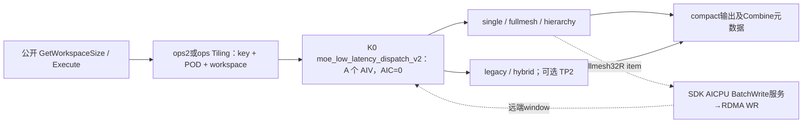
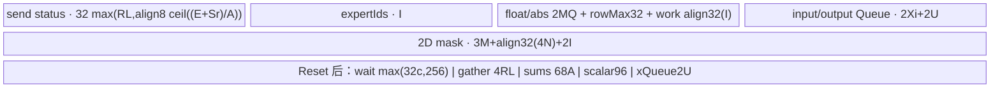
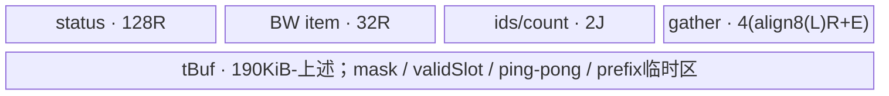
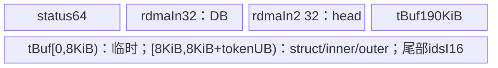
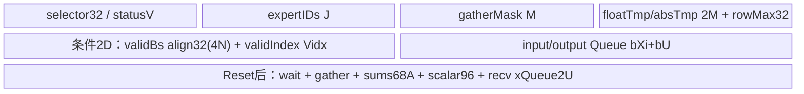

# SGL DeepEP Low-Latency INT8 动态量化 Dispatch A2/A3 ACLNN 算子知识

## 算子速览

| 项目 | 内容 |
|---|---|
| 实际入口 | `aclnnMoeLowLatencyDispatchV2GetWorkspaceSize` / `aclnnMoeLowLatencyDispatchV2`，公开两段式 ACLNN。 |
| 计算语义 | `quant_mode=2`：逐token FP32 absmax动态量化为INT8，并输出FP32逆scale；按 top-k 专家复制 token，跨 EP rank 发送，接收端按本地专家、源 rank 压紧排列；输出反向 Combine 所需元数据。TP2 的 A3 路线随后拼接 TP 对端收到的数据。 |
| 输入输出 | ND FP16/BF16 `x[N,H]`，INT32 `expertIds[N,K]`，可选 BOOL mask；INT8 compact `expandX[T,H]`，INT32 assist/EP/TP counts，INT64 专家计数。dynamicScales每有效行1个FP32逆scale。 |
| 执行类型 | AIV_VECTOR 与非 Cube 通信 Hybrid；A2 fullmesh 有 AICPU BatchWrite 服务，hierarchy 自建 RDMA WQE；其余直接 MTE window 搬运。没有可达 Cube/AIC/MIX_CV 节点。 |
| Kernel 路线 | R-001 single；R-002/003 fullmesh无/有smooth；R-004/005 hierarchy无/有smooth；R-006..013 A3 legacy/hybrid×EP/TP2×无/有smooth。 |
| 核心资源 | 单个 AIV kernel、阶段性 UB、workspace 计数矩阵或 descriptor、双轮通信 window、flag/magic、RDMA SQ/doorbell。 |
| 来源闭包 | `source_closed`：公开 wrapper→Host/逐字段 POD→全部 key/无 body 终点→完整十三路线 body/helper→SDK BatchWrite 服务与 WR、hierarchy WQE/SGE；止于已展开算法之后的 DMA/Vector/driver primitive。 |
| 验证状态 | 已完成源码闭包检查；本次知识提取未执行编译、真机、数值或性能测试。draft 保留静态缺陷；源码闭合不表示每个 Host 接受组合均可正确执行。 |

本文 `P=csrc/deepep/`，`H=impl/adv_api/detail/hccl/`，路径前缀只用于证据表。先前冻结 Query 中的[Low-Latency API](../../../../apis/deepep/deepep_low_latency_dispatch_combine.md)说明调用方式，未覆盖完整实现，本卡采用 create。本卡只q2 INT8；q0/FP8/MXFP8/MXFP4为独立数学语义，不纳入本卡。

## 接口与语义

### 计算语义

令 `R=epWorldSize,r=epRankId,E=moeExpertNum,Sr=sharedExpertRankNum,Se=sharedExpertNum,L=E/(R-Sr),B=globalBs/R,A=aivNum`。非共享专家 `e` 的目标为 `dst=e/L+Sr`。每个有效槽 `(source s,token n,topk k)` 将per-token量化的INT8及逆scale复制到目标；主输出顺序为本地专家升序、源 rank 升序、源槽稳定顺序。无乘权或token累加。令v=FP32(x)，smooth Route先v_h*=scales[expertRow,h]；m=max|v|，a=127/m，q=INT8(FP32→INT32 CAST_RINT→half CAST_ROUND→INT8 CAST_TRUNC)，s=1/a，近似v≈q*s。A2 hierarchy虽然有带smooth模板，但实际QuantProcess不读scales；已知冲突见R-005。所有A2/A3本实例均无m=0保护，非有限值及最终cast结果未实测。共享专家发送给 `s%(Sr/Se)+sharedExpert*(Sr/Se)`，只复制存在至少一个有效专家槽的 token。

`epRecvCounts[l*R+s]` 是整个 compact 接收域中截至该专家/源 rank 的 inclusive prefix，不能当作互相独立的原始计数；`expertTokenNumsType=1` 输出每本地专家 count，0 输出专家前缀。有效输出为这些计数覆盖的 compact 区间，其余容量不保证初始化。A3/single 的 assist 为逐收到槽的 `[sourceRank,sourceToken,sourceTopk]`；A2 fullmesh 的 assist 写源 `N*K` 槽在其目标专家内的 ordinal；hierarchy 的 Combine 元数据主要写入扩展 `epRecvCounts`，并未写公开 assist 输出。这些格式必须随原 handle 传给匹配 Combine，不能互换。

1D mask 的实际算法只求 true 总数，随后发送输入的前该数量行，要求有效 token 为前缀；它没有一般稀疏行压紧。2D mask 对槽做 Compare/GatherMask，保留原槽编号；A3/single 还求有任一有效槽的行用于共享专家。hierarchy 未消费 mask，详见失败边界。

### 输入、输出与属性

| 参数 | shape/layout | dtype | 约束、默认值与语义 |
|---|---|---|---|
| x | [N,H] ND/AutoContiguous | BF16/FP16 | 公开 Python BF16；ACLNN 配对也支持FP16输入→INT8输出；N≤512。 |
| expertIds | [N,K] ND/AutoContiguous | INT32 | Python 将 topk 索引转 INT32；有效专家编号应在 [0,E)。负值需要相应 2D mask，不能凭公开 Python 的 -1 描述推定任意 raw ACLNN 自动剪枝。 |
| scalesOptional | optional | FP32 | q2可有/无smooth输入。single带scales生成无body；fullmesh/A3真正按expert行相乘；hierarchy模板带参数但不读。single/A3检查二维[E+Se,H]，multi缺完整shape检查。 |
| xActiveMaskOptional | [N] 或 [N,K] ND | BOOL | single/A3/fullmesh 的 mask 管线各自闭合；hierarchy 实际忽略。 |
| expandXOut | [T,H] ND | INT8 | 接收容量 T；有效行按 expert/source compact，不是固定每专家容量 stride。 |
| dynamicScalesOut | [≥capacity*TP] ND | FP32 | 每有效compact行1个逆scale；与payload配对，容量尾部不保证值。 |
| assistInfoForCombineOut | 1D ND | INT32 | single/A3 要求长度≥3*capacity；fullmesh ordinal 与 hierarchy 元数据格式见上。 |
| expertTokenNumsOut | [L]，共享 rank [1] | INT64 | 类型0前缀、1计数；default1。 |
| epRecvCountsOut | 单专家源段或额外 hierarchy 协议 | INT32 | single/A3 至少 R*L（共享rank R），TP2 再乘2；hierarchy 使用更长复合区。 |
| tpRecvCountsOut | [tpWorldSize] | INT32 | 无 TP body 不写该值；A3 TP2 写自身与对端有效行数。 |
| groupEp / epWorldSize / epRankId / moeExpertNum | 属性 | string/int64 | group 长度1..127；rank 范围检查；A2 multi 的若干 AttrPointer<int> 读取是源码原样，不替换成假想 int64 ABI。 |
| groupTp / tpWorldSize / tpRankId | 属性 | string/int64 | TP0/1 归一 rank0；TP2 要组名、合法rank、L=1。A2 wrapper 强制传空 groupTp，不能以其 Host 通用检查宣称 TP2 可执行。 |
| expertShardType | 属性 | int64 | 仅0。 |
| sharedExpertNum / sharedExpertRankNum | 属性 | int64 | Se0..4、0≤Sr<R；默认Se1/Sr0归一到0；同时为0或同时正，Sr%Se=0。A2 multi Host 强制 Sr0，不完整保留共享属性。 |
| quantMode / globalBs / expertTokenNumsType / commAlg | 属性 | int64/string | 本卡q2；globalBs0→N*R；single/A3 非0需≥N*R且整除R；A3另要求B=globalBs/R≤512，与本地N上限独立；type0/1；commAlg的平台含义见 selector。 |

### 入口与版本

OpDef 名 `MoeLowLatencyDispatchV2`；公开头文件名沿用 `aclnn_moe_distribute_dispatch_v2.h`，不是另一个入口。ops2 wrapper 的 GetWorkspaceSize 把 elasticInfo 设 null、groupTp 设空字符串、zero/copy/const experts 都设0；执行 wrapper 按910B选择 AICPU，否则MTE。ops wrapper 也固定 elasticInfo null/三种特殊专家0，保留 groupTp；要求 commAlg 非空指针，inner 成功后 executor 与 *executor 非空，weak server type 根据 ccu/MTE 设置。自动生成 inner、Contiguous、executor 与框架 stream launch 是明确框架边界，不补造代码。

公开 LOW_LATENCY_API 标注 A2/A3/A5；本卡只 A2/A3，OpDef 分别 ascend910b / ascend910_93。CANN9.1.0 来自固定 README、DeepEP README 与 SDK version.cmake；公开 README 同时提9.0系列不等于本卡覆盖9.0。活动 build 按架构选择 ops2/ops；ops2 kernel CMake 尝试从已安装 ops_transformer 路径复制公共头（失败只warning），本卡闭合固定本地定义，安装公共头替换仍为构建边界，未验证安装头或二进制ABI。

## Host/Launcher 执行流程

### 参数校验与前处理

1. Python default strategy解析量化选择；A2/A3 use_fp8=True选择int8，MXFP标志不适用；显式C++ mode=int8也进入q2，文档legacy env与实际解析差异不推成稳定承诺。C++ `Buffer::low_latency_dispatch` 要 low_latency_mode，capacity≥N；globalBs=capacity*R，x/topk rank 等检查由调用层/Host承担。
2. C++ INT8分配 INT8 `[T,H]`、FP32 scales[T]、INT32 assist[max(NK,128T)]、INT64[L]、EP counts和TP counts[1]。MoE容量 T=globalBs*min(K,L)；共享rank分配 globalBs/Sr，与通用 ACLNN shared group容量公式不完全相同。topk转INT32；默认 scales/mask缺省；env `MOE_ENABLE_TOPK_NEG_ONE=1` 才构造(topk>=0)2D mask，并禁止layered。async/hook返回无实质接收拆分。
3. A2 selector首先确认0<R≤256；R≤8进入single（后续要求R≥2），否则先选hierarchy/fullmesh，再查multi shape/attrs。single检查输入输出dim/dtype/ND、共享/TP/globalBs/容量；H1024..8192；K判断写成 `K<0` 因而K0未在此拒绝。multi要求R%8=0、E≤512且整除R、H>0/H≤7168/H%32=0、N≤512、K1..16且≤E、q只能0/2；没有同single一样完整的输出shape或globalBs一致性检查。多机 tpWorld/tpRank/shard/Sr 被覆盖为0，非共享Se字段未显式写入，不可当作用户值被保留。
4. A3先GetAttr、mask/elastic flag、dtype/dim/format、CheckAttrs、CheckTensorShape，再计算window、workspace、AIV和key；R2..768，E1..1024，H1024..8192，N0..512，K1..min(16,E)，L必须为正整数；CheckWinSize另要求每rank容量B=globalBs/R≤512。q1静态量化显式拒绝；q2+scales使key+10；q0+scales拒绝不属于本卡。2Dmask必须[N,K]。TP2要求L1。capacity公式 `C=globalBs*min(L,K)`；共享rank `C=B*ceil(R/(Sr/Se))`；检查T≥tpWorldSize*C（tpWorldSize0时该下界退化），assist≥3C。
5. commAlg empty/fullmesh_v1→MTE，fullmesh_v2另加key1000且禁止mask/TP2/elastic，ccu转950专用链；A3 fullmesh_v2与ccu没有对应有效body，作为已知终点列出。所有 GRAPH_FAILED 为Tiling失败，不臆造具体 ACLNN 数值错误码。

### 参数、Workspace 与生命周期

统一记 `align_p(v)=ceil(v/p)*p`，字节按 byte 计，`I=4NK,Ha=align32(H),S=Ha+44,U=align32(S),G=align512(S),Gc=align512(2H)`。S 中 payload Ha、保留scale32B、三元组12B；q2的scale区首4B填FP32逆scale，余28B为保留；triple@Ha+32。输入Queue另记Xi=align32(2H)。两轮数据以从selector读出的旧值 z∈{0,1} 选择，随后写 z^1，要求rank/调用轮次一致且上一轮已消费。

| 路线 | workspace 总申请 | 用户区消费 | window 需求与生命周期 |
|---|---|---|---|
| A2 single | 16MiB+512A² | 计数网格 [producer core,consumer core]，格距512B；user workspace由框架分配并在stream完成前保持。 | Host检查 2*(B*G*R*L+B*Gc*(K+Se))≤W；Device另加固定3MiB数据前缀，Host公式未计入该前缀。 |
| A2 fullmesh | 16MiB+1MiB | 开头32R descriptor，每条localBuf64/remoteBuf64/count64/type32/rank32；其它为保留。 | 实际context W，half=W/2、D=half-1MiB、d=floor(D/R)；IN/OUT各双轮；状态与数据均在每源/目的d段。 |
| A2 hierarchy | 16MiB+1MiB | 开头64N token→server bitmap，每个token64B，实际首u64有效。 | RDMA前800MiB分两400MiB；后IPC区与通知预留400MiB；Device断言W≥E*N*(2H+16*align8(K))+4MiB+800MiB+400MiB，公开文档旧公式未含末400MiB。 |
| A3全部 | 16MiB+512A²+511+512L+512 | body消费计数grid512A²；其余token/gather metadata为Host预留，此body未消费。 | W=env uint16 MiB（DEEPEP_HCCL_BUFFSIZE优先），Host legacy要求2*halfData≤W，hybrid要求2*(halfData+107MiB+48KiB)≤W；halfData=B*G*R*L+B*Gc*(K+Se)。 |

Host窗口env经 stoi→uint16，负数/大值没有额外范围拒绝；invalid/out_of_range记录日志并保留default200。不可把env值直接当实际组window分配证据。A3/single `CheckWindowSize` 在实际W较小时仅申请1B UB并做INT32 DMA探针，不返回Tiling失败，也不是可靠边界保护。

### 启动图与失败传播



| 节点或边 | producer→consumer | 地址/extent | ordering | owner/lifetime与失败 |
|---|---|---|---|---|
| Host→K0 | 相应Tiling→entry/router | POD；全AIV blockDim=CalcTschBlockDim(A,0,A)；single/A3 scheduleMode1；A2multi额外AICPU blockDim6 | 框架executor/stream | inner bridge为框架边界；不推定Host不匹配key会自动fallback。 |
| K0→同rank各核 | recv count→GetCumSum | grid offset=512*(A*producer+consumer)，每格首i32有效，总512A² | MTE3事件/PIPE_ALL→SyncAll→MTE2 | 本kernel本次user workspace，完成前不可覆盖。 |
| K0→远端K0 | payload与计数flag | single/A3 S bytes每G间隔；fullmesh每rank描述的完整段；hierarchytokenStruct | 各Route事件、flag/next-token、magic | 通信组window拥有，双轮和远端消费共同约束复用；不是仅靠本地stream即可复用远端。 |
| K0→SDK服务 | BatchWrite<true>(workspace,R) | descriptors32R，INT8字节count | descriptor DMA后SyncAll；message flush/valid/commit | SDK返回handle未由SGL显式检查；Finalize完成前descriptor/window保持。 |
| K0→输出 | LocalWindowCopy/Ipc2Out | 有效compact payload及各格式辅助元数据 | 相应MTE/SyncAll，最终Finalize或kernel结束 | 输出调用者持有；失败不会自动清零剩余容量。 |

A3没有另一个显式Hccl通信kernel；A2 AICPU服务不是Host另启的AscendC kernel。hierarchy在AIV直接写SQ WQE并敲doorbell，不能把它误画成BatchWrite服务搬运。

## Route 与参数设计

### 分核与资源计算

`split(M,C,c)`：q=M/C,t=M%C，start=q*c+min(c,t)，count=q+[c<t]。single/A3按该式分发送槽、状态expert/source域；shared发送使用后 `max(1,floor(A*Se/(K+Se)))` 核，其余发MoE；R-001实际仅普通接收rank key可达。接收域Q=R*L（A3共享rank Q=R），c_i=floor(Q/A)+[i<Q%A]。

fullmesh所有核重复建立小型索引/计数，token槽按split(Nvalid*K,A)发送；rank按split(R,A)等待和copy；最后核写assist与输出counts，core0提交BatchWrite。hierarchy前s=R/8核负责跨server发送/inner info，第s核outer info，剩余核以 `C=(A-s-1)/s` 组成s组做Win2Ipc；输出每专家用floor(A/L)核。Host没有检查C>0、floor(A/L)>0或全部临时区上界。

### Route 选择

A3 legacy的R-006/R-007/R-010/R-011不得与Normal共用同一HCCL window；同进程、同EP group混用Normal/Low-Latency时，应在所有rank进程启动前一致设置`DEEPEP_HYBRID_DEPLOYMENT=1`，选择对应hybrid Route。

| 顺序 | Route | Key/模板 | 精确选择条件与优先级 | 不适用去向 |
|---:|---|---|---|---|
| 1 | R-001 A2 single，无smooth | 2000011002；MoeDistributeDispatchV2Single<X,O,false,true,false,false,false> | A2，2≤R≤8，q2，scales缺省，TP≠2，当前rank非shared接收；X BF16/FP16→INT8、FP32 scales输出，公共shape/dtype通过 | Host GRAPH_FAILED、driver断言或无匹配终点，不自动换body |
| 2 | R-002 A2 fullmesh，无smooth | 2000001002；MoeDistributeDispatchV2<X,O,false,true,false> | A2，R>8且R%8=0，q2，scales缺省，env未强制hierarchy且commAlg=fullmesh；X BF16/FP16→INT8、FP32 scales输出，公共shape/dtype通过 | Host GRAPH_FAILED、driver断言或无匹配终点，不自动换body |
| 3 | R-003 A2 fullmesh，smooth | 2000001012；MoeDistributeDispatchV2<X,O,false,true,true> | A2，R>8且R%8=0，q2，scales存在，env未强制hierarchy且commAlg=fullmesh；X BF16/FP16→INT8、FP32 scales输出，公共shape/dtype通过 | Host GRAPH_FAILED、driver断言或无匹配终点，不自动换body |
| 4 | R-004 A2 hierarchy，无smooth | 2100001002；MoeDistributeDispatchV2Layered<X,O,false,true,false> | A2，R>8且R%8=0，q2，scales缺省，env PCIe1/ROCE0优先或commAlg=hierarchy，context dataplane=AIV；X BF16/FP16→INT8、FP32 scales输出，公共shape/dtype通过 | Host GRAPH_FAILED、driver断言或无匹配终点，不自动换body |
| 5 | R-005 A2 hierarchy，Host带smooth但Device忽略 | 2100001012；MoeDistributeDispatchV2Layered<X,O,false,true,true> | A2，R>8且R%8=0，q2，scales存在，env PCIe1/ROCE0优先或commAlg=hierarchy，context dataplane=AIV；X BF16/FP16→INT8、FP32 scales输出，公共shape/dtype通过 | Host GRAPH_FAILED、driver断言或无匹配终点，不自动换body |
| 6 | R-006 A3 legacy EP，无smooth | 30002；MoeDistributeDispatchV2<X,O,false,true,false,false> | A3，q2，scales缺省，TP≠2，DEEPEP_HYBRID_DEPLOYMENT≠1且不与Normal共用同一HCCL window，commAlg空/fullmesh_v1；X BF16/FP16→INT8、FP32 scales输出，B=globalBs/R≤512，公共shape/dtype通过 | Host GRAPH_FAILED、driver断言或无匹配终点，不自动换body |
| 7 | R-007 A3 legacy EP，smooth | 30012；MoeDistributeDispatchV2<X,O,false,true,true,false> | A3，q2，scales存在，TP≠2，DEEPEP_HYBRID_DEPLOYMENT≠1且不与Normal共用同一HCCL window，commAlg空/fullmesh_v1；X BF16/FP16→INT8、FP32 scales输出，B=globalBs/R≤512，公共shape/dtype通过 | Host GRAPH_FAILED、driver断言或无匹配终点，不自动换body |
| 8 | R-008 A3 hybrid EP，无smooth | 30002；MoeDistributeDispatchV2<X,O,false,true,false,false> | A3，q2，scales缺省，TP≠2，DEEPEP_HYBRID_DEPLOYMENT=1，commAlg空/fullmesh_v1；X BF16/FP16→INT8、FP32 scales输出，B=globalBs/R≤512，公共shape/dtype通过 | Host GRAPH_FAILED、driver断言或无匹配终点，不自动换body |
| 9 | R-009 A3 hybrid EP，smooth | 30012；MoeDistributeDispatchV2<X,O,false,true,true,false> | A3，q2，scales存在，TP≠2，DEEPEP_HYBRID_DEPLOYMENT=1，commAlg空/fullmesh_v1；X BF16/FP16→INT8、FP32 scales输出，B=globalBs/R≤512，公共shape/dtype通过 | Host GRAPH_FAILED、driver断言或无匹配终点，不自动换body |
| 10 | R-010 A3 legacy EP/TP2，无smooth | 30102；MoeDistributeDispatchV2<X,O,false,true,false,true> | A3，q2，scales缺省，TP=2且L=1/groupTP非空，DEEPEP_HYBRID_DEPLOYMENT≠1且不与Normal共用同一HCCL window，commAlg空/fullmesh_v1；X BF16/FP16→INT8、FP32 scales输出，B=globalBs/R≤512，公共shape/dtype通过 | Host GRAPH_FAILED、driver断言或无匹配终点，不自动换body |
| 11 | R-011 A3 legacy EP/TP2，smooth | 30112；MoeDistributeDispatchV2<X,O,false,true,true,true> | A3，q2，scales存在，TP=2且L=1/groupTP非空，DEEPEP_HYBRID_DEPLOYMENT≠1且不与Normal共用同一HCCL window，commAlg空/fullmesh_v1；X BF16/FP16→INT8、FP32 scales输出，B=globalBs/R≤512，公共shape/dtype通过 | Host GRAPH_FAILED、driver断言或无匹配终点，不自动换body |
| 12 | R-012 A3 hybrid EP/TP2，无smooth | 30102；MoeDistributeDispatchV2<X,O,false,true,false,true> | A3，q2，scales缺省，TP=2且L=1/groupTP非空，DEEPEP_HYBRID_DEPLOYMENT=1，commAlg空/fullmesh_v1；X BF16/FP16→INT8、FP32 scales输出，B=globalBs/R≤512，公共shape/dtype通过 | Host GRAPH_FAILED、driver断言或无匹配终点，不自动换body |
| 13 | R-013 A3 hybrid EP/TP2，smooth | 30112；MoeDistributeDispatchV2<X,O,false,true,true,true> | A3，q2，scales存在，TP=2且L=1/groupTP非空，DEEPEP_HYBRID_DEPLOYMENT=1，commAlg空/fullmesh_v1；X BF16/FP16→INT8、FP32 scales输出，B=globalBs/R≤512，公共shape/dtype通过 | Host GRAPH_FAILED、driver断言或无匹配终点，不自动换body |

```text
q2固定；按平台/架构进入不同Host
A2 GetIsSingle：R≤8 -> single检查 ->2000011002+10*hasScale+100*TP2+1000*sharedReceiver
  公开TP2固定空groupTP先失败；带scale/共享接收均无router；只有2000011002实例
R>8：PCIe=1&&ROCE=0优先hierarchy，否则commAlg fullmesh/hierarchy
  fullmesh=2000001002+10*hasScale；hierarchy=2100001002+10*hasScale
  hierarchy还查dataplane AIV，非AIV assert终点
A3：30002+10*hasScale+100*TP2+1000*fullmesh_v2
  30002/30012/30102/30112按hybrid窗口分支进入对应body
  31002/31012没有router；fullmesh_v2+TP2先拒绝
  commAlg=ccu提前转CCUHost，但A3没有__DAV_C310__ CCU body
```

### 模板/实现执行矩阵

| Route | key/selector | dtype/shape/platform 完整命中条件 | 执行拓扑与 Kernel 节点 | 实际模板/body | 内存与同步特征 | tail/fallback |
|---|---|---|---|---|---|---|
| R-001 | 2000011002 | A2，2≤R≤8，q2，scales缺省，TP≠2，当前rank非shared接收；N≤512，A2 multi H≤7168/H%32，single/A3 H1024..8192；OpDef BF16/FP16→INT8 | 单K0；AIV_VECTOR+直接MTE | MoeDistributeDispatchV2Single<X,O,false,true,false,false,false>::Init/Process/QuantProcess | 输入/输出双Queue；grid；32B scale+triple；无smooth | split余数/有效len；零absmax无保护，不补无body |
| R-002 | 2000001002 | A2，R>8且R%8=0，q2，scales缺省，env未强制hierarchy且commAlg=fullmesh；N≤512，A2 multi H≤7168/H%32，single/A3 H1024..8192；OpDef BF16/FP16→INT8 | 单K0；AIV_VECTOR+AICPU BatchWrite/RDMA | MoeDistributeDispatchV2<X,O,false,true,false>::Init/Process/QuantProcess | 190KiB manual UB；32R descriptor；SDK服务；无smooth | split余数/有效len；零absmax无保护，不补无body |
| R-003 | 2000001012 | A2，R>8且R%8=0，q2，scales存在，env未强制hierarchy且commAlg=fullmesh；N≤512，A2 multi H≤7168/H%32，single/A3 H1024..8192；OpDef BF16/FP16→INT8 | 单K0；AIV_VECTOR+AICPU BatchWrite/RDMA | MoeDistributeDispatchV2<X,O,false,true,true>::Init/Process/QuantProcess | 190KiB manual UB；32R descriptor；SDK服务；smooth先乘expert行 | split余数/有效len；零absmax无保护，不补无body |
| R-004 | 2100001002 | A2，R>8且R%8=0，q2，scales缺省，env PCIe1/ROCE0优先或commAlg=hierarchy，context dataplane=AIV；N≤512，A2 multi H≤7168/H%32，single/A3 H1024..8192；OpDef BF16/FP16→INT8 | 单K0；AIV_VECTOR+自建WQE/RDMA/IPC | MoeDistributeDispatchV2Layered<X,O,false,true,false>::Init/Process/QuantProcess | 190KiB+128B UB；quant batch与next-token/WQE/IPC；无smooth | split余数/有效len；零absmax无保护，不补无body |
| R-005 | 2100001012 | A2，R>8且R%8=0，q2，scales存在，env PCIe1/ROCE0优先或commAlg=hierarchy，context dataplane=AIV；N≤512，A2 multi H≤7168/H%32，single/A3 H1024..8192；OpDef BF16/FP16→INT8 | 单K0；AIV_VECTOR+自建WQE/RDMA/IPC | MoeDistributeDispatchV2Layered<X,O,false,true,true>::Init/Process/QuantProcess | 190KiB+128B UB；quant batch与next-token/WQE/IPC；smooth输入实际忽略 | split余数/有效len；零absmax无保护，不补无body |
| R-006 | 30002 | A3，q2，scales缺省，TP≠2，DEEPEP_HYBRID_DEPLOYMENT≠1且不与Normal共用同一HCCL window，commAlg空/fullmesh_v1；N≤512，A2 multi H≤7168/H%32，single/A3 H1024..8192；OpDef BF16/FP16→INT8 | 单K0；AIV_VECTOR+EP直接MTE | MoeDistributeDispatchV2<X,O,false,true,false,false>::Init/Process/QuantProcess | FP32 alias scratch/双Queue；Reset后recv Queue2；grid；无smooth | split余数/有效len；零absmax无保护，不补无body |
| R-007 | 30012 | A3，q2，scales存在，TP≠2，DEEPEP_HYBRID_DEPLOYMENT≠1且不与Normal共用同一HCCL window，commAlg空/fullmesh_v1；N≤512，A2 multi H≤7168/H%32，single/A3 H1024..8192；OpDef BF16/FP16→INT8 | 单K0；AIV_VECTOR+EP直接MTE | MoeDistributeDispatchV2<X,O,false,true,true,false>::Init/Process/QuantProcess | FP32 alias scratch/双Queue；Reset后recv Queue2；grid；smooth先乘expert行 | split余数/有效len；零absmax无保护，不补无body |
| R-008 | 30002 | A3，q2，scales缺省，TP≠2，DEEPEP_HYBRID_DEPLOYMENT=1，commAlg空/fullmesh_v1；N≤512，A2 multi H≤7168/H%32，single/A3 H1024..8192；OpDef BF16/FP16→INT8 | 单K0；AIV_VECTOR+EP直接MTE | MoeDistributeDispatchV2<X,O,false,true,false,false>::Init/Process/QuantProcess | FP32 alias scratch/双Queue；Reset后recv Queue2；grid；无smooth | split余数/有效len；零absmax无保护，不补无body |
| R-009 | 30012 | A3，q2，scales存在，TP≠2，DEEPEP_HYBRID_DEPLOYMENT=1，commAlg空/fullmesh_v1；N≤512，A2 multi H≤7168/H%32，single/A3 H1024..8192；OpDef BF16/FP16→INT8 | 单K0；AIV_VECTOR+EP直接MTE | MoeDistributeDispatchV2<X,O,false,true,true,false>::Init/Process/QuantProcess | FP32 alias scratch/双Queue；Reset后recv Queue2；grid；smooth先乘expert行 | split余数/有效len；零absmax无保护，不补无body |
| R-010 | 30102 | A3，q2，scales缺省，TP=2且L=1/groupTP非空，DEEPEP_HYBRID_DEPLOYMENT≠1且不与Normal共用同一HCCL window，commAlg空/fullmesh_v1；N≤512，A2 multi H≤7168/H%32，single/A3 H1024..8192；OpDef BF16/FP16→INT8 | 单K0；AIV_VECTOR+EP/TP2直接MTE | MoeDistributeDispatchV2<X,O,false,true,false,true>::Init/Process/QuantProcess | FP32 alias scratch/双Queue；Reset后recv Queue2；grid；无smooth | split余数/有效len；零absmax无保护，不补无body |
| R-011 | 30112 | A3，q2，scales存在，TP=2且L=1/groupTP非空，DEEPEP_HYBRID_DEPLOYMENT≠1且不与Normal共用同一HCCL window，commAlg空/fullmesh_v1；N≤512，A2 multi H≤7168/H%32，single/A3 H1024..8192；OpDef BF16/FP16→INT8 | 单K0；AIV_VECTOR+EP/TP2直接MTE | MoeDistributeDispatchV2<X,O,false,true,true,true>::Init/Process/QuantProcess | FP32 alias scratch/双Queue；Reset后recv Queue2；grid；smooth先乘expert行 | split余数/有效len；零absmax无保护，不补无body |
| R-012 | 30102 | A3，q2，scales缺省，TP=2且L=1/groupTP非空，DEEPEP_HYBRID_DEPLOYMENT=1，commAlg空/fullmesh_v1；N≤512，A2 multi H≤7168/H%32，single/A3 H1024..8192；OpDef BF16/FP16→INT8 | 单K0；AIV_VECTOR+EP/TP2直接MTE | MoeDistributeDispatchV2<X,O,false,true,false,true>::Init/Process/QuantProcess | FP32 alias scratch/双Queue；Reset后recv Queue2；grid；无smooth | split余数/有效len；零absmax无保护，不补无body |
| R-013 | 30112 | A3，q2，scales存在，TP=2且L=1/groupTP非空，DEEPEP_HYBRID_DEPLOYMENT=1，commAlg空/fullmesh_v1；N≤512，A2 multi H≤7168/H%32，single/A3 H1024..8192；OpDef BF16/FP16→INT8 | 单K0；AIV_VECTOR+EP/TP2直接MTE | MoeDistributeDispatchV2<X,O,false,true,true,true>::Init/Process/QuantProcess | FP32 alias scratch/双Queue；Reset后recv Queue2；grid；smooth先乘expert行 | split余数/有效len；零absmax无保护，不补无body |

### 隐藏性能 Guard

| Guard | Host/Tiling 条件 | Device/资源原因 | 影响 Route | 不满足时去向 | 源码符号 |
|---|---|---|---|---|---|
| 架构+dtypes | OpDef ascend910b/910_93；X BF16/FP16→O INT8 | q2动态量化，输出FP32逆scale | 全部 | 框架/编译配对拒绝或无body，不臆造错误码 | OpDef；entry预处理guard |
| smooth输入 | single有scales产生2000011012无body；fullmesh/A3有实例；hierarchy实例不读取 | 不能从Host接受推实现含义 | 见各Route | 已知无body或语义冲突 | CalTilingKey/entry/QuantProcess |
| H32B | A2multi H%32=0且≤7168；single/A3 H1024..8192 | multi DataCopy无pad token行 | R-002..005 | GRAPH_FAILED；single/A3使用DataCopyPad | A2CheckShapeAndSetTiling |
| UB | A3 send仅按估算>170KiB由2buf变1；A2full固定190KiB无反向检查 | 请求/计账有差异，见各Route | 全部 | 无完整Hostfallback，不宣称自动安全 | Init/QuantInit |
| 状态容量 | A3 E*32≤512KiB-32 | 每专家/source状态与timeout位置 | R-006..013 | GRAPH_FAILED | SetHcommCfg窗口检查 |
| A2single key | 公开TP2因groupTP空先失败；内部producer保留+100；共享接收+1000 | router只匹配无smooth/无TP/非shared q2key | R-001及已知终点 | 无body，无权替换为通用模板 | CalTilingKey/entry |
| hierarchy AIV | GetDataplaneMode(context)==AIV | 直接SQ/doorbell实例 | R-004/005 | assert(driver版本文案)，不猜真实驱动错误 | entry/GetDataplaneMode |
| hierarchy核心分组 | Host未检查s与A/L关系 | (A-s-1)/s、A/L分母与分组 | R-004/005 | 源码无fallback，draft前提 | Win2Ipc/Ipc2Out |
| 空域/容量 | N0允许；single K0条件遗漏；TP0下输出T下界退化 | 队列零分配、分母/掩码/lastCore等各有条件 | 相应路线 | 不把Host接受当正确执行 | CheckTensorShape/Init |

### POD/ABI

A2与A3的Info和外层结构不同，不能按同名结构混用。以下offset按固定类型的普通自然8B对齐推导，未编译测量；SDK公开init64/cc512外壳是源码定义。A2 Info推导size88/align8，外层info@576、总664；A3 Info size128/align8，info@1088、总1216。Host direct typed TilingData与GET_TILING_DATA_WITH_STRUCT/GET_TILING_DATA按各自构建配对。

| 结构 | 字段 | 类型/位宽 | ABI 布局 | 单位 | Host/launcher producer | Device consumer | 边界 |
|---|---|---|---|---|---|---|---|
| A2/A3 Info | epWorldSize | uint32/32 | 0 | rank数 | GetAttr/CheckAttr=*epWorldSize；single2..8，multi≤256且%8=0，A3≤768 | Init/split/window | int64→u32窄化先后按各Host，未统一溢出检查 |
| A2/A3 Info | tpWorldSize | uint32/32 | 4 | rank数 | single/A3=*tpWorldSize；multi强制0 | Init/TP选择 | int64→u32窄化先后按各Host，未统一溢出检查 |
| A2/A3 Info | epRankId | uint32/32 | 8 | rank | *epRankId，检查[0,R) | 目标window与源槽 | int64→u32窄化先后按各Host，未统一溢出检查 |
| A2/A3 Info | tpRankId | uint32/32 | 12 | rank | single/A3合法TP rank；multi0 | TP peer=1-rank | int64→u32窄化先后按各Host，未统一溢出检查 |
| A2/A3 Info | expertSharedType(A2)/expertShardType(A3) | uint32/32 | 16 | enum | single/A3仅0；multi0 | body未用分片模式 | int64→u32窄化先后按各Host，未统一溢出检查 |
| A2/A3 Info | sharedExpertNum | uint32/32 | 20 | expert | single/A3规范化Se；multi未显式赋值 | single/A3 shared发送；multi不消费 | int64→u32窄化先后按各Host，未统一溢出检查 |
| A2/A3 Info | sharedExpertRankNum | uint32/32 | 24 | rank数 | single/A3=Sr；multi0 | L=E/(R-Sr) | int64→u32窄化先后按各Host，未统一溢出检查 |
| A2/A3 Info | moeExpertNum | uint32/32 | 28 | expert数 | *moeExpertNum，整除检查 | L/目标expert | int64→u32窄化先后按各Host，未统一溢出检查 |
| A2/A3 Info | quantMode | uint32/32 | 32 | enum | 本任务2 | Hostkey；body编译DynamicQuant=true | int64→u32窄化先后按各Host，未统一溢出检查 |
| A2/A3 Info | globalBs | uint32/32 | 36 | token容量 | single/A3 0→NR否则合法globalBs；multi直接0→NR或窄化属性 | B=globalBs/R；multi fullmesh实际按本地N | int64→u32窄化先后按各Host，未统一溢出检查 |
| A2/A3 Info | bs | uint32/32 | 40 | token | single/A3=x.dim0；multi=expertIds.dim0 | token/mask/scratch | int64→u32窄化先后按各Host，未统一溢出检查 |
| A2/A3 Info | k | uint32/32 | 44 | topk槽 | expertIds.dim1 | NK；目标索引 | int64→u32窄化先后按各Host，未统一溢出检查 |
| A2/A3 Info | h | uint32/32 | 48 | element/token | x.dim1 | DMA H与payload字节 | int64→u32窄化先后按各Host，未统一溢出检查 |
| A2/A3 Info | aivNum | uint32/32 | 52 | core | GetCoreNumAiv() | split/sync/grid | int64→u32窄化先后按各Host，未统一溢出检查 |
| A2 Info | isQuant | bool/8 | 56 | flag/enum | Host未显式设值 | 仅日志；body由模板StaticQuant\|DynamicQuant决定 | 对应route外inactive；padding62..63 |
| A2 Info | isTokenMask | bool/8 | 57 | flag/enum | mask存在且dim1 | TokenActiveMaskCal，hierarchy未消费 | 对应route外inactive；padding62..63 |
| A2 Info | isExpertMask | bool/8 | 58 | flag/enum | mask存在且dim2 | ExpertActiveMaskCal，hierarchy未消费 | 对应route外inactive；padding62..63 |
| A2 Info | reserved1 | bool/8 | 59 | flag/enum | 未显式写 | 未读 | 对应route外inactive；padding62..63 |
| A2 Info | reserved2 | bool/8 | 60 | flag/enum | 未显式写 | 未读 | 对应route外inactive；padding62..63 |
| A2 Info | reserved3 | bool/8 | 61 | flag/enum | 未显式写 | 未读 | 对应route外inactive；padding62..63 |
| A2 Info | totalUbSize | uint64/64 | 64 | byte | GetCoreMemSize(UB) | 未作为完整分配guard | 对应route外inactive；padding62..63 |
| A2 Info | totalWinSize | uint64/64 | 72 | byte | single=GetMaxWindowSize；multi未赋值 | single窗口分半；multi用context实际winSize | 对应route外inactive；padding62..63 |
| A2 Info | expertTokenNumsType | uint32/32 | 80 | flag/enum | attr0/1 | count/cumsum输出 | 对应route外inactive；padding62..63 |
| A2 Info | zeroComputeExpertNum | int32/32 | 84 | flag/enum | public零+零+零=0 | 公共入口不走special剪枝 | 对应route外inactive；padding62..63 |
| A3 Info | isTokenMask | bool/8 | 56 | flag/enum/element | optional mask dim1 | TokenActiveMaskCal | padding60..63、92..95、116..119不作数据 |
| A3 Info | isExpertMask | bool/8 | 57 | flag/enum/element | optional mask dim2 | ExpertActiveMaskCal | padding60..63、92..95、116..119不作数据 |
| A3 Info | hasElasticInfo | bool/8 | 58 | flag/enum/element | public wrapper固定null→false | InitElasticInfo不进入 | padding60..63、92..95、116..119不作数据 |
| A3 Info | isHybridDeployment | bool/8 | 59 | flag/enum/element | DEEPEP_HYBRID_DEPLOYMENT恰为字符串1 | GetWindAddr/State/selector | padding60..63、92..95、116..119不作数据 |
| A3 Info | totalUbSize | uint64/64 | 64 | byte | GetCoreMemSize(UB) | 未直接证明全部UB请求≤值 | padding60..63、92..95、116..119不作数据 |
| A3 Info | totalWinSize | uint64/64 | 72 | byte | GetMaxWindowSize env→uint16 MiB | dataState*W/2/CheckWindowSize | padding60..63、92..95、116..119不作数据 |
| A3 Info | expertTokenNumsType | uint32/32 | 80 | flag/enum/element | attr0/1 | UpdateTokenNumsOut | padding60..63、92..95、116..119不作数据 |
| A3 Info | zeroComputeExpertNum | int32/32 | 84 | flag/enum/element | wrapper固定三属性0 | 特殊专家分支inactive | padding60..63、92..95、116..119不作数据 |
| A3 Info | cumSumUBMinValue | uint32/32 | 88 | byte | GetCumSumMaxMinTmpSize({1,L*R},4,true,true)最小值 | 本A3 body未用该字段申请 | padding60..63、92..95、116..119不作数据 |
| A3 Info | scalesRow | uint64/64 | 96 | row | CheckAndSetScalesInfo写dim0 | 当前body不读该字段，smooth直接按expertIndex*H寻址 | padding60..63、92..95、116..119不作数据 |
| A3 Info | scalesCol | uint64/64 | 104 | flag/enum/element | 仅量化shape检查写入 | 本A3body不读该shape字段，smooth直接按H寻址 | padding60..63、92..95、116..119不作数据 |
| A3 Info | scalesTypeSize | uint32/32 | 112 | byte | scales存在时4，否则0 | 本A3body不读该shape字段，smooth直接按H寻址 | padding60..63、92..95、116..119不作数据 |
| A3 Info | scalesCount | uint64/64 | 120 | flag/enum/element | shape计数，缺省0 | 本A3body不读该shape字段，smooth直接按H寻址 | padding60..63、92..95、116..119不作数据 |
| A2 outer | mc2InitTiling | opaque64 | 0 | byte | GetTiling(init) | Hccl::InitV2 | SDK外壳 |
| A2 outer | mc2CcTiling | opaque512 | 64 | byte | GetTiling(cc) | SetCcTilingV2(offset64) | single op8；multi op18 |
| A2 outer | moeDistributeDispatchV2Info | Info88 | 576 | byte | 前述逐字段producer | GET_TILING_DATA_WITH_STRUCT | 不借用A3 Info |
| A3 outer | mc2InitTiling | opaque64 | 0 | byte | 第一次GetTiling(init) | 框架通信资源准备 | count2 |
| A3 outer | mc2CcTiling1 | opaque512 | 64 | byte | engine3/op8/AlltoAll fullmesh pairwise | EP组window准备 | body直接MTE |
| A3 outer | mc2CcTiling2 | opaque512 | 576 | byte | engine3/op6/AllGather ring | TP组window准备 | TP2条件消费组1 |
| A3 outer | moeDistributeDispatchV2Info | Info128 | 1088 | byte | 前述逐字段producer | entry GET_TILING_DATA/Init | 不借用A2外层 |

SDK init/cc inner 的各字段如下；offset相对各inner。A3 count2/offsets64与576，A2 count1/offset64；A2 single op8/fullmesh pairwise，A2 multi op18/fullmesh或hierarchy，A3 engine3/op8和op6。SGL没有逐次检查 GetTiling 返回码。其余默认值不能解释为业务输出初始化。

| 结构 | 字段 | 类型/位宽 | ABI 布局 | 单位 | Host/launcher producer | Device consumer | 边界 |
|---|---|---|---|---|---|---|---|
| Mc2InitTilingInner | version | u32 | 0 | version | GetTiling=100 | InitV2/资源准备 | SDK协议 |
| 同上 | mc2HcommCnt | u32 | 4 | group | A2=1/A3=2 | HCCL初始化 | 不等于AIV数 |
| 同上 | offset | u32[8] | 8 | byte | cc相对init位置64，A3另576 | SetCc/资源准备 | 其余槽0 |
| 同上 | debugMode | u8 | 40 | enum | default0 | SDK | 算子未设置 |
| 同上 | preparePosition | u8 | 41 | enum | default0 | SDK | 在线tiling |
| 同上 | queueNum | u16 | 42 | queue | default0 | 消息工作核选择 | 非blockDim |
| 同上 | commBlockNum | u16 | 44 | core | default0 | SDK调度 | 非blockDim |
| 同上 | devType | u8 | 46 | enum | runtime读取SoC | 窗口ABI选择 | runtime边界 |
| 同上 | reserved | char[17] | 47 | byte | 未显式清全区 | 未作业务消费 | 不依赖值 |
| Mc2CcTilingInner | skipLocalRankCopy | u8 | 0 | flag | default0 | SDK | 未修改 |
| 同上 | skipBufferWindowCopy | u8 | 1 | flag | default0 | SDK | 未修改 |
| 同上 | stepSize | u8 | 2 | step | default0 | SDK | 未修改 |
| 同上 | version | u8 | 3 | version | 1 | SDK | 固定外壳512 |
| 同上 | reserved | char[9] | 4 | byte | memset0 | inactive | 不是payload |
| 同上 | commEngine | u8 | 13 | enum | A2默认0，A3=3 | 服务/组资源 | A3body直接MTE |
| 同上 | srcDataType | u8 | 14 | enum | default0 | SDK参数 | BW实际dtype另在item |
| 同上 | dstDataType | u8 | 15 | enum | default0 | SDK参数 | 仅通信字节元数据；token量化在AIV内 |
| 同上 | groupName | char[128] | 16 | string | EP或TP组 | SDK关联context | group<128 |
| 同上 | algConfig | char[128] | 144 | string | 前述AlltoAll/AllGather/BatchWrite配置 | SDK算法选择 | 不等于内核router |
| 同上 | opType | u32 | 272 | enum | single8/multi18/A3 8和6 | SDK协议 | BW18 |
| 同上 | reduceType | u32 | 276 | enum | default0 | SDK | 本卡不reduce |
| 同上 | reserved2 | char[232] | 280 | byte | 未显式清全区 | inactive | 不依赖值 |
| BatchWriteItem | localBuf | u64 | 0 | GM地址 | OUT+z*half+dest*d | 服务PostSend | local output注册内存 |
| 同上 | remoteBuf | u64 | 8 | GM地址 | peerIN+z*half+source*d | 服务PostSend | remote input |
| 同上 | count | u64 | 16 | INT8元素=byte | 512+numTokens*(H+32)+4+512 | WR length | 不再乘dtype字节 |
| 同上 | dataType | u32 | 24 | enum | INT8 | SDK byte count | 载荷为INT8量化payload H字节+保留32B的FP32 inverse-scale区；descriptor按INT8元素即字节计 |
| 同上 | remoteRank | u32 | 28 | rank | dest | transport映射 | R条，32R bytes |

HCCL context由通信框架持有，不由算子Host序列化。直接消费字段逐项如下；不把未消费的大型context所有保留字段伪造成算子POD。A2两种本地context view仅共同消费winSize前缀@24；hierarchy还使用下表Combined context。M=SDK HCCL_MAX_RANK_NUM=32，不得替换成950的64。本地HcclOpResParam的localWindowsExp@184、remoteRes@2984由声明字段顺序和自然8B对齐推导，非编译实测；远端关系指针布局按各自本地定义。

| 结构 | 字段 | 类型/位宽 | ABI 布局 | 单位 | Host/launcher producer | Device consumer | 边界 |
|---|---|---|---|---|---|---|---|
| A3 HcclOpResParam | localUsrRankId | u32 | 16 | rank | runtime组 | GetRankId/InitWinState | 非Info rank，检查不一致写探针 |
| 同上 | rankSize | u32 | 20 | rank数 | runtime组 | GetRankDim/InitWinState | 不等于AIV |
| 同上 | winSize | u64 | 24 | byte | runtime组 | CheckWindowSize | 仅探针式检查 |
| 同上 | localWindowsIn | u64 | 32 | GM地址 | runtime组 | 本地GetBaseWindAddr | 数据 |
| 同上 | localWindowsExp | u64 | 184（自然布局推导） | GM地址 | runtime组 | legacy state/selector | offset由固定结构布局决定，未编译测量 |
| 同上 | remoteRes | RemoteResPtr[131072] | 2984（自然布局推导） | 地址数组 | runtime组 | remoteRes[rank].nextDevicePtr | 不自行构造 |
| RemoteResPtr | nextHostPtr | u64 | 0 | 地址 | runtime | 当前kernel不读 | size16/align8推导 |
| 同上 | nextDevicePtr | u64 | 8 | 地址 | runtime | GetBaseWindAddr/State | 指向RankRelation |
| HcclRankRelationResV2 | remoteUsrRankId | u32 | 0 | rank | runtime | 此body不读 | size64/align8推导 |
| 同上 | remoteWorldRank | u32 | 4 | rank | runtime | 此body不读 | 不作选择条件 |
| 同上 | windowsIn | u64 | 8 | 地址 | runtime | 远端payload/hybrid state | owner通信组 |
| 同上 | windowsOut | u64 | 16 | 地址 | runtime | 当前A3 body不读 | 不等于EXP |
| 同上 | windowsExp | u64 | 24 | 地址 | runtime | legacy远端state | 必须同轮 |
| 同上 | nextTagRes | ListCommon32 | 32 | 链表 | runtime | 当前body不读 | size64/align8推导；未编译测量 |
| HcclA2CombineOpParam | workSpace | u64 | 0 | 地址 | SDK/runtime | SDK InitV2 | 消息队列 |
| 同上 | workSpaceSize | u64 | 8 | byte | SDK/runtime | SDK | 生命周期组所有 |
| 同上 | rankId | u32 | 16 | rank | SDK/runtime | SDK | shared A2前缀 |
| 同上 | rankNum | u32 | 20 | rank数 | SDK/runtime | SDK | 不是AIV数 |
| 同上 | winSize | u64 | 24 | byte | SDK/runtime | hierarchy Init | 断言实际window |
| 同上 | windowsIn | u64[M] | 32 | 地址 | SDK/runtime | GetWindowsInAddr | M=32 |
| 同上 | windowsOut | u64[M] | 32+8M | 地址 | SDK/runtime | GetWindowsOutAddr | M=32 |
| 同上 | res | u8[8328] | 32+16M | byte | SDK/runtime | 当前body不读 | 必须保留ABI |
| 同上 | multiFlag | u8 | 32+16M+8328 | flag | SDK/runtime | SDK | 后有指针对齐padding |
| 同上 | data | IbVerbsData*64 | align8(33+16M+8328) | 地址 | SDK/runtime | SDK | 非自有workspace |
| 同上 | dataSize | u64 | data+8 | byte | SDK/runtime | SDK | 保留原布局 |
| 同上 | sizeOfAiRMAInfo | u64 | data+16 | byte | SDK/runtime | 当前body未校验 | 不假装已检查 |
| 同上 | aiRMAInfo | u64 | data+24 | 地址 | SDK/runtime | qp_info_ | 必须真实AIV资源 |
| 同上 | capability | pointer64 | data+32 | 地址 | SDK/runtime | GetDataplaneMode | null→AICPU |
| 同上 | capabilitySize | u64 | data+40 | byte | SDK/runtime | 读取但未检查 | AIV bit0x04优先 |
| CombinedCapability | dataplaneModeBitmap | u64 | 0 | bits | SDK/runtime | entry/helper | size8，AIV bit0x04 |
| HcclAiRMAInfo | curRankId | u32 | 0 | 当前rank | SDK/runtime准备 | 本helper读取但未用于地址 | size64/align8推导 |
| HcclAiRMAInfo | rankNum | u32 | 4 | rank数 | SDK/runtime准备 | 当前helper未校验 | size64/align8推导 |
| HcclAiRMAInfo | qpNum | u32 | 8 | QP数 | SDK/runtime准备 | 目标*qpNum选择首QP | size64/align8推导 |
| HcclAiRMAInfo | sizeOfAiRMAWQ | u32 | 12 | byte | SDK/runtime准备 | SQ数组步长 | size64/align8推导 |
| HcclAiRMAInfo | sizeOfAiRMACQ | u32 | 16 | byte | SDK/runtime准备 | 未消费 | size64/align8推导 |
| HcclAiRMAInfo | sizeOfAiRMAMem | u32 | 20 | byte | SDK/runtime准备 | 每rank mem步长 | size64/align8推导 |
| HcclAiRMAInfo | sqPtr | u64 | 24 | 地址 | SDK/runtime准备 | WQ数组 | size64/align8推导 |
| HcclAiRMAInfo | scqPtr | u64 | 32 | 地址 | SDK/runtime准备 | 当前helper未轮询CQ | size64/align8推导 |
| HcclAiRMAInfo | rqPtr | u64 | 40 | 地址 | SDK/runtime准备 | 未消费 | size64/align8推导 |
| HcclAiRMAInfo | rcqPtr | u64 | 48 | 地址 | SDK/runtime准备 | 未消费 | size64/align8推导 |
| HcclAiRMAInfo | memPtr | u64 | 56 | 地址 | SDK/runtime准备 | 注册内存表 | size64/align8推导 |
| HcclAiRMAWQ | wqn | u32 | 0 | 地址/计数/enum | SDK/runtime准备 | doorbell tag | size64/align8推导，padding4..7/44..47/60..63 |
| HcclAiRMAWQ | bufAddr | u64 | 8 | 地址/计数/enum | SDK/runtime准备 | SQ base | size64/align8推导，padding4..7/44..47/60..63 |
| HcclAiRMAWQ | wqeSize | u32 | 16 | 地址/计数/enum | SDK/runtime准备 | SQ slot stride | size64/align8推导，padding4..7/44..47/60..63 |
| HcclAiRMAWQ | depth | u32 | 20 | 地址/计数/enum | SDK/runtime准备 | (head-tail)<depth-1 | size64/align8推导，padding4..7/44..47/60..63 |
| HcclAiRMAWQ | headAddr | u64 | 24 | 地址/计数/enum | SDK/runtime准备 | 读/更新producer head | size64/align8推导，padding4..7/44..47/60..63 |
| HcclAiRMAWQ | tailAddr | u64 | 32 | 地址/计数/enum | SDK/runtime准备 | 读hardware tail | size64/align8推导，padding4..7/44..47/60..63 |
| HcclAiRMAWQ | dbMode | i32 | 40 | 地址/计数/enum | SDK/runtime准备 | helper未分支 | size64/align8推导，padding4..7/44..47/60..63 |
| HcclAiRMAWQ | dbAddr | u64 | 48 | 地址/计数/enum | SDK/runtime准备 | doorbell DMA目标 | size64/align8推导，padding4..7/44..47/60..63 |
| HcclAiRMAWQ | sl | u32 | 56 | 地址/计数/enum | SDK/runtime准备 | doorbell bits48..50 | size64/align8推导，padding4..7/44..47/60..63 |
| HcclAiRMAMemInfo | memMaxNum | u32 | 0 | byte/地址 | SDK/runtime注册 | 当前未检查 | size16/align8推导 |
| HcclAiRMAMemInfo | sizeOfMemDetails | u32 | 4 | byte/地址 | SDK/runtime注册 | 每注册区步长 | size16/align8推导 |
| HcclAiRMAMemInfo | memDetailPtr | u64 | 8 | byte/地址 | SDK/runtime注册 | REMOTE_INPUT rkey / LOCAL_OUTPUT lkey | size16/align8推导 |

WQE header32B逐字段由AIVRDMAPostSend生成：byte_4(u32@0)=opcode3|(~owner&1)<<7|SIGNALED<<8；msg_len(u32@4)=messageLen；immtdata(u32@8)=0；byte_16(u32@12)=1<<24；byte_20(u32@16)=0；rkey(u32@20)=REMOTE_INPUT.key；remoteVA(u64@24)=destDmaAddr。紧随SGE16B：len(u32@0)=messageLen，lkey(u32@4)=LOCAL_OUTPUT.key，localVA(u64@8)=srcDmaAddr。每字段单位和consumer分别是RNIC WQE解码/数据搬运；owner取head>>15，doorbell=head%65536，未据depth重新推导该固定owner位。

### Route 源码闭包

| Route | Key/selector | Host/Tiling producer | POD/参数 | Kernel entry/router 节点 | Kernel body/直接依赖 | 构建接线 |
|---|---|---|---|---|---|---|
| R-001 | 2000011002 | P/ops2/op_host/moe_distribute_dispatch_v2_tiling.cc；GetAttr/CheckShape/CalTilingKey/SetWorkspace | A2 Info88/outer664；q2/scales/shape/window | P/ops2/op_kernel/moe_low_latency_dispatch_v2.cpp；MoeDistributeDispatchV2Single<X,O,false,true,false,false,false> | P/ops2/op_kernel/moe_distribute_dispatch_v2_single.h→本地base/window/helper；Vector/DMA primitive | build.sh→compile_ascend_proj.sh→ops2 Host/kernel CMake，OpDef配置 |
| R-002 | 2000001002 | P/ops2/op_host/moe_distribute_dispatch_v2_tiling.cc；GetAttr/CheckShape/CalTilingKey/SetWorkspace | A2 Info88/outer664；q2/scales/shape/window | P/ops2/op_kernel/moe_low_latency_dispatch_v2.cpp；MoeDistributeDispatchV2<X,O,false,true,false> | P/ops2/op_kernel/moe_distribute_dispatch_v2.h→本地base/window/helper；SDK BatchWrite消息/服务/Transport WR | build.sh→compile_ascend_proj.sh→ops2 Host/kernel CMake，OpDef配置 |
| R-003 | 2000001012 | P/ops2/op_host/moe_distribute_dispatch_v2_tiling.cc；GetAttr/CheckShape/CalTilingKey/SetWorkspace | A2 Info88/outer664；q2/scales/shape/window | P/ops2/op_kernel/moe_low_latency_dispatch_v2.cpp；MoeDistributeDispatchV2<X,O,false,true,true> | P/ops2/op_kernel/moe_distribute_dispatch_v2.h→本地base/window/helper；SDK BatchWrite消息/服务/Transport WR | build.sh→compile_ascend_proj.sh→ops2 Host/kernel CMake，OpDef配置 |
| R-004 | 2100001002 | P/ops2/op_host/moe_distribute_dispatch_v2_tiling.cc；GetAttr/CheckShape/CalTilingKey/SetWorkspace | A2 Info88/outer664；q2/scales/shape/window | P/ops2/op_kernel/moe_low_latency_dispatch_v2.cpp；MoeDistributeDispatchV2Layered<X,O,false,true,false> | P/ops2/op_kernel/moe_distribute_dispatch_v2_layered_custom.h→本地base/window/helper；custom WQE/SGE/doorbell | build.sh→compile_ascend_proj.sh→ops2 Host/kernel CMake，OpDef配置 |
| R-005 | 2100001012 | P/ops2/op_host/moe_distribute_dispatch_v2_tiling.cc；GetAttr/CheckShape/CalTilingKey/SetWorkspace | A2 Info88/outer664；q2/scales/shape/window | P/ops2/op_kernel/moe_low_latency_dispatch_v2.cpp；MoeDistributeDispatchV2Layered<X,O,false,true,true> | P/ops2/op_kernel/moe_distribute_dispatch_v2_layered_custom.h→本地base/window/helper；custom WQE/SGE/doorbell | build.sh→compile_ascend_proj.sh→ops2 Host/kernel CMake，OpDef配置 |
| R-006 | 30002 | P/ops/op_host/moe_distribute_dispatch_v2_tiling.cpp；GetAttr/CheckShape/CalTilingKey/SetWorkspace | A3 Info128/outer1216；q2/scales/shape/window | P/ops/op_kernel/moe_low_latency_dispatch_v2.cpp；MoeDistributeDispatchV2<X,O,false,true,false,false> | P/ops/op_kernel/moe_distribute_dispatch_v2.h→本地base/window/helper；Vector/DMA primitive | build.sh→compile_ascend_proj.sh→ops Host/kernel CMake，OpDef配置 |
| R-007 | 30012 | P/ops/op_host/moe_distribute_dispatch_v2_tiling.cpp；GetAttr/CheckShape/CalTilingKey/SetWorkspace | A3 Info128/outer1216；q2/scales/shape/window | P/ops/op_kernel/moe_low_latency_dispatch_v2.cpp；MoeDistributeDispatchV2<X,O,false,true,true,false> | P/ops/op_kernel/moe_distribute_dispatch_v2.h→本地base/window/helper；Vector/DMA primitive | build.sh→compile_ascend_proj.sh→ops Host/kernel CMake，OpDef配置 |
| R-008 | 30002 | P/ops/op_host/moe_distribute_dispatch_v2_tiling.cpp；GetAttr/CheckShape/CalTilingKey/SetWorkspace | A3 Info128/outer1216；q2/scales/shape/window | P/ops/op_kernel/moe_low_latency_dispatch_v2.cpp；MoeDistributeDispatchV2<X,O,false,true,false,false> | P/ops/op_kernel/moe_distribute_dispatch_v2.h→本地base/window/helper；Vector/DMA primitive | build.sh→compile_ascend_proj.sh→ops Host/kernel CMake，OpDef配置 |
| R-009 | 30012 | P/ops/op_host/moe_distribute_dispatch_v2_tiling.cpp；GetAttr/CheckShape/CalTilingKey/SetWorkspace | A3 Info128/outer1216；q2/scales/shape/window | P/ops/op_kernel/moe_low_latency_dispatch_v2.cpp；MoeDistributeDispatchV2<X,O,false,true,true,false> | P/ops/op_kernel/moe_distribute_dispatch_v2.h→本地base/window/helper；Vector/DMA primitive | build.sh→compile_ascend_proj.sh→ops Host/kernel CMake，OpDef配置 |
| R-010 | 30102 | P/ops/op_host/moe_distribute_dispatch_v2_tiling.cpp；GetAttr/CheckShape/CalTilingKey/SetWorkspace | A3 Info128/outer1216；q2/scales/shape/window | P/ops/op_kernel/moe_low_latency_dispatch_v2.cpp；MoeDistributeDispatchV2<X,O,false,true,false,true> | P/ops/op_kernel/moe_distribute_dispatch_v2.h→本地base/window/helper；Vector/DMA primitive | build.sh→compile_ascend_proj.sh→ops Host/kernel CMake，OpDef配置 |
| R-011 | 30112 | P/ops/op_host/moe_distribute_dispatch_v2_tiling.cpp；GetAttr/CheckShape/CalTilingKey/SetWorkspace | A3 Info128/outer1216；q2/scales/shape/window | P/ops/op_kernel/moe_low_latency_dispatch_v2.cpp；MoeDistributeDispatchV2<X,O,false,true,true,true> | P/ops/op_kernel/moe_distribute_dispatch_v2.h→本地base/window/helper；Vector/DMA primitive | build.sh→compile_ascend_proj.sh→ops Host/kernel CMake，OpDef配置 |
| R-012 | 30102 | P/ops/op_host/moe_distribute_dispatch_v2_tiling.cpp；GetAttr/CheckShape/CalTilingKey/SetWorkspace | A3 Info128/outer1216；q2/scales/shape/window | P/ops/op_kernel/moe_low_latency_dispatch_v2.cpp；MoeDistributeDispatchV2<X,O,false,true,false,true> | P/ops/op_kernel/moe_distribute_dispatch_v2.h→本地base/window/helper；Vector/DMA primitive | build.sh→compile_ascend_proj.sh→ops Host/kernel CMake，OpDef配置 |
| R-013 | 30112 | P/ops/op_host/moe_distribute_dispatch_v2_tiling.cpp；GetAttr/CheckShape/CalTilingKey/SetWorkspace | A3 Info128/outer1216；q2/scales/shape/window | P/ops/op_kernel/moe_low_latency_dispatch_v2.cpp；MoeDistributeDispatchV2<X,O,false,true,true,true> | P/ops/op_kernel/moe_distribute_dispatch_v2.h→本地base/window/helper；Vector/DMA primitive | build.sh→compile_ascend_proj.sh→ops Host/kernel CMake，OpDef配置 |

## Kernel 实现

### 公共执行流程

所有路线均只有 `moe_low_latency_dispatch_v2` 一个AscendC kernel。entry参数顺序为 x、expertIds、scales、xActiveMask、elasticInfo、expandX、dynamicScales、assist、expertTokenNums、epCounts、tpCounts、workspace、tiling；GM_ADDR均为全局地址。elasticInfo为wrapper强制null；每路线不含Cube。公开wrapper调用顺序、辅助输出格式与通信资源寿命共同构成算子契约，不能只抽出一次payload DMA复用。SDK Init/Finalize、AICPU节点只在实际路线出现；A3直接MTE没有Hccl对象Finalize。

### Route R-001：A2 single，无smooth

#### 适用条件

##### 选择证据

| 层级 | 文件 | 符号 | 源码谓词/参数 | 结果/下一跳 |
|---|---|---|---|---|
| API | P/ops2/op_host/op_api/aclnn_moe_distribute_dispatch_v2.cpp | GetWorkspaceSize | q2；groupTP被固定空；elastic/special固定0 | single/multi Host |
| Host | P/ops2/op_host/moe_distribute_dispatch_v2_tiling.cc | GetAttr/CheckShape/CalTilingKey | A2，2≤R≤8，q2，scales缺省，TP≠2，当前rank非shared接收；通过该Host实际执行的检查（A2 multi并无完整输出/scale容量校验） | key2000011002 |
| Router | P/ops2/op_kernel/moe_low_latency_dispatch_v2.cpp | moe_low_latency_dispatch_v2 | O=INT8；只有基础key匹配 | MoeDistributeDispatchV2Single<X,O,false,true,false,false,false> |

#### Device 数据流

##### 函数级调用链

```text
K0 entry -> Single::Init
  -> Hccl::InitV2/SetCcTilingV2/GetWindowsInAddr
  -> CheckWindowSize -> selector flip -> InitBuffer/status
Single::Process
  -> AlltoAllDispatch
    -> [TokenActiveMaskCal | ExpertActiveMaskCal -> CalVaildExpIdx/CalVaildBSCnt]
    -> SendToSharedExpert / SendToMoeExpert -> CalTokenSendExpertCnt -> FillTriple
  -> SetStatus -> WaitDispatch -> BufferInit(Reset) -> SyncCntOnCore
  -> LocalWindowCopy -> GetCumSum -> UpdataTokenNumsOut
  -> SyncAll -> Hccl::Finalize
```

##### 源码等价伪码

```text
# 伪码；IN(q)由SDK映射，z为旧selector
selector=IN(r)+950KiB+512*core
D(q)=IN(q)+z*W/2+B*(K+Se)*Gc+3MiB
F(q)=IN(q)+z*W/2+z*500KiB
读取selector；scalar翻转并DCCI；本route无TP AllGather
计算activeN；若2D mask，GatherMask得到有效槽原始index及有效行
前moeAIV处理有效expert槽 j：
  slot=mask?validSlot[j]:j；token=slot/K，k=slot%K，e=expertIds[slot]
  ordinal=0；仅token>0且j>0时向量统计前j槽中等于e的次数
  dst=e/L+Sr
  copy x[token,H] -> inputQueue2Xi -> QuantProcess -> outputQueue2U -> scale@Ha/triple@Ha+32
  copy S bytes -> D(dst)+(r*L+e%L)*B*G+ordinal*G
后sharedAIV逐(有效token,共享expert)发送，地址D(sharedDst)+r*B*G+token*G
SetStatus按(E+Sr)分核；每expert状态[1.0f,count,0..]32B
PIPE_ALL+SyncAll后 -> F(dst)+32*(localE*R+r)
Reset所有send UB -> 分核轮询本地Q=RL个flag，ReduceSum(first lane)==本核段数
清首flag，保留count；将本核count和复制到workspace每consumer的512B格
SyncAll；读取前core的grid列并求和得到compact base
按local expert/source顺序，每count读取S字节至Queue
  -> assist[(base+j)*3]写12B triple，expandX[(base+j)*H]写H字节并写FP32 scale4B
  -> epRecvCounts写inclusive prefix
最后有效核输出专家count/cumsum；SyncAll；Finalize
```

`CalTokenSendExpertCnt` 用INT32 Sub，再把差值当FP32 Abs、INT32 Mins(...,1)，ReduceSum FP32位模式后读回INT32计数；保留此位模式协议，不把它描述为常规浮点求和。第一个token多个相同expert槽的ordinal分支仍为0，Host未查topk唯一性。mask负expert输入若不被剪枝会参与unsigned目标计算。


量化专有子链为 `Single::QuantInit → SendToMoe/Shared → QuantProcess(expertRow) → ReduceMaxInplace → FillTriple → LocalWindowCopy`。实际步骤：
```text
input Queuedepth2每项Xi=align32(2H)；output Queue同depth每项U
input Alloc/DataCopyPad2H/EnQue/DeQue -> output Alloc
Cast FP32到floatTmp H；input Free；PIPE_V
无smooth模板，不读取scales
Abs到absTmp H；PIPE_V；ReduceMaxInplace：
  reps=H/64，rem=H%64；reps>1时Max折叠后续64元素组到首组，
  mask64/repeat=reps-1/strides{1,1,1,0,8,0}；
  rem>0且offset>0时另Max尾rem；WholeReduceMax mask(reps>0?64:H),repeat1
V_S取m；a=127/m（没有零保护），S_V；Muls H；PIPE_V
aliasINT32 CAST_RINT H；SetDeqScale(half1)；
aliashalf CAST_ROUND H；CAST_TRUNC到INT8 output H
output[Ha]首4B写1/a；EnQue/DeQue；FillTriple@Ha+32；DataCopyPad S字节；Free
接收Queue读S；INT8 H字节compact；FP32 scale4B独立写dynamicScales[row]；assist triple12B
无TP附加payload或scale。
```
无smooth时相同token仍会随每个发送slot重复量化。rowMaxBuf32被申请但此inplace实现用absTmp[0]求结果，UB账仍保留该32B。各PIPE_V、V_S/S_V、MTE2_V与Queue事件按源码保留；不把近似量化式扩大为全零或非有限值结果保证。

#### 内存与数据搬运

##### 资源与搬运表

| 层级/缓冲区 | offset/地址公式 | extent/容量公式 | dtype/layout | producer | consumer | owner/lifetime | 对齐/复用 |
|---|---|---|---|---|---|---|---|
| 通信payload | D(dst)+(source*L+localE)*B*G+jG | B*G每source/expert | payload+32Bscale保留+triple | SendToMoe/Shared | LocalWindowCopy | 组window、轮次z | 首址512B，DMA有效S |
| 状态 | F(dst)+32*(localE*R+source) | 32Q | flagFP32 bits/countI32 | SetStatus | WaitDispatch | 同轮清flag | state base含z*500KiB且z*W/2 |
| selector | IN(self)+950KiB+512core | 首u32有效 | z | Init | 下一轮Init | 组window跨调用 | DCCI翻转 |
| send statusBuf | UB | 32*max(RL,align8(ceil((E+Sr)/A))) | i32/float alias | Init/SetStatus | DMA/publish | Reset前 | Duplicate初始化RL*8元素 |
| send expertIds/floatTmp/absTmp/work | 独立TBuf，dst/sub alias中间两者 | I、MQ、MQ、align32(I)；MQ=max(4H,I) | i32/FP32 alias | mask/ids/count | Send/SetStatus | Reset前 | work=align8(NK)*4 |
| send xInQueue/xOutQueue | QueueVECIN→VECOUT | 2Xi+2U | X→INT8/scale/triple | inputDMA/QuantProcess | windowDMA | 每tokenFreeTensor | 输出含scale32B/triple12B |
| rowMaxBuf | TBuf | 32B | FP32 | QuantInit | inplace实际不用此buf | Reset前 | 仍占分配 |
| 2D mask附加 | xActMask/xActCast/validBs/validExperts/validExpertIdx | M+2M+align32(4N)+I+I，M=N*align32(K) | bool/half/i32 | ExpertActiveMaskCal | shared/slot筛选 | Reset前 | 无mask不分配 |
| recv wait/gather/sumCore/sumLocal/sumContinue/scalar | UB | max(32c,256)+4RL+32A+32A+4A+96 | status/计数 | WaitDispatch | GetCumSum/output | Reset后 | 所有send TBuf已释放 |
| recv xQueue | UB | depth2*U | O及triple i32alias | DMA window | DMA输出 | 每slotFree | 有效S读入，payloadH及scale4B输出 |
| workspace grid | user+512*(A*producer+consumer) | 512A² | 每格首i32 | SyncCntOnCore | GetCumSum | kernel内 | MTE3→SyncAll→MTE2 |

##### 分层内存布局



##### 字节账与复用顺序

```text
UBsend=32*max(RL,align8(ceil((E+Sr)/A)))+I+2MQ+align32(I)+32+2Xi+2U
       + [mask2D]*(3M+align32(4N)+2I)
UBrecv=max(32c,256)+4RL+68A+96+2U
required=max(UBsend,UBrecv)≤平台UB；Host未做该完整判定
dynamic_ub=N/A；workspace=16MiB+512A²
```

| 复用子区 | 写入者 | 读取者/消费点 | 下一次覆盖 | 同步或释放依据 | 安全条件 |
|---|---|---|---|---|---|
| dst/sub/expertIds | mask Compare/Gather | 之后ids重载/计数 | send/SetStatus | MTE2_V/V_S等 | 小N/K下按256B补齐的mask临时量也须装入实际I分配，Host未保证 |
| xQueue2 | 输入DMA/FillTriple | windowDMA | 下个slotAlloc | EnQue/DeQue/Free | 不把depth2漏乘 |
| send→recv UB | 全部send方法 | SetStatus/SyncAll | Reset分配recv buffers | WaitDispatch调用BufferInit | 不允许跨Reset持有旧LocalTensor |
| grid | 当前producer | GetCumSum | kernel下一调用 | SyncAll | 同stream并完成本调用，外部不可抢写 |

#### 同步、精度与尾块

##### 同步与数值边界表

| 阶段 | primitive/机制 | producer | consumer/等待点 | 保护对象 | 精度/尾块 |
|---|---|---|---|---|---|
| token | Queue+MTE3_S/S_MTE3 | 输入DMA/三元组scalar | windowDMA | U-byte队列slot | 输入2H、FP32量化，输出INT8 H+scale4B；DataCopyPad blockCount1 |
| 发布 | PIPE_ALL+SyncAll | 全core payload | SetStatus远端32B | 先数据后flag | flag位模式0x3f800000 |
| 接收 | DataCopy块数c、每块32B；MTE2_V/V_S | 远端32B状态 | ReduceSum(mask1,repeatc,stride1) | 本核状态段 | 空核先SyncAll再return；没有本地超时 |
| 清理/前缀 | sparse Duplicate mask0x0101010101010101；grid DMA dstStride15 | flag和count | GetCumSum copyStride16A-1 | 首lane清0，其余count保留 | count以FP32位模式求和，非payload数值计算 |
| 收尾 | SyncAll→Finalize | compact输出 | SDK消息生命周期 | context与window | q2写有效行的dynamicScales；无TP不写TP值 |

#### 关键实现

##### 符号证据表

| 阶段 | 文件 | 符号/模板实例 | 实现事实 |
|---|---|---|---|
| Host/Tiling producer | P/ops2/op_host/moe_distribute_dispatch_v2_tiling.cc | SingleTilingFuncImpl/CalTilingKey | single容量、key增量、workspace |
| Kernel entry/router | P/ops2/op_kernel/moe_low_latency_dispatch_v2.cpp | key2000011002实例 | 只有无TP/非shared接收实例 |
| Device body/helper | P/ops2/op_kernel/moe_distribute_dispatch_v2_single.h | Init/Process/QuantProcess/QuantInit/ReduceMaxInplace/LocalWindowCopy | 完整路由、FP32量化/INT8 cast、scale搬运和通信协议 |
| SDK边界 | H/impl/platform_v220/hccl_aicpu.h；H/common/hccl_aicpu_impl.h | InitV2/GetWindowsInAddr/Finalize | context映射与服务收尾，无BW提交 |

### Route R-002：A2 fullmesh，无smooth

#### 适用条件

##### 选择证据

| 层级 | 文件 | 符号 | 源码谓词/参数 | 结果/下一跳 |
|---|---|---|---|---|
| Host | P/ops2/op_host/moe_distribute_dispatch_v2_tiling.cc | GetAttr/CheckShape/CalTilingKey | A2，R>8且R%8=0，q2，scales缺省，env未强制hierarchy且commAlg=fullmesh；通过该Host实际执行的检查（A2 multi并无完整输出/scale容量校验） | key2000001002 |
| Router | P/ops2/op_kernel/moe_low_latency_dispatch_v2.cpp | key2000001002 | O=INT8，q2 | MoeDistributeDispatchV2<X,O,false,true,false> |
| SDK | H/cc/src/aicpu_kfc/framework/device/aicpu_kfc/framework/aicpu_kfc_process.cc | RunRpcServerApi | 910B、BatchWrite cmd18 | AICPU BatchWrite body |

#### Device 数据流

##### 函数级调用链

```text
K0 entry -> Init -> Hccl::InitV2/SetCcTilingV2/GetWindowsIn/OutAddr
 -> TokenActiveMaskCal/ExpertActiveMaskCal
Process -> IndexSort -> ReorderTokens
 -> SendToMoeExpert -> ConstructBatchWriteInfo -> SyncAll
   core0: Hccl::BatchWrite<true>(workspace,R)
     -> CommonPrepareImpl/SendMsgToServer/commit
     -> AICPU HandleBatchWriteOperation/ConcurrentPostSendWqe/PostSend/Getkey
     -> Transport::HcclBatchWrite/HnsPostSend -> SGE/WR RDMA_WRITE
     -> HrtHnsIbvExpPostSend 或 non-NORMAL QP RdmaSend/LaunchTask/SQ
   lastCore: 自身OUT→IN copy + trailer写入
 -> WaitDispatch -> LocalWindowCopy -> GetStatusCumSum
 -> SyncAll -> core0清IN各status -> Hccl::Finalize
```

##### 源码等价伪码

```text
# 伪码，half=Wactual/2；D=half-1MiB；d=D/R
z=IN(self)[D]；IN/OUT += z*half
每核：
  mask1D只求activeN前缀；mask2D GatherMask得到有效slot
  IndexSort：对每有效slot，读e，ordinal[slot]=status[dst,e%L]++；
             建globalExpertPrefix[e]
  lastCore写assist[0:activeN*K]=ordinal；写自身status与每dest OUT status128B
  每dest OUT[d*dest+512+nDest*(H+32)+512]写trailer=-1
  ReorderTokens 按slot split到core；按奇偶event0/1：
     DMA x[(slot/K),H]到input ping/pong；QuantProcess生成INT8与scale；按 expertPrefix/ordinal写OUT[d*dest+512+(offset)*(H+32)]
ConstructBatchWriteInfo按dest split：
  item{local=OUT+d*dest,remote=remoteIN+z*half+d*self,
       count=512+nDest*(H+32)+4+512,type=INT8,rank=dest} -> workspace32*dest
SyncAll；core0 BatchWrite<true>提交R项；selector=z^1
lastCore另复制本rankpayload（SDK通信配置/实现有local分支），写本地trailer
各核按rank split等status[24]==-1，再求L项count，等其payload后trailer==-1，清trailer
SyncAll；GetStatusCumSum读所有源status128B：
  对每local expert按source前缀；再叠前面expert总数
lastCore写epRecvCounts[E]和expertTokenNums[L]
各核按源rank逐localExpert逐token，IN→ping/pong→compact expandX
SyncAll；core0清所有128Bstatus；Finalize等待消息服务结束
```

AICPU服务master按remote rank给工作线程分组；PostSend/Getkey把注册区间转换为MemDetails。CCL_KERNEL的 `HnsPostSend` 每区间构造SGE(addr/lkey/len)和链式WR(remoteAddr/rkey)，opcode RDMA_WRITE，链末SIGNALED；最多8项一批，当前提交R项由服务拆分。driver `HrtHnsIbvExpPostSend` 动态符号为硬件边界；非NORMAL QP走 `RdmaSend/LaunchTask` 构造doorbell SQE并推进SQ_TAIL。服务等待posted数不替代远端payload完成，SGL仍等待状态及trailer。这里完整展开了被调用的通信核心，不只列BatchWrite名称。


量化专有子链为 `ReorderTokens → QuantProcess(expertId,eventId) → LocalWindowCopy`；全部在K0内。完整参数与生命周期：
```text
tBuf：
 routingIndex4align8(NK)；inputPing/Pong各2H；
 outputPing/Pong各Jq=H+32；
 floatLocal4H、smooth/abs4H、rowMax32（按baseBuffOffset_后续切片）
ReorderTokensPipeSet V_MTE2 event0/event1
每本core槽：event=(tokenIndex&1)?0:1
  Wait V_MTE2 -> DataCopy X[slot/K,H]到input[event]，Set MTE2_V
  QuantProcess先Sync MTE3_V，Wait MTE2_V
  Cast FP32 H；Set V_MTE2允许input重用
  IsSmoothScaleExist=false，不读scales
  Abs absScratch H；PIPE_V；ReduceMax(rowMax,absScratch,absScratch,H,false)
  V_S，a=127/rowMax[0]，S_V；Muls H；PIPE_V
  aliasINT32 CAST_RINT H；SetDeqScale(half1)；aliashalf CAST_ROUND H；
  CAST_TRUNC到output[event]；Set V_MTE3
  scalar逆scale1/a写output[H]首4B；Set S_MTE3
  Wait V_MTE3与S_MTE3；DataCopy Jq字节到OUT[dest*d+512+ordinal*Jq]
结束ReorderTokensPipeReset drain两V_MTE2；baseBuffOffset_=0手工复用scratch
LocalWindowCopy从IN每source/expert读Jq：
  ping/pong MTE3_MTE2保护；提取slot[H]FP32到scaleBatch；
  payloadH写compact；每expert/source批量写scaleBatch[count]；
  tokenCount批次可能大于align8(N)时scaleBatch名义extent未被Host证明
```
rowMax为32B，所有scratch在已分配tBuf内划片，不能另外再加一份UB分配；必须检查最大同时live view≤leftUbSize。QuantProcess同步MTE3_V使输出计算复用串行化，源码注释明确当前ping/pong输出未完全生效，不能宣称完整双缓冲收益。

#### 内存与数据搬运

##### 资源与搬运表

| 层级/缓冲区 | offset/地址公式 | extent/容量公式 | dtype/layout | producer | consumer | owner/lifetime | 对齐/复用 |
|---|---|---|---|---|---|---|---|
| IN/OUT rank段 | window+z*half+rank*d | d字节每rank | status128B、padding到512、payload INT8+scale32B连续 | Reorder/BW | Wait/LocalCopy | 通信组双轮 | flag[24]相对128B头；trailer在512+n*(H+32)+512 |
| selector | 原IN+D | 首u32 | z | Init/core0 | 下一轮 | 跨调用 | 读取未先显式DCCI；flip未紧随DCCI |
| statusBuf | UB | 128R | i32 counts和-1flag | IndexSort | BW header/接收prefix | 全kernel | L不得覆盖flag位置24 |
| batchWriteInfoBuf | UB | 32R | item32 | scalar | workspaceDMA | 到提交 | 每core有效子段 |
| expertIdsBuf | UB | J=max(align32(I),256) | i32 | DMA | IndexSort | 全kernel | TokenMask temp alias |
| expertCountBuf | UB | J | i32 | ordinal | assist/offset | 全kernel | 与TokenMask scratch分阶段复用 |
| gatherMaskOutBuf | UB | F=4*(align8(L)*R+E) | expertPrefix/接收prefix | IndexSort/GetStatusCumSum | reorder/output | 分阶段复用 | temp [R,align8(L)] + out[E] |
| tBuf | UB | 190KiB-(160R+2J+F) | 多阶段临时区 | mask/reorder/statusprefix | DMA/scalar/Vector | 全kernel | 非额外190KiB；分配差值为uint32，未检查下溢 |
| workspace | user+32*dest | 32R | BatchWriteItem | Construct | SDK服务 | Finalize前 | 1MiB用户保留 |
| 输出 | compact payload；assist源槽ordinal | H*nRecv及4*nRecv scales与4activeNK | INT8/FP32/I32 | LocalCopy/lastCore | 调用者Combine | 输出owner调用者 | 不是triple |

##### 分层内存布局



##### 字节账与复用顺序

```text
UB_total=128R+32R+2J+4*(align8(L)R+E)+left=190KiB
left的实际phase需求：
 mask1D: align32(N)+2align32(N)+64
 mask2D: 4align8(NK)+ceil(NK/256)*32
         +tempInput((NK+1)/32 floor+1)*32
         +2*align128(NK)+4align8(NK)  [GetWithOffset顺序]
 reorder q2: 4align8(NK)+2*(2H)+2*(H+32)+8H+32
 recv prefix: 4align8(L)+8L
 recv payload: 4align8(N)+2*(H+32)
所有phase需求须≤left；Host没有做这些不等式检查。
dynamic_ub=N/A；workspace_total=16MiB+1MiB，使用32R
window assertMin=2*(N*R*min(L,K)*2H+2MiB)
```

| 复用子区 | 写入者 | 读取者/消费点 | 下一次覆盖 | 同步或释放依据 | 安全条件 |
|---|---|---|---|---|---|
| tBuf有效slot索引+位图 | Init mask | IndexSort/Reorder | Reorder末baseOffset=0后接收 | PIPE_ALL与MTE3_MTE2 drain | 不能提前覆盖validSlot |
| gather expertPrefix→recvPrefix | IndexSort | Reorder/descriptor | GetStatusCumSum | WaitDispatch+SyncAll | 远端trailer到达后才读取status |
| token ping/pong | input MTE2 | output MTE3 | 同奇偶下一轮 | event0/1 MTE3_MTE2/MTE2_MTE3 | 两event最后均Wait |
| descriptor | Construct | AICPU取走 | kernel后下一工作 | SyncAll/SDK Finalize | BatchWrite返回handle不是立即可覆写证明 |

#### 同步、精度与尾块

##### 同步与数值边界表

| 阶段 | primitive/机制 | producer | consumer/等待点 | 保护对象 | 精度/尾块 |
|---|---|---|---|---|---|
| 重排 | MTE3_MTE2与MTE2_MTE3 event0/1 | xDMA | OUTDMA | ping/pong | 无pad DataCopy H，HostH%32保证；按有效slot余数分核 |
| 通信发布 | Construct DMA→PIPE_ALL/SyncAll→BatchWrite<true> | payload/item | AICPU消息 | OUT/window/descriptor | item count为字节 |
| 服务 | message flush/valid/commit，SGE/WR RDMA_WRITE | SDK client | AICPU/driver | 注册区间、queue handle | 错误handle SGL未完整传播 |
| 接收 | 两层while，MTE2_S、PIPE_MTE2 | status/trailer | WaitDispatch | header先可见后payload尾flag | 无本地timeout；空rank段也传状态/flag |
| prefix | int32 Add/GatherMask/Scalar累计 | 接收counts | compact base | [expert,source]前缀 | payload无数值计算；不强制清输出尾部 |
| 收尾 | SyncAll→清header→Finalize | 输出消费者阶段 | 下轮 | 双轮window/SDK资源 | q2按compact行写scale，tpCounts不写 |

#### 关键实现

##### 符号证据表

| 阶段 | 文件 | 符号/模板实例 | 实现事实 |
|---|---|---|---|
| Host/Tiling producer | P/ops2/op_host/moe_distribute_dispatch_v2_tiling.cc | A2CheckShape/Attr/CalcTilingKey | multi、q2与op18配置 |
| Kernel entry/router | P/ops2/op_kernel/moe_low_latency_dispatch_v2.cpp | key2000001002 | q2实例 |
| Device body/helper | P/ops2/op_kernel/moe_distribute_dispatch_v2.h | Init/Process/QuantProcess/ReorderTokens/LocalWindowCopy | 完整路由、FP32量化/INT8 cast、scale搬运和通信协议 |
| SDK算法 | H/cc/src/aicpu_kfc/framework/device/aicpu_kfc/framework/aicpu_kfc_batchwrite_process.cc | HandleBatchWriteOperation/ConcurrentPostSendWqe | descriptor拆分与提交 |
| SDK实际WR | H/cc/src/aicpu_kfc/platform/resource/transport/device/transport_device_ibverbs.cc | HnsPostSend | linked SGEs/WR与RDMA_WRITE |

### Route R-003：A2 fullmesh，smooth

#### 适用条件

##### 选择证据

| 层级 | 文件 | 符号 | 源码谓词/参数 | 结果/下一跳 |
|---|---|---|---|---|
| Host | P/ops2/op_host/moe_distribute_dispatch_v2_tiling.cc | GetAttr/CheckShape/CalTilingKey | A2，R>8且R%8=0，q2，scales存在，env未强制hierarchy且commAlg=fullmesh；通过该Host实际执行的检查（A2 multi并无完整输出/scale容量校验） | key2000001012 |
| Router | P/ops2/op_kernel/moe_low_latency_dispatch_v2.cpp | key2000001012 | O=INT8，q2 | MoeDistributeDispatchV2<X,O,false,true,true> |
| SDK | H/cc/src/aicpu_kfc/framework/device/aicpu_kfc/framework/aicpu_kfc_process.cc | RunRpcServerApi | 910B、BatchWrite cmd18 | AICPU BatchWrite body |

#### Device 数据流

##### 函数级调用链

```text
K0 entry -> Init -> Hccl::InitV2/SetCcTilingV2/GetWindowsIn/OutAddr
 -> TokenActiveMaskCal/ExpertActiveMaskCal
Process -> IndexSort -> ReorderTokens
 -> SendToMoeExpert -> ConstructBatchWriteInfo -> SyncAll
   core0: Hccl::BatchWrite<true>(workspace,R)
     -> CommonPrepareImpl/SendMsgToServer/commit
     -> AICPU HandleBatchWriteOperation/ConcurrentPostSendWqe/PostSend/Getkey
     -> Transport::HcclBatchWrite/HnsPostSend -> SGE/WR RDMA_WRITE
     -> HrtHnsIbvExpPostSend 或 non-NORMAL QP RdmaSend/LaunchTask/SQ
   lastCore: 自身OUT→IN copy + trailer写入
 -> WaitDispatch -> LocalWindowCopy -> GetStatusCumSum
 -> SyncAll -> core0清IN各status -> Hccl::Finalize
```

##### 源码等价伪码

```text
# 伪码，half=Wactual/2；D=half-1MiB；d=D/R
z=IN(self)[D]；IN/OUT += z*half
每核：
  mask1D只求activeN前缀；mask2D GatherMask得到有效slot
  IndexSort：对每有效slot，读e，ordinal[slot]=status[dst,e%L]++；
             建globalExpertPrefix[e]
  lastCore写assist[0:activeN*K]=ordinal；写自身status与每dest OUT status128B
  每dest OUT[d*dest+512+nDest*(H+32)+512]写trailer=-1
  ReorderTokens 按slot split到core；按奇偶event0/1：
     DMA x[(slot/K),H]到input ping/pong；QuantProcess生成INT8与scale；按 expertPrefix/ordinal写OUT[d*dest+512+(offset)*(H+32)]
ConstructBatchWriteInfo按dest split：
  item{local=OUT+d*dest,remote=remoteIN+z*half+d*self,
       count=512+nDest*(H+32)+4+512,type=INT8,rank=dest} -> workspace32*dest
SyncAll；core0 BatchWrite<true>提交R项；selector=z^1
lastCore另复制本rankpayload（SDK通信配置/实现有local分支），写本地trailer
各核按rank split等status[24]==-1，再求L项count，等其payload后trailer==-1，清trailer
SyncAll；GetStatusCumSum读所有源status128B：
  对每local expert按source前缀；再叠前面expert总数
lastCore写epRecvCounts[E]和expertTokenNums[L]
各核按源rank逐localExpert逐token，IN→ping/pong→compact expandX
SyncAll；core0清所有128Bstatus；Finalize等待消息服务结束
```

AICPU服务master按remote rank给工作线程分组；PostSend/Getkey把注册区间转换为MemDetails。CCL_KERNEL的 `HnsPostSend` 每区间构造SGE(addr/lkey/len)和链式WR(remoteAddr/rkey)，opcode RDMA_WRITE，链末SIGNALED；最多8项一批，当前提交R项由服务拆分。driver `HrtHnsIbvExpPostSend` 动态符号为硬件边界；非NORMAL QP走 `RdmaSend/LaunchTask` 构造doorbell SQE并推进SQ_TAIL。服务等待posted数不替代远端payload完成，SGL仍等待状态及trailer。这里完整展开了被调用的通信核心，不只列BatchWrite名称。


量化专有子链为 `ReorderTokens → QuantProcess(expertId,eventId) → LocalWindowCopy`；全部在K0内。完整参数与生命周期：
```text
tBuf：
 routingIndex4align8(NK)；inputPing/Pong各2H；
 outputPing/Pong各Jq=H+32；
 floatLocal4H、smooth/abs4H、rowMax32（按baseBuffOffset_后续切片）
ReorderTokensPipeSet V_MTE2 event0/event1
每本core槽：event=(tokenIndex&1)?0:1
  Wait V_MTE2 -> DataCopy X[slot/K,H]到input[event]，Set MTE2_V
  QuantProcess先Sync MTE3_V，Wait MTE2_V
  Cast FP32 H；Set V_MTE2允许input重用
  DataCopy scales[expertId*H,H]，MTE2_V；Mul FP32×smooth H，PIPE_V
  Abs absScratch H；PIPE_V；ReduceMax(rowMax,absScratch,absScratch,H,false)
  V_S，a=127/rowMax[0]，S_V；Muls H；PIPE_V
  aliasINT32 CAST_RINT H；SetDeqScale(half1)；aliashalf CAST_ROUND H；
  CAST_TRUNC到output[event]；Set V_MTE3
  scalar逆scale1/a写output[H]首4B；Set S_MTE3
  Wait V_MTE3与S_MTE3；DataCopy Jq字节到OUT[dest*d+512+ordinal*Jq]
结束ReorderTokensPipeReset drain两V_MTE2；baseBuffOffset_=0手工复用scratch
LocalWindowCopy从IN每source/expert读Jq：
  ping/pong MTE3_MTE2保护；提取slot[H]FP32到scaleBatch；
  payloadH写compact；每expert/source批量写scaleBatch[count]；
  tokenCount批次可能大于align8(N)时scaleBatch名义extent未被Host证明
```
rowMax为32B，所有scratch在已分配tBuf内划片，不能另外再加一份UB分配；必须检查最大同时live view≤leftUbSize。QuantProcess同步MTE3_V使输出计算复用串行化，源码注释明确当前ping/pong输出未完全生效，不能宣称完整双缓冲收益。

#### 内存与数据搬运

##### 资源与搬运表

| 层级/缓冲区 | offset/地址公式 | extent/容量公式 | dtype/layout | producer | consumer | owner/lifetime | 对齐/复用 |
|---|---|---|---|---|---|---|---|
| IN/OUT rank段 | window+z*half+rank*d | d字节每rank | status128B、padding到512、payload INT8+scale32B连续 | Reorder/BW | Wait/LocalCopy | 通信组双轮 | flag[24]相对128B头；trailer在512+n*(H+32)+512 |
| selector | 原IN+D | 首u32 | z | Init/core0 | 下一轮 | 跨调用 | 读取未先显式DCCI；flip未紧随DCCI |
| statusBuf | UB | 128R | i32 counts和-1flag | IndexSort | BW header/接收prefix | 全kernel | L不得覆盖flag位置24 |
| batchWriteInfoBuf | UB | 32R | item32 | scalar | workspaceDMA | 到提交 | 每core有效子段 |
| expertIdsBuf | UB | J=max(align32(I),256) | i32 | DMA | IndexSort | 全kernel | TokenMask temp alias |
| expertCountBuf | UB | J | i32 | ordinal | assist/offset | 全kernel | 与TokenMask scratch分阶段复用 |
| gatherMaskOutBuf | UB | F=4*(align8(L)*R+E) | expertPrefix/接收prefix | IndexSort/GetStatusCumSum | reorder/output | 分阶段复用 | temp [R,align8(L)] + out[E] |
| tBuf | UB | 190KiB-(160R+2J+F) | 多阶段临时区 | mask/reorder/statusprefix | DMA/scalar/Vector | 全kernel | 非额外190KiB；分配差值为uint32，未检查下溢 |
| workspace | user+32*dest | 32R | BatchWriteItem | Construct | SDK服务 | Finalize前 | 1MiB用户保留 |
| 输出 | compact payload；assist源槽ordinal | H*nRecv及4*nRecv scales与4activeNK | INT8/FP32/I32 | LocalCopy/lastCore | 调用者Combine | 输出owner调用者 | 不是triple |

##### 分层内存布局


##### 字节账与复用顺序

```text
UB_total=128R+32R+2J+4*(align8(L)R+E)+left=190KiB
left的实际phase需求：
 mask1D: align32(N)+2align32(N)+64
 mask2D: 4align8(NK)+ceil(NK/256)*32
         +tempInput((NK+1)/32 floor+1)*32
         +2*align128(NK)+4align8(NK)  [GetWithOffset顺序]
 reorder q2: 4align8(NK)+2*(2H)+2*(H+32)+8H+32
 recv prefix: 4align8(L)+8L
 recv payload: 4align8(N)+2*(H+32)
所有phase需求须≤left；Host没有做这些不等式检查。
dynamic_ub=N/A；workspace_total=16MiB+1MiB，使用32R
window assertMin=2*(N*R*min(L,K)*2H+2MiB)
```

| 复用子区 | 写入者 | 读取者/消费点 | 下一次覆盖 | 同步或释放依据 | 安全条件 |
|---|---|---|---|---|---|
| tBuf有效slot索引+位图 | Init mask | IndexSort/Reorder | Reorder末baseOffset=0后接收 | PIPE_ALL与MTE3_MTE2 drain | 不能提前覆盖validSlot |
| gather expertPrefix→recvPrefix | IndexSort | Reorder/descriptor | GetStatusCumSum | WaitDispatch+SyncAll | 远端trailer到达后才读取status |
| token ping/pong | input MTE2 | output MTE3 | 同奇偶下一轮 | event0/1 MTE3_MTE2/MTE2_MTE3 | 两event最后均Wait |
| descriptor | Construct | AICPU取走 | kernel后下一工作 | SyncAll/SDK Finalize | BatchWrite返回handle不是立即可覆写证明 |

smooth输入在本Route真实读取：A2 fullmesh用expertId行；A3 MoE用e+Se行，共享expert用其index行，乘法在absmax之前，故不同expert的量化值可不同。无完整值域扫描，调用者须提供对应行和有效4H字节。

#### 同步、精度与尾块

##### 同步与数值边界表

| 阶段 | primitive/机制 | producer | consumer/等待点 | 保护对象 | 精度/尾块 |
|---|---|---|---|---|---|
| 重排 | MTE3_MTE2与MTE2_MTE3 event0/1 | xDMA | OUTDMA | ping/pong | 无pad DataCopy H，HostH%32保证；按有效slot余数分核 |
| 通信发布 | Construct DMA→PIPE_ALL/SyncAll→BatchWrite<true> | payload/item | AICPU消息 | OUT/window/descriptor | item count为字节 |
| 服务 | message flush/valid/commit，SGE/WR RDMA_WRITE | SDK client | AICPU/driver | 注册区间、queue handle | 错误handle SGL未完整传播 |
| 接收 | 两层while，MTE2_S、PIPE_MTE2 | status/trailer | WaitDispatch | header先可见后payload尾flag | 无本地timeout；空rank段也传状态/flag |
| prefix | int32 Add/GatherMask/Scalar累计 | 接收counts | compact base | [expert,source]前缀 | payload无数值计算；不强制清输出尾部 |
| 收尾 | SyncAll→清header→Finalize | 输出消费者阶段 | 下轮 | 双轮window/SDK资源 | q2按compact行写scale，tpCounts不写 |

#### 关键实现

##### 符号证据表

| 阶段 | 文件 | 符号/模板实例 | 实现事实 |
|---|---|---|---|
| Host/Tiling producer | P/ops2/op_host/moe_distribute_dispatch_v2_tiling.cc | A2CheckShape/Attr/CalcTilingKey | multi、q2与op18配置 |
| Kernel entry/router | P/ops2/op_kernel/moe_low_latency_dispatch_v2.cpp | key2000001012 | q2实例 |
| Device body/helper | P/ops2/op_kernel/moe_distribute_dispatch_v2.h | Init/Process/QuantProcess/ReorderTokens/LocalWindowCopy | 完整路由、FP32量化/INT8 cast、scale搬运和通信协议 |
| SDK算法 | H/cc/src/aicpu_kfc/framework/device/aicpu_kfc/framework/aicpu_kfc_batchwrite_process.cc | HandleBatchWriteOperation/ConcurrentPostSendWqe | descriptor拆分与提交 |
| SDK实际WR | H/cc/src/aicpu_kfc/platform/resource/transport/device/transport_device_ibverbs.cc | HnsPostSend | linked SGEs/WR与RDMA_WRITE |

### Route R-004：A2 hierarchy，无smooth

#### 适用条件

##### 选择证据

| 层级 | 文件 | 符号 | 源码谓词/参数 | 结果/下一跳 |
|---|---|---|---|---|
| Host | P/ops2/op_host/moe_distribute_dispatch_v2_tiling.cc | GetAttr/CheckShape/CalTilingKey | A2，R>8且R%8=0，q2，scales缺省，env PCIe1/ROCE0优先或commAlg=hierarchy，context dataplane=AIV；通过该Host实际执行的检查（A2 multi并无完整输出/scale容量校验） | key2100001002 |
| Router | P/ops2/op_kernel/moe_low_latency_dispatch_v2.cpp | hierarchy分支 | O=INT8且GetDataplaneMode==AIV | Layered<X,O,false,true,false> |
| Device guard | P/ops2/op_kernel/moe_distribute_base.h | GetDataplaneMode | capability null→AICPU；bitmap0x04→AIV | 非AIV调用assert，无fallback |

公开文档以A2 dual-node给窗口公式；Host实际接受更大R的相同selector，下面保留完整s=R/8算法与未检查资源前提，不据此扩大文档支持承诺。该entry的Init没有xActiveMask参数；Host即使接收mask，此body仍发送原始所有token/专家槽，属于已知语义冲突。

#### Device 数据流

##### 函数级调用链

```text
entry -> Layered::Init -> Hccl::InitV2/SetCc/GetWindowsIn/Out
 -> A2Combine context/aiRMAInfo -> window/IPC/magic初始化
Process -> ReorderTokens -> PIPE_ALL/SyncAll
  core<s: [非本server SendDataToServer -> AIVRDMAPostSend] -> CreateInnerReduceInfo
  core==s: CreateOuterReduceInfo
  其余: Win2Ipc -> GetSelfServerTokenInfo/GetArrivedTokenInfo -> 同server映射window DMA
 -> PIPE_ALL/SyncAll -> SetIpcFlag/WaitIpcFlag(magic) -> SyncAll
 -> Ipc2Out
 -> core<s: CleanUp
 -> PIPE_ALL/SyncAll -> Hccl::Finalize
```

##### 源码等价伪码

```text
# 伪码，s=R/8；server=self/8；lane=self%8
RDMA_HALF=400MiB；WIN=400MiB-1MiB；segment=alignDown4096(WIN/s)
z=IN(self)[WIN+512R]；RDMA IN/OUT+=z*400MiB
share[q]=IN(server*8+q)+800MiB
ipcStride=alignDown512((Wactual-800MiB-4MiB-400MiB)/(L*R))
tokenStruct=[flag32 | payload INT8 H | expertIds4*align8(K) | scale32首4B有效]
structBytes=H+4*align8(K)+64
magic[core]在share[selfLane]+(2MiB-4096)+32core读增1写回
Reorder按N split：每批≤floor(tokenUB/structBytes)
  先批读原X到token区并QuantProcess生成INT8/scale struct，再DataCopyPad以dst stride拼expertIDs；
  flag=0x0f0f0f0f；bitmap=OR(1UL<<(expertId/(8L)))
  写workspace[64*token]首u64 bitmap，OUT[token*structBytes]
SyncAll；core< s：
  若peerServer!=selfServer，逐token bitmap包含peer时仅发一份struct，
  写 peer同号rank IN+z*400MiB+selfServer*segment+nextStructOffset
  最后另发64B结束flag(-1)到 peerIN+z*400MiB+WIN+512*selfServer
  CreateInnerReduceInfo：收该server对应的expertIDs，算本server内专家stable offset
    -> 写Combine inner count(int16)/index(int32)到复合epCounts
core==s：CreateOuterReduceInfo扫描本地N*K，按token/server最小expert排序
    -> 写每token server数前缀、server内offset、每server被选择次数到复合epCounts
其余核按C=floor((A-s-1)/s)分s组：
  每组所有核都读expertIDs计数；只所属tokenIdx%C的核搬payload，
  GetArrivedTokenInfo不是等当前flag就读：
     nextTokenFlag到达 -> 当前struct已到达；
     否则需endFlag==-1且当前flag到达；end且无当前flag -> FINISH
  每个命中本server的expert，向share[targetLane]+4MiB
    +(localE*R+fromServer*8+selfLane)*ipcStride+ordinal*structBytes写struct
  按expert写count32B到share[targetLane]+2MiB+32*(localE*R+fromServer*8+selfLane)
SyncAll -> 前8核将magic写其它lane的IPC_FLAG区 -> 等本地各lane magic>=自身轮次 -> SyncAll
Ipc2Out按expert/source分核：读取32*L*R counts，scalar压紧为exclusive/inclusive前缀，
  再批量IPC struct→UB，DataCopyPad跳过flag/experts/scale取H字节INT8到compact输出，另取scale首4B到dynamicScales
  core0写epCounts[0:LR]前缀与expertTokenNums
core<s CleanUp：selector翻转，清server结束flag、每segment前512个token的flag32
SyncAll；Finalize
```

`AIVRDMAPostSend` 选 `sqPtr+destRank*qpNum*sizeOfWQ` 的首QP；DCCI读head/tail，循环等待 `head-tail<depth-1`。WQE slot=`buf+wqeSize*(head%depth)`；header和SGE字段见POD表。cacheWriteThrough按cache line向下/向上边界逐线DCCI；PIPE_ALL后head++，doorbell=`wqn|(head%65536)<<32|sl<<48`，通过独立32B UB缓冲做8B DMA，随后4B DMA更新head。未轮询CQ、未根据dbMode选择软件doorbell；driver/QP资源创建、RNIC执行为明确primitive边界，不能虚构额外完成保证。正是next-token或结束消息首分片的保序保证了接收方不在当前struct后续分片未到时读取。


量化专有子链为 `ReorderTokens → QuantProcess(currentTokenNum,tokenLt,tokenCastLt) → Ipc2Out`；无外部量化kernel。实际步骤：
```text
structBytes=H+4align8(K)+64，quantTokenUBSize=max(structBytes,2H)
singleTokenUBSize=quantTokenUBSize+4H
maxTokenNumInUB=floor(tokenUB/singleTokenUBSize)，batch=ceil(sendTokenNum/maxTokenNumInUB)
token区域从tBuf+8KiB，castLt从align32(8KiB+quantTokenUBSize*maxTokenNumInUB)
每batch读currentTokenNum*2H连续X -> tokenLt，PIPE_ALL
Cast FP32连续currentTokenNum*H
每token i：
  ReduceMax/maxLt[0]、ReduceMin/maxLt[1]，work=tBuf前6KiB
  Abs(maxLt前2项)，ReduceMax(maxLt[2],maxLt前2项,count2)
  V_S取m；a=127/m，无m>0保护；S_V；Muls H
  FP32 aliasINT32 CAST_RINT H；SetDeqScale(half1)；
  aliashalf CAST_ROUND H；CAST_TRUNC写struct[32:32+H]
  逆scale1/a写struct[scaleOffset=32+H+4align8(K)]首4B
填expertIds/flag/bitmap后发struct；接收Ipc2Out每batch：
  payload DataCopyPad blockCount=batch,blockLen=H,srcStride=(structBytes-H)/32 -> INT8
  scale DataCopyPad blockCount=batch,blockLen=4,srcStride=(structBytes-32)/32 -> FP32 compact
```
无smooth，按原x逐token量化。多个Reduce/Abs/Muls/cast间有PIPE_V，scalar边界V_S/S_V，IPC批读写MTE事件；无额外TBuf分配。maxTokenNumInUB为0等资源不足组合未被Host完整拒绝。

#### 内存与数据搬运

##### 资源与搬运表

| 层级/缓冲区 | offset/地址公式 | extent/容量公式 | dtype/layout | producer | consumer | owner/lifetime | 对齐/复用 |
|---|---|---|---|---|---|---|---|
| RDMA双轮 | IN/OUT+z*400MiB | 前800MiB | struct按server segment | Reorder/RDMA | Win2Ipc/InnerInfo | 通信window | segment4KiB对齐 |
| RDMA结束flag | chosenIN+WIN+512*sourceServer | 每server512槽中首64B | u64 -1 | SendDataToServer末消息 | GetArrivedTokenInfo | 同轮清理 | 不代替下一tokenflag协议 |
| IPC数据 | share[targetLane]+4MiB+(l*R+sourceRank)*ipcStride | ipcStride每expert/source | tokenStruct | Win2Ipc | Ipc2Out | IN+800MiB之后 | 每segment512对齐 |
| IPC计数/flag/magic | share+2MiB / +1MiB / +(2MiB-4096) | counts32LR，flag32*8，magic32A | I32/U64 | Win2Ipc/SetIpcFlag/Init | Ipc2Out/WaitIpcFlag | 跨调用magic递增 | flagVal参数未用，实际比较magic |
| UB statusBuf | 独立 | 64B | 当前/end/next flag | DMA | scalar | 各轮复用 | read64B虽token flag32，struct连续区可见 |
| UB rdmaInBuf/rdmaInBuf2 | 独立 | 各32B | DB u64/head u32 | scalar | 8B/4B DMA | 每次post复用 | PIPE_ALL |
| UB tBuf | 独立 | 190KiB | 阶段性manual slices | 全算法 | 各阶段 | kernel | 0..8KiB临时；后token与尾部ids |
| workspace bitmap | user+64*n | 64N，首u64有效 | server位图 | Reorder | SendDataToServer/GetSelfInfo | kernel内 | s≤32于当前Host，位图64位 |
| epCounts复合区 | 下列offset | 下列长度 | I32/I16 | Inner/Outer/Ipc2Out | 后续Combine | 调用者输出 | 不能只分配E个I32 |
| assistInfoOut | 未绑定/未写 | 无有效数据 | placeholder | 无 | 不能读取 | 调用者 | Init用expertIds作为内部expandIdxGM_ |

设 `g=globalBs`，复合epCounts字节offset如下，均按源码组合而非新结构：prefix `0:4LR`；innerCnt@4LR，len2*g*s；innerIndex@4LR+2gs，len4*g*K*s；outerCnt接其后，len4N；outerIndex再后，len4Ns；outerPerServer再后，len4Ns。因此总需求 `4LR+2gs+4gKs+4N+8Ns` bytes。C++分配 `E+2*g*K*s` 个I32只提供 `4E+8gKs` bytes，是否覆盖上述全部区须按N/K/g/s检查，不能仅认为E长度足够；本固定源码没有完整Host输出容量核对。

##### 分层内存布局



##### 字节账与复用顺序

```text
UB_total=64+32+32+190KiB=194688 bytes；Host未比较totalUbSize。
IDsReserve=align32(2NK)
tokenUB=190KiB-8KiB-IDsReserve
q2 batchTokens=floor(tokenUB/(max(H+4align8(K)+64,2H)+4H))；tokenCastLt起点再align32
reorder请求IDs视图N*align8(K)*2，但实际Cast/索引按NK，不能把视图extent当新增分配。
Inner phase需要：
  expertID cache @512 extent4*512*align8(K)
  @8KiB localUB4align8(realN*alignK)
  +2align512((8L)*realN)
  +4align512(8L)
  +4align512(realN*alignK)
  +4align512(realN*alignK)
  +2align16(realN+A)
Outer phase从8KiB依次：
  4align512(Ns)*2 +4align512(E)+4align512(Ns)
  +4align512(N)+4align512(Ns)*2 +4align8(NK)
这些offset跨度须在190KiB中；Host没有逐phase检查。
Ipc2Out的tokenCntByExp视图@2KiB容量2KiB、tokenCnt视图@4KiB容量2KiB；
实际第一次DMA32LR可能超过后者视图，压紧后仅4LR；全TBuf内的别名/覆盖顺序不能靠视图名假定安全。
dynamic_ub=N/A；workspace=16MiB+1MiB，使用64N。
```

| 复用子区 | 写入者 | 读取者/消费点 | 下一次覆盖 | 同步或释放依据 | 安全条件 |
|---|---|---|---|---|---|
| tBuf后token区 | ReorderTokens | OUTDMA | Inner/Outer/Win2Ipc | PIPE_ALL+SyncAll | 各core按角色复用自己的UB |
| tBuf0..8KiB | 当前flag/计数 | scalar/magic | 后一阶段临时 | PIPE_ALL/SyncAll | Ipc2Out counts DMA视图范围额外检查 |
| tokenStruct输入 | RDMA写 | Win2Ipc/InnerInfo | CleanUp/两轮后重用 | next-token/end flag、IPC magic、SyncAll | 不能仅用当前flag0x0f就消费完整payload |
| SQ slot | AIV写WQE/SGE | RNIC | head绕环 | tail轮询/owner/doorbell | SQ depth>1且资源正确，源码未本地超时 |

#### 同步、精度与尾块

##### 同步与数值边界表

| 阶段 | primitive/机制 | producer | consumer/等待点 | 保护对象 | 精度/尾块 |
|---|---|---|---|---|---|
| 重排batch | DataCopyPad blockCount=currentTokenNum，量化输入批读2H/行，输出struct payload H；tokenGap=(structBytes-H)/32 | x/expertIds | struct | UB手工packed布局 | H%32；最后batch=min(remaining,batchTokens) |
| 跨server | WQE/SGE flush→PIPE_ALL→DB8B→head4B | AIV | RNIC | SQ ring | byte count，无payload cast |
| 到达 | nextflag或end+currentflag | 同QP前后消息 | GetArrivedTokenInfo | 全struct分片 | 首分片保序前提来自源码注释，不外推全消息顺序 |
| 机内 | PIPE_ALL/SyncAll→8lane magic写/读→SyncAll | Win2Ipc/InnerInfo | Ipc2Out | IPC数据与计数 | shared lane8固定；magic每core递增 |
| 输出 | DataCopyPad blockCount=batch、blockLenH、srcStride=tokenGap（单位32B块） | struct UB | expandX | 跳过flag/id/scale | INT8；另4B scale按(structBytes-32)/32 stride输出 |
| 清理 | core<s清结束flag与每segment512个tokenflag | 接收完成 | 下一轮 | 双轮window | core0翻selector；最终SyncAll/Finalize |

#### 关键实现

##### 符号证据表

| 阶段 | 文件 | 符号/模板实例 | 实现事实 |
|---|---|---|---|
| Host/Tiling producer | P/ops2/op_host/moe_distribute_dispatch_v2_tiling.cc | CheckCommAlg/A2TilingFuncImpl | env优先、hierarchy key、AICPU资源配置 |
| Kernel entry/router | P/ops2/op_kernel/moe_low_latency_dispatch_v2.cpp | key2100001002/DataplaneMode | AIV guard与无mask Init |
| Device body/helper | P/ops2/op_kernel/moe_distribute_dispatch_v2_layered_custom.h | Init/Process/QuantProcess/ReorderTokens/Ipc2Out | 完整路由、FP32量化/INT8 cast、scale搬运和通信协议 |
| ABI/helper | P/ops2/op_kernel/moe_distribute_base.h | AiRMA结构/cacheWriteThrough/GetDataplaneMode | 注册key/SQ/doorbell/模式 |

### Route R-005：A2 hierarchy，Host带smooth但Device忽略

#### 适用条件

##### 选择证据

| 层级 | 文件 | 符号 | 源码谓词/参数 | 结果/下一跳 |
|---|---|---|---|---|
| Host | P/ops2/op_host/moe_distribute_dispatch_v2_tiling.cc | GetAttr/CheckShape/CalTilingKey | A2，R>8且R%8=0，q2，scales存在，env PCIe1/ROCE0优先或commAlg=hierarchy，context dataplane=AIV；通过该Host实际执行的检查（A2 multi并无完整输出/scale容量校验） | key2100001012 |
| Router | P/ops2/op_kernel/moe_low_latency_dispatch_v2.cpp | hierarchy分支 | O=INT8且GetDataplaneMode==AIV | Layered<X,O,false,true,true> |
| Device guard | P/ops2/op_kernel/moe_distribute_base.h | GetDataplaneMode | capability null→AICPU；bitmap0x04→AIV | 非AIV调用assert，无fallback |

公开文档以A2 dual-node给窗口公式；Host实际接受更大R的相同selector，下面保留完整s=R/8算法与未检查资源前提，不据此扩大文档支持承诺。该entry的Init没有xActiveMask参数；Host即使接收mask，此body仍发送原始所有token/专家槽，属于已知语义冲突。

#### Device 数据流

##### 函数级调用链

```text
entry -> Layered::Init -> Hccl::InitV2/SetCc/GetWindowsIn/Out
 -> A2Combine context/aiRMAInfo -> window/IPC/magic初始化
Process -> ReorderTokens -> PIPE_ALL/SyncAll
  core<s: [非本server SendDataToServer -> AIVRDMAPostSend] -> CreateInnerReduceInfo
  core==s: CreateOuterReduceInfo
  其余: Win2Ipc -> GetSelfServerTokenInfo/GetArrivedTokenInfo -> 同server映射window DMA
 -> PIPE_ALL/SyncAll -> SetIpcFlag/WaitIpcFlag(magic) -> SyncAll
 -> Ipc2Out
 -> core<s: CleanUp
 -> PIPE_ALL/SyncAll -> Hccl::Finalize
```

##### 源码等价伪码

```text
# 伪码，s=R/8；server=self/8；lane=self%8
RDMA_HALF=400MiB；WIN=400MiB-1MiB；segment=alignDown4096(WIN/s)
z=IN(self)[WIN+512R]；RDMA IN/OUT+=z*400MiB
share[q]=IN(server*8+q)+800MiB
ipcStride=alignDown512((Wactual-800MiB-4MiB-400MiB)/(L*R))
tokenStruct=[flag32 | payload INT8 H | expertIds4*align8(K) | scale32首4B有效]
structBytes=H+4*align8(K)+64
magic[core]在share[selfLane]+(2MiB-4096)+32core读增1写回
Reorder按N split：每批≤floor(tokenUB/structBytes)
  先批读原X到token区并QuantProcess生成INT8/scale struct，再DataCopyPad以dst stride拼expertIDs；
  flag=0x0f0f0f0f；bitmap=OR(1UL<<(expertId/(8L)))
  写workspace[64*token]首u64 bitmap，OUT[token*structBytes]
SyncAll；core< s：
  若peerServer!=selfServer，逐token bitmap包含peer时仅发一份struct，
  写 peer同号rank IN+z*400MiB+selfServer*segment+nextStructOffset
  最后另发64B结束flag(-1)到 peerIN+z*400MiB+WIN+512*selfServer
  CreateInnerReduceInfo：收该server对应的expertIDs，算本server内专家stable offset
    -> 写Combine inner count(int16)/index(int32)到复合epCounts
core==s：CreateOuterReduceInfo扫描本地N*K，按token/server最小expert排序
    -> 写每token server数前缀、server内offset、每server被选择次数到复合epCounts
其余核按C=floor((A-s-1)/s)分s组：
  每组所有核都读expertIDs计数；只所属tokenIdx%C的核搬payload，
  GetArrivedTokenInfo不是等当前flag就读：
     nextTokenFlag到达 -> 当前struct已到达；
     否则需endFlag==-1且当前flag到达；end且无当前flag -> FINISH
  每个命中本server的expert，向share[targetLane]+4MiB
    +(localE*R+fromServer*8+selfLane)*ipcStride+ordinal*structBytes写struct
  按expert写count32B到share[targetLane]+2MiB+32*(localE*R+fromServer*8+selfLane)
SyncAll -> 前8核将magic写其它lane的IPC_FLAG区 -> 等本地各lane magic>=自身轮次 -> SyncAll
Ipc2Out按expert/source分核：读取32*L*R counts，scalar压紧为exclusive/inclusive前缀，
  再批量IPC struct→UB，DataCopyPad跳过flag/experts/scale取H字节INT8到compact输出，另取scale首4B到dynamicScales
  core0写epCounts[0:LR]前缀与expertTokenNums
core<s CleanUp：selector翻转，清server结束flag、每segment前512个token的flag32
SyncAll；Finalize
```

`AIVRDMAPostSend` 选 `sqPtr+destRank*qpNum*sizeOfWQ` 的首QP；DCCI读head/tail，循环等待 `head-tail<depth-1`。WQE slot=`buf+wqeSize*(head%depth)`；header和SGE字段见POD表。cacheWriteThrough按cache line向下/向上边界逐线DCCI；PIPE_ALL后head++，doorbell=`wqn|(head%65536)<<32|sl<<48`，通过独立32B UB缓冲做8B DMA，随后4B DMA更新head。未轮询CQ、未根据dbMode选择软件doorbell；driver/QP资源创建、RNIC执行为明确primitive边界，不能虚构额外完成保证。正是next-token或结束消息首分片的保序保证了接收方不在当前struct后续分片未到时读取。


量化专有子链为 `ReorderTokens → QuantProcess(currentTokenNum,tokenLt,tokenCastLt) → Ipc2Out`；无外部量化kernel。实际步骤：
```text
structBytes=H+4align8(K)+64，quantTokenUBSize=max(structBytes,2H)
singleTokenUBSize=quantTokenUBSize+4H
maxTokenNumInUB=floor(tokenUB/singleTokenUBSize)，batch=ceil(sendTokenNum/maxTokenNumInUB)
token区域从tBuf+8KiB，castLt从align32(8KiB+quantTokenUBSize*maxTokenNumInUB)
每batch读currentTokenNum*2H连续X -> tokenLt，PIPE_ALL
Cast FP32连续currentTokenNum*H
每token i：
  ReduceMax/maxLt[0]、ReduceMin/maxLt[1]，work=tBuf前6KiB
  Abs(maxLt前2项)，ReduceMax(maxLt[2],maxLt前2项,count2)
  V_S取m；a=127/m，无m>0保护；S_V；Muls H
  FP32 aliasINT32 CAST_RINT H；SetDeqScale(half1)；
  aliashalf CAST_ROUND H；CAST_TRUNC写struct[32:32+H]
  逆scale1/a写struct[scaleOffset=32+H+4align8(K)]首4B
填expertIds/flag/bitmap后发struct；接收Ipc2Out每batch：
  payload DataCopyPad blockCount=batch,blockLen=H,srcStride=(structBytes-H)/32 -> INT8
  scale DataCopyPad blockCount=batch,blockLen=4,srcStride=(structBytes-32)/32 -> FP32 compact
```
本实例虽IsSmoothScaleExist=true且Host带scales，但QuantProcess没有读取scales/乘法；其数值仍由原x决定，不能解释成已实现smooth量化。多个Reduce/Abs/Muls/cast间有PIPE_V，scalar边界V_S/S_V，IPC批读写MTE事件；无额外TBuf分配。maxTokenNumInUB为0等资源不足组合未被Host完整拒绝。

#### 内存与数据搬运

##### 资源与搬运表

| 层级/缓冲区 | offset/地址公式 | extent/容量公式 | dtype/layout | producer | consumer | owner/lifetime | 对齐/复用 |
|---|---|---|---|---|---|---|---|
| RDMA双轮 | IN/OUT+z*400MiB | 前800MiB | struct按server segment | Reorder/RDMA | Win2Ipc/InnerInfo | 通信window | segment4KiB对齐 |
| RDMA结束flag | chosenIN+WIN+512*sourceServer | 每server512槽中首64B | u64 -1 | SendDataToServer末消息 | GetArrivedTokenInfo | 同轮清理 | 不代替下一tokenflag协议 |
| IPC数据 | share[targetLane]+4MiB+(l*R+sourceRank)*ipcStride | ipcStride每expert/source | tokenStruct | Win2Ipc | Ipc2Out | IN+800MiB之后 | 每segment512对齐 |
| IPC计数/flag/magic | share+2MiB / +1MiB / +(2MiB-4096) | counts32LR，flag32*8，magic32A | I32/U64 | Win2Ipc/SetIpcFlag/Init | Ipc2Out/WaitIpcFlag | 跨调用magic递增 | flagVal参数未用，实际比较magic |
| UB statusBuf | 独立 | 64B | 当前/end/next flag | DMA | scalar | 各轮复用 | read64B虽token flag32，struct连续区可见 |
| UB rdmaInBuf/rdmaInBuf2 | 独立 | 各32B | DB u64/head u32 | scalar | 8B/4B DMA | 每次post复用 | PIPE_ALL |
| UB tBuf | 独立 | 190KiB | 阶段性manual slices | 全算法 | 各阶段 | kernel | 0..8KiB临时；后token与尾部ids |
| workspace bitmap | user+64*n | 64N，首u64有效 | server位图 | Reorder | SendDataToServer/GetSelfInfo | kernel内 | s≤32于当前Host，位图64位 |
| epCounts复合区 | 下列offset | 下列长度 | I32/I16 | Inner/Outer/Ipc2Out | 后续Combine | 调用者输出 | 不能只分配E个I32 |
| assistInfoOut | 未绑定/未写 | 无有效数据 | placeholder | 无 | 不能读取 | 调用者 | Init用expertIds作为内部expandIdxGM_ |

设 `g=globalBs`，复合epCounts字节offset如下，均按源码组合而非新结构：prefix `0:4LR`；innerCnt@4LR，len2*g*s；innerIndex@4LR+2gs，len4*g*K*s；outerCnt接其后，len4N；outerIndex再后，len4Ns；outerPerServer再后，len4Ns。因此总需求 `4LR+2gs+4gKs+4N+8Ns` bytes。C++分配 `E+2*g*K*s` 个I32只提供 `4E+8gKs` bytes，是否覆盖上述全部区须按N/K/g/s检查，不能仅认为E长度足够；本固定源码没有完整Host输出容量核对。

##### 分层内存布局


##### 字节账与复用顺序

```text
UB_total=64+32+32+190KiB=194688 bytes；Host未比较totalUbSize。
IDsReserve=align32(2NK)
tokenUB=190KiB-8KiB-IDsReserve
q2 batchTokens=floor(tokenUB/(max(H+4align8(K)+64,2H)+4H))；tokenCastLt起点再align32
reorder请求IDs视图N*align8(K)*2，但实际Cast/索引按NK，不能把视图extent当新增分配。
Inner phase需要：
  expertID cache @512 extent4*512*align8(K)
  @8KiB localUB4align8(realN*alignK)
  +2align512((8L)*realN)
  +4align512(8L)
  +4align512(realN*alignK)
  +4align512(realN*alignK)
  +2align16(realN+A)
Outer phase从8KiB依次：
  4align512(Ns)*2 +4align512(E)+4align512(Ns)
  +4align512(N)+4align512(Ns)*2 +4align8(NK)
这些offset跨度须在190KiB中；Host没有逐phase检查。
Ipc2Out的tokenCntByExp视图@2KiB容量2KiB、tokenCnt视图@4KiB容量2KiB；
实际第一次DMA32LR可能超过后者视图，压紧后仅4LR；全TBuf内的别名/覆盖顺序不能靠视图名假定安全。
dynamic_ub=N/A；workspace=16MiB+1MiB，使用64N。
```

| 复用子区 | 写入者 | 读取者/消费点 | 下一次覆盖 | 同步或释放依据 | 安全条件 |
|---|---|---|---|---|---|
| tBuf后token区 | ReorderTokens | OUTDMA | Inner/Outer/Win2Ipc | PIPE_ALL+SyncAll | 各core按角色复用自己的UB |
| tBuf0..8KiB | 当前flag/计数 | scalar/magic | 后一阶段临时 | PIPE_ALL/SyncAll | Ipc2Out counts DMA视图范围额外检查 |
| tokenStruct输入 | RDMA写 | Win2Ipc/InnerInfo | CleanUp/两轮后重用 | next-token/end flag、IPC magic、SyncAll | 不能仅用当前flag0x0f就消费完整payload |
| SQ slot | AIV写WQE/SGE | RNIC | head绕环 | tail轮询/owner/doorbell | SQ depth>1且资源正确，源码未本地超时 |

#### 同步、精度与尾块

##### 同步与数值边界表

| 阶段 | primitive/机制 | producer | consumer/等待点 | 保护对象 | 精度/尾块 |
|---|---|---|---|---|---|
| 重排batch | DataCopyPad blockCount=currentTokenNum，量化输入批读2H/行，输出struct payload H；tokenGap=(structBytes-H)/32 | x/expertIds | struct | UB手工packed布局 | H%32；最后batch=min(remaining,batchTokens) |
| 跨server | WQE/SGE flush→PIPE_ALL→DB8B→head4B | AIV | RNIC | SQ ring | byte count，无payload cast |
| 到达 | nextflag或end+currentflag | 同QP前后消息 | GetArrivedTokenInfo | 全struct分片 | 首分片保序前提来自源码注释，不外推全消息顺序 |
| 机内 | PIPE_ALL/SyncAll→8lane magic写/读→SyncAll | Win2Ipc/InnerInfo | Ipc2Out | IPC数据与计数 | shared lane8固定；magic每core递增 |
| 输出 | DataCopyPad blockCount=batch、blockLenH、srcStride=tokenGap（单位32B块） | struct UB | expandX | 跳过flag/id/scale | INT8；另4B scale按(structBytes-32)/32 stride输出 |
| 清理 | core<s清结束flag与每segment512个tokenflag | 接收完成 | 下一轮 | 双轮window | core0翻selector；最终SyncAll/Finalize |

#### 关键实现

##### 符号证据表

| 阶段 | 文件 | 符号/模板实例 | 实现事实 |
|---|---|---|---|
| Host/Tiling producer | P/ops2/op_host/moe_distribute_dispatch_v2_tiling.cc | CheckCommAlg/A2TilingFuncImpl | env优先、hierarchy key、AICPU资源配置 |
| Kernel entry/router | P/ops2/op_kernel/moe_low_latency_dispatch_v2.cpp | key2100001012/DataplaneMode | AIV guard与无mask Init |
| Device body/helper | P/ops2/op_kernel/moe_distribute_dispatch_v2_layered_custom.h | Init/Process/QuantProcess/ReorderTokens/Ipc2Out | 完整路由、FP32量化/INT8 cast、scale搬运和通信协议 |
| ABI/helper | P/ops2/op_kernel/moe_distribute_base.h | AiRMA结构/cacheWriteThrough/GetDataplaneMode | 注册key/SQ/doorbell/模式 |

### Route R-006：A3 legacy EP，无smooth

#### 适用条件

##### 选择证据

| 层级 | 文件 | 符号 | 源码谓词/参数 | 结果/下一跳 |
|---|---|---|---|---|
| Host | P/ops/op_host/moe_distribute_dispatch_v2_tiling.cpp | GetAttr/CheckShape/CalTilingKey | A3，q2，scales缺省，TP≠2，DEEPEP_HYBRID_DEPLOYMENT≠1且不与Normal共用同一HCCL window，commAlg空/fullmesh_v1；通过该Host实际执行的检查（A2 multi并无完整输出/scale容量校验） | key30002 |
| 参数 | P/ops/op_host/mc2_tiling_utils.h | IsHybridDeployment | env精确字符串1为hybrid，否则legacy | 本Route isHybridDeployment=false |
| Router | P/ops/op_kernel/moe_low_latency_dispatch_v2.cpp | key30002 | 输出DT_INT8编译guard | `MoeDistributeDispatchV2<X,O,false,true,false,false>` |

#### Device 数据流

##### 函数级调用链

```text
K0 entry -> MoeDistributeDispatchV2<X,O,false,true,false,false>::Init
 -> Mc2Kernel GetRankId/GetBaseWindAddr/State -> CheckWindowSize
 -> InitWinState -> status/mask/queue资源初始化
Process -> AlltoAllDispatch
 -> [TokenActiveMaskCal | ExpertActiveMaskCal -> CalValidExpIdx/CalValidBSCnt]
 -> SendToSharedExpert/SendToMoeExpert -> CalTokenSendExpertCnt/FillTriple
 -> SetStatus -> WaitDispatch -> BufferInit(Reset)
 -> TimeOutDetection(超过阈值时发探针而不退出)
 -> SyncCntOnCore -> LocalWindowCopy/GetCumSum
 # IsNeedAllgather=false，不执行TP方法
 -> UpdataTokenNumsOut
```

##### 源码等价伪码

```text
# 伪码；z是InitWinState读到的旧selector
SEL=EXP(self)+950KiB+512*core
Data(q)=IN(q)+z*W/2+B*(K+Se)*Gc
State(q)=EXP(q)+z*500KiB
InitWinState读32B SEL到dataStateBuf：
  oldz=word0，word0=oldz^1；word1=1，word2=epRank，word3=E，word4=R，word5=globalBs
  uint64[3]（byte24）opCount加1；write32B
  context实际rank/size不匹配时另写两个u32到SEL+32；不是Host错误返回
mask1D: true数=activeN，发送前activeN行
mask2D: paddedRows N*align32(K) BOOL ->half ->逐行SumK/Mins1/Compare/GatherMask得有效行；
        compact NK mask ->half ->Compare(==1)/GatherMask得有效slot及压紧expertIDs
Mmoe=A-(Sr?max(1,floor(A*Se/(K+Se))):0)
按有效slot数split到前Mmoe核：
  原slot=(mask2D?validSlot[j]:j)；n=slot/K,k=slot%K,e=压紧expertIds[j]
  ordinal=(n>0&&j>0)?CalTokenSendExpertCnt(e,j):0
  x[n,H] -> inputQueue(bXi) -> QuantProcess -> outputQueue(bU) -> FillTriple[r,n,k]
  write S bytes -> Data(e/L+Sr)+(r*L+e%L)*B*G+ordinal*G
后shared核按有效行×Se split，写Data(sharedDst)+r*B*G+sharedOrdinal*G
SetStatus按(E+Sr)split，32B[1.0f,count,...]，PIPE_ALL+SyncAll后写State(dst)+32*(localE*R+r)
Reset全部send UB；接收Q=(self<Sr?R:R*L)按split到A核：
  c=本核状态数；DataCopy c块32B，MTE2_V/V_S后ReduceSum首lane==c才就绪
  elapsed>50000us发TimeOutDetection探针32B，继续轮询，不转失败返回
  sparse清flag，保留count；每核countSum复制到grid row512A*core各consumer512B格
SyncAll；LocalWindowCopy先给SEL.word1写FLAG_AFTER_WAIT=2
取前core count前缀base；逐[localExpert,source]的count，
  数据windowOffset=(L>1&&!shared)?source*L+localExpert:linearStatusIndex
  read S bytes -> recv Queue -> assist[3*(base+j)]写12B -> expandX[(base+j)*H]写H并另写scale4B
  无TP附加数据，totalCnt=本核结束位置
最后有效core更新expertTokenNums，L>1先SyncAll；type1逐expert差分，type0累计。
q2 dynamicScales按compact行写FP32；无TP body不写tpCounts。
```

计数helper保留INT32差值→FP32位模式Abs→INT32 Mins1→FP32 ReduceSum后INT32读回的实现；不是模型payload的升精度计算。发送首token重复expert的ordinal条件仍可能冲突，需输入topk唯一性前提。公共wrapper elastic=false/special=0，已读到的InitElasticInfo/ZeroCompute方法没有公共可达producer，本Route不把它们作为额外算法。


量化专有子链为 `V2::QuantInit → SendToMoe/Shared → QuantProcess(expertRow) → ReduceMaxInplace → FillTriple → LocalWindowCopy`。实际步骤：
```text
input Queuedepth b每项Xi=align32(2H)；output Queue同depth每项U
input Alloc/DataCopyPad2H/EnQue/DeQue -> output Alloc
Cast FP32到floatTmp H；input Free；PIPE_V
无smooth模板，不读取scales
Abs到absTmp H；PIPE_V；ReduceMaxInplace：
  reps=H/64，rem=H%64；reps>1时Max折叠后续64元素组到首组，
  mask64/repeat=reps-1/strides{1,1,1,0,8,0}；
  rem>0且offset>0时另Max尾rem；WholeReduceMax mask(reps>0?64:H),repeat1
V_S取m；a=127/m（没有零保护），S_V；Muls H；PIPE_V
aliasINT32 CAST_RINT H；SetDeqScale(half1)；
aliashalf CAST_ROUND H；CAST_TRUNC到INT8 output H
output[Ha]首4B写1/a；EnQue/DeQue；FillTriple@Ha+32；DataCopyPad S字节；Free
接收Queue读S；INT8 H字节compact；FP32 scale4B独立写dynamicScales[row]；assist triple12B
无TP附加payload或scale。
```
无smooth时相同token仍会随每个发送slot重复量化。rowMaxBuf32被申请但此inplace实现用absTmp[0]求结果，UB账仍保留该32B。各PIPE_V、V_S/S_V、MTE2_V与Queue事件按源码保留；不把近似量化式扩大为全零或非有限值结果保证。

#### 内存与数据搬运

##### 资源与搬运表

| 层级/缓冲区 | offset/地址公式 | extent/容量公式 | dtype/layout | producer | consumer | owner/lifetime | 对齐/复用 |
|---|---|---|---|---|---|---|---|
| data window | IN(q)+z*W/2+B*(K+Se)*Gc | R*L段各B*G | Ha payload+scale保留32+triple12 | SendMoE/Shared | LocalWindowCopy | 通信组、轮z | slot512B，DMA S |
| state window | EXP(q)+z*500KiB+32*(l*R+source) | 32Q；timeout槽另述 | flagFP32/countI32 | SetStatus | WaitDispatch | 同轮清flag | EXP中两500KiB片 |
| selector | EXP(self)+950KiB+512*core | 首32B及不匹配探针8B | u32/u64 alias | InitWinState/LocalWindowCopy | 下一调用/通信诊断 | 跨调用 | 不与半区z一起移动 |
| send dataStateBuf | TBuf | 32 | selector副本 | InitWinState | writeback | Reset前 | totalUsedUB未计入这32B |
| send status | TBuf | V=32*align8(ceil((E+Sr)/A)) | i32/float | Init/SetStatus | stateDMA | Reset前 | 首lane sparse1.0 |
| expertIdsBuf | TBuf | J=max(I,align256(2N)/2) | i32/half alias | DMA/mask | Send/SetStatus | Reset前 | 第二项是源码混用元素/byte的原式 |
| gatherMaskTBuf | TBuf | M=max(4H,align32(I),2N*align32(K),align256(2NK)/2) | mask u32/workfloat alias | mask/count | Gather/Reduce | Reset前 | 各phase复用 |
| floatTmp/absTmp | 各TBuf，dst/sub分别alias | 各M | i32/FP32/half alias | mask/count/QuantProcess | send/SetStatus | Reset前 | 已有3M总分配不重复算alias |
| rowMaxBuf | TBuf | 32B | FP32 | QuantInit | 当前inplace不消费其内容 | Reset前 | 申请仍计账 |
| 2Dmask validBs/validExpertIndex | 独立TBuf | align32(4N)、Vidx=max(align32(I),2N*align32(K)) | i32/BOOL/half alias | mask | shared/MoE slot | Reset前 | 本Route若mask不存在不分配 |
| send xInQueue/xOutQueue | TQueBind | b*Xi+b*U，b=1或2 | X→INT8/scale/triple | inputDMA/QuantProcess/FillTriple | windowDMA | 每tokenFree | b按估算170KiB选择 |
| recv buffers | Reset后 | wait=max(32c,256)，gather=max(align32(4c),4RL)，sumCore32A、sumLocal32A、sumContinue4A、scalar96 | float/i32 | Wait/Prefix | LocalCopy | kernel后段 | recv xQueue固定depth2 U |
| grid | user+512*(A*producer+consumer) | 512A² | 首i32 | SyncCntOnCore | GetCumSum | 本kernel | 写blockCount=min(RL,A)，dstStride15 |


##### 分层内存布局



##### 字节账与复用顺序

```text
UBsend_actual=32+V+J+3M+[mask2D]*(align32(4N)+Vidx)+32+bXi+bU
Host/Device估算C=V+align32(I)+3M+[mask2D]*(align32(4N)+align32(I))
b=(C+2Xi+2U>170KiB)?1:2
UBrecv=max(32c,256)+max(align32(4c),4RL)+68A+96+2U
required=max(UBsend_actual,UBrecv)≤平台UB
源码未完整证明该不等式：selector32漏计、J/Vidx可能大于所计字节；变single-buffer不等于一定足够。
workspace=16MiB+512A²+511+512L+512，body消费grid。
dynamic_ub=N/A；legacy data/state分别IN/EXP。
```

| 复用子区 | 写入者 | 读取者/消费点 | 下一次覆盖 | 同步或释放依据 | 安全条件 |
|---|---|---|---|---|---|
| gather/dst/sub | mask阶段 | GatherMask/CalTokenSendExpertCnt | 后续token或SetStatus | MTE2_V/V_S/PIPE_V | mask结果消费完再重载ids/计数 |
| xInQueue/xOutQueue b | inputDMA/QuantProcess/FillTriple | MTE3写window | 下slot | Queue Free及MTE3_S/S_MTE3 | payload INT8 H+scale4B，完整slotS保持到DMA完成 |
| send→recv | 所有send TBuf | SetStatus发布 | BufferInit Reset | PIPE_ALL/SyncAll | 不保留旧LocalTensor |
| recv gather | flag reduction/countPrefix | CopyOut/计数 | 下一状态/LocalCopy | event/SyncAll | peer计数未读前不可覆盖 |


#### 同步、精度与尾块

##### 同步与数值边界表

| 阶段 | primitive/机制 | producer | consumer/等待点 | 保护对象 | 精度/尾块 |
|---|---|---|---|---|---|
| mask | BOOL→half CAST_NONE、Sum/Mins/Compare/GatherMask | mask | valid槽/有效行 | N*align32(K) padded mask | 1D仅计数前缀；2D Compare按256B补齐，maxSize混单位前提保留 |
| payload | Queue、MTE3_S/S_MTE3 | xDMA/triple写 | windowDMA | S-byte有效slot | FP32量化cast链；scale首4B有效，padding未保证 |
| 发布/接收 | PIPE_ALL/SyncAll；c块32B读；ReduceSum mask1/repeatc | 所有发送核/远端flag | WaitDispatch | [1.0f,count] | 超时发探针继续等，不转GRAPH_FAILED |
| timeout | 32B DataCopy，state+1000KiB（state已含z*500KiB） | wait状态 | 对端诊断槽 | 只发送探针 | 不虚构报错或退出 |
| grid | sparse Duplicate、DataCopy块32B、dstStride15；consumer srcStride16A-1 | countSum | 前缀输出 | 512A²grid | count位模式求和，无payload累加 |
| compact输出 | DataCopyPad S→UB；12B assist；H payload与4B scale | window | 输出 | valid count范围 | 无效输出尾部未写 |
| 无TP终点 | 不调用TP方法 | EP output | 调用者 | K0输出 | tpCounts无有效写入 |


#### 关键实现

##### 符号证据表

| 阶段 | 文件 | 符号/模板实例 | 实现事实 |
|---|---|---|---|
| Host/Tiling producer | P/ops/op_host/moe_distribute_dispatch_v2_tiling.cpp | GetAttr/CheckAttrs/SetHcommCfg/CalTilingKey | key30002、窗口容量、workspace、TP条件 |
| Kernel entry/router | P/ops/op_kernel/moe_low_latency_dispatch_v2.cpp | MoeDistributeDispatchV2<X,O,false,true,false,false> | 输出type guard与无TP实例 |
| Device body/helper | P/ops/op_kernel/moe_distribute_dispatch_v2.h | Init/Process/QuantProcess/QuantInit/ReduceMaxInplace/LocalWindowCopy | 完整路由、FP32量化/INT8 cast、scale搬运和通信协议 |
| 公共协议 | P/ops/op_kernel/moe_distribute_v2_base.h | InitWinState | selector/opcount/检查探针 |
| 窗口协议 | P/ops/op_kernel/window_layout.h | A3WindowLayout | legacy EXP/selector layout |
| 地址基础 | P/ops/op_kernel/moe_distribute_base.h | GetBaseWindAddr/State/GetRankId | A3 local/remote关系指针 |

### Route R-007：A3 legacy EP，smooth

#### 适用条件

##### 选择证据

| 层级 | 文件 | 符号 | 源码谓词/参数 | 结果/下一跳 |
|---|---|---|---|---|
| Host | P/ops/op_host/moe_distribute_dispatch_v2_tiling.cpp | GetAttr/CheckShape/CalTilingKey | A3，q2，scales存在，TP≠2，DEEPEP_HYBRID_DEPLOYMENT≠1且不与Normal共用同一HCCL window，commAlg空/fullmesh_v1；通过该Host实际执行的检查（A2 multi并无完整输出/scale容量校验） | key30012 |
| 参数 | P/ops/op_host/mc2_tiling_utils.h | IsHybridDeployment | env精确字符串1为hybrid，否则legacy | 本Route isHybridDeployment=false |
| Router | P/ops/op_kernel/moe_low_latency_dispatch_v2.cpp | key30012 | 输出DT_INT8编译guard | `MoeDistributeDispatchV2<X,O,false,true,true,false>` |

#### Device 数据流

##### 函数级调用链

```text
K0 entry -> MoeDistributeDispatchV2<X,O,false,true,true,false>::Init
 -> Mc2Kernel GetRankId/GetBaseWindAddr/State -> CheckWindowSize
 -> InitWinState -> status/mask/queue资源初始化
Process -> AlltoAllDispatch
 -> [TokenActiveMaskCal | ExpertActiveMaskCal -> CalValidExpIdx/CalValidBSCnt]
 -> SendToSharedExpert/SendToMoeExpert -> CalTokenSendExpertCnt/FillTriple
 -> SetStatus -> WaitDispatch -> BufferInit(Reset)
 -> TimeOutDetection(超过阈值时发探针而不退出)
 -> SyncCntOnCore -> LocalWindowCopy/GetCumSum
 # IsNeedAllgather=false，不执行TP方法
 -> UpdataTokenNumsOut
```

##### 源码等价伪码

```text
# 伪码；z是InitWinState读到的旧selector
SEL=EXP(self)+950KiB+512*core
Data(q)=IN(q)+z*W/2+B*(K+Se)*Gc
State(q)=EXP(q)+z*500KiB
InitWinState读32B SEL到dataStateBuf：
  oldz=word0，word0=oldz^1；word1=1，word2=epRank，word3=E，word4=R，word5=globalBs
  uint64[3]（byte24）opCount加1；write32B
  context实际rank/size不匹配时另写两个u32到SEL+32；不是Host错误返回
mask1D: true数=activeN，发送前activeN行
mask2D: paddedRows N*align32(K) BOOL ->half ->逐行SumK/Mins1/Compare/GatherMask得有效行；
        compact NK mask ->half ->Compare(==1)/GatherMask得有效slot及压紧expertIDs
Mmoe=A-(Sr?max(1,floor(A*Se/(K+Se))):0)
按有效slot数split到前Mmoe核：
  原slot=(mask2D?validSlot[j]:j)；n=slot/K,k=slot%K,e=压紧expertIds[j]
  ordinal=(n>0&&j>0)?CalTokenSendExpertCnt(e,j):0
  x[n,H] -> inputQueue(bXi) -> QuantProcess -> outputQueue(bU) -> FillTriple[r,n,k]
  write S bytes -> Data(e/L+Sr)+(r*L+e%L)*B*G+ordinal*G
后shared核按有效行×Se split，写Data(sharedDst)+r*B*G+sharedOrdinal*G
SetStatus按(E+Sr)split，32B[1.0f,count,...]，PIPE_ALL+SyncAll后写State(dst)+32*(localE*R+r)
Reset全部send UB；接收Q=(self<Sr?R:R*L)按split到A核：
  c=本核状态数；DataCopy c块32B，MTE2_V/V_S后ReduceSum首lane==c才就绪
  elapsed>50000us发TimeOutDetection探针32B，继续轮询，不转失败返回
  sparse清flag，保留count；每核countSum复制到grid row512A*core各consumer512B格
SyncAll；LocalWindowCopy先给SEL.word1写FLAG_AFTER_WAIT=2
取前core count前缀base；逐[localExpert,source]的count，
  数据windowOffset=(L>1&&!shared)?source*L+localExpert:linearStatusIndex
  read S bytes -> recv Queue -> assist[3*(base+j)]写12B -> expandX[(base+j)*H]写H并另写scale4B
  无TP附加数据，totalCnt=本核结束位置
最后有效core更新expertTokenNums，L>1先SyncAll；type1逐expert差分，type0累计。
q2 dynamicScales按compact行写FP32；无TP body不写tpCounts。
```

计数helper保留INT32差值→FP32位模式Abs→INT32 Mins1→FP32 ReduceSum后INT32读回的实现；不是模型payload的升精度计算。发送首token重复expert的ordinal条件仍可能冲突，需输入topk唯一性前提。公共wrapper elastic=false/special=0，已读到的InitElasticInfo/ZeroCompute方法没有公共可达producer，本Route不把它们作为额外算法。


量化专有子链为 `V2::QuantInit → SendToMoe/Shared → QuantProcess(expertRow) → ReduceMaxInplace → FillTriple → LocalWindowCopy`。实际步骤：
```text
input Queuedepth b每项Xi=align32(2H)；output Queue同depth每项U
input Alloc/DataCopyPad2H/EnQue/DeQue -> output Alloc
Cast FP32到floatTmp H；input Free；PIPE_V
V_MTE2保护abs/smooth区复用；DataCopyPad4H scales[expertRow*H]；MTE2_V；Mul H；PIPE_V
Abs到absTmp H；PIPE_V；ReduceMaxInplace：
  reps=H/64，rem=H%64；reps>1时Max折叠后续64元素组到首组，
  mask64/repeat=reps-1/strides{1,1,1,0,8,0}；
  rem>0且offset>0时另Max尾rem；WholeReduceMax mask(reps>0?64:H),repeat1
V_S取m；a=127/m（没有零保护），S_V；Muls H；PIPE_V
aliasINT32 CAST_RINT H；SetDeqScale(half1)；
aliashalf CAST_ROUND H；CAST_TRUNC到INT8 output H
output[Ha]首4B写1/a；EnQue/DeQue；FillTriple@Ha+32；DataCopyPad S字节；Free
接收Queue读S；INT8 H字节compact；FP32 scale4B独立写dynamicScales[row]；assist triple12B
无TP附加payload或scale。
```
expertRow：MoE=e+Se，共享expert=virtualToken/activeN；同一token去不同expert可能产生不同smooth结果。rowMaxBuf32被申请但此inplace实现用absTmp[0]求结果，UB账仍保留该32B。各PIPE_V、V_S/S_V、MTE2_V与Queue事件按源码保留；不把近似量化式扩大为全零或非有限值结果保证。

#### 内存与数据搬运

##### 资源与搬运表

| 层级/缓冲区 | offset/地址公式 | extent/容量公式 | dtype/layout | producer | consumer | owner/lifetime | 对齐/复用 |
|---|---|---|---|---|---|---|---|
| data window | IN(q)+z*W/2+B*(K+Se)*Gc | R*L段各B*G | Ha payload+scale保留32+triple12 | SendMoE/Shared | LocalWindowCopy | 通信组、轮z | slot512B，DMA S |
| state window | EXP(q)+z*500KiB+32*(l*R+source) | 32Q；timeout槽另述 | flagFP32/countI32 | SetStatus | WaitDispatch | 同轮清flag | EXP中两500KiB片 |
| selector | EXP(self)+950KiB+512*core | 首32B及不匹配探针8B | u32/u64 alias | InitWinState/LocalWindowCopy | 下一调用/通信诊断 | 跨调用 | 不与半区z一起移动 |
| send dataStateBuf | TBuf | 32 | selector副本 | InitWinState | writeback | Reset前 | totalUsedUB未计入这32B |
| send status | TBuf | V=32*align8(ceil((E+Sr)/A)) | i32/float | Init/SetStatus | stateDMA | Reset前 | 首lane sparse1.0 |
| expertIdsBuf | TBuf | J=max(I,align256(2N)/2) | i32/half alias | DMA/mask | Send/SetStatus | Reset前 | 第二项是源码混用元素/byte的原式 |
| gatherMaskTBuf | TBuf | M=max(4H,align32(I),2N*align32(K),align256(2NK)/2) | mask u32/workfloat alias | mask/count | Gather/Reduce | Reset前 | 各phase复用 |
| floatTmp/absTmp | 各TBuf，dst/sub分别alias | 各M | i32/FP32/half alias | mask/count/QuantProcess | send/SetStatus | Reset前 | 已有3M总分配不重复算alias |
| rowMaxBuf | TBuf | 32B | FP32 | QuantInit | 当前inplace不消费其内容 | Reset前 | 申请仍计账 |
| 2Dmask validBs/validExpertIndex | 独立TBuf | align32(4N)、Vidx=max(align32(I),2N*align32(K)) | i32/BOOL/half alias | mask | shared/MoE slot | Reset前 | 本Route若mask不存在不分配 |
| send xInQueue/xOutQueue | TQueBind | b*Xi+b*U，b=1或2 | X→INT8/scale/triple | inputDMA/QuantProcess/FillTriple | windowDMA | 每tokenFree | b按估算170KiB选择 |
| recv buffers | Reset后 | wait=max(32c,256)，gather=max(align32(4c),4RL)，sumCore32A、sumLocal32A、sumContinue4A、scalar96 | float/i32 | Wait/Prefix | LocalCopy | kernel后段 | recv xQueue固定depth2 U |
| grid | user+512*(A*producer+consumer) | 512A² | 首i32 | SyncCntOnCore | GetCumSum | 本kernel | 写blockCount=min(RL,A)，dstStride15 |


##### 分层内存布局


##### 字节账与复用顺序

```text
UBsend_actual=32+V+J+3M+[mask2D]*(align32(4N)+Vidx)+32+bXi+bU
Host/Device估算C=V+align32(I)+3M+[mask2D]*(align32(4N)+align32(I))
b=(C+2Xi+2U>170KiB)?1:2
UBrecv=max(32c,256)+max(align32(4c),4RL)+68A+96+2U
required=max(UBsend_actual,UBrecv)≤平台UB
源码未完整证明该不等式：selector32漏计、J/Vidx可能大于所计字节；变single-buffer不等于一定足够。
workspace=16MiB+512A²+511+512L+512，body消费grid。
dynamic_ub=N/A；legacy data/state分别IN/EXP。
```

| 复用子区 | 写入者 | 读取者/消费点 | 下一次覆盖 | 同步或释放依据 | 安全条件 |
|---|---|---|---|---|---|
| gather/dst/sub | mask阶段 | GatherMask/CalTokenSendExpertCnt | 后续token或SetStatus | MTE2_V/V_S/PIPE_V | mask结果消费完再重载ids/计数 |
| xInQueue/xOutQueue b | inputDMA/QuantProcess/FillTriple | MTE3写window | 下slot | Queue Free及MTE3_S/S_MTE3 | payload INT8 H+scale4B，完整slotS保持到DMA完成 |
| send→recv | 所有send TBuf | SetStatus发布 | BufferInit Reset | PIPE_ALL/SyncAll | 不保留旧LocalTensor |
| recv gather | flag reduction/countPrefix | CopyOut/计数 | 下一状态/LocalCopy | event/SyncAll | peer计数未读前不可覆盖 |


smooth输入在本Route真实读取：A2 fullmesh用expertId行；A3 MoE用e+Se行，共享expert用其index行，乘法在absmax之前，故不同expert的量化值可不同。无完整值域扫描，调用者须提供对应行和有效4H字节。

#### 同步、精度与尾块

##### 同步与数值边界表

| 阶段 | primitive/机制 | producer | consumer/等待点 | 保护对象 | 精度/尾块 |
|---|---|---|---|---|---|
| mask | BOOL→half CAST_NONE、Sum/Mins/Compare/GatherMask | mask | valid槽/有效行 | N*align32(K) padded mask | 1D仅计数前缀；2D Compare按256B补齐，maxSize混单位前提保留 |
| payload | Queue、MTE3_S/S_MTE3 | xDMA/triple写 | windowDMA | S-byte有效slot | FP32量化cast链；scale首4B有效，padding未保证 |
| 发布/接收 | PIPE_ALL/SyncAll；c块32B读；ReduceSum mask1/repeatc | 所有发送核/远端flag | WaitDispatch | [1.0f,count] | 超时发探针继续等，不转GRAPH_FAILED |
| timeout | 32B DataCopy，state+1000KiB（state已含z*500KiB） | wait状态 | 对端诊断槽 | 只发送探针 | 不虚构报错或退出 |
| grid | sparse Duplicate、DataCopy块32B、dstStride15；consumer srcStride16A-1 | countSum | 前缀输出 | 512A²grid | count位模式求和，无payload累加 |
| compact输出 | DataCopyPad S→UB；12B assist；H payload与4B scale | window | 输出 | valid count范围 | 无效输出尾部未写 |
| 无TP终点 | 不调用TP方法 | EP output | 调用者 | K0输出 | tpCounts无有效写入 |


#### 关键实现

##### 符号证据表

| 阶段 | 文件 | 符号/模板实例 | 实现事实 |
|---|---|---|---|
| Host/Tiling producer | P/ops/op_host/moe_distribute_dispatch_v2_tiling.cpp | GetAttr/CheckAttrs/SetHcommCfg/CalTilingKey | key30012、窗口容量、workspace、TP条件 |
| Kernel entry/router | P/ops/op_kernel/moe_low_latency_dispatch_v2.cpp | MoeDistributeDispatchV2<X,O,false,true,true,false> | 输出type guard与无TP实例 |
| Device body/helper | P/ops/op_kernel/moe_distribute_dispatch_v2.h | Init/Process/QuantProcess/QuantInit/ReduceMaxInplace/LocalWindowCopy | 完整路由、FP32量化/INT8 cast、scale搬运和通信协议 |
| 公共协议 | P/ops/op_kernel/moe_distribute_v2_base.h | InitWinState | selector/opcount/检查探针 |
| 窗口协议 | P/ops/op_kernel/window_layout.h | A3WindowLayout | legacy EXP/selector layout |
| 地址基础 | P/ops/op_kernel/moe_distribute_base.h | GetBaseWindAddr/State/GetRankId | A3 local/remote关系指针 |

### Route R-008：A3 hybrid EP，无smooth

#### 适用条件

##### 选择证据

| 层级 | 文件 | 符号 | 源码谓词/参数 | 结果/下一跳 |
|---|---|---|---|---|
| Host | P/ops/op_host/moe_distribute_dispatch_v2_tiling.cpp | GetAttr/CheckShape/CalTilingKey | A3，q2，scales缺省，TP≠2，DEEPEP_HYBRID_DEPLOYMENT=1，commAlg空/fullmesh_v1；通过该Host实际执行的检查（A2 multi并无完整输出/scale容量校验） | key30002 |
| 参数 | P/ops/op_host/mc2_tiling_utils.h | IsHybridDeployment | env精确字符串1为hybrid，否则legacy | 本Route isHybridDeployment=true |
| Router | P/ops/op_kernel/moe_low_latency_dispatch_v2.cpp | key30002 | 输出DT_INT8编译guard | `MoeDistributeDispatchV2<X,O,false,true,false,false>` |

#### Device 数据流

##### 函数级调用链

```text
K0 entry -> MoeDistributeDispatchV2<X,O,false,true,false,false>::Init
 -> Mc2Kernel GetRankId/GetBaseWindAddr/State -> CheckWindowSize
 -> InitWinState -> status/mask/queue资源初始化
Process -> AlltoAllDispatch
 -> [TokenActiveMaskCal | ExpertActiveMaskCal -> CalValidExpIdx/CalValidBSCnt]
 -> SendToSharedExpert/SendToMoeExpert -> CalTokenSendExpertCnt/FillTriple
 -> SetStatus -> WaitDispatch -> BufferInit(Reset)
 -> TimeOutDetection(超过阈值时发探针而不退出)
 -> SyncCntOnCore -> LocalWindowCopy/GetCumSum
 # IsNeedAllgather=false，不执行TP方法
 -> UpdataTokenNumsOut
```

##### 源码等价伪码

```text
# 伪码；z是InitWinState读到的旧selector
SEL=IN(self)+106MiB+512*core
Data(q)=IN(q)+z*W/2+B*(K+Se)*Gc+107MiB+48KiB
State(q)=IN(q)+z*W/2+106MiB+24KiB
InitWinState读32B SEL到dataStateBuf：
  oldz=word0，word0=oldz^1；word1=1，word2=epRank，word3=E，word4=R，word5=globalBs
  uint64[3]（byte24）opCount加1；write32B
  context实际rank/size不匹配时另写两个u32到SEL+32；不是Host错误返回
mask1D: true数=activeN，发送前activeN行
mask2D: paddedRows N*align32(K) BOOL ->half ->逐行SumK/Mins1/Compare/GatherMask得有效行；
        compact NK mask ->half ->Compare(==1)/GatherMask得有效slot及压紧expertIDs
Mmoe=A-(Sr?max(1,floor(A*Se/(K+Se))):0)
按有效slot数split到前Mmoe核：
  原slot=(mask2D?validSlot[j]:j)；n=slot/K,k=slot%K,e=压紧expertIds[j]
  ordinal=(n>0&&j>0)?CalTokenSendExpertCnt(e,j):0
  x[n,H] -> inputQueue(bXi) -> QuantProcess -> outputQueue(bU) -> FillTriple[r,n,k]
  write S bytes -> Data(e/L+Sr)+(r*L+e%L)*B*G+ordinal*G
后shared核按有效行×Se split，写Data(sharedDst)+r*B*G+sharedOrdinal*G
SetStatus按(E+Sr)split，32B[1.0f,count,...]，PIPE_ALL+SyncAll后写State(dst)+32*(localE*R+r)
Reset全部send UB；接收Q=(self<Sr?R:R*L)按split到A核：
  c=本核状态数；DataCopy c块32B，MTE2_V/V_S后ReduceSum首lane==c才就绪
  elapsed>50000us发TimeOutDetection探针32B，继续轮询，不转失败返回
  sparse清flag，保留count；每核countSum复制到grid row512A*core各consumer512B格
SyncAll；LocalWindowCopy先给SEL.word1写FLAG_AFTER_WAIT=2
取前core count前缀base；逐[localExpert,source]的count，
  数据windowOffset=(L>1&&!shared)?source*L+localExpert:linearStatusIndex
  read S bytes -> recv Queue -> assist[3*(base+j)]写12B -> expandX[(base+j)*H]写H并另写scale4B
  无TP附加数据，totalCnt=本核结束位置
最后有效core更新expertTokenNums，L>1先SyncAll；type1逐expert差分，type0累计。
q2 dynamicScales按compact行写FP32；无TP body不写tpCounts。
```

计数helper保留INT32差值→FP32位模式Abs→INT32 Mins1→FP32 ReduceSum后INT32读回的实现；不是模型payload的升精度计算。发送首token重复expert的ordinal条件仍可能冲突，需输入topk唯一性前提。公共wrapper elastic=false/special=0，已读到的InitElasticInfo/ZeroCompute方法没有公共可达producer，本Route不把它们作为额外算法。


量化专有子链为 `V2::QuantInit → SendToMoe/Shared → QuantProcess(expertRow) → ReduceMaxInplace → FillTriple → LocalWindowCopy`。实际步骤：
```text
input Queuedepth b每项Xi=align32(2H)；output Queue同depth每项U
input Alloc/DataCopyPad2H/EnQue/DeQue -> output Alloc
Cast FP32到floatTmp H；input Free；PIPE_V
无smooth模板，不读取scales
Abs到absTmp H；PIPE_V；ReduceMaxInplace：
  reps=H/64，rem=H%64；reps>1时Max折叠后续64元素组到首组，
  mask64/repeat=reps-1/strides{1,1,1,0,8,0}；
  rem>0且offset>0时另Max尾rem；WholeReduceMax mask(reps>0?64:H),repeat1
V_S取m；a=127/m（没有零保护），S_V；Muls H；PIPE_V
aliasINT32 CAST_RINT H；SetDeqScale(half1)；
aliashalf CAST_ROUND H；CAST_TRUNC到INT8 output H
output[Ha]首4B写1/a；EnQue/DeQue；FillTriple@Ha+32；DataCopyPad S字节；Free
接收Queue读S；INT8 H字节compact；FP32 scale4B独立写dynamicScales[row]；assist triple12B
无TP附加payload或scale。
```
无smooth时相同token仍会随每个发送slot重复量化。rowMaxBuf32被申请但此inplace实现用absTmp[0]求结果，UB账仍保留该32B。各PIPE_V、V_S/S_V、MTE2_V与Queue事件按源码保留；不把近似量化式扩大为全零或非有限值结果保证。

#### 内存与数据搬运

##### 资源与搬运表

| 层级/缓冲区 | offset/地址公式 | extent/容量公式 | dtype/layout | producer | consumer | owner/lifetime | 对齐/复用 |
|---|---|---|---|---|---|---|---|
| data window | IN(q)+z*W/2+B*(K+Se)*Gc+107MiB+48KiB | R*L段各B*G | Ha payload+scale保留32+triple12 | SendMoE/Shared | LocalWindowCopy | 通信组、轮z | slot512B，DMA S |
| state window | IN(q)+z*W/2+106MiB+24KiB+32*(l*R+source) | 32Q；timeout槽另述 | flagFP32/countI32 | SetStatus | WaitDispatch | 同轮清flag | 每half中512KiB低延时状态片 |
| selector | IN(self)+106MiB+512*core | 首32B及不匹配探针8B | u32/u64 alias | InitWinState/LocalWindowCopy | 下一调用/通信诊断 | 跨调用 | 不与半区z一起移动 |
| send dataStateBuf | TBuf | 32 | selector副本 | InitWinState | writeback | Reset前 | totalUsedUB未计入这32B |
| send status | TBuf | V=32*align8(ceil((E+Sr)/A)) | i32/float | Init/SetStatus | stateDMA | Reset前 | 首lane sparse1.0 |
| expertIdsBuf | TBuf | J=max(I,align256(2N)/2) | i32/half alias | DMA/mask | Send/SetStatus | Reset前 | 第二项是源码混用元素/byte的原式 |
| gatherMaskTBuf | TBuf | M=max(4H,align32(I),2N*align32(K),align256(2NK)/2) | mask u32/workfloat alias | mask/count | Gather/Reduce | Reset前 | 各phase复用 |
| floatTmp/absTmp | 各TBuf，dst/sub分别alias | 各M | i32/FP32/half alias | mask/count/QuantProcess | send/SetStatus | Reset前 | 已有3M总分配不重复算alias |
| rowMaxBuf | TBuf | 32B | FP32 | QuantInit | 当前inplace不消费其内容 | Reset前 | 申请仍计账 |
| 2Dmask validBs/validExpertIndex | 独立TBuf | align32(4N)、Vidx=max(align32(I),2N*align32(K)) | i32/BOOL/half alias | mask | shared/MoE slot | Reset前 | 本Route若mask不存在不分配 |
| send xInQueue/xOutQueue | TQueBind | b*Xi+b*U，b=1或2 | X→INT8/scale/triple | inputDMA/QuantProcess/FillTriple | windowDMA | 每tokenFree | b按估算170KiB选择 |
| recv buffers | Reset后 | wait=max(32c,256)，gather=max(align32(4c),4RL)，sumCore32A、sumLocal32A、sumContinue4A、scalar96 | float/i32 | Wait/Prefix | LocalCopy | kernel后段 | recv xQueue固定depth2 U |
| grid | user+512*(A*producer+consumer) | 512A² | 首i32 | SyncCntOnCore | GetCumSum | 本kernel | 写blockCount=min(RL,A)，dstStride15 |


##### 分层内存布局


##### 字节账与复用顺序

```text
UBsend_actual=32+V+J+3M+[mask2D]*(align32(4N)+Vidx)+32+bXi+bU
Host/Device估算C=V+align32(I)+3M+[mask2D]*(align32(4N)+align32(I))
b=(C+2Xi+2U>170KiB)?1:2
UBrecv=max(32c,256)+max(align32(4c),4RL)+68A+96+2U
required=max(UBsend_actual,UBrecv)≤平台UB
源码未完整证明该不等式：selector32漏计、J/Vidx可能大于所计字节；变single-buffer不等于一定足够。
workspace=16MiB+512A²+511+512L+512，body消费grid。
dynamic_ub=N/A；hybrid每half保留107MiB+48KiB。
```

| 复用子区 | 写入者 | 读取者/消费点 | 下一次覆盖 | 同步或释放依据 | 安全条件 |
|---|---|---|---|---|---|
| gather/dst/sub | mask阶段 | GatherMask/CalTokenSendExpertCnt | 后续token或SetStatus | MTE2_V/V_S/PIPE_V | mask结果消费完再重载ids/计数 |
| xInQueue/xOutQueue b | inputDMA/QuantProcess/FillTriple | MTE3写window | 下slot | Queue Free及MTE3_S/S_MTE3 | payload INT8 H+scale4B，完整slotS保持到DMA完成 |
| send→recv | 所有send TBuf | SetStatus发布 | BufferInit Reset | PIPE_ALL/SyncAll | 不保留旧LocalTensor |
| recv gather | flag reduction/countPrefix | CopyOut/计数 | 下一状态/LocalCopy | event/SyncAll | peer计数未读前不可覆盖 |


#### 同步、精度与尾块

##### 同步与数值边界表

| 阶段 | primitive/机制 | producer | consumer/等待点 | 保护对象 | 精度/尾块 |
|---|---|---|---|---|---|
| mask | BOOL→half CAST_NONE、Sum/Mins/Compare/GatherMask | mask | valid槽/有效行 | N*align32(K) padded mask | 1D仅计数前缀；2D Compare按256B补齐，maxSize混单位前提保留 |
| payload | Queue、MTE3_S/S_MTE3 | xDMA/triple写 | windowDMA | S-byte有效slot | FP32量化cast链；scale首4B有效，padding未保证 |
| 发布/接收 | PIPE_ALL/SyncAll；c块32B读；ReduceSum mask1/repeatc | 所有发送核/远端flag | WaitDispatch | [1.0f,count] | 超时发探针继续等，不转GRAPH_FAILED |
| timeout | 32B DataCopy，state+512KiB-32 | wait状态 | 对端诊断槽 | 只发送探针 | 不虚构报错或退出 |
| grid | sparse Duplicate、DataCopy块32B、dstStride15；consumer srcStride16A-1 | countSum | 前缀输出 | 512A²grid | count位模式求和，无payload累加 |
| compact输出 | DataCopyPad S→UB；12B assist；H payload与4B scale | window | 输出 | valid count范围 | 无效输出尾部未写 |
| 无TP终点 | 不调用TP方法 | EP output | 调用者 | K0输出 | tpCounts无有效写入 |


#### 关键实现

##### 符号证据表

| 阶段 | 文件 | 符号/模板实例 | 实现事实 |
|---|---|---|---|
| Host/Tiling producer | P/ops/op_host/moe_distribute_dispatch_v2_tiling.cpp | GetAttr/CheckAttrs/SetHcommCfg/CalTilingKey | key30002、窗口容量、workspace、TP条件 |
| Kernel entry/router | P/ops/op_kernel/moe_low_latency_dispatch_v2.cpp | MoeDistributeDispatchV2<X,O,false,true,false,false> | 输出type guard与无TP实例 |
| Device body/helper | P/ops/op_kernel/moe_distribute_dispatch_v2.h | Init/Process/QuantProcess/QuantInit/ReduceMaxInplace/LocalWindowCopy | 完整路由、FP32量化/INT8 cast、scale搬运和通信协议 |
| 公共协议 | P/ops/op_kernel/moe_distribute_v2_base.h | InitWinState | selector/opcount/检查探针 |
| 窗口协议 | P/ops/op_kernel/window_layout.h | A3WindowLayout | hybrid固定layout |
| 地址基础 | P/ops/op_kernel/moe_distribute_base.h | GetBaseWindAddr/State/GetRankId | A3 local/remote关系指针 |

### Route R-009：A3 hybrid EP，smooth

#### 适用条件

##### 选择证据

| 层级 | 文件 | 符号 | 源码谓词/参数 | 结果/下一跳 |
|---|---|---|---|---|
| Host | P/ops/op_host/moe_distribute_dispatch_v2_tiling.cpp | GetAttr/CheckShape/CalTilingKey | A3，q2，scales存在，TP≠2，DEEPEP_HYBRID_DEPLOYMENT=1，commAlg空/fullmesh_v1；通过该Host实际执行的检查（A2 multi并无完整输出/scale容量校验） | key30012 |
| 参数 | P/ops/op_host/mc2_tiling_utils.h | IsHybridDeployment | env精确字符串1为hybrid，否则legacy | 本Route isHybridDeployment=true |
| Router | P/ops/op_kernel/moe_low_latency_dispatch_v2.cpp | key30012 | 输出DT_INT8编译guard | `MoeDistributeDispatchV2<X,O,false,true,true,false>` |

#### Device 数据流

##### 函数级调用链

```text
K0 entry -> MoeDistributeDispatchV2<X,O,false,true,true,false>::Init
 -> Mc2Kernel GetRankId/GetBaseWindAddr/State -> CheckWindowSize
 -> InitWinState -> status/mask/queue资源初始化
Process -> AlltoAllDispatch
 -> [TokenActiveMaskCal | ExpertActiveMaskCal -> CalValidExpIdx/CalValidBSCnt]
 -> SendToSharedExpert/SendToMoeExpert -> CalTokenSendExpertCnt/FillTriple
 -> SetStatus -> WaitDispatch -> BufferInit(Reset)
 -> TimeOutDetection(超过阈值时发探针而不退出)
 -> SyncCntOnCore -> LocalWindowCopy/GetCumSum
 # IsNeedAllgather=false，不执行TP方法
 -> UpdataTokenNumsOut
```

##### 源码等价伪码

```text
# 伪码；z是InitWinState读到的旧selector
SEL=IN(self)+106MiB+512*core
Data(q)=IN(q)+z*W/2+B*(K+Se)*Gc+107MiB+48KiB
State(q)=IN(q)+z*W/2+106MiB+24KiB
InitWinState读32B SEL到dataStateBuf：
  oldz=word0，word0=oldz^1；word1=1，word2=epRank，word3=E，word4=R，word5=globalBs
  uint64[3]（byte24）opCount加1；write32B
  context实际rank/size不匹配时另写两个u32到SEL+32；不是Host错误返回
mask1D: true数=activeN，发送前activeN行
mask2D: paddedRows N*align32(K) BOOL ->half ->逐行SumK/Mins1/Compare/GatherMask得有效行；
        compact NK mask ->half ->Compare(==1)/GatherMask得有效slot及压紧expertIDs
Mmoe=A-(Sr?max(1,floor(A*Se/(K+Se))):0)
按有效slot数split到前Mmoe核：
  原slot=(mask2D?validSlot[j]:j)；n=slot/K,k=slot%K,e=压紧expertIds[j]
  ordinal=(n>0&&j>0)?CalTokenSendExpertCnt(e,j):0
  x[n,H] -> inputQueue(bXi) -> QuantProcess -> outputQueue(bU) -> FillTriple[r,n,k]
  write S bytes -> Data(e/L+Sr)+(r*L+e%L)*B*G+ordinal*G
后shared核按有效行×Se split，写Data(sharedDst)+r*B*G+sharedOrdinal*G
SetStatus按(E+Sr)split，32B[1.0f,count,...]，PIPE_ALL+SyncAll后写State(dst)+32*(localE*R+r)
Reset全部send UB；接收Q=(self<Sr?R:R*L)按split到A核：
  c=本核状态数；DataCopy c块32B，MTE2_V/V_S后ReduceSum首lane==c才就绪
  elapsed>50000us发TimeOutDetection探针32B，继续轮询，不转失败返回
  sparse清flag，保留count；每核countSum复制到grid row512A*core各consumer512B格
SyncAll；LocalWindowCopy先给SEL.word1写FLAG_AFTER_WAIT=2
取前core count前缀base；逐[localExpert,source]的count，
  数据windowOffset=(L>1&&!shared)?source*L+localExpert:linearStatusIndex
  read S bytes -> recv Queue -> assist[3*(base+j)]写12B -> expandX[(base+j)*H]写H并另写scale4B
  无TP附加数据，totalCnt=本核结束位置
最后有效core更新expertTokenNums，L>1先SyncAll；type1逐expert差分，type0累计。
q2 dynamicScales按compact行写FP32；无TP body不写tpCounts。
```

计数helper保留INT32差值→FP32位模式Abs→INT32 Mins1→FP32 ReduceSum后INT32读回的实现；不是模型payload的升精度计算。发送首token重复expert的ordinal条件仍可能冲突，需输入topk唯一性前提。公共wrapper elastic=false/special=0，已读到的InitElasticInfo/ZeroCompute方法没有公共可达producer，本Route不把它们作为额外算法。


量化专有子链为 `V2::QuantInit → SendToMoe/Shared → QuantProcess(expertRow) → ReduceMaxInplace → FillTriple → LocalWindowCopy`。实际步骤：
```text
input Queuedepth b每项Xi=align32(2H)；output Queue同depth每项U
input Alloc/DataCopyPad2H/EnQue/DeQue -> output Alloc
Cast FP32到floatTmp H；input Free；PIPE_V
V_MTE2保护abs/smooth区复用；DataCopyPad4H scales[expertRow*H]；MTE2_V；Mul H；PIPE_V
Abs到absTmp H；PIPE_V；ReduceMaxInplace：
  reps=H/64，rem=H%64；reps>1时Max折叠后续64元素组到首组，
  mask64/repeat=reps-1/strides{1,1,1,0,8,0}；
  rem>0且offset>0时另Max尾rem；WholeReduceMax mask(reps>0?64:H),repeat1
V_S取m；a=127/m（没有零保护），S_V；Muls H；PIPE_V
aliasINT32 CAST_RINT H；SetDeqScale(half1)；
aliashalf CAST_ROUND H；CAST_TRUNC到INT8 output H
output[Ha]首4B写1/a；EnQue/DeQue；FillTriple@Ha+32；DataCopyPad S字节；Free
接收Queue读S；INT8 H字节compact；FP32 scale4B独立写dynamicScales[row]；assist triple12B
无TP附加payload或scale。
```
expertRow：MoE=e+Se，共享expert=virtualToken/activeN；同一token去不同expert可能产生不同smooth结果。rowMaxBuf32被申请但此inplace实现用absTmp[0]求结果，UB账仍保留该32B。各PIPE_V、V_S/S_V、MTE2_V与Queue事件按源码保留；不把近似量化式扩大为全零或非有限值结果保证。

#### 内存与数据搬运

##### 资源与搬运表

| 层级/缓冲区 | offset/地址公式 | extent/容量公式 | dtype/layout | producer | consumer | owner/lifetime | 对齐/复用 |
|---|---|---|---|---|---|---|---|
| data window | IN(q)+z*W/2+B*(K+Se)*Gc+107MiB+48KiB | R*L段各B*G | Ha payload+scale保留32+triple12 | SendMoE/Shared | LocalWindowCopy | 通信组、轮z | slot512B，DMA S |
| state window | IN(q)+z*W/2+106MiB+24KiB+32*(l*R+source) | 32Q；timeout槽另述 | flagFP32/countI32 | SetStatus | WaitDispatch | 同轮清flag | 每half中512KiB低延时状态片 |
| selector | IN(self)+106MiB+512*core | 首32B及不匹配探针8B | u32/u64 alias | InitWinState/LocalWindowCopy | 下一调用/通信诊断 | 跨调用 | 不与半区z一起移动 |
| send dataStateBuf | TBuf | 32 | selector副本 | InitWinState | writeback | Reset前 | totalUsedUB未计入这32B |
| send status | TBuf | V=32*align8(ceil((E+Sr)/A)) | i32/float | Init/SetStatus | stateDMA | Reset前 | 首lane sparse1.0 |
| expertIdsBuf | TBuf | J=max(I,align256(2N)/2) | i32/half alias | DMA/mask | Send/SetStatus | Reset前 | 第二项是源码混用元素/byte的原式 |
| gatherMaskTBuf | TBuf | M=max(4H,align32(I),2N*align32(K),align256(2NK)/2) | mask u32/workfloat alias | mask/count | Gather/Reduce | Reset前 | 各phase复用 |
| floatTmp/absTmp | 各TBuf，dst/sub分别alias | 各M | i32/FP32/half alias | mask/count/QuantProcess | send/SetStatus | Reset前 | 已有3M总分配不重复算alias |
| rowMaxBuf | TBuf | 32B | FP32 | QuantInit | 当前inplace不消费其内容 | Reset前 | 申请仍计账 |
| 2Dmask validBs/validExpertIndex | 独立TBuf | align32(4N)、Vidx=max(align32(I),2N*align32(K)) | i32/BOOL/half alias | mask | shared/MoE slot | Reset前 | 本Route若mask不存在不分配 |
| send xInQueue/xOutQueue | TQueBind | b*Xi+b*U，b=1或2 | X→INT8/scale/triple | inputDMA/QuantProcess/FillTriple | windowDMA | 每tokenFree | b按估算170KiB选择 |
| recv buffers | Reset后 | wait=max(32c,256)，gather=max(align32(4c),4RL)，sumCore32A、sumLocal32A、sumContinue4A、scalar96 | float/i32 | Wait/Prefix | LocalCopy | kernel后段 | recv xQueue固定depth2 U |
| grid | user+512*(A*producer+consumer) | 512A² | 首i32 | SyncCntOnCore | GetCumSum | 本kernel | 写blockCount=min(RL,A)，dstStride15 |


##### 分层内存布局


##### 字节账与复用顺序

```text
UBsend_actual=32+V+J+3M+[mask2D]*(align32(4N)+Vidx)+32+bXi+bU
Host/Device估算C=V+align32(I)+3M+[mask2D]*(align32(4N)+align32(I))
b=(C+2Xi+2U>170KiB)?1:2
UBrecv=max(32c,256)+max(align32(4c),4RL)+68A+96+2U
required=max(UBsend_actual,UBrecv)≤平台UB
源码未完整证明该不等式：selector32漏计、J/Vidx可能大于所计字节；变single-buffer不等于一定足够。
workspace=16MiB+512A²+511+512L+512，body消费grid。
dynamic_ub=N/A；hybrid每half保留107MiB+48KiB。
```

| 复用子区 | 写入者 | 读取者/消费点 | 下一次覆盖 | 同步或释放依据 | 安全条件 |
|---|---|---|---|---|---|
| gather/dst/sub | mask阶段 | GatherMask/CalTokenSendExpertCnt | 后续token或SetStatus | MTE2_V/V_S/PIPE_V | mask结果消费完再重载ids/计数 |
| xInQueue/xOutQueue b | inputDMA/QuantProcess/FillTriple | MTE3写window | 下slot | Queue Free及MTE3_S/S_MTE3 | payload INT8 H+scale4B，完整slotS保持到DMA完成 |
| send→recv | 所有send TBuf | SetStatus发布 | BufferInit Reset | PIPE_ALL/SyncAll | 不保留旧LocalTensor |
| recv gather | flag reduction/countPrefix | CopyOut/计数 | 下一状态/LocalCopy | event/SyncAll | peer计数未读前不可覆盖 |


smooth输入在本Route真实读取：A2 fullmesh用expertId行；A3 MoE用e+Se行，共享expert用其index行，乘法在absmax之前，故不同expert的量化值可不同。无完整值域扫描，调用者须提供对应行和有效4H字节。

#### 同步、精度与尾块

##### 同步与数值边界表

| 阶段 | primitive/机制 | producer | consumer/等待点 | 保护对象 | 精度/尾块 |
|---|---|---|---|---|---|
| mask | BOOL→half CAST_NONE、Sum/Mins/Compare/GatherMask | mask | valid槽/有效行 | N*align32(K) padded mask | 1D仅计数前缀；2D Compare按256B补齐，maxSize混单位前提保留 |
| payload | Queue、MTE3_S/S_MTE3 | xDMA/triple写 | windowDMA | S-byte有效slot | FP32量化cast链；scale首4B有效，padding未保证 |
| 发布/接收 | PIPE_ALL/SyncAll；c块32B读；ReduceSum mask1/repeatc | 所有发送核/远端flag | WaitDispatch | [1.0f,count] | 超时发探针继续等，不转GRAPH_FAILED |
| timeout | 32B DataCopy，state+512KiB-32 | wait状态 | 对端诊断槽 | 只发送探针 | 不虚构报错或退出 |
| grid | sparse Duplicate、DataCopy块32B、dstStride15；consumer srcStride16A-1 | countSum | 前缀输出 | 512A²grid | count位模式求和，无payload累加 |
| compact输出 | DataCopyPad S→UB；12B assist；H payload与4B scale | window | 输出 | valid count范围 | 无效输出尾部未写 |
| 无TP终点 | 不调用TP方法 | EP output | 调用者 | K0输出 | tpCounts无有效写入 |


#### 关键实现

##### 符号证据表

| 阶段 | 文件 | 符号/模板实例 | 实现事实 |
|---|---|---|---|
| Host/Tiling producer | P/ops/op_host/moe_distribute_dispatch_v2_tiling.cpp | GetAttr/CheckAttrs/SetHcommCfg/CalTilingKey | key30012、窗口容量、workspace、TP条件 |
| Kernel entry/router | P/ops/op_kernel/moe_low_latency_dispatch_v2.cpp | MoeDistributeDispatchV2<X,O,false,true,true,false> | 输出type guard与无TP实例 |
| Device body/helper | P/ops/op_kernel/moe_distribute_dispatch_v2.h | Init/Process/QuantProcess/QuantInit/ReduceMaxInplace/LocalWindowCopy | 完整路由、FP32量化/INT8 cast、scale搬运和通信协议 |
| 公共协议 | P/ops/op_kernel/moe_distribute_v2_base.h | InitWinState | selector/opcount/检查探针 |
| 窗口协议 | P/ops/op_kernel/window_layout.h | A3WindowLayout | hybrid固定layout |
| 地址基础 | P/ops/op_kernel/moe_distribute_base.h | GetBaseWindAddr/State/GetRankId | A3 local/remote关系指针 |

### Route R-010：A3 legacy EP/TP2，无smooth

#### 适用条件

##### 选择证据

| 层级 | 文件 | 符号 | 源码谓词/参数 | 结果/下一跳 |
|---|---|---|---|---|
| Host | P/ops/op_host/moe_distribute_dispatch_v2_tiling.cpp | GetAttr/CheckShape/CalTilingKey | A3，q2，scales缺省，TP=2且L=1/groupTP非空，DEEPEP_HYBRID_DEPLOYMENT≠1且不与Normal共用同一HCCL window，commAlg空/fullmesh_v1；通过该Host实际执行的检查（A2 multi并无完整输出/scale容量校验） | key30102 |
| 参数 | P/ops/op_host/mc2_tiling_utils.h | IsHybridDeployment | env精确字符串1为hybrid，否则legacy | 本Route isHybridDeployment=false |
| Router | P/ops/op_kernel/moe_low_latency_dispatch_v2.cpp | key30102 | 输出DT_INT8编译guard | `MoeDistributeDispatchV2<X,O,false,true,false,true>` |

#### Device 数据流

##### 函数级调用链

```text
K0 entry -> MoeDistributeDispatchV2<X,O,false,true,false,true>::Init
 -> Mc2Kernel GetRankId/GetBaseWindAddr/State -> CheckWindowSize
 -> InitWinState -> status/mask/queue资源初始化
Process -> AlltoAllDispatch
 -> [TokenActiveMaskCal | ExpertActiveMaskCal -> CalValidExpIdx/CalValidBSCnt]
 -> SendToSharedExpert/SendToMoeExpert -> CalTokenSendExpertCnt/FillTriple
 -> SetStatus -> WaitDispatch -> BufferInit(Reset)
 -> TimeOutDetection(超过阈值时发探针而不退出)
 -> SyncCntOnCore -> LocalWindowCopy/GetCumSum
 -> AllGatherSetStatusAndWait -> AllgatherProcessOut
 -> UpdataTokenNumsOut
```

##### 源码等价伪码

```text
# 伪码；z是InitWinState读到的旧selector
SEL=EXP(self)+950KiB+512*core
Data(q)=IN(q)+z*W/2+B*(K+Se)*Gc
State(q)=EXP(q)+z*500KiB
InitWinState读32B SEL到dataStateBuf：
  oldz=word0，word0=oldz^1；word1=1，word2=epRank，word3=E，word4=R，word5=globalBs
  uint64[3]（byte24）opCount加1；write32B
  context实际rank/size不匹配时另写两个u32到SEL+32；不是Host错误返回
mask1D: true数=activeN，发送前activeN行
mask2D: paddedRows N*align32(K) BOOL ->half ->逐行SumK/Mins1/Compare/GatherMask得有效行；
        compact NK mask ->half ->Compare(==1)/GatherMask得有效slot及压紧expertIDs
Mmoe=A-(Sr?max(1,floor(A*Se/(K+Se))):0)
按有效slot数split到前Mmoe核：
  原slot=(mask2D?validSlot[j]:j)；n=slot/K,k=slot%K,e=压紧expertIds[j]
  ordinal=(n>0&&j>0)?CalTokenSendExpertCnt(e,j):0
  x[n,H] -> inputQueue(bXi) -> QuantProcess -> outputQueue(bU) -> FillTriple[r,n,k]
  write S bytes -> Data(e/L+Sr)+(r*L+e%L)*B*G+ordinal*G
后shared核按有效行×Se split，写Data(sharedDst)+r*B*G+sharedOrdinal*G
SetStatus按(E+Sr)split，32B[1.0f,count,...]，PIPE_ALL+SyncAll后写State(dst)+32*(localE*R+r)
Reset全部send UB；接收Q=(self<Sr?R:R*L)按split到A核：
  c=本核状态数；DataCopy c块32B，MTE2_V/V_S后ReduceSum首lane==c才就绪
  elapsed>50000us发TimeOutDetection探针32B，继续轮询，不转失败返回
  sparse清flag，保留count；每核countSum复制到grid row512A*core各consumer512B格
SyncAll；LocalWindowCopy先给SEL.word1写FLAG_AFTER_WAIT=2
取前core count前缀base；逐[localExpert,source]的count，
  数据windowOffset=(L>1&&!shared)?source*L+localExpert:linearStatusIndex
  read S bytes -> recv Queue -> assist[3*(base+j)]写12B -> expandX[(base+j)*H]写H并另写scale4B
  同时把完整S slot写TPpeer DataTP[(base+j)*G]；EP prefix写TPpeer State+100KiB
AllGatherSetStatusAndWait：往TPpeer State+core*512写[1.0,count,pre]所在的32个float
  轮询本地TP State+core*512首float==1，再清首float/DCCI
AllgatherProcessOut：读取peer count/pre，复制TPpeer的EP prefix到epCounts[R+start]
  从本地TP Data[(pre+i)*G]读取slot，payload写expandX[(localTotal+pre+i)*H]
  此方法未复制追加token的assist三元组
最后有效core更新expertTokenNums，L>1先SyncAll；type1逐expert差分，type0累计。
tpCounts[self]=localTotal；tpCounts[peer]=peerPre+peerCount；Host要求L=1。
```

计数helper保留INT32差值→FP32位模式Abs→INT32 Mins1→FP32 ReduceSum后INT32读回的实现；不是模型payload的升精度计算。发送首token重复expert的ordinal条件仍可能冲突，需输入topk唯一性前提。公共wrapper elastic=false/special=0，已读到的InitElasticInfo/ZeroCompute方法没有公共可达producer，本Route不把它们作为额外算法。


量化专有子链为 `V2::QuantInit → SendToMoe/Shared → QuantProcess(expertRow) → ReduceMaxInplace → FillTriple → LocalWindowCopy → AllgatherProcessOut`。实际步骤：
```text
input Queuedepth b每项Xi=align32(2H)；output Queue同depth每项U
input Alloc/DataCopyPad2H/EnQue/DeQue -> output Alloc
Cast FP32到floatTmp H；input Free；PIPE_V
无smooth模板，不读取scales
Abs到absTmp H；PIPE_V；ReduceMaxInplace：
  reps=H/64，rem=H%64；reps>1时Max折叠后续64元素组到首组，
  mask64/repeat=reps-1/strides{1,1,1,0,8,0}；
  rem>0且offset>0时另Max尾rem；WholeReduceMax mask(reps>0?64:H),repeat1
V_S取m；a=127/m（没有零保护），S_V；Muls H；PIPE_V
aliasINT32 CAST_RINT H；SetDeqScale(half1)；
aliashalf CAST_ROUND H；CAST_TRUNC到INT8 output H
output[Ha]首4B写1/a；EnQue/DeQue；FillTriple@Ha+32；DataCopyPad S字节；Free
接收Queue读S；INT8 H字节compact；FP32 scale4B独立写dynamicScales[row]；assist triple12B
TP对端同S-byte slot转发，追加gather时同时追加payloadH和scale4B；assist追加仍未写，保持已知限制。
```
无smooth时相同token仍会随每个发送slot重复量化。rowMaxBuf32被申请但此inplace实现用absTmp[0]求结果，UB账仍保留该32B。各PIPE_V、V_S/S_V、MTE2_V与Queue事件按源码保留；不把近似量化式扩大为全零或非有限值结果保证。

#### 内存与数据搬运

##### 资源与搬运表

| 层级/缓冲区 | offset/地址公式 | extent/容量公式 | dtype/layout | producer | consumer | owner/lifetime | 对齐/复用 |
|---|---|---|---|---|---|---|---|
| data window | IN(q)+z*W/2+B*(K+Se)*Gc | R*L段各B*G | Ha payload+scale保留32+triple12 | SendMoE/Shared | LocalWindowCopy | 通信组、轮z | slot512B，DMA S |
| state window | EXP(q)+z*500KiB+32*(l*R+source) | 32Q；timeout槽另述 | flagFP32/countI32 | SetStatus | WaitDispatch | 同轮清flag | EXP中两500KiB片 |
| selector | EXP(self)+950KiB+512*core | 首32B及不匹配探针8B | u32/u64 alias | InitWinState/LocalWindowCopy | 下一调用/通信诊断 | 跨调用 | 不与半区z一起移动 |
| send dataStateBuf | TBuf | 32 | selector副本 | InitWinState | writeback | Reset前 | totalUsedUB未计入这32B |
| send status | TBuf | V=32*align8(ceil((E+Sr)/A)) | i32/float | Init/SetStatus | stateDMA | Reset前 | 首lane sparse1.0 |
| expertIdsBuf | TBuf | J=max(I,align256(2N)/2) | i32/half alias | DMA/mask | Send/SetStatus | Reset前 | 第二项是源码混用元素/byte的原式 |
| gatherMaskTBuf | TBuf | M=max(4H,align32(I),2N*align32(K),align256(2NK)/2) | mask u32/workfloat alias | mask/count | Gather/Reduce | Reset前 | 各phase复用 |
| floatTmp/absTmp | 各TBuf，dst/sub分别alias | 各M | i32/FP32/half alias | mask/count/QuantProcess | send/SetStatus | Reset前 | 已有3M总分配不重复算alias |
| rowMaxBuf | TBuf | 32B | FP32 | QuantInit | 当前inplace不消费其内容 | Reset前 | 申请仍计账 |
| 2Dmask validBs/validExpertIndex | 独立TBuf | align32(4N)、Vidx=max(align32(I),2N*align32(K)) | i32/BOOL/half alias | mask | shared/MoE slot | Reset前 | 本Route若mask不存在不分配 |
| send xInQueue/xOutQueue | TQueBind | b*Xi+b*U，b=1或2 | X→INT8/scale/triple | inputDMA/QuantProcess/FillTriple | windowDMA | 每tokenFree | b按估算170KiB选择 |
| recv buffers | Reset后 | wait=max(32c,256)，gather=max(align32(4c),4RL)，sumCore32A、sumLocal32A、sumContinue4A、scalar96 | float/i32 | Wait/Prefix | LocalCopy | kernel后段 | recv xQueue固定depth2 U |
| grid | user+512*(A*producer+consumer) | 512A² | 首i32 | SyncCntOnCore | GetCumSum | 本kernel | 写blockCount=min(RL,A)，dstStride15 |
| TP data/state | peerTP Data+outIndex*G；peerTP State+512core；EP prefix@+100KiB | n*G、128B status/core、4R prefix | 同slot/float bits | LocalCopy/AllGatherSetStatus | peer AllgatherProcessOut | TP组window、同轮z | uses ctx1，getWindow需TP group配对 |


##### 分层内存布局


##### 字节账与复用顺序

```text
UBsend_actual=32+V+J+3M+[mask2D]*(align32(4N)+Vidx)+32+bXi+bU
Host/Device估算C=V+align32(I)+3M+[mask2D]*(align32(4N)+align32(I))
b=(C+2Xi+2U>170KiB)?1:2
UBrecv=max(32c,256)+max(align32(4c),4RL)+68A+96+2U
required=max(UBsend_actual,UBrecv)≤平台UB
源码未完整证明该不等式：selector32漏计、J/Vidx可能大于所计字节；变single-buffer不等于一定足够。
workspace=16MiB+512A²+511+512L+512，body消费grid。
dynamic_ub=N/A；legacy data/state分别IN/EXP。
```

| 复用子区 | 写入者 | 读取者/消费点 | 下一次覆盖 | 同步或释放依据 | 安全条件 |
|---|---|---|---|---|---|
| gather/dst/sub | mask阶段 | GatherMask/CalTokenSendExpertCnt | 后续token或SetStatus | MTE2_V/V_S/PIPE_V | mask结果消费完再重载ids/计数 |
| xInQueue/xOutQueue b | inputDMA/QuantProcess/FillTriple | MTE3写window | 下slot | Queue Free及MTE3_S/S_MTE3 | payload INT8 H+scale4B，完整slotS保持到DMA完成 |
| send→recv | 所有send TBuf | SetStatus发布 | BufferInit Reset | PIPE_ALL/SyncAll | 不保留旧LocalTensor |
| recv gather | flag reduction/countPrefix | CopyOut/计数 | 下一状态/LocalCopy | event/SyncAll | peer计数未读前不可覆盖 |
| TP waitStatusBuf | AllGatherSetStatus scalar | TP status DMA | peer状态读回 | MTE3_S/MTE2_S | 以core*32索引写，但分配按c；必须额外满足core*32+128≤wait容量，源码未检查 |


#### 同步、精度与尾块

##### 同步与数值边界表

| 阶段 | primitive/机制 | producer | consumer/等待点 | 保护对象 | 精度/尾块 |
|---|---|---|---|---|---|
| mask | BOOL→half CAST_NONE、Sum/Mins/Compare/GatherMask | mask | valid槽/有效行 | N*align32(K) padded mask | 1D仅计数前缀；2D Compare按256B补齐，maxSize混单位前提保留 |
| payload | Queue、MTE3_S/S_MTE3 | xDMA/triple写 | windowDMA | S-byte有效slot | FP32量化cast链；scale首4B有效，padding未保证 |
| 发布/接收 | PIPE_ALL/SyncAll；c块32B读；ReduceSum mask1/repeatc | 所有发送核/远端flag | WaitDispatch | [1.0f,count] | 超时发探针继续等，不转GRAPH_FAILED |
| timeout | 32B DataCopy，state+1000KiB（state已含z*500KiB） | wait状态 | 对端诊断槽 | 只发送探针 | 不虚构报错或退出 |
| grid | sparse Duplicate、DataCopy块32B、dstStride15；consumer srcStride16A-1 | countSum | 前缀输出 | 512A²grid | count位模式求和，无payload累加 |
| compact输出 | DataCopyPad S→UB；12B assist；H payload与4B scale | window | 输出 | valid count范围 | 无效输出尾部未写 |
| TP拼接 | AllGather status按DataCopy<float> length32=128B，scalar轮询首flag/DCCI清0 | peer payload/prefix | AllgatherProcessOut | TP window状态/数据 | L=1；追加payload未写assist，waitStatusBuf按core索引可能超出其声明容量 |


#### 关键实现

##### 符号证据表

| 阶段 | 文件 | 符号/模板实例 | 实现事实 |
|---|---|---|---|
| Host/Tiling producer | P/ops/op_host/moe_distribute_dispatch_v2_tiling.cpp | GetAttr/CheckAttrs/SetHcommCfg/CalTilingKey | key30102、窗口容量、workspace、TP条件 |
| Kernel entry/router | P/ops/op_kernel/moe_low_latency_dispatch_v2.cpp | MoeDistributeDispatchV2<X,O,false,true,false,true> | 输出type guard与TP2实例 |
| Device body/helper | P/ops/op_kernel/moe_distribute_dispatch_v2.h | Init/Process/QuantProcess/QuantInit/ReduceMaxInplace/LocalWindowCopy | 完整路由、FP32量化/INT8 cast、scale搬运和通信协议 |
| 公共协议 | P/ops/op_kernel/moe_distribute_v2_base.h | InitWinState | selector/opcount/检查探针 |
| 窗口协议 | P/ops/op_kernel/window_layout.h | A3WindowLayout | legacy EXP/selector layout |
| 地址基础 | P/ops/op_kernel/moe_distribute_base.h | GetBaseWindAddr/State/GetRankId | A3 local/remote关系指针 |

### Route R-011：A3 legacy EP/TP2，smooth

#### 适用条件

##### 选择证据

| 层级 | 文件 | 符号 | 源码谓词/参数 | 结果/下一跳 |
|---|---|---|---|---|
| Host | P/ops/op_host/moe_distribute_dispatch_v2_tiling.cpp | GetAttr/CheckShape/CalTilingKey | A3，q2，scales存在，TP=2且L=1/groupTP非空，DEEPEP_HYBRID_DEPLOYMENT≠1且不与Normal共用同一HCCL window，commAlg空/fullmesh_v1；通过该Host实际执行的检查（A2 multi并无完整输出/scale容量校验） | key30112 |
| 参数 | P/ops/op_host/mc2_tiling_utils.h | IsHybridDeployment | env精确字符串1为hybrid，否则legacy | 本Route isHybridDeployment=false |
| Router | P/ops/op_kernel/moe_low_latency_dispatch_v2.cpp | key30112 | 输出DT_INT8编译guard | `MoeDistributeDispatchV2<X,O,false,true,true,true>` |

#### Device 数据流

##### 函数级调用链

```text
K0 entry -> MoeDistributeDispatchV2<X,O,false,true,true,true>::Init
 -> Mc2Kernel GetRankId/GetBaseWindAddr/State -> CheckWindowSize
 -> InitWinState -> status/mask/queue资源初始化
Process -> AlltoAllDispatch
 -> [TokenActiveMaskCal | ExpertActiveMaskCal -> CalValidExpIdx/CalValidBSCnt]
 -> SendToSharedExpert/SendToMoeExpert -> CalTokenSendExpertCnt/FillTriple
 -> SetStatus -> WaitDispatch -> BufferInit(Reset)
 -> TimeOutDetection(超过阈值时发探针而不退出)
 -> SyncCntOnCore -> LocalWindowCopy/GetCumSum
 -> AllGatherSetStatusAndWait -> AllgatherProcessOut
 -> UpdataTokenNumsOut
```

##### 源码等价伪码

```text
# 伪码；z是InitWinState读到的旧selector
SEL=EXP(self)+950KiB+512*core
Data(q)=IN(q)+z*W/2+B*(K+Se)*Gc
State(q)=EXP(q)+z*500KiB
InitWinState读32B SEL到dataStateBuf：
  oldz=word0，word0=oldz^1；word1=1，word2=epRank，word3=E，word4=R，word5=globalBs
  uint64[3]（byte24）opCount加1；write32B
  context实际rank/size不匹配时另写两个u32到SEL+32；不是Host错误返回
mask1D: true数=activeN，发送前activeN行
mask2D: paddedRows N*align32(K) BOOL ->half ->逐行SumK/Mins1/Compare/GatherMask得有效行；
        compact NK mask ->half ->Compare(==1)/GatherMask得有效slot及压紧expertIDs
Mmoe=A-(Sr?max(1,floor(A*Se/(K+Se))):0)
按有效slot数split到前Mmoe核：
  原slot=(mask2D?validSlot[j]:j)；n=slot/K,k=slot%K,e=压紧expertIds[j]
  ordinal=(n>0&&j>0)?CalTokenSendExpertCnt(e,j):0
  x[n,H] -> inputQueue(bXi) -> QuantProcess -> outputQueue(bU) -> FillTriple[r,n,k]
  write S bytes -> Data(e/L+Sr)+(r*L+e%L)*B*G+ordinal*G
后shared核按有效行×Se split，写Data(sharedDst)+r*B*G+sharedOrdinal*G
SetStatus按(E+Sr)split，32B[1.0f,count,...]，PIPE_ALL+SyncAll后写State(dst)+32*(localE*R+r)
Reset全部send UB；接收Q=(self<Sr?R:R*L)按split到A核：
  c=本核状态数；DataCopy c块32B，MTE2_V/V_S后ReduceSum首lane==c才就绪
  elapsed>50000us发TimeOutDetection探针32B，继续轮询，不转失败返回
  sparse清flag，保留count；每核countSum复制到grid row512A*core各consumer512B格
SyncAll；LocalWindowCopy先给SEL.word1写FLAG_AFTER_WAIT=2
取前core count前缀base；逐[localExpert,source]的count，
  数据windowOffset=(L>1&&!shared)?source*L+localExpert:linearStatusIndex
  read S bytes -> recv Queue -> assist[3*(base+j)]写12B -> expandX[(base+j)*H]写H并另写scale4B
  同时把完整S slot写TPpeer DataTP[(base+j)*G]；EP prefix写TPpeer State+100KiB
AllGatherSetStatusAndWait：往TPpeer State+core*512写[1.0,count,pre]所在的32个float
  轮询本地TP State+core*512首float==1，再清首float/DCCI
AllgatherProcessOut：读取peer count/pre，复制TPpeer的EP prefix到epCounts[R+start]
  从本地TP Data[(pre+i)*G]读取slot，payload写expandX[(localTotal+pre+i)*H]
  此方法未复制追加token的assist三元组
最后有效core更新expertTokenNums，L>1先SyncAll；type1逐expert差分，type0累计。
tpCounts[self]=localTotal；tpCounts[peer]=peerPre+peerCount；Host要求L=1。
```

计数helper保留INT32差值→FP32位模式Abs→INT32 Mins1→FP32 ReduceSum后INT32读回的实现；不是模型payload的升精度计算。发送首token重复expert的ordinal条件仍可能冲突，需输入topk唯一性前提。公共wrapper elastic=false/special=0，已读到的InitElasticInfo/ZeroCompute方法没有公共可达producer，本Route不把它们作为额外算法。


量化专有子链为 `V2::QuantInit → SendToMoe/Shared → QuantProcess(expertRow) → ReduceMaxInplace → FillTriple → LocalWindowCopy → AllgatherProcessOut`。实际步骤：
```text
input Queuedepth b每项Xi=align32(2H)；output Queue同depth每项U
input Alloc/DataCopyPad2H/EnQue/DeQue -> output Alloc
Cast FP32到floatTmp H；input Free；PIPE_V
V_MTE2保护abs/smooth区复用；DataCopyPad4H scales[expertRow*H]；MTE2_V；Mul H；PIPE_V
Abs到absTmp H；PIPE_V；ReduceMaxInplace：
  reps=H/64，rem=H%64；reps>1时Max折叠后续64元素组到首组，
  mask64/repeat=reps-1/strides{1,1,1,0,8,0}；
  rem>0且offset>0时另Max尾rem；WholeReduceMax mask(reps>0?64:H),repeat1
V_S取m；a=127/m（没有零保护），S_V；Muls H；PIPE_V
aliasINT32 CAST_RINT H；SetDeqScale(half1)；
aliashalf CAST_ROUND H；CAST_TRUNC到INT8 output H
output[Ha]首4B写1/a；EnQue/DeQue；FillTriple@Ha+32；DataCopyPad S字节；Free
接收Queue读S；INT8 H字节compact；FP32 scale4B独立写dynamicScales[row]；assist triple12B
TP对端同S-byte slot转发，追加gather时同时追加payloadH和scale4B；assist追加仍未写，保持已知限制。
```
expertRow：MoE=e+Se，共享expert=virtualToken/activeN；同一token去不同expert可能产生不同smooth结果。rowMaxBuf32被申请但此inplace实现用absTmp[0]求结果，UB账仍保留该32B。各PIPE_V、V_S/S_V、MTE2_V与Queue事件按源码保留；不把近似量化式扩大为全零或非有限值结果保证。

#### 内存与数据搬运

##### 资源与搬运表

| 层级/缓冲区 | offset/地址公式 | extent/容量公式 | dtype/layout | producer | consumer | owner/lifetime | 对齐/复用 |
|---|---|---|---|---|---|---|---|
| data window | IN(q)+z*W/2+B*(K+Se)*Gc | R*L段各B*G | Ha payload+scale保留32+triple12 | SendMoE/Shared | LocalWindowCopy | 通信组、轮z | slot512B，DMA S |
| state window | EXP(q)+z*500KiB+32*(l*R+source) | 32Q；timeout槽另述 | flagFP32/countI32 | SetStatus | WaitDispatch | 同轮清flag | EXP中两500KiB片 |
| selector | EXP(self)+950KiB+512*core | 首32B及不匹配探针8B | u32/u64 alias | InitWinState/LocalWindowCopy | 下一调用/通信诊断 | 跨调用 | 不与半区z一起移动 |
| send dataStateBuf | TBuf | 32 | selector副本 | InitWinState | writeback | Reset前 | totalUsedUB未计入这32B |
| send status | TBuf | V=32*align8(ceil((E+Sr)/A)) | i32/float | Init/SetStatus | stateDMA | Reset前 | 首lane sparse1.0 |
| expertIdsBuf | TBuf | J=max(I,align256(2N)/2) | i32/half alias | DMA/mask | Send/SetStatus | Reset前 | 第二项是源码混用元素/byte的原式 |
| gatherMaskTBuf | TBuf | M=max(4H,align32(I),2N*align32(K),align256(2NK)/2) | mask u32/workfloat alias | mask/count | Gather/Reduce | Reset前 | 各phase复用 |
| floatTmp/absTmp | 各TBuf，dst/sub分别alias | 各M | i32/FP32/half alias | mask/count/QuantProcess | send/SetStatus | Reset前 | 已有3M总分配不重复算alias |
| rowMaxBuf | TBuf | 32B | FP32 | QuantInit | 当前inplace不消费其内容 | Reset前 | 申请仍计账 |
| 2Dmask validBs/validExpertIndex | 独立TBuf | align32(4N)、Vidx=max(align32(I),2N*align32(K)) | i32/BOOL/half alias | mask | shared/MoE slot | Reset前 | 本Route若mask不存在不分配 |
| send xInQueue/xOutQueue | TQueBind | b*Xi+b*U，b=1或2 | X→INT8/scale/triple | inputDMA/QuantProcess/FillTriple | windowDMA | 每tokenFree | b按估算170KiB选择 |
| recv buffers | Reset后 | wait=max(32c,256)，gather=max(align32(4c),4RL)，sumCore32A、sumLocal32A、sumContinue4A、scalar96 | float/i32 | Wait/Prefix | LocalCopy | kernel后段 | recv xQueue固定depth2 U |
| grid | user+512*(A*producer+consumer) | 512A² | 首i32 | SyncCntOnCore | GetCumSum | 本kernel | 写blockCount=min(RL,A)，dstStride15 |
| TP data/state | peerTP Data+outIndex*G；peerTP State+512core；EP prefix@+100KiB | n*G、128B status/core、4R prefix | 同slot/float bits | LocalCopy/AllGatherSetStatus | peer AllgatherProcessOut | TP组window、同轮z | uses ctx1，getWindow需TP group配对 |


##### 分层内存布局


##### 字节账与复用顺序

```text
UBsend_actual=32+V+J+3M+[mask2D]*(align32(4N)+Vidx)+32+bXi+bU
Host/Device估算C=V+align32(I)+3M+[mask2D]*(align32(4N)+align32(I))
b=(C+2Xi+2U>170KiB)?1:2
UBrecv=max(32c,256)+max(align32(4c),4RL)+68A+96+2U
required=max(UBsend_actual,UBrecv)≤平台UB
源码未完整证明该不等式：selector32漏计、J/Vidx可能大于所计字节；变single-buffer不等于一定足够。
workspace=16MiB+512A²+511+512L+512，body消费grid。
dynamic_ub=N/A；legacy data/state分别IN/EXP。
```

| 复用子区 | 写入者 | 读取者/消费点 | 下一次覆盖 | 同步或释放依据 | 安全条件 |
|---|---|---|---|---|---|
| gather/dst/sub | mask阶段 | GatherMask/CalTokenSendExpertCnt | 后续token或SetStatus | MTE2_V/V_S/PIPE_V | mask结果消费完再重载ids/计数 |
| xInQueue/xOutQueue b | inputDMA/QuantProcess/FillTriple | MTE3写window | 下slot | Queue Free及MTE3_S/S_MTE3 | payload INT8 H+scale4B，完整slotS保持到DMA完成 |
| send→recv | 所有send TBuf | SetStatus发布 | BufferInit Reset | PIPE_ALL/SyncAll | 不保留旧LocalTensor |
| recv gather | flag reduction/countPrefix | CopyOut/计数 | 下一状态/LocalCopy | event/SyncAll | peer计数未读前不可覆盖 |
| TP waitStatusBuf | AllGatherSetStatus scalar | TP status DMA | peer状态读回 | MTE3_S/MTE2_S | 以core*32索引写，但分配按c；必须额外满足core*32+128≤wait容量，源码未检查 |


smooth输入在本Route真实读取：A2 fullmesh用expertId行；A3 MoE用e+Se行，共享expert用其index行，乘法在absmax之前，故不同expert的量化值可不同。无完整值域扫描，调用者须提供对应行和有效4H字节。

#### 同步、精度与尾块

##### 同步与数值边界表

| 阶段 | primitive/机制 | producer | consumer/等待点 | 保护对象 | 精度/尾块 |
|---|---|---|---|---|---|
| mask | BOOL→half CAST_NONE、Sum/Mins/Compare/GatherMask | mask | valid槽/有效行 | N*align32(K) padded mask | 1D仅计数前缀；2D Compare按256B补齐，maxSize混单位前提保留 |
| payload | Queue、MTE3_S/S_MTE3 | xDMA/triple写 | windowDMA | S-byte有效slot | FP32量化cast链；scale首4B有效，padding未保证 |
| 发布/接收 | PIPE_ALL/SyncAll；c块32B读；ReduceSum mask1/repeatc | 所有发送核/远端flag | WaitDispatch | [1.0f,count] | 超时发探针继续等，不转GRAPH_FAILED |
| timeout | 32B DataCopy，state+1000KiB（state已含z*500KiB） | wait状态 | 对端诊断槽 | 只发送探针 | 不虚构报错或退出 |
| grid | sparse Duplicate、DataCopy块32B、dstStride15；consumer srcStride16A-1 | countSum | 前缀输出 | 512A²grid | count位模式求和，无payload累加 |
| compact输出 | DataCopyPad S→UB；12B assist；H payload与4B scale | window | 输出 | valid count范围 | 无效输出尾部未写 |
| TP拼接 | AllGather status按DataCopy<float> length32=128B，scalar轮询首flag/DCCI清0 | peer payload/prefix | AllgatherProcessOut | TP window状态/数据 | L=1；追加payload未写assist，waitStatusBuf按core索引可能超出其声明容量 |


#### 关键实现

##### 符号证据表

| 阶段 | 文件 | 符号/模板实例 | 实现事实 |
|---|---|---|---|
| Host/Tiling producer | P/ops/op_host/moe_distribute_dispatch_v2_tiling.cpp | GetAttr/CheckAttrs/SetHcommCfg/CalTilingKey | key30112、窗口容量、workspace、TP条件 |
| Kernel entry/router | P/ops/op_kernel/moe_low_latency_dispatch_v2.cpp | MoeDistributeDispatchV2<X,O,false,true,true,true> | 输出type guard与TP2实例 |
| Device body/helper | P/ops/op_kernel/moe_distribute_dispatch_v2.h | Init/Process/QuantProcess/QuantInit/ReduceMaxInplace/LocalWindowCopy | 完整路由、FP32量化/INT8 cast、scale搬运和通信协议 |
| 公共协议 | P/ops/op_kernel/moe_distribute_v2_base.h | InitWinState | selector/opcount/检查探针 |
| 窗口协议 | P/ops/op_kernel/window_layout.h | A3WindowLayout | legacy EXP/selector layout |
| 地址基础 | P/ops/op_kernel/moe_distribute_base.h | GetBaseWindAddr/State/GetRankId | A3 local/remote关系指针 |

### Route R-012：A3 hybrid EP/TP2，无smooth

#### 适用条件

##### 选择证据

| 层级 | 文件 | 符号 | 源码谓词/参数 | 结果/下一跳 |
|---|---|---|---|---|
| Host | P/ops/op_host/moe_distribute_dispatch_v2_tiling.cpp | GetAttr/CheckShape/CalTilingKey | A3，q2，scales缺省，TP=2且L=1/groupTP非空，DEEPEP_HYBRID_DEPLOYMENT=1，commAlg空/fullmesh_v1；通过该Host实际执行的检查（A2 multi并无完整输出/scale容量校验） | key30102 |
| 参数 | P/ops/op_host/mc2_tiling_utils.h | IsHybridDeployment | env精确字符串1为hybrid，否则legacy | 本Route isHybridDeployment=true |
| Router | P/ops/op_kernel/moe_low_latency_dispatch_v2.cpp | key30102 | 输出DT_INT8编译guard | `MoeDistributeDispatchV2<X,O,false,true,false,true>` |

#### Device 数据流

##### 函数级调用链

```text
K0 entry -> MoeDistributeDispatchV2<X,O,false,true,false,true>::Init
 -> Mc2Kernel GetRankId/GetBaseWindAddr/State -> CheckWindowSize
 -> InitWinState -> status/mask/queue资源初始化
Process -> AlltoAllDispatch
 -> [TokenActiveMaskCal | ExpertActiveMaskCal -> CalValidExpIdx/CalValidBSCnt]
 -> SendToSharedExpert/SendToMoeExpert -> CalTokenSendExpertCnt/FillTriple
 -> SetStatus -> WaitDispatch -> BufferInit(Reset)
 -> TimeOutDetection(超过阈值时发探针而不退出)
 -> SyncCntOnCore -> LocalWindowCopy/GetCumSum
 -> AllGatherSetStatusAndWait -> AllgatherProcessOut
 -> UpdataTokenNumsOut
```

##### 源码等价伪码

```text
# 伪码；z是InitWinState读到的旧selector
SEL=IN(self)+106MiB+512*core
Data(q)=IN(q)+z*W/2+B*(K+Se)*Gc+107MiB+48KiB
State(q)=IN(q)+z*W/2+106MiB+24KiB
InitWinState读32B SEL到dataStateBuf：
  oldz=word0，word0=oldz^1；word1=1，word2=epRank，word3=E，word4=R，word5=globalBs
  uint64[3]（byte24）opCount加1；write32B
  context实际rank/size不匹配时另写两个u32到SEL+32；不是Host错误返回
mask1D: true数=activeN，发送前activeN行
mask2D: paddedRows N*align32(K) BOOL ->half ->逐行SumK/Mins1/Compare/GatherMask得有效行；
        compact NK mask ->half ->Compare(==1)/GatherMask得有效slot及压紧expertIDs
Mmoe=A-(Sr?max(1,floor(A*Se/(K+Se))):0)
按有效slot数split到前Mmoe核：
  原slot=(mask2D?validSlot[j]:j)；n=slot/K,k=slot%K,e=压紧expertIds[j]
  ordinal=(n>0&&j>0)?CalTokenSendExpertCnt(e,j):0
  x[n,H] -> inputQueue(bXi) -> QuantProcess -> outputQueue(bU) -> FillTriple[r,n,k]
  write S bytes -> Data(e/L+Sr)+(r*L+e%L)*B*G+ordinal*G
后shared核按有效行×Se split，写Data(sharedDst)+r*B*G+sharedOrdinal*G
SetStatus按(E+Sr)split，32B[1.0f,count,...]，PIPE_ALL+SyncAll后写State(dst)+32*(localE*R+r)
Reset全部send UB；接收Q=(self<Sr?R:R*L)按split到A核：
  c=本核状态数；DataCopy c块32B，MTE2_V/V_S后ReduceSum首lane==c才就绪
  elapsed>50000us发TimeOutDetection探针32B，继续轮询，不转失败返回
  sparse清flag，保留count；每核countSum复制到grid row512A*core各consumer512B格
SyncAll；LocalWindowCopy先给SEL.word1写FLAG_AFTER_WAIT=2
取前core count前缀base；逐[localExpert,source]的count，
  数据windowOffset=(L>1&&!shared)?source*L+localExpert:linearStatusIndex
  read S bytes -> recv Queue -> assist[3*(base+j)]写12B -> expandX[(base+j)*H]写H并另写scale4B
  同时把完整S slot写TPpeer DataTP[(base+j)*G]；EP prefix写TPpeer State+100KiB
AllGatherSetStatusAndWait：往TPpeer State+core*512写[1.0,count,pre]所在的32个float
  轮询本地TP State+core*512首float==1，再清首float/DCCI
AllgatherProcessOut：读取peer count/pre，复制TPpeer的EP prefix到epCounts[R+start]
  从本地TP Data[(pre+i)*G]读取slot，payload写expandX[(localTotal+pre+i)*H]
  此方法未复制追加token的assist三元组
最后有效core更新expertTokenNums，L>1先SyncAll；type1逐expert差分，type0累计。
tpCounts[self]=localTotal；tpCounts[peer]=peerPre+peerCount；Host要求L=1。
```

计数helper保留INT32差值→FP32位模式Abs→INT32 Mins1→FP32 ReduceSum后INT32读回的实现；不是模型payload的升精度计算。发送首token重复expert的ordinal条件仍可能冲突，需输入topk唯一性前提。公共wrapper elastic=false/special=0，已读到的InitElasticInfo/ZeroCompute方法没有公共可达producer，本Route不把它们作为额外算法。


量化专有子链为 `V2::QuantInit → SendToMoe/Shared → QuantProcess(expertRow) → ReduceMaxInplace → FillTriple → LocalWindowCopy → AllgatherProcessOut`。实际步骤：
```text
input Queuedepth b每项Xi=align32(2H)；output Queue同depth每项U
input Alloc/DataCopyPad2H/EnQue/DeQue -> output Alloc
Cast FP32到floatTmp H；input Free；PIPE_V
无smooth模板，不读取scales
Abs到absTmp H；PIPE_V；ReduceMaxInplace：
  reps=H/64，rem=H%64；reps>1时Max折叠后续64元素组到首组，
  mask64/repeat=reps-1/strides{1,1,1,0,8,0}；
  rem>0且offset>0时另Max尾rem；WholeReduceMax mask(reps>0?64:H),repeat1
V_S取m；a=127/m（没有零保护），S_V；Muls H；PIPE_V
aliasINT32 CAST_RINT H；SetDeqScale(half1)；
aliashalf CAST_ROUND H；CAST_TRUNC到INT8 output H
output[Ha]首4B写1/a；EnQue/DeQue；FillTriple@Ha+32；DataCopyPad S字节；Free
接收Queue读S；INT8 H字节compact；FP32 scale4B独立写dynamicScales[row]；assist triple12B
TP对端同S-byte slot转发，追加gather时同时追加payloadH和scale4B；assist追加仍未写，保持已知限制。
```
无smooth时相同token仍会随每个发送slot重复量化。rowMaxBuf32被申请但此inplace实现用absTmp[0]求结果，UB账仍保留该32B。各PIPE_V、V_S/S_V、MTE2_V与Queue事件按源码保留；不把近似量化式扩大为全零或非有限值结果保证。

#### 内存与数据搬运

##### 资源与搬运表

| 层级/缓冲区 | offset/地址公式 | extent/容量公式 | dtype/layout | producer | consumer | owner/lifetime | 对齐/复用 |
|---|---|---|---|---|---|---|---|
| data window | IN(q)+z*W/2+B*(K+Se)*Gc+107MiB+48KiB | R*L段各B*G | Ha payload+scale保留32+triple12 | SendMoE/Shared | LocalWindowCopy | 通信组、轮z | slot512B，DMA S |
| state window | IN(q)+z*W/2+106MiB+24KiB+32*(l*R+source) | 32Q；timeout槽另述 | flagFP32/countI32 | SetStatus | WaitDispatch | 同轮清flag | 每half中512KiB低延时状态片 |
| selector | IN(self)+106MiB+512*core | 首32B及不匹配探针8B | u32/u64 alias | InitWinState/LocalWindowCopy | 下一调用/通信诊断 | 跨调用 | 不与半区z一起移动 |
| send dataStateBuf | TBuf | 32 | selector副本 | InitWinState | writeback | Reset前 | totalUsedUB未计入这32B |
| send status | TBuf | V=32*align8(ceil((E+Sr)/A)) | i32/float | Init/SetStatus | stateDMA | Reset前 | 首lane sparse1.0 |
| expertIdsBuf | TBuf | J=max(I,align256(2N)/2) | i32/half alias | DMA/mask | Send/SetStatus | Reset前 | 第二项是源码混用元素/byte的原式 |
| gatherMaskTBuf | TBuf | M=max(4H,align32(I),2N*align32(K),align256(2NK)/2) | mask u32/workfloat alias | mask/count | Gather/Reduce | Reset前 | 各phase复用 |
| floatTmp/absTmp | 各TBuf，dst/sub分别alias | 各M | i32/FP32/half alias | mask/count/QuantProcess | send/SetStatus | Reset前 | 已有3M总分配不重复算alias |
| rowMaxBuf | TBuf | 32B | FP32 | QuantInit | 当前inplace不消费其内容 | Reset前 | 申请仍计账 |
| 2Dmask validBs/validExpertIndex | 独立TBuf | align32(4N)、Vidx=max(align32(I),2N*align32(K)) | i32/BOOL/half alias | mask | shared/MoE slot | Reset前 | 本Route若mask不存在不分配 |
| send xInQueue/xOutQueue | TQueBind | b*Xi+b*U，b=1或2 | X→INT8/scale/triple | inputDMA/QuantProcess/FillTriple | windowDMA | 每tokenFree | b按估算170KiB选择 |
| recv buffers | Reset后 | wait=max(32c,256)，gather=max(align32(4c),4RL)，sumCore32A、sumLocal32A、sumContinue4A、scalar96 | float/i32 | Wait/Prefix | LocalCopy | kernel后段 | recv xQueue固定depth2 U |
| grid | user+512*(A*producer+consumer) | 512A² | 首i32 | SyncCntOnCore | GetCumSum | 本kernel | 写blockCount=min(RL,A)，dstStride15 |
| TP data/state | peerTP Data+outIndex*G；peerTP State+512core；EP prefix@+100KiB | n*G、128B status/core、4R prefix | 同slot/float bits | LocalCopy/AllGatherSetStatus | peer AllgatherProcessOut | TP组window、同轮z | uses ctx1，getWindow需TP group配对 |


##### 分层内存布局


##### 字节账与复用顺序

```text
UBsend_actual=32+V+J+3M+[mask2D]*(align32(4N)+Vidx)+32+bXi+bU
Host/Device估算C=V+align32(I)+3M+[mask2D]*(align32(4N)+align32(I))
b=(C+2Xi+2U>170KiB)?1:2
UBrecv=max(32c,256)+max(align32(4c),4RL)+68A+96+2U
required=max(UBsend_actual,UBrecv)≤平台UB
源码未完整证明该不等式：selector32漏计、J/Vidx可能大于所计字节；变single-buffer不等于一定足够。
workspace=16MiB+512A²+511+512L+512，body消费grid。
dynamic_ub=N/A；hybrid每half保留107MiB+48KiB。
```

| 复用子区 | 写入者 | 读取者/消费点 | 下一次覆盖 | 同步或释放依据 | 安全条件 |
|---|---|---|---|---|---|
| gather/dst/sub | mask阶段 | GatherMask/CalTokenSendExpertCnt | 后续token或SetStatus | MTE2_V/V_S/PIPE_V | mask结果消费完再重载ids/计数 |
| xInQueue/xOutQueue b | inputDMA/QuantProcess/FillTriple | MTE3写window | 下slot | Queue Free及MTE3_S/S_MTE3 | payload INT8 H+scale4B，完整slotS保持到DMA完成 |
| send→recv | 所有send TBuf | SetStatus发布 | BufferInit Reset | PIPE_ALL/SyncAll | 不保留旧LocalTensor |
| recv gather | flag reduction/countPrefix | CopyOut/计数 | 下一状态/LocalCopy | event/SyncAll | peer计数未读前不可覆盖 |
| TP waitStatusBuf | AllGatherSetStatus scalar | TP status DMA | peer状态读回 | MTE3_S/MTE2_S | 以core*32索引写，但分配按c；必须额外满足core*32+128≤wait容量，源码未检查 |


#### 同步、精度与尾块

##### 同步与数值边界表

| 阶段 | primitive/机制 | producer | consumer/等待点 | 保护对象 | 精度/尾块 |
|---|---|---|---|---|---|
| mask | BOOL→half CAST_NONE、Sum/Mins/Compare/GatherMask | mask | valid槽/有效行 | N*align32(K) padded mask | 1D仅计数前缀；2D Compare按256B补齐，maxSize混单位前提保留 |
| payload | Queue、MTE3_S/S_MTE3 | xDMA/triple写 | windowDMA | S-byte有效slot | FP32量化cast链；scale首4B有效，padding未保证 |
| 发布/接收 | PIPE_ALL/SyncAll；c块32B读；ReduceSum mask1/repeatc | 所有发送核/远端flag | WaitDispatch | [1.0f,count] | 超时发探针继续等，不转GRAPH_FAILED |
| timeout | 32B DataCopy，state+512KiB-32 | wait状态 | 对端诊断槽 | 只发送探针 | 不虚构报错或退出 |
| grid | sparse Duplicate、DataCopy块32B、dstStride15；consumer srcStride16A-1 | countSum | 前缀输出 | 512A²grid | count位模式求和，无payload累加 |
| compact输出 | DataCopyPad S→UB；12B assist；H payload与4B scale | window | 输出 | valid count范围 | 无效输出尾部未写 |
| TP拼接 | AllGather status按DataCopy<float> length32=128B，scalar轮询首flag/DCCI清0 | peer payload/prefix | AllgatherProcessOut | TP window状态/数据 | L=1；追加payload未写assist，waitStatusBuf按core索引可能超出其声明容量 |


#### 关键实现

##### 符号证据表

| 阶段 | 文件 | 符号/模板实例 | 实现事实 |
|---|---|---|---|
| Host/Tiling producer | P/ops/op_host/moe_distribute_dispatch_v2_tiling.cpp | GetAttr/CheckAttrs/SetHcommCfg/CalTilingKey | key30102、窗口容量、workspace、TP条件 |
| Kernel entry/router | P/ops/op_kernel/moe_low_latency_dispatch_v2.cpp | MoeDistributeDispatchV2<X,O,false,true,false,true> | 输出type guard与TP2实例 |
| Device body/helper | P/ops/op_kernel/moe_distribute_dispatch_v2.h | Init/Process/QuantProcess/QuantInit/ReduceMaxInplace/LocalWindowCopy | 完整路由、FP32量化/INT8 cast、scale搬运和通信协议 |
| 公共协议 | P/ops/op_kernel/moe_distribute_v2_base.h | InitWinState | selector/opcount/检查探针 |
| 窗口协议 | P/ops/op_kernel/window_layout.h | A3WindowLayout | hybrid固定layout |
| 地址基础 | P/ops/op_kernel/moe_distribute_base.h | GetBaseWindAddr/State/GetRankId | A3 local/remote关系指针 |

### Route R-013：A3 hybrid EP/TP2，smooth

#### 适用条件

##### 选择证据

| 层级 | 文件 | 符号 | 源码谓词/参数 | 结果/下一跳 |
|---|---|---|---|---|
| Host | P/ops/op_host/moe_distribute_dispatch_v2_tiling.cpp | GetAttr/CheckShape/CalTilingKey | A3，q2，scales存在，TP=2且L=1/groupTP非空，DEEPEP_HYBRID_DEPLOYMENT=1，commAlg空/fullmesh_v1；通过该Host实际执行的检查（A2 multi并无完整输出/scale容量校验） | key30112 |
| 参数 | P/ops/op_host/mc2_tiling_utils.h | IsHybridDeployment | env精确字符串1为hybrid，否则legacy | 本Route isHybridDeployment=true |
| Router | P/ops/op_kernel/moe_low_latency_dispatch_v2.cpp | key30112 | 输出DT_INT8编译guard | `MoeDistributeDispatchV2<X,O,false,true,true,true>` |

#### Device 数据流

##### 函数级调用链

```text
K0 entry -> MoeDistributeDispatchV2<X,O,false,true,true,true>::Init
 -> Mc2Kernel GetRankId/GetBaseWindAddr/State -> CheckWindowSize
 -> InitWinState -> status/mask/queue资源初始化
Process -> AlltoAllDispatch
 -> [TokenActiveMaskCal | ExpertActiveMaskCal -> CalValidExpIdx/CalValidBSCnt]
 -> SendToSharedExpert/SendToMoeExpert -> CalTokenSendExpertCnt/FillTriple
 -> SetStatus -> WaitDispatch -> BufferInit(Reset)
 -> TimeOutDetection(超过阈值时发探针而不退出)
 -> SyncCntOnCore -> LocalWindowCopy/GetCumSum
 -> AllGatherSetStatusAndWait -> AllgatherProcessOut
 -> UpdataTokenNumsOut
```

##### 源码等价伪码

```text
# 伪码；z是InitWinState读到的旧selector
SEL=IN(self)+106MiB+512*core
Data(q)=IN(q)+z*W/2+B*(K+Se)*Gc+107MiB+48KiB
State(q)=IN(q)+z*W/2+106MiB+24KiB
InitWinState读32B SEL到dataStateBuf：
  oldz=word0，word0=oldz^1；word1=1，word2=epRank，word3=E，word4=R，word5=globalBs
  uint64[3]（byte24）opCount加1；write32B
  context实际rank/size不匹配时另写两个u32到SEL+32；不是Host错误返回
mask1D: true数=activeN，发送前activeN行
mask2D: paddedRows N*align32(K) BOOL ->half ->逐行SumK/Mins1/Compare/GatherMask得有效行；
        compact NK mask ->half ->Compare(==1)/GatherMask得有效slot及压紧expertIDs
Mmoe=A-(Sr?max(1,floor(A*Se/(K+Se))):0)
按有效slot数split到前Mmoe核：
  原slot=(mask2D?validSlot[j]:j)；n=slot/K,k=slot%K,e=压紧expertIds[j]
  ordinal=(n>0&&j>0)?CalTokenSendExpertCnt(e,j):0
  x[n,H] -> inputQueue(bXi) -> QuantProcess -> outputQueue(bU) -> FillTriple[r,n,k]
  write S bytes -> Data(e/L+Sr)+(r*L+e%L)*B*G+ordinal*G
后shared核按有效行×Se split，写Data(sharedDst)+r*B*G+sharedOrdinal*G
SetStatus按(E+Sr)split，32B[1.0f,count,...]，PIPE_ALL+SyncAll后写State(dst)+32*(localE*R+r)
Reset全部send UB；接收Q=(self<Sr?R:R*L)按split到A核：
  c=本核状态数；DataCopy c块32B，MTE2_V/V_S后ReduceSum首lane==c才就绪
  elapsed>50000us发TimeOutDetection探针32B，继续轮询，不转失败返回
  sparse清flag，保留count；每核countSum复制到grid row512A*core各consumer512B格
SyncAll；LocalWindowCopy先给SEL.word1写FLAG_AFTER_WAIT=2
取前core count前缀base；逐[localExpert,source]的count，
  数据windowOffset=(L>1&&!shared)?source*L+localExpert:linearStatusIndex
  read S bytes -> recv Queue -> assist[3*(base+j)]写12B -> expandX[(base+j)*H]写H并另写scale4B
  同时把完整S slot写TPpeer DataTP[(base+j)*G]；EP prefix写TPpeer State+100KiB
AllGatherSetStatusAndWait：往TPpeer State+core*512写[1.0,count,pre]所在的32个float
  轮询本地TP State+core*512首float==1，再清首float/DCCI
AllgatherProcessOut：读取peer count/pre，复制TPpeer的EP prefix到epCounts[R+start]
  从本地TP Data[(pre+i)*G]读取slot，payload写expandX[(localTotal+pre+i)*H]
  此方法未复制追加token的assist三元组
最后有效core更新expertTokenNums，L>1先SyncAll；type1逐expert差分，type0累计。
tpCounts[self]=localTotal；tpCounts[peer]=peerPre+peerCount；Host要求L=1。
```

计数helper保留INT32差值→FP32位模式Abs→INT32 Mins1→FP32 ReduceSum后INT32读回的实现；不是模型payload的升精度计算。发送首token重复expert的ordinal条件仍可能冲突，需输入topk唯一性前提。公共wrapper elastic=false/special=0，已读到的InitElasticInfo/ZeroCompute方法没有公共可达producer，本Route不把它们作为额外算法。


量化专有子链为 `V2::QuantInit → SendToMoe/Shared → QuantProcess(expertRow) → ReduceMaxInplace → FillTriple → LocalWindowCopy → AllgatherProcessOut`。实际步骤：
```text
input Queuedepth b每项Xi=align32(2H)；output Queue同depth每项U
input Alloc/DataCopyPad2H/EnQue/DeQue -> output Alloc
Cast FP32到floatTmp H；input Free；PIPE_V
V_MTE2保护abs/smooth区复用；DataCopyPad4H scales[expertRow*H]；MTE2_V；Mul H；PIPE_V
Abs到absTmp H；PIPE_V；ReduceMaxInplace：
  reps=H/64，rem=H%64；reps>1时Max折叠后续64元素组到首组，
  mask64/repeat=reps-1/strides{1,1,1,0,8,0}；
  rem>0且offset>0时另Max尾rem；WholeReduceMax mask(reps>0?64:H),repeat1
V_S取m；a=127/m（没有零保护），S_V；Muls H；PIPE_V
aliasINT32 CAST_RINT H；SetDeqScale(half1)；
aliashalf CAST_ROUND H；CAST_TRUNC到INT8 output H
output[Ha]首4B写1/a；EnQue/DeQue；FillTriple@Ha+32；DataCopyPad S字节；Free
接收Queue读S；INT8 H字节compact；FP32 scale4B独立写dynamicScales[row]；assist triple12B
TP对端同S-byte slot转发，追加gather时同时追加payloadH和scale4B；assist追加仍未写，保持已知限制。
```
expertRow：MoE=e+Se，共享expert=virtualToken/activeN；同一token去不同expert可能产生不同smooth结果。rowMaxBuf32被申请但此inplace实现用absTmp[0]求结果，UB账仍保留该32B。各PIPE_V、V_S/S_V、MTE2_V与Queue事件按源码保留；不把近似量化式扩大为全零或非有限值结果保证。

#### 内存与数据搬运

##### 资源与搬运表

| 层级/缓冲区 | offset/地址公式 | extent/容量公式 | dtype/layout | producer | consumer | owner/lifetime | 对齐/复用 |
|---|---|---|---|---|---|---|---|
| data window | IN(q)+z*W/2+B*(K+Se)*Gc+107MiB+48KiB | R*L段各B*G | Ha payload+scale保留32+triple12 | SendMoE/Shared | LocalWindowCopy | 通信组、轮z | slot512B，DMA S |
| state window | IN(q)+z*W/2+106MiB+24KiB+32*(l*R+source) | 32Q；timeout槽另述 | flagFP32/countI32 | SetStatus | WaitDispatch | 同轮清flag | 每half中512KiB低延时状态片 |
| selector | IN(self)+106MiB+512*core | 首32B及不匹配探针8B | u32/u64 alias | InitWinState/LocalWindowCopy | 下一调用/通信诊断 | 跨调用 | 不与半区z一起移动 |
| send dataStateBuf | TBuf | 32 | selector副本 | InitWinState | writeback | Reset前 | totalUsedUB未计入这32B |
| send status | TBuf | V=32*align8(ceil((E+Sr)/A)) | i32/float | Init/SetStatus | stateDMA | Reset前 | 首lane sparse1.0 |
| expertIdsBuf | TBuf | J=max(I,align256(2N)/2) | i32/half alias | DMA/mask | Send/SetStatus | Reset前 | 第二项是源码混用元素/byte的原式 |
| gatherMaskTBuf | TBuf | M=max(4H,align32(I),2N*align32(K),align256(2NK)/2) | mask u32/workfloat alias | mask/count | Gather/Reduce | Reset前 | 各phase复用 |
| floatTmp/absTmp | 各TBuf，dst/sub分别alias | 各M | i32/FP32/half alias | mask/count/QuantProcess | send/SetStatus | Reset前 | 已有3M总分配不重复算alias |
| rowMaxBuf | TBuf | 32B | FP32 | QuantInit | 当前inplace不消费其内容 | Reset前 | 申请仍计账 |
| 2Dmask validBs/validExpertIndex | 独立TBuf | align32(4N)、Vidx=max(align32(I),2N*align32(K)) | i32/BOOL/half alias | mask | shared/MoE slot | Reset前 | 本Route若mask不存在不分配 |
| send xInQueue/xOutQueue | TQueBind | b*Xi+b*U，b=1或2 | X→INT8/scale/triple | inputDMA/QuantProcess/FillTriple | windowDMA | 每tokenFree | b按估算170KiB选择 |
| recv buffers | Reset后 | wait=max(32c,256)，gather=max(align32(4c),4RL)，sumCore32A、sumLocal32A、sumContinue4A、scalar96 | float/i32 | Wait/Prefix | LocalCopy | kernel后段 | recv xQueue固定depth2 U |
| grid | user+512*(A*producer+consumer) | 512A² | 首i32 | SyncCntOnCore | GetCumSum | 本kernel | 写blockCount=min(RL,A)，dstStride15 |
| TP data/state | peerTP Data+outIndex*G；peerTP State+512core；EP prefix@+100KiB | n*G、128B status/core、4R prefix | 同slot/float bits | LocalCopy/AllGatherSetStatus | peer AllgatherProcessOut | TP组window、同轮z | uses ctx1，getWindow需TP group配对 |


##### 分层内存布局


##### 字节账与复用顺序

```text
UBsend_actual=32+V+J+3M+[mask2D]*(align32(4N)+Vidx)+32+bXi+bU
Host/Device估算C=V+align32(I)+3M+[mask2D]*(align32(4N)+align32(I))
b=(C+2Xi+2U>170KiB)?1:2
UBrecv=max(32c,256)+max(align32(4c),4RL)+68A+96+2U
required=max(UBsend_actual,UBrecv)≤平台UB
源码未完整证明该不等式：selector32漏计、J/Vidx可能大于所计字节；变single-buffer不等于一定足够。
workspace=16MiB+512A²+511+512L+512，body消费grid。
dynamic_ub=N/A；hybrid每half保留107MiB+48KiB。
```

| 复用子区 | 写入者 | 读取者/消费点 | 下一次覆盖 | 同步或释放依据 | 安全条件 |
|---|---|---|---|---|---|
| gather/dst/sub | mask阶段 | GatherMask/CalTokenSendExpertCnt | 后续token或SetStatus | MTE2_V/V_S/PIPE_V | mask结果消费完再重载ids/计数 |
| xInQueue/xOutQueue b | inputDMA/QuantProcess/FillTriple | MTE3写window | 下slot | Queue Free及MTE3_S/S_MTE3 | payload INT8 H+scale4B，完整slotS保持到DMA完成 |
| send→recv | 所有send TBuf | SetStatus发布 | BufferInit Reset | PIPE_ALL/SyncAll | 不保留旧LocalTensor |
| recv gather | flag reduction/countPrefix | CopyOut/计数 | 下一状态/LocalCopy | event/SyncAll | peer计数未读前不可覆盖 |
| TP waitStatusBuf | AllGatherSetStatus scalar | TP status DMA | peer状态读回 | MTE3_S/MTE2_S | 以core*32索引写，但分配按c；必须额外满足core*32+128≤wait容量，源码未检查 |


smooth输入在本Route真实读取：A2 fullmesh用expertId行；A3 MoE用e+Se行，共享expert用其index行，乘法在absmax之前，故不同expert的量化值可不同。无完整值域扫描，调用者须提供对应行和有效4H字节。

#### 同步、精度与尾块

##### 同步与数值边界表

| 阶段 | primitive/机制 | producer | consumer/等待点 | 保护对象 | 精度/尾块 |
|---|---|---|---|---|---|
| mask | BOOL→half CAST_NONE、Sum/Mins/Compare/GatherMask | mask | valid槽/有效行 | N*align32(K) padded mask | 1D仅计数前缀；2D Compare按256B补齐，maxSize混单位前提保留 |
| payload | Queue、MTE3_S/S_MTE3 | xDMA/triple写 | windowDMA | S-byte有效slot | FP32量化cast链；scale首4B有效，padding未保证 |
| 发布/接收 | PIPE_ALL/SyncAll；c块32B读；ReduceSum mask1/repeatc | 所有发送核/远端flag | WaitDispatch | [1.0f,count] | 超时发探针继续等，不转GRAPH_FAILED |
| timeout | 32B DataCopy，state+512KiB-32 | wait状态 | 对端诊断槽 | 只发送探针 | 不虚构报错或退出 |
| grid | sparse Duplicate、DataCopy块32B、dstStride15；consumer srcStride16A-1 | countSum | 前缀输出 | 512A²grid | count位模式求和，无payload累加 |
| compact输出 | DataCopyPad S→UB；12B assist；H payload与4B scale | window | 输出 | valid count范围 | 无效输出尾部未写 |
| TP拼接 | AllGather status按DataCopy<float> length32=128B，scalar轮询首flag/DCCI清0 | peer payload/prefix | AllgatherProcessOut | TP window状态/数据 | L=1；追加payload未写assist，waitStatusBuf按core索引可能超出其声明容量 |


#### 关键实现

##### 符号证据表

| 阶段 | 文件 | 符号/模板实例 | 实现事实 |
|---|---|---|---|
| Host/Tiling producer | P/ops/op_host/moe_distribute_dispatch_v2_tiling.cpp | GetAttr/CheckAttrs/SetHcommCfg/CalTilingKey | key30112、窗口容量、workspace、TP条件 |
| Kernel entry/router | P/ops/op_kernel/moe_low_latency_dispatch_v2.cpp | MoeDistributeDispatchV2<X,O,false,true,true,true> | 输出type guard与TP2实例 |
| Device body/helper | P/ops/op_kernel/moe_distribute_dispatch_v2.h | Init/Process/QuantProcess/QuantInit/ReduceMaxInplace/LocalWindowCopy | 完整路由、FP32量化/INT8 cast、scale搬运和通信协议 |
| 公共协议 | P/ops/op_kernel/moe_distribute_v2_base.h | InitWinState | selector/opcount/检查探针 |
| 窗口协议 | P/ops/op_kernel/window_layout.h | A3WindowLayout | hybrid固定layout |
| 地址基础 | P/ops/op_kernel/moe_distribute_base.h | GetBaseWindAddr/State/GetRankId | A3 local/remote关系指针 |

## 算子特定优化

### Trick T-001：用下一 token 的首 flag 证明当前 RDMA struct 到达

#### 触发与源码依据

- 适用 Route：R-004、R-005。
- 触发条件：跨server同号rank、同QP依次发送非连续重叠tokenStruct，flag在struct首32B。
- Golden 来源：[GetArrivedTokenInfo 连续分支](https://github.com/sgl-project/sgl-kernel-npu/blob/dda6d36b0cdb4081e102d14c0a2fb276fc416e69/csrc/deepep/ops2/op_kernel/moe_distribute_dispatch_v2_layered_custom.h#L1036-L1044)。

**官方源码（固定 Commit 连续逐字摘录）**：

```cpp
    if (nextTokenFlagValue == SHOULD_SEND_FLAG_VALUE) {
        if (justExpInfo) {
            DataCopy(localUB_U8, TokensGtU8[TokenOffset + expOffsetInStruct_], expLenInStruct_);
        } else {
            DataCopy(localUB_U8, TokensGtU8[TokenOffset], tokenStructLen_);
        }
        PipeBarrier<PIPE_ALL>();
        return ARRIVAL_STATUS;
    }
```

#### 机制与设计原因

源码注释说明PCIe写入中只有后一消息首分片与前一消息保序，其余分片可交错。下一struct的首flag已到证明当前struct完成；最后一个struct则依赖另发的结束消息。这允许发送一个token到每个目标server一次，再由IPC分发给多个专家，减少跨server重复payload。justExpInfo分核只复制expertIDs，搬payload核读取整struct。

#### 迁移边界

- 适用：同QP、相同首分片保序语义的RDMA token流水。
- 前提：flag前置、下一消息与当前无重叠、结束消息单独发送，SQ资源与注册key正确。
- 失效：只观察当前flag不能替代此协议；不同QP或不同保序介质不能照搬。
- 未验证：本次知识提取未执行编译、真机、数值或性能测试。

#### 错误做法

源码显式注释反对把当前token的flag到达直接视作全部payload到达。不要把现有next-token条件改成current-token条件，也不要把消息提交head推进当远端完整到达。


### Trick T-002：量化输入与输出 Queue 一起降深度，并复用 mask 工作区

#### 触发与源码依据

- 适用 Route：R-006..013。
- 触发条件：DynamicQuant=true；estimated+2Xi+2U>170KiB时b=1，否则2；scale存在不改变已申请scratch尺寸。
- Golden 来源：[moe_distribute_dispatch_v2.h:524–537](https://github.com/sgl-project/sgl-kernel-npu/blob/dda6d36b0cdb4081e102d14c0a2fb276fc416e69/csrc/deepep/ops/op_kernel/moe_distribute_dispatch_v2.h#L524-L537)。

**官方源码（固定 Commit 连续逐字摘录）**：

```cpp
    uint32_t hAlignSize = Ceil(axisH_ * sizeof(XType), UB_ALIGN) * UB_ALIGN;
    tpipe_->InitBuffer(receiveDataCastFloatBuf_, maxSize_);  // max{28K, BS * K * 4B}
    totalUsedUB_ += maxSize_;
    tpipe_->InitBuffer(smoothScalesBuf_, maxSize_);  // max{28K, BS * K * 4B}
    totalUsedUB_ += maxSize_;
    smoothScalesTensor_ = smoothScalesBuf_.Get<float>();
    scalesGMTensor_.SetGlobalBuffer((__gm__ float *)scales);
    if constexpr (DynamicQuant) {
        tpipe_->InitBuffer(rowMaxBuf_, UB_ALIGN);  // 32B
    }
    uint32_t tmpTotalUB = totalUsedUB_ + BUFFER_NUM * hAlignSize + hOutAlignUbSize_ * BUFFER_NUM;
    bufferNum_ = tmpTotalUB > MAX_UB_SIZE ? BUFFER_SINGLE : BUFFER_NUM;
    tpipe_->InitBuffer(xInQueue_, bufferNum_, hAlignSize);         // 14K * 2
    tpipe_->InitBuffer(xOutQueue_, bufferNum_, hOutAlignUbSize_);  // 7K * 2 + 32 + 6
```

#### 机制与设计原因

Xi来自输入BF16/FP16的align32(2H)，U来自INT8 payload对齐Ha、scale32B及triple12B。把两个Queue同时由2降为1可减少Xi+U字节并发slot。QuantInit的两个M字节TBuf在Init后被dstExp/subExp alias，让mask/count阶段与逐tokenFP32/abs/smooth阶段共享实体。totalUsedUB阈值遗漏selector32、rowMax32和部分实际mask/ids请求，故它是队列选择机制，没有完整资源安全证明。接收BufferInit Reset后仍固定Queue2U，与send b独立。

#### 迁移边界

- 适用：先路由/索引后逐token计算，两个阶段scratch不同时live。
- 前提：M覆盖4H及mask长度；输入/输出Queue分别保留；同步后才覆盖alias。满足实际UBsend和UBrecv上界。
- 失效：需要并存旧mask结果时不能覆盖；single固定depth2、fullmesh/hierarchy手工UB不能直接套b；950有自己的选择式。
- 未验证：本次知识提取未执行编译、真机、数值或性能测试。

#### 错误做法

把send b=1推成整个kernel单缓冲，会漏掉接收2U；把rowMax只因当前inplace没有用就从已申请UB扣除也不符合源码。固定仓未提供这些错误移植的运行反例。


## 模板与实现对比

| 对比维度 | R-001 single | R-002/003 fullmesh | R-004/005 hierarchy | R-006..009 A3 EP | R-010..013 A3 TP2 | 设计选择依据 |
|---|---|---|---|---|---|---|
| 命中条件/优先级 | R≤8，nosmooth/非shared接收 | R>8，fullmesh，无/有smooth | env优先或hierarchy，无/有smooth | TP≠2，legacy/hybrid×smooth | TP2/L1，legacy/hybrid×smooth | 先平台/拓扑，再scale与TP位；不能跨entry缩减路线 |
| 模板与dtype | Single<X,INT8,false,true,false,false,false> | V2<X,INT8,false,true,S> | Layered<X,INT8,false,true,S> | V2<X,INT8,false,true,S,false> | V2<X,INT8,false,true,S,true> | X BF16/FP16，S为scale是否存在；量化语义固定q2 |
| 循环/分核 | 每slot量化、grid前缀compact | expert排序后slot量化，rank分核BW | 批token量化、跨server转发与IPC | 每slot量化、shared单独核组 | EP后发送完整quant slot给TP再append | hierarchy只量化一次token而转发struct；MTE按expert slot重复 |
| Queue/TBuf/window | 输入2Xi/输出2U、两个MQ、rowMax32 | 190KiB分片，输入/输出pingpong+8H+32 | 190KiB+128；批数按max(struct,2H)+4H | bXi+bU、3M、rowMax32；recv2U | 同EP另TP窗口/计数 | 不同布局不能只改dtype |
| 内存/复用 | Reset切send/recv | tBuf phase手工归零baseoffset | tBuf 8KiB工作区与批payload/cast区分开 | alias float/abs给dst/sub；Reset | 同左；TP临时view仍需容量 | 每Route给actual求和及活跃view边界 |
| 搬运与量化 | absmax/FP32→i32→half→INT8，scale@Ha | 同数值链，scale@H；Jq=H+32 | max/min→absmax，scale在struct末区 | smooth先乘专家行，再absmax | TP同时转发payload/scale | R-005 smooth参数实际不读，为已知冲突 |
| 同步/精度/tail | Queue/事件/SyncAll，无零保护 | 两事件与MTE3_V，SDK BW→WR | PIPE_ALL/WQEflush/next-token/IPC magic，无零保护 | 队列/PIPE_V、V_S/S_V/flag轮询 | TP状态到齐后append，scale配对 | 都按实际有效token与split尾段写出 |
| fallback/失败 | smooth/TP/shared key无body | shape/UB/status布局未全检 | smooth忽略、mask忽略、角色与batch资源未全检 | b仅估算、零token/重复expert风险 | assist追加未写、临时count view容量未证 | draft保留静态缺陷，source_closed只表示来源追通 |

## 平台差异

| 项目 | A2 | A3 | Ascend 950 |
|---|---|---|---|
| 支持状态 | 公开支持；single/fullmesh/hierarchy活动源码均闭合，部分Host组合已知不可执行 | 公开支持；legacy/hybrid、TP2 body可见，保留静态限制 | 公开另有支持；本卡不覆盖，独立950卡追MTE/CCU |
| Host/Launcher | ops2、ascend910b、AICPU server type；multi AICPU6 | ops、ascend910_93、MTE server type、engine3 | 不借用A3同名POD/地址ABI |
| Kernel/资源 | 3种输出handle/window协议；hierarchy固定8rank/server | HcclOpResParam/remote关系、legacy EXP与hybrid IN | 需要950真实context/CCU资源，不能推断 |

## 限制与失败边界

- 本卡只q2 INT8，不混入FP8/MXFP语义。A2 single smooth key2000011012无body；TP2/共享接收额外位也没有相应实例，公开TP2还先因wrapper固定空groupTP失败。A3的30002/30012/30102/30112均按legacy/hybrid真实进入body。
- 各A2/A3量化方法直接127/absmax，无全零保护；NaN/Inf、除零及最终cast硬件结果未测，不能写成某个已验证错误码。smooth Scale的内容、完整矩阵行容量及expertIds值域没有被全部Host路线扫描。
- A2 hierarchy IsSmoothScaleExist=true模板不读取scales，实际仅原x量化；不是已闭合的smooth数学承诺。A2 multi Host对scales缺完整shape校验；fullmesh会按expertId*H读4H字节。需要调用者确保对应矩阵有效。
- A2 fullmesh每rank通信slot为H+32，scale仅首4B有效；single/A3为align32(H)+44。RDMA descriptor count均字节，不能用输入2H替换真实量化stride；Device窗口最小assert仍按2H是保守预算而非数据布局。
- A3/Single额外申请rowMax32，即使inplace实现只用absTmp[0]仍计UB；A3估算遗漏项不因dtype缩小消失。fullmesh tBuf的量化同时live view包括输入4H、输出2(H+32)、FP32 scratch8H+rowMax32和索引；hierarchy批大小按max(struct,2H)+4H，不能复用q0批数。
- A2single 公开wrapper固定groupTP为空，TP2先在Host的groupTP检查失败；内部CalTilingKey虽保留+100的生产式，不能把它当本公开调用的成功Route。shared接收rank的+1000 key在公共调用下仍可产生，但router无body。source_closed不表示这些组合已实现，不臆测编译器或runtime错误。
- A3 fullmesh_v2生成31002/31012（TP2组合先被检查拒绝），A3 ccu生成60002/60012但body有__DAV_C310__ guard；均不作为A3支持路线。q1没有活动Host producer，本卡不收静态量化。
- A2multi Host检查较弱：x首维与expertIds一致性、输出容量、globalBs全域一致、共享属性保留不足；Info.sharedExpertNum/totalWinSize/isQuant等未明确写字段不应被未列consumer依赖。真实body按context W和本地N布局。
- A2single Host窗口公式没计Device数据基址的3MiB；A3/single CheckWindowSize是1B UB加INT32 DMA探针，不能宣称越界有可靠提前返回。A2fullmesh Init用190KiB减各固定buf的uint32余额，未检查下溢或phase view上界；L个count还须不撞status[24]flag。
- A3 send计账漏selector32B，expertIdsBuf和validExpertIndex实际请求可大于所计项；170KiB→single buffer不证明足够。single的小N/K mask临时区按256B补齐可能超过I分配，源码没有完整Host前提。
- A3 TP2 status写以core*32为局部偏移，waitStatusBuf却按本核c分配；拷贝长度32float为128B，不能误写32B。追加的TP payload未复制assist triple。这些是可见静态限制，不以未执行的真机错误替代证据。
- 1Dmask仅按true数发送前缀；非前缀mask需改用适配的2Dmask且匹配拓扑。hierarchy完全未消费mask；Python构造负expert mask时主动禁止layered。raw ACLNN负值/重复topk没有通用输入值扫描保护。
- hierarchy资料的旧最小window公式与Device额外400MiB保留不一致；复合epCounts容量与全部manual UB view必须按正文检查。C=(A-s-1)/s或A/L没有完整Host资源guard；C为0时Win2Ipc核直接退出，不能声称存在正常IPC任务覆盖，也不虚构必然除零。
- N0允许不等于所有零域buffer/循环均已运行验证；single K0检查遗漏，相关除法/掩码路径没有额外证明。上述问题保持draft。
- 自动生成inner/executor、组/window/QP注册与分配、DMA/Vector指令、driver verbs/RNIC/SQ硬件为明确边界；没有把缺失自有selector/body冒充primitive。ops2安装公共头可能替换本地定义，固定源映射不等于安装二进制ABI实测。
- 本次知识提取未执行编译、真机、数值或性能测试，也未运行测试、校验脚本或上游程序；没有verified事件。

## 源码索引

### 链路索引

| 链路阶段 | 文件 | 关键符号 | 支撑内容 |
|---|---|---|---|
| sgl/primary | `python/deep_ep/doc/LOW_LATENCY_API.md` | `LOW_LATENCY_API.md` | 入口、Host/POD、完整body/helper或活动build |
| sgl/supporting | `README.md` | `README.md` | 入口、Host/POD、完整body/helper或活动build |
| sgl/supporting | `python/deep_ep/README.md` | `README.md` | 入口、Host/POD、完整body/helper或活动build |
| sgl/implementation | `python/deep_ep/deep_ep/buffer.py` | `buffer.py` | 入口、Host/POD、完整body/helper或活动build |
| sgl/implementation | `python/deep_ep/deep_ep/utils.py` | `utils.py` | 入口、Host/POD、完整body/helper或活动build |
| sgl/implementation | `csrc/deepep/deep_ep.cpp` | `deep_ep.cpp` | 入口、Host/POD、完整body/helper或活动build |
| sgl/header | `csrc/deepep/pytorch_npu_helper.hpp` | `pytorch_npu_helper.hpp` | 入口、Host/POD、完整body/helper或活动build |
| sgl/implementation | `build.sh` | `build.sh` | 入口、Host/POD、完整body/helper或活动build |
| sgl/implementation | `csrc/deepep/compile_ascend_proj.sh` | `compile_ascend_proj.sh` | 入口、Host/POD、完整body/helper或活动build |
| sgl/implementation | `csrc/deepep/ops2/CMakeLists.txt` | `CMakeLists.txt` | 入口、Host/POD、完整body/helper或活动build |
| sgl/implementation | `csrc/deepep/ops2/op_host/CMakeLists.txt` | `CMakeLists.txt` | 入口、Host/POD、完整body/helper或活动build |
| sgl/implementation | `csrc/deepep/ops2/op_kernel/CMakeLists.txt` | `CMakeLists.txt` | 入口、Host/POD、完整body/helper或活动build |
| sgl/implementation | `csrc/deepep/ops/CMakeLists.txt` | `CMakeLists.txt` | 入口、Host/POD、完整body/helper或活动build |
| sgl/implementation | `csrc/deepep/ops/op_host/CMakeLists.txt` | `CMakeLists.txt` | 入口、Host/POD、完整body/helper或活动build |
| sgl/implementation | `csrc/deepep/ops/op_kernel/CMakeLists.txt` | `CMakeLists.txt` | 入口、Host/POD、完整body/helper或活动build |
| sgl/header | `csrc/deepep/ops/op_host/op_api/aclnn_moe_distribute_dispatch_v2.h` | `aclnn_moe_distribute_dispatch_v2.h` | 入口、Host/POD、完整body/helper或活动build |
| sgl/implementation | `csrc/deepep/ops/op_host/op_api/aclnn_moe_distribute_dispatch_v2.cpp` | `aclnn_moe_distribute_dispatch_v2.cpp` | 入口、Host/POD、完整body/helper或活动build |
| sgl/implementation | `csrc/deepep/ops/op_kernel/moe_low_latency_dispatch_v2.cpp` | `moe_low_latency_dispatch_v2.cpp` | 入口、Host/POD、完整body/helper或活动build |
| sgl/header | `csrc/deepep/ops/op_kernel/moe_distribute_dispatch_v2_tiling.h` | `moe_distribute_dispatch_v2_tiling.h` | 入口、Host/POD、完整body/helper或活动build |
| sgl/implementation | `csrc/deepep/ops/op_kernel/moe_distribute_dispatch_v2.h` | `moe_distribute_dispatch_v2.h` | 入口、Host/POD、完整body/helper或活动build |
| sgl/header | `csrc/deepep/ops/op_kernel/moe_distribute_base.h` | `moe_distribute_base.h` | 入口、Host/POD、完整body/helper或活动build |
| sgl/header | `csrc/deepep/ops/op_kernel/check_winsize.h` | `check_winsize.h` | 入口、Host/POD、完整body/helper或活动build |
| sgl/header | `csrc/deepep/ops2/op_host/op_api/aclnn_moe_distribute_dispatch_v2.h` | `aclnn_moe_distribute_dispatch_v2.h` | 入口、Host/POD、完整body/helper或活动build |
| sgl/implementation | `csrc/deepep/ops2/op_host/op_api/aclnn_moe_distribute_dispatch_v2.cpp` | `aclnn_moe_distribute_dispatch_v2.cpp` | 入口、Host/POD、完整body/helper或活动build |
| sgl/implementation | `csrc/deepep/ops2/op_kernel/moe_low_latency_dispatch_v2.cpp` | `moe_low_latency_dispatch_v2.cpp` | 入口、Host/POD、完整body/helper或活动build |
| sgl/header | `csrc/deepep/ops2/op_kernel/moe_distribute_dispatch_v2_tiling.h` | `moe_distribute_dispatch_v2_tiling.h` | 入口、Host/POD、完整body/helper或活动build |
| sgl/implementation | `csrc/deepep/ops2/op_kernel/moe_distribute_dispatch_v2.h` | `moe_distribute_dispatch_v2.h` | 入口、Host/POD、完整body/helper或活动build |
| sgl/header | `csrc/deepep/ops2/op_kernel/moe_distribute_base.h` | `moe_distribute_base.h` | 入口、Host/POD、完整body/helper或活动build |
| sgl/header | `csrc/deepep/ops2/op_kernel/check_winsize.h` | `check_winsize.h` | 入口、Host/POD、完整body/helper或活动build |
| sgl/implementation | `csrc/deepep/ops2/op_host/moe_distribute_dispatch_v2.cpp` | `moe_distribute_dispatch_v2.cpp` | 入口、Host/POD、完整body/helper或活动build |
| sgl/implementation | `csrc/deepep/ops2/op_host/moe_distribute_dispatch_v2_tiling.cc` | `moe_distribute_dispatch_v2_tiling.cc` | 入口、Host/POD、完整body/helper或活动build |
| sgl/implementation | `csrc/deepep/ops2/op_kernel/moe_distribute_dispatch_v2_single.h` | `moe_distribute_dispatch_v2_single.h` | 入口、Host/POD、完整body/helper或活动build |
| sgl/implementation | `csrc/deepep/ops2/op_kernel/moe_distribute_dispatch_v2_layered_custom.h` | `moe_distribute_dispatch_v2_layered_custom.h` | 入口、Host/POD、完整body/helper或活动build |
| sgl/implementation | `csrc/deepep/ops/op_host/moe_distribute_dispatch_v2_def.cpp` | `moe_distribute_dispatch_v2_def.cpp` | 入口、Host/POD、完整body/helper或活动build |
| sgl/implementation | `csrc/deepep/ops/op_host/moe_distribute_dispatch_v2_tiling.cpp` | `moe_distribute_dispatch_v2_tiling.cpp` | 入口、Host/POD、完整body/helper或活动build |
| sgl/header | `csrc/deepep/ops/op_host/moe_distribute_dispatch_tiling_helper.h` | `moe_distribute_dispatch_tiling_helper.h` | 入口、Host/POD、完整body/helper或活动build |
| sgl/header | `csrc/deepep/ops/op_kernel/moe_distribute_v2_base.h` | `moe_distribute_v2_base.h` | 入口、Host/POD、完整body/helper或活动build |
| sgl/header | `csrc/deepep/ops/op_kernel/comm_args.h` | `comm_args.h` | 入口、Host/POD、完整body/helper或活动build |
| sgl/header | `csrc/deepep/ops/op_kernel/window_layout.h` | `window_layout.h` | 入口、Host/POD、完整body/helper或活动build |
| sgl/header | `csrc/deepep/ops/op_host/mc2_tiling_utils.h` | `mc2_tiling_utils.h` | 入口、Host/POD、完整body/helper或活动build |
| sgl/header | `csrc/deepep/ops2/op_host/mc2_tiling_utils.h` | `mc2_tiling_utils.h` | 入口、Host/POD、完整body/helper或活动build |
| sdk/primary | `docs/api/SIMD-API/高阶API/HCCL通信类/HCCL-Kernel侧接口/BatchWrite.md` | `BatchWrite.md` | SDK9.1参数/消息/服务/WR与驱动边界 |
| sdk/header | `include/adv_api/hccl/hccl.h` | `hccl.h` | SDK9.1参数/消息/服务/WR与驱动边界 |
| sdk/header | `include/adv_api/hccl/hccl_tilingdata.h` | `hccl_tilingdata.h` | SDK9.1参数/消息/服务/WR与驱动边界 |
| sdk/header | `include/adv_api/hccl/internal/hccl_tiling_msg.h` | `hccl_tiling_msg.h` | SDK9.1参数/消息/服务/WR与驱动边界 |
| sdk/header | `impl/adv_api/tiling/hccl/hccl_tiling_impl_def.h` | `hccl_tiling_impl_def.h` | SDK9.1参数/消息/服务/WR与驱动边界 |
| sdk/implementation | `impl/adv_api/tiling/hccl/hccl_tiling.cpp` | `hccl_tiling.cpp` | SDK9.1参数/消息/服务/WR与驱动边界 |
| sdk/implementation | `impl/adv_api/detail/hccl/impl/hccl_impl.h` | `hccl_impl.h` | SDK9.1参数/消息/服务/WR与驱动边界 |
| sdk/implementation | `impl/adv_api/detail/hccl/impl/platform_v220/hccl_aicpu.h` | `hccl_aicpu.h` | SDK9.1参数/消息/服务/WR与驱动边界 |
| sdk/implementation | `impl/adv_api/detail/hccl/common/hccl_aicpu_impl.h` | `hccl_aicpu_impl.h` | SDK9.1参数/消息/服务/WR与驱动边界 |
| sdk/implementation | `impl/adv_api/detail/hccl/cc/src/aicpu_kfc/framework/device/aicpu_kfc/framework/aicpu_kfc_process.cc` | `aicpu_kfc_process.cc` | SDK9.1参数/消息/服务/WR与驱动边界 |
| sdk/implementation | `impl/adv_api/detail/hccl/cc/src/aicpu_kfc/framework/device/aicpu_kfc/framework/aicpu_kfc_batchwrite_process.cc` | `aicpu_kfc_batchwrite_process.cc` | SDK9.1参数/消息/服务/WR与驱动边界 |
| sdk/implementation | `impl/adv_api/detail/hccl/cc/src/aicpu_kfc/framework/device/utils/hccl_aicpu_utils.cc` | `hccl_aicpu_utils.cc` | SDK9.1参数/消息/服务/WR与驱动边界 |
| sdk/implementation | `impl/adv_api/detail/hccl/cc/src/aicpu_kfc/platform/resource/transport/transport.cc` | `transport.cc` | SDK9.1参数/消息/服务/WR与驱动边界 |
| sdk/implementation | `impl/adv_api/detail/hccl/cc/src/aicpu_kfc/platform/resource/transport/device/transport_device_ibverbs.cc` | `transport_device_ibverbs.cc` | SDK9.1参数/消息/服务/WR与驱动边界 |
| sdk/implementation | `impl/adv_api/detail/hccl/cc/src/aicpu_kfc/platform/common/adapter/adapter_verbs.cc` | `adapter_verbs.cc` | SDK9.1参数/消息/服务/WR与驱动边界 |
| sdk/implementation | `impl/adv_api/detail/hccl/cc/src/aicpu_kfc/framework/device/aicpu_kfc/algorithm/aicpu_dispatcher.cc` | `aicpu_dispatcher.cc` | SDK9.1参数/消息/服务/WR与驱动边界 |
| sdk/supporting | `version.cmake` | `version.cmake` | SDK9.1参数/消息/服务/WR与驱动边界 |
| sdk/header | `impl/adv_api/detail/hccl/common/hccl_inner_def.h` | `hccl_inner_def.h` | SDK9.1参数/消息/服务/WR与驱动边界 |

每行对应文件均列于Frontmatter固定sources。ingest覆盖公开入口、全部Host/POD/router/三个A2 body/A3 body、所调用SDK算法与公共头；skip为q0/FP8/MXFP其它数学语义、未实例化layered非custom版本、测试和其它算子。elastic/special helper已读但被公开wrapper强制null/0，记为本入口不可达，而非源码缺口。

### 实现复用检查

| 检查项 | 可复用事实 | 不得改变的约束 | 源码符号 |
|---|---|---|---|
| ABI/POD | A2 Info88/outer664、A3 Info128/outer1216的自然布局推导；SDK init64/cc512 | 字段位宽/顺序、BOOL padding、A2multi强制值、inactive字段；未编译实测 | 两套tiling.h/GetAttr/SetCc |
| 调用顺序 | send→flag→wait→prefix→compact→可选TP→output；fullmesh/层级各自通信链 | 不跳过SetStatus/remote trailer/next-token或IPC magic | Process/WaitDispatch/GetArrivedTokenInfo |
| workspace/内存 | grid512A²、descriptor32R、bitmap64N；不同window布局 | owner/lifetime、轮次z、payload/三元组/scale保留字节、真实queue depth | Init/Construct/BufferInit/WindowLayout |
| 同步 | Queue/事件0和1/SyncAll、32B状态、next-token、SDKcommit、WQEflush/doorbell | 远端到达不能由本地提交数替代；覆写前drain | SyncFunc/Finalize/AIVRDMAPostSend |
| 精度与尾块 | q2payload先FP32量化为INT8并配scale4B；整数计数部分FP32位模式求和；DMA有效len与split余数 | 保留CAST_RINT→CAST_ROUND→CAST_TRUNC、逆scale地址和有效行；不读取容量尾部 | CalTokenSendExpertCnt/LocalWindowCopy/Ipc2Out |
| 失败边界 | 所有无body/冲突终点可追踪，资源/TP/mask风险显式draft | 不以source_closed覆盖Host接受但无实现的组合 | CalTilingKey/router/Init/AllgatherProcessOut |
