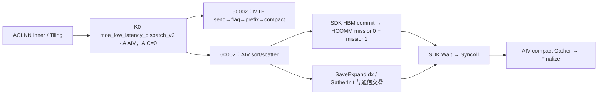

# SGL DeepEP Low-Latency INT8 动态量化 Dispatch 950 ACLNN 算子知识

## 算子速览

| 项目 | 内容 |
|---|---|
| 实际入口 | `aclnnMoeLowLatencyDispatchV2GetWorkspaceSize` / `aclnnMoeLowLatencyDispatchV2`，公开 ACLNN 两段式入口。 |
| 计算语义 | q2：每token以FP32 absmax归一到INT8，携带FP32逆scale，再按top-k专家复制并在接收端compact；无乘权、无token reduce。 |
| 输入输出 | X=BF16或FP16、O=INT8，ND x[N,H]、INT32 expertIds[N,K]、可选BOOL mask；compact expandX[T,H]、Combine元数据、INT64 expert counts。每个有效输出token有1个FP32逆scale。 |
| 执行类型 | MTE路线AIV_VECTOR+直接window通信；CCU路线AIV_VECTOR+非Cube CCU通信（两个mission）。所有可达节点不含Cube/AIC/MIX_CV。 |
| Kernel 路线 | R-001..004：legacy/hybrid × 单专家或共享接收/多专家接收；R-005/006：CCU MoE/共享接收。 |
| 核心资源 | UB Queue/TBuf、512A²计数grid、多专家512B私有GM槽与64B UB行、双轮window；CCU send workspace、2R size/offset、HBM消息与CKE、CCU MS/loop资源。 |
| 来源闭包 | `source_closed`：公开wrapper→两套Host→逐字段POD→key50002/60002与无body终点→MTE/CCU完整body/helper→SDK client→HCOMM9.1 selector/注册/template/实际两mission算法/MC2调度；止于IR→硬件指令/driver primitive。 |
| 验证状态 | 已完成源码闭包检查；本次知识提取未执行编译、真机、数值或性能测试。draft保留Host/Device域、资源、mask和shared静态限制。 |

正文P前缀为 `csrc/deepep/ops/`；H前缀为 SDK `impl/adv_api/detail/hccl/`；C前缀为 HCOMM `src/legacy/ascend950/`。固定源分别是SGL dda6d36b0cdb4081e102d14c0a2fb276fc416e69、asc-devkit e5451c7feba11f9e259f4fbc19c4bf82f8c0496c、HCOMM 4ca1db912ce02a5f5075849a3fa3faaf731bdd60。冻结Query中的[Low-Latency API](../../../../apis/deepep/deepep_low_latency_dispatch_combine.md)已完整阅读，只有接口知识；本卡create，不能用既有API代替实现闭包。

## 接口与语义

### 计算语义

对于每个实际发送token，v=castFP32(x)，m=max_h |v_h|，通常a=127/m，q=INT8(CAST_TRUNC(half(CAST_ROUND(INT32(CAST_RINT(a*v))))))，输出逆scale s=1/a。MTE仅在m>0时用127/m，否则a=1；CCU没有该零分支。目标近似重构v≈q*s，不是接收端已解量化。没有smooth实例进入成功Route，量化结果只依赖token，不依赖expert；仍按每个发送slot重复计算。NaN/Inf及cast饱和的具体硬件结果本次未验证。

令R=epWorldSize、r=epRankId、E=moeExpertNum、Sr=sharedExpertRankNum、Se=sharedExpertNum、L=E/(R-Sr)、B=globalBs/R、A=aivNum。普通expert e目标 `e/L+Sr`。接收有效行按本地expert、源rank、源token槽排列；`epRecvCounts[lR+s]` 为跨expert/source的inclusive prefix，expertTokenNumsType1输出每expert数量，0输出expert前缀。输出只在有效count覆盖的compact行有意义；分配容量不是每expert固定stride。

MTE每slot附三元组 `[sourceRank,sourceToken,sourceTopk]`，assist按收到顺序每行12B。CCU发送时排序，将source slot在目标rank的接收排列ordinal写入assist[0:NK]；不是MTE triple。两种handle/辅助输出格式不互换。MTE支持2D槽mask压紧；1Dmask只统计true总数并发送前缀行。CCU统一把存在的mask当1D，只读前N个BOOL求activeN；2Dmask虽可通过外层Host，不能解释为CCU逐slotmask。共享专家发送逻辑的CCU索引风险见Route与限制。

### 输入、输出与属性

| 参数 | shape/layout | dtype | 约束、默认值与语义 |
|---|---|---|---|
| x | [N,H] ND/AutoContiguous | BF16/FP16 | Python mode=int8分配INT8输出；OpDef有BF16/FP16→INT8配对。MTE N0..512；CCU N1..512；H1024..8192。 |
| expertIds | [N,K] ND/AutoContiguous | INT32 | MTE K1..min(16,E)；CCU额外K≤8；source值未全量扫描。 |
| scalesOptional | optional ND | FP32 | 本任务q2允许Host提供FP32 smooth scales，但950没有带smooth的key实例；本卡成功Route均scales=null。q1静态量化独立且Host拒绝。 |
| xActiveMaskOptional | [N]或[N,K] | BOOL | MTE1D前缀/2D槽；CCU仅token前缀含义，2D为Host/Device冲突。 |
| expandXOut | [T,H] ND | INT8 | T≥capacity*tpWorldSize；TP0检查退化，但无TP2实现。 |
| dynamicScalesOut | [≥capacity*TP] ND | FP32 | 每有效compact行的逆scale，解量化近似x≈O*scale；容量尾部未定义。 |
| assistInfoForCombineOut | 1D ND | INT32 | 外层通用检查≥3capacity；CCU自身检查≥NK并只写ordinal NK。 |
| expertTokenNumsOut | [L]，共享rank[1] | INT64 | default1 count，0 cumsum；MTE多expert有独立metadata写回算法。 |
| epRecvCountsOut | ≥RL，共享rank≥R | INT32 | inclusive prefix；不与CCU ordinal或MTE triple混淆。 |
| tpRecvCountsOut | [tpWorldSize] | INT32 | 950没有可达TP2 body，q2路线无有效TP结果写入。 |
| groupEp/epWorldSize/epRankId/moeExpertNum | 属性 | string/int64 | group1..127；Host R2..768、E1..1024，E整除R-Sr且L>0；Device窄域另列。 |
| groupTp/tpWorldSize/tpRankId | 属性 | string/int64 | MTEHost0..2，TP2需L1/组名，但50102无body；CCU强制TP1。 |
| expertShardType | 属性 | int64 | 仅0。 |
| sharedExpertNum/sharedExpertRankNum | 属性 | int64 | Se0..4、Sr0..R-1；默认1/0归一0/0；同时零或正，Sr%Se=0。 |
| quantMode/globalBs/expertTokenNumsType/commAlg | 属性 | int64/string | quantMode=2；globalBs0→NR否则≥NR且%R=0；type0/1；commAlg空/fullmesh_v1→MTE，ccu→CCU，fullmesh_v2产生无body key。 |

### 入口与版本

公开OpDef `MoeLowLatencyDispatchV2` 在ops目录注册ascend910_93及__DAV_C310__下950配置；公开LOW_LATENCY_API列A5。活动build选择ops，950编译带__DAV_C310__；不能从文件后缀直接推平台。README/DeepEP README与固定SDK/HCOMM version.cmake给出CANN9.1.0依据；本文不将其它版本来源当9.1安装ABI。

GetWorkspaceSize包装器固定elasticInfo=null、zero/copy/const experts=0；commAlg指针为空返回内层null错误，inner成功后executor与*executor必须非空；weak NnopbaseSetHcclServerType在ccu时设CCU，否则MTE。Execute转交inner。自动生成inner/Contiguous/executor/stream启动为明确框架边界。Python 950 use_fp8默认选择per-token FP8；本卡是底层ACLNN quantMode2/INT8，不把布尔use_fp8误映为INT8。C++显式mode=int8时分配INT8数据[T,H]及FP32 scales[T]，保留原handle。async/hook在此实现不拆成两个接收kernel。

## Host/Launcher 执行流程

### 参数校验与前处理

1. 外层GetAttr/CheckTensorDim/DataType/Format/CheckAttrs/CheckTensorShape按源码顺序处理EP、共享、mask、TP、globalBs及输出。MTEHost接受q2及有/无scales，scales二维应为[E+Se,H]；有scales产生50012而无body。成功Route仅scales缺省；x与expertIds的首维一致；N≤512/H1024..8192/K≤16，L>0；shared/default值规范化。capacity普通rank为globalBs*min(L,K)，共享rank为B*ceil(R/(Sr/Se))；expandX≥tpWorldSize*capacity，assist≥3capacity，counts形状对应expert/source。
2. commAlg=ccu则从外层完成公共检查后提前进入 `MoeDistributeDispatchTilingImpl`，不再用MTE的窗口/UB/工作区生产流程。内层再次GetContextAttrs/realMode/CheckQuantModeAndScales/CheckAttrs/CheckTensorShape/ScalesInfo；q2+INT8 realMode=DYNAMIC_SCALES；有scales产生60012而无body，成功Route仅缺省；TP必须1，N>0，K≤8。有mask时globalBs必须等于NR，禁止不同rank batch容量；mask仅查首维，isTokenMask置为“输入存在”。
3. MTESetHcommCfg检查A≤72、B≤512与状态E*32≤512KiB-32。q2 Host与Device均按 INT8 payload align32(H)+32B scale区+12B triple，即align32(H)+44；hybrid按每half109MiB+72KiB保留，其中4MiB MTE前缀在window级只计一次。legacy预算没有同样显式4MiB预留。
4. CCU CheckCommAttrs先读Info.aivNum计算window需求，再到最终SetPlatformInfo写入aivNum；如果外层尚未产生该字段，静态顺序不证明这个值正确。该检查要求 `512*A+2R*Phost≤Wenv`，但并未证明实际context大小或所有硬件rank/UB上界。
5. Tiling失败返回GRAPH_FAILED；未知key在entry无匹配分支后结束，不虚构具体codegen/runtime报错。外层fullmesh_v2还拒绝mask/TP2等条件，key51002没有本q2body；TP2 key50102也没有body。

### 参数、Workspace 与生命周期

记align_p为向上对齐到p字节或明确注明元素数。MTE：`Ha=align32(H),S=Ha+44,U=align32(S),G=align512(S),Gc=align512(2H),Xi=align32(2H)`。CCU：`M=align32(H)+4`、`C=align512(M)`、`Pdata=512+B*C*L`；Host另用Phost=512+B*align512(2*align32(H))*L。所有size/offset字节；MTE scale首FP32@Ha、triple@Ha+32，CCU scale首FP32@align32(H)。

| 路线 | Host workspace | 真实用户区/通信区 | owner与生命周期 |
|---|---|---|---|
| MTE全部 | 16MiB+512A²+511+512L+512 | grid512A²；tokenMetaBase=align512(userPtr+512A²)-userPtr；L个512B专家槽；后续512B为gather count预留，当前无TP实例不消费 | caller/executor分配，当前stream kernel结束前保持 |
| CCU全部 | 16MiB+R*Phost+32R | user+0为sendBuf[R*Pdata]，紧随sendSize[2R]u64、sendOffset[2R]u64；body不人为跳过开头16MiB | scatter写、CCU两mission读，SDKWait后才允许覆盖；gather仍消费远端window |
| MTE window | runtime组拥有的IN数组 | 固定4MiB前缀，数据以z*(W-4MiB)/2分半；legacy状态在IN前缀，hybrid状态在half内 | selector旧值z与下一调用z^1不能竞争 |
| CCU window | context.windowsOut[0]，runtime/HCOMM CCL buffer | selector512A；之后两半 each=(winSize-512A)/2，每source Pdata | sender传remoteWinOffset定位source段；Wait+同步后本rankgather |
| SDK/HCOMM控制区 | context工作区与独立HBM参数/信号区 | HCOMM AllocV2申请16MiB SDKworkspace、64*64*8=32768B param、64*2*8=1024B start/end信号；均memset0 | 通信域持有，不是ACLNN用户workspace；域销毁回收 |

env窗口获取优先DEEPEP_HCCL_BUFFSIZE，否则HCCL_BUFFSIZE，default200MiB；stoi后存uint16，未补负数/窄化范围检查。MTE CheckWindowSize只在actual<tiling时申请1B UB并发INT32 DMA探针，不是可靠Host错误返回。SDK/HCOMM context在本文按源码消费前缀映射，不声称已经验证安装二进制。

### 启动图与失败传播



| 节点或边 | producer→consumer | 地址/extent、参数 | ordering | owner/lifetime、失败 |
|---|---|---|---|---|
| Host→K0 | 两套Tiling→entry | blockDim=CalcTschBlockDim(A,0,A)，POD1216；MTE schedule1 | 框架stream/executor | inner生成不可见边界；Host拒绝不启动有效Route |
| MTE grid | producer core→prefix core | user+512*(A*producer+consumer)，首i32 | MTE3/PIPE_ALL→SyncAll→MTE2 | 同kernel生命周期 |
| MTE tokenMeta | 分expert writer→lastCore | user+tokenMetaBase+512*l，首i64；UB每l占64B | DCCI+SyncAll→DMA→MTE2_S→MTE3 | 多expert独立Route；私有写入不触碰compact输出 |
| AIV→CCU | scatter payload/size/offset→mission0/1 | sendBuf[R*Pdata]、2R size、2R offset | 全AIV SyncAll→core0 AlltoAllvWrite<true>→Xn flush→HBM start=1 | Wait返回前保持源区，SGL未检查handle/-1或Wait结果 |
| CCU→AIV | 两mission远端Write/selfCopy→gather | CCL+status512A+halfz+source*Pdata | writeDone CKE→MissionSync→PostSync→MC2 end HBM→SDKWait→SyncAll | 正确链路是远端完成后读，非提交即完成 |
| K0→输出 | LocalWindowCopy/TokenGather | 有效compact payload、对应元数据 | Queue/pipe及最终kernel结束 | 尾容量不初始化；有效scale与payload配对；Finalize不修复先前错误输出 |

CCU Host仍按输入类型BF16/FP16为2B进行workspace与window预算；Device实际q2使用INT8 payload+4B scale。定义Phost后分别记录申请与消费，额外预留容量不改变sendSize/sendOffset相对Pdata的实际地址。

## Route 与参数设计

### 分核与资源计算

split(M,C,c)保留商余数：start=floor(M/C)*c+min(c,M%C)，count=floor(M/C)+[c<M%C]。MTE发送前moe核、后shared核：sharedA=max(1,floor(A*Se/(K+Se)))（Sr0时0）；接收Q=RL或共享rankR，按split(Q,A)；activeA=min(Q,A)，lastCore=activeA?activeA-1:0。多专家metadata另将L个expert均分activeA个writer，每个expert独占512B。

CCU metadata每core重复计算全部activeNK排序/频数；sharedA=max(1,A/(K+1))，其余moeA。发送槽/目标rank按各自核组split，接收源rank按split(R,A)。HCOMM为两mission each选择一个到每peer的transport，CalcResLinksMesh请求R-1条链接、que/stream1；每16rank一个writeDone CKE。任意未知资源上界不能从文件名字推定。

### Route 选择

| 顺序 | Route | Key/模板 | 精确选择条件与优先级 | 不适用去向 |
|---:|---|---|---|---|
| 1 | R-001 legacy MTE，单专家或共享接收 | 50002；MoeDistributeDispatchV2A5<X,O,float,false,true,false,false,false> | q2、commAlg为空或fullmesh_v1、TP≠2、hybrid=false；当前rank为共享接收或L=1；公共shape/dtype通过 | Host GRAPH_FAILED、框架资源失败或router无body终点 |
| 2 | R-002 legacy MTE，多专家接收 | 50002；MoeDistributeDispatchV2A5<X,O,float,false,true,false,false,false> | 同legacy MTE，但r≥Sr且L>1；公共shape/dtype通过 | Host GRAPH_FAILED、框架资源失败或router无body终点 |
| 3 | R-003 hybrid MTE，单专家或共享接收 | 50002；MoeDistributeDispatchV2A5<X,O,float,false,true,false,false,false> | q2、commAlg为空或fullmesh_v1、TP≠2、hybrid=true；当前rank为共享接收或L=1；公共shape/dtype通过 | Host GRAPH_FAILED、框架资源失败或router无body终点 |
| 4 | R-004 hybrid MTE，多专家接收 | 50002；MoeDistributeDispatchV2A5<X,O,float,false,true,false,false,false> | 同hybrid MTE，但r≥Sr且L>1；公共shape/dtype通过 | Host GRAPH_FAILED、框架资源失败或router无body终点 |
| 5 | R-005 CCU，MoE专家接收 | 60002；MoeDistributeDispatchA5<X,O,2,false,false> | commAlg=ccu、q2、TP必须1、N1..512/K≤8、r≥Sr；1D Mesh与SDK/HCOMM资源准备成功；公共shape/dtype通过 | Host GRAPH_FAILED、框架资源失败或router无body终点 |
| 6 | R-006 CCU，共享专家接收 | 60002；MoeDistributeDispatchA5<X,O,2,false,false> | 同CCU，但r<Sr，gather按单专家特例；公共shape/dtype通过 | Host GRAPH_FAILED、框架资源失败或router无body终点 |

```text
quantMode=2，scales=null，X=BF16/FP16、O=INT8
commAlg=="ccu":
  外层共同检查 -> CCU二次检查(含TP1、N>0、K≤8)
  ->60002 -> Ccu实例；r<Sr按shared单expert gather，否则MoE L
其它合法commAlg:
  Host key=50002+(TP2?100:0)+(fullmesh_v2?1000:0)
  50102/51002没有q2实例；fullmesh_v2+TP2先检查失败
  scales存在额外+10 -> 50012（或再TP/fullmeshv2位）；均无q2 smooth body
CCU scales存在 -> 60012，无匹配；60002仅nosmooth
  50002 -> hybrid由DEEPEP_HYBRID_DEPLOYMENT恰为"1"决定
    !shared&&L>1 -> 多expert元数据私有槽/64B行
    shared||L1 -> lastCore直接INT64输出
SDK/HCOMM CCU:
  engine5=CCU_MS；cmd20=HALFALLTOALLV
  ->1D Mesh默认CcuHalfAll2AllVMesh1D(enum13)
  ->registered SoleExecutor/TopoMatchMesh/HalfTemplate
  ->two mission context；不匹配拓扑或回退资源失败不自动改MTE
```

### 模板/实现执行矩阵

| Route | key/selector | dtype/shape/platform 完整命中条件 | 执行拓扑与 Kernel 节点 | 实际模板/body | 内存与同步特征 | tail/fallback |
|---|---|---|---|---|---|---|
| R-001 | 50002 | q2、commAlg为空或fullmesh_v1、TP≠2、hybrid=false；当前rank为共享接收或L=1；X=BF16/FP16、O=INT8，950编译guard | K0 AIV直接MTE | MoeDistributeDispatchV2A5::Init/Process | legacy IN前缀状态；直接lastCore INT64 | split余数与DMA有效len；无匹配key/资源不支持不补body |
| R-002 | 50002 | 同legacy MTE，但r≥Sr且L>1；X=BF16/FP16、O=INT8，950编译guard | K0 AIV直接MTE | MoeDistributeDispatchV2A5::Init/Process | legacy IN前缀状态；512L私有槽/64L UB | split余数与DMA有效len；无匹配key/资源不支持不补body |
| R-003 | 50002 | q2、commAlg为空或fullmesh_v1、TP≠2、hybrid=true；当前rank为共享接收或L=1；X=BF16/FP16、O=INT8，950编译guard | K0 AIV直接MTE | MoeDistributeDispatchV2A5::Init/Process | hybrid半区状态/数据；直接lastCore INT64 | split余数与DMA有效len；无匹配key/资源不支持不补body |
| R-004 | 50002 | 同hybrid MTE，但r≥Sr且L>1；X=BF16/FP16、O=INT8，950编译guard | K0 AIV直接MTE | MoeDistributeDispatchV2A5::Init/Process | hybrid半区状态/数据；512L私有槽/64L UB | split余数与DMA有效len；无匹配key/资源不支持不补body |
| R-005 | 60002 | commAlg=ccu、q2、TP必须1、N1..512/K≤8、r≥Sr；1D Mesh与SDK/HCOMM资源准备成功；X=BF16/FP16、O=INT8，950编译guard | K0 AIV+CCU双mission+gather | MoeDistributeDispatchA5::Init/Process | sort/hist UB、双半size/offset、SDKWait、CCU CKE | split余数与DMA有效len；无匹配key/资源不支持不补body |
| R-006 | 60002 | 同CCU，但r<Sr，gather按单专家特例；X=BF16/FP16、O=INT8，950编译guard | K0 AIV+CCU双mission+gather | MoeDistributeDispatchA5::Init/Process | sort/hist UB、双半size/offset、SDKWait、CCU CKE | split余数与DMA有效len；无匹配key/资源不支持不补body |

### 隐藏性能 Guard

| Guard | Host/Tiling 条件 | Device/资源原因 | 影响 Route | 不满足时去向 | 源码符号 |
|---|---|---|---|---|---|
| q2类型配对 | OpDef与entry本卡X BF16/FP16→INT8 | FP32中间量化及逆scale | 全部 | 配对失败或无body | OpDef/router |
| key空终点 | Host TP2/ fullmesh_v2分别+100/+1000 | 950没有对应q2router | 所有MTE候选 | 已知无body，不推测runtime码 | CalTilingKey/entry |
| UB depth | 估算C+64L条件项+2Xi+2U>170KiB→b1 | 缩队列；非完整安全判定 | MTE | 无第二级资源fallback | Init/QuantInit |
| MTE数组域 | Host R≤768，HcclCombinOpParam windowsIn[32] | 本地声明32项；body按rank索引 | MTE | >31索引无Host guard，draft边界 | moe_distribute_base.h |
| histogram | Host E≤1024，Device U8 ids/256 bins | e≥256截断且freq数组可能越界 | CCU | 无动态拒绝/fallback | TokenScatter/HistogramsVf |
| header容量 | Host未检查4L≤512 | count header固定512，payload从+512 | CCU | L>128与payload布局冲突 | QuantInit/MoeScatter |
| mask | MTE2D；CCU输入存在即isTokenMask | CCU只读前N布尔并发送前缀 | CCU | 2D组合不具备宣称语义 | MoeDistributeDispatchTilingImpl/CalcTokenActiveMask |
| rank/通信量 | SDK文档单次≤256MiB；HCOMM资源注释最大64P/旧8P | CCL/链接/CKE/loop实际资源限制 | CCU | 框架返回/抛异常或未保证，不能推拓扑全支持 | AlltoAllvWrite.md/HalfContext |
| alignment | Host未要求H%32；各API自身有对齐约束 | CCU输入Queue按2H、输出Queue按M=align32(H)+4分别分配 | CCU | 需满足DMA约束；不能沿用q0单Queue输出越界判断 | Init/QuantInit/ProcessToken |
| metadata DMA | L≤1024静态assert≤4095 | 多expert gather blockCount=L | MTE多expert | >4095方法return（Host已E≤1024） | UpdateTokenNumsOut |

### POD/ABI

SGL Info自然8B对齐推导size128/align8；外层init64@0、cc1 512@64、cc2 512@576、Info@1088，总1216。下表offset均相对Info；自然布局推导未经编译测量。CCU二次Host覆盖其实际产生字段，不能将外层inactive值补成已初始化。

| 结构 | 字段 | 类型/位宽 | ABI 布局 | 单位 | Host/launcher producer | Device consumer | 边界 |
|---|---|---|---|---|---|---|---|
| MoeDistributeDispatchV2Info | epWorldSize | u32 | 0 | rank数 | 外层/CCU GetContextAttrs=*R | Init分域/窗口/CCU rank | padding60..63/92..95/116..119不作业务数据 |
| MoeDistributeDispatchV2Info | tpWorldSize | u32 | 4 | rank数 | MTE0..2；CCU CheckAttrs必须1 | Hostkey；当前body不AllGather | padding60..63/92..95/116..119不作业务数据 |
| MoeDistributeDispatchV2Info | epRankId | u32 | 8 | rank | 合法r | GetWindow、scatter/gather | padding60..63/92..95/116..119不作业务数据 |
| MoeDistributeDispatchV2Info | tpRankId | u32 | 12 | rank | TP≤1要求属性tpRankId=0，非零拒绝 | 本实例TP inactive | padding60..63/92..95/116..119不作业务数据 |
| MoeDistributeDispatchV2Info | expertShardType | u32 | 16 | enum | 仅0 | body不做分片计算 | padding60..63/92..95/116..119不作业务数据 |
| MoeDistributeDispatchV2Info | sharedExpertNum | u32 | 20 | expert数 | Se默认1/Sr0规范化为0 | shared核组/目标 | padding60..63/92..95/116..119不作业务数据 |
| MoeDistributeDispatchV2Info | sharedExpertRankNum | u32 | 24 | rank数 | Sr、Se一致性/divisible检查 | shared role/L | padding60..63/92..95/116..119不作业务数据 |
| MoeDistributeDispatchV2Info | moeExpertNum | u32 | 28 | expert数 | E1..1024且整除R-Sr | L与id域 | padding60..63/92..95/116..119不作业务数据 |
| MoeDistributeDispatchV2Info | quantMode | u32 | 32 | enum | attr=2 | Hostkey，模板QuantMode2/DynamicQuant=true | padding60..63/92..95/116..119不作业务数据 |
| MoeDistributeDispatchV2Info | globalBs | u32 | 36 | token容量 | 0→NR，否则≥NR且%R=0；CCU有mask时等于NR | B与perRankDataSize | padding60..63/92..95/116..119不作业务数据 |
| MoeDistributeDispatchV2Info | bs | u32 | 40 | token | x.dim0，MTE允许0，CCU要求>0 | mask/slot域 | padding60..63/92..95/116..119不作业务数据 |
| MoeDistributeDispatchV2Info | k | u32 | 44 | slot/token | expertIds.dim1，外层≤16、CCU≤8 | NK/目标路由 | padding60..63/92..95/116..119不作业务数据 |
| MoeDistributeDispatchV2Info | h | u32 | 48 | element/token | x.dim1 1024..8192 | 字节/Queue/DMA | padding60..63/92..95/116..119不作业务数据 |
| MoeDistributeDispatchV2Info | aivNum | u32 | 52 | core | MTE SetAiv；CCU最终SetPlatformInfo才写 | 分核/selector512A，CCU前置window检查先读取 | padding60..63/92..95/116..119不作业务数据 |
| MoeDistributeDispatchV2Info | isTokenMask | bool | 56 | flag | MTE dim1；CCU任意mask存在 | 计数前缀mask | padding60..63/92..95/116..119不作业务数据 |
| MoeDistributeDispatchV2Info | isExpertMask | bool | 57 | flag | 外层mask dim2 | MTE槽mask；CCU不消费此字段 | padding60..63/92..95/116..119不作业务数据 |
| MoeDistributeDispatchV2Info | hasElasticInfo | bool | 58 | flag | wrapper null→false | elastic分支不可达 | padding60..63/92..95/116..119不作业务数据 |
| MoeDistributeDispatchV2Info | isHybridDeployment | bool | 59 | flag | env精确1；CCU提前返回前是否写由外层赋值序，body不读 | MTE窗口路由 | padding60..63/92..95/116..119不作业务数据 |
| MoeDistributeDispatchV2Info | totalUbSize | u64 | 64 | byte | 平台GetCoreMemSize；CCU最后写 | 未形成完整分配拒绝 | padding60..63/92..95/116..119不作业务数据 |
| MoeDistributeDispatchV2Info | totalWinSize | u64 | 72 | byte | env uint16 MiB | MTE W；CCU body用context W | padding60..63/92..95/116..119不作业务数据 |
| MoeDistributeDispatchV2Info | expertTokenNumsType | u32 | 80 | enum | attr0/1 | count/cumsum输出 | padding60..63/92..95/116..119不作业务数据 |
| MoeDistributeDispatchV2Info | zeroComputeExpertNum | i32 | 84 | expert数 | wrapper特殊属性0之和 | 本入口special分支inactive | padding60..63/92..95/116..119不作业务数据 |
| MoeDistributeDispatchV2Info | cumSumUBMinValue | u32 | 88 | byte | 外层CumSum shape[1,LR]临时最小值 | 本q2 body不以此申请 | padding60..63/92..95/116..119不作业务数据 |
| MoeDistributeDispatchV2Info | scalesRow | u64 | 96 | row | 成功Route scales不存在→0；有scales时CheckAndSetScalesInfo写shape值后到无router key | inactive | padding60..63/92..95/116..119不作业务数据 |
| MoeDistributeDispatchV2Info | scalesCol | u64 | 104 | column | 同上 | CCU Init读入计算scaleInBytes，成功Route IsSmoothScaleExist=false不消费 | padding60..63/92..95/116..119不作业务数据 |
| MoeDistributeDispatchV2Info | scalesTypeSize | u32 | 112 | byte/scale | 同上 | 同上 | padding60..63/92..95/116..119不作业务数据 |
| MoeDistributeDispatchV2Info | scalesCount | u64 | 120 | element数 | 同上 | CCU Init读取，q2无smooth输入不以此计算；输出scale来自token absmax | padding60..63/92..95/116..119不作业务数据 |
| outer | mc2InitTiling | opaque64 | 0 | byte | GetTiling(init) | 框架/InitV2 | SDK内层见后表 |
| outer | mc2CcTiling1 | opaque512 | 64 | byte | MTE engine3/op8；CCU engine5/op20 | EP组资源/CCU SetCcTilingV2(offset64) | SDK各调用返回未完整检查 |
| outer | mc2CcTiling2 | opaque512 | 576 | byte | MTE engine3/op6；CCU同engine5/op20但groupTP | 框架资源准备；本body不发TP | 不能伪称CCU支持TP |
| outer | moeDistributeDispatchV2Info | Info128 | 1088 | byte | 前述producer | entry/Init | q2字段按真实consumer |

SDK Mc2InitTiling64/Mc2CcTiling512为公开opaque外壳；实际inner如下。offset相对inner，类型来自固定SDK。MTE与CCU使用同外层POD，但commEngine/opType不同。

| 结构 | 字段 | 类型/位宽 | ABI 布局 | 单位 | Host/launcher producer | Device consumer | 边界 |
|---|---|---|---|---|---|---|---|
| Mc2InitTilingInner | version | u32 | 0 | enum/byte/字符串 | GetTiling: 100 | SDK初始化 | 不依赖reserved值 |
| 同上 | mc2HcommCnt | u32 | 4 | enum/byte/字符串 | GetTiling: 2 | HCOMM GenerateAlgoTemplatesV2 | 不依赖reserved值 |
| 同上 | offset | u32[8] | 8 | enum/byte/字符串 | GetTiling: 64/576，其余0 | cc1/cc2定位 | 不依赖reserved值 |
| 同上 | debugMode | u8 | 40 | enum/byte/字符串 | GetTiling: default0 | SDK | 不依赖reserved值 |
| 同上 | preparePosition | u8 | 41 | enum/byte/字符串 | GetTiling: default0 | SDK | 不依赖reserved值 |
| 同上 | queueNum | u16 | 42 | enum/byte/字符串 | GetTiling: default0 | SDK working core | 不依赖reserved值 |
| 同上 | commBlockNum | u16 | 44 | enum/byte/字符串 | GetTiling: default0 | SDK资源 | 不依赖reserved值 |
| 同上 | devType | u8 | 46 | enum/byte/字符串 | GetTiling: runtime SoC | 平台实现选择 | 不依赖reserved值 |
| 同上 | reserved | char[17] | 47 | enum/byte/字符串 | GetTiling: 未显式清全部 | inactive | 不依赖reserved值 |
| Mc2CcTilingInner | skipLocalRankCopy | u8 | 0 | enum/byte/字符串 | GetTiling: default0 | 框架 | 不依赖reserved值 |
| 同上 | skipBufferWindowCopy | u8 | 1 | enum/byte/字符串 | GetTiling: default0 | 框架 | 不依赖reserved值 |
| 同上 | stepSize | u8 | 2 | enum/byte/字符串 | GetTiling: default0 | 框架 | 不依赖reserved值 |
| 同上 | version | u8 | 3 | enum/byte/字符串 | GetTiling: 1 | 固定协议 | 不依赖reserved值 |
| 同上 | reserved | char[9] | 4 | enum/byte/字符串 | GetTiling: memset0 | inactive | 不依赖reserved值 |
| 同上 | commEngine | u8 | 13 | enum/byte/字符串 | GetTiling: MTE3 / CCU5 | HCOMM cast HcclAccelerator CCU_MS | 不依赖reserved值 |
| 同上 | srcDataType | u8 | 14 | enum/byte/字符串 | GetTiling: default0=INT8 | InitCcuParam覆盖client参数dtype | 不依赖reserved值 |
| 同上 | dstDataType | u8 | 15 | enum/byte/字符串 | GetTiling: default0=INT8 | InitCcuParam | 不依赖reserved值 |
| 同上 | groupName | char[128] | 16 | enum/byte/字符串 | GetTiling: EP/TP字符串 | 框架组关联 | 不依赖reserved值 |
| 同上 | algConfig | char[128] | 144 | enum/byte/字符串 | GetTiling: AlltoAll fullmesh/pairwise，MTE第二AllGather ring | MC2selector当前CCU仅默认算法 | 不依赖reserved值 |
| 同上 | opType | u32 | 272 | enum/byte/字符串 | GetTiling: MTE8/6，CCU20/20 | SDK表/HCOMM MC2_OP_TYPE | 不依赖reserved值 |
| 同上 | reduceType | u32 | 276 | enum/byte/字符串 | GetTiling: default0 | q2不reduce；GetOpId非reduce强制0 | 不依赖reserved值 |
| 同上 | reserved2 | char[232] | 280 | enum/byte/字符串 | GetTiling: 未显式清全部 | inactive | 不依赖reserved值 |

MTE本地 `HcclCombinOpParam`（少e）与CCU SDK `HcclCombineOpParam`（有e）不是同一个完整ABI。MTE结构自然布局size576/align8，以下每字段offset明确；当前MTE只消费rank前缀和windowsIn。CCU SDK与HCOMM64-rank结构的**已消费前缀**可逐项对应；完整后部保留/WR资源并不宣称二进制完全相同。

| 结构 | 字段 | 类型/位宽 | ABI 布局 | 单位 | Host/launcher producer | Device consumer | 边界 |
|---|---|---|---|---|---|---|---|
| SGL MTE context | workSpace | u64 | 0 | 地址 | runtime组 | 当前MTE不用 | 不同于ACLNN workspace |
| 同上 | workSpaceSize | u64 | 8 | byte | runtime组 | 当前MTE不用 | 保留前缀 |
| 同上 | rankId | u32 | 16 | rank | runtime组 | GetRankId/InitWinState | 检查值 |
| 同上 | rankDim | u32 | 20 | rank数 | runtime组 | GetRankDim/InitWinState | 不是AIV数 |
| 同上 | winSize | u64 | 24 | byte | runtime组 | GetWinSize/CheckWindowSize | 实际大小 |
| 同上 | windowsIn | u64[32] | 32 | 地址 | runtime组 | GetBaseWindAddr/State | Host未限制rank<32 |
| 同上 | windowsOut | u64[32] | 288 | 地址 | runtime组 | 本MTE body未读 | 不借用SDK64布局 |
| 同上 | xnAddr | u64 | 544 | 地址 | runtime组 | 本MTE不用 | 不能按CCU前缀解释 |
| 同上 | ckeAddr | u64 | 552 | 地址 | runtime组 | 本MTE不用 | 同上 |
| 同上 | msAddr | u64 | 560 | 地址 | runtime组 | 本MTE不用 | 保留 |
| 同上 | msSize | u64 | 568 | byte/count | runtime组 | 本MTE不用 | 未消费 |
| SDK CCU / HCOMM context | workSpace | u64 | 0 | 地址 | Mc2Compont::AllocV2 16MiB DevBuffer | SDK InitInner align512 | HCOMM memset0 |
| 同上 | workSpaceSize | u64 | 8 | byte | 16MiB | SDK | 组owner |
| 同上 | rankId | u32 | 16 | rank | comm->GetMyRank | SDK/SGL | 已消费前缀映射 |
| 同上 | rankNum(SDK)/rankDim(HCOMM) | u32 | 20 | rank数 | comm->GetRankSize | SDK | 名不同、布局相同 |
| 同上 | winSize | u64 | 24 | byte | CCL buffer GetSize | SGL InitCommAndStatus | 双轮真实window |
| 同上 | windowsIn | u64[64] | 32 | 地址 | CCU不填MTE窗口 | 此CCU body不读 | 不填值不是MTE支持 |
| 同上 | windowsOut | u64[64] | 544 | 地址 | [0]=CCL buffer GetAddr | SGL cclBuf/SDK scratch | 只有[0]本实例消费 |
| 同上 | xnOffset(SDK)/xnAddr(HCOMM) | ptr/u64 | 1056 | 地址 | comParamBuffer=32768B | CcuSendMsg | 64消息×512B |
| 同上 | ckeOffset(SDK)/ckeAddr(HCOMM) | ptr/u64 | 1064 | 地址 | comSyncBuffer=1024B | SDK commit/wait | start64*8，end64*8 |
| 同上 | `res[16]`（SDK） / msAddr(HCOMM) | bytes/u64 | 1072 | 保留地址 | HCOMM零初始化 | SDK不读保留 | 只作前缀映射说明 |
| 同上 | msSize(HCOMM) | u64 | 1080 | 保留 | HCOMM零初始化 | 当前算法不用 | 对应SDK res后8B |
| 同上 | opType | u32[8] | 1088 | enum | SaveAlgoInfo存cmd20 | client GetCcuParam/框架 | MAX_OP_NUM8 |
| 同上 | algorithmType | u8[8] | 1120 | enum | Mc2Selector CcuHalfAll2AllVMesh1D=13 | 框架算法缓存 | SDK枚举次序同13 |
| SDK CCU context | res2 | char[7744] | 1128 | byte | SDK兼容保留 | client不消费 | HCOMM后部为WQ/CQ，不能声称完整结构等同 |
| 同上 | multiFlag | u8 | 8872 | flag | runtime | 本CCU client不用 | 普通布局推导 |
| 同上 | data | IbVerbsData*64 | 8880 | 地址 | runtime | 本CCU client不用 | total8888推导，非实测 |

CommonPrepareParamCcu按enum默认32位、指针64位自然布局推导size128/align8；这是SDK控制消息，不是SGL TilingData。AlltoAllvWrite只构造以下业务值，CommonPrepareImpl将对应部分写到context工作区64B之后；未写的repeat/reserved/paramExt不用于本调用。

| 结构 | 字段 | 类型/位宽 | ABI 布局 | 单位 | Host/launcher producer | Device consumer | 边界 |
|---|---|---|---|---|---|---|---|
| CommonPrepareParamCcu | commType | union enum32 | 0 | cmd | AlltoAllvWrite→HALF_ALLTOALLV20 | CcuPrepareForOp/GetOpId | padding4..7 |
| 同上 | sendBuf | GM_ADDR64 | 8 | 地址 | usrIn=sendBufGM | Xn1 | 用户workspace |
| 同上 | recvBuf | GM_ADDR64 | 16 | 地址 | 同usrIn | half prepare先赋Xn2后被size地址覆盖 | 不是接收CCL地址 |
| 同上 | count | u64 | 24 | byte | localDataSize | goSize decomposition | 原INT8字节 |
| 同上 | dataType | enum32 | 32 | dtype | INT8，InitCcuParam再按cc.src覆盖为0 | OpId/byteUnit | 不把payload解释为INT8数学量化 |
| 同上 | dstDataType | enum32 | 36 | dtype | 同INT8/cc.dst0 | OpId | 原样搬运 |
| 同上 | op | enum32 | 40 | reduce | API RESERVED，InitCcuParam覆盖default0 | 非reduce OpId强制reduce0 | padding44..47 |
| 同上 | strideCount | u64 | 48 | byte | 0 | 本half算法不消费 | 无stride乘法 |
| 同上 | repeat | u8 | 56 | repeat | API1；client本地handleRepeatCnt=1 | Commit循环 | GM对应字段未显式写 |
| 同上 | reservedPartA | u8[7] | 57 | byte | 未写 | 未消费 | 不依赖值 |
| 同上 | paramExt | 4 pointers64 | 64 | 地址 | API{}；half分支不写 | 未消费 | AlltoAllV其它语义使用 |
| 同上 | wParamExt.sendOffsets | u64 | 96 | 地址 | sendOffsetGM | Xn3 | sendSizes之后2R u64 |
| 同上 | wParamExt.sendSizes | u64 | 104 | 地址 | sendSizeGM | Xn2/LoadVariable | 连续load4R覆盖sizes+offsets |
| 同上 | wParamExt.remoteWinOffset | u64 | 112 | byte | selectorHalfBase+r*Pdata | Xn8 | 对所有peer相同的source段位置 |
| 同上 | reservedPartB | u8[8] | 120 | byte | 未写 | 未消费 | 不依赖值 |

Xn message每条512B、前9个u64共72B有效；flush两个64B cache line。每字段单独映射：

| 结构 | 字段 | 类型/位宽 | ABI 布局 | 单位 | Host/launcher producer | Device consumer | 边界 |
|---|---|---|---|---|---|---|---|
| Xn消息 | xn0 | u64 | 0 | signature | GetOpId：algo0/outtype0/reduce0/type0/cmd20 | Mc2Context selector | 本值20；SDK各域mask0x7f，HCOMM0xff对当前值等价 |
| 同上 | xn1 | u64 | 8 | 地址 | sendBufGM | half Load userIn | 控制调度插入token前参数1 |
| 同上 | xn2 | u64 | 16 | 地址 | sendSizeGM | half Load sendSizeAddr | sendSize2R与sendOffset2R必须连续 |
| 同上 | xn3 | u64 | 24 | 地址 | sendOffsetGM | Load sendOffsetAddr | half LoadArgsFromMem实际上从sendSize连续加载 |
| 同上 | xn4 | u64 | 32 | byte | 32768*m | goSize.addrOffset | localDataSize=32768m+4096n+p |
| 同上 | xn5 | u64 | 40 | iteration | m | goSize.loopParam | m完整8×4KiB组 |
| 同上 | xn6 | u64 | 48 | packed | (repeatNum<<55)\|(loopIndex<<48)\|(loopNum<<41) | goSize.parallelParam | 各域7位；n/p四种分支 |
| 同上 | xn7 | u64 | 56 | byte | p或4096或0 | goSize.residual | n>0且p0→4096，其余按SDK四分支 |
| 同上 | xn8 | u64 | 64 | byte | remoteWinOffset | half recvOffset | 每peer目标CCL偏移 |
| HBM消息环 | start | u64 | 8*resId | flag | CcuSendMsg=1 | Mc2Context WaitTurnStartSig并清0 | resId0..63 |
| 同上 | end | u64 | 512+8*resId | flag | Mc2Context SetTurnEndSig=1 | SDK Wait并清0 | Finalize发下轮xn0=UINT64_MAX |

HCOMM已消费参数的源码对应不止名称一致：instruction header主体与SDK对应定义逐行相同；HCOMM `AicpuComType20→MC2_OP_TYPE[20]=HALFALLTOALLV`、engine5对应CCU_MS、算法枚举13一致；Mc2Context opFunc依次传 `param1,param2,token,param3..31`，匹配HalfContext九个Load（userIn、size、token、offset、go4、recv）。因此是固定源码前缀/协议映射，不是安装二进制ABI测量。

### Route 源码闭包

| Route | Key/selector | Host/Tiling producer | POD/参数 | Kernel entry/router 节点 | Kernel body/直接依赖 | 构建接线 |
|---|---|---|---|---|---|---|
| R-001 | 50002 | P/op_host/moe_distribute_dispatch_v2_tiling.cpp::SetHcommCfg/SetWorkSpace/CalTilingKey | Info128/outer1216，grid/tokenMeta/context | P/op_kernel/moe_low_latency_dispatch_v2.cpp | P/op_kernel/moe_distribute_dispatch_v2_a5.h→base/v2base/common/window_layout | SGL950 OpDef/CMake；ops Host/kernel target |
| R-002 | 50002 | P/op_host/moe_distribute_dispatch_v2_tiling.cpp::SetHcommCfg/SetWorkSpace/CalTilingKey | Info128/outer1216，grid/tokenMeta/context | P/op_kernel/moe_low_latency_dispatch_v2.cpp | P/op_kernel/moe_distribute_dispatch_v2_a5.h→base/v2base/common/window_layout | SGL950 OpDef/CMake；ops Host/kernel target |
| R-003 | 50002 | P/op_host/moe_distribute_dispatch_v2_tiling.cpp::SetHcommCfg/SetWorkSpace/CalTilingKey | Info128/outer1216，grid/tokenMeta/context | P/op_kernel/moe_low_latency_dispatch_v2.cpp | P/op_kernel/moe_distribute_dispatch_v2_a5.h→base/v2base/common/window_layout | SGL950 OpDef/CMake；ops Host/kernel target |
| R-004 | 50002 | P/op_host/moe_distribute_dispatch_v2_tiling.cpp::SetHcommCfg/SetWorkSpace/CalTilingKey | Info128/outer1216，grid/tokenMeta/context | P/op_kernel/moe_low_latency_dispatch_v2.cpp | P/op_kernel/moe_distribute_dispatch_v2_a5.h→base/v2base/common/window_layout | SGL950 OpDef/CMake；ops Host/kernel target |
| R-005 | 60002 | P/op_host/moe_distribute_dispatch_v2_ccu_tiling.cpp::MoeDistributeDispatchTilingImpl | Info128/outer1216，sizes/offset/Xn/context | P/op_kernel/moe_low_latency_dispatch_v2.cpp | P/op_kernel/moe_distribute_dispatch_v2_ccu.h→common.h→SDK client→C HalfTemplate/HalfContext/Mc2Context | SGL950 OpDef/CMake；HCOMM hccl_v2的template/context/mc2 CMake |
| R-006 | 60002 | P/op_host/moe_distribute_dispatch_v2_ccu_tiling.cpp::MoeDistributeDispatchTilingImpl | Info128/outer1216，sizes/offset/Xn/context | P/op_kernel/moe_low_latency_dispatch_v2.cpp | P/op_kernel/moe_distribute_dispatch_v2_ccu.h→common.h→SDK client→C HalfTemplate/HalfContext/Mc2Context | SGL950 OpDef/CMake；HCOMM hccl_v2的template/context/mc2 CMake |

## Kernel 实现

### 公共执行流程

entry参数顺序：x、expertIds、scales、xActiveMask、elasticInfo、expandX、dynamicScales、assist、expertTokenNums、epCounts、tpCounts、workspace、tiling。MTE用本地HcclCombinOpParam并直接MTE；CCU用SDK HcclCombineOpParam及HCOMM初始化资源。CCU类声明曾将第4/5参数名互换，但定义与entry实际顺序一致、均GM_ADDR，不构成已证明ABI缺陷。所有Init/Process及实际依赖已读；TimeOutDetection/TP等定义存在不等于本q2router调用。

### Route R-001：legacy MTE，单专家或共享接收

#### 适用条件

##### 选择证据

| 层级 | 文件 | 符号 | 源码谓词/参数 | 结果/下一跳 |
|---|---|---|---|---|
| Host | P/op_host/moe_distribute_dispatch_v2_tiling.cpp | GetAttr/CheckAttrs/SetHcommCfg/CalTilingKey | q2、commAlg为空或fullmesh_v1、TP≠2、hybrid=false；当前rank为共享接收或L=1；q2无scales、X=BF16/FP16、O=INT8 | 50002 |
| Router | P/op_kernel/moe_low_latency_dispatch_v2.cpp | TILING_KEY_IS(50002) | DT_INT8输出编译guard | MoeDistributeDispatchV2A5<X,O,float,false,true,false,false,false> |
| 资源分支 | P/op_kernel/moe_distribute_dispatch_v2_a5.h | Init/BufferInit/UpdateTokenNumsOut | isHybridDeployment=false，!shared&&L>1=false | lastCore直接写INT64 |

#### Device 数据流

##### 函数级调用链

```text
K0 entry -> V2A5::Init
 -> SetCtrlSpr(bit60,0) -> GetRankId/GetWinSize/GetBaseWindAddr/State
 -> CheckWindowSize -> InitWinState -> QuantVariableInit(q2) -> InitBuffer
Process -> AlltoAllDispatch
 -> [TokenActiveMaskCal | ExpertActiveMaskCal -> CalValidBSCnt/CalValidExpIdx]
 -> SendToMoeExpert/SendToSharedExpert -> ProcessToken -> FillTriple
 -> SetStatus -> WaitDispatch -> BufferInit(Reset/SetCtrlSpr0)
 -> WaitDispatchClearStatus -> SyncCntOnCore
 -> LocalWindowCopy/GetCumSum
 -> UpdateTokenNumsOut(direct lastCore writer)
# 无TP body；无Hccl对象/Finalize；TimeOutDetection仅定义而未调用
```

##### 源码等价伪码

```text
# 伪码，MTE本地context类型固定数组32
SEL=IN(self)+1050KiB+512core；State(q)=IN(q)+z*500KiB
Data(q)=IN(q)+4MiB+z*(W-4MiB)/2+B*(K+Se)*Gc
InitWinState：读SEL首32B；保存oldz，写z^1/word1=1/tiling rank,E,R,globalBs；
             byte24的u64 opcount++；context rank/size不匹配另写8B探针
q2 QuantVariableInit：Ha=align32(H),scaleByteOffset=Ha,tripleByteOffset=Ha+32,S=Ha+44,U=align32(S),G=align512(S)
Mmoe=A-(Sr?max(1,floor(A*Se/(K+Se))):0)
1Dmask计数activeN前缀；2Dmask对[N,K]按32B padded rows求有效行，
  再Compare/GatherMask保留有效slot编号并压紧对应expertIds
前moe核按有效slot split，原slot=validSlot[j]或j，n=slot/K,k=slot%K,e=compactedID[j]
  ordinal仅(n>0&&j>0)时统计前j槽等于e的次数，否则0
  x[n,H] -> xInQueue(b,Xi) -> FP32 QuantDynamicPerToken -> xOutQueue(b,U)
  -> scale@Ha + triple[r,n,k]@Ha+32 -> Data(e/L+Sr)+(rL+e%L)*B*G+ordinal*G，复制S
后shared核按(有效token,Se)发送，srcToken为validRows或前缀token，triple k=K+sharedExpert
SetStatus对E+Sr split，先算count；PIPE_ALL+SyncAll后发32B[1.0f,count,..]到State(dst)
WaitDispatch Reset后分核接收Q=shared?R:RL个状态，c块32B DMA，ReduceSum首flag==c才就绪
清首flag保留count；将每core count和写grid各consumer512B格；SyncAll
LocalWindowCopy：SEL.word1=2；GetCumSum读前core grid计数前缀，
  对[localExpert,source]按count从Data(self)+(sourceL+localE)*B*G+jG读S到Queue
  -> assist输出triple12B，payloadH与scale4B分别输出compact；epCounts写inclusive prefix
UpdateTokenNumsOut：lastCore=min(Q,A)-1直接写expertTokenNums[0]=totalCnt并DCCI
共享rank按单专家计数；L1普通rank同样直接写一个INT64
```

计数helper仍使用INT32差→FP32位模式Abs→INT32 Mins1→FP32 ReduceSum后INT32读取；payload没有cast/reduce。首token重复expert槽的ordinal可同为0，输入topk唯一性未由Host检验。公开elastic=null/special=0，相关helper不可达。A5 WaitDispatch没有调用TimeOutDetection，不能把A3的50002us探针机制迁入本Route。


量化的本Route完整子链为 `QuantInit → ProcessToken → QuantProcess → QuantDynamicPerToken → ReduceMaxInplace → FillTriple → CopyScalesToOut`，并非外部量化算子。`QuantInit`申请两个M字节FP32/索引复用TBuf、32B rowMax和输入/输出Queue；接收前Reset清理该phase。逐token：
```text
input queue b*align32(2H)：DataCopyPad2H，EnQue/DeQue
castFP32 -> abs到smoothScalesBuf，ReduceMaxInplace：
  reps=H/64，rem=H%64；
  reps>1 Max(dst=abs[0:64],src=abs[64:],src=abs[0:64],
             mask64,repeat=reps-1,strides={1,1,1,0,8,0})；
  rem>0且H/64>0追加Max尾rem；WholeReduceMax mask=(reps>0?64:H),repeat1
V_S取m；a=(m>0?127/m:1)，S_V；Muls H元素
同4H FP32区reinterpretINT32，CAST_RINT H；SetDeqScale(half1)
同地址reinterprethalf，CAST_ROUND H；CAST_TRUNC到INT8 output Queue
scalar写逆scale 1/a 到output[align32(H)]，S_MTE3；输入Free
输出EnQue/DeQue -> FillTriple@align32(H)+32 -> DataCopyPad S字节 -> 输出Free
接收Queue读取S -> payload H字节compact、scale首4B独立写dynamicScalesOut[row]、
                triple12B写assist；没有接收端解量化
```
Cast与Abs/Max/Muls/后续cast之间部分PIPE_V被源码注释，本文保留实际硬事件与Queue，不补成已执行的额外barrier；其可见性与数值仍需环境验证。rowMax32被申请但当前ReduceMaxInplace在abs缓冲首元素返回结果，不能从UB账扣除。

#### 内存与数据搬运

##### 资源与搬运表

| 层级/缓冲区 | offset/地址公式 | extent/容量公式 | dtype/layout | producer | consumer | owner/lifetime | 对齐/复用 |
|---|---|---|---|---|---|---|---|
| data window | IN(q)+4MiB+z*(W-4MiB)/2+B*(K+Se)*Gc | 每source/expert B*G | INT8 payload Ha+32B scale区+triple12 | ProcessToken | LocalWindowCopy | 组window/轮z | 512B首址，S字节有效搬运 |
| state | IN(q)+z*500KiB+32*(localE*R+source) | 32Q | FP32flag/I32count | SetStatus | WaitDispatch | 同轮清首lane | 前缀两500KiB状态片 |
| selector | IN(self)+1050KiB+512core | 首32B+检查探针8B | u32/u64 alias | InitWinState/LocalCopy | 下一调用 | 跨调用 | 512core stride |
| send dataStateBuf/status | 独立TBuf | 32 + 32RL | selector/status | Init | publish | Reset前 | status Duplicate另用256B倍数见字节账 |
| send expertIds | TBuf | J=max(4NK,align256(2N)) | i32/half | ids/maskDMA | Send/SetStatus | Reset前 | 比A3多保留完整byte对齐量 |
| gather/floatTmp/absTmp | 三个TBuf，dst/sub分别alias后两者 | 各M=max(4H,align32(4NK),2N*align32(K),align256(2NK)) | mask/half/i32/f32 | mask/count/QuantProcess | Gather/Reduce/输出cast | Reset前 | 共3M，不重复算alias |
| rowMaxBuf | TBuf | 32B | FP32 | QuantInit申请 | 当前A5 QuantDynamicPerToken用absTmp[0]，此buf仍占资源 | Reset前 | 不因未使用而扣除 |
| send xInQueue | TQueBind | b*Xi | X | xDMA | QuantProcess | 每tokenFree | Xi=align32(2H) |
| 2Dmask validBs/validIndex | 条件TBuf | align32(4N)+Vidx，Vidx=max(align32(4NK),2N*align32(K)) | i32/half alias | mask | slots/shared | Reset前 | 无mask不分配 |
| send xOutQueue | TQueBind | b*U，b1或2 | INT8/scale/triple | QuantProcess/FillTriple | windowDMA | 每slotFree | U含Ha+44 |
| recv wait/gather/sums/scalar | Reset后TBuf | max(32c,256)+max(align32(4c),4RL)+68A+96 | status/count | Wait/Prefix | LocalCopy/Update | 后半kernel | recv沿用b，不固定2 |
| recv xQueue | Reset后Queue | b*U | O | windowDMA | outputDMA | 每slotFree | 同步后复用 |

| grid | user+512*(A*producer+consumer) | 512A² | 首I32有效 | SyncCntOnCore | GetCumSum | 本kernel | MTE3→SyncAll→MTE2 |

##### 分层内存布局


##### 字节账与复用顺序

```text
send_actual=32+32RL+J+3M+[mask2D]*(align32(4N)+Vidx)+32+b*Xi+bU
estimated=32RL+align32(4NK)+3M+[mask2D]*(align32(4N)+align32(4NK))
b=(estimated+0+2Xi+2U>170KiB)?1:2
recv=max(32c,256)+max(align32(4c),4RL)+68A+96+bU
max(send_actual,recv)≤平台UB是复用前提；Host没有完整证明。
status初始化Duplicate的extent=32*align8(ceil((E+Sr)/A))，
请求status32RL可能小于该extent（例如小R/L）；不能以变量名假定足够。
workspace=16MiB+512A²+511+512L+512；当前metadata额外槽仅预留。
dynamic_ub=N/A；寄存器/编译器私有栈占用未在固定源码中测量。
```

| 复用子区 | 写入者 | 读取者/消费点 | 下一次覆盖 | 同步或释放依据 | 安全条件 |
|---|---|---|---|---|---|
| mask/gather/dst/sub | mask方法 | 有效槽/计数 | 发送与SetStatus临时 | MTE2_V/V_S/PIPE_V | 不覆盖未消费有效索引 |
| send UB→recv UB | all send | flag发布 | Reset申请recv | PIPE_ALL/SyncAll | 不跨Reset保留LocalTensor |
| recv queue b | windowDMA | assist/payloadDMA | 下一slot | DeQue/Free/MTE事件 | 有效S≤U；scale4B单独输出，triple另读 |
| direct expert output | lastCore | 调用者 | 后续kernel | DCCI/stream | 当前只有一个本地expert或共享专家 |


#### 同步、精度与尾块

##### 同步与数值边界表

| 阶段 | primitive/机制 | producer | consumer/等待点 | 保护对象 | 精度/尾块 |
|---|---|---|---|---|---|
| input/mask | DataCopyPad/Queue；BOOL→half，Sum/Mins/Compare/GatherMask | x/mask | ProcessToken | padded mask与tokenUB | 1D前缀；2D槽原编号保留 |
| data-before-flag | MTE3_S/S_MTE3、PIPE_ALL/SyncAll | payload/triple | SetStatus | S-byte slot | 已量化的INT8 payload及FP32 inverse scale；QuantProcess完成后写数据和scale，再发布flag；发布阶段仅搬运 |
| recv | c块32B DMA、MTE2_V、ReduceSum mask1/repeatc | 远端32Bflag | WaitDispatch | 状态片 | 无本地timeout；空核SyncAll后return |
| grid/clear | sparse首lane清0；重复写grid512B格；GetCumSum stride16A-1 | count | LocalCopy | 首lane与count | count位模式求和，不是payload FP32累加 |
| expert count | lastCore scalar I64+DCCI | EP prefix | INT64输出 | 单I64 | 只有效lastCore写 |
| 控制位 | Init/BufferInit SetCtrlSpr<60,60>(0) | kernel | 后续Vector阶段 | 控制SPR | 本源码未恢复旧bit；不臆测硬件运行后果 |

#### 关键实现

##### 符号证据表

| 阶段 | 文件 | 符号/模板实例 | 实现事实 |
|---|---|---|---|
| Host/Tiling producer | P/op_host/moe_distribute_dispatch_v2_tiling.cpp | SetHcommCfg/SetWorkSpace/CalTilingKey | 50002、4MiB/hybrid预算、grid+metadata保留 |
| Kernel entry/router | P/op_kernel/moe_low_latency_dispatch_v2.cpp | MoeDistributeDispatchV2A5<X,O,float,false,true,false,false,false> | 无TP q2实例 |
| Device body/helper | P/op_kernel/moe_distribute_dispatch_v2_a5.h | Init/QuantVariableInit/ProcessToken/WaitDispatch/LocalWindowCopy/UpdateTokenNumsOut | 单expert或共享接收直接输出，全体body已读 |
| 窗口/selector | P/op_kernel/window_layout.h；P/op_kernel/moe_distribute_v2_base.h | A5WindowLayout/InitWinState | legacy1050KiB selector/500KiB状态片 |
| 地址/flush | P/op_kernel/moe_distribute_base.h | GetBaseWindAddr/State/cacheWriteThrough | 数组32、4MiB prefix、flush length0保护 |

### Route R-002：legacy MTE，多专家接收

#### 适用条件

##### 选择证据

| 层级 | 文件 | 符号 | 源码谓词/参数 | 结果/下一跳 |
|---|---|---|---|---|
| Host | P/op_host/moe_distribute_dispatch_v2_tiling.cpp | GetAttr/CheckAttrs/SetHcommCfg/CalTilingKey | 同legacy MTE，但r≥Sr且L>1；q2无scales、X=BF16/FP16、O=INT8 | 50002 |
| Router | P/op_kernel/moe_low_latency_dispatch_v2.cpp | TILING_KEY_IS(50002) | DT_INT8输出编译guard | MoeDistributeDispatchV2A5<X,O,float,false,true,false,false,false> |
| 资源分支 | P/op_kernel/moe_distribute_dispatch_v2_a5.h | Init/BufferInit/UpdateTokenNumsOut | isHybridDeployment=false，!shared&&L>1=true | 64L UB与512L GM私有metadata |

#### Device 数据流

##### 函数级调用链

```text
K0 entry -> V2A5::Init
 -> SetCtrlSpr(bit60,0) -> GetRankId/GetWinSize/GetBaseWindAddr/State
 -> CheckWindowSize -> InitWinState -> QuantVariableInit(q2) -> InitBuffer
Process -> AlltoAllDispatch
 -> [TokenActiveMaskCal | ExpertActiveMaskCal -> CalValidBSCnt/CalValidExpIdx]
 -> SendToMoeExpert/SendToSharedExpert -> ProcessToken -> FillTriple
 -> SetStatus -> WaitDispatch -> BufferInit(Reset/SetCtrlSpr0)
 -> WaitDispatchClearStatus -> SyncCntOnCore
 -> LocalWindowCopy/GetCumSum
 -> UpdateTokenNumsOut(private slots -> sole writer compact DMA)
# 无TP body；无Hccl对象/Finalize；TimeOutDetection仅定义而未调用
```

##### 源码等价伪码

```text
# 伪码，MTE本地context类型固定数组32
SEL=IN(self)+1050KiB+512core；State(q)=IN(q)+z*500KiB
Data(q)=IN(q)+4MiB+z*(W-4MiB)/2+B*(K+Se)*Gc
InitWinState：读SEL首32B；保存oldz，写z^1/word1=1/tiling rank,E,R,globalBs；
             byte24的u64 opcount++；context rank/size不匹配另写8B探针
q2 QuantVariableInit：Ha=align32(H),scaleByteOffset=Ha,tripleByteOffset=Ha+32,S=Ha+44,U=align32(S),G=align512(S)
Mmoe=A-(Sr?max(1,floor(A*Se/(K+Se))):0)
1Dmask计数activeN前缀；2Dmask对[N,K]按32B padded rows求有效行，
  再Compare/GatherMask保留有效slot编号并压紧对应expertIds
前moe核按有效slot split，原slot=validSlot[j]或j，n=slot/K,k=slot%K,e=compactedID[j]
  ordinal仅(n>0&&j>0)时统计前j槽等于e的次数，否则0
  x[n,H] -> xInQueue(b,Xi) -> FP32 QuantDynamicPerToken -> xOutQueue(b,U)
  -> scale@Ha + triple[r,n,k]@Ha+32 -> Data(e/L+Sr)+(rL+e%L)*B*G+ordinal*G，复制S
后shared核按(有效token,Se)发送，srcToken为validRows或前缀token，triple k=K+sharedExpert
SetStatus对E+Sr split，先算count；PIPE_ALL+SyncAll后发32B[1.0f,count,..]到State(dst)
WaitDispatch Reset后分核接收Q=RL个状态，c块32B DMA，ReduceSum首flag==c才就绪
清首flag保留count；将每core count和写grid各consumer512B格；SyncAll
LocalWindowCopy：SEL.word1=2；GetCumSum读前core grid计数前缀，
  对[localExpert,source]按count从Data(self)+(sourceL+localE)*B*G+jG读S到Queue
  -> assist输出triple12B，payloadH与scale4B分别输出compact；epCounts写inclusive prefix
UpdateTokenNumsOut:
  SyncAll确保所有epCounts完成；L个expert按activeAiv均分writer
  每l读epCounts[(l+1)R-1]与前expert末值：
    type0 -> 当前前缀；type1 -> 差值，计算INT64
  写user+tokenMetaBase+512*l首int64；cacheWriteThrough按每writer完整512B槽flush
  SyncAll；仅lastCore：
    DataCopyPad {blockCount=L,blockLen=8,srcStride=504B,dstStride=1个UB32B块}
      -> tokenMetaGatherBuf每expert64B行
    MTE2_S；DataCopyPad {L,8,srcStride=1个UB32B块,dstStride=0}
      -> contiguous expertTokenNums[0:L]；MTE3_S/flush输出
  return；后面的历史多expert scalar写分支在本条件下不再可达
```

计数helper仍使用INT32差→FP32位模式Abs→INT32 Mins1→FP32 ReduceSum后INT32读取；payload没有cast/reduce。首token重复expert槽的ordinal可同为0，输入topk唯一性未由Host检验。公开elastic=null/special=0，相关helper不可达。A5 WaitDispatch没有调用TimeOutDetection，不能把A3的50002us探针机制迁入本Route。


量化的本Route完整子链为 `QuantInit → ProcessToken → QuantProcess → QuantDynamicPerToken → ReduceMaxInplace → FillTriple → CopyScalesToOut`，并非外部量化算子。`QuantInit`申请两个M字节FP32/索引复用TBuf、32B rowMax和输入/输出Queue；接收前Reset清理该phase。逐token：
```text
input queue b*align32(2H)：DataCopyPad2H，EnQue/DeQue
castFP32 -> abs到smoothScalesBuf，ReduceMaxInplace：
  reps=H/64，rem=H%64；
  reps>1 Max(dst=abs[0:64],src=abs[64:],src=abs[0:64],
             mask64,repeat=reps-1,strides={1,1,1,0,8,0})；
  rem>0且H/64>0追加Max尾rem；WholeReduceMax mask=(reps>0?64:H),repeat1
V_S取m；a=(m>0?127/m:1)，S_V；Muls H元素
同4H FP32区reinterpretINT32，CAST_RINT H；SetDeqScale(half1)
同地址reinterprethalf，CAST_ROUND H；CAST_TRUNC到INT8 output Queue
scalar写逆scale 1/a 到output[align32(H)]，S_MTE3；输入Free
输出EnQue/DeQue -> FillTriple@align32(H)+32 -> DataCopyPad S字节 -> 输出Free
接收Queue读取S -> payload H字节compact、scale首4B独立写dynamicScalesOut[row]、
                triple12B写assist；没有接收端解量化
```
Cast与Abs/Max/Muls/后续cast之间部分PIPE_V被源码注释，本文保留实际硬事件与Queue，不补成已执行的额外barrier；其可见性与数值仍需环境验证。rowMax32被申请但当前ReduceMaxInplace在abs缓冲首元素返回结果，不能从UB账扣除。

#### 内存与数据搬运

##### 资源与搬运表

| 层级/缓冲区 | offset/地址公式 | extent/容量公式 | dtype/layout | producer | consumer | owner/lifetime | 对齐/复用 |
|---|---|---|---|---|---|---|---|
| data window | IN(q)+4MiB+z*(W-4MiB)/2+B*(K+Se)*Gc | 每source/expert B*G | Ha payload+32B scale区+triple12 | ProcessToken | LocalWindowCopy | 组window/轮z | 512B首址，S字节有效搬运 |
| state | IN(q)+z*500KiB+32*(localE*R+source) | 32Q | FP32flag/I32count | SetStatus | WaitDispatch | 同轮清首lane | 前缀两500KiB状态片 |
| selector | IN(self)+1050KiB+512core | 首32B+检查探针8B | u32/u64 alias | InitWinState/LocalCopy | 下一调用 | 跨调用 | 512core stride |
| send dataStateBuf/status | 独立TBuf | 32 + 32RL | selector/status | Init | publish | Reset前 | status Duplicate另用256B倍数见字节账 |
| send expertIds | TBuf | J=max(4NK,align256(2N)) | i32/half | ids/maskDMA | Send/SetStatus | Reset前 | 比A3多保留完整byte对齐量 |
| gather/floatTmp/absTmp | 三个TBuf，dst/sub分别alias后两者 | 各M=max(4H,align32(4NK),2N*align32(K),align256(2NK)) | mask/half/i32/f32 | mask/count/QuantProcess | Gather/Reduce/输出cast | Reset前 | 共3M，不重复算alias |
| rowMaxBuf | TBuf | 32B | FP32 | QuantInit申请 | 当前A5 QuantDynamicPerToken用absTmp[0]，此buf仍占资源 | Reset前 | 不因未使用而扣除 |
| send xInQueue | TQueBind | b*Xi | X | xDMA | QuantProcess | 每tokenFree | Xi=align32(2H) |
| 2Dmask validBs/validIndex | 条件TBuf | align32(4N)+Vidx，Vidx=max(align32(4NK),2N*align32(K)) | i32/half alias | mask | slots/shared | Reset前 | 无mask不分配 |
| send xOutQueue | TQueBind | b*U，b1或2 | INT8/scale/triple | QuantProcess/FillTriple | windowDMA | 每slotFree | U含Ha+44 |
| recv wait/gather/sums/scalar | Reset后TBuf | max(32c,256)+max(align32(4c),4RL)+68A+96 | status/count | Wait/Prefix | LocalCopy/Update | 后半kernel | recv沿用b，不固定2 |
| recv xQueue | Reset后Queue | b*U | O | windowDMA | outputDMA | 每slotFree | 同步后复用 |
| tokenMetaGatherBuf | Reset后独立TBuf | 64L | 每行首I64有效，其余padding | 私有GM槽DMA | compact输出DMA | Update末释放 | 每行64B，非8L |
| tokenMeta GM | user+align512(userPtr+512A²)-userPtr+512l | 512L，首I64有效 | 独立expert槽 | split专家writer | lastCore | 本kernel当前stream | 跨core不写同cacheline |

| grid | user+512*(A*producer+consumer) | 512A² | 首I32有效 | SyncCntOnCore | GetCumSum | 本kernel | MTE3→SyncAll→MTE2 |

##### 分层内存布局


##### 字节账与复用顺序

```text
send_actual=32+32RL+J+3M+[mask2D]*(align32(4N)+Vidx)+32+b*Xi+bU
estimated=32RL+align32(4NK)+3M+[mask2D]*(align32(4N)+align32(4NK))
b=(estimated+64L+2Xi+2U>170KiB)?1:2
recv=max(32c,256)+max(align32(4c),4RL)+68A+96+bU+64L
max(send_actual,recv)≤平台UB是复用前提；Host没有完整证明。
status初始化Duplicate的extent=32*align8(ceil((E+Sr)/A))，
请求status32RL可能小于该extent（例如小R/L）；不能以变量名假定足够。
workspace=16MiB+512A²+511+512L+512；实际还用512L私有槽。
dynamic_ub=N/A；寄存器/编译器私有栈占用未在固定源码中测量。
```

| 复用子区 | 写入者 | 读取者/消费点 | 下一次覆盖 | 同步或释放依据 | 安全条件 |
|---|---|---|---|---|---|
| mask/gather/dst/sub | mask方法 | 有效槽/计数 | 发送与SetStatus临时 | MTE2_V/V_S/PIPE_V | 不覆盖未消费有效索引 |
| send UB→recv UB | all send | flag发布 | Reset申请recv | PIPE_ALL/SyncAll | 不跨Reset保留LocalTensor |
| recv queue b | windowDMA | assist/payloadDMA | 下一slot | DeQue/Free/MTE事件 | 有效S≤U；scale4B单独输出，triple另读 |
| 512B专家槽→64B行 | 每expert唯一writer | lastCore | 下kernel复用 | cacheWriteThrough+SyncAll、MTE2_S/MTE3_S | 只lastCore写compact INT64，不能直接多writer写8B相邻输出 |


#### 同步、精度与尾块

##### 同步与数值边界表

| 阶段 | primitive/机制 | producer | consumer/等待点 | 保护对象 | 精度/尾块 |
|---|---|---|---|---|---|
| input/mask | DataCopyPad/Queue；BOOL→half，Sum/Mins/Compare/GatherMask | x/mask | ProcessToken | padded mask与tokenUB | 1D前缀；2D槽原编号保留 |
| data-before-flag | MTE3_S/S_MTE3、PIPE_ALL/SyncAll | payload/triple | SetStatus | S-byte slot | 已量化的INT8 payload及FP32 inverse scale；QuantProcess完成后写数据和scale，再发布flag；发布阶段仅搬运 |
| recv | c块32B DMA、MTE2_V、ReduceSum mask1/repeatc | 远端32Bflag | WaitDispatch | 状态片 | 无本地timeout；空核SyncAll后return |
| grid/clear | sparse首lane清0；重复写grid512B格；GetCumSum stride16A-1 | count | LocalCopy | 首lane与count | count位模式求和，不是payload FP32累加 |
| expert metadata | 每expert512B独立槽、flush→SyncAll→64B UB行→sole writer | EP prefix | INT64输出 | 512L GM +64L UB | blockCount=L≤1024；零writer长度flush helper直接return |
| 控制位 | Init/BufferInit SetCtrlSpr<60,60>(0) | kernel | 后续Vector阶段 | 控制SPR | 本源码未恢复旧bit；不臆测硬件运行后果 |

#### 关键实现

##### 符号证据表

| 阶段 | 文件 | 符号/模板实例 | 实现事实 |
|---|---|---|---|
| Host/Tiling producer | P/op_host/moe_distribute_dispatch_v2_tiling.cpp | SetHcommCfg/SetWorkSpace/CalTilingKey | 50002、4MiB/hybrid预算、grid+metadata保留 |
| Kernel entry/router | P/op_kernel/moe_low_latency_dispatch_v2.cpp | MoeDistributeDispatchV2A5<X,O,float,false,true,false,false,false> | 无TP q2实例 |
| Device body/helper | P/op_kernel/moe_distribute_dispatch_v2_a5.h | Init/QuantVariableInit/ProcessToken/WaitDispatch/LocalWindowCopy/UpdateTokenNumsOut | 多expert私有metadata→compact，全体body已读 |
| 窗口/selector | P/op_kernel/window_layout.h；P/op_kernel/moe_distribute_v2_base.h | A5WindowLayout/InitWinState | legacy1050KiB selector/500KiB状态片 |
| 地址/flush | P/op_kernel/moe_distribute_base.h | GetBaseWindAddr/State/cacheWriteThrough | 数组32、4MiB prefix、flush length0保护 |

### Route R-003：hybrid MTE，单专家或共享接收

#### 适用条件

##### 选择证据

| 层级 | 文件 | 符号 | 源码谓词/参数 | 结果/下一跳 |
|---|---|---|---|---|
| Host | P/op_host/moe_distribute_dispatch_v2_tiling.cpp | GetAttr/CheckAttrs/SetHcommCfg/CalTilingKey | q2、commAlg为空或fullmesh_v1、TP≠2、hybrid=true；当前rank为共享接收或L=1；q2无scales、X=BF16/FP16、O=INT8 | 50002 |
| Router | P/op_kernel/moe_low_latency_dispatch_v2.cpp | TILING_KEY_IS(50002) | DT_INT8输出编译guard | MoeDistributeDispatchV2A5<X,O,float,false,true,false,false,false> |
| 资源分支 | P/op_kernel/moe_distribute_dispatch_v2_a5.h | Init/BufferInit/UpdateTokenNumsOut | isHybridDeployment=true，!shared&&L>1=false | lastCore直接写INT64 |

#### Device 数据流

##### 函数级调用链

```text
K0 entry -> V2A5::Init
 -> SetCtrlSpr(bit60,0) -> GetRankId/GetWinSize/GetBaseWindAddr/State
 -> CheckWindowSize -> InitWinState -> QuantVariableInit(q2) -> InitBuffer
Process -> AlltoAllDispatch
 -> [TokenActiveMaskCal | ExpertActiveMaskCal -> CalValidBSCnt/CalValidExpIdx]
 -> SendToMoeExpert/SendToSharedExpert -> ProcessToken -> FillTriple
 -> SetStatus -> WaitDispatch -> BufferInit(Reset/SetCtrlSpr0)
 -> WaitDispatchClearStatus -> SyncCntOnCore
 -> LocalWindowCopy/GetCumSum
 -> UpdateTokenNumsOut(direct lastCore writer)
# 无TP body；无Hccl对象/Finalize；TimeOutDetection仅定义而未调用
```

##### 源码等价伪码

```text
# 伪码，MTE本地context类型固定数组32
SEL=IN(self)+4MiB+106MiB+512core；State(q)=IN(q)+4MiB+z*(W-4MiB)/2+106MiB+36KiB
Data(q)=IN(q)+4MiB+z*(W-4MiB)/2+B*(K+Se)*Gc+107MiB+72KiB
InitWinState：读SEL首32B；保存oldz，写z^1/word1=1/tiling rank,E,R,globalBs；
             byte24的u64 opcount++；context rank/size不匹配另写8B探针
q2 QuantVariableInit：Ha=align32(H),scaleByteOffset=Ha,tripleByteOffset=Ha+32,S=Ha+44,U=align32(S),G=align512(S)
Mmoe=A-(Sr?max(1,floor(A*Se/(K+Se))):0)
1Dmask计数activeN前缀；2Dmask对[N,K]按32B padded rows求有效行，
  再Compare/GatherMask保留有效slot编号并压紧对应expertIds
前moe核按有效slot split，原slot=validSlot[j]或j，n=slot/K,k=slot%K,e=compactedID[j]
  ordinal仅(n>0&&j>0)时统计前j槽等于e的次数，否则0
  x[n,H] -> xInQueue(b,Xi) -> FP32 QuantDynamicPerToken -> xOutQueue(b,U)
  -> scale@Ha + triple[r,n,k]@Ha+32 -> Data(e/L+Sr)+(rL+e%L)*B*G+ordinal*G，复制S
后shared核按(有效token,Se)发送，srcToken为validRows或前缀token，triple k=K+sharedExpert
SetStatus对E+Sr split，先算count；PIPE_ALL+SyncAll后发32B[1.0f,count,..]到State(dst)
WaitDispatch Reset后分核接收Q=shared?R:RL个状态，c块32B DMA，ReduceSum首flag==c才就绪
清首flag保留count；将每core count和写grid各consumer512B格；SyncAll
LocalWindowCopy：SEL.word1=2；GetCumSum读前core grid计数前缀，
  对[localExpert,source]按count从Data(self)+(sourceL+localE)*B*G+jG读S到Queue
  -> assist输出triple12B，payloadH与scale4B分别输出compact；epCounts写inclusive prefix
UpdateTokenNumsOut：lastCore=min(Q,A)-1直接写expertTokenNums[0]=totalCnt并DCCI
共享rank按单专家计数；L1普通rank同样直接写一个INT64
```

计数helper仍使用INT32差→FP32位模式Abs→INT32 Mins1→FP32 ReduceSum后INT32读取；payload没有cast/reduce。首token重复expert槽的ordinal可同为0，输入topk唯一性未由Host检验。公开elastic=null/special=0，相关helper不可达。A5 WaitDispatch没有调用TimeOutDetection，不能把A3的50002us探针机制迁入本Route。


量化的本Route完整子链为 `QuantInit → ProcessToken → QuantProcess → QuantDynamicPerToken → ReduceMaxInplace → FillTriple → CopyScalesToOut`，并非外部量化算子。`QuantInit`申请两个M字节FP32/索引复用TBuf、32B rowMax和输入/输出Queue；接收前Reset清理该phase。逐token：
```text
input queue b*align32(2H)：DataCopyPad2H，EnQue/DeQue
castFP32 -> abs到smoothScalesBuf，ReduceMaxInplace：
  reps=H/64，rem=H%64；
  reps>1 Max(dst=abs[0:64],src=abs[64:],src=abs[0:64],
             mask64,repeat=reps-1,strides={1,1,1,0,8,0})；
  rem>0且H/64>0追加Max尾rem；WholeReduceMax mask=(reps>0?64:H),repeat1
V_S取m；a=(m>0?127/m:1)，S_V；Muls H元素
同4H FP32区reinterpretINT32，CAST_RINT H；SetDeqScale(half1)
同地址reinterprethalf，CAST_ROUND H；CAST_TRUNC到INT8 output Queue
scalar写逆scale 1/a 到output[align32(H)]，S_MTE3；输入Free
输出EnQue/DeQue -> FillTriple@align32(H)+32 -> DataCopyPad S字节 -> 输出Free
接收Queue读取S -> payload H字节compact、scale首4B独立写dynamicScalesOut[row]、
                triple12B写assist；没有接收端解量化
```
Cast与Abs/Max/Muls/后续cast之间部分PIPE_V被源码注释，本文保留实际硬事件与Queue，不补成已执行的额外barrier；其可见性与数值仍需环境验证。rowMax32被申请但当前ReduceMaxInplace在abs缓冲首元素返回结果，不能从UB账扣除。

#### 内存与数据搬运

##### 资源与搬运表

| 层级/缓冲区 | offset/地址公式 | extent/容量公式 | dtype/layout | producer | consumer | owner/lifetime | 对齐/复用 |
|---|---|---|---|---|---|---|---|
| data window | IN(q)+4MiB+z*(W-4MiB)/2+B*(K+Se)*Gc+107MiB+72KiB | 每source/expert B*G | Ha payload+32B scale区+triple12 | ProcessToken | LocalWindowCopy | 组window/轮z | 512B首址，S字节有效搬运 |
| state | IN(q)+4MiB+z*(W-4MiB)/2+106MiB+36KiB+32*(localE*R+source) | 32Q | FP32flag/I32count | SetStatus | WaitDispatch | 同轮清首lane | half内512KiB状态槽 |
| selector | IN(self)+4MiB+106MiB+512core | 首32B+检查探针8B | u32/u64 alias | InitWinState/LocalCopy | 下一调用 | 跨调用 | 512core stride |
| send dataStateBuf/status | 独立TBuf | 32 + 32RL | selector/status | Init | publish | Reset前 | status Duplicate另用256B倍数见字节账 |
| send expertIds | TBuf | J=max(4NK,align256(2N)) | i32/half | ids/maskDMA | Send/SetStatus | Reset前 | 比A3多保留完整byte对齐量 |
| gather/floatTmp/absTmp | 三个TBuf，dst/sub分别alias后两者 | 各M=max(4H,align32(4NK),2N*align32(K),align256(2NK)) | mask/half/i32/f32 | mask/count/QuantProcess | Gather/Reduce/输出cast | Reset前 | 共3M，不重复算alias |
| rowMaxBuf | TBuf | 32B | FP32 | QuantInit申请 | 当前A5 QuantDynamicPerToken用absTmp[0]，此buf仍占资源 | Reset前 | 不因未使用而扣除 |
| send xInQueue | TQueBind | b*Xi | X | xDMA | QuantProcess | 每tokenFree | Xi=align32(2H) |
| 2Dmask validBs/validIndex | 条件TBuf | align32(4N)+Vidx，Vidx=max(align32(4NK),2N*align32(K)) | i32/half alias | mask | slots/shared | Reset前 | 无mask不分配 |
| send xOutQueue | TQueBind | b*U，b1或2 | INT8/scale/triple | QuantProcess/FillTriple | windowDMA | 每slotFree | U含Ha+44 |
| recv wait/gather/sums/scalar | Reset后TBuf | max(32c,256)+max(align32(4c),4RL)+68A+96 | status/count | Wait/Prefix | LocalCopy/Update | 后半kernel | recv沿用b，不固定2 |
| recv xQueue | Reset后Queue | b*U | O | windowDMA | outputDMA | 每slotFree | 同步后复用 |

| grid | user+512*(A*producer+consumer) | 512A² | 首I32有效 | SyncCntOnCore | GetCumSum | 本kernel | MTE3→SyncAll→MTE2 |

##### 分层内存布局


##### 字节账与复用顺序

```text
send_actual=32+32RL+J+3M+[mask2D]*(align32(4N)+Vidx)+32+b*Xi+bU
estimated=32RL+align32(4NK)+3M+[mask2D]*(align32(4N)+align32(4NK))
b=(estimated+0+2Xi+2U>170KiB)?1:2
recv=max(32c,256)+max(align32(4c),4RL)+68A+96+bU
max(send_actual,recv)≤平台UB是复用前提；Host没有完整证明。
status初始化Duplicate的extent=32*align8(ceil((E+Sr)/A))，
请求status32RL可能小于该extent（例如小R/L）；不能以变量名假定足够。
workspace=16MiB+512A²+511+512L+512；当前metadata额外槽仅预留。
dynamic_ub=N/A；寄存器/编译器私有栈占用未在固定源码中测量。
```

| 复用子区 | 写入者 | 读取者/消费点 | 下一次覆盖 | 同步或释放依据 | 安全条件 |
|---|---|---|---|---|---|
| mask/gather/dst/sub | mask方法 | 有效槽/计数 | 发送与SetStatus临时 | MTE2_V/V_S/PIPE_V | 不覆盖未消费有效索引 |
| send UB→recv UB | all send | flag发布 | Reset申请recv | PIPE_ALL/SyncAll | 不跨Reset保留LocalTensor |
| recv queue b | windowDMA | assist/payloadDMA | 下一slot | DeQue/Free/MTE事件 | 有效S≤U；scale4B单独输出，triple另读 |
| direct expert output | lastCore | 调用者 | 后续kernel | DCCI/stream | 当前只有一个本地expert或共享专家 |


#### 同步、精度与尾块

##### 同步与数值边界表

| 阶段 | primitive/机制 | producer | consumer/等待点 | 保护对象 | 精度/尾块 |
|---|---|---|---|---|---|
| input/mask | DataCopyPad/Queue；BOOL→half，Sum/Mins/Compare/GatherMask | x/mask | ProcessToken | padded mask与tokenUB | 1D前缀；2D槽原编号保留 |
| data-before-flag | MTE3_S/S_MTE3、PIPE_ALL/SyncAll | payload/triple | SetStatus | S-byte slot | 已量化的INT8 payload及FP32 inverse scale；QuantProcess完成后写数据和scale，再发布flag；发布阶段仅搬运 |
| recv | c块32B DMA、MTE2_V、ReduceSum mask1/repeatc | 远端32Bflag | WaitDispatch | 状态片 | 无本地timeout；空核SyncAll后return |
| grid/clear | sparse首lane清0；重复写grid512B格；GetCumSum stride16A-1 | count | LocalCopy | 首lane与count | count位模式求和，不是payload FP32累加 |
| expert count | lastCore scalar I64+DCCI | EP prefix | INT64输出 | 单I64 | 只有效lastCore写 |
| 控制位 | Init/BufferInit SetCtrlSpr<60,60>(0) | kernel | 后续Vector阶段 | 控制SPR | 本源码未恢复旧bit；不臆测硬件运行后果 |

#### 关键实现

##### 符号证据表

| 阶段 | 文件 | 符号/模板实例 | 实现事实 |
|---|---|---|---|
| Host/Tiling producer | P/op_host/moe_distribute_dispatch_v2_tiling.cpp | SetHcommCfg/SetWorkSpace/CalTilingKey | 50002、4MiB/hybrid预算、grid+metadata保留 |
| Kernel entry/router | P/op_kernel/moe_low_latency_dispatch_v2.cpp | MoeDistributeDispatchV2A5<X,O,float,false,true,false,false,false> | 无TP q2实例 |
| Device body/helper | P/op_kernel/moe_distribute_dispatch_v2_a5.h | Init/QuantVariableInit/ProcessToken/WaitDispatch/LocalWindowCopy/UpdateTokenNumsOut | 单expert或共享接收直接输出，全体body已读 |
| 窗口/selector | P/op_kernel/window_layout.h；P/op_kernel/moe_distribute_v2_base.h | A5WindowLayout/InitWinState | hybrid106MiB选择区与107MiB+72KiB数据区 |
| 地址/flush | P/op_kernel/moe_distribute_base.h | GetBaseWindAddr/State/cacheWriteThrough | 数组32、4MiB prefix、flush length0保护 |

### Route R-004：hybrid MTE，多专家接收

#### 适用条件

##### 选择证据

| 层级 | 文件 | 符号 | 源码谓词/参数 | 结果/下一跳 |
|---|---|---|---|---|
| Host | P/op_host/moe_distribute_dispatch_v2_tiling.cpp | GetAttr/CheckAttrs/SetHcommCfg/CalTilingKey | 同hybrid MTE，但r≥Sr且L>1；q2无scales、X=BF16/FP16、O=INT8 | 50002 |
| Router | P/op_kernel/moe_low_latency_dispatch_v2.cpp | TILING_KEY_IS(50002) | DT_INT8输出编译guard | MoeDistributeDispatchV2A5<X,O,float,false,true,false,false,false> |
| 资源分支 | P/op_kernel/moe_distribute_dispatch_v2_a5.h | Init/BufferInit/UpdateTokenNumsOut | isHybridDeployment=true，!shared&&L>1=true | 64L UB与512L GM私有metadata |

#### Device 数据流

##### 函数级调用链

```text
K0 entry -> V2A5::Init
 -> SetCtrlSpr(bit60,0) -> GetRankId/GetWinSize/GetBaseWindAddr/State
 -> CheckWindowSize -> InitWinState -> QuantVariableInit(q2) -> InitBuffer
Process -> AlltoAllDispatch
 -> [TokenActiveMaskCal | ExpertActiveMaskCal -> CalValidBSCnt/CalValidExpIdx]
 -> SendToMoeExpert/SendToSharedExpert -> ProcessToken -> FillTriple
 -> SetStatus -> WaitDispatch -> BufferInit(Reset/SetCtrlSpr0)
 -> WaitDispatchClearStatus -> SyncCntOnCore
 -> LocalWindowCopy/GetCumSum
 -> UpdateTokenNumsOut(private slots -> sole writer compact DMA)
# 无TP body；无Hccl对象/Finalize；TimeOutDetection仅定义而未调用
```

##### 源码等价伪码

```text
# 伪码，MTE本地context类型固定数组32
SEL=IN(self)+4MiB+106MiB+512core；State(q)=IN(q)+4MiB+z*(W-4MiB)/2+106MiB+36KiB
Data(q)=IN(q)+4MiB+z*(W-4MiB)/2+B*(K+Se)*Gc+107MiB+72KiB
InitWinState：读SEL首32B；保存oldz，写z^1/word1=1/tiling rank,E,R,globalBs；
             byte24的u64 opcount++；context rank/size不匹配另写8B探针
q2 QuantVariableInit：Ha=align32(H),scaleByteOffset=Ha,tripleByteOffset=Ha+32,S=Ha+44,U=align32(S),G=align512(S)
Mmoe=A-(Sr?max(1,floor(A*Se/(K+Se))):0)
1Dmask计数activeN前缀；2Dmask对[N,K]按32B padded rows求有效行，
  再Compare/GatherMask保留有效slot编号并压紧对应expertIds
前moe核按有效slot split，原slot=validSlot[j]或j，n=slot/K,k=slot%K,e=compactedID[j]
  ordinal仅(n>0&&j>0)时统计前j槽等于e的次数，否则0
  x[n,H] -> xInQueue(b,Xi) -> FP32 QuantDynamicPerToken -> xOutQueue(b,U)
  -> scale@Ha + triple[r,n,k]@Ha+32 -> Data(e/L+Sr)+(rL+e%L)*B*G+ordinal*G，复制S
后shared核按(有效token,Se)发送，srcToken为validRows或前缀token，triple k=K+sharedExpert
SetStatus对E+Sr split，先算count；PIPE_ALL+SyncAll后发32B[1.0f,count,..]到State(dst)
WaitDispatch Reset后分核接收Q=RL个状态，c块32B DMA，ReduceSum首flag==c才就绪
清首flag保留count；将每core count和写grid各consumer512B格；SyncAll
LocalWindowCopy：SEL.word1=2；GetCumSum读前core grid计数前缀，
  对[localExpert,source]按count从Data(self)+(sourceL+localE)*B*G+jG读S到Queue
  -> assist输出triple12B，payloadH与scale4B分别输出compact；epCounts写inclusive prefix
UpdateTokenNumsOut:
  SyncAll确保所有epCounts完成；L个expert按activeAiv均分writer
  每l读epCounts[(l+1)R-1]与前expert末值：
    type0 -> 当前前缀；type1 -> 差值，计算INT64
  写user+tokenMetaBase+512*l首int64；cacheWriteThrough按每writer完整512B槽flush
  SyncAll；仅lastCore：
    DataCopyPad {blockCount=L,blockLen=8,srcStride=504B,dstStride=1个UB32B块}
      -> tokenMetaGatherBuf每expert64B行
    MTE2_S；DataCopyPad {L,8,srcStride=1个UB32B块,dstStride=0}
      -> contiguous expertTokenNums[0:L]；MTE3_S/flush输出
  return；后面的历史多expert scalar写分支在本条件下不再可达
```

计数helper仍使用INT32差→FP32位模式Abs→INT32 Mins1→FP32 ReduceSum后INT32读取；payload没有cast/reduce。首token重复expert槽的ordinal可同为0，输入topk唯一性未由Host检验。公开elastic=null/special=0，相关helper不可达。A5 WaitDispatch没有调用TimeOutDetection，不能把A3的50002us探针机制迁入本Route。


量化的本Route完整子链为 `QuantInit → ProcessToken → QuantProcess → QuantDynamicPerToken → ReduceMaxInplace → FillTriple → CopyScalesToOut`，并非外部量化算子。`QuantInit`申请两个M字节FP32/索引复用TBuf、32B rowMax和输入/输出Queue；接收前Reset清理该phase。逐token：
```text
input queue b*align32(2H)：DataCopyPad2H，EnQue/DeQue
castFP32 -> abs到smoothScalesBuf，ReduceMaxInplace：
  reps=H/64，rem=H%64；
  reps>1 Max(dst=abs[0:64],src=abs[64:],src=abs[0:64],
             mask64,repeat=reps-1,strides={1,1,1,0,8,0})；
  rem>0且H/64>0追加Max尾rem；WholeReduceMax mask=(reps>0?64:H),repeat1
V_S取m；a=(m>0?127/m:1)，S_V；Muls H元素
同4H FP32区reinterpretINT32，CAST_RINT H；SetDeqScale(half1)
同地址reinterprethalf，CAST_ROUND H；CAST_TRUNC到INT8 output Queue
scalar写逆scale 1/a 到output[align32(H)]，S_MTE3；输入Free
输出EnQue/DeQue -> FillTriple@align32(H)+32 -> DataCopyPad S字节 -> 输出Free
接收Queue读取S -> payload H字节compact、scale首4B独立写dynamicScalesOut[row]、
                triple12B写assist；没有接收端解量化
```
Cast与Abs/Max/Muls/后续cast之间部分PIPE_V被源码注释，本文保留实际硬事件与Queue，不补成已执行的额外barrier；其可见性与数值仍需环境验证。rowMax32被申请但当前ReduceMaxInplace在abs缓冲首元素返回结果，不能从UB账扣除。

#### 内存与数据搬运

##### 资源与搬运表

| 层级/缓冲区 | offset/地址公式 | extent/容量公式 | dtype/layout | producer | consumer | owner/lifetime | 对齐/复用 |
|---|---|---|---|---|---|---|---|
| data window | IN(q)+4MiB+z*(W-4MiB)/2+B*(K+Se)*Gc+107MiB+72KiB | 每source/expert B*G | Ha payload+32B scale区+triple12 | ProcessToken | LocalWindowCopy | 组window/轮z | 512B首址，S字节有效搬运 |
| state | IN(q)+4MiB+z*(W-4MiB)/2+106MiB+36KiB+32*(localE*R+source) | 32Q | FP32flag/I32count | SetStatus | WaitDispatch | 同轮清首lane | half内512KiB状态槽 |
| selector | IN(self)+4MiB+106MiB+512core | 首32B+检查探针8B | u32/u64 alias | InitWinState/LocalCopy | 下一调用 | 跨调用 | 512core stride |
| send dataStateBuf/status | 独立TBuf | 32 + 32RL | selector/status | Init | publish | Reset前 | status Duplicate另用256B倍数见字节账 |
| send expertIds | TBuf | J=max(4NK,align256(2N)) | i32/half | ids/maskDMA | Send/SetStatus | Reset前 | 比A3多保留完整byte对齐量 |
| gather/floatTmp/absTmp | 三个TBuf，dst/sub分别alias后两者 | 各M=max(4H,align32(4NK),2N*align32(K),align256(2NK)) | mask/half/i32/f32 | mask/count/QuantProcess | Gather/Reduce/输出cast | Reset前 | 共3M，不重复算alias |
| rowMaxBuf | TBuf | 32B | FP32 | QuantInit申请 | 当前A5 QuantDynamicPerToken用absTmp[0]，此buf仍占资源 | Reset前 | 不因未使用而扣除 |
| send xInQueue | TQueBind | b*Xi | X | xDMA | QuantProcess | 每tokenFree | Xi=align32(2H) |
| 2Dmask validBs/validIndex | 条件TBuf | align32(4N)+Vidx，Vidx=max(align32(4NK),2N*align32(K)) | i32/half alias | mask | slots/shared | Reset前 | 无mask不分配 |
| send xOutQueue | TQueBind | b*U，b1或2 | INT8/scale/triple | QuantProcess/FillTriple | windowDMA | 每slotFree | U含Ha+44 |
| recv wait/gather/sums/scalar | Reset后TBuf | max(32c,256)+max(align32(4c),4RL)+68A+96 | status/count | Wait/Prefix | LocalCopy/Update | 后半kernel | recv沿用b，不固定2 |
| recv xQueue | Reset后Queue | b*U | O | windowDMA | outputDMA | 每slotFree | 同步后复用 |
| tokenMetaGatherBuf | Reset后独立TBuf | 64L | 每行首I64有效，其余padding | 私有GM槽DMA | compact输出DMA | Update末释放 | 每行64B，非8L |
| tokenMeta GM | user+align512(userPtr+512A²)-userPtr+512l | 512L，首I64有效 | 独立expert槽 | split专家writer | lastCore | 本kernel当前stream | 跨core不写同cacheline |

| grid | user+512*(A*producer+consumer) | 512A² | 首I32有效 | SyncCntOnCore | GetCumSum | 本kernel | MTE3→SyncAll→MTE2 |

##### 分层内存布局


##### 字节账与复用顺序

```text
send_actual=32+32RL+J+3M+[mask2D]*(align32(4N)+Vidx)+32+b*Xi+bU
estimated=32RL+align32(4NK)+3M+[mask2D]*(align32(4N)+align32(4NK))
b=(estimated+64L+2Xi+2U>170KiB)?1:2
recv=max(32c,256)+max(align32(4c),4RL)+68A+96+bU+64L
max(send_actual,recv)≤平台UB是复用前提；Host没有完整证明。
status初始化Duplicate的extent=32*align8(ceil((E+Sr)/A))，
请求status32RL可能小于该extent（例如小R/L）；不能以变量名假定足够。
workspace=16MiB+512A²+511+512L+512；实际还用512L私有槽。
dynamic_ub=N/A；寄存器/编译器私有栈占用未在固定源码中测量。
```

| 复用子区 | 写入者 | 读取者/消费点 | 下一次覆盖 | 同步或释放依据 | 安全条件 |
|---|---|---|---|---|---|
| mask/gather/dst/sub | mask方法 | 有效槽/计数 | 发送与SetStatus临时 | MTE2_V/V_S/PIPE_V | 不覆盖未消费有效索引 |
| send UB→recv UB | all send | flag发布 | Reset申请recv | PIPE_ALL/SyncAll | 不跨Reset保留LocalTensor |
| recv queue b | windowDMA | assist/payloadDMA | 下一slot | DeQue/Free/MTE事件 | 有效S≤U；scale4B单独输出，triple另读 |
| 512B专家槽→64B行 | 每expert唯一writer | lastCore | 下kernel复用 | cacheWriteThrough+SyncAll、MTE2_S/MTE3_S | 只lastCore写compact INT64，不能直接多writer写8B相邻输出 |


#### 同步、精度与尾块

##### 同步与数值边界表

| 阶段 | primitive/机制 | producer | consumer/等待点 | 保护对象 | 精度/尾块 |
|---|---|---|---|---|---|
| input/mask | DataCopyPad/Queue；BOOL→half，Sum/Mins/Compare/GatherMask | x/mask | ProcessToken | padded mask与tokenUB | 1D前缀；2D槽原编号保留 |
| data-before-flag | MTE3_S/S_MTE3、PIPE_ALL/SyncAll | payload/triple | SetStatus | S-byte slot | 已量化的INT8 payload及FP32 inverse scale；QuantProcess完成后写数据和scale，再发布flag；发布阶段仅搬运 |
| recv | c块32B DMA、MTE2_V、ReduceSum mask1/repeatc | 远端32Bflag | WaitDispatch | 状态片 | 无本地timeout；空核SyncAll后return |
| grid/clear | sparse首lane清0；重复写grid512B格；GetCumSum stride16A-1 | count | LocalCopy | 首lane与count | count位模式求和，不是payload FP32累加 |
| expert metadata | 每expert512B独立槽、flush→SyncAll→64B UB行→sole writer | EP prefix | INT64输出 | 512L GM +64L UB | blockCount=L≤1024；零writer长度flush helper直接return |
| 控制位 | Init/BufferInit SetCtrlSpr<60,60>(0) | kernel | 后续Vector阶段 | 控制SPR | 本源码未恢复旧bit；不臆测硬件运行后果 |

#### 关键实现

##### 符号证据表

| 阶段 | 文件 | 符号/模板实例 | 实现事实 |
|---|---|---|---|
| Host/Tiling producer | P/op_host/moe_distribute_dispatch_v2_tiling.cpp | SetHcommCfg/SetWorkSpace/CalTilingKey | 50002、4MiB/hybrid预算、grid+metadata保留 |
| Kernel entry/router | P/op_kernel/moe_low_latency_dispatch_v2.cpp | MoeDistributeDispatchV2A5<X,O,float,false,true,false,false,false> | 无TP q2实例 |
| Device body/helper | P/op_kernel/moe_distribute_dispatch_v2_a5.h | Init/QuantVariableInit/ProcessToken/WaitDispatch/LocalWindowCopy/UpdateTokenNumsOut | 多expert私有metadata→compact，全体body已读 |
| 窗口/selector | P/op_kernel/window_layout.h；P/op_kernel/moe_distribute_v2_base.h | A5WindowLayout/InitWinState | hybrid106MiB选择区与107MiB+72KiB数据区 |
| 地址/flush | P/op_kernel/moe_distribute_base.h | GetBaseWindAddr/State/cacheWriteThrough | 数组32、4MiB prefix、flush length0保护 |

### Route R-005：CCU，MoE专家接收

#### 适用条件

##### 选择证据

| 层级 | 文件 | 符号 | 源码谓词/参数 | 结果/下一跳 |
|---|---|---|---|---|
| API/Host | P/op_host/op_api/aclnn_moe_distribute_dispatch_v2.cpp；P/op_host/moe_distribute_dispatch_v2_tiling.cpp | GetWorkspaceSize / commAlg分支 | commAlg=ccu、q2、外层X BF16/FP16、expandX INT8、dynamicScales FP32 | CCU二次Tiling |
| Host producer | P/op_host/moe_distribute_dispatch_v2_ccu_tiling.cpp | MoeDistributeDispatchTilingImpl | TP1、N>0、K≤8、合法globalBs，r≥Sr | 60002 |
| Router | P/op_kernel/moe_low_latency_dispatch_v2.cpp | TILING_KEY_IS(60002) | __DAV_C310__、O=INT8 | MoeDistributeDispatchA5<X,O,2,false,false> |
| 库selector/注册 | C/service/collective/alg/selector/mc2_selector.cc；C/.../ins_all_to_all_sole_executor.cc | SelectDefaultCcuMsAlgo / INS_REGISTER_IMPL_BY_TEMP | engine5=CCU_MS，OpType HALFALLTOALLV，1D Mesh | HalfTemplate→两mission HalfContext |

#### Device 数据流

##### 函数级调用链

```text
K0 entry -> A5CCU::Init
 -> InitGlobalAttrs/InitBuf/QuantInit(q2)
 -> InitCommAndStatus -> Hccl::InitV2/SetCcTilingV2
Process -> [CalcTokenActiveMask] -> TokenScatter
 -> Sort/Extract/U8 Cast/GetExpertFreq/GetExpertCumSum
 -> MoeScatterCopyTokens/MoeScatter 或 ShareScatterCopyTokens/SetShareExpertSendSize
 -> Communication
   -> SyncAll -> core0 AlltoAllvWrite<true>
      -> SDK CommonPrepareImpl/InitCcuParam/CommitMsgInner
      -> CcuPrepareForAllToAllVWrite -> CcuSendMsg/Xn与HBM start
      -> HCOMM Mc2Context HBM环/OpSelector
      -> CcuContextHalfAllToAllVMesh1D::Algorithm (mission0/1)
         -> LoadArgsFromMem -> perPeer Write/self loopCopy
         -> LocalWait(writeDone) -> MissionSync -> PostSync
      -> Mc2Context MissionPostSync/SetTurnEndSig -> SDK Wait
   -> SaveExpandIdx + TokenGatherInit 与CCU通信交叠
   -> core0 Wait(handle) -> SyncAll
 -> TokenGather -> TokenGatherProcess(Sr,L)
   -> MoeGatherPrepare/GetReduceSum -> perSource Queue Copy -> UpdateMoeRankOutput
 -> Hccl::Finalize
```

##### 源码等价伪码

```text
# 伪码；每core InitBuf分配不同实体，即使局部TBuf对象名相同
Nactive=N；若mask存在，仅读mask[0:N] BOOL求true数，Nactive=count，随后只处理原输入前Nactive行
T=align32(Nactive*K)个元素；对expertID转FP32、negate、Sort descending，恢复正号并提取原slot索引
U8 cast ids -> 两个128-bin MicroAPI Histograms合成256-bin freq/cumsum，uint16 counts
前moeAIV按排序slot split：
  e=sortedID[j]，dest=e/L+Sr；
  preCount=j-(destExpertStart>0?expertCumSum[destExpertStart-1]:0)
  x[originalSlot[j]/K,H] -> tokenInQue(depth2,2H) -> QuantDynamicPerToken
    -> tokenOutQue(depth2,M=align32(H)+4) -> sendBuf+dest*Pdata+512+preCount*C
后sharedAIV按Nactive*Se split：
  sharedExpert=virtualToken/Nactive，dest=r%(Sr/Se)+sharedExpert*(Sr/Se)
  源tokenIndex实际仍用virtualToken，未%Nactive；目标offset也用virtualToken*C
  -> source跨过有效Nactive时是已见索引边界
各核按目标rank split，header[l]=freq[l]，sendBytes=512+sumCounts*C
  sizes[dest]=floor(sendBytes/2)，sizes[R+dest]=sendBytes-sizes[dest]
  offsets[dest]=dest*Pdata，offsets[R+dest]=dest*Pdata+sizes[dest]
SyncAll；core0 AlltoAllvWrite<true>(sendBuf,offsets,sizes,recvOffset,localDataSize)
SDK构造cmd20/INT8/repeat1，InitCcuParam按cc1覆盖dtype/defaultreduce；
  Xn0=signature20，Xn1=sendBuf，Xn2=sizes地址，Xn3=offsets地址，
  Xn4..7=localDataSize的32KiB/4KiB/残量go参数，Xn8=recvOffset
  写消息72B有效区，flush两64B线，start[resource]=1
HCOMM AllocV2 已预生成selector/算法与两mission：
  master读取start→清0→读取HBM32参数，selector匹配Xn0；
  调opFunc(Xn1,Xn2,token,Xn3..31)，mission1等mission0同步4个地址/offset
  从sizes地址一次load连续4R u64，得到sizeA,sizeB,offsetA,offsetB
  每peer：
    src=userIn+offset_m[peer]
    dst=peerCCL+recvOffset+(mission1?sizeA[peer]:0)
    非self且count>0：CCU Write(remote,local,count,doneCKE[peer/16],1<<(peer%16))
    count0：LocalPost相同donebit；self仅记src/dst并置donebit
  mission0对self完整localDataSize做loop-copy：
    每组8×4096B，m完整组+n个4096B+p残量
    内部GM→MS、wait→GM、wait；mission1不重复self copy
  等所有writeDone bits -> mission间post/wait -> mission0给所有peer发本rank完成bit
  GroupWait所有对端bit（除自身），两mission调度完成后HBM end[resource]=1
SDK core0 Wait读end并清0，写finishCnt供非工作核软件同步
AIV同时SaveExpandIdx：对排序原slot索引再sort求逆排列，转为目标rank内ordinal写assist[0:activeNK]
TokenGatherInit分配recvCnt/prefix，每localExpert一行align32(4R)，无Reset
SyncAll后各core按sourceRank split；
  LoopMode批量读CCL[source*Pdata+localE*4] count，dst每expert一行align32(4R)
  MicroAPI int32 ReduceSum求每expert总数、当前source段前缀
  TokenGatherProcess(Sr,L)：
    每expert逐source，offset=前expert总数+之前source数量，
    peerInputOffset=该source前面expert的数量*C
    CCL+source*Pdata+512+peerInputOffset+j*C -> gatherQueue(2*C)
    -> compact expandX[offset,H]写H字节，CopyScalesToOut从align32(H)写FP32 scale4B
  写epCounts[expertR+source] inclusive prefix；core0写INT64 count或cumsum
Finalize只在workingcore等待尚未完成handle，再发下一条Xn0=UINT64_MAX终止HBM环
```

本RouteMoE接收按L个expert循环，header必须装下4L bytes且histogram只256 bins；Host E≤1024不能代替这两个更窄前提。Sort仅为分发索引排序，不是独立逻辑算子节点；其body是本kernel内Vector primitive，没有借用另一个未闭合Sort算子。


本Route量化子链是 `ProcessToken → QuantProcess → QuantDynamicPerToken`，本地Vector计算，不增加独立kernel。两个Queue深度均2，输入每项2H、输出每项M=align32(H)+4；tokenF32/scales scratch各4H，rowMax32，各自独立InitBuffer且无Reset。
```text
input Alloc/Copy2H/EnQue/DeQue；output Alloc
cast X→FP32 tokenF32 H元素；无smooth分支
Abs(scalesLT,tokenF32,H)
ReduceMax(rowMaxLT,scalesLT,scalesLT,H,false)
V_S取m，a=127/m（没有m>0保护）；S_V，Muls(tokenF32,a,H)
tokenF32 aliasINT32：CAST_RINT H
SetDeqScale(half1)；aliashalf CAST_ROUND H；CAST_TRUNC到outputINT8 H
output.reinterpretFloat[align32(H)/4]=1/a；S_MTE3
output EnQue；input Free；output DeQue；DataCopyPad M字节到sendBuf；output Free
gather Queue按C=align512(M)通信slot读M
  payloadH写compact，CopyScalesToOut取slot[align32(H)]的4B
  -> dynamicScaleGT[row*4]；之后gatherQueue Free
```
ReduceMax的work与src同为scalesLT，是源码实际别名；不擅自替换成另一个未申请scratch。该CCU量化没有A5 MTE的全零保护，也不把SDK字节通信的INT8 datatype枚举当作另一次量化。

#### 内存与数据搬运

##### 资源与搬运表

| 层级/缓冲区 | offset/地址公式 | extent/容量公式 | dtype/layout | producer | consumer | owner/lifetime | 对齐/复用 |
|---|---|---|---|---|---|---|---|
| send workspace | user+dest*Pdata | R*Pdata | header512B + expert-major C-byte slots | scatter | CCU Write | executor workspace | header仅4L有效count，payloadM有效 |
| size/offset数组 | user+R*Pdata；再+16R | 每数组2R u64，总32R | halfA/halfB | Moe/ShareScatter | HCOMM LoadVariable4R | SDKWait前保持 | 必须size与offset连续；不任意分开分配 |
| receive CCL | windowsOut[0]+512A+z*(winSize-512A)/2 | R*Pdata | source-rank segments | CCU两mission | TokenGather | 组owner | recvOffset含本source r*Pdata |
| selector | windowsOut[0]+512core | 首I32有效 | 0/1 | InitCommAndStatus | 下一调用 | 组/跨调用 | DCCI读、flip后DCCI |
| SDK context work区 | align512(context.workSpace) | 64B finish +63*128B handleParams+SDK其它保留 | control | SDK CommonPrepare | SDK commit/wait | 通信组 | 非user sendBuf |
| HBM Xn/start/end | context.xnOffset/ckeOffset | 32768B /1024B | 64消息×512B /64×8B各start/end | SDK/HCOMM | 对方队列节点 | 通信组 | 两cacheline刷新当前消息 |
| CCU本地self MS | moRes.ccuBuffer | 每mission64*4096=256KiB申请，8loop engines/8 block CKE | CCU MS，不是AIV UB | LocalCopyLoop | selfCopy | CcuResPack域生命周期 | interleave8，memSlice4096；两loop定义与loopgroup展开 |
| CCU变量/信号 | CreateVariable/Continuous/GSA/MaskSignal | perpeer token/sizeA/B/offsetA/B；4R连续变量；ceil(R/16)done；2跨mission信号等 | 每Xn u64，mask16peer bits | context构造/LoadArgs | Algorithm/调度 | framework分配/翻译后绑定物理资源 | 编译器额外临时/物理寄存器总量未测，不能伪造 |
| AIV基础metadata UB | 下述InitBuf独立分配 | 10NK+32T0+4max(T0,ceil(R/A))+1024，T0=align32(NK)元素 | i32/f32/u8/u16 | sort/hist | scatter/SaveExpandIdx/gather | 不Reset贯穿kernel | 同名workspaceBuf反复InitBuffer仍是新增实体 |
| tokenInQue | TQueBind depth2 | 4H | X | inputDMA | FP32 cast | 每tokenFree | 每项2H |
| tokenOutQue | TQueBind depth2 | 2M | INT8+FP32 scale | QuantProcess | send workspaceDMA | 每tokenFree | 每项M=align32(H)+4 |
| FP32 scratch | 三个独立TBuf | 8H+32 | tokenF32、scales/abs、rowMax | cast/Abs/ReduceMax | 归一化/scale与INT8cast | 不Reset，kernel生命周期 | 同名tmpBuf不是复用 |
| scatter临时 | 当前核负责p个目标rank | 4align32(8p)+p*align32(4L)（MoE发送） | size/offset各双半、headercnt | scalar | array/headerDMA | 无Reset，之后仍占UB | 角色由发送核组决定，当前接收role不移除其它sender节点 |
| SaveExpandIdx附加 | TBuf | 4Ta+4cslot，Ta=align32(activeNK) | inverse permutation/ordinal | Sort/Scalar | assistDMA | kernel | cslot本core split(activeNK,A) |
| gather附加 | recvCnt/prefix/TQue | 2*L*align32(4R)+2C | int32 rows/O payload | CCL DMA/Reduce | compact output | kernel | tempBuf8T0另alias专家总数，不重复分配 |

##### 分层内存布局


CCU自身不使用AIV TQue；实际替代资源是远端CCL、HBM Xn/CKE、每mission MS/loop engines。不能把CCU MS混入AIV UB上限。其Memory由GSA地址和Xn token组成；CcuContext Write/LocalCopy/Wait被展开为CcuRepWrite/BufLocRead/BufLocWrite/LocWaitSem等IR，后续IR翻译、资源物理绑定及硬件指令为编译器/driver primitive边界，核心peer/half/ordering算法已在上文展开。

##### 字节账与复用顺序

```text
T0=align32(NK)个元素，Ta=align32(activeNK)
BaseUB=10NK+32T0+4max(T0,ceil(R/A))+1024
UBactual=BaseUB +12H+2M+32
        + scatterAlloc(4align32(8p)+p*headerRow)
        +4Ta +4cslot
        +2*L*align32(4R)+2C
headerRow=32(shared sender) 或align32(4L)(MoE sender)；
无负责rank时该scatter分配分支不进入；需按每发送core角色取实际值。
全部InitBuffer贯穿无Reset；不能把phase占用取max而忽略其仍占用。
UBactual≤平台UB是前提，Host没有相应完整判定/tiles。
Host user workspace申请=16MiB+R*Phost+32R；Device有效消费R*Pdata+32R，sizes/offset按Pdata定位。
Host窗口检查512A+2R*Phost；Device窗口消费512A+2R*Pdata。
Phost=512+B*align512(2*align32(H))*L，Pdata=512+B*align512(align32(H)+4)*L。
communication window=512A+2R*(512+B*C*L)；实际contextwinSize需覆盖。
SDK每HBM消息512B，仅72B有效；start/end每条8B。
CCU每mission申请64MS*4KiB=256KiB、8loop engines、8blockCKE，
另普通MaskSignal和Xn/GSA由源码Create列表及IR翻译绑定；物理总量本次未测。
dynamic_ub=N/A。
```

| 复用子区 | 写入者 | 读取者/消费点 | 下一次覆盖 | 同步或释放依据 | 安全条件 |
|---|---|---|---|---|---|
| temp8T0/sorted8T0/floatOut/index | TokenScatter Sort | scatter依赖sortedIDs/Index1；SaveExpandIdx | 逆排列Sort，再gather专家总数alias | V_S/PIPE、Communication次序 | 不提前覆盖仍用于scatter的sortedID |
| tokenInQue/tokenOutQue | inputDMA/QuantProcess | FP32计算/sendBufDMA | 下一tokenAlloc | EnQue/DeQue/Free；S_MTE3保护scale写入 | 输入2H与输出M分别分配 |
| sendBuf/sizes/offset | scatter | CCU两个mission | SDKWait后/下kernel | SyncAll→commit→CCUdone→Wait | 不能用<true>返回替代完成 |
| receive window | CCU Write | gather | 两轮后下一写 | WriteDone→MissionSync→PostSync→HBMend→Wait→SyncAll | 全rank轮次/recvOffset必须一致 |
| CCU MS | localCopy GM→MS | MS→GM | 同loop下次 | 每次LocalWait | self只mission0复制完整数据，mission1不重复 |
| HBM消息槽 | SDK填Xn/start | HCOMM server | 下一循环槽 | end完成、SDKWait清end并标available | 64资源槽、API≤63prepare；Finalize另占终止消息 |

#### 同步、精度与尾块

##### 同步与数值边界表

| 阶段 | primitive/机制 | producer | consumer/等待点 | 保护对象 | 精度/尾块 |
|---|---|---|---|---|---|
| sort/hist | INT32→FP32 RINT、negate、Sort<float,true>/Extract；U8 CAST_NONE→Histograms | expertIds | scatter counts/prefix | T0补MAX_FP32、只activeNK cast回 | id≤1023可FP32精确，但U8 bins只0..255；uint16 count activeNK≤4096 |
| mask | BOOL→half CAST_NONE→Sum | xActiveMask | activeN | 仅读N BOOL | 前缀语义；2D被当平面前N，未实现逐slot |
| scatter | input/output Queue2、DataCopyPad blockLen2H/M | x | workspace | 每peer expert-major slot | FP32→INT32 RINT→half ROUND→INT8 TRUNC；附scale4B |
| size/offset DMA | blockCount2、每块8p；UB srcStride=ceil32(eachSize)-ceil32(8p)，GM dstStride=8R-8p bytes | 双半scalar | HCOMM params | 2R sizes与2R offsets | header4L≤512为布局前提 |
| SDK提交 | flushXn两64B→WriteHBMData(start,1) | client | MC2环 | 当前72B参数 | 默认workingcore0；错误handle/Wait返回SGL未显式传播 |
| peer搬运 | CCU Write + LocalWait donebits | 两mission半片 | MissionSync0 | remoteCCL | 零count置本地done，避免等待不存在搬运 |
| 全rank完成 | mission0 RemotePost源rank位/GroupWait其它rank位 | 发送完成 | MC2 HBM end | 对端可见性 | ceil(R/16) CKE；不把首half完成当整数据完成 |
| self尾块 | loopgroup8×4096B+残量 | user sendBuf | 本地CCL | self完整localDataSize | SDK n/p四分支，p0/n0跳过相应loop |
| gather | LoopMode count[localExpert,R]＋MicroAPI INT32 ReduceSum | CCL header | compact payload | mask UpdateMask只有效R/partial向量 | payload原类型；reduce仅计数非token |
| Finalize | workingcore等未完成handle后发UINT64_MAX signature/start | gather调用之后 | MC2队列退出 | 控制消息 | Communication已全核SyncAll，不虚构另一独立kernel |

#### 关键实现

##### 符号证据表

| 阶段 | 文件 | 符号/模板实例 | 实现事实 |
|---|---|---|---|
| Host/Tiling producer | P/op_host/moe_distribute_dispatch_v2_ccu_tiling.cpp | CheckAttrs/CheckCommAttrs/SetWorkSpace/SetPlatformInfo | TP1、N/K约束、Pdata预算、aivNum赋值顺序 |
| Kernel entry/router | P/op_kernel/moe_low_latency_dispatch_v2.cpp | MoeDistributeDispatchA5<X,O,2,false,false> | key60002与__DAV_C310__ |
| Device body/helper | P/op_kernel/moe_distribute_dispatch_v2_ccu.h | InitBuf/TokenScatter/MoeScatter/ShareScatter/Communication/SaveExpandIdx/TokenGather | 完整sort/scatter/CCU/compact输出 |
| Vector helper | P/op_kernel/common.h | HistogramsVf/GetExpertFreq/GetExpertCumSum/ReduceLoop/GetReduceSum | 256-bin与整数计数归约 |
| SDK client | H/impl/platform_v310/hccl_ccu_v0.h；H/ccu/hccl_ccu_v0_prepare.h | CommonPrepareImpl/AlltoAllvWrite/Wait/Finalize/CcuPrepareForAllToAllVWrite | 字节参数、9Xn、HBM队列 |
| HCOMM资源/调度 | C/framework/ccu/ccu_mc2/mc2_compont.cpp；mc2_context.cpp | AllocV2/GenerateAlgoTemplatesV2/GenerateCcuServer/GenCircularQueue | context前缀、枚举/签名、token插入、start/end |
| HCOMM真实核心 | C/service/collective/alg/coll_alg_factory/alg_ccu_context/all_to_all/ccu_context_half_alltoallv_mesh1d.cc | Algorithm/LoadArgsFromMem/LocalCopyByLoopGroup/MissionSync/PostSync | peer半片Write、selfCopy、跨mission/跨rank完成 |
| IR primitive边界 | C/unified_platform/ccu/ccu_context/ccu_context.cpp | Write/LocalCopy/LocalWait/AllocGoResource | 实际IR节点与资源申请，后续硬件执行不伪造 |

### Route R-006：CCU，共享专家接收

#### 适用条件

##### 选择证据

| 层级 | 文件 | 符号 | 源码谓词/参数 | 结果/下一跳 |
|---|---|---|---|---|
| API/Host | P/op_host/op_api/aclnn_moe_distribute_dispatch_v2.cpp；P/op_host/moe_distribute_dispatch_v2_tiling.cpp | GetWorkspaceSize / commAlg分支 | commAlg=ccu、q2、外层X BF16/FP16、expandX INT8、dynamicScales FP32 | CCU二次Tiling |
| Host producer | P/op_host/moe_distribute_dispatch_v2_ccu_tiling.cpp | MoeDistributeDispatchTilingImpl | TP1、N>0、K≤8、合法globalBs，r<Sr | 60002 |
| Router | P/op_kernel/moe_low_latency_dispatch_v2.cpp | TILING_KEY_IS(60002) | __DAV_C310__、O=INT8 | MoeDistributeDispatchA5<X,O,2,false,false> |
| 库selector/注册 | C/service/collective/alg/selector/mc2_selector.cc；C/.../ins_all_to_all_sole_executor.cc | SelectDefaultCcuMsAlgo / INS_REGISTER_IMPL_BY_TEMP | engine5=CCU_MS，OpType HALFALLTOALLV，1D Mesh | HalfTemplate→两mission HalfContext |

#### Device 数据流

##### 函数级调用链

```text
K0 entry -> A5CCU::Init
 -> InitGlobalAttrs/InitBuf/QuantInit(q2)
 -> InitCommAndStatus -> Hccl::InitV2/SetCcTilingV2
Process -> [CalcTokenActiveMask] -> TokenScatter
 -> Sort/Extract/U8 Cast/GetExpertFreq/GetExpertCumSum
 -> MoeScatterCopyTokens/MoeScatter 或 ShareScatterCopyTokens/SetShareExpertSendSize
 -> Communication
   -> SyncAll -> core0 AlltoAllvWrite<true>
      -> SDK CommonPrepareImpl/InitCcuParam/CommitMsgInner
      -> CcuPrepareForAllToAllVWrite -> CcuSendMsg/Xn与HBM start
      -> HCOMM Mc2Context HBM环/OpSelector
      -> CcuContextHalfAllToAllVMesh1D::Algorithm (mission0/1)
         -> LoadArgsFromMem -> perPeer Write/self loopCopy
         -> LocalWait(writeDone) -> MissionSync -> PostSync
      -> Mc2Context MissionPostSync/SetTurnEndSig -> SDK Wait
   -> SaveExpandIdx + TokenGatherInit 与CCU通信交叠
   -> core0 Wait(handle) -> SyncAll
 -> TokenGather -> TokenGatherProcess(0,1)
   -> MoeGatherPrepare/GetReduceSum -> perSource Queue Copy -> UpdateMoeRankOutput
 -> Hccl::Finalize
```

##### 源码等价伪码

```text
# 伪码；每core InitBuf分配不同实体，即使局部TBuf对象名相同
Nactive=N；若mask存在，仅读mask[0:N] BOOL求true数，Nactive=count，随后只处理原输入前Nactive行
T=align32(Nactive*K)个元素；对expertID转FP32、negate、Sort descending，恢复正号并提取原slot索引
U8 cast ids -> 两个128-bin MicroAPI Histograms合成256-bin freq/cumsum，uint16 counts
前moeAIV按排序slot split：
  e=sortedID[j]，dest=e/L+Sr；
  preCount=j-(destExpertStart>0?expertCumSum[destExpertStart-1]:0)
  x[originalSlot[j]/K,H] -> tokenInQue(depth2,2H) -> QuantDynamicPerToken
    -> tokenOutQue(depth2,M=align32(H)+4) -> sendBuf+dest*Pdata+512+preCount*C
后sharedAIV按Nactive*Se split：
  sharedExpert=virtualToken/Nactive，dest=r%(Sr/Se)+sharedExpert*(Sr/Se)
  源tokenIndex实际仍用virtualToken，未%Nactive；目标offset也用virtualToken*C
  -> source跨过有效Nactive时是已见索引边界
各核按目标rank split，header[l]=freq[l]，sendBytes=512+sumCounts*C
  sizes[dest]=floor(sendBytes/2)，sizes[R+dest]=sendBytes-sizes[dest]
  offsets[dest]=dest*Pdata，offsets[R+dest]=dest*Pdata+sizes[dest]
SyncAll；core0 AlltoAllvWrite<true>(sendBuf,offsets,sizes,recvOffset,localDataSize)
SDK构造cmd20/INT8/repeat1，InitCcuParam按cc1覆盖dtype/defaultreduce；
  Xn0=signature20，Xn1=sendBuf，Xn2=sizes地址，Xn3=offsets地址，
  Xn4..7=localDataSize的32KiB/4KiB/残量go参数，Xn8=recvOffset
  写消息72B有效区，flush两64B线，start[resource]=1
HCOMM AllocV2 已预生成selector/算法与两mission：
  master读取start→清0→读取HBM32参数，selector匹配Xn0；
  调opFunc(Xn1,Xn2,token,Xn3..31)，mission1等mission0同步4个地址/offset
  从sizes地址一次load连续4R u64，得到sizeA,sizeB,offsetA,offsetB
  每peer：
    src=userIn+offset_m[peer]
    dst=peerCCL+recvOffset+(mission1?sizeA[peer]:0)
    非self且count>0：CCU Write(remote,local,count,doneCKE[peer/16],1<<(peer%16))
    count0：LocalPost相同donebit；self仅记src/dst并置donebit
  mission0对self完整localDataSize做loop-copy：
    每组8×4096B，m完整组+n个4096B+p残量
    内部GM→MS、wait→GM、wait；mission1不重复self copy
  等所有writeDone bits -> mission间post/wait -> mission0给所有peer发本rank完成bit
  GroupWait所有对端bit（除自身），两mission调度完成后HBM end[resource]=1
SDK core0 Wait读end并清0，写finishCnt供非工作核软件同步
AIV同时SaveExpandIdx：对排序原slot索引再sort求逆排列，转为目标rank内ordinal写assist[0:activeNK]
TokenGatherInit分配recvCnt/prefix，每localExpert一行align32(4R)，无Reset
SyncAll后各core按sourceRank split；
  LoopMode批量读CCL[source*Pdata+localE*4] count，dst每expert一行align32(4R)
  MicroAPI int32 ReduceSum求每expert总数、当前source段前缀
  TokenGatherProcess(0,1)：
    每expert逐source，offset=前expert总数+之前source数量，
    peerInputOffset=该source前面expert的数量*C
    CCL+source*Pdata+512+peerInputOffset+j*C -> gatherQueue(2*C)
    -> compact expandX[offset,H]写H字节，CopyScalesToOut从align32(H)写FP32 scale4B
  写epCounts[expertR+source] inclusive prefix；core0写INT64 count或cumsum
Finalize只在workingcore等待尚未完成handle，再发下一条Xn0=UINT64_MAX终止HBM环
```

本Route共享接收通过TokenGatherProcess(0,1)复用一般gather，而未调用旧UpdateShareRankOutput。发送共享逻辑仍在全组的后shared核执行，不能因为当前接收只一个expert就忽略Se>1的源索引问题。Sort仅为分发索引排序，不是独立逻辑算子节点；其body是本kernel内Vector primitive，没有借用另一个未闭合Sort算子。


本Route量化子链是 `ProcessToken → QuantProcess → QuantDynamicPerToken`，本地Vector计算，不增加独立kernel。两个Queue深度均2，输入每项2H、输出每项M=align32(H)+4；tokenF32/scales scratch各4H，rowMax32，各自独立InitBuffer且无Reset。
```text
input Alloc/Copy2H/EnQue/DeQue；output Alloc
cast X→FP32 tokenF32 H元素；无smooth分支
Abs(scalesLT,tokenF32,H)
ReduceMax(rowMaxLT,scalesLT,scalesLT,H,false)
V_S取m，a=127/m（没有m>0保护）；S_V，Muls(tokenF32,a,H)
tokenF32 aliasINT32：CAST_RINT H
SetDeqScale(half1)；aliashalf CAST_ROUND H；CAST_TRUNC到outputINT8 H
output.reinterpretFloat[align32(H)/4]=1/a；S_MTE3
output EnQue；input Free；output DeQue；DataCopyPad M字节到sendBuf；output Free
gather Queue按C=align512(M)通信slot读M
  payloadH写compact，CopyScalesToOut取slot[align32(H)]的4B
  -> dynamicScaleGT[row*4]；之后gatherQueue Free
```
ReduceMax的work与src同为scalesLT，是源码实际别名；不擅自替换成另一个未申请scratch。该CCU量化没有A5 MTE的全零保护，也不把SDK字节通信的INT8 datatype枚举当作另一次量化。

#### 内存与数据搬运

##### 资源与搬运表

| 层级/缓冲区 | offset/地址公式 | extent/容量公式 | dtype/layout | producer | consumer | owner/lifetime | 对齐/复用 |
|---|---|---|---|---|---|---|---|
| send workspace | user+dest*Pdata | R*Pdata | header512B + expert-major C-byte slots | scatter | CCU Write | executor workspace | header仅4L有效count，payloadM有效 |
| size/offset数组 | user+R*Pdata；再+16R | 每数组2R u64，总32R | halfA/halfB | Moe/ShareScatter | HCOMM LoadVariable4R | SDKWait前保持 | 必须size与offset连续；不任意分开分配 |
| receive CCL | windowsOut[0]+512A+z*(winSize-512A)/2 | R*Pdata | source-rank segments | CCU两mission | TokenGather | 组owner | recvOffset含本source r*Pdata |
| selector | windowsOut[0]+512core | 首I32有效 | 0/1 | InitCommAndStatus | 下一调用 | 组/跨调用 | DCCI读、flip后DCCI |
| SDK context work区 | align512(context.workSpace) | 64B finish +63*128B handleParams+SDK其它保留 | control | SDK CommonPrepare | SDK commit/wait | 通信组 | 非user sendBuf |
| HBM Xn/start/end | context.xnOffset/ckeOffset | 32768B /1024B | 64消息×512B /64×8B各start/end | SDK/HCOMM | 对方队列节点 | 通信组 | 两cacheline刷新当前消息 |
| CCU本地self MS | moRes.ccuBuffer | 每mission64*4096=256KiB申请，8loop engines/8 block CKE | CCU MS，不是AIV UB | LocalCopyLoop | selfCopy | CcuResPack域生命周期 | interleave8，memSlice4096；两loop定义与loopgroup展开 |
| CCU变量/信号 | CreateVariable/Continuous/GSA/MaskSignal | perpeer token/sizeA/B/offsetA/B；4R连续变量；ceil(R/16)done；2跨mission信号等 | 每Xn u64，mask16peer bits | context构造/LoadArgs | Algorithm/调度 | framework分配/翻译后绑定物理资源 | 编译器额外临时/物理寄存器总量未测，不能伪造 |
| AIV基础metadata UB | 下述InitBuf独立分配 | 10NK+32T0+4max(T0,ceil(R/A))+1024，T0=align32(NK)元素 | i32/f32/u8/u16 | sort/hist | scatter/SaveExpandIdx/gather | 不Reset贯穿kernel | 同名workspaceBuf反复InitBuffer仍是新增实体 |
| tokenInQue | TQueBind depth2 | 4H | X | inputDMA | FP32 cast | 每tokenFree | 每项2H |
| tokenOutQue | TQueBind depth2 | 2M | INT8+FP32 scale | QuantProcess | send workspaceDMA | 每tokenFree | 每项M=align32(H)+4 |
| FP32 scratch | 三个独立TBuf | 8H+32 | tokenF32、scales/abs、rowMax | cast/Abs/ReduceMax | 归一化/scale与INT8cast | 不Reset，kernel生命周期 | 同名tmpBuf不是复用 |
| scatter临时 | 当前核负责p个目标rank | 4align32(8p)+p*32（shared发送） | size/offset各双半、headercnt | scalar | array/headerDMA | 无Reset，之后仍占UB | 角色由发送核组决定，当前接收role不移除其它sender节点 |
| SaveExpandIdx附加 | TBuf | 4Ta+4cslot，Ta=align32(activeNK) | inverse permutation/ordinal | Sort/Scalar | assistDMA | kernel | cslot本core split(activeNK,A) |
| gather附加 | recvCnt/prefix/TQue | 2*1*align32(4R)+2C | int32 rows/O payload | CCL DMA/Reduce | compact output | kernel | tempBuf8T0另alias专家总数，不重复分配 |

##### 分层内存布局


CCU自身不使用AIV TQue；实际替代资源是远端CCL、HBM Xn/CKE、每mission MS/loop engines。不能把CCU MS混入AIV UB上限。其Memory由GSA地址和Xn token组成；CcuContext Write/LocalCopy/Wait被展开为CcuRepWrite/BufLocRead/BufLocWrite/LocWaitSem等IR，后续IR翻译、资源物理绑定及硬件指令为编译器/driver primitive边界，核心peer/half/ordering算法已在上文展开。

##### 字节账与复用顺序

```text
T0=align32(NK)个元素，Ta=align32(activeNK)
BaseUB=10NK+32T0+4max(T0,ceil(R/A))+1024
UBactual=BaseUB +12H+2M+32
        + scatterAlloc(4align32(8p)+p*headerRow)
        +4Ta +4cslot
        +2*1*align32(4R)+2C
headerRow=32(shared sender) 或align32(4L)(MoE sender)；
无负责rank时该scatter分配分支不进入；需按每发送core角色取实际值。
全部InitBuffer贯穿无Reset；不能把phase占用取max而忽略其仍占用。
UBactual≤平台UB是前提，Host没有相应完整判定/tiles。
Host user workspace申请=16MiB+R*Phost+32R；Device有效消费R*Pdata+32R，sizes/offset按Pdata定位。
Host窗口检查512A+2R*Phost；Device窗口消费512A+2R*Pdata。
Phost=512+B*align512(2*align32(H))*L，Pdata=512+B*align512(align32(H)+4)*L。
communication window=512A+2R*(512+B*C*L)；实际contextwinSize需覆盖。
SDK每HBM消息512B，仅72B有效；start/end每条8B。
CCU每mission申请64MS*4KiB=256KiB、8loop engines、8blockCKE，
另普通MaskSignal和Xn/GSA由源码Create列表及IR翻译绑定；物理总量本次未测。
dynamic_ub=N/A。
```

| 复用子区 | 写入者 | 读取者/消费点 | 下一次覆盖 | 同步或释放依据 | 安全条件 |
|---|---|---|---|---|---|
| temp8T0/sorted8T0/floatOut/index | TokenScatter Sort | scatter依赖sortedIDs/Index1；SaveExpandIdx | 逆排列Sort，再gather专家总数alias | V_S/PIPE、Communication次序 | 不提前覆盖仍用于scatter的sortedID |
| tokenInQue/tokenOutQue | inputDMA/QuantProcess | FP32计算/sendBufDMA | 下一tokenAlloc | EnQue/DeQue/Free；S_MTE3保护scale写入 | 输入2H与输出M分别分配 |
| sendBuf/sizes/offset | scatter | CCU两个mission | SDKWait后/下kernel | SyncAll→commit→CCUdone→Wait | 不能用<true>返回替代完成 |
| receive window | CCU Write | gather | 两轮后下一写 | WriteDone→MissionSync→PostSync→HBMend→Wait→SyncAll | 全rank轮次/recvOffset必须一致 |
| CCU MS | localCopy GM→MS | MS→GM | 同loop下次 | 每次LocalWait | self只mission0复制完整数据，mission1不重复 |
| HBM消息槽 | SDK填Xn/start | HCOMM server | 下一循环槽 | end完成、SDKWait清end并标available | 64资源槽、API≤63prepare；Finalize另占终止消息 |

#### 同步、精度与尾块

##### 同步与数值边界表

| 阶段 | primitive/机制 | producer | consumer/等待点 | 保护对象 | 精度/尾块 |
|---|---|---|---|---|---|
| sort/hist | INT32→FP32 RINT、negate、Sort<float,true>/Extract；U8 CAST_NONE→Histograms | expertIds | scatter counts/prefix | T0补MAX_FP32、只activeNK cast回 | id≤1023可FP32精确，但U8 bins只0..255；uint16 count activeNK≤4096 |
| mask | BOOL→half CAST_NONE→Sum | xActiveMask | activeN | 仅读N BOOL | 前缀语义；2D被当平面前N，未实现逐slot |
| scatter | input/output Queue2、DataCopyPad blockLen2H/M | x | workspace | 每peer expert-major slot | FP32→INT32 RINT→half ROUND→INT8 TRUNC；附scale4B |
| size/offset DMA | blockCount2、每块8p；UB srcStride=ceil32(eachSize)-ceil32(8p)，GM dstStride=8R-8p bytes | 双半scalar | HCOMM params | 2R sizes与2R offsets | header4L≤512为布局前提 |
| SDK提交 | flushXn两64B→WriteHBMData(start,1) | client | MC2环 | 当前72B参数 | 默认workingcore0；错误handle/Wait返回SGL未显式传播 |
| peer搬运 | CCU Write + LocalWait donebits | 两mission半片 | MissionSync0 | remoteCCL | 零count置本地done，避免等待不存在搬运 |
| 全rank完成 | mission0 RemotePost源rank位/GroupWait其它rank位 | 发送完成 | MC2 HBM end | 对端可见性 | ceil(R/16) CKE；不把首half完成当整数据完成 |
| self尾块 | loopgroup8×4096B+残量 | user sendBuf | 本地CCL | self完整localDataSize | SDK n/p四分支，p0/n0跳过相应loop |
| gather | LoopMode count[localExpert,R]＋MicroAPI INT32 ReduceSum | CCL header | compact payload | mask UpdateMask只有效R/partial向量 | payload原类型；reduce仅计数非token |
| Finalize | workingcore等未完成handle后发UINT64_MAX signature/start | gather调用之后 | MC2队列退出 | 控制消息 | Communication已全核SyncAll，不虚构另一独立kernel |

#### 关键实现

##### 符号证据表

| 阶段 | 文件 | 符号/模板实例 | 实现事实 |
|---|---|---|---|
| Host/Tiling producer | P/op_host/moe_distribute_dispatch_v2_ccu_tiling.cpp | CheckAttrs/CheckCommAttrs/SetWorkSpace/SetPlatformInfo | TP1、N/K约束、Pdata预算、aivNum赋值顺序 |
| Kernel entry/router | P/op_kernel/moe_low_latency_dispatch_v2.cpp | MoeDistributeDispatchA5<X,O,2,false,false> | key60002与__DAV_C310__ |
| Device body/helper | P/op_kernel/moe_distribute_dispatch_v2_ccu.h | InitBuf/TokenScatter/MoeScatter/ShareScatter/Communication/SaveExpandIdx/TokenGather | 完整sort/scatter/CCU/compact输出 |
| Vector helper | P/op_kernel/common.h | HistogramsVf/GetExpertFreq/GetExpertCumSum/ReduceLoop/GetReduceSum | 256-bin与整数计数归约 |
| SDK client | H/impl/platform_v310/hccl_ccu_v0.h；H/ccu/hccl_ccu_v0_prepare.h | CommonPrepareImpl/AlltoAllvWrite/Wait/Finalize/CcuPrepareForAllToAllVWrite | 字节参数、9Xn、HBM队列 |
| HCOMM资源/调度 | C/framework/ccu/ccu_mc2/mc2_compont.cpp；mc2_context.cpp | AllocV2/GenerateAlgoTemplatesV2/GenerateCcuServer/GenCircularQueue | context前缀、枚举/签名、token插入、start/end |
| HCOMM真实核心 | C/service/collective/alg/coll_alg_factory/alg_ccu_context/all_to_all/ccu_context_half_alltoallv_mesh1d.cc | Algorithm/LoadArgsFromMem/LocalCopyByLoopGroup/MissionSync/PostSync | peer半片Write、selfCopy、跨mission/跨rank完成 |
| IR primitive边界 | C/unified_platform/ccu/ccu_context/ccu_context.cpp | Write/LocalCopy/LocalWait/AllocGoResource | 实际IR节点与资源申请，后续硬件执行不伪造 |


## 算子特定优化

### Trick T-001：多专家计数先写独立 512B 槽，再由单核压紧

#### 触发与源码依据

- 适用 Route：R-002、R-004。
- 触发条件：普通专家接收 rank 且 L>1；activeAivNum=min(rscvStatusNum_,aivNum_) 非零。
- Golden 来源：[moe_distribute_dispatch_v2_a5.h:1702–1718](https://github.com/sgl-project/sgl-kernel-npu/blob/dda6d36b0cdb4081e102d14c0a2fb276fc416e69/csrc/deepep/ops/op_kernel/moe_distribute_dispatch_v2_a5.h#L1702-L1718)。

**官方源码（固定 Commit 连续逐字摘录）**：

```cpp
        if (aivId_ == lastCore_) {
            // Compress E independent 512B slots to E 64B UB rows, then to the
            // contiguous int64 output.
            constexpr uint32_t slotBytes = WORKSPACE_ELEMENT_OFFSET;
            constexpr uint32_t blockLen = sizeof(int64_t);
            constexpr uint32_t ubRowBytes = TOKEN_META_UB_ROW_ALIGN;
            constexpr uint32_t ubBlockBytes = UB_ALIGN;
            constexpr uint32_t ubStrideBlocks = (ubRowBytes - ubBlockBytes) / UB_ALIGN;
            uint32_t blockCount = moeExpertNumPerRank_;
            GlobalTensor<int64_t> tokenMetaGlobal;
            tokenMetaGlobal.SetGlobalBuffer(
                reinterpret_cast<__gm__ int64_t *>((__gm__ uint8_t *)(recvCntWorkspaceGM_) + tokenMetaBase_));
            LocalTensor<int64_t> tokenMetaLocal = tokenMetaGatherBuf_.Get<int64_t>();
            DataCopyPadExtParams<int64_t> tokenMetaPadParams{false, 0U, 0U, 0};
            DataCopyExtParams copyInParams{static_cast<uint16_t>(blockCount), blockLen, slotBytes - blockLen,
                                           ubStrideBlocks, 0U};
            DataCopyPad(tokenMetaLocal, tokenMetaGlobal, copyInParams, tokenMetaPadParams);
```

#### 机制与设计原因

前面的分核循环为每个专家独占512B GM槽，只写首个INT64，cacheWriteThrough后全核SyncAll。lastCore独占最终紧凑输出写入，避免不同核对相邻INT64输出所在cacheline重复回写。上面blockCount=L、blockLen=8B、GM srcStride=504B、UB dstStride=(64-32)/32=1个32B块，把每专家标量读入64B UB行；随后第二次DataCopyPad以UB srcStride=1压为连续8B结果。两次搬运的stride单位不同，不能直接互换。64L UB与512L workspace是明确成本，不是假定额外资源免费。

#### 迁移边界

- 适用：多核生产相邻标量、最终需要紧凑数组的元数据。
- 前提：独占私有槽、512B对齐、全核完成屏障、唯一compact writer；L满足DMA blockCount和已分配64L UB。
- 失效：单专家/共享接收没有本压紧流程；其lastCore直接写INT64。不能把不存在的IsNeedAllgather分支当当前TP支持。
- 未验证：本次知识提取未执行编译、真机、数值或性能测试。

#### 错误做法

源码明确指定每AIV仅写私有槽、lastCore独占compact输出；直接令多个AIV对最终相邻INT64做独立cacheline回写会破坏该所有权约束。固定仓未提供该反例的运行测试，本卡不宣称已观测到数据丢失。

### Trick T-002：CCU 提交后重建逆排列，并把等待放在 gather 前

#### 触发与源码依据

- 适用 Route：R-005、R-006。
- 触发条件：commAlg=ccu、key60002；scatter与size/offset已完成全核同步。
- Golden 来源：[moe_distribute_dispatch_v2_ccu.h:854–869](https://github.com/sgl-project/sgl-kernel-npu/blob/dda6d36b0cdb4081e102d14c0a2fb276fc416e69/csrc/deepep/ops/op_kernel/moe_distribute_dispatch_v2_ccu.h#L854-L869)。

**官方源码（固定 Commit 连续逐字摘录）**：

```cpp
        hcclHandleId_ = hccl_.AlltoAllvWrite<true>(sendBufGM_, sendOffsetGM_, sendSizeGM_, recvOffset_, localDataSize);
    }

    SaveExpandIdx();
    // Communication
    uint32_t localExpertNum = localExpertNum_;
    if (isShareExpertRank_) {
        localExpertNum = 1;
    }
    TokenGatherInit(localExpertNum);

    if (aivId_ == 0) {
        hccl_.Wait(hcclHandleId_);
    }

    SyncAll<true>();
```

#### 机制与设计原因

core0以commit=true提交字节语义AlltoAllvWrite，其余AIV不重复提交。参数分别是send数据、两个half的offset数组、两个half的size数组、远端写起点和self总字节数。提交后先用本地排序结果构建Combine需要的ordinal逆排列，并申请gather计数缓冲；它们不读取尚在通信中的接收payload。之后core0等待HCOMM算法完成信号，再通过SyncAll把接收可见性扩展到全部gather核。这样将必要的metadata计算放在发送与等待之间；本次没有测量重叠收益。HCOMM两个mission发送相同peer数据的A/B半片，mission0单独完成完整self copy，跨mission和跨rank完成后才回HBM end；因此不能将任一half完成当成全部完成。

#### 迁移边界

- 适用：提交后仍有独立metadata工作、通信API提供明确完成handle的情况。
- 前提：sendBuf及size/offset在Wait前不覆盖；SaveExpandIdx只用本地索引；TokenGather必须在Wait与SyncAll之后。
- 失效：若metadata步骤需要接收payload，必须调整依赖；若参数数组分开且不连续，当前HCOMM从size地址读取连续4R个u64的算法不成立。
- 未验证：本次知识提取未执行编译、真机、数值或性能测试。

#### 错误做法

把commit=true的返回当作通信完成，或在SaveExpandIdx前覆盖其排序输入，会违反源码的handle等待或索引生命周期。固定仓未提供可验证的错误实现运行结果。


### Trick T-003：MTE 把索引中间区复用于 FP32 量化，并保护全零 token

#### 触发与源码依据

- 适用 Route：R-001..004。
- 触发条件：DynamicQuant=true、IsMxQuant=false、输出INT8；无smooth实例。
- Golden 来源：[moe_distribute_dispatch_v2_a5.h:1172–1180](https://github.com/sgl-project/sgl-kernel-npu/blob/dda6d36b0cdb4081e102d14c0a2fb276fc416e69/csrc/deepep/ops/op_kernel/moe_distribute_dispatch_v2_a5.h#L1172-L1180)。

**官方源码（固定 Commit 连续逐字摘录）**：

```cpp
    LocalTensor<float> tokenF32AbsLT = smoothScalesBuf_.Get<float>();
    Abs(tokenF32AbsLT, floatLocalTemp_, axisH_);  // 2. tokenF32 -> tokenF32Abs
    // PipeBarrier<PIPE_V>();
    ReduceMaxInplace(tokenF32AbsLT, axisH_);  // 3. tokenF32Abs -> max
    SyncFunc<AscendC::HardEvent::V_S>();
    float tokenAbsMax = tokenF32AbsLT.GetValue(0);
    dynamicScale = tokenAbsMax > 0.0f ? maxVal / tokenAbsMax : 1.0f;  // 4. maxVal / max 计算出最大值量化的scale
    SyncFunc<AscendC::HardEvent::S_V>();
    Muls(floatLocalTemp_, floatLocalTemp_, dynamicScale, axisH_);  // 5. tokenF32 * scale 得出量化后的token
```

#### 机制与设计原因

gatherMaskTBuf外的dst/sub逻辑buf直接alias receiveDataCastFloatBuf/smoothScalesBuf，因此两个M字节实体同时承担路由索引临时计算与逐token的FP32/abs工作区，避免额外复制两个M字节scratch。M=max(4H、相关mask/id长度)来自Init，才足够用同一空间处理H个FP32。ReduceMaxInplace把64元素分组折叠到首组并一次WholeReduceMax；V_S/S_V保护标量取最大值和回传scale。m=0时用a=1使零token与逆scale1有明确源码路径；CCU版本没有此保护，不能互相借用结论。

#### 迁移边界

- 适用：索引阶段结束后仍有逐tokenFP32量化，且相同实体可安全覆盖。
- 前提：mask/count阶段的dst/sub值已经消费；M覆盖4H；保留事件、输入输出Queue各自生命周期。
- 失效：同时需要旧索引内容时不能覆盖；MX量化用不同buffer与group scale，不套用此路径；CCU版本必须单独处理零值。
- 未验证：本次知识提取未执行编译、真机、数值或性能测试。

#### 错误做法

将CCU的127/m直接替代本MTE条件表达式会删除真实零值保护；固定仓未提供其运行反例，不推测NaN/Inf最后cast的确定结果。

## 模板与实现对比

| 对比维度 | R-001/002 legacy MTE | R-003/004 hybrid MTE | R-005/006 CCU | 设计选择依据 |
|---|---|---|---|---|
| 命中条件/优先级 | commAlg空/fullmesh_v1，hybrid=false | 同MTE但hybrid=true | commAlg=ccu先进入内层Host | CCU从外层提前分流；hybrid只改变MTE窗口 |
| 模板与dtype | V2A5<X,O,float,false,true,false,false,false>，X=BF16/FP16、O=INT8 | 同左 | A5<X,O,2,false,false>，X=BF16/FP16、O=INT8 | q2实例化DynamicPerToken，X BF16/FP16→INT8 |
| 循环与分核 | shared/MoE核组，source分核recv；L>1额外metadata分核 | 同左 | MoE排序scatter核组/shared核组；gather按source分核；两CCU mission | 单/多专家接收改变count输出；不分裂数学语义 |
| Queue/TBuf/通信区 | send Queue bXi+bU、recv bU；IN前缀flag；数据双半 | bU；half内106MiB状态/107MiB数据偏移 | input4H/output2M/scratch8H+32、gatherQueue2C、sort/hist UB；CCL双半；HBM控制 | 资源布局不可交叉解释 |
| 总占用与复用 | send Reset后recv；workspace512A²+padding+512L+512 | 相同用户workspace；窗口额外保留 | 无Reset累积UB；workspace16MiB+R*Pdata+32R；SDK/CCU另分配 | CCU不能按phase峰值取max而丢失常驻TBuf |
| 搬运/Vector/通信 | DataCopyPad直接远端window、scalar count/prefix | 同左 | Sort/Histogram/MicroAPI计数；SDK AlltoAllvWrite→真实CCU Write/LocalCopy | 发送先per-token量化，接收不解量化；无token数值reduce |
| 同步/精度/tail | Queue/HardEvent、PIPE_ALL/SyncAll、flag轮询；FP32量化，INT32计数/INT64输出 | 同左；flag地址不同 | Wait/跨mission/跨rank信号、gather前SyncAll；256-bin U8 expert映射 | split余数只搬有效行；CCU更窄的id/对齐域另列 |
| fallback/失败 | TP2/fullmesh_v2无body；32项window数组 | 同左 | 不匹配拓扑/资源失败不回退MTE；Host/Device静态差异 | source_closed包含已知失败终点，不代表这些组合已实现 |

## 平台差异

| 项目 | A2 | A3 | Ascend 950 |
|---|---|---|---|
| 支持状态 | 公开支持，另见[INT8基础卡](sgl_deepep_low_dispatch_int8.md) | 公开支持，同INT8基础卡 | 本卡仅950，LOW_LATENCY_API公开A5；CANN9.1.0 |
| Host/Launcher | 相同公开wrapper；有single/fullmesh/hierarchy选择 | 相同公开wrapper；本平台body | 外层MTE与独立CCU内层Host；key50002/60002 |
| Kernel/资源 | A2专属window布局/通信路径 | A3 MTE body；不是A5 body | A5直接MTE或CCU，__DAV_C310__，无Cube/MIX_CV |
| ABI边界 | 按基础卡对应本地POD | 按基础卡对应本地POD | 直接MTE本地32项context；SDK/HCOMM CCU64项context，不能替换解释 |
| 本卡覆盖 | 不重复提取其它平台body | 不重复提取其它平台body | 六Route含多专家元数据算法、双mission通信真实核心 |

## 限制与失败边界

- q2+scales的Host路径产生50012/60012等key，但950没有对应router实例；这是可追溯的无匹配终点，不能作为smooth支持Route。q1静态量化不属于本逻辑语义且外层拒绝。
- MTE按m>0保护全零token，CCU用127/m无零保护；二者非有限值、cast饱和和未显式PIPE_V的运行效果未测，不把数学理想式扩展到这些域。
- 本卡为draft。source_closed只表示算子自有selector/router、实际Device与固定SDK/HCOMM核心可追溯；不是编译成功、ABI安装验证或数值正确性声明。本次知识提取未执行编译、真机、数值或性能测试。
- Host接受TP2或fullmesh_v2后可得到50102/51002，但950 q2 router没有对应body。记录为已知无匹配终点，不推测具体codegen/runtime错误，也不视作成功Route。
- MTE本地HcclCombinOpParam声明windowsIn/Out各32项而Host R可到768；按rank直接索引不具备广域保证。CCU使用SDK HcclCombineOpParam的64项布局；与HCOMM9.1实际消费前缀的源码映射不等于已验证安装二进制ABI。
- SDK/HCOMM枚举与结构/九Xn参数映射已展开。HCOMM HalfContext有最大64P资源注释，另保留旧“当前最大8P”注释；源码算法使用ceil(R/16)分组，本文不擅自将任一注释推广为全拓扑支持。资源、driver、设备固件与实际组创建是否成功仍由对应环境决定。
- MTE q2 Host与Device slot均align32(H)+44，scale区只首4B有效，triple从+32处开始。CCU Host workspace/window按2B输入的Phost预算，Device按INT8+4B的Pdata布局，size/offset紧随Device数据域。不能将预算字节错当有效数据或实际stride。legacy前缀4MiB与实际context容量仍需核对。
- MTE send状态缓冲按32RL申请，初始化Duplicate长度却按32*A8(ceil((E+Sr)/A))扩展；小R/L与核数组合可能超过已申请extent。170KiB阈值只决定b=1/2，未覆盖全部实际分配、mask索引及多专家64L临时空间，不能作为完整UB安全判定。
- CCU每expert频次/前缀只有256 bins，id转U8；Host E≤1024没有相应≤256检查。header固定512B而4L可超过512；Host无L≤128保护。expertIds内容也未全量校验，不能把shape合法视作id合法。
- CCU q2输入/输出Queue分别2H与M，另两个4H FP32 scratch和32B rowMax；多阶段InitBuffer没有Reset，须按全部实体求和。Host没有完整UB拒绝或重tiling，不能沿用q0单Queue的名义容量缺陷判断本实例。MTE rowMax32虽未被实际量化读取仍占用。
- CCU outer接受二维mask，inner将输入存在统一标为token mask，Device只读前N个BOOL计数并发送前activeN行；它没有实现逐slotmask，任意非前缀1Dmask也不等价于过滤对应行。activeN=0时TokenScatter跳过频次初始化，而后续MoeScatter仍读取频次；不据此臆测某个确定运行报错。
- CCU共享发送的virtualToken范围是activeN*Se，ProcessToken源行未对activeN取模；Se>1时源索引与目标数据域需要修正/验证。共享header countBuf按每rank32B分配，scalar却按连续INT32写，随后DMA按32B源行读取；一个core负责多个共享目标rank时存在布局不一致风险。不得凭公共共享接口宣称这些组合已正确实现。
- CCU CheckCommAttrs早于SetPlatformInfo写aivNum，窗口检查读取的Info.aivNum是否已有有效值需按真实框架初始化核对；不能在卡片里伪填设备核数。
- Init清CTRL寄存器bit60后未恢复；MTE TimeOutDetection在本body仅定义没有调用，flag等待不能宣称有该超时机制。SDK handle/Wait/Finalize返回值与Device异常不都被SGL转成ACLNN Host错误；不能将源码closed改写为错误传播全面可靠。
- 自动生成ACLNN inner/Contiguous/executor、AscendC队列/DMA/Vector primitive、CCU IR编译与物理资源/硬件driver是明确边界。本文已闭合通信peer/half/byte/ordering算法，不以通信函数名代替核心实现；未观测的运行错误与性能收益不作推断。

## 源码索引

### 链路索引

| 链路阶段 | 文件 | 关键符号 | 支撑内容 |
|---|---|---|---|
| 公开约束 | [sgl:python/deep_ep/doc/LOW_LATENCY_API.md](https://github.com/sgl-project/sgl-kernel-npu/blob/dda6d36b0cdb4081e102d14c0a2fb276fc416e69/python/deep_ep/doc/LOW_LATENCY_API.md) | Low Latency Dispatch | 平台/参数与返回handle契约 |
| 公开来源 | [sgl:README.md](https://github.com/sgl-project/sgl-kernel-npu/blob/dda6d36b0cdb4081e102d14c0a2fb276fc416e69/README.md) | 项目/DeepEP README | 版本、公开能力与构建使用范围 |
| 公开来源 | [sgl:python/deep_ep/README.md](https://github.com/sgl-project/sgl-kernel-npu/blob/dda6d36b0cdb4081e102d14c0a2fb276fc416e69/python/deep_ep/README.md) | 项目/DeepEP README | 版本、公开能力与构建使用范围 |
| Python入口 | [sgl:python/deep_ep/deep_ep/buffer.py](https://github.com/sgl-project/sgl-kernel-npu/blob/dda6d36b0cdb4081e102d14c0a2fb276fc416e69/python/deep_ep/deep_ep/buffer.py) | Buffer.low_latency_dispatch | 调用参数、策略及handle |
| Python策略 | [sgl:python/deep_ep/deep_ep/utils.py](https://github.com/sgl-project/sgl-kernel-npu/blob/dda6d36b0cdb4081e102d14c0a2fb276fc416e69/python/deep_ep/deep_ep/utils.py) | QuantizationConfig / dispatch strategy | q2选择边界 |
| 绑定入口 | [sgl:csrc/deepep/deep_ep.cpp](https://github.com/sgl-project/sgl-kernel-npu/blob/dda6d36b0cdb4081e102d14c0a2fb276fc416e69/csrc/deepep/deep_ep.cpp) | Buffer::low_latency_dispatch | 输出分配、env与ACLNN调用 |
| 绑定框架 | [sgl:csrc/deepep/pytorch_npu_helper.hpp](https://github.com/sgl-project/sgl-kernel-npu/blob/dda6d36b0cdb4081e102d14c0a2fb276fc416e69/csrc/deepep/pytorch_npu_helper.hpp) | EXEC_NPU_CMD / helper | stream、executor框架边界 |
| 构建接线 | [sgl:build.sh](https://github.com/sgl-project/sgl-kernel-npu/blob/dda6d36b0cdb4081e102d14c0a2fb276fc416e69/build.sh) | build.sh | 平台宏、ops路径或hccl_v2 target接线 |
| 构建接线 | [sgl:csrc/deepep/compile_ascend_proj.sh](https://github.com/sgl-project/sgl-kernel-npu/blob/dda6d36b0cdb4081e102d14c0a2fb276fc416e69/csrc/deepep/compile_ascend_proj.sh) | compile_ascend_proj.sh | 平台宏、ops路径或hccl_v2 target接线 |
| 构建接线 | [sgl:csrc/deepep/ops/CMakeLists.txt](https://github.com/sgl-project/sgl-kernel-npu/blob/dda6d36b0cdb4081e102d14c0a2fb276fc416e69/csrc/deepep/ops/CMakeLists.txt) | CMake target | 平台宏、ops路径或hccl_v2 target接线 |
| 构建接线 | [sgl:csrc/deepep/ops/op_host/CMakeLists.txt](https://github.com/sgl-project/sgl-kernel-npu/blob/dda6d36b0cdb4081e102d14c0a2fb276fc416e69/csrc/deepep/ops/op_host/CMakeLists.txt) | CMake target | 平台宏、ops路径或hccl_v2 target接线 |
| 构建接线 | [sgl:csrc/deepep/ops/op_kernel/CMakeLists.txt](https://github.com/sgl-project/sgl-kernel-npu/blob/dda6d36b0cdb4081e102d14c0a2fb276fc416e69/csrc/deepep/ops/op_kernel/CMakeLists.txt) | CMake target | 平台宏、ops路径或hccl_v2 target接线 |
| 入口声明 | [sgl:csrc/deepep/ops/op_host/op_api/aclnn_moe_distribute_dispatch_v2.h](https://github.com/sgl-project/sgl-kernel-npu/blob/dda6d36b0cdb4081e102d14c0a2fb276fc416e69/csrc/deepep/ops/op_host/op_api/aclnn_moe_distribute_dispatch_v2.h) | aclnnMoeLowLatencyDispatchV2* | 完整公开参数顺序 |
| CCU Host声明 | [sgl:csrc/deepep/ops/op_host/moe_distribute_dispatch_v2_ccu_tiling.h](https://github.com/sgl-project/sgl-kernel-npu/blob/dda6d36b0cdb4081e102d14c0a2fb276fc416e69/csrc/deepep/ops/op_host/moe_distribute_dispatch_v2_ccu_tiling.h) | MoeDistributeDispatchTilingImpl | CCU Host类与状态 |
| Host helper | [sgl:csrc/deepep/ops/op_host/moe_distribute_dispatch_tiling_helper.h](https://github.com/sgl-project/sgl-kernel-npu/blob/dda6d36b0cdb4081e102d14c0a2fb276fc416e69/csrc/deepep/ops/op_host/moe_distribute_dispatch_tiling_helper.h) | GetWinSize / helper | env和通信Tiling辅助 |
| Host helper | [sgl:csrc/deepep/ops/op_host/mc2_tiling_utils.h](https://github.com/sgl-project/sgl-kernel-npu/blob/dda6d36b0cdb4081e102d14c0a2fb276fc416e69/csrc/deepep/ops/op_host/mc2_tiling_utils.h) | Mc2TilingUtils | 平台核数与UB/window辅助 |
| POD | [sgl:csrc/deepep/ops/op_kernel/moe_distribute_dispatch_v2_tiling.h](https://github.com/sgl-project/sgl-kernel-npu/blob/dda6d36b0cdb4081e102d14c0a2fb276fc416e69/csrc/deepep/ops/op_kernel/moe_distribute_dispatch_v2_tiling.h) | MoeDistributeDispatchV2Info / TilingData | 字段布局及entry解析 |
| context | [sgl:csrc/deepep/ops/op_kernel/moe_distribute_base.h](https://github.com/sgl-project/sgl-kernel-npu/blob/dda6d36b0cdb4081e102d14c0a2fb276fc416e69/csrc/deepep/ops/op_kernel/moe_distribute_base.h) | HcclCombinOpParam / cacheWriteThrough / SyncFunc | 32-rank本地ABI、cache/event helper |
| 公共布局 | [sgl:csrc/deepep/ops/op_kernel/moe_distribute_v2_base.h](https://github.com/sgl-project/sgl-kernel-npu/blob/dda6d36b0cdb4081e102d14c0a2fb276fc416e69/csrc/deepep/ops/op_kernel/moe_distribute_v2_base.h) | workspace/window constants | 状态/元数据偏移常量 |
| 窗口布局 | [sgl:csrc/deepep/ops/op_kernel/window_layout.h](https://github.com/sgl-project/sgl-kernel-npu/blob/dda6d36b0cdb4081e102d14c0a2fb276fc416e69/csrc/deepep/ops/op_kernel/window_layout.h) | WindowLayout | hybrid/legacy偏移 |
| 窗口探针 | [sgl:csrc/deepep/ops/op_kernel/check_winsize.h](https://github.com/sgl-project/sgl-kernel-npu/blob/dda6d36b0cdb4081e102d14c0a2fb276fc416e69/csrc/deepep/ops/op_kernel/check_winsize.h) | CheckWindowSize | 实际window检查边界 |
| Vector helper | [sgl:csrc/deepep/ops/op_kernel/common.h](https://github.com/sgl-project/sgl-kernel-npu/blob/dda6d36b0cdb4081e102d14c0a2fb276fc416e69/csrc/deepep/ops/op_kernel/common.h) | HistogramsVf / GetExpertFreq / GetReduceSum | 256bins、计数与prefix |
| 入口实现 | [sgl:csrc/deepep/ops/op_host/op_api/aclnn_moe_distribute_dispatch_v2.cpp](https://github.com/sgl-project/sgl-kernel-npu/blob/dda6d36b0cdb4081e102d14c0a2fb276fc416e69/csrc/deepep/ops/op_host/op_api/aclnn_moe_distribute_dispatch_v2.cpp) | aclnnMoeLowLatencyDispatchV2GetWorkspaceSize | null/inner/weak server type |
| 注册 | [sgl:csrc/deepep/ops/op_host/moe_distribute_dispatch_v2_def.cpp](https://github.com/sgl-project/sgl-kernel-npu/blob/dda6d36b0cdb4081e102d14c0a2fb276fc416e69/csrc/deepep/ops/op_host/moe_distribute_dispatch_v2_def.cpp) | MoeLowLatencyDispatchV2 | dtype及平台OpDef |
| Host | [sgl:csrc/deepep/ops/op_host/moe_distribute_dispatch_v2_tiling.cpp](https://github.com/sgl-project/sgl-kernel-npu/blob/dda6d36b0cdb4081e102d14c0a2fb276fc416e69/csrc/deepep/ops/op_host/moe_distribute_dispatch_v2_tiling.cpp) | MoeDistributeDispatchV2TilingFunc / CalTilingKey | 校验、MTE key/资源/POD |
| CCU Host | [sgl:csrc/deepep/ops/op_host/moe_distribute_dispatch_v2_ccu_tiling.cpp](https://github.com/sgl-project/sgl-kernel-npu/blob/dda6d36b0cdb4081e102d14c0a2fb276fc416e69/csrc/deepep/ops/op_host/moe_distribute_dispatch_v2_ccu_tiling.cpp) | MoeDistributeDispatchTilingImpl | CCU额外约束与workspace |
| Device entry | [sgl:csrc/deepep/ops/op_kernel/moe_low_latency_dispatch_v2.cpp](https://github.com/sgl-project/sgl-kernel-npu/blob/dda6d36b0cdb4081e102d14c0a2fb276fc416e69/csrc/deepep/ops/op_kernel/moe_low_latency_dispatch_v2.cpp) | moe_low_latency_dispatch_v2 | 950 key50002/60002 |
| MTE body | [sgl:csrc/deepep/ops/op_kernel/moe_distribute_dispatch_v2_a5.h](https://github.com/sgl-project/sgl-kernel-npu/blob/dda6d36b0cdb4081e102d14c0a2fb276fc416e69/csrc/deepep/ops/op_kernel/moe_distribute_dispatch_v2_a5.h) | MoeDistributeDispatchV2A5 | 完整发送/flag/recv/metadata算法 |
| CCU body | [sgl:csrc/deepep/ops/op_kernel/moe_distribute_dispatch_v2_ccu.h](https://github.com/sgl-project/sgl-kernel-npu/blob/dda6d36b0cdb4081e102d14c0a2fb276fc416e69/csrc/deepep/ops/op_kernel/moe_distribute_dispatch_v2_ccu.h) | MoeDistributeDispatchA5 | sort/scatter/CCU/compact gather |
| SDK公开约束 | [sdk:docs/api/SIMD-API/高阶API/HCCL通信类/HCCL-Kernel侧接口/AlltoAllvWrite.md](https://gitcode.com/cann/asc-devkit/blob/e5451c7feba11f9e259f4fbc19c4bf82f8c0496c/docs/api/SIMD-API/%E9%AB%98%E9%98%B6API/HCCL%E9%80%9A%E4%BF%A1%E7%B1%BB/HCCL-Kernel%E4%BE%A7%E6%8E%A5%E5%8F%A3/AlltoAllvWrite.md) | AlltoAllvWrite | 950、异步handle、256MiB/prepare限制 |
| SDK接口 | [sdk:include/adv_api/hccl/hccl.h](https://gitcode.com/cann/asc-devkit/blob/e5451c7feba11f9e259f4fbc19c4bf82f8c0496c/include/adv_api/hccl/hccl.h) | Hccl | InitV2/AlltoAllvWrite/Wait/Finalize |
| SDK ABI | [sdk:include/adv_api/hccl/internal/hccl_msg.h](https://gitcode.com/cann/asc-devkit/blob/e5451c7feba11f9e259f4fbc19c4bf82f8c0496c/include/adv_api/hccl/internal/hccl_msg.h) | HcclCombineOpParam | CCU context消费前缀 |
| SDK ABI | [sdk:include/adv_api/hccl/internal/hccl_tiling_msg.h](https://gitcode.com/cann/asc-devkit/blob/e5451c7feba11f9e259f4fbc19c4bf82f8c0496c/include/adv_api/hccl/internal/hccl_tiling_msg.h) | Mc2InitTilingInner / Mc2CcTilingInner | inner通信字段 |
| SDK ABI | [sdk:include/adv_api/hccl/hccl_tilingdata.h](https://gitcode.com/cann/asc-devkit/blob/e5451c7feba11f9e259f4fbc19c4bf82f8c0496c/include/adv_api/hccl/hccl_tilingdata.h) | Mc2InitTiling / Mc2CcTiling | opaque64/512外壳 |
| SDK Host | [sdk:impl/adv_api/tiling/hccl/hccl_tiling_impl_def.h](https://gitcode.com/cann/asc-devkit/blob/e5451c7feba11f9e259f4fbc19c4bf82f8c0496c/impl/adv_api/tiling/hccl/hccl_tiling_impl_def.h) | HcclTilingImpl | 通信Tiling producer状态 |
| SDK内核参数 | [sdk:impl/adv_api/detail/hccl/common/hccl_inner_def.h](https://gitcode.com/cann/asc-devkit/blob/e5451c7feba11f9e259f4fbc19c4bf82f8c0496c/impl/adv_api/detail/hccl/common/hccl_inner_def.h) | CommonPrepareParam | 128B字段与handle上下文 |
| SDK CCU ABI | [sdk:impl/adv_api/detail/hccl/impl/platform_v310/hccl_ccu_v0_def.h](https://gitcode.com/cann/asc-devkit/blob/e5451c7feba11f9e259f4fbc19c4bf82f8c0496c/impl/adv_api/detail/hccl/impl/platform_v310/hccl_ccu_v0_def.h) | CcParam / CCU constants | 9Xn和64队列布局 |
| SDK Host | [sdk:impl/adv_api/tiling/hccl/hccl_tiling.cpp](https://gitcode.com/cann/asc-devkit/blob/e5451c7feba11f9e259f4fbc19c4bf82f8c0496c/impl/adv_api/tiling/hccl/hccl_tiling.cpp) | HcclTiling::GetTiling | 64/512序列化与默认值 |
| SDK分派 | [sdk:impl/adv_api/detail/hccl/impl/hccl_impl.h](https://gitcode.com/cann/asc-devkit/blob/e5451c7feba11f9e259f4fbc19c4bf82f8c0496c/impl/adv_api/detail/hccl/impl/hccl_impl.h) | HcclImpl | 950具体实现分派 |
| SDK helper | [sdk:impl/adv_api/detail/hccl/common/hccl_utils.h](https://gitcode.com/cann/asc-devkit/blob/e5451c7feba11f9e259f4fbc19c4bf82f8c0496c/impl/adv_api/detail/hccl/common/hccl_utils.h) | Hccl utils | 上下文/地址/控制辅助 |
| SDK真实client | [sdk:impl/adv_api/detail/hccl/impl/platform_v310/hccl_ccu_v0.h](https://gitcode.com/cann/asc-devkit/blob/e5451c7feba11f9e259f4fbc19c4bf82f8c0496c/impl/adv_api/detail/hccl/impl/platform_v310/hccl_ccu_v0.h) | HcclImplCcuV0 | 工作区、提交、Wait和Finalize |
| SDK参数 | [sdk:impl/adv_api/detail/hccl/ccu/hccl_ccu_v0_prepare.h](https://gitcode.com/cann/asc-devkit/blob/e5451c7feba11f9e259f4fbc19c4bf82f8c0496c/impl/adv_api/detail/hccl/ccu/hccl_ccu_v0_prepare.h) | CcuPrepareForAllToAllVWrite | size/offset/local copy参数 |
| SDK参数 | [sdk:impl/adv_api/detail/hccl/ccu/hccl_ccu_xn_utils.h](https://gitcode.com/cann/asc-devkit/blob/e5451c7feba11f9e259f4fbc19c4bf82f8c0496c/impl/adv_api/detail/hccl/ccu/hccl_ccu_xn_utils.h) | GetOpId / CCU Xn helpers | 签名、go参数和Xn编号 |
| 版本 | [sdk:version.cmake](https://gitcode.com/cann/asc-devkit/blob/e5451c7feba11f9e259f4fbc19c4bf82f8c0496c/version.cmake) | VERSION_MAJOR/MINOR/PATCH | 固定9.1.0 |
| SDK枚举 | [sdk:include/adv_api/hccl/hccl_common.h](https://gitcode.com/cann/asc-devkit/blob/e5451c7feba11f9e259f4fbc19c4bf82f8c0496c/include/adv_api/hccl/hccl_common.h) | HcclCMDType / HcclServerType | cmd20、server5与dtype |
| 公开来源 | [hcomm:README.md](https://gitcode.com/cann/hcomm/blob/4ca1db912ce02a5f5075849a3fa3faaf731bdd60/README.md) | HCOMM README | 版本、公开能力与构建使用范围 |
| 版本 | [hcomm:version.cmake](https://gitcode.com/cann/hcomm/blob/4ca1db912ce02a5f5075849a3fa3faaf731bdd60/version.cmake) | VERSION_MAJOR/MINOR/PATCH | 固定9.1.0 |
| HCOMM ABI | [hcomm:src/legacy/ascend950/common/types/mc2_type.h](https://gitcode.com/cann/hcomm/blob/4ca1db912ce02a5f5075849a3fa3faaf731bdd60/src/legacy/ascend950/common/types/mc2_type.h) | AicpuComType / HcclCombineOpParam | cmd20与CCU context前缀 |
| HCOMM命令 | [hcomm:src/legacy/ascend950/common/types/op_type.h](https://gitcode.com/cann/hcomm/blob/4ca1db912ce02a5f5075849a3fa3faaf731bdd60/src/legacy/ascend950/common/types/op_type.h) | OpType / MC2_OP_TYPE | HALFALLTOALLV映射 |
| HCOMM类型 | [hcomm:src/legacy/ascend950/common/types/types.h](https://gitcode.com/cann/hcomm/blob/4ca1db912ce02a5f5075849a3fa3faaf731bdd60/src/legacy/ascend950/common/types/types.h) | RankId / primitive aliases | rank与位宽 |
| HCOMM selector | [hcomm:src/legacy/ascend950/service/collective/alg/selector/mc2_selector.h](https://gitcode.com/cann/hcomm/blob/4ca1db912ce02a5f5075849a3fa3faaf731bdd60/src/legacy/ascend950/service/collective/alg/selector/mc2_selector.h) | Mc2Selector | selector类型及算法枚举 |
| HCOMM模板 | [hcomm:src/legacy/ascend950/service/collective/alg/coll_alg_factory/alg_template/ccu_alg_template/ccu_temp_half_alltoallv_mesh_1D.h](https://gitcode.com/cann/hcomm/blob/4ca1db912ce02a5f5075849a3fa3faaf731bdd60/src/legacy/ascend950/service/collective/alg/coll_alg_factory/alg_template/ccu_alg_template/ccu_temp_half_alltoallv_mesh_1D.h) | CcuTempHalfAlltoallvMesh1D | SDK声明映射 |
| HCOMM模板基类 | [hcomm:src/legacy/ascend950/service/collective/alg/coll_alg_factory/alg_template/ccu_alg_template/ccu_alg_template_base.h](https://gitcode.com/cann/hcomm/blob/4ca1db912ce02a5f5075849a3fa3faaf731bdd60/src/legacy/ascend950/service/collective/alg/coll_alg_factory/alg_template/ccu_alg_template/ccu_alg_template_base.h) | CcuAlgTemplateBase | operator/资源状态 |
| HCOMM context基类 | [hcomm:src/legacy/ascend950/service/collective/alg/coll_alg_factory/alg_ccu_context/ccu_context_alg_base.h](https://gitcode.com/cann/hcomm/blob/4ca1db912ce02a5f5075849a3fa3faaf731bdd60/src/legacy/ascend950/service/collective/alg/coll_alg_factory/alg_ccu_context/ccu_context_alg_base.h) | CcuContextAlgBase | Algorithm接口与资源基类 |
| HCOMM算法声明 | [hcomm:src/legacy/ascend950/service/collective/alg/coll_alg_factory/alg_ccu_context/all_to_all/ccu_context_half_alltoallv_mesh1d.h](https://gitcode.com/cann/hcomm/blob/4ca1db912ce02a5f5075849a3fa3faaf731bdd60/src/legacy/ascend950/service/collective/alg/coll_alg_factory/alg_ccu_context/all_to_all/ccu_context_half_alltoallv_mesh1d.h) | CcuContextHalfAllToAllVMesh1D | 变量、信号、双mission状态 |
| HCOMM instruction | [hcomm:src/legacy/ascend950/service/collective/alg/coll_alg_factory/alg_ccu_context/all_to_all/ccu_instruction_half_alltoallv_mesh1d.h](https://gitcode.com/cann/hcomm/blob/4ca1db912ce02a5f5075849a3fa3faaf731bdd60/src/legacy/ascend950/service/collective/alg/coll_alg_factory/alg_ccu_context/all_to_all/ccu_instruction_half_alltoallv_mesh1d.h) | CcuInstructionHalfAllToAllVMesh1D | 与SDK header正文相同的参数契约 |
| HCOMM IR接口 | [hcomm:src/legacy/ascend950/unified_platform/pub_inc/ccu/ccu_ctx.h](https://gitcode.com/cann/hcomm/blob/4ca1db912ce02a5f5075849a3fa3faaf731bdd60/src/legacy/ascend950/unified_platform/pub_inc/ccu/ccu_ctx.h) | CcuContext | 变量、Write、LocalCopy、Wait |
| HCOMM调度声明 | [hcomm:src/legacy/ascend950/framework/ccu/ccu_mc2/mc2_context.h](https://gitcode.com/cann/hcomm/blob/4ca1db912ce02a5f5075849a3fa3faaf731bdd60/src/legacy/ascend950/framework/ccu/ccu_mc2/mc2_context.h) | Mc2Context / Mc2SlaveContext | HBM环与mission状态 |
| HCOMM资源声明 | [hcomm:src/legacy/ascend950/framework/ccu/ccu_mc2/mc2_compont.h](https://gitcode.com/cann/hcomm/blob/4ca1db912ce02a5f5075849a3fa3faaf731bdd60/src/legacy/ascend950/framework/ccu/ccu_mc2/mc2_compont.h) | Mc2Compont | MC2 context资源生命周期 |
| HCOMM拓扑 | [hcomm:src/legacy/ascend950/service/collective/alg/coll_alg_factory/alg_topo_match/topo_match_mesh.h](https://gitcode.com/cann/hcomm/blob/4ca1db912ce02a5f5075849a3fa3faaf731bdd60/src/legacy/ascend950/service/collective/alg/coll_alg_factory/alg_topo_match/topo_match_mesh.h) | TopoMatchMesh | 1D Mesh匹配接口 |
| HCOMM硬件常量 | [hcomm:src/legacy/ascend950/unified_platform/ccu/ccu_microcode/ccu_microcode.h](https://gitcode.com/cann/hcomm/blob/4ca1db912ce02a5f5075849a3fa3faaf731bdd60/src/legacy/ascend950/unified_platform/ccu/ccu_microcode/ccu_microcode.h) | CCU constants | 资源/指令粒度边界 |
| HCOMM selector | [hcomm:src/legacy/ascend950/service/collective/alg/selector/mc2_selector.cc](https://gitcode.com/cann/hcomm/blob/4ca1db912ce02a5f5075849a3fa3faaf731bdd60/src/legacy/ascend950/service/collective/alg/selector/mc2_selector.cc) | Mc2Selector | engine/topology/op→Half算法 |
| HCOMM executor | [hcomm:src/legacy/ascend950/service/collective/alg/coll_alg_factory/alg_executor/ins_alg_executor/all_to_all/ins_all_to_all_sole_executor.cc](https://gitcode.com/cann/hcomm/blob/4ca1db912ce02a5f5075849a3fa3faaf731bdd60/src/legacy/ascend950/service/collective/alg/coll_alg_factory/alg_executor/ins_alg_executor/all_to_all/ins_all_to_all_sole_executor.cc) | InsAlltoAllSoleExecutor / registry | 注册、拓扑、CalcRes和Run |
| HCOMM真实模板 | [hcomm:src/legacy/ascend950/service/collective/alg/coll_alg_factory/alg_template/ccu_alg_template/ccu_temp_half_alltoallv_mesh_1D.cc](https://gitcode.com/cann/hcomm/blob/4ca1db912ce02a5f5075849a3fa3faaf731bdd60/src/legacy/ascend950/service/collective/alg/coll_alg_factory/alg_template/ccu_alg_template/ccu_temp_half_alltoallv_mesh_1D.cc) | CcuTempHalfAlltoallvMesh1D::CalcRes / Run | 链接、两mission实例与提交 |
| HCOMM模板基类 | [hcomm:src/legacy/ascend950/service/collective/alg/coll_alg_factory/alg_template/ccu_alg_template/ccu_alg_template_base.cc](https://gitcode.com/cann/hcomm/blob/4ca1db912ce02a5f5075849a3fa3faaf731bdd60/src/legacy/ascend950/service/collective/alg/coll_alg_factory/alg_template/ccu_alg_template/ccu_alg_template_base.cc) | SetCollOp / SetLoadInfo | 加载operator与buffer |
| HCOMM真实算法 | [hcomm:src/legacy/ascend950/service/collective/alg/coll_alg_factory/alg_ccu_context/all_to_all/ccu_context_half_alltoallv_mesh1d.cc](https://gitcode.com/cann/hcomm/blob/4ca1db912ce02a5f5075849a3fa3faaf731bdd60/src/legacy/ascend950/service/collective/alg/coll_alg_factory/alg_ccu_context/all_to_all/ccu_context_half_alltoallv_mesh1d.cc) | Algorithm / LoadArgsFromMem / MissionSync / PostSync | peer Write/self loop/cross-rank完成 |
| HCOMM拓扑 | [hcomm:src/legacy/ascend950/service/collective/alg/coll_alg_factory/alg_topo_match/topo_match_mesh.cc](https://gitcode.com/cann/hcomm/blob/4ca1db912ce02a5f5075849a3fa3faaf731bdd60/src/legacy/ascend950/service/collective/alg/coll_alg_factory/alg_topo_match/topo_match_mesh.cc) | TopoMatchMesh | 实际rank/level/path匹配 |
| HCOMM helper | [hcomm:src/legacy/ascend950/service/collective/alg/coll_alg_factory/alg_template/template_utils.cc](https://gitcode.com/cann/hcomm/blob/4ca1db912ce02a5f5075849a3fa3faaf731bdd60/src/legacy/ascend950/service/collective/alg/coll_alg_factory/alg_template/template_utils.cc) | CalcResLinksMesh / GetAlltoAllLocalSendRecvInfo | 每peer一link与Half参数前处理 |
| HCOMM IR实现 | [hcomm:src/legacy/ascend950/unified_platform/ccu/ccu_context/ccu_context.cpp](https://gitcode.com/cann/hcomm/blob/4ca1db912ce02a5f5075849a3fa3faaf731bdd60/src/legacy/ascend950/unified_platform/ccu/ccu_context/ccu_context.cpp) | CcuContext::Write / LocalCopy / AllocGoResource | 真实IR展开与MS/loop资源 |
| HCOMM真实调度 | [hcomm:src/legacy/ascend950/framework/ccu/ccu_mc2/mc2_context.cpp](https://gitcode.com/cann/hcomm/blob/4ca1db912ce02a5f5075849a3fa3faaf731bdd60/src/legacy/ascend950/framework/ccu/ccu_mc2/mc2_context.cpp) | GenCircularQueue / LoadParam | start/end、token插入、signature分派 |
| HCOMM资源实现 | [hcomm:src/legacy/ascend950/framework/ccu/ccu_mc2/mc2_compont.cpp](https://gitcode.com/cann/hcomm/blob/4ca1db912ce02a5f5075849a3fa3faaf731bdd60/src/legacy/ascend950/framework/ccu/ccu_mc2/mc2_compont.cpp) | AllocV2 / GenerateAlgoTemplatesV2 / GenerateCcuServer | 9.1 ABI producer、selector与资源注册 |
| 构建接线 | [hcomm:src/legacy/ascend950/service/collective/alg/coll_alg_factory/alg_template/ccu_alg_template/CMakeLists.txt](https://gitcode.com/cann/hcomm/blob/4ca1db912ce02a5f5075849a3fa3faaf731bdd60/src/legacy/ascend950/service/collective/alg/coll_alg_factory/alg_template/ccu_alg_template/CMakeLists.txt) | CMake target | 平台宏、ops路径或hccl_v2 target接线 |
| 构建接线 | [hcomm:src/legacy/ascend950/service/collective/alg/coll_alg_factory/alg_ccu_context/all_to_all/CMakeLists.txt](https://gitcode.com/cann/hcomm/blob/4ca1db912ce02a5f5075849a3fa3faaf731bdd60/src/legacy/ascend950/service/collective/alg/coll_alg_factory/alg_ccu_context/all_to_all/CMakeLists.txt) | CMake target | 平台宏、ops路径或hccl_v2 target接线 |
| 构建接线 | [hcomm:src/legacy/ascend950/framework/ccu/ccu_mc2/CMakeLists.txt](https://gitcode.com/cann/hcomm/blob/4ca1db912ce02a5f5075849a3fa3faaf731bdd60/src/legacy/ascend950/framework/ccu/ccu_mc2/CMakeLists.txt) | CMake target | 平台宏、ops路径或hccl_v2 target接线 |
| HCOMM executor | [hcomm:src/legacy/ascend950/service/collective/alg/coll_alg_factory/alg_executor/ins_alg_executor/all_to_all/ins_all_to_all_sole_executor.h](https://gitcode.com/cann/hcomm/blob/4ca1db912ce02a5f5075849a3fa3faaf731bdd60/src/legacy/ascend950/service/collective/alg/coll_alg_factory/alg_executor/ins_alg_executor/all_to_all/ins_all_to_all_sole_executor.h) | InsAlltoAllSoleExecutor | 资源与执行接口 |

每行对应Frontmatter的一个固定来源文件。未命中的MX量化helper、TP/AllGather模板、其它逻辑算子为skip；不据其存在扩充当前q2路线。SDK模板声明和HCOMM实现通过header正文、枚举、函数签名、context消费前缀与HBM token插入逐项映射；仅同名不作为兼容证据。

### 实现复用检查

| 检查项 | 可复用事实 | 不得改变的约束 | 源码符号 |
|---|---|---|---|
| ABI/POD | Info128、outer1216、init64/cc512；两类context分开 | 字段顺序/单位/位宽；inactive字段不可擅补；MTE32与CCU64数组不同 | MoeDistributeDispatchV2Info/HcclCombinOpParam/HcclCombineOpParam |
| 调用顺序 | MTE send→status→wait→prefix→compact→metadata；CCU scatter→commit→local metadata→Wait→gather | 全组同轮次；所有core需到匹配屏障；shared与MoE核组不可漏 | Process/Communication/UpdateTokenNumsOut |
| workspace/内存 | MTE512A²grid、512L私有槽；CCU R*Pdata+相邻32R数组 | tokenMetaBase对齐、size/offset邻接、selector和双半offset；所有owner保持到消费完 | SetWorkSpace/LoadArgsFromMem/InitBuf |
| 同步 | Queue/events/SyncAll、窗口flag；CCU WriteDone→mission→rank→HBMend→Wait | 提交不等于完成；self仅mission0复制；end清0后槽才可复用 | WaitResetUnquantFlag/MissionSync/PostSync/Hccl::Wait |
| 精度与尾块 | FP32 absmax与量化cast链；计数INT32/输出INT64；expert排序FP32与U8 hist | 有效payload与scale4B配对；MTE零token保护、CCU无零保护差异必须保留 | ProcessToken/TokenScatter/GetReduceSum |
| 失败边界 | unknown key与显式框架资源/拓扑失败可追溯 | 不把无body当支持，不为静态域冲突编造已测错误码；draft保持 | router/Mc2Selector/CheckCommAttrs |
