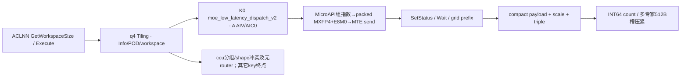

# SGL DeepEP Low-Latency MXFP4 Dispatch 950 ACLNN 算子知识

## 算子速览

| 项目 | 内容 |
|---|---|
| 实际入口 | aclnnMoeLowLatencyDispatchV2GetWorkspaceSize / aclnnMoeLowLatencyDispatchV2，公开两段式ACLNN。 |
| 计算语义 | quantMode=4：每32元素共享E8M0指数，量化FP4 E2M1/E1M2并packed两元素/字节，再按专家分发compact。 |
| 输入输出 | ND BF16/FP16 x[N,H]、INT32 expertIds[N,K]、BOOL mask；packed FP4 expandX[T,floor(H/2)]、一维E8M0 scale、Combine元数据。Device实际payload ceil(H/2)，奇数H冲突另列。 |
| 执行类型 | 单K0 AIV_VECTOR+直接MTE window；无可达Cube/AIC/MIX_CV。 |
| Kernel 路线 | R-001..004 BF16/E2M1、R-005..008 BF16/E1M2、R-009..012 FP16/E2M1、R-013..016 FP16/E1M2；每组legacy/hybrid×单/多专家接收。 |
| 核心资源 | 输入/输出Queue、FP32/abs scratch、mask TBuf、计数grid512A²、512L元数据槽/64L UB，组window双半。 |
| 来源闭包 | source_closed：公开wrapper→q4 Host/POD/SDK Tiling序列化→50004及所有失败终点→完整V2A5 body/helper/通信字节和同步；止于Vector/DMA与框架primitive。 |
| 验证状态 | 已完成源码闭包检查；本次知识提取未执行编译、真机、数值或性能测试。draft保留已见资源/输入域限制。 |

固定SGL commit dda6d36b0cdb4081e102d14c0a2fb276fc416e69，SDK9.1 e5451c7feba11f9e259f4fbc19c4bf82f8c0496c。P=csrc/deepep/ops/，H=impl/adv_api/。冻结Query候选[Low-Latency API](../../../../apis/deepep/deepep_low_latency_dispatch_combine.md)已完整读；其没有完整实现，本卡create。

## 接口与语义

### 计算语义

令R/r/E/Sr/Se/L/B/A分别为EP域大小/rank/专家总数/shared rank数/shared专家数/E/(R-Sr)/globalBs÷R/AIV数。expert e目标=e/L+Sr。输入每32个元素共享一个E8M0 scale，Qm=align2(ceil(H/32))字节。FP4两元素packed成1B，实际payloadBytes=ceil(H/2)，Device compact行跨度也是该字节数；Host输出shape要求floor(H/2)，奇数H在接口与Device之间有真实冲突。

ComputeMaxExp按BF16指数位0x7f80求组最大；FP16先用0x7c00识别非有限指数，有限值CAST_TRUNC到BF16再提指数，非有限映射0x7f80。目标eTarget=E2M1 0x0100、E1M2 0x0000；有限非零组t=max(rawExp,eTarget)，shared=t-eTarget，E8M0 code=shared>>7，BF16乘数位=0x7f00-shared；shared==0x7f00改0x0040。rawExp0改code0/乘数0，0x7f80改code0xff/乘数0x7f81。这是位级定义，特殊值不以近似公式覆盖。

BF16输入在BF16寄存器乘组乘数，Interleave后CAST_RINT到FP4；FP16数据路径在RINT时先执行FP16Convert：按目标mask E2 0xff/E1 0x7f检查低位，当非零且<0x8时OR 0x8，否则保留，再CAST_TRUNC到BF16、BF16乘法、Interleave/CAST_RINT到FP4。FP4 castTrait的SatMode为UNKNOWN、MaskMerge ZEROING，不虚构全局饱和。接收保存packed FP4和E8M0，不做解量化。

接收按local expert/source/token compact，epRecvCounts为跨expert/source inclusive prefix；expertTokenNumsType1 count、0累计；assist每行[sourceRank,sourceToken,sourceTopk]，有效count外容量未初始化。1Dmask只计true数并发送前缀行，2D槽mask压紧并保留slot，同时求shared有效行。负expert/重复expert没有通用Host值扫描。q0/q2/q3/q5是独立语义；helper MX_QUANT=4在CCU中输出约束与公开FP4并不一致。

### 输入、输出与属性

| 参数 | shape/layout | dtype | 约束、默认值与语义 |
|---|---|---|---|
| x | [N,H] ND/AutoContiguous | BF16/FP16 | N0..512/H1024..8192；两input均有公开FP4配对；H对齐/奇偶风险另列。 |
| expertIds | [N,K] ND | INT32 | K1..min(16,E)，首维等N；Python先转INT32。 |
| scalesOptional | optional二维ND | FP32 | Host q4允许存在且检查[E+Se,H]（Sr0规范化Se0）；key+10到50014无body，成功Route缺省。 |
| xActiveMaskOptional | [N]或[N,K] ND | BOOL | 前缀token mask或逐slot mask，具体有效域如上。 |
| expandXOut | [T,floor(H/2)] ND | packed FP4 E2M1/E1M2 | OpDef配对BF16/FP16输入；Host按floor，Device按ceil(H/2)字节每row，奇数H冲突。 |
| dynamicScalesOut | 一维，实际至少T*Qm字节 | E8M0 | Host dim0下界floor(capacity*H/32)*TP，仍未覆盖Qm偶数补齐；Device row*Qm写。 |
| assistInfoForCombineOut | [≥3capacity] ND | INT32 | 当前三元组格式；不能换成Normal/CCU ordinal。 |
| expertTokenNumsOut | 普通[L]或shared[1] | INT64 | 0=cumsum，1=count，默认1。 |
| epRecvCountsOut | 普通≥RL/shared≥R，TP2检查另乘2 | INT32 | inclusive prefix；TP2没有可达50004变体。 |
| tpRecvCountsOut | [tpWorldSize] | INT32 | 无TP body不产生有效写入。 |
| groupEp/epWorldSize/epRankId/moeExpertNum | 属性 | string/int64 | group1..127；R2..768，0≤r<R，E1..1024，E整除R-Sr，L>0。Device32-rank窗口数组是更窄域。 |
| groupTp/tpWorldSize/tpRankId | 属性 | string/int64 | TP0..2；≤1时tpRankId必须显式为0，非零拒绝；TP2需group非空/rank合法/L1，但50104无body。 |
| expertShardType | 属性 | int64 | 仅0。 |
| sharedExpertNum/sharedExpertRankNum | 属性 | int64 | Se0..4/Sr0..R-1；默认Se1/Sr0→0/0；同时零或正，Sr%Se=0。 |
| quantMode/globalBs/expertTokenNumsType/commAlg | 属性 | int64/string | 本卡q4；globalBs0→NR，非0≥NR且%R=0；type0/1；空/fullmesh_v1为MTE，fullmesh_v2无body，ccu有明确Host拒绝。 |

### 入口与版本

公开LOW_LATENCY_API标注A5 MXFP4；OpDef的E8M0配对含BF16/FP16→FP4 E2M1/E1M2，entry在__DAV_C310__下50004实例与其一致。这是Low自己的公开OpDef，不能沿用Normal接口的配对冲突结论。活动build ops/950；README/DeepEP README与SDK version.cmake固定CANN9.1.0，本文不扩9.0。

公开wrapper固定elastic=null、三种special0，并检查commAlg/inner/executor；自动生成inner/Contiguous/executor/stream launch为框架边界。Python显式use_mxfp4且关闭默认use_fp8，C++ mode=mx_fp4_e2m1分配packed[T,floor(H/2)]与一维E8M0[floor(T*H/32)]；E1M2通过raw ACLNN公开配对，不伪造Python已有mode。Device实际ceil(H/2)与Qm补齐须满足真实容量。assist=max(NK,128T)，其它Low count/handle配对，async/hook不拆分kernel。

## Host/Launcher 执行流程

### 参数校验与前处理

1. GetAttr、GetParams、TilingCheck(dim/dtype/format)、CheckAttrs、CheckTensorShape按固定顺序。q4检查expandX必须FP4 E2M1/E1M2、dynamicScales E8M0；外层DYNAMIC_SCALE_DIM_NUM=1，scale一维；expandX第二维严格xDim1/2整数截断。scale dim0下界为((capacity*H)/32)*tpWorldSize，虽分支写重复(MXFP4||MXFP4)，q4会进入该下界，但没有Qm偶数补齐检查。
2. commAlg=ccu进入inner GetContextAttrs→CheckOutputDataType。helper q4=MX_QUANT时该检查只允许FP8 E4M3/E5M2输出，和outer q4要求FP4冲突；因此返回GRAPH_FAILED，不产生本FP4成功CCU Route。不会用CCU helper4的FP8定义替代当前唯一逻辑语义。
3. 非ccu按50000基数加4/hasScales*10/TP2*100/fullmesh_v2*1000；只有50004。50014/50104/50114/51004/51014无router；fullmesh_v2与mask/TP2等组合先被检查拒绝。
4. SetHcommCfg生成engine3/op8 EP与op6 TP资源，SDK GetTiling序列化init64/cc512（非0不可消费，SGL未全部检查）；CheckWinSize检查A≤72/B≤512/32E状态界；SetWorkSpace、SetAivInfo设置workspace、UB/A与CalcTschBlockDim(A,0,A)。两种input/两format由OpDef和router类型guard共同准入，之后窗口/接收角色分支。

### 参数、Workspace 与生命周期

定义C4=ceil(H/2)字节，Qm=align2(ceil(H/32))字节，P=align256(C4)，D=align32(P+Qm)，S=D+12，U=align32(S)，G=align512(S)，Gc=align512(2H)，Xi=align32(2H)。Device发送C4字节packed FP4，P处Qm字节E8M0，D处12B triple；compact row步长C4。__NPU_ARCH__==3510时XOutType把fp4x2映为uint8来操作，copyOutAxisH=ceil(H/2)；其它编译分支保留原packed类型，不能混用元素与字节单位。

QuantVariableInit计算hUBAlignSize=2align128(H)，QuantInit实际input Queue仍Xi；MX ProcessToken先Duplicate2align128(H)，完整MicroAPI加载需2align256(H)，Host无相应容量/alignment guard。Host q4窗口仍Hhost=align32(2H)+44/Ghost，不是packed Device S/G；额外预算不改变Device地址。

| 路线 | Host workspace | 真实消费 | owner/lifetime |
|---|---|---|---|
| 全MTE | 16MiB+512A²+511+512L+512 | grid512A²；tokenMetaBase=align512(userPtr+512A²)-userPtr；512L私有expert槽及后512B预留 | executor/caller，当前stream kernel完成前有效 |
| legacy window | env W | 前4MiB固定MTE区；数据base=IN+4MiB+z*(W-4MiB)/2+B*(K+Se)*Gc；状态IN+z*500KiB | runtime组所有，跨调用selector翻转轮次 |
| hybrid window | env W | 数据/状态在half内107MiB+72KiB、106MiB+36KiB偏移；selector独立106MiB处 | 同组、同z消费完后才能两轮重用 |
| output | caller allocation | 有效compact C4字节/行、Qm字节scale/行、triple12B/行、INT64[L] | 同次Combine handle要求配对 |

Host perHalfData=B*Ghost*R*L+B*Gc*(K+Se)；legacy检查2*perHalfData≤W，未显式同样预留4MiB前缀；hybrid检查2*(perHalfData+109MiB+72KiB)≤W。W来自DEEPEP_HCCL_BUFFSIZE优先，否则HCCL_BUFFSIZE，default200MiB；stoi后存uint16，没有负数/窄化上界拒绝。实际context W仍需匹配。CheckWindowSize用1B UB做INT32 DMA探针不是可靠Host失败返回。

### 启动图与失败传播



| 节点或边 | producer→consumer | 地址/extent、参数 | ordering | owner/lifetime、失败 |
|---|---|---|---|---|
| Host→K0 | SDK/POD producer→entry | outer1216B、A个AIV、同stream、用户workspace | 框架launch顺序 | Host GRAPH_FAILED阻断有效launch；未知key无body不猜运行错误 |
| send→wait | ProcessToken→远端LocalWindowCopy | 每source/localexpert B*G，S字节有效slot | Queue/PIPE_ALL+SyncAll后SetStatus32B | 组window，轮z；提交数据后再flag |
| count→compact | SyncCntOnCore→GetCumSum | grid格距512B | 全核SyncAll | 用户workspace保持到本kernel完成 |
| metadata→输出 | expert私有GM→lastCore | 每expert512B→UB64B行→INT64紧凑 | cacheWriteThrough→SyncAll→MTE2_S/S_MTE3 | 仅多expert普通接收；sole compact writer |
| 失败路径 | CCU Host/unknown router | inner q4仅FP8输出，与outer FP4冲突→GRAPH_FAILED；其它key无匹配 | 不提供MTE自动回退 | source_closed含失败终点，非支持承诺 |

## Route 与参数设计

### 分核与资源计算

split(M,C,c)：base=floor(M/C)，tail=M%C，start=base*c+min(c,tail)，count=base+[c<tail]。shared后核数=Sr?max(1,floor(A*Se/(K+Se))):0，其余前核发送MoE slot；接收Q=shared?R:RL按A split。ordinary L>1时expert计数再按activeA=min(Q,A)分核，每expert独占512B槽，lastCore=min(Q,A)-1写compact结果。源token重复expert的ordinal分支在token0仍可能冲突，见限制。

### Route 选择

| 顺序 | Route | Key/模板 | 精确选择条件与优先级 | 不适用去向 |
|---:|---|---|---|---|
| 1 | R-001 BF16/E2M1/legacy/shared或L1 | 50004；V2A5<bfloat16_t,fp4x2_e2m1_t,E8M0,false,true,true,false,false> | q4、X BF16、packed O E2M1、1D E8M0 scale，scalesOptional=null/TP≠2/commAlg空或fullmesh_v1/hybrid=false、r<Sr或L1；公共shape通过 | Host失败、其它无匹配终点 |
| 2 | R-002 BF16/E2M1/legacy/普通L>1 | 50004；V2A5<bfloat16_t,fp4x2_e2m1_t,E8M0,false,true,true,false,false> | q4、X BF16、packed O E2M1、1D E8M0 scale，scalesOptional=null/TP≠2/commAlg空或fullmesh_v1/hybrid=false、r≥Sr且L>1；公共shape通过 | Host失败、其它无匹配终点 |
| 3 | R-003 BF16/E2M1/hybrid/shared或L1 | 50004；V2A5<bfloat16_t,fp4x2_e2m1_t,E8M0,false,true,true,false,false> | q4、X BF16、packed O E2M1、1D E8M0 scale，scalesOptional=null/TP≠2/commAlg空或fullmesh_v1/hybrid=true、r<Sr或L1；公共shape通过 | Host失败、其它无匹配终点 |
| 4 | R-004 BF16/E2M1/hybrid/普通L>1 | 50004；V2A5<bfloat16_t,fp4x2_e2m1_t,E8M0,false,true,true,false,false> | q4、X BF16、packed O E2M1、1D E8M0 scale，scalesOptional=null/TP≠2/commAlg空或fullmesh_v1/hybrid=true、r≥Sr且L>1；公共shape通过 | Host失败、其它无匹配终点 |
| 5 | R-005 BF16/E1M2/legacy/shared或L1 | 50004；V2A5<bfloat16_t,fp4x2_e1m2_t,E8M0,false,true,true,false,false> | q4、X BF16、packed O E1M2、1D E8M0 scale，scalesOptional=null/TP≠2/commAlg空或fullmesh_v1/hybrid=false、r<Sr或L1；公共shape通过 | Host失败、其它无匹配终点 |
| 6 | R-006 BF16/E1M2/legacy/普通L>1 | 50004；V2A5<bfloat16_t,fp4x2_e1m2_t,E8M0,false,true,true,false,false> | q4、X BF16、packed O E1M2、1D E8M0 scale，scalesOptional=null/TP≠2/commAlg空或fullmesh_v1/hybrid=false、r≥Sr且L>1；公共shape通过 | Host失败、其它无匹配终点 |
| 7 | R-007 BF16/E1M2/hybrid/shared或L1 | 50004；V2A5<bfloat16_t,fp4x2_e1m2_t,E8M0,false,true,true,false,false> | q4、X BF16、packed O E1M2、1D E8M0 scale，scalesOptional=null/TP≠2/commAlg空或fullmesh_v1/hybrid=true、r<Sr或L1；公共shape通过 | Host失败、其它无匹配终点 |
| 8 | R-008 BF16/E1M2/hybrid/普通L>1 | 50004；V2A5<bfloat16_t,fp4x2_e1m2_t,E8M0,false,true,true,false,false> | q4、X BF16、packed O E1M2、1D E8M0 scale，scalesOptional=null/TP≠2/commAlg空或fullmesh_v1/hybrid=true、r≥Sr且L>1；公共shape通过 | Host失败、其它无匹配终点 |
| 9 | R-009 FP16/E2M1/legacy/shared或L1 | 50004；V2A5<half,fp4x2_e2m1_t,E8M0,false,true,true,false,false> | q4、X FP16、packed O E2M1、1D E8M0 scale，scalesOptional=null/TP≠2/commAlg空或fullmesh_v1/hybrid=false、r<Sr或L1；公共shape通过 | Host失败、其它无匹配终点 |
| 10 | R-010 FP16/E2M1/legacy/普通L>1 | 50004；V2A5<half,fp4x2_e2m1_t,E8M0,false,true,true,false,false> | q4、X FP16、packed O E2M1、1D E8M0 scale，scalesOptional=null/TP≠2/commAlg空或fullmesh_v1/hybrid=false、r≥Sr且L>1；公共shape通过 | Host失败、其它无匹配终点 |
| 11 | R-011 FP16/E2M1/hybrid/shared或L1 | 50004；V2A5<half,fp4x2_e2m1_t,E8M0,false,true,true,false,false> | q4、X FP16、packed O E2M1、1D E8M0 scale，scalesOptional=null/TP≠2/commAlg空或fullmesh_v1/hybrid=true、r<Sr或L1；公共shape通过 | Host失败、其它无匹配终点 |
| 12 | R-012 FP16/E2M1/hybrid/普通L>1 | 50004；V2A5<half,fp4x2_e2m1_t,E8M0,false,true,true,false,false> | q4、X FP16、packed O E2M1、1D E8M0 scale，scalesOptional=null/TP≠2/commAlg空或fullmesh_v1/hybrid=true、r≥Sr且L>1；公共shape通过 | Host失败、其它无匹配终点 |
| 13 | R-013 FP16/E1M2/legacy/shared或L1 | 50004；V2A5<half,fp4x2_e1m2_t,E8M0,false,true,true,false,false> | q4、X FP16、packed O E1M2、1D E8M0 scale，scalesOptional=null/TP≠2/commAlg空或fullmesh_v1/hybrid=false、r<Sr或L1；公共shape通过 | Host失败、其它无匹配终点 |
| 14 | R-014 FP16/E1M2/legacy/普通L>1 | 50004；V2A5<half,fp4x2_e1m2_t,E8M0,false,true,true,false,false> | q4、X FP16、packed O E1M2、1D E8M0 scale，scalesOptional=null/TP≠2/commAlg空或fullmesh_v1/hybrid=false、r≥Sr且L>1；公共shape通过 | Host失败、其它无匹配终点 |
| 15 | R-015 FP16/E1M2/hybrid/shared或L1 | 50004；V2A5<half,fp4x2_e1m2_t,E8M0,false,true,true,false,false> | q4、X FP16、packed O E1M2、1D E8M0 scale，scalesOptional=null/TP≠2/commAlg空或fullmesh_v1/hybrid=true、r<Sr或L1；公共shape通过 | Host失败、其它无匹配终点 |
| 16 | R-016 FP16/E1M2/hybrid/普通L>1 | 50004；V2A5<half,fp4x2_e1m2_t,E8M0,false,true,true,false,false> | q4、X FP16、packed O E1M2、1D E8M0 scale，scalesOptional=null/TP≠2/commAlg空或fullmesh_v1/hybrid=true、r≥Sr且L>1；公共shape通过 | Host失败、其它无匹配终点 |

```text
q4固定，OpDef BF16/FP16→FP4 E2M1/E1M2+E8M0，scale一维
ccu -> GetContextAttrs/CheckOutputDataType要求helper4输出FP8，与outerFP4冲突 -> GRAPH_FAILED
MTE key=50000+4+10*hasScales+100*TP2+1000*fullmeshV2
  50004 && __DAV_C310__ && O FP4E2/E1 -> IsMxQuant=true
  按input BF16/FP16、format E2M1/E1M2、hybrid与接收角色分16Route
  50014/50104/50114/51004/51014无body；不静默fallback
```

### 模板/实现执行矩阵

| Route | key/selector | dtype/shape/platform 完整命中条件 | 执行拓扑与 Kernel 节点 | 实际模板/body | 内存与同步特征 | tail/fallback |
|---|---|---|---|---|---|---|
| R-001 | 50004 | 950/q4，BF16→packed E2M1/E8M0，N0..512/H1024..8192/K1..min16E；nosmooth/TP≠2/MTE，hybrid=false，shared或L1 | 单K0 AIV_VECTOR+MTE | V2A5<bfloat16_t,fp4x2_e2m1_t,E8M0,false,true,true,false,false>::QuantDynamicMx→ComputeFp4Data，eTarget=0x0100 | bXi+bU send/Reset后bU recv；Qm scales；直接I64 count；BF16乘法 | C4=ceilH2与HostfloorH2冲突；full load容量另核 |
| R-002 | 50004 | 950/q4，BF16→packed E2M1/E8M0，N0..512/H1024..8192/K1..min16E；nosmooth/TP≠2/MTE，hybrid=false，普通L>1 | 单K0 AIV_VECTOR+MTE | V2A5<bfloat16_t,fp4x2_e2m1_t,E8M0,false,true,true,false,false>::QuantDynamicMx→ComputeFp4Data，eTarget=0x0100 | bXi+bU send/Reset后bU recv；Qm scales；512L GM/64L UB metadata；BF16乘法 | C4=ceilH2与HostfloorH2冲突；full load容量另核 |
| R-003 | 50004 | 950/q4，BF16→packed E2M1/E8M0，N0..512/H1024..8192/K1..min16E；nosmooth/TP≠2/MTE，hybrid=true，shared或L1 | 单K0 AIV_VECTOR+MTE | V2A5<bfloat16_t,fp4x2_e2m1_t,E8M0,false,true,true,false,false>::QuantDynamicMx→ComputeFp4Data，eTarget=0x0100 | bXi+bU send/Reset后bU recv；Qm scales；直接I64 count；BF16乘法 | C4=ceilH2与HostfloorH2冲突；full load容量另核 |
| R-004 | 50004 | 950/q4，BF16→packed E2M1/E8M0，N0..512/H1024..8192/K1..min16E；nosmooth/TP≠2/MTE，hybrid=true，普通L>1 | 单K0 AIV_VECTOR+MTE | V2A5<bfloat16_t,fp4x2_e2m1_t,E8M0,false,true,true,false,false>::QuantDynamicMx→ComputeFp4Data，eTarget=0x0100 | bXi+bU send/Reset后bU recv；Qm scales；512L GM/64L UB metadata；BF16乘法 | C4=ceilH2与HostfloorH2冲突；full load容量另核 |
| R-005 | 50004 | 950/q4，BF16→packed E1M2/E8M0，N0..512/H1024..8192/K1..min16E；nosmooth/TP≠2/MTE，hybrid=false，shared或L1 | 单K0 AIV_VECTOR+MTE | V2A5<bfloat16_t,fp4x2_e1m2_t,E8M0,false,true,true,false,false>::QuantDynamicMx→ComputeFp4Data，eTarget=0x0000 | bXi+bU send/Reset后bU recv；Qm scales；直接I64 count；BF16乘法 | C4=ceilH2与HostfloorH2冲突；full load容量另核 |
| R-006 | 50004 | 950/q4，BF16→packed E1M2/E8M0，N0..512/H1024..8192/K1..min16E；nosmooth/TP≠2/MTE，hybrid=false，普通L>1 | 单K0 AIV_VECTOR+MTE | V2A5<bfloat16_t,fp4x2_e1m2_t,E8M0,false,true,true,false,false>::QuantDynamicMx→ComputeFp4Data，eTarget=0x0000 | bXi+bU send/Reset后bU recv；Qm scales；512L GM/64L UB metadata；BF16乘法 | C4=ceilH2与HostfloorH2冲突；full load容量另核 |
| R-007 | 50004 | 950/q4，BF16→packed E1M2/E8M0，N0..512/H1024..8192/K1..min16E；nosmooth/TP≠2/MTE，hybrid=true，shared或L1 | 单K0 AIV_VECTOR+MTE | V2A5<bfloat16_t,fp4x2_e1m2_t,E8M0,false,true,true,false,false>::QuantDynamicMx→ComputeFp4Data，eTarget=0x0000 | bXi+bU send/Reset后bU recv；Qm scales；直接I64 count；BF16乘法 | C4=ceilH2与HostfloorH2冲突；full load容量另核 |
| R-008 | 50004 | 950/q4，BF16→packed E1M2/E8M0，N0..512/H1024..8192/K1..min16E；nosmooth/TP≠2/MTE，hybrid=true，普通L>1 | 单K0 AIV_VECTOR+MTE | V2A5<bfloat16_t,fp4x2_e1m2_t,E8M0,false,true,true,false,false>::QuantDynamicMx→ComputeFp4Data，eTarget=0x0000 | bXi+bU send/Reset后bU recv；Qm scales；512L GM/64L UB metadata；BF16乘法 | C4=ceilH2与HostfloorH2冲突；full load容量另核 |
| R-009 | 50004 | 950/q4，FP16→packed E2M1/E8M0，N0..512/H1024..8192/K1..min16E；nosmooth/TP≠2/MTE，hybrid=false，shared或L1 | 单K0 AIV_VECTOR+MTE | V2A5<half,fp4x2_e2m1_t,E8M0,false,true,true,false,false>::QuantDynamicMx→ComputeFp4Data，eTarget=0x0100 | bXi+bU send/Reset后bU recv；Qm scales；直接I64 count；FP16Convert/TRUNC BF16 | C4=ceilH2与HostfloorH2冲突；full load容量另核 |
| R-010 | 50004 | 950/q4，FP16→packed E2M1/E8M0，N0..512/H1024..8192/K1..min16E；nosmooth/TP≠2/MTE，hybrid=false，普通L>1 | 单K0 AIV_VECTOR+MTE | V2A5<half,fp4x2_e2m1_t,E8M0,false,true,true,false,false>::QuantDynamicMx→ComputeFp4Data，eTarget=0x0100 | bXi+bU send/Reset后bU recv；Qm scales；512L GM/64L UB metadata；FP16Convert/TRUNC BF16 | C4=ceilH2与HostfloorH2冲突；full load容量另核 |
| R-011 | 50004 | 950/q4，FP16→packed E2M1/E8M0，N0..512/H1024..8192/K1..min16E；nosmooth/TP≠2/MTE，hybrid=true，shared或L1 | 单K0 AIV_VECTOR+MTE | V2A5<half,fp4x2_e2m1_t,E8M0,false,true,true,false,false>::QuantDynamicMx→ComputeFp4Data，eTarget=0x0100 | bXi+bU send/Reset后bU recv；Qm scales；直接I64 count；FP16Convert/TRUNC BF16 | C4=ceilH2与HostfloorH2冲突；full load容量另核 |
| R-012 | 50004 | 950/q4，FP16→packed E2M1/E8M0，N0..512/H1024..8192/K1..min16E；nosmooth/TP≠2/MTE，hybrid=true，普通L>1 | 单K0 AIV_VECTOR+MTE | V2A5<half,fp4x2_e2m1_t,E8M0,false,true,true,false,false>::QuantDynamicMx→ComputeFp4Data，eTarget=0x0100 | bXi+bU send/Reset后bU recv；Qm scales；512L GM/64L UB metadata；FP16Convert/TRUNC BF16 | C4=ceilH2与HostfloorH2冲突；full load容量另核 |
| R-013 | 50004 | 950/q4，FP16→packed E1M2/E8M0，N0..512/H1024..8192/K1..min16E；nosmooth/TP≠2/MTE，hybrid=false，shared或L1 | 单K0 AIV_VECTOR+MTE | V2A5<half,fp4x2_e1m2_t,E8M0,false,true,true,false,false>::QuantDynamicMx→ComputeFp4Data，eTarget=0x0000 | bXi+bU send/Reset后bU recv；Qm scales；直接I64 count；FP16Convert/TRUNC BF16 | C4=ceilH2与HostfloorH2冲突；full load容量另核 |
| R-014 | 50004 | 950/q4，FP16→packed E1M2/E8M0，N0..512/H1024..8192/K1..min16E；nosmooth/TP≠2/MTE，hybrid=false，普通L>1 | 单K0 AIV_VECTOR+MTE | V2A5<half,fp4x2_e1m2_t,E8M0,false,true,true,false,false>::QuantDynamicMx→ComputeFp4Data，eTarget=0x0000 | bXi+bU send/Reset后bU recv；Qm scales；512L GM/64L UB metadata；FP16Convert/TRUNC BF16 | C4=ceilH2与HostfloorH2冲突；full load容量另核 |
| R-015 | 50004 | 950/q4，FP16→packed E1M2/E8M0，N0..512/H1024..8192/K1..min16E；nosmooth/TP≠2/MTE，hybrid=true，shared或L1 | 单K0 AIV_VECTOR+MTE | V2A5<half,fp4x2_e1m2_t,E8M0,false,true,true,false,false>::QuantDynamicMx→ComputeFp4Data，eTarget=0x0000 | bXi+bU send/Reset后bU recv；Qm scales；直接I64 count；FP16Convert/TRUNC BF16 | C4=ceilH2与HostfloorH2冲突；full load容量另核 |
| R-016 | 50004 | 950/q4，FP16→packed E1M2/E8M0，N0..512/H1024..8192/K1..min16E；nosmooth/TP≠2/MTE，hybrid=true，普通L>1 | 单K0 AIV_VECTOR+MTE | V2A5<half,fp4x2_e1m2_t,E8M0,false,true,true,false,false>::QuantDynamicMx→ComputeFp4Data，eTarget=0x0000 | bXi+bU send/Reset后bU recv；Qm scales；512L GM/64L UB metadata；FP16Convert/TRUNC BF16 | C4=ceilH2与HostfloorH2冲突；full load容量另核 |

### 隐藏性能 Guard

| Guard | Host/Tiling 条件 | Device/资源原因 | 影响 Route | 不满足时去向 | 源码符号 |
|---|---|---|---|---|---|
| dtype | q4 FP4 E2M1/E1M2、E8M0；OpDef BF16/FP16输入 | 两format eTarget不同，FP16另有转换 | 全部 | 无匹配dtype不计成功Route | OpDef/CheckTensorDataType/entry |
| key | scales/TP/fullmeshv2各加位 | 只有50004 router | 全部 | 无匹配终点 | CalTilingKey/entry |
| CCU enum/shape | inner q4 MX_QUANT只允许FP8输出 | outer q4要求FP4，两检查冲突 | CCU候选 | CheckOutputDataType返回GRAPH_FAILED | CheckOutputDataType/entry |
| UB depth | estimated+[L>1普通]*64L+2Xi+2U>170KiB→b1 | 输入输出Queue同时缩深度；请求不完全入账 | 全部 | 无第二级资源fallback | QuantInit |
| rank array | Host R≤768，local windowsIn[32] | MTE按rank索引32项数组 | 全部 | 超域无Host guard，draft | HcclCombinOpParam/GetBaseWindAddr |
| 状态 | A≤72/B≤512/E*32≤512KiB-32 | selector与状态区固定容量 | 全部 | GRAPH_FAILED | CheckWinSize |
| metadata | L≤E≤1024；blockCount静态≤4095 | 多expert DMA gather | 各偶数Route（普通L>1） | 方法有保护return，不擅补输出 | UpdateTokenNumsOut |

| MX输入/完整加载 | Host无H%128/256检查，inputXi=align32(2H) | Duplicate需2align128(H)，MicroAPI全load需2align256(H) | 全部 | 无容量guard；H%256=0为源码推导的充分对齐域，非Host条件 | QuantInit/ProcessToken/ComputeMaxExp |
| scale容量 | q4仅检dim0≥floor(capacity*H/32)*TP | Device每row Qm字节含偶数补齐 | 全部 | 未覆盖奇数scale补齐，draft | CheckTensorShape/CopyScalesToOut |

| packed行宽 | Host检查expandX dim1=floor(H/2) | Device copyOutAxisH=ceil(H/2)、每row C4字节 | 全部 | 奇数H无拒绝guard，静态布局冲突 | CheckTensorShape/Init/LocalWindowCopy |
| FP16数值分支 | OpDef真实含FP16+FP4配对 | 指数先TRUNC BF16；数据先FP16Convert再TRUNC BF16 | R-009..016 | 保留顺序；不能套BF16位模式 | ComputeMaxExp/FP16Convert/ComputeFp4Data |

### POD/ABI

SGL Info自然8B对齐推导size128/align8；外层init64@0、cc1 512@64、cc2 512@576、Info@1088，总1216。下表offset均相对Info；自然布局推导未经编译测量。CCU二次Host覆盖其实际产生字段，不能将外层inactive值补成已初始化。

| 结构 | 字段 | 类型/位宽 | ABI 布局 | 单位 | Host/launcher producer | Device consumer | 边界 |
|---|---|---|---|---|---|---|---|
| MoeDistributeDispatchV2Info | epWorldSize | u32 | 0 | rank数 | GetAttrAndSetTilingData写R | Init分域/窗口/CCU rank | padding60..63/92..95/116..119不作业务数据 |
| MoeDistributeDispatchV2Info | tpWorldSize | u32 | 4 | rank数 | Host0..2；TP2 key无body | Hostkey；当前body不AllGather | padding60..63/92..95/116..119不作业务数据 |
| MoeDistributeDispatchV2Info | epRankId | u32 | 8 | rank | 合法r | GetWindow、scatter/gather | padding60..63/92..95/116..119不作业务数据 |
| MoeDistributeDispatchV2Info | tpRankId | u32 | 12 | rank | TP≤1要求属性tpRankId=0，非零拒绝 | 本实例TP inactive | padding60..63/92..95/116..119不作业务数据 |
| MoeDistributeDispatchV2Info | expertShardType | u32 | 16 | enum | 仅0 | body不做分片计算 | padding60..63/92..95/116..119不作业务数据 |
| MoeDistributeDispatchV2Info | sharedExpertNum | u32 | 20 | expert数 | Se默认1/Sr0规范化为0 | shared核组/目标 | padding60..63/92..95/116..119不作业务数据 |
| MoeDistributeDispatchV2Info | sharedExpertRankNum | u32 | 24 | rank数 | Sr、Se一致性/divisible检查 | shared role/L | padding60..63/92..95/116..119不作业务数据 |
| MoeDistributeDispatchV2Info | moeExpertNum | u32 | 28 | expert数 | E1..1024且整除R-Sr | L与id域 | padding60..63/92..95/116..119不作业务数据 |
| MoeDistributeDispatchV2Info | quantMode | u32 | 32 | enum | attr=4 | Hostkey，模板DynamicQuant=true/IsMxQuant=true | padding60..63/92..95/116..119不作业务数据 |
| MoeDistributeDispatchV2Info | globalBs | u32 | 36 | token容量 | 0→NR，否则≥NR且%R=0；CCU有mask时等于NR | B与perRankDataSize | padding60..63/92..95/116..119不作业务数据 |
| MoeDistributeDispatchV2Info | bs | u32 | 40 | token | x.dim0，MTE允许0，CCU要求>0 | mask/slot域 | padding60..63/92..95/116..119不作业务数据 |
| MoeDistributeDispatchV2Info | k | u32 | 44 | slot/token | expertIds.dim1，外层≤16、CCU≤8 | NK/目标路由 | padding60..63/92..95/116..119不作业务数据 |
| MoeDistributeDispatchV2Info | h | u32 | 48 | element/token | x.dim1 1024..8192 | 字节/Queue/DMA | padding60..63/92..95/116..119不作业务数据 |
| MoeDistributeDispatchV2Info | aivNum | u32 | 52 | core | SetAivInfo写平台AIV数 | 分核/selector512A，本q4无CCU consumer | padding60..63/92..95/116..119不作业务数据 |
| MoeDistributeDispatchV2Info | isTokenMask | bool | 56 | flag | mask dim1 | 计数前缀mask | padding60..63/92..95/116..119不作业务数据 |
| MoeDistributeDispatchV2Info | isExpertMask | bool | 57 | flag | 外层mask dim2 | MTE槽mask；MTE逐槽mask | padding60..63/92..95/116..119不作业务数据 |
| MoeDistributeDispatchV2Info | hasElasticInfo | bool | 58 | flag | wrapper null→false | elastic分支不可达 | padding60..63/92..95/116..119不作业务数据 |
| MoeDistributeDispatchV2Info | isHybridDeployment | bool | 59 | flag | env DEEPEP_HYBRID_DEPLOYMENT精确1 | MTE窗口路由 | padding60..63/92..95/116..119不作业务数据 |
| MoeDistributeDispatchV2Info | totalUbSize | u64 | 64 | byte | SetAivInfo::GetCoreMemSize写平台UB | 未形成完整分配拒绝 | padding60..63/92..95/116..119不作业务数据 |
| MoeDistributeDispatchV2Info | totalWinSize | u64 | 72 | byte | env uint16 MiB | MTE窗口总字节W | padding60..63/92..95/116..119不作业务数据 |
| MoeDistributeDispatchV2Info | expertTokenNumsType | u32 | 80 | enum | attr0/1 | count/cumsum输出 | padding60..63/92..95/116..119不作业务数据 |
| MoeDistributeDispatchV2Info | zeroComputeExpertNum | i32 | 84 | expert数 | wrapper特殊属性0之和 | 本入口special分支inactive | padding60..63/92..95/116..119不作业务数据 |
| MoeDistributeDispatchV2Info | cumSumUBMinValue | u32 | 88 | byte | 外层CumSum shape[1,LR]临时最小值 | 本q4 body不以此申请 | padding60..63/92..95/116..119不作业务数据 |
| MoeDistributeDispatchV2Info | scalesRow | u64 | 96 | row | CheckAndSetScalesInfo：缺省0；存在写dim0后最终到50014无body | inactive | padding60..63/92..95/116..119不作业务数据 |
| MoeDistributeDispatchV2Info | scalesCol | u64 | 104 | column | 同上 | 本MTE无smooth实例，不读输入scale shape字段 | padding60..63/92..95/116..119不作业务数据 |
| MoeDistributeDispatchV2Info | scalesTypeSize | u32 | 112 | byte/scale | 同上 | 同上 | padding60..63/92..95/116..119不作业务数据 |
| MoeDistributeDispatchV2Info | scalesCount | u64 | 120 | element数 | 同上 | 本MTE不读该字段；输出scale来自token absmax | padding60..63/92..95/116..119不作业务数据 |
| outer | mc2InitTiling | opaque64 | 0 | byte | GetTiling(init) | 框架/InitV2 | SDK内层见后表 |
| outer | mc2CcTiling1 | opaque512 | 64 | byte | engine3/op8 | EP组资源/CCU SetCcTilingV2(offset64) | SDK GetTiling返回值未完整检查 |
| outer | mc2CcTiling2 | opaque512 | 576 | byte | engine3/op6，groupTP资源；当前实例不AllGather | 框架资源准备；无TP方法实例 | 不能伪称CCU支持TP |
| outer | moeDistributeDispatchV2Info | Info128 | 1088 | byte | 前述producer | entry/Init | q4字段按真实consumer |

SDK Mc2InitTiling64/Mc2CcTiling512为公开opaque外壳；实际inner如下。offset相对inner，类型来自固定SDK。本q4成功Route只使用MTE engine3/op8与TP资源op6；CCU inner的分组/shape与本公开q4冲突且无router，不生成可消费CCU POD。

| 结构 | 字段 | 类型/位宽 | ABI 布局 | 单位 | Host/launcher producer | Device consumer | 边界 |
|---|---|---|---|---|---|---|---|
| Mc2InitTilingInner | version | u32 | 0 | 版本枚举 | GetTiling: 100 | SDK初始化 | 不依赖reserved值 |
| 同上 | mc2HcommCnt | u32 | 4 | 通信组数 | GetTiling: 2 | HCOMM GenerateAlgoTemplatesV2 | 不依赖reserved值 |
| 同上 | offset | u32[8] | 8 | 字节偏移数组 | GetTiling: 64/576，其余0 | cc1/cc2定位 | 不依赖reserved值 |
| 同上 | debugMode | u8 | 40 | 枚举 | GetTiling: default0 | SDK | 不依赖reserved值 |
| 同上 | preparePosition | u8 | 41 | 枚举 | GetTiling: default0 | SDK | 不依赖reserved值 |
| 同上 | queueNum | u16 | 42 | queue数 | GetTiling: default0 | SDK working core | 不依赖reserved值 |
| 同上 | commBlockNum | u16 | 44 | block数 | GetTiling: default0 | SDK资源 | 不依赖reserved值 |
| 同上 | devType | u8 | 46 | 枚举 | GetTiling: runtime SoC | 平台实现选择 | 不依赖reserved值 |
| 同上 | reserved | char[17] | 47 | 保留字节 | GetTiling: 未显式清全部 | inactive | 不依赖reserved值 |
| Mc2CcTilingInner | skipLocalRankCopy | u8 | 0 | 布尔 | GetTiling: default0 | 框架 | 不依赖reserved值 |
| 同上 | skipBufferWindowCopy | u8 | 1 | 布尔 | GetTiling: default0 | 框架 | 不依赖reserved值 |
| 同上 | stepSize | u8 | 2 | step数 | GetTiling: default0 | 框架 | 不依赖reserved值 |
| 同上 | version | u8 | 3 | 版本枚举 | GetTiling: 1 | 固定协议 | 不依赖reserved值 |
| 同上 | reserved | char[9] | 4 | 保留字节 | GetTiling: memset0 | inactive | 不依赖reserved值 |
| 同上 | commEngine | u8 | 13 | 枚举 | GetTiling: MTE3 | 框架MTE资源；Device不执行CCU | 不依赖reserved值 |
| 同上 | srcDataType | u8 | 14 | dtype枚举 | GetTiling: default0=INT8 | MTE不读作payload dtype，payload由模板决定 | 不依赖reserved值 |
| 同上 | dstDataType | u8 | 15 | dtype枚举 | GetTiling: default0=INT8 | MTE不读取该字段 | 不依赖reserved值 |
| 同上 | groupName | char[128] | 16 | 组名字符 | GetTiling: EP/TP字符串 | 框架组关联 | 不依赖reserved值 |
| 同上 | algConfig | char[128] | 144 | 算法配置字符 | GetTiling: AlltoAll fullmesh/pairwise，MTE第二AllGather ring | 框架资源组装；本body直接MTE | 不依赖reserved值 |
| 同上 | opType | u32 | 272 | 命令枚举 | GetTiling: EP8/TP6 | 框架通信资源声明 | 不依赖reserved值 |
| 同上 | reduceType | u32 | 276 | reduce枚举 | GetTiling: default0 | 本body不做payload reduce | 不依赖reserved值 |
| 同上 | reserved2 | char[232] | 280 | 保留字节 | GetTiling: 未显式清全部 | inactive | 不依赖reserved值 |

MTE本地HcclCombinOpParam（少e）为32项window数组，普通自然8B对齐推导size576/align8；当前body只消费rank前缀和windowsIn。它与SDK CCU64项结构不同，本q4无CCU Device实例，不读取后者。

| 结构 | 字段 | 类型/位宽 | ABI 布局 | 单位 | Host/launcher producer | Device consumer | 边界 |
|---|---|---|---|---|---|---|---|
| SGL MTE context | workSpace | u64 | 0 | 地址 | runtime组 | 当前MTE不用 | 不同于ACLNN workspace |
| 同上 | workSpaceSize | u64 | 8 | byte | runtime组 | 当前MTE不用 | 保留前缀 |
| 同上 | rankId | u32 | 16 | rank | runtime组 | GetRankId/InitWinState | 检查值 |
| 同上 | rankDim | u32 | 20 | rank数 | runtime组 | GetRankDim/InitWinState | 不是AIV数 |
| 同上 | winSize | u64 | 24 | byte | runtime组 | GetWinSize/CheckWindowSize | 实际大小 |
| 同上 | windowsIn | u64[32] | 32 | 地址 | runtime组 | GetBaseWindAddr/State | Host未限制rank<32 |
| 同上 | windowsOut | u64[32] | 288 | 地址 | runtime组 | 本MTE body未读 | 不借用SDK64布局 |
| 同上 | xnAddr | u64 | 544 | 地址 | runtime组 | 本MTE不用 | 不能按CCU前缀解释 |
| 同上 | ckeAddr | u64 | 552 | 地址 | runtime组 | 本MTE不用 | 同上 |
| 同上 | msAddr | u64 | 560 | 地址 | runtime组 | 本MTE不用 | 保留 |
| 同上 | msSize | u64 | 568 | byte/count | runtime组 | 本MTE不用 | 未消费 |

### Route 源码闭包

| Route | Key/selector | Host/Tiling producer | POD/参数 | Kernel entry/router 节点 | Kernel body/直接依赖 | 构建接线 |
|---|---|---|---|---|---|---|
| R-001 | 50004 | P/op_host/moe_distribute_dispatch_v2_tiling.cpp；CheckTensorDataType/CalTilingKey/CheckWinSize/SetWorkSpace | Info128/outer1216、SDK init64/cc512、grid/tokenMeta/MTE context | P/op_kernel/moe_low_latency_dispatch_v2.cpp；bfloat16_t/fp4x2_e2m1_t/IsMxQuant=true | P/op_kernel/moe_distribute_dispatch_v2_a5.h→quantize_functions.h::ComputeMaxExp/ComputeScale/ComputeFp4Data，及base/window/mask helper | 950 OpDef、build.sh/compile_ascend_proj.sh、ops Host/kernel CMake |
| R-002 | 50004 | P/op_host/moe_distribute_dispatch_v2_tiling.cpp；CheckTensorDataType/CalTilingKey/CheckWinSize/SetWorkSpace | Info128/outer1216、SDK init64/cc512、grid/tokenMeta/MTE context | P/op_kernel/moe_low_latency_dispatch_v2.cpp；bfloat16_t/fp4x2_e2m1_t/IsMxQuant=true | P/op_kernel/moe_distribute_dispatch_v2_a5.h→quantize_functions.h::ComputeMaxExp/ComputeScale/ComputeFp4Data，及base/window/mask helper | 950 OpDef、build.sh/compile_ascend_proj.sh、ops Host/kernel CMake |
| R-003 | 50004 | P/op_host/moe_distribute_dispatch_v2_tiling.cpp；CheckTensorDataType/CalTilingKey/CheckWinSize/SetWorkSpace | Info128/outer1216、SDK init64/cc512、grid/tokenMeta/MTE context | P/op_kernel/moe_low_latency_dispatch_v2.cpp；bfloat16_t/fp4x2_e2m1_t/IsMxQuant=true | P/op_kernel/moe_distribute_dispatch_v2_a5.h→quantize_functions.h::ComputeMaxExp/ComputeScale/ComputeFp4Data，及base/window/mask helper | 950 OpDef、build.sh/compile_ascend_proj.sh、ops Host/kernel CMake |
| R-004 | 50004 | P/op_host/moe_distribute_dispatch_v2_tiling.cpp；CheckTensorDataType/CalTilingKey/CheckWinSize/SetWorkSpace | Info128/outer1216、SDK init64/cc512、grid/tokenMeta/MTE context | P/op_kernel/moe_low_latency_dispatch_v2.cpp；bfloat16_t/fp4x2_e2m1_t/IsMxQuant=true | P/op_kernel/moe_distribute_dispatch_v2_a5.h→quantize_functions.h::ComputeMaxExp/ComputeScale/ComputeFp4Data，及base/window/mask helper | 950 OpDef、build.sh/compile_ascend_proj.sh、ops Host/kernel CMake |
| R-005 | 50004 | P/op_host/moe_distribute_dispatch_v2_tiling.cpp；CheckTensorDataType/CalTilingKey/CheckWinSize/SetWorkSpace | Info128/outer1216、SDK init64/cc512、grid/tokenMeta/MTE context | P/op_kernel/moe_low_latency_dispatch_v2.cpp；bfloat16_t/fp4x2_e1m2_t/IsMxQuant=true | P/op_kernel/moe_distribute_dispatch_v2_a5.h→quantize_functions.h::ComputeMaxExp/ComputeScale/ComputeFp4Data，及base/window/mask helper | 950 OpDef、build.sh/compile_ascend_proj.sh、ops Host/kernel CMake |
| R-006 | 50004 | P/op_host/moe_distribute_dispatch_v2_tiling.cpp；CheckTensorDataType/CalTilingKey/CheckWinSize/SetWorkSpace | Info128/outer1216、SDK init64/cc512、grid/tokenMeta/MTE context | P/op_kernel/moe_low_latency_dispatch_v2.cpp；bfloat16_t/fp4x2_e1m2_t/IsMxQuant=true | P/op_kernel/moe_distribute_dispatch_v2_a5.h→quantize_functions.h::ComputeMaxExp/ComputeScale/ComputeFp4Data，及base/window/mask helper | 950 OpDef、build.sh/compile_ascend_proj.sh、ops Host/kernel CMake |
| R-007 | 50004 | P/op_host/moe_distribute_dispatch_v2_tiling.cpp；CheckTensorDataType/CalTilingKey/CheckWinSize/SetWorkSpace | Info128/outer1216、SDK init64/cc512、grid/tokenMeta/MTE context | P/op_kernel/moe_low_latency_dispatch_v2.cpp；bfloat16_t/fp4x2_e1m2_t/IsMxQuant=true | P/op_kernel/moe_distribute_dispatch_v2_a5.h→quantize_functions.h::ComputeMaxExp/ComputeScale/ComputeFp4Data，及base/window/mask helper | 950 OpDef、build.sh/compile_ascend_proj.sh、ops Host/kernel CMake |
| R-008 | 50004 | P/op_host/moe_distribute_dispatch_v2_tiling.cpp；CheckTensorDataType/CalTilingKey/CheckWinSize/SetWorkSpace | Info128/outer1216、SDK init64/cc512、grid/tokenMeta/MTE context | P/op_kernel/moe_low_latency_dispatch_v2.cpp；bfloat16_t/fp4x2_e1m2_t/IsMxQuant=true | P/op_kernel/moe_distribute_dispatch_v2_a5.h→quantize_functions.h::ComputeMaxExp/ComputeScale/ComputeFp4Data，及base/window/mask helper | 950 OpDef、build.sh/compile_ascend_proj.sh、ops Host/kernel CMake |
| R-009 | 50004 | P/op_host/moe_distribute_dispatch_v2_tiling.cpp；CheckTensorDataType/CalTilingKey/CheckWinSize/SetWorkSpace | Info128/outer1216、SDK init64/cc512、grid/tokenMeta/MTE context | P/op_kernel/moe_low_latency_dispatch_v2.cpp；half/fp4x2_e2m1_t/IsMxQuant=true | P/op_kernel/moe_distribute_dispatch_v2_a5.h→quantize_functions.h::ComputeMaxExp/ComputeScale/ComputeFp4Data/FP16Convert，及base/window/mask helper | 950 OpDef、build.sh/compile_ascend_proj.sh、ops Host/kernel CMake |
| R-010 | 50004 | P/op_host/moe_distribute_dispatch_v2_tiling.cpp；CheckTensorDataType/CalTilingKey/CheckWinSize/SetWorkSpace | Info128/outer1216、SDK init64/cc512、grid/tokenMeta/MTE context | P/op_kernel/moe_low_latency_dispatch_v2.cpp；half/fp4x2_e2m1_t/IsMxQuant=true | P/op_kernel/moe_distribute_dispatch_v2_a5.h→quantize_functions.h::ComputeMaxExp/ComputeScale/ComputeFp4Data/FP16Convert，及base/window/mask helper | 950 OpDef、build.sh/compile_ascend_proj.sh、ops Host/kernel CMake |
| R-011 | 50004 | P/op_host/moe_distribute_dispatch_v2_tiling.cpp；CheckTensorDataType/CalTilingKey/CheckWinSize/SetWorkSpace | Info128/outer1216、SDK init64/cc512、grid/tokenMeta/MTE context | P/op_kernel/moe_low_latency_dispatch_v2.cpp；half/fp4x2_e2m1_t/IsMxQuant=true | P/op_kernel/moe_distribute_dispatch_v2_a5.h→quantize_functions.h::ComputeMaxExp/ComputeScale/ComputeFp4Data/FP16Convert，及base/window/mask helper | 950 OpDef、build.sh/compile_ascend_proj.sh、ops Host/kernel CMake |
| R-012 | 50004 | P/op_host/moe_distribute_dispatch_v2_tiling.cpp；CheckTensorDataType/CalTilingKey/CheckWinSize/SetWorkSpace | Info128/outer1216、SDK init64/cc512、grid/tokenMeta/MTE context | P/op_kernel/moe_low_latency_dispatch_v2.cpp；half/fp4x2_e2m1_t/IsMxQuant=true | P/op_kernel/moe_distribute_dispatch_v2_a5.h→quantize_functions.h::ComputeMaxExp/ComputeScale/ComputeFp4Data/FP16Convert，及base/window/mask helper | 950 OpDef、build.sh/compile_ascend_proj.sh、ops Host/kernel CMake |
| R-013 | 50004 | P/op_host/moe_distribute_dispatch_v2_tiling.cpp；CheckTensorDataType/CalTilingKey/CheckWinSize/SetWorkSpace | Info128/outer1216、SDK init64/cc512、grid/tokenMeta/MTE context | P/op_kernel/moe_low_latency_dispatch_v2.cpp；half/fp4x2_e1m2_t/IsMxQuant=true | P/op_kernel/moe_distribute_dispatch_v2_a5.h→quantize_functions.h::ComputeMaxExp/ComputeScale/ComputeFp4Data/FP16Convert，及base/window/mask helper | 950 OpDef、build.sh/compile_ascend_proj.sh、ops Host/kernel CMake |
| R-014 | 50004 | P/op_host/moe_distribute_dispatch_v2_tiling.cpp；CheckTensorDataType/CalTilingKey/CheckWinSize/SetWorkSpace | Info128/outer1216、SDK init64/cc512、grid/tokenMeta/MTE context | P/op_kernel/moe_low_latency_dispatch_v2.cpp；half/fp4x2_e1m2_t/IsMxQuant=true | P/op_kernel/moe_distribute_dispatch_v2_a5.h→quantize_functions.h::ComputeMaxExp/ComputeScale/ComputeFp4Data/FP16Convert，及base/window/mask helper | 950 OpDef、build.sh/compile_ascend_proj.sh、ops Host/kernel CMake |
| R-015 | 50004 | P/op_host/moe_distribute_dispatch_v2_tiling.cpp；CheckTensorDataType/CalTilingKey/CheckWinSize/SetWorkSpace | Info128/outer1216、SDK init64/cc512、grid/tokenMeta/MTE context | P/op_kernel/moe_low_latency_dispatch_v2.cpp；half/fp4x2_e1m2_t/IsMxQuant=true | P/op_kernel/moe_distribute_dispatch_v2_a5.h→quantize_functions.h::ComputeMaxExp/ComputeScale/ComputeFp4Data/FP16Convert，及base/window/mask helper | 950 OpDef、build.sh/compile_ascend_proj.sh、ops Host/kernel CMake |
| R-016 | 50004 | P/op_host/moe_distribute_dispatch_v2_tiling.cpp；CheckTensorDataType/CalTilingKey/CheckWinSize/SetWorkSpace | Info128/outer1216、SDK init64/cc512、grid/tokenMeta/MTE context | P/op_kernel/moe_low_latency_dispatch_v2.cpp；half/fp4x2_e1m2_t/IsMxQuant=true | P/op_kernel/moe_distribute_dispatch_v2_a5.h→quantize_functions.h::ComputeMaxExp/ComputeScale/ComputeFp4Data/FP16Convert，及base/window/mask helper | 950 OpDef、build.sh/compile_ascend_proj.sh、ops Host/kernel CMake |

## Kernel 实现

### 公共执行流程

entry参数顺序x、expertIds、scales、mask、elasticInfo、expandX、dynamicScales、assist、expertTokenNums、epCounts、tpCounts、workspace、tiling。本实例Init先清CTRL bit60，再读本地32项MTE context、selector/窗口与Info，申请send资源，Process按发送→发布→等待→grid prefix→compact→INT64 metadata执行。接收Reset再次清bit60且未恢复；entry读取的oriOverflowMode没有恢复consumer。不存在可达CCU/HCOMM核心Device节点；inner输出dtype冲突与MTE未知key终点已展开。

### Route R-001：BF16→E2M1 legacy，单专家或shared接收

#### 适用条件

##### 选择证据

| 层级 | 文件 | 符号 | 源码谓词/参数 | 结果/下一跳 |
|---|---|---|---|---|
| Host | P/op_host/moe_distribute_dispatch_v2_tiling.cpp | GetAttr/CheckAttrs/SetHcommCfg/CalTilingKey | q4、commAlg为空或fullmesh_v1、TP≠2、hybrid=false；当前rank为共享接收或L=1；q4无scales、X=BF16、O=FP4 E2M1、dynamicScales=E8M0 | 50004 |
| Router | P/op_kernel/moe_low_latency_dispatch_v2.cpp | TILING_KEY_IS(50004) | DT_FLOAT4_E2M1或E1M2输出guard；本Route E2M1 | MoeDistributeDispatchV2A5<bfloat16_t,fp4x2_e2m1_t,fp8_e8m0_t,false,true,true,false,false> |
| 资源分支 | P/op_kernel/moe_distribute_dispatch_v2_a5.h | Init/BufferInit/UpdateTokenNumsOut | isHybridDeployment=false，!shared&&L>1=false | lastCore直接写INT64 |

#### Device 数据流

##### 函数级调用链

```text
K0 entry -> V2A5::Init
 -> SetCtrlSpr(bit60,0) -> GetRankId/GetWinSize/GetBaseWindAddr/State
 -> CheckWindowSize -> InitWinState -> QuantVariableInit(q4) -> InitBuffer
Process -> AlltoAllDispatch
 -> [TokenActiveMaskCal | ExpertActiveMaskCal -> CalValidBSCnt/CalValidExpIdx]
 -> SendToMoeExpert/SendToSharedExpert -> ProcessToken -> FillTriple
 -> SetStatus -> WaitDispatch -> BufferInit(Reset/SetCtrlSpr0)
 -> WaitDispatchClearStatus -> SyncCntOnCore
 -> LocalWindowCopy/GetCumSum
 -> UpdateTokenNumsOut(direct lastCore writer)
# 无TP body；无Hccl对象/Finalize；TimeOutDetection仅定义而未调用
```

##### 源码等价伪码

```text
# 伪码，MTE本地context类型固定数组32
SEL=IN(self)+1050KiB+512core；State(q)=IN(q)+z*500KiB
Data(q)=IN(q)+4MiB+z*(W-4MiB)/2+B*(K+Se)*Gc
InitWinState：读SEL首32B；保存oldz，写z^1/word1=1/tiling rank,E,R,globalBs；
             byte24的u64 opcount++；context rank/size不匹配另写8B探针
q4 QuantVariableInit：C4=ceil(H/2),Qm=align2ceil(H/32),P=align256(C4),D=align32(P+Qm),S=D+12,U=align32(S),G=align512(S)
Mmoe=A-(Sr?max(1,floor(A*Se/(K+Se))):0)
1Dmask计数activeN前缀；2Dmask对[N,K]按32B padded rows求有效行，
  再Compare/GatherMask保留有效slot编号并压紧对应expertIds
前moe核按有效slot split，原slot=validSlot[j]或j，n=slot/K,k=slot%K,e=compactedID[j]
  ordinal仅(n>0&&j>0)时统计前j槽等于e的次数，否则0
  x[n,H] -> xInQueue(b,Xi) -> MicroAPI QuantDynamicMx/ComputeFp4Data -> xOutQueue(b,U)
  -> E8M0[Qm]@P + triple[r,n,k]@D -> Data(e/L+Sr)+(rL+e%L)*B*G+ordinal*G，复制S
后shared核按(有效token,Se)发送，srcToken为validRows或前缀token，triple k=K+sharedExpert
SetStatus对E+Sr split，先算count；PIPE_ALL+SyncAll后发32B[1.0f,count,..]到State(dst)
WaitDispatch Reset后分核接收Q=shared?R:RL个状态，c块32B DMA，ReduceSum首flag==c才就绪
清首flag保留count；将每core count和写grid各consumer512B格；SyncAll
LocalWindowCopy：SEL.word1=2；GetCumSum读前core grid计数前缀，
  对[localExpert,source]按count从Data(self)+(sourceL+localE)*B*G+jG读S到Queue
  -> assist输出triple12B，payload C4与scaleQm分别输出compact；epCounts写inclusive prefix
UpdateTokenNumsOut：lastCore=min(Q,A)-1直接写expertTokenNums[0]=totalCnt并DCCI
共享rank按单专家计数；L1普通rank同样直接写一个INT64
```

计数helper仍使用INT32差→FP32位模式Abs→INT32 Mins1→FP32 ReduceSum后INT32读取；payload没有cast/reduce。首token重复expert槽的ordinal可同为0，输入topk唯一性未由Host检验。公开elastic=null/special=0，相关helper不可达。A5 WaitDispatch没有调用TimeOutDetection，不能把A3的50004us探针机制迁入本Route。


本Route量化子链为 `ProcessToken → QuantProcess → QuantDynamicMx → ComputeMaxExp<bfloat16_t> → ComputeScale<fp4x2_e2m1_t> → ComputeFp4Data<bfloat16_t,fp4x2_e2m1_t,CAST_TRUNC,CAST_RINT>`，没有外部量化kernel。format target=0x0100，输入类型bfloat16_t。

```text
C4=ceil(H/2),Qm=align2ceil(H/32),P=align256(C4),D=align32(P+Qm),S=D+12,U=align32(S)
3510编译分支XOutType=uint8，copyOutAxisH=ceil(H/2)；input BF16/FP16仍2B/元素
input Alloc Xi=align32(2H)
Duplicate(byteView,0,2align128(H))；V_MTE2；DataCopyPad2H；EnQue/DeQue
output Alloc U；maxExp=u16(floatTmp+0)，reciprocal=u16(floatTmp+4align32(Qm))
fp4Out=u8(output)，mxScale=u16(output+P)（packed字节store）
ComputeMaxExp：
  vl=VECTOR_REG_WIDTH/2=128（310/256B），loop=ceil(H/(2vl))
  每loop两次UpdateMask；DINTLV_B16完整加载2vl元素
  BF16 bits And0x7f80
  两寄存器Max对应偶奇；ReduceMaxWithDataBlock按32元素组归约
  DataCopyUnAlign每loop8个u16 maxExp；最后Post
ComputeScale<fp4x2_e2m1_t>：
  target=0x0100，t=max(rawExp,target)，shared=t-target
  code=shared>>7；raw非有限code0xff，raw零code0
  PACK_B16写Qm字节E8M0@P
  reciprocalBits=0x7f00-shared；非有限0x7f81、零0、
                shared==0x7f00时0x0040；存u16 scratch
ComputeFp4Data：
  DINTLV_B16完整加载2vl个BF16；E2B_B16读8个reciprocal广播到block
  BF16 Mul reciprocal
  Interleave恢复元素顺序
  Cast<fp4x2_e2m1_t,BF16>(RegLayout ZERO,SatMode UNKNOWN,MaskMerge ZEROING,CAST_RINT)
  两次PACK4_B32 store（每次OUT_ELE_NUM_ONE_BLK=64），尾mask控制有效输出
output EnQue；input Free；output DeQue
FillTriple@D；DataCopyPad S字节到window；output Free
接收Queue读S：
  copyOutAxisH=C4字节compact，实际row起点expandX+row*C4；
  CopyScalesToOut取output[P] Qm字节 -> dynamicScaleGT[row*Qm]；
  assist三元组12B；Free
```

maxExp实际写8ceil(H/256)个u16，half reciprocal位于4align32(Qm)后，M≥4H的floatTmp同时覆盖实际extent与2Qm reciprocal；smoothScalesBuf M与rowMax32仍申请，MX数据计算不读取其smooth值，mask/count alias如表。FP16指数转换和数据FP16Convert是不同阶段，顺序不可调换。satMode UNKNOWN不推成已保证的饱和，CTRL bit60只记录实际清0/未恢复。输入Xi与Duplicate/完整load的容量冲突、packed C4与Host floorH2冲突均保留draft边界。
#### 内存与数据搬运

##### 资源与搬运表

| 层级/缓冲区 | offset/地址公式 | extent/容量公式 | dtype/layout | producer | consumer | owner/lifetime | 对齐/复用 |
|---|---|---|---|---|---|---|---|
| data window | IN(q)+4MiB+z*(W-4MiB)/2+B*(K+Se)*Gc | 每source/expert B*G | packed FP4 payload P+Qm E8M0+padding至D+triple12 | ProcessToken | LocalWindowCopy | 组window/轮z | 512B首址，S字节有效搬运 |
| state | IN(q)+z*500KiB+32*(localE*R+source) | 32Q | FP32flag/I32count | SetStatus | WaitDispatch | 同轮清首lane | 前缀两500KiB状态片 |
| selector | IN(self)+1050KiB+512core | 首32B+检查探针8B | u32/u64 alias | InitWinState/LocalCopy | 下一调用 | 跨调用 | 512core stride |
| send dataStateBuf/status | 独立TBuf | 32 + 32RL | selector/status | Init | publish | Reset前 | status Duplicate另用256B倍数见字节账 |
| send expertIds | TBuf | J=max(4NK,align256(2N)) | i32/half | ids/maskDMA | Send/SetStatus | Reset前 | 比A3多保留完整byte对齐量 |
| gather/floatTmp/absTmp | 三个TBuf，dst/sub分别alias后两者 | 各M=max(4H,align32(4NK),2N*align32(K),align256(2NK)) | mask/half/i32/f32 | mask/count/QuantProcess | Gather/Reduce/输出cast | Reset前 | 共3M，不重复算alias |
| rowMaxBuf | TBuf | 32B | FP32 | QuantInit申请 | 本MX子链不消费，此buf仍占资源 | Reset前 | 不因未使用而扣除 |
| send xInQueue | TQueBind | b*Xi | X | xDMA | QuantProcess | 每tokenFree | Xi=align32(2H) |
| 2Dmask validBs/validIndex | 条件TBuf | align32(4N)+Vidx，Vidx=max(align32(4NK),2N*align32(K)) | i32/half alias | mask | slots/shared | Reset前 | 无mask不分配 |
| send xOutQueue | TQueBind | b*U，b1或2 | packed FP4 E2M1/E8M0/triple | QuantProcess/FillTriple | windowDMA | 每slotFree | U含D+12 |
| recv wait/gather/sums/scalar | Reset后TBuf | max(32c,256)+max(align32(4c),4RL)+68A+96 | status/count | Wait/Prefix | LocalCopy/Update | 后半kernel | recv沿用b，不固定2 |
| recv xQueue | Reset后Queue | b*U | O | windowDMA | outputDMA | 每slotFree | 同步后复用 |

| grid | user+512*(A*producer+consumer) | 512A² | 首I32有效 | SyncCntOnCore | GetCumSum | 本kernel | MTE3→SyncAll→MTE2 |

##### 分层内存布局


##### 字节账与复用顺序

```text
send_actual=32+32RL+J+3M+[mask2D]*(align32(4N)+Vidx)+32+b*Xi+bU
estimated=32RL+align32(4NK)+3M+[mask2D]*(align32(4N)+align32(4NK))
b=(estimated+0+2Xi+2U>170KiB)?1:2
recv=max(32c,256)+max(align32(4c),4RL)+68A+96+bU
max(send_actual,recv)≤平台UB是复用前提；Host没有完整证明。
status初始化Duplicate的extent=32*align8(ceil((E+Sr)/A))，
请求status32RL可能小于该extent（例如小R/L）；不能以变量名假定足够。
workspace=16MiB+512A²+511+512L+512；当前metadata额外槽仅预留。
dynamic_ub=N/A；寄存器/编译器私有栈占用未在固定源码中测量。
```

| 复用子区 | 写入者 | 读取者/消费点 | 下一次覆盖 | 同步或释放依据 | 安全条件 |
|---|---|---|---|---|---|
| mask/gather/dst/sub | mask方法 | 有效槽/计数 | 发送与SetStatus临时 | MTE2_V/V_S/PIPE_V | 不覆盖未消费有效索引 |
| send UB→recv UB | all send | flag发布 | Reset申请recv | PIPE_ALL/SyncAll | 不跨Reset保留LocalTensor |
| recv queue b | windowDMA | assist/payloadDMA | 下一slot | DeQue/Free/MTE事件 | 有效S≤U；scaleQm字节单独输出，triple另读 |
| direct expert output | lastCore | 调用者 | 后续kernel | DCCI/stream | 当前只有一个本地expert或共享专家 |


#### 同步、精度与尾块

##### 同步与数值边界表

| 阶段 | primitive/机制 | producer | consumer/等待点 | 保护对象 | 精度/尾块 |
|---|---|---|---|---|---|
| input/mask | DataCopyPad/Queue；BOOL→half，Sum/Mins/Compare/GatherMask | x/mask | ProcessToken | padded mask与tokenUB | 1D前缀；2D槽原编号保留 |
| MXFP4量化 | 组指数And/Max、ComputeScale target0x0100、BF16乘法/Interleave/CAST_RINT FP4 | BF16 | windowDMA | floatTmp u16分区与packed output | SatMode UNKNOWN；zero/nonfinite源码选择；尾mask不保护完整load容量 |
| data-before-flag | MTE3_S/S_MTE3、PIPE_ALL/SyncAll | payload/triple | SetStatus | S-byte slot | 已量化的packed FP4 E2M1/E1M2 payload及E8M0 scale；QuantProcess完成后发布/接收阶段仅搬运，不再转换 |
| recv | c块32B DMA、MTE2_V、ReduceSum mask1/repeatc | 远端32Bflag | WaitDispatch | 状态片 | 无本地timeout；空核SyncAll后return |
| grid/clear | sparse首lane清0；重复写grid512B格；GetCumSum stride16A-1 | count | LocalCopy | 首lane与count | count位模式求和，不是payload FP32累加 |
| expert count | lastCore scalar I64+DCCI | EP prefix | INT64输出 | 单I64 | 只有效lastCore写 |
| 控制位 | Init/BufferInit SetCtrlSpr<60,60>(0) | kernel | 后续Vector阶段 | 控制SPR | 本源码未恢复旧bit；不臆测硬件运行后果 |

#### 关键实现

##### 符号证据表

| 阶段 | 文件 | 符号/模板实例 | 实现事实 |
|---|---|---|---|
| Host/Tiling producer | P/op_host/moe_distribute_dispatch_v2_tiling.cpp | SetHcommCfg/SetWorkSpace/CalTilingKey | 50004、4MiB/hybrid预算、grid+metadata保留 |
| Kernel entry/router | P/op_kernel/moe_low_latency_dispatch_v2.cpp | MoeDistributeDispatchV2A5<bfloat16_t,fp4x2_e2m1_t,fp8_e8m0_t,false,true,true,false,false> | 无TP q4实例 |
| Device body/helper | P/op_kernel/moe_distribute_dispatch_v2_a5.h | QuantVariableInit/QuantDynamicMx/CopyScalesToOut/UpdateTokenNumsOut | C4/P/Qm/D packed布局、完整MTE/count |
| MicroAPI核心 | P/op_kernel/quantize_functions.h | ComputeMaxExp<bfloat16_t>/ComputeScale<fp4x2_e2m1_t>/ComputeFp4Data | target0x0100、packedFP4、类型转换次序、E8M0/特殊值/tail |
| 窗口/selector | P/op_kernel/window_layout.h；P/op_kernel/moe_distribute_v2_base.h | A5WindowLayout/InitWinState | legacy1050KiB selector/500KiB状态片 |
| 地址/flush | P/op_kernel/moe_distribute_base.h | GetBaseWindAddr/State/cacheWriteThrough | 数组32、4MiB prefix、flush length0保护 |

### Route R-002：BF16→E2M1 legacy，普通多专家接收

#### 适用条件

##### 选择证据

| 层级 | 文件 | 符号 | 源码谓词/参数 | 结果/下一跳 |
|---|---|---|---|---|
| Host | P/op_host/moe_distribute_dispatch_v2_tiling.cpp | GetAttr/CheckAttrs/SetHcommCfg/CalTilingKey | 同legacy MTE，但r≥Sr且L>1；q4无scales、X=BF16、O=FP4 E2M1、dynamicScales=E8M0 | 50004 |
| Router | P/op_kernel/moe_low_latency_dispatch_v2.cpp | TILING_KEY_IS(50004) | DT_FLOAT4_E2M1或E1M2输出guard；本Route E2M1 | MoeDistributeDispatchV2A5<bfloat16_t,fp4x2_e2m1_t,fp8_e8m0_t,false,true,true,false,false> |
| 资源分支 | P/op_kernel/moe_distribute_dispatch_v2_a5.h | Init/BufferInit/UpdateTokenNumsOut | isHybridDeployment=false，!shared&&L>1=true | 64L UB与512L GM私有metadata |

#### Device 数据流

##### 函数级调用链

```text
K0 entry -> V2A5::Init
 -> SetCtrlSpr(bit60,0) -> GetRankId/GetWinSize/GetBaseWindAddr/State
 -> CheckWindowSize -> InitWinState -> QuantVariableInit(q4) -> InitBuffer
Process -> AlltoAllDispatch
 -> [TokenActiveMaskCal | ExpertActiveMaskCal -> CalValidBSCnt/CalValidExpIdx]
 -> SendToMoeExpert/SendToSharedExpert -> ProcessToken -> FillTriple
 -> SetStatus -> WaitDispatch -> BufferInit(Reset/SetCtrlSpr0)
 -> WaitDispatchClearStatus -> SyncCntOnCore
 -> LocalWindowCopy/GetCumSum
 -> UpdateTokenNumsOut(private slots -> sole writer compact DMA)
# 无TP body；无Hccl对象/Finalize；TimeOutDetection仅定义而未调用
```

##### 源码等价伪码

```text
# 伪码，MTE本地context类型固定数组32
SEL=IN(self)+1050KiB+512core；State(q)=IN(q)+z*500KiB
Data(q)=IN(q)+4MiB+z*(W-4MiB)/2+B*(K+Se)*Gc
InitWinState：读SEL首32B；保存oldz，写z^1/word1=1/tiling rank,E,R,globalBs；
             byte24的u64 opcount++；context rank/size不匹配另写8B探针
q4 QuantVariableInit：C4=ceil(H/2),Qm=align2ceil(H/32),P=align256(C4),D=align32(P+Qm),S=D+12,U=align32(S),G=align512(S)
Mmoe=A-(Sr?max(1,floor(A*Se/(K+Se))):0)
1Dmask计数activeN前缀；2Dmask对[N,K]按32B padded rows求有效行，
  再Compare/GatherMask保留有效slot编号并压紧对应expertIds
前moe核按有效slot split，原slot=validSlot[j]或j，n=slot/K,k=slot%K,e=compactedID[j]
  ordinal仅(n>0&&j>0)时统计前j槽等于e的次数，否则0
  x[n,H] -> xInQueue(b,Xi) -> MicroAPI QuantDynamicMx/ComputeFp4Data -> xOutQueue(b,U)
  -> E8M0[Qm]@P + triple[r,n,k]@D -> Data(e/L+Sr)+(rL+e%L)*B*G+ordinal*G，复制S
后shared核按(有效token,Se)发送，srcToken为validRows或前缀token，triple k=K+sharedExpert
SetStatus对E+Sr split，先算count；PIPE_ALL+SyncAll后发32B[1.0f,count,..]到State(dst)
WaitDispatch Reset后分核接收Q=RL个状态，c块32B DMA，ReduceSum首flag==c才就绪
清首flag保留count；将每core count和写grid各consumer512B格；SyncAll
LocalWindowCopy：SEL.word1=2；GetCumSum读前core grid计数前缀，
  对[localExpert,source]按count从Data(self)+(sourceL+localE)*B*G+jG读S到Queue
  -> assist输出triple12B，payload C4与scaleQm分别输出compact；epCounts写inclusive prefix
UpdateTokenNumsOut:
  SyncAll确保所有epCounts完成；L个expert按activeAiv均分writer
  每l读epCounts[(l+1)R-1]与前expert末值：
    type0 -> 当前前缀；type1 -> 差值，计算INT64
  写user+tokenMetaBase+512*l首int64；cacheWriteThrough按每writer完整512B槽flush
  SyncAll；仅lastCore：
    DataCopyPad {blockCount=L,blockLen=8,srcStride=504B,dstStride=1个UB32B块}
      -> tokenMetaGatherBuf每expert64B行
    MTE2_S；DataCopyPad {L,8,srcStride=1个UB32B块,dstStride=0}
      -> contiguous expertTokenNums[0:L]；MTE3_S/flush输出
  return；后面的历史多expert scalar写分支在本条件下不再可达
```

计数helper仍使用INT32差→FP32位模式Abs→INT32 Mins1→FP32 ReduceSum后INT32读取；payload没有cast/reduce。首token重复expert槽的ordinal可同为0，输入topk唯一性未由Host检验。公开elastic=null/special=0，相关helper不可达。A5 WaitDispatch没有调用TimeOutDetection，不能把A3的50004us探针机制迁入本Route。


本Route量化子链为 `ProcessToken → QuantProcess → QuantDynamicMx → ComputeMaxExp<bfloat16_t> → ComputeScale<fp4x2_e2m1_t> → ComputeFp4Data<bfloat16_t,fp4x2_e2m1_t,CAST_TRUNC,CAST_RINT>`，没有外部量化kernel。format target=0x0100，输入类型bfloat16_t。

```text
C4=ceil(H/2),Qm=align2ceil(H/32),P=align256(C4),D=align32(P+Qm),S=D+12,U=align32(S)
3510编译分支XOutType=uint8，copyOutAxisH=ceil(H/2)；input BF16/FP16仍2B/元素
input Alloc Xi=align32(2H)
Duplicate(byteView,0,2align128(H))；V_MTE2；DataCopyPad2H；EnQue/DeQue
output Alloc U；maxExp=u16(floatTmp+0)，reciprocal=u16(floatTmp+4align32(Qm))
fp4Out=u8(output)，mxScale=u16(output+P)（packed字节store）
ComputeMaxExp：
  vl=VECTOR_REG_WIDTH/2=128（310/256B），loop=ceil(H/(2vl))
  每loop两次UpdateMask；DINTLV_B16完整加载2vl元素
  BF16 bits And0x7f80
  两寄存器Max对应偶奇；ReduceMaxWithDataBlock按32元素组归约
  DataCopyUnAlign每loop8个u16 maxExp；最后Post
ComputeScale<fp4x2_e2m1_t>：
  target=0x0100，t=max(rawExp,target)，shared=t-target
  code=shared>>7；raw非有限code0xff，raw零code0
  PACK_B16写Qm字节E8M0@P
  reciprocalBits=0x7f00-shared；非有限0x7f81、零0、
                shared==0x7f00时0x0040；存u16 scratch
ComputeFp4Data：
  DINTLV_B16完整加载2vl个BF16；E2B_B16读8个reciprocal广播到block
  BF16 Mul reciprocal
  Interleave恢复元素顺序
  Cast<fp4x2_e2m1_t,BF16>(RegLayout ZERO,SatMode UNKNOWN,MaskMerge ZEROING,CAST_RINT)
  两次PACK4_B32 store（每次OUT_ELE_NUM_ONE_BLK=64），尾mask控制有效输出
output EnQue；input Free；output DeQue
FillTriple@D；DataCopyPad S字节到window；output Free
接收Queue读S：
  copyOutAxisH=C4字节compact，实际row起点expandX+row*C4；
  CopyScalesToOut取output[P] Qm字节 -> dynamicScaleGT[row*Qm]；
  assist三元组12B；Free
```

maxExp实际写8ceil(H/256)个u16，half reciprocal位于4align32(Qm)后，M≥4H的floatTmp同时覆盖实际extent与2Qm reciprocal；smoothScalesBuf M与rowMax32仍申请，MX数据计算不读取其smooth值，mask/count alias如表。FP16指数转换和数据FP16Convert是不同阶段，顺序不可调换。satMode UNKNOWN不推成已保证的饱和，CTRL bit60只记录实际清0/未恢复。输入Xi与Duplicate/完整load的容量冲突、packed C4与Host floorH2冲突均保留draft边界。
#### 内存与数据搬运

##### 资源与搬运表

| 层级/缓冲区 | offset/地址公式 | extent/容量公式 | dtype/layout | producer | consumer | owner/lifetime | 对齐/复用 |
|---|---|---|---|---|---|---|---|
| data window | IN(q)+4MiB+z*(W-4MiB)/2+B*(K+Se)*Gc | 每source/expert B*G | C4=ceil(H/2)字节packed FP4；scale Qm=align2(ceil(H/32))字节@P=align256(C4)，triple12@D=align32(P+Qm) | ProcessToken | LocalWindowCopy | 组window/轮z | 512B首址，S字节有效搬运 |
| state | IN(q)+z*500KiB+32*(localE*R+source) | 32Q | FP32flag/I32count | SetStatus | WaitDispatch | 同轮清首lane | 前缀两500KiB状态片 |
| selector | IN(self)+1050KiB+512core | 首32B+检查探针8B | u32/u64 alias | InitWinState/LocalCopy | 下一调用 | 跨调用 | 512core stride |
| send dataStateBuf/status | 独立TBuf | 32 + 32RL | selector/status | Init | publish | Reset前 | status Duplicate另用256B倍数见字节账 |
| send expertIds | TBuf | J=max(4NK,align256(2N)) | i32/half | ids/maskDMA | Send/SetStatus | Reset前 | 比A3多保留完整byte对齐量 |
| gather/floatTmp/absTmp | 三个TBuf，dst/sub分别alias后两者 | 各M=max(4H,align32(4NK),2N*align32(K),align256(2NK)) | mask/half/i32/f32 | mask/count/QuantProcess | Gather/Reduce/输出cast | Reset前 | 共3M，不重复算alias |
| rowMaxBuf | TBuf | 32B | FP32 | QuantInit申请 | 本MX子链不消费，此buf仍占资源 | Reset前 | 不因未使用而扣除 |
| send xInQueue | TQueBind | b*Xi | X | xDMA | QuantProcess | 每tokenFree | Xi=align32(2H) |
| 2Dmask validBs/validIndex | 条件TBuf | align32(4N)+Vidx，Vidx=max(align32(4NK),2N*align32(K)) | i32/half alias | mask | slots/shared | Reset前 | 无mask不分配 |
| send xOutQueue | TQueBind | b*U，b1或2 | packed FP4 E2M1/E8M0/triple | QuantProcess/FillTriple | windowDMA | 每slotFree | U含D+12 |
| recv wait/gather/sums/scalar | Reset后TBuf | max(32c,256)+max(align32(4c),4RL)+68A+96 | status/count | Wait/Prefix | LocalCopy/Update | 后半kernel | recv沿用b，不固定2 |
| recv xQueue | Reset后Queue | b*U | O | windowDMA | outputDMA | 每slotFree | 同步后复用 |
| tokenMetaGatherBuf | Reset后独立TBuf | 64L | 每行首I64有效，其余padding | 私有GM槽DMA | compact输出DMA | Update末释放 | 每行64B，非8L |
| tokenMeta GM | user+align512(userPtr+512A²)-userPtr+512l | 512L，首I64有效 | 独立expert槽 | split专家writer | lastCore | 本kernel当前stream | 跨core不写同cacheline |

| grid | user+512*(A*producer+consumer) | 512A² | 首I32有效 | SyncCntOnCore | GetCumSum | 本kernel | MTE3→SyncAll→MTE2 |

##### 分层内存布局


##### 字节账与复用顺序

```text
send_actual=32+32RL+J+3M+[mask2D]*(align32(4N)+Vidx)+32+b*Xi+bU
estimated=32RL+align32(4NK)+3M+[mask2D]*(align32(4N)+align32(4NK))
b=(estimated+64L+2Xi+2U>170KiB)?1:2
recv=max(32c,256)+max(align32(4c),4RL)+68A+96+bU+64L
max(send_actual,recv)≤平台UB是复用前提；Host没有完整证明。
status初始化Duplicate的extent=32*align8(ceil((E+Sr)/A))，
请求status32RL可能小于该extent（例如小R/L）；不能以变量名假定足够。
workspace=16MiB+512A²+511+512L+512；实际还用512L私有槽。
dynamic_ub=N/A；寄存器/编译器私有栈占用未在固定源码中测量。
```

| 复用子区 | 写入者 | 读取者/消费点 | 下一次覆盖 | 同步或释放依据 | 安全条件 |
|---|---|---|---|---|---|
| mask/gather/dst/sub | mask方法 | 有效槽/计数 | 发送与SetStatus临时 | MTE2_V/V_S/PIPE_V | 不覆盖未消费有效索引 |
| send UB→recv UB | all send | flag发布 | Reset申请recv | PIPE_ALL/SyncAll | 不跨Reset保留LocalTensor |
| recv queue b | windowDMA | assist/payloadDMA | 下一slot | DeQue/Free/MTE事件 | 有效S≤U；scaleQm字节单独输出，triple另读 |
| 512B专家槽→64B行 | 每expert唯一writer | lastCore | 下kernel复用 | cacheWriteThrough+SyncAll、MTE2_S/MTE3_S | 只lastCore写compact INT64，不能直接多writer写8B相邻输出 |


#### 同步、精度与尾块

##### 同步与数值边界表

| 阶段 | primitive/机制 | producer | consumer/等待点 | 保护对象 | 精度/尾块 |
|---|---|---|---|---|---|
| input/mask | DataCopyPad/Queue；BOOL→half，Sum/Mins/Compare/GatherMask | x/mask | ProcessToken | padded mask与tokenUB | 1D前缀；2D槽原编号保留 |
| MXFP4量化 | 组指数And/Max、ComputeScale target0x0100、BF16乘法/Interleave/CAST_RINT FP4 | BF16 | windowDMA | floatTmp u16分区与packed output | SatMode UNKNOWN；zero/nonfinite源码选择；尾mask不保护完整load容量 |
| data-before-flag | MTE3_S/S_MTE3、PIPE_ALL/SyncAll | payload/triple | SetStatus | S-byte slot | 已量化的packed FP4 E2M1/E1M2 payload及E8M0 scale；QuantProcess完成后发布/接收阶段仅搬运，不再转换 |
| recv | c块32B DMA、MTE2_V、ReduceSum mask1/repeatc | 远端32Bflag | WaitDispatch | 状态片 | 无本地timeout；空核SyncAll后return |
| grid/clear | sparse首lane清0；重复写grid512B格；GetCumSum stride16A-1 | count | LocalCopy | 首lane与count | count位模式求和，不是payload FP32累加 |
| expert metadata | 每expert512B独立槽、flush→SyncAll→64B UB行→sole writer | EP prefix | INT64输出 | 512L GM +64L UB | blockCount=L≤1024；零writer长度flush helper直接return |
| 控制位 | Init/BufferInit SetCtrlSpr<60,60>(0) | kernel | 后续Vector阶段 | 控制SPR | 本源码未恢复旧bit；不臆测硬件运行后果 |

#### 关键实现

##### 符号证据表

| 阶段 | 文件 | 符号/模板实例 | 实现事实 |
|---|---|---|---|
| Host/Tiling producer | P/op_host/moe_distribute_dispatch_v2_tiling.cpp | SetHcommCfg/SetWorkSpace/CalTilingKey | 50004、4MiB/hybrid预算、grid+metadata保留 |
| Kernel entry/router | P/op_kernel/moe_low_latency_dispatch_v2.cpp | MoeDistributeDispatchV2A5<bfloat16_t,fp4x2_e2m1_t,fp8_e8m0_t,false,true,true,false,false> | 无TP q4实例 |
| Device body/helper | P/op_kernel/moe_distribute_dispatch_v2_a5.h | QuantVariableInit/QuantDynamicMx/CopyScalesToOut/UpdateTokenNumsOut | C4/P/Qm/D packed布局、完整MTE/count |
| MicroAPI核心 | P/op_kernel/quantize_functions.h | ComputeMaxExp<bfloat16_t>/ComputeScale<fp4x2_e2m1_t>/ComputeFp4Data | target0x0100、packedFP4、类型转换次序、E8M0/特殊值/tail |
| 窗口/selector | P/op_kernel/window_layout.h；P/op_kernel/moe_distribute_v2_base.h | A5WindowLayout/InitWinState | legacy1050KiB selector/500KiB状态片 |
| 地址/flush | P/op_kernel/moe_distribute_base.h | GetBaseWindAddr/State/cacheWriteThrough | 数组32、4MiB prefix、flush length0保护 |

### Route R-003：BF16→E2M1 hybrid，单专家或shared接收

#### 适用条件

##### 选择证据

| 层级 | 文件 | 符号 | 源码谓词/参数 | 结果/下一跳 |
|---|---|---|---|---|
| Host | P/op_host/moe_distribute_dispatch_v2_tiling.cpp | GetAttr/CheckAttrs/SetHcommCfg/CalTilingKey | q4、commAlg为空或fullmesh_v1、TP≠2、hybrid=true；当前rank为共享接收或L=1；q4无scales、X=BF16、O=FP4 E2M1、dynamicScales=E8M0 | 50004 |
| Router | P/op_kernel/moe_low_latency_dispatch_v2.cpp | TILING_KEY_IS(50004) | DT_FLOAT4_E2M1或E1M2输出guard；本Route E2M1 | MoeDistributeDispatchV2A5<bfloat16_t,fp4x2_e2m1_t,fp8_e8m0_t,false,true,true,false,false> |
| 资源分支 | P/op_kernel/moe_distribute_dispatch_v2_a5.h | Init/BufferInit/UpdateTokenNumsOut | isHybridDeployment=true，!shared&&L>1=false | lastCore直接写INT64 |

#### Device 数据流

##### 函数级调用链

```text
K0 entry -> V2A5::Init
 -> SetCtrlSpr(bit60,0) -> GetRankId/GetWinSize/GetBaseWindAddr/State
 -> CheckWindowSize -> InitWinState -> QuantVariableInit(q4) -> InitBuffer
Process -> AlltoAllDispatch
 -> [TokenActiveMaskCal | ExpertActiveMaskCal -> CalValidBSCnt/CalValidExpIdx]
 -> SendToMoeExpert/SendToSharedExpert -> ProcessToken -> FillTriple
 -> SetStatus -> WaitDispatch -> BufferInit(Reset/SetCtrlSpr0)
 -> WaitDispatchClearStatus -> SyncCntOnCore
 -> LocalWindowCopy/GetCumSum
 -> UpdateTokenNumsOut(direct lastCore writer)
# 无TP body；无Hccl对象/Finalize；TimeOutDetection仅定义而未调用
```

##### 源码等价伪码

```text
# 伪码，MTE本地context类型固定数组32
SEL=IN(self)+4MiB+106MiB+512core；State(q)=IN(q)+4MiB+z*(W-4MiB)/2+106MiB+36KiB
Data(q)=IN(q)+4MiB+z*(W-4MiB)/2+B*(K+Se)*Gc+107MiB+72KiB
InitWinState：读SEL首32B；保存oldz，写z^1/word1=1/tiling rank,E,R,globalBs；
             byte24的u64 opcount++；context rank/size不匹配另写8B探针
q4 QuantVariableInit：C4=ceil(H/2),Qm=align2ceil(H/32),P=align256(C4),D=align32(P+Qm),S=D+12,U=align32(S),G=align512(S)
Mmoe=A-(Sr?max(1,floor(A*Se/(K+Se))):0)
1Dmask计数activeN前缀；2Dmask对[N,K]按32B padded rows求有效行，
  再Compare/GatherMask保留有效slot编号并压紧对应expertIds
前moe核按有效slot split，原slot=validSlot[j]或j，n=slot/K,k=slot%K,e=compactedID[j]
  ordinal仅(n>0&&j>0)时统计前j槽等于e的次数，否则0
  x[n,H] -> xInQueue(b,Xi) -> MicroAPI QuantDynamicMx/ComputeFp4Data -> xOutQueue(b,U)
  -> E8M0[Qm]@P + triple[r,n,k]@D -> Data(e/L+Sr)+(rL+e%L)*B*G+ordinal*G，复制S
后shared核按(有效token,Se)发送，srcToken为validRows或前缀token，triple k=K+sharedExpert
SetStatus对E+Sr split，先算count；PIPE_ALL+SyncAll后发32B[1.0f,count,..]到State(dst)
WaitDispatch Reset后分核接收Q=shared?R:RL个状态，c块32B DMA，ReduceSum首flag==c才就绪
清首flag保留count；将每core count和写grid各consumer512B格；SyncAll
LocalWindowCopy：SEL.word1=2；GetCumSum读前core grid计数前缀，
  对[localExpert,source]按count从Data(self)+(sourceL+localE)*B*G+jG读S到Queue
  -> assist输出triple12B，payload C4与scaleQm分别输出compact；epCounts写inclusive prefix
UpdateTokenNumsOut：lastCore=min(Q,A)-1直接写expertTokenNums[0]=totalCnt并DCCI
共享rank按单专家计数；L1普通rank同样直接写一个INT64
```

计数helper仍使用INT32差→FP32位模式Abs→INT32 Mins1→FP32 ReduceSum后INT32读取；payload没有cast/reduce。首token重复expert槽的ordinal可同为0，输入topk唯一性未由Host检验。公开elastic=null/special=0，相关helper不可达。A5 WaitDispatch没有调用TimeOutDetection，不能把A3的50004us探针机制迁入本Route。


本Route量化子链为 `ProcessToken → QuantProcess → QuantDynamicMx → ComputeMaxExp<bfloat16_t> → ComputeScale<fp4x2_e2m1_t> → ComputeFp4Data<bfloat16_t,fp4x2_e2m1_t,CAST_TRUNC,CAST_RINT>`，没有外部量化kernel。format target=0x0100，输入类型bfloat16_t。

```text
C4=ceil(H/2),Qm=align2ceil(H/32),P=align256(C4),D=align32(P+Qm),S=D+12,U=align32(S)
3510编译分支XOutType=uint8，copyOutAxisH=ceil(H/2)；input BF16/FP16仍2B/元素
input Alloc Xi=align32(2H)
Duplicate(byteView,0,2align128(H))；V_MTE2；DataCopyPad2H；EnQue/DeQue
output Alloc U；maxExp=u16(floatTmp+0)，reciprocal=u16(floatTmp+4align32(Qm))
fp4Out=u8(output)，mxScale=u16(output+P)（packed字节store）
ComputeMaxExp：
  vl=VECTOR_REG_WIDTH/2=128（310/256B），loop=ceil(H/(2vl))
  每loop两次UpdateMask；DINTLV_B16完整加载2vl元素
  BF16 bits And0x7f80
  两寄存器Max对应偶奇；ReduceMaxWithDataBlock按32元素组归约
  DataCopyUnAlign每loop8个u16 maxExp；最后Post
ComputeScale<fp4x2_e2m1_t>：
  target=0x0100，t=max(rawExp,target)，shared=t-target
  code=shared>>7；raw非有限code0xff，raw零code0
  PACK_B16写Qm字节E8M0@P
  reciprocalBits=0x7f00-shared；非有限0x7f81、零0、
                shared==0x7f00时0x0040；存u16 scratch
ComputeFp4Data：
  DINTLV_B16完整加载2vl个BF16；E2B_B16读8个reciprocal广播到block
  BF16 Mul reciprocal
  Interleave恢复元素顺序
  Cast<fp4x2_e2m1_t,BF16>(RegLayout ZERO,SatMode UNKNOWN,MaskMerge ZEROING,CAST_RINT)
  两次PACK4_B32 store（每次OUT_ELE_NUM_ONE_BLK=64），尾mask控制有效输出
output EnQue；input Free；output DeQue
FillTriple@D；DataCopyPad S字节到window；output Free
接收Queue读S：
  copyOutAxisH=C4字节compact，实际row起点expandX+row*C4；
  CopyScalesToOut取output[P] Qm字节 -> dynamicScaleGT[row*Qm]；
  assist三元组12B；Free
```

maxExp实际写8ceil(H/256)个u16，half reciprocal位于4align32(Qm)后，M≥4H的floatTmp同时覆盖实际extent与2Qm reciprocal；smoothScalesBuf M与rowMax32仍申请，MX数据计算不读取其smooth值，mask/count alias如表。FP16指数转换和数据FP16Convert是不同阶段，顺序不可调换。satMode UNKNOWN不推成已保证的饱和，CTRL bit60只记录实际清0/未恢复。输入Xi与Duplicate/完整load的容量冲突、packed C4与Host floorH2冲突均保留draft边界。
#### 内存与数据搬运

##### 资源与搬运表

| 层级/缓冲区 | offset/地址公式 | extent/容量公式 | dtype/layout | producer | consumer | owner/lifetime | 对齐/复用 |
|---|---|---|---|---|---|---|---|
| data window | IN(q)+4MiB+z*(W-4MiB)/2+B*(K+Se)*Gc+107MiB+72KiB | 每source/expert B*G | C4=ceil(H/2)字节packed FP4；scale Qm=align2(ceil(H/32))字节@P=align256(C4)，triple12@D=align32(P+Qm) | ProcessToken | LocalWindowCopy | 组window/轮z | 512B首址，S字节有效搬运 |
| state | IN(q)+4MiB+z*(W-4MiB)/2+106MiB+36KiB+32*(localE*R+source) | 32Q | FP32flag/I32count | SetStatus | WaitDispatch | 同轮清首lane | half内512KiB状态槽 |
| selector | IN(self)+4MiB+106MiB+512core | 首32B+检查探针8B | u32/u64 alias | InitWinState/LocalCopy | 下一调用 | 跨调用 | 512core stride |
| send dataStateBuf/status | 独立TBuf | 32 + 32RL | selector/status | Init | publish | Reset前 | status Duplicate另用256B倍数见字节账 |
| send expertIds | TBuf | J=max(4NK,align256(2N)) | i32/half | ids/maskDMA | Send/SetStatus | Reset前 | 比A3多保留完整byte对齐量 |
| gather/floatTmp/absTmp | 三个TBuf，dst/sub分别alias后两者 | 各M=max(4H,align32(4NK),2N*align32(K),align256(2NK)) | mask/half/i32/f32 | mask/count/QuantProcess | Gather/Reduce/输出cast | Reset前 | 共3M，不重复算alias |
| rowMaxBuf | TBuf | 32B | FP32 | QuantInit申请 | 本MX子链不消费，此buf仍占资源 | Reset前 | 不因未使用而扣除 |
| send xInQueue | TQueBind | b*Xi | X | xDMA | QuantProcess | 每tokenFree | Xi=align32(2H) |
| 2Dmask validBs/validIndex | 条件TBuf | align32(4N)+Vidx，Vidx=max(align32(4NK),2N*align32(K)) | i32/half alias | mask | slots/shared | Reset前 | 无mask不分配 |
| send xOutQueue | TQueBind | b*U，b1或2 | packed FP4 E2M1/E8M0/triple | QuantProcess/FillTriple | windowDMA | 每slotFree | U含D+12 |
| recv wait/gather/sums/scalar | Reset后TBuf | max(32c,256)+max(align32(4c),4RL)+68A+96 | status/count | Wait/Prefix | LocalCopy/Update | 后半kernel | recv沿用b，不固定2 |
| recv xQueue | Reset后Queue | b*U | O | windowDMA | outputDMA | 每slotFree | 同步后复用 |

| grid | user+512*(A*producer+consumer) | 512A² | 首I32有效 | SyncCntOnCore | GetCumSum | 本kernel | MTE3→SyncAll→MTE2 |

##### 分层内存布局


##### 字节账与复用顺序

```text
send_actual=32+32RL+J+3M+[mask2D]*(align32(4N)+Vidx)+32+b*Xi+bU
estimated=32RL+align32(4NK)+3M+[mask2D]*(align32(4N)+align32(4NK))
b=(estimated+0+2Xi+2U>170KiB)?1:2
recv=max(32c,256)+max(align32(4c),4RL)+68A+96+bU
max(send_actual,recv)≤平台UB是复用前提；Host没有完整证明。
status初始化Duplicate的extent=32*align8(ceil((E+Sr)/A))，
请求status32RL可能小于该extent（例如小R/L）；不能以变量名假定足够。
workspace=16MiB+512A²+511+512L+512；当前metadata额外槽仅预留。
dynamic_ub=N/A；寄存器/编译器私有栈占用未在固定源码中测量。
```

| 复用子区 | 写入者 | 读取者/消费点 | 下一次覆盖 | 同步或释放依据 | 安全条件 |
|---|---|---|---|---|---|
| mask/gather/dst/sub | mask方法 | 有效槽/计数 | 发送与SetStatus临时 | MTE2_V/V_S/PIPE_V | 不覆盖未消费有效索引 |
| send UB→recv UB | all send | flag发布 | Reset申请recv | PIPE_ALL/SyncAll | 不跨Reset保留LocalTensor |
| recv queue b | windowDMA | assist/payloadDMA | 下一slot | DeQue/Free/MTE事件 | 有效S≤U；scaleQm字节单独输出，triple另读 |
| direct expert output | lastCore | 调用者 | 后续kernel | DCCI/stream | 当前只有一个本地expert或共享专家 |


#### 同步、精度与尾块

##### 同步与数值边界表

| 阶段 | primitive/机制 | producer | consumer/等待点 | 保护对象 | 精度/尾块 |
|---|---|---|---|---|---|
| input/mask | DataCopyPad/Queue；BOOL→half，Sum/Mins/Compare/GatherMask | x/mask | ProcessToken | padded mask与tokenUB | 1D前缀；2D槽原编号保留 |
| MXFP4量化 | 组指数And/Max、ComputeScale target0x0100、BF16乘法/Interleave/CAST_RINT FP4 | BF16 | windowDMA | floatTmp u16分区与packed output | SatMode UNKNOWN；zero/nonfinite源码选择；尾mask不保护完整load容量 |
| data-before-flag | MTE3_S/S_MTE3、PIPE_ALL/SyncAll | payload/triple | SetStatus | S-byte slot | 已量化的packed FP4 E2M1/E1M2 payload及E8M0 scale；QuantProcess完成后发布/接收阶段仅搬运，不再转换 |
| recv | c块32B DMA、MTE2_V、ReduceSum mask1/repeatc | 远端32Bflag | WaitDispatch | 状态片 | 无本地timeout；空核SyncAll后return |
| grid/clear | sparse首lane清0；重复写grid512B格；GetCumSum stride16A-1 | count | LocalCopy | 首lane与count | count位模式求和，不是payload FP32累加 |
| expert count | lastCore scalar I64+DCCI | EP prefix | INT64输出 | 单I64 | 只有效lastCore写 |
| 控制位 | Init/BufferInit SetCtrlSpr<60,60>(0) | kernel | 后续Vector阶段 | 控制SPR | 本源码未恢复旧bit；不臆测硬件运行后果 |

#### 关键实现

##### 符号证据表

| 阶段 | 文件 | 符号/模板实例 | 实现事实 |
|---|---|---|---|
| Host/Tiling producer | P/op_host/moe_distribute_dispatch_v2_tiling.cpp | SetHcommCfg/SetWorkSpace/CalTilingKey | 50004、4MiB/hybrid预算、grid+metadata保留 |
| Kernel entry/router | P/op_kernel/moe_low_latency_dispatch_v2.cpp | MoeDistributeDispatchV2A5<bfloat16_t,fp4x2_e2m1_t,fp8_e8m0_t,false,true,true,false,false> | 无TP q4实例 |
| Device body/helper | P/op_kernel/moe_distribute_dispatch_v2_a5.h | QuantVariableInit/QuantDynamicMx/CopyScalesToOut/UpdateTokenNumsOut | C4/P/Qm/D packed布局、完整MTE/count |
| MicroAPI核心 | P/op_kernel/quantize_functions.h | ComputeMaxExp<bfloat16_t>/ComputeScale<fp4x2_e2m1_t>/ComputeFp4Data | target0x0100、packedFP4、类型转换次序、E8M0/特殊值/tail |
| 窗口/selector | P/op_kernel/window_layout.h；P/op_kernel/moe_distribute_v2_base.h | A5WindowLayout/InitWinState | hybrid106MiB选择区与107MiB+72KiB数据区 |
| 地址/flush | P/op_kernel/moe_distribute_base.h | GetBaseWindAddr/State/cacheWriteThrough | 数组32、4MiB prefix、flush length0保护 |

### Route R-004：BF16→E2M1 hybrid，普通多专家接收

#### 适用条件

##### 选择证据

| 层级 | 文件 | 符号 | 源码谓词/参数 | 结果/下一跳 |
|---|---|---|---|---|
| Host | P/op_host/moe_distribute_dispatch_v2_tiling.cpp | GetAttr/CheckAttrs/SetHcommCfg/CalTilingKey | 同hybrid MTE，但r≥Sr且L>1；q4无scales、X=BF16、O=FP4 E2M1、dynamicScales=E8M0 | 50004 |
| Router | P/op_kernel/moe_low_latency_dispatch_v2.cpp | TILING_KEY_IS(50004) | DT_FLOAT4_E2M1或E1M2输出guard；本Route E2M1 | MoeDistributeDispatchV2A5<bfloat16_t,fp4x2_e2m1_t,fp8_e8m0_t,false,true,true,false,false> |
| 资源分支 | P/op_kernel/moe_distribute_dispatch_v2_a5.h | Init/BufferInit/UpdateTokenNumsOut | isHybridDeployment=true，!shared&&L>1=true | 64L UB与512L GM私有metadata |

#### Device 数据流

##### 函数级调用链

```text
K0 entry -> V2A5::Init
 -> SetCtrlSpr(bit60,0) -> GetRankId/GetWinSize/GetBaseWindAddr/State
 -> CheckWindowSize -> InitWinState -> QuantVariableInit(q4) -> InitBuffer
Process -> AlltoAllDispatch
 -> [TokenActiveMaskCal | ExpertActiveMaskCal -> CalValidBSCnt/CalValidExpIdx]
 -> SendToMoeExpert/SendToSharedExpert -> ProcessToken -> FillTriple
 -> SetStatus -> WaitDispatch -> BufferInit(Reset/SetCtrlSpr0)
 -> WaitDispatchClearStatus -> SyncCntOnCore
 -> LocalWindowCopy/GetCumSum
 -> UpdateTokenNumsOut(private slots -> sole writer compact DMA)
# 无TP body；无Hccl对象/Finalize；TimeOutDetection仅定义而未调用
```

##### 源码等价伪码

```text
# 伪码，MTE本地context类型固定数组32
SEL=IN(self)+4MiB+106MiB+512core；State(q)=IN(q)+4MiB+z*(W-4MiB)/2+106MiB+36KiB
Data(q)=IN(q)+4MiB+z*(W-4MiB)/2+B*(K+Se)*Gc+107MiB+72KiB
InitWinState：读SEL首32B；保存oldz，写z^1/word1=1/tiling rank,E,R,globalBs；
             byte24的u64 opcount++；context rank/size不匹配另写8B探针
q4 QuantVariableInit：C4=ceil(H/2),Qm=align2ceil(H/32),P=align256(C4),D=align32(P+Qm),S=D+12,U=align32(S),G=align512(S)
Mmoe=A-(Sr?max(1,floor(A*Se/(K+Se))):0)
1Dmask计数activeN前缀；2Dmask对[N,K]按32B padded rows求有效行，
  再Compare/GatherMask保留有效slot编号并压紧对应expertIds
前moe核按有效slot split，原slot=validSlot[j]或j，n=slot/K,k=slot%K,e=compactedID[j]
  ordinal仅(n>0&&j>0)时统计前j槽等于e的次数，否则0
  x[n,H] -> xInQueue(b,Xi) -> MicroAPI QuantDynamicMx/ComputeFp4Data -> xOutQueue(b,U)
  -> E8M0[Qm]@P + triple[r,n,k]@D -> Data(e/L+Sr)+(rL+e%L)*B*G+ordinal*G，复制S
后shared核按(有效token,Se)发送，srcToken为validRows或前缀token，triple k=K+sharedExpert
SetStatus对E+Sr split，先算count；PIPE_ALL+SyncAll后发32B[1.0f,count,..]到State(dst)
WaitDispatch Reset后分核接收Q=RL个状态，c块32B DMA，ReduceSum首flag==c才就绪
清首flag保留count；将每core count和写grid各consumer512B格；SyncAll
LocalWindowCopy：SEL.word1=2；GetCumSum读前core grid计数前缀，
  对[localExpert,source]按count从Data(self)+(sourceL+localE)*B*G+jG读S到Queue
  -> assist输出triple12B，payload C4与scaleQm分别输出compact；epCounts写inclusive prefix
UpdateTokenNumsOut:
  SyncAll确保所有epCounts完成；L个expert按activeAiv均分writer
  每l读epCounts[(l+1)R-1]与前expert末值：
    type0 -> 当前前缀；type1 -> 差值，计算INT64
  写user+tokenMetaBase+512*l首int64；cacheWriteThrough按每writer完整512B槽flush
  SyncAll；仅lastCore：
    DataCopyPad {blockCount=L,blockLen=8,srcStride=504B,dstStride=1个UB32B块}
      -> tokenMetaGatherBuf每expert64B行
    MTE2_S；DataCopyPad {L,8,srcStride=1个UB32B块,dstStride=0}
      -> contiguous expertTokenNums[0:L]；MTE3_S/flush输出
  return；后面的历史多expert scalar写分支在本条件下不再可达
```

计数helper仍使用INT32差→FP32位模式Abs→INT32 Mins1→FP32 ReduceSum后INT32读取；payload没有cast/reduce。首token重复expert槽的ordinal可同为0，输入topk唯一性未由Host检验。公开elastic=null/special=0，相关helper不可达。A5 WaitDispatch没有调用TimeOutDetection，不能把A3的50004us探针机制迁入本Route。


本Route量化子链为 `ProcessToken → QuantProcess → QuantDynamicMx → ComputeMaxExp<bfloat16_t> → ComputeScale<fp4x2_e2m1_t> → ComputeFp4Data<bfloat16_t,fp4x2_e2m1_t,CAST_TRUNC,CAST_RINT>`，没有外部量化kernel。format target=0x0100，输入类型bfloat16_t。

```text
C4=ceil(H/2),Qm=align2ceil(H/32),P=align256(C4),D=align32(P+Qm),S=D+12,U=align32(S)
3510编译分支XOutType=uint8，copyOutAxisH=ceil(H/2)；input BF16/FP16仍2B/元素
input Alloc Xi=align32(2H)
Duplicate(byteView,0,2align128(H))；V_MTE2；DataCopyPad2H；EnQue/DeQue
output Alloc U；maxExp=u16(floatTmp+0)，reciprocal=u16(floatTmp+4align32(Qm))
fp4Out=u8(output)，mxScale=u16(output+P)（packed字节store）
ComputeMaxExp：
  vl=VECTOR_REG_WIDTH/2=128（310/256B），loop=ceil(H/(2vl))
  每loop两次UpdateMask；DINTLV_B16完整加载2vl元素
  BF16 bits And0x7f80
  两寄存器Max对应偶奇；ReduceMaxWithDataBlock按32元素组归约
  DataCopyUnAlign每loop8个u16 maxExp；最后Post
ComputeScale<fp4x2_e2m1_t>：
  target=0x0100，t=max(rawExp,target)，shared=t-target
  code=shared>>7；raw非有限code0xff，raw零code0
  PACK_B16写Qm字节E8M0@P
  reciprocalBits=0x7f00-shared；非有限0x7f81、零0、
                shared==0x7f00时0x0040；存u16 scratch
ComputeFp4Data：
  DINTLV_B16完整加载2vl个BF16；E2B_B16读8个reciprocal广播到block
  BF16 Mul reciprocal
  Interleave恢复元素顺序
  Cast<fp4x2_e2m1_t,BF16>(RegLayout ZERO,SatMode UNKNOWN,MaskMerge ZEROING,CAST_RINT)
  两次PACK4_B32 store（每次OUT_ELE_NUM_ONE_BLK=64），尾mask控制有效输出
output EnQue；input Free；output DeQue
FillTriple@D；DataCopyPad S字节到window；output Free
接收Queue读S：
  copyOutAxisH=C4字节compact，实际row起点expandX+row*C4；
  CopyScalesToOut取output[P] Qm字节 -> dynamicScaleGT[row*Qm]；
  assist三元组12B；Free
```

maxExp实际写8ceil(H/256)个u16，half reciprocal位于4align32(Qm)后，M≥4H的floatTmp同时覆盖实际extent与2Qm reciprocal；smoothScalesBuf M与rowMax32仍申请，MX数据计算不读取其smooth值，mask/count alias如表。FP16指数转换和数据FP16Convert是不同阶段，顺序不可调换。satMode UNKNOWN不推成已保证的饱和，CTRL bit60只记录实际清0/未恢复。输入Xi与Duplicate/完整load的容量冲突、packed C4与Host floorH2冲突均保留draft边界。
#### 内存与数据搬运

##### 资源与搬运表

| 层级/缓冲区 | offset/地址公式 | extent/容量公式 | dtype/layout | producer | consumer | owner/lifetime | 对齐/复用 |
|---|---|---|---|---|---|---|---|
| data window | IN(q)+4MiB+z*(W-4MiB)/2+B*(K+Se)*Gc+107MiB+72KiB | 每source/expert B*G | C4=ceil(H/2)字节packed FP4；scale Qm=align2(ceil(H/32))字节@P=align256(C4)，triple12@D=align32(P+Qm) | ProcessToken | LocalWindowCopy | 组window/轮z | 512B首址，S字节有效搬运 |
| state | IN(q)+4MiB+z*(W-4MiB)/2+106MiB+36KiB+32*(localE*R+source) | 32Q | FP32flag/I32count | SetStatus | WaitDispatch | 同轮清首lane | half内512KiB状态槽 |
| selector | IN(self)+4MiB+106MiB+512core | 首32B+检查探针8B | u32/u64 alias | InitWinState/LocalCopy | 下一调用 | 跨调用 | 512core stride |
| send dataStateBuf/status | 独立TBuf | 32 + 32RL | selector/status | Init | publish | Reset前 | status Duplicate另用256B倍数见字节账 |
| send expertIds | TBuf | J=max(4NK,align256(2N)) | i32/half | ids/maskDMA | Send/SetStatus | Reset前 | 比A3多保留完整byte对齐量 |
| gather/floatTmp/absTmp | 三个TBuf，dst/sub分别alias后两者 | 各M=max(4H,align32(4NK),2N*align32(K),align256(2NK)) | mask/half/i32/f32 | mask/count/QuantProcess | Gather/Reduce/输出cast | Reset前 | 共3M，不重复算alias |
| rowMaxBuf | TBuf | 32B | FP32 | QuantInit申请 | 本MX子链不消费，此buf仍占资源 | Reset前 | 不因未使用而扣除 |
| send xInQueue | TQueBind | b*Xi | X | xDMA | QuantProcess | 每tokenFree | Xi=align32(2H) |
| 2Dmask validBs/validIndex | 条件TBuf | align32(4N)+Vidx，Vidx=max(align32(4NK),2N*align32(K)) | i32/half alias | mask | slots/shared | Reset前 | 无mask不分配 |
| send xOutQueue | TQueBind | b*U，b1或2 | packed FP4 E2M1/E8M0/triple | QuantProcess/FillTriple | windowDMA | 每slotFree | U含D+12 |
| recv wait/gather/sums/scalar | Reset后TBuf | max(32c,256)+max(align32(4c),4RL)+68A+96 | status/count | Wait/Prefix | LocalCopy/Update | 后半kernel | recv沿用b，不固定2 |
| recv xQueue | Reset后Queue | b*U | O | windowDMA | outputDMA | 每slotFree | 同步后复用 |
| tokenMetaGatherBuf | Reset后独立TBuf | 64L | 每行首I64有效，其余padding | 私有GM槽DMA | compact输出DMA | Update末释放 | 每行64B，非8L |
| tokenMeta GM | user+align512(userPtr+512A²)-userPtr+512l | 512L，首I64有效 | 独立expert槽 | split专家writer | lastCore | 本kernel当前stream | 跨core不写同cacheline |

| grid | user+512*(A*producer+consumer) | 512A² | 首I32有效 | SyncCntOnCore | GetCumSum | 本kernel | MTE3→SyncAll→MTE2 |

##### 分层内存布局


##### 字节账与复用顺序

```text
send_actual=32+32RL+J+3M+[mask2D]*(align32(4N)+Vidx)+32+b*Xi+bU
estimated=32RL+align32(4NK)+3M+[mask2D]*(align32(4N)+align32(4NK))
b=(estimated+64L+2Xi+2U>170KiB)?1:2
recv=max(32c,256)+max(align32(4c),4RL)+68A+96+bU+64L
max(send_actual,recv)≤平台UB是复用前提；Host没有完整证明。
status初始化Duplicate的extent=32*align8(ceil((E+Sr)/A))，
请求status32RL可能小于该extent（例如小R/L）；不能以变量名假定足够。
workspace=16MiB+512A²+511+512L+512；实际还用512L私有槽。
dynamic_ub=N/A；寄存器/编译器私有栈占用未在固定源码中测量。
```

| 复用子区 | 写入者 | 读取者/消费点 | 下一次覆盖 | 同步或释放依据 | 安全条件 |
|---|---|---|---|---|---|
| mask/gather/dst/sub | mask方法 | 有效槽/计数 | 发送与SetStatus临时 | MTE2_V/V_S/PIPE_V | 不覆盖未消费有效索引 |
| send UB→recv UB | all send | flag发布 | Reset申请recv | PIPE_ALL/SyncAll | 不跨Reset保留LocalTensor |
| recv queue b | windowDMA | assist/payloadDMA | 下一slot | DeQue/Free/MTE事件 | 有效S≤U；scaleQm字节单独输出，triple另读 |
| 512B专家槽→64B行 | 每expert唯一writer | lastCore | 下kernel复用 | cacheWriteThrough+SyncAll、MTE2_S/MTE3_S | 只lastCore写compact INT64，不能直接多writer写8B相邻输出 |


#### 同步、精度与尾块

##### 同步与数值边界表

| 阶段 | primitive/机制 | producer | consumer/等待点 | 保护对象 | 精度/尾块 |
|---|---|---|---|---|---|
| input/mask | DataCopyPad/Queue；BOOL→half，Sum/Mins/Compare/GatherMask | x/mask | ProcessToken | padded mask与tokenUB | 1D前缀；2D槽原编号保留 |
| MXFP4量化 | 组指数And/Max、ComputeScale target0x0100、BF16乘法/Interleave/CAST_RINT FP4 | BF16 | windowDMA | floatTmp u16分区与packed output | SatMode UNKNOWN；zero/nonfinite源码选择；尾mask不保护完整load容量 |
| data-before-flag | MTE3_S/S_MTE3、PIPE_ALL/SyncAll | payload/triple | SetStatus | S-byte slot | 已量化的packed FP4 E2M1/E1M2 payload及E8M0 scale；QuantProcess完成后发布/接收阶段仅搬运，不再转换 |
| recv | c块32B DMA、MTE2_V、ReduceSum mask1/repeatc | 远端32Bflag | WaitDispatch | 状态片 | 无本地timeout；空核SyncAll后return |
| grid/clear | sparse首lane清0；重复写grid512B格；GetCumSum stride16A-1 | count | LocalCopy | 首lane与count | count位模式求和，不是payload FP32累加 |
| expert metadata | 每expert512B独立槽、flush→SyncAll→64B UB行→sole writer | EP prefix | INT64输出 | 512L GM +64L UB | blockCount=L≤1024；零writer长度flush helper直接return |
| 控制位 | Init/BufferInit SetCtrlSpr<60,60>(0) | kernel | 后续Vector阶段 | 控制SPR | 本源码未恢复旧bit；不臆测硬件运行后果 |

#### 关键实现

##### 符号证据表

| 阶段 | 文件 | 符号/模板实例 | 实现事实 |
|---|---|---|---|
| Host/Tiling producer | P/op_host/moe_distribute_dispatch_v2_tiling.cpp | SetHcommCfg/SetWorkSpace/CalTilingKey | 50004、4MiB/hybrid预算、grid+metadata保留 |
| Kernel entry/router | P/op_kernel/moe_low_latency_dispatch_v2.cpp | MoeDistributeDispatchV2A5<bfloat16_t,fp4x2_e2m1_t,fp8_e8m0_t,false,true,true,false,false> | 无TP q4实例 |
| Device body/helper | P/op_kernel/moe_distribute_dispatch_v2_a5.h | QuantVariableInit/QuantDynamicMx/CopyScalesToOut/UpdateTokenNumsOut | C4/P/Qm/D packed布局、完整MTE/count |
| MicroAPI核心 | P/op_kernel/quantize_functions.h | ComputeMaxExp<bfloat16_t>/ComputeScale<fp4x2_e2m1_t>/ComputeFp4Data | target0x0100、packedFP4、类型转换次序、E8M0/特殊值/tail |
| 窗口/selector | P/op_kernel/window_layout.h；P/op_kernel/moe_distribute_v2_base.h | A5WindowLayout/InitWinState | hybrid106MiB选择区与107MiB+72KiB数据区 |
| 地址/flush | P/op_kernel/moe_distribute_base.h | GetBaseWindAddr/State/cacheWriteThrough | 数组32、4MiB prefix、flush length0保护 |

### Route R-005：BF16→E1M2 legacy，单专家或shared接收

#### 适用条件

##### 选择证据

| 层级 | 文件 | 符号 | 源码谓词/参数 | 结果/下一跳 |
|---|---|---|---|---|
| Host | P/op_host/moe_distribute_dispatch_v2_tiling.cpp | GetAttr/CheckAttrs/SetHcommCfg/CalTilingKey | q4、commAlg为空或fullmesh_v1、TP≠2、hybrid=false；当前rank为共享接收或L=1；q4无scales、X=BF16、O=FP4 E1M2、dynamicScales=E8M0 | 50004 |
| Router | P/op_kernel/moe_low_latency_dispatch_v2.cpp | TILING_KEY_IS(50004) | DT_FLOAT4_E2M1或E1M2输出guard；本Route E1M2 | MoeDistributeDispatchV2A5<bfloat16_t,fp4x2_e1m2_t,fp8_e8m0_t,false,true,true,false,false> |
| 资源分支 | P/op_kernel/moe_distribute_dispatch_v2_a5.h | Init/BufferInit/UpdateTokenNumsOut | isHybridDeployment=false，!shared&&L>1=false | lastCore直接写INT64 |

#### Device 数据流

##### 函数级调用链

```text
K0 entry -> V2A5::Init
 -> SetCtrlSpr(bit60,0) -> GetRankId/GetWinSize/GetBaseWindAddr/State
 -> CheckWindowSize -> InitWinState -> QuantVariableInit(q4) -> InitBuffer
Process -> AlltoAllDispatch
 -> [TokenActiveMaskCal | ExpertActiveMaskCal -> CalValidBSCnt/CalValidExpIdx]
 -> SendToMoeExpert/SendToSharedExpert -> ProcessToken -> FillTriple
 -> SetStatus -> WaitDispatch -> BufferInit(Reset/SetCtrlSpr0)
 -> WaitDispatchClearStatus -> SyncCntOnCore
 -> LocalWindowCopy/GetCumSum
 -> UpdateTokenNumsOut(direct lastCore writer)
# 无TP body；无Hccl对象/Finalize；TimeOutDetection仅定义而未调用
```

##### 源码等价伪码

```text
# 伪码，MTE本地context类型固定数组32
SEL=IN(self)+1050KiB+512core；State(q)=IN(q)+z*500KiB
Data(q)=IN(q)+4MiB+z*(W-4MiB)/2+B*(K+Se)*Gc
InitWinState：读SEL首32B；保存oldz，写z^1/word1=1/tiling rank,E,R,globalBs；
             byte24的u64 opcount++；context rank/size不匹配另写8B探针
q4 QuantVariableInit：C4=ceil(H/2),Qm=align2ceil(H/32),P=align256(C4),D=align32(P+Qm),S=D+12,U=align32(S),G=align512(S)
Mmoe=A-(Sr?max(1,floor(A*Se/(K+Se))):0)
1Dmask计数activeN前缀；2Dmask对[N,K]按32B padded rows求有效行，
  再Compare/GatherMask保留有效slot编号并压紧对应expertIds
前moe核按有效slot split，原slot=validSlot[j]或j，n=slot/K,k=slot%K,e=compactedID[j]
  ordinal仅(n>0&&j>0)时统计前j槽等于e的次数，否则0
  x[n,H] -> xInQueue(b,Xi) -> MicroAPI QuantDynamicMx/ComputeFp4Data -> xOutQueue(b,U)
  -> E8M0[Qm]@P + triple[r,n,k]@D -> Data(e/L+Sr)+(rL+e%L)*B*G+ordinal*G，复制S
后shared核按(有效token,Se)发送，srcToken为validRows或前缀token，triple k=K+sharedExpert
SetStatus对E+Sr split，先算count；PIPE_ALL+SyncAll后发32B[1.0f,count,..]到State(dst)
WaitDispatch Reset后分核接收Q=shared?R:RL个状态，c块32B DMA，ReduceSum首flag==c才就绪
清首flag保留count；将每core count和写grid各consumer512B格；SyncAll
LocalWindowCopy：SEL.word1=2；GetCumSum读前core grid计数前缀，
  对[localExpert,source]按count从Data(self)+(sourceL+localE)*B*G+jG读S到Queue
  -> assist输出triple12B，payload C4与scaleQm分别输出compact；epCounts写inclusive prefix
UpdateTokenNumsOut：lastCore=min(Q,A)-1直接写expertTokenNums[0]=totalCnt并DCCI
共享rank按单专家计数；L1普通rank同样直接写一个INT64
```

计数helper仍使用INT32差→FP32位模式Abs→INT32 Mins1→FP32 ReduceSum后INT32读取；payload没有cast/reduce。首token重复expert槽的ordinal可同为0，输入topk唯一性未由Host检验。公开elastic=null/special=0，相关helper不可达。A5 WaitDispatch没有调用TimeOutDetection，不能把A3的50004us探针机制迁入本Route。


本Route量化子链为 `ProcessToken → QuantProcess → QuantDynamicMx → ComputeMaxExp<bfloat16_t> → ComputeScale<fp4x2_e1m2_t> → ComputeFp4Data<bfloat16_t,fp4x2_e1m2_t,CAST_TRUNC,CAST_RINT>`，没有外部量化kernel。format target=0x0000，输入类型bfloat16_t。

```text
C4=ceil(H/2),Qm=align2ceil(H/32),P=align256(C4),D=align32(P+Qm),S=D+12,U=align32(S)
3510编译分支XOutType=uint8，copyOutAxisH=ceil(H/2)；input BF16/FP16仍2B/元素
input Alloc Xi=align32(2H)
Duplicate(byteView,0,2align128(H))；V_MTE2；DataCopyPad2H；EnQue/DeQue
output Alloc U；maxExp=u16(floatTmp+0)，reciprocal=u16(floatTmp+4align32(Qm))
fp4Out=u8(output)，mxScale=u16(output+P)（packed字节store）
ComputeMaxExp：
  vl=VECTOR_REG_WIDTH/2=128（310/256B），loop=ceil(H/(2vl))
  每loop两次UpdateMask；DINTLV_B16完整加载2vl元素
  BF16 bits And0x7f80
  两寄存器Max对应偶奇；ReduceMaxWithDataBlock按32元素组归约
  DataCopyUnAlign每loop8个u16 maxExp；最后Post
ComputeScale<fp4x2_e1m2_t>：
  target=0x0000，t=max(rawExp,target)，shared=t-target
  code=shared>>7；raw非有限code0xff，raw零code0
  PACK_B16写Qm字节E8M0@P
  reciprocalBits=0x7f00-shared；非有限0x7f81、零0、
                shared==0x7f00时0x0040；存u16 scratch
ComputeFp4Data：
  DINTLV_B16完整加载2vl个BF16；E2B_B16读8个reciprocal广播到block
  BF16 Mul reciprocal
  Interleave恢复元素顺序
  Cast<fp4x2_e1m2_t,BF16>(RegLayout ZERO,SatMode UNKNOWN,MaskMerge ZEROING,CAST_RINT)
  两次PACK4_B32 store（每次OUT_ELE_NUM_ONE_BLK=64），尾mask控制有效输出
output EnQue；input Free；output DeQue
FillTriple@D；DataCopyPad S字节到window；output Free
接收Queue读S：
  copyOutAxisH=C4字节compact，实际row起点expandX+row*C4；
  CopyScalesToOut取output[P] Qm字节 -> dynamicScaleGT[row*Qm]；
  assist三元组12B；Free
```

maxExp实际写8ceil(H/256)个u16，half reciprocal位于4align32(Qm)后，M≥4H的floatTmp同时覆盖实际extent与2Qm reciprocal；smoothScalesBuf M与rowMax32仍申请，MX数据计算不读取其smooth值，mask/count alias如表。FP16指数转换和数据FP16Convert是不同阶段，顺序不可调换。satMode UNKNOWN不推成已保证的饱和，CTRL bit60只记录实际清0/未恢复。输入Xi与Duplicate/完整load的容量冲突、packed C4与Host floorH2冲突均保留draft边界。
#### 内存与数据搬运

##### 资源与搬运表

| 层级/缓冲区 | offset/地址公式 | extent/容量公式 | dtype/layout | producer | consumer | owner/lifetime | 对齐/复用 |
|---|---|---|---|---|---|---|---|
| data window | IN(q)+4MiB+z*(W-4MiB)/2+B*(K+Se)*Gc | 每source/expert B*G | packed FP4 payload P+Qm E8M0+padding至D+triple12 | ProcessToken | LocalWindowCopy | 组window/轮z | 512B首址，S字节有效搬运 |
| state | IN(q)+z*500KiB+32*(localE*R+source) | 32Q | FP32flag/I32count | SetStatus | WaitDispatch | 同轮清首lane | 前缀两500KiB状态片 |
| selector | IN(self)+1050KiB+512core | 首32B+检查探针8B | u32/u64 alias | InitWinState/LocalCopy | 下一调用 | 跨调用 | 512core stride |
| send dataStateBuf/status | 独立TBuf | 32 + 32RL | selector/status | Init | publish | Reset前 | status Duplicate另用256B倍数见字节账 |
| send expertIds | TBuf | J=max(4NK,align256(2N)) | i32/half | ids/maskDMA | Send/SetStatus | Reset前 | 比A3多保留完整byte对齐量 |
| gather/floatTmp/absTmp | 三个TBuf，dst/sub分别alias后两者 | 各M=max(4H,align32(4NK),2N*align32(K),align256(2NK)) | mask/half/i32/f32 | mask/count/QuantProcess | Gather/Reduce/输出cast | Reset前 | 共3M，不重复算alias |
| rowMaxBuf | TBuf | 32B | FP32 | QuantInit申请 | 本MX子链不消费，此buf仍占资源 | Reset前 | 不因未使用而扣除 |
| send xInQueue | TQueBind | b*Xi | X | xDMA | QuantProcess | 每tokenFree | Xi=align32(2H) |
| 2Dmask validBs/validIndex | 条件TBuf | align32(4N)+Vidx，Vidx=max(align32(4NK),2N*align32(K)) | i32/half alias | mask | slots/shared | Reset前 | 无mask不分配 |
| send xOutQueue | TQueBind | b*U，b1或2 | packed FP4 E1M2/E8M0/triple | QuantProcess/FillTriple | windowDMA | 每slotFree | U含D+12 |
| recv wait/gather/sums/scalar | Reset后TBuf | max(32c,256)+max(align32(4c),4RL)+68A+96 | status/count | Wait/Prefix | LocalCopy/Update | 后半kernel | recv沿用b，不固定2 |
| recv xQueue | Reset后Queue | b*U | O | windowDMA | outputDMA | 每slotFree | 同步后复用 |

| grid | user+512*(A*producer+consumer) | 512A² | 首I32有效 | SyncCntOnCore | GetCumSum | 本kernel | MTE3→SyncAll→MTE2 |

##### 分层内存布局


##### 字节账与复用顺序

```text
send_actual=32+32RL+J+3M+[mask2D]*(align32(4N)+Vidx)+32+b*Xi+bU
estimated=32RL+align32(4NK)+3M+[mask2D]*(align32(4N)+align32(4NK))
b=(estimated+0+2Xi+2U>170KiB)?1:2
recv=max(32c,256)+max(align32(4c),4RL)+68A+96+bU
max(send_actual,recv)≤平台UB是复用前提；Host没有完整证明。
status初始化Duplicate的extent=32*align8(ceil((E+Sr)/A))，
请求status32RL可能小于该extent（例如小R/L）；不能以变量名假定足够。
workspace=16MiB+512A²+511+512L+512；当前metadata额外槽仅预留。
dynamic_ub=N/A；寄存器/编译器私有栈占用未在固定源码中测量。
```

| 复用子区 | 写入者 | 读取者/消费点 | 下一次覆盖 | 同步或释放依据 | 安全条件 |
|---|---|---|---|---|---|
| mask/gather/dst/sub | mask方法 | 有效槽/计数 | 发送与SetStatus临时 | MTE2_V/V_S/PIPE_V | 不覆盖未消费有效索引 |
| send UB→recv UB | all send | flag发布 | Reset申请recv | PIPE_ALL/SyncAll | 不跨Reset保留LocalTensor |
| recv queue b | windowDMA | assist/payloadDMA | 下一slot | DeQue/Free/MTE事件 | 有效S≤U；scaleQm字节单独输出，triple另读 |
| direct expert output | lastCore | 调用者 | 后续kernel | DCCI/stream | 当前只有一个本地expert或共享专家 |


#### 同步、精度与尾块

##### 同步与数值边界表

| 阶段 | primitive/机制 | producer | consumer/等待点 | 保护对象 | 精度/尾块 |
|---|---|---|---|---|---|
| input/mask | DataCopyPad/Queue；BOOL→half，Sum/Mins/Compare/GatherMask | x/mask | ProcessToken | padded mask与tokenUB | 1D前缀；2D槽原编号保留 |
| MXFP4量化 | 组指数And/Max、ComputeScale target0x0000、BF16乘法/Interleave/CAST_RINT FP4 | BF16 | windowDMA | floatTmp u16分区与packed output | SatMode UNKNOWN；zero/nonfinite源码选择；尾mask不保护完整load容量 |
| data-before-flag | MTE3_S/S_MTE3、PIPE_ALL/SyncAll | payload/triple | SetStatus | S-byte slot | 已量化的packed FP4 E2M1/E1M2 payload及E8M0 scale；QuantProcess完成后发布/接收阶段仅搬运，不再转换 |
| recv | c块32B DMA、MTE2_V、ReduceSum mask1/repeatc | 远端32Bflag | WaitDispatch | 状态片 | 无本地timeout；空核SyncAll后return |
| grid/clear | sparse首lane清0；重复写grid512B格；GetCumSum stride16A-1 | count | LocalCopy | 首lane与count | count位模式求和，不是payload FP32累加 |
| expert count | lastCore scalar I64+DCCI | EP prefix | INT64输出 | 单I64 | 只有效lastCore写 |
| 控制位 | Init/BufferInit SetCtrlSpr<60,60>(0) | kernel | 后续Vector阶段 | 控制SPR | 本源码未恢复旧bit；不臆测硬件运行后果 |

#### 关键实现

##### 符号证据表

| 阶段 | 文件 | 符号/模板实例 | 实现事实 |
|---|---|---|---|
| Host/Tiling producer | P/op_host/moe_distribute_dispatch_v2_tiling.cpp | SetHcommCfg/SetWorkSpace/CalTilingKey | 50004、4MiB/hybrid预算、grid+metadata保留 |
| Kernel entry/router | P/op_kernel/moe_low_latency_dispatch_v2.cpp | MoeDistributeDispatchV2A5<bfloat16_t,fp4x2_e1m2_t,fp8_e8m0_t,false,true,true,false,false> | 无TP q4实例 |
| Device body/helper | P/op_kernel/moe_distribute_dispatch_v2_a5.h | QuantVariableInit/QuantDynamicMx/CopyScalesToOut/UpdateTokenNumsOut | C4/P/Qm/D packed布局、完整MTE/count |
| MicroAPI核心 | P/op_kernel/quantize_functions.h | ComputeMaxExp<bfloat16_t>/ComputeScale<fp4x2_e1m2_t>/ComputeFp4Data | target0x0000、packedFP4、类型转换次序、E8M0/特殊值/tail |
| 窗口/selector | P/op_kernel/window_layout.h；P/op_kernel/moe_distribute_v2_base.h | A5WindowLayout/InitWinState | legacy1050KiB selector/500KiB状态片 |
| 地址/flush | P/op_kernel/moe_distribute_base.h | GetBaseWindAddr/State/cacheWriteThrough | 数组32、4MiB prefix、flush length0保护 |

### Route R-006：BF16→E1M2 legacy，普通多专家接收

#### 适用条件

##### 选择证据

| 层级 | 文件 | 符号 | 源码谓词/参数 | 结果/下一跳 |
|---|---|---|---|---|
| Host | P/op_host/moe_distribute_dispatch_v2_tiling.cpp | GetAttr/CheckAttrs/SetHcommCfg/CalTilingKey | 同legacy MTE，但r≥Sr且L>1；q4无scales、X=BF16、O=FP4 E1M2、dynamicScales=E8M0 | 50004 |
| Router | P/op_kernel/moe_low_latency_dispatch_v2.cpp | TILING_KEY_IS(50004) | DT_FLOAT4_E2M1或E1M2输出guard；本Route E1M2 | MoeDistributeDispatchV2A5<bfloat16_t,fp4x2_e1m2_t,fp8_e8m0_t,false,true,true,false,false> |
| 资源分支 | P/op_kernel/moe_distribute_dispatch_v2_a5.h | Init/BufferInit/UpdateTokenNumsOut | isHybridDeployment=false，!shared&&L>1=true | 64L UB与512L GM私有metadata |

#### Device 数据流

##### 函数级调用链

```text
K0 entry -> V2A5::Init
 -> SetCtrlSpr(bit60,0) -> GetRankId/GetWinSize/GetBaseWindAddr/State
 -> CheckWindowSize -> InitWinState -> QuantVariableInit(q4) -> InitBuffer
Process -> AlltoAllDispatch
 -> [TokenActiveMaskCal | ExpertActiveMaskCal -> CalValidBSCnt/CalValidExpIdx]
 -> SendToMoeExpert/SendToSharedExpert -> ProcessToken -> FillTriple
 -> SetStatus -> WaitDispatch -> BufferInit(Reset/SetCtrlSpr0)
 -> WaitDispatchClearStatus -> SyncCntOnCore
 -> LocalWindowCopy/GetCumSum
 -> UpdateTokenNumsOut(private slots -> sole writer compact DMA)
# 无TP body；无Hccl对象/Finalize；TimeOutDetection仅定义而未调用
```

##### 源码等价伪码

```text
# 伪码，MTE本地context类型固定数组32
SEL=IN(self)+1050KiB+512core；State(q)=IN(q)+z*500KiB
Data(q)=IN(q)+4MiB+z*(W-4MiB)/2+B*(K+Se)*Gc
InitWinState：读SEL首32B；保存oldz，写z^1/word1=1/tiling rank,E,R,globalBs；
             byte24的u64 opcount++；context rank/size不匹配另写8B探针
q4 QuantVariableInit：C4=ceil(H/2),Qm=align2ceil(H/32),P=align256(C4),D=align32(P+Qm),S=D+12,U=align32(S),G=align512(S)
Mmoe=A-(Sr?max(1,floor(A*Se/(K+Se))):0)
1Dmask计数activeN前缀；2Dmask对[N,K]按32B padded rows求有效行，
  再Compare/GatherMask保留有效slot编号并压紧对应expertIds
前moe核按有效slot split，原slot=validSlot[j]或j，n=slot/K,k=slot%K,e=compactedID[j]
  ordinal仅(n>0&&j>0)时统计前j槽等于e的次数，否则0
  x[n,H] -> xInQueue(b,Xi) -> MicroAPI QuantDynamicMx/ComputeFp4Data -> xOutQueue(b,U)
  -> E8M0[Qm]@P + triple[r,n,k]@D -> Data(e/L+Sr)+(rL+e%L)*B*G+ordinal*G，复制S
后shared核按(有效token,Se)发送，srcToken为validRows或前缀token，triple k=K+sharedExpert
SetStatus对E+Sr split，先算count；PIPE_ALL+SyncAll后发32B[1.0f,count,..]到State(dst)
WaitDispatch Reset后分核接收Q=RL个状态，c块32B DMA，ReduceSum首flag==c才就绪
清首flag保留count；将每core count和写grid各consumer512B格；SyncAll
LocalWindowCopy：SEL.word1=2；GetCumSum读前core grid计数前缀，
  对[localExpert,source]按count从Data(self)+(sourceL+localE)*B*G+jG读S到Queue
  -> assist输出triple12B，payload C4与scaleQm分别输出compact；epCounts写inclusive prefix
UpdateTokenNumsOut:
  SyncAll确保所有epCounts完成；L个expert按activeAiv均分writer
  每l读epCounts[(l+1)R-1]与前expert末值：
    type0 -> 当前前缀；type1 -> 差值，计算INT64
  写user+tokenMetaBase+512*l首int64；cacheWriteThrough按每writer完整512B槽flush
  SyncAll；仅lastCore：
    DataCopyPad {blockCount=L,blockLen=8,srcStride=504B,dstStride=1个UB32B块}
      -> tokenMetaGatherBuf每expert64B行
    MTE2_S；DataCopyPad {L,8,srcStride=1个UB32B块,dstStride=0}
      -> contiguous expertTokenNums[0:L]；MTE3_S/flush输出
  return；后面的历史多expert scalar写分支在本条件下不再可达
```

计数helper仍使用INT32差→FP32位模式Abs→INT32 Mins1→FP32 ReduceSum后INT32读取；payload没有cast/reduce。首token重复expert槽的ordinal可同为0，输入topk唯一性未由Host检验。公开elastic=null/special=0，相关helper不可达。A5 WaitDispatch没有调用TimeOutDetection，不能把A3的50004us探针机制迁入本Route。


本Route量化子链为 `ProcessToken → QuantProcess → QuantDynamicMx → ComputeMaxExp<bfloat16_t> → ComputeScale<fp4x2_e1m2_t> → ComputeFp4Data<bfloat16_t,fp4x2_e1m2_t,CAST_TRUNC,CAST_RINT>`，没有外部量化kernel。format target=0x0000，输入类型bfloat16_t。

```text
C4=ceil(H/2),Qm=align2ceil(H/32),P=align256(C4),D=align32(P+Qm),S=D+12,U=align32(S)
3510编译分支XOutType=uint8，copyOutAxisH=ceil(H/2)；input BF16/FP16仍2B/元素
input Alloc Xi=align32(2H)
Duplicate(byteView,0,2align128(H))；V_MTE2；DataCopyPad2H；EnQue/DeQue
output Alloc U；maxExp=u16(floatTmp+0)，reciprocal=u16(floatTmp+4align32(Qm))
fp4Out=u8(output)，mxScale=u16(output+P)（packed字节store）
ComputeMaxExp：
  vl=VECTOR_REG_WIDTH/2=128（310/256B），loop=ceil(H/(2vl))
  每loop两次UpdateMask；DINTLV_B16完整加载2vl元素
  BF16 bits And0x7f80
  两寄存器Max对应偶奇；ReduceMaxWithDataBlock按32元素组归约
  DataCopyUnAlign每loop8个u16 maxExp；最后Post
ComputeScale<fp4x2_e1m2_t>：
  target=0x0000，t=max(rawExp,target)，shared=t-target
  code=shared>>7；raw非有限code0xff，raw零code0
  PACK_B16写Qm字节E8M0@P
  reciprocalBits=0x7f00-shared；非有限0x7f81、零0、
                shared==0x7f00时0x0040；存u16 scratch
ComputeFp4Data：
  DINTLV_B16完整加载2vl个BF16；E2B_B16读8个reciprocal广播到block
  BF16 Mul reciprocal
  Interleave恢复元素顺序
  Cast<fp4x2_e1m2_t,BF16>(RegLayout ZERO,SatMode UNKNOWN,MaskMerge ZEROING,CAST_RINT)
  两次PACK4_B32 store（每次OUT_ELE_NUM_ONE_BLK=64），尾mask控制有效输出
output EnQue；input Free；output DeQue
FillTriple@D；DataCopyPad S字节到window；output Free
接收Queue读S：
  copyOutAxisH=C4字节compact，实际row起点expandX+row*C4；
  CopyScalesToOut取output[P] Qm字节 -> dynamicScaleGT[row*Qm]；
  assist三元组12B；Free
```

maxExp实际写8ceil(H/256)个u16，half reciprocal位于4align32(Qm)后，M≥4H的floatTmp同时覆盖实际extent与2Qm reciprocal；smoothScalesBuf M与rowMax32仍申请，MX数据计算不读取其smooth值，mask/count alias如表。FP16指数转换和数据FP16Convert是不同阶段，顺序不可调换。satMode UNKNOWN不推成已保证的饱和，CTRL bit60只记录实际清0/未恢复。输入Xi与Duplicate/完整load的容量冲突、packed C4与Host floorH2冲突均保留draft边界。
#### 内存与数据搬运

##### 资源与搬运表

| 层级/缓冲区 | offset/地址公式 | extent/容量公式 | dtype/layout | producer | consumer | owner/lifetime | 对齐/复用 |
|---|---|---|---|---|---|---|---|
| data window | IN(q)+4MiB+z*(W-4MiB)/2+B*(K+Se)*Gc | 每source/expert B*G | C4=ceil(H/2)字节packed FP4；scale Qm=align2(ceil(H/32))字节@P=align256(C4)，triple12@D=align32(P+Qm) | ProcessToken | LocalWindowCopy | 组window/轮z | 512B首址，S字节有效搬运 |
| state | IN(q)+z*500KiB+32*(localE*R+source) | 32Q | FP32flag/I32count | SetStatus | WaitDispatch | 同轮清首lane | 前缀两500KiB状态片 |
| selector | IN(self)+1050KiB+512core | 首32B+检查探针8B | u32/u64 alias | InitWinState/LocalCopy | 下一调用 | 跨调用 | 512core stride |
| send dataStateBuf/status | 独立TBuf | 32 + 32RL | selector/status | Init | publish | Reset前 | status Duplicate另用256B倍数见字节账 |
| send expertIds | TBuf | J=max(4NK,align256(2N)) | i32/half | ids/maskDMA | Send/SetStatus | Reset前 | 比A3多保留完整byte对齐量 |
| gather/floatTmp/absTmp | 三个TBuf，dst/sub分别alias后两者 | 各M=max(4H,align32(4NK),2N*align32(K),align256(2NK)) | mask/half/i32/f32 | mask/count/QuantProcess | Gather/Reduce/输出cast | Reset前 | 共3M，不重复算alias |
| rowMaxBuf | TBuf | 32B | FP32 | QuantInit申请 | 本MX子链不消费，此buf仍占资源 | Reset前 | 不因未使用而扣除 |
| send xInQueue | TQueBind | b*Xi | X | xDMA | QuantProcess | 每tokenFree | Xi=align32(2H) |
| 2Dmask validBs/validIndex | 条件TBuf | align32(4N)+Vidx，Vidx=max(align32(4NK),2N*align32(K)) | i32/half alias | mask | slots/shared | Reset前 | 无mask不分配 |
| send xOutQueue | TQueBind | b*U，b1或2 | packed FP4 E1M2/E8M0/triple | QuantProcess/FillTriple | windowDMA | 每slotFree | U含D+12 |
| recv wait/gather/sums/scalar | Reset后TBuf | max(32c,256)+max(align32(4c),4RL)+68A+96 | status/count | Wait/Prefix | LocalCopy/Update | 后半kernel | recv沿用b，不固定2 |
| recv xQueue | Reset后Queue | b*U | O | windowDMA | outputDMA | 每slotFree | 同步后复用 |
| tokenMetaGatherBuf | Reset后独立TBuf | 64L | 每行首I64有效，其余padding | 私有GM槽DMA | compact输出DMA | Update末释放 | 每行64B，非8L |
| tokenMeta GM | user+align512(userPtr+512A²)-userPtr+512l | 512L，首I64有效 | 独立expert槽 | split专家writer | lastCore | 本kernel当前stream | 跨core不写同cacheline |

| grid | user+512*(A*producer+consumer) | 512A² | 首I32有效 | SyncCntOnCore | GetCumSum | 本kernel | MTE3→SyncAll→MTE2 |

##### 分层内存布局


##### 字节账与复用顺序

```text
send_actual=32+32RL+J+3M+[mask2D]*(align32(4N)+Vidx)+32+b*Xi+bU
estimated=32RL+align32(4NK)+3M+[mask2D]*(align32(4N)+align32(4NK))
b=(estimated+64L+2Xi+2U>170KiB)?1:2
recv=max(32c,256)+max(align32(4c),4RL)+68A+96+bU+64L
max(send_actual,recv)≤平台UB是复用前提；Host没有完整证明。
status初始化Duplicate的extent=32*align8(ceil((E+Sr)/A))，
请求status32RL可能小于该extent（例如小R/L）；不能以变量名假定足够。
workspace=16MiB+512A²+511+512L+512；实际还用512L私有槽。
dynamic_ub=N/A；寄存器/编译器私有栈占用未在固定源码中测量。
```

| 复用子区 | 写入者 | 读取者/消费点 | 下一次覆盖 | 同步或释放依据 | 安全条件 |
|---|---|---|---|---|---|
| mask/gather/dst/sub | mask方法 | 有效槽/计数 | 发送与SetStatus临时 | MTE2_V/V_S/PIPE_V | 不覆盖未消费有效索引 |
| send UB→recv UB | all send | flag发布 | Reset申请recv | PIPE_ALL/SyncAll | 不跨Reset保留LocalTensor |
| recv queue b | windowDMA | assist/payloadDMA | 下一slot | DeQue/Free/MTE事件 | 有效S≤U；scaleQm字节单独输出，triple另读 |
| 512B专家槽→64B行 | 每expert唯一writer | lastCore | 下kernel复用 | cacheWriteThrough+SyncAll、MTE2_S/MTE3_S | 只lastCore写compact INT64，不能直接多writer写8B相邻输出 |


#### 同步、精度与尾块

##### 同步与数值边界表

| 阶段 | primitive/机制 | producer | consumer/等待点 | 保护对象 | 精度/尾块 |
|---|---|---|---|---|---|
| input/mask | DataCopyPad/Queue；BOOL→half，Sum/Mins/Compare/GatherMask | x/mask | ProcessToken | padded mask与tokenUB | 1D前缀；2D槽原编号保留 |
| MXFP4量化 | 组指数And/Max、ComputeScale target0x0000、BF16乘法/Interleave/CAST_RINT FP4 | BF16 | windowDMA | floatTmp u16分区与packed output | SatMode UNKNOWN；zero/nonfinite源码选择；尾mask不保护完整load容量 |
| data-before-flag | MTE3_S/S_MTE3、PIPE_ALL/SyncAll | payload/triple | SetStatus | S-byte slot | 已量化的packed FP4 E2M1/E1M2 payload及E8M0 scale；QuantProcess完成后发布/接收阶段仅搬运，不再转换 |
| recv | c块32B DMA、MTE2_V、ReduceSum mask1/repeatc | 远端32Bflag | WaitDispatch | 状态片 | 无本地timeout；空核SyncAll后return |
| grid/clear | sparse首lane清0；重复写grid512B格；GetCumSum stride16A-1 | count | LocalCopy | 首lane与count | count位模式求和，不是payload FP32累加 |
| expert metadata | 每expert512B独立槽、flush→SyncAll→64B UB行→sole writer | EP prefix | INT64输出 | 512L GM +64L UB | blockCount=L≤1024；零writer长度flush helper直接return |
| 控制位 | Init/BufferInit SetCtrlSpr<60,60>(0) | kernel | 后续Vector阶段 | 控制SPR | 本源码未恢复旧bit；不臆测硬件运行后果 |

#### 关键实现

##### 符号证据表

| 阶段 | 文件 | 符号/模板实例 | 实现事实 |
|---|---|---|---|
| Host/Tiling producer | P/op_host/moe_distribute_dispatch_v2_tiling.cpp | SetHcommCfg/SetWorkSpace/CalTilingKey | 50004、4MiB/hybrid预算、grid+metadata保留 |
| Kernel entry/router | P/op_kernel/moe_low_latency_dispatch_v2.cpp | MoeDistributeDispatchV2A5<bfloat16_t,fp4x2_e1m2_t,fp8_e8m0_t,false,true,true,false,false> | 无TP q4实例 |
| Device body/helper | P/op_kernel/moe_distribute_dispatch_v2_a5.h | QuantVariableInit/QuantDynamicMx/CopyScalesToOut/UpdateTokenNumsOut | C4/P/Qm/D packed布局、完整MTE/count |
| MicroAPI核心 | P/op_kernel/quantize_functions.h | ComputeMaxExp<bfloat16_t>/ComputeScale<fp4x2_e1m2_t>/ComputeFp4Data | target0x0000、packedFP4、类型转换次序、E8M0/特殊值/tail |
| 窗口/selector | P/op_kernel/window_layout.h；P/op_kernel/moe_distribute_v2_base.h | A5WindowLayout/InitWinState | legacy1050KiB selector/500KiB状态片 |
| 地址/flush | P/op_kernel/moe_distribute_base.h | GetBaseWindAddr/State/cacheWriteThrough | 数组32、4MiB prefix、flush length0保护 |

### Route R-007：BF16→E1M2 hybrid，单专家或shared接收

#### 适用条件

##### 选择证据

| 层级 | 文件 | 符号 | 源码谓词/参数 | 结果/下一跳 |
|---|---|---|---|---|
| Host | P/op_host/moe_distribute_dispatch_v2_tiling.cpp | GetAttr/CheckAttrs/SetHcommCfg/CalTilingKey | q4、commAlg为空或fullmesh_v1、TP≠2、hybrid=true；当前rank为共享接收或L=1；q4无scales、X=BF16、O=FP4 E1M2、dynamicScales=E8M0 | 50004 |
| Router | P/op_kernel/moe_low_latency_dispatch_v2.cpp | TILING_KEY_IS(50004) | DT_FLOAT4_E2M1或E1M2输出guard；本Route E1M2 | MoeDistributeDispatchV2A5<bfloat16_t,fp4x2_e1m2_t,fp8_e8m0_t,false,true,true,false,false> |
| 资源分支 | P/op_kernel/moe_distribute_dispatch_v2_a5.h | Init/BufferInit/UpdateTokenNumsOut | isHybridDeployment=true，!shared&&L>1=false | lastCore直接写INT64 |

#### Device 数据流

##### 函数级调用链

```text
K0 entry -> V2A5::Init
 -> SetCtrlSpr(bit60,0) -> GetRankId/GetWinSize/GetBaseWindAddr/State
 -> CheckWindowSize -> InitWinState -> QuantVariableInit(q4) -> InitBuffer
Process -> AlltoAllDispatch
 -> [TokenActiveMaskCal | ExpertActiveMaskCal -> CalValidBSCnt/CalValidExpIdx]
 -> SendToMoeExpert/SendToSharedExpert -> ProcessToken -> FillTriple
 -> SetStatus -> WaitDispatch -> BufferInit(Reset/SetCtrlSpr0)
 -> WaitDispatchClearStatus -> SyncCntOnCore
 -> LocalWindowCopy/GetCumSum
 -> UpdateTokenNumsOut(direct lastCore writer)
# 无TP body；无Hccl对象/Finalize；TimeOutDetection仅定义而未调用
```

##### 源码等价伪码

```text
# 伪码，MTE本地context类型固定数组32
SEL=IN(self)+4MiB+106MiB+512core；State(q)=IN(q)+4MiB+z*(W-4MiB)/2+106MiB+36KiB
Data(q)=IN(q)+4MiB+z*(W-4MiB)/2+B*(K+Se)*Gc+107MiB+72KiB
InitWinState：读SEL首32B；保存oldz，写z^1/word1=1/tiling rank,E,R,globalBs；
             byte24的u64 opcount++；context rank/size不匹配另写8B探针
q4 QuantVariableInit：C4=ceil(H/2),Qm=align2ceil(H/32),P=align256(C4),D=align32(P+Qm),S=D+12,U=align32(S),G=align512(S)
Mmoe=A-(Sr?max(1,floor(A*Se/(K+Se))):0)
1Dmask计数activeN前缀；2Dmask对[N,K]按32B padded rows求有效行，
  再Compare/GatherMask保留有效slot编号并压紧对应expertIds
前moe核按有效slot split，原slot=validSlot[j]或j，n=slot/K,k=slot%K,e=compactedID[j]
  ordinal仅(n>0&&j>0)时统计前j槽等于e的次数，否则0
  x[n,H] -> xInQueue(b,Xi) -> MicroAPI QuantDynamicMx/ComputeFp4Data -> xOutQueue(b,U)
  -> E8M0[Qm]@P + triple[r,n,k]@D -> Data(e/L+Sr)+(rL+e%L)*B*G+ordinal*G，复制S
后shared核按(有效token,Se)发送，srcToken为validRows或前缀token，triple k=K+sharedExpert
SetStatus对E+Sr split，先算count；PIPE_ALL+SyncAll后发32B[1.0f,count,..]到State(dst)
WaitDispatch Reset后分核接收Q=shared?R:RL个状态，c块32B DMA，ReduceSum首flag==c才就绪
清首flag保留count；将每core count和写grid各consumer512B格；SyncAll
LocalWindowCopy：SEL.word1=2；GetCumSum读前core grid计数前缀，
  对[localExpert,source]按count从Data(self)+(sourceL+localE)*B*G+jG读S到Queue
  -> assist输出triple12B，payload C4与scaleQm分别输出compact；epCounts写inclusive prefix
UpdateTokenNumsOut：lastCore=min(Q,A)-1直接写expertTokenNums[0]=totalCnt并DCCI
共享rank按单专家计数；L1普通rank同样直接写一个INT64
```

计数helper仍使用INT32差→FP32位模式Abs→INT32 Mins1→FP32 ReduceSum后INT32读取；payload没有cast/reduce。首token重复expert槽的ordinal可同为0，输入topk唯一性未由Host检验。公开elastic=null/special=0，相关helper不可达。A5 WaitDispatch没有调用TimeOutDetection，不能把A3的50004us探针机制迁入本Route。


本Route量化子链为 `ProcessToken → QuantProcess → QuantDynamicMx → ComputeMaxExp<bfloat16_t> → ComputeScale<fp4x2_e1m2_t> → ComputeFp4Data<bfloat16_t,fp4x2_e1m2_t,CAST_TRUNC,CAST_RINT>`，没有外部量化kernel。format target=0x0000，输入类型bfloat16_t。

```text
C4=ceil(H/2),Qm=align2ceil(H/32),P=align256(C4),D=align32(P+Qm),S=D+12,U=align32(S)
3510编译分支XOutType=uint8，copyOutAxisH=ceil(H/2)；input BF16/FP16仍2B/元素
input Alloc Xi=align32(2H)
Duplicate(byteView,0,2align128(H))；V_MTE2；DataCopyPad2H；EnQue/DeQue
output Alloc U；maxExp=u16(floatTmp+0)，reciprocal=u16(floatTmp+4align32(Qm))
fp4Out=u8(output)，mxScale=u16(output+P)（packed字节store）
ComputeMaxExp：
  vl=VECTOR_REG_WIDTH/2=128（310/256B），loop=ceil(H/(2vl))
  每loop两次UpdateMask；DINTLV_B16完整加载2vl元素
  BF16 bits And0x7f80
  两寄存器Max对应偶奇；ReduceMaxWithDataBlock按32元素组归约
  DataCopyUnAlign每loop8个u16 maxExp；最后Post
ComputeScale<fp4x2_e1m2_t>：
  target=0x0000，t=max(rawExp,target)，shared=t-target
  code=shared>>7；raw非有限code0xff，raw零code0
  PACK_B16写Qm字节E8M0@P
  reciprocalBits=0x7f00-shared；非有限0x7f81、零0、
                shared==0x7f00时0x0040；存u16 scratch
ComputeFp4Data：
  DINTLV_B16完整加载2vl个BF16；E2B_B16读8个reciprocal广播到block
  BF16 Mul reciprocal
  Interleave恢复元素顺序
  Cast<fp4x2_e1m2_t,BF16>(RegLayout ZERO,SatMode UNKNOWN,MaskMerge ZEROING,CAST_RINT)
  两次PACK4_B32 store（每次OUT_ELE_NUM_ONE_BLK=64），尾mask控制有效输出
output EnQue；input Free；output DeQue
FillTriple@D；DataCopyPad S字节到window；output Free
接收Queue读S：
  copyOutAxisH=C4字节compact，实际row起点expandX+row*C4；
  CopyScalesToOut取output[P] Qm字节 -> dynamicScaleGT[row*Qm]；
  assist三元组12B；Free
```

maxExp实际写8ceil(H/256)个u16，half reciprocal位于4align32(Qm)后，M≥4H的floatTmp同时覆盖实际extent与2Qm reciprocal；smoothScalesBuf M与rowMax32仍申请，MX数据计算不读取其smooth值，mask/count alias如表。FP16指数转换和数据FP16Convert是不同阶段，顺序不可调换。satMode UNKNOWN不推成已保证的饱和，CTRL bit60只记录实际清0/未恢复。输入Xi与Duplicate/完整load的容量冲突、packed C4与Host floorH2冲突均保留draft边界。
#### 内存与数据搬运

##### 资源与搬运表

| 层级/缓冲区 | offset/地址公式 | extent/容量公式 | dtype/layout | producer | consumer | owner/lifetime | 对齐/复用 |
|---|---|---|---|---|---|---|---|
| data window | IN(q)+4MiB+z*(W-4MiB)/2+B*(K+Se)*Gc+107MiB+72KiB | 每source/expert B*G | C4=ceil(H/2)字节packed FP4；scale Qm=align2(ceil(H/32))字节@P=align256(C4)，triple12@D=align32(P+Qm) | ProcessToken | LocalWindowCopy | 组window/轮z | 512B首址，S字节有效搬运 |
| state | IN(q)+4MiB+z*(W-4MiB)/2+106MiB+36KiB+32*(localE*R+source) | 32Q | FP32flag/I32count | SetStatus | WaitDispatch | 同轮清首lane | half内512KiB状态槽 |
| selector | IN(self)+4MiB+106MiB+512core | 首32B+检查探针8B | u32/u64 alias | InitWinState/LocalCopy | 下一调用 | 跨调用 | 512core stride |
| send dataStateBuf/status | 独立TBuf | 32 + 32RL | selector/status | Init | publish | Reset前 | status Duplicate另用256B倍数见字节账 |
| send expertIds | TBuf | J=max(4NK,align256(2N)) | i32/half | ids/maskDMA | Send/SetStatus | Reset前 | 比A3多保留完整byte对齐量 |
| gather/floatTmp/absTmp | 三个TBuf，dst/sub分别alias后两者 | 各M=max(4H,align32(4NK),2N*align32(K),align256(2NK)) | mask/half/i32/f32 | mask/count/QuantProcess | Gather/Reduce/输出cast | Reset前 | 共3M，不重复算alias |
| rowMaxBuf | TBuf | 32B | FP32 | QuantInit申请 | 本MX子链不消费，此buf仍占资源 | Reset前 | 不因未使用而扣除 |
| send xInQueue | TQueBind | b*Xi | X | xDMA | QuantProcess | 每tokenFree | Xi=align32(2H) |
| 2Dmask validBs/validIndex | 条件TBuf | align32(4N)+Vidx，Vidx=max(align32(4NK),2N*align32(K)) | i32/half alias | mask | slots/shared | Reset前 | 无mask不分配 |
| send xOutQueue | TQueBind | b*U，b1或2 | packed FP4 E1M2/E8M0/triple | QuantProcess/FillTriple | windowDMA | 每slotFree | U含D+12 |
| recv wait/gather/sums/scalar | Reset后TBuf | max(32c,256)+max(align32(4c),4RL)+68A+96 | status/count | Wait/Prefix | LocalCopy/Update | 后半kernel | recv沿用b，不固定2 |
| recv xQueue | Reset后Queue | b*U | O | windowDMA | outputDMA | 每slotFree | 同步后复用 |

| grid | user+512*(A*producer+consumer) | 512A² | 首I32有效 | SyncCntOnCore | GetCumSum | 本kernel | MTE3→SyncAll→MTE2 |

##### 分层内存布局


##### 字节账与复用顺序

```text
send_actual=32+32RL+J+3M+[mask2D]*(align32(4N)+Vidx)+32+b*Xi+bU
estimated=32RL+align32(4NK)+3M+[mask2D]*(align32(4N)+align32(4NK))
b=(estimated+0+2Xi+2U>170KiB)?1:2
recv=max(32c,256)+max(align32(4c),4RL)+68A+96+bU
max(send_actual,recv)≤平台UB是复用前提；Host没有完整证明。
status初始化Duplicate的extent=32*align8(ceil((E+Sr)/A))，
请求status32RL可能小于该extent（例如小R/L）；不能以变量名假定足够。
workspace=16MiB+512A²+511+512L+512；当前metadata额外槽仅预留。
dynamic_ub=N/A；寄存器/编译器私有栈占用未在固定源码中测量。
```

| 复用子区 | 写入者 | 读取者/消费点 | 下一次覆盖 | 同步或释放依据 | 安全条件 |
|---|---|---|---|---|---|
| mask/gather/dst/sub | mask方法 | 有效槽/计数 | 发送与SetStatus临时 | MTE2_V/V_S/PIPE_V | 不覆盖未消费有效索引 |
| send UB→recv UB | all send | flag发布 | Reset申请recv | PIPE_ALL/SyncAll | 不跨Reset保留LocalTensor |
| recv queue b | windowDMA | assist/payloadDMA | 下一slot | DeQue/Free/MTE事件 | 有效S≤U；scaleQm字节单独输出，triple另读 |
| direct expert output | lastCore | 调用者 | 后续kernel | DCCI/stream | 当前只有一个本地expert或共享专家 |


#### 同步、精度与尾块

##### 同步与数值边界表

| 阶段 | primitive/机制 | producer | consumer/等待点 | 保护对象 | 精度/尾块 |
|---|---|---|---|---|---|
| input/mask | DataCopyPad/Queue；BOOL→half，Sum/Mins/Compare/GatherMask | x/mask | ProcessToken | padded mask与tokenUB | 1D前缀；2D槽原编号保留 |
| MXFP4量化 | 组指数And/Max、ComputeScale target0x0000、BF16乘法/Interleave/CAST_RINT FP4 | BF16 | windowDMA | floatTmp u16分区与packed output | SatMode UNKNOWN；zero/nonfinite源码选择；尾mask不保护完整load容量 |
| data-before-flag | MTE3_S/S_MTE3、PIPE_ALL/SyncAll | payload/triple | SetStatus | S-byte slot | 已量化的packed FP4 E2M1/E1M2 payload及E8M0 scale；QuantProcess完成后发布/接收阶段仅搬运，不再转换 |
| recv | c块32B DMA、MTE2_V、ReduceSum mask1/repeatc | 远端32Bflag | WaitDispatch | 状态片 | 无本地timeout；空核SyncAll后return |
| grid/clear | sparse首lane清0；重复写grid512B格；GetCumSum stride16A-1 | count | LocalCopy | 首lane与count | count位模式求和，不是payload FP32累加 |
| expert count | lastCore scalar I64+DCCI | EP prefix | INT64输出 | 单I64 | 只有效lastCore写 |
| 控制位 | Init/BufferInit SetCtrlSpr<60,60>(0) | kernel | 后续Vector阶段 | 控制SPR | 本源码未恢复旧bit；不臆测硬件运行后果 |

#### 关键实现

##### 符号证据表

| 阶段 | 文件 | 符号/模板实例 | 实现事实 |
|---|---|---|---|
| Host/Tiling producer | P/op_host/moe_distribute_dispatch_v2_tiling.cpp | SetHcommCfg/SetWorkSpace/CalTilingKey | 50004、4MiB/hybrid预算、grid+metadata保留 |
| Kernel entry/router | P/op_kernel/moe_low_latency_dispatch_v2.cpp | MoeDistributeDispatchV2A5<bfloat16_t,fp4x2_e1m2_t,fp8_e8m0_t,false,true,true,false,false> | 无TP q4实例 |
| Device body/helper | P/op_kernel/moe_distribute_dispatch_v2_a5.h | QuantVariableInit/QuantDynamicMx/CopyScalesToOut/UpdateTokenNumsOut | C4/P/Qm/D packed布局、完整MTE/count |
| MicroAPI核心 | P/op_kernel/quantize_functions.h | ComputeMaxExp<bfloat16_t>/ComputeScale<fp4x2_e1m2_t>/ComputeFp4Data | target0x0000、packedFP4、类型转换次序、E8M0/特殊值/tail |
| 窗口/selector | P/op_kernel/window_layout.h；P/op_kernel/moe_distribute_v2_base.h | A5WindowLayout/InitWinState | hybrid106MiB选择区与107MiB+72KiB数据区 |
| 地址/flush | P/op_kernel/moe_distribute_base.h | GetBaseWindAddr/State/cacheWriteThrough | 数组32、4MiB prefix、flush length0保护 |

### Route R-008：BF16→E1M2 hybrid，普通多专家接收

#### 适用条件

##### 选择证据

| 层级 | 文件 | 符号 | 源码谓词/参数 | 结果/下一跳 |
|---|---|---|---|---|
| Host | P/op_host/moe_distribute_dispatch_v2_tiling.cpp | GetAttr/CheckAttrs/SetHcommCfg/CalTilingKey | 同hybrid MTE，但r≥Sr且L>1；q4无scales、X=BF16、O=FP4 E1M2、dynamicScales=E8M0 | 50004 |
| Router | P/op_kernel/moe_low_latency_dispatch_v2.cpp | TILING_KEY_IS(50004) | DT_FLOAT4_E2M1或E1M2输出guard；本Route E1M2 | MoeDistributeDispatchV2A5<bfloat16_t,fp4x2_e1m2_t,fp8_e8m0_t,false,true,true,false,false> |
| 资源分支 | P/op_kernel/moe_distribute_dispatch_v2_a5.h | Init/BufferInit/UpdateTokenNumsOut | isHybridDeployment=true，!shared&&L>1=true | 64L UB与512L GM私有metadata |

#### Device 数据流

##### 函数级调用链

```text
K0 entry -> V2A5::Init
 -> SetCtrlSpr(bit60,0) -> GetRankId/GetWinSize/GetBaseWindAddr/State
 -> CheckWindowSize -> InitWinState -> QuantVariableInit(q4) -> InitBuffer
Process -> AlltoAllDispatch
 -> [TokenActiveMaskCal | ExpertActiveMaskCal -> CalValidBSCnt/CalValidExpIdx]
 -> SendToMoeExpert/SendToSharedExpert -> ProcessToken -> FillTriple
 -> SetStatus -> WaitDispatch -> BufferInit(Reset/SetCtrlSpr0)
 -> WaitDispatchClearStatus -> SyncCntOnCore
 -> LocalWindowCopy/GetCumSum
 -> UpdateTokenNumsOut(private slots -> sole writer compact DMA)
# 无TP body；无Hccl对象/Finalize；TimeOutDetection仅定义而未调用
```

##### 源码等价伪码

```text
# 伪码，MTE本地context类型固定数组32
SEL=IN(self)+4MiB+106MiB+512core；State(q)=IN(q)+4MiB+z*(W-4MiB)/2+106MiB+36KiB
Data(q)=IN(q)+4MiB+z*(W-4MiB)/2+B*(K+Se)*Gc+107MiB+72KiB
InitWinState：读SEL首32B；保存oldz，写z^1/word1=1/tiling rank,E,R,globalBs；
             byte24的u64 opcount++；context rank/size不匹配另写8B探针
q4 QuantVariableInit：C4=ceil(H/2),Qm=align2ceil(H/32),P=align256(C4),D=align32(P+Qm),S=D+12,U=align32(S),G=align512(S)
Mmoe=A-(Sr?max(1,floor(A*Se/(K+Se))):0)
1Dmask计数activeN前缀；2Dmask对[N,K]按32B padded rows求有效行，
  再Compare/GatherMask保留有效slot编号并压紧对应expertIds
前moe核按有效slot split，原slot=validSlot[j]或j，n=slot/K,k=slot%K,e=compactedID[j]
  ordinal仅(n>0&&j>0)时统计前j槽等于e的次数，否则0
  x[n,H] -> xInQueue(b,Xi) -> MicroAPI QuantDynamicMx/ComputeFp4Data -> xOutQueue(b,U)
  -> E8M0[Qm]@P + triple[r,n,k]@D -> Data(e/L+Sr)+(rL+e%L)*B*G+ordinal*G，复制S
后shared核按(有效token,Se)发送，srcToken为validRows或前缀token，triple k=K+sharedExpert
SetStatus对E+Sr split，先算count；PIPE_ALL+SyncAll后发32B[1.0f,count,..]到State(dst)
WaitDispatch Reset后分核接收Q=RL个状态，c块32B DMA，ReduceSum首flag==c才就绪
清首flag保留count；将每core count和写grid各consumer512B格；SyncAll
LocalWindowCopy：SEL.word1=2；GetCumSum读前core grid计数前缀，
  对[localExpert,source]按count从Data(self)+(sourceL+localE)*B*G+jG读S到Queue
  -> assist输出triple12B，payload C4与scaleQm分别输出compact；epCounts写inclusive prefix
UpdateTokenNumsOut:
  SyncAll确保所有epCounts完成；L个expert按activeAiv均分writer
  每l读epCounts[(l+1)R-1]与前expert末值：
    type0 -> 当前前缀；type1 -> 差值，计算INT64
  写user+tokenMetaBase+512*l首int64；cacheWriteThrough按每writer完整512B槽flush
  SyncAll；仅lastCore：
    DataCopyPad {blockCount=L,blockLen=8,srcStride=504B,dstStride=1个UB32B块}
      -> tokenMetaGatherBuf每expert64B行
    MTE2_S；DataCopyPad {L,8,srcStride=1个UB32B块,dstStride=0}
      -> contiguous expertTokenNums[0:L]；MTE3_S/flush输出
  return；后面的历史多expert scalar写分支在本条件下不再可达
```

计数helper仍使用INT32差→FP32位模式Abs→INT32 Mins1→FP32 ReduceSum后INT32读取；payload没有cast/reduce。首token重复expert槽的ordinal可同为0，输入topk唯一性未由Host检验。公开elastic=null/special=0，相关helper不可达。A5 WaitDispatch没有调用TimeOutDetection，不能把A3的50004us探针机制迁入本Route。


本Route量化子链为 `ProcessToken → QuantProcess → QuantDynamicMx → ComputeMaxExp<bfloat16_t> → ComputeScale<fp4x2_e1m2_t> → ComputeFp4Data<bfloat16_t,fp4x2_e1m2_t,CAST_TRUNC,CAST_RINT>`，没有外部量化kernel。format target=0x0000，输入类型bfloat16_t。

```text
C4=ceil(H/2),Qm=align2ceil(H/32),P=align256(C4),D=align32(P+Qm),S=D+12,U=align32(S)
3510编译分支XOutType=uint8，copyOutAxisH=ceil(H/2)；input BF16/FP16仍2B/元素
input Alloc Xi=align32(2H)
Duplicate(byteView,0,2align128(H))；V_MTE2；DataCopyPad2H；EnQue/DeQue
output Alloc U；maxExp=u16(floatTmp+0)，reciprocal=u16(floatTmp+4align32(Qm))
fp4Out=u8(output)，mxScale=u16(output+P)（packed字节store）
ComputeMaxExp：
  vl=VECTOR_REG_WIDTH/2=128（310/256B），loop=ceil(H/(2vl))
  每loop两次UpdateMask；DINTLV_B16完整加载2vl元素
  BF16 bits And0x7f80
  两寄存器Max对应偶奇；ReduceMaxWithDataBlock按32元素组归约
  DataCopyUnAlign每loop8个u16 maxExp；最后Post
ComputeScale<fp4x2_e1m2_t>：
  target=0x0000，t=max(rawExp,target)，shared=t-target
  code=shared>>7；raw非有限code0xff，raw零code0
  PACK_B16写Qm字节E8M0@P
  reciprocalBits=0x7f00-shared；非有限0x7f81、零0、
                shared==0x7f00时0x0040；存u16 scratch
ComputeFp4Data：
  DINTLV_B16完整加载2vl个BF16；E2B_B16读8个reciprocal广播到block
  BF16 Mul reciprocal
  Interleave恢复元素顺序
  Cast<fp4x2_e1m2_t,BF16>(RegLayout ZERO,SatMode UNKNOWN,MaskMerge ZEROING,CAST_RINT)
  两次PACK4_B32 store（每次OUT_ELE_NUM_ONE_BLK=64），尾mask控制有效输出
output EnQue；input Free；output DeQue
FillTriple@D；DataCopyPad S字节到window；output Free
接收Queue读S：
  copyOutAxisH=C4字节compact，实际row起点expandX+row*C4；
  CopyScalesToOut取output[P] Qm字节 -> dynamicScaleGT[row*Qm]；
  assist三元组12B；Free
```

maxExp实际写8ceil(H/256)个u16，half reciprocal位于4align32(Qm)后，M≥4H的floatTmp同时覆盖实际extent与2Qm reciprocal；smoothScalesBuf M与rowMax32仍申请，MX数据计算不读取其smooth值，mask/count alias如表。FP16指数转换和数据FP16Convert是不同阶段，顺序不可调换。satMode UNKNOWN不推成已保证的饱和，CTRL bit60只记录实际清0/未恢复。输入Xi与Duplicate/完整load的容量冲突、packed C4与Host floorH2冲突均保留draft边界。
#### 内存与数据搬运

##### 资源与搬运表

| 层级/缓冲区 | offset/地址公式 | extent/容量公式 | dtype/layout | producer | consumer | owner/lifetime | 对齐/复用 |
|---|---|---|---|---|---|---|---|
| data window | IN(q)+4MiB+z*(W-4MiB)/2+B*(K+Se)*Gc+107MiB+72KiB | 每source/expert B*G | C4=ceil(H/2)字节packed FP4；scale Qm=align2(ceil(H/32))字节@P=align256(C4)，triple12@D=align32(P+Qm) | ProcessToken | LocalWindowCopy | 组window/轮z | 512B首址，S字节有效搬运 |
| state | IN(q)+4MiB+z*(W-4MiB)/2+106MiB+36KiB+32*(localE*R+source) | 32Q | FP32flag/I32count | SetStatus | WaitDispatch | 同轮清首lane | half内512KiB状态槽 |
| selector | IN(self)+4MiB+106MiB+512core | 首32B+检查探针8B | u32/u64 alias | InitWinState/LocalCopy | 下一调用 | 跨调用 | 512core stride |
| send dataStateBuf/status | 独立TBuf | 32 + 32RL | selector/status | Init | publish | Reset前 | status Duplicate另用256B倍数见字节账 |
| send expertIds | TBuf | J=max(4NK,align256(2N)) | i32/half | ids/maskDMA | Send/SetStatus | Reset前 | 比A3多保留完整byte对齐量 |
| gather/floatTmp/absTmp | 三个TBuf，dst/sub分别alias后两者 | 各M=max(4H,align32(4NK),2N*align32(K),align256(2NK)) | mask/half/i32/f32 | mask/count/QuantProcess | Gather/Reduce/输出cast | Reset前 | 共3M，不重复算alias |
| rowMaxBuf | TBuf | 32B | FP32 | QuantInit申请 | 本MX子链不消费，此buf仍占资源 | Reset前 | 不因未使用而扣除 |
| send xInQueue | TQueBind | b*Xi | X | xDMA | QuantProcess | 每tokenFree | Xi=align32(2H) |
| 2Dmask validBs/validIndex | 条件TBuf | align32(4N)+Vidx，Vidx=max(align32(4NK),2N*align32(K)) | i32/half alias | mask | slots/shared | Reset前 | 无mask不分配 |
| send xOutQueue | TQueBind | b*U，b1或2 | packed FP4 E1M2/E8M0/triple | QuantProcess/FillTriple | windowDMA | 每slotFree | U含D+12 |
| recv wait/gather/sums/scalar | Reset后TBuf | max(32c,256)+max(align32(4c),4RL)+68A+96 | status/count | Wait/Prefix | LocalCopy/Update | 后半kernel | recv沿用b，不固定2 |
| recv xQueue | Reset后Queue | b*U | O | windowDMA | outputDMA | 每slotFree | 同步后复用 |
| tokenMetaGatherBuf | Reset后独立TBuf | 64L | 每行首I64有效，其余padding | 私有GM槽DMA | compact输出DMA | Update末释放 | 每行64B，非8L |
| tokenMeta GM | user+align512(userPtr+512A²)-userPtr+512l | 512L，首I64有效 | 独立expert槽 | split专家writer | lastCore | 本kernel当前stream | 跨core不写同cacheline |

| grid | user+512*(A*producer+consumer) | 512A² | 首I32有效 | SyncCntOnCore | GetCumSum | 本kernel | MTE3→SyncAll→MTE2 |

##### 分层内存布局


##### 字节账与复用顺序

```text
send_actual=32+32RL+J+3M+[mask2D]*(align32(4N)+Vidx)+32+b*Xi+bU
estimated=32RL+align32(4NK)+3M+[mask2D]*(align32(4N)+align32(4NK))
b=(estimated+64L+2Xi+2U>170KiB)?1:2
recv=max(32c,256)+max(align32(4c),4RL)+68A+96+bU+64L
max(send_actual,recv)≤平台UB是复用前提；Host没有完整证明。
status初始化Duplicate的extent=32*align8(ceil((E+Sr)/A))，
请求status32RL可能小于该extent（例如小R/L）；不能以变量名假定足够。
workspace=16MiB+512A²+511+512L+512；实际还用512L私有槽。
dynamic_ub=N/A；寄存器/编译器私有栈占用未在固定源码中测量。
```

| 复用子区 | 写入者 | 读取者/消费点 | 下一次覆盖 | 同步或释放依据 | 安全条件 |
|---|---|---|---|---|---|
| mask/gather/dst/sub | mask方法 | 有效槽/计数 | 发送与SetStatus临时 | MTE2_V/V_S/PIPE_V | 不覆盖未消费有效索引 |
| send UB→recv UB | all send | flag发布 | Reset申请recv | PIPE_ALL/SyncAll | 不跨Reset保留LocalTensor |
| recv queue b | windowDMA | assist/payloadDMA | 下一slot | DeQue/Free/MTE事件 | 有效S≤U；scaleQm字节单独输出，triple另读 |
| 512B专家槽→64B行 | 每expert唯一writer | lastCore | 下kernel复用 | cacheWriteThrough+SyncAll、MTE2_S/MTE3_S | 只lastCore写compact INT64，不能直接多writer写8B相邻输出 |


#### 同步、精度与尾块

##### 同步与数值边界表

| 阶段 | primitive/机制 | producer | consumer/等待点 | 保护对象 | 精度/尾块 |
|---|---|---|---|---|---|
| input/mask | DataCopyPad/Queue；BOOL→half，Sum/Mins/Compare/GatherMask | x/mask | ProcessToken | padded mask与tokenUB | 1D前缀；2D槽原编号保留 |
| MXFP4量化 | 组指数And/Max、ComputeScale target0x0000、BF16乘法/Interleave/CAST_RINT FP4 | BF16 | windowDMA | floatTmp u16分区与packed output | SatMode UNKNOWN；zero/nonfinite源码选择；尾mask不保护完整load容量 |
| data-before-flag | MTE3_S/S_MTE3、PIPE_ALL/SyncAll | payload/triple | SetStatus | S-byte slot | 已量化的packed FP4 E2M1/E1M2 payload及E8M0 scale；QuantProcess完成后发布/接收阶段仅搬运，不再转换 |
| recv | c块32B DMA、MTE2_V、ReduceSum mask1/repeatc | 远端32Bflag | WaitDispatch | 状态片 | 无本地timeout；空核SyncAll后return |
| grid/clear | sparse首lane清0；重复写grid512B格；GetCumSum stride16A-1 | count | LocalCopy | 首lane与count | count位模式求和，不是payload FP32累加 |
| expert metadata | 每expert512B独立槽、flush→SyncAll→64B UB行→sole writer | EP prefix | INT64输出 | 512L GM +64L UB | blockCount=L≤1024；零writer长度flush helper直接return |
| 控制位 | Init/BufferInit SetCtrlSpr<60,60>(0) | kernel | 后续Vector阶段 | 控制SPR | 本源码未恢复旧bit；不臆测硬件运行后果 |

#### 关键实现

##### 符号证据表

| 阶段 | 文件 | 符号/模板实例 | 实现事实 |
|---|---|---|---|
| Host/Tiling producer | P/op_host/moe_distribute_dispatch_v2_tiling.cpp | SetHcommCfg/SetWorkSpace/CalTilingKey | 50004、4MiB/hybrid预算、grid+metadata保留 |
| Kernel entry/router | P/op_kernel/moe_low_latency_dispatch_v2.cpp | MoeDistributeDispatchV2A5<bfloat16_t,fp4x2_e1m2_t,fp8_e8m0_t,false,true,true,false,false> | 无TP q4实例 |
| Device body/helper | P/op_kernel/moe_distribute_dispatch_v2_a5.h | QuantVariableInit/QuantDynamicMx/CopyScalesToOut/UpdateTokenNumsOut | C4/P/Qm/D packed布局、完整MTE/count |
| MicroAPI核心 | P/op_kernel/quantize_functions.h | ComputeMaxExp<bfloat16_t>/ComputeScale<fp4x2_e1m2_t>/ComputeFp4Data | target0x0000、packedFP4、类型转换次序、E8M0/特殊值/tail |
| 窗口/selector | P/op_kernel/window_layout.h；P/op_kernel/moe_distribute_v2_base.h | A5WindowLayout/InitWinState | hybrid106MiB选择区与107MiB+72KiB数据区 |
| 地址/flush | P/op_kernel/moe_distribute_base.h | GetBaseWindAddr/State/cacheWriteThrough | 数组32、4MiB prefix、flush length0保护 |

### Route R-009：FP16→E2M1 legacy，单专家或shared接收

#### 适用条件

##### 选择证据

| 层级 | 文件 | 符号 | 源码谓词/参数 | 结果/下一跳 |
|---|---|---|---|---|
| Host | P/op_host/moe_distribute_dispatch_v2_tiling.cpp | GetAttr/CheckAttrs/SetHcommCfg/CalTilingKey | q4、commAlg为空或fullmesh_v1、TP≠2、hybrid=false；当前rank为共享接收或L=1；q4无scales、X=FP16、O=FP4 E2M1、dynamicScales=E8M0 | 50004 |
| Router | P/op_kernel/moe_low_latency_dispatch_v2.cpp | TILING_KEY_IS(50004) | DT_FLOAT4_E2M1或E1M2输出guard；本Route E2M1 | MoeDistributeDispatchV2A5<half,fp4x2_e2m1_t,fp8_e8m0_t,false,true,true,false,false> |
| 资源分支 | P/op_kernel/moe_distribute_dispatch_v2_a5.h | Init/BufferInit/UpdateTokenNumsOut | isHybridDeployment=false，!shared&&L>1=false | lastCore直接写INT64 |

#### Device 数据流

##### 函数级调用链

```text
K0 entry -> V2A5::Init
 -> SetCtrlSpr(bit60,0) -> GetRankId/GetWinSize/GetBaseWindAddr/State
 -> CheckWindowSize -> InitWinState -> QuantVariableInit(q4) -> InitBuffer
Process -> AlltoAllDispatch
 -> [TokenActiveMaskCal | ExpertActiveMaskCal -> CalValidBSCnt/CalValidExpIdx]
 -> SendToMoeExpert/SendToSharedExpert -> ProcessToken -> FillTriple
 -> SetStatus -> WaitDispatch -> BufferInit(Reset/SetCtrlSpr0)
 -> WaitDispatchClearStatus -> SyncCntOnCore
 -> LocalWindowCopy/GetCumSum
 -> UpdateTokenNumsOut(direct lastCore writer)
# 无TP body；无Hccl对象/Finalize；TimeOutDetection仅定义而未调用
```

##### 源码等价伪码

```text
# 伪码，MTE本地context类型固定数组32
SEL=IN(self)+1050KiB+512core；State(q)=IN(q)+z*500KiB
Data(q)=IN(q)+4MiB+z*(W-4MiB)/2+B*(K+Se)*Gc
InitWinState：读SEL首32B；保存oldz，写z^1/word1=1/tiling rank,E,R,globalBs；
             byte24的u64 opcount++；context rank/size不匹配另写8B探针
q4 QuantVariableInit：C4=ceil(H/2),Qm=align2ceil(H/32),P=align256(C4),D=align32(P+Qm),S=D+12,U=align32(S),G=align512(S)
Mmoe=A-(Sr?max(1,floor(A*Se/(K+Se))):0)
1Dmask计数activeN前缀；2Dmask对[N,K]按32B padded rows求有效行，
  再Compare/GatherMask保留有效slot编号并压紧对应expertIds
前moe核按有效slot split，原slot=validSlot[j]或j，n=slot/K,k=slot%K,e=compactedID[j]
  ordinal仅(n>0&&j>0)时统计前j槽等于e的次数，否则0
  x[n,H] -> xInQueue(b,Xi) -> MicroAPI QuantDynamicMx/ComputeFp4Data -> xOutQueue(b,U)
  -> E8M0[Qm]@P + triple[r,n,k]@D -> Data(e/L+Sr)+(rL+e%L)*B*G+ordinal*G，复制S
后shared核按(有效token,Se)发送，srcToken为validRows或前缀token，triple k=K+sharedExpert
SetStatus对E+Sr split，先算count；PIPE_ALL+SyncAll后发32B[1.0f,count,..]到State(dst)
WaitDispatch Reset后分核接收Q=shared?R:RL个状态，c块32B DMA，ReduceSum首flag==c才就绪
清首flag保留count；将每core count和写grid各consumer512B格；SyncAll
LocalWindowCopy：SEL.word1=2；GetCumSum读前core grid计数前缀，
  对[localExpert,source]按count从Data(self)+(sourceL+localE)*B*G+jG读S到Queue
  -> assist输出triple12B，payload C4与scaleQm分别输出compact；epCounts写inclusive prefix
UpdateTokenNumsOut：lastCore=min(Q,A)-1直接写expertTokenNums[0]=totalCnt并DCCI
共享rank按单专家计数；L1普通rank同样直接写一个INT64
```

计数helper仍使用INT32差→FP32位模式Abs→INT32 Mins1→FP32 ReduceSum后INT32读取；payload没有cast/reduce。首token重复expert槽的ordinal可同为0，输入topk唯一性未由Host检验。公开elastic=null/special=0，相关helper不可达。A5 WaitDispatch没有调用TimeOutDetection，不能把A3的50004us探针机制迁入本Route。


本Route量化子链为 `ProcessToken → QuantProcess → QuantDynamicMx → ComputeMaxExp<half> → ComputeScale<fp4x2_e2m1_t> → ComputeFp4Data<half,fp4x2_e2m1_t,CAST_TRUNC,CAST_RINT> → FP16Convert`，没有外部量化kernel。format target=0x0100，输入类型half。

```text
C4=ceil(H/2),Qm=align2ceil(H/32),P=align256(C4),D=align32(P+Qm),S=D+12,U=align32(S)
3510编译分支XOutType=uint8，copyOutAxisH=ceil(H/2)；input BF16/FP16仍2B/元素
input Alloc Xi=align32(2H)
Duplicate(byteView,0,2align128(H))；V_MTE2；DataCopyPad2H；EnQue/DeQue
output Alloc U；maxExp=u16(floatTmp+0)，reciprocal=u16(floatTmp+4align32(Qm))
fp4Out=u8(output)，mxScale=u16(output+P)（packed字节store）
ComputeMaxExp：
  vl=VECTOR_REG_WIDTH/2=128（310/256B），loop=ceil(H/(2vl))
  每loop两次UpdateMask；DINTLV_B16完整加载2vl元素
  按原half bits &0x7c00，NE识别有限；CAST_TRUNC half→BF16；And0x7f80取指数；非有限Select0x7f80
  两寄存器Max对应偶奇；ReduceMaxWithDataBlock按32元素组归约
  DataCopyUnAlign每loop8个u16 maxExp；最后Post
ComputeScale<fp4x2_e2m1_t>：
  target=0x0100，t=max(rawExp,target)，shared=t-target
  code=shared>>7；raw非有限code0xff，raw零code0
  PACK_B16写Qm字节E8M0@P
  reciprocalBits=0x7f00-shared；非有限0x7f81、零0、
                shared==0x7f00时0x0040；存u16 scratch
ComputeFp4Data：
  DINTLV_B16完整加载2vl个FP16；E2B_B16读8个reciprocal广播到block
  RINT触发FP16Convert分别修改两half寄存器：
    specialValue=0xff；andBits=inputBits&specialValue
    mask=(andBits>0)&&(andBits<0x8)，new=inputBits|0x8，Select(mask?new:input)
  CAST_TRUNC half→BF16，再BF16 Mul reciprocal
  Interleave恢复元素顺序
  Cast<fp4x2_e2m1_t,BF16>(RegLayout ZERO,SatMode UNKNOWN,MaskMerge ZEROING,CAST_RINT)
  两次PACK4_B32 store（每次OUT_ELE_NUM_ONE_BLK=64），尾mask控制有效输出
output EnQue；input Free；output DeQue
FillTriple@D；DataCopyPad S字节到window；output Free
接收Queue读S：
  copyOutAxisH=C4字节compact，实际row起点expandX+row*C4；
  CopyScalesToOut取output[P] Qm字节 -> dynamicScaleGT[row*Qm]；
  assist三元组12B；Free
```

maxExp实际写8ceil(H/256)个u16，half reciprocal位于4align32(Qm)后，M≥4H的floatTmp同时覆盖实际extent与2Qm reciprocal；smoothScalesBuf M与rowMax32仍申请，MX数据计算不读取其smooth值，mask/count alias如表。FP16指数转换和数据FP16Convert是不同阶段，顺序不可调换。satMode UNKNOWN不推成已保证的饱和，CTRL bit60只记录实际清0/未恢复。输入Xi与Duplicate/完整load的容量冲突、packed C4与Host floorH2冲突均保留draft边界。
#### 内存与数据搬运

##### 资源与搬运表

| 层级/缓冲区 | offset/地址公式 | extent/容量公式 | dtype/layout | producer | consumer | owner/lifetime | 对齐/复用 |
|---|---|---|---|---|---|---|---|
| data window | IN(q)+4MiB+z*(W-4MiB)/2+B*(K+Se)*Gc | 每source/expert B*G | packed FP4 payload P+Qm E8M0+padding至D+triple12 | ProcessToken | LocalWindowCopy | 组window/轮z | 512B首址，S字节有效搬运 |
| state | IN(q)+z*500KiB+32*(localE*R+source) | 32Q | FP32flag/I32count | SetStatus | WaitDispatch | 同轮清首lane | 前缀两500KiB状态片 |
| selector | IN(self)+1050KiB+512core | 首32B+检查探针8B | u32/u64 alias | InitWinState/LocalCopy | 下一调用 | 跨调用 | 512core stride |
| send dataStateBuf/status | 独立TBuf | 32 + 32RL | selector/status | Init | publish | Reset前 | status Duplicate另用256B倍数见字节账 |
| send expertIds | TBuf | J=max(4NK,align256(2N)) | i32/half | ids/maskDMA | Send/SetStatus | Reset前 | 比A3多保留完整byte对齐量 |
| gather/floatTmp/absTmp | 三个TBuf，dst/sub分别alias后两者 | 各M=max(4H,align32(4NK),2N*align32(K),align256(2NK)) | mask/half/i32/f32 | mask/count/QuantProcess | Gather/Reduce/输出cast | Reset前 | 共3M，不重复算alias |
| rowMaxBuf | TBuf | 32B | FP32 | QuantInit申请 | 本MX子链不消费，此buf仍占资源 | Reset前 | 不因未使用而扣除 |
| send xInQueue | TQueBind | b*Xi | X | xDMA | QuantProcess | 每tokenFree | Xi=align32(2H) |
| 2Dmask validBs/validIndex | 条件TBuf | align32(4N)+Vidx，Vidx=max(align32(4NK),2N*align32(K)) | i32/half alias | mask | slots/shared | Reset前 | 无mask不分配 |
| send xOutQueue | TQueBind | b*U，b1或2 | packed FP4 E2M1/E8M0/triple | QuantProcess/FillTriple | windowDMA | 每slotFree | U含D+12 |
| recv wait/gather/sums/scalar | Reset后TBuf | max(32c,256)+max(align32(4c),4RL)+68A+96 | status/count | Wait/Prefix | LocalCopy/Update | 后半kernel | recv沿用b，不固定2 |
| recv xQueue | Reset后Queue | b*U | O | windowDMA | outputDMA | 每slotFree | 同步后复用 |

| grid | user+512*(A*producer+consumer) | 512A² | 首I32有效 | SyncCntOnCore | GetCumSum | 本kernel | MTE3→SyncAll→MTE2 |

##### 分层内存布局


##### 字节账与复用顺序

```text
send_actual=32+32RL+J+3M+[mask2D]*(align32(4N)+Vidx)+32+b*Xi+bU
estimated=32RL+align32(4NK)+3M+[mask2D]*(align32(4N)+align32(4NK))
b=(estimated+0+2Xi+2U>170KiB)?1:2
recv=max(32c,256)+max(align32(4c),4RL)+68A+96+bU
max(send_actual,recv)≤平台UB是复用前提；Host没有完整证明。
status初始化Duplicate的extent=32*align8(ceil((E+Sr)/A))，
请求status32RL可能小于该extent（例如小R/L）；不能以变量名假定足够。
workspace=16MiB+512A²+511+512L+512；当前metadata额外槽仅预留。
dynamic_ub=N/A；寄存器/编译器私有栈占用未在固定源码中测量。
```

| 复用子区 | 写入者 | 读取者/消费点 | 下一次覆盖 | 同步或释放依据 | 安全条件 |
|---|---|---|---|---|---|
| mask/gather/dst/sub | mask方法 | 有效槽/计数 | 发送与SetStatus临时 | MTE2_V/V_S/PIPE_V | 不覆盖未消费有效索引 |
| send UB→recv UB | all send | flag发布 | Reset申请recv | PIPE_ALL/SyncAll | 不跨Reset保留LocalTensor |
| recv queue b | windowDMA | assist/payloadDMA | 下一slot | DeQue/Free/MTE事件 | 有效S≤U；scaleQm字节单独输出，triple另读 |
| direct expert output | lastCore | 调用者 | 后续kernel | DCCI/stream | 当前只有一个本地expert或共享专家 |


#### 同步、精度与尾块

##### 同步与数值边界表

| 阶段 | primitive/机制 | producer | consumer/等待点 | 保护对象 | 精度/尾块 |
|---|---|---|---|---|---|
| input/mask | DataCopyPad/Queue；BOOL→half，Sum/Mins/Compare/GatherMask | x/mask | ProcessToken | padded mask与tokenUB | 1D前缀；2D槽原编号保留 |
| MXFP4量化 | 组指数And/Max、ComputeScale target0x0100、FP16Convert/TRUNC BF16、BF16乘法/Interleave/CAST_RINT FP4 | FP16 | windowDMA | floatTmp u16分区与packed output | SatMode UNKNOWN；zero/nonfinite源码选择；尾mask不保护完整load容量 |
| data-before-flag | MTE3_S/S_MTE3、PIPE_ALL/SyncAll | payload/triple | SetStatus | S-byte slot | 已量化的packed FP4 E2M1/E1M2 payload及E8M0 scale；QuantProcess完成后发布/接收阶段仅搬运，不再转换 |
| recv | c块32B DMA、MTE2_V、ReduceSum mask1/repeatc | 远端32Bflag | WaitDispatch | 状态片 | 无本地timeout；空核SyncAll后return |
| grid/clear | sparse首lane清0；重复写grid512B格；GetCumSum stride16A-1 | count | LocalCopy | 首lane与count | count位模式求和，不是payload FP32累加 |
| expert count | lastCore scalar I64+DCCI | EP prefix | INT64输出 | 单I64 | 只有效lastCore写 |
| 控制位 | Init/BufferInit SetCtrlSpr<60,60>(0) | kernel | 后续Vector阶段 | 控制SPR | 本源码未恢复旧bit；不臆测硬件运行后果 |

#### 关键实现

##### 符号证据表

| 阶段 | 文件 | 符号/模板实例 | 实现事实 |
|---|---|---|---|
| Host/Tiling producer | P/op_host/moe_distribute_dispatch_v2_tiling.cpp | SetHcommCfg/SetWorkSpace/CalTilingKey | 50004、4MiB/hybrid预算、grid+metadata保留 |
| Kernel entry/router | P/op_kernel/moe_low_latency_dispatch_v2.cpp | MoeDistributeDispatchV2A5<half,fp4x2_e2m1_t,fp8_e8m0_t,false,true,true,false,false> | 无TP q4实例 |
| Device body/helper | P/op_kernel/moe_distribute_dispatch_v2_a5.h | QuantVariableInit/QuantDynamicMx/CopyScalesToOut/UpdateTokenNumsOut | C4/P/Qm/D packed布局、完整MTE/count |
| MicroAPI核心 | P/op_kernel/quantize_functions.h | ComputeMaxExp<half>/ComputeScale<fp4x2_e2m1_t>/ComputeFp4Data/FP16Convert | target0x0100、packedFP4、类型转换次序、E8M0/特殊值/tail |
| 窗口/selector | P/op_kernel/window_layout.h；P/op_kernel/moe_distribute_v2_base.h | A5WindowLayout/InitWinState | legacy1050KiB selector/500KiB状态片 |
| 地址/flush | P/op_kernel/moe_distribute_base.h | GetBaseWindAddr/State/cacheWriteThrough | 数组32、4MiB prefix、flush length0保护 |

### Route R-010：FP16→E2M1 legacy，普通多专家接收

#### 适用条件

##### 选择证据

| 层级 | 文件 | 符号 | 源码谓词/参数 | 结果/下一跳 |
|---|---|---|---|---|
| Host | P/op_host/moe_distribute_dispatch_v2_tiling.cpp | GetAttr/CheckAttrs/SetHcommCfg/CalTilingKey | 同legacy MTE，但r≥Sr且L>1；q4无scales、X=FP16、O=FP4 E2M1、dynamicScales=E8M0 | 50004 |
| Router | P/op_kernel/moe_low_latency_dispatch_v2.cpp | TILING_KEY_IS(50004) | DT_FLOAT4_E2M1或E1M2输出guard；本Route E2M1 | MoeDistributeDispatchV2A5<half,fp4x2_e2m1_t,fp8_e8m0_t,false,true,true,false,false> |
| 资源分支 | P/op_kernel/moe_distribute_dispatch_v2_a5.h | Init/BufferInit/UpdateTokenNumsOut | isHybridDeployment=false，!shared&&L>1=true | 64L UB与512L GM私有metadata |

#### Device 数据流

##### 函数级调用链

```text
K0 entry -> V2A5::Init
 -> SetCtrlSpr(bit60,0) -> GetRankId/GetWinSize/GetBaseWindAddr/State
 -> CheckWindowSize -> InitWinState -> QuantVariableInit(q4) -> InitBuffer
Process -> AlltoAllDispatch
 -> [TokenActiveMaskCal | ExpertActiveMaskCal -> CalValidBSCnt/CalValidExpIdx]
 -> SendToMoeExpert/SendToSharedExpert -> ProcessToken -> FillTriple
 -> SetStatus -> WaitDispatch -> BufferInit(Reset/SetCtrlSpr0)
 -> WaitDispatchClearStatus -> SyncCntOnCore
 -> LocalWindowCopy/GetCumSum
 -> UpdateTokenNumsOut(private slots -> sole writer compact DMA)
# 无TP body；无Hccl对象/Finalize；TimeOutDetection仅定义而未调用
```

##### 源码等价伪码

```text
# 伪码，MTE本地context类型固定数组32
SEL=IN(self)+1050KiB+512core；State(q)=IN(q)+z*500KiB
Data(q)=IN(q)+4MiB+z*(W-4MiB)/2+B*(K+Se)*Gc
InitWinState：读SEL首32B；保存oldz，写z^1/word1=1/tiling rank,E,R,globalBs；
             byte24的u64 opcount++；context rank/size不匹配另写8B探针
q4 QuantVariableInit：C4=ceil(H/2),Qm=align2ceil(H/32),P=align256(C4),D=align32(P+Qm),S=D+12,U=align32(S),G=align512(S)
Mmoe=A-(Sr?max(1,floor(A*Se/(K+Se))):0)
1Dmask计数activeN前缀；2Dmask对[N,K]按32B padded rows求有效行，
  再Compare/GatherMask保留有效slot编号并压紧对应expertIds
前moe核按有效slot split，原slot=validSlot[j]或j，n=slot/K,k=slot%K,e=compactedID[j]
  ordinal仅(n>0&&j>0)时统计前j槽等于e的次数，否则0
  x[n,H] -> xInQueue(b,Xi) -> MicroAPI QuantDynamicMx/ComputeFp4Data -> xOutQueue(b,U)
  -> E8M0[Qm]@P + triple[r,n,k]@D -> Data(e/L+Sr)+(rL+e%L)*B*G+ordinal*G，复制S
后shared核按(有效token,Se)发送，srcToken为validRows或前缀token，triple k=K+sharedExpert
SetStatus对E+Sr split，先算count；PIPE_ALL+SyncAll后发32B[1.0f,count,..]到State(dst)
WaitDispatch Reset后分核接收Q=RL个状态，c块32B DMA，ReduceSum首flag==c才就绪
清首flag保留count；将每core count和写grid各consumer512B格；SyncAll
LocalWindowCopy：SEL.word1=2；GetCumSum读前core grid计数前缀，
  对[localExpert,source]按count从Data(self)+(sourceL+localE)*B*G+jG读S到Queue
  -> assist输出triple12B，payload C4与scaleQm分别输出compact；epCounts写inclusive prefix
UpdateTokenNumsOut:
  SyncAll确保所有epCounts完成；L个expert按activeAiv均分writer
  每l读epCounts[(l+1)R-1]与前expert末值：
    type0 -> 当前前缀；type1 -> 差值，计算INT64
  写user+tokenMetaBase+512*l首int64；cacheWriteThrough按每writer完整512B槽flush
  SyncAll；仅lastCore：
    DataCopyPad {blockCount=L,blockLen=8,srcStride=504B,dstStride=1个UB32B块}
      -> tokenMetaGatherBuf每expert64B行
    MTE2_S；DataCopyPad {L,8,srcStride=1个UB32B块,dstStride=0}
      -> contiguous expertTokenNums[0:L]；MTE3_S/flush输出
  return；后面的历史多expert scalar写分支在本条件下不再可达
```

计数helper仍使用INT32差→FP32位模式Abs→INT32 Mins1→FP32 ReduceSum后INT32读取；payload没有cast/reduce。首token重复expert槽的ordinal可同为0，输入topk唯一性未由Host检验。公开elastic=null/special=0，相关helper不可达。A5 WaitDispatch没有调用TimeOutDetection，不能把A3的50004us探针机制迁入本Route。


本Route量化子链为 `ProcessToken → QuantProcess → QuantDynamicMx → ComputeMaxExp<half> → ComputeScale<fp4x2_e2m1_t> → ComputeFp4Data<half,fp4x2_e2m1_t,CAST_TRUNC,CAST_RINT> → FP16Convert`，没有外部量化kernel。format target=0x0100，输入类型half。

```text
C4=ceil(H/2),Qm=align2ceil(H/32),P=align256(C4),D=align32(P+Qm),S=D+12,U=align32(S)
3510编译分支XOutType=uint8，copyOutAxisH=ceil(H/2)；input BF16/FP16仍2B/元素
input Alloc Xi=align32(2H)
Duplicate(byteView,0,2align128(H))；V_MTE2；DataCopyPad2H；EnQue/DeQue
output Alloc U；maxExp=u16(floatTmp+0)，reciprocal=u16(floatTmp+4align32(Qm))
fp4Out=u8(output)，mxScale=u16(output+P)（packed字节store）
ComputeMaxExp：
  vl=VECTOR_REG_WIDTH/2=128（310/256B），loop=ceil(H/(2vl))
  每loop两次UpdateMask；DINTLV_B16完整加载2vl元素
  按原half bits &0x7c00，NE识别有限；CAST_TRUNC half→BF16；And0x7f80取指数；非有限Select0x7f80
  两寄存器Max对应偶奇；ReduceMaxWithDataBlock按32元素组归约
  DataCopyUnAlign每loop8个u16 maxExp；最后Post
ComputeScale<fp4x2_e2m1_t>：
  target=0x0100，t=max(rawExp,target)，shared=t-target
  code=shared>>7；raw非有限code0xff，raw零code0
  PACK_B16写Qm字节E8M0@P
  reciprocalBits=0x7f00-shared；非有限0x7f81、零0、
                shared==0x7f00时0x0040；存u16 scratch
ComputeFp4Data：
  DINTLV_B16完整加载2vl个FP16；E2B_B16读8个reciprocal广播到block
  RINT触发FP16Convert分别修改两half寄存器：
    specialValue=0xff；andBits=inputBits&specialValue
    mask=(andBits>0)&&(andBits<0x8)，new=inputBits|0x8，Select(mask?new:input)
  CAST_TRUNC half→BF16，再BF16 Mul reciprocal
  Interleave恢复元素顺序
  Cast<fp4x2_e2m1_t,BF16>(RegLayout ZERO,SatMode UNKNOWN,MaskMerge ZEROING,CAST_RINT)
  两次PACK4_B32 store（每次OUT_ELE_NUM_ONE_BLK=64），尾mask控制有效输出
output EnQue；input Free；output DeQue
FillTriple@D；DataCopyPad S字节到window；output Free
接收Queue读S：
  copyOutAxisH=C4字节compact，实际row起点expandX+row*C4；
  CopyScalesToOut取output[P] Qm字节 -> dynamicScaleGT[row*Qm]；
  assist三元组12B；Free
```

maxExp实际写8ceil(H/256)个u16，half reciprocal位于4align32(Qm)后，M≥4H的floatTmp同时覆盖实际extent与2Qm reciprocal；smoothScalesBuf M与rowMax32仍申请，MX数据计算不读取其smooth值，mask/count alias如表。FP16指数转换和数据FP16Convert是不同阶段，顺序不可调换。satMode UNKNOWN不推成已保证的饱和，CTRL bit60只记录实际清0/未恢复。输入Xi与Duplicate/完整load的容量冲突、packed C4与Host floorH2冲突均保留draft边界。
#### 内存与数据搬运

##### 资源与搬运表

| 层级/缓冲区 | offset/地址公式 | extent/容量公式 | dtype/layout | producer | consumer | owner/lifetime | 对齐/复用 |
|---|---|---|---|---|---|---|---|
| data window | IN(q)+4MiB+z*(W-4MiB)/2+B*(K+Se)*Gc | 每source/expert B*G | C4=ceil(H/2)字节packed FP4；scale Qm=align2(ceil(H/32))字节@P=align256(C4)，triple12@D=align32(P+Qm) | ProcessToken | LocalWindowCopy | 组window/轮z | 512B首址，S字节有效搬运 |
| state | IN(q)+z*500KiB+32*(localE*R+source) | 32Q | FP32flag/I32count | SetStatus | WaitDispatch | 同轮清首lane | 前缀两500KiB状态片 |
| selector | IN(self)+1050KiB+512core | 首32B+检查探针8B | u32/u64 alias | InitWinState/LocalCopy | 下一调用 | 跨调用 | 512core stride |
| send dataStateBuf/status | 独立TBuf | 32 + 32RL | selector/status | Init | publish | Reset前 | status Duplicate另用256B倍数见字节账 |
| send expertIds | TBuf | J=max(4NK,align256(2N)) | i32/half | ids/maskDMA | Send/SetStatus | Reset前 | 比A3多保留完整byte对齐量 |
| gather/floatTmp/absTmp | 三个TBuf，dst/sub分别alias后两者 | 各M=max(4H,align32(4NK),2N*align32(K),align256(2NK)) | mask/half/i32/f32 | mask/count/QuantProcess | Gather/Reduce/输出cast | Reset前 | 共3M，不重复算alias |
| rowMaxBuf | TBuf | 32B | FP32 | QuantInit申请 | 本MX子链不消费，此buf仍占资源 | Reset前 | 不因未使用而扣除 |
| send xInQueue | TQueBind | b*Xi | X | xDMA | QuantProcess | 每tokenFree | Xi=align32(2H) |
| 2Dmask validBs/validIndex | 条件TBuf | align32(4N)+Vidx，Vidx=max(align32(4NK),2N*align32(K)) | i32/half alias | mask | slots/shared | Reset前 | 无mask不分配 |
| send xOutQueue | TQueBind | b*U，b1或2 | packed FP4 E2M1/E8M0/triple | QuantProcess/FillTriple | windowDMA | 每slotFree | U含D+12 |
| recv wait/gather/sums/scalar | Reset后TBuf | max(32c,256)+max(align32(4c),4RL)+68A+96 | status/count | Wait/Prefix | LocalCopy/Update | 后半kernel | recv沿用b，不固定2 |
| recv xQueue | Reset后Queue | b*U | O | windowDMA | outputDMA | 每slotFree | 同步后复用 |
| tokenMetaGatherBuf | Reset后独立TBuf | 64L | 每行首I64有效，其余padding | 私有GM槽DMA | compact输出DMA | Update末释放 | 每行64B，非8L |
| tokenMeta GM | user+align512(userPtr+512A²)-userPtr+512l | 512L，首I64有效 | 独立expert槽 | split专家writer | lastCore | 本kernel当前stream | 跨core不写同cacheline |

| grid | user+512*(A*producer+consumer) | 512A² | 首I32有效 | SyncCntOnCore | GetCumSum | 本kernel | MTE3→SyncAll→MTE2 |

##### 分层内存布局


##### 字节账与复用顺序

```text
send_actual=32+32RL+J+3M+[mask2D]*(align32(4N)+Vidx)+32+b*Xi+bU
estimated=32RL+align32(4NK)+3M+[mask2D]*(align32(4N)+align32(4NK))
b=(estimated+64L+2Xi+2U>170KiB)?1:2
recv=max(32c,256)+max(align32(4c),4RL)+68A+96+bU+64L
max(send_actual,recv)≤平台UB是复用前提；Host没有完整证明。
status初始化Duplicate的extent=32*align8(ceil((E+Sr)/A))，
请求status32RL可能小于该extent（例如小R/L）；不能以变量名假定足够。
workspace=16MiB+512A²+511+512L+512；实际还用512L私有槽。
dynamic_ub=N/A；寄存器/编译器私有栈占用未在固定源码中测量。
```

| 复用子区 | 写入者 | 读取者/消费点 | 下一次覆盖 | 同步或释放依据 | 安全条件 |
|---|---|---|---|---|---|
| mask/gather/dst/sub | mask方法 | 有效槽/计数 | 发送与SetStatus临时 | MTE2_V/V_S/PIPE_V | 不覆盖未消费有效索引 |
| send UB→recv UB | all send | flag发布 | Reset申请recv | PIPE_ALL/SyncAll | 不跨Reset保留LocalTensor |
| recv queue b | windowDMA | assist/payloadDMA | 下一slot | DeQue/Free/MTE事件 | 有效S≤U；scaleQm字节单独输出，triple另读 |
| 512B专家槽→64B行 | 每expert唯一writer | lastCore | 下kernel复用 | cacheWriteThrough+SyncAll、MTE2_S/MTE3_S | 只lastCore写compact INT64，不能直接多writer写8B相邻输出 |


#### 同步、精度与尾块

##### 同步与数值边界表

| 阶段 | primitive/机制 | producer | consumer/等待点 | 保护对象 | 精度/尾块 |
|---|---|---|---|---|---|
| input/mask | DataCopyPad/Queue；BOOL→half，Sum/Mins/Compare/GatherMask | x/mask | ProcessToken | padded mask与tokenUB | 1D前缀；2D槽原编号保留 |
| MXFP4量化 | 组指数And/Max、ComputeScale target0x0100、FP16Convert/TRUNC BF16、BF16乘法/Interleave/CAST_RINT FP4 | FP16 | windowDMA | floatTmp u16分区与packed output | SatMode UNKNOWN；zero/nonfinite源码选择；尾mask不保护完整load容量 |
| data-before-flag | MTE3_S/S_MTE3、PIPE_ALL/SyncAll | payload/triple | SetStatus | S-byte slot | 已量化的packed FP4 E2M1/E1M2 payload及E8M0 scale；QuantProcess完成后发布/接收阶段仅搬运，不再转换 |
| recv | c块32B DMA、MTE2_V、ReduceSum mask1/repeatc | 远端32Bflag | WaitDispatch | 状态片 | 无本地timeout；空核SyncAll后return |
| grid/clear | sparse首lane清0；重复写grid512B格；GetCumSum stride16A-1 | count | LocalCopy | 首lane与count | count位模式求和，不是payload FP32累加 |
| expert metadata | 每expert512B独立槽、flush→SyncAll→64B UB行→sole writer | EP prefix | INT64输出 | 512L GM +64L UB | blockCount=L≤1024；零writer长度flush helper直接return |
| 控制位 | Init/BufferInit SetCtrlSpr<60,60>(0) | kernel | 后续Vector阶段 | 控制SPR | 本源码未恢复旧bit；不臆测硬件运行后果 |

#### 关键实现

##### 符号证据表

| 阶段 | 文件 | 符号/模板实例 | 实现事实 |
|---|---|---|---|
| Host/Tiling producer | P/op_host/moe_distribute_dispatch_v2_tiling.cpp | SetHcommCfg/SetWorkSpace/CalTilingKey | 50004、4MiB/hybrid预算、grid+metadata保留 |
| Kernel entry/router | P/op_kernel/moe_low_latency_dispatch_v2.cpp | MoeDistributeDispatchV2A5<half,fp4x2_e2m1_t,fp8_e8m0_t,false,true,true,false,false> | 无TP q4实例 |
| Device body/helper | P/op_kernel/moe_distribute_dispatch_v2_a5.h | QuantVariableInit/QuantDynamicMx/CopyScalesToOut/UpdateTokenNumsOut | C4/P/Qm/D packed布局、完整MTE/count |
| MicroAPI核心 | P/op_kernel/quantize_functions.h | ComputeMaxExp<half>/ComputeScale<fp4x2_e2m1_t>/ComputeFp4Data/FP16Convert | target0x0100、packedFP4、类型转换次序、E8M0/特殊值/tail |
| 窗口/selector | P/op_kernel/window_layout.h；P/op_kernel/moe_distribute_v2_base.h | A5WindowLayout/InitWinState | legacy1050KiB selector/500KiB状态片 |
| 地址/flush | P/op_kernel/moe_distribute_base.h | GetBaseWindAddr/State/cacheWriteThrough | 数组32、4MiB prefix、flush length0保护 |

### Route R-011：FP16→E2M1 hybrid，单专家或shared接收

#### 适用条件

##### 选择证据

| 层级 | 文件 | 符号 | 源码谓词/参数 | 结果/下一跳 |
|---|---|---|---|---|
| Host | P/op_host/moe_distribute_dispatch_v2_tiling.cpp | GetAttr/CheckAttrs/SetHcommCfg/CalTilingKey | q4、commAlg为空或fullmesh_v1、TP≠2、hybrid=true；当前rank为共享接收或L=1；q4无scales、X=FP16、O=FP4 E2M1、dynamicScales=E8M0 | 50004 |
| Router | P/op_kernel/moe_low_latency_dispatch_v2.cpp | TILING_KEY_IS(50004) | DT_FLOAT4_E2M1或E1M2输出guard；本Route E2M1 | MoeDistributeDispatchV2A5<half,fp4x2_e2m1_t,fp8_e8m0_t,false,true,true,false,false> |
| 资源分支 | P/op_kernel/moe_distribute_dispatch_v2_a5.h | Init/BufferInit/UpdateTokenNumsOut | isHybridDeployment=true，!shared&&L>1=false | lastCore直接写INT64 |

#### Device 数据流

##### 函数级调用链

```text
K0 entry -> V2A5::Init
 -> SetCtrlSpr(bit60,0) -> GetRankId/GetWinSize/GetBaseWindAddr/State
 -> CheckWindowSize -> InitWinState -> QuantVariableInit(q4) -> InitBuffer
Process -> AlltoAllDispatch
 -> [TokenActiveMaskCal | ExpertActiveMaskCal -> CalValidBSCnt/CalValidExpIdx]
 -> SendToMoeExpert/SendToSharedExpert -> ProcessToken -> FillTriple
 -> SetStatus -> WaitDispatch -> BufferInit(Reset/SetCtrlSpr0)
 -> WaitDispatchClearStatus -> SyncCntOnCore
 -> LocalWindowCopy/GetCumSum
 -> UpdateTokenNumsOut(direct lastCore writer)
# 无TP body；无Hccl对象/Finalize；TimeOutDetection仅定义而未调用
```

##### 源码等价伪码

```text
# 伪码，MTE本地context类型固定数组32
SEL=IN(self)+4MiB+106MiB+512core；State(q)=IN(q)+4MiB+z*(W-4MiB)/2+106MiB+36KiB
Data(q)=IN(q)+4MiB+z*(W-4MiB)/2+B*(K+Se)*Gc+107MiB+72KiB
InitWinState：读SEL首32B；保存oldz，写z^1/word1=1/tiling rank,E,R,globalBs；
             byte24的u64 opcount++；context rank/size不匹配另写8B探针
q4 QuantVariableInit：C4=ceil(H/2),Qm=align2ceil(H/32),P=align256(C4),D=align32(P+Qm),S=D+12,U=align32(S),G=align512(S)
Mmoe=A-(Sr?max(1,floor(A*Se/(K+Se))):0)
1Dmask计数activeN前缀；2Dmask对[N,K]按32B padded rows求有效行，
  再Compare/GatherMask保留有效slot编号并压紧对应expertIds
前moe核按有效slot split，原slot=validSlot[j]或j，n=slot/K,k=slot%K,e=compactedID[j]
  ordinal仅(n>0&&j>0)时统计前j槽等于e的次数，否则0
  x[n,H] -> xInQueue(b,Xi) -> MicroAPI QuantDynamicMx/ComputeFp4Data -> xOutQueue(b,U)
  -> E8M0[Qm]@P + triple[r,n,k]@D -> Data(e/L+Sr)+(rL+e%L)*B*G+ordinal*G，复制S
后shared核按(有效token,Se)发送，srcToken为validRows或前缀token，triple k=K+sharedExpert
SetStatus对E+Sr split，先算count；PIPE_ALL+SyncAll后发32B[1.0f,count,..]到State(dst)
WaitDispatch Reset后分核接收Q=shared?R:RL个状态，c块32B DMA，ReduceSum首flag==c才就绪
清首flag保留count；将每core count和写grid各consumer512B格；SyncAll
LocalWindowCopy：SEL.word1=2；GetCumSum读前core grid计数前缀，
  对[localExpert,source]按count从Data(self)+(sourceL+localE)*B*G+jG读S到Queue
  -> assist输出triple12B，payload C4与scaleQm分别输出compact；epCounts写inclusive prefix
UpdateTokenNumsOut：lastCore=min(Q,A)-1直接写expertTokenNums[0]=totalCnt并DCCI
共享rank按单专家计数；L1普通rank同样直接写一个INT64
```

计数helper仍使用INT32差→FP32位模式Abs→INT32 Mins1→FP32 ReduceSum后INT32读取；payload没有cast/reduce。首token重复expert槽的ordinal可同为0，输入topk唯一性未由Host检验。公开elastic=null/special=0，相关helper不可达。A5 WaitDispatch没有调用TimeOutDetection，不能把A3的50004us探针机制迁入本Route。


本Route量化子链为 `ProcessToken → QuantProcess → QuantDynamicMx → ComputeMaxExp<half> → ComputeScale<fp4x2_e2m1_t> → ComputeFp4Data<half,fp4x2_e2m1_t,CAST_TRUNC,CAST_RINT> → FP16Convert`，没有外部量化kernel。format target=0x0100，输入类型half。

```text
C4=ceil(H/2),Qm=align2ceil(H/32),P=align256(C4),D=align32(P+Qm),S=D+12,U=align32(S)
3510编译分支XOutType=uint8，copyOutAxisH=ceil(H/2)；input BF16/FP16仍2B/元素
input Alloc Xi=align32(2H)
Duplicate(byteView,0,2align128(H))；V_MTE2；DataCopyPad2H；EnQue/DeQue
output Alloc U；maxExp=u16(floatTmp+0)，reciprocal=u16(floatTmp+4align32(Qm))
fp4Out=u8(output)，mxScale=u16(output+P)（packed字节store）
ComputeMaxExp：
  vl=VECTOR_REG_WIDTH/2=128（310/256B），loop=ceil(H/(2vl))
  每loop两次UpdateMask；DINTLV_B16完整加载2vl元素
  按原half bits &0x7c00，NE识别有限；CAST_TRUNC half→BF16；And0x7f80取指数；非有限Select0x7f80
  两寄存器Max对应偶奇；ReduceMaxWithDataBlock按32元素组归约
  DataCopyUnAlign每loop8个u16 maxExp；最后Post
ComputeScale<fp4x2_e2m1_t>：
  target=0x0100，t=max(rawExp,target)，shared=t-target
  code=shared>>7；raw非有限code0xff，raw零code0
  PACK_B16写Qm字节E8M0@P
  reciprocalBits=0x7f00-shared；非有限0x7f81、零0、
                shared==0x7f00时0x0040；存u16 scratch
ComputeFp4Data：
  DINTLV_B16完整加载2vl个FP16；E2B_B16读8个reciprocal广播到block
  RINT触发FP16Convert分别修改两half寄存器：
    specialValue=0xff；andBits=inputBits&specialValue
    mask=(andBits>0)&&(andBits<0x8)，new=inputBits|0x8，Select(mask?new:input)
  CAST_TRUNC half→BF16，再BF16 Mul reciprocal
  Interleave恢复元素顺序
  Cast<fp4x2_e2m1_t,BF16>(RegLayout ZERO,SatMode UNKNOWN,MaskMerge ZEROING,CAST_RINT)
  两次PACK4_B32 store（每次OUT_ELE_NUM_ONE_BLK=64），尾mask控制有效输出
output EnQue；input Free；output DeQue
FillTriple@D；DataCopyPad S字节到window；output Free
接收Queue读S：
  copyOutAxisH=C4字节compact，实际row起点expandX+row*C4；
  CopyScalesToOut取output[P] Qm字节 -> dynamicScaleGT[row*Qm]；
  assist三元组12B；Free
```

maxExp实际写8ceil(H/256)个u16，half reciprocal位于4align32(Qm)后，M≥4H的floatTmp同时覆盖实际extent与2Qm reciprocal；smoothScalesBuf M与rowMax32仍申请，MX数据计算不读取其smooth值，mask/count alias如表。FP16指数转换和数据FP16Convert是不同阶段，顺序不可调换。satMode UNKNOWN不推成已保证的饱和，CTRL bit60只记录实际清0/未恢复。输入Xi与Duplicate/完整load的容量冲突、packed C4与Host floorH2冲突均保留draft边界。
#### 内存与数据搬运

##### 资源与搬运表

| 层级/缓冲区 | offset/地址公式 | extent/容量公式 | dtype/layout | producer | consumer | owner/lifetime | 对齐/复用 |
|---|---|---|---|---|---|---|---|
| data window | IN(q)+4MiB+z*(W-4MiB)/2+B*(K+Se)*Gc+107MiB+72KiB | 每source/expert B*G | C4=ceil(H/2)字节packed FP4；scale Qm=align2(ceil(H/32))字节@P=align256(C4)，triple12@D=align32(P+Qm) | ProcessToken | LocalWindowCopy | 组window/轮z | 512B首址，S字节有效搬运 |
| state | IN(q)+4MiB+z*(W-4MiB)/2+106MiB+36KiB+32*(localE*R+source) | 32Q | FP32flag/I32count | SetStatus | WaitDispatch | 同轮清首lane | half内512KiB状态槽 |
| selector | IN(self)+4MiB+106MiB+512core | 首32B+检查探针8B | u32/u64 alias | InitWinState/LocalCopy | 下一调用 | 跨调用 | 512core stride |
| send dataStateBuf/status | 独立TBuf | 32 + 32RL | selector/status | Init | publish | Reset前 | status Duplicate另用256B倍数见字节账 |
| send expertIds | TBuf | J=max(4NK,align256(2N)) | i32/half | ids/maskDMA | Send/SetStatus | Reset前 | 比A3多保留完整byte对齐量 |
| gather/floatTmp/absTmp | 三个TBuf，dst/sub分别alias后两者 | 各M=max(4H,align32(4NK),2N*align32(K),align256(2NK)) | mask/half/i32/f32 | mask/count/QuantProcess | Gather/Reduce/输出cast | Reset前 | 共3M，不重复算alias |
| rowMaxBuf | TBuf | 32B | FP32 | QuantInit申请 | 本MX子链不消费，此buf仍占资源 | Reset前 | 不因未使用而扣除 |
| send xInQueue | TQueBind | b*Xi | X | xDMA | QuantProcess | 每tokenFree | Xi=align32(2H) |
| 2Dmask validBs/validIndex | 条件TBuf | align32(4N)+Vidx，Vidx=max(align32(4NK),2N*align32(K)) | i32/half alias | mask | slots/shared | Reset前 | 无mask不分配 |
| send xOutQueue | TQueBind | b*U，b1或2 | packed FP4 E2M1/E8M0/triple | QuantProcess/FillTriple | windowDMA | 每slotFree | U含D+12 |
| recv wait/gather/sums/scalar | Reset后TBuf | max(32c,256)+max(align32(4c),4RL)+68A+96 | status/count | Wait/Prefix | LocalCopy/Update | 后半kernel | recv沿用b，不固定2 |
| recv xQueue | Reset后Queue | b*U | O | windowDMA | outputDMA | 每slotFree | 同步后复用 |

| grid | user+512*(A*producer+consumer) | 512A² | 首I32有效 | SyncCntOnCore | GetCumSum | 本kernel | MTE3→SyncAll→MTE2 |

##### 分层内存布局


##### 字节账与复用顺序

```text
send_actual=32+32RL+J+3M+[mask2D]*(align32(4N)+Vidx)+32+b*Xi+bU
estimated=32RL+align32(4NK)+3M+[mask2D]*(align32(4N)+align32(4NK))
b=(estimated+0+2Xi+2U>170KiB)?1:2
recv=max(32c,256)+max(align32(4c),4RL)+68A+96+bU
max(send_actual,recv)≤平台UB是复用前提；Host没有完整证明。
status初始化Duplicate的extent=32*align8(ceil((E+Sr)/A))，
请求status32RL可能小于该extent（例如小R/L）；不能以变量名假定足够。
workspace=16MiB+512A²+511+512L+512；当前metadata额外槽仅预留。
dynamic_ub=N/A；寄存器/编译器私有栈占用未在固定源码中测量。
```

| 复用子区 | 写入者 | 读取者/消费点 | 下一次覆盖 | 同步或释放依据 | 安全条件 |
|---|---|---|---|---|---|
| mask/gather/dst/sub | mask方法 | 有效槽/计数 | 发送与SetStatus临时 | MTE2_V/V_S/PIPE_V | 不覆盖未消费有效索引 |
| send UB→recv UB | all send | flag发布 | Reset申请recv | PIPE_ALL/SyncAll | 不跨Reset保留LocalTensor |
| recv queue b | windowDMA | assist/payloadDMA | 下一slot | DeQue/Free/MTE事件 | 有效S≤U；scaleQm字节单独输出，triple另读 |
| direct expert output | lastCore | 调用者 | 后续kernel | DCCI/stream | 当前只有一个本地expert或共享专家 |


#### 同步、精度与尾块

##### 同步与数值边界表

| 阶段 | primitive/机制 | producer | consumer/等待点 | 保护对象 | 精度/尾块 |
|---|---|---|---|---|---|
| input/mask | DataCopyPad/Queue；BOOL→half，Sum/Mins/Compare/GatherMask | x/mask | ProcessToken | padded mask与tokenUB | 1D前缀；2D槽原编号保留 |
| MXFP4量化 | 组指数And/Max、ComputeScale target0x0100、FP16Convert/TRUNC BF16、BF16乘法/Interleave/CAST_RINT FP4 | FP16 | windowDMA | floatTmp u16分区与packed output | SatMode UNKNOWN；zero/nonfinite源码选择；尾mask不保护完整load容量 |
| data-before-flag | MTE3_S/S_MTE3、PIPE_ALL/SyncAll | payload/triple | SetStatus | S-byte slot | 已量化的packed FP4 E2M1/E1M2 payload及E8M0 scale；QuantProcess完成后发布/接收阶段仅搬运，不再转换 |
| recv | c块32B DMA、MTE2_V、ReduceSum mask1/repeatc | 远端32Bflag | WaitDispatch | 状态片 | 无本地timeout；空核SyncAll后return |
| grid/clear | sparse首lane清0；重复写grid512B格；GetCumSum stride16A-1 | count | LocalCopy | 首lane与count | count位模式求和，不是payload FP32累加 |
| expert count | lastCore scalar I64+DCCI | EP prefix | INT64输出 | 单I64 | 只有效lastCore写 |
| 控制位 | Init/BufferInit SetCtrlSpr<60,60>(0) | kernel | 后续Vector阶段 | 控制SPR | 本源码未恢复旧bit；不臆测硬件运行后果 |

#### 关键实现

##### 符号证据表

| 阶段 | 文件 | 符号/模板实例 | 实现事实 |
|---|---|---|---|
| Host/Tiling producer | P/op_host/moe_distribute_dispatch_v2_tiling.cpp | SetHcommCfg/SetWorkSpace/CalTilingKey | 50004、4MiB/hybrid预算、grid+metadata保留 |
| Kernel entry/router | P/op_kernel/moe_low_latency_dispatch_v2.cpp | MoeDistributeDispatchV2A5<half,fp4x2_e2m1_t,fp8_e8m0_t,false,true,true,false,false> | 无TP q4实例 |
| Device body/helper | P/op_kernel/moe_distribute_dispatch_v2_a5.h | QuantVariableInit/QuantDynamicMx/CopyScalesToOut/UpdateTokenNumsOut | C4/P/Qm/D packed布局、完整MTE/count |
| MicroAPI核心 | P/op_kernel/quantize_functions.h | ComputeMaxExp<half>/ComputeScale<fp4x2_e2m1_t>/ComputeFp4Data/FP16Convert | target0x0100、packedFP4、类型转换次序、E8M0/特殊值/tail |
| 窗口/selector | P/op_kernel/window_layout.h；P/op_kernel/moe_distribute_v2_base.h | A5WindowLayout/InitWinState | hybrid106MiB选择区与107MiB+72KiB数据区 |
| 地址/flush | P/op_kernel/moe_distribute_base.h | GetBaseWindAddr/State/cacheWriteThrough | 数组32、4MiB prefix、flush length0保护 |

### Route R-012：FP16→E2M1 hybrid，普通多专家接收

#### 适用条件

##### 选择证据

| 层级 | 文件 | 符号 | 源码谓词/参数 | 结果/下一跳 |
|---|---|---|---|---|
| Host | P/op_host/moe_distribute_dispatch_v2_tiling.cpp | GetAttr/CheckAttrs/SetHcommCfg/CalTilingKey | 同hybrid MTE，但r≥Sr且L>1；q4无scales、X=FP16、O=FP4 E2M1、dynamicScales=E8M0 | 50004 |
| Router | P/op_kernel/moe_low_latency_dispatch_v2.cpp | TILING_KEY_IS(50004) | DT_FLOAT4_E2M1或E1M2输出guard；本Route E2M1 | MoeDistributeDispatchV2A5<half,fp4x2_e2m1_t,fp8_e8m0_t,false,true,true,false,false> |
| 资源分支 | P/op_kernel/moe_distribute_dispatch_v2_a5.h | Init/BufferInit/UpdateTokenNumsOut | isHybridDeployment=true，!shared&&L>1=true | 64L UB与512L GM私有metadata |

#### Device 数据流

##### 函数级调用链

```text
K0 entry -> V2A5::Init
 -> SetCtrlSpr(bit60,0) -> GetRankId/GetWinSize/GetBaseWindAddr/State
 -> CheckWindowSize -> InitWinState -> QuantVariableInit(q4) -> InitBuffer
Process -> AlltoAllDispatch
 -> [TokenActiveMaskCal | ExpertActiveMaskCal -> CalValidBSCnt/CalValidExpIdx]
 -> SendToMoeExpert/SendToSharedExpert -> ProcessToken -> FillTriple
 -> SetStatus -> WaitDispatch -> BufferInit(Reset/SetCtrlSpr0)
 -> WaitDispatchClearStatus -> SyncCntOnCore
 -> LocalWindowCopy/GetCumSum
 -> UpdateTokenNumsOut(private slots -> sole writer compact DMA)
# 无TP body；无Hccl对象/Finalize；TimeOutDetection仅定义而未调用
```

##### 源码等价伪码

```text
# 伪码，MTE本地context类型固定数组32
SEL=IN(self)+4MiB+106MiB+512core；State(q)=IN(q)+4MiB+z*(W-4MiB)/2+106MiB+36KiB
Data(q)=IN(q)+4MiB+z*(W-4MiB)/2+B*(K+Se)*Gc+107MiB+72KiB
InitWinState：读SEL首32B；保存oldz，写z^1/word1=1/tiling rank,E,R,globalBs；
             byte24的u64 opcount++；context rank/size不匹配另写8B探针
q4 QuantVariableInit：C4=ceil(H/2),Qm=align2ceil(H/32),P=align256(C4),D=align32(P+Qm),S=D+12,U=align32(S),G=align512(S)
Mmoe=A-(Sr?max(1,floor(A*Se/(K+Se))):0)
1Dmask计数activeN前缀；2Dmask对[N,K]按32B padded rows求有效行，
  再Compare/GatherMask保留有效slot编号并压紧对应expertIds
前moe核按有效slot split，原slot=validSlot[j]或j，n=slot/K,k=slot%K,e=compactedID[j]
  ordinal仅(n>0&&j>0)时统计前j槽等于e的次数，否则0
  x[n,H] -> xInQueue(b,Xi) -> MicroAPI QuantDynamicMx/ComputeFp4Data -> xOutQueue(b,U)
  -> E8M0[Qm]@P + triple[r,n,k]@D -> Data(e/L+Sr)+(rL+e%L)*B*G+ordinal*G，复制S
后shared核按(有效token,Se)发送，srcToken为validRows或前缀token，triple k=K+sharedExpert
SetStatus对E+Sr split，先算count；PIPE_ALL+SyncAll后发32B[1.0f,count,..]到State(dst)
WaitDispatch Reset后分核接收Q=RL个状态，c块32B DMA，ReduceSum首flag==c才就绪
清首flag保留count；将每core count和写grid各consumer512B格；SyncAll
LocalWindowCopy：SEL.word1=2；GetCumSum读前core grid计数前缀，
  对[localExpert,source]按count从Data(self)+(sourceL+localE)*B*G+jG读S到Queue
  -> assist输出triple12B，payload C4与scaleQm分别输出compact；epCounts写inclusive prefix
UpdateTokenNumsOut:
  SyncAll确保所有epCounts完成；L个expert按activeAiv均分writer
  每l读epCounts[(l+1)R-1]与前expert末值：
    type0 -> 当前前缀；type1 -> 差值，计算INT64
  写user+tokenMetaBase+512*l首int64；cacheWriteThrough按每writer完整512B槽flush
  SyncAll；仅lastCore：
    DataCopyPad {blockCount=L,blockLen=8,srcStride=504B,dstStride=1个UB32B块}
      -> tokenMetaGatherBuf每expert64B行
    MTE2_S；DataCopyPad {L,8,srcStride=1个UB32B块,dstStride=0}
      -> contiguous expertTokenNums[0:L]；MTE3_S/flush输出
  return；后面的历史多expert scalar写分支在本条件下不再可达
```

计数helper仍使用INT32差→FP32位模式Abs→INT32 Mins1→FP32 ReduceSum后INT32读取；payload没有cast/reduce。首token重复expert槽的ordinal可同为0，输入topk唯一性未由Host检验。公开elastic=null/special=0，相关helper不可达。A5 WaitDispatch没有调用TimeOutDetection，不能把A3的50004us探针机制迁入本Route。


本Route量化子链为 `ProcessToken → QuantProcess → QuantDynamicMx → ComputeMaxExp<half> → ComputeScale<fp4x2_e2m1_t> → ComputeFp4Data<half,fp4x2_e2m1_t,CAST_TRUNC,CAST_RINT> → FP16Convert`，没有外部量化kernel。format target=0x0100，输入类型half。

```text
C4=ceil(H/2),Qm=align2ceil(H/32),P=align256(C4),D=align32(P+Qm),S=D+12,U=align32(S)
3510编译分支XOutType=uint8，copyOutAxisH=ceil(H/2)；input BF16/FP16仍2B/元素
input Alloc Xi=align32(2H)
Duplicate(byteView,0,2align128(H))；V_MTE2；DataCopyPad2H；EnQue/DeQue
output Alloc U；maxExp=u16(floatTmp+0)，reciprocal=u16(floatTmp+4align32(Qm))
fp4Out=u8(output)，mxScale=u16(output+P)（packed字节store）
ComputeMaxExp：
  vl=VECTOR_REG_WIDTH/2=128（310/256B），loop=ceil(H/(2vl))
  每loop两次UpdateMask；DINTLV_B16完整加载2vl元素
  按原half bits &0x7c00，NE识别有限；CAST_TRUNC half→BF16；And0x7f80取指数；非有限Select0x7f80
  两寄存器Max对应偶奇；ReduceMaxWithDataBlock按32元素组归约
  DataCopyUnAlign每loop8个u16 maxExp；最后Post
ComputeScale<fp4x2_e2m1_t>：
  target=0x0100，t=max(rawExp,target)，shared=t-target
  code=shared>>7；raw非有限code0xff，raw零code0
  PACK_B16写Qm字节E8M0@P
  reciprocalBits=0x7f00-shared；非有限0x7f81、零0、
                shared==0x7f00时0x0040；存u16 scratch
ComputeFp4Data：
  DINTLV_B16完整加载2vl个FP16；E2B_B16读8个reciprocal广播到block
  RINT触发FP16Convert分别修改两half寄存器：
    specialValue=0xff；andBits=inputBits&specialValue
    mask=(andBits>0)&&(andBits<0x8)，new=inputBits|0x8，Select(mask?new:input)
  CAST_TRUNC half→BF16，再BF16 Mul reciprocal
  Interleave恢复元素顺序
  Cast<fp4x2_e2m1_t,BF16>(RegLayout ZERO,SatMode UNKNOWN,MaskMerge ZEROING,CAST_RINT)
  两次PACK4_B32 store（每次OUT_ELE_NUM_ONE_BLK=64），尾mask控制有效输出
output EnQue；input Free；output DeQue
FillTriple@D；DataCopyPad S字节到window；output Free
接收Queue读S：
  copyOutAxisH=C4字节compact，实际row起点expandX+row*C4；
  CopyScalesToOut取output[P] Qm字节 -> dynamicScaleGT[row*Qm]；
  assist三元组12B；Free
```

maxExp实际写8ceil(H/256)个u16，half reciprocal位于4align32(Qm)后，M≥4H的floatTmp同时覆盖实际extent与2Qm reciprocal；smoothScalesBuf M与rowMax32仍申请，MX数据计算不读取其smooth值，mask/count alias如表。FP16指数转换和数据FP16Convert是不同阶段，顺序不可调换。satMode UNKNOWN不推成已保证的饱和，CTRL bit60只记录实际清0/未恢复。输入Xi与Duplicate/完整load的容量冲突、packed C4与Host floorH2冲突均保留draft边界。
#### 内存与数据搬运

##### 资源与搬运表

| 层级/缓冲区 | offset/地址公式 | extent/容量公式 | dtype/layout | producer | consumer | owner/lifetime | 对齐/复用 |
|---|---|---|---|---|---|---|---|
| data window | IN(q)+4MiB+z*(W-4MiB)/2+B*(K+Se)*Gc+107MiB+72KiB | 每source/expert B*G | C4=ceil(H/2)字节packed FP4；scale Qm=align2(ceil(H/32))字节@P=align256(C4)，triple12@D=align32(P+Qm) | ProcessToken | LocalWindowCopy | 组window/轮z | 512B首址，S字节有效搬运 |
| state | IN(q)+4MiB+z*(W-4MiB)/2+106MiB+36KiB+32*(localE*R+source) | 32Q | FP32flag/I32count | SetStatus | WaitDispatch | 同轮清首lane | half内512KiB状态槽 |
| selector | IN(self)+4MiB+106MiB+512core | 首32B+检查探针8B | u32/u64 alias | InitWinState/LocalCopy | 下一调用 | 跨调用 | 512core stride |
| send dataStateBuf/status | 独立TBuf | 32 + 32RL | selector/status | Init | publish | Reset前 | status Duplicate另用256B倍数见字节账 |
| send expertIds | TBuf | J=max(4NK,align256(2N)) | i32/half | ids/maskDMA | Send/SetStatus | Reset前 | 比A3多保留完整byte对齐量 |
| gather/floatTmp/absTmp | 三个TBuf，dst/sub分别alias后两者 | 各M=max(4H,align32(4NK),2N*align32(K),align256(2NK)) | mask/half/i32/f32 | mask/count/QuantProcess | Gather/Reduce/输出cast | Reset前 | 共3M，不重复算alias |
| rowMaxBuf | TBuf | 32B | FP32 | QuantInit申请 | 本MX子链不消费，此buf仍占资源 | Reset前 | 不因未使用而扣除 |
| send xInQueue | TQueBind | b*Xi | X | xDMA | QuantProcess | 每tokenFree | Xi=align32(2H) |
| 2Dmask validBs/validIndex | 条件TBuf | align32(4N)+Vidx，Vidx=max(align32(4NK),2N*align32(K)) | i32/half alias | mask | slots/shared | Reset前 | 无mask不分配 |
| send xOutQueue | TQueBind | b*U，b1或2 | packed FP4 E2M1/E8M0/triple | QuantProcess/FillTriple | windowDMA | 每slotFree | U含D+12 |
| recv wait/gather/sums/scalar | Reset后TBuf | max(32c,256)+max(align32(4c),4RL)+68A+96 | status/count | Wait/Prefix | LocalCopy/Update | 后半kernel | recv沿用b，不固定2 |
| recv xQueue | Reset后Queue | b*U | O | windowDMA | outputDMA | 每slotFree | 同步后复用 |
| tokenMetaGatherBuf | Reset后独立TBuf | 64L | 每行首I64有效，其余padding | 私有GM槽DMA | compact输出DMA | Update末释放 | 每行64B，非8L |
| tokenMeta GM | user+align512(userPtr+512A²)-userPtr+512l | 512L，首I64有效 | 独立expert槽 | split专家writer | lastCore | 本kernel当前stream | 跨core不写同cacheline |

| grid | user+512*(A*producer+consumer) | 512A² | 首I32有效 | SyncCntOnCore | GetCumSum | 本kernel | MTE3→SyncAll→MTE2 |

##### 分层内存布局


##### 字节账与复用顺序

```text
send_actual=32+32RL+J+3M+[mask2D]*(align32(4N)+Vidx)+32+b*Xi+bU
estimated=32RL+align32(4NK)+3M+[mask2D]*(align32(4N)+align32(4NK))
b=(estimated+64L+2Xi+2U>170KiB)?1:2
recv=max(32c,256)+max(align32(4c),4RL)+68A+96+bU+64L
max(send_actual,recv)≤平台UB是复用前提；Host没有完整证明。
status初始化Duplicate的extent=32*align8(ceil((E+Sr)/A))，
请求status32RL可能小于该extent（例如小R/L）；不能以变量名假定足够。
workspace=16MiB+512A²+511+512L+512；实际还用512L私有槽。
dynamic_ub=N/A；寄存器/编译器私有栈占用未在固定源码中测量。
```

| 复用子区 | 写入者 | 读取者/消费点 | 下一次覆盖 | 同步或释放依据 | 安全条件 |
|---|---|---|---|---|---|
| mask/gather/dst/sub | mask方法 | 有效槽/计数 | 发送与SetStatus临时 | MTE2_V/V_S/PIPE_V | 不覆盖未消费有效索引 |
| send UB→recv UB | all send | flag发布 | Reset申请recv | PIPE_ALL/SyncAll | 不跨Reset保留LocalTensor |
| recv queue b | windowDMA | assist/payloadDMA | 下一slot | DeQue/Free/MTE事件 | 有效S≤U；scaleQm字节单独输出，triple另读 |
| 512B专家槽→64B行 | 每expert唯一writer | lastCore | 下kernel复用 | cacheWriteThrough+SyncAll、MTE2_S/MTE3_S | 只lastCore写compact INT64，不能直接多writer写8B相邻输出 |


#### 同步、精度与尾块

##### 同步与数值边界表

| 阶段 | primitive/机制 | producer | consumer/等待点 | 保护对象 | 精度/尾块 |
|---|---|---|---|---|---|
| input/mask | DataCopyPad/Queue；BOOL→half，Sum/Mins/Compare/GatherMask | x/mask | ProcessToken | padded mask与tokenUB | 1D前缀；2D槽原编号保留 |
| MXFP4量化 | 组指数And/Max、ComputeScale target0x0100、FP16Convert/TRUNC BF16、BF16乘法/Interleave/CAST_RINT FP4 | FP16 | windowDMA | floatTmp u16分区与packed output | SatMode UNKNOWN；zero/nonfinite源码选择；尾mask不保护完整load容量 |
| data-before-flag | MTE3_S/S_MTE3、PIPE_ALL/SyncAll | payload/triple | SetStatus | S-byte slot | 已量化的packed FP4 E2M1/E1M2 payload及E8M0 scale；QuantProcess完成后发布/接收阶段仅搬运，不再转换 |
| recv | c块32B DMA、MTE2_V、ReduceSum mask1/repeatc | 远端32Bflag | WaitDispatch | 状态片 | 无本地timeout；空核SyncAll后return |
| grid/clear | sparse首lane清0；重复写grid512B格；GetCumSum stride16A-1 | count | LocalCopy | 首lane与count | count位模式求和，不是payload FP32累加 |
| expert metadata | 每expert512B独立槽、flush→SyncAll→64B UB行→sole writer | EP prefix | INT64输出 | 512L GM +64L UB | blockCount=L≤1024；零writer长度flush helper直接return |
| 控制位 | Init/BufferInit SetCtrlSpr<60,60>(0) | kernel | 后续Vector阶段 | 控制SPR | 本源码未恢复旧bit；不臆测硬件运行后果 |

#### 关键实现

##### 符号证据表

| 阶段 | 文件 | 符号/模板实例 | 实现事实 |
|---|---|---|---|
| Host/Tiling producer | P/op_host/moe_distribute_dispatch_v2_tiling.cpp | SetHcommCfg/SetWorkSpace/CalTilingKey | 50004、4MiB/hybrid预算、grid+metadata保留 |
| Kernel entry/router | P/op_kernel/moe_low_latency_dispatch_v2.cpp | MoeDistributeDispatchV2A5<half,fp4x2_e2m1_t,fp8_e8m0_t,false,true,true,false,false> | 无TP q4实例 |
| Device body/helper | P/op_kernel/moe_distribute_dispatch_v2_a5.h | QuantVariableInit/QuantDynamicMx/CopyScalesToOut/UpdateTokenNumsOut | C4/P/Qm/D packed布局、完整MTE/count |
| MicroAPI核心 | P/op_kernel/quantize_functions.h | ComputeMaxExp<half>/ComputeScale<fp4x2_e2m1_t>/ComputeFp4Data/FP16Convert | target0x0100、packedFP4、类型转换次序、E8M0/特殊值/tail |
| 窗口/selector | P/op_kernel/window_layout.h；P/op_kernel/moe_distribute_v2_base.h | A5WindowLayout/InitWinState | hybrid106MiB选择区与107MiB+72KiB数据区 |
| 地址/flush | P/op_kernel/moe_distribute_base.h | GetBaseWindAddr/State/cacheWriteThrough | 数组32、4MiB prefix、flush length0保护 |

### Route R-013：FP16→E1M2 legacy，单专家或shared接收

#### 适用条件

##### 选择证据

| 层级 | 文件 | 符号 | 源码谓词/参数 | 结果/下一跳 |
|---|---|---|---|---|
| Host | P/op_host/moe_distribute_dispatch_v2_tiling.cpp | GetAttr/CheckAttrs/SetHcommCfg/CalTilingKey | q4、commAlg为空或fullmesh_v1、TP≠2、hybrid=false；当前rank为共享接收或L=1；q4无scales、X=FP16、O=FP4 E1M2、dynamicScales=E8M0 | 50004 |
| Router | P/op_kernel/moe_low_latency_dispatch_v2.cpp | TILING_KEY_IS(50004) | DT_FLOAT4_E2M1或E1M2输出guard；本Route E1M2 | MoeDistributeDispatchV2A5<half,fp4x2_e1m2_t,fp8_e8m0_t,false,true,true,false,false> |
| 资源分支 | P/op_kernel/moe_distribute_dispatch_v2_a5.h | Init/BufferInit/UpdateTokenNumsOut | isHybridDeployment=false，!shared&&L>1=false | lastCore直接写INT64 |

#### Device 数据流

##### 函数级调用链

```text
K0 entry -> V2A5::Init
 -> SetCtrlSpr(bit60,0) -> GetRankId/GetWinSize/GetBaseWindAddr/State
 -> CheckWindowSize -> InitWinState -> QuantVariableInit(q4) -> InitBuffer
Process -> AlltoAllDispatch
 -> [TokenActiveMaskCal | ExpertActiveMaskCal -> CalValidBSCnt/CalValidExpIdx]
 -> SendToMoeExpert/SendToSharedExpert -> ProcessToken -> FillTriple
 -> SetStatus -> WaitDispatch -> BufferInit(Reset/SetCtrlSpr0)
 -> WaitDispatchClearStatus -> SyncCntOnCore
 -> LocalWindowCopy/GetCumSum
 -> UpdateTokenNumsOut(direct lastCore writer)
# 无TP body；无Hccl对象/Finalize；TimeOutDetection仅定义而未调用
```

##### 源码等价伪码

```text
# 伪码，MTE本地context类型固定数组32
SEL=IN(self)+1050KiB+512core；State(q)=IN(q)+z*500KiB
Data(q)=IN(q)+4MiB+z*(W-4MiB)/2+B*(K+Se)*Gc
InitWinState：读SEL首32B；保存oldz，写z^1/word1=1/tiling rank,E,R,globalBs；
             byte24的u64 opcount++；context rank/size不匹配另写8B探针
q4 QuantVariableInit：C4=ceil(H/2),Qm=align2ceil(H/32),P=align256(C4),D=align32(P+Qm),S=D+12,U=align32(S),G=align512(S)
Mmoe=A-(Sr?max(1,floor(A*Se/(K+Se))):0)
1Dmask计数activeN前缀；2Dmask对[N,K]按32B padded rows求有效行，
  再Compare/GatherMask保留有效slot编号并压紧对应expertIds
前moe核按有效slot split，原slot=validSlot[j]或j，n=slot/K,k=slot%K,e=compactedID[j]
  ordinal仅(n>0&&j>0)时统计前j槽等于e的次数，否则0
  x[n,H] -> xInQueue(b,Xi) -> MicroAPI QuantDynamicMx/ComputeFp4Data -> xOutQueue(b,U)
  -> E8M0[Qm]@P + triple[r,n,k]@D -> Data(e/L+Sr)+(rL+e%L)*B*G+ordinal*G，复制S
后shared核按(有效token,Se)发送，srcToken为validRows或前缀token，triple k=K+sharedExpert
SetStatus对E+Sr split，先算count；PIPE_ALL+SyncAll后发32B[1.0f,count,..]到State(dst)
WaitDispatch Reset后分核接收Q=shared?R:RL个状态，c块32B DMA，ReduceSum首flag==c才就绪
清首flag保留count；将每core count和写grid各consumer512B格；SyncAll
LocalWindowCopy：SEL.word1=2；GetCumSum读前core grid计数前缀，
  对[localExpert,source]按count从Data(self)+(sourceL+localE)*B*G+jG读S到Queue
  -> assist输出triple12B，payload C4与scaleQm分别输出compact；epCounts写inclusive prefix
UpdateTokenNumsOut：lastCore=min(Q,A)-1直接写expertTokenNums[0]=totalCnt并DCCI
共享rank按单专家计数；L1普通rank同样直接写一个INT64
```

计数helper仍使用INT32差→FP32位模式Abs→INT32 Mins1→FP32 ReduceSum后INT32读取；payload没有cast/reduce。首token重复expert槽的ordinal可同为0，输入topk唯一性未由Host检验。公开elastic=null/special=0，相关helper不可达。A5 WaitDispatch没有调用TimeOutDetection，不能把A3的50004us探针机制迁入本Route。


本Route量化子链为 `ProcessToken → QuantProcess → QuantDynamicMx → ComputeMaxExp<half> → ComputeScale<fp4x2_e1m2_t> → ComputeFp4Data<half,fp4x2_e1m2_t,CAST_TRUNC,CAST_RINT> → FP16Convert`，没有外部量化kernel。format target=0x0000，输入类型half。

```text
C4=ceil(H/2),Qm=align2ceil(H/32),P=align256(C4),D=align32(P+Qm),S=D+12,U=align32(S)
3510编译分支XOutType=uint8，copyOutAxisH=ceil(H/2)；input BF16/FP16仍2B/元素
input Alloc Xi=align32(2H)
Duplicate(byteView,0,2align128(H))；V_MTE2；DataCopyPad2H；EnQue/DeQue
output Alloc U；maxExp=u16(floatTmp+0)，reciprocal=u16(floatTmp+4align32(Qm))
fp4Out=u8(output)，mxScale=u16(output+P)（packed字节store）
ComputeMaxExp：
  vl=VECTOR_REG_WIDTH/2=128（310/256B），loop=ceil(H/(2vl))
  每loop两次UpdateMask；DINTLV_B16完整加载2vl元素
  按原half bits &0x7c00，NE识别有限；CAST_TRUNC half→BF16；And0x7f80取指数；非有限Select0x7f80
  两寄存器Max对应偶奇；ReduceMaxWithDataBlock按32元素组归约
  DataCopyUnAlign每loop8个u16 maxExp；最后Post
ComputeScale<fp4x2_e1m2_t>：
  target=0x0000，t=max(rawExp,target)，shared=t-target
  code=shared>>7；raw非有限code0xff，raw零code0
  PACK_B16写Qm字节E8M0@P
  reciprocalBits=0x7f00-shared；非有限0x7f81、零0、
                shared==0x7f00时0x0040；存u16 scratch
ComputeFp4Data：
  DINTLV_B16完整加载2vl个FP16；E2B_B16读8个reciprocal广播到block
  RINT触发FP16Convert分别修改两half寄存器：
    specialValue=0x7f；andBits=inputBits&specialValue
    mask=(andBits>0)&&(andBits<0x8)，new=inputBits|0x8，Select(mask?new:input)
  CAST_TRUNC half→BF16，再BF16 Mul reciprocal
  Interleave恢复元素顺序
  Cast<fp4x2_e1m2_t,BF16>(RegLayout ZERO,SatMode UNKNOWN,MaskMerge ZEROING,CAST_RINT)
  两次PACK4_B32 store（每次OUT_ELE_NUM_ONE_BLK=64），尾mask控制有效输出
output EnQue；input Free；output DeQue
FillTriple@D；DataCopyPad S字节到window；output Free
接收Queue读S：
  copyOutAxisH=C4字节compact，实际row起点expandX+row*C4；
  CopyScalesToOut取output[P] Qm字节 -> dynamicScaleGT[row*Qm]；
  assist三元组12B；Free
```

maxExp实际写8ceil(H/256)个u16，half reciprocal位于4align32(Qm)后，M≥4H的floatTmp同时覆盖实际extent与2Qm reciprocal；smoothScalesBuf M与rowMax32仍申请，MX数据计算不读取其smooth值，mask/count alias如表。FP16指数转换和数据FP16Convert是不同阶段，顺序不可调换。satMode UNKNOWN不推成已保证的饱和，CTRL bit60只记录实际清0/未恢复。输入Xi与Duplicate/完整load的容量冲突、packed C4与Host floorH2冲突均保留draft边界。
#### 内存与数据搬运

##### 资源与搬运表

| 层级/缓冲区 | offset/地址公式 | extent/容量公式 | dtype/layout | producer | consumer | owner/lifetime | 对齐/复用 |
|---|---|---|---|---|---|---|---|
| data window | IN(q)+4MiB+z*(W-4MiB)/2+B*(K+Se)*Gc | 每source/expert B*G | packed FP4 payload P+Qm E8M0+padding至D+triple12 | ProcessToken | LocalWindowCopy | 组window/轮z | 512B首址，S字节有效搬运 |
| state | IN(q)+z*500KiB+32*(localE*R+source) | 32Q | FP32flag/I32count | SetStatus | WaitDispatch | 同轮清首lane | 前缀两500KiB状态片 |
| selector | IN(self)+1050KiB+512core | 首32B+检查探针8B | u32/u64 alias | InitWinState/LocalCopy | 下一调用 | 跨调用 | 512core stride |
| send dataStateBuf/status | 独立TBuf | 32 + 32RL | selector/status | Init | publish | Reset前 | status Duplicate另用256B倍数见字节账 |
| send expertIds | TBuf | J=max(4NK,align256(2N)) | i32/half | ids/maskDMA | Send/SetStatus | Reset前 | 比A3多保留完整byte对齐量 |
| gather/floatTmp/absTmp | 三个TBuf，dst/sub分别alias后两者 | 各M=max(4H,align32(4NK),2N*align32(K),align256(2NK)) | mask/half/i32/f32 | mask/count/QuantProcess | Gather/Reduce/输出cast | Reset前 | 共3M，不重复算alias |
| rowMaxBuf | TBuf | 32B | FP32 | QuantInit申请 | 本MX子链不消费，此buf仍占资源 | Reset前 | 不因未使用而扣除 |
| send xInQueue | TQueBind | b*Xi | X | xDMA | QuantProcess | 每tokenFree | Xi=align32(2H) |
| 2Dmask validBs/validIndex | 条件TBuf | align32(4N)+Vidx，Vidx=max(align32(4NK),2N*align32(K)) | i32/half alias | mask | slots/shared | Reset前 | 无mask不分配 |
| send xOutQueue | TQueBind | b*U，b1或2 | packed FP4 E1M2/E8M0/triple | QuantProcess/FillTriple | windowDMA | 每slotFree | U含D+12 |
| recv wait/gather/sums/scalar | Reset后TBuf | max(32c,256)+max(align32(4c),4RL)+68A+96 | status/count | Wait/Prefix | LocalCopy/Update | 后半kernel | recv沿用b，不固定2 |
| recv xQueue | Reset后Queue | b*U | O | windowDMA | outputDMA | 每slotFree | 同步后复用 |

| grid | user+512*(A*producer+consumer) | 512A² | 首I32有效 | SyncCntOnCore | GetCumSum | 本kernel | MTE3→SyncAll→MTE2 |

##### 分层内存布局


##### 字节账与复用顺序

```text
send_actual=32+32RL+J+3M+[mask2D]*(align32(4N)+Vidx)+32+b*Xi+bU
estimated=32RL+align32(4NK)+3M+[mask2D]*(align32(4N)+align32(4NK))
b=(estimated+0+2Xi+2U>170KiB)?1:2
recv=max(32c,256)+max(align32(4c),4RL)+68A+96+bU
max(send_actual,recv)≤平台UB是复用前提；Host没有完整证明。
status初始化Duplicate的extent=32*align8(ceil((E+Sr)/A))，
请求status32RL可能小于该extent（例如小R/L）；不能以变量名假定足够。
workspace=16MiB+512A²+511+512L+512；当前metadata额外槽仅预留。
dynamic_ub=N/A；寄存器/编译器私有栈占用未在固定源码中测量。
```

| 复用子区 | 写入者 | 读取者/消费点 | 下一次覆盖 | 同步或释放依据 | 安全条件 |
|---|---|---|---|---|---|
| mask/gather/dst/sub | mask方法 | 有效槽/计数 | 发送与SetStatus临时 | MTE2_V/V_S/PIPE_V | 不覆盖未消费有效索引 |
| send UB→recv UB | all send | flag发布 | Reset申请recv | PIPE_ALL/SyncAll | 不跨Reset保留LocalTensor |
| recv queue b | windowDMA | assist/payloadDMA | 下一slot | DeQue/Free/MTE事件 | 有效S≤U；scaleQm字节单独输出，triple另读 |
| direct expert output | lastCore | 调用者 | 后续kernel | DCCI/stream | 当前只有一个本地expert或共享专家 |


#### 同步、精度与尾块

##### 同步与数值边界表

| 阶段 | primitive/机制 | producer | consumer/等待点 | 保护对象 | 精度/尾块 |
|---|---|---|---|---|---|
| input/mask | DataCopyPad/Queue；BOOL→half，Sum/Mins/Compare/GatherMask | x/mask | ProcessToken | padded mask与tokenUB | 1D前缀；2D槽原编号保留 |
| MXFP4量化 | 组指数And/Max、ComputeScale target0x0000、FP16Convert/TRUNC BF16、BF16乘法/Interleave/CAST_RINT FP4 | FP16 | windowDMA | floatTmp u16分区与packed output | SatMode UNKNOWN；zero/nonfinite源码选择；尾mask不保护完整load容量 |
| data-before-flag | MTE3_S/S_MTE3、PIPE_ALL/SyncAll | payload/triple | SetStatus | S-byte slot | 已量化的packed FP4 E2M1/E1M2 payload及E8M0 scale；QuantProcess完成后发布/接收阶段仅搬运，不再转换 |
| recv | c块32B DMA、MTE2_V、ReduceSum mask1/repeatc | 远端32Bflag | WaitDispatch | 状态片 | 无本地timeout；空核SyncAll后return |
| grid/clear | sparse首lane清0；重复写grid512B格；GetCumSum stride16A-1 | count | LocalCopy | 首lane与count | count位模式求和，不是payload FP32累加 |
| expert count | lastCore scalar I64+DCCI | EP prefix | INT64输出 | 单I64 | 只有效lastCore写 |
| 控制位 | Init/BufferInit SetCtrlSpr<60,60>(0) | kernel | 后续Vector阶段 | 控制SPR | 本源码未恢复旧bit；不臆测硬件运行后果 |

#### 关键实现

##### 符号证据表

| 阶段 | 文件 | 符号/模板实例 | 实现事实 |
|---|---|---|---|
| Host/Tiling producer | P/op_host/moe_distribute_dispatch_v2_tiling.cpp | SetHcommCfg/SetWorkSpace/CalTilingKey | 50004、4MiB/hybrid预算、grid+metadata保留 |
| Kernel entry/router | P/op_kernel/moe_low_latency_dispatch_v2.cpp | MoeDistributeDispatchV2A5<half,fp4x2_e1m2_t,fp8_e8m0_t,false,true,true,false,false> | 无TP q4实例 |
| Device body/helper | P/op_kernel/moe_distribute_dispatch_v2_a5.h | QuantVariableInit/QuantDynamicMx/CopyScalesToOut/UpdateTokenNumsOut | C4/P/Qm/D packed布局、完整MTE/count |
| MicroAPI核心 | P/op_kernel/quantize_functions.h | ComputeMaxExp<half>/ComputeScale<fp4x2_e1m2_t>/ComputeFp4Data/FP16Convert | target0x0000、packedFP4、类型转换次序、E8M0/特殊值/tail |
| 窗口/selector | P/op_kernel/window_layout.h；P/op_kernel/moe_distribute_v2_base.h | A5WindowLayout/InitWinState | legacy1050KiB selector/500KiB状态片 |
| 地址/flush | P/op_kernel/moe_distribute_base.h | GetBaseWindAddr/State/cacheWriteThrough | 数组32、4MiB prefix、flush length0保护 |

### Route R-014：FP16→E1M2 legacy，普通多专家接收

#### 适用条件

##### 选择证据

| 层级 | 文件 | 符号 | 源码谓词/参数 | 结果/下一跳 |
|---|---|---|---|---|
| Host | P/op_host/moe_distribute_dispatch_v2_tiling.cpp | GetAttr/CheckAttrs/SetHcommCfg/CalTilingKey | 同legacy MTE，但r≥Sr且L>1；q4无scales、X=FP16、O=FP4 E1M2、dynamicScales=E8M0 | 50004 |
| Router | P/op_kernel/moe_low_latency_dispatch_v2.cpp | TILING_KEY_IS(50004) | DT_FLOAT4_E2M1或E1M2输出guard；本Route E1M2 | MoeDistributeDispatchV2A5<half,fp4x2_e1m2_t,fp8_e8m0_t,false,true,true,false,false> |
| 资源分支 | P/op_kernel/moe_distribute_dispatch_v2_a5.h | Init/BufferInit/UpdateTokenNumsOut | isHybridDeployment=false，!shared&&L>1=true | 64L UB与512L GM私有metadata |

#### Device 数据流

##### 函数级调用链

```text
K0 entry -> V2A5::Init
 -> SetCtrlSpr(bit60,0) -> GetRankId/GetWinSize/GetBaseWindAddr/State
 -> CheckWindowSize -> InitWinState -> QuantVariableInit(q4) -> InitBuffer
Process -> AlltoAllDispatch
 -> [TokenActiveMaskCal | ExpertActiveMaskCal -> CalValidBSCnt/CalValidExpIdx]
 -> SendToMoeExpert/SendToSharedExpert -> ProcessToken -> FillTriple
 -> SetStatus -> WaitDispatch -> BufferInit(Reset/SetCtrlSpr0)
 -> WaitDispatchClearStatus -> SyncCntOnCore
 -> LocalWindowCopy/GetCumSum
 -> UpdateTokenNumsOut(private slots -> sole writer compact DMA)
# 无TP body；无Hccl对象/Finalize；TimeOutDetection仅定义而未调用
```

##### 源码等价伪码

```text
# 伪码，MTE本地context类型固定数组32
SEL=IN(self)+1050KiB+512core；State(q)=IN(q)+z*500KiB
Data(q)=IN(q)+4MiB+z*(W-4MiB)/2+B*(K+Se)*Gc
InitWinState：读SEL首32B；保存oldz，写z^1/word1=1/tiling rank,E,R,globalBs；
             byte24的u64 opcount++；context rank/size不匹配另写8B探针
q4 QuantVariableInit：C4=ceil(H/2),Qm=align2ceil(H/32),P=align256(C4),D=align32(P+Qm),S=D+12,U=align32(S),G=align512(S)
Mmoe=A-(Sr?max(1,floor(A*Se/(K+Se))):0)
1Dmask计数activeN前缀；2Dmask对[N,K]按32B padded rows求有效行，
  再Compare/GatherMask保留有效slot编号并压紧对应expertIds
前moe核按有效slot split，原slot=validSlot[j]或j，n=slot/K,k=slot%K,e=compactedID[j]
  ordinal仅(n>0&&j>0)时统计前j槽等于e的次数，否则0
  x[n,H] -> xInQueue(b,Xi) -> MicroAPI QuantDynamicMx/ComputeFp4Data -> xOutQueue(b,U)
  -> E8M0[Qm]@P + triple[r,n,k]@D -> Data(e/L+Sr)+(rL+e%L)*B*G+ordinal*G，复制S
后shared核按(有效token,Se)发送，srcToken为validRows或前缀token，triple k=K+sharedExpert
SetStatus对E+Sr split，先算count；PIPE_ALL+SyncAll后发32B[1.0f,count,..]到State(dst)
WaitDispatch Reset后分核接收Q=RL个状态，c块32B DMA，ReduceSum首flag==c才就绪
清首flag保留count；将每core count和写grid各consumer512B格；SyncAll
LocalWindowCopy：SEL.word1=2；GetCumSum读前core grid计数前缀，
  对[localExpert,source]按count从Data(self)+(sourceL+localE)*B*G+jG读S到Queue
  -> assist输出triple12B，payload C4与scaleQm分别输出compact；epCounts写inclusive prefix
UpdateTokenNumsOut:
  SyncAll确保所有epCounts完成；L个expert按activeAiv均分writer
  每l读epCounts[(l+1)R-1]与前expert末值：
    type0 -> 当前前缀；type1 -> 差值，计算INT64
  写user+tokenMetaBase+512*l首int64；cacheWriteThrough按每writer完整512B槽flush
  SyncAll；仅lastCore：
    DataCopyPad {blockCount=L,blockLen=8,srcStride=504B,dstStride=1个UB32B块}
      -> tokenMetaGatherBuf每expert64B行
    MTE2_S；DataCopyPad {L,8,srcStride=1个UB32B块,dstStride=0}
      -> contiguous expertTokenNums[0:L]；MTE3_S/flush输出
  return；后面的历史多expert scalar写分支在本条件下不再可达
```

计数helper仍使用INT32差→FP32位模式Abs→INT32 Mins1→FP32 ReduceSum后INT32读取；payload没有cast/reduce。首token重复expert槽的ordinal可同为0，输入topk唯一性未由Host检验。公开elastic=null/special=0，相关helper不可达。A5 WaitDispatch没有调用TimeOutDetection，不能把A3的50004us探针机制迁入本Route。


本Route量化子链为 `ProcessToken → QuantProcess → QuantDynamicMx → ComputeMaxExp<half> → ComputeScale<fp4x2_e1m2_t> → ComputeFp4Data<half,fp4x2_e1m2_t,CAST_TRUNC,CAST_RINT> → FP16Convert`，没有外部量化kernel。format target=0x0000，输入类型half。

```text
C4=ceil(H/2),Qm=align2ceil(H/32),P=align256(C4),D=align32(P+Qm),S=D+12,U=align32(S)
3510编译分支XOutType=uint8，copyOutAxisH=ceil(H/2)；input BF16/FP16仍2B/元素
input Alloc Xi=align32(2H)
Duplicate(byteView,0,2align128(H))；V_MTE2；DataCopyPad2H；EnQue/DeQue
output Alloc U；maxExp=u16(floatTmp+0)，reciprocal=u16(floatTmp+4align32(Qm))
fp4Out=u8(output)，mxScale=u16(output+P)（packed字节store）
ComputeMaxExp：
  vl=VECTOR_REG_WIDTH/2=128（310/256B），loop=ceil(H/(2vl))
  每loop两次UpdateMask；DINTLV_B16完整加载2vl元素
  按原half bits &0x7c00，NE识别有限；CAST_TRUNC half→BF16；And0x7f80取指数；非有限Select0x7f80
  两寄存器Max对应偶奇；ReduceMaxWithDataBlock按32元素组归约
  DataCopyUnAlign每loop8个u16 maxExp；最后Post
ComputeScale<fp4x2_e1m2_t>：
  target=0x0000，t=max(rawExp,target)，shared=t-target
  code=shared>>7；raw非有限code0xff，raw零code0
  PACK_B16写Qm字节E8M0@P
  reciprocalBits=0x7f00-shared；非有限0x7f81、零0、
                shared==0x7f00时0x0040；存u16 scratch
ComputeFp4Data：
  DINTLV_B16完整加载2vl个FP16；E2B_B16读8个reciprocal广播到block
  RINT触发FP16Convert分别修改两half寄存器：
    specialValue=0x7f；andBits=inputBits&specialValue
    mask=(andBits>0)&&(andBits<0x8)，new=inputBits|0x8，Select(mask?new:input)
  CAST_TRUNC half→BF16，再BF16 Mul reciprocal
  Interleave恢复元素顺序
  Cast<fp4x2_e1m2_t,BF16>(RegLayout ZERO,SatMode UNKNOWN,MaskMerge ZEROING,CAST_RINT)
  两次PACK4_B32 store（每次OUT_ELE_NUM_ONE_BLK=64），尾mask控制有效输出
output EnQue；input Free；output DeQue
FillTriple@D；DataCopyPad S字节到window；output Free
接收Queue读S：
  copyOutAxisH=C4字节compact，实际row起点expandX+row*C4；
  CopyScalesToOut取output[P] Qm字节 -> dynamicScaleGT[row*Qm]；
  assist三元组12B；Free
```

maxExp实际写8ceil(H/256)个u16，half reciprocal位于4align32(Qm)后，M≥4H的floatTmp同时覆盖实际extent与2Qm reciprocal；smoothScalesBuf M与rowMax32仍申请，MX数据计算不读取其smooth值，mask/count alias如表。FP16指数转换和数据FP16Convert是不同阶段，顺序不可调换。satMode UNKNOWN不推成已保证的饱和，CTRL bit60只记录实际清0/未恢复。输入Xi与Duplicate/完整load的容量冲突、packed C4与Host floorH2冲突均保留draft边界。
#### 内存与数据搬运

##### 资源与搬运表

| 层级/缓冲区 | offset/地址公式 | extent/容量公式 | dtype/layout | producer | consumer | owner/lifetime | 对齐/复用 |
|---|---|---|---|---|---|---|---|
| data window | IN(q)+4MiB+z*(W-4MiB)/2+B*(K+Se)*Gc | 每source/expert B*G | C4=ceil(H/2)字节packed FP4；scale Qm=align2(ceil(H/32))字节@P=align256(C4)，triple12@D=align32(P+Qm) | ProcessToken | LocalWindowCopy | 组window/轮z | 512B首址，S字节有效搬运 |
| state | IN(q)+z*500KiB+32*(localE*R+source) | 32Q | FP32flag/I32count | SetStatus | WaitDispatch | 同轮清首lane | 前缀两500KiB状态片 |
| selector | IN(self)+1050KiB+512core | 首32B+检查探针8B | u32/u64 alias | InitWinState/LocalCopy | 下一调用 | 跨调用 | 512core stride |
| send dataStateBuf/status | 独立TBuf | 32 + 32RL | selector/status | Init | publish | Reset前 | status Duplicate另用256B倍数见字节账 |
| send expertIds | TBuf | J=max(4NK,align256(2N)) | i32/half | ids/maskDMA | Send/SetStatus | Reset前 | 比A3多保留完整byte对齐量 |
| gather/floatTmp/absTmp | 三个TBuf，dst/sub分别alias后两者 | 各M=max(4H,align32(4NK),2N*align32(K),align256(2NK)) | mask/half/i32/f32 | mask/count/QuantProcess | Gather/Reduce/输出cast | Reset前 | 共3M，不重复算alias |
| rowMaxBuf | TBuf | 32B | FP32 | QuantInit申请 | 本MX子链不消费，此buf仍占资源 | Reset前 | 不因未使用而扣除 |
| send xInQueue | TQueBind | b*Xi | X | xDMA | QuantProcess | 每tokenFree | Xi=align32(2H) |
| 2Dmask validBs/validIndex | 条件TBuf | align32(4N)+Vidx，Vidx=max(align32(4NK),2N*align32(K)) | i32/half alias | mask | slots/shared | Reset前 | 无mask不分配 |
| send xOutQueue | TQueBind | b*U，b1或2 | packed FP4 E1M2/E8M0/triple | QuantProcess/FillTriple | windowDMA | 每slotFree | U含D+12 |
| recv wait/gather/sums/scalar | Reset后TBuf | max(32c,256)+max(align32(4c),4RL)+68A+96 | status/count | Wait/Prefix | LocalCopy/Update | 后半kernel | recv沿用b，不固定2 |
| recv xQueue | Reset后Queue | b*U | O | windowDMA | outputDMA | 每slotFree | 同步后复用 |
| tokenMetaGatherBuf | Reset后独立TBuf | 64L | 每行首I64有效，其余padding | 私有GM槽DMA | compact输出DMA | Update末释放 | 每行64B，非8L |
| tokenMeta GM | user+align512(userPtr+512A²)-userPtr+512l | 512L，首I64有效 | 独立expert槽 | split专家writer | lastCore | 本kernel当前stream | 跨core不写同cacheline |

| grid | user+512*(A*producer+consumer) | 512A² | 首I32有效 | SyncCntOnCore | GetCumSum | 本kernel | MTE3→SyncAll→MTE2 |

##### 分层内存布局


##### 字节账与复用顺序

```text
send_actual=32+32RL+J+3M+[mask2D]*(align32(4N)+Vidx)+32+b*Xi+bU
estimated=32RL+align32(4NK)+3M+[mask2D]*(align32(4N)+align32(4NK))
b=(estimated+64L+2Xi+2U>170KiB)?1:2
recv=max(32c,256)+max(align32(4c),4RL)+68A+96+bU+64L
max(send_actual,recv)≤平台UB是复用前提；Host没有完整证明。
status初始化Duplicate的extent=32*align8(ceil((E+Sr)/A))，
请求status32RL可能小于该extent（例如小R/L）；不能以变量名假定足够。
workspace=16MiB+512A²+511+512L+512；实际还用512L私有槽。
dynamic_ub=N/A；寄存器/编译器私有栈占用未在固定源码中测量。
```

| 复用子区 | 写入者 | 读取者/消费点 | 下一次覆盖 | 同步或释放依据 | 安全条件 |
|---|---|---|---|---|---|
| mask/gather/dst/sub | mask方法 | 有效槽/计数 | 发送与SetStatus临时 | MTE2_V/V_S/PIPE_V | 不覆盖未消费有效索引 |
| send UB→recv UB | all send | flag发布 | Reset申请recv | PIPE_ALL/SyncAll | 不跨Reset保留LocalTensor |
| recv queue b | windowDMA | assist/payloadDMA | 下一slot | DeQue/Free/MTE事件 | 有效S≤U；scaleQm字节单独输出，triple另读 |
| 512B专家槽→64B行 | 每expert唯一writer | lastCore | 下kernel复用 | cacheWriteThrough+SyncAll、MTE2_S/MTE3_S | 只lastCore写compact INT64，不能直接多writer写8B相邻输出 |


#### 同步、精度与尾块

##### 同步与数值边界表

| 阶段 | primitive/机制 | producer | consumer/等待点 | 保护对象 | 精度/尾块 |
|---|---|---|---|---|---|
| input/mask | DataCopyPad/Queue；BOOL→half，Sum/Mins/Compare/GatherMask | x/mask | ProcessToken | padded mask与tokenUB | 1D前缀；2D槽原编号保留 |
| MXFP4量化 | 组指数And/Max、ComputeScale target0x0000、FP16Convert/TRUNC BF16、BF16乘法/Interleave/CAST_RINT FP4 | FP16 | windowDMA | floatTmp u16分区与packed output | SatMode UNKNOWN；zero/nonfinite源码选择；尾mask不保护完整load容量 |
| data-before-flag | MTE3_S/S_MTE3、PIPE_ALL/SyncAll | payload/triple | SetStatus | S-byte slot | 已量化的packed FP4 E2M1/E1M2 payload及E8M0 scale；QuantProcess完成后发布/接收阶段仅搬运，不再转换 |
| recv | c块32B DMA、MTE2_V、ReduceSum mask1/repeatc | 远端32Bflag | WaitDispatch | 状态片 | 无本地timeout；空核SyncAll后return |
| grid/clear | sparse首lane清0；重复写grid512B格；GetCumSum stride16A-1 | count | LocalCopy | 首lane与count | count位模式求和，不是payload FP32累加 |
| expert metadata | 每expert512B独立槽、flush→SyncAll→64B UB行→sole writer | EP prefix | INT64输出 | 512L GM +64L UB | blockCount=L≤1024；零writer长度flush helper直接return |
| 控制位 | Init/BufferInit SetCtrlSpr<60,60>(0) | kernel | 后续Vector阶段 | 控制SPR | 本源码未恢复旧bit；不臆测硬件运行后果 |

#### 关键实现

##### 符号证据表

| 阶段 | 文件 | 符号/模板实例 | 实现事实 |
|---|---|---|---|
| Host/Tiling producer | P/op_host/moe_distribute_dispatch_v2_tiling.cpp | SetHcommCfg/SetWorkSpace/CalTilingKey | 50004、4MiB/hybrid预算、grid+metadata保留 |
| Kernel entry/router | P/op_kernel/moe_low_latency_dispatch_v2.cpp | MoeDistributeDispatchV2A5<half,fp4x2_e1m2_t,fp8_e8m0_t,false,true,true,false,false> | 无TP q4实例 |
| Device body/helper | P/op_kernel/moe_distribute_dispatch_v2_a5.h | QuantVariableInit/QuantDynamicMx/CopyScalesToOut/UpdateTokenNumsOut | C4/P/Qm/D packed布局、完整MTE/count |
| MicroAPI核心 | P/op_kernel/quantize_functions.h | ComputeMaxExp<half>/ComputeScale<fp4x2_e1m2_t>/ComputeFp4Data/FP16Convert | target0x0000、packedFP4、类型转换次序、E8M0/特殊值/tail |
| 窗口/selector | P/op_kernel/window_layout.h；P/op_kernel/moe_distribute_v2_base.h | A5WindowLayout/InitWinState | legacy1050KiB selector/500KiB状态片 |
| 地址/flush | P/op_kernel/moe_distribute_base.h | GetBaseWindAddr/State/cacheWriteThrough | 数组32、4MiB prefix、flush length0保护 |

### Route R-015：FP16→E1M2 hybrid，单专家或shared接收

#### 适用条件

##### 选择证据

| 层级 | 文件 | 符号 | 源码谓词/参数 | 结果/下一跳 |
|---|---|---|---|---|
| Host | P/op_host/moe_distribute_dispatch_v2_tiling.cpp | GetAttr/CheckAttrs/SetHcommCfg/CalTilingKey | q4、commAlg为空或fullmesh_v1、TP≠2、hybrid=true；当前rank为共享接收或L=1；q4无scales、X=FP16、O=FP4 E1M2、dynamicScales=E8M0 | 50004 |
| Router | P/op_kernel/moe_low_latency_dispatch_v2.cpp | TILING_KEY_IS(50004) | DT_FLOAT4_E2M1或E1M2输出guard；本Route E1M2 | MoeDistributeDispatchV2A5<half,fp4x2_e1m2_t,fp8_e8m0_t,false,true,true,false,false> |
| 资源分支 | P/op_kernel/moe_distribute_dispatch_v2_a5.h | Init/BufferInit/UpdateTokenNumsOut | isHybridDeployment=true，!shared&&L>1=false | lastCore直接写INT64 |

#### Device 数据流

##### 函数级调用链

```text
K0 entry -> V2A5::Init
 -> SetCtrlSpr(bit60,0) -> GetRankId/GetWinSize/GetBaseWindAddr/State
 -> CheckWindowSize -> InitWinState -> QuantVariableInit(q4) -> InitBuffer
Process -> AlltoAllDispatch
 -> [TokenActiveMaskCal | ExpertActiveMaskCal -> CalValidBSCnt/CalValidExpIdx]
 -> SendToMoeExpert/SendToSharedExpert -> ProcessToken -> FillTriple
 -> SetStatus -> WaitDispatch -> BufferInit(Reset/SetCtrlSpr0)
 -> WaitDispatchClearStatus -> SyncCntOnCore
 -> LocalWindowCopy/GetCumSum
 -> UpdateTokenNumsOut(direct lastCore writer)
# 无TP body；无Hccl对象/Finalize；TimeOutDetection仅定义而未调用
```

##### 源码等价伪码

```text
# 伪码，MTE本地context类型固定数组32
SEL=IN(self)+4MiB+106MiB+512core；State(q)=IN(q)+4MiB+z*(W-4MiB)/2+106MiB+36KiB
Data(q)=IN(q)+4MiB+z*(W-4MiB)/2+B*(K+Se)*Gc+107MiB+72KiB
InitWinState：读SEL首32B；保存oldz，写z^1/word1=1/tiling rank,E,R,globalBs；
             byte24的u64 opcount++；context rank/size不匹配另写8B探针
q4 QuantVariableInit：C4=ceil(H/2),Qm=align2ceil(H/32),P=align256(C4),D=align32(P+Qm),S=D+12,U=align32(S),G=align512(S)
Mmoe=A-(Sr?max(1,floor(A*Se/(K+Se))):0)
1Dmask计数activeN前缀；2Dmask对[N,K]按32B padded rows求有效行，
  再Compare/GatherMask保留有效slot编号并压紧对应expertIds
前moe核按有效slot split，原slot=validSlot[j]或j，n=slot/K,k=slot%K,e=compactedID[j]
  ordinal仅(n>0&&j>0)时统计前j槽等于e的次数，否则0
  x[n,H] -> xInQueue(b,Xi) -> MicroAPI QuantDynamicMx/ComputeFp4Data -> xOutQueue(b,U)
  -> E8M0[Qm]@P + triple[r,n,k]@D -> Data(e/L+Sr)+(rL+e%L)*B*G+ordinal*G，复制S
后shared核按(有效token,Se)发送，srcToken为validRows或前缀token，triple k=K+sharedExpert
SetStatus对E+Sr split，先算count；PIPE_ALL+SyncAll后发32B[1.0f,count,..]到State(dst)
WaitDispatch Reset后分核接收Q=shared?R:RL个状态，c块32B DMA，ReduceSum首flag==c才就绪
清首flag保留count；将每core count和写grid各consumer512B格；SyncAll
LocalWindowCopy：SEL.word1=2；GetCumSum读前core grid计数前缀，
  对[localExpert,source]按count从Data(self)+(sourceL+localE)*B*G+jG读S到Queue
  -> assist输出triple12B，payload C4与scaleQm分别输出compact；epCounts写inclusive prefix
UpdateTokenNumsOut：lastCore=min(Q,A)-1直接写expertTokenNums[0]=totalCnt并DCCI
共享rank按单专家计数；L1普通rank同样直接写一个INT64
```

计数helper仍使用INT32差→FP32位模式Abs→INT32 Mins1→FP32 ReduceSum后INT32读取；payload没有cast/reduce。首token重复expert槽的ordinal可同为0，输入topk唯一性未由Host检验。公开elastic=null/special=0，相关helper不可达。A5 WaitDispatch没有调用TimeOutDetection，不能把A3的50004us探针机制迁入本Route。


本Route量化子链为 `ProcessToken → QuantProcess → QuantDynamicMx → ComputeMaxExp<half> → ComputeScale<fp4x2_e1m2_t> → ComputeFp4Data<half,fp4x2_e1m2_t,CAST_TRUNC,CAST_RINT> → FP16Convert`，没有外部量化kernel。format target=0x0000，输入类型half。

```text
C4=ceil(H/2),Qm=align2ceil(H/32),P=align256(C4),D=align32(P+Qm),S=D+12,U=align32(S)
3510编译分支XOutType=uint8，copyOutAxisH=ceil(H/2)；input BF16/FP16仍2B/元素
input Alloc Xi=align32(2H)
Duplicate(byteView,0,2align128(H))；V_MTE2；DataCopyPad2H；EnQue/DeQue
output Alloc U；maxExp=u16(floatTmp+0)，reciprocal=u16(floatTmp+4align32(Qm))
fp4Out=u8(output)，mxScale=u16(output+P)（packed字节store）
ComputeMaxExp：
  vl=VECTOR_REG_WIDTH/2=128（310/256B），loop=ceil(H/(2vl))
  每loop两次UpdateMask；DINTLV_B16完整加载2vl元素
  按原half bits &0x7c00，NE识别有限；CAST_TRUNC half→BF16；And0x7f80取指数；非有限Select0x7f80
  两寄存器Max对应偶奇；ReduceMaxWithDataBlock按32元素组归约
  DataCopyUnAlign每loop8个u16 maxExp；最后Post
ComputeScale<fp4x2_e1m2_t>：
  target=0x0000，t=max(rawExp,target)，shared=t-target
  code=shared>>7；raw非有限code0xff，raw零code0
  PACK_B16写Qm字节E8M0@P
  reciprocalBits=0x7f00-shared；非有限0x7f81、零0、
                shared==0x7f00时0x0040；存u16 scratch
ComputeFp4Data：
  DINTLV_B16完整加载2vl个FP16；E2B_B16读8个reciprocal广播到block
  RINT触发FP16Convert分别修改两half寄存器：
    specialValue=0x7f；andBits=inputBits&specialValue
    mask=(andBits>0)&&(andBits<0x8)，new=inputBits|0x8，Select(mask?new:input)
  CAST_TRUNC half→BF16，再BF16 Mul reciprocal
  Interleave恢复元素顺序
  Cast<fp4x2_e1m2_t,BF16>(RegLayout ZERO,SatMode UNKNOWN,MaskMerge ZEROING,CAST_RINT)
  两次PACK4_B32 store（每次OUT_ELE_NUM_ONE_BLK=64），尾mask控制有效输出
output EnQue；input Free；output DeQue
FillTriple@D；DataCopyPad S字节到window；output Free
接收Queue读S：
  copyOutAxisH=C4字节compact，实际row起点expandX+row*C4；
  CopyScalesToOut取output[P] Qm字节 -> dynamicScaleGT[row*Qm]；
  assist三元组12B；Free
```

maxExp实际写8ceil(H/256)个u16，half reciprocal位于4align32(Qm)后，M≥4H的floatTmp同时覆盖实际extent与2Qm reciprocal；smoothScalesBuf M与rowMax32仍申请，MX数据计算不读取其smooth值，mask/count alias如表。FP16指数转换和数据FP16Convert是不同阶段，顺序不可调换。satMode UNKNOWN不推成已保证的饱和，CTRL bit60只记录实际清0/未恢复。输入Xi与Duplicate/完整load的容量冲突、packed C4与Host floorH2冲突均保留draft边界。
#### 内存与数据搬运

##### 资源与搬运表

| 层级/缓冲区 | offset/地址公式 | extent/容量公式 | dtype/layout | producer | consumer | owner/lifetime | 对齐/复用 |
|---|---|---|---|---|---|---|---|
| data window | IN(q)+4MiB+z*(W-4MiB)/2+B*(K+Se)*Gc+107MiB+72KiB | 每source/expert B*G | C4=ceil(H/2)字节packed FP4；scale Qm=align2(ceil(H/32))字节@P=align256(C4)，triple12@D=align32(P+Qm) | ProcessToken | LocalWindowCopy | 组window/轮z | 512B首址，S字节有效搬运 |
| state | IN(q)+4MiB+z*(W-4MiB)/2+106MiB+36KiB+32*(localE*R+source) | 32Q | FP32flag/I32count | SetStatus | WaitDispatch | 同轮清首lane | half内512KiB状态槽 |
| selector | IN(self)+4MiB+106MiB+512core | 首32B+检查探针8B | u32/u64 alias | InitWinState/LocalCopy | 下一调用 | 跨调用 | 512core stride |
| send dataStateBuf/status | 独立TBuf | 32 + 32RL | selector/status | Init | publish | Reset前 | status Duplicate另用256B倍数见字节账 |
| send expertIds | TBuf | J=max(4NK,align256(2N)) | i32/half | ids/maskDMA | Send/SetStatus | Reset前 | 比A3多保留完整byte对齐量 |
| gather/floatTmp/absTmp | 三个TBuf，dst/sub分别alias后两者 | 各M=max(4H,align32(4NK),2N*align32(K),align256(2NK)) | mask/half/i32/f32 | mask/count/QuantProcess | Gather/Reduce/输出cast | Reset前 | 共3M，不重复算alias |
| rowMaxBuf | TBuf | 32B | FP32 | QuantInit申请 | 本MX子链不消费，此buf仍占资源 | Reset前 | 不因未使用而扣除 |
| send xInQueue | TQueBind | b*Xi | X | xDMA | QuantProcess | 每tokenFree | Xi=align32(2H) |
| 2Dmask validBs/validIndex | 条件TBuf | align32(4N)+Vidx，Vidx=max(align32(4NK),2N*align32(K)) | i32/half alias | mask | slots/shared | Reset前 | 无mask不分配 |
| send xOutQueue | TQueBind | b*U，b1或2 | packed FP4 E1M2/E8M0/triple | QuantProcess/FillTriple | windowDMA | 每slotFree | U含D+12 |
| recv wait/gather/sums/scalar | Reset后TBuf | max(32c,256)+max(align32(4c),4RL)+68A+96 | status/count | Wait/Prefix | LocalCopy/Update | 后半kernel | recv沿用b，不固定2 |
| recv xQueue | Reset后Queue | b*U | O | windowDMA | outputDMA | 每slotFree | 同步后复用 |

| grid | user+512*(A*producer+consumer) | 512A² | 首I32有效 | SyncCntOnCore | GetCumSum | 本kernel | MTE3→SyncAll→MTE2 |

##### 分层内存布局


##### 字节账与复用顺序

```text
send_actual=32+32RL+J+3M+[mask2D]*(align32(4N)+Vidx)+32+b*Xi+bU
estimated=32RL+align32(4NK)+3M+[mask2D]*(align32(4N)+align32(4NK))
b=(estimated+0+2Xi+2U>170KiB)?1:2
recv=max(32c,256)+max(align32(4c),4RL)+68A+96+bU
max(send_actual,recv)≤平台UB是复用前提；Host没有完整证明。
status初始化Duplicate的extent=32*align8(ceil((E+Sr)/A))，
请求status32RL可能小于该extent（例如小R/L）；不能以变量名假定足够。
workspace=16MiB+512A²+511+512L+512；当前metadata额外槽仅预留。
dynamic_ub=N/A；寄存器/编译器私有栈占用未在固定源码中测量。
```

| 复用子区 | 写入者 | 读取者/消费点 | 下一次覆盖 | 同步或释放依据 | 安全条件 |
|---|---|---|---|---|---|
| mask/gather/dst/sub | mask方法 | 有效槽/计数 | 发送与SetStatus临时 | MTE2_V/V_S/PIPE_V | 不覆盖未消费有效索引 |
| send UB→recv UB | all send | flag发布 | Reset申请recv | PIPE_ALL/SyncAll | 不跨Reset保留LocalTensor |
| recv queue b | windowDMA | assist/payloadDMA | 下一slot | DeQue/Free/MTE事件 | 有效S≤U；scaleQm字节单独输出，triple另读 |
| direct expert output | lastCore | 调用者 | 后续kernel | DCCI/stream | 当前只有一个本地expert或共享专家 |


#### 同步、精度与尾块

##### 同步与数值边界表

| 阶段 | primitive/机制 | producer | consumer/等待点 | 保护对象 | 精度/尾块 |
|---|---|---|---|---|---|
| input/mask | DataCopyPad/Queue；BOOL→half，Sum/Mins/Compare/GatherMask | x/mask | ProcessToken | padded mask与tokenUB | 1D前缀；2D槽原编号保留 |
| MXFP4量化 | 组指数And/Max、ComputeScale target0x0000、FP16Convert/TRUNC BF16、BF16乘法/Interleave/CAST_RINT FP4 | FP16 | windowDMA | floatTmp u16分区与packed output | SatMode UNKNOWN；zero/nonfinite源码选择；尾mask不保护完整load容量 |
| data-before-flag | MTE3_S/S_MTE3、PIPE_ALL/SyncAll | payload/triple | SetStatus | S-byte slot | 已量化的packed FP4 E2M1/E1M2 payload及E8M0 scale；QuantProcess完成后发布/接收阶段仅搬运，不再转换 |
| recv | c块32B DMA、MTE2_V、ReduceSum mask1/repeatc | 远端32Bflag | WaitDispatch | 状态片 | 无本地timeout；空核SyncAll后return |
| grid/clear | sparse首lane清0；重复写grid512B格；GetCumSum stride16A-1 | count | LocalCopy | 首lane与count | count位模式求和，不是payload FP32累加 |
| expert count | lastCore scalar I64+DCCI | EP prefix | INT64输出 | 单I64 | 只有效lastCore写 |
| 控制位 | Init/BufferInit SetCtrlSpr<60,60>(0) | kernel | 后续Vector阶段 | 控制SPR | 本源码未恢复旧bit；不臆测硬件运行后果 |

#### 关键实现

##### 符号证据表

| 阶段 | 文件 | 符号/模板实例 | 实现事实 |
|---|---|---|---|
| Host/Tiling producer | P/op_host/moe_distribute_dispatch_v2_tiling.cpp | SetHcommCfg/SetWorkSpace/CalTilingKey | 50004、4MiB/hybrid预算、grid+metadata保留 |
| Kernel entry/router | P/op_kernel/moe_low_latency_dispatch_v2.cpp | MoeDistributeDispatchV2A5<half,fp4x2_e1m2_t,fp8_e8m0_t,false,true,true,false,false> | 无TP q4实例 |
| Device body/helper | P/op_kernel/moe_distribute_dispatch_v2_a5.h | QuantVariableInit/QuantDynamicMx/CopyScalesToOut/UpdateTokenNumsOut | C4/P/Qm/D packed布局、完整MTE/count |
| MicroAPI核心 | P/op_kernel/quantize_functions.h | ComputeMaxExp<half>/ComputeScale<fp4x2_e1m2_t>/ComputeFp4Data/FP16Convert | target0x0000、packedFP4、类型转换次序、E8M0/特殊值/tail |
| 窗口/selector | P/op_kernel/window_layout.h；P/op_kernel/moe_distribute_v2_base.h | A5WindowLayout/InitWinState | hybrid106MiB选择区与107MiB+72KiB数据区 |
| 地址/flush | P/op_kernel/moe_distribute_base.h | GetBaseWindAddr/State/cacheWriteThrough | 数组32、4MiB prefix、flush length0保护 |

### Route R-016：FP16→E1M2 hybrid，普通多专家接收

#### 适用条件

##### 选择证据

| 层级 | 文件 | 符号 | 源码谓词/参数 | 结果/下一跳 |
|---|---|---|---|---|
| Host | P/op_host/moe_distribute_dispatch_v2_tiling.cpp | GetAttr/CheckAttrs/SetHcommCfg/CalTilingKey | 同hybrid MTE，但r≥Sr且L>1；q4无scales、X=FP16、O=FP4 E1M2、dynamicScales=E8M0 | 50004 |
| Router | P/op_kernel/moe_low_latency_dispatch_v2.cpp | TILING_KEY_IS(50004) | DT_FLOAT4_E2M1或E1M2输出guard；本Route E1M2 | MoeDistributeDispatchV2A5<half,fp4x2_e1m2_t,fp8_e8m0_t,false,true,true,false,false> |
| 资源分支 | P/op_kernel/moe_distribute_dispatch_v2_a5.h | Init/BufferInit/UpdateTokenNumsOut | isHybridDeployment=true，!shared&&L>1=true | 64L UB与512L GM私有metadata |

#### Device 数据流

##### 函数级调用链

```text
K0 entry -> V2A5::Init
 -> SetCtrlSpr(bit60,0) -> GetRankId/GetWinSize/GetBaseWindAddr/State
 -> CheckWindowSize -> InitWinState -> QuantVariableInit(q4) -> InitBuffer
Process -> AlltoAllDispatch
 -> [TokenActiveMaskCal | ExpertActiveMaskCal -> CalValidBSCnt/CalValidExpIdx]
 -> SendToMoeExpert/SendToSharedExpert -> ProcessToken -> FillTriple
 -> SetStatus -> WaitDispatch -> BufferInit(Reset/SetCtrlSpr0)
 -> WaitDispatchClearStatus -> SyncCntOnCore
 -> LocalWindowCopy/GetCumSum
 -> UpdateTokenNumsOut(private slots -> sole writer compact DMA)
# 无TP body；无Hccl对象/Finalize；TimeOutDetection仅定义而未调用
```

##### 源码等价伪码

```text
# 伪码，MTE本地context类型固定数组32
SEL=IN(self)+4MiB+106MiB+512core；State(q)=IN(q)+4MiB+z*(W-4MiB)/2+106MiB+36KiB
Data(q)=IN(q)+4MiB+z*(W-4MiB)/2+B*(K+Se)*Gc+107MiB+72KiB
InitWinState：读SEL首32B；保存oldz，写z^1/word1=1/tiling rank,E,R,globalBs；
             byte24的u64 opcount++；context rank/size不匹配另写8B探针
q4 QuantVariableInit：C4=ceil(H/2),Qm=align2ceil(H/32),P=align256(C4),D=align32(P+Qm),S=D+12,U=align32(S),G=align512(S)
Mmoe=A-(Sr?max(1,floor(A*Se/(K+Se))):0)
1Dmask计数activeN前缀；2Dmask对[N,K]按32B padded rows求有效行，
  再Compare/GatherMask保留有效slot编号并压紧对应expertIds
前moe核按有效slot split，原slot=validSlot[j]或j，n=slot/K,k=slot%K,e=compactedID[j]
  ordinal仅(n>0&&j>0)时统计前j槽等于e的次数，否则0
  x[n,H] -> xInQueue(b,Xi) -> MicroAPI QuantDynamicMx/ComputeFp4Data -> xOutQueue(b,U)
  -> E8M0[Qm]@P + triple[r,n,k]@D -> Data(e/L+Sr)+(rL+e%L)*B*G+ordinal*G，复制S
后shared核按(有效token,Se)发送，srcToken为validRows或前缀token，triple k=K+sharedExpert
SetStatus对E+Sr split，先算count；PIPE_ALL+SyncAll后发32B[1.0f,count,..]到State(dst)
WaitDispatch Reset后分核接收Q=RL个状态，c块32B DMA，ReduceSum首flag==c才就绪
清首flag保留count；将每core count和写grid各consumer512B格；SyncAll
LocalWindowCopy：SEL.word1=2；GetCumSum读前core grid计数前缀，
  对[localExpert,source]按count从Data(self)+(sourceL+localE)*B*G+jG读S到Queue
  -> assist输出triple12B，payload C4与scaleQm分别输出compact；epCounts写inclusive prefix
UpdateTokenNumsOut:
  SyncAll确保所有epCounts完成；L个expert按activeAiv均分writer
  每l读epCounts[(l+1)R-1]与前expert末值：
    type0 -> 当前前缀；type1 -> 差值，计算INT64
  写user+tokenMetaBase+512*l首int64；cacheWriteThrough按每writer完整512B槽flush
  SyncAll；仅lastCore：
    DataCopyPad {blockCount=L,blockLen=8,srcStride=504B,dstStride=1个UB32B块}
      -> tokenMetaGatherBuf每expert64B行
    MTE2_S；DataCopyPad {L,8,srcStride=1个UB32B块,dstStride=0}
      -> contiguous expertTokenNums[0:L]；MTE3_S/flush输出
  return；后面的历史多expert scalar写分支在本条件下不再可达
```

计数helper仍使用INT32差→FP32位模式Abs→INT32 Mins1→FP32 ReduceSum后INT32读取；payload没有cast/reduce。首token重复expert槽的ordinal可同为0，输入topk唯一性未由Host检验。公开elastic=null/special=0，相关helper不可达。A5 WaitDispatch没有调用TimeOutDetection，不能把A3的50004us探针机制迁入本Route。


本Route量化子链为 `ProcessToken → QuantProcess → QuantDynamicMx → ComputeMaxExp<half> → ComputeScale<fp4x2_e1m2_t> → ComputeFp4Data<half,fp4x2_e1m2_t,CAST_TRUNC,CAST_RINT> → FP16Convert`，没有外部量化kernel。format target=0x0000，输入类型half。

```text
C4=ceil(H/2),Qm=align2ceil(H/32),P=align256(C4),D=align32(P+Qm),S=D+12,U=align32(S)
3510编译分支XOutType=uint8，copyOutAxisH=ceil(H/2)；input BF16/FP16仍2B/元素
input Alloc Xi=align32(2H)
Duplicate(byteView,0,2align128(H))；V_MTE2；DataCopyPad2H；EnQue/DeQue
output Alloc U；maxExp=u16(floatTmp+0)，reciprocal=u16(floatTmp+4align32(Qm))
fp4Out=u8(output)，mxScale=u16(output+P)（packed字节store）
ComputeMaxExp：
  vl=VECTOR_REG_WIDTH/2=128（310/256B），loop=ceil(H/(2vl))
  每loop两次UpdateMask；DINTLV_B16完整加载2vl元素
  按原half bits &0x7c00，NE识别有限；CAST_TRUNC half→BF16；And0x7f80取指数；非有限Select0x7f80
  两寄存器Max对应偶奇；ReduceMaxWithDataBlock按32元素组归约
  DataCopyUnAlign每loop8个u16 maxExp；最后Post
ComputeScale<fp4x2_e1m2_t>：
  target=0x0000，t=max(rawExp,target)，shared=t-target
  code=shared>>7；raw非有限code0xff，raw零code0
  PACK_B16写Qm字节E8M0@P
  reciprocalBits=0x7f00-shared；非有限0x7f81、零0、
                shared==0x7f00时0x0040；存u16 scratch
ComputeFp4Data：
  DINTLV_B16完整加载2vl个FP16；E2B_B16读8个reciprocal广播到block
  RINT触发FP16Convert分别修改两half寄存器：
    specialValue=0x7f；andBits=inputBits&specialValue
    mask=(andBits>0)&&(andBits<0x8)，new=inputBits|0x8，Select(mask?new:input)
  CAST_TRUNC half→BF16，再BF16 Mul reciprocal
  Interleave恢复元素顺序
  Cast<fp4x2_e1m2_t,BF16>(RegLayout ZERO,SatMode UNKNOWN,MaskMerge ZEROING,CAST_RINT)
  两次PACK4_B32 store（每次OUT_ELE_NUM_ONE_BLK=64），尾mask控制有效输出
output EnQue；input Free；output DeQue
FillTriple@D；DataCopyPad S字节到window；output Free
接收Queue读S：
  copyOutAxisH=C4字节compact，实际row起点expandX+row*C4；
  CopyScalesToOut取output[P] Qm字节 -> dynamicScaleGT[row*Qm]；
  assist三元组12B；Free
```

maxExp实际写8ceil(H/256)个u16，half reciprocal位于4align32(Qm)后，M≥4H的floatTmp同时覆盖实际extent与2Qm reciprocal；smoothScalesBuf M与rowMax32仍申请，MX数据计算不读取其smooth值，mask/count alias如表。FP16指数转换和数据FP16Convert是不同阶段，顺序不可调换。satMode UNKNOWN不推成已保证的饱和，CTRL bit60只记录实际清0/未恢复。输入Xi与Duplicate/完整load的容量冲突、packed C4与Host floorH2冲突均保留draft边界。
#### 内存与数据搬运

##### 资源与搬运表

| 层级/缓冲区 | offset/地址公式 | extent/容量公式 | dtype/layout | producer | consumer | owner/lifetime | 对齐/复用 |
|---|---|---|---|---|---|---|---|
| data window | IN(q)+4MiB+z*(W-4MiB)/2+B*(K+Se)*Gc+107MiB+72KiB | 每source/expert B*G | C4=ceil(H/2)字节packed FP4；scale Qm=align2(ceil(H/32))字节@P=align256(C4)，triple12@D=align32(P+Qm) | ProcessToken | LocalWindowCopy | 组window/轮z | 512B首址，S字节有效搬运 |
| state | IN(q)+4MiB+z*(W-4MiB)/2+106MiB+36KiB+32*(localE*R+source) | 32Q | FP32flag/I32count | SetStatus | WaitDispatch | 同轮清首lane | half内512KiB状态槽 |
| selector | IN(self)+4MiB+106MiB+512core | 首32B+检查探针8B | u32/u64 alias | InitWinState/LocalCopy | 下一调用 | 跨调用 | 512core stride |
| send dataStateBuf/status | 独立TBuf | 32 + 32RL | selector/status | Init | publish | Reset前 | status Duplicate另用256B倍数见字节账 |
| send expertIds | TBuf | J=max(4NK,align256(2N)) | i32/half | ids/maskDMA | Send/SetStatus | Reset前 | 比A3多保留完整byte对齐量 |
| gather/floatTmp/absTmp | 三个TBuf，dst/sub分别alias后两者 | 各M=max(4H,align32(4NK),2N*align32(K),align256(2NK)) | mask/half/i32/f32 | mask/count/QuantProcess | Gather/Reduce/输出cast | Reset前 | 共3M，不重复算alias |
| rowMaxBuf | TBuf | 32B | FP32 | QuantInit申请 | 本MX子链不消费，此buf仍占资源 | Reset前 | 不因未使用而扣除 |
| send xInQueue | TQueBind | b*Xi | X | xDMA | QuantProcess | 每tokenFree | Xi=align32(2H) |
| 2Dmask validBs/validIndex | 条件TBuf | align32(4N)+Vidx，Vidx=max(align32(4NK),2N*align32(K)) | i32/half alias | mask | slots/shared | Reset前 | 无mask不分配 |
| send xOutQueue | TQueBind | b*U，b1或2 | packed FP4 E1M2/E8M0/triple | QuantProcess/FillTriple | windowDMA | 每slotFree | U含D+12 |
| recv wait/gather/sums/scalar | Reset后TBuf | max(32c,256)+max(align32(4c),4RL)+68A+96 | status/count | Wait/Prefix | LocalCopy/Update | 后半kernel | recv沿用b，不固定2 |
| recv xQueue | Reset后Queue | b*U | O | windowDMA | outputDMA | 每slotFree | 同步后复用 |
| tokenMetaGatherBuf | Reset后独立TBuf | 64L | 每行首I64有效，其余padding | 私有GM槽DMA | compact输出DMA | Update末释放 | 每行64B，非8L |
| tokenMeta GM | user+align512(userPtr+512A²)-userPtr+512l | 512L，首I64有效 | 独立expert槽 | split专家writer | lastCore | 本kernel当前stream | 跨core不写同cacheline |

| grid | user+512*(A*producer+consumer) | 512A² | 首I32有效 | SyncCntOnCore | GetCumSum | 本kernel | MTE3→SyncAll→MTE2 |

##### 分层内存布局


##### 字节账与复用顺序

```text
send_actual=32+32RL+J+3M+[mask2D]*(align32(4N)+Vidx)+32+b*Xi+bU
estimated=32RL+align32(4NK)+3M+[mask2D]*(align32(4N)+align32(4NK))
b=(estimated+64L+2Xi+2U>170KiB)?1:2
recv=max(32c,256)+max(align32(4c),4RL)+68A+96+bU+64L
max(send_actual,recv)≤平台UB是复用前提；Host没有完整证明。
status初始化Duplicate的extent=32*align8(ceil((E+Sr)/A))，
请求status32RL可能小于该extent（例如小R/L）；不能以变量名假定足够。
workspace=16MiB+512A²+511+512L+512；实际还用512L私有槽。
dynamic_ub=N/A；寄存器/编译器私有栈占用未在固定源码中测量。
```

| 复用子区 | 写入者 | 读取者/消费点 | 下一次覆盖 | 同步或释放依据 | 安全条件 |
|---|---|---|---|---|---|
| mask/gather/dst/sub | mask方法 | 有效槽/计数 | 发送与SetStatus临时 | MTE2_V/V_S/PIPE_V | 不覆盖未消费有效索引 |
| send UB→recv UB | all send | flag发布 | Reset申请recv | PIPE_ALL/SyncAll | 不跨Reset保留LocalTensor |
| recv queue b | windowDMA | assist/payloadDMA | 下一slot | DeQue/Free/MTE事件 | 有效S≤U；scaleQm字节单独输出，triple另读 |
| 512B专家槽→64B行 | 每expert唯一writer | lastCore | 下kernel复用 | cacheWriteThrough+SyncAll、MTE2_S/MTE3_S | 只lastCore写compact INT64，不能直接多writer写8B相邻输出 |


#### 同步、精度与尾块

##### 同步与数值边界表

| 阶段 | primitive/机制 | producer | consumer/等待点 | 保护对象 | 精度/尾块 |
|---|---|---|---|---|---|
| input/mask | DataCopyPad/Queue；BOOL→half，Sum/Mins/Compare/GatherMask | x/mask | ProcessToken | padded mask与tokenUB | 1D前缀；2D槽原编号保留 |
| MXFP4量化 | 组指数And/Max、ComputeScale target0x0000、FP16Convert/TRUNC BF16、BF16乘法/Interleave/CAST_RINT FP4 | FP16 | windowDMA | floatTmp u16分区与packed output | SatMode UNKNOWN；zero/nonfinite源码选择；尾mask不保护完整load容量 |
| data-before-flag | MTE3_S/S_MTE3、PIPE_ALL/SyncAll | payload/triple | SetStatus | S-byte slot | 已量化的packed FP4 E2M1/E1M2 payload及E8M0 scale；QuantProcess完成后发布/接收阶段仅搬运，不再转换 |
| recv | c块32B DMA、MTE2_V、ReduceSum mask1/repeatc | 远端32Bflag | WaitDispatch | 状态片 | 无本地timeout；空核SyncAll后return |
| grid/clear | sparse首lane清0；重复写grid512B格；GetCumSum stride16A-1 | count | LocalCopy | 首lane与count | count位模式求和，不是payload FP32累加 |
| expert metadata | 每expert512B独立槽、flush→SyncAll→64B UB行→sole writer | EP prefix | INT64输出 | 512L GM +64L UB | blockCount=L≤1024；零writer长度flush helper直接return |
| 控制位 | Init/BufferInit SetCtrlSpr<60,60>(0) | kernel | 后续Vector阶段 | 控制SPR | 本源码未恢复旧bit；不臆测硬件运行后果 |

#### 关键实现

##### 符号证据表

| 阶段 | 文件 | 符号/模板实例 | 实现事实 |
|---|---|---|---|
| Host/Tiling producer | P/op_host/moe_distribute_dispatch_v2_tiling.cpp | SetHcommCfg/SetWorkSpace/CalTilingKey | 50004、4MiB/hybrid预算、grid+metadata保留 |
| Kernel entry/router | P/op_kernel/moe_low_latency_dispatch_v2.cpp | MoeDistributeDispatchV2A5<half,fp4x2_e1m2_t,fp8_e8m0_t,false,true,true,false,false> | 无TP q4实例 |
| Device body/helper | P/op_kernel/moe_distribute_dispatch_v2_a5.h | QuantVariableInit/QuantDynamicMx/CopyScalesToOut/UpdateTokenNumsOut | C4/P/Qm/D packed布局、完整MTE/count |
| MicroAPI核心 | P/op_kernel/quantize_functions.h | ComputeMaxExp<half>/ComputeScale<fp4x2_e1m2_t>/ComputeFp4Data/FP16Convert | target0x0000、packedFP4、类型转换次序、E8M0/特殊值/tail |
| 窗口/selector | P/op_kernel/window_layout.h；P/op_kernel/moe_distribute_v2_base.h | A5WindowLayout/InitWinState | hybrid106MiB选择区与107MiB+72KiB数据区 |
| 地址/flush | P/op_kernel/moe_distribute_base.h | GetBaseWindAddr/State/cacheWriteThrough | 数组32、4MiB prefix、flush length0保护 |

## 算子特定优化

### Trick T-001：多专家计数先写独立 512B 槽，再由单核压紧

#### 触发与源码依据

- 适用 Route：各偶数Route（R-002至R-016）。
- 触发条件：普通专家接收 rank 且 L>1；activeAivNum=min(rscvStatusNum_,aivNum_) 非零。
- Golden 来源：[moe_distribute_dispatch_v2_a5.h:1702–1718](https://github.com/sgl-project/sgl-kernel-npu/blob/dda6d36b0cdb4081e102d14c0a2fb276fc416e69/csrc/deepep/ops/op_kernel/moe_distribute_dispatch_v2_a5.h#L1702-L1718)。

**官方源码（固定 Commit 连续逐字摘录）**：

```cpp
        if (aivId_ == lastCore_) {
            // Compress E independent 512B slots to E 64B UB rows, then to the
            // contiguous int64 output.
            constexpr uint32_t slotBytes = WORKSPACE_ELEMENT_OFFSET;
            constexpr uint32_t blockLen = sizeof(int64_t);
            constexpr uint32_t ubRowBytes = TOKEN_META_UB_ROW_ALIGN;
            constexpr uint32_t ubBlockBytes = UB_ALIGN;
            constexpr uint32_t ubStrideBlocks = (ubRowBytes - ubBlockBytes) / UB_ALIGN;
            uint32_t blockCount = moeExpertNumPerRank_;
            GlobalTensor<int64_t> tokenMetaGlobal;
            tokenMetaGlobal.SetGlobalBuffer(
                reinterpret_cast<__gm__ int64_t *>((__gm__ uint8_t *)(recvCntWorkspaceGM_) + tokenMetaBase_));
            LocalTensor<int64_t> tokenMetaLocal = tokenMetaGatherBuf_.Get<int64_t>();
            DataCopyPadExtParams<int64_t> tokenMetaPadParams{false, 0U, 0U, 0};
            DataCopyExtParams copyInParams{static_cast<uint16_t>(blockCount), blockLen, slotBytes - blockLen,
                                           ubStrideBlocks, 0U};
            DataCopyPad(tokenMetaLocal, tokenMetaGlobal, copyInParams, tokenMetaPadParams);
```

#### 机制与设计原因

前面的分核循环为每个专家独占512B GM槽，只写首个INT64，cacheWriteThrough后全核SyncAll。lastCore独占最终紧凑输出写入，避免不同核对相邻INT64输出所在cacheline重复回写。上面blockCount=L、blockLen=8B、GM srcStride=504B、UB dstStride=(64-32)/32=1个32B块，把每专家标量读入64B UB行；随后第二次DataCopyPad以UB srcStride=1压为连续8B结果。两次搬运的stride单位不同，不能直接互换。64L UB与512L workspace是明确成本，不是假定额外资源免费。

#### 迁移边界

- 适用：多核生产相邻标量、最终需要紧凑数组的元数据。
- 前提：独占私有槽、512B对齐、全核完成屏障、唯一compact writer；L满足DMA blockCount和已分配64L UB。
- 失效：单专家/共享接收没有本压紧流程；其lastCore直接写INT64。不能把不存在的IsNeedAllgather分支当当前TP支持。
- 未验证：本次知识提取未执行编译、真机、数值或性能测试。

#### 错误做法

源码明确指定每AIV仅写私有槽、lastCore独占compact输出；直接令多个AIV对最终相邻INT64做独立cacheline回写会破坏该所有权约束。固定仓未提供该反例的运行测试，本卡不宣称已观测到数据丢失。


### Trick T-002：按 32 元素块归约指数，压缩 E8M0 并广播乘数

#### 触发与源码依据

- 适用 Route：R-001..016。
- 触发条件：公开q4/IsMxQuant=true、BF16/FP16输入、950 MicroAPI；O=FP4 E2M1或E1M2。
- Golden 来源：[quantize_functions.h:109–115](https://github.com/sgl-project/sgl-kernel-npu/blob/dda6d36b0cdb4081e102d14c0a2fb276fc416e69/csrc/deepep/ops/op_kernel/quantize_functions.h#L109-L115)。

**官方源码（固定 Commit 连续逐字摘录）**：

```cpp
            // 两个向量寄存器上的元素一一对比输出最大指数位
            MicroAPI::Max(vdMaxExp, vdExpExtract0, vdExpExtract1, scaleMask1);
            // 按每个block输出一个最大指数位
            MicroAPI::ReduceMaxWithDataBlock(vdMaxExp, vdMaxExp, scaleMask1);

            MicroAPI::DataCopyUnAlign<uint16_t, MicroAPI::PostLiteral::POST_MODE_UPDATE>(maxExpAddr, vdMaxExp, u1,
                                                                                         elementAfterReduce);
```

#### 机制与设计原因

DIST_DINTLV_B16把连续BF16输入拆到两个向量寄存器；逐元素Max后，ReduceMaxWithDataBlock按32B寄存器块归约指数，两个交织半组成原输入32元素共享一个scale。256B寄存器得到elementAfterReduce=8，刚好对应每次读256个BF16的8个组。这样用整数指数运算构造E8M0 code及BF16 reciprocal，避免每组做FP32除法。ComputeScale把u16 code通过DIST_PACK_B16压成每组1字节，ComputeFp4Data用DIST_E2B_B16把每组reciprocal广播到DataBlock，随后Interleave与DIST_PACK4_B32把packed FP4顺序恢复并紧凑写回。

E2M1和E1M2的target指数分别0x0100/0x0000；它们改变scale code和数值范围，所以分成独立Route行，字节布局仍相同。本FP4数据乘法在BF16阶段，FP16先执行指定转换，不能改成FP32先乘。

#### 迁移边界

- 适用：每32元素共享E8M0 scale，且数据和scale成组传给匹配GMM/Combine消费者。
- 前提：输入Queue覆盖完整2vl读取与Duplicate范围；输出P/Qm/D布局、scratch u16分区与packed store保持一致；保留零/非有限位级选择。
- 失效：把scale数改成每token1个或把BF16乘法换FP32会改变语义；未对齐H的尾mask不能代替输入Queue容量。FP16配对必须执行其额外转换；奇数H还与Host floor(H/2)行宽冲突。
- 未验证：本次知识提取未执行编译、真机、数值或性能测试。

#### 错误做法

源码按P=align256(ceil(H/2))放scale、D=align32(P+Qm)放triple，不能套per-token的align32(H)+32固定scale槽；在输入Queue按Xi分配时仅因UpdateMask存在就宣称full load安全，忽略了实际无mask加载extent。固定仓未提供这些错误移植的运行反例。


### Trick T-003：FP16 在截断到 BF16 前按目标 FP4 修正低位

#### 触发与源码依据

- 适用 Route：R-009..016。
- 触发条件：ComputeFp4Data的T=half且roundMode=CAST_RINT；E2M1/E1M2分别使用SPECIAL_VALUE_E2M1=0xff/SPECIAL_VALUE_E1M2=0x7f。
- Golden 来源：[quantize_functions.h:305–311](https://github.com/sgl-project/sgl-kernel-npu/blob/dda6d36b0cdb4081e102d14c0a2fb276fc416e69/csrc/deepep/ops/op_kernel/quantize_functions.h#L305-L311)。

**官方源码（固定 Commit 连续逐字摘录）**：

```cpp
        MicroAPI::And(andResult, (MicroAPI::RegTensor<uint16_t> &)input, specialValueTensor, mask);
        MicroAPI::CompareScalar<uint16_t, CMPMODE::GT>(nonzeroMask, andResult, 0, mask);
        MicroAPI::CompareScalar<uint16_t, CMPMODE::LT>(specialMask, andResult, NEW_MANTISSA, mask);
        MicroAPI::MaskAnd(specialMask, specialMask, nonzeroMask, mask);
        MicroAPI::Or(newValue, (MicroAPI::RegTensor<uint16_t> &)input, newMantissa, mask);
        MicroAPI::Select<uint16_t>((MicroAPI::RegTensor<uint16_t> &)output, newValue,
                                   (MicroAPI::RegTensor<uint16_t> &)input, specialMask);
```

#### 机制与设计原因

NEW_MANTISSA=0x0008。位掩码仅在(inputBits&specialValue)>0且<8时，把0x8并入原half位串；其它值保持原样。修改在两个half寄存器各自发生，然后CAST_TRUNC到BF16、乘共享BF16 reciprocal、Interleave、CAST_RINT到FP4。它改变FP16信息在截断到BF16之前的保留方式；这是实际位操作，不能笼统说所有输入先按BF16重解释。ComputeMaxExp的FP16指数路径只做有限判断和TRUNC到BF16，并不调用本修正，必须保留这两个阶段的不同顺序。

#### 迁移边界

- 适用：该源码指定的FP16→FP4、RINT数据转换路径。
- 前提：按U选择0xff或0x7f，保留非零与小于8双mask；原half位串未先被转换。
- 失效：BF16输入不执行本方法；其它roundMode没有此分支；将OR条件移到scale/exponent阶段会改变算法。
- 未验证：本次知识提取未执行编译、真机、数值或性能测试。

#### 错误做法

固定源码将本修正置于FP16数据cast之前。先TRUNC为BF16再尝试修正会失去被检查的half低位；固定仓未提供该错误实现的运行反例，不宣称已测的误差数值。


## 模板与实现对比

| 对比维度 | R-001..004 BF16/E2M1 | R-005..008 BF16/E1M2 | R-009..012 FP16/E2M1 | R-013..016 FP16/E1M2 | 设计选择依据 |
|---|---|---|---|---|---|
| 命中条件/优先级 | q4/BF16/E2；各legacy/hybrid×单/多expert | q4/BF16/E1，其余对应 | q4/FP16/E2，其余对应 | q4/FP16/E1，其余对应 | OpDef/类型guard先准入，窗口与接收角色分支 |
| 模板与dtype | V2A5<BF16,fp4x2_e2m1,E8M0,false,true,true,false,false> | O=fp4x2_e1m2 | X=half，O=E2 | X=half，O=E1 | 四个input/format配对均在Low OpDef中 |
| 循环/分核 | slot split、group32指数、source recv split | 同左 | 同左加FP16转换 | 同左加FP16转换 | 各偶数Route有512L/64L metadata算法 |
| Queue/TBuf/window | input bXi/output bU，3M+rowMax32，Reset后bU，双半window | 相同 | 相同 | 相同 | output C4/P/Qm/D不按H个FP8字节计算 |
| 总占用/复用 | send/recv实际求和；floatTmp u16分区；MX不读smooth值 | 相同 | 相同 | 相同 | rowMax与unused smooth实体仍占分配 |
| 搬运/数值 | eTarget0x100；BF16 Mul→RINT FP4 | eTarget0；BF16 Mul→RINT FP4 | 指数TRUNC BF16；数据FP16Convert(mask0xff)→TRUNC BF16→Mul→FP4 | 指数同左；数据mask0x7f | SatMode UNKNOWN；常量/转换次序不同而分Route |
| 同步/特殊值/tail | Queue/events、MTE flag/SyncAll、code0/0xff选择、full load容量另核 | 同左 | 同左加有限指数Select | 同左 | H奇偶与H%256不是Host现有guard |
| fallback/失败 | smooth/TP/fullmeshv2无body；CCU dtype冲突拒绝 | 相同 | 相同 | 相同 | 不借其它quant helper改公开语义 |

## 平台差异

| 项目 | A2 | A3 | Ascend 950 |
|---|---|---|---|
| 支持状态 | 公告MXFP4为A5专用，不创建本平台Route | 无本q4 Device body | 公开A5 MXFP4、Low OpDef BF16/FP16与两FP4格式配对、50004一致 |
| Host/Launcher | ops2仅0/2 | 外层枚举并非本平台实现 | ops外层q4；CCU inner q4仅FP8输出，与outerFP4冲突 |
| Kernel/资源 | 不借INT8 | 不借同名V2 | 16 Route，MicroAPI FP4+MTE；3510 packed按uint8操作，无Cube/MIX_CV |

## 限制与失败边界

- draft/source_closed表示固定源码来源闭合与失败终点可追溯，非编译/数值正确或安装ABI实测。本次知识提取未执行编译、真机、数值或性能测试。
- Low公开OpDef实际包含BF16/FP16→FP4 E2M1/E1M2，不能沿用其它Normal入口的发布配对冲突来删除本Low路线。C++ default只有mx_fp4_e2m1模式；E1M2为raw ACLNN配对，不伪造Python支持。
- Host与C++ expandX第二维floor(H/2)，Device copyOutAxisH=ceil(H/2)，按C4实际row步长写；奇数H没有Host拒绝guard，容量/行布局发生静态冲突。derived H%256=0充分对齐域也满足偶数H，不能当现有Host保证。
- C++ E8M0长度floor(T*H/32)，Device每有效row Qm=align2(ceil(H/32))；Host q4下界floor(capacity*H/32)*TP仍没有偶数补齐，真实需要按T*Qm分配。Host只约束shape，不扫描scale内容；scalesOptional有输入会产生50014无body。
- 输入Queue实际Xi=align32(2H)，ProcessToken Duplicate2align128(H)，MicroAPI完整两寄存器读需2align256(H)。尾mask不限制无mask输入load，Host未增加容量或H%128/256检查；输入越界风险仅按静态extent记，不臆造具体运行错误。
- q4 Host窗口Hhost=align32(2H)+44/Ghost，Device packed S=align32(align256(ceil(H/2))+Qm)+12/G，须分别记预算与真实stride。legacy前4MiB、hybrid每half109MiB+72KiB与实际context容量需核对；env stoi→uint16和1B CheckWindowSize探针不是完整提前错误保护。
- CCU inner CheckOutputDataType在helper4=MX_QUANT只收FP8 E4M3/E5M2，而outer4只收FP4；实际返回GRAPH_FAILED，不存在本逻辑FP4 CCU Device。其它50014/50104/51004组合无router，无MTE静默fallback，错误码不外推。
- FP16 ComputeMaxExp先判断原FP16指数、TRUNC到BF16，数据ComputeFp4Data却先FP16Convert再TRUNC；这不是可互换顺序。BF16乘法发生在寄存器数据类型内，FP4 castTrait SatMode UNKNOWN/RINT；CTRL bit60只记录清0/未恢复，不宣称全局饱和或非有限结果保证。
- Host R≤768而MTE windowsIn/Out各32项，rank数组域未被限制；status32RL申请与Duplicate初始化extent可能不同。170KiB仅b选择，漏selector/rowMax和部分实际mask请求，b1不证明安全；rowMax32与unused smooth M照计UB。
- 1D mask为前缀计数，2D才有slot压紧；负expert/重复expert未通用扫描，token0重复expert ordinal可能冲突。N0/TP0容量退化及零域buffer/loop没有运行验证，不由Host接受推正确。
- 多expertprivate512L GM、64L UB压紧、cacheWriteThrough/SyncAll与唯一compact writer不可省。MTE TimeOutDetection只定义未调用；SDK GetTiling返回值未完整传播，不作全面错误处理承诺。
- 自动生成inner/Contiguous/executor、runtime组/context/window分配与MicroAPI/Vector/DMA硬件语义为明确边界；算子自有Host/POD/router/MXFP4 helper与MTE核心已完整展开。

## 源码索引

### 链路索引

| 链路阶段 | 文件 | 关键符号 | 支撑内容 |
|---|---|---|---|
| 公开约束 | [sgl:python/deep_ep/doc/LOW_LATENCY_API.md](https://github.com/sgl-project/sgl-kernel-npu/blob/dda6d36b0cdb4081e102d14c0a2fb276fc416e69/python/deep_ep/doc/LOW_LATENCY_API.md) | low_latency_dispatch | 950 MXFP4、参数/返回handle |
| 公开版本 | [sgl:README.md](https://github.com/sgl-project/sgl-kernel-npu/blob/dda6d36b0cdb4081e102d14c0a2fb276fc416e69/README.md) | README | CANN9.0/9.1与DeepEP能力 |
| 公开版本 | [sgl:python/deep_ep/README.md](https://github.com/sgl-project/sgl-kernel-npu/blob/dda6d36b0cdb4081e102d14c0a2fb276fc416e69/python/deep_ep/README.md) | README | CANN9.0/9.1与DeepEP能力 |
| Python入口 | [sgl:python/deep_ep/deep_ep/buffer.py](https://github.com/sgl-project/sgl-kernel-npu/blob/dda6d36b0cdb4081e102d14c0a2fb276fc416e69/python/deep_ep/deep_ep/buffer.py) | Buffer.low_latency_dispatch | FP8模式解析/参数/handle |
| Python策略 | [sgl:python/deep_ep/deep_ep/utils.py](https://github.com/sgl-project/sgl-kernel-npu/blob/dda6d36b0cdb4081e102d14c0a2fb276fc416e69/python/deep_ep/deep_ep/utils.py) | _resolve_quant_mode | 950 use_fp8→pertoken_fp8_e4m3；use_mxfp4→mx_fp4_e2m1；布尔标志互斥，E1M2经raw ACLNN配对 |
| 调用入口 | [sgl:csrc/deepep/deep_ep.cpp](https://github.com/sgl-project/sgl-kernel-npu/blob/dda6d36b0cdb4081e102d14c0a2fb276fc416e69/csrc/deepep/deep_ep.cpp) | Buffer::low_latency_dispatch | q4/FP8数据与一维E8M0 scale输出分配 |
| 框架桥 | [sgl:csrc/deepep/pytorch_npu_helper.hpp](https://github.com/sgl-project/sgl-kernel-npu/blob/dda6d36b0cdb4081e102d14c0a2fb276fc416e69/csrc/deepep/pytorch_npu_helper.hpp) | EXEC_NPU_CMD | executor/stream边界 |
| 构建接线 | [sgl:build.sh](https://github.com/sgl-project/sgl-kernel-npu/blob/dda6d36b0cdb4081e102d14c0a2fb276fc416e69/build.sh) | build.sh | 活动ops Host/kernel target、950宏与入口接线 |
| 构建接线 | [sgl:csrc/deepep/compile_ascend_proj.sh](https://github.com/sgl-project/sgl-kernel-npu/blob/dda6d36b0cdb4081e102d14c0a2fb276fc416e69/csrc/deepep/compile_ascend_proj.sh) | compile_ascend_proj.sh | 活动ops Host/kernel target、950宏与入口接线 |
| 构建接线 | [sgl:csrc/deepep/ops/CMakeLists.txt](https://github.com/sgl-project/sgl-kernel-npu/blob/dda6d36b0cdb4081e102d14c0a2fb276fc416e69/csrc/deepep/ops/CMakeLists.txt) | CMakeLists.txt | 活动ops Host/kernel target、950宏与入口接线 |
| 构建接线 | [sgl:csrc/deepep/ops/op_host/CMakeLists.txt](https://github.com/sgl-project/sgl-kernel-npu/blob/dda6d36b0cdb4081e102d14c0a2fb276fc416e69/csrc/deepep/ops/op_host/CMakeLists.txt) | CMakeLists.txt | 活动ops Host/kernel target、950宏与入口接线 |
| 构建接线 | [sgl:csrc/deepep/ops/op_kernel/CMakeLists.txt](https://github.com/sgl-project/sgl-kernel-npu/blob/dda6d36b0cdb4081e102d14c0a2fb276fc416e69/csrc/deepep/ops/op_kernel/CMakeLists.txt) | CMakeLists.txt | 活动ops Host/kernel target、950宏与入口接线 |
| 入口声明 | [sgl:csrc/deepep/ops/op_host/op_api/aclnn_moe_distribute_dispatch_v2.h](https://github.com/sgl-project/sgl-kernel-npu/blob/dda6d36b0cdb4081e102d14c0a2fb276fc416e69/csrc/deepep/ops/op_host/op_api/aclnn_moe_distribute_dispatch_v2.h) | aclnnMoeLowLatencyDispatchV2* | 参数顺序与两段式调用 |
| Host声明 | [sgl:csrc/deepep/ops/op_host/moe_distribute_dispatch_v2_ccu_tiling.h](https://github.com/sgl-project/sgl-kernel-npu/blob/dda6d36b0cdb4081e102d14c0a2fb276fc416e69/csrc/deepep/ops/op_host/moe_distribute_dispatch_v2_ccu_tiling.h) | MoeDistributeDispatchTilingImpl | 内层失败入口 |
| Host枚举 | [sgl:csrc/deepep/ops/op_host/moe_distribute_dispatch_tiling_helper.h](https://github.com/sgl-project/sgl-kernel-npu/blob/dda6d36b0cdb4081e102d14c0a2fb276fc416e69/csrc/deepep/ops/op_host/moe_distribute_dispatch_tiling_helper.h) | QuantModeA5/RealModeA5/QUANT_MODE_MAP | 区分公开q4与helper2 |
| Host helper | [sgl:csrc/deepep/ops/op_host/mc2_tiling_utils.h](https://github.com/sgl-project/sgl-kernel-npu/blob/dda6d36b0cdb4081e102d14c0a2fb276fc416e69/csrc/deepep/ops/op_host/mc2_tiling_utils.h) | IsHybridDeployment/GetMaxWindowSize | env窗口与hybrid选择 |
| POD | [sgl:csrc/deepep/ops/op_kernel/moe_distribute_dispatch_v2_tiling.h](https://github.com/sgl-project/sgl-kernel-npu/blob/dda6d36b0cdb4081e102d14c0a2fb276fc416e69/csrc/deepep/ops/op_kernel/moe_distribute_dispatch_v2_tiling.h) | MoeDistributeDispatchV2Info | Info128/outer1216逐字段布局 |
| context/helper | [sgl:csrc/deepep/ops/op_kernel/moe_distribute_base.h](https://github.com/sgl-project/sgl-kernel-npu/blob/dda6d36b0cdb4081e102d14c0a2fb276fc416e69/csrc/deepep/ops/op_kernel/moe_distribute_base.h) | HcclCombinOpParam/GetBaseWindAddr/SyncFunc/cacheWriteThrough | 32项ABI、窗口地址/cache事件 |
| 状态协议 | [sgl:csrc/deepep/ops/op_kernel/moe_distribute_v2_base.h](https://github.com/sgl-project/sgl-kernel-npu/blob/dda6d36b0cdb4081e102d14c0a2fb276fc416e69/csrc/deepep/ops/op_kernel/moe_distribute_v2_base.h) | InitWinState | selector32B/opcount/诊断探针 |
| 窗口布局 | [sgl:csrc/deepep/ops/op_kernel/window_layout.h](https://github.com/sgl-project/sgl-kernel-npu/blob/dda6d36b0cdb4081e102d14c0a2fb276fc416e69/csrc/deepep/ops/op_kernel/window_layout.h) | A5WindowLayout | hybrid/legacy保留区 |
| 窗口检查 | [sgl:csrc/deepep/ops/op_kernel/check_winsize.h](https://github.com/sgl-project/sgl-kernel-npu/blob/dda6d36b0cdb4081e102d14c0a2fb276fc416e69/csrc/deepep/ops/op_kernel/check_winsize.h) | CheckWindowSize | 实际context窗口/探针边界 |
| 公共header | [sgl:csrc/deepep/ops/op_kernel/common.h](https://github.com/sgl-project/sgl-kernel-npu/blob/dda6d36b0cdb4081e102d14c0a2fb276fc416e69/csrc/deepep/ops/op_kernel/common.h) | common constants/helper | 实际include范围、未命中CCU算法不扩充 |
| 公开wrapper | [sgl:csrc/deepep/ops/op_host/op_api/aclnn_moe_distribute_dispatch_v2.cpp](https://github.com/sgl-project/sgl-kernel-npu/blob/dda6d36b0cdb4081e102d14c0a2fb276fc416e69/csrc/deepep/ops/op_host/op_api/aclnn_moe_distribute_dispatch_v2.cpp) | aclnnMoeLowLatencyDispatchV2GetWorkspaceSize | inner、固定null/special、weak server设置 |
| OpDef | [sgl:csrc/deepep/ops/op_host/moe_distribute_dispatch_v2_def.cpp](https://github.com/sgl-project/sgl-kernel-npu/blob/dda6d36b0cdb4081e102d14c0a2fb276fc416e69/csrc/deepep/ops/op_host/moe_distribute_dispatch_v2_def.cpp) | MoeLowLatencyDispatchV2 | BF16/FP16→E4M3、950配置 |
| Host producer | [sgl:csrc/deepep/ops/op_host/moe_distribute_dispatch_v2_tiling.cpp](https://github.com/sgl-project/sgl-kernel-npu/blob/dda6d36b0cdb4081e102d14c0a2fb276fc416e69/csrc/deepep/ops/op_host/moe_distribute_dispatch_v2_tiling.cpp) | MoeDistributeDispatchA3TilingFuncImpl/CalTilingKey/CheckWinSize | q4校验、key、block/资源/POD |
| 失败终点 | [sgl:csrc/deepep/ops/op_host/moe_distribute_dispatch_v2_ccu_tiling.cpp](https://github.com/sgl-project/sgl-kernel-npu/blob/dda6d36b0cdb4081e102d14c0a2fb276fc416e69/csrc/deepep/ops/op_host/moe_distribute_dispatch_v2_ccu_tiling.cpp) | GetContextAttrs/CheckOutputDataType | inner q4仅FP8输出与outerFP4冲突，GRAPH_FAILED |
| Device entry | [sgl:csrc/deepep/ops/op_kernel/moe_low_latency_dispatch_v2.cpp](https://github.com/sgl-project/sgl-kernel-npu/blob/dda6d36b0cdb4081e102d14c0a2fb276fc416e69/csrc/deepep/ops/op_kernel/moe_low_latency_dispatch_v2.cpp) | moe_low_latency_dispatch_v2/TILING_KEY_IS(50004) | FP4 E2M1/E1M2/950 guard与MX模板 |
| Device body | [sgl:csrc/deepep/ops/op_kernel/moe_distribute_dispatch_v2_a5.h](https://github.com/sgl-project/sgl-kernel-npu/blob/dda6d36b0cdb4081e102d14c0a2fb276fc416e69/csrc/deepep/ops/op_kernel/moe_distribute_dispatch_v2_a5.h) | QuantDynamicMx/QuantVariableInit/CopyScalesToOut/UpdateTokenNumsOut | MXFP4数值、完整MTE与私有槽压紧 |
| SDK公开约束 | [sdk:docs/api/SIMD-API/高阶API/HCCL通信类/HCCL-Tiling侧接口/GetTiling-100.md](https://gitcode.com/cann/asc-devkit/blob/e5451c7feba11f9e259f4fbc19c4bf82f8c0496c/docs/api/SIMD-API/%E9%AB%98%E9%98%B6API/HCCL%E9%80%9A%E4%BF%A1%E7%B1%BB/HCCL-Tiling%E4%BE%A7%E6%8E%A5%E5%8F%A3/GetTiling-100.md) | Mc2CcTilingConfig::GetTiling | 返回0成功、非0结果不可消费 |
| SDK声明 | [sdk:include/adv_api/hccl/hccl_tiling.h](https://gitcode.com/cann/asc-devkit/blob/e5451c7feba11f9e259f4fbc19c4bf82f8c0496c/include/adv_api/hccl/hccl_tiling.h) | Mc2CcTilingConfig | GetTiling与engine setter参数 |
| SDK POD | [sdk:include/adv_api/hccl/hccl_tilingdata.h](https://gitcode.com/cann/asc-devkit/blob/e5451c7feba11f9e259f4fbc19c4bf82f8c0496c/include/adv_api/hccl/hccl_tilingdata.h) | Mc2InitTiling/Mc2CcTiling | opaque64/512 |
| SDK POD | [sdk:include/adv_api/hccl/internal/hccl_tiling_msg.h](https://gitcode.com/cann/asc-devkit/blob/e5451c7feba11f9e259f4fbc19c4bf82f8c0496c/include/adv_api/hccl/internal/hccl_tiling_msg.h) | Mc2InitTilingInner/Mc2CcTilingInner | 字段/默认/保留字节 |
| SDK producer声明 | [sdk:impl/adv_api/tiling/hccl/hccl_tiling_impl_def.h](https://gitcode.com/cann/asc-devkit/blob/e5451c7feba11f9e259f4fbc19c4bf82f8c0496c/impl/adv_api/tiling/hccl/hccl_tiling_impl_def.h) | HcclTilingImpl | 参数成员与序列化实现接口 |
| SDK producer实现 | [sdk:impl/adv_api/tiling/hccl/hccl_tiling.cpp](https://gitcode.com/cann/asc-devkit/blob/e5451c7feba11f9e259f4fbc19c4bf82f8c0496c/impl/adv_api/tiling/hccl/hccl_tiling.cpp) | Mc2CcTilingConfig::GetTiling | init/cc实际64/512B写入 |
| SDK版本 | [sdk:version.cmake](https://gitcode.com/cann/asc-devkit/blob/e5451c7feba11f9e259f4fbc19c4bf82f8c0496c/version.cmake) | VERSION_MAJOR/MINOR/PATCH | 9.1.0 |

| MicroAPI核心 | [sgl:csrc/deepep/ops/op_kernel/quantize_functions.h](https://github.com/sgl-project/sgl-kernel-npu/blob/dda6d36b0cdb4081e102d14c0a2fb276fc416e69/csrc/deepep/ops/op_kernel/quantize_functions.h) | ComputeMaxExp/ComputeScale/ComputeFp4Data/FP16Convert | 组32指数、E8M0 packed码、BF16乘法/SatMode UNKNOWN/RINT与tail |


每行一文件，均在Frontmatter sources。已完整读取命中的ComputeMaxExp、ComputeScale、ComputeFp4Data、FP16Convert及调用处；q3/q5、per-tile、未实例化TP等为skip。CCU inner实际dtype拒绝已追到body，不引入不可达HCOMM算法来源。

### 实现复用检查

| 检查项 | 可复用事实 | 不得改变的约束 | 源码符号 |
|---|---|---|---|
| ABI/POD | Info128/outer1216、SDK64/512B、MTE32项context | 字段位宽/单位/对齐、inactive；3510 XOutType为uint8条件 | tiling.h/GetTiling/V2A5 |
| 调用顺序 | mask→MXFP4发送→flag→wait/grid→compact→metadata | 先payload后状态，同轮次SyncAll；无额外量化kernel | Process/SetStatus/WaitDispatch |
| workspace/内存 | C4/P/Qm/D/S/G与inputXi；grid512A²/private512L/UB64L | packed row C4、scale@P、triple@D、row scale strideQm；Hostfloor不等于Deviceceil | QuantVariableInit/LocalWindowCopy/CopyScalesToOut |
| 同步 | Queue/HardEvent/cacheWriteThrough/SyncAll | u16 scratch与旧mask alias分阶段；metadata sole writer | QuantInit/FillTriple/UpdateTokenNumsOut |
| 精度与尾块 | E2 target0x100/E1 0；BF16与FP16数据分支 | FP16Convert低位mask/OR8位置、TRUNC BF16顺序、UNKNOWN/RINT、full load容量 | ComputeMaxExp/ComputeScale/ComputeFp4Data/FP16Convert |
| 失败边界 | CCU dtype冲突、未知key、H奇数/未对齐与scale容量边界 | 不把Host接受当正确；不借Normal配对或其它helper替代 | OpDef/CheckOutputDataType/entry |
