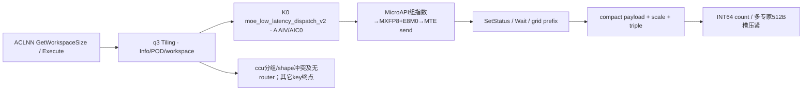

# SGL DeepEP Low-Latency MXFP8 Dispatch 950 ACLNN 算子知识

## 算子速览

| 项目 | 内容 |
|---|---|
| 实际入口 | aclnnMoeLowLatencyDispatchV2GetWorkspaceSize / aclnnMoeLowLatencyDispatchV2，公开两段式ACLNN。 |
| 计算语义 | quantMode=3：每32元素共享指数E8M0量化为FP8 E4M3/E5M2，随后按专家分发并compact；scale为每组而非每token。 |
| 输入输出 | ND BF16 x[N,H]、INT32 expertIds[N,K]、BOOL mask；FP8[T,H]及一维E8M0 scales，真实每row Qm=align2(ceil(H/32))字节，和Combine元数据。 |
| 执行类型 | 单K0 AIV_VECTOR+直接MTE window；无可达Cube/AIC/MIX_CV。 |
| Kernel 路线 | R-001..004 E4M3、R-005..008 E5M2；各为legacy/hybrid×单专家或共享接收/多专家接收；key均50003。 |
| 核心资源 | 输入/输出Queue、FP32/abs scratch、mask TBuf、计数grid512A²、512L元数据槽/64L UB，组window双半。 |
| 来源闭包 | source_closed：公开wrapper→q3 Host/POD/SDK Tiling序列化→50003及所有失败终点→完整V2A5 body/helper/通信字节和同步；止于Vector/DMA与框架primitive。 |
| 验证状态 | 已完成源码闭包检查；本次知识提取未执行编译、真机、数值或性能测试。draft保留已见资源/输入域限制。 |

固定SGL commit dda6d36b0cdb4081e102d14c0a2fb276fc416e69，SDK9.1 e5451c7feba11f9e259f4fbc19c4bf82f8c0496c。P=csrc/deepep/ops/，H=impl/adv_api/。冻结Query候选[Low-Latency API](../../../../apis/deepep/deepep_low_latency_dispatch_combine.md)已完整读；其没有完整实现，本卡create。

## 接口与语义

### 计算语义

令R=epWorldSize，r=epRankId，E=moeExpertNum，Sr=sharedExpertRankNum，Se=sharedExpertNum，L=E/(R-Sr)，B=globalBs/R，A=aivNum。expert e目标=e/L+Sr。输入token按每32元素分组，共Qm=align2(ceil(H/32))个E8M0字节；偶数补齐的额外scale是实际布局，不把它当有效hidden元素。

该源码按位构造指数：ComputeMaxExp从BF16 bits取0x7f80，组内最大rawExponent；目标指数掩码eTarget为E4M3 0x0400、E5M2 0x0780。对有限非零组，t=max(rawExponent,eTarget)，shared=t-eTarget，E8M0 code=shared>>7；BF16乘数位为0x7f00-shared，shared==0x7f00时用0x0040。rawExponent0的组改code0/乘数0；rawExponent0x7f80改code0xff/乘数0x7f81。这里保留源码位级语义，不以理想实数式替代特殊值。BF16输入乘BF16乘数，再拆偶奇转FP32，SAT/CAST_RINT到目标FP8；接收不解量化。非特殊scale字节可按E8M0指数含义与FP8配对近似重构，特殊值精度未测。

接收按local expert/source/token compact，epRecvCounts[lR+source]为跨专家/源inclusive prefix；expertTokenNumsType=1 count、0累计；assist每行[sourceRank,sourceToken,sourceTopk]。payload/scales/assist仅有效count范围有定义，容量尾部不保证值。shared发送使用独立后核组，按每个slot重复量化，无smooth成功实例。q0/q2/q4/q5为其它独立数学语义，不把helper QuantModeA5::PERGROUP_DYNAMIC_QUANT=3替代公开q3 MXFP8。

1D mask只求true数并发送前缀行；2D[N,K] mask压紧有效slot并保留原槽编号，同时求有效行供shared发送。负expert和重复topk没有通用Host值域扫描。

### 输入、输出与属性

| 参数 | shape/layout | dtype | 约束、默认值与语义 |
|---|---|---|---|
| x | [N,H] ND/AutoContiguous | BF16 | N0..512/H1024..8192；FP16不在公开MXFP8配对中。实际MicroAPI完整加载的对齐域另列。 |
| expertIds | [N,K] ND | INT32 | K1..min(16,E)，首维等N；Python先转INT32。 |
| scalesOptional | optional二维ND | FP32 | Host q3允许存在且检查[E+Se,H]（Sr0规范化Se0）；key+10到50013无body，成功Route缺省。 |
| xActiveMaskOptional | [N]或[N,K] ND | BOOL | 前缀token mask或逐slot mask，具体有效域如上。 |
| expandXOut | [T,H] ND | FP8 E4M3FN/E5M2 | q3两格式公开配对BF16输入；容量T≥tpWorldSize*capacity；TP0检查退化。 |
| dynamicScalesOut | 一维，实际至少T*Qm字节 | E8M0 | Host只检查dim0≥capacity*TP，源码误重复MXFP4条件而漏q3的H/32因子；实际Device按row*Qm写。 |
| assistInfoForCombineOut | [≥3capacity] ND | INT32 | 当前三元组格式；不能换成Normal/CCU ordinal。 |
| expertTokenNumsOut | 普通[L]或shared[1] | INT64 | 0=cumsum，1=count，默认1。 |
| epRecvCountsOut | 普通≥RL/shared≥R，TP2检查另乘2 | INT32 | inclusive prefix；TP2没有可达50003变体。 |
| tpRecvCountsOut | [tpWorldSize] | INT32 | 无TP body不产生有效写入。 |
| groupEp/epWorldSize/epRankId/moeExpertNum | 属性 | string/int64 | group1..127；R2..768，0≤r<R，E1..1024，E整除R-Sr，L>0。Device32-rank窗口数组是更窄域。 |
| groupTp/tpWorldSize/tpRankId | 属性 | string/int64 | TP0..2；≤1时tpRankId必须显式为0，非零拒绝；TP2需group非空/rank合法/L1，但50103无body。 |
| expertShardType | 属性 | int64 | 仅0。 |
| sharedExpertNum/sharedExpertRankNum | 属性 | int64 | Se0..4/Sr0..R-1；默认Se1/Sr0→0/0；同时零或正，Sr%Se=0。 |
| quantMode/globalBs/expertTokenNumsType/commAlg | 属性 | int64/string | 本卡q3；globalBs0→NR，非0≥NR且%R=0；type0/1；空/fullmesh_v1为MTE，fullmesh_v2无body，ccu有明确Host拒绝。 |

### 入口与版本

公开LOW_LATENCY_API标注A5 MXFP8；OpDef ascend950在__DAV_C310__注册，key50003支持E4M3/E5M2、E8M0 scales，公开配对只含BF16输入。活动build选择ops/950宏。README/DeepEP README给出9.0/9.1，本文只固定CANN9.1.0并读取SDK version.cmake。A2/A3不支持本公开q3，不以helper同名类型推平台。

wrapper固定elastic=null、zero/copy/const experts=0，检查commAlg与inner/executor；自动生成inner/Contiguous/executor/stream launch为框架边界。Python显式use_mxfp8且关闭默认use_fp8，解析到mx_fp8_e4m3；C++也允许mx_fp8_e5m2。Low C++实际分配FP8[T,H]和一维E8M0[floor(T*H/32)]，不是二维scale；若H不满足布局补齐条件，和Device T*Qm不一致。assist=max(NK,128T)，其它count/handle按公共Low协议保留；async/hook没有拆分kernel。legacy布尔/env优先级与实际解析冲突不扩成兼容承诺。

## Host/Launcher 执行流程

### 参数校验与前处理

1. GetAttr、GetParams、TilingCheck(dim/dtype/format)、CheckAttrs、CheckTensorShape顺序不变。公开q3要求expandX E4M3或E5M2、dynamicScales E8M0；外层统一DYNAMIC_SCALE_DIM_NUM=1，所以scale必须一维。容量检查的三元表达式误写(MXFP4||MXFP4)，q3只检查dim0≥capacity*TP，不验证T*Qm真实字节。
2. commAlg=ccu进入另一Host时数值3被解释为PERGROUP_DYNAMIC_QUANT，CheckDynamicScalesShape无条件取GetDim(1)并比较ceil(H/128)，与外层一维契约冲突。本文不推测缺失维度在框架的具体返回/异常；即使内层继续产生60003/60013，公开entry没有匹配router，不存在可归入本逻辑算子的CCU Device body。
3. 非ccu按SoC基数50000，CalTilingKey加3、scales*10、TP2*100、fullmesh_v2*1000。只有50003；50013/50103/50113/51003/51013没有body；fullmesh_v2与mask/TP2等先检查拒绝。
4. SetHcommCfg用engine3/op8 EP、op6 TP的SDK init64/cc512；GetTiling非0不能消费，SGL返回值未全部检查。CheckWinSize检查A≤72/B≤512/32E≤512KiB-32；SetWorkSpace、SetAivInfo设置workspace、A/UB与CalcTschBlockDim(A,0,A)。OpDef先约束BF16+MXFP8配对，不将Host中笼统支持FP16解释成公开成功Route。

### 参数、Workspace 与生命周期

定义Qm=align2(ceil(H/32))，P=align256(H)，D=align32(P+Qm)，S=D+12，U=align32(S)，G=align512(S)，Gc=align512(2H)，Xi=align32(2H)。Device发送FP8 payload H字节，scale区从P开始占Qm字节，三元组从D开始12B。QuantVariableInit还计算hUBAlignSize=2align128(H)，但QuantInit实际用Xi分配input Queue；ProcessToken先Duplicate2align128(H)字节，完整MicroAPI加载另需2align256(H)，见资源限制。

Host q3没有使用1B输出特判：Hhost=align32(2H)+44，Ghost=align512(Hhost)；Device S/G为上述MX布局。应分开申请预算与真实stride，额外预留不改变实际地址。

| 路线 | Host workspace | 真实消费 | owner/lifetime |
|---|---|---|---|
| 全MTE | 16MiB+512A²+511+512L+512 | grid512A²；tokenMetaBase=align512(userPtr+512A²)-userPtr；512L私有expert槽及后512B预留 | executor/caller，当前stream kernel完成前有效 |
| legacy window | env W | 前4MiB固定MTE区；数据base=IN+4MiB+z*(W-4MiB)/2+B*(K+Se)*Gc；状态IN+z*500KiB | runtime组所有，跨调用selector翻转轮次 |
| hybrid window | env W | 数据/状态在half内107MiB+72KiB、106MiB+36KiB偏移；selector独立106MiB处 | 同组、同z消费完后才能两轮重用 |
| output | caller allocation | 有效compact H字节/行、Qm字节scale/行、triple12B/行、INT64[L] | 同次Combine handle要求配对 |

Host perHalfData=B*Ghost*R*L+B*Gc*(K+Se)；legacy检查2*perHalfData≤W，未显式同样预留4MiB前缀；hybrid检查2*(perHalfData+109MiB+72KiB)≤W。W来自DEEPEP_HCCL_BUFFSIZE优先，否则HCCL_BUFFSIZE，default200MiB；stoi后存uint16，没有负数/窄化上界拒绝。实际context W仍需匹配。CheckWindowSize用1B UB做INT32 DMA探针不是可靠Host失败返回。

### 启动图与失败传播



| 节点或边 | producer→consumer | 地址/extent、参数 | ordering | owner/lifetime、失败 |
|---|---|---|---|---|
| Host→K0 | SDK/POD producer→entry | outer1216B、A个AIV、同stream、用户workspace | 框架launch顺序 | Host GRAPH_FAILED阻断有效launch；未知key无body不猜运行错误 |
| send→wait | ProcessToken→远端LocalWindowCopy | 每source/localexpert B*G，S字节有效slot | Queue/PIPE_ALL+SyncAll后SetStatus32B | 组window，轮z；提交数据后再flag |
| count→compact | SyncCntOnCore→GetCumSum | grid格距512B | 全核SyncAll | 用户workspace保持到本kernel完成 |
| metadata→输出 | expert私有GM→lastCore | 每expert512B→UB64B行→INT64紧凑 | cacheWriteThrough→SyncAll→MTE2_S/S_MTE3 | 仅多expert普通接收；sole compact writer |
| 失败路径 | CCU Host/unknown router | q3 helper PERGROUP/Dim1冲突；最终60003无router；其它key无匹配 | 不提供MTE自动回退 | source_closed含失败终点，非支持承诺 |

## Route 与参数设计

### 分核与资源计算

split(M,C,c)：base=floor(M/C)，tail=M%C，start=base*c+min(c,tail)，count=base+[c<tail]。shared后核数=Sr?max(1,floor(A*Se/(K+Se))):0，其余前核发送MoE slot；接收Q=shared?R:RL按A split。ordinary L>1时expert计数再按activeA=min(Q,A)分核，每expert独占512B槽，lastCore=min(Q,A)-1写compact结果。源token重复expert的ordinal分支在token0仍可能冲突，见限制。

### Route 选择

legacy Route仅适用于不与Normal共用同一HCCL window的场景；同进程、同EP group混用Normal与Low-Latency时，必须在所有rank进程启动前一致设置`DEEPEP_HYBRID_DEPLOYMENT=1`，使用hybrid布局。

| 顺序 | Route | Key/模板 | 精确选择条件与优先级 | 不适用去向 |
|---:|---|---|---|---|
| 1 | R-001 E4M3/legacy/shared或L1 | 50003；V2A5<BF16,fp8_e4m3fn_t,E8M0,false,true,true,false,false> | q3，X BF16，O E4M3，scale一维E8M0，scalesOptional=null、TP≠2、commAlg空/fullmesh_v1、hybrid=false且不与Normal共用同一HCCL window、r<Sr或L1；公共shape通过 | Host失败、其它无匹配终点 |
| 2 | R-002 E4M3/legacy/普通L>1 | 50003；V2A5<BF16,fp8_e4m3fn_t,E8M0,false,true,true,false,false> | q3，X BF16，O E4M3，scale一维E8M0，scalesOptional=null、TP≠2、commAlg空/fullmesh_v1、hybrid=false且不与Normal共用同一HCCL window、r≥Sr且L>1；公共shape通过 | Host失败、其它无匹配终点 |
| 3 | R-003 E4M3/hybrid/shared或L1 | 50003；V2A5<BF16,fp8_e4m3fn_t,E8M0,false,true,true,false,false> | q3，X BF16，O E4M3，scale一维E8M0，scalesOptional=null、TP≠2、commAlg空/fullmesh_v1、hybrid=true、r<Sr或L1；公共shape通过 | Host失败、其它无匹配终点 |
| 4 | R-004 E4M3/hybrid/普通L>1 | 50003；V2A5<BF16,fp8_e4m3fn_t,E8M0,false,true,true,false,false> | q3，X BF16，O E4M3，scale一维E8M0，scalesOptional=null、TP≠2、commAlg空/fullmesh_v1、hybrid=true、r≥Sr且L>1；公共shape通过 | Host失败、其它无匹配终点 |
| 5 | R-005 E5M2/legacy/shared或L1 | 50003；V2A5<BF16,fp8_e5m2_t,E8M0,false,true,true,false,false> | q3，X BF16，O E5M2，scale一维E8M0，scalesOptional=null、TP≠2、commAlg空/fullmesh_v1、hybrid=false且不与Normal共用同一HCCL window、r<Sr或L1；公共shape通过 | Host失败、其它无匹配终点 |
| 6 | R-006 E5M2/legacy/普通L>1 | 50003；V2A5<BF16,fp8_e5m2_t,E8M0,false,true,true,false,false> | q3，X BF16，O E5M2，scale一维E8M0，scalesOptional=null、TP≠2、commAlg空/fullmesh_v1、hybrid=false且不与Normal共用同一HCCL window、r≥Sr且L>1；公共shape通过 | Host失败、其它无匹配终点 |
| 7 | R-007 E5M2/hybrid/shared或L1 | 50003；V2A5<BF16,fp8_e5m2_t,E8M0,false,true,true,false,false> | q3，X BF16，O E5M2，scale一维E8M0，scalesOptional=null、TP≠2、commAlg空/fullmesh_v1、hybrid=true、r<Sr或L1；公共shape通过 | Host失败、其它无匹配终点 |
| 8 | R-008 E5M2/hybrid/普通L>1 | 50003；V2A5<BF16,fp8_e5m2_t,E8M0,false,true,true,false,false> | q3，X BF16，O E5M2，scale一维E8M0，scalesOptional=null、TP≠2、commAlg空/fullmesh_v1、hybrid=true、r≥Sr且L>1；公共shape通过 | Host失败、其它无匹配终点 |

```text
公开q3固定：OpDef BF16→E4M3/E5M2 + E8M0，scale必须1D
ccu -> helper q3=PERGROUP -> inner要求GetDim1=ceil(H/128)；外层1D契约冲突
  未假定缺失Dim1返回；即使后续60003/60013也无router
MTE key=50000+3+10*hasScales+100*TP2+1000*fullmeshV2
  50003 && __DAV_C310__ && O E4M3/E5M2 -> IsMxQuant=true
  按O格式、hybrid与接收shared/L1或普通L>1分成八Route
  50013/50103/50113/51003/51013无body；不做静默fallback
```

### 模板/实现执行矩阵

| Route | key/selector | dtype/shape/platform 完整命中条件 | 执行拓扑与 Kernel 节点 | 实际模板/body | 内存与同步特征 | tail/fallback |
|---|---|---|---|---|---|---|
| R-001 | 50003 | 950/q3，BF16→E4M3/E8M0，N0..512/H1024..8192/K1..min16E；nosmooth/TP≠2/MTE，hybrid=false，shared或L1 | 单K0 AIV_VECTOR+MTE | V2A5<BF16,fp8_e4m3fn_t,E8M0,false,true,true,false,false>::QuantDynamicMx→ComputeScale<fp8_e4m3fn_t>，eTarget=0x0400 | send bXi+bU，recv bU，Qm scales；直接I64 count | MicroAPI尾mask不等于输入完整load容量已足；其它key无body |
| R-002 | 50003 | 950/q3，BF16→E4M3/E8M0，N0..512/H1024..8192/K1..min16E；nosmooth/TP≠2/MTE，hybrid=false，普通L>1 | 单K0 AIV_VECTOR+MTE | V2A5<BF16,fp8_e4m3fn_t,E8M0,false,true,true,false,false>::QuantDynamicMx→ComputeScale<fp8_e4m3fn_t>，eTarget=0x0400 | send bXi+bU，recv bU，Qm scales；512L GM/64L UB metadata | MicroAPI尾mask不等于输入完整load容量已足；其它key无body |
| R-003 | 50003 | 950/q3，BF16→E4M3/E8M0，N0..512/H1024..8192/K1..min16E；nosmooth/TP≠2/MTE，hybrid=true，shared或L1 | 单K0 AIV_VECTOR+MTE | V2A5<BF16,fp8_e4m3fn_t,E8M0,false,true,true,false,false>::QuantDynamicMx→ComputeScale<fp8_e4m3fn_t>，eTarget=0x0400 | send bXi+bU，recv bU，Qm scales；直接I64 count | MicroAPI尾mask不等于输入完整load容量已足；其它key无body |
| R-004 | 50003 | 950/q3，BF16→E4M3/E8M0，N0..512/H1024..8192/K1..min16E；nosmooth/TP≠2/MTE，hybrid=true，普通L>1 | 单K0 AIV_VECTOR+MTE | V2A5<BF16,fp8_e4m3fn_t,E8M0,false,true,true,false,false>::QuantDynamicMx→ComputeScale<fp8_e4m3fn_t>，eTarget=0x0400 | send bXi+bU，recv bU，Qm scales；512L GM/64L UB metadata | MicroAPI尾mask不等于输入完整load容量已足；其它key无body |
| R-005 | 50003 | 950/q3，BF16→E5M2/E8M0，N0..512/H1024..8192/K1..min16E；nosmooth/TP≠2/MTE，hybrid=false，shared或L1 | 单K0 AIV_VECTOR+MTE | V2A5<BF16,fp8_e5m2_t,E8M0,false,true,true,false,false>::QuantDynamicMx→ComputeScale<fp8_e5m2_t>，eTarget=0x0780 | send bXi+bU，recv bU，Qm scales；直接I64 count | MicroAPI尾mask不等于输入完整load容量已足；其它key无body |
| R-006 | 50003 | 950/q3，BF16→E5M2/E8M0，N0..512/H1024..8192/K1..min16E；nosmooth/TP≠2/MTE，hybrid=false，普通L>1 | 单K0 AIV_VECTOR+MTE | V2A5<BF16,fp8_e5m2_t,E8M0,false,true,true,false,false>::QuantDynamicMx→ComputeScale<fp8_e5m2_t>，eTarget=0x0780 | send bXi+bU，recv bU，Qm scales；512L GM/64L UB metadata | MicroAPI尾mask不等于输入完整load容量已足；其它key无body |
| R-007 | 50003 | 950/q3，BF16→E5M2/E8M0，N0..512/H1024..8192/K1..min16E；nosmooth/TP≠2/MTE，hybrid=true，shared或L1 | 单K0 AIV_VECTOR+MTE | V2A5<BF16,fp8_e5m2_t,E8M0,false,true,true,false,false>::QuantDynamicMx→ComputeScale<fp8_e5m2_t>，eTarget=0x0780 | send bXi+bU，recv bU，Qm scales；直接I64 count | MicroAPI尾mask不等于输入完整load容量已足；其它key无body |
| R-008 | 50003 | 950/q3，BF16→E5M2/E8M0，N0..512/H1024..8192/K1..min16E；nosmooth/TP≠2/MTE，hybrid=true，普通L>1 | 单K0 AIV_VECTOR+MTE | V2A5<BF16,fp8_e5m2_t,E8M0,false,true,true,false,false>::QuantDynamicMx→ComputeScale<fp8_e5m2_t>，eTarget=0x0780 | send bXi+bU，recv bU，Qm scales；512L GM/64L UB metadata | MicroAPI尾mask不等于输入完整load容量已足；其它key无body |

### 隐藏性能 Guard

| Guard | Host/Tiling 条件 | Device/资源原因 | 影响 Route | 不满足时去向 | 源码符号 |
|---|---|---|---|---|---|
| dtype | q3 E4M3/E5M2、E8M0；OpDef只BF16输入 | 两format eTarget不同 | 全部 | FP16发布配对冲突不计成功Route | OpDef/CheckTensorDataType/entry |
| key | scales/TP/fullmeshv2各加位 | 只有50003 router | 全部 | 无匹配终点 | CalTilingKey/entry |
| CCU enum/shape | 内层把3当PERGROUP，取dim1与ceil(H/128)比较 | 外层要求scale1D；最终60003无router | CCU候选 | 按实际检查终点或无匹配，不猜缺失维度结果 | CheckDynamicScalesShape/entry |
| UB depth | estimated+[L>1普通]*64L+2Xi+2U>170KiB→b1 | 输入输出Queue同时缩深度；请求不完全入账 | 全部 | 无第二级资源fallback | QuantInit |
| rank array | Host R≤768，local windowsIn[32] | MTE按rank索引32项数组 | 全部 | 超域无Host guard，draft | HcclCombinOpParam/GetBaseWindAddr |
| 状态 | A≤72/B≤512/E*32≤512KiB-32 | selector与状态区固定容量 | 全部 | GRAPH_FAILED | CheckWinSize |
| metadata | L≤E≤1024；blockCount静态≤4095 | 多expert DMA gather | R-002/004/006/008 | 方法有保护return，不擅补输出 | UpdateTokenNumsOut |

| MX输入/完整加载 | Host无H%128/256检查，inputXi=align32(2H) | Duplicate需2align128(H)，MicroAPI全load需2align256(H) | 全部 | 无容量guard；H%256=0为源码推导的充分对齐域，非Host条件 | QuantInit/ProcessToken/ComputeMaxExp |
| scale容量 | q3仅检dim0≥capacity*TP | Device写每row Qm，不是1个FP32 | 全部 | 无完整容量拒绝，draft | CheckTensorShape/CopyScalesToOut |

### POD/ABI

SGL Info自然8B对齐推导size128/align8；外层init64@0、cc1 512@64、cc2 512@576、Info@1088，总1216。下表offset均相对Info；自然布局推导未经编译测量。CCU二次Host覆盖其实际产生字段，不能将外层inactive值补成已初始化。

| 结构 | 字段 | 类型/位宽 | ABI 布局 | 单位 | Host/launcher producer | Device consumer | 边界 |
|---|---|---|---|---|---|---|---|
| MoeDistributeDispatchV2Info | epWorldSize | u32 | 0 | rank数 | GetAttrAndSetTilingData写R | Init分域/窗口/CCU rank | padding60..63/92..95/116..119不作业务数据 |
| MoeDistributeDispatchV2Info | tpWorldSize | u32 | 4 | rank数 | Host0..2；TP2 key无body | Hostkey；当前body不AllGather | padding60..63/92..95/116..119不作业务数据 |
| MoeDistributeDispatchV2Info | epRankId | u32 | 8 | rank | 合法r | GetWindow、scatter/gather | padding60..63/92..95/116..119不作业务数据 |
| MoeDistributeDispatchV2Info | tpRankId | u32 | 12 | rank | TP≤1要求属性tpRankId=0，非零拒绝 | 本实例TP inactive | padding60..63/92..95/116..119不作业务数据 |
| MoeDistributeDispatchV2Info | expertShardType | u32 | 16 | enum | 仅0 | body不做分片计算 | padding60..63/92..95/116..119不作业务数据 |
| MoeDistributeDispatchV2Info | sharedExpertNum | u32 | 20 | expert数 | Se默认1/Sr0规范化为0 | shared核组/目标 | padding60..63/92..95/116..119不作业务数据 |
| MoeDistributeDispatchV2Info | sharedExpertRankNum | u32 | 24 | rank数 | Sr、Se一致性/divisible检查 | shared role/L | padding60..63/92..95/116..119不作业务数据 |
| MoeDistributeDispatchV2Info | moeExpertNum | u32 | 28 | expert数 | E1..1024且整除R-Sr | L与id域 | padding60..63/92..95/116..119不作业务数据 |
| MoeDistributeDispatchV2Info | quantMode | u32 | 32 | enum | attr=3 | Hostkey，模板DynamicQuant=true/IsMxQuant=true | padding60..63/92..95/116..119不作业务数据 |
| MoeDistributeDispatchV2Info | globalBs | u32 | 36 | token容量 | 0→NR，否则≥NR且%R=0；CCU有mask时等于NR | B与perRankDataSize | padding60..63/92..95/116..119不作业务数据 |
| MoeDistributeDispatchV2Info | bs | u32 | 40 | token | x.dim0，MTE允许0，CCU要求>0 | mask/slot域 | padding60..63/92..95/116..119不作业务数据 |
| MoeDistributeDispatchV2Info | k | u32 | 44 | slot/token | expertIds.dim1，外层≤16、CCU≤8 | NK/目标路由 | padding60..63/92..95/116..119不作业务数据 |
| MoeDistributeDispatchV2Info | h | u32 | 48 | element/token | x.dim1 1024..8192 | 字节/Queue/DMA | padding60..63/92..95/116..119不作业务数据 |
| MoeDistributeDispatchV2Info | aivNum | u32 | 52 | core | SetAivInfo写平台AIV数 | 分核/selector512A，本q3无CCU consumer | padding60..63/92..95/116..119不作业务数据 |
| MoeDistributeDispatchV2Info | isTokenMask | bool | 56 | flag | mask dim1 | 计数前缀mask | padding60..63/92..95/116..119不作业务数据 |
| MoeDistributeDispatchV2Info | isExpertMask | bool | 57 | flag | 外层mask dim2 | MTE槽mask；MTE逐槽mask | padding60..63/92..95/116..119不作业务数据 |
| MoeDistributeDispatchV2Info | hasElasticInfo | bool | 58 | flag | wrapper null→false | elastic分支不可达 | padding60..63/92..95/116..119不作业务数据 |
| MoeDistributeDispatchV2Info | isHybridDeployment | bool | 59 | flag | env DEEPEP_HYBRID_DEPLOYMENT精确1 | MTE窗口路由 | padding60..63/92..95/116..119不作业务数据 |
| MoeDistributeDispatchV2Info | totalUbSize | u64 | 64 | byte | SetAivInfo::GetCoreMemSize写平台UB | 未形成完整分配拒绝 | padding60..63/92..95/116..119不作业务数据 |
| MoeDistributeDispatchV2Info | totalWinSize | u64 | 72 | byte | env uint16 MiB | MTE窗口总字节W | padding60..63/92..95/116..119不作业务数据 |
| MoeDistributeDispatchV2Info | expertTokenNumsType | u32 | 80 | enum | attr0/1 | count/cumsum输出 | padding60..63/92..95/116..119不作业务数据 |
| MoeDistributeDispatchV2Info | zeroComputeExpertNum | i32 | 84 | expert数 | wrapper特殊属性0之和 | 本入口special分支inactive | padding60..63/92..95/116..119不作业务数据 |
| MoeDistributeDispatchV2Info | cumSumUBMinValue | u32 | 88 | byte | 外层CumSum shape[1,LR]临时最小值 | 本q3 body不以此申请 | padding60..63/92..95/116..119不作业务数据 |
| MoeDistributeDispatchV2Info | scalesRow | u64 | 96 | row | CheckAndSetScalesInfo：缺省0；存在写dim0后最终到50013无body | inactive | padding60..63/92..95/116..119不作业务数据 |
| MoeDistributeDispatchV2Info | scalesCol | u64 | 104 | column | 同上 | 本MTE无smooth实例，不读输入scale shape字段 | padding60..63/92..95/116..119不作业务数据 |
| MoeDistributeDispatchV2Info | scalesTypeSize | u32 | 112 | byte/scale | 同上 | 同上 | padding60..63/92..95/116..119不作业务数据 |
| MoeDistributeDispatchV2Info | scalesCount | u64 | 120 | element数 | 同上 | 本MTE不读该字段；输出scale来自token absmax | padding60..63/92..95/116..119不作业务数据 |
| outer | mc2InitTiling | opaque64 | 0 | byte | GetTiling(init) | 框架/InitV2 | SDK内层见后表 |
| outer | mc2CcTiling1 | opaque512 | 64 | byte | engine3/op8 | EP组资源/CCU SetCcTilingV2(offset64) | SDK GetTiling返回值未完整检查 |
| outer | mc2CcTiling2 | opaque512 | 576 | byte | engine3/op6，groupTP资源；当前实例不AllGather | 框架资源准备；无TP方法实例 | 不能伪称CCU支持TP |
| outer | moeDistributeDispatchV2Info | Info128 | 1088 | byte | 前述producer | entry/Init | q3字段按真实consumer |

SDK Mc2InitTiling64/Mc2CcTiling512为公开opaque外壳；实际inner如下。offset相对inner，类型来自固定SDK。本q3成功Route只使用MTE engine3/op8与TP资源op6；CCU inner的分组/shape与本公开q3冲突且无router，不生成可消费CCU POD。

| 结构 | 字段 | 类型/位宽 | ABI 布局 | 单位 | Host/launcher producer | Device consumer | 边界 |
|---|---|---|---|---|---|---|---|
| Mc2InitTilingInner | version | u32 | 0 | 版本枚举 | GetTiling: 100 | SDK初始化 | 不依赖reserved值 |
| 同上 | mc2HcommCnt | u32 | 4 | 通信组数 | GetTiling: 2 | HCOMM GenerateAlgoTemplatesV2 | 不依赖reserved值 |
| 同上 | offset | u32[8] | 8 | 字节偏移数组 | GetTiling: 64/576，其余0 | cc1/cc2定位 | 不依赖reserved值 |
| 同上 | debugMode | u8 | 40 | 枚举 | GetTiling: default0 | SDK | 不依赖reserved值 |
| 同上 | preparePosition | u8 | 41 | 枚举 | GetTiling: default0 | SDK | 不依赖reserved值 |
| 同上 | queueNum | u16 | 42 | queue数 | GetTiling: default0 | SDK working core | 不依赖reserved值 |
| 同上 | commBlockNum | u16 | 44 | block数 | GetTiling: default0 | SDK资源 | 不依赖reserved值 |
| 同上 | devType | u8 | 46 | 枚举 | GetTiling: runtime SoC | 平台实现选择 | 不依赖reserved值 |
| 同上 | reserved | char[17] | 47 | 保留字节 | GetTiling: 未显式清全部 | inactive | 不依赖reserved值 |
| Mc2CcTilingInner | skipLocalRankCopy | u8 | 0 | 布尔 | GetTiling: default0 | 框架 | 不依赖reserved值 |
| 同上 | skipBufferWindowCopy | u8 | 1 | 布尔 | GetTiling: default0 | 框架 | 不依赖reserved值 |
| 同上 | stepSize | u8 | 2 | step数 | GetTiling: default0 | 框架 | 不依赖reserved值 |
| 同上 | version | u8 | 3 | 版本枚举 | GetTiling: 1 | 固定协议 | 不依赖reserved值 |
| 同上 | reserved | char[9] | 4 | 保留字节 | GetTiling: memset0 | inactive | 不依赖reserved值 |
| 同上 | commEngine | u8 | 13 | 枚举 | GetTiling: MTE3 | 框架MTE资源；Device不执行CCU | 不依赖reserved值 |
| 同上 | srcDataType | u8 | 14 | dtype枚举 | GetTiling: default0=INT8 | MTE不读作payload dtype，payload由模板决定 | 不依赖reserved值 |
| 同上 | dstDataType | u8 | 15 | dtype枚举 | GetTiling: default0=INT8 | MTE不读取该字段 | 不依赖reserved值 |
| 同上 | groupName | char[128] | 16 | 组名字符 | GetTiling: EP/TP字符串 | 框架组关联 | 不依赖reserved值 |
| 同上 | algConfig | char[128] | 144 | 算法配置字符 | GetTiling: AlltoAll fullmesh/pairwise，MTE第二AllGather ring | 框架资源组装；本body直接MTE | 不依赖reserved值 |
| 同上 | opType | u32 | 272 | 命令枚举 | GetTiling: EP8/TP6 | 框架通信资源声明 | 不依赖reserved值 |
| 同上 | reduceType | u32 | 276 | reduce枚举 | GetTiling: default0 | 本body不做payload reduce | 不依赖reserved值 |
| 同上 | reserved2 | char[232] | 280 | 保留字节 | GetTiling: 未显式清全部 | inactive | 不依赖reserved值 |

MTE本地HcclCombinOpParam（少e）为32项window数组，普通自然8B对齐推导size576/align8；当前body只消费rank前缀和windowsIn。它与SDK CCU64项结构不同，本q3无CCU Device实例，不读取后者。

| 结构 | 字段 | 类型/位宽 | ABI 布局 | 单位 | Host/launcher producer | Device consumer | 边界 |
|---|---|---|---|---|---|---|---|
| SGL MTE context | workSpace | u64 | 0 | 地址 | runtime组 | 当前MTE不用 | 不同于ACLNN workspace |
| 同上 | workSpaceSize | u64 | 8 | byte | runtime组 | 当前MTE不用 | 保留前缀 |
| 同上 | rankId | u32 | 16 | rank | runtime组 | GetRankId/InitWinState | 检查值 |
| 同上 | rankDim | u32 | 20 | rank数 | runtime组 | GetRankDim/InitWinState | 不是AIV数 |
| 同上 | winSize | u64 | 24 | byte | runtime组 | GetWinSize/CheckWindowSize | 实际大小 |
| 同上 | windowsIn | u64[32] | 32 | 地址 | runtime组 | GetBaseWindAddr/State | Host未限制rank<32 |
| 同上 | windowsOut | u64[32] | 288 | 地址 | runtime组 | 本MTE body未读 | 不借用SDK64布局 |
| 同上 | xnAddr | u64 | 544 | 地址 | runtime组 | 本MTE不用 | 不能按CCU前缀解释 |
| 同上 | ckeAddr | u64 | 552 | 地址 | runtime组 | 本MTE不用 | 同上 |
| 同上 | msAddr | u64 | 560 | 地址 | runtime组 | 本MTE不用 | 保留 |
| 同上 | msSize | u64 | 568 | byte/count | runtime组 | 本MTE不用 | 未消费 |

### Route 源码闭包

| Route | Key/selector | Host/Tiling producer | POD/参数 | Kernel entry/router 节点 | Kernel body/直接依赖 | 构建接线 |
|---|---|---|---|---|---|---|
| R-001 | 50003 | P/op_host/moe_distribute_dispatch_v2_tiling.cpp；CheckTensorDataType/CalTilingKey/CheckWinSize/SetWorkSpace | Info128/outer1216，SDK init64/cc512，grid/tokenMeta/MTE context | P/op_kernel/moe_low_latency_dispatch_v2.cpp；fp8_e4m3fn_t/IsMxQuant=true | P/op_kernel/moe_distribute_dispatch_v2_a5.h::QuantDynamicMx→quantize_functions.h::ComputeMaxExp/ComputeScale/ComputeFp8Data及base/window/mask/helper | OpDef950，build.sh/compile_ascend_proj.sh与ops CMake Host/kernel targets |
| R-002 | 50003 | P/op_host/moe_distribute_dispatch_v2_tiling.cpp；CheckTensorDataType/CalTilingKey/CheckWinSize/SetWorkSpace | Info128/outer1216，SDK init64/cc512，grid/tokenMeta/MTE context | P/op_kernel/moe_low_latency_dispatch_v2.cpp；fp8_e4m3fn_t/IsMxQuant=true | P/op_kernel/moe_distribute_dispatch_v2_a5.h::QuantDynamicMx→quantize_functions.h::ComputeMaxExp/ComputeScale/ComputeFp8Data及base/window/mask/helper | OpDef950，build.sh/compile_ascend_proj.sh与ops CMake Host/kernel targets |
| R-003 | 50003 | P/op_host/moe_distribute_dispatch_v2_tiling.cpp；CheckTensorDataType/CalTilingKey/CheckWinSize/SetWorkSpace | Info128/outer1216，SDK init64/cc512，grid/tokenMeta/MTE context | P/op_kernel/moe_low_latency_dispatch_v2.cpp；fp8_e4m3fn_t/IsMxQuant=true | P/op_kernel/moe_distribute_dispatch_v2_a5.h::QuantDynamicMx→quantize_functions.h::ComputeMaxExp/ComputeScale/ComputeFp8Data及base/window/mask/helper | OpDef950，build.sh/compile_ascend_proj.sh与ops CMake Host/kernel targets |
| R-004 | 50003 | P/op_host/moe_distribute_dispatch_v2_tiling.cpp；CheckTensorDataType/CalTilingKey/CheckWinSize/SetWorkSpace | Info128/outer1216，SDK init64/cc512，grid/tokenMeta/MTE context | P/op_kernel/moe_low_latency_dispatch_v2.cpp；fp8_e4m3fn_t/IsMxQuant=true | P/op_kernel/moe_distribute_dispatch_v2_a5.h::QuantDynamicMx→quantize_functions.h::ComputeMaxExp/ComputeScale/ComputeFp8Data及base/window/mask/helper | OpDef950，build.sh/compile_ascend_proj.sh与ops CMake Host/kernel targets |
| R-005 | 50003 | P/op_host/moe_distribute_dispatch_v2_tiling.cpp；CheckTensorDataType/CalTilingKey/CheckWinSize/SetWorkSpace | Info128/outer1216，SDK init64/cc512，grid/tokenMeta/MTE context | P/op_kernel/moe_low_latency_dispatch_v2.cpp；fp8_e5m2_t/IsMxQuant=true | P/op_kernel/moe_distribute_dispatch_v2_a5.h::QuantDynamicMx→quantize_functions.h::ComputeMaxExp/ComputeScale/ComputeFp8Data及base/window/mask/helper | OpDef950，build.sh/compile_ascend_proj.sh与ops CMake Host/kernel targets |
| R-006 | 50003 | P/op_host/moe_distribute_dispatch_v2_tiling.cpp；CheckTensorDataType/CalTilingKey/CheckWinSize/SetWorkSpace | Info128/outer1216，SDK init64/cc512，grid/tokenMeta/MTE context | P/op_kernel/moe_low_latency_dispatch_v2.cpp；fp8_e5m2_t/IsMxQuant=true | P/op_kernel/moe_distribute_dispatch_v2_a5.h::QuantDynamicMx→quantize_functions.h::ComputeMaxExp/ComputeScale/ComputeFp8Data及base/window/mask/helper | OpDef950，build.sh/compile_ascend_proj.sh与ops CMake Host/kernel targets |
| R-007 | 50003 | P/op_host/moe_distribute_dispatch_v2_tiling.cpp；CheckTensorDataType/CalTilingKey/CheckWinSize/SetWorkSpace | Info128/outer1216，SDK init64/cc512，grid/tokenMeta/MTE context | P/op_kernel/moe_low_latency_dispatch_v2.cpp；fp8_e5m2_t/IsMxQuant=true | P/op_kernel/moe_distribute_dispatch_v2_a5.h::QuantDynamicMx→quantize_functions.h::ComputeMaxExp/ComputeScale/ComputeFp8Data及base/window/mask/helper | OpDef950，build.sh/compile_ascend_proj.sh与ops CMake Host/kernel targets |
| R-008 | 50003 | P/op_host/moe_distribute_dispatch_v2_tiling.cpp；CheckTensorDataType/CalTilingKey/CheckWinSize/SetWorkSpace | Info128/outer1216，SDK init64/cc512，grid/tokenMeta/MTE context | P/op_kernel/moe_low_latency_dispatch_v2.cpp；fp8_e5m2_t/IsMxQuant=true | P/op_kernel/moe_distribute_dispatch_v2_a5.h::QuantDynamicMx→quantize_functions.h::ComputeMaxExp/ComputeScale/ComputeFp8Data及base/window/mask/helper | OpDef950，build.sh/compile_ascend_proj.sh与ops CMake Host/kernel targets |

## Kernel 实现

### 公共执行流程

entry参数顺序x、expertIds、scales、mask、elasticInfo、expandX、dynamicScales、assist、expertTokenNums、epCounts、tpCounts、workspace、tiling。本实例Init先清CTRL bit60，再读本地32项MTE context、selector/窗口与Info，申请send资源，Process按发送→发布→等待→grid prefix→compact→INT64 metadata执行。接收Reset再次清bit60且未恢复；entry读取的oriOverflowMode没有恢复consumer。不存在可达CCU/HCOMM核心Device节点；Host分组/shape冲突与最终无router终点已展开。

### Route R-001：E4M3 legacy，单专家或shared接收

#### 适用条件

##### 选择证据

| 层级 | 文件 | 符号 | 源码谓词/参数 | 结果/下一跳 |
|---|---|---|---|---|
| Host | P/op_host/moe_distribute_dispatch_v2_tiling.cpp | GetAttr/CheckAttrs/SetHcommCfg/CalTilingKey | q3、commAlg为空或fullmesh_v1、TP≠2、hybrid=false；当前rank为共享接收或L=1；q3无scales、X=BF16、O=FP8 E4M3、dynamicScales=E8M0 | 50003 |
| Router | P/op_kernel/moe_low_latency_dispatch_v2.cpp | TILING_KEY_IS(50003) | DT_FP8 E4M3输出编译guard | MoeDistributeDispatchV2A5<bfloat16_t,fp8_e4m3fn_t,fp8_e8m0_t,false,true,true,false,false> |
| 资源分支 | P/op_kernel/moe_distribute_dispatch_v2_a5.h | Init/BufferInit/UpdateTokenNumsOut | isHybridDeployment=false，!shared&&L>1=false | lastCore直接写INT64 |

#### Device 数据流

##### 函数级调用链

```text
K0 entry -> V2A5::Init
 -> SetCtrlSpr(bit60,0) -> GetRankId/GetWinSize/GetBaseWindAddr/State
 -> CheckWindowSize -> InitWinState -> QuantVariableInit(MXFP8) -> InitBuffer
Process -> AlltoAllDispatch
 -> [TokenActiveMaskCal | ExpertActiveMaskCal -> CalValidBSCnt/CalValidExpIdx]
 -> SendToMoeExpert/SendToSharedExpert -> ProcessToken -> FillTriple
 -> SetStatus -> WaitDispatch -> BufferInit(Reset/SetCtrlSpr0)
 -> WaitDispatchClearStatus -> SyncCntOnCore
 -> LocalWindowCopy/GetCumSum
 -> UpdateTokenNumsOut(direct lastCore writer)
# 无TP body；无Hccl对象/Finalize；TimeOutDetection仅定义而未调用
```

##### 源码等价伪码

```text
# 伪码，MTE本地context类型固定数组32
SEL=IN(self)+1050KiB+512core；State(q)=IN(q)+z*500KiB
Data(q)=IN(q)+4MiB+z*(W-4MiB)/2+B*(K+Se)*Gc
InitWinState：读SEL首32B；保存oldz，写z^1/word1=1/tiling rank,E,R,globalBs；
             byte24的u64 opcount++；context rank/size不匹配另写8B探针
q3 QuantVariableInit：Qm=align2ceil(H/32),P=align256(H),D=align32(P+Qm),S=D+12,U=align32(S),G=align512(S)
Mmoe=A-(Sr?max(1,floor(A*Se/(K+Se))):0)
1Dmask计数activeN前缀；2Dmask对[N,K]按32B padded rows求有效行，
  再Compare/GatherMask保留有效slot编号并压紧对应expertIds
前moe核按有效slot split，原slot=validSlot[j]或j，n=slot/K,k=slot%K,e=compactedID[j]
  ordinal仅(n>0&&j>0)时统计前j槽等于e的次数，否则0
  x[n,H] -> xInQueue(b,Xi) -> MicroAPI QuantDynamicMx -> xOutQueue(b,U)
  -> E8M0[Qm]@P + triple[r,n,k]@D -> Data(e/L+Sr)+(rL+e%L)*B*G+ordinal*G，复制S
后shared核按(有效token,Se)发送，srcToken为validRows或前缀token，triple k=K+sharedExpert
SetStatus对E+Sr split，先算count；PIPE_ALL+SyncAll后发32B[1.0f,count,..]到State(dst)
WaitDispatch Reset后分核接收Q=shared?R:RL个状态，c块32B DMA，ReduceSum首flag==c才就绪
清首flag保留count；将每core count和写grid各consumer512B格；SyncAll
LocalWindowCopy：SEL.word1=2；GetCumSum读前core grid计数前缀，
  对[localExpert,source]按count从Data(self)+(sourceL+localE)*B*G+jG读S到Queue
  -> assist输出triple12B，payloadH与scaleQm分别输出compact；epCounts写inclusive prefix
UpdateTokenNumsOut：lastCore=min(Q,A)-1直接写expertTokenNums[0]=totalCnt并DCCI
共享rank按单专家计数；L1普通rank同样直接写一个INT64
```

计数helper仍使用INT32差→FP32位模式Abs→INT32 Mins1→FP32 ReduceSum后INT32读取；payload没有cast/reduce。首token重复expert槽的ordinal可同为0，输入topk唯一性未由Host检验。公开elastic=null/special=0，相关helper不可达。A5 WaitDispatch没有调用TimeOutDetection，不能把A3的50003us探针机制迁入本Route。


本Route量化子链是 `ProcessToken → QuantProcess → QuantDynamicMx → quant::ComputeMaxExp → ComputeScale<fp8_e4m3fn_t> → ComputeFp8Data<BF16,fp8_e4m3fn_t,CAST_TRUNC,CAST_RINT>`。无独立量化kernel。当前公开X=BF16，不执行helper中FP16转换分支；本format eTarget=0x0400。

```text
Qm=align2ceil(H/32),P=align256(H),D=align32(P+Qm),S=D+12,U=align32(S)
inputQueue实际每slot Xi=align32(2H)，Alloc
Duplicate(input.byteView,0,2align128(H))；V_MTE2；DataCopyPad2H，EnQue/DeQue
output Alloc，每slotU
scratch maxExp=u16(floatTmp+0)；
scratch reciprocalBF16=u16(floatTmp+4align32(Qm))；
output FP8=u8(output+0)，output E8M0=u16(output+P)（packed字节store）
ComputeMaxExp：
  vl=VECTOR_REG_WIDTH/2（310按256B得128元素），loop=ceil(H/(2vl))
  每loop UpdateMask两次，DataCopy DIST_DINTLV_B16完整读2vl个BF16；
  bits&0x7f80，偶奇对应Max，再ReduceMaxWithDataBlock；
  每loop DataCopyUnAlign写8个u16组指数，最后DataCopyUnAlignPost
ComputeScale<fp8_e4m3fn_t>：
  每loop128个u16，mask只Qm有效；target=0x0400
  cmpRawFinite=(maxExp!=0x7f80)，cmpNonzero=(maxExp!=0)
  clipped=max(maxExp,target)，shared=clipped-target
  code=shared>>7；非有限改0xff，零组改0
  DIST_PACK_B16把code u16压成Qm个E8M0字节@P
  reciprocalBits=0x7f00-shared；
    非有限改0x7f81，零改0，shared==0x7f00改0x0040
  u16 reciprocal写scratch（每组一值）
ComputeFp8Data：
  loop=ceil(H/(2vl))；UpdateMask保留数据尾部
  DIST_DINTLV_B16读2vl BF16，DIST_E2B_B16读8个reciprocal并广播到32B block
  BF16 Mul(vdExp0/1,reciprocal)，Interleave恢复顺序
  ZERO/ONE layout分别Cast BF16偶/奇到FP32，Interleave
  Cast<fp8_e4m3fn_t,float>：RegLayout ZERO，SatMode SAT，MaskMerge ZEROING，CAST_RINT
  四次DIST_PACK4_B32 store，OUT_ELE_NUM_ONE_BLK=64，尾mask控制有效输出
output EnQue；input Free；output DeQue
FillTriple@D -> DataCopyPad S字节远端window -> output Free
接收：读S到Queue -> FP8 H字节compact；
  CopyScalesToOut取slot[P]的Qm字节 -> dynamicScaleGT[row*Qm]；
  assist triple12B；Queue Free
```

maxExp写出尾组数量为8ceil(H/256)，scratch名义Qm与实际write extent分开；floatTmp的M≥4H覆盖该实际extent及4align32(Qm)+2Qm的reciprocal子区。smoothScalesBuf仍M字节申请并作mask/count alias，MX量化不读其FP32 smooth值；rowMax32也仍申请但不消费。Input Queue Xi与Duplicate/完整加载的容量冲突不因尾mask消失，Host没有H%256 guard。与per-token448/absmax路径不同，本Route仅使用组指数位级逻辑，没有per-token a=1分支。
#### 内存与数据搬运

##### 资源与搬运表

| 层级/缓冲区 | offset/地址公式 | extent/容量公式 | dtype/layout | producer | consumer | owner/lifetime | 对齐/复用 |
|---|---|---|---|---|---|---|---|
| data window | IN(q)+4MiB+z*(W-4MiB)/2+B*(K+Se)*Gc | 每source/expert B*G | FP8 payload P+Qm字节E8M0+padding至D+triple12 | ProcessToken | LocalWindowCopy | 组window/轮z | 512B首址，S字节有效搬运 |
| state | IN(q)+z*500KiB+32*(localE*R+source) | 32Q | FP32flag/I32count | SetStatus | WaitDispatch | 同轮清首lane | 前缀两500KiB状态片 |
| selector | IN(self)+1050KiB+512core | 首32B+检查探针8B | u32/u64 alias | InitWinState/LocalCopy | 下一调用 | 跨调用 | 512core stride |
| send dataStateBuf/status | 独立TBuf | 32 + 32RL | selector/status | Init | publish | Reset前 | status Duplicate另用256B倍数见字节账 |
| send expertIds | TBuf | J=max(4NK,align256(2N)) | i32/half | ids/maskDMA | Send/SetStatus | Reset前 | 比A3多保留完整byte对齐量 |
| gather/floatTmp/absTmp | 三个TBuf，dst/sub分别alias后两者 | 各M=max(4H,align32(4NK),2N*align32(K),align256(2NK)) | mask/half/i32/f32 | mask/count/QuantProcess | Gather/Reduce/输出cast | Reset前 | 共3M，不重复算alias |
| rowMaxBuf | TBuf | 32B | FP32 | QuantInit申请 | 当前MX子链不消费，此buf仍占资源 | Reset前 | 不因未使用而扣除 |
| send xInQueue | TQueBind | b*Xi | X | xDMA | QuantProcess | 每tokenFree | Xi=align32(2H) |
| 2Dmask validBs/validIndex | 条件TBuf | align32(4N)+Vidx，Vidx=max(align32(4NK),2N*align32(K)) | i32/half alias | mask | slots/shared | Reset前 | 无mask不分配 |
| send xOutQueue | TQueBind | b*U，b1或2 | FP8 E4M3/E8M0/triple | QuantProcess/FillTriple | windowDMA | 每slotFree | U含D+12 |
| recv wait/gather/sums/scalar | Reset后TBuf | max(32c,256)+max(align32(4c),4RL)+68A+96 | status/count | Wait/Prefix | LocalCopy/Update | 后半kernel | recv沿用b，不固定2 |
| recv xQueue | Reset后Queue | b*U | O | windowDMA | outputDMA | 每slotFree | 同步后复用 |

| grid | user+512*(A*producer+consumer) | 512A² | 首I32有效 | SyncCntOnCore | GetCumSum | 本kernel | MTE3→SyncAll→MTE2 |

##### 分层内存布局


##### 字节账与复用顺序

```text
send_actual=32+32RL+J+3M+[mask2D]*(align32(4N)+Vidx)+32+b*Xi+bU
estimated=32RL+align32(4NK)+3M+[mask2D]*(align32(4N)+align32(4NK))
b=(estimated+0+2Xi+2U>170KiB)?1:2
recv=max(32c,256)+max(align32(4c),4RL)+68A+96+bU
max(send_actual,recv)≤平台UB是复用前提；Host没有完整证明。
status初始化Duplicate的extent=32*align8(ceil((E+Sr)/A))，
请求status32RL可能小于该extent（例如小R/L）；不能以变量名假定足够。
workspace=16MiB+512A²+511+512L+512；当前metadata额外槽仅预留。
dynamic_ub=N/A；寄存器/编译器私有栈占用未在固定源码中测量。
```

| 复用子区 | 写入者 | 读取者/消费点 | 下一次覆盖 | 同步或释放依据 | 安全条件 |
|---|---|---|---|---|---|
| mask/gather/dst/sub | mask方法 | 有效槽/计数 | 发送与SetStatus临时 | MTE2_V/V_S/PIPE_V | 不覆盖未消费有效索引 |
| send UB→recv UB | all send | flag发布 | Reset申请recv | PIPE_ALL/SyncAll | 不跨Reset保留LocalTensor |
| recv queue b | windowDMA | assist/payloadDMA | 下一slot | DeQue/Free/MTE事件 | 有效S≤U；scaleQm字节单独输出，triple另读 |
| direct expert output | lastCore | 调用者 | 后续kernel | DCCI/stream | 当前只有一个本地expert或共享专家 |


#### 同步、精度与尾块

##### 同步与数值边界表

| 阶段 | primitive/机制 | producer | consumer/等待点 | 保护对象 | 精度/尾块 |
|---|---|---|---|---|---|
| input/mask | DataCopyPad/Queue；BOOL→half，Sum/Mins/Compare/GatherMask | x/mask | ProcessToken | padded mask与tokenUB | 1D前缀；2D槽原编号保留 |
| MX量化 | MicroAPI DINTLV_B16→指数And/Max/ReduceMaxWithDataBlock→scale bit构造→BF16 Mul/Interleave/FP32 Cast→SAT RINT FP8 | BF16与组指数 | windowDMA | floatTmp u16分区和output P/Qm/D | target=0x0400；零/非有限按代码选择，尾mask不保护完整load容量 |
| data-before-flag | MTE3_S/S_MTE3、PIPE_ALL/SyncAll | payload/triple | SetStatus | S-byte slot | 已量化的FP8 E4M3/E5M2 payload及E8M0 scale；发布阶段仅搬运，不再转换 |
| recv | c块32B DMA、MTE2_V、ReduceSum mask1/repeatc | 远端32Bflag | WaitDispatch | 状态片 | 无本地timeout；空核SyncAll后return |
| grid/clear | sparse首lane清0；重复写grid512B格；GetCumSum stride16A-1 | count | LocalCopy | 首lane与count | count位模式求和，不是payload FP32累加 |
| expert count | lastCore scalar I64+DCCI | EP prefix | INT64输出 | 单I64 | 只有效lastCore写 |
| 控制位 | Init/BufferInit SetCtrlSpr<60,60>(0) | kernel | 后续Vector阶段 | 控制SPR | 本源码未恢复旧bit；不臆测硬件运行后果 |

#### 关键实现

##### 符号证据表

| 阶段 | 文件 | 符号/模板实例 | 实现事实 |
|---|---|---|---|
| Host/Tiling producer | P/op_host/moe_distribute_dispatch_v2_tiling.cpp | SetHcommCfg/SetWorkSpace/CalTilingKey | 50003、4MiB/hybrid预算、grid+metadata保留 |
| Kernel entry/router | P/op_kernel/moe_low_latency_dispatch_v2.cpp | MoeDistributeDispatchV2A5<bfloat16_t,fp8_e4m3fn_t,fp8_e8m0_t,false,true,true,false,false> | 无TP q3实例 |
| Device body/helper | P/op_kernel/moe_distribute_dispatch_v2_a5.h | QuantVariableInit/ProcessToken/QuantDynamicMx/CopyScalesToOut/UpdateTokenNumsOut | MX P/Qm/D/S布局、完整MTE/计数与元数据 |
| MicroAPI真实body | P/op_kernel/quantize_functions.h | ComputeMaxExp/ComputeScale<fp8_e4m3fn_t>/ComputeFp8Data | target=0x0400、组32元素、packed E8M0、SAT/RINT cast与尾mask |
| 窗口/selector | P/op_kernel/window_layout.h；P/op_kernel/moe_distribute_v2_base.h | A5WindowLayout/InitWinState | legacy1050KiB selector/500KiB状态片 |
| 地址/flush | P/op_kernel/moe_distribute_base.h | GetBaseWindAddr/State/cacheWriteThrough | 数组32、4MiB prefix、flush length0保护 |

### Route R-002：E4M3 legacy，普通多专家接收

#### 适用条件

##### 选择证据

| 层级 | 文件 | 符号 | 源码谓词/参数 | 结果/下一跳 |
|---|---|---|---|---|
| Host | P/op_host/moe_distribute_dispatch_v2_tiling.cpp | GetAttr/CheckAttrs/SetHcommCfg/CalTilingKey | 同legacy MTE，但r≥Sr且L>1；q3无scales、X=BF16、O=FP8 E4M3、dynamicScales=E8M0 | 50003 |
| Router | P/op_kernel/moe_low_latency_dispatch_v2.cpp | TILING_KEY_IS(50003) | DT_FP8 E4M3输出编译guard | MoeDistributeDispatchV2A5<bfloat16_t,fp8_e4m3fn_t,fp8_e8m0_t,false,true,true,false,false> |
| 资源分支 | P/op_kernel/moe_distribute_dispatch_v2_a5.h | Init/BufferInit/UpdateTokenNumsOut | isHybridDeployment=false，!shared&&L>1=true | 64L UB与512L GM私有metadata |

#### Device 数据流

##### 函数级调用链

```text
K0 entry -> V2A5::Init
 -> SetCtrlSpr(bit60,0) -> GetRankId/GetWinSize/GetBaseWindAddr/State
 -> CheckWindowSize -> InitWinState -> QuantVariableInit(MXFP8) -> InitBuffer
Process -> AlltoAllDispatch
 -> [TokenActiveMaskCal | ExpertActiveMaskCal -> CalValidBSCnt/CalValidExpIdx]
 -> SendToMoeExpert/SendToSharedExpert -> ProcessToken -> FillTriple
 -> SetStatus -> WaitDispatch -> BufferInit(Reset/SetCtrlSpr0)
 -> WaitDispatchClearStatus -> SyncCntOnCore
 -> LocalWindowCopy/GetCumSum
 -> UpdateTokenNumsOut(private slots -> sole writer compact DMA)
# 无TP body；无Hccl对象/Finalize；TimeOutDetection仅定义而未调用
```

##### 源码等价伪码

```text
# 伪码，MTE本地context类型固定数组32
SEL=IN(self)+1050KiB+512core；State(q)=IN(q)+z*500KiB
Data(q)=IN(q)+4MiB+z*(W-4MiB)/2+B*(K+Se)*Gc
InitWinState：读SEL首32B；保存oldz，写z^1/word1=1/tiling rank,E,R,globalBs；
             byte24的u64 opcount++；context rank/size不匹配另写8B探针
q3 QuantVariableInit：Qm=align2ceil(H/32),P=align256(H),D=align32(P+Qm),S=D+12,U=align32(S),G=align512(S)
Mmoe=A-(Sr?max(1,floor(A*Se/(K+Se))):0)
1Dmask计数activeN前缀；2Dmask对[N,K]按32B padded rows求有效行，
  再Compare/GatherMask保留有效slot编号并压紧对应expertIds
前moe核按有效slot split，原slot=validSlot[j]或j，n=slot/K,k=slot%K,e=compactedID[j]
  ordinal仅(n>0&&j>0)时统计前j槽等于e的次数，否则0
  x[n,H] -> xInQueue(b,Xi) -> MicroAPI QuantDynamicMx -> xOutQueue(b,U)
  -> E8M0[Qm]@P + triple[r,n,k]@D -> Data(e/L+Sr)+(rL+e%L)*B*G+ordinal*G，复制S
后shared核按(有效token,Se)发送，srcToken为validRows或前缀token，triple k=K+sharedExpert
SetStatus对E+Sr split，先算count；PIPE_ALL+SyncAll后发32B[1.0f,count,..]到State(dst)
WaitDispatch Reset后分核接收Q=RL个状态，c块32B DMA，ReduceSum首flag==c才就绪
清首flag保留count；将每core count和写grid各consumer512B格；SyncAll
LocalWindowCopy：SEL.word1=2；GetCumSum读前core grid计数前缀，
  对[localExpert,source]按count从Data(self)+(sourceL+localE)*B*G+jG读S到Queue
  -> assist输出triple12B，payloadH与scaleQm分别输出compact；epCounts写inclusive prefix
UpdateTokenNumsOut:
  SyncAll确保所有epCounts完成；L个expert按activeAiv均分writer
  每l读epCounts[(l+1)R-1]与前expert末值：
    type0 -> 当前前缀；type1 -> 差值，计算INT64
  写user+tokenMetaBase+512*l首int64；cacheWriteThrough按每writer完整512B槽flush
  SyncAll；仅lastCore：
    DataCopyPad {blockCount=L,blockLen=8,srcStride=504B,dstStride=1个UB32B块}
      -> tokenMetaGatherBuf每expert64B行
    MTE2_S；DataCopyPad {L,8,srcStride=1个UB32B块,dstStride=0}
      -> contiguous expertTokenNums[0:L]；MTE3_S/flush输出
  return；后面的历史多expert scalar写分支在本条件下不再可达
```

计数helper仍使用INT32差→FP32位模式Abs→INT32 Mins1→FP32 ReduceSum后INT32读取；payload没有cast/reduce。首token重复expert槽的ordinal可同为0，输入topk唯一性未由Host检验。公开elastic=null/special=0，相关helper不可达。A5 WaitDispatch没有调用TimeOutDetection，不能把A3的50003us探针机制迁入本Route。


本Route量化子链是 `ProcessToken → QuantProcess → QuantDynamicMx → quant::ComputeMaxExp → ComputeScale<fp8_e4m3fn_t> → ComputeFp8Data<BF16,fp8_e4m3fn_t,CAST_TRUNC,CAST_RINT>`。无独立量化kernel。当前公开X=BF16，不执行helper中FP16转换分支；本format eTarget=0x0400。

```text
Qm=align2ceil(H/32),P=align256(H),D=align32(P+Qm),S=D+12,U=align32(S)
inputQueue实际每slot Xi=align32(2H)，Alloc
Duplicate(input.byteView,0,2align128(H))；V_MTE2；DataCopyPad2H，EnQue/DeQue
output Alloc，每slotU
scratch maxExp=u16(floatTmp+0)；
scratch reciprocalBF16=u16(floatTmp+4align32(Qm))；
output FP8=u8(output+0)，output E8M0=u16(output+P)（packed字节store）
ComputeMaxExp：
  vl=VECTOR_REG_WIDTH/2（310按256B得128元素），loop=ceil(H/(2vl))
  每loop UpdateMask两次，DataCopy DIST_DINTLV_B16完整读2vl个BF16；
  bits&0x7f80，偶奇对应Max，再ReduceMaxWithDataBlock；
  每loop DataCopyUnAlign写8个u16组指数，最后DataCopyUnAlignPost
ComputeScale<fp8_e4m3fn_t>：
  每loop128个u16，mask只Qm有效；target=0x0400
  cmpRawFinite=(maxExp!=0x7f80)，cmpNonzero=(maxExp!=0)
  clipped=max(maxExp,target)，shared=clipped-target
  code=shared>>7；非有限改0xff，零组改0
  DIST_PACK_B16把code u16压成Qm个E8M0字节@P
  reciprocalBits=0x7f00-shared；
    非有限改0x7f81，零改0，shared==0x7f00改0x0040
  u16 reciprocal写scratch（每组一值）
ComputeFp8Data：
  loop=ceil(H/(2vl))；UpdateMask保留数据尾部
  DIST_DINTLV_B16读2vl BF16，DIST_E2B_B16读8个reciprocal并广播到32B block
  BF16 Mul(vdExp0/1,reciprocal)，Interleave恢复顺序
  ZERO/ONE layout分别Cast BF16偶/奇到FP32，Interleave
  Cast<fp8_e4m3fn_t,float>：RegLayout ZERO，SatMode SAT，MaskMerge ZEROING，CAST_RINT
  四次DIST_PACK4_B32 store，OUT_ELE_NUM_ONE_BLK=64，尾mask控制有效输出
output EnQue；input Free；output DeQue
FillTriple@D -> DataCopyPad S字节远端window -> output Free
接收：读S到Queue -> FP8 H字节compact；
  CopyScalesToOut取slot[P]的Qm字节 -> dynamicScaleGT[row*Qm]；
  assist triple12B；Queue Free
```

maxExp写出尾组数量为8ceil(H/256)，scratch名义Qm与实际write extent分开；floatTmp的M≥4H覆盖该实际extent及4align32(Qm)+2Qm的reciprocal子区。smoothScalesBuf仍M字节申请并作mask/count alias，MX量化不读其FP32 smooth值；rowMax32也仍申请但不消费。Input Queue Xi与Duplicate/完整加载的容量冲突不因尾mask消失，Host没有H%256 guard。与per-token448/absmax路径不同，本Route仅使用组指数位级逻辑，没有per-token a=1分支。
#### 内存与数据搬运

##### 资源与搬运表

| 层级/缓冲区 | offset/地址公式 | extent/容量公式 | dtype/layout | producer | consumer | owner/lifetime | 对齐/复用 |
|---|---|---|---|---|---|---|---|
| data window | IN(q)+4MiB+z*(W-4MiB)/2+B*(K+Se)*Gc | 每source/expert B*G | FP8 payload P+Qm scale字节+padding至D+triple12 | ProcessToken | LocalWindowCopy | 组window/轮z | 512B首址，S字节有效搬运 |
| state | IN(q)+z*500KiB+32*(localE*R+source) | 32Q | FP32flag/I32count | SetStatus | WaitDispatch | 同轮清首lane | 前缀两500KiB状态片 |
| selector | IN(self)+1050KiB+512core | 首32B+检查探针8B | u32/u64 alias | InitWinState/LocalCopy | 下一调用 | 跨调用 | 512core stride |
| send dataStateBuf/status | 独立TBuf | 32 + 32RL | selector/status | Init | publish | Reset前 | status Duplicate另用256B倍数见字节账 |
| send expertIds | TBuf | J=max(4NK,align256(2N)) | i32/half | ids/maskDMA | Send/SetStatus | Reset前 | 比A3多保留完整byte对齐量 |
| gather/floatTmp/absTmp | 三个TBuf，dst/sub分别alias后两者 | 各M=max(4H,align32(4NK),2N*align32(K),align256(2NK)) | mask/half/i32/f32 | mask/count/QuantProcess | Gather/Reduce/输出cast | Reset前 | 共3M，不重复算alias |
| rowMaxBuf | TBuf | 32B | FP32 | QuantInit申请 | 当前MX子链不消费，此buf仍占资源 | Reset前 | 不因未使用而扣除 |
| send xInQueue | TQueBind | b*Xi | X | xDMA | QuantProcess | 每tokenFree | Xi=align32(2H) |
| 2Dmask validBs/validIndex | 条件TBuf | align32(4N)+Vidx，Vidx=max(align32(4NK),2N*align32(K)) | i32/half alias | mask | slots/shared | Reset前 | 无mask不分配 |
| send xOutQueue | TQueBind | b*U，b1或2 | FP8 E4M3/E8M0/triple | QuantProcess/FillTriple | windowDMA | 每slotFree | U含D+12 |
| recv wait/gather/sums/scalar | Reset后TBuf | max(32c,256)+max(align32(4c),4RL)+68A+96 | status/count | Wait/Prefix | LocalCopy/Update | 后半kernel | recv沿用b，不固定2 |
| recv xQueue | Reset后Queue | b*U | O | windowDMA | outputDMA | 每slotFree | 同步后复用 |
| tokenMetaGatherBuf | Reset后独立TBuf | 64L | 每行首I64有效，其余padding | 私有GM槽DMA | compact输出DMA | Update末释放 | 每行64B，非8L |
| tokenMeta GM | user+align512(userPtr+512A²)-userPtr+512l | 512L，首I64有效 | 独立expert槽 | split专家writer | lastCore | 本kernel当前stream | 跨core不写同cacheline |

| grid | user+512*(A*producer+consumer) | 512A² | 首I32有效 | SyncCntOnCore | GetCumSum | 本kernel | MTE3→SyncAll→MTE2 |

##### 分层内存布局


##### 字节账与复用顺序

```text
send_actual=32+32RL+J+3M+[mask2D]*(align32(4N)+Vidx)+32+b*Xi+bU
estimated=32RL+align32(4NK)+3M+[mask2D]*(align32(4N)+align32(4NK))
b=(estimated+64L+2Xi+2U>170KiB)?1:2
recv=max(32c,256)+max(align32(4c),4RL)+68A+96+bU+64L
max(send_actual,recv)≤平台UB是复用前提；Host没有完整证明。
status初始化Duplicate的extent=32*align8(ceil((E+Sr)/A))，
请求status32RL可能小于该extent（例如小R/L）；不能以变量名假定足够。
workspace=16MiB+512A²+511+512L+512；实际还用512L私有槽。
dynamic_ub=N/A；寄存器/编译器私有栈占用未在固定源码中测量。
```

| 复用子区 | 写入者 | 读取者/消费点 | 下一次覆盖 | 同步或释放依据 | 安全条件 |
|---|---|---|---|---|---|
| mask/gather/dst/sub | mask方法 | 有效槽/计数 | 发送与SetStatus临时 | MTE2_V/V_S/PIPE_V | 不覆盖未消费有效索引 |
| send UB→recv UB | all send | flag发布 | Reset申请recv | PIPE_ALL/SyncAll | 不跨Reset保留LocalTensor |
| recv queue b | windowDMA | assist/payloadDMA | 下一slot | DeQue/Free/MTE事件 | 有效S≤U；scaleQm字节单独输出，triple另读 |
| 512B专家槽→64B行 | 每expert唯一writer | lastCore | 下kernel复用 | cacheWriteThrough+SyncAll、MTE2_S/MTE3_S | 只lastCore写compact INT64，不能直接多writer写8B相邻输出 |


#### 同步、精度与尾块

##### 同步与数值边界表

| 阶段 | primitive/机制 | producer | consumer/等待点 | 保护对象 | 精度/尾块 |
|---|---|---|---|---|---|
| input/mask | DataCopyPad/Queue；BOOL→half，Sum/Mins/Compare/GatherMask | x/mask | ProcessToken | padded mask与tokenUB | 1D前缀；2D槽原编号保留 |
| MX量化 | MicroAPI DINTLV_B16→指数And/Max/ReduceMaxWithDataBlock→scale bit构造→BF16 Mul/Interleave/FP32 Cast→SAT RINT FP8 | BF16与组指数 | windowDMA | floatTmp u16分区和output P/Qm/D | target=0x0400；零/非有限按代码选择，尾mask不保护完整load容量 |
| data-before-flag | MTE3_S/S_MTE3、PIPE_ALL/SyncAll | payload/triple | SetStatus | S-byte slot | 已量化的FP8 E4M3/E5M2 payload及E8M0 scale；发布阶段仅搬运，不再转换 |
| recv | c块32B DMA、MTE2_V、ReduceSum mask1/repeatc | 远端32Bflag | WaitDispatch | 状态片 | 无本地timeout；空核SyncAll后return |
| grid/clear | sparse首lane清0；重复写grid512B格；GetCumSum stride16A-1 | count | LocalCopy | 首lane与count | count位模式求和，不是payload FP32累加 |
| expert metadata | 每expert512B独立槽、flush→SyncAll→64B UB行→sole writer | EP prefix | INT64输出 | 512L GM +64L UB | blockCount=L≤1024；零writer长度flush helper直接return |
| 控制位 | Init/BufferInit SetCtrlSpr<60,60>(0) | kernel | 后续Vector阶段 | 控制SPR | 本源码未恢复旧bit；不臆测硬件运行后果 |

#### 关键实现

##### 符号证据表

| 阶段 | 文件 | 符号/模板实例 | 实现事实 |
|---|---|---|---|
| Host/Tiling producer | P/op_host/moe_distribute_dispatch_v2_tiling.cpp | SetHcommCfg/SetWorkSpace/CalTilingKey | 50003、4MiB/hybrid预算、grid+metadata保留 |
| Kernel entry/router | P/op_kernel/moe_low_latency_dispatch_v2.cpp | MoeDistributeDispatchV2A5<bfloat16_t,fp8_e4m3fn_t,fp8_e8m0_t,false,true,true,false,false> | 无TP q3实例 |
| Device body/helper | P/op_kernel/moe_distribute_dispatch_v2_a5.h | QuantVariableInit/ProcessToken/QuantDynamicMx/CopyScalesToOut/UpdateTokenNumsOut | MX P/Qm/D/S布局、完整MTE/计数与元数据 |
| MicroAPI真实body | P/op_kernel/quantize_functions.h | ComputeMaxExp/ComputeScale<fp8_e4m3fn_t>/ComputeFp8Data | target=0x0400、组32元素、packed E8M0、SAT/RINT cast与尾mask |
| 窗口/selector | P/op_kernel/window_layout.h；P/op_kernel/moe_distribute_v2_base.h | A5WindowLayout/InitWinState | legacy1050KiB selector/500KiB状态片 |
| 地址/flush | P/op_kernel/moe_distribute_base.h | GetBaseWindAddr/State/cacheWriteThrough | 数组32、4MiB prefix、flush length0保护 |

### Route R-003：E4M3 hybrid，单专家或shared接收

#### 适用条件

##### 选择证据

| 层级 | 文件 | 符号 | 源码谓词/参数 | 结果/下一跳 |
|---|---|---|---|---|
| Host | P/op_host/moe_distribute_dispatch_v2_tiling.cpp | GetAttr/CheckAttrs/SetHcommCfg/CalTilingKey | q3、commAlg为空或fullmesh_v1、TP≠2、hybrid=true；当前rank为共享接收或L=1；q3无scales、X=BF16、O=FP8 E4M3、dynamicScales=E8M0 | 50003 |
| Router | P/op_kernel/moe_low_latency_dispatch_v2.cpp | TILING_KEY_IS(50003) | DT_FP8 E4M3输出编译guard | MoeDistributeDispatchV2A5<bfloat16_t,fp8_e4m3fn_t,fp8_e8m0_t,false,true,true,false,false> |
| 资源分支 | P/op_kernel/moe_distribute_dispatch_v2_a5.h | Init/BufferInit/UpdateTokenNumsOut | isHybridDeployment=true，!shared&&L>1=false | lastCore直接写INT64 |

#### Device 数据流

##### 函数级调用链

```text
K0 entry -> V2A5::Init
 -> SetCtrlSpr(bit60,0) -> GetRankId/GetWinSize/GetBaseWindAddr/State
 -> CheckWindowSize -> InitWinState -> QuantVariableInit(MXFP8) -> InitBuffer
Process -> AlltoAllDispatch
 -> [TokenActiveMaskCal | ExpertActiveMaskCal -> CalValidBSCnt/CalValidExpIdx]
 -> SendToMoeExpert/SendToSharedExpert -> ProcessToken -> FillTriple
 -> SetStatus -> WaitDispatch -> BufferInit(Reset/SetCtrlSpr0)
 -> WaitDispatchClearStatus -> SyncCntOnCore
 -> LocalWindowCopy/GetCumSum
 -> UpdateTokenNumsOut(direct lastCore writer)
# 无TP body；无Hccl对象/Finalize；TimeOutDetection仅定义而未调用
```

##### 源码等价伪码

```text
# 伪码，MTE本地context类型固定数组32
SEL=IN(self)+4MiB+106MiB+512core；State(q)=IN(q)+4MiB+z*(W-4MiB)/2+106MiB+36KiB
Data(q)=IN(q)+4MiB+z*(W-4MiB)/2+B*(K+Se)*Gc+107MiB+72KiB
InitWinState：读SEL首32B；保存oldz，写z^1/word1=1/tiling rank,E,R,globalBs；
             byte24的u64 opcount++；context rank/size不匹配另写8B探针
q3 QuantVariableInit：Qm=align2ceil(H/32),P=align256(H),D=align32(P+Qm),S=D+12,U=align32(S),G=align512(S)
Mmoe=A-(Sr?max(1,floor(A*Se/(K+Se))):0)
1Dmask计数activeN前缀；2Dmask对[N,K]按32B padded rows求有效行，
  再Compare/GatherMask保留有效slot编号并压紧对应expertIds
前moe核按有效slot split，原slot=validSlot[j]或j，n=slot/K,k=slot%K,e=compactedID[j]
  ordinal仅(n>0&&j>0)时统计前j槽等于e的次数，否则0
  x[n,H] -> xInQueue(b,Xi) -> MicroAPI QuantDynamicMx -> xOutQueue(b,U)
  -> E8M0[Qm]@P + triple[r,n,k]@D -> Data(e/L+Sr)+(rL+e%L)*B*G+ordinal*G，复制S
后shared核按(有效token,Se)发送，srcToken为validRows或前缀token，triple k=K+sharedExpert
SetStatus对E+Sr split，先算count；PIPE_ALL+SyncAll后发32B[1.0f,count,..]到State(dst)
WaitDispatch Reset后分核接收Q=shared?R:RL个状态，c块32B DMA，ReduceSum首flag==c才就绪
清首flag保留count；将每core count和写grid各consumer512B格；SyncAll
LocalWindowCopy：SEL.word1=2；GetCumSum读前core grid计数前缀，
  对[localExpert,source]按count从Data(self)+(sourceL+localE)*B*G+jG读S到Queue
  -> assist输出triple12B，payloadH与scaleQm分别输出compact；epCounts写inclusive prefix
UpdateTokenNumsOut：lastCore=min(Q,A)-1直接写expertTokenNums[0]=totalCnt并DCCI
共享rank按单专家计数；L1普通rank同样直接写一个INT64
```

计数helper仍使用INT32差→FP32位模式Abs→INT32 Mins1→FP32 ReduceSum后INT32读取；payload没有cast/reduce。首token重复expert槽的ordinal可同为0，输入topk唯一性未由Host检验。公开elastic=null/special=0，相关helper不可达。A5 WaitDispatch没有调用TimeOutDetection，不能把A3的50003us探针机制迁入本Route。


本Route量化子链是 `ProcessToken → QuantProcess → QuantDynamicMx → quant::ComputeMaxExp → ComputeScale<fp8_e4m3fn_t> → ComputeFp8Data<BF16,fp8_e4m3fn_t,CAST_TRUNC,CAST_RINT>`。无独立量化kernel。当前公开X=BF16，不执行helper中FP16转换分支；本format eTarget=0x0400。

```text
Qm=align2ceil(H/32),P=align256(H),D=align32(P+Qm),S=D+12,U=align32(S)
inputQueue实际每slot Xi=align32(2H)，Alloc
Duplicate(input.byteView,0,2align128(H))；V_MTE2；DataCopyPad2H，EnQue/DeQue
output Alloc，每slotU
scratch maxExp=u16(floatTmp+0)；
scratch reciprocalBF16=u16(floatTmp+4align32(Qm))；
output FP8=u8(output+0)，output E8M0=u16(output+P)（packed字节store）
ComputeMaxExp：
  vl=VECTOR_REG_WIDTH/2（310按256B得128元素），loop=ceil(H/(2vl))
  每loop UpdateMask两次，DataCopy DIST_DINTLV_B16完整读2vl个BF16；
  bits&0x7f80，偶奇对应Max，再ReduceMaxWithDataBlock；
  每loop DataCopyUnAlign写8个u16组指数，最后DataCopyUnAlignPost
ComputeScale<fp8_e4m3fn_t>：
  每loop128个u16，mask只Qm有效；target=0x0400
  cmpRawFinite=(maxExp!=0x7f80)，cmpNonzero=(maxExp!=0)
  clipped=max(maxExp,target)，shared=clipped-target
  code=shared>>7；非有限改0xff，零组改0
  DIST_PACK_B16把code u16压成Qm个E8M0字节@P
  reciprocalBits=0x7f00-shared；
    非有限改0x7f81，零改0，shared==0x7f00改0x0040
  u16 reciprocal写scratch（每组一值）
ComputeFp8Data：
  loop=ceil(H/(2vl))；UpdateMask保留数据尾部
  DIST_DINTLV_B16读2vl BF16，DIST_E2B_B16读8个reciprocal并广播到32B block
  BF16 Mul(vdExp0/1,reciprocal)，Interleave恢复顺序
  ZERO/ONE layout分别Cast BF16偶/奇到FP32，Interleave
  Cast<fp8_e4m3fn_t,float>：RegLayout ZERO，SatMode SAT，MaskMerge ZEROING，CAST_RINT
  四次DIST_PACK4_B32 store，OUT_ELE_NUM_ONE_BLK=64，尾mask控制有效输出
output EnQue；input Free；output DeQue
FillTriple@D -> DataCopyPad S字节远端window -> output Free
接收：读S到Queue -> FP8 H字节compact；
  CopyScalesToOut取slot[P]的Qm字节 -> dynamicScaleGT[row*Qm]；
  assist triple12B；Queue Free
```

maxExp写出尾组数量为8ceil(H/256)，scratch名义Qm与实际write extent分开；floatTmp的M≥4H覆盖该实际extent及4align32(Qm)+2Qm的reciprocal子区。smoothScalesBuf仍M字节申请并作mask/count alias，MX量化不读其FP32 smooth值；rowMax32也仍申请但不消费。Input Queue Xi与Duplicate/完整加载的容量冲突不因尾mask消失，Host没有H%256 guard。与per-token448/absmax路径不同，本Route仅使用组指数位级逻辑，没有per-token a=1分支。
#### 内存与数据搬运

##### 资源与搬运表

| 层级/缓冲区 | offset/地址公式 | extent/容量公式 | dtype/layout | producer | consumer | owner/lifetime | 对齐/复用 |
|---|---|---|---|---|---|---|---|
| data window | IN(q)+4MiB+z*(W-4MiB)/2+B*(K+Se)*Gc+107MiB+72KiB | 每source/expert B*G | FP8 payload P+Qm scale字节+padding至D+triple12 | ProcessToken | LocalWindowCopy | 组window/轮z | 512B首址，S字节有效搬运 |
| state | IN(q)+4MiB+z*(W-4MiB)/2+106MiB+36KiB+32*(localE*R+source) | 32Q | FP32flag/I32count | SetStatus | WaitDispatch | 同轮清首lane | half内512KiB状态槽 |
| selector | IN(self)+4MiB+106MiB+512core | 首32B+检查探针8B | u32/u64 alias | InitWinState/LocalCopy | 下一调用 | 跨调用 | 512core stride |
| send dataStateBuf/status | 独立TBuf | 32 + 32RL | selector/status | Init | publish | Reset前 | status Duplicate另用256B倍数见字节账 |
| send expertIds | TBuf | J=max(4NK,align256(2N)) | i32/half | ids/maskDMA | Send/SetStatus | Reset前 | 比A3多保留完整byte对齐量 |
| gather/floatTmp/absTmp | 三个TBuf，dst/sub分别alias后两者 | 各M=max(4H,align32(4NK),2N*align32(K),align256(2NK)) | mask/half/i32/f32 | mask/count/QuantProcess | Gather/Reduce/输出cast | Reset前 | 共3M，不重复算alias |
| rowMaxBuf | TBuf | 32B | FP32 | QuantInit申请 | 当前MX子链不消费，此buf仍占资源 | Reset前 | 不因未使用而扣除 |
| send xInQueue | TQueBind | b*Xi | X | xDMA | QuantProcess | 每tokenFree | Xi=align32(2H) |
| 2Dmask validBs/validIndex | 条件TBuf | align32(4N)+Vidx，Vidx=max(align32(4NK),2N*align32(K)) | i32/half alias | mask | slots/shared | Reset前 | 无mask不分配 |
| send xOutQueue | TQueBind | b*U，b1或2 | FP8 E4M3/E8M0/triple | QuantProcess/FillTriple | windowDMA | 每slotFree | U含D+12 |
| recv wait/gather/sums/scalar | Reset后TBuf | max(32c,256)+max(align32(4c),4RL)+68A+96 | status/count | Wait/Prefix | LocalCopy/Update | 后半kernel | recv沿用b，不固定2 |
| recv xQueue | Reset后Queue | b*U | O | windowDMA | outputDMA | 每slotFree | 同步后复用 |

| grid | user+512*(A*producer+consumer) | 512A² | 首I32有效 | SyncCntOnCore | GetCumSum | 本kernel | MTE3→SyncAll→MTE2 |

##### 分层内存布局


##### 字节账与复用顺序

```text
send_actual=32+32RL+J+3M+[mask2D]*(align32(4N)+Vidx)+32+b*Xi+bU
estimated=32RL+align32(4NK)+3M+[mask2D]*(align32(4N)+align32(4NK))
b=(estimated+0+2Xi+2U>170KiB)?1:2
recv=max(32c,256)+max(align32(4c),4RL)+68A+96+bU
max(send_actual,recv)≤平台UB是复用前提；Host没有完整证明。
status初始化Duplicate的extent=32*align8(ceil((E+Sr)/A))，
请求status32RL可能小于该extent（例如小R/L）；不能以变量名假定足够。
workspace=16MiB+512A²+511+512L+512；当前metadata额外槽仅预留。
dynamic_ub=N/A；寄存器/编译器私有栈占用未在固定源码中测量。
```

| 复用子区 | 写入者 | 读取者/消费点 | 下一次覆盖 | 同步或释放依据 | 安全条件 |
|---|---|---|---|---|---|
| mask/gather/dst/sub | mask方法 | 有效槽/计数 | 发送与SetStatus临时 | MTE2_V/V_S/PIPE_V | 不覆盖未消费有效索引 |
| send UB→recv UB | all send | flag发布 | Reset申请recv | PIPE_ALL/SyncAll | 不跨Reset保留LocalTensor |
| recv queue b | windowDMA | assist/payloadDMA | 下一slot | DeQue/Free/MTE事件 | 有效S≤U；scaleQm字节单独输出，triple另读 |
| direct expert output | lastCore | 调用者 | 后续kernel | DCCI/stream | 当前只有一个本地expert或共享专家 |


#### 同步、精度与尾块

##### 同步与数值边界表

| 阶段 | primitive/机制 | producer | consumer/等待点 | 保护对象 | 精度/尾块 |
|---|---|---|---|---|---|
| input/mask | DataCopyPad/Queue；BOOL→half，Sum/Mins/Compare/GatherMask | x/mask | ProcessToken | padded mask与tokenUB | 1D前缀；2D槽原编号保留 |
| MX量化 | MicroAPI DINTLV_B16→指数And/Max/ReduceMaxWithDataBlock→scale bit构造→BF16 Mul/Interleave/FP32 Cast→SAT RINT FP8 | BF16与组指数 | windowDMA | floatTmp u16分区和output P/Qm/D | target=0x0400；零/非有限按代码选择，尾mask不保护完整load容量 |
| data-before-flag | MTE3_S/S_MTE3、PIPE_ALL/SyncAll | payload/triple | SetStatus | S-byte slot | 已量化的FP8 E4M3/E5M2 payload及E8M0 scale；发布阶段仅搬运，不再转换 |
| recv | c块32B DMA、MTE2_V、ReduceSum mask1/repeatc | 远端32Bflag | WaitDispatch | 状态片 | 无本地timeout；空核SyncAll后return |
| grid/clear | sparse首lane清0；重复写grid512B格；GetCumSum stride16A-1 | count | LocalCopy | 首lane与count | count位模式求和，不是payload FP32累加 |
| expert count | lastCore scalar I64+DCCI | EP prefix | INT64输出 | 单I64 | 只有效lastCore写 |
| 控制位 | Init/BufferInit SetCtrlSpr<60,60>(0) | kernel | 后续Vector阶段 | 控制SPR | 本源码未恢复旧bit；不臆测硬件运行后果 |

#### 关键实现

##### 符号证据表

| 阶段 | 文件 | 符号/模板实例 | 实现事实 |
|---|---|---|---|
| Host/Tiling producer | P/op_host/moe_distribute_dispatch_v2_tiling.cpp | SetHcommCfg/SetWorkSpace/CalTilingKey | 50003、4MiB/hybrid预算、grid+metadata保留 |
| Kernel entry/router | P/op_kernel/moe_low_latency_dispatch_v2.cpp | MoeDistributeDispatchV2A5<bfloat16_t,fp8_e4m3fn_t,fp8_e8m0_t,false,true,true,false,false> | 无TP q3实例 |
| Device body/helper | P/op_kernel/moe_distribute_dispatch_v2_a5.h | QuantVariableInit/ProcessToken/QuantDynamicMx/CopyScalesToOut/UpdateTokenNumsOut | MX P/Qm/D/S布局、完整MTE/计数与元数据 |
| MicroAPI真实body | P/op_kernel/quantize_functions.h | ComputeMaxExp/ComputeScale<fp8_e4m3fn_t>/ComputeFp8Data | target=0x0400、组32元素、packed E8M0、SAT/RINT cast与尾mask |
| 窗口/selector | P/op_kernel/window_layout.h；P/op_kernel/moe_distribute_v2_base.h | A5WindowLayout/InitWinState | hybrid106MiB选择区与107MiB+72KiB数据区 |
| 地址/flush | P/op_kernel/moe_distribute_base.h | GetBaseWindAddr/State/cacheWriteThrough | 数组32、4MiB prefix、flush length0保护 |

### Route R-004：E4M3 hybrid，普通多专家接收

#### 适用条件

##### 选择证据

| 层级 | 文件 | 符号 | 源码谓词/参数 | 结果/下一跳 |
|---|---|---|---|---|
| Host | P/op_host/moe_distribute_dispatch_v2_tiling.cpp | GetAttr/CheckAttrs/SetHcommCfg/CalTilingKey | 同hybrid MTE，但r≥Sr且L>1；q3无scales、X=BF16、O=FP8 E4M3、dynamicScales=E8M0 | 50003 |
| Router | P/op_kernel/moe_low_latency_dispatch_v2.cpp | TILING_KEY_IS(50003) | DT_FP8 E4M3输出编译guard | MoeDistributeDispatchV2A5<bfloat16_t,fp8_e4m3fn_t,fp8_e8m0_t,false,true,true,false,false> |
| 资源分支 | P/op_kernel/moe_distribute_dispatch_v2_a5.h | Init/BufferInit/UpdateTokenNumsOut | isHybridDeployment=true，!shared&&L>1=true | 64L UB与512L GM私有metadata |

#### Device 数据流

##### 函数级调用链

```text
K0 entry -> V2A5::Init
 -> SetCtrlSpr(bit60,0) -> GetRankId/GetWinSize/GetBaseWindAddr/State
 -> CheckWindowSize -> InitWinState -> QuantVariableInit(MXFP8) -> InitBuffer
Process -> AlltoAllDispatch
 -> [TokenActiveMaskCal | ExpertActiveMaskCal -> CalValidBSCnt/CalValidExpIdx]
 -> SendToMoeExpert/SendToSharedExpert -> ProcessToken -> FillTriple
 -> SetStatus -> WaitDispatch -> BufferInit(Reset/SetCtrlSpr0)
 -> WaitDispatchClearStatus -> SyncCntOnCore
 -> LocalWindowCopy/GetCumSum
 -> UpdateTokenNumsOut(private slots -> sole writer compact DMA)
# 无TP body；无Hccl对象/Finalize；TimeOutDetection仅定义而未调用
```

##### 源码等价伪码

```text
# 伪码，MTE本地context类型固定数组32
SEL=IN(self)+4MiB+106MiB+512core；State(q)=IN(q)+4MiB+z*(W-4MiB)/2+106MiB+36KiB
Data(q)=IN(q)+4MiB+z*(W-4MiB)/2+B*(K+Se)*Gc+107MiB+72KiB
InitWinState：读SEL首32B；保存oldz，写z^1/word1=1/tiling rank,E,R,globalBs；
             byte24的u64 opcount++；context rank/size不匹配另写8B探针
q3 QuantVariableInit：Qm=align2ceil(H/32),P=align256(H),D=align32(P+Qm),S=D+12,U=align32(S),G=align512(S)
Mmoe=A-(Sr?max(1,floor(A*Se/(K+Se))):0)
1Dmask计数activeN前缀；2Dmask对[N,K]按32B padded rows求有效行，
  再Compare/GatherMask保留有效slot编号并压紧对应expertIds
前moe核按有效slot split，原slot=validSlot[j]或j，n=slot/K,k=slot%K,e=compactedID[j]
  ordinal仅(n>0&&j>0)时统计前j槽等于e的次数，否则0
  x[n,H] -> xInQueue(b,Xi) -> MicroAPI QuantDynamicMx -> xOutQueue(b,U)
  -> E8M0[Qm]@P + triple[r,n,k]@D -> Data(e/L+Sr)+(rL+e%L)*B*G+ordinal*G，复制S
后shared核按(有效token,Se)发送，srcToken为validRows或前缀token，triple k=K+sharedExpert
SetStatus对E+Sr split，先算count；PIPE_ALL+SyncAll后发32B[1.0f,count,..]到State(dst)
WaitDispatch Reset后分核接收Q=RL个状态，c块32B DMA，ReduceSum首flag==c才就绪
清首flag保留count；将每core count和写grid各consumer512B格；SyncAll
LocalWindowCopy：SEL.word1=2；GetCumSum读前core grid计数前缀，
  对[localExpert,source]按count从Data(self)+(sourceL+localE)*B*G+jG读S到Queue
  -> assist输出triple12B，payloadH与scaleQm分别输出compact；epCounts写inclusive prefix
UpdateTokenNumsOut:
  SyncAll确保所有epCounts完成；L个expert按activeAiv均分writer
  每l读epCounts[(l+1)R-1]与前expert末值：
    type0 -> 当前前缀；type1 -> 差值，计算INT64
  写user+tokenMetaBase+512*l首int64；cacheWriteThrough按每writer完整512B槽flush
  SyncAll；仅lastCore：
    DataCopyPad {blockCount=L,blockLen=8,srcStride=504B,dstStride=1个UB32B块}
      -> tokenMetaGatherBuf每expert64B行
    MTE2_S；DataCopyPad {L,8,srcStride=1个UB32B块,dstStride=0}
      -> contiguous expertTokenNums[0:L]；MTE3_S/flush输出
  return；后面的历史多expert scalar写分支在本条件下不再可达
```

计数helper仍使用INT32差→FP32位模式Abs→INT32 Mins1→FP32 ReduceSum后INT32读取；payload没有cast/reduce。首token重复expert槽的ordinal可同为0，输入topk唯一性未由Host检验。公开elastic=null/special=0，相关helper不可达。A5 WaitDispatch没有调用TimeOutDetection，不能把A3的50003us探针机制迁入本Route。


本Route量化子链是 `ProcessToken → QuantProcess → QuantDynamicMx → quant::ComputeMaxExp → ComputeScale<fp8_e4m3fn_t> → ComputeFp8Data<BF16,fp8_e4m3fn_t,CAST_TRUNC,CAST_RINT>`。无独立量化kernel。当前公开X=BF16，不执行helper中FP16转换分支；本format eTarget=0x0400。

```text
Qm=align2ceil(H/32),P=align256(H),D=align32(P+Qm),S=D+12,U=align32(S)
inputQueue实际每slot Xi=align32(2H)，Alloc
Duplicate(input.byteView,0,2align128(H))；V_MTE2；DataCopyPad2H，EnQue/DeQue
output Alloc，每slotU
scratch maxExp=u16(floatTmp+0)；
scratch reciprocalBF16=u16(floatTmp+4align32(Qm))；
output FP8=u8(output+0)，output E8M0=u16(output+P)（packed字节store）
ComputeMaxExp：
  vl=VECTOR_REG_WIDTH/2（310按256B得128元素），loop=ceil(H/(2vl))
  每loop UpdateMask两次，DataCopy DIST_DINTLV_B16完整读2vl个BF16；
  bits&0x7f80，偶奇对应Max，再ReduceMaxWithDataBlock；
  每loop DataCopyUnAlign写8个u16组指数，最后DataCopyUnAlignPost
ComputeScale<fp8_e4m3fn_t>：
  每loop128个u16，mask只Qm有效；target=0x0400
  cmpRawFinite=(maxExp!=0x7f80)，cmpNonzero=(maxExp!=0)
  clipped=max(maxExp,target)，shared=clipped-target
  code=shared>>7；非有限改0xff，零组改0
  DIST_PACK_B16把code u16压成Qm个E8M0字节@P
  reciprocalBits=0x7f00-shared；
    非有限改0x7f81，零改0，shared==0x7f00改0x0040
  u16 reciprocal写scratch（每组一值）
ComputeFp8Data：
  loop=ceil(H/(2vl))；UpdateMask保留数据尾部
  DIST_DINTLV_B16读2vl BF16，DIST_E2B_B16读8个reciprocal并广播到32B block
  BF16 Mul(vdExp0/1,reciprocal)，Interleave恢复顺序
  ZERO/ONE layout分别Cast BF16偶/奇到FP32，Interleave
  Cast<fp8_e4m3fn_t,float>：RegLayout ZERO，SatMode SAT，MaskMerge ZEROING，CAST_RINT
  四次DIST_PACK4_B32 store，OUT_ELE_NUM_ONE_BLK=64，尾mask控制有效输出
output EnQue；input Free；output DeQue
FillTriple@D -> DataCopyPad S字节远端window -> output Free
接收：读S到Queue -> FP8 H字节compact；
  CopyScalesToOut取slot[P]的Qm字节 -> dynamicScaleGT[row*Qm]；
  assist triple12B；Queue Free
```

maxExp写出尾组数量为8ceil(H/256)，scratch名义Qm与实际write extent分开；floatTmp的M≥4H覆盖该实际extent及4align32(Qm)+2Qm的reciprocal子区。smoothScalesBuf仍M字节申请并作mask/count alias，MX量化不读其FP32 smooth值；rowMax32也仍申请但不消费。Input Queue Xi与Duplicate/完整加载的容量冲突不因尾mask消失，Host没有H%256 guard。与per-token448/absmax路径不同，本Route仅使用组指数位级逻辑，没有per-token a=1分支。
#### 内存与数据搬运

##### 资源与搬运表

| 层级/缓冲区 | offset/地址公式 | extent/容量公式 | dtype/layout | producer | consumer | owner/lifetime | 对齐/复用 |
|---|---|---|---|---|---|---|---|
| data window | IN(q)+4MiB+z*(W-4MiB)/2+B*(K+Se)*Gc+107MiB+72KiB | 每source/expert B*G | FP8 payload P+Qm scale字节+padding至D+triple12 | ProcessToken | LocalWindowCopy | 组window/轮z | 512B首址，S字节有效搬运 |
| state | IN(q)+4MiB+z*(W-4MiB)/2+106MiB+36KiB+32*(localE*R+source) | 32Q | FP32flag/I32count | SetStatus | WaitDispatch | 同轮清首lane | half内512KiB状态槽 |
| selector | IN(self)+4MiB+106MiB+512core | 首32B+检查探针8B | u32/u64 alias | InitWinState/LocalCopy | 下一调用 | 跨调用 | 512core stride |
| send dataStateBuf/status | 独立TBuf | 32 + 32RL | selector/status | Init | publish | Reset前 | status Duplicate另用256B倍数见字节账 |
| send expertIds | TBuf | J=max(4NK,align256(2N)) | i32/half | ids/maskDMA | Send/SetStatus | Reset前 | 比A3多保留完整byte对齐量 |
| gather/floatTmp/absTmp | 三个TBuf，dst/sub分别alias后两者 | 各M=max(4H,align32(4NK),2N*align32(K),align256(2NK)) | mask/half/i32/f32 | mask/count/QuantProcess | Gather/Reduce/输出cast | Reset前 | 共3M，不重复算alias |
| rowMaxBuf | TBuf | 32B | FP32 | QuantInit申请 | 当前MX子链不消费，此buf仍占资源 | Reset前 | 不因未使用而扣除 |
| send xInQueue | TQueBind | b*Xi | X | xDMA | QuantProcess | 每tokenFree | Xi=align32(2H) |
| 2Dmask validBs/validIndex | 条件TBuf | align32(4N)+Vidx，Vidx=max(align32(4NK),2N*align32(K)) | i32/half alias | mask | slots/shared | Reset前 | 无mask不分配 |
| send xOutQueue | TQueBind | b*U，b1或2 | FP8 E4M3/E8M0/triple | QuantProcess/FillTriple | windowDMA | 每slotFree | U含D+12 |
| recv wait/gather/sums/scalar | Reset后TBuf | max(32c,256)+max(align32(4c),4RL)+68A+96 | status/count | Wait/Prefix | LocalCopy/Update | 后半kernel | recv沿用b，不固定2 |
| recv xQueue | Reset后Queue | b*U | O | windowDMA | outputDMA | 每slotFree | 同步后复用 |
| tokenMetaGatherBuf | Reset后独立TBuf | 64L | 每行首I64有效，其余padding | 私有GM槽DMA | compact输出DMA | Update末释放 | 每行64B，非8L |
| tokenMeta GM | user+align512(userPtr+512A²)-userPtr+512l | 512L，首I64有效 | 独立expert槽 | split专家writer | lastCore | 本kernel当前stream | 跨core不写同cacheline |

| grid | user+512*(A*producer+consumer) | 512A² | 首I32有效 | SyncCntOnCore | GetCumSum | 本kernel | MTE3→SyncAll→MTE2 |

##### 分层内存布局


##### 字节账与复用顺序

```text
send_actual=32+32RL+J+3M+[mask2D]*(align32(4N)+Vidx)+32+b*Xi+bU
estimated=32RL+align32(4NK)+3M+[mask2D]*(align32(4N)+align32(4NK))
b=(estimated+64L+2Xi+2U>170KiB)?1:2
recv=max(32c,256)+max(align32(4c),4RL)+68A+96+bU+64L
max(send_actual,recv)≤平台UB是复用前提；Host没有完整证明。
status初始化Duplicate的extent=32*align8(ceil((E+Sr)/A))，
请求status32RL可能小于该extent（例如小R/L）；不能以变量名假定足够。
workspace=16MiB+512A²+511+512L+512；实际还用512L私有槽。
dynamic_ub=N/A；寄存器/编译器私有栈占用未在固定源码中测量。
```

| 复用子区 | 写入者 | 读取者/消费点 | 下一次覆盖 | 同步或释放依据 | 安全条件 |
|---|---|---|---|---|---|
| mask/gather/dst/sub | mask方法 | 有效槽/计数 | 发送与SetStatus临时 | MTE2_V/V_S/PIPE_V | 不覆盖未消费有效索引 |
| send UB→recv UB | all send | flag发布 | Reset申请recv | PIPE_ALL/SyncAll | 不跨Reset保留LocalTensor |
| recv queue b | windowDMA | assist/payloadDMA | 下一slot | DeQue/Free/MTE事件 | 有效S≤U；scaleQm字节单独输出，triple另读 |
| 512B专家槽→64B行 | 每expert唯一writer | lastCore | 下kernel复用 | cacheWriteThrough+SyncAll、MTE2_S/MTE3_S | 只lastCore写compact INT64，不能直接多writer写8B相邻输出 |


#### 同步、精度与尾块

##### 同步与数值边界表

| 阶段 | primitive/机制 | producer | consumer/等待点 | 保护对象 | 精度/尾块 |
|---|---|---|---|---|---|
| input/mask | DataCopyPad/Queue；BOOL→half，Sum/Mins/Compare/GatherMask | x/mask | ProcessToken | padded mask与tokenUB | 1D前缀；2D槽原编号保留 |
| MX量化 | MicroAPI DINTLV_B16→指数And/Max/ReduceMaxWithDataBlock→scale bit构造→BF16 Mul/Interleave/FP32 Cast→SAT RINT FP8 | BF16与组指数 | windowDMA | floatTmp u16分区和output P/Qm/D | target=0x0400；零/非有限按代码选择，尾mask不保护完整load容量 |
| data-before-flag | MTE3_S/S_MTE3、PIPE_ALL/SyncAll | payload/triple | SetStatus | S-byte slot | 已量化的FP8 E4M3/E5M2 payload及E8M0 scale；发布阶段仅搬运，不再转换 |
| recv | c块32B DMA、MTE2_V、ReduceSum mask1/repeatc | 远端32Bflag | WaitDispatch | 状态片 | 无本地timeout；空核SyncAll后return |
| grid/clear | sparse首lane清0；重复写grid512B格；GetCumSum stride16A-1 | count | LocalCopy | 首lane与count | count位模式求和，不是payload FP32累加 |
| expert metadata | 每expert512B独立槽、flush→SyncAll→64B UB行→sole writer | EP prefix | INT64输出 | 512L GM +64L UB | blockCount=L≤1024；零writer长度flush helper直接return |
| 控制位 | Init/BufferInit SetCtrlSpr<60,60>(0) | kernel | 后续Vector阶段 | 控制SPR | 本源码未恢复旧bit；不臆测硬件运行后果 |

#### 关键实现

##### 符号证据表

| 阶段 | 文件 | 符号/模板实例 | 实现事实 |
|---|---|---|---|
| Host/Tiling producer | P/op_host/moe_distribute_dispatch_v2_tiling.cpp | SetHcommCfg/SetWorkSpace/CalTilingKey | 50003、4MiB/hybrid预算、grid+metadata保留 |
| Kernel entry/router | P/op_kernel/moe_low_latency_dispatch_v2.cpp | MoeDistributeDispatchV2A5<bfloat16_t,fp8_e4m3fn_t,fp8_e8m0_t,false,true,true,false,false> | 无TP q3实例 |
| Device body/helper | P/op_kernel/moe_distribute_dispatch_v2_a5.h | QuantVariableInit/ProcessToken/QuantDynamicMx/CopyScalesToOut/UpdateTokenNumsOut | MX P/Qm/D/S布局、完整MTE/计数与元数据 |
| MicroAPI真实body | P/op_kernel/quantize_functions.h | ComputeMaxExp/ComputeScale<fp8_e4m3fn_t>/ComputeFp8Data | target=0x0400、组32元素、packed E8M0、SAT/RINT cast与尾mask |
| 窗口/selector | P/op_kernel/window_layout.h；P/op_kernel/moe_distribute_v2_base.h | A5WindowLayout/InitWinState | hybrid106MiB选择区与107MiB+72KiB数据区 |
| 地址/flush | P/op_kernel/moe_distribute_base.h | GetBaseWindAddr/State/cacheWriteThrough | 数组32、4MiB prefix、flush length0保护 |

### Route R-005：E5M2 legacy，单专家或shared接收

#### 适用条件

##### 选择证据

| 层级 | 文件 | 符号 | 源码谓词/参数 | 结果/下一跳 |
|---|---|---|---|---|
| Host | P/op_host/moe_distribute_dispatch_v2_tiling.cpp | GetAttr/CheckAttrs/SetHcommCfg/CalTilingKey | q3、commAlg为空或fullmesh_v1、TP≠2、hybrid=false；当前rank为共享接收或L=1；q3无scales、X=BF16、O=FP8 E5M2、dynamicScales=E8M0 | 50003 |
| Router | P/op_kernel/moe_low_latency_dispatch_v2.cpp | TILING_KEY_IS(50003) | DT_FP8 E5M2输出编译guard | MoeDistributeDispatchV2A5<bfloat16_t,fp8_e5m2_t,fp8_e8m0_t,false,true,true,false,false> |
| 资源分支 | P/op_kernel/moe_distribute_dispatch_v2_a5.h | Init/BufferInit/UpdateTokenNumsOut | isHybridDeployment=false，!shared&&L>1=false | lastCore直接写INT64 |

#### Device 数据流

##### 函数级调用链

```text
K0 entry -> V2A5::Init
 -> SetCtrlSpr(bit60,0) -> GetRankId/GetWinSize/GetBaseWindAddr/State
 -> CheckWindowSize -> InitWinState -> QuantVariableInit(MXFP8) -> InitBuffer
Process -> AlltoAllDispatch
 -> [TokenActiveMaskCal | ExpertActiveMaskCal -> CalValidBSCnt/CalValidExpIdx]
 -> SendToMoeExpert/SendToSharedExpert -> ProcessToken -> FillTriple
 -> SetStatus -> WaitDispatch -> BufferInit(Reset/SetCtrlSpr0)
 -> WaitDispatchClearStatus -> SyncCntOnCore
 -> LocalWindowCopy/GetCumSum
 -> UpdateTokenNumsOut(direct lastCore writer)
# 无TP body；无Hccl对象/Finalize；TimeOutDetection仅定义而未调用
```

##### 源码等价伪码

```text
# 伪码，MTE本地context类型固定数组32
SEL=IN(self)+1050KiB+512core；State(q)=IN(q)+z*500KiB
Data(q)=IN(q)+4MiB+z*(W-4MiB)/2+B*(K+Se)*Gc
InitWinState：读SEL首32B；保存oldz，写z^1/word1=1/tiling rank,E,R,globalBs；
             byte24的u64 opcount++；context rank/size不匹配另写8B探针
q3 QuantVariableInit：Qm=align2ceil(H/32),P=align256(H),D=align32(P+Qm),S=D+12,U=align32(S),G=align512(S)
Mmoe=A-(Sr?max(1,floor(A*Se/(K+Se))):0)
1Dmask计数activeN前缀；2Dmask对[N,K]按32B padded rows求有效行，
  再Compare/GatherMask保留有效slot编号并压紧对应expertIds
前moe核按有效slot split，原slot=validSlot[j]或j，n=slot/K,k=slot%K,e=compactedID[j]
  ordinal仅(n>0&&j>0)时统计前j槽等于e的次数，否则0
  x[n,H] -> xInQueue(b,Xi) -> MicroAPI QuantDynamicMx -> xOutQueue(b,U)
  -> E8M0[Qm]@P + triple[r,n,k]@D -> Data(e/L+Sr)+(rL+e%L)*B*G+ordinal*G，复制S
后shared核按(有效token,Se)发送，srcToken为validRows或前缀token，triple k=K+sharedExpert
SetStatus对E+Sr split，先算count；PIPE_ALL+SyncAll后发32B[1.0f,count,..]到State(dst)
WaitDispatch Reset后分核接收Q=shared?R:RL个状态，c块32B DMA，ReduceSum首flag==c才就绪
清首flag保留count；将每core count和写grid各consumer512B格；SyncAll
LocalWindowCopy：SEL.word1=2；GetCumSum读前core grid计数前缀，
  对[localExpert,source]按count从Data(self)+(sourceL+localE)*B*G+jG读S到Queue
  -> assist输出triple12B，payloadH与scaleQm分别输出compact；epCounts写inclusive prefix
UpdateTokenNumsOut：lastCore=min(Q,A)-1直接写expertTokenNums[0]=totalCnt并DCCI
共享rank按单专家计数；L1普通rank同样直接写一个INT64
```

计数helper仍使用INT32差→FP32位模式Abs→INT32 Mins1→FP32 ReduceSum后INT32读取；payload没有cast/reduce。首token重复expert槽的ordinal可同为0，输入topk唯一性未由Host检验。公开elastic=null/special=0，相关helper不可达。A5 WaitDispatch没有调用TimeOutDetection，不能把A3的50003us探针机制迁入本Route。


本Route量化子链是 `ProcessToken → QuantProcess → QuantDynamicMx → quant::ComputeMaxExp → ComputeScale<fp8_e5m2_t> → ComputeFp8Data<BF16,fp8_e5m2_t,CAST_TRUNC,CAST_RINT>`。无独立量化kernel。当前公开X=BF16，不执行helper中FP16转换分支；本format eTarget=0x0780。

```text
Qm=align2ceil(H/32),P=align256(H),D=align32(P+Qm),S=D+12,U=align32(S)
inputQueue实际每slot Xi=align32(2H)，Alloc
Duplicate(input.byteView,0,2align128(H))；V_MTE2；DataCopyPad2H，EnQue/DeQue
output Alloc，每slotU
scratch maxExp=u16(floatTmp+0)；
scratch reciprocalBF16=u16(floatTmp+4align32(Qm))；
output FP8=u8(output+0)，output E8M0=u16(output+P)（packed字节store）
ComputeMaxExp：
  vl=VECTOR_REG_WIDTH/2（310按256B得128元素），loop=ceil(H/(2vl))
  每loop UpdateMask两次，DataCopy DIST_DINTLV_B16完整读2vl个BF16；
  bits&0x7f80，偶奇对应Max，再ReduceMaxWithDataBlock；
  每loop DataCopyUnAlign写8个u16组指数，最后DataCopyUnAlignPost
ComputeScale<fp8_e5m2_t>：
  每loop128个u16，mask只Qm有效；target=0x0780
  cmpRawFinite=(maxExp!=0x7f80)，cmpNonzero=(maxExp!=0)
  clipped=max(maxExp,target)，shared=clipped-target
  code=shared>>7；非有限改0xff，零组改0
  DIST_PACK_B16把code u16压成Qm个E8M0字节@P
  reciprocalBits=0x7f00-shared；
    非有限改0x7f81，零改0，shared==0x7f00改0x0040
  u16 reciprocal写scratch（每组一值）
ComputeFp8Data：
  loop=ceil(H/(2vl))；UpdateMask保留数据尾部
  DIST_DINTLV_B16读2vl BF16，DIST_E2B_B16读8个reciprocal并广播到32B block
  BF16 Mul(vdExp0/1,reciprocal)，Interleave恢复顺序
  ZERO/ONE layout分别Cast BF16偶/奇到FP32，Interleave
  Cast<fp8_e5m2_t,float>：RegLayout ZERO，SatMode SAT，MaskMerge ZEROING，CAST_RINT
  四次DIST_PACK4_B32 store，OUT_ELE_NUM_ONE_BLK=64，尾mask控制有效输出
output EnQue；input Free；output DeQue
FillTriple@D -> DataCopyPad S字节远端window -> output Free
接收：读S到Queue -> FP8 H字节compact；
  CopyScalesToOut取slot[P]的Qm字节 -> dynamicScaleGT[row*Qm]；
  assist triple12B；Queue Free
```

maxExp写出尾组数量为8ceil(H/256)，scratch名义Qm与实际write extent分开；floatTmp的M≥4H覆盖该实际extent及4align32(Qm)+2Qm的reciprocal子区。smoothScalesBuf仍M字节申请并作mask/count alias，MX量化不读其FP32 smooth值；rowMax32也仍申请但不消费。Input Queue Xi与Duplicate/完整加载的容量冲突不因尾mask消失，Host没有H%256 guard。与per-token448/absmax路径不同，本Route仅使用组指数位级逻辑，没有per-token a=1分支。
#### 内存与数据搬运

##### 资源与搬运表

| 层级/缓冲区 | offset/地址公式 | extent/容量公式 | dtype/layout | producer | consumer | owner/lifetime | 对齐/复用 |
|---|---|---|---|---|---|---|---|
| data window | IN(q)+4MiB+z*(W-4MiB)/2+B*(K+Se)*Gc | 每source/expert B*G | FP8 payload P+Qm字节E8M0+padding至D+triple12 | ProcessToken | LocalWindowCopy | 组window/轮z | 512B首址，S字节有效搬运 |
| state | IN(q)+z*500KiB+32*(localE*R+source) | 32Q | FP32flag/I32count | SetStatus | WaitDispatch | 同轮清首lane | 前缀两500KiB状态片 |
| selector | IN(self)+1050KiB+512core | 首32B+检查探针8B | u32/u64 alias | InitWinState/LocalCopy | 下一调用 | 跨调用 | 512core stride |
| send dataStateBuf/status | 独立TBuf | 32 + 32RL | selector/status | Init | publish | Reset前 | status Duplicate另用256B倍数见字节账 |
| send expertIds | TBuf | J=max(4NK,align256(2N)) | i32/half | ids/maskDMA | Send/SetStatus | Reset前 | 比A3多保留完整byte对齐量 |
| gather/floatTmp/absTmp | 三个TBuf，dst/sub分别alias后两者 | 各M=max(4H,align32(4NK),2N*align32(K),align256(2NK)) | mask/half/i32/f32 | mask/count/QuantProcess | Gather/Reduce/输出cast | Reset前 | 共3M，不重复算alias |
| rowMaxBuf | TBuf | 32B | FP32 | QuantInit申请 | 当前MX子链不消费，此buf仍占资源 | Reset前 | 不因未使用而扣除 |
| send xInQueue | TQueBind | b*Xi | X | xDMA | QuantProcess | 每tokenFree | Xi=align32(2H) |
| 2Dmask validBs/validIndex | 条件TBuf | align32(4N)+Vidx，Vidx=max(align32(4NK),2N*align32(K)) | i32/half alias | mask | slots/shared | Reset前 | 无mask不分配 |
| send xOutQueue | TQueBind | b*U，b1或2 | FP8 E5M2/E8M0/triple | QuantProcess/FillTriple | windowDMA | 每slotFree | U含D+12 |
| recv wait/gather/sums/scalar | Reset后TBuf | max(32c,256)+max(align32(4c),4RL)+68A+96 | status/count | Wait/Prefix | LocalCopy/Update | 后半kernel | recv沿用b，不固定2 |
| recv xQueue | Reset后Queue | b*U | O | windowDMA | outputDMA | 每slotFree | 同步后复用 |

| grid | user+512*(A*producer+consumer) | 512A² | 首I32有效 | SyncCntOnCore | GetCumSum | 本kernel | MTE3→SyncAll→MTE2 |

##### 分层内存布局


##### 字节账与复用顺序

```text
send_actual=32+32RL+J+3M+[mask2D]*(align32(4N)+Vidx)+32+b*Xi+bU
estimated=32RL+align32(4NK)+3M+[mask2D]*(align32(4N)+align32(4NK))
b=(estimated+0+2Xi+2U>170KiB)?1:2
recv=max(32c,256)+max(align32(4c),4RL)+68A+96+bU
max(send_actual,recv)≤平台UB是复用前提；Host没有完整证明。
status初始化Duplicate的extent=32*align8(ceil((E+Sr)/A))，
请求status32RL可能小于该extent（例如小R/L）；不能以变量名假定足够。
workspace=16MiB+512A²+511+512L+512；当前metadata额外槽仅预留。
dynamic_ub=N/A；寄存器/编译器私有栈占用未在固定源码中测量。
```

| 复用子区 | 写入者 | 读取者/消费点 | 下一次覆盖 | 同步或释放依据 | 安全条件 |
|---|---|---|---|---|---|
| mask/gather/dst/sub | mask方法 | 有效槽/计数 | 发送与SetStatus临时 | MTE2_V/V_S/PIPE_V | 不覆盖未消费有效索引 |
| send UB→recv UB | all send | flag发布 | Reset申请recv | PIPE_ALL/SyncAll | 不跨Reset保留LocalTensor |
| recv queue b | windowDMA | assist/payloadDMA | 下一slot | DeQue/Free/MTE事件 | 有效S≤U；scaleQm字节单独输出，triple另读 |
| direct expert output | lastCore | 调用者 | 后续kernel | DCCI/stream | 当前只有一个本地expert或共享专家 |


#### 同步、精度与尾块

##### 同步与数值边界表

| 阶段 | primitive/机制 | producer | consumer/等待点 | 保护对象 | 精度/尾块 |
|---|---|---|---|---|---|
| input/mask | DataCopyPad/Queue；BOOL→half，Sum/Mins/Compare/GatherMask | x/mask | ProcessToken | padded mask与tokenUB | 1D前缀；2D槽原编号保留 |
| MX量化 | MicroAPI DINTLV_B16→指数And/Max/ReduceMaxWithDataBlock→scale bit构造→BF16 Mul/Interleave/FP32 Cast→SAT RINT FP8 | BF16与组指数 | windowDMA | floatTmp u16分区和output P/Qm/D | target=0x0780；零/非有限按代码选择，尾mask不保护完整load容量 |
| data-before-flag | MTE3_S/S_MTE3、PIPE_ALL/SyncAll | payload/triple | SetStatus | S-byte slot | 已量化的FP8 E4M3/E5M2 payload及E8M0 scale；发布阶段仅搬运，不再转换 |
| recv | c块32B DMA、MTE2_V、ReduceSum mask1/repeatc | 远端32Bflag | WaitDispatch | 状态片 | 无本地timeout；空核SyncAll后return |
| grid/clear | sparse首lane清0；重复写grid512B格；GetCumSum stride16A-1 | count | LocalCopy | 首lane与count | count位模式求和，不是payload FP32累加 |
| expert count | lastCore scalar I64+DCCI | EP prefix | INT64输出 | 单I64 | 只有效lastCore写 |
| 控制位 | Init/BufferInit SetCtrlSpr<60,60>(0) | kernel | 后续Vector阶段 | 控制SPR | 本源码未恢复旧bit；不臆测硬件运行后果 |

#### 关键实现

##### 符号证据表

| 阶段 | 文件 | 符号/模板实例 | 实现事实 |
|---|---|---|---|
| Host/Tiling producer | P/op_host/moe_distribute_dispatch_v2_tiling.cpp | SetHcommCfg/SetWorkSpace/CalTilingKey | 50003、4MiB/hybrid预算、grid+metadata保留 |
| Kernel entry/router | P/op_kernel/moe_low_latency_dispatch_v2.cpp | MoeDistributeDispatchV2A5<bfloat16_t,fp8_e5m2_t,fp8_e8m0_t,false,true,true,false,false> | 无TP q3实例 |
| Device body/helper | P/op_kernel/moe_distribute_dispatch_v2_a5.h | QuantVariableInit/ProcessToken/QuantDynamicMx/CopyScalesToOut/UpdateTokenNumsOut | MX P/Qm/D/S布局、完整MTE/计数与元数据 |
| MicroAPI真实body | P/op_kernel/quantize_functions.h | ComputeMaxExp/ComputeScale<fp8_e5m2_t>/ComputeFp8Data | target=0x0780、组32元素、packed E8M0、SAT/RINT cast与尾mask |
| 窗口/selector | P/op_kernel/window_layout.h；P/op_kernel/moe_distribute_v2_base.h | A5WindowLayout/InitWinState | legacy1050KiB selector/500KiB状态片 |
| 地址/flush | P/op_kernel/moe_distribute_base.h | GetBaseWindAddr/State/cacheWriteThrough | 数组32、4MiB prefix、flush length0保护 |

### Route R-006：E5M2 legacy，普通多专家接收

#### 适用条件

##### 选择证据

| 层级 | 文件 | 符号 | 源码谓词/参数 | 结果/下一跳 |
|---|---|---|---|---|
| Host | P/op_host/moe_distribute_dispatch_v2_tiling.cpp | GetAttr/CheckAttrs/SetHcommCfg/CalTilingKey | 同legacy MTE，但r≥Sr且L>1；q3无scales、X=BF16、O=FP8 E5M2、dynamicScales=E8M0 | 50003 |
| Router | P/op_kernel/moe_low_latency_dispatch_v2.cpp | TILING_KEY_IS(50003) | DT_FP8 E5M2输出编译guard | MoeDistributeDispatchV2A5<bfloat16_t,fp8_e5m2_t,fp8_e8m0_t,false,true,true,false,false> |
| 资源分支 | P/op_kernel/moe_distribute_dispatch_v2_a5.h | Init/BufferInit/UpdateTokenNumsOut | isHybridDeployment=false，!shared&&L>1=true | 64L UB与512L GM私有metadata |

#### Device 数据流

##### 函数级调用链

```text
K0 entry -> V2A5::Init
 -> SetCtrlSpr(bit60,0) -> GetRankId/GetWinSize/GetBaseWindAddr/State
 -> CheckWindowSize -> InitWinState -> QuantVariableInit(MXFP8) -> InitBuffer
Process -> AlltoAllDispatch
 -> [TokenActiveMaskCal | ExpertActiveMaskCal -> CalValidBSCnt/CalValidExpIdx]
 -> SendToMoeExpert/SendToSharedExpert -> ProcessToken -> FillTriple
 -> SetStatus -> WaitDispatch -> BufferInit(Reset/SetCtrlSpr0)
 -> WaitDispatchClearStatus -> SyncCntOnCore
 -> LocalWindowCopy/GetCumSum
 -> UpdateTokenNumsOut(private slots -> sole writer compact DMA)
# 无TP body；无Hccl对象/Finalize；TimeOutDetection仅定义而未调用
```

##### 源码等价伪码

```text
# 伪码，MTE本地context类型固定数组32
SEL=IN(self)+1050KiB+512core；State(q)=IN(q)+z*500KiB
Data(q)=IN(q)+4MiB+z*(W-4MiB)/2+B*(K+Se)*Gc
InitWinState：读SEL首32B；保存oldz，写z^1/word1=1/tiling rank,E,R,globalBs；
             byte24的u64 opcount++；context rank/size不匹配另写8B探针
q3 QuantVariableInit：Qm=align2ceil(H/32),P=align256(H),D=align32(P+Qm),S=D+12,U=align32(S),G=align512(S)
Mmoe=A-(Sr?max(1,floor(A*Se/(K+Se))):0)
1Dmask计数activeN前缀；2Dmask对[N,K]按32B padded rows求有效行，
  再Compare/GatherMask保留有效slot编号并压紧对应expertIds
前moe核按有效slot split，原slot=validSlot[j]或j，n=slot/K,k=slot%K,e=compactedID[j]
  ordinal仅(n>0&&j>0)时统计前j槽等于e的次数，否则0
  x[n,H] -> xInQueue(b,Xi) -> MicroAPI QuantDynamicMx -> xOutQueue(b,U)
  -> E8M0[Qm]@P + triple[r,n,k]@D -> Data(e/L+Sr)+(rL+e%L)*B*G+ordinal*G，复制S
后shared核按(有效token,Se)发送，srcToken为validRows或前缀token，triple k=K+sharedExpert
SetStatus对E+Sr split，先算count；PIPE_ALL+SyncAll后发32B[1.0f,count,..]到State(dst)
WaitDispatch Reset后分核接收Q=RL个状态，c块32B DMA，ReduceSum首flag==c才就绪
清首flag保留count；将每core count和写grid各consumer512B格；SyncAll
LocalWindowCopy：SEL.word1=2；GetCumSum读前core grid计数前缀，
  对[localExpert,source]按count从Data(self)+(sourceL+localE)*B*G+jG读S到Queue
  -> assist输出triple12B，payloadH与scaleQm分别输出compact；epCounts写inclusive prefix
UpdateTokenNumsOut:
  SyncAll确保所有epCounts完成；L个expert按activeAiv均分writer
  每l读epCounts[(l+1)R-1]与前expert末值：
    type0 -> 当前前缀；type1 -> 差值，计算INT64
  写user+tokenMetaBase+512*l首int64；cacheWriteThrough按每writer完整512B槽flush
  SyncAll；仅lastCore：
    DataCopyPad {blockCount=L,blockLen=8,srcStride=504B,dstStride=1个UB32B块}
      -> tokenMetaGatherBuf每expert64B行
    MTE2_S；DataCopyPad {L,8,srcStride=1个UB32B块,dstStride=0}
      -> contiguous expertTokenNums[0:L]；MTE3_S/flush输出
  return；后面的历史多expert scalar写分支在本条件下不再可达
```

计数helper仍使用INT32差→FP32位模式Abs→INT32 Mins1→FP32 ReduceSum后INT32读取；payload没有cast/reduce。首token重复expert槽的ordinal可同为0，输入topk唯一性未由Host检验。公开elastic=null/special=0，相关helper不可达。A5 WaitDispatch没有调用TimeOutDetection，不能把A3的50003us探针机制迁入本Route。


本Route量化子链是 `ProcessToken → QuantProcess → QuantDynamicMx → quant::ComputeMaxExp → ComputeScale<fp8_e5m2_t> → ComputeFp8Data<BF16,fp8_e5m2_t,CAST_TRUNC,CAST_RINT>`。无独立量化kernel。当前公开X=BF16，不执行helper中FP16转换分支；本format eTarget=0x0780。

```text
Qm=align2ceil(H/32),P=align256(H),D=align32(P+Qm),S=D+12,U=align32(S)
inputQueue实际每slot Xi=align32(2H)，Alloc
Duplicate(input.byteView,0,2align128(H))；V_MTE2；DataCopyPad2H，EnQue/DeQue
output Alloc，每slotU
scratch maxExp=u16(floatTmp+0)；
scratch reciprocalBF16=u16(floatTmp+4align32(Qm))；
output FP8=u8(output+0)，output E8M0=u16(output+P)（packed字节store）
ComputeMaxExp：
  vl=VECTOR_REG_WIDTH/2（310按256B得128元素），loop=ceil(H/(2vl))
  每loop UpdateMask两次，DataCopy DIST_DINTLV_B16完整读2vl个BF16；
  bits&0x7f80，偶奇对应Max，再ReduceMaxWithDataBlock；
  每loop DataCopyUnAlign写8个u16组指数，最后DataCopyUnAlignPost
ComputeScale<fp8_e5m2_t>：
  每loop128个u16，mask只Qm有效；target=0x0780
  cmpRawFinite=(maxExp!=0x7f80)，cmpNonzero=(maxExp!=0)
  clipped=max(maxExp,target)，shared=clipped-target
  code=shared>>7；非有限改0xff，零组改0
  DIST_PACK_B16把code u16压成Qm个E8M0字节@P
  reciprocalBits=0x7f00-shared；
    非有限改0x7f81，零改0，shared==0x7f00改0x0040
  u16 reciprocal写scratch（每组一值）
ComputeFp8Data：
  loop=ceil(H/(2vl))；UpdateMask保留数据尾部
  DIST_DINTLV_B16读2vl BF16，DIST_E2B_B16读8个reciprocal并广播到32B block
  BF16 Mul(vdExp0/1,reciprocal)，Interleave恢复顺序
  ZERO/ONE layout分别Cast BF16偶/奇到FP32，Interleave
  Cast<fp8_e5m2_t,float>：RegLayout ZERO，SatMode SAT，MaskMerge ZEROING，CAST_RINT
  四次DIST_PACK4_B32 store，OUT_ELE_NUM_ONE_BLK=64，尾mask控制有效输出
output EnQue；input Free；output DeQue
FillTriple@D -> DataCopyPad S字节远端window -> output Free
接收：读S到Queue -> FP8 H字节compact；
  CopyScalesToOut取slot[P]的Qm字节 -> dynamicScaleGT[row*Qm]；
  assist triple12B；Queue Free
```

maxExp写出尾组数量为8ceil(H/256)，scratch名义Qm与实际write extent分开；floatTmp的M≥4H覆盖该实际extent及4align32(Qm)+2Qm的reciprocal子区。smoothScalesBuf仍M字节申请并作mask/count alias，MX量化不读其FP32 smooth值；rowMax32也仍申请但不消费。Input Queue Xi与Duplicate/完整加载的容量冲突不因尾mask消失，Host没有H%256 guard。与per-token448/absmax路径不同，本Route仅使用组指数位级逻辑，没有per-token a=1分支。
#### 内存与数据搬运

##### 资源与搬运表

| 层级/缓冲区 | offset/地址公式 | extent/容量公式 | dtype/layout | producer | consumer | owner/lifetime | 对齐/复用 |
|---|---|---|---|---|---|---|---|
| data window | IN(q)+4MiB+z*(W-4MiB)/2+B*(K+Se)*Gc | 每source/expert B*G | FP8 payload P+Qm scale字节+padding至D+triple12 | ProcessToken | LocalWindowCopy | 组window/轮z | 512B首址，S字节有效搬运 |
| state | IN(q)+z*500KiB+32*(localE*R+source) | 32Q | FP32flag/I32count | SetStatus | WaitDispatch | 同轮清首lane | 前缀两500KiB状态片 |
| selector | IN(self)+1050KiB+512core | 首32B+检查探针8B | u32/u64 alias | InitWinState/LocalCopy | 下一调用 | 跨调用 | 512core stride |
| send dataStateBuf/status | 独立TBuf | 32 + 32RL | selector/status | Init | publish | Reset前 | status Duplicate另用256B倍数见字节账 |
| send expertIds | TBuf | J=max(4NK,align256(2N)) | i32/half | ids/maskDMA | Send/SetStatus | Reset前 | 比A3多保留完整byte对齐量 |
| gather/floatTmp/absTmp | 三个TBuf，dst/sub分别alias后两者 | 各M=max(4H,align32(4NK),2N*align32(K),align256(2NK)) | mask/half/i32/f32 | mask/count/QuantProcess | Gather/Reduce/输出cast | Reset前 | 共3M，不重复算alias |
| rowMaxBuf | TBuf | 32B | FP32 | QuantInit申请 | 当前MX子链不消费，此buf仍占资源 | Reset前 | 不因未使用而扣除 |
| send xInQueue | TQueBind | b*Xi | X | xDMA | QuantProcess | 每tokenFree | Xi=align32(2H) |
| 2Dmask validBs/validIndex | 条件TBuf | align32(4N)+Vidx，Vidx=max(align32(4NK),2N*align32(K)) | i32/half alias | mask | slots/shared | Reset前 | 无mask不分配 |
| send xOutQueue | TQueBind | b*U，b1或2 | FP8 E5M2/E8M0/triple | QuantProcess/FillTriple | windowDMA | 每slotFree | U含D+12 |
| recv wait/gather/sums/scalar | Reset后TBuf | max(32c,256)+max(align32(4c),4RL)+68A+96 | status/count | Wait/Prefix | LocalCopy/Update | 后半kernel | recv沿用b，不固定2 |
| recv xQueue | Reset后Queue | b*U | O | windowDMA | outputDMA | 每slotFree | 同步后复用 |
| tokenMetaGatherBuf | Reset后独立TBuf | 64L | 每行首I64有效，其余padding | 私有GM槽DMA | compact输出DMA | Update末释放 | 每行64B，非8L |
| tokenMeta GM | user+align512(userPtr+512A²)-userPtr+512l | 512L，首I64有效 | 独立expert槽 | split专家writer | lastCore | 本kernel当前stream | 跨core不写同cacheline |

| grid | user+512*(A*producer+consumer) | 512A² | 首I32有效 | SyncCntOnCore | GetCumSum | 本kernel | MTE3→SyncAll→MTE2 |

##### 分层内存布局


##### 字节账与复用顺序

```text
send_actual=32+32RL+J+3M+[mask2D]*(align32(4N)+Vidx)+32+b*Xi+bU
estimated=32RL+align32(4NK)+3M+[mask2D]*(align32(4N)+align32(4NK))
b=(estimated+64L+2Xi+2U>170KiB)?1:2
recv=max(32c,256)+max(align32(4c),4RL)+68A+96+bU+64L
max(send_actual,recv)≤平台UB是复用前提；Host没有完整证明。
status初始化Duplicate的extent=32*align8(ceil((E+Sr)/A))，
请求status32RL可能小于该extent（例如小R/L）；不能以变量名假定足够。
workspace=16MiB+512A²+511+512L+512；实际还用512L私有槽。
dynamic_ub=N/A；寄存器/编译器私有栈占用未在固定源码中测量。
```

| 复用子区 | 写入者 | 读取者/消费点 | 下一次覆盖 | 同步或释放依据 | 安全条件 |
|---|---|---|---|---|---|
| mask/gather/dst/sub | mask方法 | 有效槽/计数 | 发送与SetStatus临时 | MTE2_V/V_S/PIPE_V | 不覆盖未消费有效索引 |
| send UB→recv UB | all send | flag发布 | Reset申请recv | PIPE_ALL/SyncAll | 不跨Reset保留LocalTensor |
| recv queue b | windowDMA | assist/payloadDMA | 下一slot | DeQue/Free/MTE事件 | 有效S≤U；scaleQm字节单独输出，triple另读 |
| 512B专家槽→64B行 | 每expert唯一writer | lastCore | 下kernel复用 | cacheWriteThrough+SyncAll、MTE2_S/MTE3_S | 只lastCore写compact INT64，不能直接多writer写8B相邻输出 |


#### 同步、精度与尾块

##### 同步与数值边界表

| 阶段 | primitive/机制 | producer | consumer/等待点 | 保护对象 | 精度/尾块 |
|---|---|---|---|---|---|
| input/mask | DataCopyPad/Queue；BOOL→half，Sum/Mins/Compare/GatherMask | x/mask | ProcessToken | padded mask与tokenUB | 1D前缀；2D槽原编号保留 |
| MX量化 | MicroAPI DINTLV_B16→指数And/Max/ReduceMaxWithDataBlock→scale bit构造→BF16 Mul/Interleave/FP32 Cast→SAT RINT FP8 | BF16与组指数 | windowDMA | floatTmp u16分区和output P/Qm/D | target=0x0780；零/非有限按代码选择，尾mask不保护完整load容量 |
| data-before-flag | MTE3_S/S_MTE3、PIPE_ALL/SyncAll | payload/triple | SetStatus | S-byte slot | 已量化的FP8 E4M3/E5M2 payload及E8M0 scale；发布阶段仅搬运，不再转换 |
| recv | c块32B DMA、MTE2_V、ReduceSum mask1/repeatc | 远端32Bflag | WaitDispatch | 状态片 | 无本地timeout；空核SyncAll后return |
| grid/clear | sparse首lane清0；重复写grid512B格；GetCumSum stride16A-1 | count | LocalCopy | 首lane与count | count位模式求和，不是payload FP32累加 |
| expert metadata | 每expert512B独立槽、flush→SyncAll→64B UB行→sole writer | EP prefix | INT64输出 | 512L GM +64L UB | blockCount=L≤1024；零writer长度flush helper直接return |
| 控制位 | Init/BufferInit SetCtrlSpr<60,60>(0) | kernel | 后续Vector阶段 | 控制SPR | 本源码未恢复旧bit；不臆测硬件运行后果 |

#### 关键实现

##### 符号证据表

| 阶段 | 文件 | 符号/模板实例 | 实现事实 |
|---|---|---|---|
| Host/Tiling producer | P/op_host/moe_distribute_dispatch_v2_tiling.cpp | SetHcommCfg/SetWorkSpace/CalTilingKey | 50003、4MiB/hybrid预算、grid+metadata保留 |
| Kernel entry/router | P/op_kernel/moe_low_latency_dispatch_v2.cpp | MoeDistributeDispatchV2A5<bfloat16_t,fp8_e5m2_t,fp8_e8m0_t,false,true,true,false,false> | 无TP q3实例 |
| Device body/helper | P/op_kernel/moe_distribute_dispatch_v2_a5.h | QuantVariableInit/ProcessToken/QuantDynamicMx/CopyScalesToOut/UpdateTokenNumsOut | MX P/Qm/D/S布局、完整MTE/计数与元数据 |
| MicroAPI真实body | P/op_kernel/quantize_functions.h | ComputeMaxExp/ComputeScale<fp8_e5m2_t>/ComputeFp8Data | target=0x0780、组32元素、packed E8M0、SAT/RINT cast与尾mask |
| 窗口/selector | P/op_kernel/window_layout.h；P/op_kernel/moe_distribute_v2_base.h | A5WindowLayout/InitWinState | legacy1050KiB selector/500KiB状态片 |
| 地址/flush | P/op_kernel/moe_distribute_base.h | GetBaseWindAddr/State/cacheWriteThrough | 数组32、4MiB prefix、flush length0保护 |

### Route R-007：E5M2 hybrid，单专家或shared接收

#### 适用条件

##### 选择证据

| 层级 | 文件 | 符号 | 源码谓词/参数 | 结果/下一跳 |
|---|---|---|---|---|
| Host | P/op_host/moe_distribute_dispatch_v2_tiling.cpp | GetAttr/CheckAttrs/SetHcommCfg/CalTilingKey | q3、commAlg为空或fullmesh_v1、TP≠2、hybrid=true；当前rank为共享接收或L=1；q3无scales、X=BF16、O=FP8 E5M2、dynamicScales=E8M0 | 50003 |
| Router | P/op_kernel/moe_low_latency_dispatch_v2.cpp | TILING_KEY_IS(50003) | DT_FP8 E5M2输出编译guard | MoeDistributeDispatchV2A5<bfloat16_t,fp8_e5m2_t,fp8_e8m0_t,false,true,true,false,false> |
| 资源分支 | P/op_kernel/moe_distribute_dispatch_v2_a5.h | Init/BufferInit/UpdateTokenNumsOut | isHybridDeployment=true，!shared&&L>1=false | lastCore直接写INT64 |

#### Device 数据流

##### 函数级调用链

```text
K0 entry -> V2A5::Init
 -> SetCtrlSpr(bit60,0) -> GetRankId/GetWinSize/GetBaseWindAddr/State
 -> CheckWindowSize -> InitWinState -> QuantVariableInit(MXFP8) -> InitBuffer
Process -> AlltoAllDispatch
 -> [TokenActiveMaskCal | ExpertActiveMaskCal -> CalValidBSCnt/CalValidExpIdx]
 -> SendToMoeExpert/SendToSharedExpert -> ProcessToken -> FillTriple
 -> SetStatus -> WaitDispatch -> BufferInit(Reset/SetCtrlSpr0)
 -> WaitDispatchClearStatus -> SyncCntOnCore
 -> LocalWindowCopy/GetCumSum
 -> UpdateTokenNumsOut(direct lastCore writer)
# 无TP body；无Hccl对象/Finalize；TimeOutDetection仅定义而未调用
```

##### 源码等价伪码

```text
# 伪码，MTE本地context类型固定数组32
SEL=IN(self)+4MiB+106MiB+512core；State(q)=IN(q)+4MiB+z*(W-4MiB)/2+106MiB+36KiB
Data(q)=IN(q)+4MiB+z*(W-4MiB)/2+B*(K+Se)*Gc+107MiB+72KiB
InitWinState：读SEL首32B；保存oldz，写z^1/word1=1/tiling rank,E,R,globalBs；
             byte24的u64 opcount++；context rank/size不匹配另写8B探针
q3 QuantVariableInit：Qm=align2ceil(H/32),P=align256(H),D=align32(P+Qm),S=D+12,U=align32(S),G=align512(S)
Mmoe=A-(Sr?max(1,floor(A*Se/(K+Se))):0)
1Dmask计数activeN前缀；2Dmask对[N,K]按32B padded rows求有效行，
  再Compare/GatherMask保留有效slot编号并压紧对应expertIds
前moe核按有效slot split，原slot=validSlot[j]或j，n=slot/K,k=slot%K,e=compactedID[j]
  ordinal仅(n>0&&j>0)时统计前j槽等于e的次数，否则0
  x[n,H] -> xInQueue(b,Xi) -> MicroAPI QuantDynamicMx -> xOutQueue(b,U)
  -> E8M0[Qm]@P + triple[r,n,k]@D -> Data(e/L+Sr)+(rL+e%L)*B*G+ordinal*G，复制S
后shared核按(有效token,Se)发送，srcToken为validRows或前缀token，triple k=K+sharedExpert
SetStatus对E+Sr split，先算count；PIPE_ALL+SyncAll后发32B[1.0f,count,..]到State(dst)
WaitDispatch Reset后分核接收Q=shared?R:RL个状态，c块32B DMA，ReduceSum首flag==c才就绪
清首flag保留count；将每core count和写grid各consumer512B格；SyncAll
LocalWindowCopy：SEL.word1=2；GetCumSum读前core grid计数前缀，
  对[localExpert,source]按count从Data(self)+(sourceL+localE)*B*G+jG读S到Queue
  -> assist输出triple12B，payloadH与scaleQm分别输出compact；epCounts写inclusive prefix
UpdateTokenNumsOut：lastCore=min(Q,A)-1直接写expertTokenNums[0]=totalCnt并DCCI
共享rank按单专家计数；L1普通rank同样直接写一个INT64
```

计数helper仍使用INT32差→FP32位模式Abs→INT32 Mins1→FP32 ReduceSum后INT32读取；payload没有cast/reduce。首token重复expert槽的ordinal可同为0，输入topk唯一性未由Host检验。公开elastic=null/special=0，相关helper不可达。A5 WaitDispatch没有调用TimeOutDetection，不能把A3的50003us探针机制迁入本Route。


本Route量化子链是 `ProcessToken → QuantProcess → QuantDynamicMx → quant::ComputeMaxExp → ComputeScale<fp8_e5m2_t> → ComputeFp8Data<BF16,fp8_e5m2_t,CAST_TRUNC,CAST_RINT>`。无独立量化kernel。当前公开X=BF16，不执行helper中FP16转换分支；本format eTarget=0x0780。

```text
Qm=align2ceil(H/32),P=align256(H),D=align32(P+Qm),S=D+12,U=align32(S)
inputQueue实际每slot Xi=align32(2H)，Alloc
Duplicate(input.byteView,0,2align128(H))；V_MTE2；DataCopyPad2H，EnQue/DeQue
output Alloc，每slotU
scratch maxExp=u16(floatTmp+0)；
scratch reciprocalBF16=u16(floatTmp+4align32(Qm))；
output FP8=u8(output+0)，output E8M0=u16(output+P)（packed字节store）
ComputeMaxExp：
  vl=VECTOR_REG_WIDTH/2（310按256B得128元素），loop=ceil(H/(2vl))
  每loop UpdateMask两次，DataCopy DIST_DINTLV_B16完整读2vl个BF16；
  bits&0x7f80，偶奇对应Max，再ReduceMaxWithDataBlock；
  每loop DataCopyUnAlign写8个u16组指数，最后DataCopyUnAlignPost
ComputeScale<fp8_e5m2_t>：
  每loop128个u16，mask只Qm有效；target=0x0780
  cmpRawFinite=(maxExp!=0x7f80)，cmpNonzero=(maxExp!=0)
  clipped=max(maxExp,target)，shared=clipped-target
  code=shared>>7；非有限改0xff，零组改0
  DIST_PACK_B16把code u16压成Qm个E8M0字节@P
  reciprocalBits=0x7f00-shared；
    非有限改0x7f81，零改0，shared==0x7f00改0x0040
  u16 reciprocal写scratch（每组一值）
ComputeFp8Data：
  loop=ceil(H/(2vl))；UpdateMask保留数据尾部
  DIST_DINTLV_B16读2vl BF16，DIST_E2B_B16读8个reciprocal并广播到32B block
  BF16 Mul(vdExp0/1,reciprocal)，Interleave恢复顺序
  ZERO/ONE layout分别Cast BF16偶/奇到FP32，Interleave
  Cast<fp8_e5m2_t,float>：RegLayout ZERO，SatMode SAT，MaskMerge ZEROING，CAST_RINT
  四次DIST_PACK4_B32 store，OUT_ELE_NUM_ONE_BLK=64，尾mask控制有效输出
output EnQue；input Free；output DeQue
FillTriple@D -> DataCopyPad S字节远端window -> output Free
接收：读S到Queue -> FP8 H字节compact；
  CopyScalesToOut取slot[P]的Qm字节 -> dynamicScaleGT[row*Qm]；
  assist triple12B；Queue Free
```

maxExp写出尾组数量为8ceil(H/256)，scratch名义Qm与实际write extent分开；floatTmp的M≥4H覆盖该实际extent及4align32(Qm)+2Qm的reciprocal子区。smoothScalesBuf仍M字节申请并作mask/count alias，MX量化不读其FP32 smooth值；rowMax32也仍申请但不消费。Input Queue Xi与Duplicate/完整加载的容量冲突不因尾mask消失，Host没有H%256 guard。与per-token448/absmax路径不同，本Route仅使用组指数位级逻辑，没有per-token a=1分支。
#### 内存与数据搬运

##### 资源与搬运表

| 层级/缓冲区 | offset/地址公式 | extent/容量公式 | dtype/layout | producer | consumer | owner/lifetime | 对齐/复用 |
|---|---|---|---|---|---|---|---|
| data window | IN(q)+4MiB+z*(W-4MiB)/2+B*(K+Se)*Gc+107MiB+72KiB | 每source/expert B*G | FP8 payload P+Qm scale字节+padding至D+triple12 | ProcessToken | LocalWindowCopy | 组window/轮z | 512B首址，S字节有效搬运 |
| state | IN(q)+4MiB+z*(W-4MiB)/2+106MiB+36KiB+32*(localE*R+source) | 32Q | FP32flag/I32count | SetStatus | WaitDispatch | 同轮清首lane | half内512KiB状态槽 |
| selector | IN(self)+4MiB+106MiB+512core | 首32B+检查探针8B | u32/u64 alias | InitWinState/LocalCopy | 下一调用 | 跨调用 | 512core stride |
| send dataStateBuf/status | 独立TBuf | 32 + 32RL | selector/status | Init | publish | Reset前 | status Duplicate另用256B倍数见字节账 |
| send expertIds | TBuf | J=max(4NK,align256(2N)) | i32/half | ids/maskDMA | Send/SetStatus | Reset前 | 比A3多保留完整byte对齐量 |
| gather/floatTmp/absTmp | 三个TBuf，dst/sub分别alias后两者 | 各M=max(4H,align32(4NK),2N*align32(K),align256(2NK)) | mask/half/i32/f32 | mask/count/QuantProcess | Gather/Reduce/输出cast | Reset前 | 共3M，不重复算alias |
| rowMaxBuf | TBuf | 32B | FP32 | QuantInit申请 | 当前MX子链不消费，此buf仍占资源 | Reset前 | 不因未使用而扣除 |
| send xInQueue | TQueBind | b*Xi | X | xDMA | QuantProcess | 每tokenFree | Xi=align32(2H) |
| 2Dmask validBs/validIndex | 条件TBuf | align32(4N)+Vidx，Vidx=max(align32(4NK),2N*align32(K)) | i32/half alias | mask | slots/shared | Reset前 | 无mask不分配 |
| send xOutQueue | TQueBind | b*U，b1或2 | FP8 E5M2/E8M0/triple | QuantProcess/FillTriple | windowDMA | 每slotFree | U含D+12 |
| recv wait/gather/sums/scalar | Reset后TBuf | max(32c,256)+max(align32(4c),4RL)+68A+96 | status/count | Wait/Prefix | LocalCopy/Update | 后半kernel | recv沿用b，不固定2 |
| recv xQueue | Reset后Queue | b*U | O | windowDMA | outputDMA | 每slotFree | 同步后复用 |

| grid | user+512*(A*producer+consumer) | 512A² | 首I32有效 | SyncCntOnCore | GetCumSum | 本kernel | MTE3→SyncAll→MTE2 |

##### 分层内存布局


##### 字节账与复用顺序

```text
send_actual=32+32RL+J+3M+[mask2D]*(align32(4N)+Vidx)+32+b*Xi+bU
estimated=32RL+align32(4NK)+3M+[mask2D]*(align32(4N)+align32(4NK))
b=(estimated+0+2Xi+2U>170KiB)?1:2
recv=max(32c,256)+max(align32(4c),4RL)+68A+96+bU
max(send_actual,recv)≤平台UB是复用前提；Host没有完整证明。
status初始化Duplicate的extent=32*align8(ceil((E+Sr)/A))，
请求status32RL可能小于该extent（例如小R/L）；不能以变量名假定足够。
workspace=16MiB+512A²+511+512L+512；当前metadata额外槽仅预留。
dynamic_ub=N/A；寄存器/编译器私有栈占用未在固定源码中测量。
```

| 复用子区 | 写入者 | 读取者/消费点 | 下一次覆盖 | 同步或释放依据 | 安全条件 |
|---|---|---|---|---|---|
| mask/gather/dst/sub | mask方法 | 有效槽/计数 | 发送与SetStatus临时 | MTE2_V/V_S/PIPE_V | 不覆盖未消费有效索引 |
| send UB→recv UB | all send | flag发布 | Reset申请recv | PIPE_ALL/SyncAll | 不跨Reset保留LocalTensor |
| recv queue b | windowDMA | assist/payloadDMA | 下一slot | DeQue/Free/MTE事件 | 有效S≤U；scaleQm字节单独输出，triple另读 |
| direct expert output | lastCore | 调用者 | 后续kernel | DCCI/stream | 当前只有一个本地expert或共享专家 |


#### 同步、精度与尾块

##### 同步与数值边界表

| 阶段 | primitive/机制 | producer | consumer/等待点 | 保护对象 | 精度/尾块 |
|---|---|---|---|---|---|
| input/mask | DataCopyPad/Queue；BOOL→half，Sum/Mins/Compare/GatherMask | x/mask | ProcessToken | padded mask与tokenUB | 1D前缀；2D槽原编号保留 |
| MX量化 | MicroAPI DINTLV_B16→指数And/Max/ReduceMaxWithDataBlock→scale bit构造→BF16 Mul/Interleave/FP32 Cast→SAT RINT FP8 | BF16与组指数 | windowDMA | floatTmp u16分区和output P/Qm/D | target=0x0780；零/非有限按代码选择，尾mask不保护完整load容量 |
| data-before-flag | MTE3_S/S_MTE3、PIPE_ALL/SyncAll | payload/triple | SetStatus | S-byte slot | 已量化的FP8 E4M3/E5M2 payload及E8M0 scale；发布阶段仅搬运，不再转换 |
| recv | c块32B DMA、MTE2_V、ReduceSum mask1/repeatc | 远端32Bflag | WaitDispatch | 状态片 | 无本地timeout；空核SyncAll后return |
| grid/clear | sparse首lane清0；重复写grid512B格；GetCumSum stride16A-1 | count | LocalCopy | 首lane与count | count位模式求和，不是payload FP32累加 |
| expert count | lastCore scalar I64+DCCI | EP prefix | INT64输出 | 单I64 | 只有效lastCore写 |
| 控制位 | Init/BufferInit SetCtrlSpr<60,60>(0) | kernel | 后续Vector阶段 | 控制SPR | 本源码未恢复旧bit；不臆测硬件运行后果 |

#### 关键实现

##### 符号证据表

| 阶段 | 文件 | 符号/模板实例 | 实现事实 |
|---|---|---|---|
| Host/Tiling producer | P/op_host/moe_distribute_dispatch_v2_tiling.cpp | SetHcommCfg/SetWorkSpace/CalTilingKey | 50003、4MiB/hybrid预算、grid+metadata保留 |
| Kernel entry/router | P/op_kernel/moe_low_latency_dispatch_v2.cpp | MoeDistributeDispatchV2A5<bfloat16_t,fp8_e5m2_t,fp8_e8m0_t,false,true,true,false,false> | 无TP q3实例 |
| Device body/helper | P/op_kernel/moe_distribute_dispatch_v2_a5.h | QuantVariableInit/ProcessToken/QuantDynamicMx/CopyScalesToOut/UpdateTokenNumsOut | MX P/Qm/D/S布局、完整MTE/计数与元数据 |
| MicroAPI真实body | P/op_kernel/quantize_functions.h | ComputeMaxExp/ComputeScale<fp8_e5m2_t>/ComputeFp8Data | target=0x0780、组32元素、packed E8M0、SAT/RINT cast与尾mask |
| 窗口/selector | P/op_kernel/window_layout.h；P/op_kernel/moe_distribute_v2_base.h | A5WindowLayout/InitWinState | hybrid106MiB选择区与107MiB+72KiB数据区 |
| 地址/flush | P/op_kernel/moe_distribute_base.h | GetBaseWindAddr/State/cacheWriteThrough | 数组32、4MiB prefix、flush length0保护 |

### Route R-008：E5M2 hybrid，普通多专家接收

#### 适用条件

##### 选择证据

| 层级 | 文件 | 符号 | 源码谓词/参数 | 结果/下一跳 |
|---|---|---|---|---|
| Host | P/op_host/moe_distribute_dispatch_v2_tiling.cpp | GetAttr/CheckAttrs/SetHcommCfg/CalTilingKey | 同hybrid MTE，但r≥Sr且L>1；q3无scales、X=BF16、O=FP8 E5M2、dynamicScales=E8M0 | 50003 |
| Router | P/op_kernel/moe_low_latency_dispatch_v2.cpp | TILING_KEY_IS(50003) | DT_FP8 E5M2输出编译guard | MoeDistributeDispatchV2A5<bfloat16_t,fp8_e5m2_t,fp8_e8m0_t,false,true,true,false,false> |
| 资源分支 | P/op_kernel/moe_distribute_dispatch_v2_a5.h | Init/BufferInit/UpdateTokenNumsOut | isHybridDeployment=true，!shared&&L>1=true | 64L UB与512L GM私有metadata |

#### Device 数据流

##### 函数级调用链

```text
K0 entry -> V2A5::Init
 -> SetCtrlSpr(bit60,0) -> GetRankId/GetWinSize/GetBaseWindAddr/State
 -> CheckWindowSize -> InitWinState -> QuantVariableInit(MXFP8) -> InitBuffer
Process -> AlltoAllDispatch
 -> [TokenActiveMaskCal | ExpertActiveMaskCal -> CalValidBSCnt/CalValidExpIdx]
 -> SendToMoeExpert/SendToSharedExpert -> ProcessToken -> FillTriple
 -> SetStatus -> WaitDispatch -> BufferInit(Reset/SetCtrlSpr0)
 -> WaitDispatchClearStatus -> SyncCntOnCore
 -> LocalWindowCopy/GetCumSum
 -> UpdateTokenNumsOut(private slots -> sole writer compact DMA)
# 无TP body；无Hccl对象/Finalize；TimeOutDetection仅定义而未调用
```

##### 源码等价伪码

```text
# 伪码，MTE本地context类型固定数组32
SEL=IN(self)+4MiB+106MiB+512core；State(q)=IN(q)+4MiB+z*(W-4MiB)/2+106MiB+36KiB
Data(q)=IN(q)+4MiB+z*(W-4MiB)/2+B*(K+Se)*Gc+107MiB+72KiB
InitWinState：读SEL首32B；保存oldz，写z^1/word1=1/tiling rank,E,R,globalBs；
             byte24的u64 opcount++；context rank/size不匹配另写8B探针
q3 QuantVariableInit：Qm=align2ceil(H/32),P=align256(H),D=align32(P+Qm),S=D+12,U=align32(S),G=align512(S)
Mmoe=A-(Sr?max(1,floor(A*Se/(K+Se))):0)
1Dmask计数activeN前缀；2Dmask对[N,K]按32B padded rows求有效行，
  再Compare/GatherMask保留有效slot编号并压紧对应expertIds
前moe核按有效slot split，原slot=validSlot[j]或j，n=slot/K,k=slot%K,e=compactedID[j]
  ordinal仅(n>0&&j>0)时统计前j槽等于e的次数，否则0
  x[n,H] -> xInQueue(b,Xi) -> MicroAPI QuantDynamicMx -> xOutQueue(b,U)
  -> E8M0[Qm]@P + triple[r,n,k]@D -> Data(e/L+Sr)+(rL+e%L)*B*G+ordinal*G，复制S
后shared核按(有效token,Se)发送，srcToken为validRows或前缀token，triple k=K+sharedExpert
SetStatus对E+Sr split，先算count；PIPE_ALL+SyncAll后发32B[1.0f,count,..]到State(dst)
WaitDispatch Reset后分核接收Q=RL个状态，c块32B DMA，ReduceSum首flag==c才就绪
清首flag保留count；将每core count和写grid各consumer512B格；SyncAll
LocalWindowCopy：SEL.word1=2；GetCumSum读前core grid计数前缀，
  对[localExpert,source]按count从Data(self)+(sourceL+localE)*B*G+jG读S到Queue
  -> assist输出triple12B，payloadH与scaleQm分别输出compact；epCounts写inclusive prefix
UpdateTokenNumsOut:
  SyncAll确保所有epCounts完成；L个expert按activeAiv均分writer
  每l读epCounts[(l+1)R-1]与前expert末值：
    type0 -> 当前前缀；type1 -> 差值，计算INT64
  写user+tokenMetaBase+512*l首int64；cacheWriteThrough按每writer完整512B槽flush
  SyncAll；仅lastCore：
    DataCopyPad {blockCount=L,blockLen=8,srcStride=504B,dstStride=1个UB32B块}
      -> tokenMetaGatherBuf每expert64B行
    MTE2_S；DataCopyPad {L,8,srcStride=1个UB32B块,dstStride=0}
      -> contiguous expertTokenNums[0:L]；MTE3_S/flush输出
  return；后面的历史多expert scalar写分支在本条件下不再可达
```

计数helper仍使用INT32差→FP32位模式Abs→INT32 Mins1→FP32 ReduceSum后INT32读取；payload没有cast/reduce。首token重复expert槽的ordinal可同为0，输入topk唯一性未由Host检验。公开elastic=null/special=0，相关helper不可达。A5 WaitDispatch没有调用TimeOutDetection，不能把A3的50003us探针机制迁入本Route。


本Route量化子链是 `ProcessToken → QuantProcess → QuantDynamicMx → quant::ComputeMaxExp → ComputeScale<fp8_e5m2_t> → ComputeFp8Data<BF16,fp8_e5m2_t,CAST_TRUNC,CAST_RINT>`。无独立量化kernel。当前公开X=BF16，不执行helper中FP16转换分支；本format eTarget=0x0780。

```text
Qm=align2ceil(H/32),P=align256(H),D=align32(P+Qm),S=D+12,U=align32(S)
inputQueue实际每slot Xi=align32(2H)，Alloc
Duplicate(input.byteView,0,2align128(H))；V_MTE2；DataCopyPad2H，EnQue/DeQue
output Alloc，每slotU
scratch maxExp=u16(floatTmp+0)；
scratch reciprocalBF16=u16(floatTmp+4align32(Qm))；
output FP8=u8(output+0)，output E8M0=u16(output+P)（packed字节store）
ComputeMaxExp：
  vl=VECTOR_REG_WIDTH/2（310按256B得128元素），loop=ceil(H/(2vl))
  每loop UpdateMask两次，DataCopy DIST_DINTLV_B16完整读2vl个BF16；
  bits&0x7f80，偶奇对应Max，再ReduceMaxWithDataBlock；
  每loop DataCopyUnAlign写8个u16组指数，最后DataCopyUnAlignPost
ComputeScale<fp8_e5m2_t>：
  每loop128个u16，mask只Qm有效；target=0x0780
  cmpRawFinite=(maxExp!=0x7f80)，cmpNonzero=(maxExp!=0)
  clipped=max(maxExp,target)，shared=clipped-target
  code=shared>>7；非有限改0xff，零组改0
  DIST_PACK_B16把code u16压成Qm个E8M0字节@P
  reciprocalBits=0x7f00-shared；
    非有限改0x7f81，零改0，shared==0x7f00改0x0040
  u16 reciprocal写scratch（每组一值）
ComputeFp8Data：
  loop=ceil(H/(2vl))；UpdateMask保留数据尾部
  DIST_DINTLV_B16读2vl BF16，DIST_E2B_B16读8个reciprocal并广播到32B block
  BF16 Mul(vdExp0/1,reciprocal)，Interleave恢复顺序
  ZERO/ONE layout分别Cast BF16偶/奇到FP32，Interleave
  Cast<fp8_e5m2_t,float>：RegLayout ZERO，SatMode SAT，MaskMerge ZEROING，CAST_RINT
  四次DIST_PACK4_B32 store，OUT_ELE_NUM_ONE_BLK=64，尾mask控制有效输出
output EnQue；input Free；output DeQue
FillTriple@D -> DataCopyPad S字节远端window -> output Free
接收：读S到Queue -> FP8 H字节compact；
  CopyScalesToOut取slot[P]的Qm字节 -> dynamicScaleGT[row*Qm]；
  assist triple12B；Queue Free
```

maxExp写出尾组数量为8ceil(H/256)，scratch名义Qm与实际write extent分开；floatTmp的M≥4H覆盖该实际extent及4align32(Qm)+2Qm的reciprocal子区。smoothScalesBuf仍M字节申请并作mask/count alias，MX量化不读其FP32 smooth值；rowMax32也仍申请但不消费。Input Queue Xi与Duplicate/完整加载的容量冲突不因尾mask消失，Host没有H%256 guard。与per-token448/absmax路径不同，本Route仅使用组指数位级逻辑，没有per-token a=1分支。
#### 内存与数据搬运

##### 资源与搬运表

| 层级/缓冲区 | offset/地址公式 | extent/容量公式 | dtype/layout | producer | consumer | owner/lifetime | 对齐/复用 |
|---|---|---|---|---|---|---|---|
| data window | IN(q)+4MiB+z*(W-4MiB)/2+B*(K+Se)*Gc+107MiB+72KiB | 每source/expert B*G | FP8 payload P+Qm scale字节+padding至D+triple12 | ProcessToken | LocalWindowCopy | 组window/轮z | 512B首址，S字节有效搬运 |
| state | IN(q)+4MiB+z*(W-4MiB)/2+106MiB+36KiB+32*(localE*R+source) | 32Q | FP32flag/I32count | SetStatus | WaitDispatch | 同轮清首lane | half内512KiB状态槽 |
| selector | IN(self)+4MiB+106MiB+512core | 首32B+检查探针8B | u32/u64 alias | InitWinState/LocalCopy | 下一调用 | 跨调用 | 512core stride |
| send dataStateBuf/status | 独立TBuf | 32 + 32RL | selector/status | Init | publish | Reset前 | status Duplicate另用256B倍数见字节账 |
| send expertIds | TBuf | J=max(4NK,align256(2N)) | i32/half | ids/maskDMA | Send/SetStatus | Reset前 | 比A3多保留完整byte对齐量 |
| gather/floatTmp/absTmp | 三个TBuf，dst/sub分别alias后两者 | 各M=max(4H,align32(4NK),2N*align32(K),align256(2NK)) | mask/half/i32/f32 | mask/count/QuantProcess | Gather/Reduce/输出cast | Reset前 | 共3M，不重复算alias |
| rowMaxBuf | TBuf | 32B | FP32 | QuantInit申请 | 当前MX子链不消费，此buf仍占资源 | Reset前 | 不因未使用而扣除 |
| send xInQueue | TQueBind | b*Xi | X | xDMA | QuantProcess | 每tokenFree | Xi=align32(2H) |
| 2Dmask validBs/validIndex | 条件TBuf | align32(4N)+Vidx，Vidx=max(align32(4NK),2N*align32(K)) | i32/half alias | mask | slots/shared | Reset前 | 无mask不分配 |
| send xOutQueue | TQueBind | b*U，b1或2 | FP8 E5M2/E8M0/triple | QuantProcess/FillTriple | windowDMA | 每slotFree | U含D+12 |
| recv wait/gather/sums/scalar | Reset后TBuf | max(32c,256)+max(align32(4c),4RL)+68A+96 | status/count | Wait/Prefix | LocalCopy/Update | 后半kernel | recv沿用b，不固定2 |
| recv xQueue | Reset后Queue | b*U | O | windowDMA | outputDMA | 每slotFree | 同步后复用 |
| tokenMetaGatherBuf | Reset后独立TBuf | 64L | 每行首I64有效，其余padding | 私有GM槽DMA | compact输出DMA | Update末释放 | 每行64B，非8L |
| tokenMeta GM | user+align512(userPtr+512A²)-userPtr+512l | 512L，首I64有效 | 独立expert槽 | split专家writer | lastCore | 本kernel当前stream | 跨core不写同cacheline |

| grid | user+512*(A*producer+consumer) | 512A² | 首I32有效 | SyncCntOnCore | GetCumSum | 本kernel | MTE3→SyncAll→MTE2 |

##### 分层内存布局


##### 字节账与复用顺序

```text
send_actual=32+32RL+J+3M+[mask2D]*(align32(4N)+Vidx)+32+b*Xi+bU
estimated=32RL+align32(4NK)+3M+[mask2D]*(align32(4N)+align32(4NK))
b=(estimated+64L+2Xi+2U>170KiB)?1:2
recv=max(32c,256)+max(align32(4c),4RL)+68A+96+bU+64L
max(send_actual,recv)≤平台UB是复用前提；Host没有完整证明。
status初始化Duplicate的extent=32*align8(ceil((E+Sr)/A))，
请求status32RL可能小于该extent（例如小R/L）；不能以变量名假定足够。
workspace=16MiB+512A²+511+512L+512；实际还用512L私有槽。
dynamic_ub=N/A；寄存器/编译器私有栈占用未在固定源码中测量。
```

| 复用子区 | 写入者 | 读取者/消费点 | 下一次覆盖 | 同步或释放依据 | 安全条件 |
|---|---|---|---|---|---|
| mask/gather/dst/sub | mask方法 | 有效槽/计数 | 发送与SetStatus临时 | MTE2_V/V_S/PIPE_V | 不覆盖未消费有效索引 |
| send UB→recv UB | all send | flag发布 | Reset申请recv | PIPE_ALL/SyncAll | 不跨Reset保留LocalTensor |
| recv queue b | windowDMA | assist/payloadDMA | 下一slot | DeQue/Free/MTE事件 | 有效S≤U；scaleQm字节单独输出，triple另读 |
| 512B专家槽→64B行 | 每expert唯一writer | lastCore | 下kernel复用 | cacheWriteThrough+SyncAll、MTE2_S/MTE3_S | 只lastCore写compact INT64，不能直接多writer写8B相邻输出 |


#### 同步、精度与尾块

##### 同步与数值边界表

| 阶段 | primitive/机制 | producer | consumer/等待点 | 保护对象 | 精度/尾块 |
|---|---|---|---|---|---|
| input/mask | DataCopyPad/Queue；BOOL→half，Sum/Mins/Compare/GatherMask | x/mask | ProcessToken | padded mask与tokenUB | 1D前缀；2D槽原编号保留 |
| MX量化 | MicroAPI DINTLV_B16→指数And/Max/ReduceMaxWithDataBlock→scale bit构造→BF16 Mul/Interleave/FP32 Cast→SAT RINT FP8 | BF16与组指数 | windowDMA | floatTmp u16分区和output P/Qm/D | target=0x0780；零/非有限按代码选择，尾mask不保护完整load容量 |
| data-before-flag | MTE3_S/S_MTE3、PIPE_ALL/SyncAll | payload/triple | SetStatus | S-byte slot | 已量化的FP8 E4M3/E5M2 payload及E8M0 scale；发布阶段仅搬运，不再转换 |
| recv | c块32B DMA、MTE2_V、ReduceSum mask1/repeatc | 远端32Bflag | WaitDispatch | 状态片 | 无本地timeout；空核SyncAll后return |
| grid/clear | sparse首lane清0；重复写grid512B格；GetCumSum stride16A-1 | count | LocalCopy | 首lane与count | count位模式求和，不是payload FP32累加 |
| expert metadata | 每expert512B独立槽、flush→SyncAll→64B UB行→sole writer | EP prefix | INT64输出 | 512L GM +64L UB | blockCount=L≤1024；零writer长度flush helper直接return |
| 控制位 | Init/BufferInit SetCtrlSpr<60,60>(0) | kernel | 后续Vector阶段 | 控制SPR | 本源码未恢复旧bit；不臆测硬件运行后果 |

#### 关键实现

##### 符号证据表

| 阶段 | 文件 | 符号/模板实例 | 实现事实 |
|---|---|---|---|
| Host/Tiling producer | P/op_host/moe_distribute_dispatch_v2_tiling.cpp | SetHcommCfg/SetWorkSpace/CalTilingKey | 50003、4MiB/hybrid预算、grid+metadata保留 |
| Kernel entry/router | P/op_kernel/moe_low_latency_dispatch_v2.cpp | MoeDistributeDispatchV2A5<bfloat16_t,fp8_e5m2_t,fp8_e8m0_t,false,true,true,false,false> | 无TP q3实例 |
| Device body/helper | P/op_kernel/moe_distribute_dispatch_v2_a5.h | QuantVariableInit/ProcessToken/QuantDynamicMx/CopyScalesToOut/UpdateTokenNumsOut | MX P/Qm/D/S布局、完整MTE/计数与元数据 |
| MicroAPI真实body | P/op_kernel/quantize_functions.h | ComputeMaxExp/ComputeScale<fp8_e5m2_t>/ComputeFp8Data | target=0x0780、组32元素、packed E8M0、SAT/RINT cast与尾mask |
| 窗口/selector | P/op_kernel/window_layout.h；P/op_kernel/moe_distribute_v2_base.h | A5WindowLayout/InitWinState | hybrid106MiB选择区与107MiB+72KiB数据区 |
| 地址/flush | P/op_kernel/moe_distribute_base.h | GetBaseWindAddr/State/cacheWriteThrough | 数组32、4MiB prefix、flush length0保护 |

## 算子特定优化

### Trick T-001：多专家计数先写独立 512B 槽，再由单核压紧

#### 触发与源码依据

- 适用 Route：R-002、R-004、R-006、R-008。
- 触发条件：普通专家接收 rank 且 L>1；activeAivNum=min(rscvStatusNum_,aivNum_) 非零。
- Golden 来源：[moe_distribute_dispatch_v2_a5.h:1702–1718](https://github.com/sgl-project/sgl-kernel-npu/blob/dda6d36b0cdb4081e102d14c0a2fb276fc416e69/csrc/deepep/ops/op_kernel/moe_distribute_dispatch_v2_a5.h#L1702-L1718)。

**官方源码（固定 Commit 连续逐字摘录）**：

```cpp
        if (aivId_ == lastCore_) {
            // Compress E independent 512B slots to E 64B UB rows, then to the
            // contiguous int64 output.
            constexpr uint32_t slotBytes = WORKSPACE_ELEMENT_OFFSET;
            constexpr uint32_t blockLen = sizeof(int64_t);
            constexpr uint32_t ubRowBytes = TOKEN_META_UB_ROW_ALIGN;
            constexpr uint32_t ubBlockBytes = UB_ALIGN;
            constexpr uint32_t ubStrideBlocks = (ubRowBytes - ubBlockBytes) / UB_ALIGN;
            uint32_t blockCount = moeExpertNumPerRank_;
            GlobalTensor<int64_t> tokenMetaGlobal;
            tokenMetaGlobal.SetGlobalBuffer(
                reinterpret_cast<__gm__ int64_t *>((__gm__ uint8_t *)(recvCntWorkspaceGM_) + tokenMetaBase_));
            LocalTensor<int64_t> tokenMetaLocal = tokenMetaGatherBuf_.Get<int64_t>();
            DataCopyPadExtParams<int64_t> tokenMetaPadParams{false, 0U, 0U, 0};
            DataCopyExtParams copyInParams{static_cast<uint16_t>(blockCount), blockLen, slotBytes - blockLen,
                                           ubStrideBlocks, 0U};
            DataCopyPad(tokenMetaLocal, tokenMetaGlobal, copyInParams, tokenMetaPadParams);
```

#### 机制与设计原因

前面的分核循环为每个专家独占512B GM槽，只写首个INT64，cacheWriteThrough后全核SyncAll。lastCore独占最终紧凑输出写入，避免不同核对相邻INT64输出所在cacheline重复回写。上面blockCount=L、blockLen=8B、GM srcStride=504B、UB dstStride=(64-32)/32=1个32B块，把每专家标量读入64B UB行；随后第二次DataCopyPad以UB srcStride=1压为连续8B结果。两次搬运的stride单位不同，不能直接互换。64L UB与512L workspace是明确成本，不是假定额外资源免费。

#### 迁移边界

- 适用：多核生产相邻标量、最终需要紧凑数组的元数据。
- 前提：独占私有槽、512B对齐、全核完成屏障、唯一compact writer；L满足DMA blockCount和已分配64L UB。
- 失效：单专家/共享接收没有本压紧流程；其lastCore直接写INT64。不能把不存在的IsNeedAllgather分支当当前TP支持。
- 未验证：本次知识提取未执行编译、真机、数值或性能测试。

#### 错误做法

源码明确指定每AIV仅写私有槽、lastCore独占compact输出；直接令多个AIV对最终相邻INT64做独立cacheline回写会破坏该所有权约束。固定仓未提供该反例的运行测试，本卡不宣称已观测到数据丢失。


### Trick T-002：按 32 元素块归约指数，压缩 E8M0 并广播乘数

#### 触发与源码依据

- 适用 Route：R-001..008。
- 触发条件：公开q3/IsMxQuant=true、BF16输入、950 MicroAPI；O=E4M3或E5M2。
- Golden 来源：[quantize_functions.h:109–115](https://github.com/sgl-project/sgl-kernel-npu/blob/dda6d36b0cdb4081e102d14c0a2fb276fc416e69/csrc/deepep/ops/op_kernel/quantize_functions.h#L109-L115)。

**官方源码（固定 Commit 连续逐字摘录）**：

```cpp
            // 两个向量寄存器上的元素一一对比输出最大指数位
            MicroAPI::Max(vdMaxExp, vdExpExtract0, vdExpExtract1, scaleMask1);
            // 按每个block输出一个最大指数位
            MicroAPI::ReduceMaxWithDataBlock(vdMaxExp, vdMaxExp, scaleMask1);

            MicroAPI::DataCopyUnAlign<uint16_t, MicroAPI::PostLiteral::POST_MODE_UPDATE>(maxExpAddr, vdMaxExp, u1,
                                                                                         elementAfterReduce);
```

#### 机制与设计原因

DIST_DINTLV_B16把连续BF16输入拆到两个向量寄存器；逐元素Max后，ReduceMaxWithDataBlock按32B寄存器块归约指数，两个交织半组成原输入32元素共享一个scale。256B寄存器得到elementAfterReduce=8，刚好对应每次读256个BF16的8个组。这样用整数指数运算构造E8M0 code及BF16 reciprocal，避免每组做FP32除法。ComputeScale把u16 code通过DIST_PACK_B16压成每组1字节，ComputeFp8Data用DIST_E2B_B16把每组reciprocal广播到DataBlock，随后Interleave与DIST_PACK4_B32把FP8顺序恢复并紧凑写回。

E4M3和E5M2的target指数分别0x0400/0x0780；它们改变scale code和数值范围，所以分成独立Route行，字节布局仍相同。BF16 Mul发生在升到FP32之前，不能把本路径表述成先FP32乘法的per-token FP8。

#### 迁移边界

- 适用：每32元素共享E8M0 scale，且数据和scale成组传给匹配GMM/Combine消费者。
- 前提：输入Queue覆盖完整2vl读取与Duplicate范围；输出P/Qm/D布局、scratch u16分区与packed store保持一致；保留零/非有限位级选择。
- 失效：把scale数改成每token1个或把BF16乘法换FP32会改变语义；未对齐H的尾mask不能代替输入Queue容量。FP16 helper不是本公开q3配对。
- 未验证：本次知识提取未执行编译、真机、数值或性能测试。

#### 错误做法

源码按P=align256(H)放scale、D=align32(P+Qm)放triple，不能套per-token的align32(H)+32固定scale槽；在输入Queue按Xi分配时仅因UpdateMask存在就宣称full load安全，忽略了实际无mask加载extent。固定仓未提供这些错误移植的运行反例。


## 模板与实现对比

| 对比维度 | R-001..004 E4M3 | R-005..008 E5M2 | 设计选择依据 |
|---|---|---|---|
| 命中条件/优先级 | q3、O=E4M3，分别legacy/hybrid与单/多专家 | q3、O=E5M2，其余对应相同 | dtype guard后模板format分支，再接收/窗口分支 |
| 模板与dtype | V2A5<BF16,E4M3,E8M0,false,true,true,false,false> | 同结构O=E5M2 | 本逻辑语义均MXFP8；公开OpDef仅BF16输入 |
| 循环与分核 | slot分核、shared后核；group32指数处理，source recv split | 相同 | 多expert接收另有512L/64L count算法 |
| Queue/TBuf/window | input bXi/output bU；3M mask/quant buf+rowMax32；Reset后bU | 相同 | 当前QuantInit没有用2align128(H)替换Xi，保留输入容量边界 |
| 总占用/复用 | send_actual公式含selector/rowMax，recv含条件64L；2M别名不重复计 | 相同 | 三种source M/Qm参数各有单位，不能用每token4B scale近似 |
| 搬运/MicroAPI/通信 | eTarget0x0400；BF16组指数/乘数，SAT RINT E4M3；MTE S字节 | eTarget0x0780；对应E5M2 | 精度常量差异不能归并成同一执行Route |
| 同步/特殊值/tail | Queue/events/flag/SyncAll；code0、0xff/0x7f81等源码选择；尾mask | 相同机制不同target | 不引入per-token m>0?448/m:1；完整load容量另核 |
| fallback/失败 | 50013/TP/fullmeshv2无body；CCU语义/Dim1冲突，60003无router | 相同 | FP16无公开配对，不借helper定义宣称支持 |

## 平台差异

| 项目 | A2 | A3 | Ascend 950 |
|---|---|---|---|
| 支持状态 | 公开MXFP8为A5专用，不创建本平台Route | 无本q3 Device实例 | 公开950 MXFP8/E8M0、OpDef与50003一致；CANN9.1.0 |
| Host/Launcher | ops2仅0/2 | 共享外层枚举但无MX Device | ops外层q3；CCU inner把3解释PERGROUP，不能替代本语义 |
| Kernel/资源 | 不借INT8路线 | 不借同名V2模板 | MicroAPI MXFP8+MTE、8Route，无Cube/MIX_CV |

## 限制与失败边界

- draft/source_closed记录实际可达body与失败终点，不是已编译、真机数值正确或安装ABI验证。本次知识提取未执行编译、真机、数值或性能测试。
- 公开q3成功配对只有BF16→E4M3/E5M2+E8M0。FP16虽有通用Host和helper定义，却无OpDef对应MXFP8配对，作为发布配对冲突终点，不写成成功Route；不臆测具体框架错误码。
- Low C++ scale实际为一维floor(T*H/32)字节，外层同样要求一维；Device每行写Qm=align2(ceil(H/32))，真实所需T*Qm。H不满足偶数补齐的组数时分配与消费不同。Host q3下界只capacity*TP，源码重复MXFP4条件漏q3的H/32因子，没有完整容量保护；须按实际有效行和Qm分配。
- 输入Queue每项Xi=align32(2H)，MX ProcessToken先Duplicate2align128(H)，ComputeMaxExp/ComputeFp8Data完整两寄存器读取需2align256(H)。Host未检查H%128/256或增加Queue容量；尾UpdateMask不约束DataCopy的完整输入读取。H%256=0是根据这些公式推导的充分对齐域，非固定Host检查或真机证明。
- Host q3窗口预算用align32(2H)+44/Ghost；Device用P=align256(H)、Qm、D=align32(P+Qm)、S=D+12/G。它们不是同一stride，额外Host预留不改变Device地址。legacy前4MiB未有相同显式Host预留；hybrid按每half109MiB+72KiB及实际context核对。
- CCU内层将数值3当PERGROUP并取dynamicScale Dim1比较ceil(H/128)，与外层一维MXFP8契约冲突。缺失维度在框架的具体返回未见，不声称必然某个异常；即使后续60003/60013被设置，公开router没有对应body。不把CCU函数定义或helper枚举当支持证据。
- scalesOptional存在、TP2、fullmesh_v2生成50013/50103/51003等无匹配终点；组合还可能先被Host拒绝。没有自动回退，不推测Codegen/Runtime错误。
- Host R≤768但本地MTE windowsIn/Out各32项，rank索引域未被Host约束；状态32RL申请与初始化extent可能不一致。170KiB只是b选择，未计全实际请求，b1不证明安全。rowMax32和未用smoothScalesBuf仍申请，须计UB。
- 1Dmask仅计数前缀，2D有slot压紧但负值/重复expert未通用扫描；token0重复expert ordinal条件可能冲突。N0与TP0容量退化、零域分配和loop行为不由Host接受自动保证。
- CTRL bit60在Init/Reset清0而未恢复，本卡只记录位值与生命周期，不据注释称全局饱和。MX ComputeFp8Data的castTrait32to8明确SatMode::SAT/CAST_RINT，BF16乘法/特殊指数选择按源码；不把其它per-tile helper的NO_SAT套入本实例。NaN/Inf与packed scale的硬件结果未测试。
- 多expert512L GM→64L UB→INT64 compact、cacheWriteThrough/SyncAll和唯一输出writer不可省。MTE TimeOutDetection仅定义而未被本实例调用；GetTiling返回值也未全部转为Host失败，错误传播不作全面可靠承诺。
- 自动生成inner/Contiguous/executor、通信组/context/window分配、Vector/MicroAPI/DMA硬件语义是明确边界；自有MX helper、Host/POD/router及MTE通信算法已展开。

## 源码索引

### 链路索引

| 链路阶段 | 文件 | 关键符号 | 支撑内容 |
|---|---|---|---|
| 公开约束 | [sgl:python/deep_ep/doc/LOW_LATENCY_API.md](https://github.com/sgl-project/sgl-kernel-npu/blob/dda6d36b0cdb4081e102d14c0a2fb276fc416e69/python/deep_ep/doc/LOW_LATENCY_API.md) | low_latency_dispatch | 950 MXFP8、参数/返回handle |
| 公开版本 | [sgl:README.md](https://github.com/sgl-project/sgl-kernel-npu/blob/dda6d36b0cdb4081e102d14c0a2fb276fc416e69/README.md) | README | CANN9.0/9.1与DeepEP能力 |
| 公开版本 | [sgl:python/deep_ep/README.md](https://github.com/sgl-project/sgl-kernel-npu/blob/dda6d36b0cdb4081e102d14c0a2fb276fc416e69/python/deep_ep/README.md) | README | CANN9.0/9.1与DeepEP能力 |
| Python入口 | [sgl:python/deep_ep/deep_ep/buffer.py](https://github.com/sgl-project/sgl-kernel-npu/blob/dda6d36b0cdb4081e102d14c0a2fb276fc416e69/python/deep_ep/deep_ep/buffer.py) | Buffer.low_latency_dispatch | FP8模式解析/参数/handle |
| Python策略 | [sgl:python/deep_ep/deep_ep/utils.py](https://github.com/sgl-project/sgl-kernel-npu/blob/dda6d36b0cdb4081e102d14c0a2fb276fc416e69/python/deep_ep/deep_ep/utils.py) | _resolve_quant_mode | 950 use_fp8映射MXFP8 E4M3/E5M2 |
| 调用入口 | [sgl:csrc/deepep/deep_ep.cpp](https://github.com/sgl-project/sgl-kernel-npu/blob/dda6d36b0cdb4081e102d14c0a2fb276fc416e69/csrc/deepep/deep_ep.cpp) | Buffer::low_latency_dispatch | q3/FP8数据与一维E8M0 scale输出分配 |
| 框架桥 | [sgl:csrc/deepep/pytorch_npu_helper.hpp](https://github.com/sgl-project/sgl-kernel-npu/blob/dda6d36b0cdb4081e102d14c0a2fb276fc416e69/csrc/deepep/pytorch_npu_helper.hpp) | EXEC_NPU_CMD | executor/stream边界 |
| 构建接线 | [sgl:build.sh](https://github.com/sgl-project/sgl-kernel-npu/blob/dda6d36b0cdb4081e102d14c0a2fb276fc416e69/build.sh) | build.sh | 活动ops Host/kernel target、950宏与入口接线 |
| 构建接线 | [sgl:csrc/deepep/compile_ascend_proj.sh](https://github.com/sgl-project/sgl-kernel-npu/blob/dda6d36b0cdb4081e102d14c0a2fb276fc416e69/csrc/deepep/compile_ascend_proj.sh) | compile_ascend_proj.sh | 活动ops Host/kernel target、950宏与入口接线 |
| 构建接线 | [sgl:csrc/deepep/ops/CMakeLists.txt](https://github.com/sgl-project/sgl-kernel-npu/blob/dda6d36b0cdb4081e102d14c0a2fb276fc416e69/csrc/deepep/ops/CMakeLists.txt) | CMakeLists.txt | 活动ops Host/kernel target、950宏与入口接线 |
| 构建接线 | [sgl:csrc/deepep/ops/op_host/CMakeLists.txt](https://github.com/sgl-project/sgl-kernel-npu/blob/dda6d36b0cdb4081e102d14c0a2fb276fc416e69/csrc/deepep/ops/op_host/CMakeLists.txt) | CMakeLists.txt | 活动ops Host/kernel target、950宏与入口接线 |
| 构建接线 | [sgl:csrc/deepep/ops/op_kernel/CMakeLists.txt](https://github.com/sgl-project/sgl-kernel-npu/blob/dda6d36b0cdb4081e102d14c0a2fb276fc416e69/csrc/deepep/ops/op_kernel/CMakeLists.txt) | CMakeLists.txt | 活动ops Host/kernel target、950宏与入口接线 |
| 入口声明 | [sgl:csrc/deepep/ops/op_host/op_api/aclnn_moe_distribute_dispatch_v2.h](https://github.com/sgl-project/sgl-kernel-npu/blob/dda6d36b0cdb4081e102d14c0a2fb276fc416e69/csrc/deepep/ops/op_host/op_api/aclnn_moe_distribute_dispatch_v2.h) | aclnnMoeLowLatencyDispatchV2* | 参数顺序与两段式调用 |
| Host声明 | [sgl:csrc/deepep/ops/op_host/moe_distribute_dispatch_v2_ccu_tiling.h](https://github.com/sgl-project/sgl-kernel-npu/blob/dda6d36b0cdb4081e102d14c0a2fb276fc416e69/csrc/deepep/ops/op_host/moe_distribute_dispatch_v2_ccu_tiling.h) | MoeDistributeDispatchTilingImpl | 内层失败入口 |
| Host枚举 | [sgl:csrc/deepep/ops/op_host/moe_distribute_dispatch_tiling_helper.h](https://github.com/sgl-project/sgl-kernel-npu/blob/dda6d36b0cdb4081e102d14c0a2fb276fc416e69/csrc/deepep/ops/op_host/moe_distribute_dispatch_tiling_helper.h) | QuantModeA5/RealModeA5/QUANT_MODE_MAP | 区分公开q3与helper2 |
| Host helper | [sgl:csrc/deepep/ops/op_host/mc2_tiling_utils.h](https://github.com/sgl-project/sgl-kernel-npu/blob/dda6d36b0cdb4081e102d14c0a2fb276fc416e69/csrc/deepep/ops/op_host/mc2_tiling_utils.h) | IsHybridDeployment/GetMaxWindowSize | env窗口与hybrid选择 |
| POD | [sgl:csrc/deepep/ops/op_kernel/moe_distribute_dispatch_v2_tiling.h](https://github.com/sgl-project/sgl-kernel-npu/blob/dda6d36b0cdb4081e102d14c0a2fb276fc416e69/csrc/deepep/ops/op_kernel/moe_distribute_dispatch_v2_tiling.h) | MoeDistributeDispatchV2Info | Info128/outer1216逐字段布局 |
| context/helper | [sgl:csrc/deepep/ops/op_kernel/moe_distribute_base.h](https://github.com/sgl-project/sgl-kernel-npu/blob/dda6d36b0cdb4081e102d14c0a2fb276fc416e69/csrc/deepep/ops/op_kernel/moe_distribute_base.h) | HcclCombinOpParam/GetBaseWindAddr/SyncFunc/cacheWriteThrough | 32项ABI、窗口地址/cache事件 |
| 状态协议 | [sgl:csrc/deepep/ops/op_kernel/moe_distribute_v2_base.h](https://github.com/sgl-project/sgl-kernel-npu/blob/dda6d36b0cdb4081e102d14c0a2fb276fc416e69/csrc/deepep/ops/op_kernel/moe_distribute_v2_base.h) | InitWinState | selector32B/opcount/诊断探针 |
| 窗口布局 | [sgl:csrc/deepep/ops/op_kernel/window_layout.h](https://github.com/sgl-project/sgl-kernel-npu/blob/dda6d36b0cdb4081e102d14c0a2fb276fc416e69/csrc/deepep/ops/op_kernel/window_layout.h) | A5WindowLayout | hybrid/legacy保留区 |
| 窗口检查 | [sgl:csrc/deepep/ops/op_kernel/check_winsize.h](https://github.com/sgl-project/sgl-kernel-npu/blob/dda6d36b0cdb4081e102d14c0a2fb276fc416e69/csrc/deepep/ops/op_kernel/check_winsize.h) | CheckWindowSize | 实际context窗口/探针边界 |
| 公共header | [sgl:csrc/deepep/ops/op_kernel/common.h](https://github.com/sgl-project/sgl-kernel-npu/blob/dda6d36b0cdb4081e102d14c0a2fb276fc416e69/csrc/deepep/ops/op_kernel/common.h) | common constants/helper | 实际include范围、未命中CCU算法不扩充 |
| 公开wrapper | [sgl:csrc/deepep/ops/op_host/op_api/aclnn_moe_distribute_dispatch_v2.cpp](https://github.com/sgl-project/sgl-kernel-npu/blob/dda6d36b0cdb4081e102d14c0a2fb276fc416e69/csrc/deepep/ops/op_host/op_api/aclnn_moe_distribute_dispatch_v2.cpp) | aclnnMoeLowLatencyDispatchV2GetWorkspaceSize | inner、固定null/special、weak server设置 |
| OpDef | [sgl:csrc/deepep/ops/op_host/moe_distribute_dispatch_v2_def.cpp](https://github.com/sgl-project/sgl-kernel-npu/blob/dda6d36b0cdb4081e102d14c0a2fb276fc416e69/csrc/deepep/ops/op_host/moe_distribute_dispatch_v2_def.cpp) | MoeLowLatencyDispatchV2 | BF16/FP16→E4M3、950配置 |
| Host producer | [sgl:csrc/deepep/ops/op_host/moe_distribute_dispatch_v2_tiling.cpp](https://github.com/sgl-project/sgl-kernel-npu/blob/dda6d36b0cdb4081e102d14c0a2fb276fc416e69/csrc/deepep/ops/op_host/moe_distribute_dispatch_v2_tiling.cpp) | MoeDistributeDispatchA3TilingFuncImpl/CalTilingKey/CheckWinSize | q3校验、key、block/资源/POD |
| 失败终点 | [sgl:csrc/deepep/ops/op_host/moe_distribute_dispatch_v2_ccu_tiling.cpp](https://github.com/sgl-project/sgl-kernel-npu/blob/dda6d36b0cdb4081e102d14c0a2fb276fc416e69/csrc/deepep/ops/op_host/moe_distribute_dispatch_v2_ccu_tiling.cpp) | GetContextAttrs/CheckDynamicScalesShape | inner取dim1/128分组与公开MX语义冲突；60003无router |
| Device entry | [sgl:csrc/deepep/ops/op_kernel/moe_low_latency_dispatch_v2.cpp](https://github.com/sgl-project/sgl-kernel-npu/blob/dda6d36b0cdb4081e102d14c0a2fb276fc416e69/csrc/deepep/ops/op_kernel/moe_low_latency_dispatch_v2.cpp) | moe_low_latency_dispatch_v2/TILING_KEY_IS(50003) | E4M3/E5M2/950 guard与MX模板 |
| Device body | [sgl:csrc/deepep/ops/op_kernel/moe_distribute_dispatch_v2_a5.h](https://github.com/sgl-project/sgl-kernel-npu/blob/dda6d36b0cdb4081e102d14c0a2fb276fc416e69/csrc/deepep/ops/op_kernel/moe_distribute_dispatch_v2_a5.h) | QuantDynamicMx/QuantVariableInit/CopyScalesToOut/UpdateTokenNumsOut | MXFP8数值、完整MTE与私有槽压紧 |
| SDK公开约束 | [sdk:docs/api/SIMD-API/高阶API/HCCL通信类/HCCL-Tiling侧接口/GetTiling-100.md](https://gitcode.com/cann/asc-devkit/blob/e5451c7feba11f9e259f4fbc19c4bf82f8c0496c/docs/api/SIMD-API/%E9%AB%98%E9%98%B6API/HCCL%E9%80%9A%E4%BF%A1%E7%B1%BB/HCCL-Tiling%E4%BE%A7%E6%8E%A5%E5%8F%A3/GetTiling-100.md) | Mc2CcTilingConfig::GetTiling | 返回0成功、非0结果不可消费 |
| SDK声明 | [sdk:include/adv_api/hccl/hccl_tiling.h](https://gitcode.com/cann/asc-devkit/blob/e5451c7feba11f9e259f4fbc19c4bf82f8c0496c/include/adv_api/hccl/hccl_tiling.h) | Mc2CcTilingConfig | GetTiling与engine setter参数 |
| SDK POD | [sdk:include/adv_api/hccl/hccl_tilingdata.h](https://gitcode.com/cann/asc-devkit/blob/e5451c7feba11f9e259f4fbc19c4bf82f8c0496c/include/adv_api/hccl/hccl_tilingdata.h) | Mc2InitTiling/Mc2CcTiling | opaque64/512 |
| SDK POD | [sdk:include/adv_api/hccl/internal/hccl_tiling_msg.h](https://gitcode.com/cann/asc-devkit/blob/e5451c7feba11f9e259f4fbc19c4bf82f8c0496c/include/adv_api/hccl/internal/hccl_tiling_msg.h) | Mc2InitTilingInner/Mc2CcTilingInner | 字段/默认/保留字节 |
| SDK producer声明 | [sdk:impl/adv_api/tiling/hccl/hccl_tiling_impl_def.h](https://gitcode.com/cann/asc-devkit/blob/e5451c7feba11f9e259f4fbc19c4bf82f8c0496c/impl/adv_api/tiling/hccl/hccl_tiling_impl_def.h) | HcclTilingImpl | 参数成员与序列化实现接口 |
| SDK producer实现 | [sdk:impl/adv_api/tiling/hccl/hccl_tiling.cpp](https://gitcode.com/cann/asc-devkit/blob/e5451c7feba11f9e259f4fbc19c4bf82f8c0496c/impl/adv_api/tiling/hccl/hccl_tiling.cpp) | Mc2CcTilingConfig::GetTiling | init/cc实际64/512B写入 |
| SDK版本 | [sdk:version.cmake](https://gitcode.com/cann/asc-devkit/blob/e5451c7feba11f9e259f4fbc19c4bf82f8c0496c/version.cmake) | VERSION_MAJOR/MINOR/PATCH | 9.1.0 |

| MicroAPI核心 | [sgl:csrc/deepep/ops/op_kernel/quantize_functions.h](https://github.com/sgl-project/sgl-kernel-npu/blob/dda6d36b0cdb4081e102d14c0a2fb276fc416e69/csrc/deepep/ops/op_kernel/quantize_functions.h) | ComputeMaxExp/ComputeScale/ComputeFp8Data | 组32指数、E8M0 packed码、BF16乘法/SAT RINT与tail |

每行一文件，均在Frontmatter sources。只摄入本公开q3所命中三段MX helper；FP16 helper分支及其它MXFP4/per-token/per-tile逻辑不扩为本卡成功路线。CCU Host实际语义/shape检查与最终无router均已读，不引入不可达HCOMM算法来源。

### 实现复用检查

| 检查项 | 可复用事实 | 不得改变的约束 | 源码符号 |
|---|---|---|---|
| ABI/POD | Info128/outer1216、SDK init64/cc512、MTE32项context | 字段位宽/顺序、单位、inactive值；自然布局未经编译测量 | tiling.h/GetTiling/HcclCombinOpParam |
| 调用顺序 | mask→MX量化/发送→状态→wait/grid→compact→metadata | 数据先于flag，匹配SyncAll，全组轮次一致 | Process/SetStatus/WaitDispatch |
| workspace/内存 | Qm/P/D/S/U/G、inputXi；grid与private512L/64L | scale@P、triple@D、scale row stride Qm；HostGhost非DeviceG | QuantVariableInit/CopyScalesToOut/UpdateTokenNumsOut |
| 同步 | Queue/HardEvent/cacheWriteThrough/SyncAll | u16 scratch不在仍live的mask阶段覆盖；sole writer输出 | QuantInit/ProcessToken/LocalWindowCopy |
| 精度与尾块 | E4 target0x400/E5 0x780；组32 BF16指数/乘法、FP32 cast/SAT RINT | code/reciprocal零与非有限位值、完整加载extent和mask区别 | ComputeMaxExp/ComputeScale/ComputeFp8Data |
| 失败边界 | FP16公开配对、CCU分组/shape和未知key终点 | 不以helper3替代公开MXFP8；source_closed不保证运行正确 | OpDef/CheckDynamicScalesShape/entry |
