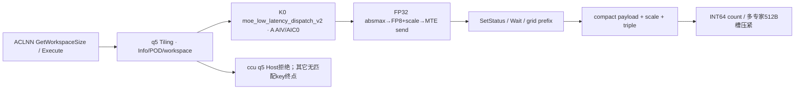

# SGL DeepEP Low-Latency Per-Token FP8 Dispatch 950 ACLNN 算子知识

## 算子速览

| 项目 | 内容 |
|---|---|
| 实际入口 | aclnnMoeLowLatencyDispatchV2GetWorkspaceSize / aclnnMoeLowLatencyDispatchV2，公开两段式ACLNN。 |
| 计算语义 | quantMode=5：FP32 absmax归一后CAST_RINT到FP8 E4M3，携带每token FP32逆scale，再按专家分发/接收compact。 |
| 输入输出 | ND BF16/FP16 x[N,H]，INT32 expertIds[N,K]，可选BOOL mask；FP8 E4M3 expandX[T,H]、FP32 scales[T]及Combine元数据。 |
| 执行类型 | 单K0 AIV_VECTOR+直接MTE window；无可达Cube/AIC/MIX_CV。 |
| Kernel 路线 | R-001/002 legacy单专家或共享接收/多专家接收；R-003/004对应hybrid；key均50005。 |
| 核心资源 | 输入/输出Queue、FP32/abs scratch、mask TBuf、计数grid512A²、512L元数据槽/64L UB，组window双半。 |
| 来源闭包 | source_closed：公开wrapper→q5 Host/POD/SDK Tiling序列化→50005及所有失败终点→完整V2A5 body/helper/通信字节和同步；止于Vector/DMA与框架primitive。 |
| 验证状态 | 已完成源码闭包检查；本次知识提取未执行编译、真机、数值或性能测试。draft保留已见资源/输入域限制。 |

固定SGL commit dda6d36b0cdb4081e102d14c0a2fb276fc416e69，SDK9.1 e5451c7feba11f9e259f4fbc19c4bf82f8c0496c。P=csrc/deepep/ops/，H=impl/adv_api/。冻结Query候选[Low-Latency API](../../../../apis/deepep/deepep_low_latency_dispatch_combine.md)已完整读；其没有完整实现，本卡create。

## 接口与语义

### 计算语义

令R=epWorldSize，r=epRankId，E=moeExpertNum，Sr=sharedExpertRankNum，Se=sharedExpertNum，L=E/(R-Sr)，B=globalBs/R，A=aivNum。expert e目标rank=e/L+Sr。发送每个有效slot前，v=FP32(x[n,:])，m=max|v|，a=(m>0?448/m:1)，q=Cast<fp8_e4m3fn_t>(a*v,CAST_RINT)，s=1/a。接收端原样保存q和s，不执行解量化；理想近似重构为x≈q*s。NaN/Inf、FP8溢出/非规范值及cast硬件效果未测试，不从此近似式推成全域保证。不同于INT8的INT32/half中转，FP8本实例直接从FP32转FP8。

接收按local expert/source/token顺序compact，epRecvCounts[lR+source]为跨专家/源的inclusive prefix；expertTokenNumsType=1写每expert count，0写累计。assist每行三元组[sourceRank,sourceToken,sourceTopk]，按收到顺序排列。仅有效count覆盖的payload/scales/assist可消费，容量尾部未初始化。共享发送使用独立后核组；每slot重复量化，无smooth成功实例。q0、q2 INT8、q3 MXFP8、q4 MXFP4是其它独立数学语义。

1D mask只求true个数并发送前缀行，要求有效token为前缀；2D[N,K] mask压紧有效slot并保留原槽编号，同时求有效行供shared发送。未mask的负expert与重复topk值没有通用Host值域扫描。

### 输入、输出与属性

| 参数 | shape/layout | dtype | 约束、默认值与语义 |
|---|---|---|---|
| x | [N,H] ND/AutoContiguous | BF16/FP16 | N0..512，H1024..8192；OpDef末两FP8 E4M3配对允许两种输入。 |
| expertIds | [N,K] ND | INT32 | K1..min(16,E)，首维等N；Python先转INT32。 |
| scalesOptional | optional二维ND | FP32 | Host q5允许存在且检查[E+Se,H]（Sr0规范化Se0）；key+10到50015无body，成功Route缺省。 |
| xActiveMaskOptional | [N]或[N,K] ND | BOOL | 前缀token mask或逐slot mask，具体有效域如上。 |
| expandXOut | [T,H] ND | FP8 E4M3FN | Host q5只接受E4M3，不扩到E5M2；容量T≥tpWorldSize*capacity，TP0下检查退化。 |
| dynamicScalesOut | [≥tpWorldSize*capacity] ND | FP32 | 每compact行1个逆scale，1D。 |
| assistInfoForCombineOut | [≥3capacity] ND | INT32 | 当前三元组格式；不能换成Normal/CCU ordinal。 |
| expertTokenNumsOut | 普通[L]或shared[1] | INT64 | 0=cumsum，1=count，默认1。 |
| epRecvCountsOut | 普通≥RL/shared≥R，TP2检查另乘2 | INT32 | inclusive prefix；TP2没有可达50005变体。 |
| tpRecvCountsOut | [tpWorldSize] | INT32 | 无TP body不产生有效写入。 |
| groupEp/epWorldSize/epRankId/moeExpertNum | 属性 | string/int64 | group1..127；R2..768，0≤r<R，E1..1024，E整除R-Sr，L>0。Device32-rank窗口数组是更窄域。 |
| groupTp/tpWorldSize/tpRankId | 属性 | string/int64 | TP0..2；≤1时tpRankId必须显式为0，非零拒绝；TP2需group非空/rank合法/L1，但50105无body。 |
| expertShardType | 属性 | int64 | 仅0。 |
| sharedExpertNum/sharedExpertRankNum | 属性 | int64 | Se0..4/Sr0..R-1；默认Se1/Sr0→0/0；同时零或正，Sr%Se=0。 |
| quantMode/globalBs/expertTokenNumsType/commAlg | 属性 | int64/string | 本卡q5；globalBs0→NR，非0≥NR且%R=0；type0/1；空/fullmesh_v1为MTE，fullmesh_v2无body，ccu有明确Host拒绝。 |

### 入口与版本

公开LOW_LATENCY_API标注A5及per-token FP8；OpDef ascend950在__DAV_C310__注册，活动build选择ops与950宏，entry同guard仅E4M3 50005实例。README/DeepEP README声明950 CANN9.0/9.1，本文只固定9.1.0，并以SDK version.cmake为该依赖版本依据。A2/A3没有本q5公开producer，不据同名文件扩平台。

wrapper固定elastic=null、zero/copy/const experts=0；GetWorkspaceSize检查commAlg指针、inner成功后executor非空；weak NnopbaseSetHcclServerType按ccu/MTE设置。Execute交给inner。自动生成inner/Contiguous/executor/stream launch为框架边界。Python default解析use_fp8在950为pertoken_fp8_e4m3，C++ mode映射到q5，分配FP8[T,H]/FP32[T]、assist max(NK,128T)、expert counts及counts；async/hook没有拆分接收kernel。公开文档legacy use_ue8m0/env优先级与实际解析冲突不推成稳定兼容承诺。

## Host/Launcher 执行流程

### 参数校验与前处理

1. GetAttr设置EP/TP/quant/sharing属性，GetParams设置mask/scales/elastic存在性；TilingCheck按dim→dtype→format检查ND/FP8 E4M3/FP32 scale，CheckAttrs检查N/H/K与TP/共享；CheckTensorShape再设置bs/h/k及输出容量。scales存在检查二维专家矩阵；special/elastic已由公开wrapper封闭。
2. commAlg=ccu时外层已完成公共检查，随后进入MoeDistributeDispatchTilingImpl。GetContextAttrs调用CheckQuantAndExpertAttrs，要求0≤quantMode<QuantModeA5::BUTT=5；本q5立即GRAPH_FAILED。它不是helper枚举2的per-token路线，不能把该helper解释为公开q5支持。
3. 非ccu才按SoC得到50000基数，CalTilingKey加q5、hasScales*10、TP2*100、fullmesh_v2*1000。唯一body50005；50015/50105/50115/51005/51015无router。fullmesh_v2与mask、TP2等组合先被检查拒绝。
4. SetHcommCfg组装engine3/op8 EP、op6 TP的Mc2Init/CcTiling。SDK GetTiling负责64/512B序列化，返回非0表示不可消费；SGL未完整检查每次返回。CheckWinSize检验A≤72、B≤512、32E≤512KiB-32以及window预算。SetWorkSpace申请资源；SetAivInfo写平台A与UB、blockDim=CalcTschBlockDim(A,0,A)。

### 参数、Workspace 与生命周期

定义Ha=align32(H)，Xi=align32(2H)，S=Ha+32+12，U=align32(S)，G=align512(S)，Gc=align512(2H)。发送slot为FP8 payload H字节，Ha处首FP32逆scale（其余28B保留），Ha+32处三元组12B。Host q5用输出元素1B计算同S/G，不把输入2H当dispatch stride。

| 路线 | Host workspace | 真实消费 | owner/lifetime |
|---|---|---|---|
| 全MTE | 16MiB+512A²+511+512L+512 | grid512A²；tokenMetaBase=align512(userPtr+512A²)-userPtr；512L私有expert槽及后512B预留 | executor/caller，当前stream kernel完成前有效 |
| legacy window | env W | 前4MiB固定MTE区；数据base=IN+4MiB+z*(W-4MiB)/2+B*(K+Se)*Gc；状态IN+z*500KiB | runtime组所有，跨调用selector翻转轮次 |
| hybrid window | env W | 数据/状态在half内107MiB+72KiB、106MiB+36KiB偏移；selector独立106MiB处 | 同组、同z消费完后才能两轮重用 |
| output | caller allocation | 有效compact H字节/行、scale4B/行、triple12B/行、INT64[L] | 同次Combine handle要求配对 |

Host perHalfData=B*G*R*L+B*Gc*(K+Se)；legacy检查2*perHalfData≤W，未显式同样预留4MiB前缀；hybrid检查2*(perHalfData+109MiB+72KiB)≤W。W来自DEEPEP_HCCL_BUFFSIZE优先，否则HCCL_BUFFSIZE，default200MiB；stoi后存uint16，没有负数/窄化上界拒绝。实际context W仍需匹配。CheckWindowSize用1B UB做INT32 DMA探针不是可靠Host失败返回。

### 启动图与失败传播



| 节点或边 | producer→consumer | 地址/extent、参数 | ordering | owner/lifetime、失败 |
|---|---|---|---|---|
| Host→K0 | SDK/POD producer→entry | outer1216B、A个AIV、同stream、用户workspace | 框架launch顺序 | Host GRAPH_FAILED阻断有效launch；未知key无body不猜运行错误 |
| send→wait | ProcessToken→远端LocalWindowCopy | 每source/localexpert B*G，S字节有效slot | Queue/PIPE_ALL+SyncAll后SetStatus32B | 组window，轮z；提交数据后再flag |
| count→compact | SyncCntOnCore→GetCumSum | grid格距512B | 全核SyncAll | 用户workspace保持到本kernel完成 |
| metadata→输出 | expert私有GM→lastCore | 每expert512B→UB64B行→INT64紧凑 | cacheWriteThrough→SyncAll→MTE2_S/S_MTE3 | 仅多expert普通接收；sole compact writer |
| 失败路径 | CCU Host/unknown router | q5>=BUTT；其它key无匹配 | 不提供MTE自动回退 | source_closed含失败终点，非支持承诺 |

## Route 与参数设计

### 分核与资源计算

split(M,C,c)：base=floor(M/C)，tail=M%C，start=base*c+min(c,tail)，count=base+[c<tail]。shared后核数=Sr?max(1,floor(A*Se/(K+Se))):0，其余前核发送MoE slot；接收Q=shared?R:RL按A split。ordinary L>1时expert计数再按activeA=min(Q,A)分核，每expert独占512B槽，lastCore=min(Q,A)-1写compact结果。源token重复expert的ordinal分支在token0仍可能冲突，见限制。

### Route 选择

| 顺序 | Route | Key/模板 | 精确选择条件与优先级 | 不适用去向 |
|---:|---|---|---|---|
| 1 | R-001 legacy，单专家或shared接收 | 50005；V2A5<X,fp8_e4m3fn_t,float,false,true,false,false,false> | q5、scales=null、TP≠2、commAlg空/fullmesh_v1、hybrid=false、r<Sr或L=1；公共shape通过 | Host失败、其它无匹配key终点 |
| 2 | R-002 legacy，多专家普通接收 | 50005；V2A5<X,fp8_e4m3fn_t,float,false,true,false,false,false> | q5、scales=null、TP≠2、commAlg空/fullmesh_v1、hybrid=false、r≥Sr且L>1；公共shape通过 | Host失败、其它无匹配key终点 |
| 3 | R-003 hybrid，单专家或shared接收 | 50005；V2A5<X,fp8_e4m3fn_t,float,false,true,false,false,false> | q5、scales=null、TP≠2、commAlg空/fullmesh_v1、hybrid=true、r<Sr或L=1；公共shape通过 | Host失败、其它无匹配key终点 |
| 4 | R-004 hybrid，多专家普通接收 | 50005；V2A5<X,fp8_e4m3fn_t,float,false,true,false,false,false> | q5、scales=null、TP≠2、commAlg空/fullmesh_v1、hybrid=true、r≥Sr且L>1；公共shape通过 | Host失败、其它无匹配key终点 |

```text
quantMode5固定 -> OpDef/外层shape通过
commAlg ccu -> CheckQuantAndExpertAttrs: q5>=BUTT5 -> GRAPH_FAILED
否则key=50000+5+10*hasScales+100*TP2+1000*fullmeshV2
  key50005且O E4M3、__DAV_C310__ -> V2A5 DynamicQuant=true,IsMxQuant=false
    hybrid=false/true；接收shared或L1/普通L>1 -> 四Route
  50015/50105/50115/51005/51015 -> 无匹配body
```

### 模板/实现执行矩阵

| Route | key/selector | dtype/shape/platform 完整命中条件 | 执行拓扑与 Kernel 节点 | 实际模板/body | 内存与同步特征 | tail/fallback |
|---|---|---|---|---|---|---|
| R-001 | 50005 | 950，q5，X BF16/FP16→E4M3，N0..512/H1024..8192/K1..min16E，scales=null，TP≠2，commAlg空/fullmesh_v1，hybrid=false，shared或L1 | 单K0 AIV_VECTOR+MTE | MoeDistributeDispatchV2A5<X,O,float,false,true,false,false,false>::Init/Process/QuantDynamicPerToken | bXi+bU send，Reset后bU recv；grid；lastCore直接I64 | split余数/DMA有效len；无其它key回退 |
| R-002 | 50005 | 950，q5，X BF16/FP16→E4M3，N0..512/H1024..8192/K1..min16E，scales=null，TP≠2，commAlg空/fullmesh_v1，hybrid=false，普通L>1 | 单K0 AIV_VECTOR+MTE | MoeDistributeDispatchV2A5<X,O,float,false,true,false,false,false>::Init/Process/QuantDynamicPerToken | bXi+bU send，Reset后bU recv；grid；512L GM/64L UB metadata | split余数/DMA有效len；无其它key回退 |
| R-003 | 50005 | 950，q5，X BF16/FP16→E4M3，N0..512/H1024..8192/K1..min16E，scales=null，TP≠2，commAlg空/fullmesh_v1，hybrid=true，shared或L1 | 单K0 AIV_VECTOR+MTE | MoeDistributeDispatchV2A5<X,O,float,false,true,false,false,false>::Init/Process/QuantDynamicPerToken | bXi+bU send，Reset后bU recv；grid；lastCore直接I64 | split余数/DMA有效len；无其它key回退 |
| R-004 | 50005 | 950，q5，X BF16/FP16→E4M3，N0..512/H1024..8192/K1..min16E，scales=null，TP≠2，commAlg空/fullmesh_v1，hybrid=true，普通L>1 | 单K0 AIV_VECTOR+MTE | MoeDistributeDispatchV2A5<X,O,float,false,true,false,false,false>::Init/Process/QuantDynamicPerToken | bXi+bU send，Reset后bU recv；grid；512L GM/64L UB metadata | split余数/DMA有效len；无其它key回退 |

### 隐藏性能 Guard

| Guard | Host/Tiling 条件 | Device/资源原因 | 影响 Route | 不满足时去向 | 源码符号 |
|---|---|---|---|---|---|
| dtype | q5强制E4M3、scaleFP32 | 直接FP32→FP8 CAST_RINT | 全部 | GRAPH_FAILED或无类型实例 | CheckTensorDataType/entry |
| key | scales/TP/fullmeshv2各加位 | 只有50005 router | 全部 | 无匹配终点 | CalTilingKey/entry |
| CCU enum | q5>=QuantModeA5::BUTT5 | helper枚举不是公开q5语义 | CCU候选 | GRAPH_FAILED，无Device节点 | CheckQuantAndExpertAttrs |
| UB depth | estimated+[L>1普通]*64L+2Xi+2U>170KiB→b1 | 输入输出Queue同时缩深度；请求不完全入账 | 全部 | 无第二级资源fallback | QuantInit |
| rank array | Host R≤768，local windowsIn[32] | MTE按rank索引32项数组 | 全部 | 超域无Host guard，draft | HcclCombinOpParam/GetBaseWindAddr |
| 状态 | A≤72/B≤512/E*32≤512KiB-32 | selector与状态区固定容量 | 全部 | GRAPH_FAILED | CheckWinSize |
| metadata | L≤E≤1024；blockCount静态≤4095 | 多expert DMA gather | R-002/004 | 方法有保护return，不擅补输出 | UpdateTokenNumsOut |

### POD/ABI

SGL Info自然8B对齐推导size128/align8；外层init64@0、cc1 512@64、cc2 512@576、Info@1088，总1216。下表offset均相对Info；自然布局推导未经编译测量。CCU二次Host覆盖其实际产生字段，不能将外层inactive值补成已初始化。

| 结构 | 字段 | 类型/位宽 | ABI 布局 | 单位 | Host/launcher producer | Device consumer | 边界 |
|---|---|---|---|---|---|---|---|
| MoeDistributeDispatchV2Info | epWorldSize | u32 | 0 | rank数 | GetAttrAndSetTilingData写R | Init分域/窗口rank | padding60..63/92..95/116..119不作业务数据 |
| MoeDistributeDispatchV2Info | tpWorldSize | u32 | 4 | rank数 | Host0..2；TP2 key无body | Hostkey；当前body不AllGather | padding60..63/92..95/116..119不作业务数据 |
| MoeDistributeDispatchV2Info | epRankId | u32 | 8 | rank | 合法r | GetWindow、scatter/gather | padding60..63/92..95/116..119不作业务数据 |
| MoeDistributeDispatchV2Info | tpRankId | u32 | 12 | rank | TP≤1要求属性tpRankId=0，非零拒绝 | 本实例TP inactive | padding60..63/92..95/116..119不作业务数据 |
| MoeDistributeDispatchV2Info | expertShardType | u32 | 16 | enum | 仅0 | body不做分片计算 | padding60..63/92..95/116..119不作业务数据 |
| MoeDistributeDispatchV2Info | sharedExpertNum | u32 | 20 | expert数 | Se默认1/Sr0规范化为0 | shared核组/目标 | padding60..63/92..95/116..119不作业务数据 |
| MoeDistributeDispatchV2Info | sharedExpertRankNum | u32 | 24 | rank数 | Sr、Se一致性/divisible检查 | shared role/L | padding60..63/92..95/116..119不作业务数据 |
| MoeDistributeDispatchV2Info | moeExpertNum | u32 | 28 | expert数 | E1..1024且整除R-Sr | L与id域 | padding60..63/92..95/116..119不作业务数据 |
| MoeDistributeDispatchV2Info | quantMode | u32 | 32 | enum | attr=5 | Hostkey，模板DynamicQuant=true/IsMxQuant=false | padding60..63/92..95/116..119不作业务数据 |
| MoeDistributeDispatchV2Info | globalBs | u32 | 36 | token容量 | 0→NR，否则≥NR且%R=0 | B与每expert窗口容量 | padding60..63/92..95/116..119不作业务数据 |
| MoeDistributeDispatchV2Info | bs | u32 | 40 | token | x.dim0，允许0 | mask/slot域 | padding60..63/92..95/116..119不作业务数据 |
| MoeDistributeDispatchV2Info | k | u32 | 44 | slot/token | expertIds.dim1，K≤min(16,E) | NK/目标路由 | padding60..63/92..95/116..119不作业务数据 |
| MoeDistributeDispatchV2Info | h | u32 | 48 | element/token | x.dim1 1024..8192 | 字节/Queue/DMA | padding60..63/92..95/116..119不作业务数据 |
| MoeDistributeDispatchV2Info | aivNum | u32 | 52 | core | SetAivInfo写平台AIV数 | 分核/selector512A，本q5无CCU consumer | padding60..63/92..95/116..119不作业务数据 |
| MoeDistributeDispatchV2Info | isTokenMask | bool | 56 | flag | mask dim1 | 计数前缀mask | padding60..63/92..95/116..119不作业务数据 |
| MoeDistributeDispatchV2Info | isExpertMask | bool | 57 | flag | 外层mask dim2 | MTE槽mask；MTE逐槽mask | padding60..63/92..95/116..119不作业务数据 |
| MoeDistributeDispatchV2Info | hasElasticInfo | bool | 58 | flag | wrapper null→false | elastic分支不可达 | padding60..63/92..95/116..119不作业务数据 |
| MoeDistributeDispatchV2Info | isHybridDeployment | bool | 59 | flag | env DEEPEP_HYBRID_DEPLOYMENT精确1 | MTE窗口路由 | padding60..63/92..95/116..119不作业务数据 |
| MoeDistributeDispatchV2Info | totalUbSize | u64 | 64 | byte | SetAivInfo::GetCoreMemSize写平台UB | 未形成完整分配拒绝 | padding60..63/92..95/116..119不作业务数据 |
| MoeDistributeDispatchV2Info | totalWinSize | u64 | 72 | byte | env uint16 MiB | MTE窗口总字节W | padding60..63/92..95/116..119不作业务数据 |
| MoeDistributeDispatchV2Info | expertTokenNumsType | u32 | 80 | enum | attr0/1 | count/cumsum输出 | padding60..63/92..95/116..119不作业务数据 |
| MoeDistributeDispatchV2Info | zeroComputeExpertNum | i32 | 84 | expert数 | wrapper特殊属性0之和 | 本入口special分支inactive | padding60..63/92..95/116..119不作业务数据 |
| MoeDistributeDispatchV2Info | cumSumUBMinValue | u32 | 88 | byte | 外层CumSum shape[1,LR]临时最小值 | 本q5 body不以此申请 | padding60..63/92..95/116..119不作业务数据 |
| MoeDistributeDispatchV2Info | scalesRow | u64 | 96 | row | CheckAndSetScalesInfo：缺省0；存在写dim0后最终到50015无body | inactive | padding60..63/92..95/116..119不作业务数据 |
| MoeDistributeDispatchV2Info | scalesCol | u64 | 104 | column | 同上 | 本MTE无smooth实例，不读输入scale shape字段 | padding60..63/92..95/116..119不作业务数据 |
| MoeDistributeDispatchV2Info | scalesTypeSize | u32 | 112 | byte/scale | 同上 | 同上 | padding60..63/92..95/116..119不作业务数据 |
| MoeDistributeDispatchV2Info | scalesCount | u64 | 120 | element数 | 同上 | 本MTE不读该字段；输出scale来自token absmax | padding60..63/92..95/116..119不作业务数据 |
| outer | mc2InitTiling | opaque64 | 0 | byte | GetTiling(init) | 框架/InitV2 | SDK内层见后表 |
| outer | mc2CcTiling1 | opaque512 | 64 | byte | engine3/op8 | EP组MTE资源，Device直接读取本地context | SDK GetTiling返回值未完整检查 |
| outer | mc2CcTiling2 | opaque512 | 576 | byte | engine3/op6，groupTP资源；当前实例不AllGather | 框架资源准备；无TP方法实例 | 本q5没有TP实例 |
| outer | moeDistributeDispatchV2Info | Info128 | 1088 | byte | 前述producer | entry/Init | q5字段按真实consumer |

SDK Mc2InitTiling64/Mc2CcTiling512为公开opaque外壳；实际inner如下。offset相对inner，类型来自固定SDK。本q5成功Route只使用MTE engine3/op8与TP资源op6；CCU inner拒绝q5，不生成可消费CCU POD。

| 结构 | 字段 | 类型/位宽 | ABI 布局 | 单位 | Host/launcher producer | Device consumer | 边界 |
|---|---|---|---|---|---|---|---|
| Mc2InitTilingInner | version | u32 | 0 | 版本枚举 | GetTiling: 100 | SDK初始化 | 不依赖reserved值 |
| 同上 | mc2HcommCnt | u32 | 4 | 通信组数 | GetTiling: 2 | 通信框架初始化资源组数 | 不依赖reserved值 |
| 同上 | offset | u32[8] | 8 | 字节偏移数组 | GetTiling: 64/576，其余0 | cc1/cc2定位 | 不依赖reserved值 |
| 同上 | debugMode | u8 | 40 | 枚举 | GetTiling: default0 | SDK | 不依赖reserved值 |
| 同上 | preparePosition | u8 | 41 | 枚举 | GetTiling: default0 | SDK | 不依赖reserved值 |
| 同上 | queueNum | u16 | 42 | queue数 | GetTiling: default0 | SDK working core | 不依赖reserved值 |
| 同上 | commBlockNum | u16 | 44 | block数 | GetTiling: default0 | SDK资源 | 不依赖reserved值 |
| 同上 | devType | u8 | 46 | 枚举 | GetTiling: runtime SoC | 平台实现选择 | 不依赖reserved值 |
| 同上 | reserved | char[17] | 47 | 保留字节 | GetTiling: 未显式清全部 | inactive | 不依赖reserved值 |
| Mc2CcTilingInner | skipLocalRankCopy | u8 | 0 | 布尔 | GetTiling: default0 | 框架 | 不依赖reserved值 |
| 同上 | skipBufferWindowCopy | u8 | 1 | 布尔 | GetTiling: default0 | 框架 | 不依赖reserved值 |
| 同上 | stepSize | u8 | 2 | step数 | GetTiling: default0 | 框架 | 不依赖reserved值 |
| 同上 | version | u8 | 3 | 版本枚举 | GetTiling: 1 | 固定协议 | 不依赖reserved值 |
| 同上 | reserved | char[9] | 4 | 保留字节 | GetTiling: memset0 | inactive | 不依赖reserved值 |
| 同上 | commEngine | u8 | 13 | 枚举 | GetTiling: MTE3 | 框架MTE资源；Device不执行CCU | 不依赖reserved值 |
| 同上 | srcDataType | u8 | 14 | dtype枚举 | GetTiling: default0=INT8 | MTE不读作payload dtype，payload由模板决定 | 不依赖reserved值 |
| 同上 | dstDataType | u8 | 15 | dtype枚举 | GetTiling: default0=INT8 | MTE不读取该字段 | 不依赖reserved值 |
| 同上 | groupName | char[128] | 16 | 组名字符 | GetTiling: EP/TP字符串 | 框架组关联 | 不依赖reserved值 |
| 同上 | algConfig | char[128] | 144 | 算法配置字符 | GetTiling: AlltoAll fullmesh/pairwise，MTE第二AllGather ring | 框架资源组装；本body直接MTE | 不依赖reserved值 |
| 同上 | opType | u32 | 272 | 命令枚举 | GetTiling: EP8/TP6 | 框架通信资源声明 | 不依赖reserved值 |
| 同上 | reduceType | u32 | 276 | reduce枚举 | GetTiling: default0 | 本body不做payload reduce | 不依赖reserved值 |
| 同上 | reserved2 | char[232] | 280 | 保留字节 | GetTiling: 未显式清全部 | inactive | 不依赖reserved值 |

MTE本地HcclCombinOpParam（少e）为32项window数组，普通自然8B对齐推导size576/align8；当前body只消费rank前缀和windowsIn。它与SDK CCU64项结构不同，本q5在CCU Host已失败，不读取后者。

| 结构 | 字段 | 类型/位宽 | ABI 布局 | 单位 | Host/launcher producer | Device consumer | 边界 |
|---|---|---|---|---|---|---|---|
| SGL MTE context | workSpace | u64 | 0 | 地址 | runtime组 | 当前MTE不用 | 不同于ACLNN workspace |
| 同上 | workSpaceSize | u64 | 8 | byte | runtime组 | 当前MTE不用 | 保留前缀 |
| 同上 | rankId | u32 | 16 | rank | runtime组 | GetRankId/InitWinState | 检查值 |
| 同上 | rankDim | u32 | 20 | rank数 | runtime组 | GetRankDim/InitWinState | 不是AIV数 |
| 同上 | winSize | u64 | 24 | byte | runtime组 | GetWinSize/CheckWindowSize | 实际大小 |
| 同上 | windowsIn | u64[32] | 32 | 地址 | runtime组 | GetBaseWindAddr/State | Host未限制rank<32 |
| 同上 | windowsOut | u64[32] | 288 | 地址 | runtime组 | 本MTE body未读 | 不借用SDK64布局 |
| 同上 | xnAddr | u64 | 544 | 地址 | runtime组 | 本MTE不用 | 不能按CCU前缀解释 |
| 同上 | ckeAddr | u64 | 552 | 地址 | runtime组 | 本MTE不用 | 同上 |
| 同上 | msAddr | u64 | 560 | 地址 | runtime组 | 本MTE不用 | 保留 |
| 同上 | msSize | u64 | 568 | byte/count | runtime组 | 本MTE不用 | 未消费 |

### Route 源码闭包

| Route | Key/selector | Host/Tiling producer | POD/参数 | Kernel entry/router 节点 | Kernel body/直接依赖 | 构建接线 |
|---|---|---|---|---|---|---|
| R-001 | 50005 | P/op_host/moe_distribute_dispatch_v2_tiling.cpp；CheckTensorDataType/CheckAttrs/CalTilingKey/SetWorkSpace/SetAivInfo | Info128/outer1216，SDK init64/cc512，grid/tokenMeta/context | P/op_kernel/moe_low_latency_dispatch_v2.cpp，E4M3/950 guard | P/op_kernel/moe_distribute_dispatch_v2_a5.h→base/v2base/window/checkwinsize；QuantDynamicPerToken/ReduceMaxInplace完整子链 | OpDef950→ops CMake Host/kernel target，build.sh/compile_ascend_proj.sh |
| R-002 | 50005 | P/op_host/moe_distribute_dispatch_v2_tiling.cpp；CheckTensorDataType/CheckAttrs/CalTilingKey/SetWorkSpace/SetAivInfo | Info128/outer1216，SDK init64/cc512，grid/tokenMeta/context | P/op_kernel/moe_low_latency_dispatch_v2.cpp，E4M3/950 guard | P/op_kernel/moe_distribute_dispatch_v2_a5.h→base/v2base/window/checkwinsize；QuantDynamicPerToken/ReduceMaxInplace完整子链 | OpDef950→ops CMake Host/kernel target，build.sh/compile_ascend_proj.sh |
| R-003 | 50005 | P/op_host/moe_distribute_dispatch_v2_tiling.cpp；CheckTensorDataType/CheckAttrs/CalTilingKey/SetWorkSpace/SetAivInfo | Info128/outer1216，SDK init64/cc512，grid/tokenMeta/context | P/op_kernel/moe_low_latency_dispatch_v2.cpp，E4M3/950 guard | P/op_kernel/moe_distribute_dispatch_v2_a5.h→base/v2base/window/checkwinsize；QuantDynamicPerToken/ReduceMaxInplace完整子链 | OpDef950→ops CMake Host/kernel target，build.sh/compile_ascend_proj.sh |
| R-004 | 50005 | P/op_host/moe_distribute_dispatch_v2_tiling.cpp；CheckTensorDataType/CheckAttrs/CalTilingKey/SetWorkSpace/SetAivInfo | Info128/outer1216，SDK init64/cc512，grid/tokenMeta/context | P/op_kernel/moe_low_latency_dispatch_v2.cpp，E4M3/950 guard | P/op_kernel/moe_distribute_dispatch_v2_a5.h→base/v2base/window/checkwinsize；QuantDynamicPerToken/ReduceMaxInplace完整子链 | OpDef950→ops CMake Host/kernel target，build.sh/compile_ascend_proj.sh |

## Kernel 实现

### 公共执行流程

entry参数顺序x、expertIds、scales、mask、elasticInfo、expandX、dynamicScales、assist、expertTokenNums、epCounts、tpCounts、workspace、tiling。本实例Init先清CTRL bit60，再读本地32项MTE context、selector/窗口与Info，申请send资源，Process按发送→发布→等待→grid prefix→compact→INT64 metadata执行。接收Reset再次清bit60且未恢复；entry读取的oriOverflowMode没有恢复consumer。不存在CCU/HCOMM算法Device节点，Host拒绝已追到实际判断。

### Route R-001：legacy MTE，单专家或共享接收

#### 适用条件

##### 选择证据

| 层级 | 文件 | 符号 | 源码谓词/参数 | 结果/下一跳 |
|---|---|---|---|---|
| Host | P/op_host/moe_distribute_dispatch_v2_tiling.cpp | GetAttr/CheckAttrs/SetHcommCfg/CalTilingKey | q5、commAlg为空或fullmesh_v1、TP≠2、hybrid=false；当前rank为共享接收或L=1；q5无scales、X=BF16/FP16、O=FP8 E4M3 | 50005 |
| Router | P/op_kernel/moe_low_latency_dispatch_v2.cpp | TILING_KEY_IS(50005) | DT_FP8 E4M3输出编译guard | MoeDistributeDispatchV2A5<X,O,float,false,true,false,false,false> |
| 资源分支 | P/op_kernel/moe_distribute_dispatch_v2_a5.h | Init/BufferInit/UpdateTokenNumsOut | isHybridDeployment=false，!shared&&L>1=false | lastCore直接写INT64 |

#### Device 数据流

##### 函数级调用链

```text
K0 entry -> V2A5::Init
 -> SetCtrlSpr(bit60,0) -> GetRankId/GetWinSize/GetBaseWindAddr/State
 -> CheckWindowSize -> InitWinState -> QuantVariableInit(q5) -> InitBuffer
Process -> AlltoAllDispatch
 -> [TokenActiveMaskCal | ExpertActiveMaskCal -> CalValidBSCnt/CalValidExpIdx]
 -> SendToMoeExpert/SendToSharedExpert -> ProcessToken -> FillTriple
 -> SetStatus -> WaitDispatch -> BufferInit(Reset/SetCtrlSpr0)
 -> WaitDispatchClearStatus -> SyncCntOnCore
 -> LocalWindowCopy/GetCumSum
 -> UpdateTokenNumsOut(direct lastCore writer)
# 无TP body；无Hccl对象/Finalize；TimeOutDetection仅定义而未调用
```

##### 源码等价伪码

```text
# 伪码，MTE本地context类型固定数组32
SEL=IN(self)+1050KiB+512core；State(q)=IN(q)+z*500KiB
Data(q)=IN(q)+4MiB+z*(W-4MiB)/2+B*(K+Se)*Gc
InitWinState：读SEL首32B；保存oldz，写z^1/word1=1/tiling rank,E,R,globalBs；
             byte24的u64 opcount++；context rank/size不匹配另写8B探针
q5 QuantVariableInit：Ha=align32(H),scaleByteOffset=Ha,tripleByteOffset=Ha+32,S=Ha+44,U=align32(S),G=align512(S)
Mmoe=A-(Sr?max(1,floor(A*Se/(K+Se))):0)
1Dmask计数activeN前缀；2Dmask对[N,K]按32B padded rows求有效行，
  再Compare/GatherMask保留有效slot编号并压紧对应expertIds
前moe核按有效slot split，原slot=validSlot[j]或j，n=slot/K,k=slot%K,e=compactedID[j]
  ordinal仅(n>0&&j>0)时统计前j槽等于e的次数，否则0
  x[n,H] -> xInQueue(b,Xi) -> FP32 QuantDynamicPerToken -> xOutQueue(b,U)
  -> scale@Ha + triple[r,n,k]@Ha+32 -> Data(e/L+Sr)+(rL+e%L)*B*G+ordinal*G，复制S
后shared核按(有效token,Se)发送，srcToken为validRows或前缀token，triple k=K+sharedExpert
SetStatus对E+Sr split，先算count；PIPE_ALL+SyncAll后发32B[1.0f,count,..]到State(dst)
WaitDispatch Reset后分核接收Q=shared?R:RL个状态，c块32B DMA，ReduceSum首flag==c才就绪
清首flag保留count；将每core count和写grid各consumer512B格；SyncAll
LocalWindowCopy：SEL.word1=2；GetCumSum读前core grid计数前缀，
  对[localExpert,source]按count从Data(self)+(sourceL+localE)*B*G+jG读S到Queue
  -> assist输出triple12B，payloadH与scale4B分别输出compact；epCounts写inclusive prefix
UpdateTokenNumsOut：lastCore=min(Q,A)-1直接写expertTokenNums[0]=totalCnt并DCCI
共享rank按单专家计数；L1普通rank同样直接写一个INT64
```

计数helper仍使用INT32差→FP32位模式Abs→INT32 Mins1→FP32 ReduceSum后INT32读取；payload没有cast/reduce。首token重复expert槽的ordinal可同为0，输入topk唯一性未由Host检验。公开elastic=null/special=0，相关helper不可达。A5 WaitDispatch没有调用TimeOutDetection，不能把A3的50005us探针机制迁入本Route。


量化完整子链为 `QuantInit → ProcessToken → QuantProcess → QuantDynamicPerToken → ReduceMaxInplace → FillTriple → CopyScalesToOut`。本Route的DynamicQuant=true、IsMxQuant=false；maxVal=FP8_E4M3_MAX_VALUE=448.0f。实际流程：
```text
input Alloc，DataCopyPad2H，EnQue/DeQue；output Alloc
Cast(floatTmp,xIn,CAST_NONE,H)，无smooth输入、不乘expert scale
Abs(absTmp,floatTmp,H)
ReduceMaxInplace(absTmp,H)：
  reps=H/64，off=64*reps，rem=H%64
  reps>1：Max首组与后续组，mask64/repeat=reps-1，
          block strides{1,1,1}，repeat strides{0,8,0}；PIPE_V
  rem>0且off>0：尾rem Max，PIPE_V
  WholeReduceMax(dst=absTmp,src=absTmp,mask=(reps?64:H),repeat1,参数8/1/8)
V_S取m，a=(m>0?448/m:1)，S_V；Muls(floatTmp,a,H)
__DAV_C310__ && O=fp8_e4m3fn_t：
  Cast(xOutTensor,floatTmp,CAST_RINT,H)
output.reinterpretFloat[align32(H)/4]=1/a；S_MTE3
output EnQue；input Free；output DeQue
FillTriple@Ha+32，DataCopyPad S字节到远端window；output Free
接收Queue读取S：
  payloadFP8 H字节写expandX[row,H]；
  CopyScalesToOut从slot[align32(H)]取4B -> dynamicScalesOut[row*4]；
  triple12B写assist；再Free
```
FP32→INT32→half的分支只属于INT8实例，本Route不执行SetDeqScale。源码把Cast/Abs/Reduce/Muls之间部分PIPE_V注释掉，本文不伪补执行过的barrier；V_S/S_V、S_MTE3和Queue次序按实际代码保留。rowMax32虽然申请但该inplace实现用absTmp[0]，仍计UB。buffer别名和生命周期如下表，FP8数值硬件细节本次未运行验证。

#### 内存与数据搬运

##### 资源与搬运表

| 层级/缓冲区 | offset/地址公式 | extent/容量公式 | dtype/layout | producer | consumer | owner/lifetime | 对齐/复用 |
|---|---|---|---|---|---|---|---|
| data window | IN(q)+4MiB+z*(W-4MiB)/2+B*(K+Se)*Gc | 每source/expert B*G | FP8 E4M3 payload Ha+32B scale区+triple12 | ProcessToken | LocalWindowCopy | 组window/轮z | 512B首址，S字节有效搬运 |
| state | IN(q)+z*500KiB+32*(localE*R+source) | 32Q | FP32flag/I32count | SetStatus | WaitDispatch | 同轮清首lane | 前缀两500KiB状态片 |
| selector | IN(self)+1050KiB+512core | 首32B+检查探针8B | u32/u64 alias | InitWinState/LocalCopy | 下一调用 | 跨调用 | 512core stride |
| send dataStateBuf/status | 独立TBuf | 32 + 32RL | selector/status | Init | publish | Reset前 | status Duplicate另用256B倍数见字节账 |
| send expertIds | TBuf | J=max(4NK,align256(2N)) | i32/half | ids/maskDMA | Send/SetStatus | Reset前 | 比A3多保留完整byte对齐量 |
| gather/floatTmp/absTmp | 三个TBuf，dst/sub分别alias后两者 | 各M=max(4H,align32(4NK),2N*align32(K),align256(2NK)) | mask/half/i32/f32 | mask/count/QuantProcess | Gather/Reduce/输出cast | Reset前 | 共3M，不重复算alias |
| rowMaxBuf | TBuf | 32B | FP32 | QuantInit申请 | 当前A5 QuantDynamicPerToken用absTmp[0]，此buf仍占资源 | Reset前 | 不因未使用而扣除 |
| send xInQueue | TQueBind | b*Xi | X | xDMA | QuantProcess | 每tokenFree | Xi=align32(2H) |
| 2Dmask validBs/validIndex | 条件TBuf | align32(4N)+Vidx，Vidx=max(align32(4NK),2N*align32(K)) | i32/half alias | mask | slots/shared | Reset前 | 无mask不分配 |
| send xOutQueue | TQueBind | b*U，b1或2 | FP8 E4M3/scale/triple | QuantProcess/FillTriple | windowDMA | 每slotFree | U含Ha+44 |
| recv wait/gather/sums/scalar | Reset后TBuf | max(32c,256)+max(align32(4c),4RL)+68A+96 | status/count | Wait/Prefix | LocalCopy/Update | 后半kernel | recv沿用b，不固定2 |
| recv xQueue | Reset后Queue | b*U | O | windowDMA | outputDMA | 每slotFree | 同步后复用 |

| grid | user+512*(A*producer+consumer) | 512A² | 首I32有效 | SyncCntOnCore | GetCumSum | 本kernel | MTE3→SyncAll→MTE2 |

##### 分层内存布局


##### 字节账与复用顺序

```text
send_actual=32+32RL+J+3M+[mask2D]*(align32(4N)+Vidx)+32+b*Xi+bU
estimated=32RL+align32(4NK)+3M+[mask2D]*(align32(4N)+align32(4NK))
b=(estimated+0+2Xi+2U>170KiB)?1:2
recv=max(32c,256)+max(align32(4c),4RL)+68A+96+bU
max(send_actual,recv)≤平台UB是复用前提；Host没有完整证明。
status初始化Duplicate的extent=32*align8(ceil((E+Sr)/A))，
请求status32RL可能小于该extent（例如小R/L）；不能以变量名假定足够。
workspace=16MiB+512A²+511+512L+512；当前metadata额外槽仅预留。
dynamic_ub=N/A；寄存器/编译器私有栈占用未在固定源码中测量。
```

| 复用子区 | 写入者 | 读取者/消费点 | 下一次覆盖 | 同步或释放依据 | 安全条件 |
|---|---|---|---|---|---|
| mask/gather/dst/sub | mask方法 | 有效槽/计数 | 发送与SetStatus临时 | MTE2_V/V_S/PIPE_V | 不覆盖未消费有效索引 |
| send UB→recv UB | all send | flag发布 | Reset申请recv | PIPE_ALL/SyncAll | 不跨Reset保留LocalTensor |
| recv queue b | windowDMA | assist/payloadDMA | 下一slot | DeQue/Free/MTE事件 | 有效S≤U；scale4B单独输出，triple另读 |
| direct expert output | lastCore | 调用者 | 后续kernel | DCCI/stream | 当前只有一个本地expert或共享专家 |


#### 同步、精度与尾块

##### 同步与数值边界表

| 阶段 | primitive/机制 | producer | consumer/等待点 | 保护对象 | 精度/尾块 |
|---|---|---|---|---|---|
| input/mask | DataCopyPad/Queue；BOOL→half，Sum/Mins/Compare/GatherMask | x/mask | ProcessToken | padded mask与tokenUB | 1D前缀；2D槽原编号保留 |
| data-before-flag | MTE3_S/S_MTE3、PIPE_ALL/SyncAll | payload/triple | SetStatus | S-byte slot | 已量化的FP8 E4M3 payload及FP32 inverse scale；QuantProcess先完成FP32 absmax/归一化/CAST_RINT，发布与接收阶段仅搬运 |
| recv | c块32B DMA、MTE2_V、ReduceSum mask1/repeatc | 远端32Bflag | WaitDispatch | 状态片 | 无本地timeout；空核SyncAll后return |
| grid/clear | sparse首lane清0；重复写grid512B格；GetCumSum stride16A-1 | count | LocalCopy | 首lane与count | count位模式求和，不是payload FP32累加 |
| expert count | lastCore scalar I64+DCCI | EP prefix | INT64输出 | 单I64 | 只有效lastCore写 |
| 控制位 | Init/BufferInit SetCtrlSpr<60,60>(0) | kernel | 后续Vector阶段 | 控制SPR | 本源码未恢复旧bit；不臆测硬件运行后果 |

#### 关键实现

##### 符号证据表

| 阶段 | 文件 | 符号/模板实例 | 实现事实 |
|---|---|---|---|
| Host/Tiling producer | P/op_host/moe_distribute_dispatch_v2_tiling.cpp | SetHcommCfg/SetWorkSpace/CalTilingKey | 50005、4MiB/hybrid预算、grid+metadata保留 |
| Kernel entry/router | P/op_kernel/moe_low_latency_dispatch_v2.cpp | MoeDistributeDispatchV2A5<X,O,float,false,true,false,false,false> | 无TP q5实例 |
| Device body/helper | P/op_kernel/moe_distribute_dispatch_v2_a5.h | Init/QuantVariableInit/ProcessToken/WaitDispatch/LocalWindowCopy/UpdateTokenNumsOut | 单expert或共享接收直接输出，全体body已读 |
| 窗口/selector | P/op_kernel/window_layout.h；P/op_kernel/moe_distribute_v2_base.h | A5WindowLayout/InitWinState | legacy1050KiB selector/500KiB状态片 |
| 地址/flush | P/op_kernel/moe_distribute_base.h | GetBaseWindAddr/State/cacheWriteThrough | 数组32、4MiB prefix、flush length0保护 |

### Route R-002：legacy MTE，多专家接收

#### 适用条件

##### 选择证据

| 层级 | 文件 | 符号 | 源码谓词/参数 | 结果/下一跳 |
|---|---|---|---|---|
| Host | P/op_host/moe_distribute_dispatch_v2_tiling.cpp | GetAttr/CheckAttrs/SetHcommCfg/CalTilingKey | 同legacy MTE，但r≥Sr且L>1；q5无scales、X=BF16/FP16、O=FP8 E4M3 | 50005 |
| Router | P/op_kernel/moe_low_latency_dispatch_v2.cpp | TILING_KEY_IS(50005) | DT_FP8 E4M3输出编译guard | MoeDistributeDispatchV2A5<X,O,float,false,true,false,false,false> |
| 资源分支 | P/op_kernel/moe_distribute_dispatch_v2_a5.h | Init/BufferInit/UpdateTokenNumsOut | isHybridDeployment=false，!shared&&L>1=true | 64L UB与512L GM私有metadata |

#### Device 数据流

##### 函数级调用链

```text
K0 entry -> V2A5::Init
 -> SetCtrlSpr(bit60,0) -> GetRankId/GetWinSize/GetBaseWindAddr/State
 -> CheckWindowSize -> InitWinState -> QuantVariableInit(q5) -> InitBuffer
Process -> AlltoAllDispatch
 -> [TokenActiveMaskCal | ExpertActiveMaskCal -> CalValidBSCnt/CalValidExpIdx]
 -> SendToMoeExpert/SendToSharedExpert -> ProcessToken -> FillTriple
 -> SetStatus -> WaitDispatch -> BufferInit(Reset/SetCtrlSpr0)
 -> WaitDispatchClearStatus -> SyncCntOnCore
 -> LocalWindowCopy/GetCumSum
 -> UpdateTokenNumsOut(private slots -> sole writer compact DMA)
# 无TP body；无Hccl对象/Finalize；TimeOutDetection仅定义而未调用
```

##### 源码等价伪码

```text
# 伪码，MTE本地context类型固定数组32
SEL=IN(self)+1050KiB+512core；State(q)=IN(q)+z*500KiB
Data(q)=IN(q)+4MiB+z*(W-4MiB)/2+B*(K+Se)*Gc
InitWinState：读SEL首32B；保存oldz，写z^1/word1=1/tiling rank,E,R,globalBs；
             byte24的u64 opcount++；context rank/size不匹配另写8B探针
q5 QuantVariableInit：Ha=align32(H),scaleByteOffset=Ha,tripleByteOffset=Ha+32,S=Ha+44,U=align32(S),G=align512(S)
Mmoe=A-(Sr?max(1,floor(A*Se/(K+Se))):0)
1Dmask计数activeN前缀；2Dmask对[N,K]按32B padded rows求有效行，
  再Compare/GatherMask保留有效slot编号并压紧对应expertIds
前moe核按有效slot split，原slot=validSlot[j]或j，n=slot/K,k=slot%K,e=compactedID[j]
  ordinal仅(n>0&&j>0)时统计前j槽等于e的次数，否则0
  x[n,H] -> xInQueue(b,Xi) -> FP32 QuantDynamicPerToken -> xOutQueue(b,U)
  -> scale@Ha + triple[r,n,k]@Ha+32 -> Data(e/L+Sr)+(rL+e%L)*B*G+ordinal*G，复制S
后shared核按(有效token,Se)发送，srcToken为validRows或前缀token，triple k=K+sharedExpert
SetStatus对E+Sr split，先算count；PIPE_ALL+SyncAll后发32B[1.0f,count,..]到State(dst)
WaitDispatch Reset后分核接收Q=RL个状态，c块32B DMA，ReduceSum首flag==c才就绪
清首flag保留count；将每core count和写grid各consumer512B格；SyncAll
LocalWindowCopy：SEL.word1=2；GetCumSum读前core grid计数前缀，
  对[localExpert,source]按count从Data(self)+(sourceL+localE)*B*G+jG读S到Queue
  -> assist输出triple12B，payloadH与scale4B分别输出compact；epCounts写inclusive prefix
UpdateTokenNumsOut:
  SyncAll确保所有epCounts完成；L个expert按activeAiv均分writer
  每l读epCounts[(l+1)R-1]与前expert末值：
    type0 -> 当前前缀；type1 -> 差值，计算INT64
  写user+tokenMetaBase+512*l首int64；cacheWriteThrough按每writer完整512B槽flush
  SyncAll；仅lastCore：
    DataCopyPad {blockCount=L,blockLen=8,srcStride=504B,dstStride=1个UB32B块}
      -> tokenMetaGatherBuf每expert64B行
    MTE2_S；DataCopyPad {L,8,srcStride=1个UB32B块,dstStride=0}
      -> contiguous expertTokenNums[0:L]；MTE3_S/flush输出
  return；后面的历史多expert scalar写分支在本条件下不再可达
```

计数helper仍使用INT32差→FP32位模式Abs→INT32 Mins1→FP32 ReduceSum后INT32读取；payload没有cast/reduce。首token重复expert槽的ordinal可同为0，输入topk唯一性未由Host检验。公开elastic=null/special=0，相关helper不可达。A5 WaitDispatch没有调用TimeOutDetection，不能把A3的50005us探针机制迁入本Route。


量化完整子链为 `QuantInit → ProcessToken → QuantProcess → QuantDynamicPerToken → ReduceMaxInplace → FillTriple → CopyScalesToOut`。本Route的DynamicQuant=true、IsMxQuant=false；maxVal=FP8_E4M3_MAX_VALUE=448.0f。实际流程：
```text
input Alloc，DataCopyPad2H，EnQue/DeQue；output Alloc
Cast(floatTmp,xIn,CAST_NONE,H)，无smooth输入、不乘expert scale
Abs(absTmp,floatTmp,H)
ReduceMaxInplace(absTmp,H)：
  reps=H/64，off=64*reps，rem=H%64
  reps>1：Max首组与后续组，mask64/repeat=reps-1，
          block strides{1,1,1}，repeat strides{0,8,0}；PIPE_V
  rem>0且off>0：尾rem Max，PIPE_V
  WholeReduceMax(dst=absTmp,src=absTmp,mask=(reps?64:H),repeat1,参数8/1/8)
V_S取m，a=(m>0?448/m:1)，S_V；Muls(floatTmp,a,H)
__DAV_C310__ && O=fp8_e4m3fn_t：
  Cast(xOutTensor,floatTmp,CAST_RINT,H)
output.reinterpretFloat[align32(H)/4]=1/a；S_MTE3
output EnQue；input Free；output DeQue
FillTriple@Ha+32，DataCopyPad S字节到远端window；output Free
接收Queue读取S：
  payloadFP8 H字节写expandX[row,H]；
  CopyScalesToOut从slot[align32(H)]取4B -> dynamicScalesOut[row*4]；
  triple12B写assist；再Free
```
FP32→INT32→half的分支只属于INT8实例，本Route不执行SetDeqScale。源码把Cast/Abs/Reduce/Muls之间部分PIPE_V注释掉，本文不伪补执行过的barrier；V_S/S_V、S_MTE3和Queue次序按实际代码保留。rowMax32虽然申请但该inplace实现用absTmp[0]，仍计UB。buffer别名和生命周期如下表，FP8数值硬件细节本次未运行验证。

#### 内存与数据搬运

##### 资源与搬运表

| 层级/缓冲区 | offset/地址公式 | extent/容量公式 | dtype/layout | producer | consumer | owner/lifetime | 对齐/复用 |
|---|---|---|---|---|---|---|---|
| data window | IN(q)+4MiB+z*(W-4MiB)/2+B*(K+Se)*Gc | 每source/expert B*G | Ha payload+32B scale区+triple12 | ProcessToken | LocalWindowCopy | 组window/轮z | 512B首址，S字节有效搬运 |
| state | IN(q)+z*500KiB+32*(localE*R+source) | 32Q | FP32flag/I32count | SetStatus | WaitDispatch | 同轮清首lane | 前缀两500KiB状态片 |
| selector | IN(self)+1050KiB+512core | 首32B+检查探针8B | u32/u64 alias | InitWinState/LocalCopy | 下一调用 | 跨调用 | 512core stride |
| send dataStateBuf/status | 独立TBuf | 32 + 32RL | selector/status | Init | publish | Reset前 | status Duplicate另用256B倍数见字节账 |
| send expertIds | TBuf | J=max(4NK,align256(2N)) | i32/half | ids/maskDMA | Send/SetStatus | Reset前 | 比A3多保留完整byte对齐量 |
| gather/floatTmp/absTmp | 三个TBuf，dst/sub分别alias后两者 | 各M=max(4H,align32(4NK),2N*align32(K),align256(2NK)) | mask/half/i32/f32 | mask/count/QuantProcess | Gather/Reduce/输出cast | Reset前 | 共3M，不重复算alias |
| rowMaxBuf | TBuf | 32B | FP32 | QuantInit申请 | 当前A5 QuantDynamicPerToken用absTmp[0]，此buf仍占资源 | Reset前 | 不因未使用而扣除 |
| send xInQueue | TQueBind | b*Xi | X | xDMA | QuantProcess | 每tokenFree | Xi=align32(2H) |
| 2Dmask validBs/validIndex | 条件TBuf | align32(4N)+Vidx，Vidx=max(align32(4NK),2N*align32(K)) | i32/half alias | mask | slots/shared | Reset前 | 无mask不分配 |
| send xOutQueue | TQueBind | b*U，b1或2 | FP8 E4M3/scale/triple | QuantProcess/FillTriple | windowDMA | 每slotFree | U含Ha+44 |
| recv wait/gather/sums/scalar | Reset后TBuf | max(32c,256)+max(align32(4c),4RL)+68A+96 | status/count | Wait/Prefix | LocalCopy/Update | 后半kernel | recv沿用b，不固定2 |
| recv xQueue | Reset后Queue | b*U | O | windowDMA | outputDMA | 每slotFree | 同步后复用 |
| tokenMetaGatherBuf | Reset后独立TBuf | 64L | 每行首I64有效，其余padding | 私有GM槽DMA | compact输出DMA | Update末释放 | 每行64B，非8L |
| tokenMeta GM | user+align512(userPtr+512A²)-userPtr+512l | 512L，首I64有效 | 独立expert槽 | split专家writer | lastCore | 本kernel当前stream | 跨core不写同cacheline |

| grid | user+512*(A*producer+consumer) | 512A² | 首I32有效 | SyncCntOnCore | GetCumSum | 本kernel | MTE3→SyncAll→MTE2 |

##### 分层内存布局


##### 字节账与复用顺序

```text
send_actual=32+32RL+J+3M+[mask2D]*(align32(4N)+Vidx)+32+b*Xi+bU
estimated=32RL+align32(4NK)+3M+[mask2D]*(align32(4N)+align32(4NK))
b=(estimated+64L+2Xi+2U>170KiB)?1:2
recv=max(32c,256)+max(align32(4c),4RL)+68A+96+bU+64L
max(send_actual,recv)≤平台UB是复用前提；Host没有完整证明。
status初始化Duplicate的extent=32*align8(ceil((E+Sr)/A))，
请求status32RL可能小于该extent（例如小R/L）；不能以变量名假定足够。
workspace=16MiB+512A²+511+512L+512；实际还用512L私有槽。
dynamic_ub=N/A；寄存器/编译器私有栈占用未在固定源码中测量。
```

| 复用子区 | 写入者 | 读取者/消费点 | 下一次覆盖 | 同步或释放依据 | 安全条件 |
|---|---|---|---|---|---|
| mask/gather/dst/sub | mask方法 | 有效槽/计数 | 发送与SetStatus临时 | MTE2_V/V_S/PIPE_V | 不覆盖未消费有效索引 |
| send UB→recv UB | all send | flag发布 | Reset申请recv | PIPE_ALL/SyncAll | 不跨Reset保留LocalTensor |
| recv queue b | windowDMA | assist/payloadDMA | 下一slot | DeQue/Free/MTE事件 | 有效S≤U；scale4B单独输出，triple另读 |
| 512B专家槽→64B行 | 每expert唯一writer | lastCore | 下kernel复用 | cacheWriteThrough+SyncAll、MTE2_S/MTE3_S | 只lastCore写compact INT64，不能直接多writer写8B相邻输出 |


#### 同步、精度与尾块

##### 同步与数值边界表

| 阶段 | primitive/机制 | producer | consumer/等待点 | 保护对象 | 精度/尾块 |
|---|---|---|---|---|---|
| input/mask | DataCopyPad/Queue；BOOL→half，Sum/Mins/Compare/GatherMask | x/mask | ProcessToken | padded mask与tokenUB | 1D前缀；2D槽原编号保留 |
| data-before-flag | MTE3_S/S_MTE3、PIPE_ALL/SyncAll | payload/triple | SetStatus | S-byte slot | 已量化的FP8 E4M3 payload及FP32 inverse scale；QuantProcess先完成FP32 absmax/归一化/CAST_RINT，发布与接收阶段仅搬运 |
| recv | c块32B DMA、MTE2_V、ReduceSum mask1/repeatc | 远端32Bflag | WaitDispatch | 状态片 | 无本地timeout；空核SyncAll后return |
| grid/clear | sparse首lane清0；重复写grid512B格；GetCumSum stride16A-1 | count | LocalCopy | 首lane与count | count位模式求和，不是payload FP32累加 |
| expert metadata | 每expert512B独立槽、flush→SyncAll→64B UB行→sole writer | EP prefix | INT64输出 | 512L GM +64L UB | blockCount=L≤1024；零writer长度flush helper直接return |
| 控制位 | Init/BufferInit SetCtrlSpr<60,60>(0) | kernel | 后续Vector阶段 | 控制SPR | 本源码未恢复旧bit；不臆测硬件运行后果 |

#### 关键实现

##### 符号证据表

| 阶段 | 文件 | 符号/模板实例 | 实现事实 |
|---|---|---|---|
| Host/Tiling producer | P/op_host/moe_distribute_dispatch_v2_tiling.cpp | SetHcommCfg/SetWorkSpace/CalTilingKey | 50005、4MiB/hybrid预算、grid+metadata保留 |
| Kernel entry/router | P/op_kernel/moe_low_latency_dispatch_v2.cpp | MoeDistributeDispatchV2A5<X,O,float,false,true,false,false,false> | 无TP q5实例 |
| Device body/helper | P/op_kernel/moe_distribute_dispatch_v2_a5.h | Init/QuantVariableInit/ProcessToken/WaitDispatch/LocalWindowCopy/UpdateTokenNumsOut | 多expert私有metadata→compact，全体body已读 |
| 窗口/selector | P/op_kernel/window_layout.h；P/op_kernel/moe_distribute_v2_base.h | A5WindowLayout/InitWinState | legacy1050KiB selector/500KiB状态片 |
| 地址/flush | P/op_kernel/moe_distribute_base.h | GetBaseWindAddr/State/cacheWriteThrough | 数组32、4MiB prefix、flush length0保护 |

### Route R-003：hybrid MTE，单专家或共享接收

#### 适用条件

##### 选择证据

| 层级 | 文件 | 符号 | 源码谓词/参数 | 结果/下一跳 |
|---|---|---|---|---|
| Host | P/op_host/moe_distribute_dispatch_v2_tiling.cpp | GetAttr/CheckAttrs/SetHcommCfg/CalTilingKey | q5、commAlg为空或fullmesh_v1、TP≠2、hybrid=true；当前rank为共享接收或L=1；q5无scales、X=BF16/FP16、O=FP8 E4M3 | 50005 |
| Router | P/op_kernel/moe_low_latency_dispatch_v2.cpp | TILING_KEY_IS(50005) | DT_FP8 E4M3输出编译guard | MoeDistributeDispatchV2A5<X,O,float,false,true,false,false,false> |
| 资源分支 | P/op_kernel/moe_distribute_dispatch_v2_a5.h | Init/BufferInit/UpdateTokenNumsOut | isHybridDeployment=true，!shared&&L>1=false | lastCore直接写INT64 |

#### Device 数据流

##### 函数级调用链

```text
K0 entry -> V2A5::Init
 -> SetCtrlSpr(bit60,0) -> GetRankId/GetWinSize/GetBaseWindAddr/State
 -> CheckWindowSize -> InitWinState -> QuantVariableInit(q5) -> InitBuffer
Process -> AlltoAllDispatch
 -> [TokenActiveMaskCal | ExpertActiveMaskCal -> CalValidBSCnt/CalValidExpIdx]
 -> SendToMoeExpert/SendToSharedExpert -> ProcessToken -> FillTriple
 -> SetStatus -> WaitDispatch -> BufferInit(Reset/SetCtrlSpr0)
 -> WaitDispatchClearStatus -> SyncCntOnCore
 -> LocalWindowCopy/GetCumSum
 -> UpdateTokenNumsOut(direct lastCore writer)
# 无TP body；无Hccl对象/Finalize；TimeOutDetection仅定义而未调用
```

##### 源码等价伪码

```text
# 伪码，MTE本地context类型固定数组32
SEL=IN(self)+4MiB+106MiB+512core；State(q)=IN(q)+4MiB+z*(W-4MiB)/2+106MiB+36KiB
Data(q)=IN(q)+4MiB+z*(W-4MiB)/2+B*(K+Se)*Gc+107MiB+72KiB
InitWinState：读SEL首32B；保存oldz，写z^1/word1=1/tiling rank,E,R,globalBs；
             byte24的u64 opcount++；context rank/size不匹配另写8B探针
q5 QuantVariableInit：Ha=align32(H),scaleByteOffset=Ha,tripleByteOffset=Ha+32,S=Ha+44,U=align32(S),G=align512(S)
Mmoe=A-(Sr?max(1,floor(A*Se/(K+Se))):0)
1Dmask计数activeN前缀；2Dmask对[N,K]按32B padded rows求有效行，
  再Compare/GatherMask保留有效slot编号并压紧对应expertIds
前moe核按有效slot split，原slot=validSlot[j]或j，n=slot/K,k=slot%K,e=compactedID[j]
  ordinal仅(n>0&&j>0)时统计前j槽等于e的次数，否则0
  x[n,H] -> xInQueue(b,Xi) -> FP32 QuantDynamicPerToken -> xOutQueue(b,U)
  -> scale@Ha + triple[r,n,k]@Ha+32 -> Data(e/L+Sr)+(rL+e%L)*B*G+ordinal*G，复制S
后shared核按(有效token,Se)发送，srcToken为validRows或前缀token，triple k=K+sharedExpert
SetStatus对E+Sr split，先算count；PIPE_ALL+SyncAll后发32B[1.0f,count,..]到State(dst)
WaitDispatch Reset后分核接收Q=shared?R:RL个状态，c块32B DMA，ReduceSum首flag==c才就绪
清首flag保留count；将每core count和写grid各consumer512B格；SyncAll
LocalWindowCopy：SEL.word1=2；GetCumSum读前core grid计数前缀，
  对[localExpert,source]按count从Data(self)+(sourceL+localE)*B*G+jG读S到Queue
  -> assist输出triple12B，payloadH与scale4B分别输出compact；epCounts写inclusive prefix
UpdateTokenNumsOut：lastCore=min(Q,A)-1直接写expertTokenNums[0]=totalCnt并DCCI
共享rank按单专家计数；L1普通rank同样直接写一个INT64
```

计数helper仍使用INT32差→FP32位模式Abs→INT32 Mins1→FP32 ReduceSum后INT32读取；payload没有cast/reduce。首token重复expert槽的ordinal可同为0，输入topk唯一性未由Host检验。公开elastic=null/special=0，相关helper不可达。A5 WaitDispatch没有调用TimeOutDetection，不能把A3的50005us探针机制迁入本Route。


量化完整子链为 `QuantInit → ProcessToken → QuantProcess → QuantDynamicPerToken → ReduceMaxInplace → FillTriple → CopyScalesToOut`。本Route的DynamicQuant=true、IsMxQuant=false；maxVal=FP8_E4M3_MAX_VALUE=448.0f。实际流程：
```text
input Alloc，DataCopyPad2H，EnQue/DeQue；output Alloc
Cast(floatTmp,xIn,CAST_NONE,H)，无smooth输入、不乘expert scale
Abs(absTmp,floatTmp,H)
ReduceMaxInplace(absTmp,H)：
  reps=H/64，off=64*reps，rem=H%64
  reps>1：Max首组与后续组，mask64/repeat=reps-1，
          block strides{1,1,1}，repeat strides{0,8,0}；PIPE_V
  rem>0且off>0：尾rem Max，PIPE_V
  WholeReduceMax(dst=absTmp,src=absTmp,mask=(reps?64:H),repeat1,参数8/1/8)
V_S取m，a=(m>0?448/m:1)，S_V；Muls(floatTmp,a,H)
__DAV_C310__ && O=fp8_e4m3fn_t：
  Cast(xOutTensor,floatTmp,CAST_RINT,H)
output.reinterpretFloat[align32(H)/4]=1/a；S_MTE3
output EnQue；input Free；output DeQue
FillTriple@Ha+32，DataCopyPad S字节到远端window；output Free
接收Queue读取S：
  payloadFP8 H字节写expandX[row,H]；
  CopyScalesToOut从slot[align32(H)]取4B -> dynamicScalesOut[row*4]；
  triple12B写assist；再Free
```
FP32→INT32→half的分支只属于INT8实例，本Route不执行SetDeqScale。源码把Cast/Abs/Reduce/Muls之间部分PIPE_V注释掉，本文不伪补执行过的barrier；V_S/S_V、S_MTE3和Queue次序按实际代码保留。rowMax32虽然申请但该inplace实现用absTmp[0]，仍计UB。buffer别名和生命周期如下表，FP8数值硬件细节本次未运行验证。

#### 内存与数据搬运

##### 资源与搬运表

| 层级/缓冲区 | offset/地址公式 | extent/容量公式 | dtype/layout | producer | consumer | owner/lifetime | 对齐/复用 |
|---|---|---|---|---|---|---|---|
| data window | IN(q)+4MiB+z*(W-4MiB)/2+B*(K+Se)*Gc+107MiB+72KiB | 每source/expert B*G | Ha payload+32B scale区+triple12 | ProcessToken | LocalWindowCopy | 组window/轮z | 512B首址，S字节有效搬运 |
| state | IN(q)+4MiB+z*(W-4MiB)/2+106MiB+36KiB+32*(localE*R+source) | 32Q | FP32flag/I32count | SetStatus | WaitDispatch | 同轮清首lane | half内512KiB状态槽 |
| selector | IN(self)+4MiB+106MiB+512core | 首32B+检查探针8B | u32/u64 alias | InitWinState/LocalCopy | 下一调用 | 跨调用 | 512core stride |
| send dataStateBuf/status | 独立TBuf | 32 + 32RL | selector/status | Init | publish | Reset前 | status Duplicate另用256B倍数见字节账 |
| send expertIds | TBuf | J=max(4NK,align256(2N)) | i32/half | ids/maskDMA | Send/SetStatus | Reset前 | 比A3多保留完整byte对齐量 |
| gather/floatTmp/absTmp | 三个TBuf，dst/sub分别alias后两者 | 各M=max(4H,align32(4NK),2N*align32(K),align256(2NK)) | mask/half/i32/f32 | mask/count/QuantProcess | Gather/Reduce/输出cast | Reset前 | 共3M，不重复算alias |
| rowMaxBuf | TBuf | 32B | FP32 | QuantInit申请 | 当前A5 QuantDynamicPerToken用absTmp[0]，此buf仍占资源 | Reset前 | 不因未使用而扣除 |
| send xInQueue | TQueBind | b*Xi | X | xDMA | QuantProcess | 每tokenFree | Xi=align32(2H) |
| 2Dmask validBs/validIndex | 条件TBuf | align32(4N)+Vidx，Vidx=max(align32(4NK),2N*align32(K)) | i32/half alias | mask | slots/shared | Reset前 | 无mask不分配 |
| send xOutQueue | TQueBind | b*U，b1或2 | FP8 E4M3/scale/triple | QuantProcess/FillTriple | windowDMA | 每slotFree | U含Ha+44 |
| recv wait/gather/sums/scalar | Reset后TBuf | max(32c,256)+max(align32(4c),4RL)+68A+96 | status/count | Wait/Prefix | LocalCopy/Update | 后半kernel | recv沿用b，不固定2 |
| recv xQueue | Reset后Queue | b*U | O | windowDMA | outputDMA | 每slotFree | 同步后复用 |

| grid | user+512*(A*producer+consumer) | 512A² | 首I32有效 | SyncCntOnCore | GetCumSum | 本kernel | MTE3→SyncAll→MTE2 |

##### 分层内存布局


##### 字节账与复用顺序

```text
send_actual=32+32RL+J+3M+[mask2D]*(align32(4N)+Vidx)+32+b*Xi+bU
estimated=32RL+align32(4NK)+3M+[mask2D]*(align32(4N)+align32(4NK))
b=(estimated+0+2Xi+2U>170KiB)?1:2
recv=max(32c,256)+max(align32(4c),4RL)+68A+96+bU
max(send_actual,recv)≤平台UB是复用前提；Host没有完整证明。
status初始化Duplicate的extent=32*align8(ceil((E+Sr)/A))，
请求status32RL可能小于该extent（例如小R/L）；不能以变量名假定足够。
workspace=16MiB+512A²+511+512L+512；当前metadata额外槽仅预留。
dynamic_ub=N/A；寄存器/编译器私有栈占用未在固定源码中测量。
```

| 复用子区 | 写入者 | 读取者/消费点 | 下一次覆盖 | 同步或释放依据 | 安全条件 |
|---|---|---|---|---|---|
| mask/gather/dst/sub | mask方法 | 有效槽/计数 | 发送与SetStatus临时 | MTE2_V/V_S/PIPE_V | 不覆盖未消费有效索引 |
| send UB→recv UB | all send | flag发布 | Reset申请recv | PIPE_ALL/SyncAll | 不跨Reset保留LocalTensor |
| recv queue b | windowDMA | assist/payloadDMA | 下一slot | DeQue/Free/MTE事件 | 有效S≤U；scale4B单独输出，triple另读 |
| direct expert output | lastCore | 调用者 | 后续kernel | DCCI/stream | 当前只有一个本地expert或共享专家 |


#### 同步、精度与尾块

##### 同步与数值边界表

| 阶段 | primitive/机制 | producer | consumer/等待点 | 保护对象 | 精度/尾块 |
|---|---|---|---|---|---|
| input/mask | DataCopyPad/Queue；BOOL→half，Sum/Mins/Compare/GatherMask | x/mask | ProcessToken | padded mask与tokenUB | 1D前缀；2D槽原编号保留 |
| data-before-flag | MTE3_S/S_MTE3、PIPE_ALL/SyncAll | payload/triple | SetStatus | S-byte slot | 已量化的FP8 E4M3 payload及FP32 inverse scale；QuantProcess先完成FP32 absmax/归一化/CAST_RINT，发布与接收阶段仅搬运 |
| recv | c块32B DMA、MTE2_V、ReduceSum mask1/repeatc | 远端32Bflag | WaitDispatch | 状态片 | 无本地timeout；空核SyncAll后return |
| grid/clear | sparse首lane清0；重复写grid512B格；GetCumSum stride16A-1 | count | LocalCopy | 首lane与count | count位模式求和，不是payload FP32累加 |
| expert count | lastCore scalar I64+DCCI | EP prefix | INT64输出 | 单I64 | 只有效lastCore写 |
| 控制位 | Init/BufferInit SetCtrlSpr<60,60>(0) | kernel | 后续Vector阶段 | 控制SPR | 本源码未恢复旧bit；不臆测硬件运行后果 |

#### 关键实现

##### 符号证据表

| 阶段 | 文件 | 符号/模板实例 | 实现事实 |
|---|---|---|---|
| Host/Tiling producer | P/op_host/moe_distribute_dispatch_v2_tiling.cpp | SetHcommCfg/SetWorkSpace/CalTilingKey | 50005、4MiB/hybrid预算、grid+metadata保留 |
| Kernel entry/router | P/op_kernel/moe_low_latency_dispatch_v2.cpp | MoeDistributeDispatchV2A5<X,O,float,false,true,false,false,false> | 无TP q5实例 |
| Device body/helper | P/op_kernel/moe_distribute_dispatch_v2_a5.h | Init/QuantVariableInit/ProcessToken/WaitDispatch/LocalWindowCopy/UpdateTokenNumsOut | 单expert或共享接收直接输出，全体body已读 |
| 窗口/selector | P/op_kernel/window_layout.h；P/op_kernel/moe_distribute_v2_base.h | A5WindowLayout/InitWinState | hybrid106MiB选择区与107MiB+72KiB数据区 |
| 地址/flush | P/op_kernel/moe_distribute_base.h | GetBaseWindAddr/State/cacheWriteThrough | 数组32、4MiB prefix、flush length0保护 |

### Route R-004：hybrid MTE，多专家接收

#### 适用条件

##### 选择证据

| 层级 | 文件 | 符号 | 源码谓词/参数 | 结果/下一跳 |
|---|---|---|---|---|
| Host | P/op_host/moe_distribute_dispatch_v2_tiling.cpp | GetAttr/CheckAttrs/SetHcommCfg/CalTilingKey | 同hybrid MTE，但r≥Sr且L>1；q5无scales、X=BF16/FP16、O=FP8 E4M3 | 50005 |
| Router | P/op_kernel/moe_low_latency_dispatch_v2.cpp | TILING_KEY_IS(50005) | DT_FP8 E4M3输出编译guard | MoeDistributeDispatchV2A5<X,O,float,false,true,false,false,false> |
| 资源分支 | P/op_kernel/moe_distribute_dispatch_v2_a5.h | Init/BufferInit/UpdateTokenNumsOut | isHybridDeployment=true，!shared&&L>1=true | 64L UB与512L GM私有metadata |

#### Device 数据流

##### 函数级调用链

```text
K0 entry -> V2A5::Init
 -> SetCtrlSpr(bit60,0) -> GetRankId/GetWinSize/GetBaseWindAddr/State
 -> CheckWindowSize -> InitWinState -> QuantVariableInit(q5) -> InitBuffer
Process -> AlltoAllDispatch
 -> [TokenActiveMaskCal | ExpertActiveMaskCal -> CalValidBSCnt/CalValidExpIdx]
 -> SendToMoeExpert/SendToSharedExpert -> ProcessToken -> FillTriple
 -> SetStatus -> WaitDispatch -> BufferInit(Reset/SetCtrlSpr0)
 -> WaitDispatchClearStatus -> SyncCntOnCore
 -> LocalWindowCopy/GetCumSum
 -> UpdateTokenNumsOut(private slots -> sole writer compact DMA)
# 无TP body；无Hccl对象/Finalize；TimeOutDetection仅定义而未调用
```

##### 源码等价伪码

```text
# 伪码，MTE本地context类型固定数组32
SEL=IN(self)+4MiB+106MiB+512core；State(q)=IN(q)+4MiB+z*(W-4MiB)/2+106MiB+36KiB
Data(q)=IN(q)+4MiB+z*(W-4MiB)/2+B*(K+Se)*Gc+107MiB+72KiB
InitWinState：读SEL首32B；保存oldz，写z^1/word1=1/tiling rank,E,R,globalBs；
             byte24的u64 opcount++；context rank/size不匹配另写8B探针
q5 QuantVariableInit：Ha=align32(H),scaleByteOffset=Ha,tripleByteOffset=Ha+32,S=Ha+44,U=align32(S),G=align512(S)
Mmoe=A-(Sr?max(1,floor(A*Se/(K+Se))):0)
1Dmask计数activeN前缀；2Dmask对[N,K]按32B padded rows求有效行，
  再Compare/GatherMask保留有效slot编号并压紧对应expertIds
前moe核按有效slot split，原slot=validSlot[j]或j，n=slot/K,k=slot%K,e=compactedID[j]
  ordinal仅(n>0&&j>0)时统计前j槽等于e的次数，否则0
  x[n,H] -> xInQueue(b,Xi) -> FP32 QuantDynamicPerToken -> xOutQueue(b,U)
  -> scale@Ha + triple[r,n,k]@Ha+32 -> Data(e/L+Sr)+(rL+e%L)*B*G+ordinal*G，复制S
后shared核按(有效token,Se)发送，srcToken为validRows或前缀token，triple k=K+sharedExpert
SetStatus对E+Sr split，先算count；PIPE_ALL+SyncAll后发32B[1.0f,count,..]到State(dst)
WaitDispatch Reset后分核接收Q=RL个状态，c块32B DMA，ReduceSum首flag==c才就绪
清首flag保留count；将每core count和写grid各consumer512B格；SyncAll
LocalWindowCopy：SEL.word1=2；GetCumSum读前core grid计数前缀，
  对[localExpert,source]按count从Data(self)+(sourceL+localE)*B*G+jG读S到Queue
  -> assist输出triple12B，payloadH与scale4B分别输出compact；epCounts写inclusive prefix
UpdateTokenNumsOut:
  SyncAll确保所有epCounts完成；L个expert按activeAiv均分writer
  每l读epCounts[(l+1)R-1]与前expert末值：
    type0 -> 当前前缀；type1 -> 差值，计算INT64
  写user+tokenMetaBase+512*l首int64；cacheWriteThrough按每writer完整512B槽flush
  SyncAll；仅lastCore：
    DataCopyPad {blockCount=L,blockLen=8,srcStride=504B,dstStride=1个UB32B块}
      -> tokenMetaGatherBuf每expert64B行
    MTE2_S；DataCopyPad {L,8,srcStride=1个UB32B块,dstStride=0}
      -> contiguous expertTokenNums[0:L]；MTE3_S/flush输出
  return；后面的历史多expert scalar写分支在本条件下不再可达
```

计数helper仍使用INT32差→FP32位模式Abs→INT32 Mins1→FP32 ReduceSum后INT32读取；payload没有cast/reduce。首token重复expert槽的ordinal可同为0，输入topk唯一性未由Host检验。公开elastic=null/special=0，相关helper不可达。A5 WaitDispatch没有调用TimeOutDetection，不能把A3的50005us探针机制迁入本Route。


量化完整子链为 `QuantInit → ProcessToken → QuantProcess → QuantDynamicPerToken → ReduceMaxInplace → FillTriple → CopyScalesToOut`。本Route的DynamicQuant=true、IsMxQuant=false；maxVal=FP8_E4M3_MAX_VALUE=448.0f。实际流程：
```text
input Alloc，DataCopyPad2H，EnQue/DeQue；output Alloc
Cast(floatTmp,xIn,CAST_NONE,H)，无smooth输入、不乘expert scale
Abs(absTmp,floatTmp,H)
ReduceMaxInplace(absTmp,H)：
  reps=H/64，off=64*reps，rem=H%64
  reps>1：Max首组与后续组，mask64/repeat=reps-1，
          block strides{1,1,1}，repeat strides{0,8,0}；PIPE_V
  rem>0且off>0：尾rem Max，PIPE_V
  WholeReduceMax(dst=absTmp,src=absTmp,mask=(reps?64:H),repeat1,参数8/1/8)
V_S取m，a=(m>0?448/m:1)，S_V；Muls(floatTmp,a,H)
__DAV_C310__ && O=fp8_e4m3fn_t：
  Cast(xOutTensor,floatTmp,CAST_RINT,H)
output.reinterpretFloat[align32(H)/4]=1/a；S_MTE3
output EnQue；input Free；output DeQue
FillTriple@Ha+32，DataCopyPad S字节到远端window；output Free
接收Queue读取S：
  payloadFP8 H字节写expandX[row,H]；
  CopyScalesToOut从slot[align32(H)]取4B -> dynamicScalesOut[row*4]；
  triple12B写assist；再Free
```
FP32→INT32→half的分支只属于INT8实例，本Route不执行SetDeqScale。源码把Cast/Abs/Reduce/Muls之间部分PIPE_V注释掉，本文不伪补执行过的barrier；V_S/S_V、S_MTE3和Queue次序按实际代码保留。rowMax32虽然申请但该inplace实现用absTmp[0]，仍计UB。buffer别名和生命周期如下表，FP8数值硬件细节本次未运行验证。

#### 内存与数据搬运

##### 资源与搬运表

| 层级/缓冲区 | offset/地址公式 | extent/容量公式 | dtype/layout | producer | consumer | owner/lifetime | 对齐/复用 |
|---|---|---|---|---|---|---|---|
| data window | IN(q)+4MiB+z*(W-4MiB)/2+B*(K+Se)*Gc+107MiB+72KiB | 每source/expert B*G | Ha payload+32B scale区+triple12 | ProcessToken | LocalWindowCopy | 组window/轮z | 512B首址，S字节有效搬运 |
| state | IN(q)+4MiB+z*(W-4MiB)/2+106MiB+36KiB+32*(localE*R+source) | 32Q | FP32flag/I32count | SetStatus | WaitDispatch | 同轮清首lane | half内512KiB状态槽 |
| selector | IN(self)+4MiB+106MiB+512core | 首32B+检查探针8B | u32/u64 alias | InitWinState/LocalCopy | 下一调用 | 跨调用 | 512core stride |
| send dataStateBuf/status | 独立TBuf | 32 + 32RL | selector/status | Init | publish | Reset前 | status Duplicate另用256B倍数见字节账 |
| send expertIds | TBuf | J=max(4NK,align256(2N)) | i32/half | ids/maskDMA | Send/SetStatus | Reset前 | 比A3多保留完整byte对齐量 |
| gather/floatTmp/absTmp | 三个TBuf，dst/sub分别alias后两者 | 各M=max(4H,align32(4NK),2N*align32(K),align256(2NK)) | mask/half/i32/f32 | mask/count/QuantProcess | Gather/Reduce/输出cast | Reset前 | 共3M，不重复算alias |
| rowMaxBuf | TBuf | 32B | FP32 | QuantInit申请 | 当前A5 QuantDynamicPerToken用absTmp[0]，此buf仍占资源 | Reset前 | 不因未使用而扣除 |
| send xInQueue | TQueBind | b*Xi | X | xDMA | QuantProcess | 每tokenFree | Xi=align32(2H) |
| 2Dmask validBs/validIndex | 条件TBuf | align32(4N)+Vidx，Vidx=max(align32(4NK),2N*align32(K)) | i32/half alias | mask | slots/shared | Reset前 | 无mask不分配 |
| send xOutQueue | TQueBind | b*U，b1或2 | FP8 E4M3/scale/triple | QuantProcess/FillTriple | windowDMA | 每slotFree | U含Ha+44 |
| recv wait/gather/sums/scalar | Reset后TBuf | max(32c,256)+max(align32(4c),4RL)+68A+96 | status/count | Wait/Prefix | LocalCopy/Update | 后半kernel | recv沿用b，不固定2 |
| recv xQueue | Reset后Queue | b*U | O | windowDMA | outputDMA | 每slotFree | 同步后复用 |
| tokenMetaGatherBuf | Reset后独立TBuf | 64L | 每行首I64有效，其余padding | 私有GM槽DMA | compact输出DMA | Update末释放 | 每行64B，非8L |
| tokenMeta GM | user+align512(userPtr+512A²)-userPtr+512l | 512L，首I64有效 | 独立expert槽 | split专家writer | lastCore | 本kernel当前stream | 跨core不写同cacheline |

| grid | user+512*(A*producer+consumer) | 512A² | 首I32有效 | SyncCntOnCore | GetCumSum | 本kernel | MTE3→SyncAll→MTE2 |

##### 分层内存布局


##### 字节账与复用顺序

```text
send_actual=32+32RL+J+3M+[mask2D]*(align32(4N)+Vidx)+32+b*Xi+bU
estimated=32RL+align32(4NK)+3M+[mask2D]*(align32(4N)+align32(4NK))
b=(estimated+64L+2Xi+2U>170KiB)?1:2
recv=max(32c,256)+max(align32(4c),4RL)+68A+96+bU+64L
max(send_actual,recv)≤平台UB是复用前提；Host没有完整证明。
status初始化Duplicate的extent=32*align8(ceil((E+Sr)/A))，
请求status32RL可能小于该extent（例如小R/L）；不能以变量名假定足够。
workspace=16MiB+512A²+511+512L+512；实际还用512L私有槽。
dynamic_ub=N/A；寄存器/编译器私有栈占用未在固定源码中测量。
```

| 复用子区 | 写入者 | 读取者/消费点 | 下一次覆盖 | 同步或释放依据 | 安全条件 |
|---|---|---|---|---|---|
| mask/gather/dst/sub | mask方法 | 有效槽/计数 | 发送与SetStatus临时 | MTE2_V/V_S/PIPE_V | 不覆盖未消费有效索引 |
| send UB→recv UB | all send | flag发布 | Reset申请recv | PIPE_ALL/SyncAll | 不跨Reset保留LocalTensor |
| recv queue b | windowDMA | assist/payloadDMA | 下一slot | DeQue/Free/MTE事件 | 有效S≤U；scale4B单独输出，triple另读 |
| 512B专家槽→64B行 | 每expert唯一writer | lastCore | 下kernel复用 | cacheWriteThrough+SyncAll、MTE2_S/MTE3_S | 只lastCore写compact INT64，不能直接多writer写8B相邻输出 |


#### 同步、精度与尾块

##### 同步与数值边界表

| 阶段 | primitive/机制 | producer | consumer/等待点 | 保护对象 | 精度/尾块 |
|---|---|---|---|---|---|
| input/mask | DataCopyPad/Queue；BOOL→half，Sum/Mins/Compare/GatherMask | x/mask | ProcessToken | padded mask与tokenUB | 1D前缀；2D槽原编号保留 |
| data-before-flag | MTE3_S/S_MTE3、PIPE_ALL/SyncAll | payload/triple | SetStatus | S-byte slot | 已量化的FP8 E4M3 payload及FP32 inverse scale；QuantProcess先完成FP32 absmax/归一化/CAST_RINT，发布与接收阶段仅搬运 |
| recv | c块32B DMA、MTE2_V、ReduceSum mask1/repeatc | 远端32Bflag | WaitDispatch | 状态片 | 无本地timeout；空核SyncAll后return |
| grid/clear | sparse首lane清0；重复写grid512B格；GetCumSum stride16A-1 | count | LocalCopy | 首lane与count | count位模式求和，不是payload FP32累加 |
| expert metadata | 每expert512B独立槽、flush→SyncAll→64B UB行→sole writer | EP prefix | INT64输出 | 512L GM +64L UB | blockCount=L≤1024；零writer长度flush helper直接return |
| 控制位 | Init/BufferInit SetCtrlSpr<60,60>(0) | kernel | 后续Vector阶段 | 控制SPR | 本源码未恢复旧bit；不臆测硬件运行后果 |

#### 关键实现

##### 符号证据表

| 阶段 | 文件 | 符号/模板实例 | 实现事实 |
|---|---|---|---|
| Host/Tiling producer | P/op_host/moe_distribute_dispatch_v2_tiling.cpp | SetHcommCfg/SetWorkSpace/CalTilingKey | 50005、4MiB/hybrid预算、grid+metadata保留 |
| Kernel entry/router | P/op_kernel/moe_low_latency_dispatch_v2.cpp | MoeDistributeDispatchV2A5<X,O,float,false,true,false,false,false> | 无TP q5实例 |
| Device body/helper | P/op_kernel/moe_distribute_dispatch_v2_a5.h | Init/QuantVariableInit/ProcessToken/WaitDispatch/LocalWindowCopy/UpdateTokenNumsOut | 多expert私有metadata→compact，全体body已读 |
| 窗口/selector | P/op_kernel/window_layout.h；P/op_kernel/moe_distribute_v2_base.h | A5WindowLayout/InitWinState | hybrid106MiB选择区与107MiB+72KiB数据区 |
| 地址/flush | P/op_kernel/moe_distribute_base.h | GetBaseWindAddr/State/cacheWriteThrough | 数组32、4MiB prefix、flush length0保护 |

## 算子特定优化

### Trick T-001：多专家计数先写独立 512B 槽，再由单核压紧

#### 触发与源码依据

- 适用 Route：R-002、R-004。
- 触发条件：普通专家接收 rank 且 L>1；activeAivNum=min(rscvStatusNum_,aivNum_) 非零。
- Golden 来源：[moe_distribute_dispatch_v2_a5.h:1702–1718](https://github.com/sgl-project/sgl-kernel-npu/blob/dda6d36b0cdb4081e102d14c0a2fb276fc416e69/csrc/deepep/ops/op_kernel/moe_distribute_dispatch_v2_a5.h#L1702-L1718)。

**官方源码（固定 Commit 连续逐字摘录）**：

```cpp
        if (aivId_ == lastCore_) {
            // Compress E independent 512B slots to E 64B UB rows, then to the
            // contiguous int64 output.
            constexpr uint32_t slotBytes = WORKSPACE_ELEMENT_OFFSET;
            constexpr uint32_t blockLen = sizeof(int64_t);
            constexpr uint32_t ubRowBytes = TOKEN_META_UB_ROW_ALIGN;
            constexpr uint32_t ubBlockBytes = UB_ALIGN;
            constexpr uint32_t ubStrideBlocks = (ubRowBytes - ubBlockBytes) / UB_ALIGN;
            uint32_t blockCount = moeExpertNumPerRank_;
            GlobalTensor<int64_t> tokenMetaGlobal;
            tokenMetaGlobal.SetGlobalBuffer(
                reinterpret_cast<__gm__ int64_t *>((__gm__ uint8_t *)(recvCntWorkspaceGM_) + tokenMetaBase_));
            LocalTensor<int64_t> tokenMetaLocal = tokenMetaGatherBuf_.Get<int64_t>();
            DataCopyPadExtParams<int64_t> tokenMetaPadParams{false, 0U, 0U, 0};
            DataCopyExtParams copyInParams{static_cast<uint16_t>(blockCount), blockLen, slotBytes - blockLen,
                                           ubStrideBlocks, 0U};
            DataCopyPad(tokenMetaLocal, tokenMetaGlobal, copyInParams, tokenMetaPadParams);
```

#### 机制与设计原因

前面的分核循环为每个专家独占512B GM槽，只写首个INT64，cacheWriteThrough后全核SyncAll。lastCore独占最终紧凑输出写入，避免不同核对相邻INT64输出所在cacheline重复回写。上面blockCount=L、blockLen=8B、GM srcStride=504B、UB dstStride=(64-32)/32=1个32B块，把每专家标量读入64B UB行；随后第二次DataCopyPad以UB srcStride=1压为连续8B结果。两次搬运的stride单位不同，不能直接互换。64L UB与512L workspace是明确成本，不是假定额外资源免费。

#### 迁移边界

- 适用：多核生产相邻标量、最终需要紧凑数组的元数据。
- 前提：独占私有槽、512B对齐、全核完成屏障、唯一compact writer；L满足DMA blockCount和已分配64L UB。
- 失效：单专家/共享接收没有本压紧流程；其lastCore直接写INT64。不能把不存在的IsNeedAllgather分支当当前TP支持。
- 未验证：本次知识提取未执行编译、真机、数值或性能测试。

#### 错误做法

源码明确指定每AIV仅写私有槽、lastCore独占compact输出；直接令多个AIV对最终相邻INT64做独立cacheline回写会破坏该所有权约束。固定仓未提供该反例的运行测试，本卡不宣称已观测到数据丢失。

### Trick T-002：MTE 把索引中间区复用于 FP32 量化，并保护全零 token

#### 触发与源码依据

- 适用 Route：R-001..004。
- 触发条件：DynamicQuant=true、IsMxQuant=false、输出FP8 E4M3；无smooth实例。
- Golden 来源：[moe_distribute_dispatch_v2_a5.h:1172–1180](https://github.com/sgl-project/sgl-kernel-npu/blob/dda6d36b0cdb4081e102d14c0a2fb276fc416e69/csrc/deepep/ops/op_kernel/moe_distribute_dispatch_v2_a5.h#L1172-L1180)。

**官方源码（固定 Commit 连续逐字摘录）**：

```cpp
    LocalTensor<float> tokenF32AbsLT = smoothScalesBuf_.Get<float>();
    Abs(tokenF32AbsLT, floatLocalTemp_, axisH_);  // 2. tokenF32 -> tokenF32Abs
    // PipeBarrier<PIPE_V>();
    ReduceMaxInplace(tokenF32AbsLT, axisH_);  // 3. tokenF32Abs -> max
    SyncFunc<AscendC::HardEvent::V_S>();
    float tokenAbsMax = tokenF32AbsLT.GetValue(0);
    dynamicScale = tokenAbsMax > 0.0f ? maxVal / tokenAbsMax : 1.0f;  // 4. maxVal / max 计算出最大值量化的scale
    SyncFunc<AscendC::HardEvent::S_V>();
    Muls(floatLocalTemp_, floatLocalTemp_, dynamicScale, axisH_);  // 5. tokenF32 * scale 得出量化后的token
```

#### 机制与设计原因

gatherMaskTBuf外的dst/sub逻辑buf直接alias receiveDataCastFloatBuf/smoothScalesBuf，因此两个M字节实体同时承担路由索引临时计算与逐token的FP32/abs工作区，避免额外复制两个M字节scratch。M=max(4H、相关mask/id长度)来自Init，才足够用同一空间处理H个FP32。ReduceMaxInplace把64元素分组折叠到首组并一次WholeReduceMax；V_S/S_V保护标量取最大值和回传scale。m=0时用a=1使零token与逆scale1有明确源码路径；FP8 maxVal来自448，直接FP32→FP8 CAST_RINT。本q5在CCU Host拒绝，不借用helper枚举2的算法。

#### 迁移边界

- 适用：索引阶段结束后仍有逐tokenFP32量化，且相同实体可安全覆盖。
- 前提：mask/count阶段的dst/sub值已经消费；M覆盖4H；保留事件、输入输出Queue各自生命周期。
- 失效：同时需要旧索引内容时不能覆盖；MX量化用不同buffer与group scale，不套用此路径；INT8的cast链也不应替代FP8直接cast。
- 未验证：本次知识提取未执行编译、真机、数值或性能测试。

#### 错误做法

将无条件448/m替代本MTE条件表达式会删除真实零值保护；固定仓未提供其运行反例，不推测NaN/Inf最后cast的确定结果。


## 模板与实现对比

| 对比维度 | R-001 legacy单专家/shared | R-002 legacy多专家 | R-003 hybrid单专家/shared | R-004 hybrid多专家 | 设计选择依据 |
|---|---|---|---|---|---|
| 命中条件/优先级 | hybrid=false，shared或L1 | hybrid=false，普通L>1 | hybrid=true，shared或L1 | hybrid=true，普通L>1 | key50005后由Info窗口/接收角色分支 |
| 模板与dtype | V2A5<X,E4M3,float,false,true,false,false,false> | 同左 | 同左 | 同左 | X BF16/FP16；q5独立于INT8/MX；FP32→FP8 |
| 循环与分核 | MoE/shared槽split；source/expert recv split | 同左再split L个expert元数据 | 同R-001 | 同R-002 | 不按dtype机械再拆，循环与窗口行为保持 |
| Queue/TBuf/通信window | bXi+bU；状态legacy IN前缀；双半data | 同左+64L metadata UB | bXi+bU；half内状态/107MiB数据偏移 | 同左+64L UB | 输入与输出分别分配；bit60清0无恢复 |
| 总占用与复用 | send Reset后recv bU | send/recv额外64L仅recv分配，选择b时预留 | 同R-001 | 同R-002 | private512L GM不等于64L UB；总账不省rowMax32 |
| 搬运/Vector/通信 | cast/abs/reduce/muls/directFP8；MTE远端S字节 | 同左+metadata DMA两次压紧 | 同左但窗口地址变化 | 同左+metadata | 接收compact payloadH/scale4/triple12 |
| 同步/精度/tail | Queue/HardEvent、PIPE_ALL/SyncAll、flag轮询 | private槽cacheWriteThrough→SyncAll→sole writer | 同左 | 同左 | m>0?448/m:1；有效count范围；按split处理尾段 |
| fallback/失败 | 其它key无body、32项rank/UB边界 | 还需L≤blockCount与64L UB | 相同shape/资源限制 | 同左 | CCU q5 Host直接拒绝，无自动MTE fallback |

## 平台差异

| 项目 | A2 | A3 | Ascend 950 |
|---|---|---|---|
| 支持状态 | 本q5不支持；A2 Host只有q0/2 | 本q5无实际router，不能由通用Host枚举扩大支持 | 公开A5 per-token FP8、OpDef950与50005一致，本卡仅950/CANN9.1.0 |
| Host/Launcher | 不进入当前producer | 共享外层函数但架构base不同，无50005实例 | ops外层q5、SDK Tiling序列化、CCU inner q5拒绝 |
| Kernel/资源 | 不借用INT8 body | 不借用同名V2 body | V2A5直接MTE；4Route，单K0 AIV，无Cube/MIX_CV |

## 限制与失败边界

- draft/source_closed表示固定来源追通，包括真实失败终点，不是运行正确、编译通过或安装ABI验证。本次知识提取未执行编译、真机、数值或性能测试，没有verified事件。
- 成功Route只50005/E4M3/nosmooth/noTP。scales存在50015、TP2 50105、fullmesh_v2 51005及其它组合位无匹配body；fullmesh_v2+mask/TP2等组合可先被Host拒绝。不虚构具体codegen/runtime报错。
- commAlg=ccu的外层进入内层后，q5>=QuantModeA5::BUTT5，CheckQuantAndExpertAttrs返回GRAPH_FAILED。公开q5与helper QuantModeA5::PERTOKEN_DYNAMIC_QUANT2不是同一枚举含义，不能用后者的FP8实现替代当前任务或声称CCU支持。
- Host R可到768，而MTE HcclCombinOpParam仅windowsIn[32]/Out[32]；body按rank索引，缺R≤32 guard。当前源码局部ABI自然布局已给，实际安装框架context/窗口大小未测。
- 发送status按32RL申请，但初始化Duplicate extent按32*align8(ceil((E+Sr)/A))，小R/L或多核组合可超过申请长度。UB170KiB阈值只是b选择，漏selector32/rowMax32及部分mask/ids实际请求；b1也非完整安全证明。接收Queue保持相同bU，额外普通L>1的64L UB须计入。
- Host q5按1B输出预算S/G；Combine预留仍2B输入Gc。legacy没有同样显式MTE前缀4MiB预算；hybrid保留109MiB+72KiB/half，需与实际context W/前缀核对。env stoi→uint16窄化、CheckWindowSize 1B探针不替代可靠Host拒绝。
- 1Dmask只有前缀计数语义；2D有实际槽压紧，但负expert/重复expert的值域没有通用扫描，token0重复expert ordinal条件可能写相同slot。N0被Host接受不代表所有buffer/循环零域已运行验证；输出容量检查在TP0下也退化。
- FP32 maxVal448与FP8 CAST_RINT是本实例真实数值路径；不要移植INT8的SetDeqScale与INT32/half中转。m=0时a=1有明确分支；NaN/Inf、舍入饱和/溢出及部分注释掉PIPE_V的硬件影响未测。Init/Reset清CTRL bit60而未恢复，entry所读oriOverflowMode未被消费。
- MTE TimeOutDetection只是定义，本实例调用链没有使用，不宣称flag等待受该超时保护。GetTiling返回值未全部检查，不能把SDK错误自动等价为ACLNN Host完整错误传播。
- 自动生成ACLNN inner/Contiguous/executor、runtime组/context/window分配及Vector/DMA硬件实现为明确边界；算子自有Host、POD、router、计数与MTE算法已闭合，未以函数名掩盖缺失核心。

## 源码索引

### 链路索引

| 链路阶段 | 文件 | 关键符号 | 支撑内容 |
|---|---|---|---|
| 公开约束 | [sgl:python/deep_ep/doc/LOW_LATENCY_API.md](https://github.com/sgl-project/sgl-kernel-npu/blob/dda6d36b0cdb4081e102d14c0a2fb276fc416e69/python/deep_ep/doc/LOW_LATENCY_API.md) | low_latency_dispatch | 950 per-token FP8、参数/返回handle |
| 公开版本 | [sgl:README.md](https://github.com/sgl-project/sgl-kernel-npu/blob/dda6d36b0cdb4081e102d14c0a2fb276fc416e69/README.md) | README | CANN9.0/9.1与DeepEP能力 |
| 公开版本 | [sgl:python/deep_ep/README.md](https://github.com/sgl-project/sgl-kernel-npu/blob/dda6d36b0cdb4081e102d14c0a2fb276fc416e69/python/deep_ep/README.md) | README | CANN9.0/9.1与DeepEP能力 |
| Python入口 | [sgl:python/deep_ep/deep_ep/buffer.py](https://github.com/sgl-project/sgl-kernel-npu/blob/dda6d36b0cdb4081e102d14c0a2fb276fc416e69/python/deep_ep/deep_ep/buffer.py) | Buffer.low_latency_dispatch | FP8模式解析/参数/handle |
| Python策略 | [sgl:python/deep_ep/deep_ep/utils.py](https://github.com/sgl-project/sgl-kernel-npu/blob/dda6d36b0cdb4081e102d14c0a2fb276fc416e69/python/deep_ep/deep_ep/utils.py) | _resolve_quant_mode | 950 use_fp8映射per-token E4M3 |
| 调用入口 | [sgl:csrc/deepep/deep_ep.cpp](https://github.com/sgl-project/sgl-kernel-npu/blob/dda6d36b0cdb4081e102d14c0a2fb276fc416e69/csrc/deepep/deep_ep.cpp) | Buffer::low_latency_dispatch | q5/FP8数据与FP32 scale输出分配 |
| 框架桥 | [sgl:csrc/deepep/pytorch_npu_helper.hpp](https://github.com/sgl-project/sgl-kernel-npu/blob/dda6d36b0cdb4081e102d14c0a2fb276fc416e69/csrc/deepep/pytorch_npu_helper.hpp) | EXEC_NPU_CMD | executor/stream边界 |
| 构建接线 | [sgl:build.sh](https://github.com/sgl-project/sgl-kernel-npu/blob/dda6d36b0cdb4081e102d14c0a2fb276fc416e69/build.sh) | build.sh | 活动ops Host/kernel target、950宏与入口接线 |
| 构建接线 | [sgl:csrc/deepep/compile_ascend_proj.sh](https://github.com/sgl-project/sgl-kernel-npu/blob/dda6d36b0cdb4081e102d14c0a2fb276fc416e69/csrc/deepep/compile_ascend_proj.sh) | compile_ascend_proj.sh | 活动ops Host/kernel target、950宏与入口接线 |
| 构建接线 | [sgl:csrc/deepep/ops/CMakeLists.txt](https://github.com/sgl-project/sgl-kernel-npu/blob/dda6d36b0cdb4081e102d14c0a2fb276fc416e69/csrc/deepep/ops/CMakeLists.txt) | CMakeLists.txt | 活动ops Host/kernel target、950宏与入口接线 |
| 构建接线 | [sgl:csrc/deepep/ops/op_host/CMakeLists.txt](https://github.com/sgl-project/sgl-kernel-npu/blob/dda6d36b0cdb4081e102d14c0a2fb276fc416e69/csrc/deepep/ops/op_host/CMakeLists.txt) | CMakeLists.txt | 活动ops Host/kernel target、950宏与入口接线 |
| 构建接线 | [sgl:csrc/deepep/ops/op_kernel/CMakeLists.txt](https://github.com/sgl-project/sgl-kernel-npu/blob/dda6d36b0cdb4081e102d14c0a2fb276fc416e69/csrc/deepep/ops/op_kernel/CMakeLists.txt) | CMakeLists.txt | 活动ops Host/kernel target、950宏与入口接线 |
| 入口声明 | [sgl:csrc/deepep/ops/op_host/op_api/aclnn_moe_distribute_dispatch_v2.h](https://github.com/sgl-project/sgl-kernel-npu/blob/dda6d36b0cdb4081e102d14c0a2fb276fc416e69/csrc/deepep/ops/op_host/op_api/aclnn_moe_distribute_dispatch_v2.h) | aclnnMoeLowLatencyDispatchV2* | 参数顺序与两段式调用 |
| Host声明 | [sgl:csrc/deepep/ops/op_host/moe_distribute_dispatch_v2_ccu_tiling.h](https://github.com/sgl-project/sgl-kernel-npu/blob/dda6d36b0cdb4081e102d14c0a2fb276fc416e69/csrc/deepep/ops/op_host/moe_distribute_dispatch_v2_ccu_tiling.h) | MoeDistributeDispatchTilingImpl | 内层失败入口 |
| Host枚举 | [sgl:csrc/deepep/ops/op_host/moe_distribute_dispatch_tiling_helper.h](https://github.com/sgl-project/sgl-kernel-npu/blob/dda6d36b0cdb4081e102d14c0a2fb276fc416e69/csrc/deepep/ops/op_host/moe_distribute_dispatch_tiling_helper.h) | QuantModeA5/RealModeA5/QUANT_MODE_MAP | 区分公开q5与helper2 |
| Host helper | [sgl:csrc/deepep/ops/op_host/mc2_tiling_utils.h](https://github.com/sgl-project/sgl-kernel-npu/blob/dda6d36b0cdb4081e102d14c0a2fb276fc416e69/csrc/deepep/ops/op_host/mc2_tiling_utils.h) | IsHybridDeployment/GetMaxWindowSize | env窗口与hybrid选择 |
| POD | [sgl:csrc/deepep/ops/op_kernel/moe_distribute_dispatch_v2_tiling.h](https://github.com/sgl-project/sgl-kernel-npu/blob/dda6d36b0cdb4081e102d14c0a2fb276fc416e69/csrc/deepep/ops/op_kernel/moe_distribute_dispatch_v2_tiling.h) | MoeDistributeDispatchV2Info | Info128/outer1216逐字段布局 |
| context/helper | [sgl:csrc/deepep/ops/op_kernel/moe_distribute_base.h](https://github.com/sgl-project/sgl-kernel-npu/blob/dda6d36b0cdb4081e102d14c0a2fb276fc416e69/csrc/deepep/ops/op_kernel/moe_distribute_base.h) | HcclCombinOpParam/GetBaseWindAddr/SyncFunc/cacheWriteThrough | 32项ABI、窗口地址/cache事件 |
| 状态协议 | [sgl:csrc/deepep/ops/op_kernel/moe_distribute_v2_base.h](https://github.com/sgl-project/sgl-kernel-npu/blob/dda6d36b0cdb4081e102d14c0a2fb276fc416e69/csrc/deepep/ops/op_kernel/moe_distribute_v2_base.h) | InitWinState | selector32B/opcount/诊断探针 |
| 窗口布局 | [sgl:csrc/deepep/ops/op_kernel/window_layout.h](https://github.com/sgl-project/sgl-kernel-npu/blob/dda6d36b0cdb4081e102d14c0a2fb276fc416e69/csrc/deepep/ops/op_kernel/window_layout.h) | A5WindowLayout | hybrid/legacy保留区 |
| 窗口检查 | [sgl:csrc/deepep/ops/op_kernel/check_winsize.h](https://github.com/sgl-project/sgl-kernel-npu/blob/dda6d36b0cdb4081e102d14c0a2fb276fc416e69/csrc/deepep/ops/op_kernel/check_winsize.h) | CheckWindowSize | 实际context窗口/探针边界 |
| 公共header | [sgl:csrc/deepep/ops/op_kernel/common.h](https://github.com/sgl-project/sgl-kernel-npu/blob/dda6d36b0cdb4081e102d14c0a2fb276fc416e69/csrc/deepep/ops/op_kernel/common.h) | common constants/helper | 实际include范围、未命中CCU算法不扩充 |
| 公开wrapper | [sgl:csrc/deepep/ops/op_host/op_api/aclnn_moe_distribute_dispatch_v2.cpp](https://github.com/sgl-project/sgl-kernel-npu/blob/dda6d36b0cdb4081e102d14c0a2fb276fc416e69/csrc/deepep/ops/op_host/op_api/aclnn_moe_distribute_dispatch_v2.cpp) | aclnnMoeLowLatencyDispatchV2GetWorkspaceSize | inner、固定null/special、weak server设置 |
| OpDef | [sgl:csrc/deepep/ops/op_host/moe_distribute_dispatch_v2_def.cpp](https://github.com/sgl-project/sgl-kernel-npu/blob/dda6d36b0cdb4081e102d14c0a2fb276fc416e69/csrc/deepep/ops/op_host/moe_distribute_dispatch_v2_def.cpp) | MoeLowLatencyDispatchV2 | BF16/FP16→E4M3、950配置 |
| Host producer | [sgl:csrc/deepep/ops/op_host/moe_distribute_dispatch_v2_tiling.cpp](https://github.com/sgl-project/sgl-kernel-npu/blob/dda6d36b0cdb4081e102d14c0a2fb276fc416e69/csrc/deepep/ops/op_host/moe_distribute_dispatch_v2_tiling.cpp) | MoeDistributeDispatchA3TilingFuncImpl/CalTilingKey/CheckWinSize | q5校验、key、block/资源/POD |
| 失败终点 | [sgl:csrc/deepep/ops/op_host/moe_distribute_dispatch_v2_ccu_tiling.cpp](https://github.com/sgl-project/sgl-kernel-npu/blob/dda6d36b0cdb4081e102d14c0a2fb276fc416e69/csrc/deepep/ops/op_host/moe_distribute_dispatch_v2_ccu_tiling.cpp) | GetContextAttrs/CheckQuantAndExpertAttrs | q5>=BUTT5直接GRAPH_FAILED |
| Device entry | [sgl:csrc/deepep/ops/op_kernel/moe_low_latency_dispatch_v2.cpp](https://github.com/sgl-project/sgl-kernel-npu/blob/dda6d36b0cdb4081e102d14c0a2fb276fc416e69/csrc/deepep/ops/op_kernel/moe_low_latency_dispatch_v2.cpp) | moe_low_latency_dispatch_v2/TILING_KEY_IS(50005) | E4M3/950 guard与模板 |
| Device body | [sgl:csrc/deepep/ops/op_kernel/moe_distribute_dispatch_v2_a5.h](https://github.com/sgl-project/sgl-kernel-npu/blob/dda6d36b0cdb4081e102d14c0a2fb276fc416e69/csrc/deepep/ops/op_kernel/moe_distribute_dispatch_v2_a5.h) | QuantDynamicPerToken/ProcessToken/UpdateTokenNumsOut | FP8数值、完整MTE与私有槽压紧 |
| SDK公开约束 | [sdk:docs/api/SIMD-API/高阶API/HCCL通信类/HCCL-Tiling侧接口/GetTiling-100.md](https://gitcode.com/cann/asc-devkit/blob/e5451c7feba11f9e259f4fbc19c4bf82f8c0496c/docs/api/SIMD-API/%E9%AB%98%E9%98%B6API/HCCL%E9%80%9A%E4%BF%A1%E7%B1%BB/HCCL-Tiling%E4%BE%A7%E6%8E%A5%E5%8F%A3/GetTiling-100.md) | Mc2CcTilingConfig::GetTiling | 返回0成功、非0结果不可消费 |
| SDK声明 | [sdk:include/adv_api/hccl/hccl_tiling.h](https://gitcode.com/cann/asc-devkit/blob/e5451c7feba11f9e259f4fbc19c4bf82f8c0496c/include/adv_api/hccl/hccl_tiling.h) | Mc2CcTilingConfig | GetTiling与engine setter参数 |
| SDK POD | [sdk:include/adv_api/hccl/hccl_tilingdata.h](https://gitcode.com/cann/asc-devkit/blob/e5451c7feba11f9e259f4fbc19c4bf82f8c0496c/include/adv_api/hccl/hccl_tilingdata.h) | Mc2InitTiling/Mc2CcTiling | opaque64/512 |
| SDK POD | [sdk:include/adv_api/hccl/internal/hccl_tiling_msg.h](https://gitcode.com/cann/asc-devkit/blob/e5451c7feba11f9e259f4fbc19c4bf82f8c0496c/include/adv_api/hccl/internal/hccl_tiling_msg.h) | Mc2InitTilingInner/Mc2CcTilingInner | 字段/默认/保留字节 |
| SDK producer声明 | [sdk:impl/adv_api/tiling/hccl/hccl_tiling_impl_def.h](https://gitcode.com/cann/asc-devkit/blob/e5451c7feba11f9e259f4fbc19c4bf82f8c0496c/impl/adv_api/tiling/hccl/hccl_tiling_impl_def.h) | HcclTilingImpl | 参数成员与序列化实现接口 |
| SDK producer实现 | [sdk:impl/adv_api/tiling/hccl/hccl_tiling.cpp](https://gitcode.com/cann/asc-devkit/blob/e5451c7feba11f9e259f4fbc19c4bf82f8c0496c/impl/adv_api/tiling/hccl/hccl_tiling.cpp) | Mc2CcTilingConfig::GetTiling | init/cc实际64/512B写入 |
| SDK版本 | [sdk:version.cmake](https://gitcode.com/cann/asc-devkit/blob/e5451c7feba11f9e259f4fbc19c4bf82f8c0496c/version.cmake) | VERSION_MAJOR/MINOR/PATCH | 9.1.0 |

每行一文件，均在Frontmatter sources。未实例化量化族/TP模板与未到Device的CCU实现为skip；ccu Host的实际失败判断已ingest。SDK仅追当前Host序列化，未引入不可达CCU/HCOMM算法来源。

### 实现复用检查

| 检查项 | 可复用事实 | 不得改变的约束 | 源码符号 |
|---|---|---|---|
| ABI/POD | Info128/outer1216、init64/cc512，MTE32项context | 字段位宽/顺序/单位与inactive值；普通自然布局非实测 | tiling.h/HcclCombinOpParam/GetTiling |
| 调用顺序 | mask→send/quant→status→wait/grid→compact→metadata | 数据先于flag；所有匹配核到SyncAll；共享与MoE分核 | Process/SetStatus/WaitDispatch |
| workspace/内存 | grid512A²、tokenMetaBase对齐、512L GM/64L UB | owner、z半区、S/G/U/Xi stride；scale@Ha/triple@Ha+32 | Init/BufferInit/LocalWindowCopy/UpdateTokenNumsOut |
| 同步 | Queue/HardEvent、cacheWriteThrough、SyncAll | compact输出唯一writer；不覆盖仍live的mask/FP32 alias | QuantInit/FillTriple/GetCumSum |
| 精度与尾块 | m>0?448/m:1，FP32→FP8 CAST_RINT，FP32逆scale | 有效row域、同payload scale配对，不引入INT8中转 | QuantDynamicPerToken/CopyScalesToOut |
| 失败边界 | CCU q5 Host拒绝与其它key无body可追溯 | 不以helper2替代公开q5；source_closed不宣称运行正确 | CheckQuantAndExpertAttrs/entry |
