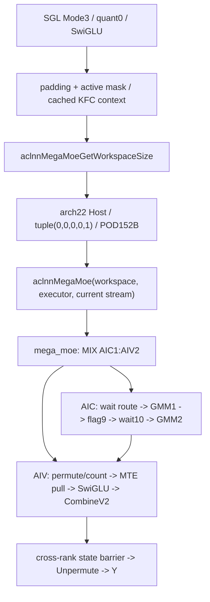
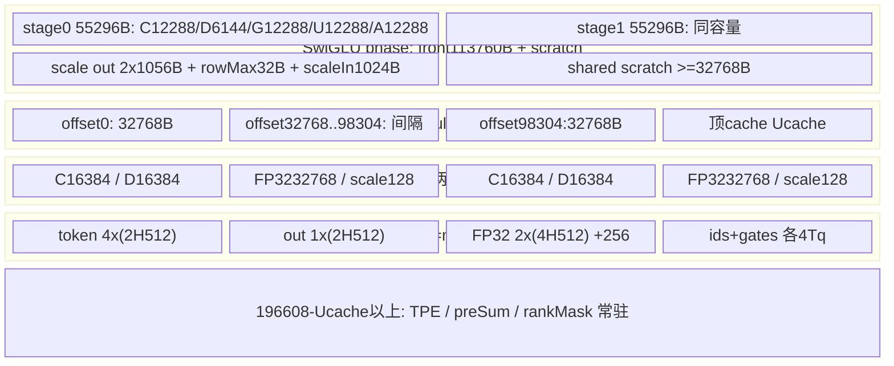

# DeepEP MegaMoE A16W16 SwiGLU A3 ACLNN 算子知识

## 算子速览

| 项目 | 内容 |
|---|---|
| 实际入口 | CANN 9.2.0 公开两段式 `aclnnMegaMoeGetWorkspaceSize/aclnnMegaMoe`；SGL `FuseMode.MEGA_MOE=3`、`quant_mode=0/"bf16"` |
| 计算语义 | EP Dispatch → BF16×BF16 GMM1、FP32累加并物化BF16 → FP32 SwiGLU并转BF16 → BF16×BF16 GMM2、FP32累加并物化BF16 → Combine、FP32 gates加权求和并转BF16 |
| 输入输出 | X[M,H] BF16 ND；L项W1[H,N]、W2[I,H] BF16 ND，I=floor(N/2)；ids[M,T] INT32，推荐并与实际consumer一致的gates为FP32；Y[M,H] BF16、counts[L] INT32 |
| 执行类型 | 单个 `mega_moe`、`KERNEL_TYPE_MIX_AIC_1_2`：AIC_CUBE双GMM，AIV_VECTOR路由/激活/Unpermute与MTE远端窗口通信；无SIMT/NDDMA kernel |
| Kernel 路线 | R-001：唯一Host tuple(0,0,0,0,1)，按接收单轮/多轮与rank mask参数化；自rank被mask为明确无输出终点 |
| 核心资源 | 16MiB系统余量加业务workspace；通信域持有两个CCL窗口；L1主区384KiB、L0A32KiB/L0B64KiB/L0C128KiB；AIV UB192KiB分阶段复用 |
| 来源闭包 | `source_closed`：SGL接入、公开ACLNN、完整arch22 Host/POD/router、A3实际BF16 body、CATLASS2当前实例、HCCL9.2配置前端及HCOMM9.2资源/IPC均有固定源码；生成inner bridge和硬件primitive为明确框架边界 |
| 验证状态 | 已完成源码闭包检查；本次知识提取未执行编译、真机、数值或性能测试。静态合同冲突和零域问题使本卡保持draft。 |

## 接口与语义

### 计算语义

用M表示一次Device调用本rank的行数，H表示hidden，T表示top-k，R表示EP rank数，L表示本地权重列表长度，N表示W1输出列数，I=floor(N/2)。有效业务合同取N=2I、全局专家数E=R·L、每token专家ID有效且不重复。SGL A3将原始m行padding至各rank共同容量M，创建INT8 active mask，仅前m行为真，最终返回Y[:m]；padding不进入计数或scatter。

对专家e，将有效命中的X行按专家、源rank和源行次序组成A_e。GMM1计算并经Fixpipe得到BF16矩阵C1_e，再在列轴分为BF16 gate/up并Cast至FP32。设默认c=FP32最大有限值；c>0时G=min(gate,c)、U=clip(up,-c,c)，c=0时关闭截断。SwiGLU为：

```text
C1 = BF16_Fixpipe( sum_k FP32(X_BF16 * W1_BF16) )
A2 = BF16_CAST_RINT( G / (1 + exp(-G)) * U )
C2 = BF16_Fixpipe( sum_i FP32(A2_BF16 * W2_BF16) )
Y[t,:] = BF16_CAST_RINT( Σ_k FP32(C2[e(t,k),row(t,k),:]) * gates_FP32[t,k] )
```

本域没有dispatch量化、动态INT8量化、weight scale、bias或shared expert计算。Fixpipe采用`F322BF16`，不把该模式补写成Vector的`CAST_RINT`。Vector激活与最终输出的显式Cast才是`CAST_RINT`。不承诺特殊值、溢出或不同累加顺序下的逐位等价。

源码对负数/越界ID及inactive token写expandedRowIdx=-1，Unpermute跳过该slot，全无效行写零；这是实现行为。公开SGL Mega合同仍要求有效、不重复专家ID，不能将其它DeepEP模式的-1支持或重复ID扩大为Mega公开支持。

### 输入、输出与属性

| 参数 | shape/layout | dtype | 约束、默认值与语义 |
|---|---|---|---|
| context | 一维ND；标准producer生成6156个INT32 | INT32 backing | 存Mc2MoeContext，Device从+8读取kfcContextAddr；Host仅查一维/dtype/format，不验证长度或内含指针 |
| x | [M,H] ND | BF16 | M≥1，H∈[1024,8192]且%512=0；Host无M上限后窄化至U32；SGL文档A3容量≤4096 |
| topk_ids | [M,T] ND | INT32 | T∈[1,16]；Python调用.int()；Host不扫描值与重复；Device实际使用RL个专家 |
| topk_weights | [M,T] ND | Host接受FP32/BF16 | 本body固定`float*`和Unpermute T3=float；SGL/CANN C++未Cast BF16，故BF16接收与实际读取不一致，见限制 |
| weight1 | L个二维[H,N] ND | BF16 | L∈[1,128]；检查各项原始rank、Storage dim0=H；N取首项Storage末维，非量化仅ND |
| weight2 | L个二维[I,H] ND | BF16 | 与W1首项dtype/format和列表长度相同；I≥512且%256=0；逐项检查相应维度 |
| weight_scales1/2、bias1/2 | 缺省或0元素placeholder | UINT64／FP32占位 | 本域不允许非空，API为null列表创建typed空tensor |
| x_active_mask | 可选[M] ND | INT8 | 读取为bool；零无效、非零有效；SGL总为本域构造容量前缀mask；不改写输入ids |
| scales | 必须null | 预留 | arch22 Host明确拒绝非空 |
| shared_weight/scales/bias | API有动态参数 | 占位跟随W1/W2 | arch22 Host无本域shared producer，entry未传入MegaMoe::Init；SGL不提供。不能计入FFN或声明共享专家支持 |
| mask_buffer | 可选[R] | INT32 | A3可用；非零排除rank。自rank被mask时AIC/AIV提前return，未提交Y/counts；组内mask必须协调 |
| moeExpertNum | 标量E | int64→U32 | Host范围[1,1024]；逻辑合同E=R·L，Host未独立检查该等式；InferShape/C++以floor(E/R)分配counts，Tiling要求counts长度L |
| epWorldSize | R | int64→U32 | {2,4,8,16,32,48,64,96,128}，应与context rankSize相同；Host不解引用context核验 |
| cclBufferSize | 两个窗口之和，字节 | int64 | Host用/2检验单窗下界；Device真实单窗长度来自context.winSize；不能伪造属性替代真实容量 |
| maxRecvTokenNum | 最大接收预算属性 | int64→U64 | ≥0，0自动M·R·min(T,L)；A3由此得到单轮预算B，超B继续下一轮，不是永久丢弃尾行 |
| dispatchQuantMode/out dtype | 0／DT_UNDEFINED或DT_BF16 | int64 | SGL0/bf16→mode0、out dtype None；Host也接受BF16权重配显式DT_BF16属性。SetMegaMoeTilingKey仅将DT_INT8编码为非零quantOutType；上述两种原属性均映射模板UNDEFINED并生成同一tuple(0,0,0,0,1) |
| combineQuantMode/commAlg | 0／空字符串 | 标量 | arch22只接受这些值；与KFC内部fullmesh资源字符串不同层 |
| numMaxTokensPerRank | 容量 | int64→U32 | >0时Host检查≥M；非正值未走该检查随后窄化。SGL传共同正容量 |
| activation/params | swiglu、[]或[c] | 字符串／FP32列表 | c默认FLT_MAX；≥0且非NaN，+Inf可接受；SGL不暴露activation_clamp，取默认 |
| activationOutDtype/TW1/TW2/interleave | 内部属性 | scalar | 公开API固定UNDEFINED,false,false,0；Host拒绝转置，interleave虽检查区间但当前Device未消费 |
| topoType/rankNumPerServer/topkWeightsType/combineCommMode/sharedExpertQuantOutDtype | API表面参数 | scalar | 此arch22 Host及当前body不消费；不由传入值新增URMA/RoCE或去重路径；公开文档要求A3 combineCommMode=0 |
| y / expertTokenNums | [M,H]／[L] ND | BF16／INT32 | counts是跨全部chunk本地专家接收数量，既非Mode1的[R·L]返回也非接收token tensor |

### 入口与版本

本卡覆盖固定SGL提交dda6…的Mode3和ops-transformer e7da…实际CANN9.2实现。SGL `python/deep_ep/doc/FUSED_DEEP_MOE.md` 的Mega节、README的Mega说明均明确要求各平台CANN9.2.0；ops-transformer `version.cmake`、对应SDK/HCCL/HCOMM版本文件确认9.2.0。DeepEP其它模式的9.0/9.1徽章不改变此入口版本。

公开支持证据先是SGL的A3 A16W16合同及ops-transformer Mega README产品/精度表，再是`mega_moe_def.cpp`的ascend910_93配置，最后才是Host、MIX入口和CMake。FP16和BF16 NZ虽在OpDef/模板注册出现，当前A3 Host拒绝，不能列为支持Route。与[既有Mega接入API](../../../../apis/deepep/deepep_mega_moe.md)复用接口事实；本卡新增完整实现，不替代[Mode2 DispatchFFNCombine](sgl_deepep_dispatch_ffn_combine.md)或Mode1的不同算法、ABI和CANN版本。

## Host/Launcher 执行流程

### 参数校验与前处理

1. SGL `Buffer.fused_deep_moe`选择`MegaMoeStrategy`，量化0/bf16对应无dispatch量化，惰性导入CANN包；缺包/JIT环境只在本模式调用处抛异常。策略要求gmm2_weight为非空list，使用首项倒数第二维作I，拒绝原始m>容量M。
2. 以(E,M,T,H,I,dispatchMode,outdtype)缓存SymmBuffer；非MX模式创建active mask并padding X/ids/gates；仅ids显式转INT32，不变换BF16权重、gates精度、格式或布局。不转发profile_enable，不为SwiGLU传beta/linear_beta。
3. CANN Python归一化activation，SwiGLU生成[FLT_MAX]；C++ `NpuMegaMoe`选择arch22描述符路径、创建Y与counts，保持topkWeights原tensor。标准BF16列表为普通TensorListWrapper，无INT4 reinterpret。
4. `ACLNN_CMD`在当前NPU stream调用GetWorkspaceSize。公开API检查必选tensor/list/activation/floatarray/outputs、E>0、R>0、maxRecv≥0；需要时创建executor，并给null动态参数补typed零长度placeholder。公开API不检查executor二级指针本身，不能传null `executor`地址。
5. 进入生成的aclnnInner桥；OpDef使context/X/ids/gates/optional元数据AutoContiguous、权重IgnoreContiguous。生成inner和普通Contiguous是框架边界，不能假设其负责Cast gates或修正权重语义。
6. Host顺序为commAlg→输入shape/type/list/scale/bias/mask→属性→输出→平台资源→CCL容量；任何检查失败返回GRAPH_FAILED，无fallback重选其它精度。设置scheduleMode=1、blockDim，再算tuple、存POD和workspace。scheduleMode返回值保留在局部ret未检查。
7. GetWorkspaceSize非零状态在C++释放转换descriptor后抛异常，不提交Device。成功分配UINT8 workspace，封装当前stream的执行handler；handler调用aclnnMegaMoe、释放转换descriptor/huge memory并传播非零status；OpCommand和NPU allocator的stream完成语义为框架边界，不能由函数返回推断Device已完成。

### 参数、Workspace 与生命周期

定义A_d(x)=ceil(x/d)·d，C=ceil(M/1024)，Q=1024·R·min(T,L)，Aattr=maxRecvTokenNum或自动值，B=max(1,min(Q,Aattr))，F=ceil(Q/B)。每chunk实际接收行数J由计数得出，运行轮数f=max(1,ceil(J/B))；仅f>1使用轮表，单轮时各轮表保留但不读取。

下面offset均从Device收到的workspaceGM起累加；entry直接将workspaceGM传入，没有显式+16MiB或GetUserWorkspace。框架系统余量不是一个可随意移动业务offset的源码依据。

| slice | 字节extent（BF16本域） | owner／生命周期 |
|---|---:|---|
| W0 prologue counts | 128·A_8(RL)·4 | 每AIV槽，当前chunk所有核计数/求前缀完成后复用 |
| W1 expandedRowIdx | 1024·T·4 | scatter→本chunk Unpermute；chunk末全AIV屏障后可覆盖 |
| W2 chunk cumsum | C·R²·L·4 | 每chunk独立；实际紧凑[R,L]写入其前部；保留多份避免AIC跨chunk缓存旧读 |
| W3 round tables | C·F·3·R·L·4 | (chunk,round)独立三张INT32[R,L]；不在不同轮覆盖相同地址 |
| scale1/scale2 | 0 | 指针落在下一slice同址，本域constexpr不读取，不能额外计算scale容量 |
| W4 C1/C2 alias | B·max(N,H)·2 | GMM1 BF16→激活后GMM2密排H列覆盖；两次GMM同址 |
| W5 A1/A2 alias | B·max(H,I)·2 | receive GMM1输入、随后SwiGLU BF16输出；专家slot宽max(H,I)，专家内部H密排 |
| W6 SumBeforeRank | R·A_16(L)·4 | 当前chunk的源rank原始permute偏移；多轮切换至W3，下一chunk恢复 |
| W7 soft flags | R·16·4 | 本域预留但BlockMmad传入flagPtr=null，不使用software flag |

Host的SumBeforeRank项原式为`(R*(L+15)/16*16*4)`，即64·floor(R(L+15)/16)字节，和Device的4R·A_16(L)不是同一代数式；在正R/L域Host保留更大的padding。不能以Device布局替换Host预算。其余业务项同上，Host还比较prologue独立预算：

```text
WmegaHost = W0+W1+W2+W3+W4+W5 +64*floor(R*(L+15)/16)+64R
Wprologue = 16MiB + 4*M*T + 8*R*L
workspaceSize = 16MiB + max(WmegaHost, Wprologue)
```

workspace由调用方/torch UINT8 tensor持有至stream任务结束；POD由框架launch携带。不能释放输入权重、context、窗口或workspace后继续执行异步任务。

A3 `SymmBuffer`选择KFC，不走channel。它传入的customCclBufferSize/resolver仅是建议，KFC builder不使用它们扩容：真实窗口由HCCL通信域分配、由HCCL_BUFFSIZE等域配置控制。C++ A3建议函数返回MiB整数；KFC随后用`HcclGetHcclBuffer`查询真实字节和，作为算子cclBufferSize。直接API调用者必须保持属性与实际context一致。

通信域持有连续的winIn+winOut+额外1MiB exp allocation；CCLBufferManager对新私有allocation清零，输出给caller的总长排除exp区。若通信域配置非空bufferName，ShareCCLbufferMgr按名字和refcount共享allocation，首分配仍清零、最后引用删除时释放；不同comm可别名同窗。固定Inner在共享CCL场景发出冲突警告，Mega本体无独立并发隔离，不能把不同SymmBuffer对象解释成不同物理window。Device `HcclShmem<false>`只以winIn为对称payload，segmentSize=真实winSize。令S为单窗长度、m_c=min(M,1024)、P=A_128(RL+1)、Z=max(512R,512KiB)：

```text
[0,10MiB)                              diagnostic reserved
offsetA = 10MiB                         A: 2*m_c*T*H bytes
offsetD = offsetA + 2*m_c*T*H            D: 2*m_c*T*H bytes
offsetTPE = S - Z - 4*R*A_128(128R+1)   TPE fixed maximum-L capacity
offsetFlag = S - Z                      per-rank state and self state
```

TPE实际行stride=P个INT32，容量仍按最大L=128保留。Host检验单窗至少10MiB+4m_cTH+4R·A_128(128R+1)+Z。无量化scale区；winOut虽由域分配却不被本A3 payload访问。state每rank 512B；self state从尾区+256KiB起、每SDK GetBlockIdx槽128B，其中仅首INT32读写，不能将GetBlockIdx当作kernel自定义路由coreIdx。

标准context的C++ `CommContext`和Device `Mc2MoeContext`在当前消费字段布局一致。KFC builder分配opArgs，显式设engine=4、opType=8和`AlltoAll=level0:fullmesh;level1:pairwise`，HCCL前端逐字段传到HCOMM Inner；默认src/dst FP16、SUM、count0仅用于资源配置，不改变BF16 FFN数学。HCOMM的GetAlgInfo按固定表命中`RunAlltoAllDirectFullmesh`，申请全mesh CCL_INPUT/OUTPUT连接、生成HcclOpResParam和remoteRes表后同步拷贝到Device；此阶段是CalcResRequest/资源创建，没有调用该collective的Orchestrate/KernelRun替代本算子通信。实际数据转移仍由本卡的MTE body完成。

远端链路经TransportP2p交换IPC名、size、offset；MemNameRepository按页对齐注册名字、OpenIpcMem缓存或调用driver hrtIpcOpenMemory，并加回页内offset；GetRemoteMem(INPUT_MEM)填relation.windowsIn。此处driver IPC、硬件DataCopy和普通AscendC primitive为边界，未拿不存在的collective算法body充当闭包。

`CommContextManager::Destroy`在KFC无custom buffer时不释放HCCL窗口/资源，也不调用Device同步；其owner仍是通信域。SGL destroy遍历缓存、调用SymmBuffer.destroy后清cache；必须由通信域/调用方保证所有inflight任务完毕。构建中TORCH_CHECK在opArgs分配和显式Free之间没有统一RAII回滚，不虚构失败路径自动清理。

### 启动图与失败传播



Host未自有额外前后处理kernel；生成inner的普通Contiguous不属于专家FFN节点。MIX blockDim由Platform `CalcTschBlockDim(aivNum,aicNum,aivNum)`编码，scheduleMode=1让SyncAll参与核同时运行。AIC物理核数记C_a，AIV数V=2C_a；算法以`coreIdx=b+s*C_a`编号，而SDK GetBlockIdx在AIV为2b+s。API/Host错误阻止本节点提交；Device轮询无超时或状态码写回。mask self return、非法输入的已知静态终点详见后文，不能假设会返回某个未见错误码。


## Route 与参数设计

### 分核与资源计算

先从Storage shape得到M/H/T、W1首项N和本地列表L；由W2得I=N/2，验证H对齐512、I对齐256。属性产生R、Aattr与B/F，再从平台读取aivNum、UB容量；最后选择tuple及workspace。Host的worldSize来自epWorldSize。模板实际采用`MegaMoe<bfloat16_t,bfloat16_t,bfloat16_t,false,false,false,false>`。

AIC使用C_a核，GMM1每专家问题为(J_g,N,H)，GMM2为(J_g,H,I)。两次均用L1 tile(128,256,256)、L0 tile(128,256,64)，`GemmIdentityBlockSwizzle<9,1>`沿N方向按9列一组并对相邻组反转M顺序。每专家tile数U_g=ceil(J_g/128)·ceil(cols/256)，startCoreIdx跨专家按(startCoreIdx+U_g)%C_a轮转；每核起点为循环归一化后的core-startCoreIdx，步长C_a，不使每个小专家固定占核0。M尾由实际tile shape，K由256/64分层余数处理，N/H在正常偶N域满足整tile；Host未显式拒绝奇N，不能因此保证无N尾。

AIV路由/激活使用V=2C_a核，逻辑编号b+sC_a；接收搬运的源rank分配为coreIdx+jV。激活按行均匀分给全部V核，余数优先前核，列按3072元素分tile。GMM1分段粒度g*=L>2?L-2:1，若g*<L则前g*专家与剩余专家分两段握手。CombineV2复用GMM2的AIC tile scheduler，每物理AIC对应两AIV，按32行单位分M；尾部不足32行由subblock1的actualm裁剪。Unpermute只在subblock1上运行，使用C_a核，而非V核。

### Route 选择

| 顺序 | Route | Key/模板 | 精确选择条件与优先级 | 不适用去向 |
|---:|---|---|---|---|
| 1 | R-001 BF16 ND SwiGLU | GET_TPL_TILING_KEY(0,0,0,0,1) | A3、输入/两层首项权重BF16，W1/W2 ND，TW1=TW2=false，dispatch0/out属性UNDEFINED或BF16（模板quantOutType=UNDEFINED）、combine0、commAlg空；本卡activationCode0；全部shape/output/容量检查通过 | 任一Host谓词失败GRAPH_FAILED，无转INT8/FP16 fallback |
| 2 | R-001运行族F0 | 同一key | 每chunk实际J≤B（包括J=0），f=1，不切轮表；L=1为单激活段，其余依g*切段 | J>B进入F1 |
| 3 | R-001运行族F1 | 同一key | J>B，f=ceil(J/B)；每轮切W3三表并复用W4/W5 | 无额外kernel或截断fallback |
| 4 | R-001运行族M/U | 同一key | mask非空/空；M使用过滤rank及标量DCCI状态等待，U使用Vector状态求和等待 | 自rank被mask：AIC/AIV提前return，Y/counts未写 |
| 5 | 未命中的编译tuple | 非本Host可产出 | nonquant注册TW1/TW2四组合、A2/A3共8实例，但本公开A3 Host只有false/false/Arch1 | 无相应Host producer，不记为可达支持Route |

```text
公共ACLNN检查 → typed空列表 → inner/OpDef
  → commAlg必须空
  → BF16 X + BF16 ND W1/W2 + 列表/shape/输出/CCL检查
  → dispatch0/out属性UNDEFINED或BF16→模板quantOutType UNDEFINED，TW1=TW2=false，activation=swiglu
  → tuple(0,0,0,0,1) → mega_moe MIX1C2V
      self masked ? return(no output)
      : each chunk → J<=B ? F0 : F1 → mask null ? U : M
```

### 模板/实现执行矩阵

| Route | key/selector | dtype/shape/platform 完整命中条件 | 执行族与 kernel 节点 | 实际模板/body | 内存与同步特征 | tail/fallback |
|---|---|---|---|---|---|---|
| R-001 F0-U/F0-M | (0,0,0,0,1)，J≤B，mask空/非空 | 前述完整Host合同；A3 BF16 ND，code0；正常业务E=RL、ID不重复 | 单mega_moe MIX_CV：AIC双GMM；AIV permute/MTE/SwiGLU/Combine/Unpermute | MmadAtlasA3PreloadAsyncFixpipeQuant<1,2,2,2,1,false,true>；BlockMmad、Epi1<2>、Epi3V2<2,IS_A2=false> | chunk cumsum独立、轮表不读；mask改变跨rank等待；AIC/AIV flags0..10 | J=0仍完成一轮同步；小chunk零域与mask输出边界不补造fallback |
| R-001 F1-U/F1-M | 同tuple，J>B，mask空/非空 | 同上、B>0；f≤F依赖有效且不重复ID合同 | 同一个MIX kernel内serial receiving rounds | 同实例；BuildRoundTables/CacheRoundTablesToUb后ProcessRecvRound | 3表按(chunk,round)独立，数据workspace串行复用；远端A/D仍chunk全局坐标 | 最后一轮<J/B满预算，count按交集裁剪；无另一次launch |

### 隐藏性能 Guard

| Guard | Host/Tiling 条件 | Device/资源原因 | 影响 Route | 不满足时去向 | 源码符号 |
|---|---|---|---|---|---|
| H/I与权重格式 | H%512=0、I%256=0，BF16 ND | 16元素C0、ND2NZ与固定128×256 tile；无格式转换 | 全部 | Host失败 | CheckXInput/CheckWeight1Input/CheckWeight2Input |
| 单轮预算 | B=min(Q,Aattr)，B最小1 | 接收/输出workspace按B，轮表按F | F0/F1 | 超B切轮，非静默丢token | SetRecvRoundBudget/ComputeNumRecvRounds |
| L1/L0容量 | 模板static_assert，Host不动态重选 | 384KiB L1、32/64/128KiB L0；preload1、L1depth2 | 全部 | 不满足模板约束不生成合法实例 | BlockMmadPreloadAsyncFixpipeImpl |
| 冷启动预取 | 首chunk首round、M≤512、group0非空、scratch+16KiB≤512KiB、每专家2HN≤32·C_a·16KiB | 用独占scratch环写全部专家0权重，拉入L2；不消费预取数据 | F0/F1 | 任一不满足不发射预取，正常GMM继续 | WeightL2PrefetchAicColdStartW1 |
| L2 hint | W1字节超过cap且J_g≤128时disable；W2 J_g≤128时disable | 单M tile组权重读一次；W1的w1Prefetched布尔仅按cap计算，并不等于本次一定预取 | 全部 | 使用普通cache路径；不擅改其真实布尔式 | GMM1/GMM2 |
| UB顶部缓存 | Host没有RL/缓存容量联合check | RankMask、TPE和preSum常驻顶部，所有前台UB阶段必须避开；正常E=RL≤1024可推导上界 | 全部 | 无源码fallback，越界组合保持限制 | InitRouteCache |
| 核数 | Host读平台核数后CalcTschBlockDim | body假设MIX1:2、V≤128计数槽、C_a>0；未逐项Host检查 | 全部 | 无显式资源fallback | MegaMoeA2A3GetPlatformInfoAndSetTiling |
| 非空Unpermute基础分片 | Host未检验每chunk tokens≥C_a | splitLength=min(floor(chunkTokens/C_a),600)作除数 | 全部 | 公式含零除，未给保护分支 | MoeTokenUnpermuteTiling |
| 轮表16位copy字段 | Host未联合检查RL乘积 | 部分blockLen显式U16；正常E≤1024时4RL≤4096 | F1与cache | 非正常宽RL可窄化；无已见fallback | BuildRoundTables/CacheRoundTablesToUb |

### POD/ABI

以下offset/sizeof按固定源码字段顺序、常见uint32/float对齐4、uint64对齐8作静态自然布局推导，未执行编译或安装二进制ABI测试。公共结构与Quant/NonQuant wrapper均152B、align8，wrapper.common@0。一个字段一行；字段无producer且当前consumer不读时明确记inactive，不臆造清零。

| 结构 | 字段 | 类型/位宽 | ABI 布局 | 单位 | Host/launcher producer | Device consumer | 边界 |
|---|---|---|---|---|---|---|---|
| common | M | U32 | @0/4B | token | Storage x.dim0 | LoadCommon→problemShape.m | M先int64后窄化，无U32上界 |
| common | K | U32 | @4 | 元素 | x.dim1 | H、GMM1 K/GMM2 N | 1024..8192/512对齐 |
| common | N | U32 | @8 | 元素 | W1首项末维 | GMM1 N、I=N/2 | 未独立拒绝奇数 |
| common | expertPerRank | U32 | @12 | 专家 | W1列表长L | group循环/slot | 1..128 |
| common | aivNum | U32 | @16 | 核 | Platform.GetCoreNumAiv | epilogueCoreNum | body另从launch得V，需一致 |
| common | totalUbSize | U32 | @20 | 字节 | Platform UB size赋值 | 当前LoadCommon不读 | 固定Arch容量另在模板 |
| common | topK | U32 | @24 | slot/token | ids.dim1 | permute、weighted reduce | 1..16 |
| common | worldSize | U32 | @28 | rank | epWorldSize | LoadCommon→EP | 应匹配KFC rankSize |
| common | listLen | U32 | @32 | 列表项 | L | GetTensorAddr组索引 | 本域仅逐专家二维列表 |
| common | moeExpertNum | U32 | @36 | 全局专家 | E attr | 当前LoadCommon不读 | Device实际取RL |
| common | epWorldSize | U32 | @40 | rank | R attr | 当前LoadCommon不读此副本 | worldSize副本生效 |
| common | dispatchQuantMode | U32 | @44 | enum | attr0 | key的Host producer | body由模板非量化决定 |
| common | cclBufferSize | I64 | @48/8B | 字节 | attr | Host单窗校验 | Device用context真实winSize |
| common | maxRecvTokenNum | U64 | @56 | route行 | attr或自动M R min(T,L) | 当前LoadCommon不读 | B字段才驱动workspace |
| common | dispatchQuantOutDtype | I32 | @64 | GE dtype | attr DT_UNDEFINED或DT_BF16 | SetMegaMoeTilingKey | 两者均编码为模板UNDEFINED/outType0 |
| common | combineQuantMode | U32 | @68 | enum | attr0 | Host guard | Device不量化 |
| common | commAlgCode | U32 | @72 | enum | 未见赋值 | 当前body不读 | inactive，不能承诺默认0 |
| common | numMaxTokensPerRank | U32 | @76 | token | attr窄化 | 当前body不读 | SGL用于padding和SymmBuffer |
| common | activationCode | U32 | @80 | enum | swiglu→0 | GatedActivation::Compute | 其它数学不属本卡 |
| common | activationClamp | FP32 | @84 | 数值 | params/default FLT_MAX | SwigluActivation | 0关闭截断 |
| common | activationParams1 | FP32 | @88 | 数值 | 默认1.702 | code0不使用 | OAI/SiTU其它数学 |
| common | activationParams2 | FP32 | @92 | 数值 | 默认1 | code0不使用 | 同上 |
| common | isTransposeW1 | U32 | @96 | bool编码 | false | key→TB1=false | true被Host拒绝 |
| common | isTransposeW2 | U32 | @100 | bool编码 | false | key→TB2=false | true被Host拒绝 |
| common | hasBias1 | U32 | @104 | bool编码 | 未见赋值 | 当前LoadCommon不读 | 实际指针与constexpr分支 |
| common | hasBias2 | U32 | @108 | bool编码 | 未见赋值 | 当前LoadCommon不读 | 同上 |
| common | hasXActiveMask | U32 | @112 | bool编码 | 局部isActiveMask校验但未写此字段 | 当前body直接判断指针 | inactive字段 |
| common | hasScales | U32 | @116 | bool编码 | 未见赋值 | 当前LoadCommon不读 | scales非空已拒绝 |
| common | isQuantRouting | U32 | @120 | bool编码 | BF16→0 | Host预算/key/wrapper | Device由BType constexpr |
| common | isW4A8 | U32 | @124 | bool编码 | BF16→0 | Host额外预算 | 本域W4分支不实例化 |
| common | activationOutDtype | I32 | @128 | dtype | UNDEFINED | 当前LoadCommon不读 | Host限制，不改变BF16 |
| common | weight1Interleave | U32 | @132 | 元素 | 公共API0 | 当前LoadCommon不读 | 内部Host可较宽但无consumer |
| common | recvRoundBudget | U64 | @136/8B | route行 | B | LoadCommon.maxOutputSize、切片/轮次 | ≥1 |
| common | recvRoundsMax | U64 | @144/8B | 轮表份 | F | RoundTablePtr stride | 与实际f及无重复ID前提匹配 |

外层context自然size24624B、align8；C++以6156个INT32拷贝。它不是common POD，也不能使用旧Mode1的context布局。

| 结构 | 字段 | 类型/位宽 | ABI 布局 | 单位 | Host/launcher producer | Device consumer | 边界 |
|---|---|---|---|---|---|---|---|
| Mc2MoeContext | epRankId | U32 | @0 | rank | KFC GetRankId | 本A3shmem不读此副本 | shmem取KFC内localUsrRankId |
| Mc2MoeContext | rankSizePerServer | U32 | @4 | rank | KFC默认0 | 本body不读 | channel才另有意义 |
| Mc2MoeContext | kfcContextAddr | U64 | @8 | GM地址 | CreateHcclContext返回opsResCtx | initShmem→HcclOpResParam* | 非null/版本由caller保证 |
| Mc2MoeContext | epHcclBuffer_ | U64[1024] | @16/8192B | GM地址 | CollectRankBuffers | 本body通过KFC资源寻址，不读该表 | manager本地view使用本rank项 |
| Mc2MoeContext | hcommHandle_ | U64[1024] | @8208/8192B | handle | KFC值初始化0 | 本body不读 | 不以它新增channel Route |
| Mc2MoeContext | channelsPerRank | U32 | @16400 | channel数 | KFC默认0 | 不读 | inactive |
| Mc2MoeContext | enableGroupSend | bool | @16404/1B | bool | KFC false | 不读 | 随后3B自然padding |
| Mc2MoeContext | roceHcclBuffer_ | U64[1024] | @16408/8192B | GM地址 | KFC全0 | 不读 | inactive |
| Mc2MoeContext | roceBufferSize | U64 | @24600 | 字节 | KFC0 | 不读 | inactive |
| Mc2MoeContext | hostStatusTableAddr | U64 | @24608 | 地址 | KFC0 | 不读 | inactive |
| Mc2MoeContext | completedRounds | U64 | @24616 | 轮次 | C++默认U64(-2) | 本body不读 | Device声明无默认值，由Host拷贝 |

HCCL9.2前端 `HcclOpArgs` 为Host私有opaque对象：src/dst/reduce三个enum经Init设FP16/FP16/SUM，count=0；algConfig[128]经strcpy_s设置，commEngine经SetCommEngine设4，reverse未赋值且此链不读。每个字段由HcclCreateOpResCtx逐项传入Inner；不把未核验的enum ABI/struct总长作为安装保证。

当前Device消费HcclOpResParam的localUsrRankId@16、rankSize@20、winSize@24、localWindowsIn@32、remoteRes@2984（每项nextHostPtr@0/nextDevicePtr@8、stride16）；HcclRankRelationResV2.windowsIn@8。固定ops header与HCOMM producer的这段自然布局可逐字段对应：208B前缀+2472B ReservedStruct+160B AlgoTopoInfo+48B HcclOpConfig+三个U64+16个U32+两个U32=2984B。HcclOpConfig内部9.2将旧notify的8B区域分成两个U32，但本consumer不读它，且总长保持48B；这不是全文struct或安装二进制ABI等价声明。

Unpermute局部POD由Device内 `MoeTokenUnpermuteTiling`生成，12个I64依次@0..88，size96/align8：hidden_size=H；top_k=T；num_out_tokens=m_cT；hidden_splited_length=H；hidden_splited_num=1；hidden_splited_remain=0；tokens_core_length=floor(m_c/C_a)；tokens_core_remain=m_c%C_a；tokens_splited_length=min(tokens_core_length,600)；tokens_splited_num=tokens_core_length/tokens_splited_length；tokens_splited_remain=对应余数；buffer_num=4。每个字段由LoadTilingData同名读入，其中余数核增加1行。该表不是Host公共ABI；split length为零时公式本身未保护。

当前外部资源消费字段单列如下；完整HCCL资源结构其余成员属于库资源边界，当前实例不读取，不推导尾部总长。

| 结构 | 字段 | 类型/位宽 | ABI 布局 | 单位 | Host/launcher producer | Device consumer | 边界 |
|---|---|---|---|---|---|---|---|
| HcclOpResParam | localUsrRankId | U32 | @16 | rank | HCOMM BuildOpResParam.userRank | HcclShmem.Rank | 不同于Host属性副本 |
| HcclOpResParam | rankSize | U32 | @20 | rank | userRankSize | HcclShmem.RankSize | caller保证与EP一致 |
| HcclOpResParam | winSize | U64 | @24 | 字节 | algResource.cclInputMem.size | SegmentSize | 真实单窗容量 |
| HcclOpResParam | localWindowsIn | U64 | @32 | GM地址 | cclInputMem.ptr | self window | 外部domain owner |
| HcclOpResParam | remoteRes | RemoteResPtr[131072] | @2984，stride16 | 地址表 | BuildRelationResByRemoteRankId | 对端nextDevicePtr | 仅索引R个rank；不推导全部tail ABI |
| RemoteResPtr | nextHostPtr | U64 | @0 | Host地址 | CreateListNode | Device不读 | 资源管理 |
| RemoteResPtr | nextDevicePtr | U64 | @8 | GM地址 | CreateListNode并H2D | HcclShmem远端寻址 | 不为零由资源创建保证 |
| HcclRankRelationResV2 | windowsIn | U64 | @8 | GM地址 | TransportP2p.GetRemoteMem(INPUT_MEM) | offset+远端window | 同prefix的rank字段@0/4；只读此地址 |

Unpermute局部POD字段producer/consumer补表；每字段I64，4列简写的@offset均在size96/align8结构内，LoadTilingData按同名复制，无Host跨版本序列化。

| 结构 | 字段 | 类型/位宽 | ABI 布局 | 单位 | Host/launcher producer | Device consumer | 边界 |
|---|---|---|---|---|---|---|---|
| UnpermuteTiling | hidden_size | I64 | @0 | 元素 | Device tiler H | CopyTokenIn/Out | H≤8192 |
| UnpermuteTiling | top_k | I64 | @8 | slot | T | CalPartOutToken | 1..16 |
| UnpermuteTiling | num_out_tokens | I64 | @16 | expanded行 | m_cT | ERI有效性检查 | 非原始m |
| UnpermuteTiling | hidden_splited_length | I64 | @24 | 元素 | H | UB/offset | 单完整hidden |
| UnpermuteTiling | hidden_splited_num | I64 | @32 | 次 | 1 | CalSingleOutToken | 无hidden分割 |
| UnpermuteTiling | hidden_splited_remain | I64 | @40 | 元素 | 0 | 隐藏尾分支 | inactive |
| UnpermuteTiling | tokens_core_length | I64 | @48 | token | floor(m_c/C_a) | block行数/offset | 余数核+1 |
| UnpermuteTiling | tokens_core_remain | I64 | @56 | 核 | m_c%C_a | LoadTilingData/CoreElementOffset | 前余数核+1 |
| UnpermuteTiling | tokens_splited_length | I64 | @64 | token | min(floor(m_c/C_a),600) | 每次ids/gates批量 | q=0未保护 |
| UnpermuteTiling | tokens_splited_num | I64 | @72 | 次 | tokens_core_length/q | Process循环 | q=0含除零 |
| UnpermuteTiling | tokens_splited_remain | I64 | @80 | token | tokens_core_length%q | 尾批 | q=0含余数零除；余数核+1 |
| UnpermuteTiling | buffer_num | I64 | @88 | buffer深度 | 4 | InitBuffer(tokens_inque) | 实际物理depth4 |

### Route 源码闭包

| Route | Key/selector | Host/Tiling producer | POD/参数 | Kernel entry/router | Kernel body/直接依赖 | 构建接线 |
|---|---|---|---|---|---|---|
| R-001所有F0/F1-U/M | (0,0,0,0,1) | aclnn_mega_moe.cpp→MegaMoeA2A3TilingFuncImpl | NonQuant.common152B、workspace切片、Mc2MoeContext | arch22/mega_moe.cpp→MegaMoe<BF16,BF16,BF16,false,false,false,false> | mega_moe_kernel_a3.hpp、prologue、private BlockMmad、Epi1/V2、unpermute、HcclShmem；固定CATLASS2和HCCL/HCOMM9.2 | OpDef ascend910_93；op_host CMake ACLNNinner、common头和CATLASS_ARCH=2201；catlass.cmake固定769cd40… |


## Kernel 实现

### 公共执行流程

仅一个公开可达MIX节点，不需要Host多kernel同步。entry按tuple选择NonQuant POD，构造MegaMoe后LoadCommonTiling，将common.B作为maxOutputSize，common.F作为recvRoundsMax。架构名AtlasA2是CATLASS2201资源trait名，当前IS_A2=false才决定A3 kernel，不能据trait名称把本域归到A2。

`MegaMoeKernel::initBuffer`解析KFC资源、建立workspace和peermem视图；AIV初始化diagnostic前缀，随后初始化rank mask和顶部route cache。AIC/AIV均先检查self mask。接收/计算/回传按chunk推进，数据区可复用，而cumsum和轮表使用独立GM地址保留。AIC、AIV各自依据同一chunk cumsum计算轮数；不存在Host再次launch来裁切接收行。

### Route R-001：BF16 ND 双GMM与SwiGLU

#### 适用条件

##### 选择证据

| 层级 | 文件 | 符号 | 源码谓词/参数 | 结果/下一跳 |
|---|---|---|---|---|
| SGL | strategies/fused_strategy.py | _resolve_mega_moe_quant | 0或bf16→(0,None,None)，activation swiglu原样 | CANN A16无量化 |
| 公开API | op_api/aclnn_mega_moe.cpp | aclnnMegaMoeGetWorkspaceSize | hidden attrs固定UNDEFINED,false,false,0 | inner |
| Host | op_tiling/arch22/mega_moe_tiling_arch22.cpp | CheckWeightInputShapes/SetMegaMoeTilingKey | BF16 ND，mode0，outType0，Arch1，TW1/2=0 | (0,0,0,0,1) |
| Router | arch22/mega_moe.cpp | mega_moe | isNz=false、isA2=false，MIX1C2V | MegaMoe BF16实例 |
| Device selector | mega_moe_kernel_a3.hpp | InitCombineMode/DispatchAndCombine | BType不是INT8，isCombineV1=false；J>B才切轮表 | CombineV2，F0/F1 |
| 通信资源 | common/torch_extension/csrc/comm_context.cpp | KfcContextBuilder | A3→engine4、AllToAll op8 | HCCL9.2前端→HCOMM9.2 fullmesh资源；非channel |

#### Device 数据流

##### 函数级调用链

```text
mega_moe(...workspaceGM,tilingGM)
 -> MegaMoe::Init(LoadCommonTiling) -> Process
 -> MegaMoeKernel(params): initBuffer/KFC/WorkspaceInfo/PeermemInfo/InitRankMask/InitRouteCache
 -> AIC operator():
      chunk -> round-ready wait -> optional cold W1 prefetch
        -> ComputeNumRecvRounds / SetRoundTableBuffers
        -> GMM1 -> BlockMmad -> CATLASS TileCopy/TileMmad/Fixpipe -> Finalize(flag9)
        -> wait flag10 -> GMM2 -> per-group Fixpipe completion flags0..8
 -> AIV operator() -> DispatchAndCombine:
      clear counts -> chunk:
        MoePermutePrologue -> CountAndPublishExperts/BuildScatterOffsets/ScatterToken
        AllGatherTokenPerExpert -> GetCumsumForMMAIV -> CacheRouteTablesToUb
        accumulate counts -> rounds:
          [F1: BuildRoundTables/SetRoundTableBuffers/CacheRoundTablesToUb]
          ProcessRecvRound -> MTE remote-A pull -> per-group ready flags
            -> PerTokenSwigluImpl(nonquant) -> GatedActivation/SwigluActivation
            -> CombineV2 -> PerTokenV2Impl(nonquant)/CopyRoutedTile/CopyRoutedSlice
        ResetTokenPerExpert -> HcclShmem.CrossRankSyncV2[WithMask]
        KernelMoeTokenUnpermute<BF16,int32,float,true>::Process -> Y
        SyncAll<true>
```

##### 源码等价伪码

以下为伪码，F0/F1/U/M均在同一实际body中参数化，省略的仅为未实例化INT8/INT4分支。

```text
init physical AIC id b; AIV route id v=b+s*Ca, V=2Ca
context = *(Mc2MoeContext*)contextGM; shmem=(HcclOpResParam*)context.kfcContextAddr
bind workspace and WinIn views; initialize optional rankMask
if rankMask[self] != 0: return without writing Y/counts

AIV:
  zero counts[L] once on route core0
  for c in [0, ceil(M/1024)):
    tokenBase=1024c; mc=min(1024,M-tokenBase)
    bind chunkCumsum=W2+c*(4R²L); restore W6 preSum
    prologue:
      split mc tokens across V AIV
      load ids; count valid IDs only if activeMask[token] != 0
      each core publishes A8(RL) INT32 counts to W0; all-AIV barrier
      sum preceding cores + remaining cores to total and per-core prefix
      expertOffset=exclusivePrefix(totalCounts)+priorCoreCounts
      load each X row through alternating BF16 UB buffers
      for each valid slot: WinA[expertOffset[id]++] = X[token]; ERI[token,k]=slot
      inactive/invalid slot: ERI=-1
      publish ERI; all-AIV barrier
    allgather each source's padded count vector to every healthy rank:
      send count+0x800000, poll each 512B group first INT32 !=0
      subtract marker or zero masked source; build original-source permute preSum
    core0: cumsum source ranks for own L experts -> compact [R,L]
    all-AIV barrier; cache TPE/preSum to UB; core0 accumulates counts[L]
    J=sum_g cumsum[R-1,g]; f=max(1,ceil(J/B))
    for r in [0,f):
      if f>1:
        core0 builds three [R,L] tables by intersection with [rB,(r+1)B)
        MTE3 completion + all-AIV barrier; switch pointers/cache
      set round-ready flag0
      for local expert g:
        each AIV handles source ranks v+jV, skips masked source
        rows=tableCount[src,g] clipped by remaining B
        srcRow=tablePreSum[src,g]
        dstElem=priorExpertRows*max(H,I)+priorSourceRows*H
        copy WinA_src[srcRow*H:...] -> W5[dstElem] via 2x32KiB UB
        all-AIV barrier; set group-ready floor(nextCounter/15)
      wait flag9; all-AIV barrier
      activate first g* expert rows (BF16 C1 -> FP32 SwiGLU -> BF16 W5 compact I)
      all-AIV barrier; set flag10
      if g*<L: wait flag9; activate remaining; all-AIV barrier; set flag10
      drain activation events; set MTE3_MTE2 combine events0/1
      mirror GMM2 tile scheduling on AIV pairs:
        wait all group completion flags up to current g
        split M in 32-row units per subblock
        load C2 BF16 tile into ping/pong C buffer
        intersect tile M interval with each source rank's expert slice
        MTE3 write to WinD_source[(originalPermuteRow*H)+nOffset]
      drain combine events; all-AIV barrier
    final route core clears TPE window region in chunks
    ALL AIV toggle their SDK GetBlockIdx self-state (0 or FP32 1.0)
    sub0: mode0 send/recv flags; publish 32B states at selfRank*512 to healthy peers
    sub1: wait corresponding healthy peer states (vector sum or mask DCCI compare)
          Unpermute(mc,T,H,Ca): sum valid ERI C2 rows * FP32 gate into FP32 accumulator
          cast BF16 CAST_RINT -> Y[tokenBase:tokenBase+mc]
    all-AIV barrier before WinA/WinD/ERI reuse

AIC:
  for c:
    for r (same f independently derived):
      wait round-ready; on first chunk/round optionally prefetch W1 expert0
      bind corresponding cumsum table; GMM1 all L groups:
        wait all relevant group-ready tokens even when own group has no tile
        use rotating core start, Swizzle9,1 tiles, private preload1 Mmad
        GM BF16 -> L1 zN -> L0A zZ/L0B nZ -> FP32 L0C -> F322BF16 W4
        drain and signal9 after g* prefix, signal9 after all groups
      wait10 -> GMM2, with additional wait10 at split boundary
        read BF16 activation from compact-I W5; output dense-H W4
        last local tile per group sets completion through PIPE_FIX flags0..8
      reset round-ready/group counter to0
```

F1的关键地址区别必须独立保留。令chunk cumsum为cum[s,g]，某专家之前总行数G_g=Σ_{j<g}cum[R-1,j]，块区间[lo_b,hi_b)=[G_g+cum[s-1,g],G_g+cum[s,g])，r轮区间[lo_r,hi_r)=[rB,(r+1)B)。count_r=max(0,min(hi_b,hi_r)-max(lo_b,lo_r))；cumsum_r是这些交集数在同专家内的源rank前缀；preSum_r存max(lo_b,lo_r)，保留chunk全局行坐标。**该保存值来自接收端expert-major轴，consumer将它当源窗口permute行偏移**；不能由命名就认定与原始preSumBeforeRank等价，见限制中的静态坐标边界。单轮F0直接使用AllGather算出的源rank原始permute偏移。

当前CATLASS搬运参数不是抽象的“copy”：BF16 C0=16元素。GM→L1 RowMajor specialization用ndNum=1、nValue=tile.rows、dValue=tile.cols、srcDValue=GM行stride、dstNzNStride=L1.stride(0)/16、dstNzC0Stride=L1.stride(3)/16；GM行stride≥65536时改为每行一次ND2NZ。L1→L0A的LoadData ifTranspose=false，L1→L0B为true，repeat/stride来自实际zN/zZ/nZ layout；M/N按16元素对齐、K按64分片。MmadParams仅填m/n/k、unitFlag0和首K的cmatrixInitVal，其余依SDK默认，BF16 accumulator为FP32。

AIV RowMajor CopyGm2Ub的DataCopyExtParams为(blockCount=rows,blockLen=cols·sizeof(T)字节,srcStride=(gmStride-cols)·sizeof(T)字节,dstStride=(ubStride-cols)/(32/sizeof(T))个32B块)；padParams(false,0,0,0)。CopyUb2Gm则srcStride用32B块、dstStride用字节。CombineV2的UB行stride固定256、GM行stride H，实际tile M/N保证对应tail；Epi1每次一行分支tile，目的行stride=tileLength，源行stride=max(N,H)。不能混用元素、字节和32B块。

#### 内存与数据搬运

##### 资源与搬运表

| 层级/缓冲区 | offset/地址公式 | extent/容量公式 | dtype/layout | producer | consumer | owner/lifetime | 对齐/复用 |
|---|---|---|---|---|---|---|---|
| 输入GM | X+tokenBase·H；W列表GetTensorAddr(g) | 2MH、Σ2HN、Σ2IH | BF16 ND row-major | caller | prologue/Cube | stream全程 | 不隐式转置／format cast |
| 动态权重表 | 首U64为地址表字节偏移，再取第g个U64 | 框架生成tensor-list元数据 | U64地址 | inner框架 | GetTensorAddr | 随executor/launch存活 | L=1取0，L>1取g |
| WinA | 10MiB+2·srcRow·H | 2m_cTH | BF16 source permute专家密排 | source scatter | receiver pull | 通信域；当前chunk | 两个32KiB UB buffer搬到W5 |
| WinD | 10MiB+2m_cTH+2·dstRow·H | 2m_cTH | BF16 | expert CombineV2 | source Unpermute | 当前chunk直到加权读完 | 不与WinA alias |
| TPE | S-Z-4R·A_128(128R+1) | 最大4R·A_128(128R+1) | INT32，实际[R,P] | prologue/allgather | cumsum/cache | 当前chunk最后核清零 | P=A_128(RL+1)，+0x800000通知 |
| W0..W7 | 前文连续offset | 前文逐slice公式 | GM | 各阶段 | 各阶段 | caller workspace | W4、W5有精确alias，其余不扣重叠 |
| L1 A双buffer | 0与65536 | 2·128·256·2=131072B | BF16 zN | ND2NZ MTE2 | LoadDataA | 当前Mmad流水 | MTE1_MTE2 events0/1 |
| L1 B双buffer | 131072与262144 | 2·256·256·2=262144B | BF16 zN | ND2NZ MTE2 | LoadDataB | 当前Mmad流水 | MTE1_MTE2 events2/3 |
| L1 cold scratch | A_16384(L1End)=393216 | 16384B | UINT8 | dummy weight copy | 无计算consumer | 首chunk首round | 独立于stage；scratch不足则skip |
| L0A | stage0/16384 | 2·128·64·2=32768B | BF16 zZ | LoadData transpose=false | Mmad | ping/pong | M_MTE1 |
| L0B | stage0/32768 | 2·64·256·2=65536B | BF16 nZ | LoadData transpose=true | Mmad | ping/pong | M_MTE1 |
| L0C | 0 | 128·256·4=131072B，depth1 | FP32 zN | Mmad累加 | Fixpipe | 当前tile所有K完成 | initC仅首K，M_FIX/FIX_M |
| Fixpipe scale/bias | N/A计算；资源trait仍保留view | scale handler映射FP buffer但本域无scale copy；bias N/A | F322BF16 | L0C | W4 | 当前tile | relu=false、unitFlag0、CFG_ROW_MAJOR |
| UB prologue | 低地址 | 4·4A_8(RL)+A_32(4T·ceil(1024/V))+2A_32(2H) | 4组INT32、ids/ERI alias、BF16×2 | MTE2/scalar/Vector | scatter/MTE3 | count→scatter当前phase | ids被ERI逐slot复用；tokenIn/Out同址 |
| UB remote pull | 0、98304 | 32768B×2 | BF16 | remote MTE2 | local MTE3 | 当前copy，退出已drain | 每次最多16384元素，尾元素数精确 |
| UB Epi1 | stage i·55296 | 每stage C12288+D6144+G/U/A各12288；depth2 | BF16／FP32 | MTE2/Vector | Vector/MTE3 | 激活phase | tile最多3072、分支相距I |
| UB Epi1辅助 | 110592开始 | scales1056B×2、rowMax32B、scaleInput1024B；front总113760B | FP32/UINT8 | constructor分配view | 本非量化不使用scale算术 | shared scratch从113760起 | Activation至少32768B scratch，需避开顶cache |
| UB CombineV2 | 低地址 | 2·(8192·2+8192·2+8192·4+32·4)=131328B | C/D BF16、FP32、scale | constructor | 本域只操作两个C各16384B | Combine phase | 构造全部view不等于全部都算术使用 |
| UB CombineV1 view | 低地址 | 2·(2H+2H+4H)+1024=16H+1024 | BF16/FP32 | Epi2 constructor | 本BF16不调用其operator | 与Epi1/V2相同UB复用 | 构造不发起SetFlag或数据拷贝 |
| UB rank/route cache | 自196608顶向下 | Ucache=A_32(4R)+A_32(4R·A_8(L))+A_32(4RL) | INT32 | mask/TPE/round cache | scalar dispatch/combine | 每chunk/轮refresh | 前台各phase必须小于196608-Ucache |
| UB Unpermute | TPipe顺序分配低地址 | 4·2A_512(H)+2A_512(H)+2·4A_512(H)+256+8Tq | BF16队列、FP32累加、INT32 ids/FP32 gates | MTE2→Vector | Vector→MTE3 | 最终sub1 phase | token队列实际InitBuffer depth4；q=min(floor(m_c/C_a),600) |
| 寄存器/标量 | core/group/tile/row坐标 | 固定标量与模板状态 | I32/U32/I64/FP32 | scheduler/count loops | 各阶段 | 内核栈 | 未见SIMT线程共享内存 |

##### 分层内存布局

```mermaid
flowchart LR
  X["GM X BF16"] --> PU["AIV permute UB: token depth2"]
  PU --> WA["source WinA BF16"]
  WA --> RX["receiver UB32KiB x2"]
  RX --> AI["W5: GMM1 input"]
  AI --> L1["L1 A/B depth2: 384KiB"]
  W["GM W1/W2 BF16 ND"] --> L1
  L1 --> L0["L0A32KiB / L0B64KiB"]
  L0 --> MM["Mmad FP32 L0C128KiB"]
  MM --> FP["Fixpipe F322BF16"]
  FP --> C1["W4: C1 BF16"]
  C1 --> AC["AIV FP32 SwiGLU"]
  AC --> A2["W5 alias: A2 BF16"]
  A2 --> L1
  FP --> C2["W4 alias: C2 BF16 dense H"]
  C2 --> CB["CombineV2 UB BF16"]
  CB --> WD["source WinD BF16"]
  WD --> UP["Unpermute UB / FP32 gates sum"]
  UP --> Y["GM Y BF16"]
```



以下为各阶段**替代使用**的UB布局，不能横向相加为同时活跃总长。顶部缓存跨phase存活，需要与每个前台布局分别比对。



##### 字节账、交接边与复用顺序

```text
GM user layout = W0+W1+W2+W3 +2B max(N,H)+2B max(H,I)+4R A16(L)+64R
Host total = 16MiB + max(WmegaHost, 16MiB+4MT+8RL)
L1 main = 2*(128*256*2 +256*256*2)=393216B; cold scratch16KiB ->409600B
L0A=32768B; L0B=65536B; L0C=131072B
UB activation front=2*(2*3072*2+3072*2+3*3072*4)+2*1056+32+1024=113760B
UB activation front+minimum scratch=146528B
UB phase peaks must each fit 196608-Ucache; physical queues multiply actual InitBuffer depth
```

| 边/复用子区 | producer | offset/extent | dtype/layout | consumer | ordering/sync | owner/lifetime | 安全条件 |
|---|---|---|---|---|---|---|---|
| WinA→W5 | source prologue、receiver CopyGMToGM | 源2·srcRowH，目标2(priorGroups·max(H,I)+priorSrc·H) | BF16 | GMM1 | AllGather通知后pull；allAIV barrier+group-ready PIPE_MTE3 | 两通信域/window+workspace | 源A在本chunk Unpermute后方复用；多轮偏移另有静态坐标问题 |
| W4 C1→activation | AIC Fixpipe | 每专家先前行数·max(N,H)·2 | BF16带行stride | Epi1 | prefix/all groups PIPE_FIX flag9→AIV Wait9+SyncAll | workspace当前轮 | 两段只读其有效行 |
| W5 A1→A2 alias | receiver pull／Epi1 | 总extent2B max(H,I) | 专家内部H密排→I密排 | GMM1／GMM2 | GMM1完成flag9后激活；flag10后GMM2 | 当前轮 | 专家slot宽max(H,I)防前专家I宽输出覆盖后专家H宽输入 |
| W4 C1→C2 alias | GMM1／GMM2 | 同base、容量2B max(N,H)；C2实际dense H | BF16 | Epi1／CombineV2 | 对应激活段flag10后GMM2，逐组Fixpipe完成后combine | 当前轮 | 不能把C2行stride也写成max(N,H) |
| W3轮表 | AIV0 FillRoundTables | ((cF+r)·3+seg)·4RL | INT32紧凑 | AIC scalar和AIVcache | S_MTE3→PipeBarrier(MTE3)→allAIV→round-ready | 独立轮表地址至launch结束 | f≤F；无重复ID合同；不以相同GM地址更新替代 |
| C2→WinD | AIC Fixpipe／AIV CopyRoutedSlice | H密排行、Ntile列 | BF16 | 原source Unpermute | GMM2组完成flags→Combine drain→跨rankstate | 通信域当前chunk | 回写dst原始permute坐标；mask不自动清除剩余D |
| WinD/ERI→Y | remote Combine／prologue | BF16 H、INT32 T | FP32 weighted reduce→BF16 | caller | V2跨rank等待后sub1 Unpermute；chunk末SyncAll | 输出caller，临时仍域持有 | FP32 gates、chunk分片非零；输出返回不是同步完成证明 |

#### 同步、精度与尾块

##### 同步与数值边界表

| 阶段 | primitive/机制 | producer | consumer/等待点 | 保护对象 | 精度/尾块 |
|---|---|---|---|---|---|
| permute计数 | SyncAll<true>、MTE2_V/V_MTE2、S_MTE3 | 每AIV counts | 所有核prefix/total | W0、计数和ERI alias | token按base+remainder分核；invalid/mask写-1 |
| 数据scatter | MTE3_MTE2和MTE2_MTE3 id0/1 | token UB双buffer | 下一X load／WinA读者 | 两BF16 token row buffer | H%512完整拷贝；active false也加载X但不scatter |
| count allgather | +0x800000标记、gm_signal_wait_until_ne | source Vector+MTE3 | 每512B组首INT32轮询 | 远端TPE向量 | 轮询复制32B到UB0，MTE2_S；无timeout |
| cumsum/轮表发布 | PIPE_MTE3 barrier+全AIV SyncAll+mode2 ready | AIV0 | AIC WaitFlag0、AIVcache | W2/W3 | INT32前缀；业务总量需不溢出 |
| receive group | 全AIV SyncAll，mode2 PIPE_MTE3 set floor(counter/15) | 所有AIV | 每AIC按组消费同flag流 | W5各专家输入 | 空专家也消费/发出对应握手 |
| Cube流水 | MTE1_MTE2、MTE2_MTE1、M_MTE1、MTE1_M | MTE2/LoadData/Mmad | 下stage | L1/L0 ping-pong | shuffle K起点b%ceil(K/256)；首累加initC=true，其后累加 |
| Cube写出 | M_FIX/FIX_M、Fixpipe CFG_ROW_MAJOR | FP32 L0C | BF16 W4 | 当前tile | F322BF16，unitFlag=false显式0，relu=false；不继承其它算子的未初始化UnitFlag问题 |
| 两段激活 | mode2 PIPE_FIX flag9，AIV→AIC PIPE_MTE3 flag10 | AIC GMM1／AIV Epi1 | Wait9／Wait10 | C1读取与A2覆盖 | g*=L-2或1，两段分别drain；CAST_NONE到F32，CAST_RINT回BF16 |
| GMM2→Combine | mode2 PIPE_FIX组flags0..8 | 最后local GMM2 tile | 同pair CombineV2 Wait至group | C2 BF16 | flags编号group/15，source最多L128；32行M分割和N尾 |
| Combine buffer | 外层Set/Wait MTE3_MTE2 events0/1；中间MTE2_MTE3 | BF16 C load/write | 下一ping/pong | 两C UB | A3 Epi3.Finalize为空，真正drain在CombineWaitFlag |
| 跨rank状态 | mode0 SEND9/RECV10，尾区状态0/1翻转 | sub0的32B远端写 | sub1 Vector sum或WithMask DCCI等待 | WinD全部写可见 | self slot用SDK interleaved 2b+s，各AIV都有InitStatusTargetSum |
| Unpermute | TQue EnQue/DeQue、Vector barriers、CAST_RINT | sub1 MTE2/Vector | Y MTE3 | 输入队列depth4、F32累加 | 首invalid先Duplicate0，后valid逐项加权；ids<0或≥mcT跳过；小mc公式零除 |
| chunk复用 | 末尾仅SyncAll<true>，AIC下chunk等ready | 所有AIV | 下一chunk prologue | WinA/WinD/ERI | 源头注释写SyncAll<false>，实际无该调用，不能以注释补造MIX屏障 |

#### 关键实现

##### 符号证据表

| 阶段 | 文件 | 符号/模板实例 | 实现事实 |
|---|---|---|---|
| Host/Tiling producer | op_host/op_tiling/arch22/mega_moe_tiling_arch22.cpp | SetRecvRoundBudget／SetA3WorkspaceSize | B/F、系统和业务预算及输出检查 |
| Kernel entry/router | op_kernel/arch22/mega_moe.cpp | mega_moe<false,false,0,0,1> | MIX1C2V、共享tensor未进入本实例Init |
| Device body/helper | op_kernel/arch22/mega_moe_kernel_a3.hpp | GMM1/GMM2/ProcessRecvRound/CombineV2 | 单kernel分段、轮表、窗口MTE、固定flag编号 |
| Cube specialization | utils/block_mmad_preload_async_fixpipe_quant.hpp | BlockMmadPreloadAsyncFixpipeImpl<…,true,…> | preload1、L1/L0双buffer、shuffleK、F32→BF16 |
| 激活 | utils/block_epilogue_pertoken_swiglu.hpp | 非量化operator()/CopyDirectTile | 3072元素tile、BF16→FP32→BF16、一遍激活 |
| Combine | utils/block_epilogue_pertoken_v2.hpp | 非量化operator()/CopyRoutedTile | BF16直接路由写回，不乘token scale |
| 最终归并 | unpermute/mc2_mega_moe_moe_token_unpermute.h | KernelMoeTokenUnpermute<BF16,int32,float,true> | FP32 gate、按slot顺序F32求和、BF16输出 |
| 非计算诊断 | common/op_kernel/mc2_exception_dump.h | ExceptionDump<PolicyNonQuant> | WinIn前缀Header/tiling/stage/DumpParams；无新的计算或同步kernel |


## 算子特定优化

### Trick T-001：按轮独立路由表与有界计算workspace

#### 触发与源码依据

- 适用Route：R-001 F1；F0不读轮表，但相同Host预算。
- 触发条件：J>B，Host按C·F·3RL保留INT32表，AIV0生成，AIC/AIV依轮次切换。
- Golden来源：[mega_moe_kernel_a3.hpp:1779–1782](https://gitcode.com/cann/ops-transformer/blob/e7da18105f08b06e01ef0fff78f439098d483746/mc2/mega_moe/op_kernel/arch22/mega_moe_kernel_a3.hpp#L1779-L1782)。

**官方源码（固定 Commit 连续逐字摘录）**：

```cpp
            ptrRoundTables = params.ptrWorkspace + workspaceOffset;
            workspaceOffset += static_cast<uint64_t>(numChunks) * params.recvRoundsMax * 3UL *
                               static_cast<uint64_t>(params.EP) * static_cast<uint64_t>(params.expertPerRank) *
                               sizeof(int32_t);
```

#### 机制与设计原因

计算数据区以B为容量，每接收轮串行复用；小型路由表按(chunk,round)分配不同GM地址，避免AIC scalar cache对同一地址旧值的跨轮读取。单chunk cumsum同样按chunk独立。B减小会减少计算数据区，却增大F和轮表区，不能仅描述为workspace单调减少。表驱动的机制已闭合；preSum_r坐标映射仍存在后述静态问题，不能将该优化写成正确性保证。

#### 迁移边界

- 适用：保留分轮接收和精确consumer坐标的MoE流水。
- 前提：B/F/Host与Device表stride同源、有效ID不重复，字段和copy宽度可表示。
- 失效：原样移植preSum_r为source偏移而不核对两坐标轴，不能得到可靠地址映射。
- 未验证：本次知识提取未执行编译、真机、数值或性能测试。

#### 错误做法

不能把表中的接收端expert-major偏移直接解释成所有源rank相同的permute前缀；固定源码恰存在该坐标边界。也不能将所有轮表压成同地址并省掉发布/ready handshake，源码采用独立地址的事实不支持这种替换。

### Trick T-002：3072元素双buffer一遍非量化激活

#### 触发与源码依据

- 适用Route：R-001全部BF16非量化F0/F1/U/M。
- 触发条件：BType=BF16，调用不带per-token scales的Epi1 overload；tileLength=3072、UB_STAGES=2。
- Golden来源：[block_epilogue_pertoken_swiglu.hpp:283–298](https://gitcode.com/cann/ops-transformer/blob/e7da18105f08b06e01ef0fff78f439098d483746/mc2/mega_moe/op_kernel/arch22/utils/block_epilogue_pertoken_swiglu.hpp#L283-L298)。

**官方源码（固定 Commit 连续逐字摘录）**：

```cpp
            auto gmTileD = gmD[loopIdx * branchLength];
            uint32_t tileCount = TileCount(branchLength);
            uint32_t currentStage = 0;
            LoadTile(gmTileC, branchLength, 0, TileLength(branchLength, 0), gmmOutPreRowStride, currentStage);
            for (uint32_t tileIdx = 0; tileIdx < tileCount; ++tileIdx) {
                uint32_t tileOffset = tileIdx * TILE_LENGTH;
                uint32_t tileLength = TileLength(branchLength, tileOffset);
                uint32_t nextStage = NextStage(currentStage);
                uint32_t nextOffset = tileOffset + TILE_LENGTH;
                if (nextOffset < branchLength) {
                    LoadTile(gmTileC, branchLength, nextOffset, TileLength(branchLength, nextOffset),
                             gmmOutPreRowStride, nextStage);
                }
                ComputeLoadedTile(currentStage, tileLength, 1.0f, false, activationClamp);
                CopyDirectTile(currentStage, gmTileD[tileOffset], tileLength);
                currentStage = nextStage;
```

#### 机制与设计原因

先将下一tile的gate/up读入另一个stage，再处理当前tile并直接写BF16。无量化域不需要先扫描整行absmax再重读激活；scale/max等view虽由共享constructor保留，算术路径不使用它们。3072并非I上限，I>3072继续分tile，最后tile用min(remaining,3072)保持逻辑元素数。ComputeLoadedTile的applyPerTokenScale=false与CopyDirectTile的CAST_RINT是本数学域关键实参。

#### 迁移边界

- 适用：BF16输入/输出、可分列的SwiGLU；两支源地址相距I。
- 前提：113760B front、至少32768B公共scratch和UB顶部route cache均能放下；各stage事件不能交叉错配。
- 失效：INT8域使用另一overload、行absmax与量化二遍流程；不能复用本一遍精度合同。
- 未验证：本次知识提取未执行编译、真机、数值或性能测试。

#### 错误做法

不能因为policy名含DequantSwigluQuant就宣称本域做INT8量化。固定源码通过实际overload将per-token scale关闭，并用BF16 CopyDirectTile，和量化overload的absmax/quantMultiplier有实质区别。

### Trick T-003：专家slot留宽与分组拉取完成后启动Cube

#### 触发与源码依据

- 适用Route：R-001所有接收轮。
- 触发条件：非量化BF16，源A行步长H；目标按专家保留max(H,I)slot，专家内部H密排。
- Golden来源：[mega_moe_kernel_a3.hpp:1229–1238](https://gitcode.com/cann/ops-transformer/blob/e7da18105f08b06e01ef0fff78f439098d483746/mc2/mega_moe/op_kernel/arch22/mega_moe_kernel_a3.hpp#L1229-L1238)。

**官方源码（固定 Commit 连续逐字摘录）**：

```cpp
                        // 非 quant 路径：远端 expandedX 行步长 = k（密排），可直接连续拷贝 rows * k
                        int64_t gmOffsetPeer = rowSrc * params.problemShape.k();
                        CopyGMToGM(gmA[gmOffsetA], gmRemoteA[gmOffsetPeer], rows * params.problemShape.k(),
                                   UB_MOVE_NUM);
                    }
                }
            }
            AscendC::SyncAll<true>();
            AscendC::CrossCoreSetFlag<0x2, PIPE_MTE3>(syncgmm1Idx / CROSS_CORE_FLAG_MAX_SET_COUNT);
            syncgmm1Idx++;
```

#### 机制与设计原因

远端BF16 row不含量化scale尾域，因而一次连续搬运rows·H元素。接收端两个32KiB UB buffer交替，以MTE3_MTE2事件保护覆盖；所有AIV完成本专家的源rank拉取后统一set对应mode2 ready。Cube可以按已就绪专家推进，而不要求把所有专家先聚合完。W5的专家slot宽max(H,I)配合两段SwiGLU，防I>H时早先专家输出覆盖尚未消费的后续专家输入；最终A2仍按I密排供GMM2读取。

#### 迁移边界

- 适用：保留相同alias生命周期和分组ready协议的双GMM。
- 前提：总容量2B max(H,I)，每专家源分片不重叠，flag counter/15与消费者一致。
- 失效：量化源行是H+512字节并带scale，不能按本rows·H直接拉取。
- 未验证：本次知识提取未执行编译、真机、数值或性能测试。

#### 错误做法

把W5容量改成2BH且保持I>H与分段激活，会丢掉源码用于保护alias的专家留宽条件。固定源码明确以max(H,I)保留slot，不能只按GMM1逻辑矩阵长度省内存。

### Trick T-004：有门槛的专家0权重冷启动预取

#### 触发与源码依据

- 适用Route：R-001首chunk首round。
- 触发条件：M≤512、group0非空、当前L1主区之上有16KiB scratch；BF16专家权重2HN字节不超过32·C_a·16KiB。
- Golden来源：[weight_l2_prefetch.hpp:64–68](https://gitcode.com/cann/ops-transformer/blob/e7da18105f08b06e01ef0fff78f439098d483746/mc2/mega_moe/op_kernel/arch22/utils/weight_l2_prefetch.hpp#L64-L68)。

**官方源码（固定 Commit 连续逐字摘录）**：

```cpp
    uint64_t capBytes =
        static_cast<uint64_t>(WEIGHT_L2_PREFETCH_COLDSTART_CHUNKS) * coreNum * WEIGHT_L2_PREFETCH_CHUNK_BYTES;
    if (bytesPerExpert > capBytes) {
        return;
    }
```

#### 机制与设计原因

各AIC按b·16KiB起点、C_a·16KiB步长拉取专家0的W1，全程环写自己的同一16KiB L1 scratch，不将它用作Mmad输入。真实GM→L1稍后仍发生，目标是影响权重的L2驻留；超出上界直接跳过完整预取。源码注释中性能动机不等于本次量测，不能报告加速倍数或收益。

#### 迁移边界

- 适用：小M首次使用静态W1、scratch与主流水不重叠。
- 前提：字节cap、实际权重格式和可见连续区间与consumer一致；本域2B/元素。
- 失效：M>512、空专家或scratch不足时正常计算但不预取；超cap不做部分覆盖。
- 未验证：本次知识提取未执行编译、真机、数值或性能测试。

#### 错误做法

不能把scratch看作全量权重缓存或省掉后续真实TileCopy；它只是一块反复覆盖的dummy目的区。固定仓未提供本次可验证性能反例。

## 模板与实现对比

| 对比维度 | R-001 F0 | R-001 F1 | 设计选择依据 |
|---|---|---|---|
| 命中条件/优先级 | J≤B，含J=0 | J>B，f=ceil(J/B) | 同一Host key，Device按计数分流 |
| 执行族/节点图 | 单MIX1C2V | 同节点内多接收轮 | 不增加Host launch |
| M/N/K、tile与scheduler | 每group的J_g、固定128×256×256／L0K64、Swizzle9,1 | 同实例，J_g换轮内交集数 | 保留真实body参数 |
| workspace/L1/L0/UB | 同Host容量，W3不读 | W3按cF+r切换，其它数据区串行复用 | 结构可合用，生命周期必须分开 |
| AIC/AIV交接 | chunk表→ready/groups→9/10→GMM2 flags | 每轮重新发布ready/groups，counter归零 | 固定编号复用依赖等待链 |
| 同步、精度与tail | BF16/F32/BF16同合同；mask空用Vector状态sum | 同；mask非空用标量DCCI状态等待 | mask轴改变同步，未改变Cube精度 |
| fallback/失败边界 | 小chunk Unpermute、BF16 gates冲突 | 另有preSum_r坐标边界；f≤F依赖ID合同 | 无静默安全fallback |

## 平台差异

| 项目 | A2 | A3 | Ascend 950 |
|---|---|---|---|
| 支持状态 | 外部Mega公开支持A16，但SGL本任务冻结A3；不在本卡平台范围 | SGL/CANN公开A16W16 SwiGLU，当前卡完整固定9.2来源 | 外部Mega精度表明确不支持A16W16，不能借Mode1 BF16或MX模板扩大 |
| Host/Launcher | arch22共Host的A2分支，预算/通信不同 | 本卡Arch1、KFC4/AllToAll8、单超节点 | channel backend、arch35_92 MXFP，另数学producer |
| Kernel/资源 | 独立MegaMoeKernelA2BF16，未作为本卡执行节点 | MegaMoeKernel A3、接收轮、WinIn payload、MIX1:2 | 并非本A3 BF16 body或CATLASS2201实例 |

## 限制与失败边界

- `source_closed`只表示当前实际调用、selector和实现终点可追溯。draft保留以下静态边界，不表示某个shape已真机失败或已知返回某错误码。
- **小chunk零域**：UnpermuteTiling先算q=min(floor(m_c/C_a),600)，再对q做整除和取余；m_c<C_a时q=0，而Host没有这项联合guard。M为1024倍数以外时也要检查最后chunk，不仅首chunk。不能靠Process的block guard修复先前tiling公式。
- **F1坐标映射**：原F0 preSumBeforeRank来自每source全局专家count的前缀；FillRoundTables却把max(rB,blkLo)写入preSum_r，其中blkLo按接收端group/source汇总轴计算。ProcessRecvRound据它访问各source WinA，CombineV2据它写各source WinD，未加回原source前缀和切片相对偏移。固定源码没有证明两轴等价，不能保证多轮地址正确；保留真实公式与全部body，不伪造修复、测试或缺失外部primitive。
- **gates精度冲突**：Host/OpDef接受BF16 topkWeights，但Device将params.probs固定reinterpret为float*、Unpermute<T3=float>；SGL/CANN C++无对应Cast。FP32 gates与实际读取一致；BF16接收不能被写成该实现已可靠支持，也不补造运行报错。
- **rank mask不是Y清零**：自rank非零时两侧return，Y/counts没有写入。其它masked rank从拉取/allgather/状态等待排除，但prologue不据owner mask将ERI改-1，最终Unpermute也不按专家owner过滤，且无对应WinD清零pass。调用方不能假定指向被排除专家的有效slot得到零；动态mask应协调所有参与者和路由，并保证inflight访问生命周期。
- **业务上界与Host接受域不同**：E=RL及每token ID不重复是源文档和接收预算推导前提。Host未扫描重复ID，prologue可对重复有效ID多次计数，Q=1024Rmin(T,L)不再提供该输入的可靠上界。直接API也应核验E、列表与context R一致。
- Host没有M≤UINT32_MAX、所有workspace乘积不溢出、C_a>0、V≤128、UB顶部cache与前台不交叠的完整联合检查；N、M及部分copy宽度有U32/U16窄化，CombineV2非量化gmCOffset还用INT32。合法公开容量域之外不能从源码接受推断安全。
- W1只从首项确定N，未逐项校验全部N/dtype/format相同；非量化缺少显式N偶数检查。应保留文档N=2I与列表同构合同，不能以floor(N/2)扩大数学域。
- 非量化GMM1/GMM2仍构造gmS/gmS2视图并按arrayGroupIdx调用GetTensorAddr；API默认scale placeholder只有一个0元素tensor，算术constexpr不读取scale。源码没有独立保护大groupIdx的占位列表寻址；是否被编译器内联消除未执行验证，不能宣称一定发生或一定无碍。
- `StoreMegaMoeCommonTiling`中另取Quant/NonQuant指针后仍检查原tilingData参数，未针对新返回指针单独判null；标准生成框架存储边界未在本次编译/运行验证。
- 当前A3 shared输入、channel/URMA/RoCE、去重、FP16和NZ并不因API表面属性/OpDef较宽就产生可达计算Route；公开文档A3仅单超节点，不支持双机直连或跨超节点。
- 通信轮询没有超时或GM错误码输出；context、真实窗口、跨rank配置/调用次数及stream生命周期必须协调。KFC Destroy不销毁通信域窗口，不应提前释放group。
- 除该数学域外的SiTU、OAI/step、950 GELU有不同公式/精度或shape合同；本卡不将它们并为SwiGLU参数。实际透传与非本域激活入口见[配套API](../../../../apis/deepep/deepep_mega_moe.md)。
- 本次知识提取未执行编译、单测、真机、数值或性能测试；没有verified事件。固定源码映射不构成安装二进制ABI实测。

## 源码索引

### 链路索引

| 链路阶段 | 文件 | 关键符号 | 支撑内容 |
|---|---|---|---|
| sgl／primary | [python/deep_ep/doc/FUSED_DEEP_MOE.md](https://github.com/sgl-project/sgl-kernel-npu/blob/dda6d36b0cdb4081e102d14c0a2fb276fc416e69/python/deep_ep/doc/FUSED_DEEP_MOE.md) | `FuseMode.MEGA_MOE` | A3 BF16、独立激活、CANN9.2公开合同 |
| sgl／supporting | [python/deep_ep/README.md](https://github.com/sgl-project/sgl-kernel-npu/blob/dda6d36b0cdb4081e102d14c0a2fb276fc416e69/python/deep_ep/README.md) | `MEGA_MOE` | 版本与支持平台 |
| sgl／implementation | [python/deep_ep/deep_ep/buffer.py](https://github.com/sgl-project/sgl-kernel-npu/blob/dda6d36b0cdb4081e102d14c0a2fb276fc416e69/python/deep_ep/deep_ep/buffer.py) | `Buffer.fused_deep_moe` | Mode3策略入口 |
| sgl／implementation | [python/deep_ep/deep_ep/strategies/fused_strategy.py](https://github.com/sgl-project/sgl-kernel-npu/blob/dda6d36b0cdb4081e102d14c0a2fb276fc416e69/python/deep_ep/deep_ep/strategies/fused_strategy.py) | `MegaMoeStrategy` | quant0、padding、缓存、调用与销毁 |
| ops／primary | [mc2/mega_moe/README.md](https://gitcode.com/cann/ops-transformer/blob/e7da18105f08b06e01ef0fff78f439098d483746/mc2/mega_moe/README.md) | `A16W16／约束说明` | A3支持、数学与单超节点合同 |
| ops／supporting | [version.cmake](https://gitcode.com/cann/ops-transformer/blob/e7da18105f08b06e01ef0fff78f439098d483746/version.cmake) | `set_cann_package` | 9.2.0版本 |
| ops／implementation | [mc2/mega_moe/torch_extension/mega_moe.py](https://gitcode.com/cann/ops-transformer/blob/e7da18105f08b06e01ef0fff78f439098d483746/mc2/mega_moe/torch_extension/mega_moe.py) | `SymmBuffer／mega_moe` | Python参数、mask、容量建议与backend选择 |
| ops／implementation | [mc2/mega_moe/torch_extension/csrc/mega_moe.cpp](https://gitcode.com/cann/ops-transformer/blob/e7da18105f08b06e01ef0fff78f439098d483746/mc2/mega_moe/torch_extension/csrc/mega_moe.cpp) | `NpuMegaMoe／CalcLeastCclBufferSizeA3` | 实际dtype描述符、输出与窗口建议 |
| ops／header | [torch_extension/cann_ops_transformer/common/aclnn_common.h](https://gitcode.com/cann/ops-transformer/blob/e7da18105f08b06e01ef0fff78f439098d483746/torch_extension/cann_ops_transformer/common/aclnn_common.h) | `ACLNN_CMD／ConvertType` | GetWorkspaceSize→当前stream、descriptor生命周期 |
| ops／header | [torch_extension/cann_ops_transformer/common/hccl_common.h](https://gitcode.com/cann/ops-transformer/blob/e7da18105f08b06e01ef0fff78f439098d483746/torch_extension/cann_ops_transformer/common/hccl_common.h) | `InitHcclFunctions` | KFC动态符号与函数签名 |
| ops／implementation | [mc2/common/torch_extension/comm_context.py](https://gitcode.com/cann/ops-transformer/blob/e7da18105f08b06e01ef0fff78f439098d483746/mc2/common/torch_extension/comm_context.py) | `CommContextOpBuilder` | KFC C++构建入口 |
| ops／implementation | [mc2/common/torch_extension/csrc/comm_context.cpp](https://gitcode.com/cann/ops-transformer/blob/e7da18105f08b06e01ef0fff78f439098d483746/mc2/common/torch_extension/csrc/comm_context.cpp) | `KfcContextBuilder／CommContextManager` | opArgs、context与通信域owner |
| ops／implementation | [mc2/mega_moe/op_api/aclnn_mega_moe.cpp](https://gitcode.com/cann/ops-transformer/blob/e7da18105f08b06e01ef0fff78f439098d483746/mc2/mega_moe/op_api/aclnn_mega_moe.cpp) | `aclnnMegaMoeGetWorkspaceSize／aclnnMegaMoe` | 公开两段式API及默认占位 |
| ops／implementation | [mc2/mega_moe/op_host/mega_moe_def.cpp](https://gitcode.com/cann/ops-transformer/blob/e7da18105f08b06e01ef0fff78f439098d483746/mc2/mega_moe/op_host/mega_moe_def.cpp) | `MegaMoe::MegaMoe` | arch22 dtype／格式及配置 |
| ops／implementation | [mc2/mega_moe/op_host/mega_moe_infershape.cpp](https://gitcode.com/cann/ops-transformer/blob/e7da18105f08b06e01ef0fff78f439098d483746/mc2/mega_moe/op_host/mega_moe_infershape.cpp) | `InferShapeMegaMoe／InferDataTypeMegaMoe` | Y与专家计数输出 |
| ops／implementation | [mc2/mega_moe/op_host/op_tiling/arch22/mega_moe_tiling_arch22.cpp](https://gitcode.com/cann/ops-transformer/blob/e7da18105f08b06e01ef0fff78f439098d483746/mc2/mega_moe/op_host/op_tiling/arch22/mega_moe_tiling_arch22.cpp) | `MegaMoeA2A3TilingFuncImpl` | 全部Host谓词、key、workspace |
| ops／implementation | [mc2/mega_moe/op_kernel/arch22/mega_moe.cpp](https://gitcode.com/cann/ops-transformer/blob/e7da18105f08b06e01ef0fff78f439098d483746/mc2/mega_moe/op_kernel/arch22/mega_moe.cpp) | `mega_moe` | MIX1C2V入口 |
| ops／header | [mc2/mega_moe/op_kernel/arch22/mega_moe_arch22.h](https://gitcode.com/cann/ops-transformer/blob/e7da18105f08b06e01ef0fff78f439098d483746/mc2/mega_moe/op_kernel/arch22/mega_moe_arch22.h) | `MegaMoe::Init／Process` | 类型与实际模板实例 |
| ops／header | [mc2/mega_moe/op_kernel/arch22/mega_moe_tiling_a2a3.h](https://gitcode.com/cann/ops-transformer/blob/e7da18105f08b06e01ef0fff78f439098d483746/mc2/mega_moe/op_kernel/arch22/mega_moe_tiling_a2a3.h) | `MegaMoeA2A3TilingData` | 152B公共POD |
| ops／header | [mc2/mega_moe/op_kernel/arch22/mega_moe_tiling_key.h](https://gitcode.com/cann/ops-transformer/blob/e7da18105f08b06e01ef0fff78f439098d483746/mc2/mega_moe/op_kernel/arch22/mega_moe_tiling_key.h) | `ASCENDC_TPL_ARGS_DECL／SEL` | tuple声明与注册 |
| ops／implementation | [mc2/mega_moe/op_kernel/arch22/mega_moe_kernel_a3.hpp](https://gitcode.com/cann/ops-transformer/blob/e7da18105f08b06e01ef0fff78f439098d483746/mc2/mega_moe/op_kernel/arch22/mega_moe_kernel_a3.hpp) | `MegaMoeKernel` | AIC／AIV完整流水、轮表与窗口 |
| ops／implementation | [mc2/mega_moe/op_kernel/arch22/moe_permute_prologue/moe_permute_prologue.hpp](https://gitcode.com/cann/ops-transformer/blob/e7da18105f08b06e01ef0fff78f439098d483746/mc2/mega_moe/op_kernel/arch22/moe_permute_prologue/moe_permute_prologue.hpp) | `MoePermutePrologue` | count、mask、scatter与UB |
| ops／header | [mc2/mega_moe/op_kernel/arch22/moe_permute_prologue/moe_permute_prologue_tiling.h](https://gitcode.com/cann/ops-transformer/blob/e7da18105f08b06e01ef0fff78f439098d483746/mc2/mega_moe/op_kernel/arch22/moe_permute_prologue/moe_permute_prologue_tiling.h) | `MoePermutePrologueTilingBase` | 独立workspace上界 |
| ops／implementation | [mc2/mega_moe/op_kernel/arch22/unpermute/mc2_mega_moe_moe_token_unpermute.h](https://gitcode.com/cann/ops-transformer/blob/e7da18105f08b06e01ef0fff78f439098d483746/mc2/mega_moe/op_kernel/arch22/unpermute/mc2_mega_moe_moe_token_unpermute.h) | `KernelMoeTokenUnpermute` | FP32 gates加权与BF16写回 |
| ops／header | [mc2/mega_moe/op_kernel/arch22/unpermute/mc2_mega_moe_moe_token_unpermute_tiling.h](https://gitcode.com/cann/ops-transformer/blob/e7da18105f08b06e01ef0fff78f439098d483746/mc2/mega_moe/op_kernel/arch22/unpermute/mc2_mega_moe_moe_token_unpermute_tiling.h) | `MoeTokenUnpermuteTiling` | 分核与零除边界 |
| ops／implementation | [mc2/mega_moe/op_kernel/arch22/utils/block_mmad_preload_async_fixpipe_quant.hpp](https://gitcode.com/cann/ops-transformer/blob/e7da18105f08b06e01ef0fff78f439098d483746/mc2/mega_moe/op_kernel/arch22/utils/block_mmad_preload_async_fixpipe_quant.hpp) | `BlockMmadPreloadAsyncFixpipeImpl` | L1／L0流水与跨核完成信号 |
| ops／header | [mc2/mega_moe/op_kernel/arch22/utils/dispatch_policy_custom.hpp](https://gitcode.com/cann/ops-transformer/blob/e7da18105f08b06e01ef0fff78f439098d483746/mc2/mega_moe/op_kernel/arch22/utils/dispatch_policy_custom.hpp) | `MmadDispatchPolicyFor_t` | A3实例与epilogue策略 |
| ops／implementation | [mc2/mega_moe/op_kernel/arch22/utils/block_epilogue_pertoken_swiglu.hpp](https://gitcode.com/cann/ops-transformer/blob/e7da18105f08b06e01ef0fff78f439098d483746/mc2/mega_moe/op_kernel/arch22/utils/block_epilogue_pertoken_swiglu.hpp) | `PerTokenSwigluImpl` | 非量化双buffer激活 |
| ops／header | [mc2/mega_moe/op_kernel/arch22/utils/swiglu_epilogue_common.hpp](https://gitcode.com/cann/ops-transformer/blob/e7da18105f08b06e01ef0fff78f439098d483746/mc2/mega_moe/op_kernel/arch22/utils/swiglu_epilogue_common.hpp) | `SwigluTaskRange／TileLength` | AIV任务与tile尾 |
| ops／implementation | [mc2/mega_moe/op_kernel/arch22/utils/gated_activation.hpp](https://gitcode.com/cann/ops-transformer/blob/e7da18105f08b06e01ef0fff78f439098d483746/mc2/mega_moe/op_kernel/arch22/utils/gated_activation.hpp) | `SwigluActivation` | FP32截断／SiLU／乘法 |
| ops／implementation | [mc2/mega_moe/op_kernel/arch22/utils/block_epilogue_pertoken_v2.hpp](https://gitcode.com/cann/ops-transformer/blob/e7da18105f08b06e01ef0fff78f439098d483746/mc2/mega_moe/op_kernel/arch22/utils/block_epilogue_pertoken_v2.hpp) | `PerTokenV2Impl` | CombineV2窗口回写 |
| ops／header | [mc2/mega_moe/op_kernel/arch22/utils/per_token_v2_route_utils.hpp](https://gitcode.com/cann/ops-transformer/blob/e7da18105f08b06e01ef0fff78f439098d483746/mc2/mega_moe/op_kernel/arch22/utils/per_token_v2_route_utils.hpp) | `GetRouteRange` | 专家切片与源rank映射 |
| ops／implementation | [mc2/mega_moe/op_kernel/arch22/utils/weight_l2_prefetch.hpp](https://gitcode.com/cann/ops-transformer/blob/e7da18105f08b06e01ef0fff78f439098d483746/mc2/mega_moe/op_kernel/arch22/utils/weight_l2_prefetch.hpp) | `WeightL2PrefetchAicColdStartW1` | 16KiB scratch与门槛 |
| ops／header | [mc2/mega_moe/op_kernel/arch22/utils/block_epilogue_pertoken_row.hpp](https://gitcode.com/cann/ops-transformer/blob/e7da18105f08b06e01ef0fff78f439098d483746/mc2/mega_moe/op_kernel/arch22/utils/block_epilogue_pertoken_row.hpp) | `BlockEpilogue<EpilogueAtlasA2PerTokenDequant>` | 同轮构造但BF16不执行的V1视图 |
| ops／header | [mc2/mega_moe/op_kernel/arch22/utils/get_tensor_addr.hpp](https://gitcode.com/cann/ops-transformer/blob/e7da18105f08b06e01ef0fff78f439098d483746/mc2/mega_moe/op_kernel/arch22/utils/get_tensor_addr.hpp) | `GetTensorAddr` | 动态列表指针表ABI |
| ops／header | [mc2/mega_moe/op_kernel/arch22/utils/layout3d.hpp](https://gitcode.com/cann/ops-transformer/blob/e7da18105f08b06e01ef0fff78f439098d483746/mc2/mega_moe/op_kernel/arch22/utils/layout3d.hpp) | `Layout3D` | 计数矩阵stride |
| ops／header | [mc2/mega_moe/op_kernel/arch22/utils/routing_count_utils.hpp](https://gitcode.com/cann/ops-transformer/blob/e7da18105f08b06e01ef0fff78f439098d483746/mc2/mega_moe/op_kernel/arch22/utils/routing_count_utils.hpp) | `AccumulateSplitDequantRows` | 两段激活行数 |
| ops／header | [mc2/mega_moe/op_kernel/arch22/utils/const_args.hpp](https://gitcode.com/cann/ops-transformer/blob/e7da18105f08b06e01ef0fff78f439098d483746/mc2/mega_moe/op_kernel/arch22/utils/const_args.hpp) | `FLAGSTRIDE／UB_ALIGN` | 字节与同步常量 |
| ops／implementation | [mc2/mega_moe/op_kernel/arch22/utils/hccl_shmem.hpp](https://gitcode.com/cann/ops-transformer/blob/e7da18105f08b06e01ef0fff78f439098d483746/mc2/mega_moe/op_kernel/arch22/utils/hccl_shmem.hpp) | `HcclShmem<false>` | 窗口地址／状态翻转／跨rank同步 |
| ops／header | [mc2/mega_moe/op_kernel/arch22/a2_a3_copy_helpers.hpp](https://gitcode.com/cann/ops-transformer/blob/e7da18105f08b06e01ef0fff78f439098d483746/mc2/mega_moe/op_kernel/arch22/a2_a3_copy_helpers.hpp) | `CopyGMToGMShared` | 当前BF16双UB搬运 |
| ops／header | [mc2/mega_moe/op_kernel/arch22/mega_moe_exception_dump_policy.h](https://gitcode.com/cann/ops-transformer/blob/e7da18105f08b06e01ef0fff78f439098d483746/mc2/mega_moe/op_kernel/arch22/mega_moe_exception_dump_policy.h) | `MegaMoeExceptionDumpPolicy<false>` | 当前诊断POD与stage |
| ops／header | [mc2/common/op_kernel/mc2_moe_context.h](https://gitcode.com/cann/ops-transformer/blob/e7da18105f08b06e01ef0fff78f439098d483746/mc2/common/op_kernel/mc2_moe_context.h) | `Mc2MoeContext` | KFC地址@8的外层ABI |
| ops／header | [mc2/common/op_kernel/moe_distribute_base.h](https://gitcode.com/cann/ops-transformer/blob/e7da18105f08b06e01ef0fff78f439098d483746/mc2/common/op_kernel/moe_distribute_base.h) | `HcclOpResParam／HcclRankRelationResV2` | 当前实际Device资源ABI |
| ops／header | [mc2/common/op_kernel/mc2_exception_dump.h](https://gitcode.com/cann/ops-transformer/blob/e7da18105f08b06e01ef0fff78f439098d483746/mc2/common/op_kernel/mc2_exception_dump.h) | `ExceptionDump` | 窗口前缀诊断写入 |
| ops／implementation | [mc2/mega_moe/op_host/CMakeLists.txt](https://gitcode.com/cann/ops-transformer/blob/e7da18105f08b06e01ef0fff78f439098d483746/mc2/mega_moe/op_host/CMakeLists.txt) | `add_modules_sources_with_soc` | ACLNNinner／CATLASS_ARCH2201接线 |
| ops／implementation | [cmake/third_party/catlass.cmake](https://gitcode.com/cann/ops-transformer/blob/e7da18105f08b06e01ef0fff78f439098d483746/cmake/third_party/catlass.cmake) | `CATLASS_TAG_ID` | CATLASS v2固定依赖 |
| cat／primary | [include/catlass/gemm/block/block_mmad.hpp](https://gitcode.com/cann/catlass/blob/769cd40a8716b28650b6bebb08db4834eea4462f/include/catlass/gemm/block/block_mmad.hpp) | `BlockMmad` | 默认TileCopy／TileMmad模板 |
| cat／header | [include/catlass/arch/arch.hpp](https://gitcode.com/cann/catlass/blob/769cd40a8716b28650b6bebb08db4834eea4462f/include/catlass/arch/arch.hpp) | `Arch::AtlasA2` | 各存储层容量 |
| cat／header | [include/catlass/arch/resource.hpp](https://gitcode.com/cann/catlass/blob/769cd40a8716b28650b6bebb08db4834eea4462f/include/catlass/arch/resource.hpp) | `Resource` | 全层资源和TPipe Destroy |
| cat／header | [include/catlass/arch/local_tensor_buffer.hpp](https://gitcode.com/cann/catlass/blob/769cd40a8716b28650b6bebb08db4834eea4462f/include/catlass/arch/local_tensor_buffer.hpp) | `LocalTensorBuffer` | 手工字节view |
| cat／header | [include/catlass/gemm/helper.hpp](https://gitcode.com/cann/catlass/blob/769cd40a8716b28650b6bebb08db4834eea4462f/include/catlass/gemm/helper.hpp) | `ElementAccumulatorSelector／L1ATypeSelector` | BF16→FP32、layout |
| cat／header | [include/catlass/gemm/tile/tile_copy.hpp](https://gitcode.com/cann/catlass/blob/769cd40a8716b28650b6bebb08db4834eea4462f/include/catlass/gemm/tile/tile_copy.hpp) | `TileCopy` | 当前搬运类型组合 |
| cat／header | [include/catlass/gemm/tile/tile_mmad.hpp](https://gitcode.com/cann/catlass/blob/769cd40a8716b28650b6bebb08db4834eea4462f/include/catlass/gemm/tile/tile_mmad.hpp) | `TileMmad` | 实际MmadParams |
| cat／header | [include/catlass/gemm/tile/atlasa2/copy_gm_to_l1.hpp](https://gitcode.com/cann/catlass/blob/769cd40a8716b28650b6bebb08db4834eea4462f/include/catlass/gemm/tile/atlasa2/copy_gm_to_l1.hpp) | `CopyGmToL1<RowMajor>` | ND→zN搬运 |
| cat／header | [include/catlass/gemm/tile/atlasa2/copy_l1_to_l0a.hpp](https://gitcode.com/cann/catlass/blob/769cd40a8716b28650b6bebb08db4834eea4462f/include/catlass/gemm/tile/atlasa2/copy_l1_to_l0a.hpp) | `CopyL1ToL0A<zN>` | zN→zZ LoadData |
| cat／header | [include/catlass/gemm/tile/atlasa2/copy_l1_to_l0b.hpp](https://gitcode.com/cann/catlass/blob/769cd40a8716b28650b6bebb08db4834eea4462f/include/catlass/gemm/tile/atlasa2/copy_l1_to_l0b.hpp) | `CopyL1ToL0B<zN>` | 转置LoadData到nZ |
| cat／header | [include/catlass/gemm/tile/atlasa2/copy_l0c_to_gm.hpp](https://gitcode.com/cann/catlass/blob/769cd40a8716b28650b6bebb08db4834eea4462f/include/catlass/gemm/tile/atlasa2/copy_l0c_to_gm.hpp) | `CopyL0CToGm／F322BF16` | Fixpipe参数与BF16中间结果 |
| cat／header | [include/catlass/gemm/block/block_swizzle.hpp](https://gitcode.com/cann/catlass/blob/769cd40a8716b28650b6bebb08db4834eea4462f/include/catlass/gemm/block/block_swizzle.hpp) | `GemmIdentityBlockSwizzle<9,1>` | tile蛇形顺序与尾块 |
| sdk／primary | [include/basic_api/kernel_operator_sys_var_intf.h](https://gitcode.com/cann/asc-devkit/blob/a63d5261c7c8077a0081e867f43a0e884fec066b/include/basic_api/kernel_operator_sys_var_intf.h) | `GetBlockIdx` | 公开硬件索引API边界 |
| sdk／implementation | [impl/basic_api/dav_c220/kernel_operator_sys_var_impl.h](https://gitcode.com/cann/asc-devkit/blob/a63d5261c7c8077a0081e867f43a0e884fec066b/impl/basic_api/dav_c220/kernel_operator_sys_var_impl.h) | `GetBlockIdxImpl` | interleaved逻辑AIV索引 |
| sdk／header | [include/basic_api/kernel_struct_mm.h](https://gitcode.com/cann/asc-devkit/blob/a63d5261c7c8077a0081e867f43a0e884fec066b/include/basic_api/kernel_struct_mm.h) | `MmadParams` | 默认属性与宽度 |
| sdk／header | [include/basic_api/kernel_struct_fixpipe.h](https://gitcode.com/cann/asc-devkit/blob/a63d5261c7c8077a0081e867f43a0e884fec066b/include/basic_api/kernel_struct_fixpipe.h) | `FixpipeParamsV220` | 量化／stride／unitFlag默认值 |
| sdk／supporting | [version.cmake](https://gitcode.com/cann/asc-devkit/blob/a63d5261c7c8077a0081e867f43a0e884fec066b/version.cmake) | `set_cann_package` | 9.2.0版本 |
| hccl／primary | [include/hccl_mc2.h](https://gitcode.com/cann/hccl/blob/f9a2fd998475dcc78d0066660c3be5d8bd2f05bc/include/hccl_mc2.h) | `HcclCreateOpResCtx` | 公开KFC配置签名 |
| hccl／implementation | [src/common/hccl_mc2.cc](https://gitcode.com/cann/hccl/blob/f9a2fd998475dcc78d0066660c3be5d8bd2f05bc/src/common/hccl_mc2.cc) | `HcclOpArgs／HcclCreateOpResCtx` | 逐字段传到Inner |
| hccl／supporting | [version.cmake](https://gitcode.com/cann/hccl/blob/f9a2fd998475dcc78d0066660c3be5d8bd2f05bc/version.cmake) | `set_cann_package` | HCCL9.2.0 |
| hcomm／primary | [src/legacy/ascend910/framework/op_base/src/op_base_mc2.cc](https://gitcode.com/cann/hcomm/blob/95dd5a3f4dd78d05b32fa7a679b8d16f5b3f2cea/src/legacy/ascend910/framework/op_base/src/op_base_mc2.cc) | `HcclCreateOpResCtxInner` | A3资源与remoteIPC来源 |
| hcomm／implementation | [src/legacy/ascend910/framework/communicator/impl/hccl_communicator.cc](https://gitcode.com/cann/hcomm/blob/95dd5a3f4dd78d05b32fa7a679b8d16f5b3f2cea/src/legacy/ascend910/framework/communicator/impl/hccl_communicator.cc) | `GetAlgInfo／ALGCFG_TO_NAME` | 精确fullmesh资源selector |
| hcomm／implementation | [src/legacy/ascend910/framework/communicator/impl/hccl_communicator_host.cc](https://gitcode.com/cann/hcomm/blob/95dd5a3f4dd78d05b32fa7a679b8d16f5b3f2cea/src/legacy/ascend910/framework/communicator/impl/hccl_communicator_host.cc) | `AllocComResourceByTiling／BuildOpResParam` | owner、window、远端表与拷贝 |
| hcomm／header | [src/legacy/ascend910/pub_inc/aicpu_operator_pub.h](https://gitcode.com/cann/hcomm/blob/95dd5a3f4dd78d05b32fa7a679b8d16f5b3f2cea/src/legacy/ascend910/pub_inc/aicpu_operator_pub.h) | `HcclOpResParam` | 与Device消费prefix映射 |
| hcomm／implementation | [src/legacy/ascend910/algorithm/impl/coll_executor/coll_all_to_all/coll_all_to_all_v_direct_fullmesh_executor.cc](https://gitcode.com/cann/hcomm/blob/95dd5a3f4dd78d05b32fa7a679b8d16f5b3f2cea/src/legacy/ascend910/algorithm/impl/coll_executor/coll_all_to_all/coll_all_to_all_v_direct_fullmesh_executor.cc) | `CalcCommInfo／CalcTransportMemType` | 当前fullmesh资源请求 |
| hcomm／implementation | [src/legacy/ascend910/algorithm/impl/resource_manager/ccl_buffer_manager.cc](https://gitcode.com/cann/hcomm/blob/95dd5a3f4dd78d05b32fa7a679b8d16f5b3f2cea/src/legacy/ascend910/algorithm/impl/resource_manager/ccl_buffer_manager.cc) | `CreateCommCCLbuffer／GetIndependentOpCCLbuffer` | 真实allocation／清零／大小／释放 |
| hcomm／implementation | [src/legacy/ascend910/platform/resource/transport/host/transport_p2p.cc](https://gitcode.com/cann/hcomm/blob/95dd5a3f4dd78d05b32fa7a679b8d16f5b3f2cea/src/legacy/ascend910/platform/resource/transport/host/transport_p2p.cc) | `ParseIpcMemInfo／GetRemoteMem` | IPC映射到remote window |
| hcomm／implementation | [src/legacy/ascend910/platform/resource/transport/mem_name_repository.cc](https://gitcode.com/cann/hcomm/blob/95dd5a3f4dd78d05b32fa7a679b8d16f5b3f2cea/src/legacy/ascend910/platform/resource/transport/mem_name_repository.cc) | `OpenIpcMem` | 缓存、偏移和driver primitive边界 |
| hcomm／supporting | [version.cmake](https://gitcode.com/cann/hcomm/blob/95dd5a3f4dd78d05b32fa7a679b8d16f5b3f2cea/version.cmake) | `set_cann_package` | HCOMM9.2.0 |
| opbase／primary | [include/nnopbase/opdev/op_executor.h](https://gitcode.com/cann/opbase/blob/de414d06cfb7bf2728a555bfb9fc1d26a4c83792/include/nnopbase/opdev/op_executor.h) | `aclOpExecutor` | placeholder tensor与executor边界 |
| hcomm／implementation | [src/legacy/ascend910/algorithm/impl/resource_manager/share_ccl_buffer_manager.cc](https://gitcode.com/cann/hcomm/blob/95dd5a3f4dd78d05b32fa7a679b8d16f5b3f2cea/src/legacy/ascend910/algorithm/impl/resource_manager/share_ccl_buffer_manager.cc) | `CreateShareCCLbuffer／FreeShareCCLbuffer` | 可选命名共享窗口的refcount与清零 |
| cat／header | [include/catlass/epilogue/tile/tile_copy.hpp](https://gitcode.com/cann/catlass/blob/769cd40a8716b28650b6bebb08db4834eea4462f/include/catlass/epilogue/tile/tile_copy.hpp) | `Epilogue::Tile::TileCopy` | 当前C/D搬运类型 |
| cat／header | [include/catlass/epilogue/tile/copy_gm_to_ub.hpp](https://gitcode.com/cann/catlass/blob/769cd40a8716b28650b6bebb08db4834eea4462f/include/catlass/epilogue/tile/copy_gm_to_ub.hpp) | `CopyGm2Ub<AtlasA2,RowMajor>` | blockLen字节与UB stride块 |
| cat／header | [include/catlass/epilogue/tile/copy_ub_to_gm.hpp](https://gitcode.com/cann/catlass/blob/769cd40a8716b28650b6bebb08db4834eea4462f/include/catlass/epilogue/tile/copy_ub_to_gm.hpp) | `CopyUb2Gm<AtlasA2,RowMajor>` | 窗口写回的stride单位 |
| cat／header | [include/catlass/catlass.hpp](https://gitcode.com/cann/catlass/blob/769cd40a8716b28650b6bebb08db4834eea4462f/include/catlass/catlass.hpp) | `STRIDE_LIMIT／BYTE_PER_C0` | 65536 stride与32B块常量 |

每行一个固定来源文件；SDK普通Mmad/DataCopy/LoadData/Fixpipe/Cast及driver IPC、生成ACLNNinner/普通Contiguous是已标出的框架/硬件primitive边界。未实例化A2/INT8/INT4/arch35 body不冒充当前A3 BF16执行事实。

### 实现复用检查

| 检查项 | 可复用事实 | 不得改变的约束 | 源码符号 |
|---|---|---|---|
| ABI/POD | common152B、context消费prefix、Unpermute96B | 字段offset、单位、版本与inactive字段不可猜零；不换Mode1 ABI | MegaMoeA2A3TilingData／Mc2MoeContext |
| 调用顺序 | 公开GetWorkspaceSize→当前stream；MIX内分段接收/双GMM/归并 | 构建资源不等于已提交collective数学；失败不提交后继 | ACLNN_CMD／MegaMoeKernel |
| workspace/内存 | B驱动W4/W5，cumsum/round表独立地址；精确alias | Host SumBeforeRank原式与Device不混写；窗口真实owner和extent保留 | SetA3WorkspaceSize／WorkspaceInfo／PeermemInfo |
| 同步 | mode2 ready/groups0..8、C2V9/V2C10，mode0 rankstate9/10 | 不省allAIV屏障、drain、每轮counter reset；不套过时SyncAllfalse注释 | GMM1／ProcessRecvRound／HcclShmem |
| 精度与尾块 | BF16双GMM FP32acc、BF16中间、FP32 SwiGLU/gates累加 | BF16 gates冲突、小chunk零域和F1坐标问题须先独立修正验证 | TileMmad／SwigluActivation／KernelMoeTokenUnpermute |
| 失败边界 | Host失败、mask return与源码静态限制已显式 | 不以source_closed、固定来源或索引通过冒充运行正确 | CheckAndSetCommonTiling／IsRankMasked |
