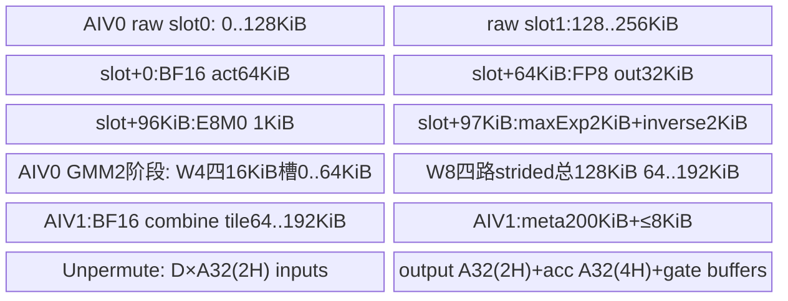
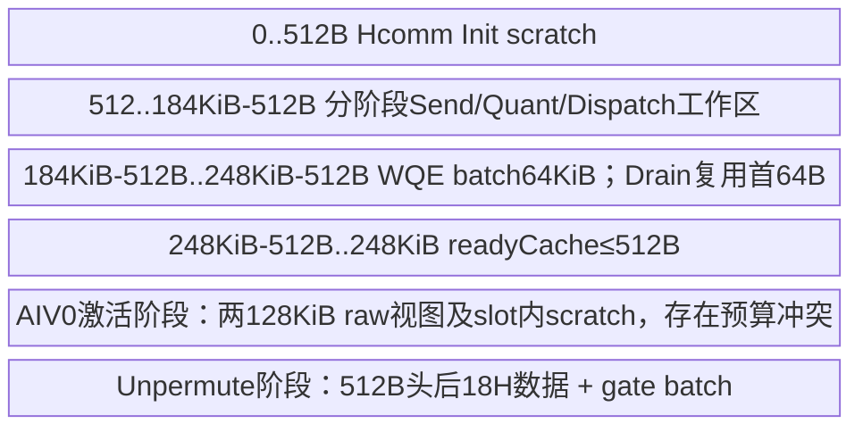
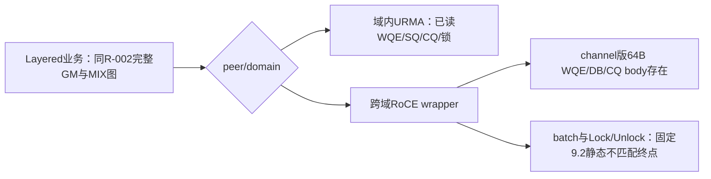
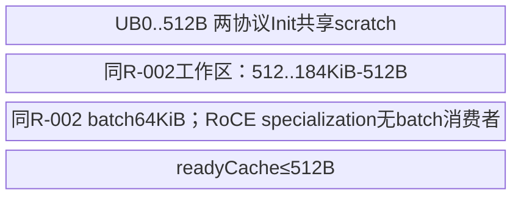

```mermaid
flowchart LR
  X["BF16 X"] --> Q["AIV MX E2M1 packed quant"]
  Q --> Relay["本rank/domain relay GM"]
  Relay --> F["URMA relaxed payload + strong ready"]
  F --> Recv["URMA Read batch → full dispatch q/s GM"]
  Recv --> L1["L1 → L0A/B + MX scales"]
  L1 --> MM["MX MMAD FP32 L0C"]
  MM --> A["AIV0 SwiGLU/MX → full activation q/s"]
  A --> L12["GMM2 Host L1/AIV0 W4→E4 prologue"]
  L12 --> M2["M128/K128 MMAD → Fixpipe scalar64"]
  M2 --> G2["GMM2 BF16 full GM"]
  G2 --> N["Fix_S + 64B atomic group counter"]
  N --> S["AIV1 URMA CombineSend"]
  S --> Out["origin combine GM → Unpermute → Y"]
```

# DeepEP MegaMoE MXFP4 E2M1 SwiGLU 950 ACLNN 算子知识

## 算子速览

| 项目 | 内容 |
|---|---|
| 实际入口 | CANN9.2.0公开两段式 `aclnnMegaMoeGetWorkspaceSize/aclnnMegaMoe`；SGL FuseMode3、`quant_mode="mx_fp4_e2m1"` |
| 计算语义 | BF16动态MXFP4 E2M1→Dispatch→native FP4 GMM1至BF16→SwiGLU至BF16→MXFP8 E4M3→展开W2的A8W4 GMM2至BF16→Combine、FP32 gates加权至BF16 |
| 输入输出 | X/Y[B,H] BF16；W1[N,H] FP4 NZ、W2[H,N/2] FP4 NZ_C0_32，物理uint8 packed；E8M0 scale；ids INT32，gates BF16/F32，counts INT32 |
| 执行类型 | 单mega_moe MIX_AIC_1_2，AIC_CUBE、AIV_VECTOR激活/量化/权重展开/路由及MTE/URMA通信；无SIMT/NDDMA kernel |
| Kernel 路线 | R-001 MTE A4W4 Wave；R-002 Layered URMA；R-003 Layered UBX固定源静态terminal。公开NZ、保留ND冲突、index/gate类型、ring/dedup/full/tail全部区分 |
| 核心资源 | CCL自定义窗口；框架workspace仅libAPI；GMM1 native MX、GMM2 Host产生512KiB L1流水；L0A/B各64KiB、L0C256KiB，AIV0 W4 prologue UB192KiB |
| 来源闭包 | `source_closed`：入口/Host/POD、混合双GMM、激活/量化、MTE、Host注册资源、URMA WQE/CQ及UBX静态终点均可追溯；不表示固定来源成功构建/运行 |
| 验证状态 | 本次知识提取未执行编译、真机、数值或性能测试；SDK trait、GMM1 UB、RoCE静态边界保留draft，无verified |

## 接口与语义

### 计算语义

B为本rank实际token数，可在rank间不同；C为全rank一致容量，H为hidden，T为top-k，R为EP大小，E为总专家，L=E/R，N为W1逻辑行，I=N/2。W1[N,H]、W2[H,I]方向为950 Mode3合同。每专家2D TensorList和单个3D堆叠TensorList均进入Host组织检查；SGL由非空W2列表首Tensor的物理末维乘2推I。调用前提为ID有效且同token不重复、各rank同轮进入，Host不扫描ID值。

当前宏路径未定义MEGA_MOE_ARCH92_DEVICE；QuantConfig<fp4x2_e2m1_t,5>给出QuantOutType=FP4、物理QuantStorageType=uint8、QuantScaleType=E8M0，A/B元素每字节2，ActivationQuantOutType=E4M3、C每字节1。不能用arch92另一条件定义覆盖本arch35实际选择。算法并非两次FP4激活量化：

```text
(qX4,sX) = MX_E2M1(X_BF16), each group=32
C1[e]   = BF16_Fixpipe( MX_Mmad_FP32(qX4,sX,W1_FP4,SW1_E8M0) )
G,U     = split C1, gate/up width=I
G'      = min(FP32(G),FLT_MAX); U'=clip(FP32(U),-FLT_MAX,FLT_MAX)
A       = BF16_RINT_NO_SAT( G'/(1+exp(-G')) * U' )
(qA8,sA)= MX_E4M3(A)
B8      = ShiftW4ToW8(W2_FP4)              # encoded E4 value W2/64
C2[e]   = BF16_Fixpipe_scalar64( MX_Mmad_FP32(qA8,sA,B8,SW2_E8M0) )
Y[b,:]  = BF16_RINT_SAT( sum_k FP32(C2[row(b,k),:])*FP32(gates[b,k]) )
```

两侧MX scale每K64用两个E8M0字节，MMAD为FP32累加；GMM2 W4展开不把E8M0 scale另除64，最终Fixpipe标量0x42800000（FP32 64）恢复比例。SDK uint64 scalar overload选QF322BF16_PRE，set_quant_pre后发L0C→GM intrinsic。保留BF16 Fixpipe、激活BF16舍入与MX量化的顺序，不宣称逐位等价。

输入MX从BF16位bits&0x7f80每32元素取最大；FP4格式常数0x0100。shared=max(maxExp,format)-format，E8M0=shared>>7；零组scale/inverse=0，maxExp=0x7f80时scale=0xff/inverse位0x7f81；普通inverse位0x7f00-shared，shared=0x7f00特殊0x0040。ComputeFp4Data按ceil(H/256)双BF16寄存器、DIST_DINTLV_B32读，乘BF16 inverse后Cast<FP4,BF16>，layout ZERO/ONE、SatMode::UNKNOWN、RINT，packed字节相加再DIST_PACK_B32存（每256输入128B）。SDK当前分支以round/layout/merge调用vcvt，无显式SAT参数，不能套FP8 SAT保证。

激活输出MX用E4M3常数0x0400，经BF16乘inverse、扩FP32再SAT/RINT到E4M3。SwiGLU自身BF16 Cast为NO_SAT/RINT，FTZ分支asc_float2bfloat16_rn；最终Unpermute为FP32乘后加、BF16 RINT/SAT。SGL不传activation_params，CANN Python归一化为[FLT_MAX]。GMM1每256逻辑N tile按gate128/up128拼接，语义仍为W1前后两半。

### 输入、输出与属性

| 参数 | shape/layout | dtype | 约束、默认值与语义 |
|---|---|---|---|
| context | 一维6156个INT32的自然布局视图 | INT32 | 实际24624B Mc2MoeContext；context Tensor由CreateContext at::empty拥有24624B allocation；其中CCL/channel地址指向通信对象持有资源 |
| x/y | [B,H] ND | BF16 | H∈[1024,8192]且H%64=0；SGL 950使用实际B，不走A3 padding/mask/slice |
| topk_ids | [B,T] ND | INT32 | T∈[1,32]；SGL仅对ids执行.int()；内容有效且同token不重复是调用前提 |
| topk_weights | [B,T] ND | BF16或FP32 | SGL原样传入；950模板使用DTYPE_TOPK_WEIGHTS，BF16在Unpermute显式转FP32，不能按A3硬读FP32 |
| weight1/weight2 | L个[N,H]/[H,I]，或单个[L,N,H]/[L,H,I]；W1 FRACTAL_NZ、W2 FRACTAL_NZ_C0_32 | FLOAT4_E2M1（物理torch.uint8） | N∈[512,8192]、N%256=0；I=N/2；所有专家、W1/W2同dtype/组织形式，不允许混合权重数学域 |
| weight_scales1/2 | 每专家[N,ceil(H/64),2] / [H,ceil(I/64),2]，堆叠时前置L | E8M0、ND | 每32元素一个scale，两scale配对编码K64；末维必须2，列表长度/shape逐侧一致 |
| expert_token_nums | [L] ND | INT32 | 本rank每专家接收计数；总接收量受max_recv上界裁剪边界约束 |
| moe_expert_num / ep_world_size | 标量 | INT64 | R∈[2,1024]，R≤E≤2048，E%R=0，1≤L≤1024 |
| num_max_tokens_per_rank | 标量C | INT64 | SGL由通信对象缓存键固定；Host 0表示取B，否则C≥B，最终C≤UINT32_MAX；Layered不接受零B/零C |
| max_recv_token_num | 标量Mmax | INT64 | SGL传0，Host默认取C·R·min(T,L)；显式值非负且≤UINT32_MAX，只有Layered额外要求不超过该几何上界，并受其INT32容量约束 |
| dispatch_quant_mode / out_dtype | 标量 | INT64 | 当前dispatch4 / FLOAT4_E2M1；C++显式weight1_type/weight2_type=FP4，QuantOut enum E2M1=5，经dtype转换生成key |
| activation / activation_params | swiglu / [FLT_MAX]（Python归一化后） | 字符串/float数组 | 仅本SwiGLU数学域；SiTU为另一独立卡 |
| combine_quant_mode / topk_weights_type / combine_comm_mode | 0 / 0 / 0 | INT64 | SGL未暴露其它值；仍允许Host自动dispatch-only dedup=2，不能因combine_comm_mode=0删去该路线 |
| topo_type / rank_num_per_server | 0/1/2 / domain大小 | INT64 | SymmBuffer实际探测生成；0=MTE，1=URMA，2=URMA+RoCE UBX；domain整除R，MTE取R |
| scales / x_active_mask / mask_buffer | absent | — | 动态MX域不提供预量化scales；SGL 950无active mask。rank mask仅A3扩展边界 |
| bias / shared weights及scale/bias | absent | — | 本MX可执行域必须为空；SGL可转发bias，但MX C++检查拒绝非空。公开CANN较宽shared异构/预量化/去重合同留在API Reference，不混成本数学域 |
| activation_out_dtype / transpose_weight1/2 / weight1_interleave | 未暴露属性 | — | 公开wrapper固定UNDEFINED/false/false/0；Host执行其约束 |

### 入口与版本

入口为ops-transformer公开ACLNN，SGL调用其Python/Torch扩展；SGL仓无Mode3自有ACLNN launcher body。`FUSED_DEEP_MOE.md` Mode3及DeepEP README明确CANN9.2.0，覆盖通用README较早9.0/9.1提示；ops-transformer固定version.cmake为9.2.0，OpDef注册ascend950。`mega_moe_apt.cpp` 以SDK/HCOMM版本头≥90200000开启Layered，以Tensor API版本条件开启主body；缺版本头或宏不成立时对应body被预处理移除，不能称运行支持。

核心依赖是ops-transformer CMake固定fe1d9908的ops-tensor Blaze；CATLASS2是工程其它实现的依赖，本FP4的GMM1 BlockMmad来自ops-tensor、GMM2来自ops自有FP8FP4 specialization，不能把CATLASS A3核心当成950实现。asc-comm9.2分支的头由package脚本映射至 `asc/include/adv_api/hcomm`，实现映射至 `asc/impl/adv_api/detail/hcomm`，comm_api层用符号链接供相对include解析。该映射与HCOMM Host声明比对是源码证据，未安装或二进制ABI实测。与固定SDK9.2的copy trait、与RoCE batch的静态冲突均保留在本卡。

配套公开合同见[DeepEP MegaMoE API](../../../../apis/deepep/deepep_mega_moe.md)。

## Host/Launcher 执行流程

### 参数校验与前处理

SGL MegaMoeStrategy按quant_mode选择dispatch4/E2M1与显式FP4 weight_type，取W2物理末维乘2得到I及实际B，校验非空权重列表并获取按(E,C,T,H,I,量化模式/输出类型)缓存的SymmBuffer。ids转INT32，gates无cast，权重/scale已由调用者准备；本路径无A3 padding、输入mask、结果截片。

Python `npu_mega_moe` 归一化TensorList、activation及默认params；C++ `NpuMegaMoe` 取当前SoC、检查MX输入/非空bias、构造ACL Tensor/TensorList、分配BF16 Y与INT32 counts，原样传gates；FP4必须torch.uint8；TensorListWrapper ConvertType/CollectB4ShapeInfo按stride及退化shape确定packed轴并加倍，storageDims.back及storageOffset乘2成为逻辑nibble单位；非base fake NZ_C0_16映射真NZ_C0_32，普通NZ保持。不等于A3 INT32→INT4 reinterpret，也不能无条件加倍逻辑最后轴。`ACLNN_CMD` 用当前NPU stream执行workspace查询/分配和第二阶段。ACLNN wrapper判必选指针、E/R正值、maxRecv非负，创建executor，并为缺省动态参数创建相应dtype/format的空TensorList；shared空占位复用主权重dtype/format，仅用于原型匹配，不产生shared计算。转交生成的aclnnInner桥，activation参数的有限性/个数由Host处理。

Host `MegaMoeTilingFuncImplArch35` 按源码顺序：必需tensor指针→不支持optional→attr指针→独立topology/EP/comm/量化/activation/topk attrs→scales判空→weight/scale组织、dtype、format、shape→专家执行模式与E/L/H/N→平台AIC/AIV/UB正值→容量C/Mmax→MTE dedup容量及收益→wave/adaptive buffer→CCL容量→workspace→block/key。任一步GRAPH_FAILED返回到框架，不启动业务body。不能依赖更晚shape检查保护更早的类型/整数转换。

公开合法权重组合仅W1 FRACTAL_NZ、W2 FRACTAL_NZ_C0_32。ResolveExpertGmmMode还返回A4W4_ND（W1 ND/W2 C0_32），注释明确内部保留，OpDef/README不扩支持；保存其selector与generic IsWeightNZ=false行为为发布冲突，不列公开支持Route。其它format/dtype组合Host失败。两侧/各专家必须同FP4，混合W域不可达。

### 参数、Workspace 与生命周期

SymmBuffer空comm_alg优先探测UB_MEM；仅两层快捷条件走MTE。否则从内层向外扩张连续rank的UB域；全R可UB_MEM得topo0；域内需UB_CTP，跨域全UB_RTP得topo1；不使用多channel、连续域且跨域RoCE连通则topo2；不满足组合TORCH_CHECK失败。rank/domain、端点协议和CCL尺寸必须全rank一致。

自定义窗口容量先经 `get_mega_moe_ccl_buffer_size`：实际核数/权重尚未知，BuildMemoryBudgetParams按AIC36、shared4、较宽GELU wave预算、主GMM1输出/前缀与shared独立量化安全上界预留；MTE分别算dedup关闭/开启并取max。这是分配预算，不代表本调用执行shared/GELU。Host随后用实际参数重算所需长度。实际 `framework_workspace = platform.GetLibApiWorkSpaceSize()`，与CCL中的业务数据区不同；kernel不使用workspaceGM装双GMM中间结果。

CCL由CommContextManager经设备大页优先malloc、首次memset0、HcclCommMemReg DEVICE/tag、AIV engine context与channel创建管理。remote tag匹配恢复peer窗口地址。HCOMM将URMA Host channel转换为device ChannelEntity指针；从HCOMM256B头到asc-comm对应字段的映射见POD。CreateContext的context Tensor由at::empty分配NPU 6156个INT32并拥有自身allocation；CopyContextToTensor把Host临时POD经from_blob后copy_到该Tensor。GetLocalBufferTensor才是CCL窗口的from_blob非拥有视图，不能超越通信对象/窗口生命周期；Y/counts为本次Torch输出，executor临时空TensorList及workspace归executor/调用框架。

destroy可见实现先device synchronize，再清空memHandle并free自定义窗口；该层未见显式deregister/channel/engine context释放，不补造释放保证。复用cache命中的GetOrCreateContext只更新默认HCCL窗口size，未重新填充本次fresh CommContext；后续CopyContextToTensor仍从该结构复制地址，属于可见cache-hit边界，未复现故障。不得跨并发调用重用同一带计数/ready的窗口而假设自动隔离。

### 启动图与失败传播

```text
SGL Buffer.fused_deep_moe -> MegaMoeStrategy
 -> ops Python npu_mega_moe -> C++ NpuMegaMoe/ACLNN_CMD
 -> aclnnMegaMoeGetWorkspaceSize -> generated aclnnInner bridge
 -> MegaMoeTilingFuncArch35 -> MegaMoeTilingFuncImplArch35
 -> CommitTilingResult: CCL check, libAPI workspace, CalcTschBlockDim(AIV,AIC,AIV),
                        scheduleMode=1, GET_TPL_TILING_KEY(...)
 -> aclnnMegaMoe(workspace,size,executor,currentStream)
 -> mega_moe<weight/shared/dispatch/out/combine/comm/prefetch/index>
    -> R-001 MegaMoeMteWave -> MegaMoeA4W4Wave
    -> R-002 MegaMoeLayered<...,LayeredUrmaComm>
    -> R-003 MegaMoeLayered<...,LayeredUbxComm> / known fixed-source static mismatch
```

单个MIX kernel内各逻辑AIC配AIV0/AIV1。框架生成的aclnnInner调度桥、硬件asc_mmad_mx/拷贝/门铃原语是明确框架与硬件终点；业务量化、GMM块循环、通信WQE/CQ与同步body均有源码。Host失败、模板/版本无body终点、已见静态接口冲突分开记录，不编造具体codegen诊断或真机错误。

## Route 与参数设计

### 分核与资源计算

记A_q(x)=ceil(x/q)q，d=2当C·T≤32768，否则d=4；ids仍INT32。Mmax=C·R·min(T,L)（SGL maxRecv=0），每专家有效接收M_e≤C·R依赖有效且不重复ID，不能用总Mmax替代该前提。g=max(ceil(4·AIC/ceil(N/256)),ceil(AIC/ceil(H/256)))。MTE若g>0、Mmax>3g·256且combineQuant=0，启用3-wave数据ring：dispatch仅dedup0可ring，activation/GMM2可在dedup0/2 ring。元数据及ready不因ring缩小。Layered全量GM，不启用MTE ring。

GMM1 M256×N256由两个N128片组成，native FP4 K0=128、L1数据K256/scaleK512、2级流水，每半packed基准72KiB。GMM2为E4激活/展开FP4权重，M/N256、L1 K256/L0 K128、M128条带，Host a8w4L1Layout给出offset。尾M<256且K>256可计算A16(M)并试探L1K512/更大scale覆盖：两倍数据+两倍scale≤半L1且单scale≤64KiB，scale factor同时受剩余L1、各scale64KiB、floor(K/KL1)、127限制，仅当增加KL1或减少scale轮数才采用；否则回基准。N、K的有效tail由view及K64 padding处理。

MTE SendMask把E连续均分到全部AIV，前E%AIV核多一个expert；给extra/normal两组独立buffer配置。可用UB减reset≤8192B、双输入/双量化输出、2048B MX scratch、累计表后，以Bsend(初值10240)、d字节indices及mask/index ring反推2..6槽，再扩大batch且向下A256。Dispatch固定prefix/count表后，初值Brecv12288，扣dedup预留时必须先扣，再选2..6 record+32B metadata槽及batch；启动轮使用选中槽，稳态只用前两槽并保持地址。Unpermute先以8192个gate item基准选2..6输入槽，再扩大gate batch，full/tail两配置；其精确UB式见R-001。

### Route 选择

以下K(i,c)为 `GET_TPL_TILING_KEY(FP4_E2M1,FP4_E2M1,4,5,5,0,c,false,i)` 的九字段tuple；权重、gates dtype及公开NZ或保留ND冲突由输入原型额外注入，不把tuple字段与PyTorch dtype编号混用。i=0为INT16，i=1为INT32；c=0为MTE、c=1为Layered。dedup、activation及topo1/2不单独编码进该key，必须连同POD消费。

| 顺序 | Route | Key/模板 | 精确选择条件与优先级 | 不适用去向 |
|---:|---|---|---|---|
| 1 | R-001 MTE Wave | K(i,0)，i由C·T≤32768裁决 | 当前FP4 E2M1/SwiGLU公共合同；topo_type=0；Tensor API body可用；公开W1 NZ/W2 NZ_C0_32；dedup经Host自动为0/2 | topo1/2→后续；Host输入不合法失败 |
| 2 | R-002 Layered URMA | K(1,1)、LayeredUrmaComm | topo_type=1；BF16动态MX；域整除R；容量非零、INT32上界；SDK/HCOMM版本宏均≥9.2 | topo2→R-003；版本宏缺失为无body终点 |
| 3 | R-003 Layered UBX | K(1,1)、LayeredUbxComm | topo_type=2；同Layered容量；域内UB_CTP、跨域RoCE；Host实际可生成 | 自有业务body存在；固定asc-comm RoCE batch/Lock/Unlock不匹配，为静态terminal；无可见fallback |

```text
SGL math=mx_fp4_e2m1 + swiglu + no shared/prequant/explicit dedup
 -> validate Host contracts
 -> auto topology0: MTE; key index=(C*T<=32768?0:1); auto dedup2 -> capacity/benefit guard -> 2 or0
 -> auto topology1/2: key comm1,index1, Layered-enabled version gate
      -> topo2 LayeredUbxComm (record fixed-source interface conflict)
      -> topo1 LayeredUrmaComm
 -> invalid attrs/layout/capacity: fail; macro/body absent: no operation body
```

### 模板/实现执行矩阵

| Route | key/selector | dtype/shape/platform 完整命中条件 | 执行族与 kernel 节点 | 实际模板/body | 内存与同步特征 | tail/fallback |
|---|---|---|---|---|---|---|
| R-001 | K(0,0)、K(1,0)，gates BF16/F32、dedup0/2、ring/full | 950 BF16 X/Y、FP4 E2M1 W1/2、E8M0，公共形状/容量，topo0；公开W1 NZ/W2 C0_32，保留ND冲突 | all-AIV准备→AIC nativeGMM1/AIV0激活→AIC GMM2/AIV0 W4prologue/AIV1 Combine→Unpermute | MegaMoeA4W4Wave；GMM1 Config<false,0,FP4,FP4,BF16,E8,E8,IsW1NZ,false,false,false,true>；GMM2 Config<true,0,E4,FP4,BF16,E8,E8> | 一wave启动/nextDispatch与currentGMM1交叠/同waveGMM2；prefix GM backup；Host GMM2 L1有效 | valid M/N/K，空tile三角色共跳；无B4096延迟 |
| R-002 | K(1,1)、topo1，两gates类型 | 同公开FP4合同，Layered宏，B/C>0与INT32容量 | URMA→nativeGMM1/AIV0激活→AIC GMM2/AIV0展开→AIV1 URMA Combine→Unpermute | MegaMoeLayered；GMM1 generic，GMM2 A8W4非空expertSlice独立对象 | full GM/256行组计数/channel owner/Lock/Drain/Unlock | 空tile三角色共同检查，无MTE fallback |
| R-003 | K(1,1)、topo2 | R-002合同，域内CTP/跨域RoCE | 自有同R-002 MIX图，按peer分协议 | MegaMoeLayered<...,LayeredUbxComm> | full窗口/Host L1/UB；RoCE batch静态不匹配 | fixed-source terminal，无可见fallback |

### 隐藏性能 Guard

| Guard | Host/Tiling 条件 | Device/资源原因 | 影响 Route | 不满足时去向 | 源码符号 |
|---|---|---|---|---|---|
| 路由索引窄化 | C·T≤32768 | 过滤token/topk位置可用INT16，减少route GM/UB；专家ID仍INT32 | R-001 | INT32模板 | UseInt16TopkIndex/CalcTopkIndexTypeBytes |
| 自动dispatch-only dedup容量 | ceil(C/128)≤min(54KiB/(12T),512,4KiB/4,4KiB/4) | 组描述符/成员表在固定UB内 | R-001 | 清dispatch去重bit→0 | CheckMteDedupCapacity |
| 自动dedup收益 | 预期distinctRank=R(1-(1-1/R)^T)，saved=C·T·(1-distinctRank/T)·H/2（FP4每元素0.5B）；R=4比较saved/L与hiddenDim≤2048?0.30MiB:2.10MiB，否则比较saved与60MiB | 只在源码估计通信节省足够时付出预分组/描述符成本；阈值不是本次测量 | R-001 | 清dispatch bit→0 | ApplyDedupBenefitGate |
| ring | topo0、combine0、g>0、Mmax>3g256；dispatch额外dedup0 | 覆盖三个wave生命周期，dedup FIRST fanout需完整输入 | R-001 | 全量各stage GM | CalcCclStageRingConfig |
| A4同waveGMM2 | 所有B，完成当前wave GMM1 | AIV0切W4prologue、AIV1切Combine，三角色一致 | R-001 | 不走A8W8的B4096延迟 | MegaMoeA4W4Wave::ProcessMoeExpertStages |
| L2 bypass | 单expert全范围且M≤tileM；ND还需K%256=0；ScaleB片宽2N字节%128=0 | 单次消费可选cache bypass；热wave权重保留 | 全部业务body | 默认cache模式 | GmmKernel Config/weight view |
| Layered H/cap | H%64=0，B/C>0，C·T与最大接收≤INT32 | mask/index/relay、256行group槽布局 | R-002/003 | Host失败 | CheckAndSetNumMaxTokensPerRank/GetMegaMoeCclBufferSize |
| 固定源API差异 | ops-tensor构造gm_to_l1_trait{true}，SDK9.2该trait为空 | 包含的非依赖初始化式与固定SDK声明不相容 | 全部含Cube模板 | 已知静态边界，无源码fallback | CopyGM2L1TraitPreAllocation |
| RoCE批处理差异 | topo2选择roce_，Hcomm要求UB_CTP才支持MakeBatchHandle/Lock/Unlock | 不存在可替代RoCE batch specialization | R-003 | 静态terminal | Hcomm<COMM_PROTOCOL_ROCE>/LayeredUbxComm |

| GMM2 L1 | CalcMegaMoeL1Layout(max(H,I))，a/b和两scale窗≤512KiB | 展开后B为E4，不能按FP4算L1 | 全部自有计算 | Host产生，无运行fallback | CalcMegaMoeL1Layout |
| A4格式层差 | 公开W1 NZ/W2 C0_32，Host另识别W1 ND/W2 C0_32 | generic IsWeightNZ=false存在但不扩原型 | 全部自有Route | ND记保留冲突，其它非法组合失败 | ResolveExpertGmmMode |

### POD/ABI

以下sizeof/alignof/offset为固定源码自然C++布局推导（64位指针、常规8字节对齐），未执行编译布局验证或安装二进制ABI验证。字段按各自声明逐行列出；数组是一项字段。嵌套字段offset相对其结构首址，不能将“未读取”字段从序列化POD删除。
| 结构 | 字段 | 类型/位宽 | ABI 布局 | 单位 | Host/launcher producer | Device consumer | 边界 |
|---|---|---|---|---|---|---|---|
| CclCommLayoutParams(80B/align8) | numMaxTokensPerRank | I64 | 0B | 容量 | SetCclLayoutParams=C | CalcCclCommLayout/numMaxTokensPerRank | 当前域有效 |
| CclCommLayoutParams(80B/align8) | topK | I64 | 8B | 路由槽 | SetCclLayoutParams=T | CalcCclCommLayout/topK | 当前域有效 |
| CclCommLayoutParams(80B/align8) | h | I64 | 16B | 数据宽 | SetCclLayoutParams=H | CalcCclCommLayout/h | 当前域有效 |
| CclCommLayoutParams(80B/align8) | moeExpertPerRank | I64 | 24B | 本地专家 | SetCclLayoutParams=L | CalcCclCommLayout/moeExpertPerRank | 当前域有效 |
| CclCommLayoutParams(80B/align8) | epWorldSize | I64 | 32B | rank | SetCclLayoutParams=R | CalcCclCommLayout/epWorldSize | 当前域有效 |
| CclCommLayoutParams(80B/align8) | yDtypeSize | I64 | 40B | BF16字节 | SetCclLayoutParams=2 | CalcCclCommLayout/yDtypeSize | 当前域有效 |
| CclCommLayoutParams(80B/align8) | elemsPerByte | U32 | 48B | 元素/B | SetCclLayoutParams=2 | QuantRecord/GM布局 | 当前域有效 |
| CclCommLayoutParams(80B/align8) | topkWeightsPrefetch | bool | 52B | 开关 | SetCclLayoutParams=false | 记录中gate区 | inactive，不加入gates |
| CclCommLayoutParams(80B/align8) | isQuantCombine | bool | 53B | 开关 | SetCclLayoutParams=false | Combine窗口 | 无量化Combine |
| CclCommLayoutParams(80B/align8) | topoType | I64 | 56B | 枚举 | SetCclLayoutParams=0/1/2 | CalcCclCommLayout | 三Route不同窗口 |
| CclCommLayoutParams(80B/align8) | serverNum | I64 | 64B | 域数 | R/rankNumPerServer | Layered relay | MTE值仅布局参数 |
| CclCommLayoutParams(80B/align8) | serverCombineReduce | bool | 72B | 开关 | false | Layered布局分支 | inactive |
| CclStageRingConfig(16B/align8) | dispatch | bool | 0B | 开关 | CalcCclStageRingConfig: dedup0才可开 | dispatch rows | Layered全false |
| CclStageRingConfig(16B/align8) | gmm1 | bool | 1B | 开关 | CalcCclStageRingConfig: ring共同条件 | GMM1 rows | Layered全false |
| CclStageRingConfig(16B/align8) | activation | bool | 2B | 开关 | CalcCclStageRingConfig: ring共同条件 | 激活rows | Layered全false |
| CclStageRingConfig(16B/align8) | gmm2 | bool | 3B | 开关 | CalcCclStageRingConfig: ring共同条件 | GMM2 rows | Layered全false |
| CclStageRingConfig(16B/align8) | rows | U64 | 8B | 行 | 3*g*256或0 | stage modulo row | flags/meta不缩小 |
| CclComputeLayoutParams(152B/align8) | ring | CclStageRingConfig | 0B/16B | 嵌套 | CalcCclStageRingConfig | WorkspaceLayout/各stage | 见逐字段表 |
| CclComputeLayoutParams(152B/align8) | topoType | I64 | 16B | 枚举 | Host CheckAndSet*/SetCclLayoutParams=topo0/1/2 | WorkspaceLayout/stage topoType | 跨rank容量需一致 |
| CclComputeLayoutParams(152B/align8) | maxOutputSize | I64 | 24B | 行 | Host CheckAndSet*/SetCclLayoutParams=Mmax | WorkspaceLayout/stage maxOutputSize | 跨rank容量需一致 |
| CclComputeLayoutParams(152B/align8) | h | I64 | 32B | 元素 | Host CheckAndSet*/SetCclLayoutParams=H | WorkspaceLayout/stage h | 跨rank容量需一致 |
| CclComputeLayoutParams(152B/align8) | hiddenDim | I64 | 40B | 元素 | Host CheckAndSet*/SetCclLayoutParams=N | WorkspaceLayout/stage hiddenDim | 跨rank容量需一致 |
| CclComputeLayoutParams(152B/align8) | bs | I64 | 56B | 行 | Host CheckAndSet*/SetCclLayoutParams=B | WorkspaceLayout/stage bs | 本rank实际B，变长bs可不同；C/topK等容量条件仍须跨rank一致 |
| CclComputeLayoutParams(152B/align8) | moeExpertPerRank | I64 | 64B | 专家 | Host CheckAndSet*/SetCclLayoutParams=L | WorkspaceLayout/stage moeExpertPerRank | 跨rank容量需一致 |
| CclComputeLayoutParams(152B/align8) | epWorldSize | I64 | 72B | rank | Host CheckAndSet*/SetCclLayoutParams=R | WorkspaceLayout/stage epWorldSize | 跨rank容量需一致 |
| CclComputeLayoutParams(152B/align8) | aicNum | I64 | 80B | 核 | Host CheckAndSet*/SetCclLayoutParams=平台AIC | WorkspaceLayout/stage aicNum | 跨rank容量需一致 |
| CclComputeLayoutParams(152B/align8) | sharedExpertNum | I64 | 88B | 专家 | Host CheckAndSet*/SetCclLayoutParams=0 | WorkspaceLayout/stage sharedExpertNum | inactive |
| CclComputeLayoutParams(152B/align8) | mGroupsPerWave | I64 | 96B | 256行组 | Host CheckAndSet*/SetCclLayoutParams=g | WorkspaceLayout/stage mGroupsPerWave | 跨rank容量需一致 |
| CclComputeLayoutParams(152B/align8) | combineSyncSlotCountPerExpert | I64 | 104B | 64B槽 | Host CheckAndSet*/SetCclLayoutParams=Layered:max(ceil(CR/256),AIV/2);MTE0 | WorkspaceLayout/stage combineSyncSlotCountPerExpert | 跨rank容量需一致 |
| CclComputeLayoutParams(152B/align8) | serverNum | I64 | 112B | 域 | Host CheckAndSet*/SetCclLayoutParams=R/domain | WorkspaceLayout/stage serverNum | 跨rank容量需一致 |
| CclComputeLayoutParams(152B/align8) | numMaxTokensPerRank | I64 | 120B | 行 | Host CheckAndSet*/SetCclLayoutParams=C | WorkspaceLayout/stage numMaxTokensPerRank | 跨rank容量需一致 |
| CclComputeLayoutParams(152B/align8) | topK | I64 | 128B | 槽 | Host CheckAndSet*/SetCclLayoutParams=T | WorkspaceLayout/stage topK | 跨rank容量需一致 |
| CclComputeLayoutParams(152B/align8) | activationOutputDivisor | U32 | 48B | 除数 | SetCclLayoutParams=2 | I=N/2 | 本SwiGLU |
| CclComputeLayoutParams(152B/align8) | dedupMode | I32 | 136B | bit模式 | MTE自动0/2；Layered0 | dispatch/fanout | 非显式combine去重 |
| CclComputeLayoutParams(152B/align8) | combineQuant | bool | 140B | 开关 | SetCclLayoutParams=false | WorkspaceLayout/Combine | 当前域inactive |
| CclComputeLayoutParams(152B/align8) | topkWeightsPrefetch | bool | 141B | 开关 | SetCclLayoutParams=false | WorkspaceLayout/量化记录 | 当前域inactive |
| CclComputeLayoutParams(152B/align8) | dispatchFp4 | bool | 142B | 开关 | SetCclLayoutParams=true | WorkspaceLayout/record字节 | FP4 packed dispatch，H/2 B |
| CclComputeLayoutParams(152B/align8) | reserveGmm1Output | bool | 143B | 开关 | SetCclLayoutParams=false | WorkspaceLayout/GMM1 GM | 当前域inactive |
| CclComputeLayoutParams(152B/align8) | reserveCumsum | bool | 144B | 开关 | SetCclLayoutParams=true | WorkspaceLayout/GM前缀备份与ReloadDispatchCumsumRange | MTE有效；Layered也有自身cumsum |
| CclComputeLayoutParams(152B/align8) | sharedInputIndependent | bool | 145B | 开关 | SetCclLayoutParams=false | WorkspaceLayout/shared输入 | 当前域inactive |
| CclComputeLayoutParams(152B/align8) | sharedInputElementsPerByte | U32 | 148B | 元素/B | SetCclLayoutParams=2 | shared布局 | shared0，不产生slice |
| MegaMoeTilingData(608B/align8) | comm | CclCommLayoutParams | 0B | 80B | SetCclLayoutParams | 通信layout | 逐字段见上 |
| MegaMoeTilingData(608B/align8) | compute | CclComputeLayoutParams | 80B | 152B | CheckAndSet*/SetCclLayoutParams | WorkspaceLayout/Process | 逐字段见上 |
| MegaMoeTilingData(608B/align8) | blockNumPerEP | U32 | 232B | 核 | CheckAndSetPlatformParams=max(1,AIC/R) | 跨核配额 | 实际资源值 |
| MegaMoeTilingData(608B/align8) | blockAivNum | U32 | 236B | 核 | CheckAndSetPlatformParams | 全部AIV分核 | 当前MIX1:2 |
| MegaMoeTilingData(608B/align8) | combineQuantMode | I64 | 240B | 枚举 | CheckAndSetCombineQuantMode=0 | GMM2/Unpermute | 本域0 |
| MegaMoeTilingData(608B/align8) | clampLimit | F32 | 248B | 数值 | CheckActivationParams=FLT_MAX | SwiGluFp32 | 正值启用clip |
| MegaMoeTilingData(608B/align8) | moeGmmMode | U8 | 252B | 枚举 | CheckAndSetExpertGmmModes=A4W4_NZ；A4W4_ND保留冲突 | GMM Config | 由weight format |
| MegaMoeTilingData(608B/align8) | sharedGmmMode | U8 | 253B | 枚举 | 共享缺省模式 | shared router | shared0 inactive |
| MegaMoeTilingData(608B/align8) | dispatchBufferConfig | DispatchConfig | 256B | 16B | SetAdaptiveBufferConfigs | DispatchBuffInit | 见子结构 |
| MegaMoeTilingData(608B/align8) | sendMaskConfigForCoreWithExtraExpert | SendConfig | 272B | 16B | SetTopkValidIndexBufferConfigs | SendAndQuantBuffInit | extra核 |
| MegaMoeTilingData(608B/align8) | sendMaskConfigForCoreWithoutExtraExpert | SendConfig | 288B | 16B | SetTopkValidIndexBufferConfigs | SendAndQuantBuffInit | 其余核 |
| MegaMoeTilingData(608B/align8) | sendMaskCoreCountWithExtraExpert | U32 | 304B | 核 | E%AIV | SendAndQuantBuffInit | expert均分余数 |
| MegaMoeTilingData(608B/align8) | unpermuteConfigForFullTokenChunk | UnpermuteConfig | 308B | 24B | SetUnpermuteBufferConfigs | UnpermuteBuffInit | full |
| MegaMoeTilingData(608B/align8) | unpermuteConfigForTailTokenChunk | UnpermuteConfig | 332B | 24B | SetUnpermuteBufferConfigs | UnpermuteBuffInit | tail |
| MegaMoeTilingData(608B/align8) | unpermuteFullTokenChunkCoreCount | U32 | 356B | 核 | SetUnpermuteBufferConfigs | Unpermute配置选择 | 完整chunk数 |
| MegaMoeTilingData(608B/align8) | topkWeightsPrefetch | I32 | 360B | 开关 | CheckAndSetTopkWeightsType=0 | record/模板 | inactive |
| MegaMoeTilingData(608B/align8) | actMode | U8 | 364B | 枚举 | CheckActivationParams=SwiGLU | Activation | 非SiTU |
| MegaMoeTilingData(608B/align8) | actSubMode | U8 | 365B | 枚举 | SwiGLU普通子模式 | Activation | 非OAI/step |
| MegaMoeTilingData(608B/align8) | activationAlpha | F32 | 368B | 值 | SwiGLU占位 | 本分支不读 | 保留字段 |
| MegaMoeTilingData(608B/align8) | activationBeta | F32 | 372B | 值 | SwiGLU占位 | 本分支不读 | 保留字段 |
| MegaMoeTilingData(608B/align8) | isPerExpertWeightTensor | bool | 376B | 开关 | CheckWeight组织2D/3D | GetExpertTensor | 两组织均可 |
| MegaMoeTilingData(608B/align8) | rankNumPerServer | U32 | 380B | rank/域 | CheckAndSetRankNumPerServer | Layered peer/domain | 必须与context一致 |
| MegaMoeTilingData(608B/align8) | a8w4L1Layout | MegaMoeL1Layout | 384B | 208B | CommitTilingResult/CalcMegaMoeL1Layout | A8W4 GMM2 Block/Prologue读取 | 本域GMM2 ACTIVE |
| MegaMoeTilingData(608B/align8) | preQuantTileTokens | U32 | 592B | token | 动态量化=0 | TokenQuant预量化分支 | inactive |
| MegaMoeTilingData(608B/align8) | preQuantStageBytes | U32 | 596B | B | 动态量化=0 | 预量化UB | inactive |
| MegaMoeTilingData(608B/align8) | dispatchTableUbBaseAddr | U32 | 600B | B | SetAdaptiveBufferConfigs=0 | Arch92常驻表 | 950当前分支inactive |
| MegaMoeDispatchBufferConfig(16B/align4) | routeItemsPerBatch | I32 | 0B | item | Calc*BufferConfig=A256(batch) | mask/index循环 | extra/normal可不同；不可固定6 |
| MegaMoeDispatchBufferConfig(16B/align4) | routeBatchCount | I32 | 4B | 轮 | ceil(sendTotal/batch) | SendMask/Dispatch循环 | extra/normal可不同；不可固定6 |
| MegaMoeDispatchBufferConfig(16B/align4) | bufferCount | I32 | 8B | 槽 | 自适应2..6 | slot/event ring | extra/normal可不同；不可固定6 |
| MegaMoeDispatchBufferConfig(16B/align4) | copyBufferBytes | U32 | 12B | B | CalcDispatchCopyBufferBytes | UB槽地址 | extra/normal可不同；不可固定6 |
| MegaMoeSendMaskBufferConfig(16B/align4) | routeItemsPerBatch | I32 | 0B | item | Calc*BufferConfig=A256(batch) | mask/index循环 | extra/normal可不同；不可固定6 |
| MegaMoeSendMaskBufferConfig(16B/align4) | routeBatchCount | I32 | 4B | 轮 | ceil(sendTotal/batch) | SendMask/Dispatch循环 | extra/normal可不同；不可固定6 |
| MegaMoeSendMaskBufferConfig(16B/align4) | bufferCount | I32 | 8B | 槽 | 自适应2..6 | slot/event ring | extra/normal可不同；不可固定6 |
| MegaMoeSendMaskBufferConfig(16B/align4) | bufferBytes | U32 | 12B | B | CalcTopkValidIndexRingSlotBytes | UB槽地址 | extra/normal可不同；不可固定6 |
| MegaMoeUnpermuteBufferConfig(24B/align4) | tokensPerBatch | I32 | 0B | token | gate基准及剩余UB反推 | gate batch | full/tail各自产生 |
| MegaMoeUnpermuteBufferConfig(24B/align4) | inputBufferCount | I32 | 4B | 槽 | clamp(UB/inputSlot,2,6) | MTE2输入ring | full/tail各自产生 |
| MegaMoeUnpermuteBufferConfig(24B/align4) | bf16SlotElementCount | U32 | 8B | BF16元素 | A32(2H)/2 | 输入/输出slot | full/tail各自产生 |
| MegaMoeUnpermuteBufferConfig(24B/align4) | fp32SlotElementCount | U32 | 12B | FP32元素 | A32(4H)/4 | FP32累加 | full/tail各自产生 |
| MegaMoeUnpermuteBufferConfig(24B/align4) | topKWeightsBufferBytes | U32 | 16B | B | A32(4*batch*T) | FP32 gate | full/tail各自产生 |
| MegaMoeUnpermuteBufferConfig(24B/align4) | topKWeightsConversionBufferBytes | U32 | 20B | B | BF16 gate时A32(2*batch*T)，FP32时0 | 转换scratch | full/tail各自产生 |
| MegaMoeL1Layout(208B/align8) | aBufferNum | U64 | 0B | 槽 | CalcMegaMoeL1Layout=3 | GMM2 Block/Prologue | AIC A GM2L1环；ACTIVE，不与GMM1 native布局混用 |
| MegaMoeL1Layout(208B/align8) | bBufferNum | U64 | 8B | 槽 | CalcMegaMoeL1Layout=4 | GMM2 Block/Prologue | AIV0 W4 prologue/B ready-free；ACTIVE，不与GMM1 native布局混用 |
| MegaMoeL1Layout(208B/align8) | tileK | U64 | 16B | K元素 | CalcMegaMoeL1Layout=256 | GMM2 Block/Prologue | A/B data K256；ACTIVE，不与GMM1 native布局混用 |
| MegaMoeL1Layout(208B/align8) | scaleK | U64 | 24B | K元素 | CalcMegaMoeL1Layout=min(A256(max(H,I)),2048) | GMM2 Block/Prologue | 两矩阵相同scale K窗；ACTIVE，不与GMM1 native布局混用 |
| MegaMoeL1Layout(208B/align8) | aSlotBytes | U64 | 32B | B | CalcMegaMoeL1Layout=65536 | GMM2 Block/Prologue | 256×256 E4；ACTIVE，不与GMM1 native布局混用 |
| MegaMoeL1Layout(208B/align8) | bSlotBytes | U64 | 40B | B | CalcMegaMoeL1Layout=65536 | GMM2 Block/Prologue | 展开后256×256 E4，非packed；ACTIVE，不与GMM1 native布局混用 |
| MegaMoeL1Layout(208B/align8) | scaleASlotBytes | U64 | 48B | B | CalcMegaMoeL1Layout=scaleK/256*2048 | GMM2 Block/Prologue | 两slot之一；ACTIVE，不与GMM1 native布局混用 |
| MegaMoeL1Layout(208B/align8) | scaleBSlotBytes | U64 | 56B | B | CalcMegaMoeL1Layout=scaleK/256*2048 | GMM2 Block/Prologue | 两slot之一；ACTIVE，不与GMM1 native布局混用 |
| MegaMoeL1Layout(208B/align8) | aOffsets[6] | U64数组 | 64B | B | CalcMegaMoeL1Layout=[0,65536,131072,0,0,0] | GMM2 Block/Prologue | 仅前3有效；ACTIVE，不与GMM1 native布局混用 |
| MegaMoeL1Layout(208B/align8) | bOffsets[8] | U64数组 | 112B | B | CalcMegaMoeL1Layout=[196608,327680,262144,393216,0,0,0,0] | GMM2 Block/Prologue | 仅前4有效，物理0/2/1/3；ACTIVE，不与GMM1 native布局混用 |
| MegaMoeL1Layout(208B/align8) | scaleAOffsets[2] | U64数组 | 176B | B | CalcMegaMoeL1Layout=[458752,458752+2s]，s=scaleASlotBytes | GMM2 Block/Prologue | scaleA0/1；ACTIVE，不与GMM1 native布局混用 |
| MegaMoeL1Layout(208B/align8) | scaleBOffsets[2] | U64数组 | 192B | B | CalcMegaMoeL1Layout=[458752+s,458752+3s] | GMM2 Block/Prologue | scaleB0/1；ACTIVE，不与GMM1 native布局混用 |
| Mc2MoeContext(24624B/align8) | epRankId | U32 | 0B | rank | CopyContextToTensor=localRank | peer地址 | <R |
| Mc2MoeContext(24624B/align8) | rankSizePerServer | U32 | 4B | rank/域 | CopyContextToTensor=domain | Layered peer | 与tiling相同 |
| Mc2MoeContext(24624B/align8) | kfcContextAddr | U64 | 8B | 地址 | Host KFC资源 | MTE资源分支 | 950Layered不使用 |
| Mc2MoeContext(24624B/align8) | epHcclBuffer_[1024] | U64[1024] | 16B | 地址 | peer注册窗口 | MTE/Layered GM | 有效前R项 |
| Mc2MoeContext(24624B/align8) | hcommHandle_[1024] | U64[1024] | 8208B | 句柄 | AIV ChannelAcquire compact | GetChannel(peer) | self从列表移除 |
| Mc2MoeContext(24624B/align8) | channelsPerRank | U32 | 16400B | 数 | 0 | multi-channel判定 | SGL single channel |
| Mc2MoeContext(24624B/align8) | enableGroupSend | bool | 16404B | 开关 | false | Layered channel组织 | inactive |
| Mc2MoeContext(24624B/align8) | roceHcclBuffer_[1024] | U64[1024] | 16408B | 地址 | 默认空 | 混合多channel扩展 | 本SGL路线不读 |
| Mc2MoeContext(24624B/align8) | roceBufferSize | U64 | 24600B | B | 默认0 | 混合多channel扩展 | inactive |
| Mc2MoeContext(24624B/align8) | hostStatusTableAddr | U64 | 24608B | 地址 | 默认0 | 状态扩展 | 不当作完成同步 |
| Mc2MoeContext(24624B/align8) | completedRounds | U64 | 24616B | 轮 | 默认U64(-2) | 轮次扩展 | 当前950 body inactive |
| GmBuffer(16B/align8) | offsetBytes | I64 | 0B | B | WorkspaceLayout分配 | base+offset | 未分配offset=-1,size0 |
| GmBuffer(16B/align8) | sizeBytes | I64 | 8B | B | 按slice字节公式 | 有效extent | 未分配offset=-1,size0 |

HCOMM/asc-comm接口的自然布局映射如下；HCOMM reserve首16B被Device解释为队列计数，Host整体清零提供初值，未证明安装包实现相同。URMA union字段相同；RoCE host的dbVendorSpecified与asc-comm的mtuShift等不同，连同batch不匹配单列边界。

| 结构 | 字段 | 类型/位宽 | ABI 布局 | 单位 | Host/launcher producer | Device consumer | 边界 |
|---|---|---|---|---|---|---|---|
| ChannelEntity 256B/align8 | abiHeader | CommAbiHeader16B | 0B | 数/地址 | channelDesc.header | 保留头 | 静态字段映射 |
| ChannelEntity 256B/align8 | engine | enum32 | 16B | 数/地址 | COMM_ENGINE_AIV=4 | 引擎 | 静态字段映射 |
| ChannelEntity 256B/align8 | protocol | enum32 | 20B | 数/地址 | UB_CTP=4或RoCE=1 | 协议 | 静态字段映射 |
| ChannelEntity 256B/align8 | localNotifyNum | U32 | 24B | 数/地址 | 资源数量 | 当前无notify | 静态字段映射 |
| ChannelEntity 256B/align8 | remoteNotifyNum | U32 | 28B | 数/地址 | 资源数量 | 当前无notify | 静态字段映射 |
| ChannelEntity 256B/align8 | localBufferNum | U32 | 32B | 数/地址 | PrepareHostChannelEntity | MR检索 | 静态字段映射 |
| ChannelEntity 256B/align8 | remoteBufferNum | U32 | 36B | 数/地址 | PrepareHostChannelEntity | MR检索 | 静态字段映射 |
| ChannelEntity 256B/align8 | sqNum | U32 | 40B | 数/地址 | transport connNum | QP0 | 静态字段映射 |
| ChannelEntity 256B/align8 | cqNum | U32 | 44B | 数/地址 | transport connNum | QP0 | 静态字段映射 |
| ChannelEntity 256B/align8 | localNotifyAddr | ptr64 | 48B | 数/地址 | slab复制 | 当前不读 | 静态字段映射 |
| ChannelEntity 256B/align8 | remoteNotifyAddr | ptr64 | 56B | 数/地址 | slab复制 | 当前不读 | 静态字段映射 |
| ChannelEntity 256B/align8 | localBufferAddr | ptr64 | 64B | 数/地址 | slab复制RegedBufferEntity | RoCE本地key | 静态字段映射 |
| ChannelEntity 256B/align8 | remoteBufferAddr | ptr64 | 72B | 数/地址 | slab复制RegedBufferEntity | URMA remote token | 静态字段映射 |
| ChannelEntity 256B/align8 | sqContextAddr | ptr64 | 80B | 数/地址 | slab复制SqContext | WQE/SQ/DB | 静态字段映射 |
| ChannelEntity 256B/align8 | cqContextAddr | ptr64 | 88B | 数/地址 | slab复制CqContext | CQ及lock地址 | 静态字段映射 |
| ChannelEntity 256B/align8 | sqHead | U32 | 96B | 数/地址 | HCOMM reserve清零 | MakeBatchHandle/BatchCommit | 静态字段映射 |
| ChannelEntity 256B/align8 | sqTail | U32 | 100B | 数/地址 | HCOMM reserve清零 | PollCq entryIdx | 静态字段映射 |
| ChannelEntity 256B/align8 | cqHead | U32 | 104B | 数/地址 | HCOMM reserve清零 | cqe=1请求计数 | 静态字段映射 |
| ChannelEntity 256B/align8 | cqTail | U32 | 108B | 数/地址 | HCOMM reserve清零 | CQ消费计数 | 静态字段映射 |
| ChannelEntity 256B/align8 | reserve[144] | byte[144] | 112B | 数/地址 | HCOMM reserve尾 | 保留 | 静态字段映射 |
| SqContext 128B/align8 | type | enum32 | 0B | 地址/B/数 | SQ_CONTEXT_TYPE_UB_JFS=0 | 协议分支 | union占120B，URMA分支 |
| SqContext 128B/align8 | ubJfs.sqVa | U64 | 8B | 地址/B/数 | DevUbConnection::SetSqContextInfo | SQ基址 | union占120B，URMA分支 |
| SqContext 128B/align8 | ubJfs.headAddr | U64 | 16B | 地址/B/数 | sqPiMem+i*8 | 队列索引区 | union占120B，URMA分支 |
| SqContext 128B/align8 | ubJfs.tailAddr | U64 | 24B | 地址/B/数 | sqCiMem+i*8 | 队列索引区 | union占120B，URMA分支 |
| SqContext 128B/align8 | ubJfs.dbVa | U64 | 32B | 地址/B/数 | SetSqContextInfo | st_dev门铃 | union占120B，URMA分支 |
| SqContext 128B/align8 | ubJfs.jfsID | U32 | 40B | 地址/B/数 | SetSqContextInfo | 保留资源 | union占120B，URMA分支 |
| SqContext 128B/align8 | ubJfs.wqeSize | U32 | 44B | 地址/B/数 | WQE_SIZE | 每BB字节 | union占120B，URMA分支 |
| SqContext 128B/align8 | ubJfs.sqDepth | U32 | 48B | 地址/B/数 | SetSqContextInfo | 环容量 | union占120B，URMA分支 |
| SqContext 128B/align8 | ubJfs.tpID | U32 | 52B | 地址/B/数 | SetSqContextInfo | WQE tpId | union占120B，URMA分支 |
| SqContext 128B/align8 | ubJfs.remoteEID[16] | byte[16] | 56B | 地址/B/数 | SetSqContextInfo | WQE远端EID | union占120B，URMA分支 |
| CqContext 128B/align8 | type | enum32 | 0B | 地址/B/数 | CQ_CONTEXT_TYPE_UB_JFC=0 | 协议 | union占120B，URMA分支 |
| CqContext 128B/align8 | ubJfc.scqVa | U64 | 8B | 地址/B/数 | SetCqContextInfo | CQ基址 | union占120B，URMA分支 |
| CqContext 128B/align8 | ubJfc.headAddr | U64 | 16B | 地址/B/数 | cqPiMem+i*8，首次清零 | 跨核CAS lock | union占120B，URMA分支 |
| CqContext 128B/align8 | ubJfc.tailAddr | U64 | 24B | 地址/B/数 | cqCiMem+i*8 | 索引区 | union占120B，URMA分支 |
| CqContext 128B/align8 | ubJfc.dbVa | U64 | 32B | 地址/B/数 | SetCqContextInfo | CQ回收门铃 | union占120B，URMA分支 |
| CqContext 128B/align8 | ubJfc.jfcID | U32 | 40B | 地址/B/数 | SetCqContextInfo | 资源 | union占120B，URMA分支 |
| CqContext 128B/align8 | ubJfc.cqeSize | U32 | 44B | 地址/B/数 | SetCqContextInfo | PollBatchCq要求≤64B | union占120B，URMA分支 |
| CqContext 128B/align8 | ubJfc.cqDepth | U32 | 48B | 地址/B/数 | SetCqContextInfo | owner轮换/环容量 | union占120B，URMA分支 |
| RegedBufferEntity 64B/align8 | type | enum32 | 0B | 地址/B/码 | REGED_BUFFER_RMA=1 | buffer类型 | union其余字节保留 |
| RegedBufferEntity 64B/align8 | rma.addr | U64 | 8B | 地址/B/码 | registered base | HcommFindBufferIdx | union其余字节保留 |
| RegedBufferEntity 64B/align8 | rma.size | U64 | 16B | 地址/B/码 | registered extent | 范围检查 | union其余字节保留 |
| RegedBufferEntity 64B/align8 | rma.protectionInfo.type | enum32 | 24B | 地址/B/码 | PROTECTION_TYPE_UB=1 | 协议 | union其余字节保留 |
| RegedBufferEntity 64B/align8 | rma.protectionInfo.memInfo.ub.tokenId | U32 | 32B | 地址/B/码 | LocalUbRmaBuffer/remote交换 | WQE token | union其余字节保留 |
| RegedBufferEntity 64B/align8 | rma.protectionInfo.memInfo.ub.tokenValue | U32 | 36B | 地址/B/码 | LocalUbRmaBuffer/remote交换 | WQE tokenValue | union其余字节保留 |

CommAbiHeader四个U32字段version/magicWord/size/reserved位于0/4/8/12B。Host slab按64B对齐依次安放256B实体、每项64B的notify/MR数组、每项128B的SQ/CQ数组和四组每QP8B的PI/CI；共享Jetty可改用endpoint拥有的PI/CI区。Build/PreAlloc/Fill明确管理Host→Device指针重定位及slab释放。

BatchHandle为Device局部对象：channelHandle、SqContext、CqContext、BatchQueueCursor(sqHead/sqTail/cqHead/cqTail/preSqCnt五U32)、BatchRemoteInfo(tokenId/tokenValue/EIDlow/EIDhigh/tpId/reserved)、BatchBuffer(LocalTensor<uint32_t>/capacity)。LocalTensor内部ABI未在该通信头固定，不宣称可跨Host序列化。selected普通read/write的每WQE为48B SQE+16B SGE=64B；notify增加32B并按64B取整到128B。UrmaWqeEntry为packed配置bitfield(odr3/fence1/se1/cqe1/inlineEn1)，不能将配置对象本身误作完整硬件WQE。

### Route 源码闭包

| Route | Key/selector | Host/Tiling producer | POD/参数 | Kernel entry/router | Kernel body/直接依赖 | 构建接线 |
|---|---|---|---|---|---|---|
| R-001 | K(0,0)/K(1,0)，dedup0/2，公开NZ/保留ND冲突 | arch35/mega_moe_tiling.cpp、arch35_92检查/缓冲计算 | MegaMoeTilingData608B及context24624B | arch35/mega_moe_apt.cpp::mega_moe/MegaMoeMteWave | mega_moe_wave_a4w4.h、arch35基类、token dispatch/dedup、GMM1/2 stage、ops-tensor BlockMmad、量化/Unpermute | op_host/CMakeLists.txt注册ascend950，Tensor API宏，auto-sync=off，ops-tensor.cmake固定fe1d |
| R-002 | K(1,1)，topo1 | 相同Host+SymmBuffer topology/channel producer | 同POD，Layered全量workspace、URMA ChannelEntity | mega_moe_apt.cpp::MegaMoeLayered默认LayeredUrmaComm | mega_moe_layered.h、layered dispatch/combine/send、native GMM1/自有FP8FP4 GMM2/activation、asc-comm URMA WQE/CQ/锁 | SDK/HCOMM版本头≥9.2，asc-comm package路径映射 |
| R-003 | K(1,1)，topo2 | 相同Host+UBX endpoint组合 | 同POD，协议随peer/domain选择 | MegaMoeLayered<...,LayeredUbxComm> | 自有Layered业务已读；asc-comm RoCE channel实现及batch/Lock/Unlock静态不匹配终点 | 同Layered版本宏，固定源码无可替代RoCE batch fallback |

## Kernel 实现

### 公共执行流程

各Route从同24624B context取得窗口/rank/channel，用608B POD构造通信和计算布局。准备/Unpermute使用全部物理AIV，计算角色分工为AIC双GMM、AIV0先GMM1激活再GMM2 W4展开、AIV1接收与Combine。shared0/prefetch=false，不引入共享专家或额外预量化kernel。

GMM1实例GmmKernel::Config<false,0,fp4x2_e2m1_t,fp4x2_e2m1_t,bfloat16_t,fp8_e8m0_t,fp8_e8m0_t,IsW1NZ,false,false,false,true>，选ops-tensor GroupedMatmulWithScaleMx<0,false,KernelGroupedMmadWithScaleMx>；A ND extended→L1 NZ，B DN/ZN、gate/up两个N128拼接，scaleA ND→ZZ2、scaleB DN→NN2，C ND extended。BlockSchedulerSwizzle<3,0>蛇形N、每组3个M tile；validM/N取min，滚动tile起点模AIC。native FP4的数据packed sizeShift=1，L1两256KiB半区，基准A32KiB+B总32KiB+scaleA/B各4KiB=72KiB/半；tail M<256时adaptive KL1容量按packed数据÷2重新试探，不套用FP8每半136KiB。L0A/B各64KiB、32KiB pingpong，scale offset=l0offset>>4；L0C FP32 NZ16单槽≤256KiB，K128/尾64，首K清零、末K Unit UPDATE、其余KEEP。构造/析构event MTE1_MTE2 0..7、M_MTE1 4/5与MMLayout true/false成对。

GMM1 Fixpipe经自有Gmm1OutputView重新创建默认L0C→UB trait，没有继承上游SplitM。raw slot0=0、slot1=131072，各256×256 BF16=128KiB；两视图262144B大于SDK3510 UB248KiB（253952B），按真实静态边界保留。GMM1 mode4 ready4/5、credit6/7保护Fixpipe与AIV0处理；激活BF16后MX E4数据/scale写GM，再按N tile atomic activationReady，GMM2等ceil(N/256)。每slot内BF16 activation64KiB、E4 q32KiB、scale1KiB@96KiB、maxExp2KiB@97KiB、inverse2KiB@99KiB，第二slot整体+128KiB，生命周期别名而非另加分配。

GMM2为Config<true,0,E4,FP4,BF16,E8M0,E8M0>，选ops自有BlockMmad<MatmulMxFp8Fp4DynamicKL1TailResplit,tuple(E4,E8),tuple(ND,scaleAND),tuple(FP4,E8),tuple(ZN,scaleBDN),BF16,...>。AIC实际消费AIV0先展开的E4 B，不直接让native MMAD读W2 FP4。Host CalcMegaMoeL1Layout(max(H,I))产生a=3、b=4，dataK256、scaleK=min(A256(maxK),2048)。A三64KiB槽@0/64/128KiB；B逻辑四槽@192/320/256/384KiB；scaleBase448KiB，scA0/scB0/scA1/scB1四slot各s=(scaleK/256)·2048B≤16KiB，总≤512KiB。POD逐字段中的a8w4L1Layout在本域ACTIVE。

AIV0 prologue先用四16KiB packed W4 UB slot@0/16/32/48KiB，经ShiftW4ToW8生成64..192KiB的四路strided E4输出。各输出base=64KiB+slot·256B、innerStride=1024B，不能画成四个连续32KiB槽。每L1 K256拆两个K128半片，提前两半GM2UB，V等MTE2_V slot，位移/掩码展开nibble，归还V_MTE2后先发未来GM，再等当前MTE3消费并UB2L1；第一半等AIC free0，完整K后ready1，AIC等ready1再读。CopyGM2UBWeight的packed stride/地址÷2；CopyZnToZnWeight blockCount=k1*n1、blockLen=n0*c0*sizeof/32、srcGap=innerStride/32-blockLen、dstGap=0，消去UB interleave。四V_MTE2与四MTE3_V event0..3在构造预置，析构等B credit并Finalize所有vector event。

AIC GMM2为每K128先搬B+scaleB一次，再遍历M128条带，每条带独立A+scaleA；L0A pingpong M_MTE1 id0/1、L0B id2/3，均32KiB slot。L0C条带offset=mOffset·A16(n)·4，保持连续512B对齐；每元素K顺序不变，首K清零、末K UPDATE/其余KEEP。ProcessTilesL1先prefetch最多a个A data槽，但scale只保当前/下一个，且scale copy先于对应A，避免未来A挡住当前scale；B free在下一轮（包括结束轮）归还。MTE对象每wave跨expertSlice Init<false>保存B槽相位；Layered先所有角色共同跳空，再每非空slice局部构析，不能让AIC/AIV0生命周期失配。Fixpipe uint64 0x42800000选择scalar QF322BF16_PRE，写BF16 GM；此处GM是实际消费者路径。

MTE GMM2由Gmm2CombineSyncForSubBlock mode4 ready10/ACK11、AIC偏移16（26/27）、PIPE_S最多15 pending保护GM完成→AIV1 MTE2 tileUB→remote MTE3；尾drain。Layered不接该per-tile Combine flag，Fix_S后atomic组完成计数，AIV1再URMA读BF16 GM。硬件MMAD/拷贝/注册runtime为primitive终点，所选块循环、prologue及WQE算法均有具体源码。

MTE的950 backend同样固定为channel，而非A3 KFC路径。AivUbMemChannel只负责资源/remote memory查询，其Host Read/Write返回不支持；Device实际用peer映射地址直接MTE。AivUbMemTransport交换LocalIpcRmaBuffer的addr/size/offset/pid/name/memInfo DTO，接收端构造RemoteIpcRmaBuffer：同pid取addr+offset并prefetch；异pid按runtime≥90200000-200和pathMode选择IPC访问link属性，feature不支持回legacy IPC open，默认one-port不支持可尝试multi-port，最终映射地址加offset。GetRemoteUserMems缓存CommMem地址/大小及tag，算子按tag匹配窗口；RemoteIpcRmaBuffer析构只关闭自己打开的IPC映射，LocalIpcRmaBuffer非alias析构销毁memory name。IPC runtime和socket/驱动为资源primitive终点，不能将其误记为Device URMA WQE算法。


GMM1 generic Config的IsLayered实参在调用处硬编码false，即使外层是Layered也不能改写该模板布尔值；GMM2 self Config按实际MTE/Layered值选择完成通知路径。

### Route R-001：MTE Wave

#### 适用条件

##### 选择证据

| 层级 | 文件 | 符号 | 源码谓词/参数 | 结果/下一跳 |
|---|---|---|---|---|
| SGL | strategies/fused_strategy.py | MegaMoeStrategy | mx_fp4_e2m1、swiglu、comm_alg默认 | dispatch4/E2M1、topo自动 |
| Host | arch35/mega_moe_tiling.cpp | CheckAndSetMteDedupMode/CheckMteDedupCapacityAndBenefit | topo0、combineComm0 | dedup先2后guard降0；不改变key |
| Tiling | arch35_92/mega_moe_tiling_buffer_calc.h | CalcTilingKey | comm0，C·T≤32768 | INT16或INT32路由index实例 |
| Router | arch35/mega_moe_apt.cpp | MegaMoeMteWave<...,FP4,...,E2M1,...> | FP4+out5专用specialization | MegaMoeA4W4Wave；公开W1 NZ/W2 C0_32、保留ND冲突 |

#### Device 数据流

##### 函数级调用链

```text
mega_moe -> MegaMoeMteWave::Init/Process -> MegaMoeA4W4Wave
 -> MegaMoeBase::Init / BindWorkspace / 各stage BuffInit
 -> 全AIV ResetFlagList + TokenQuant + SendMaskCal
 -> count/prefix/GM countReady
 -> AIV1 DispatchFirstWave(one wave)；dedup2时FIRST/PLAIN/SKIP描述符预处理
 -> 各wave AIC GMM1Generic -> BlockMmad MX
               AIV0 Activation -> SwiGluFp32 -> QuantMx -> GM activationReady
               AIC GMM2A8W4 / AIV0 BlockPrologue -> BF16 GM -> AIV1 Combine/MTE远端GM
 -> PIPE_MTE3跨核结束 -> 计数槽清理 -> CrossRankHandshake -> all-AIV Unpermute
```

##### 源码等价伪码

```text
# 伪码，保留三角色与实际交接：
all AIV:
  balanced reset full flag/count ranges in <=2048-int32 batches
  for own token b: load BF16 H -> MX_E2M1(q4,s) -> local quantRecord[b]
  for own expert range: filter ids by expert, write peer route indices using d-byte index
  wait reset/quant/send completion; publish epoch count tag (empty core also participates)
AIV1: wait epoch tags, transpose/prefix counts, export counts, publish countsReady
if dedup2:
  build grouped descriptors FIRST/SKIP/PLAIN and per-item ready;
  if N<=2048 AIV0 joins; wait all joining AIV0 before GMMready
AIV1: DispatchFirstWave one complete wave; startup depth=HostD then steady depth=2; EnterSteadyDispatch
for current wave and rolling tile owner:
  AIV1: restore prefix from GM backup when Activation has reused UB; dispatch next expert slice,
        replay current GMM1 tile cursor; continue until current GMM1 and next dispatch both complete
  AIC: wait dispatchReady; GMM1 tile gate/up -> UBslot pingpong; signal mode4 ready
  AIV0: wait ready; BF16->FP32 SwiGLU->BF16->MX_E4; store qA/sA;
        release UB credit; increment activationReady for each Ntile
  AIC: wait activationReady >= ceil(N/256); create wave-local A8W4 Block; AIV0 create matched W4 Prologue;
       across nonempty expert slices Init<false>, B free0/ready1; GMM2 MX + Fixpipe scalar64 -> BF16 GM(ring/full)
  AIV1: wait GMM2 mode4; MTE2 copy GM tile to UB; copy metadata+valid H segment to origin rank combine slot;
        release tile credit
  complete GMM2/Combine for this same wave for every B; no A8W8 B>=4096 delay;
  destruct Block/Prologue after all slice B/L1/L0 credits, drain Combine rows
wait all Combine MTE3; reset own 512B count slots after count consumer done
for peer assigned to this physical AIV, including self:
  write remote rankSync[myRank*64] = mySyncCnt+1; wait local rankSync[peer*64] equals it
update own syncCnt; DSBDDR; PIPE_ALL + all-AIV barrier
Unpermute: for b assigned, for k in [0,T):
  load origin combine[(b*T+k)*H : H] -> BF16->FP32
  acc = acc + value*FP32(gates[b,k]); final BF16 RINT/SAT -> Y[b]
```

dedup2预分组保存每个接收行的组标志、canonical最小topkIndex和(memberRow,topkIndex,flagOffset)三元组；FIRST只跨rank拉一次完整token到本地full dispatch GM，再fanout到同组其它expert；SKIP不重复远端拉取，PLAIN走普通路径。描述符成员数/min在Mmax裁剪之前产生的源码次序保留，不能将其解释为越界输入安全保证。每item ready在描述符MTE3排空后写64B标志，AIV0/AIV1分高16/低16完成域；Dispatch只等待当前batch依赖的chunk，而非每轮全表等待。

#### 内存与数据搬运

##### 资源与搬运表

记record=A256(H/2)+A32(ceil(H/32))，packed FP4数据每字节2元素、scale仍每32元素1B，不含gate。

| 层级/缓冲区 | offset/地址公式 | extent/容量公式 | dtype/layout | producer | consumer | owner/lifetime | 对齐/复用 |
|---|---|---|---|---|---|---|---|
| CCL异常头 | localWindow+0 | 60KiB | 诊断区 | MC2异常策略 | 异常读取 | 通信对象 | 不当业务ready |
| rank同步/count | commBase=window+60KiB | 48KiB sync +12KiB syncCnt +1MiB count(2048×512B) | tag/计数 | 所有AIV | count/跨rank等待 | 跨调用复用，退出协议保护 | 64/512B槽 |
| route | 前述区后 | A512(LR·A32(Cd)) | INT16或INT32 | SendMaskCal | Dispatch | 当前调用 | 全专家/源rank表 |
| quant token | route后 | A512(C·record) | packed E2M1/E8M0交织 | TokenQuant | peer Dispatch | 到远端消费完成 | record stride |
| combine | quant后 | A512(C·T·2H) | BF16 | 远端AIV1 GMM2 Combine | 本rank Unpermute | 退出同步前不可复用 | token/topk行 |
| dispatch q/s | computeBase | A512(rowsD·H/2)+A512(rowsD·2ceil(H/64)) | packed E2M1、E8M0分离 | Dispatch/Fanout | GMM1 | ring或full | dedup2必须full dispatch |
| activation q/s | 前slice后 | A512(rowsA·I)+A512(rowsA·2ceil(I/64)) | E4、E8M0 | AIV0 | GMM2 | ring或full | 每组ready发布后可读 |
| recv count/meta | 前slice后 | A512(A16(L)·4AIC)+A512(Mmax·32) | I32/32B记录 | count/Dispatch | 两GMM/Combine | 元数据全量 | 不随ring缩小 |
| cumsum GM backup | 后续slice | A32(4LR)·AIC | INT32 prefix | count/prefix | ReloadDispatchCumsumRange | 每wave直到下一Dispatch | activation复用UB后重载 |
| flags | 累加slice | 2·64Lceil(Mmax/256)+64L·AIC | dispatch/activation/countReady | AIV | AIC/AIV | 本次reset→完成 | 64B槽防伪共享 |
| dedup flags/rowdesc | 条件slice | dedup2:64(1+128R)+A512(4·A8(2+3T)·Mmax) | 组描述符 | 预分组 | FIRST/fanout | 当前调用 | dedup0不分配 |
| GMM2 GM | 对齐slice | A512(2H·rowsG2) | BF16 | GMM2配置/输出路径 | Combine | stage ring/full | 实际GMM2先写BF16 GM，由AIV1 MTE2消费；MTE按ring/full布局保存 |
| GMM1 L1/L0 | native MX | L1每半72KiB基准；L0A/B各64KiB、L0C256KiB | packed FP4/ZZ/NN/FP32 | GM2L1/MMAD | Fixpipe→AIV0 | GMM1对象 | stage2/K credit |
| GMM2 L1/L0 | Host a8w4L1Layout | A3×64KiB+B4×64KiB+4s≤512KiB；L0A/B各64KiB，C256KiB | E4展开B/E8/FP32 | AIC A copy+AIV0 B prologue | AIC MMAD/Fixpipe→GM | 每wave对象跨slice保存相位 | A/B/scale/free-ready credit |
| GMM2 prologue UB | W4 0..64KiB，W8 64..192KiB | W4 4×16KiB；W8总128KiB四路strided | packedE2M1→E4 | MTE2/V ShiftW4 | MTE3→L1 | AIV0 GMM2阶段，复用先前激活区 | slot0..3 event，输出stride1024B |
| Send/Quant UB | 从0按slice排 | 4Bsend+dBsend+reset≤8192+2048+2record+2(2A128(H))+Dsend·slot+A32(4ceil(RL/AIV)) | I32、d-byte、BF16/packedFP4/scale | VF/TokenQuant | MTE3 | 计数阶段复用前面已死区 | slot=Bsend/8+A32(ceil((Bsend+T-1)/T)d) |
| Dispatch UB | prefix后 | A32(4LR)+A32(dBrecv)+Drecv·record+A32(4L)+32Drecv | indices/record/meta | MTE2/VF | MTE3/GMM ready | 启动D、稳态2 | dedup另预留72KiB |
| dedup UB | A512后的独立预留 | 前期4KiB route+4KiB count+2KiB descAsm+54KiB member=64KiB；后期48KiB descBatch+8KiB fanmeta+8KiB activeList | I32/descriptor | 组构建 | fanout | 分阶段同区复用 | Host预留72KiB |
| GMM1/激活 UB | slot0=0，slot1=131072 | raw 2×128KiB；每slot激活BF16 65536B、FP8 32768B、scale1024B、maxExp2048B、inverse2048B | BF16→FP32寄存器→BF16→E4 | Fixpipe/AIV0 | MX q/s GM | credit6/7后覆写 | raw视图262144B与248KiB冲突 |
| GMM2/Combine UB | tile起64KiB、meta起200KiB | BF16 tile128KiB；每tile最多256×32=8192B meta | BF16/32B路由 | AIV1 MTE2（输入来自GMM2 GM） | 远端MTE3 | 交接credit后可重用 | tile终点192KiB |
| Unpermute UB | 从0按Host配置排 | (Dinput+1)A32(2H)+A32(4H)+A32(4BTgate)+[BF16gate]A32(2BTgate) | D输入+输出BF16、单FP32acc、gates | MTE2/VF | MTE3 Y | full/tail两配置，最后drain | D=2..6；本combine0无scale scratch |

##### 分层内存布局





```mermaid
flowchart LR
  X["BF16 X GM"] --> Q["AIV MX量化 UB"]
  Q --> W["CCL quant record"]
  W --> D["peer MTE Dispatch GM q/s"]
  D --> L1["GMM1 nativeFP4 L1 每半72KiB"]
  L1 --> L0["L0A/B 2×32KiB → MX MMAD L0C256KiB"]
  L0 --> V0["Fixpipe → AIV0 BF16 UB"]
  V0 --> A["SwiGLU + MX → activation GM q/s"]
  A --> L12["GMM2 AIC A L1；AIV0 W4→E4 B L1，Host≤512KiB"]
  L12 --> L02["K128/M128条带，L0C FP32"]
  L02 --> G2GM["GMM2 Fixpipe → BF16 GM ring/full"] --> V1["AIV1 MTE2 → BF16 UB tile"]
  V1 --> C["peer CCL combine BF16"]
  C --> U["all-AIV FP32 gates累加"]
  U --> Y["BF16 Y"]
```

图中各阶段按生命周期复用，raw双视图容量冲突明确保留，不能据图宣称UB总量合法。

##### 字节账、交接边与复用顺序

```text
comm_total = 48KiB +12KiB +1MiB +A512(LR*A32(Cd))
             +A512(C*record)+A512(C*T*2H)
compute_base = A512(60KiB + comm_total)
rowsStage = ring.stage ? 3*g*256 : Mmax
compute_total = 按上表各Allocate实际传入extent顺序追加（数据/scale等片按其显式A512、flags按64B槽、cumsum按A32）；MTE仅在GMM2 output处显式将累计起点及outputBytes补齐A512；
                dedup条件flags/rowdesc；GMM1out/shared slices均inactive(-1,0)；reserveCumsum=true增加A32(4LR)·AIC
window_required = compute_base + WorkspaceLayout(compute).workspaceSize
framework_workspace = platform.GetLibApiWorkSpaceSize()
UB_send/dispatch/unpermute <= Host实取可用UB（自适应公式）
UB_GMM1_raw_views =262144B > SDK3510 TOTAL_UB_SIZE=253952B（静态限制）
```

| 边/复用子区 | producer | offset/extent | dtype/layout | consumer | ordering/sync | owner/lifetime | 安全条件 |
|---|---|---|---|---|---|---|---|
| quantRecord→peer Dispatch | TokenQuant | b·record，record B | packedE2M1/E8M0 | CopyGMToGMPerToken | 准备阶段quant/reset完成后count epoch | CCL对象 | 当前rank/调用匹配 |
| Dispatch→GMM1 | AIV1/Fanout | group数据及64B flag | q/s分离 | AIC | MTE3完成→atomic ready精确行数 | full/ring slice | AIC等当前group所需行 |
| GMM1→AIV0 | Fixpipe | 两128KiB视图 | BF16 | 激活 | mode4 ready4/5，credit6/7 | 每核pingpong | 覆写前等credit；UB冲突未消除 |
| 激活→GMM2 | AIV0 | q/s与64B group flag | E4/E8M0 | AIC | atomic完成Ntile，等待ceil(N/256) | GM full/ring | 保持跨族发布顺序 |
| GMM2→AIV1 | Fixpipe→GM，再由AIV1 MTE2→UB | GM有效tile→UB64..192KiB | BF16 | Combine | ready10/ACK11、AIC偏移16 | GM与UB流水 | pending≤15后回收；尾drain |
| remote Combine→Unpermute | AIV1 | (bT+k)H·2 | BF16 | 源rank AIV | 所有MTE3完成及跨rank握手 | CCL | 参与rank全体同轮，先完成后读 |
| Unpermute输入/输出ring | MTE2/VF | D输入+1输出 | BF16/FP32 | MTE3 | V_MTE2事件0..5，MTE3_V输出事件0 | 当前AIV | 同事件号不同方向；输出覆盖前等及最终drain |

#### 同步、精度与尾块

##### 同步与数值边界表

| 阶段 | primitive/机制 | producer | consumer/等待点 | 保护对象 | 精度/尾块 |
|---|---|---|---|---|---|
| 初始准备 | reset完成10、token量化8及count epoch | 全AIV，包括空份额 | count/prefix | flags/量化/route GM | reset每批≤2048 INT32，尾mask |
| input准备→Cube | INPUT2/MTE2，MTE2_S | AIV准备 | AIC | 输入可见性 | Reg读2A256(H) B，单输入slot2A128(H) B；有效H/scale另裁剪 |
| dedup加入者 | item ready与AIV0/AIV1高低16域 | 预分组核 | Dispatch/GMM开始 | 描述符及fanout完成 | 保留Mmax裁剪次序 |
| GMM1 L1/L0 | MTE1_MTE2 0..7，M_MTE1 4/5，MTE1_M | native BlockMmad | 下轮copy/MMAD | packed A/B/scale流水 | K128/尾64，首K清零 |
| GMM2 L1/L0/prologue | AIC A/scale credit，AIV0 free0/ready1；V_MTE2/MTE3_V 0..3；L0 A0/1 B2/3 | AIC/AIV0 | 对应搬运/计算 | Host L1与四路UB | K256拆K128、M128条带，Fixpipe scalar64 |
| GMM1激活 | mode4 ready/credit | AIC/AIV0 | 双方对称等待 | UB槽 | BF16 Fixpipe→FP32激活→BF16 NO_SAT/RINT→MX SAT/RINT |
| GMM2输出 | mode4发布GM完成、MTE2消费及MTE3_MTE2 | AIC/AIV1 | 下一tile/覆盖前 | BF16 GM结果、UB与metadata | validN裁剪，远端连续2·validN B |
| count清理/退出 | COUNT9、PIPE_MTE3、跨rank64B sync槽、DSBDDR、all-AIV barrier | 全AIV | Unpermute | 复用count及combine | 不把异常诊断字段当业务同步 |
| final cast | FP32乘/add，BF16 RINT/SAT | VF | Y GM | 1行acc | 全T槽累加，full/tail按B分配；空AIV先return |
| CTRL | 保存后将bit60置0，最后恢复 | Process | VF调用 | 控制模式 | 仅记录位操作，不称全局饱和/非有限保证 |

#### 关键实现

##### 符号证据表

| 阶段 | 文件 | 符号/模板实例 | 实现事实 |
|---|---|---|---|
| Host/Tiling producer | arch35/mega_moe_tiling.cpp | CheckMteDedupCapacityAndBenefit/SetAdaptiveBufferConfigs | 自动0/2、实际UB与window容量 |
| Kernel entry/router | arch35/mega_moe_apt.cpp | FP4/outE2M1 specialization | A4W4分支，非outE4的A8W4 |
| Device body/helper | arch35/mega_moe_wave_a4w4.h | ProcessMoeExpertStages | 一wave启动、nextDispatch/currentGMM1，同wave GMM2与prefix重载 |
| Device body/helper | stage/mega_moe_token_dedup.h | FIRST/成员描述符 | 一次远端拉取、本地fanout |
| Device body/helper | stage/mega_moe_gmm1_activation.h | GMM1Generic/Activation | native FP4 GMM1/AIV0 epilogue，GMM2 A8W4独立核心 |
| Device body/helper | ops-tensor block_mmad_qgmm_mx.h | BlockMmad | 实际MX MMAD块循环与L1/L0 event |


### Route R-002：Layered URMA

#### 适用条件

##### 选择证据

| 层级 | 文件 | 符号 | 源码谓词/参数 | 结果/下一跳 |
|---|---|---|---|---|
| Python/Host | mc2/common/torch_extension/csrc/comm_context.cpp | topology resolver | 域内UB_CTP、跨域UB_RTP，域整除R | topo1、每peer紧凑channel表 |
| Tiling | arch35/mega_moe_tiling.cpp | CheckAndSetUrmaDedupMode | combineComm0、combineQuant0、topkWeightsType0 | dedup0、全量GM |
| Router | arch35/mega_moe_apt.cpp | mega_moe | key comm1、BF16 dispatch4、版本宏成立、topo非2 | MegaMoeLayered默认LayeredUrmaComm |
| Core | common/mega_moe_layered_comm.h | LayeredUrmaComm | Hcomm<COMM_PROTOCOL_UB_CTP> | asc-comm3510 URMA specialization |

#### Device 数据流

##### 函数级调用链

```text
MegaMoeLayered(context)::Init -> InitTopology/DispatchLayout/Workspace
 -> SendAndQuantBuffInit/DispatchBuffInit/UnpermuteBuffInit
Process -> ResetState -> ComputeExpertMasks/SendExpertMasks + TokenQuant
 -> 跨rank初始同步 -> PrepareExpertTokenCountTable/PrepareDispatchReceive
 -> ProcessMoeExpertWave
      -> ReceiveDispatchTokenRange / ReceiveDispatchServerPhase
         -> EnsureDispatchSourceReady -> local copy or ReceiveRemoteDispatchBatch
      -> native FP4 GMM1Generic / SwiGLU→MX E4 epilogue -> GMM2A8W4
      -> ProcessCombineTokenRange -> CombineTokensOfExpert/CombineSend
 -> Drain所有本核拥有peer + Unlock -> CrossRankSyncInWorldSize -> Unpermute
LayeredUrmaComm -> Hcomm<UB_CTP>
 -> MakeBatchHandle -> BatchPostSend -> BatchCommit -> PollBatchCq/Drain
 -> Lock/Unlock (global CAS lock)
```

##### 源码等价伪码

```text
# 伪码，当前shared0/combineComm0，非server-reduce:
all physical AIV:
  reset full flags/counters in bounded batches
  compute per-expert bit masks & counts; send to peer GM
  quantize own actual B rows to local packed E2M1/E8M0 record
  drain mask/data preparation; all-AIV barrier; crossrank reuse sync
AIV1 owner(peer) = peer % logicalAIC:
  acquire each owned remote channel lock once
  forward all actual B records to same-in-domain rank of each other domain:
    append relaxed ODR5,cqe0 chunks (<256MiB; inner chunks256MiB-512B)
    append tail 8B ready ODR6,cqe1 from stable GM=1; Commit
  transpose rank-major counts -> expert-major; prefix -> countsReady and wave metadata
  receive first communication wave and lookahead next wave into full dispatch GM
for each communication wave:
  for source domain in local-first order and expert ranges:
    wait source ready (remote Read8B+Drain or local load; cache only confirmed ready)
    mask Gather with stale tail cleared by actual rank count -> topk indices
    local relay: copy through 5 soft record slots
    remote relay: <=256 tokens/batch, 2 WQEs/token for data H/2 + scale 2ceil(H/64)
    Commit; overlap local 32B metadata MTE3 with Drain; publish exact dispatch rows
  AIC/AIV0: native GMM1+SwiGLU/MX E4; before each GMM2 slice all roles call SkipProblemWithoutWorkOnAllRoles;
      nonempty slice constructs AIC custom Block and AIV0 W4 Prologue, AIV1 no context;
      matched scheduler, W4 free0/ready1, M128/K128 MMAD, Fixpipe scalar64 to BF16 full GM;
      destroy both objects only after all credits; NotifyCombineTileReady=false
  GMM2 Fix_S -> atomic_add per output-N-tile to assigned 64B group sync slots
  AIV1: wait group sync >=ceil(H/256); send each valid token BF16 2H from full GMM2 GM
        remote requests batch256tokens; local via UB MTE3_S; tailCommit
Drain every owned peer (not only last active), then Unlock
crossrank sync with peer protocol -> all-AIV barrier
Unpermute typed BF16/FP32 gates, FP32 per-topk multiply/add, final BF16_RINT_SAT
```

接收首先按当前expert累计行切片建立PlanTokenWave；通信wave预算至少2个计算wave，计算wave仍由g个256行组控制。接收采用完整GM，避免把MTE 3-wave地址映射套入分层relay。每个peer固定由AIV1逻辑block=peer%AIC拥有；阶段间所有owner、Drain、Unlock保持该归属，退出跨rank同步可按物理AIV重新分配channel使用，前阶段必须已排空并解锁。

真实URMA primitive算法：MakeBatchHandle读取QP0的SQ/CQ context、四个计数和remote MR，按给定remoteAddr只做一次1B范围检索，缓存token/EID；localAddr被忽略。BatchPostSend生成完整6×U64 SQE和一个16B SGE，配置flag显式编码ODR/fence/cqe，普通read/write各一个64B BB；local/remote全extent由caller保证，batch准备不再次验证。准备count受UB容量检查；BatchCommit要求0<count≤UBcap且count<sqDepth，将环形SQ尾/头分成最多两次MTE3拷贝，更新GM sqHead/cqHead、敲SQ门铃、preSqCnt清0。该函数没有outstanding SQ/CQ容量回收；channel版PostSend才含overflow Poll，不能把wrapper“library owns reclamation”注释当已证安全机制。

Drain复用batch第一个64B作为CQ scratch，要求已Commit且CQE size≤64B；按owner位循环MTE2读取CQ，最多1e8次重试，超时或status/substatus错误调用Trap并返回码；成功推进cqTail/sqTail并敲CQ门铃。只包含cqe0请求时不能凭Drain证明其完成；业务用最后ODR6/cqe1 ready请求覆盖前序relaxed payload。selected方法返回值多数由业务wrapper转发但调用处未检查，不应把非零自动写成Host失败返回。

跨核Lock读取CQ context的headAddr为CAS锁地址，AtomicCas(0→1)循环、Nop800退避；Unlock先DCCI四个队列计数16B，再CAS(1→0)。该锁与PIPE_S/MTE3/MTE2 Mutex29分别解决跨核channel状态与核内指令管线顺序；512B Init scratch和64KiB batch区独立。硬件传输、doorbell消费及MR注册runtime是终点，WQE准备/提交/CQ等待不能只写调用名。

#### 内存与数据搬运

##### 资源与搬运表

WorkspaceLayout::Allocate只按传入extent连续追加：offset[i]=Σ前置extent，不隐式补齐起点。Layered的flags/counters为64B槽、cumsum为A32(4LR)·AIC；InitializeUrma调用InitializeGmmIntermediateBuffers(params,true,false)，因此GMM2 output紧接前片、长度2MmaxH，均不额外A512对齐。comm与compute分区不同于MTE的60KiB异常头。

| 层级/缓冲区 | offset/地址公式 | extent/容量公式 | dtype/layout | producer | consumer | owner/lifetime | 对齐/复用 |
|---|---|---|---|---|---|---|---|
| comm rankSync/syncCnt | window起 | max(48KiB,64R)+12KiB，后A512 | epoch/计数 | 跨rank同步 | 所有rank | 通信对象 | 64B槽 |
| comm masks | 同步后 | A512(LR·maskSlot)，maskSlot=A32(A256(C·T·4)/4/8)+32 | bitmask+尾部计数 | SendExpertMasks | 各rank接收 | 调用期间 | 尾mask按实际count清理 |
| comm rawcount | 前slice后 | A512(4LR) | INT32 | send/count | 前缀 | 调用期间 | rank→expert转置 |
| relay data | 前slice后 | A512(C·A512(record)·serverNum) | packed E2M1/E8M0 record | 本rank/跨域forward | expert owner接收 | stable直到Drain | 每domain容量C，record stride A512 |
| relay ready | 前slice后 | A512(serverNum·C·8) | 8B ready槽 | strong cqe1尾写 | EnsureDispatchSourceReady | 本调用 | ready source GM置1后DSB，不复用短命UB |
| combine send | 前slice后 | A512(C·T·2H) | BF16 | expert rank Combine | 源rankUnpermute | 退出协议 | 无quant/gate payload |
| dispatch/act q/s | computeBase=A512(commTotal)后 | A512(MmaxH/2)+A512(Mmax·2ceil(H/64))+A512(MmaxI)+A512(Mmax·2ceil(I/64)) | packedE2M1与E4激活、E8M0 | 接收/AIV0 | GMM1/2 | full GM | 不使用ring |
| recvcount/meta/ready | 后续slice | A512(A16(L)4AIC)+A512(32Mmax)+2·64Lceil(Mmax/256)+64L·AIC | 计数/32B metadata | Count/Dispatch/Act | Cube与Combine | reset→使用完成 | full flags |
| combine counters | 后续slice | 64L·max(ceil(CR/256),AIC) | atomic U32槽 | GMM2 Fix_S后 | AIV1 Combine | 当前调用 | M_e≤CR依赖无重复ID |
| count cumsum | 后续slice | A32(4LR)·AIC | INT32 | prefix | 每AIV1 | 当前调用 | 每逻辑核副本 |
| GMM2 output | 紧接cumsum，offset=前置slice实际extent之和 | 2MmaxH（不补齐） | BF16 | AIC Fixpipe | URMA读payload | Drain完成前不覆写 | full GM |
| local mask/queue/snapshot | 后续slice | mask同comm；A512(serverNum·(32+32B))；2048·AIC | metadata/ready cache | 接收调度 | receiver | 只有确认ready才cache | flags与工作队列独立 |
| channel slab | HCOMM设备allocation | 256B头+各A64数组+四组8B/queue索引 | 资源描述符 | Host ChannelEntity builder | asc-comm | HCOMM channel owner | 本算子不free |
| L1/L0 | GMM1 native/GMM2 custom | GMM1每半72KiB；GMM2 Host≤512KiB；L0A/B各64KiB、C256KiB | packedFP4/E4/E8/FP32 | AIC/AIV0 | MMAD/Fixpipe | 每非空slice独立构析 | 实际布局见公共流程 |
| GMM2 prologue UB | AIV0 GMM2阶段 | W4四16KiB@0..64KiB；W8四路strided总128KiB@64..192KiB | FP4→E4 | MTE2/V | MTE3→L1 | 该阶段复用激活UB | 4 slot event/free-ready |
| Hcomm Init UB | 0..512 | 512B，WQE scratch128B，CQ scratch64B起128 | 控制 | Hcomm::Init | channel版请求/CQ | 核内阶段常驻 | 32B起点 |
| Layered SendMask UB | 512后 | reset≤8192+4Bsend+2·(Bsend/8)+A256(32ceil(RL/AIV)) | I32/mask/count | VF | URMA/MTE3 | 与后续量化复用 | Bsend=floor256(4·剩余/17) |
| TokenQuant UB | 512后 | 2·2A128(H)+2048+2record | BF16/E2M1/E8M0 | MTE2/VF | relay GM | ring2 | EVENT0/1 |
| Dispatch UB | 512后 | A32(4LR)+5record+A32(4L)+8192B meta+2·4Brecv+Brecv/8 | prefix/record/index/mask | MTE2/URMA/VF | dispatch GM | 5 soft slots | Brecv=floor256(8·剩余/65) |
| WQE batch UB | 184KiB-512..248KiB-512 | 64KiB=1024×64B | SQE/SGE、Drain时CQ scratch | BatchPostSend | BatchCommit/PollBatchCq | 同时仅一个batch准备域 | Drain后覆盖 |
| readyCache UB | 248KiB-512..248KiB | A32(4ceil(R/32))≤512B | bitset | EnsureDispatchSourceReady | 后续接收 | 本次reset | R≤1024 |
| Activation UB | 与共同epilogue一致 | raw2×128KiB、act/output/scale scratch | BF16/E4M3/E8M0 | AIC/AIV0 | activation GM | mode4 credit | 同248KiB冲突 |
| Unpermute UB | 512后工作区 | 3·2H +3·4H=18H；另gate F32 A32(4BTgate)+可选BF16 A32(2BTgate) | 两输入+输出BF16、两转换+累加FP32 | MTE2/VF | Y | 阶段复用batch/data区但保留512B头 | gateBatch=max(1,min(B,floor((248KiB-512-18H-slack)/(T·(4+2[BF16gate]))))) |

##### 分层内存布局





##### 字节账、交接边与复用顺序

```text
comm_total = A512(max(48KiB,64R)+12KiB) +mask +rawCount+relayData+ready+combineSend
compute_base=A512(comm_total)
compute_total=full dispatch/act q/s +count/meta/flags +combineCounter+cumsum
              +2MmaxH+localMask+workQueue+readySnapshot（按上表显式extent连续追加，无统一起点对齐）
window_required=compute_base+WorkspaceLayout.workspaceSize
UB_work_limit=184KiB-512B；batch64KiB；readyCache≤512B；Init512B
UB_unpermute=512B+18H+A32(4BTgate)+[BF16gate]A32(2BTgate) <=248KiB
              gatebatch扣独立padding slack(31或62B)
```

| 边/复用子区 | producer | offset/extent | dtype/layout | consumer | ordering/sync | owner/lifetime | 安全条件 |
|---|---|---|---|---|---|---|---|
| relay payload→ready | Forward batch | 每domain B实际record，尾8B ready | E2M1/E8M0 + U64 | remote source-ready | ODR5 cqe0 payload，ODR6 cqe1尾ready、Commit | payload保持到Drain | 同channel/注册MR，不能只有cqe0 |
| remote read→dispatchReady | ReceiveRemoteDispatchBatch | 每token H/2数据+2ceil(H/64)scale；32B meta | q/s/meta | GMM1 | BatchCommit→Drain、metadata MTE3完成→atomic rows | per-peer owner | source-ready确认后读 |
| GMM1→Activation→GMM2 | nativeGMM1/AIV0激活；customGMM2/AIV0展开 | full GM q/s | FP4→BF16→E4 | GMM2 | mode4/activationReady | 当前调用 | 同R-001精度，無MTE ring |
| GMM2→Combine | Fixpipe | group256行、64B counters | BF16 GM | AIV1 | Fix_S后atomic，等待ceil(H/256) | fulloutput直到Drain | S=max(ceil(M_e/256),AIC)；组按商余分配slot |
| Combine→origin | URMA BatchWrite | token2H B | BF16 | 源rankUnpermute | batch尾Commit→Drain所有owned peers→Unlock→crossrank | 注册窗口 | 全rank同轮；不依赖最后一个peer代表全部 |
| WQE UB复用 | BatchPostSend | 64KiB | WQE→CQ scratch | Drain/下一batch | Commit前不可覆盖；Drain读CQ用首64B | 当前channel batch | 连续Commit未见outstanding回收保证 |
| Unpermute输入/输出 | MTE2/VF/MTE3 | 18H+gate batch | BF16/FP32 | Y | V_MTE2 0/1，MTE3_V 2，最后MTE3_S | 当前AIV | 全T、真实B/tail |

#### 同步、精度与尾块

##### 同步与数值边界表

| 阶段 | primitive/机制 | producer | consumer/等待点 | 保护对象 | 精度/尾块 |
|---|---|---|---|---|---|
| Prepare | mask MTE3完成、all-AIV barrier、crossrank reuse sync | 全AIV | 计数/接收 | reset/mask/quant GM | 空B被Host拒绝；实际B之外mask tail清理 |
| channel排他 | CAS锁/Nop800、DCCI counters+CAS unlock | owner(peer%AIC) | 同channel其它核 | SQ/CQ计数 | 返回码未全面消费，不编造自动恢复 |
| WQE生成/提交 | Mutex PIPE_S/MTE3 id29 | BatchPostSend/BatchCommit | doorbell硬件 | UB/SQ | 64B普通WQE，batch<SQdepth |
| ready发布 | ODR6 fence1 cqe1尾写 | relay发送 | EnsureDispatchSourceReady | 前序relaxed数据 | remote Read8B+Drain后cache ready |
| GMM1/GMM2 | mode4、MX Mmad/K event、activationReady | AIC/AIV0 | AIC | 全量q/s | FP4 nativeGMM1、BF16激活、E4量化、展开W4 GMM2 scalar64 |
| GMM2完成组 | Fix_S + atomic group flags | AIC | AIV1等Ntile数 | fullGMM2 GM | 最后M不足256只传有效行 |
| 批量完成 | CQ owner/status poll，最多1e8次 | 硬件CQ | Drain | source与WQE复用 | timeout/status源码Trap；未运行复现 |
| Combine退出 | Drain每owned peer→Unlock→crossrank→all-AIV | AIV1/全部AIV | Unpermute | origin combine完整 | local MTE3_S与remote CQ不同机制 |
| final | gates按真实dtype转换，FP32乘/add，BF16 RINT/SAT | VF | Y | 全T累加 | tail gate batch与空AIV直接返回 |

#### 关键实现

##### 符号证据表

| 阶段 | 文件 | 符号/模板实例 | 实现事实 |
|---|---|---|---|
| Host/Tiling producer | mc2/common/torch_extension/csrc/comm_context.cpp | topology/channel builder | 自定义注册窗口、domain与compact channels |
| Kernel entry/router | arch35/mega_moe_apt.cpp | MegaMoeLayered默认CommPolicy | topo1与BF16动态MX版本门 |
| Device body/helper | arch35/mega_moe_layered.h | ProcessMoeExpertWave/PlanTokenWave | 全量GM通信wave与g组计算wave |
| Device body/helper | stage/mega_moe_layered_dispatch.h | EnsureDispatchSourceReady/ReceiveRemoteDispatchBatch | relay两级拉取与ready缓存 |
| Device body/helper | stage/mega_moe_layered_combine.h | ProcessCombineTokenRange | 组counter与256token batch回传 |
| External core | asc-comm hcomm_aiv_urma.h | BatchPostSend/BatchCommit/PollBatchCq/Lock | WQE、环形SQ、CQ、跨核锁实际body |

### Route R-003：Layered UBX及固定源静态终点

#### 适用条件

##### 选择证据

| 层级 | 文件 | 符号 | 源码谓词/参数 | 结果/下一跳 |
|---|---|---|---|---|
| Host拓扑 | comm_context.cpp | topology resolver | domain内UB_CTP、跨domain RoCE；无混合多channel且域连续 | topo2 |
| Router | arch35/mega_moe_apt.cpp | mega_moe | key comm1且compute.topoType==TOPO_TYPE_URMA_ROCE | LayeredUbxComm |
| 自有通信 | common/mega_moe_layered_comm.h | GetChannel/MakeBatchHandle | peer/domain != self/domain→roce=true | 同步与batch调用双协议runtime分支 |
| 外部实现 | asc-comm impl/hcomm_impl.h | MakeBatchHandle/Lock/Unlock | static_assert protocol必须UB_CTP | RoCE实例静态不匹配，源码终点明确 |

#### Device 数据流

##### 函数级调用链

```text
mega_moe -> MegaMoeLayered<...,LayeredUbxComm>::Process
 -> 相同R-002 Reset/Quant/Mask/Relay/Dispatch/GMM1/Act/GMM2/Combine/Unpermute
 -> LayeredUbxComm::GetChannel(peer): native+roce位
 -> intra-domain: Hcomm<UB_CTP> 全部实际URMA body
 -> inter-domain: Hcomm<ROCE>
      channel Read/Write/Commit/Drain: 有hcomm_aiv_roce.h真实body
      MakeBatchHandle / Lock / Unlock / batch Read/Write/BatchCommit/Drain:
        固定9.2公共转发static_assert或specialization缺成员，未形成可用batch算法
```

##### 源码等价伪码

```text
# 自有业务意图伪码；不表示固定依赖可执行：
ch = { context.hcommHandle[peer>rank ? peer-1 : peer], peer/domain != myDomain }
Init: urma.Init(scratch512); roce.Init(same scratch512)
Lock/Unlock: ch.roce ? roce.Lock/Unlock(native) : urma.Lock/Unlock(native)
MakeBatch: ch.roce ? roce.MakeBatchHandle(native,batch64KiB,remote,localWindow)
                  : urma.MakeBatchHandle(native,batch64KiB,remote)
all Layered business loops and ownership follow R-002
chunk limit = ch.roce ? 2^31 : 256MiB
inner chunk = limit -512B; final chunk <limit
# exact fixed-source terminal:
Hcomm<ROCE>::MakeBatchHandle / Lock / Unlock -> static_assert UB_CTP
RoCE specialization has no batch overloads/BatchCommit; do not fabricate replacement
```

可读channel版RoCE core仍需区别于batch：64B RoceWqeEntry由16B control+32B task+16B data组成，网络序字段写入SQ，remote和local MR全范围验证并选rkey/lkey；预写下一个BB owner为无效，MTE3复制WQE、MTE3_S后推进SQ PI并敲软件/硬件门铃。CQ以owner/opcode检查、最多1e6次轮询，更新CQ/SQ CI及CQ门铃；WriteWithNotify/WriteValue在此specialization返回FAILED。这些是实际源码事实，不能用其存在推导未实现的RoCE batch已闭合可运行。Host RoCE Sq/Cq布局字段与该core还存在差异，未作安装ABI兼容声明。

#### 内存与数据搬运

##### 资源与搬运表

| 层级/缓冲区 | offset/地址公式 | extent/容量公式 | dtype/layout | producer | consumer | owner/lifetime | 对齐/复用 |
|---|---|---|---|---|---|---|---|
| 自有CCL/compute/relay | 与R-002全部slice同公式 | window_required同R-002 | packedE2M1/E4/E8M0/BF16/meta | 自有Layered body | 自有GMM/Combine | CommContext owner | 不删除topo2可达域 |
| UB工作/batch/cache | 同R-002 | 512B+工作区+64KiBbatch+≤512Bcache | mixed | 自有scheduler | protocol wrapper | 同阶段复用 | 未证明RoCE batch可用 |
| L1/L0/Activation | 共同Cube与R-002 | GMM1每半72KiB、GMM2 Host≤512KiB、L0A/B64KiB/C256KiB及双raw槽和prologue192KiB | MX/FP32/BF16 | BlockMmad/AIV0 | nativeGMM1/customGMM2 | 同核 | SDK trait与UB限制仍适用 |
| RoCE channel Init scratch | UB0..512，CQ起128 | 512B | WQE64B、CQE结构 | RoCE Init | channel PostSend/PollCq | 核内 | 仅实际channel方法 |
| RoCE资源实体 | HCOMM device slab | 256B及MR/SQ/CQ数组 | Host/Device ABI | AicpuTsRoceChannelV2 builder | RoCE channel core | HCOMM owner | 部分字段差异未验证；不是batch owner |

##### 分层内存布局





##### 字节账、交接边与复用顺序

```text
自有window_required、L1/L0/UB工作区 = R-002逐slice公式
URMA payload/ready WQE bytes = R-002
RoCE channel-only WQE =16+32+16=64B；CQ scratch从UB128B起
RoCE batch 的实际提交/回收字节与同步：固定来源没有对应实现，不从URMA强行继承
```

| 边/复用子区 | producer | offset/extent | dtype/layout | consumer | ordering/sync | owner/lifetime | 安全条件 |
|---|---|---|---|---|---|---|---|
| 域内数据/ready | LayeredUbxComm.urma | 同R-002 | q/s/BF16 | URMA batch | 同R-002实际协议 | owner(peer%AIC) | MR/Drain/Unlock条件 |
| 跨域批量调用 | LayeredUbxComm.roce | 自有CCL地址、batch64KiB | 按业务记录 | 未匹配RoCE batch实例 | static_assert/缺成员终点 | 不声称已提交 | 必须有匹配版本core才可称可执行 |
| 已有RoCE channel SQ/CQ | channel PostSend/PollCq | 64B WQE/门铃 | 网络序 | 硬件 | MTE3_S、PI/CI、CQ owner | HCOMM channel | 只覆盖channel方法，非本batch替代 |
| 双GMM公共交接 | 自有AIC/AIV | 同R-002 | FP4/BF16/E4 | 自有后续stage | 同共同模式4/ready计数 | 各stage | 构建成功前仅源码意图 |

#### 同步、精度与尾块

##### 同步与数值边界表

| 阶段 | primitive/机制 | producer | consumer/等待点 | 保护对象 | 精度/尾块 |
|---|---|---|---|---|---|
| 自有业务 | 同R-002 wave/flags/gates | Layered scheduler | 双GMM/Unpermute | 相同full GM | FP4 nativeGMM1→BF16 SwiGLU→E4→展开W4 GMM2 scalar64 |
| 跨域chunk | 2^31上限，中间2^31-512 | wrapper | batch请求 | 连续payload | 保持512B对齐，非协议可用性证明 |
| static terminal | Hcomm protocol static_assert、RoCE缺batch成员 | C++模板实例化 | 不形成可用batch体 | 无真实提交可声明 | 记录源码冲突，不编造编译器报错文本 |
| channel core | MTE3_S、CQ owner与1e6轮询 | 已有RoCE channel方法 | PollCq | SQ/CQ/注册MR | timeout返回FAILED，无真机结论 |

#### 关键实现

##### 符号证据表

| 阶段 | 文件 | 符号/模板实例 | 实现事实 |
|---|---|---|---|
| Host/Tiling producer | comm_context.cpp | UBX topology/channel mapping | 连续domain、跨域RoCE |
| Kernel entry/router | arch35/mega_moe_apt.cpp | topo2→LayeredUbxComm | 自有Host可达路线必须保留 |
| Device body/helper | common/mega_moe_layered_comm.h | LayeredUbxComm | 相同业务、按peer保存协议位、RoCE额外localAddr |
| External terminal | asc-comm impl/hcomm_impl.h | Hcomm<ROCE>::MakeBatchHandle/Lock/Unlock | 明确要求UB_CTP的static_assert |
| External readable core | asc-comm hcomm_aiv_roce.h | PostSend/MakeWqe/PollCq | 仅channel版64B WQE/DB/CQ，不替代缺失batch |

## 算子特定优化

### Trick T-001：按阶段分别启用三wave ring

#### 触发与源码依据

- 适用 Route：R-001。
- 触发条件：MTE、combine非量化、g>0、Mmax>3g256；dispatch额外禁止dispatch/combine去重。
- Golden 来源：[mc2/mega_moe/op_kernel/arch35_92/common/mega_moe_gm_layout.h:534-546](https://gitcode.com/cann/ops-transformer/blob/e7da18105f08b06e01ef0fff78f439098d483746/mc2/mega_moe/op_kernel/arch35_92/common/mega_moe_gm_layout.h#L534-L546)。

**官方源码（固定 Commit 连续逐字摘录）**：

```cpp
HOST_DEVICE constexpr CclStageRingConfig CalcCclStageRingConfig(const CclComputeLayoutParams& params)
{
    CclStageRingConfig ring{};
    ring.rows = CalcMemoryRingRows(params.mGroupsPerWave);
    const bool canReuse = params.topoType == TOPO_TYPE_MTE && !params.combineQuant && params.mGroupsPerWave > 0 &&
                          params.maxOutputSize > static_cast<int64_t>(ring.rows);
    // Combine 去重按完整专家消费，专家内缺少逐 tile 进度约束，Dispatch 输入也需全量保存。
    ring.dispatch = canReuse && !IsDispatchDedupOn(params.dedupMode) && !IsCombineDedupOn(params.dedupMode);
    ring.gmm1 = canReuse;
    ring.activation = canReuse;
    ring.gmm2 = canReuse && !IsCombineDedupOn(params.dedupMode);
    return ring;
}
```

#### 机制与设计原因

Host与Device共用CalcCclStageRingConfig。dispatch-only去重需要FIRST跨expert fanout保留全量输入，因此即使activation/GMM2能ring也不缩dispatch。三wave行数来自共同g计算，元数据/flags保持full。

#### 迁移边界

- 适用：相同进度约束的分阶段GM回收。
- 前提：保持当前950/FP4 E2M1/SwiGLU数学域、对应资源与同轮通信合同。
- 失效：改变selector、dtype/scale布局、group进度或owner必须重新推导。
- 未验证：本次知识提取未执行编译、真机、数值或性能测试。

#### 错误做法

源码明确在dedup输入上关闭dispatch ring；将所有stage统一取ring会违背该地址/生命周期条件。未运行越界复现。

### Trick T-002：BF16激活中间值直接生成MX数据与scale

#### 触发与源码依据

- 适用 Route：R-001/R-002；R-003自有body同族。
- 触发条件：Gated activation完成、DataTypeOut=E4M3、validRowCount与outputRowStride已确定。
- Golden 来源：[mc2/mega_moe/op_kernel/arch35_92/blaze/epilogue/mega_moe_block_epilogue_activation_mx_quant.h:383-388](https://gitcode.com/cann/ops-transformer/blob/e7da18105f08b06e01ef0fff78f439098d483746/mc2/mega_moe/op_kernel/arch35_92/blaze/epilogue/mega_moe_block_epilogue_activation_mx_quant.h#L383-L388)。

**官方源码（固定 Commit 连续逐字摘录）**：

```cpp
    Quant::ComputeMaxExp<bfloat16_t>(ubPointers.activationOutput, ubPointers.maxExp, dataCount);
    Quant::ComputeScale<DataTypeOut>(ubPointers.maxExp, ubPointers.quantScale, ubPointers.inverseMxScale, scaleCount);
    if constexpr (IsSameType<DataTypeOut, fp8_e4m3fn_t>::value || IsSameType<DataTypeOut, fp8_e5m2_t>::value) {
        Quant::ComputeFp8Data<bfloat16_t, DataTypeOut, AscendC::RoundMode::CAST_TRUNC, AscendC::RoundMode::CAST_RINT>(
            ubPointers.activationOutput, ubPointers.inverseMxScale, ubPointers.quantOutput, dataCount);
    }
```

#### 机制与设计原因

同一epilogue对BF16 activationOutput先归约每32元素指数，再产生E8M0/inverse并转换E4M3，q与scale分离写入后续GMM2 GM。保留BF16中间舍入；ComputeFp8Data模板中的CAST_TRUNC供源类型分支选择，实际BF16路径最终E4M3 round为CAST_RINT，不可将template名整体解释成输出截断。

#### 迁移边界

- 适用：同量化规则的GMM激活融合。
- 前提：保持当前950/FP4 E2M1/SwiGLU数学域、对应资源与同轮通信合同。
- 失效：改变selector、dtype/scale布局、group进度或owner必须重新推导。
- 未验证：本次知识提取未执行编译、真机、数值或性能测试。

#### 错误做法

固定仓未提供可验证反例；不能省略BF16中间值或替换成per-token FP8 scalar scale。

### Trick T-003：relaxed payload配strong CQE尾ready

#### 触发与源码依据

- 适用 Route：R-002；R-003域内URMA子段。
- 触发条件：批量relay data写后追加稳定GM的ready通知。
- Golden 来源：[mc2/mega_moe/op_kernel/arch35_92/common/mega_moe_layered_comm.h:30-33](https://gitcode.com/cann/ops-transformer/blob/e7da18105f08b06e01ef0fff78f439098d483746/mc2/mega_moe/op_kernel/arch35_92/common/mega_moe_layered_comm.h#L30-L33)。

**官方源码（固定 Commit 连续逐字摘录）**：

```cpp
static constexpr UrmaWqeEntry LAYERED_RELAXED_WRITE_WQE_CONFIG = {
    .odr = 5, .fence = 1, .se = 0, .cqe = 0, .inlineEn = 0};
static constexpr UrmaWqeEntry LAYERED_STRONG_COMPLETION_WRITE_WQE_CONFIG = {
    .odr = 6, .fence = 1, .se = 0, .cqe = 1, .inlineEn = 0};
```

#### 机制与设计原因

payload用ODR5/fence1/cqe0减少逐块CQE，最后ready改ODR6/fence1/cqe1提供可轮询完成点。BatchCommit只是提交，Drain仅轮询已计入cqHead的完成请求，不能代替缺少CQE的尾通知。ready缓存仅在确认真实非零后设置。

#### 迁移边界

- 适用：同channel顺序及注册MR稳定的批量通信。
- 前提：保持当前950/FP4 E2M1/SwiGLU数学域、对应资源与同轮通信合同。
- 失效：改变selector、dtype/scale布局、group进度或owner必须重新推导。
- 未验证：本次知识提取未执行编译、真机、数值或性能测试。

#### 错误做法

源码WriteStrongNbiWithCqe注释明确全部cqe0时Drain无法确认全部完成。不能把ready先发或从短命UB当GM source；未做通信正确性实测。

### Trick T-004：Cube对象构造/析构成对管理L1与L0 credit

#### 触发与源码依据

- 适用 Route：R-001/R-002；R-003自有Cube同族。
- 触发条件：GMM1选中ops-tensor GroupedMatmulWithScaleMx BlockMmad；GMM2自有Block协议另述，不把此构析MMLayout规则套过去。
- Golden 来源：[include/blaze/gemm/block/block_mmad_qgmm_mx.h:100-120](https://atomgit.com/cann/ops-tensor/blob/fe1d9908c4eaff2943a3b6cea9c2467b8c427f18/include/blaze/gemm/block/block_mmad_qgmm_mx.h#L100-L120)。

**官方源码（固定 Commit 连续逐字摘录）**：

```cpp
    __aicore__ inline BlockMmad()
    {
#pragma unroll
        for (uint8_t i = 0; i < MTE1_MTE2_EVENT_ID_NUM; ++i) {
            AscendC::SetFlag<AscendC::HardEvent::MTE1_MTE2>(i);
        }
        AscendC::SetFlag<AscendC::HardEvent::M_MTE1>(M_MTE1_FLAG_0);
        AscendC::SetFlag<AscendC::HardEvent::M_MTE1>(M_MTE1_FLAG_1);
        AscendC::SetMMLayoutTransform(true);
    }

    __aicore__ inline ~BlockMmad()
    {
#pragma unroll
        for (uint8_t i = 0; i < MTE1_MTE2_EVENT_ID_NUM; ++i) {
            AscendC::WaitFlag<AscendC::HardEvent::MTE1_MTE2>(i);
        }
        AscendC::WaitFlag<AscendC::HardEvent::M_MTE1>(M_MTE1_FLAG_0);
        AscendC::WaitFlag<AscendC::HardEvent::M_MTE1>(M_MTE1_FLAG_1);
        AscendC::SetMMLayoutTransform(false);
    }
```

#### 机制与设计原因

构造预置MTE1_MTE2 credit0..7及M_MTE1 id4/5，运行过程中A/B/scale双缓冲消费与归还；析构逐项等待，最后关闭MMLayoutTransform。该对象生命期包含流水排空，不能只复用主K循环而丢构造/析构协议。

#### 迁移边界

- 适用：保留相同event域和MMLayout配置的Cube流水。
- 前提：保持当前950/FP4 E2M1/SwiGLU数学域、对应资源与同轮通信合同。
- 失效：改变selector、dtype/scale布局、group进度或owner必须重新推导。
- 未验证：本次知识提取未执行编译、真机、数值或性能测试。

#### 错误做法

固定仓未提供可验证反例；不能在event未归还时销毁/复用资源。固定SDK trait不匹配仍使本卡保持draft。

### Trick T-005：先归还packed输入槽并发未来GM，再提交当前展开权重

#### 触发与源码依据

- 适用Route：R-001/R-002的GMM2；R-003自有计算同族。
- 条件：FP4 W2、E4激活，AIV0采用BlockPrologue、tileK256拆两个K128、四UB slot及Host b=4。
- Golden 来源：[block_prologue_mx_fp8fp4.h:282-294](https://gitcode.com/cann/ops-transformer/blob/e7da18105f08b06e01ef0fff78f439098d483746/mc2/mega_moe/op_kernel/arch35_92/blaze/prologue/block_prologue_mx_fp8fp4.h#L282-L294)。

**官方源码（固定 Commit 连续逐字摘录）**：

```cpp
            PipeWait<PIPE_MTE2, PIPE_V>(EVENT_ID_MTE2_TO_V + slot);
            WeightAntiQuantComputeNzNk(weight4BitTensor, weight8BitTensor);
            PipeNotify<PIPE_V, PIPE_MTE2>(vecEventIdVToMte2_ + slot);
            // Publish another independent GM load before the current MTE3 write.
            if (nextHalf < totalHalves) {
                CopyWeightToUb(param, gmWeightTensor, nextHalf++);
            }
            if (halfIdx == 0) {
                WaitAicToAiv();
            }
            CopyWeightToL1(mte2RealK, weight8BitTensor, l1Tensor);
        }
        SetAivToAic();
```

#### 机制与设计原因

MTE2完成后V展开，立即归还packed槽，再发未来独立GM2UB，随后才等AIC free并执行当前UB2L1。四路strided W8槽保留MTE3生命周期，分离packed读取与展开输出的credit，避免把整个K256串行化。B完整两半写完才发布ready1；AIC读完后在下一轮归还free0，构造预置b个free、析构逐一收回，不重置跨slice B相位。

#### 迁移边界

- 必须保留W4四16KiB、W8四路总128KiB、innerStride1024及UB2L1去interleave参数；不能改成四个连续32KiB输出槽。
- 必须同时重推Host B offsets、AIC槽相位和V/MTE事件；MTE每wave与Layered每slice构析范围不同。
- 只适用于本E2M1→E4位展开及Fixpipe64恢复；不覆盖E1M2或native GMM1。
- 本次知识提取未执行编译、真机、数值或性能测试。

#### 错误做法

固定仓未提供可验证反例；不能在MTE3仍读strided输出时覆盖，或只重置AIC B索引而不重置AIV0对应相位。

## 模板与实现对比

| 对比维度 | R-001 MTE Wave | R-002 URMA | R-003 UBX | 设计选择依据 |
|---|---|---|---|---|
| 命中条件/优先级 | topo0、K(i,0)，auto dedup0/2 | topo1、K(1,1) | topo2、K(1,1) | 先自动拓扑再按runtime topo分Layered CommPolicy |
| 执行族/节点图 | 单MIX内MTE peer直接GM | 单MIX内URMA relay/read/write | 自有相同MIX，跨域RoCE存在静态终点 | 同数学，通信实现不同 |
| M/N/K、tile 与 scheduler | GMM1 nativeFP4 256×256/K128/Swizzle3；GMM2 custom M128/K128；所有B同wave | 同native/custom双核心；非空slice独立Block/Prologue，通信wave≥2计算wave | 同自有计算 | 公开W1 NZ/W2 C0_32；保留ND冲突与valid tail参数化 |
| workspace/L1/L0/UB | 3-wave数据ring条件化；60KiB异常头 | full GM、relay/mask/counter/batch64KiB | 业务布局同URMA；RoCE batch无实际消费者 | stage生命周期决定可复用范围 |
| AIC/AIV 或 kernel 交接 | GMM1 UB直达/mode4；GMM2 GM→AIV1 UB/mode4；dispatch/act ready | GMM1 mode4，GMM2 GM+atomic group counter | 自有同URMA | 避免混淆UB与GM交接 |
| 同步、精度与 tail | MTE/PIPE/跨rankepoch，FP4/E4/E8M0与BF16两次舍入 | channel锁/WQE/CQ +跨rankepoch，同数学 | 现有channel body不替代batch | 逐层列明真实primitive |
| fallback/失败边界 | Host容量/dedup降0；零域静态除零边界 | 非法容量失败；batch outstanding未见自动回收 | RoCE batch/Lock/Unlock static不匹配，无可见fallback | source_closed不表示编译/运行正确 |

## 平台差异

| 项目 | A2 | A3 | Ascend 950 |
|---|---|---|---|
| 支持状态 | 本FP4 E2M1动态MX数学域不支持 | 本数学域不支持，另有BF16/INT8/INT4 Mode3卡 | OpDef/文档有当前域；固定依赖静态限制保留draft |
| Host/Launcher | 非本arch35 Host | arch22 Host/POD与权重方向不同 | arch35 Host、608B tiling、24624B context、CANN9.2 |
| Kernel/资源 | 不套用 | CATLASS2 A3实现不代替950 | native FP4 GMM1与自有FP8FP4 GMM2、SDK3510、MTE/URMA/UBX自有图；UB与trait冲突见下 |

## 限制与失败边界

- FP4公共合同为W1 FRACTAL_NZ、W2 FRACTAL_NZ_C0_32。Host的A4W4_ND为明示内部保留，不因通用body存在视作公开支持；相同字段与体内IsWeightNZ=false读取路径已保存，属于发布层差。
- GMM2 input是E4激活、W2 FP4经AIV0展开，scalar64恢复；不能误写两次native FP4或将ActivationQuantOutType套arch92条件定义。本域不含E1M2数学。

- 输入MX量化的ComputeMaxExp/ComputeFp4Data按ceil(H/256)读取两个BF16寄存器，实际UB读域为2·A256(H)字节；单输入slot名义容量为2·A128(H)。H%256为64或128时，Reg load可读入相邻slot/routeRing backing。有效H及H/32 scale的提交/消费域并不证明物理load已由mask缩短；额外组不进入有效K消费，但仍须分别核backing与生命周期，不宣称已观察UB越界或数值故障。

- 本卡范围为SGL实际mx_fp4_e2m1+swiglu、shared0/动态MX/combine0/tkw0/显式combineDedup0；保存自动dispatch去重及所有自动拓扑。公开CANN更宽的shared异构、预量化、OAI/step/GELU不是不存在，统一在配套API Reference保存，不把它们冒充本张完整数学覆盖。
- ops-transformer CMake固定ops-tensor fe1d9908；其tile_trait.h以gm_to_l1_trait{true}构造预分配trait，而固定SDK9.2 a63d5261该结构为空。此为源码可见接口不匹配，未编译；不擅用9.3 trait替换或声称9.2安装ABI已验证。
- Gmm1OutputView重建默认copy_l0c_to_ub，未继承上游SplitM；两个256×256 BF16 raw槽到262144B，SDK3510 TOTAL_UB_SIZE为253952B。Host自适应Send/Dispatch/Unpermute预算不能证明该固定raw区域合法。本卡保留原始资源式，不凭注释或假设拆M消去差异，不宣称已观察越界故障。
- UBX topo2确实Host可达，自有完整Layered业务存在；asc-comm9.2 Hcomm对RoCE的MakeBatchHandle/Lock/Unlock要求UB_CTP，RoCE specialization无batch Read/Write/BatchCommit/Drain。已有channel body、相似API或URMA实现不能替代该缺实例；记录静态terminal及可读源码，不制造运行错误或完成保证。
- HCOMM与asc-comm URMA ChannelEntity前缀及reserve计数可按字段映射；这是固定源码映射，不能代表已安装二进制ABI。RoCE SQ/CQ部分字段有差异，未将其判作可用batch ABI。
- asc-comm BatchCommit未见outstanding SQ/CQ回收，只有本批容量/SQdepth检查与环形写入；业务wrapper注释不能当实现。Drain的CQE计数、返回码未全面检查和跨核锁/窗口同轮进入前提必须保留；未做多rank压力或故障注入。
- B=0在MTE Host可被更早校验接受，SetUnpermuteBufferConfigs随后用fullTokenChunkSize=ceil(B/AIV)作除数，存在0/0静态边界；Layered显式拒绝零B。原始shape到uint32转换前缺充分负数/超UINT32守卫的可见边界，不推导已观察codegen/Runtime错误。
- 专家ID不重复/有效、M_e≤CR、各rank同轮调用是业务前提，Host未扫描内容；Mmax裁剪、mask尾域和空专家跳过不扩大为无效/重复ID的公开支持。
- CCL窗口和channel/MR由通信对象拥有；未见本层显式deregister/channel/enginectx释放不能改写为完整对称释放承诺；cache-hit未填fresh context的可见路径也未运行验证。
- 最终BF16 gate累加、激活NO_SAT/RINT、输入FP4 UNKNOWN/RINT与输出E4 SAT/RINT、scalar64 Fixpipe、CTRL bit60原值恢复各自独立；不提供全局饱和、非有限清理或与其它数学域的逐位等价保证。
- 本次仅源码提取，未执行上游、编译、真机、数值、性能或安装测试；没有伪造verified。框架生成桥、硬件intrinsic、注册/IPC runtime的内部实现为明确primitive终点。

## 源码索引

### 链路索引

所有URL固定到40位commit；source闭包仅表示可定位所选实现和静态终点。每仓恰一primary，硬件/框架primitive与构建不匹配不冒充实测。

| 仓库 | 文件 | 当前实例用途 |
|---|---|---|
| sgl | [python/deep_ep/doc/FUSED_DEEP_MOE.md](https://github.com/sgl-project/sgl-kernel-npu/blob/dda6d36b0cdb4081e102d14c0a2fb276fc416e69/python/deep_ep/doc/FUSED_DEEP_MOE.md) | Mode 3 / CANN 9.2 |
| sgl | [python/deep_ep/README.md](https://github.com/sgl-project/sgl-kernel-npu/blob/dda6d36b0cdb4081e102d14c0a2fb276fc416e69/python/deep_ep/README.md) | MEGA_MOE 接入 |
| sgl | [python/deep_ep/deep_ep/buffer.py](https://github.com/sgl-project/sgl-kernel-npu/blob/dda6d36b0cdb4081e102d14c0a2fb276fc416e69/python/deep_ep/deep_ep/buffer.py) | Buffer.fused_deep_moe |
| sgl | [python/deep_ep/deep_ep/strategies/fused_strategy.py](https://github.com/sgl-project/sgl-kernel-npu/blob/dda6d36b0cdb4081e102d14c0a2fb276fc416e69/python/deep_ep/deep_ep/strategies/fused_strategy.py) | MegaMoeStrategy |
| ops | [mc2/mega_moe/README.md](https://gitcode.com/cann/ops-transformer/blob/e7da18105f08b06e01ef0fff78f439098d483746/mc2/mega_moe/README.md) | 950 支持与权重约束 |
| ops | [version.cmake](https://gitcode.com/cann/ops-transformer/blob/e7da18105f08b06e01ef0fff78f439098d483746/version.cmake) | 9.2.0 |
| ops | [mc2/mega_moe/torch_extension/mega_moe.py](https://gitcode.com/cann/ops-transformer/blob/e7da18105f08b06e01ef0fff78f439098d483746/mc2/mega_moe/torch_extension/mega_moe.py) | SymmBuffer/npu_mega_moe |
| ops | [mc2/mega_moe/torch_extension/csrc/mega_moe.cpp](https://gitcode.com/cann/ops-transformer/blob/e7da18105f08b06e01ef0fff78f439098d483746/mc2/mega_moe/torch_extension/csrc/mega_moe.cpp) | NpuMegaMoe/CalcCclBufferSizeA5 |
| ops | [torch_extension/cann_ops_transformer/common/aclnn_common.h](https://gitcode.com/cann/ops-transformer/blob/e7da18105f08b06e01ef0fff78f439098d483746/torch_extension/cann_ops_transformer/common/aclnn_common.h) | ACLNN_CMD/描述符 |
| ops | [torch_extension/cann_ops_transformer/common/hccl_common.h](https://gitcode.com/cann/ops-transformer/blob/e7da18105f08b06e01ef0fff78f439098d483746/torch_extension/cann_ops_transformer/common/hccl_common.h) | HCCL 动态装载 |
| ops | [mc2/common/torch_extension/comm_context.py](https://gitcode.com/cann/ops-transformer/blob/e7da18105f08b06e01ef0fff78f439098d483746/mc2/common/torch_extension/comm_context.py) | CommContextManager |
| ops | [mc2/common/torch_extension/csrc/comm_context.cpp](https://gitcode.com/cann/ops-transformer/blob/e7da18105f08b06e01ef0fff78f439098d483746/mc2/common/torch_extension/csrc/comm_context.cpp) | CopyContextToTensor/GetCommProtocol/CheckProtocolSupport/GetHcclCommChannel |
| ops | [mc2/mega_moe/op_api/aclnn_mega_moe.cpp](https://gitcode.com/cann/ops-transformer/blob/e7da18105f08b06e01ef0fff78f439098d483746/mc2/mega_moe/op_api/aclnn_mega_moe.cpp) | aclnnMegaMoeGetWorkspaceSize/aclnnMegaMoe |
| ops | [mc2/mega_moe/op_host/mega_moe_def.cpp](https://gitcode.com/cann/ops-transformer/blob/e7da18105f08b06e01ef0fff78f439098d483746/mc2/mega_moe/op_host/mega_moe_def.cpp) | MegaMoe/AddConfig(ascend950) |
| ops | [mc2/mega_moe/op_host/mega_moe_infershape.cpp](https://gitcode.com/cann/ops-transformer/blob/e7da18105f08b06e01ef0fff78f439098d483746/mc2/mega_moe/op_host/mega_moe_infershape.cpp) | InferShape |
| ops | [mc2/mega_moe/op_host/op_tiling/arch35/mega_moe_tiling.cpp](https://gitcode.com/cann/ops-transformer/blob/e7da18105f08b06e01ef0fff78f439098d483746/mc2/mega_moe/op_host/op_tiling/arch35/mega_moe_tiling.cpp) | MegaMoeTiling |
| ops | [mc2/mega_moe/op_host/op_tiling/mega_moe_tiling_host.h](https://gitcode.com/cann/ops-transformer/blob/e7da18105f08b06e01ef0fff78f439098d483746/mc2/mega_moe/op_host/op_tiling/mega_moe_tiling_host.h) | Host 参数/枚举 |
| ops | [mc2/mega_moe/op_host/op_tiling/arch35_92/mega_moe_tiling_check.h](https://gitcode.com/cann/ops-transformer/blob/e7da18105f08b06e01ef0fff78f439098d483746/mc2/mega_moe/op_host/op_tiling/arch35_92/mega_moe_tiling_check.h) | CheckAndSet* |
| ops | [mc2/mega_moe/op_host/op_tiling/arch35_92/mega_moe_tiling_buffer_calc.h](https://gitcode.com/cann/ops-transformer/blob/e7da18105f08b06e01ef0fff78f439098d483746/mc2/mega_moe/op_host/op_tiling/arch35_92/mega_moe_tiling_buffer_calc.h) | Calc*BufferConfig |
| ops | [mc2/mega_moe/op_kernel/arch35/mega_moe_apt.cpp](https://gitcode.com/cann/ops-transformer/blob/e7da18105f08b06e01ef0fff78f439098d483746/mc2/mega_moe/op_kernel/arch35/mega_moe_apt.cpp) | mega_moe/MegaMoeMteWave |
| ops | [mc2/mega_moe/op_kernel/arch35/mega_moe_arch35.h](https://gitcode.com/cann/ops-transformer/blob/e7da18105f08b06e01ef0fff78f439098d483746/mc2/mega_moe/op_kernel/arch35/mega_moe_arch35.h) | MegaMoeBase |
| ops | [mc2/mega_moe/op_kernel/arch35/mega_moe_layered.h](https://gitcode.com/cann/ops-transformer/blob/e7da18105f08b06e01ef0fff78f439098d483746/mc2/mega_moe/op_kernel/arch35/mega_moe_layered.h) | MegaMoeLayered |
| ops | [mc2/mega_moe/op_kernel/arch35/mega_moe_vf/mega_moe_vf.h](https://gitcode.com/cann/ops-transformer/blob/e7da18105f08b06e01ef0fff78f439098d483746/mc2/mega_moe/op_kernel/arch35/mega_moe_vf/mega_moe_vf.h) | 路由 VF |
| ops | [mc2/mega_moe/op_kernel/arch35_92/mega_moe_tiling.h](https://gitcode.com/cann/ops-transformer/blob/e7da18105f08b06e01ef0fff78f439098d483746/mc2/mega_moe/op_kernel/arch35_92/mega_moe_tiling.h) | MegaMoeTilingData |
| ops | [mc2/mega_moe/op_kernel/arch35_92/mega_moe_arch35_92_tiling_key.h](https://gitcode.com/cann/ops-transformer/blob/e7da18105f08b06e01ef0fff78f439098d483746/mc2/mega_moe/op_kernel/arch35_92/mega_moe_arch35_92_tiling_key.h) | 模板 selector |
| ops | [mc2/common/op_kernel/mc2_moe_context.h](https://gitcode.com/cann/ops-transformer/blob/e7da18105f08b06e01ef0fff78f439098d483746/mc2/common/op_kernel/mc2_moe_context.h) | Mc2MoeContext |
| ops | [mc2/common/op_kernel/mc2_kernel_utils.h](https://gitcode.com/cann/ops-transformer/blob/e7da18105f08b06e01ef0fff78f439098d483746/mc2/common/op_kernel/mc2_kernel_utils.h) | 内核初始化/辅助 |
| ops | [mc2/common/op_kernel/quantize_functions.h](https://gitcode.com/cann/ops-transformer/blob/e7da18105f08b06e01ef0fff78f439098d483746/mc2/common/op_kernel/quantize_functions.h) | ComputeMaxExp/ComputeFp8Data |
| ops | [mc2/common/op_kernel/mc2_exception_dump.h](https://gitcode.com/cann/ops-transformer/blob/e7da18105f08b06e01ef0fff78f439098d483746/mc2/common/op_kernel/mc2_exception_dump.h) | 异常记录边界 |
| ops | [mc2/mega_moe/op_host/CMakeLists.txt](https://gitcode.com/cann/ops-transformer/blob/e7da18105f08b06e01ef0fff78f439098d483746/mc2/mega_moe/op_host/CMakeLists.txt) | op_api/ascend950 编译 |
| ops | [cmake/third_party/ops-tensor.cmake](https://gitcode.com/cann/ops-transformer/blob/e7da18105f08b06e01ef0fff78f439098d483746/cmake/third_party/ops-tensor.cmake) | OPTENSOR_TAG_ID |
| ops | [cmake/variables.cmake](https://gitcode.com/cann/ops-transformer/blob/e7da18105f08b06e01ef0fff78f439098d483746/cmake/variables.cmake) | BLAZE 源路径 |
| ops | [mc2/mega_moe/op_kernel/arch35_92/common/mega_moe_arch_policy.h](https://gitcode.com/cann/ops-transformer/blob/e7da18105f08b06e01ef0fff78f439098d483746/mc2/mega_moe/op_kernel/arch35_92/common/mega_moe_arch_policy.h) | Arch35Policy |
| ops | [mc2/mega_moe/op_kernel/arch35_92/common/mega_moe_constants.h](https://gitcode.com/cann/ops-transformer/blob/e7da18105f08b06e01ef0fff78f439098d483746/mc2/mega_moe/op_kernel/arch35_92/common/mega_moe_constants.h) | 资源/flag 常量 |
| ops | [mc2/mega_moe/op_kernel/arch35_92/common/mega_moe_types.h](https://gitcode.com/cann/ops-transformer/blob/e7da18105f08b06e01ef0fff78f439098d483746/mc2/mega_moe/op_kernel/arch35_92/common/mega_moe_types.h) | 权重与量化类型 |
| ops | [mc2/mega_moe/op_kernel/arch35_92/common/mega_moe_utils.h](https://gitcode.com/cann/ops-transformer/blob/e7da18105f08b06e01ef0fff78f439098d483746/mc2/mega_moe/op_kernel/arch35_92/common/mega_moe_utils.h) | BalancedDispatch/地址 |
| ops | [mc2/mega_moe/op_kernel/arch35_92/common/mega_moe_gm_layout.h](https://gitcode.com/cann/ops-transformer/blob/e7da18105f08b06e01ef0fff78f439098d483746/mc2/mega_moe/op_kernel/arch35_92/common/mega_moe_gm_layout.h) | CclComm/WorkspaceLayout |
| ops | [mc2/mega_moe/op_kernel/arch35_92/common/mega_moe_sync.h](https://gitcode.com/cann/ops-transformer/blob/e7da18105f08b06e01ef0fff78f439098d483746/mc2/mega_moe/op_kernel/arch35_92/common/mega_moe_sync.h) | MTE/原子/屏障 |
| ops | [mc2/mega_moe/op_kernel/arch35_92/common/mega_moe_copy.h](https://gitcode.com/cann/ops-transformer/blob/e7da18105f08b06e01ef0fff78f439098d483746/mc2/mega_moe/op_kernel/arch35_92/common/mega_moe_copy.h) | GM/UB 搬运 |
| ops | [mc2/mega_moe/op_kernel/arch35_92/common/mega_moe_gmm_common.h](https://gitcode.com/cann/ops-transformer/blob/e7da18105f08b06e01ef0fff78f439098d483746/mc2/mega_moe/op_kernel/arch35_92/common/mega_moe_gmm_common.h) | GmmKernel::Config/BlockMmadSelector |
| ops | [mc2/mega_moe/op_kernel/arch35_92/common/mega_moe_gmm_epilogue_sync.h](https://gitcode.com/cann/ops-transformer/blob/e7da18105f08b06e01ef0fff78f439098d483746/mc2/mega_moe/op_kernel/arch35_92/common/mega_moe_gmm_epilogue_sync.h) | AIC↔AIV handshakes |
| ops | [mc2/mega_moe/op_kernel/arch35_92/common/mega_moe_layered_comm.h](https://gitcode.com/cann/ops-transformer/blob/e7da18105f08b06e01ef0fff78f439098d483746/mc2/mega_moe/op_kernel/arch35_92/common/mega_moe_layered_comm.h) | LayeredUrmaComm/LayeredUbxComm |
| ops | [mc2/mega_moe/op_kernel/arch35_92/common/mega_moe_mxfp8_utils.h](https://gitcode.com/cann/ops-transformer/blob/e7da18105f08b06e01ef0fff78f439098d483746/mc2/mega_moe/op_kernel/arch35_92/common/mega_moe_mxfp8_utils.h) | QuantMx |
| ops | [mc2/mega_moe/op_kernel/arch35_92/common/mega_moe_arch35_92_exception_dump_policy.h](https://gitcode.com/cann/ops-transformer/blob/e7da18105f08b06e01ef0fff78f439098d483746/mc2/mega_moe/op_kernel/arch35_92/common/mega_moe_arch35_92_exception_dump_policy.h) | 诊断字段 |
| ops | [mc2/mega_moe/op_kernel/arch35_92/stage/mega_moe_workspace_reset.h](https://gitcode.com/cann/ops-transformer/blob/e7da18105f08b06e01ef0fff78f439098d483746/mc2/mega_moe/op_kernel/arch35_92/stage/mega_moe_workspace_reset.h) | ResetFlagList |
| ops | [mc2/mega_moe/op_kernel/arch35_92/stage/mega_moe_token_quant.h](https://gitcode.com/cann/ops-transformer/blob/e7da18105f08b06e01ef0fff78f439098d483746/mc2/mega_moe/op_kernel/arch35_92/stage/mega_moe_token_quant.h) | TokenQuant |
| ops | [mc2/mega_moe/op_kernel/arch35_92/stage/mega_moe_send_mask.h](https://gitcode.com/cann/ops-transformer/blob/e7da18105f08b06e01ef0fff78f439098d483746/mc2/mega_moe/op_kernel/arch35_92/stage/mega_moe_send_mask.h) | SendMaskCal |
| ops | [mc2/mega_moe/op_kernel/arch35_92/stage/mega_moe_expert_count.h](https://gitcode.com/cann/ops-transformer/blob/e7da18105f08b06e01ef0fff78f439098d483746/mc2/mega_moe/op_kernel/arch35_92/stage/mega_moe_expert_count.h) | 计数/前缀 |
| ops | [mc2/mega_moe/op_kernel/arch35_92/stage/mega_moe_token_dispatch.h](https://gitcode.com/cann/ops-transformer/blob/e7da18105f08b06e01ef0fff78f439098d483746/mc2/mega_moe/op_kernel/arch35_92/stage/mega_moe_token_dispatch.h) | CopyGMToGMPerToken |
| ops | [mc2/mega_moe/op_kernel/arch35_92/stage/mega_moe_token_dedup.h](https://gitcode.com/cann/ops-transformer/blob/e7da18105f08b06e01ef0fff78f439098d483746/mc2/mega_moe/op_kernel/arch35_92/stage/mega_moe_token_dedup.h) | dispatch-only 描述符 |
| ops | [mc2/mega_moe/op_kernel/arch35_92/stage/mega_moe_token_dispatch_dedup.h](https://gitcode.com/cann/ops-transformer/blob/e7da18105f08b06e01ef0fff78f439098d483746/mc2/mega_moe/op_kernel/arch35_92/stage/mega_moe_token_dispatch_dedup.h) | FIRST/SKIP/PLAIN |
| ops | [mc2/mega_moe/op_kernel/arch35_92/stage/mega_moe_gmm1_activation.h](https://gitcode.com/cann/ops-transformer/blob/e7da18105f08b06e01ef0fff78f439098d483746/mc2/mega_moe/op_kernel/arch35_92/stage/mega_moe_gmm1_activation.h) | GMM1Generic/Activation |
| ops | [mc2/mega_moe/op_kernel/arch35_92/stage/mega_moe_gmm2_combine.h](https://gitcode.com/cann/ops-transformer/blob/e7da18105f08b06e01ef0fff78f439098d483746/mc2/mega_moe/op_kernel/arch35_92/stage/mega_moe_gmm2_combine.h) | GMM2/Combine |
| ops | [mc2/mega_moe/op_kernel/arch35_92/stage/mega_moe_gmm2_combine_dedup.h](https://gitcode.com/cann/ops-transformer/blob/e7da18105f08b06e01ef0fff78f439098d483746/mc2/mega_moe/op_kernel/arch35_92/stage/mega_moe_gmm2_combine_dedup.h) | Dedup 侧 GMM2 复用 |
| ops | [mc2/mega_moe/op_kernel/arch35_92/stage/mega_moe_unpermute.h](https://gitcode.com/cann/ops-transformer/blob/e7da18105f08b06e01ef0fff78f439098d483746/mc2/mega_moe/op_kernel/arch35_92/stage/mega_moe_unpermute.h) | Unpermute |
| ops | [mc2/mega_moe/op_kernel/arch35_92/stage/mega_moe_layered_dispatch.h](https://gitcode.com/cann/ops-transformer/blob/e7da18105f08b06e01ef0fff78f439098d483746/mc2/mega_moe/op_kernel/arch35_92/stage/mega_moe_layered_dispatch.h) | 分层 relay/拉取 |
| ops | [mc2/mega_moe/op_kernel/arch35_92/stage/mega_moe_layered_combine.h](https://gitcode.com/cann/ops-transformer/blob/e7da18105f08b06e01ef0fff78f439098d483746/mc2/mega_moe/op_kernel/arch35_92/stage/mega_moe_layered_combine.h) | 分层完成计数/回传 |
| ops | [mc2/mega_moe/op_kernel/arch35_92/stage/mega_moe_layered_combine_send.h](https://gitcode.com/cann/ops-transformer/blob/e7da18105f08b06e01ef0fff78f439098d483746/mc2/mega_moe/op_kernel/arch35_92/stage/mega_moe_layered_combine_send.h) | CombineSend |
| ops | [mc2/mega_moe/op_kernel/arch35_92/mega_moe_vf/mega_moe_layered_vf.h](https://gitcode.com/cann/ops-transformer/blob/e7da18105f08b06e01ef0fff78f439098d483746/mc2/mega_moe/op_kernel/arch35_92/mega_moe_vf/mega_moe_layered_vf.h) | mask/prefix VF |
| ops | [mc2/mega_moe/op_kernel/arch35_92/blaze/gemm/block/block_scheduler_swizzle.h](https://gitcode.com/cann/ops-transformer/blob/e7da18105f08b06e01ef0fff78f439098d483746/mc2/mega_moe/op_kernel/arch35_92/blaze/gemm/block/block_scheduler_swizzle.h) | BlockSchedulerSwizzle<3,0> |
| ops | [mc2/mega_moe/op_kernel/arch35_92/blaze/gemm/tile/copy_gmm1_concat.h](https://gitcode.com/cann/ops-transformer/blob/e7da18105f08b06e01ef0fff78f439098d483746/mc2/mega_moe/op_kernel/arch35_92/blaze/gemm/tile/copy_gmm1_concat.h) | Gmm1NzWeightView/Gmm1OutputView |
| ops | [mc2/mega_moe/op_kernel/arch35_92/blaze/epilogue/block_epilogue_ub_layout.h](https://gitcode.com/cann/ops-transformer/blob/e7da18105f08b06e01ef0fff78f439098d483746/mc2/mega_moe/op_kernel/arch35_92/blaze/epilogue/block_epilogue_ub_layout.h) | 激活 UB offsets |
| ops | [mc2/mega_moe/op_kernel/arch35_92/blaze/epilogue/mega_moe_block_epilogue_activation_mx_quant.h](https://gitcode.com/cann/ops-transformer/blob/e7da18105f08b06e01ef0fff78f439098d483746/mc2/mega_moe/op_kernel/arch35_92/blaze/epilogue/mega_moe_block_epilogue_activation_mx_quant.h) | 激活→MX epilogue |
| ops | [mc2/mega_moe/op_kernel/arch35_92/blaze/epilogue/activation/activation_common.h](https://gitcode.com/cann/ops-transformer/blob/e7da18105f08b06e01ef0fff78f439098d483746/mc2/mega_moe/op_kernel/arch35_92/blaze/epilogue/activation/activation_common.h) | BF16 Cast |
| ops | [mc2/mega_moe/op_kernel/arch35_92/blaze/epilogue/activation/swiglu_activation.h](https://gitcode.com/cann/ops-transformer/blob/e7da18105f08b06e01ef0fff78f439098d483746/mc2/mega_moe/op_kernel/arch35_92/blaze/epilogue/activation/swiglu_activation.h) | SwiGluFp32 |
| ops | [mc2/mega_moe/op_kernel/arch35_92/blaze/epilogue/rowwise_mx_quant.h](https://gitcode.com/cann/ops-transformer/blob/e7da18105f08b06e01ef0fff78f439098d483746/mc2/mega_moe/op_kernel/arch35_92/blaze/epilogue/rowwise_mx_quant.h) | 逐行 MX 量化 |
| opstensor | [include/blaze/gemm/block/block_mmad_qgmm_mx.h](https://atomgit.com/cann/ops-tensor/blob/fe1d9908c4eaff2943a3b6cea9c2467b8c427f18/include/blaze/gemm/block/block_mmad_qgmm_mx.h) | BlockMmad<GroupedMatmulWithScaleMx> |
| opstensor | [include/blaze/gemm/policy/dispatch_policy.h](https://atomgit.com/cann/ops-tensor/blob/fe1d9908c4eaff2943a3b6cea9c2467b8c427f18/include/blaze/gemm/policy/dispatch_policy.h) | GroupedMatmulWithScaleMx |
| opstensor | [include/blaze/gemm/block/block_mmad_decl.h](https://atomgit.com/cann/ops-tensor/blob/fe1d9908c4eaff2943a3b6cea9c2467b8c427f18/include/blaze/gemm/block/block_mmad_decl.h) | BlockMmad 声明 |
| opstensor | [include/blaze/gemm/utils/common_utils.h](https://atomgit.com/cann/ops-tensor/blob/fe1d9908c4eaff2943a3b6cea9c2467b8c427f18/include/blaze/gemm/utils/common_utils.h) | 资源/事件常量 |
| opstensor | [include/blaze/gemm/utils/layout_utils.h](https://atomgit.com/cann/ops-tensor/blob/fe1d9908c4eaff2943a3b6cea9c2467b8c427f18/include/blaze/gemm/utils/layout_utils.h) | NZ/DN/scale 布局 |
| opstensor | [include/blaze/gemm/tile/compute.h](https://atomgit.com/cann/ops-tensor/blob/fe1d9908c4eaff2943a3b6cea9c2467b8c427f18/include/blaze/gemm/tile/compute.h) | TileMmad |
| opstensor | [include/blaze/gemm/tile/datamove.h](https://atomgit.com/cann/ops-tensor/blob/fe1d9908c4eaff2943a3b6cea9c2467b8c427f18/include/blaze/gemm/tile/datamove.h) | 拷贝 trait 路由 |
| opstensor | [include/blaze/gemm/tile/tile_trait.h](https://atomgit.com/cann/ops-tensor/blob/fe1d9908c4eaff2943a3b6cea9c2467b8c427f18/include/blaze/gemm/tile/tile_trait.h) | CopyGM2L1TraitPreAllocation |
| opstensor | [include/blaze/gemm/tile/arch35/copy_gm_to_l1.h](https://atomgit.com/cann/ops-tensor/blob/fe1d9908c4eaff2943a3b6cea9c2467b8c427f18/include/blaze/gemm/tile/arch35/copy_gm_to_l1.h) | CopyConcatGM2L1 |
| opstensor | [include/blaze/gemm/tile/arch35/pad_mx_kl1.h](https://atomgit.com/cann/ops-tensor/blob/fe1d9908c4eaff2943a3b6cea9c2467b8c427f18/include/blaze/gemm/tile/arch35/pad_mx_kl1.h) | PadMxKl1 |
| sdk | [include/tensor_api/arch/cube/mmad_trait.h](https://gitcode.com/cann/asc-devkit/blob/a63d5261c7c8077a0081e867f43a0e884fec066b/include/tensor_api/arch/cube/mmad_trait.h) | MMAD_TYPE_MX/MmadTrait |
| sdk | [version.cmake](https://gitcode.com/cann/asc-devkit/blob/a63d5261c7c8077a0081e867f43a0e884fec066b/version.cmake) | 9.2.0 |
| sdk | [include/tensor_api/arch/cube/cube_copy_trait.h](https://gitcode.com/cann/asc-devkit/blob/a63d5261c7c8077a0081e867f43a0e884fec066b/include/tensor_api/arch/cube/cube_copy_trait.h) | gm_to_l1_trait/dual_dst |
| sdk | [impl/tensor_api/arch/cube/mmad/mmad_impl/mmad.h](https://gitcode.com/cann/asc-devkit/blob/a63d5261c7c8077a0081e867f43a0e884fec066b/impl/tensor_api/arch/cube/mmad/mmad_impl/mmad.h) | MX MMAD 字段 |
| sdk | [impl/tensor_api/arch/cube/mmad/mmad_impl/instruction.h](https://gitcode.com/cann/asc-devkit/blob/a63d5261c7c8077a0081e867f43a0e884fec066b/impl/tensor_api/arch/cube/mmad/mmad_impl/instruction.h) | asc_mmad_mx |
| sdk | [impl/tensor_api/arch/cube/l0c_to_ub/copy_impl/l0c_to_ub_data_copy.h](https://gitcode.com/cann/asc-devkit/blob/a63d5261c7c8077a0081e867f43a0e884fec066b/impl/tensor_api/arch/cube/l0c_to_ub/copy_impl/l0c_to_ub_data_copy.h) | 有效 M/N 与 Fixpipe |
| sdk | [impl/tensor_api/arch/cube/l0c_to_ub/copy_impl/instruction.h](https://gitcode.com/cann/asc-devkit/blob/a63d5261c7c8077a0081e867f43a0e884fec066b/impl/tensor_api/arch/cube/l0c_to_ub/copy_impl/instruction.h) | asc_copy_l0c2ub |
| sdk | [include/basic_api/kernel_operator_sys_var_intf.h](https://gitcode.com/cann/asc-devkit/blob/a63d5261c7c8077a0081e867f43a0e884fec066b/include/basic_api/kernel_operator_sys_var_intf.h) | GetSubBlockIdx/CTRL |
| sdk | [impl/basic_api/dav_3510/kernel_operator_sys_var_impl.h](https://gitcode.com/cann/asc-devkit/blob/a63d5261c7c8077a0081e867f43a0e884fec066b/impl/basic_api/dav_3510/kernel_operator_sys_var_impl.h) | 3510 资源/系统变量 |
| hccl | [include/hccl_mc2.h](https://gitcode.com/cann/hccl/blob/f9a2fd998475dcc78d0066660c3be5d8bd2f05bc/include/hccl_mc2.h) | HcclCreateOpResCtx 前端 |
| hccl | [src/common/hccl_mc2.cc](https://gitcode.com/cann/hccl/blob/f9a2fd998475dcc78d0066660c3be5d8bd2f05bc/src/common/hccl_mc2.cc) | 动态 Inner 转发 |
| hccl | [version.cmake](https://gitcode.com/cann/hccl/blob/f9a2fd998475dcc78d0066660c3be5d8bd2f05bc/version.cmake) | 9.2.0 |
| hcomm | [pkg_inc/hcomm/hcomm_res_entity_defs.h](https://gitcode.com/cann/hcomm/blob/95dd5a3f4dd78d05b32fa7a679b8d16f5b3f2cea/pkg_inc/hcomm/hcomm_res_entity_defs.h) | Host ChannelEntity/SQ/CQ ABI |
| hcomm | [src/coll_communicator_mgr/api_c_adpt/coll_comm_res_c_adpt.cc](https://gitcode.com/cann/hcomm/blob/95dd5a3f4dd78d05b32fa7a679b8d16f5b3f2cea/src/coll_communicator_mgr/api_c_adpt/coll_comm_res_c_adpt.cc) | HcclChannelAcquire/ConvertAivChannelHandlesToDevicePtrs |
| hcomm | [src/coll_communicator_mgr/api_c_adpt/resource/channel_c_adpt.cc](https://gitcode.com/cann/hcomm/blob/95dd5a3f4dd78d05b32fa7a679b8d16f5b3f2cea/src/coll_communicator_mgr/api_c_adpt/resource/channel_c_adpt.cc) | HcclChannelGetRemoteMems |
| hcomm | [src/coll_communicator_mgr/resource_mgr/local/my_rank/my_rank.cc](https://gitcode.com/cann/hcomm/blob/95dd5a3f4dd78d05b32fa7a679b8d16f5b3f2cea/src/coll_communicator_mgr/resource_mgr/local/my_rank/my_rank.cc) | MyRank::CreateChannels |
| hcomm | [src/base_comm/resources/endpoint_pairs/channels/aiv/aiv_urma_channel.cc](https://gitcode.com/cann/hcomm/blob/95dd5a3f4dd78d05b32fa7a679b8d16f5b3f2cea/src/base_comm/resources/endpoint_pairs/channels/aiv/aiv_urma_channel.cc) | BuildChannelEntityToDevice |
| hcomm | [src/base_comm/resources/endpoint_pairs/channels/aiv/aiv_urma_transport.cc](https://gitcode.com/cann/hcomm/blob/95dd5a3f4dd78d05b32fa7a679b8d16f5b3f2cea/src/base_comm/resources/endpoint_pairs/channels/aiv/aiv_urma_transport.cc) | GetSqContext/GetCqContext/GetHostChannelEntity |
| hcomm | [src/legacy/ascend910/framework/op_base/src/op_base_mc2.cc](https://gitcode.com/cann/hcomm/blob/95dd5a3f4dd78d05b32fa7a679b8d16f5b3f2cea/src/legacy/ascend910/framework/op_base/src/op_base_mc2.cc) | MTE 资源上下文前端 |
| hcomm | [src/legacy/ascend910/framework/communicator/impl/hccl_communicator.cc](https://gitcode.com/cann/hcomm/blob/95dd5a3f4dd78d05b32fa7a679b8d16f5b3f2cea/src/legacy/ascend910/framework/communicator/impl/hccl_communicator.cc) | 资源与通信域 |
| hcomm | [src/legacy/ascend910/algorithm/impl/resource_manager/ccl_buffer_manager.cc](https://gitcode.com/cann/hcomm/blob/95dd5a3f4dd78d05b32fa7a679b8d16f5b3f2cea/src/legacy/ascend910/algorithm/impl/resource_manager/ccl_buffer_manager.cc) | 默认窗口 owner |
| hcomm | [version.cmake](https://gitcode.com/cann/hcomm/blob/95dd5a3f4dd78d05b32fa7a679b8d16f5b3f2cea/version.cmake) | 9.2.0 |
| asccomm | [include/aicore/hcomm/hcomm.h](https://atomgit.com/cann/asc-comm/blob/34c83aecfb10c01a79a70d8cc7ec84a7437d437d/include/aicore/hcomm/hcomm.h) | Hcomm 公共签名/保留接口 |
| asccomm | [include/aicore/hcomm/hcomm_common.h](https://atomgit.com/cann/asc-comm/blob/34c83aecfb10c01a79a70d8cc7ec84a7437d437d/include/aicore/hcomm/hcomm_common.h) | ChannelHandle/CommProtocol |
| asccomm | [src/aicore/hcomm/common/hcomm_inner_def.h](https://atomgit.com/cann/asc-comm/blob/34c83aecfb10c01a79a70d8cc7ec84a7437d437d/src/aicore/hcomm/common/hcomm_inner_def.h) | ChannelEntity/BatchHandle/WQE/CQE |
| asccomm | [src/aicore/hcomm/common/hcomm_utils.h](https://atomgit.com/cann/asc-comm/blob/34c83aecfb10c01a79a70d8cc7ec84a7437d437d/src/aicore/hcomm/common/hcomm_utils.h) | MR 范围与 cache/event |
| asccomm | [src/aicore/hcomm/impl/hcomm_impl.h](https://atomgit.com/cann/asc-comm/blob/34c83aecfb10c01a79a70d8cc7ec84a7437d437d/src/aicore/hcomm/impl/hcomm_impl.h) | Hcomm 转发及 RoCE static_assert |
| asccomm | [src/aicore/hcomm/impl/platform_v310/hcomm_aiv_urma_def.h](https://atomgit.com/cann/asc-comm/blob/34c83aecfb10c01a79a70d8cc7ec84a7437d437d/src/aicore/hcomm/impl/platform_v310/hcomm_aiv_urma_def.h) | 512B/64B/Mutex29 |
| asccomm | [src/aicore/hcomm/impl/platform_v310/hcomm_aiv_urma.h](https://atomgit.com/cann/asc-comm/blob/34c83aecfb10c01a79a70d8cc7ec84a7437d437d/src/aicore/hcomm/impl/platform_v310/hcomm_aiv_urma.h) | BatchPostSend/BatchCommit/PollCq/Lock |
| asccomm | [src/aicore/hcomm/impl/platform_v310/hcomm_aiv_roce_def.h](https://atomgit.com/cann/asc-comm/blob/34c83aecfb10c01a79a70d8cc7ec84a7437d437d/src/aicore/hcomm/impl/platform_v310/hcomm_aiv_roce_def.h) | RoCE specialization |
| asccomm | [src/aicore/hcomm/impl/platform_v310/hcomm_aiv_roce.h](https://atomgit.com/cann/asc-comm/blob/34c83aecfb10c01a79a70d8cc7ec84a7437d437d/src/aicore/hcomm/impl/platform_v310/hcomm_aiv_roce.h) | channel 版 WQE/DB/CQ |
| asccomm | [scripts/package/build_package.sh](https://atomgit.com/cann/asc-comm/blob/34c83aecfb10c01a79a70d8cc7ec84a7437d437d/scripts/package/build_package.sh) | adv_api/comm_api 安装路径 |
| asccomm | [docs/dependencies.md](https://atomgit.com/cann/asc-comm/blob/34c83aecfb10c01a79a70d8cc7ec84a7437d437d/docs/dependencies.md) | 版本与样例范围 |
| asccomm | [version.cmake](https://atomgit.com/cann/asc-comm/blob/34c83aecfb10c01a79a70d8cc7ec84a7437d437d/version.cmake) | ASCCOMM_VERSION 9.2.0 |
| opbase | [include/nnopbase/opdev/op_executor.h](https://gitcode.com/cann/opbase/blob/de414d06cfb7bf2728a555bfb9fc1d26a4c83792/include/nnopbase/opdev/op_executor.h) | executor/workspace 生命周期 |
| sdk | [impl/basic_api/utils/kernel_utils_constants.h](https://gitcode.com/cann/asc-devkit/blob/a63d5261c7c8077a0081e867f43a0e884fec066b/impl/basic_api/utils/kernel_utils_constants.h) | 3510 UB/L1/L0 容量 |
| hcomm | [src/base_comm/resources/endpoint_pairs/channels/aiv/aiv_ub_mem_channel.cc](https://gitcode.com/cann/hcomm/blob/95dd5a3f4dd78d05b32fa7a679b8d16f5b3f2cea/src/base_comm/resources/endpoint_pairs/channels/aiv/aiv_ub_mem_channel.cc) | AivUbMemChannel::GetRemoteMems |
| hcomm | [src/base_comm/resources/endpoint_pairs/channels/aiv/aiv_ub_mem_transport.cc](https://gitcode.com/cann/hcomm/blob/95dd5a3f4dd78d05b32fa7a679b8d16f5b3f2cea/src/base_comm/resources/endpoint_pairs/channels/aiv/aiv_ub_mem_transport.cc) | IPC DTO交换/RemoteIpcRmaBuffer构造 |
| hcomm | [src/legacy/ascend950/unified_platform/resource/buffer/remote_rma_buffer.cc](https://gitcode.com/cann/hcomm/blob/95dd5a3f4dd78d05b32fa7a679b8d16f5b3f2cea/src/legacy/ascend950/unified_platform/resource/buffer/remote_rma_buffer.cc) | RemoteIpcRmaBuffer::OpenIpcMemory/Close |
| hcomm | [src/legacy/ascend950/unified_platform/resource/buffer/local_ipc_rma_buffer.cc](https://gitcode.com/cann/hcomm/blob/95dd5a3f4dd78d05b32fa7a679b8d16f5b3f2cea/src/legacy/ascend950/unified_platform/resource/buffer/local_ipc_rma_buffer.cc) | LocalIpcRmaBuffer::GetExchangeDto/Grant |
| hcomm | [src/legacy/ascend950/unified_platform/resource/buffer/exchange_ipc_buffer_dto.h](https://gitcode.com/cann/hcomm/blob/95dd5a3f4dd78d05b32fa7a679b8d16f5b3f2cea/src/legacy/ascend950/unified_platform/resource/buffer/exchange_ipc_buffer_dto.h) | ExchangeIpcBufferDto |
| hcomm | [src/legacy/ascend950/unified_platform/resource/mem/user_remote_mem_getter.h](https://gitcode.com/cann/hcomm/blob/95dd5a3f4dd78d05b32fa7a679b8d16f5b3f2cea/src/legacy/ascend950/unified_platform/resource/mem/user_remote_mem_getter.h) | GetRemoteUserMems |
| ops | [mc2/mega_moe/op_kernel/arch35/mega_moe_wave_a4w4.h](https://gitcode.com/cann/ops-transformer/blob/e7da18105f08b06e01ef0fff78f439098d483746/mc2/mega_moe/op_kernel/arch35/mega_moe_wave_a4w4.h) | MegaMoeA4W4Wave：一wave启动/次wave Dispatch/当前GMM1/同wave GMM2 |
| ops | [mc2/mega_moe/op_kernel/arch35_92/blaze/gemm/block/block_mmad_mx_fp8fp4.h](https://gitcode.com/cann/ops-transformer/blob/e7da18105f08b06e01ef0fff78f439098d483746/mc2/mega_moe/op_kernel/arch35_92/blaze/gemm/block/block_mmad_mx_fp8fp4.h) | BlockMmad<MatmulMxFp8Fp4DynamicKL1TailResplit>：Host L1/M128条带/L0独立credit/Fixpipe64 |
| ops | [mc2/mega_moe/op_kernel/arch35_92/blaze/prologue/block_prologue_mx_fp8fp4.h](https://gitcode.com/cann/ops-transformer/blob/e7da18105f08b06e01ef0fff78f439098d483746/mc2/mega_moe/op_kernel/arch35_92/blaze/prologue/block_prologue_mx_fp8fp4.h) | BlockPrologue：GM packedW4→UB→ShiftW4ToW8→L1/四slot/free-ready |
| ops | [mc2/mega_moe/op_kernel/arch35_92/blaze/gemm/policy/dispatch_policy_mega_moe.h](https://gitcode.com/cann/ops-transformer/blob/e7da18105f08b06e01ef0fff78f439098d483746/mc2/mega_moe/op_kernel/arch35_92/blaze/gemm/policy/dispatch_policy_mega_moe.h) | 当前FP8FP4 dispatch policy |
| ops | [mc2/mega_moe/op_kernel/arch35_92/blaze/gemm/utils/common_utils_mega_moe.h](https://gitcode.com/cann/ops-transformer/blob/e7da18105f08b06e01ef0fff78f439098d483746/mc2/mega_moe/op_kernel/arch35_92/blaze/gemm/utils/common_utils_mega_moe.h) | 当前K/scale/doublebuffer常数 |
| opstensor | [include/blaze/gemm/utils/layout_struct.h](https://atomgit.com/cann/ops-tensor/blob/fe1d9908c4eaff2943a3b6cea9c2467b8c427f18/include/blaze/gemm/utils/layout_struct.h) | W4/W8 UB ZN interleave布局 |
| opstensor | [include/blaze/gemm/tile/shift_w4_to_w8.h](https://atomgit.com/cann/ops-tensor/blob/fe1d9908c4eaff2943a3b6cea9c2467b8c427f18/include/blaze/gemm/tile/shift_w4_to_w8.h) | 当前W4展开与packed搬运specialization/forward |
| opstensor | [include/blaze/gemm/tile/arch35/shift_w4_to_w8.h](https://atomgit.com/cann/ops-tensor/blob/fe1d9908c4eaff2943a3b6cea9c2467b8c427f18/include/blaze/gemm/tile/arch35/shift_w4_to_w8.h) | 当前W4展开与packed搬运specialization/forward |
| opstensor | [include/blaze/gemm/tile/copy_weight_ub_to_l1.h](https://atomgit.com/cann/ops-tensor/blob/fe1d9908c4eaff2943a3b6cea9c2467b8c427f18/include/blaze/gemm/tile/copy_weight_ub_to_l1.h) | 当前W4展开与packed搬运specialization/forward |
| opstensor | [include/blaze/gemm/tile/arch35/copy_weight_ub_to_l1.h](https://atomgit.com/cann/ops-tensor/blob/fe1d9908c4eaff2943a3b6cea9c2467b8c427f18/include/blaze/gemm/tile/arch35/copy_weight_ub_to_l1.h) | 当前W4展开与packed搬运specialization/forward |
| opstensor | [include/blaze/gemm/tile/copy_gm_to_ub.h](https://atomgit.com/cann/ops-tensor/blob/fe1d9908c4eaff2943a3b6cea9c2467b8c427f18/include/blaze/gemm/tile/copy_gm_to_ub.h) | 当前W4展开与packed搬运specialization/forward |
| opstensor | [include/blaze/gemm/tile/arch35/copy_gm_to_ub.h](https://atomgit.com/cann/ops-tensor/blob/fe1d9908c4eaff2943a3b6cea9c2467b8c427f18/include/blaze/gemm/tile/arch35/copy_gm_to_ub.h) | 当前W4展开与packed搬运specialization/forward |
| opstensor | [include/blaze/gemm/tile/arch35/copy_ub_to_l1.h](https://atomgit.com/cann/ops-tensor/blob/fe1d9908c4eaff2943a3b6cea9c2467b8c427f18/include/blaze/gemm/tile/arch35/copy_ub_to_l1.h) | 当前W4展开与packed搬运specialization/forward |
| sdk | [impl/tensor_api/arch/cube/l0c_to_gm/copy_impl/l0c_to_gm_data_copy.h](https://gitcode.com/cann/asc-devkit/blob/a63d5261c7c8077a0081e867f43a0e884fec066b/impl/tensor_api/arch/cube/l0c_to_gm/copy_impl/l0c_to_gm_data_copy.h) | scalar quant uint64→QF322BF16_PRE |
| sdk | [impl/tensor_api/arch/cube/l0c_to_gm/copy_impl/instruction.h](https://gitcode.com/cann/asc-devkit/blob/a63d5261c7c8077a0081e867f43a0e884fec066b/impl/tensor_api/arch/cube/l0c_to_gm/copy_impl/instruction.h) | Fixpipe GM intrinsic |
| sdk | [impl/tensor_api/arch/cube/utils/l0c2out_utils.h](https://gitcode.com/cann/asc-devkit/blob/a63d5261c7c8077a0081e867f43a0e884fec066b/impl/tensor_api/arch/cube/utils/l0c2out_utils.h) | scalar quant mode/set_quant_pre |
| sdk | [impl/basic_api/reg_compute/dav_3510/kernel_reg_compute_vec_vconv_impl.h](https://gitcode.com/cann/asc-devkit/blob/a63d5261c7c8077a0081e867f43a0e884fec066b/impl/basic_api/reg_compute/dav_3510/kernel_reg_compute_vec_vconv_impl.h) | FP4 Reg Cast round/layout→vcvt，无显式SAT |

### 实现复用检查

| 检查项 | 当前结论 |
|---|---|
| 唯一数学 | SGL mx_fp4_e2m1+swiglu，nativeFP4 GMM1→BF16激活→MX E4→展开FP4 GMM2；SiTU独立卡 |
| 全部Host路线 | topo0的index16/32、自动dedup0/2、ring/full、gates BF16/F32、weight2D/3D；topo1/2与公开NZ/保留ND层差均有来源 |
| POD/字节 | 608B tiling、208B L1、24624B context及ChannelEntity逐字段；GM/UB/L1/L0、packed物理字节与实际读域已区分 |
| 同步/生命周期 | nativeGMM1、customGMM2/Prologue、mode4、group计数、MTE握手及URMA WQE/CQ/锁各自闭合 |
| 静态终点 | SDK trait、GMM1 raw UB预算、UBX RoCE batch；记录draft而不宣称构建成功或运行失败 |
| dedup决定 | 复用冻结Query和全文已读API，已有API无本数学完整Operator，采用create；不执行stale查询 |
| 运行验证 | 本次知识提取未执行上游、编译、真机、数值、性能、测试或安装；无verified |
