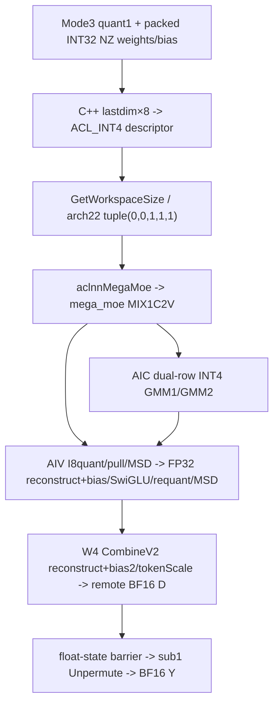
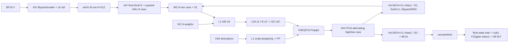
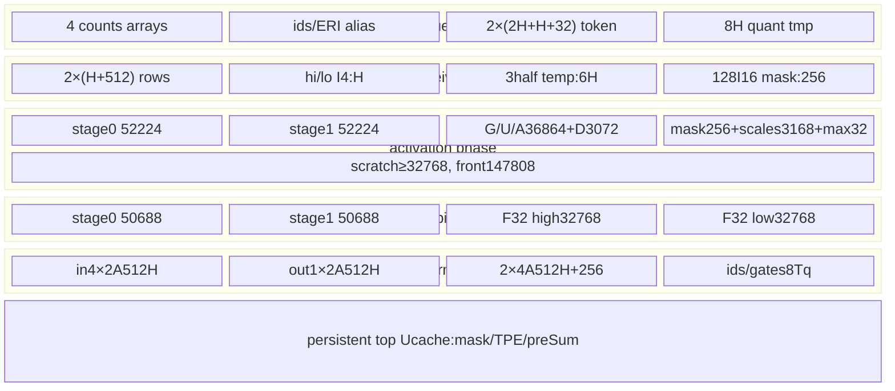

# DeepEP MegaMoE A8W4-INT SwiGLU A3 ACLNN 算子知识

## 算子速览

| 项目 | 内容 |
|---|---|
| 实际入口 | CANN9.2公开aclnnMegaMoeGetWorkspaceSize/aclnnMegaMoe，SGL Mode3、quant1/int8→dispatch2/outINT8；INT32 NZ权重retag ACL_INT4 |
| 计算语义 | BF16逐token量化INT8/Dispatch→高低MSD INT4双路GMM1→FP16 channel dequant→FP32重建16CH+CL+bias、乘sX/SwiGLU/requant并再拆INT4→GMM2同类重建/乘sA→BF16 Combine/FP32 gates归并 |
| 输入输出 | X BF16、W1[H,N]/W2[I,H]逻辑INT4 NZ、两UINT64 scale和两FP32补偿bias；N=2I、ids INT32、实际gates FP32；Y BF16/counts INT32 |
| 执行类型 | 单MIX_AIC_1_2，AIC_CUBE INT4×INT4双GMM，AIV_VECTOR量化/MSD/激活/重建/归并及MTE窗口通信，无SIMT/NDDMA |
| Kernel 路线 | R-001全部MT均W4 CombineV2，按F0/F1接收轮和U/M mask参数化；self masked无输出，原始DT_INT32 Host拒绝 |
| 核心资源 | 系统16MiB+业务workspace；L1 A/B393216+scale4096=397312B；L0A32KiB/B64KiB/C128KiB；AIV UB192KiB阶段复用 |
| 来源闭包 | source_closed：SGL/公开API/完整Host/POD/router、W4实际MSD/Cube/epilogue/float-state通信、CATLASS2及HCCL/HCOMM9.2资源闭合；硬件primitive/生成桥为明确边界 |
| 验证状态 | 已完成源码闭包检查；本次知识提取未执行编译、真机、数值或性能测试。静态合同及零域问题保留draft，不将闭合当作运行正确。 |

## 接口与语义

### 计算语义

M为Device本rank容量、SGL从原始m padding并用active mask仅保留前m，最终Y[:m]；H hidden、T top-k、R ranks、L本地专家数、N=2I为W1输出宽度。正常业务E=RL且每token ID有效不重复。权重W1/W2是有符号INT4 NZ，Torch可用INT32 packed存储，8个nibble共一INT32。UINT64是Fixpipe per-channel descriptor，bias1/2是离线MSD精度补偿，必须按反量化后单位提供。

记q为INT8量化值，MSD明确计算h=floor(q/16)、l=(q&15)-8，因此q=16h+l+8。每token两路在GM为相邻两行INT4，高行、低行各K个nibble，共K字节；不是把原q字节原样reinterpret就得到相同矩阵。实际顺序：

```text
QX,sX: BF16->F32 absmax; dX=(max>0?127/max:127), sX=1/dX
  I32 RINT -> F16 ROUND -> I8 TRUNC
HX=floor(QX/16), LX=(QX & 15)-8
CH1=FP16_FixVDEQF16( I32_Mmad(HX,W1_I4), channel_descriptor1 )
CL1=FP16_FixVDEQF16( I32_Mmad(LX,W1_I4), channel_descriptor1 )
G,U = (16*FP32(CH1)+FP32(CL1)+bias1_FP32) * sX
G'=min(G,c), U'=clip(U,-c,c) if c>0; otherwise unchanged
A = G'/(1+exp(-G')) * U'                         FP32
sA=max|A|/127; dA=(max|A|>0?127/max|A|:0)
QA=I8_RINT(F16_RINT(I32_RINT(A*dA)))
HA=floor(QA/16), LA=(QA&15)-8                    INT4 packed rows
CH2/CL2=FP16_FixVDEQF16( I32_Mmad(HA/LA,W2_I4), descriptor2 )
D=BF16_RINT( (16*FP32(CH2)+FP32(CL2)+bias2_FP32)*sA )
Y[t]=BF16_RINT( sum_k FP32(D[e(t,k),row(t,k)])*gates_FP32[t,k] )
```

两路各自先FP16舍入，再在FP32重建；不能等同一次INT8×INT4精确INT32乘积后只舍入一次。若descriptor表示sw，为补偿l减8的偏移，bias应处于channel反量化后尺度，即数学上8·sum_k(Wq[k,:])·sw；源码只读取caller的bias不生成/校验它。README使用8sumW说明离线补偿，实际consumer顺序决定必须与当前scale单位匹配，不是可任意添加的常规MLP bias。

输入零行sX=1/127，激活零行sA=0/dA0。SwiGLU clamp默认FLT_MAX、0关闭，gate仅上界、up双边。invalid/inactive写ERI=-1/归并跳过是实现行为，公开Mega仍要求有效不重复ID。没有shared专家或dispatch去重；不保证NaN/Inf、INT32溢出、CTRL全局饱和或逐位数学等价。

### 输入、输出与属性

| 参数 | shape/layout | dtype | 约束、默认值与语义 |
|---|---|---|---|
| context | 1D ND、标准6156个INT32 | INT32 backing | Mc2MoeContext +8 KFC地址，Host不核验长度/内指针 |
| x | [M,H] ND | BF16 | M≥1，H1024..8192/%512；Host无M U32上界，SGL文档容量≤4096 |
| ids/gates | [M,T] ND | I32 / Host F32或BF16 | T1..16；实际gates固定float*，前端无Cast，可靠合同取FP32 |
| weight1 | L个逻辑[H,N] NZ | ACL/GE INT4 | L1..128、首项决定N，逐项Origin2D/Storage dim0H；正常N=2I |
| weight2 | L个逻辑[I,H]同NZ | INT4 | 与W1首项dtype/format/列表长相同，逐项维度，I≥512且%256=0 |
| packed Torch weights | W1[H,N/8]、W2[I,H/8]且NZ | INT32 storage | C++要求contiguous，最后维×8、连续logical stride/storage、原offset和data不变retag ACL_INT4；不做转置/format cast |
| raw DT_INT32 weights | OpDef有列 | INT32 | 未retag直接ACLNN时Host只接受BF16/INT8/INT4，终点GRAPH_FAILED，不能因entry宏支持就扩大公开可达域 |
| weight_scales1/2 | L个1D ND、[N]/[H]有效域 | UINT64 | 必选；Host查首dtype/format、列表长/每项rank，但未实际查期望长度和每项dtype |
| bias1/2 | L个1D ND，[N]/[H] | FP32 | INT4必选，Host查首dtype/format、列表长、逐项rank/长度；实际作为MSD weightAux加在token scale前 |
| active mask | 可选[M] ND | INT8→bool | SGL容量前缀，零inactive、不改输入ids |
| scales | null | 预留 | 当前Host拒绝非空，sX内部产生 |
| shared系列 | API有参数 | 占位 | entry未传Init、当前Host/body无shared计算producer |
| mask_buffer | 可选[R] | INT32 | 非零rank排除；self masked两侧return，Y/counts不写，不是清零 |
| E/R | 属性 | I64→U32 | E1..1024，R∈{2,4,8,16,32,48,64,96,128}；业务E=RL/context一致，Host未全部核验 |
| cclBufferSize | 两窗总字节 | I64 | Host用/2查下界，Device取真实winSize |
| maxRecvTokenNum | route行预算 | I64→U64 | ≥0、0自动MRmin(T,L)；B/F控制逻辑token行，Cube再展开2倍M |
| dispatch mode/out | 2/DT_INT8 | enum | 与INT8 dispatch同逐token量化；tuple quant1/out1，W4只由weight类型决定，非INT4 dispatch |
| combine mode/commAlg | 0/空 | scalar | Host仅接受；不等同KFC内部fullmesh配置 |
| numMaxTokensPerRank | 容量 | I64→U32 | >0查≥M，非正跳过后窄化；SGL公共正容量 |
| activation/params | swiglu、[]/[c] | string/F32 | code0、c默认FLT_MAX、≥0且非NaN，+Inf接受；SGL不暴露clamp |
| activationOutDtype/TW1/TW2/interleave | UNDEFINED/false/false/0 | 内部属性 | API固定，Host拒绝transpose；无当前interleave consumer |
| topoType/rankNumPerServer/topkWeightsType/combineCommMode | API有属性 | scalar | arch22不消费路由属性；公开combineCommMode0，不引入channel/去重 |
| Y/counts | [M,H]/[L] | BF16/I32 | 标准wrapper counts=floorE/R，Host要求L，正常E=RL |

### 入口与版本

本卡覆盖固定SGL提交dda6…的Mode3和ops-transformer e7da…实际CANN9.2实现。SGL `python/deep_ep/doc/FUSED_DEEP_MOE.md` 的Mega节、README的Mega说明均明确要求各平台CANN9.2.0；ops-transformer `version.cmake`、对应SDK/HCCL/HCOMM版本文件确认9.2.0。DeepEP其它模式的9.0/9.1徽章不改变此入口版本。

公开支持证据先是SGL的A3 A8W4-INT合同及ops-transformer Mega README产品/精度表，再是`mega_moe_def.cpp`的ascend910_93配置，最后才是Host、MIX入口和CMake。当前Host要求BF16 X和逻辑INT4 NZ双权重；OpDef包含FP16/DT_INT32列不等于它们绕过Host。SGL packed INT32通过真实descriptor retag进入INT4路线。与[既有Mega接入API](../../../../apis/deepep/deepep_mega_moe.md)复用接口事实；本卡新增完整实现，不替代[Mode2 DispatchFFNCombine](sgl_deepep_dispatch_ffn_combine.md)或Mode1的不同算法、ABI和CANN版本。

## Host/Launcher 执行流程

### 参数校验与前处理

1. SGL `Buffer.fused_deep_moe`选择`MegaMoeStrategy`，量化1/int8对应dispatchQuantMode=2、out=INT8，惰性导入CANN包；缺包/JIT环境只在本模式调用处抛异常。策略要求gmm2_weight为非空list，使用首项倒数第二维作I，拒绝原始m>容量M。
2. 以(E,M,T,H,I,dispatchMode,outdtype)缓存SymmBuffer；非MX模式创建active mask并padding X/ids/gates；仅ids显式转INT32，不变换权重payload、gates精度、格式或布局。不转发profile_enable，不为SwiGLU传beta/linear_beta。
3. CANN Python归一化activation，SwiGLU生成[FLT_MAX]；C++ `NpuMegaMoe`选择arch22描述符路径、创建Y与counts，保持topkWeights原tensor。arch22 packed INT32 NZ由MakeWeightList选择专门descriptor：各项须contiguous INT32且NZ，最后逻辑维×8、逻辑Storage同shape、连续stride，dtype改ACL_INT4；保留原storage.data、storage_offset，不搬运payload。两scale列表为UINT64，bias1/2必须提供FP32补偿量；原始DT_INT32直接传ACLNN仍在Host dtype guard拒绝。
4. `ACLNN_CMD`在当前NPU stream调用GetWorkspaceSize。公开API检查必选tensor/list/activation/floatarray/outputs、E>0、R>0、maxRecv≥0；需要时创建executor，并给null动态参数补typed零长度placeholder。公开API不检查executor二级指针本身，不能传null `executor`地址。
5. 进入生成的aclnnInner桥；OpDef使context/X/ids/gates/optional元数据AutoContiguous、权重IgnoreContiguous。生成inner和普通Contiguous是框架边界，不能假设其负责Cast gates或修正权重语义。
6. Host顺序为commAlg→输入shape/type/list/scale/bias/mask→属性→输出→平台资源→CCL容量；任何检查失败返回GRAPH_FAILED，无fallback重选其它精度。设置scheduleMode=1、blockDim，再算tuple、存POD和workspace。scheduleMode返回值保留在局部ret未检查。
7. GetWorkspaceSize非零状态在C++释放转换descriptor后抛异常，不提交Device。成功分配UINT8 workspace，封装当前stream的执行handler；handler调用aclnnMegaMoe、释放转换descriptor/huge memory并传播非零status；OpCommand和NPU allocator的stream完成语义为框架边界，不能由函数返回推断Device已完成。

### 参数、Workspace 与生命周期

A_d(x)=ceil(x/d)d，C=ceil(M/1024)，Q=1024Rmin(T,L)，Aattr为maxRecv或自动MRmin(T,L)，B=max(1,min(Q,Aattr))、F=ceil(Q/B)。chunk接收逻辑行J决定f=max(1,ceil(J/B))；Cube双路M=2J不改变B/表的token行单位。offset从entry收到workspaceGM直接累加，没有显式系统16MiB偏移。

| slice | Device字节extent | owner/lifetime |
|---|---:|---|
| W0 counts | 128A_8(RL)·4 | 当前chunk计数/前缀后复用 |
| W1 ERI | 1024T·4 | scatter→source Unpermute，chunk尾后覆盖 |
| W2 cumsum | C R²L·4 | 每chunk不同地址，紧凑[R,L]写前部 |
| W3 rounds | C F·3RL·4 | 每(chunk,round)三表不同地址 |
| S1/S2 | 4B各一份 | receiver→重建激活；激活→Combine，同轮均存活 |
| W4 C1/C2 alias | 4Bmax(N,H) | FP16，M展开2倍；GMM1两路→激活后GMM2两路覆盖，C2denseH |
| W5 packed A1/A2 alias | Bmax(H,I) | 双INT4行每token K字节，receiver→GMM1→激活MSD→GMM2；专家slot留宽 |
| W6 preSum | 4R A_16(L) | F0源前缀、F1切轮表，chunk恢复 |
| W7 | 不分配 | W4不设置ptrSoftFlagBase，软件flag当前未用 |

Host仍预算输入2Bmax(H,I)，比Device Bmax(H,I)更宽；还保留64R soft预算，preSum原式64floor(R(L+15)/16)与Device不同。不可用Device地址替代Host预算：

```text
WmegaHost=W0+W1+W2+W3+8B+4Bmax(N,H)+2Bmax(H,I)
          +64floor(R(L+15)/16)+64R
Wprologue=16MiB+4MT+8RL
workspaceSize=16MiB+max(WmegaHost,Wprologue)
```

x/weights/scales/bias/context与workspace均存活至当前stream完成。A3 SymmBuffer选KFC，custom size/resolver不扩窗，真实S由通信域/HCCL_BUFFSIZE决定；HcclGetHcclBuffer返回winIn+winOut之和，不含额外1MiB exp。新私有allocation清零；按bufferName可refcount共享首分配/末释放，不同comm可能同窗，Inner警告并发冲突。

m_c=min(M,1024)，P=A_128(RL+1)，Z=max(512R,512KiB)，单窗布局：

```text
offsetA=10MiB; Aextent=m_cT(H+512)
peerScaleReserve=offsetA+Aextent; extent=4m_cT (本body未独立读写)
offsetD=peerScaleReserve+4m_cT; Dextent=2m_cTH
offsetTPE=S-Z-4R*A_128(128R+1); offsetFlag=S-Z
Host min=10MiB+m_cT(H+512)+4m_cT+2m_cTH+4R*A_128(128R+1)+Z
```

prologue每row仅写H+32B，scale在+H，余下512尾padding；receiver先取该INT8 row/scale，再显式拆INT4高低两行到W5/S1。WinD为BF16，TPE实际strideP、容量按Lmax128保留，WinOut未用于本A3payload。rank-state每rank512B，self-state从尾区+256KiB、每SDK interleaved AIV槽128B且首I32有效；本W4使用float 0/1翻转协议，不使用INT8 counter。

标准context的C++ `CommContext`和Device `Mc2MoeContext`在当前消费字段布局一致。KFC builder分配opArgs，显式设engine=4、opType=8和`AlltoAll=level0:fullmesh;level1:pairwise`，HCCL前端逐字段传到HCOMM Inner；默认src/dst FP16、SUM、count0仅用于资源配置，不改变MSD FFN数学。HCOMM的GetAlgInfo按固定表命中`RunAlltoAllDirectFullmesh`，申请全mesh CCL_INPUT/OUTPUT连接、生成HcclOpResParam和remoteRes表后同步拷贝到Device；此阶段是CalcResRequest/资源创建，没有调用该collective的Orchestrate/KernelRun替代本算子通信。实际数据转移仍由本卡的MTE body完成。

远端链路经TransportP2p交换IPC名、size、offset；MemNameRepository按页对齐注册名字、OpenIpcMem缓存或调用driver hrtIpcOpenMemory，并加回页内offset；GetRemoteMem(INPUT_MEM)填relation.windowsIn。此处driver IPC、硬件DataCopy和普通AscendC primitive为边界，未拿不存在的collective算法body充当闭包。

`CommContextManager::Destroy`在KFC无custom buffer时不释放HCCL窗口/资源，也不调用Device同步；其owner仍是通信域。SGL destroy遍历缓存、调用SymmBuffer.destroy后清cache；必须由通信域/调用方保证所有inflight任务完毕。构建中TORCH_CHECK在opArgs分配和显式Free之间没有统一RAII回滚，不虚构失败路径自动清理。

### 启动图与失败传播



一个MIX数学节点，生成inner Contiguous为框架。CalcTschBlockDim(V,C_a,V)/scheduleMode1，返回scheduleMode状态未检查；AIC C_a、AIV V=2C_a，自定义route id=b+sC_a、SDK id=2b+s。Host失败阻止提交，Device polling无timeout/GM错误码；self mask无输出，不臆测具体运行异常。

## Route 与参数设计

### 分核与资源计算

MegaMoe<BF16,int4b_t,BF16,false,false,true,false>；A/B int4b_t，C half，D1 int8 backing用于MSD，D2 BF16。L1 tile(128,256,1024)、L0(128,256,256)，MmadAtlasA2W4A4MatmulPerChannelDequant<1,2,2,2,1,false,true>，虽名AtlasA2，IS_A2=false选A3完整body。每专家GMM1(2J_g,N,H)、GMM2(2J_g,H,I)，INT32acc；Swizzle<9,1>/旋转startCore、K起点b%ceil(K/1024)，内层256K。

A RowMajor以INT4 ND2NZ：dValue和srcDValue按字节取ceil(logical/2)；B zN C0=64nibble。A L1→L0 zZ，B INT4专用LoadDataWithTranspose至nZ，参数不同于INT8 transpose布尔分支。物理L1 A/B同INT8字节但K逻辑倍增，scale双份共4096B。

W4不使用INT8两段g*；IsSyncTask(g,L)当L-g为正2幂触发，最多8个批次(L≤128)，dequantSum[0..8]落16槽内。每批AIC SynchronizeBlock/Finalize9，全部V AIV按该批逻辑token行重建/激活/scale-drain/Set10；GMM2在group0及上个group边界后Wait10，按批重叠。epilogueGranularity=0不用于此调度。

永远W4 CombineV2，无MT4096 selector。GMM2 scheduler用展开M，m0=32展开行=16token，两个subblock分片；Combine每次将实际M/2对高低行重建。归并使用float-state sub0发送/sub1等待，Unpermute仅sub1、C_a核，q=min(floor(m_c/C_a),600)。

### Route 选择

| 顺序 | Route | Key/模板 | 精确选择条件与优先级 | 不适用去向 |
|---:|---|---|---|---|
| 1 | R-001 INT4 NZ MSD SwiGLU | GET_TPL_TILING_KEY(0,0,1,1,1) | A3 BF16 X、逻辑DT_INT4同NZ双W、UINT64 scales/FP32 bias必选、TWfalse、dispatch2/outINT8、combine0/commAlg空、code0及全部shape/output/window检查 | Host失败，无INT8 fallback |
| 2 | packed INT32 descriptor接入 | 与INT4同body | C++ arch22首项INT32且dtype INT32/INT4选packed，逐项contiguous INT32/NZ、最后维×8 | rawDT_INT32到Host明确拒绝，不是另一支持Route |
| 3 | F0/F1 | J≤B/J>B | f1仅chunk表；f>1独立三表，计算域逐轮alias | 超B继续，F1坐标风险另列 |
| 4 | U/M/self return | mask空/非空/self非零 | U float Vector sum等待，M标量DCCI等待且过滤rank，self return无Y/counts | 无清零fallback |
| 5 | 未命中compile域 | OpDef有DT_INT32、FP16等列 | 当前Host无法产出相应支持Route，A2也非本平台 | 保留拒绝终点，不假fallback |

```text
SGL quant1/int8 -> dispatch2/outINT8
 weights INT32 NZ? C++ logical dimLast×8, dtypeACL_INT4 -> same payload
 -> Host BF16 X / INT4 NZ W / scales+bias / shape -> tuple(0,0,1,1,1)
 -> self masked return
 -> chunk J<=B?F0:F1 -> IsSyncTask batches -> W4V2(alwaysMT)
 -> mask null?float-state U:M -> sub1 Unpermute
raw DT_INT32 / FP16 X / missing bias / ND INT4 -> Host failure
```

### 模板/实现执行矩阵

| Route | key/selector | dtype/shape/platform 完整命中条件 | 执行族与 kernel 节点 | 实际模板/body | 内存与同步特征 | tail/fallback |
|---|---|---|---|---|---|---|
| R-001 F0-U/F0-M | tuple(0,0,1,1,1)、J≤B、mask空/非空 | 完整Host合同，INT4 NZ、scales+bias、正常E=RL/ID不重复 | 单MIX双INT4 Cube，AIV I8quant/MSD/激活/W4V2/sub1归并 | W4 private BlockMmad/QuantTileCopy PER_CHANNEL，W4Post Epi1/Epi3<2,IS_A2false> | M两倍、C区4Bmax、A区Bmax；2幂余专家批次9/10、float rank-state | K逻辑256/1024余数、Combine32展开行、J0仍握手 |
| R-001 F1-U/F1-M | 同tuple、J>B | 同合同、B>0、f≤F依赖无重复ID | 同MIX内多轮 | BuildRoundTables/CacheRoundTablesToUb后同MSD body | 三表每轮独立、S1/S2/C/A复用，每轮batch计数重置 | last轮交集；preSum坐标风险，无安全fallback |
| R-001 source self masked | 同tuple、mask[self]非零 | 已成功Host后Device判断 | 两侧无输出终点 | IsRankMasked return | 不提交Y/counts；不等于零值 | caller需协调mask/owner生存期 |

### 隐藏性能 Guard

| Guard | Host/Tiling 条件 | Device/资源原因 | 影响 Route | 不满足时去向 | 源码符号 |
|---|---|---|---|---|---|
| packed descriptor | INT32 contiguous NZ、最后维×8 | Host只接逻辑INT4，retag不变payload/offset | 接入 | C++异常或Host拒绝 | ConvertType(MegaMoeWeightList) |
| H/I/format | H%512/I%256，双INT4 NZ | MSD两路、C0=64、ND2NZ字节长度修正、INT4转置load | 全部 | Host拒绝 | CheckWeight1/2/CopyGmToL1 |
| bias/scales | scaleU64、biasFP32、L项 | 低nibble减8需要补偿，合并后再乘token scale | 全部 | Host拒绝缺参 | CheckBiasForType |
| Cube容量 | (65536+131072+2048)*2≤524288 | scale双buffer，L1实际397312；L032/64/128KiB | 全部 | 无非法实例 | block_mmad_w4a4.hpp |
| sync batch | L-g为正2幂、L≤128 | 最多8批，16槽dequantSum；末g=L-1必flush | 全部 | 无运行fallback | IsSyncTask |
| 冷预取 | 首chunk首round/M≤512/group0非空、HN/2≤32C_a·16384、scratch足 | L1End397312→409600 scratch，W1半B/元素 | 全部 | skip预取正常GMM | WeightL2PrefetchAicColdStartW1 |
| 激活tile | I≤3072或更多tile | 单tile保留A免二遍；多tile重建/激活二遍，共同row scale | 全部 | 走二遍 | W4Post Epi1 |
| UB联合容量 | Host未完整查 | Epi1front147808+32768scratch/cache；Combine166912/cache | 全部 | 无动态降tile | W4 epilogue constructors |
| 小chunk | Host未查m_c≥C_a | q=floor(m_c/C_a)可0，tiler先除零 | 全部 | 静态边界 | Unpermute tiler |

### POD/ABI

以下offset/sizeof按固定源码字段顺序、常见uint32/float对齐4、uint64对齐8作静态自然布局推导，未执行编译或安装二进制ABI测试。公共结构与Quant/NonQuant wrapper均152B、align8，wrapper.common@0。一个字段一行；字段无producer且当前consumer不读时明确记inactive，不臆造清零。

| 结构 | 字段 | 类型/位宽 | ABI 布局 | 单位 | Host/launcher producer | Device consumer | 边界 |
|---|---|---|---|---|---|---|---|
| common | M | U32 | @0/4B | token | Storage x.dim0 | LoadCommon→problemShape.m | M先int64后窄化，无U32上界 |
| common | K | U32 | @4 | 元素 | x.dim1 | H、GMM1 K/GMM2 N | 1024..8192/512对齐 |
| common | N | U32 | @8 | 元素 | W1首项末维 | GMM1 N、I=N/2 | 未独立拒绝奇数 |
| common | expertPerRank | U32 | @12 | 专家 | W1列表长L | group循环/slot | 1..128 |
| common | aivNum | U32 | @16 | 核 | Platform.GetCoreNumAiv | epilogueCoreNum | body另从launch得V，需一致 |
| common | totalUbSize | U32 | @20 | 字节 | Platform UB size赋值 | 当前LoadCommon不读 | 固定Arch容量另在模板 |
| common | topK | U32 | @24 | slot/token | ids.dim1 | permute、weighted reduce | 1..16 |
| common | worldSize | U32 | @28 | rank | epWorldSize | LoadCommon→EP | 应匹配KFC rankSize |
| common | listLen | U32 | @32 | 列表项 | L | GetTensorAddr组索引 | 本域仅逐专家二维列表 |
| common | moeExpertNum | U32 | @36 | 全局专家 | E attr | 当前LoadCommon不读 | Device实际取RL |
| common | epWorldSize | U32 | @40 | rank | R attr | 当前LoadCommon不读此副本 | worldSize副本生效 |
| common | dispatchQuantMode | U32 | @44 | enum | attr2 | key的Host producer | body由W4量化模板决定 |
| common | cclBufferSize | I64 | @48/8B | 字节 | attr | Host单窗校验 | Device用context真实winSize |
| common | maxRecvTokenNum | U64 | @56 | route行 | attr或自动M R min(T,L) | 当前LoadCommon不读 | B字段才驱动workspace |
| common | dispatchQuantOutDtype | I32 | @64 | GE dtype | attr DT_INT8 | SetMegaMoeTilingKey | tuple outType1；不是4bit dispatch |
| common | combineQuantMode | U32 | @68 | enum | attr0 | Host guard | Device不量化 |
| common | commAlgCode | U32 | @72 | enum | 未见赋值 | 当前body不读 | inactive，不能承诺默认0 |
| common | numMaxTokensPerRank | U32 | @76 | token | attr窄化 | 当前body不读 | SGL用于padding和SymmBuffer |
| common | activationCode | U32 | @80 | enum | swiglu→0 | GatedActivation::Compute | 其它数学不属本卡 |
| common | activationClamp | FP32 | @84 | 数值 | params/default FLT_MAX | SwigluActivation | 0关闭截断 |
| common | activationParams1 | FP32 | @88 | 数值 | 默认1.702 | code0不使用 | OAI/SiTU其它数学 |
| common | activationParams2 | FP32 | @92 | 数值 | 默认1 | code0不使用 | 同上 |
| common | isTransposeW1 | U32 | @96 | bool编码 | false | key→TB1=false | true被Host拒绝 |
| common | isTransposeW2 | U32 | @100 | bool编码 | false | key→TB2=false | true被Host拒绝 |
| common | hasBias1 | U32 | @104 | bool编码 | 未见赋值 | 当前LoadCommon不读 | 实际指针与constexpr分支 |
| common | hasBias2 | U32 | @108 | bool编码 | 未见赋值 | 当前LoadCommon不读 | 同上 |
| common | hasXActiveMask | U32 | @112 | bool编码 | 局部isActiveMask校验但未写此字段 | 当前body直接判断指针 | inactive字段 |
| common | hasScales | U32 | @116 | bool编码 | 未见赋值 | 当前LoadCommon不读 | scales非空已拒绝 |
| common | isQuantRouting | U32 | @120 | bool编码 | INT4→1 | Host预算/key/wrapper | Device由BType constexpr |
| common | isW4A8 | U32 | @124 | bool编码 | INT4→1 | Host额外双行输出预算 | Device不读此POD字段；BType=int4b_t使constexpr isW4A8=true，选择W4 BlockMmad及dequant/epilogue |
| common | activationOutDtype | I32 | @128 | dtype | UNDEFINED | 当前LoadCommon不读 | Host限制，不改变BF16 |
| common | weight1Interleave | U32 | @132 | 元素 | 公共API0 | 当前LoadCommon不读 | 内部Host可较宽但无consumer |
| common | recvRoundBudget | U64 | @136/8B | route行 | B | LoadCommon.maxOutputSize、切片/轮次 | ≥1 |
| common | recvRoundsMax | U64 | @144/8B | 轮表份 | F | RoundTablePtr stride | 与实际f及无重复ID前提匹配 |

外层context自然size24624B、align8；C++以6156个INT32拷贝。它不是common POD，也不能使用旧Mode1的context布局。

| 结构 | 字段 | 类型/位宽 | ABI 布局 | 单位 | Host/launcher producer | Device consumer | 边界 |
|---|---|---|---|---|---|---|---|
| Mc2MoeContext | epRankId | U32 | @0 | rank | KFC GetRankId | 本A3shmem不读此副本 | shmem取KFC内localUsrRankId |
| Mc2MoeContext | rankSizePerServer | U32 | @4 | rank | KFC默认0 | 本body不读 | channel才另有意义 |
| Mc2MoeContext | kfcContextAddr | U64 | @8 | GM地址 | CreateHcclContext返回opsResCtx | initShmem→HcclOpResParam* | 非null/版本由caller保证 |
| Mc2MoeContext | epHcclBuffer_ | U64[1024] | @16/8192B | GM地址 | CollectRankBuffers | 本body通过KFC资源寻址，不读该表 | manager本地view使用本rank项 |
| Mc2MoeContext | hcommHandle_ | U64[1024] | @8208/8192B | handle | KFC值初始化0 | 本body不读 | 不以它新增channel Route |
| Mc2MoeContext | channelsPerRank | U32 | @16400 | channel数 | KFC默认0 | 不读 | inactive |
| Mc2MoeContext | enableGroupSend | bool | @16404/1B | bool | KFC false | 不读 | 随后3B自然padding |
| Mc2MoeContext | roceHcclBuffer_ | U64[1024] | @16408/8192B | GM地址 | KFC全0 | 不读 | inactive |
| Mc2MoeContext | roceBufferSize | U64 | @24600 | 字节 | KFC0 | 不读 | inactive |
| Mc2MoeContext | hostStatusTableAddr | U64 | @24608 | 地址 | KFC0 | 不读 | inactive |
| Mc2MoeContext | completedRounds | U64 | @24616 | 轮次 | C++默认U64(-2) | 本body不读 | Device声明无默认值，由Host拷贝 |

HCCL9.2前端 `HcclOpArgs` 为Host私有opaque对象：src/dst/reduce三个enum经Init设FP16/FP16/SUM，count=0；algConfig[128]经strcpy_s设置，commEngine经SetCommEngine设4，reverse未赋值且此链不读。每个字段由HcclCreateOpResCtx逐项传入Inner；不把未核验的enum ABI/struct总长作为安装保证。

当前Device消费HcclOpResParam的localUsrRankId@16、rankSize@20、winSize@24、localWindowsIn@32、remoteRes@2984（每项nextHostPtr@0/nextDevicePtr@8、stride16）；HcclRankRelationResV2.windowsIn@8。固定ops header与HCOMM producer的这段自然布局可逐字段对应：208B前缀+2472B ReservedStruct+160B AlgoTopoInfo+48B HcclOpConfig+三个U64+16个U32+两个U32=2984B。HcclOpConfig内部9.2将旧notify的8B区域分成两个U32，但本consumer不读它，且总长保持48B；这不是全文struct或安装二进制ABI等价声明。

Unpermute局部POD由Device内 `MoeTokenUnpermuteTiling`生成，12个I64依次@0..88，size96/align8：hidden_size=H；top_k=T；num_out_tokens=m_cT；hidden_splited_length=H；hidden_splited_num=1；hidden_splited_remain=0；tokens_core_length=floor(m_c/C_a)；tokens_core_remain=m_c%C_a；tokens_splited_length=min(tokens_core_length,600)；tokens_splited_num=tokens_core_length/tokens_splited_length；tokens_splited_remain=对应余数；buffer_num=4。每个字段由LoadTilingData同名读入，其中余数核增加1行。该表不是Host公共ABI；split length为零时公式本身未保护。

当前外部资源消费字段单列如下；完整HCCL资源结构其余成员属于库资源边界，当前实例不读取，不推导尾部总长。

| 结构 | 字段 | 类型/位宽 | ABI 布局 | 单位 | Host/launcher producer | Device consumer | 边界 |
|---|---|---|---|---|---|---|---|
| HcclOpResParam | localUsrRankId | U32 | @16 | rank | HCOMM BuildOpResParam.userRank | HcclShmem.Rank | 不同于Host属性副本 |
| HcclOpResParam | rankSize | U32 | @20 | rank | userRankSize | HcclShmem.RankSize | caller保证与EP一致 |
| HcclOpResParam | winSize | U64 | @24 | 字节 | algResource.cclInputMem.size | SegmentSize | 真实单窗容量 |
| HcclOpResParam | localWindowsIn | U64 | @32 | GM地址 | cclInputMem.ptr | self window | 外部domain owner |
| HcclOpResParam | remoteRes | RemoteResPtr[131072] | @2984，stride16 | 地址表 | BuildRelationResByRemoteRankId | 对端nextDevicePtr | 仅索引R个rank；不推导全部tail ABI |
| RemoteResPtr | nextHostPtr | U64 | @0 | Host地址 | CreateListNode | Device不读 | 资源管理 |
| RemoteResPtr | nextDevicePtr | U64 | @8 | GM地址 | CreateListNode并H2D | HcclShmem远端寻址 | 不为零由资源创建保证 |
| HcclRankRelationResV2 | windowsIn | U64 | @8 | GM地址 | TransportP2p.GetRemoteMem(INPUT_MEM) | offset+远端window | 同prefix的rank字段@0/4；只读此地址 |

Unpermute局部POD字段producer/consumer补表；每字段I64，4列简写的@offset均在size96/align8结构内，LoadTilingData按同名复制，无Host跨版本序列化。

| 结构 | 字段 | 类型/位宽 | ABI 布局 | 单位 | Host/launcher producer | Device consumer | 边界 |
|---|---|---|---|---|---|---|---|
| UnpermuteTiling | hidden_size | I64 | @0 | 元素 | Device tiler H | CopyTokenIn/Out | H≤8192 |
| UnpermuteTiling | top_k | I64 | @8 | slot | T | CalPartOutToken | 1..16 |
| UnpermuteTiling | num_out_tokens | I64 | @16 | expanded行 | m_cT | ERI有效性检查 | 非原始m |
| UnpermuteTiling | hidden_splited_length | I64 | @24 | 元素 | H | UB/offset | 单完整hidden |
| UnpermuteTiling | hidden_splited_num | I64 | @32 | 次 | 1 | CalSingleOutToken | 无hidden分割 |
| UnpermuteTiling | hidden_splited_remain | I64 | @40 | 元素 | 0 | 隐藏尾分支 | inactive |
| UnpermuteTiling | tokens_core_length | I64 | @48 | token | floor(m_c/C_a) | block行数/offset | 余数核+1 |
| UnpermuteTiling | tokens_core_remain | I64 | @56 | 核 | m_c%C_a | LoadTilingData/CoreElementOffset | 前余数核+1 |
| UnpermuteTiling | tokens_splited_length | I64 | @64 | token | min(floor(m_c/C_a),600) | 每次ids/gates批量 | q=0未保护 |
| UnpermuteTiling | tokens_splited_num | I64 | @72 | 次 | tokens_core_length/q | Process循环 | q=0含除零 |
| UnpermuteTiling | tokens_splited_remain | I64 | @80 | token | tokens_core_length%q | 尾批 | q=0含余数零除；余数核+1 |
| UnpermuteTiling | buffer_num | I64 | @88 | buffer深度 | 4 | InitBuffer(tokens_inque) | 实际物理depth4 |

### Route 源码闭包

| Route | Key/selector | Host/Tiling producer | POD/参数 | Kernel entry/router | Kernel body/直接依赖 | 构建接线 |
|---|---|---|---|---|---|---|
| R-001全部F0/F1×U/M | tuple(0,0,1,1,1)、逻辑DT_INT4 | packed retag→aclnn_mega_moe→arch22Host/B/F/Workspace | Quant.common152B、context消费prefix、Unpermute96B | mega_moe→MegaMoe<BF16,int4b_t,BF16,false,false,true,false> | A3Kernel、MSD receiver、block_mmad_w4a4、W4Post激活/Combine、float-state shmem，CATLASS2/HCCL92/HCOMM92完整 | OpDef ascend910_93、CMake ACLNNinner/CATLASS_ARCH2201、catlass.cmake769cd40… |


## Kernel 实现

### 公共执行流程

entry以Quant tuple读取common152B，LoadCommon使用B/F；共享API的shared输入未进入Init。initBuffer解析context/KFC、真实window、workspace/peermem及top UB cache，InitCombineMode仅INT8会设true，W4始终false。AIC/AIV均先self mask return。AIC与AIV从同一chunk cumsum各自推f，不增加Host launch。

A3窗口count/prologue/轮表为逻辑token行，Cube使用双MSD展开行；只有相应地址/scale计算明确乘2或除2。F1仍有实际preSum坐标边界，不能补造修正后才描述body。

### Route R-001：INT4 NZ MSD双GMM与SwiGLU

#### 适用条件

##### 选择证据

| 层级 | 文件 | 符号 | 源码谓词/参数 | 结果/下一跳 |
|---|---|---|---|---|
| SGL | strategies/fused_strategy.py | _resolve_mega_moe_quant | quant1/int8→dispatch2/outINT8，非MX | 保留INT32 packed权重，bias1/2传CANN |
| C++ | torch_extension/csrc/mega_moe.cpp | MakeWeightList/ConvertType | arch22、首INT32且目标INT32/INT4→packed；逐项INT32 contiguous NZ | ACL_INT4 logical lastdim×8，Storage同shape/stride，原payload/offset |
| Host | arch22 mega_moe_tiling_arch22.cpp | CheckWeight1/2/CheckBiasForType | BF16X、INT4同NZ双W、bias/scales必选、attr2/outINT8 | isQuant1/isW4A8=1、tuple(0,0,1,1,1) |
| router | mega_moe_arch22.h | MegaMoe::Process | isW4A8=true、IS_A2=false | A/Bint4b、C half、D1 I8、L1K1024/L0K256 |
| Device body | mega_moe_kernel_a3.hpp | InitCombineMode/ProcessRecvRound | BType int4，不满足INT8 selector | W4Epi1+W4V2所有MT，2幂边界batch |
| build | CMakeLists/mega_moe_def.cpp | ACLNNinner/ascend910_93 | CATLASS_ARCH2201、DT_INT4 NZ列 | 当前A3实例；原DT_INT32仍被Host拒绝 |

#### Device 数据流

##### 函数级调用链

```text
SGL MegaMoeStrategy -> CANN mega_moe -> packed INT32 descriptor retag
 -> aclnnMegaMoeGetWorkspaceSize/aclnnMegaMoe -> generated inner
 -> mega_moe<false,false,1,1,1>
 -> MegaMoe<BF16,int4b_t,BF16,false,false,true,false>::Process
 -> MegaMoeKernel::initBuffer / operators
   AIV:
    DispatchAndCombine
     -> MoePermutePrologue<2,quantpolicy,BF16,I8>::QuantizeToken/ScatterToken
     -> AllGatherTokenPerExpert/GetCumsumForMMAIV/CacheRouteTablesToUb
     -> [BuildRoundTables/SetRoundTableBuffers/CacheRoundTablesToUb]
     -> ProcessRecvRound
       -> FetchAndPreprocessInt8ToInt4
         -> Detail::FetchAndPreprocessInt8ToInt4Shared
       -> UpdateDequantSums/IsSyncTask
       -> BlockEpilogue<W4A8PostPerTokenDequantSwigluQuant<2>>
         -> GetGroupIndex/LoadTile/ComputeLoadedTile
         -> GatedActivation/SwigluActivation
         -> rowAbsMax/QuantizeAndCopyTile (I8 -> high/low I4)
       -> BlockEpilogue<W4A8PostPerTokenDequantV2<2>,IS_A2_T<false>>
         -> FP16 H/L + bias2 -> tokenScale -> BF16 route
     -> ResetTokenPerExpert
     -> InitStatusTargetSum(all AIV)
     -> sub0 CrossRankSyncV2Set[WithMask]
        sub1 CrossRankSyncV2Wait[WithMask] -> Unpermute(...,C_a)
   AIC:
    ready -> optional cold W1 prefetch -> [round table view]
     -> GMM1/GMM2
       -> BlockMmad<MmadAtlasA2W4A4MatmulPerChannelDequant<1,2,2,2,1,false,true>>
         -> CopyGmToL1 A/B/scale -> L1TileMmad -> INT4 TileMmad I32acc
         -> L1 scale -> FP buffer -> VDEQF16 Fixpipe
         -> SynchronizeBlock/Finalize across IsSyncTask boundaries
```

##### 源码等价伪码

伪码按实际地址单位与调用顺序蒸馏，不是可执行修复：

```text
init context/window/workspace/cache; both sides if self masked return(no output)
for each chunk with tokenBase=1024c, mc=min(1024,M-tokenBase):
  AIV prologue:
    count active valid IDs into W0 core slots -> all-AIV prefix/count
    each token BF16->F32 absmax, dX=127/max or127
    I32 RINT -> F16 ROUND -> I8 TRUNC
    write scale=1/dX at tokenOut+H, scatter H+32 to WinA[row*(H+512)]
    inactive/invalid ERI=-1; valid ERI=source permute row
  allgather TPE with+0x800000, poll512B groups via32B UB, masked counts0
  AIV0 compact chunk cumsum/preSum; SyncAll/cache; accumulate counts[L]
  independently AIC/AIV f=max(1,ceil(J/B))
  for r in f:
    if f>1: AIV0 intersect receiver blocks with[rB,(r+1)B)
      write independent W3(c,r) three tables -> MTE3 publish/SyncAll
      switch cumsum/preSum/TPE and refresh cache
    AIV ready0; nSync=0,dequantSum[0]=0,totalRows=0
    for expert g:
      for source s=coreIdx+jV not masked:
        rows clipped to B; rowSrc=preSum[s,g]
        dstByteBase=previousExpertRows*max(H,I)+rowStartInGroup*H
        each source row:
          read H+512 INT8 bytes ping/pong, copy F32 tail -> S1
          high=I4_FLOOR(F16(Q8)*1/16)
          low=I4_NONE(F16(Q8&0x0F)-8)
          write H/2 high bytes at dstByteBase+iH
          write H/2 low bytes at dstByteBase+iH+H/2
        drain MTE/Vector flags6/7 before return
      SyncAll -> group-ready floor(counter/15)
      totalRows=min(B,totalRows+currentM)
      if powerOfTwo(L-g): dequantSum[++nSync]=totalRows

    AIC GMM1:
      for expert g, actualM=2*clipped logical currentM:
        wait group-ready, rotating Swizzle9,1 tiles, A/B I4
        scale output-column256 U64 -> L1 ping/pong before K loop
        ND2NZ A adjusts dValue/srcDValue to bytes; B NZ direct
        shuffleK b%ceil(H/1024); L0K256; I32acc initC firstK only
        lastK L1Scale->FP -> FP16 Fixpipe rows
        gmC row stride=max(N,H), gmGroupOffsetC += 2J_g*stride
        gmGroupOffsetA += 2J_g*max(H,I)  [I4 element unit = J_g*max bytes]
        if powerOfTwo(L-g):
          SynchronizeBlock; Finalize(batchIndex,flag9)
    AIV for each sync batch:
      Wait9+SyncAll; logical rowStart/dequantSum difference
      gmCbase = logicalRowStart*max(N,H)*2 [half elements]
      for row and tile<=3072:
        Load CHgate/CHup/CLgate/CLup + bias1gate/up
        reconstruct G/U = (16*FP32(CH)+FP32(CL)+bias1)*S1
        SwiGLU -> F32 activation; accumulate whole-row absmax
      S2=maxAbs/127; quantMultiplier=maxAbs>0?127/maxAbs:0
      singleTile: keep activation, otherwise reload/reconstruct/reactivate all tiles
      I32 RINT -> F16 RINT -> I8 RINT
      split QA into high floor(/16), low((QA&15)-8)
      gmTileD = W5 + logicalRow*I [I8 byte view]
      write high tile at tileOffset/2, low at I/2+tileOffset/2
      batch S2<=256 using2scale buffers; drain
      SyncAll; Set10 after each batch
    Epi1.Finalize drains C/bias/high/low events before UB reuse

    AIC GMM2:
      Wait10 at group0 or if prior group hit powerOfTwo boundary
      actualM=2J_g, K=I, N=H; same I4/I32/FP16 channel-dequant pipeline
      C2 densely H, alternating high/low rows; pergroup completion flags0..8
      SynchronizeBlock; Finalize(L-1) to drain trailing/empty groups
    AIV W4V2.InitFlag
      mirror GMM2 scheduler actualM doubled
      pair subblocks split in m0=32 expanded-row units
      Wait each needed group flag
      load CH/CL with GM rowstride2H into UB dense n0=256
      reconstruct 16*FP32(CH)+FP32(CL)+bias2[n]
      scaleIndex=(2*previousLogicalRows+expandedMOffset)/2
      multiply each logical row S2 -> BF16 RINT
      logical route range uses expandedM/2 and actualM/2
      split by source intervals/preSum and write remoteWinD
      preSrcExpertSum passed in expanded units=2*previousLogicalRows
      wait remaining group flags incl empty trailing; Finalize drains buffers
    SyncAll; round counters reset

  last AIV reset TPE in bounded16KiB I32 chunks
  all AIV InitStatusTargetSum(): unique SDK(2b+s)*128B self slot, flip0/1
  sub0: wait/send mode0 handshake, write32B state to rank512B slots; skipmask
  sub1: Vector sum wait (U) or DCCI int wait (M)
        Unpermute tiler uses C_a, q=min(floor(mc/C_a),600)
        ERI valid0<=idx<mcT -> F32 gate-weight BF16 D, slot-order F32acc
        invalid first zero, later valid add, BF16 RINT Y
  SyncAll<true> before next chunk; no actual SyncAll<false>
```

L=1 pointer表分支取index0；W/scale/bias在同一列表项内另加group幅度偏移的代码保留，正常L=1仅group0。连续二维per-expert列表是Host真实合同，README的stacked注释不替代Host输入rank检查。IsSyncTask有L=128的8次边界，最多dequantSum[8]，不是每15group的激活分批；15仅为cross-core flag编号复用间隔。

#### 内存与数据搬运

##### 资源与搬运表

| 层级/缓冲区 | offset/地址公式 | extent/容量公式 | dtype/layout | producer | consumer | owner/lifetime | 对齐/复用 |
|---|---|---|---|---|---|---|---|
| GM X/ids/gates | tokenBase·H/T | 2MH/4MT/4MT实际gates | BF16/I32/F32 ND | caller | prologue/Unpermute | stream完成前 | BF16 gates无自动Cast |
| W1/W2 payload | dynamic list address + zN offset | L·A_16(H)A_64(N)/2、L·A_16(I)A_64(H)/2字节 | INT4 NZ，Torch INT32 backing | caller/offlinepack | Cube | stream全程 | C++仅retag shape/dtype，原offset/data |
| scales/bias | pergroup [N]/[H] | U64 8L(N+H)、F32 4L(N+H)有效域 | perchannel descriptor/weightAux | caller/offline | Fixpipe/Vector | stream全程 | bias在scale后、token scale前 |
| 动态列表metadata | 首U64表偏移再g项U64 | 框架opaque表 | U64地址 | inner | GetTensorAddr | executor/launch | 所有W/scale/bias各自表 |
| WinA | 10MiB+srcRow(H+512) | mcT(H+512) | I8 payload/4B F32scale/padding | prologue | MSDreceiver | 域当前chunk | source仅写H+32 |
| peerScaleReserve | WinA后 | 4mcT | 保留F32 | 无本body独立写 | 无本body独立读 | 域 | 不是S1/S2 |
| WinD | offsetD+2dstRowH | 2mcTH | BF16 | W4V2 | source sub1归并 | 域当前chunk | mask不自动清零 |
| TPE/flag | 前述固定tail | TPE按Lmax128、Z=max512R/512KiB | I32/float-state | count/shmem | route/barrier | 域 | 实际strideP，state512B/self128B |
| W0/W1/W2/W3/S1/S2/W4/W5/W6 | 前表连续偏移 | 前表精确字节 | GM | 各producer | 各consumer | workspace当前launch | W4/W5 alias，其余不扣重叠 |
| L1 A双stage | 0/65536 | 2·128·1024/2=131072B | I4 zN | ND2NZ | LoadDataA | Mmad stage | event0/1 |
| L1 B双stage | 131072/262144 | 2·256·1024/2=262144B | I4 zN | NZ DataCopy | LoadDataWithTranspose | Mmad stage | event2/3 |
| L1 scales双stage | 393216/395264 | 2·256·8=4096B | U64 vector | GM scale copy | FP buffer | 各pending output tile | FIX_MTE2/MTE2_FIX id0/1 |
| L1 cold scratch | A_16384(397312)=409600 | 16384B | U8 dummy | W1冷预取 | 无数学consumer | 首chunk首round | 不和A/B/scales重叠 |
| L0A/B/C | 0/16384；0/32768；0 | 32768/65536/131072B | I4 zZ/nZ、I32 zN | LoadData/Mmad | Mmad/Fixpipe | ping/pong/C depth1 | nibble位宽算容量，不用sizeof(int4b)假当4bit |
| FP view | base0 | 256U64=2048B | C2PIPE2GM | L1Scale→FP | VDEQF16 | 当前tile尾K | FP单view，scale双L1保护pending |
| UB prologue | 低地址 | 16A_8(RL)+A_32(4Tceil(1024/V))+2(A_32(2H)+A_32(H)+32)+A_32(8H) | BF16/I8/F32/I32 | count/quant | scatter | prologue phase | ids/ERI及quant tmp alias同INT8 |
| UB MSDreceiver rows | 0/(H+512) | 2(H+512) | I8 payload/scale | remote MTE2 | Vector/sScale MTE3 | ping/pong | 每row拆两I4行 |
| UB MSDreceiver hi/lo | 2(H+512)起 | H/2各一，合H | packed I4 | Cast floor/none | localMTE3 | 当前row | 高低数组独立，写GM同token两半 |
| UB MSDreceiver half temp/mask | packed后 | 3·2H+256 | 三half view、128I16 mask | Cast/And/-8 | split | 当前row | 实际分配字节9H+1280总；部分SetSize写sizeof倍数不代表新分配 |
| UB W4 Epi1 stage | i·52224 | C4×3072×2=24576，bias2×3072×4=24576，hi/lo各1536；depth2 | half/F32/I4 | MTE2 | reconstruct/pack | activation | stage分别C/bias/high/low events |
| UB W4 Epi1 common | 104448起 | G/U/A36864+D3072+mask256+scale2×1056+rowMax32+scaleIn1024 | F32/I8/I16 | Vector | quant/MSD/MTE3 | 每行/两stage共用 | front147808B；scratch从此起≥32768 |
| UB W4 Combine stage | i·50688 | CH16384+CL16384+bias1024+D16384+scale512；depth2 | half/F32/BF16 | MTE2 | reconstruct/MTE3 | Combinephase | max_len8192,n0=256,maxM128 |
| UB W4 Combine F32 | 101376起/134144 | 32768各一，合65536 | high/low F32 | Cast | reconstruct/tokenScale | 串行计算当前stage | 总166912B；repeat128非只读有效元素保证 |
| UB Epi2 row view | 低地址 | 16H+1024 | half/BF16/F32 | constructor | 不调用operator | 与W4Epi1/V2复用 | 不将构造记成CombineV1可达 |
| UB topcache | 从196608向下 | Ucache=A32(4R)+A32(4R A8L)+A32(4RL) | I32 | mask/TPE/轮表copy | scalar routes | 各chunk/round持久 | 前台必须≤196608-Ucache |
| UB Unpermute | TPipe顺序低地址 | 18A512(H)+256+8Tq | BF16队列、F32acc、I32ids/F32gates | MTE2 | weighted reduce/MTE3 | sub1最后phase | token输入depth4，out/ids/gates各1；q=min(floor(mc/C_a),600) |
| 寄存器/标量 | core/group/expanded vs logicalrow | 固定状态/索引 | I32/U32/I64/F32 | scheduler | 各阶段 | kernel栈 | dequantSum16U32共64B，最多8批 |

INT4 NZ逻辑offset以nibble计：zN C0=64，offset(r,c)=floor(r/16)·1024+floor(c/64)·A_16(K)·64+(r%16)·64+(c%64)，物理按两个nibble/字节。A ND2NZ将dValue/srcDValue除2向上，INT4 B L1→L0用LoadData2dTransposeParams，srcStride除fractal再/4、dstGap3，循环src按stride1×4前进，不能套INT8布尔transpose的参数。

W4 BlockMmad在发起tile前复制一份256U64 scale到交替L1槽，最后K通过FP view后Fixpipe；callbacks在本实例是空Callback，源码保留调用位置不补造融合算术。每个同步batch显式SynchronizeBlock排空preload，末专家边界确保最终pending被消费；析构等待事件，不宣称析构自动补出缺失的GMM任务。

##### 分层内存布局





##### 字节账、交接边与复用顺序

```text
W4workspace Device=W0+W1+W2+W3+8B+4Bmax(N,H)+Bmax(H,I)+4RA16L
L1=2*(128*1024/2+256*1024/2+256*8)=397312
L1cold scratch endpoint=409600+16384=425984 <=524288
L0A=2*128*256/2=32768; L0B=2*256*256/2=65536; L0C=128*256*4=131072
UBreceiver=2*(H+512)+H+6H+256=9H+1280
UBact=2*(4*3072*2+2*3072*4+3072)+3*3072*4+3072+256+2*1056+32+1024=147808
UBact+minimum scratch=180576
UBcombine=2*(3*8192*2+256*4+128*4)+2*8192*4=166912
UBunpermute=18A512(H)+256+8Tq; q=min(floor(mc/C_a),600)
Each actual phase front/scratch + Ucache <=196608 required; no complete Host joint guard.
```

阶段别名顺序为prologue→receiver→W4Epi1→W4V2→rank-state scratch→sub1 TPipe，顶部route cache仍持久。Epi2/3先构造view不提交数据，Epi1构造会初始化其events；接收helper已经drain后才构造。Epi1.Finalize和scale drain后才W4V2.InitFlag，后者Finalize后才状态/归并。手工view不另分配、TPipe Destroy只释放记账，不能把全部phase容量相加成同存活内存。

| 边/复用子区 | producer | offset/extent | dtype/layout | consumer | ordering/sync | owner/lifetime | 安全条件 |
|---|---|---|---|---|---|---|---|
| WinA→W5/S1 | MSDreceiver | srcRow(H+512)、dstByteBase+iH | I8→I4高低、F32 scale | GMM1/Epi1 | MTE2_V、Vector/MTE3 flags6/7 drain+allAIV/group ready | 域+workspace当前轮 | GM每token高低各H/2B，不原样bitcast |
| W4C1→激活 | Cube Fixpipe | 每逻辑row两half行stride=max(N,H) | FP16 H/L | W4Epi1 | 每2幂batch9→Wait9+SyncAll | 当前轮 | 逻辑MOffset→gmC×2 |
| bias1/S1→激活 | caller/receiver | expert N/row scale | F32 | reconstruct/SwiGLU | bias MTE2_V、S_V；完成后标记view可复用 | caller+当前轮 | (16CH+CL+bias)*S1先于非线性 |
| W5A1→A2 alias | receiver/Epi1 | Bmax(H,I)B，packedHI/LO行 | INT4 | GMM1/GMM2 | 9后覆盖，scale drain/10后GMM2 | 当前轮 | 每专家slot留宽保护I>H |
| W4C1→C2 alias | GMM1/GMM2 | 4Bmax(N,H)，C2denseH | FP16两路 | Epi1/W4V2 | perbatch10及GMM2 group Fixpipe flags | 当前轮 | 高低结果各先FP16round |
| S1/S2 | receiver/Epi1 | 4B各一 | F32 | Epi1/Combine | scale双缓冲drain在10前 | 当前轮 | 不alias，不和peerScaleReserve混淆 |
| W3表 | AIV0 | (cF+r)3RL4B | 三I32逻辑行表 | AIC/AIV | MTE3publish/allAIV/ready0 | 独立到launch结束 | 切表后刷新cache，F1轴问题另列 |
| C2/bias2/S2→D | W4V2 | 展开M/2路由回sourceRow H | BF16 | source sub1Unpermute | group flags、V2 Finalize、float-state barrier | 域当前chunk | bias/scale单位、source map一致 |
| D/ERI/gates→Y | Unpermute | tokenBase H/T | F32reduce→BF16 | caller | sub1rank wait后、chunk末SyncAll | caller output | q非零、FP32gates |

#### 同步、精度与尾块

##### 同步与数值边界表

| 阶段 | primitive/机制 | producer | consumer/等待点 | 保护对象 | 精度/尾块 |
|---|---|---|---|---|---|
| prologue | 计数SyncAll、S_MTE3、量化V/MTE双buffer | 全V | count/scatter | W0/WinA/ERI | RINT→ROUND→TRUNC，zero dX127 |
| receiver | MTE3_MTE2/V_MTE2/MTE3_V id6/7、Vector barriers | WinA load | high/low Cast/MTE3 | 两row、I4/half/mask views | floor(Q/16)，And0x0F0F/-8，H%512、尾4B scale |
| groupready | mode2 PIPE_MTE3 counter/15 | allAIV afterSyncAll | AIC | packedA/S1 | 空专家仍握手，flags0..8 |
| Cube流水 | MTE1_MTE2/MTE2_MTE1、M_MTE1/MTE1_M、M_FIX/FIX_M | Copy/LoadData/Mmad | 下stage | L1/L0 | I32acc首KinitC、unitFlag显式0，INT4两元素/字节 |
| Cube scale | L1槽FIX_MTE2、MTE2_FIX id0/1、PIPE_FIX | GMU64→L1→FP | VDEQF16 | scale ping/pong/FPview | 每tile整256U64预取，不把Host scale rank检查当长度检查 |
| batch9/10 | IsSyncTask L-g为2幂，AIC SynchronizeBlock/Finalize9，AIV SyncAll/Set10 | GMM1/activation | Wait9/Wait10 | 双路C/packedA/S2 | 最后g=L-1必flush，最多8批；不是INT8两段g* |
| W4激活 | C/bias各自V_MTE2/MTE2_V、高低MTE3_V/V_MTE3，scale MTE3_S | 两stage/共用F32tmp | 下tile/GM | 四路C、两bias、高低I4 | 16CH+CL+bias再*S1，SwiGLU F32；I8RINT链后再MSDsplit |
| 激活单/多tile | rowabsmax归约、singleTile复用 | Epi1 | quant output | activation/I4数组 | I≤3072免二遍，更多列重算；last tile仍256对齐(I%256) |
| W4Combine | InitFlag/Finalize、tile V_MTE2、scale V_MTE2、MTE3_V | Fixpipe/Epi3 | 下ping/pong/remoteD | CH/CL/D/bias/scale | fixedrepeat128 Cast覆盖8192槽，实际16*CH+CL+aux、rowScale及路由只用有效片 |
| Combine M轴 | Cube调度m0=32展开行、两subblock | GMM2tile | W4V2实际M/2 | 高低行与S2 | gmScaleOffset=(expandedPrefix+blockCoordM)/2；BF16 RINT |
| count reset | 最后AIV清零、MTE3_S drain | TPE | nextchunk | count/marker | bounded16KiB I32，不额外清WinD |
| rank-state | allAIV InitStatusTargetSum；mode0 SEND9/RECV10 | sub0远端32B publish | sub1Vector sum或mask DCCI | WinD可见/512B状态槽 | float0/1翻转，每SDK id128B selfslot，非INT64counter |
| Unpermute | sub1 TQue/Vector barriers、BF16 RINT | BF16 D+F32gate | Y | inputdepth4/FP32acc | C_a核；q0tiling先除零；invalid首slot清零后valid累加 |
| chunk复用 | 仅实际SyncAll<true>，AIC等下一ready | 全AIV | nextchunk | WinA/D/ERI | 顶部过时SyncAllfalse注释不补成调用 |

#### 关键实现

##### 符号证据表

| 阶段 | 文件 | 符号/模板实例 | 实现事实 |
|---|---|---|---|
| Host/Tiling producer | arch22 mega_moe_tiling_arch22.cpp | CheckBiasForType/SetA3WorkspaceSize | DT_INT4必选bias、双路C预算、B逻辑行 |
| Kernel entry/router | mega_moe_arch22.h | MegaMoe<BF16,int4b_t,BF16,false,false,true,false> | W4 policy、C half、M展开2、L1K1024 |
| Device body/helper | mega_moe_kernel_a3.hpp | GMM1/GMM2/ProcessRecvRound/CombineV2 | pow2边界同步、MSD地址单位、float-state/sub1 |
| receiver | a2_a3_copy_helpers.hpp | FetchAndPreprocessInt8ToInt4Shared | 精确高低计算、I4两行排布及scale |
| Cube specialization | block_mmad_w4a4.hpp | BlockMmad<W4A4PerChannelDequant<1,2,2,2,1,false,true>> | 双L1scale、I32acc→FP16、callback/Finalize |
| 激活 | block_epilogue_w4a8post_pertoken_swiglu.hpp | LoadTile/ComputeLoadedTile/QuantizeAndCopyTile | 四C分支、bias、S1、rowabsmax、MSD输出 |
| Combine | block_epilogue_w4a8post_pertoken_v2.hpp | W4PostPerTokenDequantV2::operator | 16CH+CL+bias2再*S2，展开M/2路由 |
| rank通信/最终归并 | hccl_shmem.hpp/unpermute.h | CrossRankSyncV2/KernelMoeTokenUnpermute | 全AIVself状态、sub1 FP32加权BF16写回 |
| 非数学诊断 | mega_moe_exception_dump_policy.h | ExceptionDump<true> | WinIn前缀诊断，无额外kernel |


## 算子特定优化

### Trick T-001：packed INT32 NZ只改ACL描述符成为逻辑INT4

#### 触发与源码依据

- 适用Route：R-001的SGL packed权重接入，双GMM均适用。
- 触发条件：arch22、INT32 contiguous NZ项，目标dtype为INT32或INT4。
- Golden来源：[mega_moe.cpp:56–67](https://gitcode.com/cann/ops-transformer/blob/e7da18105f08b06e01ef0fff78f439098d483746/mc2/mega_moe/torch_extension/csrc/mega_moe.cpp#L56-L67)。

**官方源码（固定 Commit 连续逐字摘录）**：

```cpp
        auto shape = tensor.sizes().vec();
        shape.back() *= INT4_PER_INT32;
        std::vector<int64_t> strides(shape.size(), 1);
        for (size_t i = shape.size() - 1; i > 0; --i) {
            strides[i - 1] = strides[i] * shape[i];
        }

        // Match the former CreateView: logical storage shape, contiguous strides,
        // and the original view offset, while keeping the same backing memory.
        auto* desc = aclCreateTensor(shape.data(), shape.size(), ACL_INT4, strides.data(), tensor.storage_offset(),
                                     ACL_FORMAT_FRACTAL_NZ, shape.data(), shape.size(),
                                     const_cast<void*>(tensor.storage().data()));
```

#### 机制与设计原因

8个有符号nibble共用一个INT32，最后逻辑维乘8后构造连续stride和同shape的Storage视图，ACL dtype=INT4；data/offset维持原tensor，未做数据搬运。Host据逻辑Storage取H/N/I而不是把原INT32列宽误当INT4列宽。转换只改变描述符，不负责离线NZ排布或正确打包；该机制与激活MSD显式计算/搬运不同。

#### 迁移边界

- 适用：确实含8 INT4/INT32且NZ payload符合逻辑维的arch22权重。
- 前提：每项INT32 contiguous NZ，shape乘法/stride/offset可表示；原存储存活至stream完成。
- 失效：直接将DT_INT32传Host、普通INT8权重、MXFP4两元素/字节协议，均不能套本8倍规则。
- 未验证：本次知识提取未执行编译、真机、数值或性能测试。

#### 错误做法

只改dtype不扩最后维会让逻辑矩阵列宽缩小；仅因OpDef列出DT_INT32就绕过retag，固定Host会走拒绝终点。未执行验证，不臆测具体运行异常。

### Trick T-002：激活MSD显式floor/掩码拆分并写成两行

#### 触发与源码依据

- 适用Route：R-001 receiver，激活requant后也使用相同高低分解。
- 触发条件：WinA INT8每行H+512、sX在+H，W4后继Cube需要2J×H的INT4矩阵。
- Golden来源：[a2_a3_copy_helpers.hpp:176–184](https://gitcode.com/cann/ops-transformer/blob/e7da18105f08b06e01ef0fff78f439098d483746/mc2/mega_moe/op_kernel/arch22/a2_a3_copy_helpers.hpp#L176-L184)。

**官方源码（固定 Commit 连续逐字摘录）**：

```cpp
        Cast(xHighHalfTensor, xTensor, AscendC::RoundMode::CAST_NONE, hiddenSize);
        PipeBarrier<PIPE_V>();
        Muls(xHighHalfTensor, xHighHalfTensor, ONE_SIXTEENTH, hiddenSize);
        PipeBarrier<PIPE_V>();
        WaitFlag<HardEvent::MTE3_V>(EVENT_ID7);
        Cast(xHighI4Tensor, xHighHalfTensor, AscendC::RoundMode::CAST_FLOOR, hiddenSize);
        SetFlag<HardEvent::V_MTE3>(EVENT_ID6);
        WaitFlag<HardEvent::V_MTE3>(EVENT_ID6);
        DataCopy(gmA1I4_I8[absStartAddr], xHighI4Tensor.ReinterpretCast<int8_t>(), hiddenSize / INT4_NUM_PER_BYTE);
```

#### 机制与设计原因

INT8先转half乘1/16再CAST_FLOOR，得到带符号高4位；低路用0x0F0F的I16掩码保留每字节低nibble，转half后减8再CAST_NONE为INT4。H/2B高和H/2B低按同token连续写入，形成两INT4行；不需要整张2J×H的额外GM副本，复用Bmax(H,I)的输入/激活区。sX单独复制S1。临时I4/half视图及6/7事件已按实际读写关闭。

#### 迁移边界

- 适用：q=16h+l+8的有符号INT8→INT4 MSD、H512对齐。
- 前提：低路偏移对应的bias补偿可用、GM以packed物理字节计址、事件drain后才复用UB。
- 失效：直接reinterpret原INT8 payload没有生成此高低两行布局；去掉-8会改变值域/补偿。
- 未验证：本次知识提取未执行编译、真机、数值或性能测试。

#### 错误做法

README的bitcast表述不足以替代当前body的Cast/Floor/And/拷贝；不能宣称激活MSD零搬运。固定函数明确发出高低两次MTE3写，原始INT8值不等于任何一路单独结果。

### Trick T-003：先FP32高低重建加补偿，再乘token scale和激活

#### 触发与源码依据

- 适用Route：R-001 GMM1后W4Epi1，GMM2后W4V2采用同重建顺序。
- 触发条件：两路INT4累加各已VDEQF16，bias1/2为FP32 weightAux。
- Golden来源：[block_epilogue_w4a8post_pertoken_swiglu.hpp:394–405](https://gitcode.com/cann/ops-transformer/blob/e7da18105f08b06e01ef0fff78f439098d483746/mc2/mega_moe/op_kernel/arch22/utils/block_epilogue_w4a8post_pertoken_swiglu.hpp#L394-L405)。

**官方源码（固定 Commit 连续逐字摘录）**：

```cpp
        AscendC::WaitFlag<AscendC::HardEvent::MTE2_V>(eventUbWAMTE2VList[stageId]);
        AscendC::PipeBarrier<PIPE_V>();
        AscendC::Add(ubGateFp32, ubGateFp32, ubWeightAux, tileLength);
        AscendC::Add(ubUpFp32, ubUpFp32, ubWeightAux[TILE_LENGTH], tileLength);
        AscendC::SetFlag<AscendC::HardEvent::V_MTE2>(eventUbWAVMTE2List[stageId]);

        AscendC::SetFlag<AscendC::HardEvent::S_V>(0);
        AscendC::WaitFlag<AscendC::HardEvent::S_V>(0);
        AscendC::PipeBarrier<PIPE_V>();
        AscendC::Muls(ubGateFp32, ubGateFp32, perTokenScale, tileLength);
        AscendC::Muls(ubUpFp32, ubUpFp32, perTokenScale, tileLength);
        AscendC::PipeBarrier<PIPE_V>();
```

#### 机制与设计原因

每逻辑row的高/低half结果先Cast F32、16CH+CL，再加channel对应bias并乘sX；gate/up随后进入SwiGLU。bias若没有匹配channel scale单位，不能补偿低nibble减8的偏移。四路C和两路bias双buffer，FP32 gate/up/activation共享，完成一行后rowabsmax得到sA；单tile保留activation免二遍，多tile以同sX/bias重读重算。输出再次I8 RINT链后按高低两路packed写W5。

#### 迁移边界

- 适用：INT4两路/FP16 channel dequant/FP32补偿和token反量化。
- 前提：bias/sX与每逻辑row/专家对应，GMM1C stride=max(N,H)、高低相邻行，GMM2 denseH；147808B front和至少32768B scratch/cache条件满足。
- 失效：省bias、将bias当普通最终输出加项或把sX移到非线性外，都会改变当前数学。
- 未验证：本次知识提取未执行编译、真机、数值或性能测试。

#### 错误做法

不能把16CH+CL当作精确I32高低合成后仅一次round；两个CH/CL已各自FP16舍入。不能将INT8普通Epi1只读gate/up两路C的UB布局移植到需要四路C的W4路径。

### Trick T-004：剩余专家数为2幂时分批握手

#### 触发与源码依据

- 适用Route：R-001所有接收轮，L1..128。
- 触发条件：IsSyncTask(g,L)，不是按MT threshold或INT8固定两段g*。
- Golden来源：[routing_count_utils.hpp:49–57](https://gitcode.com/cann/ops-transformer/blob/e7da18105f08b06e01ef0fff78f439098d483746/mc2/mega_moe/op_kernel/arch22/utils/routing_count_utils.hpp#L49-L57)。

**官方源码（固定 Commit 连续逐字摘录）**：

```cpp
CATLASS_DEVICE bool IsSyncTask(int32_t task_id, int32_t n_tasks)
{
    int32_t offset = n_tasks - task_id;
    if (offset <= 0 || (offset & (offset - 1)) != 0) {
        return false;
    } else {
        return true;
    }
}
```

#### 机制与设计原因

g从0递增，L-g取正2幂时GMM1排空当前preload并发下一批flag9；AIV记录逻辑行累计dequantSum，重建/激活/scale drain后发10，GMM2在group0及上批末尾之后等待10。最后g=L-1总命中，保证尾批flush。L≤128最多8批、dequantSum[0..8]落16槽内；空group仍维持握手。该非均匀分批提供多次AIC/AIV交接，性能收益未经本次量测。

#### 迁移边界

- 适用：同双路GMM/激活依赖、按专家顺序的AIC/AIV任务图。
- 前提：AIC IsSyncTask与AIV累计表使用同L/g、每批SynchronizeBlock/9/10配对、轮间计数归零。
- 失效：只保留最后一次9/10、按每15专家重分批或沿用INT8 g*=L-3均不符合固定调用链。
- 未验证：本次知识提取未执行编译、真机、数值或性能测试。

#### 错误做法

15是Finalize cross-core flag编号的分组宽度，不是激活分批谓词；将两者混同会丢失当前IsSyncTask生产/消费对应。固定源码没有支持这样的协议替换。

## 模板与实现对比

| 对比维度 | R-001 F0 | R-001 F1 | 设计选择依据 |
|---|---|---|---|
| 命中条件/优先级 | chunk实际J≤B、含J0 | J>B、f=ceilJ/B | 同Host tuple、逻辑行预算 |
| 执行族/节点图 | 一个MIX1:2、W4V2所有MT | 同MIX内串行接收轮 | 无INT8 CombineV1或Host重launch |
| M/N/K、tile 与 scheduler | Cube2J×N×K，L1K1024/L0K256，Swizzle9,1 | 同实例、J换轮内交集 | 明确展开/逻辑M轴 |
| workspace/L1/L0/UB | S1/S2、C4Bmax、packedA Bmax | 三表按cF+r独立，计算区逐轮复用 | 不用同GM地址覆盖多轮表 |
| AIC/AIV交接 | pow2剩余专家批次9/10及groupready | 每轮重置nSync/dequantSum/flag counter | 最后batch必flush |
| 同步、精度与tail | FP16双路→F32+bias/tokenScale→F32激活/I8quant/MSD | 同精度/尾块，F1 preSum轴另有问题 | mask U/M改变state等待，不改变Cube |
| fallback/失败边界 | 小chunk、gates、mask无输出 | 另含F1坐标风险 | 无静默安全fallback |

SGL packed INT32 retag和直接逻辑INT4 descriptor汇入同一个数学body；retag不是新计算Route，raw未retagDT_INT32是Host失败终点。native descriptor经普通TensorWrapper时的metadata处理属于生成框架边界；不能把明确packed路径的logicalStorage producer套到所有其它前端。

## 平台差异

| 项目 | A2 | A3 | Ascend 950 |
|---|---|---|---|
| 支持状态 | 外部Mega支持A8W4-INT，本卡不覆盖A2body；原INT32 entry宏排除A2 | SGL/CANN公开A8W4-INT SwiGLU、固定9.2 | 外部表不支持INT4整数MSD域，不借MXFP4或Mode1域扩大 |
| Host/Launcher | arch22共Host/Arch0、通信/输入stride差异 | Arch1、KFC4/op8、单超节点、packed ACL_INT4 | arch35/92、channel/MX另数学producer |
| Kernel/资源 | MegaMoeKernelA2Bf16W4A8独立body | MegaMoeKernel、W4 policy/epilogue、float-state/sub1 | 不是当前INT4×INT4/FP16MSD实例 |

## 限制与失败边界

- source_closed只表示实际入口/selector/自有body和外部资源终点可追；draft不说明某shape已真机失败、某个运行错误码或数值/性能已验证。
- **小chunk零域**：q=min(floor(m_c/C_a),600)为0时，Device tiler随后整除/取余q，Host无联合guard；尾chunk同样要检查，不靠Process后续block guard修复。
- **F1坐标**：F0 preSum源于各source全局专家前缀；FillRoundTables将max(rB,blkLo)按receiver group/source轴写preSum_r，而receiver/Combine直接用它读/写各source WinA/D，没有原source前缀+切片相对偏移映射。来源闭合不证明两轴等价；不伪造修正、缺失primitive或运行复现。
- **gates dtype**：Host接受BF16，Device params.probs固定float*、Unpermute<T3=float>，SGL/CANN C++无Cast。FP32与consumer一致，不宣称BF16 gates可靠。
- **rankmask无清零**：self masked两侧return，不写Y/counts；其它masked rank被通信/count等待排除，prologue不据expert owner mask清ERI，Unpermute不按owner过滤，无WinD清零pass。不能假定排除专家slot自动为零，需协调路由/mask/inflight。
- **MSD bias合同**：两bias是必须的离线补偿值，加在perchannel反量化后、token scale前。Host仅查dtype/shape不查内容；不能任意将普通FFN bias代入或把未量化权重和INT4码值尺度混用。两路各自FP16round使数学重建存在精度边界。
- **packed与原生DT_INT32层次**：C++明确验证contiguous INT32 NZ、最后维×8并以logical Storage retag ACL_INT4，不搬payload；raw DT_INT32仍Host拒绝，OpDef/entry宏存在不是可达支持证明。普通native INT4 TensorWrapper另受框架Storage元数据语义约束，未执行安装ABI/descriptor到Host视图实测。
- **Host宽域**：E=RL、context R一致及ID不重复未全部独立核验；重复ID使Q=1024Rmin(T,L)上界不可靠。标准counts floorE/R与Host L约束部分组合，raw接口仍不能放任不一致属性。
- W1以首项N决定I，未逐项N/dtype/format或显式N偶数检查；scale检查未比较期望N/H长度、未逐项dtype，注释stacked二维tensor不替代实际L个一维scale合同。W4 Cube每tile预取256U64 scale，正常N/H整256，越出正常偶N域不能由Host接受推断安全。
- **UB联合条件**：Host无完整前台+cache检查，W4 activation front147808+min32768、Combine166912，raw RL过大可能超资源；单独E≤1024但未E=RL不构成保护。M U32窄化、两倍M/offset/乘积、copy字段上界及V≤128/C_a>0等联合guard未完整覆盖。
- receiver部分half/I16 view的SetSize传入sizeof倍数字面值，实际物理偏移仍按前表递增；不把view声明长度当额外allocation，也不据此臆造已发生越界。副本处理实际hidden元素、mask128I16。
- Epi1 S1按8F32块尾预读，逻辑S1仅B元素且下一slice连续；不虚构独立padding或必然故障。W4V2的S2 VectorLayout CopyGm2Ub使用DataCopyPad精确actualM/2个F32字节，不能机械套Epi1预读结论。
- W4Epi1 GetGroupIndex用当前cumsum和MOffset定位bias；合法row须落当前总逻辑行域。无MTC1 selector，INT8 counter/allV归并和INT8 row Epi2 operator不是本W4执行节点，不能为了完整目录机械加入。
- StoreMegaMoeCommonTiling取新Quant/NonQuant指针后仍检查原tilingData参数，未单独判新指针；scheduleMode返回值未检查。生成框架存储和descriptor ABI未编译验证。
- A3 shared输入、去重、FP16 X、INT4 ND、URMA/RoCE/channel不因API/OpDef表面较宽就产生当前Host Route；公开仅单超节点，不支持双机直连/跨超节点。polling无timeout/GM错误码，KFC Destroy不释放域窗口/同步，不可提前销毁owner。
- SiTU、A8W8-INT及MXFP/OAI/step属于不同数学域；实际透传与其它公式见[配套API](../../../../apis/deepep/deepep_mega_moe.md)。
- 本次未执行编译、单测、真机、数值或性能测试，无verified事件；固定源码映射不等于安装二进制ABI实测。

## 源码索引

### 链路索引

| 链路阶段 | 文件 | 关键符号 | 支撑内容 |
|---|---|---|---|
| sgl／primary | [python/deep_ep/doc/FUSED_DEEP_MOE.md](https://github.com/sgl-project/sgl-kernel-npu/blob/dda6d36b0cdb4081e102d14c0a2fb276fc416e69/python/deep_ep/doc/FUSED_DEEP_MOE.md) | `FuseMode.MEGA_MOE` | A3 A8W4-INT/SwiGLU、SGL公开Mega合同与CANN9.2 |
| sgl／supporting | [python/deep_ep/README.md](https://github.com/sgl-project/sgl-kernel-npu/blob/dda6d36b0cdb4081e102d14c0a2fb276fc416e69/python/deep_ep/README.md) | `MEGA_MOE` | 版本与支持平台 |
| sgl／implementation | [python/deep_ep/deep_ep/buffer.py](https://github.com/sgl-project/sgl-kernel-npu/blob/dda6d36b0cdb4081e102d14c0a2fb276fc416e69/python/deep_ep/deep_ep/buffer.py) | `Buffer.fused_deep_moe` | Mode3策略入口 |
| sgl／implementation | [python/deep_ep/deep_ep/strategies/fused_strategy.py](https://github.com/sgl-project/sgl-kernel-npu/blob/dda6d36b0cdb4081e102d14c0a2fb276fc416e69/python/deep_ep/deep_ep/strategies/fused_strategy.py) | `MegaMoeStrategy` | quant1/int8→dispatch2/INT8、padding、缓存与销毁 |
| ops／primary | [mc2/mega_moe/README.md](https://gitcode.com/cann/ops-transformer/blob/e7da18105f08b06e01ef0fff78f439098d483746/mc2/mega_moe/README.md) | `A8W4-INT／约束说明` | MSD补偿数学、A3支持和单超节点合同 |
| ops／supporting | [version.cmake](https://gitcode.com/cann/ops-transformer/blob/e7da18105f08b06e01ef0fff78f439098d483746/version.cmake) | `set_cann_package` | 9.2.0版本 |
| ops／implementation | [mc2/mega_moe/torch_extension/mega_moe.py](https://gitcode.com/cann/ops-transformer/blob/e7da18105f08b06e01ef0fff78f439098d483746/mc2/mega_moe/torch_extension/mega_moe.py) | `SymmBuffer／mega_moe` | Python参数、mask、容量建议与backend选择 |
| ops／implementation | [mc2/mega_moe/torch_extension/csrc/mega_moe.cpp](https://gitcode.com/cann/ops-transformer/blob/e7da18105f08b06e01ef0fff78f439098d483746/mc2/mega_moe/torch_extension/csrc/mega_moe.cpp) | `ConvertType(MegaMoeWeightList)／NpuMegaMoe` | INT32 NZ→ACL_INT4最后维×8、逻辑storage/stride/offset与必选bias |
| ops／header | [torch_extension/cann_ops_transformer/common/aclnn_common.h](https://gitcode.com/cann/ops-transformer/blob/e7da18105f08b06e01ef0fff78f439098d483746/torch_extension/cann_ops_transformer/common/aclnn_common.h) | `ACLNN_CMD／ConvertType` | GetWorkspaceSize→当前stream、descriptor生命周期 |
| ops／header | [torch_extension/cann_ops_transformer/common/hccl_common.h](https://gitcode.com/cann/ops-transformer/blob/e7da18105f08b06e01ef0fff78f439098d483746/torch_extension/cann_ops_transformer/common/hccl_common.h) | `InitHcclFunctions` | KFC动态符号与函数签名 |
| ops／implementation | [mc2/common/torch_extension/comm_context.py](https://gitcode.com/cann/ops-transformer/blob/e7da18105f08b06e01ef0fff78f439098d483746/mc2/common/torch_extension/comm_context.py) | `CommContextOpBuilder` | KFC C++构建入口 |
| ops／implementation | [mc2/common/torch_extension/csrc/comm_context.cpp](https://gitcode.com/cann/ops-transformer/blob/e7da18105f08b06e01ef0fff78f439098d483746/mc2/common/torch_extension/csrc/comm_context.cpp) | `KfcContextBuilder／CommContextManager` | opArgs、context与通信域owner |
| ops／implementation | [mc2/mega_moe/op_api/aclnn_mega_moe.cpp](https://gitcode.com/cann/ops-transformer/blob/e7da18105f08b06e01ef0fff78f439098d483746/mc2/mega_moe/op_api/aclnn_mega_moe.cpp) | `aclnnMegaMoeGetWorkspaceSize／aclnnMegaMoe` | 公开两段式API及默认占位 |
| ops／implementation | [mc2/mega_moe/op_host/mega_moe_def.cpp](https://gitcode.com/cann/ops-transformer/blob/e7da18105f08b06e01ef0fff78f439098d483746/mc2/mega_moe/op_host/mega_moe_def.cpp) | `MegaMoe::MegaMoe` | arch22 dtype／格式及配置 |
| ops／implementation | [mc2/mega_moe/op_host/mega_moe_infershape.cpp](https://gitcode.com/cann/ops-transformer/blob/e7da18105f08b06e01ef0fff78f439098d483746/mc2/mega_moe/op_host/mega_moe_infershape.cpp) | `InferShapeMegaMoe／InferDataTypeMegaMoe` | Y与专家计数输出 |
| ops／implementation | [mc2/mega_moe/op_host/op_tiling/arch22/mega_moe_tiling_arch22.cpp](https://gitcode.com/cann/ops-transformer/blob/e7da18105f08b06e01ef0fff78f439098d483746/mc2/mega_moe/op_host/op_tiling/arch22/mega_moe_tiling_arch22.cpp) | `MegaMoeA2A3TilingFuncImpl` | 全部Host谓词、key、workspace |
| ops／implementation | [mc2/mega_moe/op_kernel/arch22/mega_moe.cpp](https://gitcode.com/cann/ops-transformer/blob/e7da18105f08b06e01ef0fff78f439098d483746/mc2/mega_moe/op_kernel/arch22/mega_moe.cpp) | `mega_moe` | MIX1C2V入口 |
| ops／header | [mc2/mega_moe/op_kernel/arch22/mega_moe_arch22.h](https://gitcode.com/cann/ops-transformer/blob/e7da18105f08b06e01ef0fff78f439098d483746/mc2/mega_moe/op_kernel/arch22/mega_moe_arch22.h) | `MegaMoe::Init／Process` | 类型与实际模板实例 |
| ops／header | [mc2/mega_moe/op_kernel/arch22/mega_moe_tiling_a2a3.h](https://gitcode.com/cann/ops-transformer/blob/e7da18105f08b06e01ef0fff78f439098d483746/mc2/mega_moe/op_kernel/arch22/mega_moe_tiling_a2a3.h) | `MegaMoeA2A3TilingData` | 152B公共POD |
| ops／header | [mc2/mega_moe/op_kernel/arch22/mega_moe_tiling_key.h](https://gitcode.com/cann/ops-transformer/blob/e7da18105f08b06e01ef0fff78f439098d483746/mc2/mega_moe/op_kernel/arch22/mega_moe_tiling_key.h) | `ASCENDC_TPL_ARGS_DECL／SEL` | tuple声明与注册 |
| ops／implementation | [mc2/mega_moe/op_kernel/arch22/mega_moe_kernel_a3.hpp](https://gitcode.com/cann/ops-transformer/blob/e7da18105f08b06e01ef0fff78f439098d483746/mc2/mega_moe/op_kernel/arch22/mega_moe_kernel_a3.hpp) | `MegaMoeKernel` | AIC／AIV完整流水、轮表与窗口 |
| ops／implementation | [mc2/mega_moe/op_kernel/arch22/moe_permute_prologue/moe_permute_prologue.hpp](https://gitcode.com/cann/ops-transformer/blob/e7da18105f08b06e01ef0fff78f439098d483746/mc2/mega_moe/op_kernel/arch22/moe_permute_prologue/moe_permute_prologue.hpp) | `MoePermutePrologue／QuantizeToken` | BF16→INT8和行尾FP32scale融合scatter |
| ops／header | [mc2/mega_moe/op_kernel/arch22/moe_permute_prologue/moe_permute_prologue_tiling.h](https://gitcode.com/cann/ops-transformer/blob/e7da18105f08b06e01ef0fff78f439098d483746/mc2/mega_moe/op_kernel/arch22/moe_permute_prologue/moe_permute_prologue_tiling.h) | `MoePermutePrologueTilingBase` | 独立workspace上界 |
| ops／implementation | [mc2/mega_moe/op_kernel/arch22/unpermute/mc2_mega_moe_moe_token_unpermute.h](https://gitcode.com/cann/ops-transformer/blob/e7da18105f08b06e01ef0fff78f439098d483746/mc2/mega_moe/op_kernel/arch22/unpermute/mc2_mega_moe_moe_token_unpermute.h) | `KernelMoeTokenUnpermute` | FP32 gates加权与BF16写回 |
| ops／header | [mc2/mega_moe/op_kernel/arch22/unpermute/mc2_mega_moe_moe_token_unpermute_tiling.h](https://gitcode.com/cann/ops-transformer/blob/e7da18105f08b06e01ef0fff78f439098d483746/mc2/mega_moe/op_kernel/arch22/unpermute/mc2_mega_moe_moe_token_unpermute_tiling.h) | `MoeTokenUnpermuteTiling` | 分核与零除边界 |
| ops／header | [mc2/mega_moe/op_kernel/arch22/utils/dispatch_policy_custom.hpp](https://gitcode.com/cann/ops-transformer/blob/e7da18105f08b06e01ef0fff78f439098d483746/mc2/mega_moe/op_kernel/arch22/utils/dispatch_policy_custom.hpp) | `MmadDispatchPolicyFor_t` | A3实例与epilogue策略 |
| ops／header | [mc2/mega_moe/op_kernel/arch22/utils/swiglu_epilogue_common.hpp](https://gitcode.com/cann/ops-transformer/blob/e7da18105f08b06e01ef0fff78f439098d483746/mc2/mega_moe/op_kernel/arch22/utils/swiglu_epilogue_common.hpp) | `SwigluTaskRange／TileLength` | AIV任务与tile尾 |
| ops／implementation | [mc2/mega_moe/op_kernel/arch22/utils/gated_activation.hpp](https://gitcode.com/cann/ops-transformer/blob/e7da18105f08b06e01ef0fff78f439098d483746/mc2/mega_moe/op_kernel/arch22/utils/gated_activation.hpp) | `SwigluActivation` | FP32截断／SiLU／乘法 |
| ops／implementation | [mc2/mega_moe/op_kernel/arch22/utils/block_epilogue_pertoken_v2.hpp](https://gitcode.com/cann/ops-transformer/blob/e7da18105f08b06e01ef0fff78f439098d483746/mc2/mega_moe/op_kernel/arch22/utils/block_epilogue_pertoken_v2.hpp) | `IS_A2_T／路由基础类型` | W4选中IS_A2=false类型标签及公共route helper |
| ops／header | [mc2/mega_moe/op_kernel/arch22/utils/per_token_v2_route_utils.hpp](https://gitcode.com/cann/ops-transformer/blob/e7da18105f08b06e01ef0fff78f439098d483746/mc2/mega_moe/op_kernel/arch22/utils/per_token_v2_route_utils.hpp) | `GetRouteRange` | 专家切片与源rank映射 |
| ops／implementation | [mc2/mega_moe/op_kernel/arch22/utils/weight_l2_prefetch.hpp](https://gitcode.com/cann/ops-transformer/blob/e7da18105f08b06e01ef0fff78f439098d483746/mc2/mega_moe/op_kernel/arch22/utils/weight_l2_prefetch.hpp) | `WeightL2PrefetchAicColdStartW1` | 16KiB scratch与门槛 |
| ops／header | [mc2/mega_moe/op_kernel/arch22/utils/block_epilogue_pertoken_row.hpp](https://gitcode.com/cann/ops-transformer/blob/e7da18105f08b06e01ef0fff78f439098d483746/mc2/mega_moe/op_kernel/arch22/utils/block_epilogue_pertoken_row.hpp) | `BlockEpilogue<PerTokenDequant<2>>::constructor` | 当前Epi2仅构造row views，不执行CombineV1 |
| ops／header | [mc2/mega_moe/op_kernel/arch22/utils/get_tensor_addr.hpp](https://gitcode.com/cann/ops-transformer/blob/e7da18105f08b06e01ef0fff78f439098d483746/mc2/mega_moe/op_kernel/arch22/utils/get_tensor_addr.hpp) | `GetTensorAddr` | 动态列表指针表ABI |
| ops／header | [mc2/mega_moe/op_kernel/arch22/utils/layout3d.hpp](https://gitcode.com/cann/ops-transformer/blob/e7da18105f08b06e01ef0fff78f439098d483746/mc2/mega_moe/op_kernel/arch22/utils/layout3d.hpp) | `Layout3D` | 计数矩阵stride |
| ops／header | [mc2/mega_moe/op_kernel/arch22/utils/routing_count_utils.hpp](https://gitcode.com/cann/ops-transformer/blob/e7da18105f08b06e01ef0fff78f439098d483746/mc2/mega_moe/op_kernel/arch22/utils/routing_count_utils.hpp) | `IsSyncTask／AccumulateSingleDequantRows` | L-group为2幂的分段握手和累计行数 |
| ops／header | [mc2/mega_moe/op_kernel/arch22/utils/const_args.hpp](https://gitcode.com/cann/ops-transformer/blob/e7da18105f08b06e01ef0fff78f439098d483746/mc2/mega_moe/op_kernel/arch22/utils/const_args.hpp) | `FLAGSTRIDE／UB_ALIGN` | 字节与同步常量 |
| ops／implementation | [mc2/mega_moe/op_kernel/arch22/utils/hccl_shmem.hpp](https://gitcode.com/cann/ops-transformer/blob/e7da18105f08b06e01ef0fff78f439098d483746/mc2/mega_moe/op_kernel/arch22/utils/hccl_shmem.hpp) | `HcclShmem<false>::CrossRankSyncV2` | W4走float state翻转、sub1等待协议 |
| ops／header | [mc2/mega_moe/op_kernel/arch22/a2_a3_copy_helpers.hpp](https://gitcode.com/cann/ops-transformer/blob/e7da18105f08b06e01ef0fff78f439098d483746/mc2/mega_moe/op_kernel/arch22/a2_a3_copy_helpers.hpp) | `FetchAndPreprocessInt8ToInt4Shared` | WinA INT8高低4bit实际拆分与scale抽取 |
| ops／header | [mc2/mega_moe/op_kernel/arch22/mega_moe_exception_dump_policy.h](https://gitcode.com/cann/ops-transformer/blob/e7da18105f08b06e01ef0fff78f439098d483746/mc2/mega_moe/op_kernel/arch22/mega_moe_exception_dump_policy.h) | `MegaMoeExceptionDumpPolicy<false>` | 当前诊断POD与stage |
| ops／header | [mc2/common/op_kernel/mc2_moe_context.h](https://gitcode.com/cann/ops-transformer/blob/e7da18105f08b06e01ef0fff78f439098d483746/mc2/common/op_kernel/mc2_moe_context.h) | `Mc2MoeContext` | KFC地址@8的外层ABI |
| ops／header | [mc2/common/op_kernel/moe_distribute_base.h](https://gitcode.com/cann/ops-transformer/blob/e7da18105f08b06e01ef0fff78f439098d483746/mc2/common/op_kernel/moe_distribute_base.h) | `HcclOpResParam／HcclRankRelationResV2` | 当前实际Device资源ABI |
| ops／header | [mc2/common/op_kernel/mc2_exception_dump.h](https://gitcode.com/cann/ops-transformer/blob/e7da18105f08b06e01ef0fff78f439098d483746/mc2/common/op_kernel/mc2_exception_dump.h) | `ExceptionDump` | 窗口前缀诊断写入 |
| ops／implementation | [mc2/mega_moe/op_host/CMakeLists.txt](https://gitcode.com/cann/ops-transformer/blob/e7da18105f08b06e01ef0fff78f439098d483746/mc2/mega_moe/op_host/CMakeLists.txt) | `add_modules_sources_with_soc` | ACLNNinner／CATLASS_ARCH2201接线 |
| ops／implementation | [cmake/third_party/catlass.cmake](https://gitcode.com/cann/ops-transformer/blob/e7da18105f08b06e01ef0fff78f439098d483746/cmake/third_party/catlass.cmake) | `CATLASS_TAG_ID` | CATLASS v2固定依赖 |
| cat／primary | [include/catlass/gemm/block/block_mmad.hpp](https://gitcode.com/cann/catlass/blob/769cd40a8716b28650b6bebb08db4834eea4462f/include/catlass/gemm/block/block_mmad.hpp) | `BlockMmad` | BlockMmad模板及默认TileMmad参数 |
| cat／header | [include/catlass/arch/arch.hpp](https://gitcode.com/cann/catlass/blob/769cd40a8716b28650b6bebb08db4834eea4462f/include/catlass/arch/arch.hpp) | `Arch::AtlasA2` | 各存储层容量 |
| cat／header | [include/catlass/arch/resource.hpp](https://gitcode.com/cann/catlass/blob/769cd40a8716b28650b6bebb08db4834eea4462f/include/catlass/arch/resource.hpp) | `Resource` | 全层资源和TPipe Destroy |
| cat／header | [include/catlass/arch/local_tensor_buffer.hpp](https://gitcode.com/cann/catlass/blob/769cd40a8716b28650b6bebb08db4834eea4462f/include/catlass/arch/local_tensor_buffer.hpp) | `LocalTensorBuffer` | 手工字节view |
| cat／header | [include/catlass/gemm/helper.hpp](https://gitcode.com/cann/catlass/blob/769cd40a8716b28650b6bebb08db4834eea4462f/include/catlass/gemm/helper.hpp) | `ElementAccumulatorSelector<int4b_t,int4b_t>` | INT4双路→INT32，真实layout选择 |
| cat／header | [include/catlass/gemm/tile/tile_copy.hpp](https://gitcode.com/cann/catlass/blob/769cd40a8716b28650b6bebb08db4834eea4462f/include/catlass/gemm/tile/tile_copy.hpp) | `TileCopy` | 当前搬运类型组合 |
| cat／header | [include/catlass/gemm/tile/tile_mmad.hpp](https://gitcode.com/cann/catlass/blob/769cd40a8716b28650b6bebb08db4834eea4462f/include/catlass/gemm/tile/tile_mmad.hpp) | `TileMmad` | 实际MmadParams |
| cat／header | [include/catlass/gemm/tile/atlasa2/copy_gm_to_l1.hpp](https://gitcode.com/cann/catlass/blob/769cd40a8716b28650b6bebb08db4834eea4462f/include/catlass/gemm/tile/atlasa2/copy_gm_to_l1.hpp) | `CopyGmToL1<RowMajor int4b_t／zN>` | A ND2NZ dValue/srcDValue减半、NZ权重直搬 |
| cat／header | [include/catlass/gemm/tile/atlasa2/copy_l1_to_l0a.hpp](https://gitcode.com/cann/catlass/blob/769cd40a8716b28650b6bebb08db4834eea4462f/include/catlass/gemm/tile/atlasa2/copy_l1_to_l0a.hpp) | `CopyL1ToL0A<zN>` | zN→zZ LoadData |
| cat／header | [include/catlass/gemm/tile/atlasa2/copy_l1_to_l0b.hpp](https://gitcode.com/cann/catlass/blob/769cd40a8716b28650b6bebb08db4834eea4462f/include/catlass/gemm/tile/atlasa2/copy_l1_to_l0b.hpp) | `CopyL1ToL0B<int4b_t,zN>` | INT4专用LoadDataWithTranspose |
| cat／header | [include/catlass/gemm/tile/atlasa2/copy_l0c_to_gm.hpp](https://gitcode.com/cann/catlass/blob/769cd40a8716b28650b6bebb08db4834eea4462f/include/catlass/gemm/tile/atlasa2/copy_l0c_to_gm.hpp) | `CopyL0CToGm<…,PER_CHANNEL>` | VDEQF16及SetFixPipeConfig当前实例 |
| cat／header | [include/catlass/gemm/block/block_swizzle.hpp](https://gitcode.com/cann/catlass/blob/769cd40a8716b28650b6bebb08db4834eea4462f/include/catlass/gemm/block/block_swizzle.hpp) | `GemmIdentityBlockSwizzle<9,1>` | tile蛇形顺序与尾块 |
| sdk／primary | [include/basic_api/kernel_operator_sys_var_intf.h](https://gitcode.com/cann/asc-devkit/blob/a63d5261c7c8077a0081e867f43a0e884fec066b/include/basic_api/kernel_operator_sys_var_intf.h) | `GetBlockIdx` | 公开硬件索引API边界 |
| sdk／implementation | [impl/basic_api/dav_c220/kernel_operator_sys_var_impl.h](https://gitcode.com/cann/asc-devkit/blob/a63d5261c7c8077a0081e867f43a0e884fec066b/impl/basic_api/dav_c220/kernel_operator_sys_var_impl.h) | `GetBlockIdxImpl` | interleaved逻辑AIV索引 |
| sdk／header | [include/basic_api/kernel_struct_mm.h](https://gitcode.com/cann/asc-devkit/blob/a63d5261c7c8077a0081e867f43a0e884fec066b/include/basic_api/kernel_struct_mm.h) | `MmadParams` | 默认属性与宽度 |
| sdk／header | [include/basic_api/kernel_struct_fixpipe.h](https://gitcode.com/cann/asc-devkit/blob/a63d5261c7c8077a0081e867f43a0e884fec066b/include/basic_api/kernel_struct_fixpipe.h) | `FixpipeParamsV220` | 量化／stride／unitFlag默认值 |
| sdk／supporting | [version.cmake](https://gitcode.com/cann/asc-devkit/blob/a63d5261c7c8077a0081e867f43a0e884fec066b/version.cmake) | `set_cann_package` | 9.2.0版本 |
| hccl／primary | [include/hccl_mc2.h](https://gitcode.com/cann/hccl/blob/f9a2fd998475dcc78d0066660c3be5d8bd2f05bc/include/hccl_mc2.h) | `HcclCreateOpResCtx` | 公开KFC配置签名 |
| hccl／implementation | [src/common/hccl_mc2.cc](https://gitcode.com/cann/hccl/blob/f9a2fd998475dcc78d0066660c3be5d8bd2f05bc/src/common/hccl_mc2.cc) | `HcclOpArgs／HcclCreateOpResCtx` | 逐字段传到Inner |
| hccl／supporting | [version.cmake](https://gitcode.com/cann/hccl/blob/f9a2fd998475dcc78d0066660c3be5d8bd2f05bc/version.cmake) | `set_cann_package` | HCCL9.2.0 |
| hcomm／primary | [src/legacy/ascend910/framework/op_base/src/op_base_mc2.cc](https://gitcode.com/cann/hcomm/blob/95dd5a3f4dd78d05b32fa7a679b8d16f5b3f2cea/src/legacy/ascend910/framework/op_base/src/op_base_mc2.cc) | `HcclCreateOpResCtxInner` | A3资源与remoteIPC来源 |
| hcomm／implementation | [src/legacy/ascend910/framework/communicator/impl/hccl_communicator.cc](https://gitcode.com/cann/hcomm/blob/95dd5a3f4dd78d05b32fa7a679b8d16f5b3f2cea/src/legacy/ascend910/framework/communicator/impl/hccl_communicator.cc) | `GetAlgInfo／ALGCFG_TO_NAME` | 精确fullmesh资源selector |
| hcomm／implementation | [src/legacy/ascend910/framework/communicator/impl/hccl_communicator_host.cc](https://gitcode.com/cann/hcomm/blob/95dd5a3f4dd78d05b32fa7a679b8d16f5b3f2cea/src/legacy/ascend910/framework/communicator/impl/hccl_communicator_host.cc) | `AllocComResourceByTiling／BuildOpResParam` | owner、window、远端表与拷贝 |
| hcomm／header | [src/legacy/ascend910/pub_inc/aicpu_operator_pub.h](https://gitcode.com/cann/hcomm/blob/95dd5a3f4dd78d05b32fa7a679b8d16f5b3f2cea/src/legacy/ascend910/pub_inc/aicpu_operator_pub.h) | `HcclOpResParam` | 与Device消费prefix映射 |
| hcomm／implementation | [src/legacy/ascend910/algorithm/impl/coll_executor/coll_all_to_all/coll_all_to_all_v_direct_fullmesh_executor.cc](https://gitcode.com/cann/hcomm/blob/95dd5a3f4dd78d05b32fa7a679b8d16f5b3f2cea/src/legacy/ascend910/algorithm/impl/coll_executor/coll_all_to_all/coll_all_to_all_v_direct_fullmesh_executor.cc) | `CalcCommInfo／CalcTransportMemType` | 当前fullmesh资源请求 |
| hcomm／implementation | [src/legacy/ascend910/algorithm/impl/resource_manager/ccl_buffer_manager.cc](https://gitcode.com/cann/hcomm/blob/95dd5a3f4dd78d05b32fa7a679b8d16f5b3f2cea/src/legacy/ascend910/algorithm/impl/resource_manager/ccl_buffer_manager.cc) | `CreateCommCCLbuffer／GetIndependentOpCCLbuffer` | 真实allocation／清零／大小／释放 |
| hcomm／implementation | [src/legacy/ascend910/platform/resource/transport/host/transport_p2p.cc](https://gitcode.com/cann/hcomm/blob/95dd5a3f4dd78d05b32fa7a679b8d16f5b3f2cea/src/legacy/ascend910/platform/resource/transport/host/transport_p2p.cc) | `ParseIpcMemInfo／GetRemoteMem` | IPC映射到remote window |
| hcomm／implementation | [src/legacy/ascend910/platform/resource/transport/mem_name_repository.cc](https://gitcode.com/cann/hcomm/blob/95dd5a3f4dd78d05b32fa7a679b8d16f5b3f2cea/src/legacy/ascend910/platform/resource/transport/mem_name_repository.cc) | `OpenIpcMem` | 缓存、偏移和driver primitive边界 |
| hcomm／supporting | [version.cmake](https://gitcode.com/cann/hcomm/blob/95dd5a3f4dd78d05b32fa7a679b8d16f5b3f2cea/version.cmake) | `set_cann_package` | HCOMM9.2.0 |
| opbase／primary | [include/nnopbase/opdev/op_executor.h](https://gitcode.com/cann/opbase/blob/de414d06cfb7bf2728a555bfb9fc1d26a4c83792/include/nnopbase/opdev/op_executor.h) | `aclOpExecutor` | placeholder tensor与executor边界 |
| hcomm／implementation | [src/legacy/ascend910/algorithm/impl/resource_manager/share_ccl_buffer_manager.cc](https://gitcode.com/cann/hcomm/blob/95dd5a3f4dd78d05b32fa7a679b8d16f5b3f2cea/src/legacy/ascend910/algorithm/impl/resource_manager/share_ccl_buffer_manager.cc) | `CreateShareCCLbuffer／FreeShareCCLbuffer` | 可选命名共享窗口的refcount与清零 |
| cat／header | [include/catlass/epilogue/tile/tile_copy.hpp](https://gitcode.com/cann/catlass/blob/769cd40a8716b28650b6bebb08db4834eea4462f/include/catlass/epilogue/tile/tile_copy.hpp) | `Epilogue::Tile::TileCopy` | 当前C/D搬运类型 |
| cat／header | [include/catlass/epilogue/tile/copy_gm_to_ub.hpp](https://gitcode.com/cann/catlass/blob/769cd40a8716b28650b6bebb08db4834eea4462f/include/catlass/epilogue/tile/copy_gm_to_ub.hpp) | `CopyGm2Ub<AtlasA2,RowMajor>` | blockLen字节与UB stride块 |
| cat／header | [include/catlass/epilogue/tile/copy_ub_to_gm.hpp](https://gitcode.com/cann/catlass/blob/769cd40a8716b28650b6bebb08db4834eea4462f/include/catlass/epilogue/tile/copy_ub_to_gm.hpp) | `CopyUb2Gm<AtlasA2,RowMajor>` | 窗口写回的stride单位 |
| cat／header | [include/catlass/catlass.hpp](https://gitcode.com/cann/catlass/blob/769cd40a8716b28650b6bebb08db4834eea4462f/include/catlass/catlass.hpp) | `STRIDE_LIMIT／BYTE_PER_C0` | 65536 stride与32B块常量 |
| ops／header | [mc2/mega_moe/op_kernel/arch22/utils/select_helper.hpp](https://gitcode.com/cann/ops-transformer/blob/e7da18105f08b06e01ef0fff78f439098d483746/mc2/mega_moe/op_kernel/arch22/utils/select_helper.hpp) | `LayoutBInitializer<zN>` | NZ逻辑K/N产生物理layout |
| cat／header | [include/catlass/gemm/tile/copy_l1_to_fp.hpp](https://gitcode.com/cann/catlass/blob/769cd40a8716b28650b6bebb08db4834eea4462f/include/catlass/gemm/tile/copy_l1_to_fp.hpp) | `CopyL1ToFP` | L1 scale→Fixpipe buffer |
| cat／header | [include/catlass/layout/matrix.hpp](https://gitcode.com/cann/catlass/blob/769cd40a8716b28650b6bebb08db4834eea4462f/include/catlass/layout/matrix.hpp) | `layout::zN::MakeLayout<int4b_t>` | 每C0为64 nibble的NZ地址 |
| ops／implementation | [mc2/mega_moe/op_kernel/arch22/utils/block_mmad_w4a4.hpp](https://gitcode.com/cann/ops-transformer/blob/e7da18105f08b06e01ef0fff78f439098d483746/mc2/mega_moe/op_kernel/arch22/utils/block_mmad_w4a4.hpp) | `BlockMmad<MmadAtlasA2W4A4MatmulPerChannelDequant>` | INT4双路Cube、scale双buffer/FP、callback/Finalize |
| ops／implementation | [mc2/mega_moe/op_kernel/arch22/utils/block_epilogue_w4a8post_pertoken_swiglu.hpp](https://gitcode.com/cann/ops-transformer/blob/e7da18105f08b06e01ef0fff78f439098d483746/mc2/mega_moe/op_kernel/arch22/utils/block_epilogue_w4a8post_pertoken_swiglu.hpp) | `BlockEpilogue<W4A8PostPerTokenDequantSwigluQuant>` | 16CH+CL+bias、乘S1、激活/requant/MSD双路输出 |
| ops／implementation | [mc2/mega_moe/op_kernel/arch22/utils/block_epilogue_w4a8post_pertoken_v2.hpp](https://gitcode.com/cann/ops-transformer/blob/e7da18105f08b06e01ef0fff78f439098d483746/mc2/mega_moe/op_kernel/arch22/utils/block_epilogue_w4a8post_pertoken_v2.hpp) | `BlockEpilogue<W4A8PostPerTokenDequantV2>` | 两行合并、bias2/S2及BF16路由回写 |

每行一个固定来源。SDK普通Cast/And/DataCopy/LoadDataWithTranspose/Mmad/Fixpipe/ReduceMax与driver IPC、生成ACLNNinner/普通Contiguous为明确框架/硬件primitive边界；当前真正MSD/Cube/重建/激活/Combine/同步body已闭合。未选中的A2/INT8/950模板不冒充当前执行事实。

### 实现复用检查

| 检查项 | 可复用事实 | 不得改变的约束 | 源码符号 |
|---|---|---|---|
| ABI/POD | common152B/context消费prefix/Unpermute96B | INT32 retag lastdim8、DT_INT4 Host、attr2/tuple1区分，inactive字段不猜零 | ConvertType/MegaMoeA2A3TilingData |
| 调用顺序 | GetWorkspaceSize→stream MIX→MSD双GMM/激活/W4V2 | 生成资源不是collective数学launch，bias/scale顺序固定 | ACLNN_CMD/MegaMoeKernel |
| workspace/内存 | 双路C区4Bmax、packedA区Bmax、独立S1/S2和轮表 | nibble/字节/两倍M轴分开、Host过预算原式不改，WinA尾/D BF16不混 | WorkspaceInfo/PeermemInfo |
| 同步 | pow2batch9/10、groupready/完成0..8、float-state/sub1 | 每batchSynchronizeBlock/scale drain、全部V self-state与sub1等待，非INT8counter | IsSyncTask/HcclShmem |
| 精度与尾块 | I4两路I32acc→各FP16→F32重建+bias再*tokenScale | 两Cast链、singleTile/多tile、INT4专用ND2NZ和转置参数保留 | W4BlockMmad/W4PostEpi1/V2 |
| 失败边界 | rawINT32拒绝、mask无输出、F1/零域等静态限制 | source_closed不替代运行正确/ABI/性能验证 | HostChecks/FillRoundTables/UnpermuteTiling |
