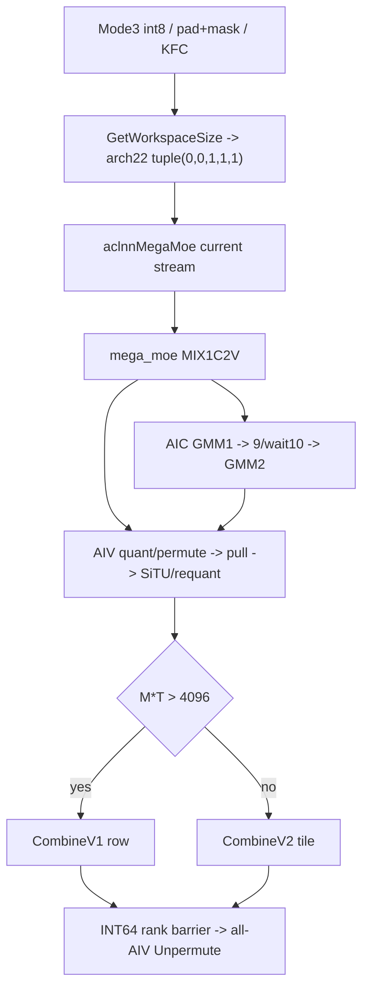
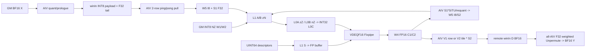
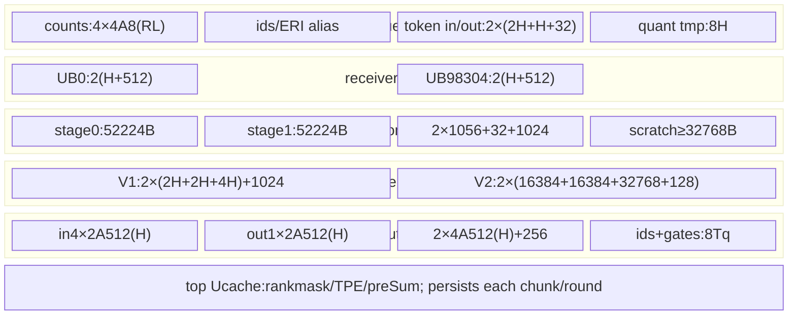

# DeepEP MegaMoE A8W8-INT SiTU A3 ACLNN 算子知识

## 算子速览

| 项目 | 内容 |
|---|---|
| 实际入口 | CANN9.2公开aclnnMegaMoeGetWorkspaceSize/aclnnMegaMoe；SGL Mode3、quant_mode=1/int8→dispatchQuantMode2、INT8 |
| 计算语义 | BF16逐token动态INT8量化+Dispatch → INT8双GMM、INT32acc/逐channel反量化为FP16 → Vector乘token scale；GMM间FP32 SiTU再动态INT8量化 → BF16 Combine、FP32 gates归并 |
| 输入输出 | X BF16；L项INT8 NZ W1[H,N]/W2[I,H]，N=2I；UINT64 dequant descriptor[N]/[H]；ids INT32、实际gates FP32；Y[M,H] BF16、counts[L] INT32 |
| 执行类型 | 一个MIX_AIC_1_2节点：AIC_CUBE双GMM，AIV_VECTOR量化/路由/激活/归并和MTE远端通信；无SIMT/NDDMA |
| Kernel 路线 | R-001 INT8数学族，CombineV2(MT≤4096)/V1(MT>4096)×单/多接收轮×rank mask；self masked无输出 |
| 核心资源 | Host16MiB余量加业务workspace；通信域双CCL窗；L1 A/B393216B+scale2048B，L0A32KiB/B64KiB/C128KiB；UB192KiB分phase复用 |
| 来源闭包 | source_closed：SGL/公开ACLNN/Host/POD/router/A3全部INT8 body/两Combine、CATLASS2和HCCL/HCOMM9.2资源/IPC闭合；生成inner与普通硬件primitive为明确边界 |
| 验证状态 | 已完成源码闭包检查；本次知识提取未执行编译、真机、数值或性能测试。静态合同/零域问题保留draft，不将来源闭合等同正确性。 |

## 接口与语义

### 计算语义

M为Device调用本rank行数，SGL将原始m padding至容量M并创建前m有效的INT8 active mask，返回Y[:m]。H为hidden、T为top-k、R为EP ranks、L为本地列表长度，W1逻辑[H,N]、W2[I,H]，正常合同N=2I、E=RL、每token ID有效且不重复。按专家/源rank/源行重排后的同一row同时携带量化payload和sX。实际精度顺序如下，FixVDEQF16消费UINT64权重descriptor，不是uint64数值乘法：

```text
a = max |FP32(X_BF16)|; dX = (a>0 ? 127/a : 127); sX=1/dX
QX = I8_CAST_TRUNC( F16_CAST_ROUND( I32_CAST_RINT(FP32(X)*dX) ) )
C1 = F16_FixVDEQF16( I32_Mmad(QX,W1_I8), channel_descriptor1 )
G,U = FP32(C1 gate/up half) * sX
Uλ = U if linear_beta omitted, else λ*Tanh(U/λ)
A = β*Tanh(G/β)/(1+exp(-G))*Uλ                 FP32
aA=max|A|; sA=aA/127; dA=(aA>0 ? 127/aA : 0)
QA = I8_CAST_RINT( F16_CAST_RINT( I32_CAST_RINT(A*dA) ) )
C2 = F16_FixVDEQF16( I32_Mmad(QA,W2_I8), channel_descriptor2 )
D = BF16_CAST_RINT( FP32(C2)*sA )
Y[t] = BF16_CAST_RINT( sum_k FP32(D[e(t,k),row(t,k)])*gates_FP32[t,k] )
```

权重scale在Fixpipe先将INT32物化为FP16，token scale随后Vector乘，不能合并成全FP32反量化后一次round。输入零行sX=1/127，激活零行sA=0且量化乘数0，guard不同。有限正常输入的目标对称INT8域[-127,127]；不补造NaN/Inf、INT32溢出或全局CTRL饱和保证。

无bias/shared expert/INT4拆分/预量化x。code2不消费activationClamp。数学意图中的Tanh实际走SDK9.2 arch2201：clip输入[-8.8,8.8]后用(exp(2x)-1)/(exp(2x)+1)逐步计算，具有FP32舍入和Vector barrier，不承诺无限精度tanh。sigmoid使用未按β缩放的G；β=1省两次缩放、λ关闭省一次Tanh。源码invalid ID/inactive写ERI=-1并在Unpermute跳过；公开Mega仍要求有效不重复ID，不将此实现行为扩大为公开-1/去重支持。

### 输入、输出与属性

| 参数 | shape/layout | dtype | 约束、默认值与语义 |
|---|---|---|---|
| context | 1D ND，标准6156个INT32 | INT32 backing | Mc2MoeContext，+8 KFC地址生效；Host未核验长度/内指针 |
| x | [M,H] ND | BF16 | M≥1，H1024..8192且%512=0；无M U32上界检查，SGL文档容量≤4096 |
| topk_ids | [M,T] ND | INT32 | T1..16，Python显式.int()；Device按RL专家判值 |
| topk_weights | [M,T] ND | Host FP32/BF16 | Device固定float*且前端无Cast，可靠读取合同取FP32 |
| weight1 | L个逻辑[H,N] FRACTAL_NZ | INT8 | L1..128，首项N决定I=floorN/2；逐项Origin2D/Storage dim0=H，正常N=2I |
| weight2 | L个逻辑[I,H] 同NZ | INT8 | 与W1首项dtype/format和列表长相同；逐项维度；I≥512、%256=0 |
| weight_scales1/2 | L个1D ND，[N]/[H]有效元素 | UINT64 | 必选Fixpipe per-channel descriptor；Host查首项dtype/format、列表长和每项rank，未比较dim1Expected长度/逐项dtype |
| bias1/2 | 空或0元素placeholder | FP32 | INT8拒绝非空，仅W4数学有补偿bias |
| x_active_mask | 可选[M] ND | INT8→bool | 非零有效；SGL构造前缀mask，不改写ids |
| scales | null | 预留 | arch22拒绝非空；sX由prologue内部产生 |
| shared系列 | API有动态参数 | 占位 | 当前entry未传Init、Host/body无shared producer，不能计入FFN |
| mask_buffer | 可选[R] | INT32 | 非零rank排除，self masked两侧return、不写Y/counts，非清零 |
| moeExpertNum/epWorldSize | E/R | I64→U32 | E1..1024；R={2,4,8,16,32,48,64,96,128}；正常E=RL且匹配context，Host未独立核验 |
| cclBufferSize | 两窗总字节 | I64 | Host以/2查单窗，Device用真实winSize |
| maxRecvTokenNum | route行预算 | I64→U64 | ≥0，0自动MRmin(T,L)，B/F推导后超B继续后继轮 |
| dispatchQuantMode/out | 2/DT_INT8 | enum | 名为PER_TENSOR常量但body逐token；tuple quantMode1/outType1；out UNDEFINED最终key失败 |
| combineQuantMode/commAlg | 0/空 | scalar | Host仅接受此值；与KFC fullmesh资源字符串不同层 |
| numMaxTokensPerRank | 容量 | I64→U32 | >0查≥M，非正跳过后窄化；SGL使用公共正容量 |
| activation/params | situglu、[]/[β]/[β,λ] | string/FP32列表 | code2，β默认1、λ内部0关闭；显式β和λ正有限、显式λ=0拒绝；clamp不使用 |
| activationOutDtype/TW1/TW2/interleave | UNDEFINED/false/false/0 | 内部属性 | 公开API固定，Host拒绝transpose；interleave较宽检查无当前consumer |
| topoType/rankNumPerServer/topkWeightsType/combineCommMode | API有属性 | scalar | arch22 Host不消费这些路由属性；文档combineCommMode要求0，不新增channel/去重路线 |
| Y/counts | [M,H]/[L] | BF16/INT32 | C++/InferShape按floorE/R分配counts、Host要求L；不替代E=RL业务合同 |

SGL默认参数与CANN底层不同：Buffer.fused_deep_moe默认beta=4、linear_beta=25，activation="situ"实际下传[4,25]；显式二者均None回到CANN[1]，原始"situglu"透传也不收集二者而取[1]。直接ACLNN空列表由Host设β/λ=1/0。不能跨层合并默认，不能以显式λ=0关闭，且不拆成新的量化模式。

### 入口与版本

本卡覆盖固定SGL提交dda6…的Mode3和ops-transformer e7da…实际CANN9.2实现。SGL `python/deep_ep/doc/FUSED_DEEP_MOE.md` 的Mega节、README的Mega说明均明确要求各平台CANN9.2.0；ops-transformer `version.cmake`、对应SDK/HCCL/HCOMM版本文件确认9.2.0。DeepEP其它模式的9.0/9.1徽章不改变此入口版本。

公开支持证据先是SGL的A3 INT8合同及ops-transformer Mega README产品/精度表，再是`mega_moe_def.cpp`的ascend910_93配置，最后才是Host、MIX入口和CMake。INT8双权重必须NZ，X当前Host仅接受BF16；OpDef/torch的FP16列不能扩大实际可达域。与[既有Mega接入API](../../../../apis/deepep/deepep_mega_moe.md)复用接口事实；本卡新增完整实现，不替代[Mode2 DispatchFFNCombine](sgl_deepep_dispatch_ffn_combine.md)或Mode1的不同算法、ABI和CANN版本。

## Host/Launcher 执行流程

### 参数校验与前处理

1. SGL `Buffer.fused_deep_moe`选择`MegaMoeStrategy`，量化1/int8对应dispatchQuantMode=2、out=INT8，惰性导入CANN包；缺包/JIT环境只在本模式调用处抛异常。策略要求gmm2_weight为非空list，使用首项倒数第二维作I，拒绝原始m>容量M。
2. 以(E,M,T,H,I,dispatchMode,outdtype)缓存SymmBuffer；非MX模式创建active mask并padding X/ids/gates；仅ids显式转INT32，不变换INT8 NZ权重、gates精度、格式或布局。不转发profile_enable。精确字符串situ才收集beta/linear_beta并映射situglu；原始situglu透传不收集具名参数。
3. CANN Python把situglu归一化为[β]或[β,λ]，默认β1/λ关闭；C++ `NpuMegaMoe`选择arch22描述符路径、创建Y与counts，保持topkWeights原tensor。INT8列表为普通TensorListWrapper，保留已有NZ格式和get_npu_storage_sizes，无INT4 reinterpret；scale wrapper按UINT64描述。生成inner对这些storage元数据的处理未在固定手写源码中展开，不假设自动reshape。
4. `ACLNN_CMD`在当前NPU stream调用GetWorkspaceSize。公开API检查必选tensor/list/activation/floatarray/outputs、E>0、R>0、maxRecv≥0；需要时创建executor，并给null动态参数补typed零长度placeholder。公开API不检查executor二级指针本身，不能传null `executor`地址。
5. 进入生成的aclnnInner桥；OpDef使context/X/ids/gates/optional元数据AutoContiguous、权重IgnoreContiguous。生成inner和普通Contiguous是框架边界，不能假设其负责Cast gates或修正权重语义。
6. Host顺序为commAlg→输入shape/type/list/scale/bias/mask→属性→输出→平台资源→CCL容量；任何检查失败返回GRAPH_FAILED，无fallback重选其它精度。设置scheduleMode=1、blockDim，再算tuple、存POD和workspace。scheduleMode返回值保留在局部ret未检查。
7. GetWorkspaceSize非零状态在C++释放转换descriptor后抛异常，不提交Device。成功分配UINT8 workspace，封装当前stream的执行handler；handler调用aclnnMegaMoe、释放转换descriptor/huge memory并传播非零status；OpCommand和NPU allocator的stream完成语义为框架边界，不能由函数返回推断Device已完成。

### 参数、Workspace 与生命周期

定义A_d(x)=ceil(x/d)d，C=ceilM/1024，Q=1024Rmin(T,L)，Aattr=maxRecvTokenNum或自动MRmin(T,L)，B=max(1,min(Q,Aattr))，F=ceilQ/B。每chunk实际接收J决定f=max(1,ceilJ/B)，f>1用轮表。以下从entry收到workspaceGM顺序累加，无显式+16MiB/GetUserWorkspace偏移。

| slice | Device字节extent | owner/lifetime |
|---|---:|---|
| W0 counts | 128A_8(RL)·4 | 当前chunk全AIV计数/前缀后复用 |
| W1 ERI | 1024T·4 | scatter→本chunk Unpermute，末尾屏障后覆盖 |
| W2 cumsum | C R²L·4 | 每chunk独立地址，实际紧凑[R,L]写前部 |
| W3 rounds | C F·3RL·4 | 每(chunk,round)独立cumsum/TPE/preSum |
| S1 input scale | 4B | receiver从WinA尾拆出，Epi1读 |
| S2 activation scale | 4B | Epi1写、Combine读，不与S1 alias |
| W4 C1/C2 alias | 2Bmax(N,H) | FP16 GMM1→激活后FP16密排H的GMM2覆盖 |
| W5 A1/QA alias | Bmax(H,I) | INT8输入→INT8激活，专家slot宽max(H,I)，内部H/I密排 |
| W6 preSum | 4R A_16(L) | chunk源rank原始前缀，多轮切W3 |
| W7 soft flags | 64R | 当前BlockMmad flagPtr=null，预留未用 |

Host输入区预算2Bmax(H,I)，Device仅1Bmax(H,I)；Host preSum原式64floor(R(L+15)/16)，不同于Device的64Rceil(L/16)。保留原式，不能用Device offset替换Host总量：

```text
WmegaHost=W0+W1+W2+W3+8B+2Bmax(N,H)+2Bmax(H,I)
          +64floor(R(L+15)/16)+64R
Wprologue=16MiB+4MT+8RL
workspaceSize=16MiB+max(WmegaHost,Wprologue)
```

调用方/torch UINT8 workspace、x/weights/scales/context均存活至stream任务完毕。A3 SymmBuffer选KFC，customCclBufferSize/resolver不被KFC用于扩容，真实窗口来自HCCL域/HCCL_BUFFSIZE。HcclGetHcclBuffer返回两窗之和，不含额外1MiB exp。新私有allocation清零；非空bufferName可按名字/refcount共享，首分配清零、末引用释放，不同comm可能别名同窗，Inner对此警告；Mega没有并发窗口隔离。

令S为真实单窗、m_c=min(M,1024)、P=A_128(RL+1)、Z=max(512R,512KiB)：

```text
offsetA=10MiB;                    Aextent=m_cT(H+512)
offsetPeerPerTokenScale=offsetA+Aextent; extent=4m_cT (本body保留未单独写)
offsetD=offsetPeerPerTokenScale+4m_cT; Dextent=2m_cTH
offsetTPE=S-Z-4R*A_128(128R+1); offsetFlag=S-Z
Host single-window min=10MiB+m_cT(H+512)+4m_cT+2m_cTH+4R*A_128(128R+1)+Z
```

prologue每row实际写H+32B，FP32 scale位于row+H；512B尾区其余padding不是有效scale。receiver读取H+512行，再拆H payload到W5、4B scale到S1。独立peerScale区4m_cT保留但无本body独立读写。D为BF16；WinOut未用于本A3 payload。TPE实际stride P，按最大L128保留，chunk尾清零。

INT8跨rank尾区是INT64 counter协议：各source slot间64B，sync_counter=S-Z、sync_base=S-Z+64R，count=load(base)+1。不同于BF16的float翻转/self-state协议；当前不调用InitStatusTargetSum。

标准context的C++ `CommContext`和Device `Mc2MoeContext`在当前消费字段布局一致。KFC builder分配opArgs，显式设engine=4、opType=8和`AlltoAll=level0:fullmesh;level1:pairwise`，HCCL前端逐字段传到HCOMM Inner；默认src/dst FP16、SUM、count0仅用于资源配置，不改变INT8 FFN数学。HCOMM的GetAlgInfo按固定表命中`RunAlltoAllDirectFullmesh`，申请全mesh CCL_INPUT/OUTPUT连接、生成HcclOpResParam和remoteRes表后同步拷贝到Device；此阶段是CalcResRequest/资源创建，没有调用该collective的Orchestrate/KernelRun替代本算子通信。实际数据转移仍由本卡的MTE body完成。

远端链路经TransportP2p交换IPC名、size、offset；MemNameRepository按页对齐注册名字、OpenIpcMem缓存或调用driver hrtIpcOpenMemory，并加回页内offset；GetRemoteMem(INPUT_MEM)填relation.windowsIn。此处driver IPC、硬件DataCopy和普通AscendC primitive为边界，未拿不存在的collective算法body充当闭包。

`CommContextManager::Destroy`在KFC无custom buffer时不释放HCCL窗口/资源，也不调用Device同步；其owner仍是通信域。SGL destroy遍历缓存、调用SymmBuffer.destroy后清cache；必须由通信域/调用方保证所有inflight任务完毕。构建中TORCH_CHECK在opArgs分配和显式Free之间没有统一RAII回滚，不虚构失败路径自动清理。

### 启动图与失败传播



单MIX节点；生成inner普通Contiguous属于框架。blockDim=CalcTschBlockDim(aivNum,aicNum,aivNum)，scheduleMode1；AIC C_a核、AIV V=2C_a核。自定义route id=b+sC_a，SDK GetBlockIdx=2b+s，两者不互换。Host失败阻止launch，Device polling无timeout/错误码；不臆测Codegen/Runtime错误。

## Route 与参数设计

### 分核与资源计算

实际MegaMoe<BF16,INT8,BF16,false,false,true,false>：A/B INT8、C1/C2 half、D1 INT8、D2 BF16。L1 tile(128,256,512)、L0 tile(128,256,128)，preload1、L1/L0A/B depth2、L0C depth1、unitFlag=false、shuffleK=true，INT32acc。每专家GMM1(J_g,N,H)、GMM2(J_g,H,I)，Swizzle<9,1>沿N蛇形、起始核跨专家按tile数旋转，K起点b%ceilK/512，内层128K余数。

A RowMajor ND2NZ→zN→zZ；B GM zN直接搬L1→nZ，INT8 C0=32元素。正常H/I对齐和N=2I整tile；Host未拒绝奇N不等于支持非配对gate尾列。全部V核接收/激活；g*=L>4?L-3:(L>1?L-1:1)，g*<L时两段9/10握手。Epi1行均分、余数优先前核、列3072 tile。V1按group/source分给coreIdx+jV、逐row H；V2跟随GMM2 tile scheduler、两AIV按m0=16行片分M，sub1裁剪余数。全部V核Unpermute、q=min(floor(m_c/V),600)，非BF16的sub1/C_a。

### Route 选择

| 顺序 | Route | Key/模板 | 精确选择条件与优先级 | 不适用去向 |
|---:|---|---|---|---|
| 1 | R-001 INT8 NZ SiTU族 | GET_TPL_TILING_KEY(0,0,1,1,1) | A3 BF16 X、INT8同NZ双W、scales必选、bias空、TW=false、attr2/outINT8、combine0/commAlg空、code2及全部shape/output/window检查 | Host失败，无精度fallback |
| 2 | R-001 C2/C1 | InitCombineMode | 整次M*T≤4096→V2，>4096→V1；含SGL padding的M，不以chunk/轮内行数切换 | 同launch内切body |
| 3 | R-001 F0/F1 | J≤B/J>B | 单轮不用轮表，多轮切三表、数据slice复用 | 超B后继轮，F1静态坐标风险另列 |
| 4 | R-001 U/M/return | mask空/非空/self非零 | M先全部send再wait、过滤rank；U逐rank send+wait；self masked return无输出 | 无清零fallback |
| 5 | 其它compile tuple | quant仅TW=false/outType1/Arch0或1 | 当前仅Arch1，A2/INT4另实例或数学域 | 无当前producer不列支持 |

```text
公开API -> commAlg空 -> BF16 X、INT8 NZ双W、scales、bias空/shape
 -> dispatch attr2/outINT8、code2、TWfalse -> tuple(0,0,1,1,1)
 -> self masked: return(no Y/counts)
 -> M*T≤4096 ? C2 : C1
 -> each chunk -> J≤B ? F0 : F1 -> mask null?U:M
```

### 模板/实现执行矩阵

| Route | key/selector | dtype/shape/platform 完整命中条件 | 执行族与 kernel 节点 | 实际模板/body | 内存与同步特征 | tail/fallback |
|---|---|---|---|---|---|---|
| R-001 C2 F0-U/M | tuple(0,0,1,1,1)、MT≤4096、J≤B、mask空/非空 | 完整Host合同、正常E=RL及不重复ID | 单MIX双AIC GMM、AIV量化/路由/激活/V2/Unpermute | A3 private Mmad<1,2,2,2,1,false,true>、Epi1 quant、Epi3 PerTokenV2Impl<…,false,true> | FP16 C、INT8 A alias；V2双tile+scale，flags0..10 | 16行M片/N尾、J0仍一轮 |
| R-001 C2 F1-U/M | 同tuple、MT≤4096、J>B | 同上，B>0、f≤F依赖ID合同 | 同MIX内串行轮 | 三表切换后同C2 body | 每轮不同GM表、数据复用、counter reset | last轮交集，保留F1风险 |
| R-001 C1 F0-U/M | 同tuple、MT>4096、J≤B | 同Host合同、selector用整次M | 相同双Cube，AIV逐source/row V1 | Epi2 BlockEpilogue<PerTokenDequant<2>> | 每group Wait+全AIV、两row C/D/F32、1024B scale | H整row、Finalize补尾groups |
| R-001 C1 F1-U/M | 同tuple、MT>4096、J>B | 同上及f≤F/UB联合条件 | 相同MIX串行轮 | 同C1 body、轮表cumsum/preSum切换 | S1/S2及alias/counter协议相同 | 继承F1风险，无安全fallback |

### 隐藏性能 Guard

| Guard | Host/Tiling 条件 | Device/资源原因 | 影响 Route | 不满足时去向 | 源码符号 |
|---|---|---|---|---|---|
| H/I及格式 | BF16 X、INT8 NZ双W、H%512/I%256 | INT8 C0=32、NZ与Ktile512/128，无format cast | 全部 | Host拒绝 | CheckXInput/CheckWeight1/2 |
| MT threshold | MT≤4096或>4096 | V2 tile或V1 row的工作分配 | C2/C1 | 仅切body | InitCombineMode |
| 接收预算 | B≥1、F=ceilQ/B | 大计算slice按B、小轮表按CF | F0/F1 | 超B后继轮 | SetRecvRoundBudget |
| Cube容量 | static_assert (65536+131072+2048)*2≤524288 | assert保守两份scale，实际一份S；L0 32768/65536/131072 | 全部 | 不生成非法实例 | BlockMmadPreloadAsyncFixpipeImpl |
| 冷预取 | 首chunk首round/M≤512/group0非空/scratch足够/HN≤32C_a·16384 | L1End395264对齐16K后scratch16384；W1一B/元素 | 全部 | skip预取正常GMM | WeightL2PrefetchAicColdStartW1 |
| L2 hint | W1 cap false且J_g≤128；W2 J_g≤128 | 小M tile权重一次读，cap布尔不等于实际预取 | 全部 | 普通cache | GMM1/GMM2 |
| I列tile | I≤3072或>3072 | 单tile保留首遍A直接quant，多tile重读重算 | 全部 | 二遍，无I上限fallback | PerTokenSwigluImpl |
| UB联合容量 | Host未完整检查 | Epi1front107616+至少32768scratch与顶部cache不交叠 | 全部 | 无动态降tile | InitRouteCache/constructor |
| 小chunk | 未检查m_c≥V | Unpermute q=floor(m_c/V)可0 | 全部 | 静态公式零除，无已证运行错误 | MoeTokenUnpermuteTiling |

### POD/ABI

以下offset/sizeof按固定源码字段顺序、常见uint32/float对齐4、uint64对齐8作静态自然布局推导，未执行编译或安装二进制ABI测试。公共结构与Quant/NonQuant wrapper均152B、align8，wrapper.common@0。一个字段一行；字段无producer且当前consumer不读时明确记inactive，不臆造清零。

| 结构 | 字段 | 类型/位宽 | ABI 布局 | 单位 | Host/launcher producer | Device consumer | 边界 |
|---|---|---|---|---|---|---|---|
| common | M | U32 | @0/4B | token | Storage x.dim0 | LoadCommon→problemShape.m | M先int64后窄化，无U32上界 |
| common | K | U32 | @4 | 元素 | x.dim1 | H、GMM1 K/GMM2 N | 1024..8192/512对齐 |
| common | N | U32 | @8 | 元素 | W1首项末维 | GMM1 N、I=N/2 | 未独立拒绝奇数 |
| common | expertPerRank | U32 | @12 | 专家 | W1列表长L | group循环/slot | 1..128 |
| common | aivNum | U32 | @16 | 核 | Platform.GetCoreNumAiv | epilogueCoreNum | body另从launch得V，需一致 |
| common | totalUbSize | U32 | @20 | 字节 | Platform UB size赋值 | 当前LoadCommon不读 | 固定Arch容量另在模板 |
| common | topK | U32 | @24 | slot/token | ids.dim1 | permute、weighted reduce | 1..16 |
| common | worldSize | U32 | @28 | rank | epWorldSize | LoadCommon→EP | 应匹配KFC rankSize |
| common | listLen | U32 | @32 | 列表项 | L | GetTensorAddr组索引 | 本域仅逐专家二维列表 |
| common | moeExpertNum | U32 | @36 | 全局专家 | E attr | 当前LoadCommon不读 | Device实际取RL |
| common | epWorldSize | U32 | @40 | rank | R attr | 当前LoadCommon不读此副本 | worldSize副本生效 |
| common | dispatchQuantMode | U32 | @44 | enum | attr2 | key的Host producer | body由INT8模板决定逐token量化 |
| common | cclBufferSize | I64 | @48/8B | 字节 | attr | Host单窗校验 | Device用context真实winSize |
| common | maxRecvTokenNum | U64 | @56 | route行 | attr或自动M R min(T,L) | 当前LoadCommon不读 | B字段才驱动workspace |
| common | dispatchQuantOutDtype | I32 | @64 | GE dtype | attr DT_INT8 | SetMegaMoeTilingKey | 本域outType1；UNDEFINED最终拒绝 |
| common | combineQuantMode | U32 | @68 | enum | attr0 | Host guard | Device不量化 |
| common | commAlgCode | U32 | @72 | enum | 未见赋值 | 当前body不读 | inactive，不能承诺默认0 |
| common | numMaxTokensPerRank | U32 | @76 | token | attr窄化 | 当前body不读 | SGL用于padding和SymmBuffer |
| common | activationCode | U32 | @80 | enum | situglu→2 | GatedActivation→SituActivation | 其它数学不属本卡 |
| common | activationClamp | FP32 | @84 | 数值 | 默认FLT_MAX | code2不读 | SiTU无该clamp分支 |
| common | activationParams1 | FP32 | @88 | β | 默认1或data[0] | SituActivation gate缩放/乘回 | 正有限，β=1跳过两次Muls |
| common | activationParams2 | FP32 | @92 | λ | 默认0关闭、两项时data[1] | SituActivation up支路Tanh | 显式正有限，0仅内部None sentinel |
| common | isTransposeW1 | U32 | @96 | bool编码 | false | key→TB1=false | true被Host拒绝 |
| common | isTransposeW2 | U32 | @100 | bool编码 | false | key→TB2=false | true被Host拒绝 |
| common | hasBias1 | U32 | @104 | bool编码 | 未见赋值 | 当前LoadCommon不读 | 实际指针与constexpr分支 |
| common | hasBias2 | U32 | @108 | bool编码 | 未见赋值 | 当前LoadCommon不读 | 同上 |
| common | hasXActiveMask | U32 | @112 | bool编码 | 局部isActiveMask校验但未写此字段 | 当前body直接判断指针 | inactive字段 |
| common | hasScales | U32 | @116 | bool编码 | 未见赋值 | 当前LoadCommon不读 | scales非空已拒绝 |
| common | isQuantRouting | U32 | @120 | bool编码 | INT8→1 | Host预算/key/wrapper | Device由BType constexpr |
| common | isW4A8 | U32 | @124 | bool编码 | INT8→0 | Host额外预算 | 本域W4分支不实例化 |
| common | activationOutDtype | I32 | @128 | dtype | UNDEFINED | 当前LoadCommon不读 | Host限制，不改变BF16 |
| common | weight1Interleave | U32 | @132 | 元素 | 公共API0 | 当前LoadCommon不读 | 内部Host可较宽但无consumer |
| common | recvRoundBudget | U64 | @136/8B | route行 | B | LoadCommon.maxOutputSize、切片/轮次 | ≥1 |
| common | recvRoundsMax | U64 | @144/8B | 轮表份 | F | RoundTablePtr stride | 与实际f及无重复ID前提匹配 |

外层context自然size24624B、align8；C++以6156个INT32拷贝。它不是common POD，也不能使用旧Mode1的context布局。

| 结构 | 字段 | 类型/位宽 | ABI 布局 | 单位 | Host/launcher producer | Device consumer | 边界 |
|---|---|---|---|---|---|---|---|
| Mc2MoeContext | epRankId | U32 | @0 | rank | KFC GetRankId | 本A3shmem不读此副本 | shmem取KFC内localUsrRankId |
| Mc2MoeContext | rankSizePerServer | U32 | @4 | rank | KFC默认0 | 本body不读 | channel才另有意义 |
| Mc2MoeContext | kfcContextAddr | U64 | @8 | GM地址 | CreateHcclContext返回opsResCtx | initShmem→HcclOpResParam* | 非null/版本由caller保证 |
| Mc2MoeContext | epHcclBuffer_ | U64[1024] | @16/8192B | GM地址 | CollectRankBuffers | 本body通过KFC资源寻址，不读该表 | manager本地view使用本rank项 |
| Mc2MoeContext | hcommHandle_ | U64[1024] | @8208/8192B | handle | KFC值初始化0 | 本body不读 | 不以它新增channel Route |
| Mc2MoeContext | channelsPerRank | U32 | @16400 | channel数 | KFC默认0 | 不读 | inactive |
| Mc2MoeContext | enableGroupSend | bool | @16404/1B | bool | KFC false | 不读 | 随后3B自然padding |
| Mc2MoeContext | roceHcclBuffer_ | U64[1024] | @16408/8192B | GM地址 | KFC全0 | 不读 | inactive |
| Mc2MoeContext | roceBufferSize | U64 | @24600 | 字节 | KFC0 | 不读 | inactive |
| Mc2MoeContext | hostStatusTableAddr | U64 | @24608 | 地址 | KFC0 | 不读 | inactive |
| Mc2MoeContext | completedRounds | U64 | @24616 | 轮次 | C++默认U64(-2) | 本body不读 | Device声明无默认值，由Host拷贝 |

HCCL9.2前端 `HcclOpArgs` 为Host私有opaque对象：src/dst/reduce三个enum经Init设FP16/FP16/SUM，count=0；algConfig[128]经strcpy_s设置，commEngine经SetCommEngine设4，reverse未赋值且此链不读。每个字段由HcclCreateOpResCtx逐项传入Inner；不把未核验的enum ABI/struct总长作为安装保证。

当前Device消费HcclOpResParam的localUsrRankId@16、rankSize@20、winSize@24、localWindowsIn@32、remoteRes@2984（每项nextHostPtr@0/nextDevicePtr@8、stride16）；HcclRankRelationResV2.windowsIn@8。固定ops header与HCOMM producer的这段自然布局可逐字段对应：208B前缀+2472B ReservedStruct+160B AlgoTopoInfo+48B HcclOpConfig+三个U64+16个U32+两个U32=2984B。HcclOpConfig内部9.2将旧notify的8B区域分成两个U32，但本consumer不读它，且总长保持48B；这不是全文struct或安装二进制ABI等价声明。

Unpermute局部POD由Device内 `MoeTokenUnpermuteTiling`生成，12个I64依次@0..88，size96/align8：hidden_size=H；top_k=T；num_out_tokens=m_cT；hidden_splited_length=H；hidden_splited_num=1；hidden_splited_remain=0；tokens_core_length=floor(m_c/V)；tokens_core_remain=m_c%V；tokens_splited_length=min(tokens_core_length,600)；tokens_splited_num=tokens_core_length/tokens_splited_length；tokens_splited_remain=对应余数；buffer_num=4。每个字段由LoadTilingData同名读入，其中余数核增加1行。该表不是Host公共ABI；split length为零时公式本身未保护。

当前外部资源消费字段单列如下；完整HCCL资源结构其余成员属于库资源边界，当前实例不读取，不推导尾部总长。

| 结构 | 字段 | 类型/位宽 | ABI 布局 | 单位 | Host/launcher producer | Device consumer | 边界 |
|---|---|---|---|---|---|---|---|
| HcclOpResParam | localUsrRankId | U32 | @16 | rank | HCOMM BuildOpResParam.userRank | HcclShmem.Rank | 不同于Host属性副本 |
| HcclOpResParam | rankSize | U32 | @20 | rank | userRankSize | HcclShmem.RankSize | caller保证与EP一致 |
| HcclOpResParam | winSize | U64 | @24 | 字节 | algResource.cclInputMem.size | SegmentSize | 真实单窗容量 |
| HcclOpResParam | localWindowsIn | U64 | @32 | GM地址 | cclInputMem.ptr | self window | 外部domain owner |
| HcclOpResParam | remoteRes | RemoteResPtr[131072] | @2984，stride16 | 地址表 | BuildRelationResByRemoteRankId | 对端nextDevicePtr | 仅索引R个rank；不推导全部tail ABI |
| RemoteResPtr | nextHostPtr | U64 | @0 | Host地址 | CreateListNode | Device不读 | 资源管理 |
| RemoteResPtr | nextDevicePtr | U64 | @8 | GM地址 | CreateListNode并H2D | HcclShmem远端寻址 | 不为零由资源创建保证 |
| HcclRankRelationResV2 | windowsIn | U64 | @8 | GM地址 | TransportP2p.GetRemoteMem(INPUT_MEM) | offset+远端window | 同prefix的rank字段@0/4；只读此地址 |

Unpermute局部POD字段producer/consumer补表；每字段I64，4列简写的@offset均在size96/align8结构内，LoadTilingData按同名复制，无Host跨版本序列化。

| 结构 | 字段 | 类型/位宽 | ABI 布局 | 单位 | Host/launcher producer | Device consumer | 边界 |
|---|---|---|---|---|---|---|---|
| UnpermuteTiling | hidden_size | I64 | @0 | 元素 | Device tiler H | CopyTokenIn/Out | H≤8192 |
| UnpermuteTiling | top_k | I64 | @8 | slot | T | CalPartOutToken | 1..16 |
| UnpermuteTiling | num_out_tokens | I64 | @16 | expanded行 | m_cT | ERI有效性检查 | 非原始m |
| UnpermuteTiling | hidden_splited_length | I64 | @24 | 元素 | H | UB/offset | 单完整hidden |
| UnpermuteTiling | hidden_splited_num | I64 | @32 | 次 | 1 | CalSingleOutToken | 无hidden分割 |
| UnpermuteTiling | hidden_splited_remain | I64 | @40 | 元素 | 0 | 隐藏尾分支 | inactive |
| UnpermuteTiling | tokens_core_length | I64 | @48 | token | floor(m_c/V) | block行数/offset | 余数核+1 |
| UnpermuteTiling | tokens_core_remain | I64 | @56 | 核 | m_c%V | LoadTilingData/CoreElementOffset | 前余数核+1 |
| UnpermuteTiling | tokens_splited_length | I64 | @64 | token | min(floor(m_c/V),600) | 每次ids/gates批量 | q=0未保护 |
| UnpermuteTiling | tokens_splited_num | I64 | @72 | 次 | tokens_core_length/q | Process循环 | q=0含除零 |
| UnpermuteTiling | tokens_splited_remain | I64 | @80 | token | tokens_core_length%q | 尾批 | q=0含余数零除；余数核+1 |
| UnpermuteTiling | buffer_num | I64 | @88 | buffer深度 | 4 | InitBuffer(tokens_inque) | 实际物理depth4 |

### Route 源码闭包

| Route | Key/selector | Host/Tiling producer | POD/参数 | Kernel entry/router | Kernel body/直接依赖 | 构建接线 |
|---|---|---|---|---|---|---|
| R-001全部C1/C2×F0/F1×U/M | tuple(0,0,1,1,1)、MT/J/mask轴 | aclnn_mega_moe→MegaMoeA2A3TilingFuncImpl→SetRecvRoundBudget/SetA3WorkspaceSize | Quant.common152B、S1/S2、context消费prefix、Unpermute96B | mega_moe MIX1:2→MegaMoe<BF16,INT8,BF16,false,false,true,false> | MegaMoeKernel、quant prologue、private BlockMmad/FixpipeScale、Epi1quant、Epi2row/Epi3V2、HcclShmem counter、unpermute、CATLASS2/HCCL92/HCOMM92 | OpDef ascend910_93、op_host CMake ACLNNinner/CATLASS_ARCH2201、catlass.cmake769cd40… |


## Kernel 实现

### 公共执行流程

entry以tuple读取Quant.common，LoadCommon取B/F而不是maxRecvTokenNum原值；构造A3 MegaMoeKernel。initBuffer解析KFC实际窗口、workspace/peermem、diagnostic、rankmask和顶部route cache，再由InitCombineMode固定本launch的C1/C2。Arch::AtlasA2是2201资源trait名，当前IS_A2=false才决定A3 body。

仅一个MIX kernel；AIC/AIV各自从同一chunk cumsum推f。轮间GM表独立、计算数据串行alias，轮ready及group握手衔接，无Host再次launch。self masked在两侧operator提前return，未写Y/counts；constructor资源/诊断不等同输出完成。

### Route R-001：INT8 NZ双GMM与SiTU

#### 适用条件

##### 选择证据

| 层级 | 文件 | 符号 | 源码谓词/参数 | 结果/下一跳 |
|---|---|---|---|---|
| SGL | strategies/fused_strategy.py | _resolve_mega_moe_quant | 1或int8→(2,torch.int8,None) | 内量化INT8、非MX，active mask/padding |
| C++ | torch_extension/csrc/mega_moe.cpp | NpuMegaMoe/MakeWeightList | arch22、INT8无reinterpret；scale ACL_UINT64 | 原权重NZ与gates精度传ACLNN |
| Host | op_tiling/arch22/mega_moe_tiling_arch22.cpp | CheckWeight1Input/CheckDispatchQuantAttrs/SetMegaMoeTilingKey | INT8/NZ双W、attr2/outINT8、TWfalse、Arch1 | tuple(0,0,1,1,1)，Quant POD |
| router | mega_moe.cpp/mega_moe_arch22.h | mega_moe/MegaMoe::Process | isInt8=true,isW4=false,isNz=true,isA2=false | A/B I8、C half、D1 I8/D2 BF16 |
| body | mega_moe_kernel_a3.hpp | InitCombineMode | M*T>4096 | true→V1，否则V2；再组合F0/F1/U/M |
| build | op_host/CMakeLists.txt/mega_moe_def.cpp | add_modules_sources_with_soc | ascend910_93、CATLASS_ARCH2201 | 当前ACLNNinner和A3实例 |

#### Device 数据流

##### 函数级调用链

```text
aclnnMegaMoe -> generated inner -> mega_moe<false,false,1,1,1>
 -> MegaMoe<BF16,I8,BF16,false,false,true,false>::Init/Process
 -> MegaMoeKernel::initBuffer / InitCombineMode
 -> AIC operator: ready -> optional cold W1 prefetch
      -> [SetRoundTableBuffers] -> GMM1
        -> BlockMmadPreloadAsyncFixpipeImpl<NEED_L1_TO_FP=true>
          -> CopyGmToL1 A/B -> LoadData -> TileMmad I32acc
          -> UINT64 scale GM->L1->FP -> VDEQF16 Fixpipe
      -> wait10 -> GMM2(same Cube chain)
 -> AIV DispatchAndCombine
      -> MoePermutePrologue<2,quantpolicy,BF16,I8>
        -> CountAndPublishExperts/BuildScatterOffsets
        -> QuantizeToken -> ScatterToken(payload+scale/ERI)
      -> AllGatherTokenPerExpert/GetCumsumForMMAIV/CacheRouteTablesToUb
      -> [BuildRoundTables/SetRoundTableBuffers/CacheRoundTablesToUb]
      -> ProcessRecvRound
        -> CopyGMToGMPerToken -> S1/W5 -> group ready
        -> Epi1 quant overload -> GatedActivation/SituActivation
          -> row absmax -> INT8 requant + S2
        -> isCombineV1 ? Epi2 row : Epi3 PerTokenV2Impl<false,true>
      -> ResetTokenPerExpert
      -> HcclShmem::CrossRankSync[WithMask]
      -> MoeTokenUnpermuteTiling(...,V)
      -> KernelMoeTokenUnpermute<BF16,I32,float,true>::Init(...,true)/Process
      -> SyncAll<true> -> next chunk
```

##### 源码等价伪码

以下保留地址轴、条件和同步，非可运行替代代码：

```text
init shmem(context.kfcContextAddr), workspace/peermem views, rankmask/cache
isCombineV1 = (M*T > 4096)                  only INT8 specialization
AIC/AIV if mask[self]!=0: return           no outputs

AIV: clear counts[L] on core0, CopyRankMaskToLocal
for chunk c with tokenBase=1024c, mc=min(M-tokenBase,1024):
  prologue:
    split mc tokens across V, count active valid expert IDs 0..RL-1
    publish each core counts to W0; SyncAll
    prefix core counts + total counts -> expert global scatter offsets
    for each own token:
      load BF16 H into ping/pong
      Cast F32 -> absmax using tmp[H:2H] alias
      multiply dX; I32 RINT -> F16 ROUND -> I8 TRUNC
      store F32 1/dX at tokenOut byte H
      each valid expert slot -> copy H+32 bytes at WinA+row*(H+512)
      inactive/invalid -> ERI=-1, else ERI=row and increment offset
    store ERI, SyncAll
  allgather TPE[R,L] through each remote TPE row:
    add marker 0x800000, MTE3 -> peers
    poll first I32 of every 512B signal group via32B UB; subtract marker
    masked source -> zero count
  AIV0 compute compact cumsum[R,L] and original source preSum; SyncAll
  cache TPE/preSum in each AIV top UB; core0 accumulate counts[L]
  AIC/AIV independently f=max(1,ceil(J/B))
  for round r=0..f-1:
    if f>1:
      AIV0 intersect each (expert,source) block with [rB,(r+1)B)
      write cumsum_r/TPE_r/preSum_r at W3+(cF+r)*3RL*4
      publish MTE3, all-AIV barrier; AIC/AIV switch table views/cache
    emit ready flag0, then for local group g:
      for source s=coreIdx+jV not masked:
        rows = clipped local route rows; rowSrc=preSum[s,g]
        src = remoteWinA + rowSrc*(H+512)
        dst = W5 + previousExpertRows*max(H,I) + sourceRowInGroup*H
        copy up to2 rows per ping/pong at UB0/98304
        split H bytes payload -> dst, 4B tail scale -> S1[rowStart]
      SyncAll; emit mode2 MTE3 group flag floor(counter/15)
    drain pull events0/1

    AIC GMM1 experts:
      wait each group-ready, rotating core start and Swizzle9,1
      copy INT8 A ND->L1 zN and NZ W1->L1 zN -> L0 zZ/nZ
      shuffle K start b%ceil(H/512); I32acc, initC only first K
      after K last, load channel scale -> L1S -> Fixpipe buffer
      VDEQF16 to W4 FP16 with rowStride=max(N,H)
      after g* prefix and final experts finalize PIPE_FIX flag9
    AIV Wait9+SyncAll; Epi1 over prefix rows:
      FP16 C1 halves -> FP32 * S1 -> SiTU(beta, optional linearBeta)
      first pass accumulate row absmax over 3072elem tiles
      set S2=maxAbs/127, multiplier maxAbs>0?127/maxAbs:0
      I<=3072: reuse stage0 activation; otherwise reload/recompute each tile
      I32 RINT -> F16 RINT -> I8 RINT -> W5 compact-I output
      batch scales <=256 with 2 scale buffers; drain -> set10
    if g*<L repeat Wait9/activation/scale-drain/set10 for remaining rows
    Epi1.Finalize before reusing UB/events

    AIC wait10 before GMM2, wait second10 at expert g* when split:
      read W5 compact I, W2 NZ; same tile/K pipeline
      apply channel descriptor2 -> W4 FP16 dense H
      last tile per expert Finalize mode2 group flags0..8
      C1 only: explicit Finalize(L-1) fills all trailing empty group flags

    AIV if C1:
      Epi2.SetFlag; for each g Wait group flag+SyncAll
      each source s=coreIdx+jV not masked:
        srcRow=cumsum[s-1,g]+previousGroups
        dstRow=preSum[s,g]; clip rows to B
        for row load FP16 H -> F32 * S2 -> BF16 -> remoteWinD dstRow
      Epi2.Finalize drains two row buffers
    else C2:
      initialize V/S/MTE events; mirror GMM2 tile scheduler
      split M into16-row slices between pair subblocks
      wait corresponding group completion; C2 FP16 -> F32
      read/cache S2 for each sourceRow; multiply each row
      BF16 RINT -> split tile across source-rank route intervals
      write remoteWinD with rowStride H
      Epi3.Finalize A3 empty, outer CombineWaitFlag drains actual events
    SyncAll; reset round counters
  last-core reset TPE in bounded16KiB I32 slices
  INT64 rank barrier:
    count=gm_load(local tail+64R)+1, SDKvec_id=2b+s, vec_size=V
    U: for own peer i store count at remote tail+64*self; DCCI; wait local tail+64*i
    M: skip masked; send all own peers first, then wait all
    SyncAll; gm_store(sync_base,count)
  all V: q=min(floor(mc/V),600), build Unpermute tiling
    ERI valid if0<=idx<mcT; first invalid Duplicate0, later valid weighted add
    F32 gates*F32(BF16 D) accumulated slot order -> BF16 RINT Y
  SyncAll<true> before WinA/D/ERI reuse; no actual SyncAll<false> call
```

F1表中preSum_r的真实producer写max(rB,blkLo)，其轴与source原始WinA/D前缀不等价，静态风险见限制；伪码忠实记录source未补造修正。SGL M为公共容量，所以MT selector可能因padding走V1；不能以原始m、mc或轮J重判。

#### 内存与数据搬运

##### 资源与搬运表

| 层级/缓冲区 | offset/地址公式 | extent/容量公式 | dtype/layout | producer | consumer | owner/lifetime | 对齐/复用 |
|---|---|---|---|---|---|---|---|
| 输入GM | X+2tokenBaseH；W列表GetTensorAddr(g) | 2MH、L·A_16(H)A_32(N)、L·A_16(I)A_32(H) | X BF16 ND，W INT8 zN | caller | prologue/Cube | stream完成前 | 正常已对齐域W容量LHN/LIH；不做format cast |
| UINT64 scale GM | 每专家[N]/[H] | 8LN/8LH字节有效域 | Fixpipe descriptor | caller | channel copy | stream全程 | Host未查长度；保留必要padding以满足块搬运 |
| 动态列表表 | 首U64为表偏移，再取g项U64 | 框架tensor-list元数据 | U64地址 | inner | GetTensorAddr | executor/launch | L1取0，L>1取g |
| WinA | offsetA+row(H+512) | mcT(H+512) | INT8 H+FP32 tail+padding | prologue | receiver | 通信域当前chunk | source只写H+32，receiver整H+512读取 |
| peer scale reserve | offsetA+WinAextent | 4mcT | FP32 reserved | 无当前写入 | 无当前读取 | 通信域当前chunk | 不是S1/S2 |
| WinD | offsetD+2rowH | 2mcTH | BF16 | V1/V2 | source Unpermute | 当前chunk | 不与A alias，不自动清零masked slot |
| TPE | S-Z-4R A_128(128R+1) | 按最大L128，实际stride P | INT32 | count/allgather | cumsum/cache | 当前chunk末清零 | marker0x800000，512B通知组 |
| W0/W1/W2/W3/S1/S2/W4/W5/W6/W7 | 前表连续偏移 | 前表逐slice公式 | GM混合 | 各阶段 | 各阶段 | caller workspace | 仅W4/W5明确alias；scale两份不alias |
| L1 A ping/pong | 0/65536 | 2·128·512=131072B | INT8 zN | ND2NZ | LoadDataA | Mmad stage | events0/1 MTE1_MTE2 |
| L1 B ping/pong | 131072/262144 | 2·256·512=262144B | INT8 zN | NZ direct DataCopy | LoadDataB | Mmad stage | events2/3 |
| L1 S | 393216 | 256·8=2048B，depth1 | UINT64 vector | GM copy ceil32B | L1→FP | 当前tile尾K | FIX_MTE2保护复用 |
| L1 cold scratch | A_16384(395264)=409600 | 16384B | UINT8 dummy | weight prefetch | 无数学consumer | 首chunk首round | 与A/B/S不重叠 |
| L0A/L0B | stage0/16384；0/32768 | 32768B/65536B，depth2 | INT8 zZ/nZ | LoadDataA false/B true | INT8 Mmad | ping/pong | M_MTE1、MTE1_M |
| L0C | 0，depth1 | 128·256·4=131072B | INT32 zN | Mmad | VDEQF16 Fixpipe | 全K完成后释放 | initC首K，unitFlag显式0 |
| Fixpipe scale view | fpAddrStart=0 | 最多256·8=2048B | UINT64 C2PIPE2GM | L1→FP DataCopy | SetFixPipeConfig/Fixpipe | 当前tile | copy块BYTE_PER_BLK_FP；MTE2_FIX/FIX_MTE2 |
| UB prologue counts/ids | 0向上 | 16A_8(RL)+A_32(4Tceil(1024/V)) | 四INT32向量、ids/ERI alias | MTE2/scalar/Vector | scatter | count→scatter | counts W0跨核；ids逐slot被ERI复用 |
| UB prologue token buffers | 紧接ids，depth2 | 2·(A_32(2H)+A_32(H)+32) | BF16 in、INT8 out+32B | MTE2/quant | MTE3 | ping/pong | input/output不alias |
| UB prologue quant tmp | token buffers后 | A_32(8H) | F32 work[H]、abs/max[H] | Cast/ReduceMax | quant Cast | 当前token串行 | I32/half复用work，不新增整块 |
| UB receiver | 0/98304，depth2 | 每块最多2(H+512)≤17408B | INT8含tail | remote MTE2 | local MTE3 | pull阶段 | events0/1，最后rowNum1或2 |
| UB Epi1 stage | i·52224 | 每stage C12288+D3072+G/U/A各12288，depth2 | half/I8/F32 | MTE2/Vector | quant/MTE3 | activation | tile3072，C两支各存3072 |
| UB Epi1 aux | 104448向上 | scaleOut1056×2+rowMax32+scaleIn1024；front107616B | F32/UINT8 | activation | scale MTE3 | 两stage共享 | scale有效batch256，buffer容量264防块尾；scratch≥32768 |
| UB CombineV1 | 低地址，depth2 | 2·(2H+2H+4H)+1024=16H+1024 | half/BF16/F32+scale | Epi2 | Vector/MTE3 | C1实际执行 | 每row H，scale一次256批读 |
| UB CombineV2 | 低地址，depth2 | 2·(16384+16384+32768+128)=131328 | C half/D BF16/F32、32F32 scale | Epi3 | Vector/MTE3 | C2实际执行 | max_len8192、repeat128，逻辑16×≤256片 |
| UB rank/route cache | 从196608顶向下 | Ucache=A_32(4R)+A_32(4R A_8(L))+A_32(4RL) | INT32 | mask/TPE/round copy | scalar routes | 每chunk/轮refresh | 前台需≤196608-Ucache |
| UB Unpermute | TPipe低地址顺序 | 18A_512(H)+256+8Tq | BF16 queues、F32累加、I32 ids/F32 gates | MTE2 | weighted reduce/MTE3 | 全V最终phase | token输入实际depth4、输出1、ids/gates各1 |
| 寄存器/标量 | core/group/tile/row/params | 固定状态与局部索引 | I32/U32/I64/F32 | scheduler | 各阶段 | kernel栈 | N/A SIMT共享存储 |

NZ确切layout为zN::MakeLayout<int8_t>(K,N)，内部tile为16行×32列；GetOffset(r,c)=floor(r/16)·512+floor(c/32)·A_16(K)·32+(r%16)·32+(c%32)。B GM→L1 zN DataCopy的blockCount=ceil(N/32)、blockLen=K，stride以32B块计，超过65536 stride界改逐block；A ND2NZ另按逻辑行/K搬运。L1→L0 A为zN→zZ、B为zN→nZ且transpose=true，不能将NZ视作普通row-major字节。

Epi1/Epi2/Epi3构造共享UB view不表示同时执行。pull events先drain，Epi1.Finalize及scale drain结束后才启动V1 SetFlag或V2外层SetFlag；V1执行期间Epi3只有view，V2期间Epi2只有view。TPipe Destroy释放资源记账、手工view保留地址，不生成额外物理内存。

##### 分层内存布局





##### 字节账、交接边与复用顺序

```text
L1actual=2*(128*512+256*512)+256*8=395264B
L1with cold scratch endpoint=409600+16384=425984B <=524288
L0A=2*128*128=32768; L0B=2*128*256=65536; L0C=128*256*4=131072
UBpro=16A8(RL)+A32(4Tceil(1024/V))+2*(A32(2H)+A32(H)+32)+A32(8H)
UBpull each=2(H+512) at0 or98304
UBactivation front=2*(2*3072*2+3072+3*3072*4)+2*1056+32+1024=107616
UBactivation front+minimum scratch=140384
SiTU Tanh scratch actual max=3072*4=12288B, serial reuse atUB107616..119904
UBV1=16H+1024; UBV2=131328
UBunpermute=18A512(H)+256+8Tq, q=min(floor(mc/V),600)
Every phase front/touched extent + Ucache <=196608 required; Host lacks full joint guard.
```

普通公开E=RL≤1024时cache较小；raw Host更宽E/列表/context组合不能据单独guard保证联合UB安全。两scale GM区各仅B元素，部分scale预读按8F32块向上取整，会读到下一slice的邻接padding/数据；只消费有效row，但不把逻辑长度外预读伪装成独立分配的scale padding。实际workspace连续容量/生命周期仍须满足。

| 边/复用子区 | producer | offset/extent | dtype/layout | consumer | ordering/sync | owner/lifetime | 安全条件 |
|---|---|---|---|---|---|---|---|
| X→WinA/ERI | prologue quant/scatter | row(H+512)、copyH+32；ERI T | I8+F32 | receiver/Unpermute | V_MTE3、MTE3_V、S_MTE3+SyncAll | 域/当前chunk | active及valid ID配额一致 |
| WinA→W5/S1 | CopyGMToGMPerToken | source preSum、rowsH和4rows | I8 dense/F32 | GMM1/Epi1 | MTE2_MTE3→MTE3_MTE2，allAIV→group ready | 域+workspace当前轮 | H512对齐，二row尾stride(H+512) |
| W4C1→Epi1 | Fixpipe | group rowStride=max(N,H) | FP16 | activation | PIPE_FIX9→Wait9+SyncAll | workspace当前轮 | 按两段实际行数 |
| W5 input→QA | receiver/Epi1 | Bmax(H,I) | I8 H→I密排 | GMM1/GMM2 | GMM1完成9后覆盖、10后读取 | 当前轮alias | 专家slot留宽避免I>H覆盖后续专家 |
| S1/S2 | receiver/Epi1 | 4B各独立 | FP32 | Epi1/Combine | scaleOut2缓冲MTE3_S drain后10 | 当前轮 | 不合并成一个数组 |
| W4C1→C2 | GMM1/GMM2 | 同base 2Bmax(N,H)，C2denseH | FP16 | Epi1/Combine | 10后GMM2、逐group Fixpipe完成 | 当前轮alias | C2 stride不是max(N,H) |
| C2/S2→WinD | V1 row/V2 tile | routed row H | BF16 | source Unpermute | group wait、V/MTE event drain、rank counter | 域当前chunk | F1地址轴另有静态边界，mask不自动清零 |
| W3 tables | AIV0 | (cF+r)3RL·4 | I32三表 | AIC/AIV | MTE3 barrier+allAIV+ready0 | 独立到launch结束 | 不压成同地址 |
| WinD/ERI/gates→Y | Unpermute allV | chunk tokenBase H/T | F32 reduce→BF16 | caller | rank barrier后、chunk末SyncAll | 输出caller | FP32 gates及q非零 |

SiTU sharedTmpBuffer从UB107616取得剩余88992B view，未截断顶部cache；当前float Tanh仅calCount≤3072，stackSize远大于该值，COUNTER tail实际最多写12288B，即[107616,119904)。λ启用的第一次Tanh output/up和第二次Tanh up/gate均与scratch不重叠，调用串行；row absmax随后复用gate/up而保留activation。单tile免二遍仍成立，多tile按同β/λ重读重算，不将scratch descriptor88992B等同实际写入全范围。

#### 同步、精度与尾块

##### 同步与数值边界表

| 阶段 | primitive/机制 | producer | consumer/等待点 | 保护对象 | 精度/尾块 |
|---|---|---|---|---|---|
| prologue count | SyncAll、S_MTE3、V_S/S_V | AIV counts | prefix/scatter | W0/ERI/配额 | 按base+remainder分核，inactive仍可加载/量化但不scatter |
| prologue quant | V_MTE2/MTE2_V、MTE3_V/V_MTE3双events | BF16 load/Vector | I8 output重用 | 两token buffer、共用tmp | RINT→ROUND→TRUNC，zero dX127，scale=1/127 |
| count allgather | +0x800000、32B UB轮询每512B首I32 | MTE3 | count等待 | TPE | subtract marker；mask计数置0，无timeout |
| receiver | MTE3_MTE2/MTE2_MTE3 id0/1 | remote row load | payload/scale分离及下一读 | 两UB、W5/S1 | blockLen payload=H字节，srcStride16块；scale4B、srcStride=(H+512)/32-1 |
| group/轮ready | mode2 MTE3 floor(counter/15) | 全AIV | AIC Wait | W5/路由表 | 空group亦发握手，0..8 |
| Cube load/Mmad | MTE1_MTE2/MTE2_MTE1、M_MTE1/MTE1_M | MTE2/LoadData/Mmad | 下stage | L1/L0A/B | I32acc、首KinitC，其余累加；unitFlag显式0 |
| channel dequant | FIX_MTE2、MTE2_FIX、PIPE_FIX、M_FIX/FIX_M | UINT64 L1S/FP、INT32L0C | FP16 GM | S和L0C | VDEQF16，relu=false；token scale不在此乘 |
| 激活分段 | mode2 PIPE_FIX9、PIPE_MTE3 10 | AIC/Epi1 | Wait9/Wait10 | FP16C1/I8QA/S2 | g*按L-3/L-1，scale drain在10之前；两次激活均V核 |
| SiTU Tanh | arch2201 TanhImpl、COUNTER mask、每步PIPE_V | FP32 G/U已乘S1 | activation/output及复用up | 独立src/dst/tmp | β正有限，λ启用两次串行；clip[-8.8,8.8]，row scale仍整行归约 |
| 激活quant | Vector barriers、V_MTE2/MTE2_V、MTE3_V/V_MTE3、MTE3_S | Epi1 | MTE3写QA/S2 | 两stage、scale双buffer | FP32 absmax，RINT→RINT→RINT；singleTile免二遍，tail min(I-offset,3072) |
| V1 Combine | 各group mode2 Wait+SyncAll；Epi2两row events | Fixpipe/Epi2 | remoteD | FP16→F32*S2→BF16 | H整row；scale batch256、尾预读8对齐，Finalize drains |
| V2 Combine | group flags、V_MTE2 id0..3、S_MTE2 id2/3、MTE3_V0/1 | Fixpipe/Epi3 | next ping/pong | C/D/F32/scale | FP16 CastNone→F32乘scale→BF16 RINT；16行片；固定repeat128覆盖8192F32，但仅路由有效片 |
| V2 scale cache | source_scale_offset每ping/pong初值-1 | MTE2 scale copy | ApplyTokenScale | scaleUB | offset相同免重载，row乘repeat向上取整；GM offset A3使用I64 |
| rank counter U | gm_store+DCCI、gm_signal_wait_eq、SyncAll | 分配到各SDKvec的peer | 同rank对端slot | WinD可见/尾区 | 每peer send后wait，count单调递增；无超时 |
| rank counter M | 先全部send后wait，跳masked | 同上 | 同上 | 同上 | 与BF16 float翻转协议不同，无InitStatusTargetSum |
| Unpermute | TQue、Vector barriers、MTE3 | 全V | Y | depth4 input/depth1out、F32acc | float gates、有效ERI按slot累加；q0tiling先除零 |
| chunk复用 | 实际仅SyncAll<true> | 全AIV | next chunk | WinA/D/ERI | 注释SyncAll<false>未实际调用，不补造MIX屏障 |

#### 关键实现

##### 符号证据表

| 阶段 | 文件 | 符号/模板实例 | 实现事实 |
|---|---|---|---|
| Host/Tiling producer | op_tiling/arch22/mega_moe_tiling_arch22.cpp | SetMegaMoeTilingKey/SetA3WorkspaceSize | attr2→tuple1/1、B/F、INT8输入Host2B预算 |
| Kernel entry/router | arch22/mega_moe.cpp/mega_moe_arch22.h | MegaMoe<BF16,I8,BF16,false,false,true,false> | MIX1:2、L1K512/L0K128、C半精度、D1 I8 |
| Device body/helper | arch22/mega_moe_kernel_a3.hpp | InitCombineMode/ProcessRecvRound/CombineV1/CombineV2 | MT阈值两body、轮表/flags/mask完整 |
| 量化scatter | moe_permute_prologue.hpp | QuantizeToken/ScatterToken | BF16→I8，F32 scale尾、H+32写出 |
| Cube specialization | block_mmad_preload_async_fixpipe_quant.hpp | FixpipeScaleHandler<true>/BlockMmadPreloadAsyncFixpipeImpl | scale2048B、I32acc→FP16 VDEQF16 |
| activation | block_epilogue_pertoken_swiglu.hpp | quant operator/QuantizeAndCopyTile | rowabsmax、singleTile快路、二遍与scale双缓冲 |
| CombineV1 | block_epilogue_pertoken_row.hpp | BlockEpilogue<PerTokenDequant<2>>::operator | 逐row FP16→F32*S2→BF16 |
| CombineV2 | block_epilogue_pertoken_v2.hpp | PerTokenV2Impl<…,false,true> | scale cache、I64 GM offset、tile路由写回 |
| 最终归并 | unpermute/mc2_mega_moe_moe_token_unpermute.h | KernelMoeTokenUnpermute<BF16,I32,float,true> | useAllVectorCore=true，FP32 weighted reduce |
| 非数学资源/诊断 | hccl_shmem.hpp/mega_moe_exception_dump_policy.h | HcclShmem<false>/ExceptionDump<true> | KFC资源、INT64 barrier、WinIn前缀诊断，无额外kernel |


## 算子特定优化

### Trick T-001：按轮独立小路由表与有界计算workspace

#### 触发与源码依据

- 适用Route：R-001 F1全部C1/C2/U/M，F0相同预算但不读轮表。
- 触发条件：J>B，三表每(chunk,round)独立，数据slice按B复用。
- Golden来源：[mega_moe_kernel_a3.hpp:1779–1782](https://gitcode.com/cann/ops-transformer/blob/e7da18105f08b06e01ef0fff78f439098d483746/mc2/mega_moe/op_kernel/arch22/mega_moe_kernel_a3.hpp#L1779-L1782)。

**官方源码（固定 Commit 连续逐字摘录）**：

```cpp
            ptrRoundTables = params.ptrWorkspace + workspaceOffset;
            workspaceOffset += static_cast<uint64_t>(numChunks) * params.recvRoundsMax * 3UL *
                               static_cast<uint64_t>(params.EP) * static_cast<uint64_t>(params.expertPerRank) *
                               sizeof(int32_t);
```

#### 机制与设计原因

C·F份小型I32表避免AIC scalar跨轮重用同地址的cache旧读；C份chunk cumsum同理。B变小使W4/W5/S1/S2变小，同时F/轮表变大，不保证总workspace单调减小。该真实优化不消除preSum_r坐标风险。

#### 迁移边界

- 适用：有明确逐轮数据域和consumer坐标的接收流水。
- 前提：B/F/table stride一致、无重复ID上界成立、MTE3发布与ready0完整。
- 失效：把receiver-major前缀直接当各source permute偏移或把所有轮压到同GM地址。
- 未验证：本次知识提取未执行编译、真机、数值或性能测试。

#### 错误做法

固定源码的preSum_r轴与source前缀存在静态差异，不能把“表独立地址”写成多轮数学正确证明；也不能省略每轮cache刷新和ready握手。

### Trick T-002：单3072元素激活tile保留首遍结果直接量化

#### 触发与源码依据

- 适用Route：R-001全部INT8 C1/C2/F0/F1/U/M。
- 触发条件：I≤3072，tileCount=1；首遍已计算FP32 SiTU及rowAbsMax。
- Golden来源：[block_epilogue_pertoken_swiglu.hpp:224–230](https://gitcode.com/cann/ops-transformer/blob/e7da18105f08b06e01ef0fff78f439098d483746/mc2/mega_moe/op_kernel/arch22/utils/block_epilogue_pertoken_swiglu.hpp#L224-L230)。

**官方源码（固定 Commit 连续逐字摘录）**：

```cpp
            AscendC::WaitFlag<AscendC::HardEvent::S_V>(0);
            currentStage = 0;
            if (tileCount == 1) {
                // Single-tile fast path: ubActivationList[0] still holds the first-pass activation
                // output, so skip the second LoadTile + reactivation and quantize it directly.
                QuantizeAndCopyTile(0, gmTileD[0], TileLength(branchLength, 0), quantMultiplier);
            } else {
```

#### 机制与设计原因

首遍activation留在stage0，rowAbsMax得到量化乘数后直接使用，不再读FP16 C1或重做乘S1/激活。多tile行无法同时保存整行activation，故重读重算并沿用一个rowAbsMax。量化tmp复用gate的FP32内存为I32/half，实际RINT→RINT→RINT不继承prologue的ROUND/TRUNC链。两scale输出缓冲按≤256行batch，MTE3_S只在该buffer复用/最终drain时等待，仍在发flag10前全部完成。

#### 迁移边界

- 适用：一行动态absmax量化、FP16C1和FP32 activation的相同pipeline。
- 前提：stage0结果未被覆盖，I最多3072或多tile二遍；107616B front、至少32768B scratch、顶部cache同时满足资源约束。
- 失效：把单tile“免第二遍”推广到I>3072；改变absmax为tile局部值会改变逻辑量化尺度。
- 未验证：本次知识提取未执行编译、真机、数值或性能测试。

#### 错误做法

不能只以H/I对齐推断按tile局部scale等价于整行scale。固定body先完整行归约，再统一量化全部tile；无量化域的一遍CopyDirectTile也不适用于此INT8域。

### Trick T-003：两row远端拉取时分别恢复payload和scale的真实行stride

#### 触发与源码依据

- 适用Route：R-001全部receiver。
- 触发条件：远端rowStride=H+512，ubMoveNum=2，payload H字节、scale在+H处4字节。
- Golden来源：[mega_moe_kernel_a3.hpp:487–496](https://gitcode.com/cann/ops-transformer/blob/e7da18105f08b06e01ef0fff78f439098d483746/mc2/mega_moe/op_kernel/arch22/mega_moe_kernel_a3.hpp#L487-L496)。

**官方源码（固定 Commit 连续逐字摘录）**：

```cpp
            // 第二行会读到上一行行尾 padding。
            // payload: blockLen=hiddenSize，srcStride = (copyInNum-hiddenSize)/32 = ALIGN_512/32
            // scale:   blockLen=4，srcStride = copyInNum/32 - 1，使 srcStride*32+4 对齐后 = copyInNum
#define U16(x) static_cast<uint16_t>(x)
            AscendC::DataCopyPad(dst[outputOffset], buf, {U16(rowNum), U16(hiddenSize), U16(ALIGN_512 / 32), 0, 0});
            AscendC::DataCopyPad(dstScale[processIndex * ubMoveNum], bufScale,
                                 {U16(rowNum), U16(sizeof(float)), U16(copyInNum / 32 - 1), 0, 0});
            AscendC::SetFlag<AscendC::HardEvent::MTE3_MTE2>(EVENT_ID);
        }
    }
```

#### 机制与设计原因

整行含512B尾先连续MTE2到UB，再用两个DataCopyPad拆成密排payload与S1。UB侧blockLen先按32B对齐，所以payload stride=512/32=16，scale stride=(H+512)/32-1；不能把srcStride当字节，也不能令第二scale相隔H或4B。最后一次rowNum=1或2；ping/pong id在所有专家/source调用间延续，退出统一drain。读满padding属于传输布局，实际只有首4B scale有意义。

#### 迁移边界

- 适用：同H+512行布局、INT8字节payload及FP32尾域。
- 前提：H%512、copy宽度可表示、两UB最大17408B且与顶部cache不重叠、事件保护生存期。
- 失效：BF16无scale尾、W4需要后续INT4预处理；不能按rowsH一次密排copy替代此body。
- 未验证：本次知识提取未执行编译、真机、数值或性能测试。

#### 错误做法

错误srcStride使第二row起点不等于H+512，固定代码注释和表达式明确处理这一地址关系；不据此臆造已真机复现的错误结果或异常。

### Trick T-004：权重channel scale经L1/FP接力，token scale留给Vector

#### 触发与源码依据

- 适用Route：R-001双GMM。
- 触发条件：ElementA=INT8、NEED_L1_TO_FP=true，最后Ktile才使用当前输出列channel descriptor。
- Golden来源：[block_mmad_preload_async_fixpipe_quant.hpp:477–487](https://gitcode.com/cann/ops-transformer/blob/e7da18105f08b06e01ef0fff78f439098d483746/mc2/mega_moe/op_kernel/arch22/utils/block_mmad_preload_async_fixpipe_quant.hpp#L477-L487)。

**官方源码（固定 Commit 连续逐字摘录）**：

```cpp
                copyGmToL1S(l1STensor, params.gmBlockS, layoutTileS, layoutTileS);
                AscendC::SetFlag<AscendC::HardEvent::MTE2_FIX>(0);
                AscendC::WaitFlag<AscendC::HardEvent::MTE2_FIX>(0);

                FixpipeScale::Copy(l1STensor, layoutTileS);
            }
            if constexpr (!ENABLE_UNIT_FLAG) {
                AscendC::SetFlag<AscendC::HardEvent::M_FIX>(l0CEventList[l0CListId]);
                AscendC::WaitFlag<AscendC::HardEvent::M_FIX>(l0CEventList[l0CListId]);
                if constexpr (std::is_same_v<ElementA, int8_t>) {
                    copyL0CToGm(params.gmBlockC, l0CTensor, l1STensor, layoutCInGm, layoutCInL0);
```

#### 机制与设计原因

L1S仅256个U64、2048B，FIX_MTE2等待保证旧scale已消费，MTE2_FIX发布新scale，FixpipeScale.Copy搬至FP view并保持PIPE_FIX顺序。VDEQF16把INT32acc与channel descriptor反量化为FP16；独立per-row sX/sA由Vector乘，避免把逐row scale误当同一channel tensor。两层复用同Cube资源但各专家descriptor按输出列blockCoord.n·256偏移，L=1分支另加group·N/H偏移。

#### 迁移边界

- 适用：A3 INT8×INT8、per-channel UINT64 descriptor、FP16交接和FP32 token scale。
- 前提：scale长度与精度合同正确、L1S/FP view存在、FIX/MTE事件完整、C1 stride max(N,H)/C2 denseH分别保留。
- 失效：A2 handler没有L1→FP接力，BF16无此scale算术，W4有独立拆分/补偿数学。
- 未验证：本次知识提取未执行编译、真机、数值或性能测试。

#### 错误做法

不能将UINT64 descriptor解释为普通无符号乘数，也不能把FP16中间舍入移到最后或将token scale混入channel scale列表。固定实现明确分开两种scale及舍入阶段。

### Trick T-005：SiTU在逐token反量化后复用up并保持Tanh非重叠

#### 触发与源码依据

- 适用Route：R-001全部INT8 C1/C2/F0/F1/U/M。
- 触发条件：code2、FP16 C1先Cast FP32并乘S1，之后调用SituActivation。
- Golden来源：[gated_activation.hpp:185–198](https://gitcode.com/cann/ops-transformer/blob/e7da18105f08b06e01ef0fff78f439098d483746/mc2/mega_moe/op_kernel/arch22/utils/gated_activation.hpp#L185-L198)。

**官方源码（固定 Commit 连续逐字摘录）**：

```cpp
        // Tanh requires non-overlapping dst/src/tmp tensors. Reusing up as
        // dst satisfies that constraint without allocating another UB tile.
        if (beta != DEFAULT_BETA) {
            AscendC::Muls(gate, gate, 1.0f / beta, dataLength);
            AscendC::PipeBarrier<PIPE_V>();
        }
        AscendC::Tanh(up, gate, sharedTmpBuffer, dataLength);
        AscendC::PipeBarrier<PIPE_V>();
        if (beta != DEFAULT_BETA) {
            AscendC::Muls(up, up, beta, dataLength);
            AscendC::PipeBarrier<PIPE_V>();
        }
        AscendC::Mul(output, output, up, dataLength);
        AscendC::PipeBarrier<PIPE_V>();
```

#### 机制与设计原因

先用原G计算sigmoid并把Uλ乘积保存在activation，再让原up tile成为Tanh(G/β)目的区。β≠1先缩放G、再乘回；λ启用时先将up/λ的Tanh写入output，再复用up存sigmoid分母。src/dst/tmp分别独立，无需第四个FP32 tile。随后整行absmax复用gate/up临时区，activation保留给单tile直接量化；多tile按同S1/β/λ重算第二遍。

#### 迁移边界

- 适用：连续gate/up半分、FP16 channel dequant后乘FP32 token scale的SiTU。
- 前提：S1在两支先相乘、原up最后一次使用后覆盖；UB107616 front及独立scratch、每步PIPE_V保留。
- 失效：把SiTU施加于未乘S1的FP16值再将S1挪到输出，会改变非线性数学；原地Tanh(up,up,tmp)不满足当前API非重叠约束。
- 未验证：本次知识提取未执行编译、真机、数值或性能测试。

#### 错误做法

不能将权重descriptor、S1和β合成一个scale，不能套SGL默认[4,25]到原始situglu/空列表。SDK当前Tanh先clip[-8.8,8.8]，没有逐位等价或性能收益验证。

## 模板与实现对比

| 对比维度 | R-001 C2：MT≤4096 | R-001 C1：MT>4096 | 设计选择依据 |
|---|---|---|---|
| 命中条件/优先级 | InitCombineMode比较整次M*T | 同比较另一侧 | 含padding，不按chunk或轮变更 |
| 执行族/节点图 | 单MIX1:2，Epi3 tile Combine | 同MIX，Epi2 row Combine | 双GMM/量化数学相同 |
| M/N/K、tile 与 scheduler | GMM128×256×512/L0K128；Combine复用Cube Swizzle、m0=16 | 相同GMM；Combine按group/source/row分给V | 不改weight layout或精度 |
| workspace/L1/L0/UB | 公共S1/S2/W4/W5；V2 UB131328B | 相同GM/Cube；V1 UB16H+1024 | UB phase互斥，cache持久 |
| AIC/AIV交接 | group flags在tile处理前等待 | 每group Wait+SyncAll，GMM2末Finalize补全L-1 | 空专家处理顺序不同 |
| 同步、精度与tail | FP16→F32*S2→BF16，sourceScale缓存、16行片/N尾 | 同精度逐row H，256scale批读 | 不省outer drain/Finalize |
| fallback/失败边界 | F0/F1×U/M全部可达 | F0/F1×U/M全部可达 | 同继承F1坐标、gates及小chunk风险 |

F0只读chunk表，F1三表每轮独立；两者数据区和Cube实例相同。U使用未mask INT64逐peer send+wait，M先send全部再wait并跳masked，不变为BF16 float翻转协议。self masked是共同无输出终点。

## 平台差异

| 项目 | A2 | A3 | Ascend 950 |
|---|---|---|---|
| 支持状态 | 外部Mega支持A8W8-INT，SGL当前冻结A3，本卡不覆盖A2body | SGL/CANN公开A8W8-INT SiTU，固定CANN9.2 | 外部精度表明确不支持A8W8-INT，不借Mode1 MX/INT8名字扩大 |
| Host/Launcher | arch22共Host、Arch0，通信/预算差异 | Arch1、KFC engine4/op8、单超节点 | arch35/92、channel/MX另数学域 |
| Kernel/资源 | MegaMoeKernelA2Int8、独立epilogue和拓扑 | MegaMoeKernel A3、接收轮、WinIn payload、两Combine | 不是当前CATLASS2201 INT8实例 |

## 限制与失败边界

- source_closed仅说明实际entry/Host selector/body/资源终点可追溯；draft不表示某shape已真机失败、已知某个Runtime错误码或算法已通过。
- **小chunk零域**：Unpermute tiler先q=min(floor(m_c/V),600)，随后对q整除/取余；m_c<V时为0，Host无联合guard。检查最后尾chunk同样必要，不能靠后续Process block guard补救。
- **F1坐标**：F0 preSum来自各source全局专家count前缀；FillRoundTables把max(rB,blkLo)写preSum_r，而blkLo按receiver group/source轴。receiver据它读source WinA，V1/V2据它写source WinD，未加回原source前缀和切片相对偏移；固定源未证明轴等价，不能保证多轮地址正确，不伪造修复/测试/外部缺源。
- **gates精度冲突**：Host接受BF16，但Device params.probs固定float*、Unpermute<T3=float>，SGL/CANN C++无Cast；FP32与实际consumer一致，不能把BF16接收写为可靠实现。
- **mask不是清零**：self masked AIC/AIV return前无Y/counts提交；其它mask虽然过滤count/pull/barrier，prologue不按专家owner mask清除ERI，Unpermute不按owner过滤且无WinD清零pass。不能假定指向masked专家的有效slot输出零，需协调路由、组内mask及inflight生存期。
- **Host宽域**：E=RL、ID不重复、context R一致属于业务前提，未全部独立核验；重复ID可多次计数，Q=1024Rmin(T,L)不再可靠。标准wrapper counts=floorE/R与Host L检查约束部分组合，raw ACLNN仍可提供不一致形状/属性。
- **NZ描述符层边界**：TensorWrapper对非base格式将get_npu_storage_sizes结果作为aclCreateTensor的storage dims；Host又从GetStorageShape dim0/dim1提取逻辑H/N/I，Origin仅查rank。固定源未展开generated inner在两视图间的转换，不补造归一化，也不由此臆断全部标准NZ调用必然失败。调用方须保证实际到达Host的逻辑/Storage视图与NZ payload一致，当前未安装/编译验证这项框架映射。
- **权重/scale列表联合检查不足**：W1只由首项决定N，未逐项N/dtype/format；无显式N偶数检查。scale未实际比较期望N/H长度，注释提到单二维tensor但实际要求L个一维项；每项应足够长且descriptor正确。Host拒绝/接收不替代NZ物理布局与逻辑shape一致性。
- M和workspace乘积/U16 copy字段/部分I32计数可能窄化，Host未检查M≤UINT32_MAX、C_a>0、V≤128、全部UB前台+cache和全部整数上界；单独shape检查不证明宽域安全。V2 INT8 GM C offset为I64，不能照搬BF16 overload的I32风险；preSrcExpertSum等仍有其原类型边界。
- Epi1/V1 scale尾批按8F32预读，S1/S2逻辑容量仅B；邻接workspace有实际后继slice，但不伪造额外padding或宣称逻辑预读等于越界故障。输出scale batch是精确scaleCount的DataCopyPad布局。
- GMM1/2权重scale必须非空，INT8没有非量化的单empty-scale placeholder访问问题；bias非空明确拒绝。不将A16卡的静态问题机械复制到本域。
- StoreMegaMoeCommonTiling取得Quant/NonQuant新指针后仍检查原tilingData参数，没有针对新指针单独判空；框架存储边界未编译/运行验证。scheduleMode返回值亦未检查。
- A3当前shared输入、URMA/RoCE/channel、combine去重、FP16 X、INT8 ND不产生Host可达计算路线；公开组网仅一个超节点，不支持双机直连或跨超节点。
- counter polling无timeout/GM错误码。group/window、参数、stream顺序/调用次数必须协调；KFC Destroy不释放通信域窗口或同步，不能提前销毁owner。不同SymmBuffer可因HCCL共享bufferName别名。
- SwiGLU、A8W4-INT、MXFP及OAI/step有不同数学/布局，本卡不并为SiTU参数；实际透传与非本域公式见[配套API](../../../../apis/deepep/deepep_mega_moe.md)。
- 本次未执行编译、单测、真机、数值或性能测试，无verified事件。固定源码字段映射不是安装二进制ABI实测。

## 源码索引

### 链路索引

| 链路阶段 | 文件 | 关键符号 | 支撑内容 |
|---|---|---|---|
| sgl／primary | [python/deep_ep/doc/FUSED_DEEP_MOE.md](https://github.com/sgl-project/sgl-kernel-npu/blob/dda6d36b0cdb4081e102d14c0a2fb276fc416e69/python/deep_ep/doc/FUSED_DEEP_MOE.md) | `FuseMode.MEGA_MOE` | A3 BF16、独立激活、CANN9.2公开合同 |
| sgl／supporting | [python/deep_ep/README.md](https://github.com/sgl-project/sgl-kernel-npu/blob/dda6d36b0cdb4081e102d14c0a2fb276fc416e69/python/deep_ep/README.md) | `MEGA_MOE` | 版本与支持平台 |
| sgl／implementation | [python/deep_ep/deep_ep/buffer.py](https://github.com/sgl-project/sgl-kernel-npu/blob/dda6d36b0cdb4081e102d14c0a2fb276fc416e69/python/deep_ep/deep_ep/buffer.py) | `Buffer.fused_deep_moe` | Mode3策略入口 |
| sgl／implementation | [python/deep_ep/deep_ep/strategies/fused_strategy.py](https://github.com/sgl-project/sgl-kernel-npu/blob/dda6d36b0cdb4081e102d14c0a2fb276fc416e69/python/deep_ep/deep_ep/strategies/fused_strategy.py) | `MegaMoeStrategy` | quant1/int8→dispatch2/INT8、padding、缓存与销毁 |
| ops／primary | [mc2/mega_moe/README.md](https://gitcode.com/cann/ops-transformer/blob/e7da18105f08b06e01ef0fff78f439098d483746/mc2/mega_moe/README.md) | `A16W16／约束说明` | A3支持、数学与单超节点合同 |
| ops／supporting | [version.cmake](https://gitcode.com/cann/ops-transformer/blob/e7da18105f08b06e01ef0fff78f439098d483746/version.cmake) | `set_cann_package` | 9.2.0版本 |
| ops／implementation | [mc2/mega_moe/torch_extension/mega_moe.py](https://gitcode.com/cann/ops-transformer/blob/e7da18105f08b06e01ef0fff78f439098d483746/mc2/mega_moe/torch_extension/mega_moe.py) | `SymmBuffer／mega_moe` | Python参数、mask、容量建议与backend选择 |
| ops／implementation | [mc2/mega_moe/torch_extension/csrc/mega_moe.cpp](https://gitcode.com/cann/ops-transformer/blob/e7da18105f08b06e01ef0fff78f439098d483746/mc2/mega_moe/torch_extension/csrc/mega_moe.cpp) | `NpuMegaMoe／CalcLeastCclBufferSizeA3` | 实际dtype描述符、输出与窗口建议 |
| ops／header | [torch_extension/cann_ops_transformer/common/aclnn_common.h](https://gitcode.com/cann/ops-transformer/blob/e7da18105f08b06e01ef0fff78f439098d483746/torch_extension/cann_ops_transformer/common/aclnn_common.h) | `ACLNN_CMD／ConvertType` | GetWorkspaceSize→当前stream、descriptor生命周期 |
| ops／header | [torch_extension/cann_ops_transformer/common/hccl_common.h](https://gitcode.com/cann/ops-transformer/blob/e7da18105f08b06e01ef0fff78f439098d483746/torch_extension/cann_ops_transformer/common/hccl_common.h) | `InitHcclFunctions` | KFC动态符号与函数签名 |
| ops／implementation | [mc2/common/torch_extension/comm_context.py](https://gitcode.com/cann/ops-transformer/blob/e7da18105f08b06e01ef0fff78f439098d483746/mc2/common/torch_extension/comm_context.py) | `CommContextOpBuilder` | KFC C++构建入口 |
| ops／implementation | [mc2/common/torch_extension/csrc/comm_context.cpp](https://gitcode.com/cann/ops-transformer/blob/e7da18105f08b06e01ef0fff78f439098d483746/mc2/common/torch_extension/csrc/comm_context.cpp) | `KfcContextBuilder／CommContextManager` | opArgs、context与通信域owner |
| ops／implementation | [mc2/mega_moe/op_api/aclnn_mega_moe.cpp](https://gitcode.com/cann/ops-transformer/blob/e7da18105f08b06e01ef0fff78f439098d483746/mc2/mega_moe/op_api/aclnn_mega_moe.cpp) | `aclnnMegaMoeGetWorkspaceSize／aclnnMegaMoe` | 公开两段式API及默认占位 |
| ops／implementation | [mc2/mega_moe/op_host/mega_moe_def.cpp](https://gitcode.com/cann/ops-transformer/blob/e7da18105f08b06e01ef0fff78f439098d483746/mc2/mega_moe/op_host/mega_moe_def.cpp) | `MegaMoe::MegaMoe` | arch22 dtype／格式及配置 |
| ops／implementation | [mc2/mega_moe/op_host/mega_moe_infershape.cpp](https://gitcode.com/cann/ops-transformer/blob/e7da18105f08b06e01ef0fff78f439098d483746/mc2/mega_moe/op_host/mega_moe_infershape.cpp) | `InferShapeMegaMoe／InferDataTypeMegaMoe` | Y与专家计数输出 |
| ops／implementation | [mc2/mega_moe/op_host/op_tiling/arch22/mega_moe_tiling_arch22.cpp](https://gitcode.com/cann/ops-transformer/blob/e7da18105f08b06e01ef0fff78f439098d483746/mc2/mega_moe/op_host/op_tiling/arch22/mega_moe_tiling_arch22.cpp) | `MegaMoeA2A3TilingFuncImpl` | 全部Host谓词、key、workspace |
| ops／implementation | [mc2/mega_moe/op_kernel/arch22/mega_moe.cpp](https://gitcode.com/cann/ops-transformer/blob/e7da18105f08b06e01ef0fff78f439098d483746/mc2/mega_moe/op_kernel/arch22/mega_moe.cpp) | `mega_moe` | MIX1C2V入口 |
| ops／header | [mc2/mega_moe/op_kernel/arch22/mega_moe_arch22.h](https://gitcode.com/cann/ops-transformer/blob/e7da18105f08b06e01ef0fff78f439098d483746/mc2/mega_moe/op_kernel/arch22/mega_moe_arch22.h) | `MegaMoe::Init／Process` | 类型与实际模板实例 |
| ops／header | [mc2/mega_moe/op_kernel/arch22/mega_moe_tiling_a2a3.h](https://gitcode.com/cann/ops-transformer/blob/e7da18105f08b06e01ef0fff78f439098d483746/mc2/mega_moe/op_kernel/arch22/mega_moe_tiling_a2a3.h) | `MegaMoeA2A3TilingData` | 152B公共POD |
| ops／header | [mc2/mega_moe/op_kernel/arch22/mega_moe_tiling_key.h](https://gitcode.com/cann/ops-transformer/blob/e7da18105f08b06e01ef0fff78f439098d483746/mc2/mega_moe/op_kernel/arch22/mega_moe_tiling_key.h) | `ASCENDC_TPL_ARGS_DECL／SEL` | tuple声明与注册 |
| ops／implementation | [mc2/mega_moe/op_kernel/arch22/mega_moe_kernel_a3.hpp](https://gitcode.com/cann/ops-transformer/blob/e7da18105f08b06e01ef0fff78f439098d483746/mc2/mega_moe/op_kernel/arch22/mega_moe_kernel_a3.hpp) | `MegaMoeKernel` | AIC／AIV完整流水、轮表与窗口 |
| ops／implementation | [mc2/mega_moe/op_kernel/arch22/moe_permute_prologue/moe_permute_prologue.hpp](https://gitcode.com/cann/ops-transformer/blob/e7da18105f08b06e01ef0fff78f439098d483746/mc2/mega_moe/op_kernel/arch22/moe_permute_prologue/moe_permute_prologue.hpp) | `MoePermutePrologue／QuantizeToken` | BF16→INT8和行尾FP32scale融合scatter |
| ops／header | [mc2/mega_moe/op_kernel/arch22/moe_permute_prologue/moe_permute_prologue_tiling.h](https://gitcode.com/cann/ops-transformer/blob/e7da18105f08b06e01ef0fff78f439098d483746/mc2/mega_moe/op_kernel/arch22/moe_permute_prologue/moe_permute_prologue_tiling.h) | `MoePermutePrologueTilingBase` | 独立workspace上界 |
| ops／implementation | [mc2/mega_moe/op_kernel/arch22/unpermute/mc2_mega_moe_moe_token_unpermute.h](https://gitcode.com/cann/ops-transformer/blob/e7da18105f08b06e01ef0fff78f439098d483746/mc2/mega_moe/op_kernel/arch22/unpermute/mc2_mega_moe_moe_token_unpermute.h) | `KernelMoeTokenUnpermute` | FP32 gates加权与BF16写回 |
| ops／header | [mc2/mega_moe/op_kernel/arch22/unpermute/mc2_mega_moe_moe_token_unpermute_tiling.h](https://gitcode.com/cann/ops-transformer/blob/e7da18105f08b06e01ef0fff78f439098d483746/mc2/mega_moe/op_kernel/arch22/unpermute/mc2_mega_moe_moe_token_unpermute_tiling.h) | `MoeTokenUnpermuteTiling` | 分核与零除边界 |
| ops／implementation | [mc2/mega_moe/op_kernel/arch22/utils/block_mmad_preload_async_fixpipe_quant.hpp](https://gitcode.com/cann/ops-transformer/blob/e7da18105f08b06e01ef0fff78f439098d483746/mc2/mega_moe/op_kernel/arch22/utils/block_mmad_preload_async_fixpipe_quant.hpp) | `BlockMmadPreloadAsyncFixpipeImpl` | L1／L0流水与跨核完成信号 |
| ops／header | [mc2/mega_moe/op_kernel/arch22/utils/dispatch_policy_custom.hpp](https://gitcode.com/cann/ops-transformer/blob/e7da18105f08b06e01ef0fff78f439098d483746/mc2/mega_moe/op_kernel/arch22/utils/dispatch_policy_custom.hpp) | `MmadDispatchPolicyFor_t` | A3实例与epilogue策略 |
| ops／implementation | [mc2/mega_moe/op_kernel/arch22/utils/block_epilogue_pertoken_swiglu.hpp](https://gitcode.com/cann/ops-transformer/blob/e7da18105f08b06e01ef0fff78f439098d483746/mc2/mega_moe/op_kernel/arch22/utils/block_epilogue_pertoken_swiglu.hpp) | `PerTokenSwigluImpl` | INT8逐行absmax、双buffer/二遍与单tile快路 |
| ops／header | [mc2/mega_moe/op_kernel/arch22/utils/swiglu_epilogue_common.hpp](https://gitcode.com/cann/ops-transformer/blob/e7da18105f08b06e01ef0fff78f439098d483746/mc2/mega_moe/op_kernel/arch22/utils/swiglu_epilogue_common.hpp) | `SwigluTaskRange／TileLength` | AIV任务与tile尾 |
| ops／implementation | [mc2/mega_moe/op_kernel/arch22/utils/gated_activation.hpp](https://gitcode.com/cann/ops-transformer/blob/e7da18105f08b06e01ef0fff78f439098d483746/mc2/mega_moe/op_kernel/arch22/utils/gated_activation.hpp) | `SituActivation` | FP32 SiTU、可选up Tanh与非重叠复用 |
| ops／implementation | [mc2/mega_moe/op_kernel/arch22/utils/block_epilogue_pertoken_v2.hpp](https://gitcode.com/cann/ops-transformer/blob/e7da18105f08b06e01ef0fff78f439098d483746/mc2/mega_moe/op_kernel/arch22/utils/block_epilogue_pertoken_v2.hpp) | `PerTokenV2Impl<…,false,true>` | CombineV2逐tile反量化和远端回写 |
| ops／header | [mc2/mega_moe/op_kernel/arch22/utils/per_token_v2_route_utils.hpp](https://gitcode.com/cann/ops-transformer/blob/e7da18105f08b06e01ef0fff78f439098d483746/mc2/mega_moe/op_kernel/arch22/utils/per_token_v2_route_utils.hpp) | `GetRouteRange` | 专家切片与源rank映射 |
| ops／implementation | [mc2/mega_moe/op_kernel/arch22/utils/weight_l2_prefetch.hpp](https://gitcode.com/cann/ops-transformer/blob/e7da18105f08b06e01ef0fff78f439098d483746/mc2/mega_moe/op_kernel/arch22/utils/weight_l2_prefetch.hpp) | `WeightL2PrefetchAicColdStartW1` | 16KiB scratch与门槛 |
| ops／header | [mc2/mega_moe/op_kernel/arch22/utils/block_epilogue_pertoken_row.hpp](https://gitcode.com/cann/ops-transformer/blob/e7da18105f08b06e01ef0fff78f439098d483746/mc2/mega_moe/op_kernel/arch22/utils/block_epilogue_pertoken_row.hpp) | `BlockEpilogue<EpilogueAtlasA2PerTokenDequant>` | CombineV1逐行FP16×tokenScale→BF16 |
| ops／header | [mc2/mega_moe/op_kernel/arch22/utils/get_tensor_addr.hpp](https://gitcode.com/cann/ops-transformer/blob/e7da18105f08b06e01ef0fff78f439098d483746/mc2/mega_moe/op_kernel/arch22/utils/get_tensor_addr.hpp) | `GetTensorAddr` | 动态列表指针表ABI |
| ops／header | [mc2/mega_moe/op_kernel/arch22/utils/layout3d.hpp](https://gitcode.com/cann/ops-transformer/blob/e7da18105f08b06e01ef0fff78f439098d483746/mc2/mega_moe/op_kernel/arch22/utils/layout3d.hpp) | `Layout3D` | 计数矩阵stride |
| ops／header | [mc2/mega_moe/op_kernel/arch22/utils/routing_count_utils.hpp](https://gitcode.com/cann/ops-transformer/blob/e7da18105f08b06e01ef0fff78f439098d483746/mc2/mega_moe/op_kernel/arch22/utils/routing_count_utils.hpp) | `AccumulateSplitDequantRows` | 两段激活行数 |
| ops／header | [mc2/mega_moe/op_kernel/arch22/utils/const_args.hpp](https://gitcode.com/cann/ops-transformer/blob/e7da18105f08b06e01ef0fff78f439098d483746/mc2/mega_moe/op_kernel/arch22/utils/const_args.hpp) | `FLAGSTRIDE／UB_ALIGN` | 字节与同步常量 |
| ops／implementation | [mc2/mega_moe/op_kernel/arch22/utils/hccl_shmem.hpp](https://gitcode.com/cann/ops-transformer/blob/e7da18105f08b06e01ef0fff78f439098d483746/mc2/mega_moe/op_kernel/arch22/utils/hccl_shmem.hpp) | `HcclShmem<false>` | 窗口地址／状态翻转／跨rank同步 |
| ops／header | [mc2/mega_moe/op_kernel/arch22/a2_a3_copy_helpers.hpp](https://gitcode.com/cann/ops-transformer/blob/e7da18105f08b06e01ef0fff78f439098d483746/mc2/mega_moe/op_kernel/arch22/a2_a3_copy_helpers.hpp) | `CopyGMToGMShared` | 当前BF16双UB搬运 |
| ops／header | [mc2/mega_moe/op_kernel/arch22/mega_moe_exception_dump_policy.h](https://gitcode.com/cann/ops-transformer/blob/e7da18105f08b06e01ef0fff78f439098d483746/mc2/mega_moe/op_kernel/arch22/mega_moe_exception_dump_policy.h) | `MegaMoeExceptionDumpPolicy<false>` | 当前诊断POD与stage |
| ops／header | [mc2/common/op_kernel/mc2_moe_context.h](https://gitcode.com/cann/ops-transformer/blob/e7da18105f08b06e01ef0fff78f439098d483746/mc2/common/op_kernel/mc2_moe_context.h) | `Mc2MoeContext` | KFC地址@8的外层ABI |
| ops／header | [mc2/common/op_kernel/moe_distribute_base.h](https://gitcode.com/cann/ops-transformer/blob/e7da18105f08b06e01ef0fff78f439098d483746/mc2/common/op_kernel/moe_distribute_base.h) | `HcclOpResParam／HcclRankRelationResV2` | 当前实际Device资源ABI |
| ops／header | [mc2/common/op_kernel/mc2_exception_dump.h](https://gitcode.com/cann/ops-transformer/blob/e7da18105f08b06e01ef0fff78f439098d483746/mc2/common/op_kernel/mc2_exception_dump.h) | `ExceptionDump` | 窗口前缀诊断写入 |
| ops／implementation | [mc2/mega_moe/op_host/CMakeLists.txt](https://gitcode.com/cann/ops-transformer/blob/e7da18105f08b06e01ef0fff78f439098d483746/mc2/mega_moe/op_host/CMakeLists.txt) | `add_modules_sources_with_soc` | ACLNNinner／CATLASS_ARCH2201接线 |
| ops／implementation | [cmake/third_party/catlass.cmake](https://gitcode.com/cann/ops-transformer/blob/e7da18105f08b06e01ef0fff78f439098d483746/cmake/third_party/catlass.cmake) | `CATLASS_TAG_ID` | CATLASS v2固定依赖 |
| cat／primary | [include/catlass/gemm/block/block_mmad.hpp](https://gitcode.com/cann/catlass/blob/769cd40a8716b28650b6bebb08db4834eea4462f/include/catlass/gemm/block/block_mmad.hpp) | `BlockMmad` | 默认TileCopy／TileMmad模板 |
| cat／header | [include/catlass/arch/arch.hpp](https://gitcode.com/cann/catlass/blob/769cd40a8716b28650b6bebb08db4834eea4462f/include/catlass/arch/arch.hpp) | `Arch::AtlasA2` | 各存储层容量 |
| cat／header | [include/catlass/arch/resource.hpp](https://gitcode.com/cann/catlass/blob/769cd40a8716b28650b6bebb08db4834eea4462f/include/catlass/arch/resource.hpp) | `Resource` | 全层资源和TPipe Destroy |
| cat／header | [include/catlass/arch/local_tensor_buffer.hpp](https://gitcode.com/cann/catlass/blob/769cd40a8716b28650b6bebb08db4834eea4462f/include/catlass/arch/local_tensor_buffer.hpp) | `LocalTensorBuffer` | 手工字节view |
| cat／header | [include/catlass/gemm/helper.hpp](https://gitcode.com/cann/catlass/blob/769cd40a8716b28650b6bebb08db4834eea4462f/include/catlass/gemm/helper.hpp) | `ElementAccumulatorSelector／L1ATypeSelector` | INT8×INT8→INT32、zN/zZ/nZ布局 |
| cat／header | [include/catlass/gemm/tile/tile_copy.hpp](https://gitcode.com/cann/catlass/blob/769cd40a8716b28650b6bebb08db4834eea4462f/include/catlass/gemm/tile/tile_copy.hpp) | `TileCopy` | 当前搬运类型组合 |
| cat／header | [include/catlass/gemm/tile/tile_mmad.hpp](https://gitcode.com/cann/catlass/blob/769cd40a8716b28650b6bebb08db4834eea4462f/include/catlass/gemm/tile/tile_mmad.hpp) | `TileMmad` | 实际MmadParams |
| cat／header | [include/catlass/gemm/tile/atlasa2/copy_gm_to_l1.hpp](https://gitcode.com/cann/catlass/blob/769cd40a8716b28650b6bebb08db4834eea4462f/include/catlass/gemm/tile/atlasa2/copy_gm_to_l1.hpp) | `CopyGmToL1<RowMajor>` | ND→zN搬运 |
| cat／header | [include/catlass/gemm/tile/atlasa2/copy_l1_to_l0a.hpp](https://gitcode.com/cann/catlass/blob/769cd40a8716b28650b6bebb08db4834eea4462f/include/catlass/gemm/tile/atlasa2/copy_l1_to_l0a.hpp) | `CopyL1ToL0A<zN>` | zN→zZ LoadData |
| cat／header | [include/catlass/gemm/tile/atlasa2/copy_l1_to_l0b.hpp](https://gitcode.com/cann/catlass/blob/769cd40a8716b28650b6bebb08db4834eea4462f/include/catlass/gemm/tile/atlasa2/copy_l1_to_l0b.hpp) | `CopyL1ToL0B<zN>` | 转置LoadData到nZ |
| cat／header | [include/catlass/gemm/tile/atlasa2/copy_l0c_to_gm.hpp](https://gitcode.com/cann/catlass/blob/769cd40a8716b28650b6bebb08db4834eea4462f/include/catlass/gemm/tile/atlasa2/copy_l0c_to_gm.hpp) | `CopyL0CToGm<…,PER_CHANNEL>` | VDEQF16及SetFixPipeConfig当前实例 |
| cat／header | [include/catlass/gemm/block/block_swizzle.hpp](https://gitcode.com/cann/catlass/blob/769cd40a8716b28650b6bebb08db4834eea4462f/include/catlass/gemm/block/block_swizzle.hpp) | `GemmIdentityBlockSwizzle<9,1>` | tile蛇形顺序与尾块 |
| sdk／primary | [include/basic_api/kernel_operator_sys_var_intf.h](https://gitcode.com/cann/asc-devkit/blob/a63d5261c7c8077a0081e867f43a0e884fec066b/include/basic_api/kernel_operator_sys_var_intf.h) | `GetBlockIdx` | 公开硬件索引API边界 |
| sdk／implementation | [impl/basic_api/dav_c220/kernel_operator_sys_var_impl.h](https://gitcode.com/cann/asc-devkit/blob/a63d5261c7c8077a0081e867f43a0e884fec066b/impl/basic_api/dav_c220/kernel_operator_sys_var_impl.h) | `GetBlockIdxImpl` | interleaved逻辑AIV索引 |
| sdk／header | [include/basic_api/kernel_struct_mm.h](https://gitcode.com/cann/asc-devkit/blob/a63d5261c7c8077a0081e867f43a0e884fec066b/include/basic_api/kernel_struct_mm.h) | `MmadParams` | 默认属性与宽度 |
| sdk／header | [include/basic_api/kernel_struct_fixpipe.h](https://gitcode.com/cann/asc-devkit/blob/a63d5261c7c8077a0081e867f43a0e884fec066b/include/basic_api/kernel_struct_fixpipe.h) | `FixpipeParamsV220` | 量化／stride／unitFlag默认值 |
| sdk／supporting | [version.cmake](https://gitcode.com/cann/asc-devkit/blob/a63d5261c7c8077a0081e867f43a0e884fec066b/version.cmake) | `set_cann_package` | 9.2.0版本 |
| hccl／primary | [include/hccl_mc2.h](https://gitcode.com/cann/hccl/blob/f9a2fd998475dcc78d0066660c3be5d8bd2f05bc/include/hccl_mc2.h) | `HcclCreateOpResCtx` | 公开KFC配置签名 |
| hccl／implementation | [src/common/hccl_mc2.cc](https://gitcode.com/cann/hccl/blob/f9a2fd998475dcc78d0066660c3be5d8bd2f05bc/src/common/hccl_mc2.cc) | `HcclOpArgs／HcclCreateOpResCtx` | 逐字段传到Inner |
| hccl／supporting | [version.cmake](https://gitcode.com/cann/hccl/blob/f9a2fd998475dcc78d0066660c3be5d8bd2f05bc/version.cmake) | `set_cann_package` | HCCL9.2.0 |
| hcomm／primary | [src/legacy/ascend910/framework/op_base/src/op_base_mc2.cc](https://gitcode.com/cann/hcomm/blob/95dd5a3f4dd78d05b32fa7a679b8d16f5b3f2cea/src/legacy/ascend910/framework/op_base/src/op_base_mc2.cc) | `HcclCreateOpResCtxInner` | A3资源与remoteIPC来源 |
| hcomm／implementation | [src/legacy/ascend910/framework/communicator/impl/hccl_communicator.cc](https://gitcode.com/cann/hcomm/blob/95dd5a3f4dd78d05b32fa7a679b8d16f5b3f2cea/src/legacy/ascend910/framework/communicator/impl/hccl_communicator.cc) | `GetAlgInfo／ALGCFG_TO_NAME` | 精确fullmesh资源selector |
| hcomm／implementation | [src/legacy/ascend910/framework/communicator/impl/hccl_communicator_host.cc](https://gitcode.com/cann/hcomm/blob/95dd5a3f4dd78d05b32fa7a679b8d16f5b3f2cea/src/legacy/ascend910/framework/communicator/impl/hccl_communicator_host.cc) | `AllocComResourceByTiling／BuildOpResParam` | owner、window、远端表与拷贝 |
| hcomm／header | [src/legacy/ascend910/pub_inc/aicpu_operator_pub.h](https://gitcode.com/cann/hcomm/blob/95dd5a3f4dd78d05b32fa7a679b8d16f5b3f2cea/src/legacy/ascend910/pub_inc/aicpu_operator_pub.h) | `HcclOpResParam` | 与Device消费prefix映射 |
| hcomm／implementation | [src/legacy/ascend910/algorithm/impl/coll_executor/coll_all_to_all/coll_all_to_all_v_direct_fullmesh_executor.cc](https://gitcode.com/cann/hcomm/blob/95dd5a3f4dd78d05b32fa7a679b8d16f5b3f2cea/src/legacy/ascend910/algorithm/impl/coll_executor/coll_all_to_all/coll_all_to_all_v_direct_fullmesh_executor.cc) | `CalcCommInfo／CalcTransportMemType` | 当前fullmesh资源请求 |
| hcomm／implementation | [src/legacy/ascend910/algorithm/impl/resource_manager/ccl_buffer_manager.cc](https://gitcode.com/cann/hcomm/blob/95dd5a3f4dd78d05b32fa7a679b8d16f5b3f2cea/src/legacy/ascend910/algorithm/impl/resource_manager/ccl_buffer_manager.cc) | `CreateCommCCLbuffer／GetIndependentOpCCLbuffer` | 真实allocation／清零／大小／释放 |
| hcomm／implementation | [src/legacy/ascend910/platform/resource/transport/host/transport_p2p.cc](https://gitcode.com/cann/hcomm/blob/95dd5a3f4dd78d05b32fa7a679b8d16f5b3f2cea/src/legacy/ascend910/platform/resource/transport/host/transport_p2p.cc) | `ParseIpcMemInfo／GetRemoteMem` | IPC映射到remote window |
| hcomm／implementation | [src/legacy/ascend910/platform/resource/transport/mem_name_repository.cc](https://gitcode.com/cann/hcomm/blob/95dd5a3f4dd78d05b32fa7a679b8d16f5b3f2cea/src/legacy/ascend910/platform/resource/transport/mem_name_repository.cc) | `OpenIpcMem` | 缓存、偏移和driver primitive边界 |
| hcomm／supporting | [version.cmake](https://gitcode.com/cann/hcomm/blob/95dd5a3f4dd78d05b32fa7a679b8d16f5b3f2cea/version.cmake) | `set_cann_package` | HCOMM9.2.0 |
| opbase／primary | [include/nnopbase/opdev/op_executor.h](https://gitcode.com/cann/opbase/blob/de414d06cfb7bf2728a555bfb9fc1d26a4c83792/include/nnopbase/opdev/op_executor.h) | `aclOpExecutor` | placeholder tensor与executor边界 |
| hcomm／implementation | [src/legacy/ascend910/algorithm/impl/resource_manager/share_ccl_buffer_manager.cc](https://gitcode.com/cann/hcomm/blob/95dd5a3f4dd78d05b32fa7a679b8d16f5b3f2cea/src/legacy/ascend910/algorithm/impl/resource_manager/share_ccl_buffer_manager.cc) | `CreateShareCCLbuffer／FreeShareCCLbuffer` | 可选命名共享窗口的refcount与清零 |
| cat／header | [include/catlass/epilogue/tile/tile_copy.hpp](https://gitcode.com/cann/catlass/blob/769cd40a8716b28650b6bebb08db4834eea4462f/include/catlass/epilogue/tile/tile_copy.hpp) | `Epilogue::Tile::TileCopy` | 当前C/D搬运类型 |
| cat／header | [include/catlass/epilogue/tile/copy_gm_to_ub.hpp](https://gitcode.com/cann/catlass/blob/769cd40a8716b28650b6bebb08db4834eea4462f/include/catlass/epilogue/tile/copy_gm_to_ub.hpp) | `CopyGm2Ub<AtlasA2,RowMajor>` | blockLen字节与UB stride块 |
| cat／header | [include/catlass/epilogue/tile/copy_ub_to_gm.hpp](https://gitcode.com/cann/catlass/blob/769cd40a8716b28650b6bebb08db4834eea4462f/include/catlass/epilogue/tile/copy_ub_to_gm.hpp) | `CopyUb2Gm<AtlasA2,RowMajor>` | 窗口写回的stride单位 |
| cat／header | [include/catlass/catlass.hpp](https://gitcode.com/cann/catlass/blob/769cd40a8716b28650b6bebb08db4834eea4462f/include/catlass/catlass.hpp) | `STRIDE_LIMIT／BYTE_PER_C0` | 65536 stride与32B块常量 |
| ops／header | [mc2/mega_moe/op_kernel/arch22/utils/select_helper.hpp](https://gitcode.com/cann/ops-transformer/blob/e7da18105f08b06e01ef0fff78f439098d483746/mc2/mega_moe/op_kernel/arch22/utils/select_helper.hpp) | `LayoutBInitializer<zN>` | NZ逻辑K/N产生物理layout |
| ops／header | [mc2/mega_moe/op_kernel/arch22/utils/copy_gm_to_l1_custom.hpp](https://gitcode.com/cann/ops-transformer/blob/e7da18105f08b06e01ef0fff78f439098d483746/mc2/mega_moe/op_kernel/arch22/utils/copy_gm_to_l1_custom.hpp) | `CopyGmToL1<VectorLayout>` | 当前UINT64 scale ceil32B搬运 |
| cat／header | [include/catlass/gemm/tile/copy_l1_to_fp.hpp](https://gitcode.com/cann/catlass/blob/769cd40a8716b28650b6bebb08db4834eea4462f/include/catlass/gemm/tile/copy_l1_to_fp.hpp) | `CopyL1ToFP` | L1 scale→Fixpipe buffer |
| cat／header | [include/catlass/layout/matrix.hpp](https://gitcode.com/cann/catlass/blob/769cd40a8716b28650b6bebb08db4834eea4462f/include/catlass/layout/matrix.hpp) | `layout::zN::MakeLayout／GetOffset` | INT8 NZ每C0为32元素及真实地址 |
| sdk／header | [include/adv_api/math/tanh.h](https://gitcode.com/cann/asc-devkit/blob/a63d5261c7c8077a0081e867f43a0e884fec066b/include/adv_api/math/tanh.h) | `Tanh<float,false>` | arch2201公共路由及src/dst/tmp不重叠 |
| sdk／implementation | [impl/adv_api/detail/math/tanh/tanh_common_impl.h](https://gitcode.com/cann/asc-devkit/blob/a63d5261c7c8077a0081e867f43a0e884fec066b/impl/adv_api/detail/math/tanh/tanh_common_impl.h) | `TanhImpl／TanhFormulaImpl` | float截断Exp/Div公式与COUNTER尾域 |
| sdk／header | [impl/basic_api/utils/kernel_utils_struct_norm_sort.h](https://gitcode.com/cann/asc-devkit/blob/a63d5261c7c8077a0081e867f43a0e884fec066b/impl/basic_api/utils/kernel_utils_struct_norm_sort.h) | `TanhParams<float>` | repeatTimes=1及scratch字段 |

每行一个固定来源文件。SDK普通Mmad/DataCopy/LoadData/Fixpipe/Cast/ReduceMax与driver IPC、生成ACLNNinner及Contiguous为已说明的框架/硬件primitive边界；当前实际量化/行尾传输/channel-token两级反量化/两Combine和同步算法body均已读取。未实例化A2/W4/arch35 body不冒充当前执行事实。

### 实现复用检查

| 检查项 | 可复用事实 | 不得改变的约束 | 源码符号 |
|---|---|---|---|
| ABI/POD | common152B/context消费prefix/Unpermute96B | attr2与tuple1/1区别、字段offset/单位/inactive状态；不换Mode1 ABI | MegaMoeA2A3TilingData/Mc2MoeContext |
| 调用顺序 | GetWorkspaceSize→当前stream单MIX，内部按chunk/轮 | KFC资源创建不是collective数学launch；失败不提交后继 | ACLNN_CMD/MegaMoeKernel |
| workspace/内存 | S1/S2各4B，W4 FP16/W5 I8 alias；独立小轮表 | Host输入2B预算与Device1B offset分开，WinA H+512尾域及D BF16不变 | SetA3WorkspaceSize/WorkspaceInfo/PeermemInfo |
| 同步 | ready/group0..8、9/10、两Combine独立events、INT64 rank counter | 不套BF16 self-state，保留scale drain、Finalize和全部V Unpermute | ProcessRecvRound/HcclShmem |
| 精度与尾块 | I32acc→channel VDEQF16→FP32 token scale→SiTU/I8quant | 两条Cast链不同、zero scale不同、singleTile/多tile行scale统一 | QuantizeToken/PerTokenSwigluImpl/PerTokenV2Impl |
| 失败边界 | Host拒绝/self-mask无输出/静态风险均显式 | source_closed不替代正确性、安装ABI或运行观测 | HostChecks/FillRoundTables/UnpermuteTiling |
