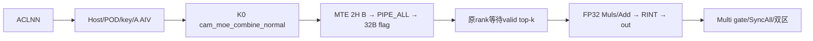

# SGL DeepEP Normal 加权 Combine 950 ACLNN 算子知识

## 算子速览

| 项目 | 内容 |
|---|---|
| 实际入口 | aclnnCamMoeCombineNormalGetWorkspaceSize / aclnnCamMoeCombineNormal，公开两段式ACLNN。 |
| 计算语义 | 专家输出送回原始rank/原top-k槽，FP32权重乘加后恢复原token顺序；单/多轮属于同一语义。 |
| 输入输出 | ND BF16/FP16 recvX[S,H]→同dtype out[N,H]，INT32 prefix/triple/expertId、FP32权重。 |
| 执行类型 | 单K0 AIV_VECTOR+MTE；A2附SDK AICPU client Init/地址查询/Finalize控制，无可达Cube/AIC/MIX_CV。 |
| Kernel 路线 | R-001 950 legacy 单轮 rank-major；R-002 950 legacy 单轮 连续区间 fallback；R-003 950 hybrid 单轮 rank-major；R-004 950 hybrid 单轮 连续区间 fallback；R-005 950 legacy 多轮 rank-major；R-006 950 legacy 多轮 连续区间 fallback；R-007 950 hybrid 多轮 rank-major；R-008 950 hybrid 多轮 连续区间 fallback；诊断为条件资源分支，BF16/FP16不拆数学算子。 |
| 核心资源 | 双Queue、FP32 scratch、metadata TBuf、组window双半；Multi加round双区/gate。 |
| 来源闭包 | source_closed：wrapper→Host全部selector/失败终点→POD/SDK序列化→router→完整body/context/通信字节与同步，止于框架launch/Vector/DMA/运行时组资源primitive。 |
| 验证状态 | 已完成源码闭包检查；本次知识提取未执行编译、真机、数值或性能测试。draft保留已见资源/语义限制。 |

固定SGL dda6d36b0cdb4081e102d14c0a2fb276fc416e69、SDK9.1 e5451c7feba11f9e259f4fbc19c4bf82f8c0496c。P3=csrc/deepep/ops/，P2=csrc/deepep/ops2/。冻结Query候选[Normal API](../../../../apis/deepep/deepep_normal_dispatch_combine.md)已完整读，未含完整Operator，本卡create。source_closed仅指自有选择和实现终点可追溯，不证明Host接受域均运行正确。

## 接口与语义

### 计算语义

R/r/E/L为EP域大小/本rank/专家总数/E÷R；N=原本rank token数，H=hidden，K=top-k，A=AIV数，S=epRecvCounts[E-1]。packed recvX每row的tokenSrcInfo=[原rank,原token,原topk]；epRecvCounts是local-expert major/source-rank minor全局inclusive prefix，共L×R=E项，并非每专家归零。

发送每个expert row到三元组指定的原rank [n,k]槽；原rank只等待0≤tokenIdx[n,k]<E的槽，依k递增Cast(NONE)到FP32→Muls(weight[n,k])→Add入FP32 sum，最后Cast(RINT)回BF16/FP16：
out[n,h]=CastRINT_X(Σ_valid k FP32(expertResult[n,k,h])×recvTopkWeights[n,k])。
sum从零开始；负/≥E expert不参与。Single按不同slot累加重复expert；Multi还要求每个发送子range在每个原token窗口内的有效行数≤P，因为每range每轮最多发送P行，而接收等待全部有效slot，实际轮数仅ceil(realMaxBs/P)。重复路由可违反此条件；Host未检查该前提，不能无条件保证重复slot都被发送/累加。此为源码静态边界，未做真机复现。

recvTopkWeights实际是原rank[N,K]权重，不是packed expert row权重。默认Normal策略取Dispatch handle里的topk_idx/topk_weights_ori，combine另传的topk_weights不替换该handle；C++缺权重则ones[N,K]。bias/config及返回recv_topk_weights无新增Device计算。Dispatch可量化，但此Combine必须输入专家计算后的BF16/FP16；不会在这里解INT8/FP8/MX。

全部body忽略tpRecvCount/TP context；TP2通过Host仍执行同一EP body，不声称实现TP归约。这是已知语义限制，区别于router无匹配。

### 输入、输出与属性

| 参数 | shape/layout | dtype | 约束、默认值与语义 |
|---|---|---|---|
| recvX | [S,H] ND/AutoContiguous | BF16/FP16 | Host二维；容量至少覆盖prefix末项，Host不验证S一致。OpDef INT32输入列被outer Host明确拒绝。 |
| tokenSrcInfo | 1D ND，至少3S项 | INT32 | Host检查rank/type/format但不查extent/值；每row12B三元组。 |
| epRecvCounts | E项prefix，通常[L,R]扁平 | INT32 | OpDef声明；tiling未完整检查dtype/rank/extent；需非负、单调、末项/metadata匹配。 |
| recvTopkWeights | [N,K] ND | FP32 | Host由其定义N/K，原始rank权重。 |
| tokenIdx | [N,K] ND | INT32 | Host只查二维，不验证两维等权重；Single实际DMA align32(4cK)字节有尾容量条件。 |
| tpRecvCountsOptional | [TP] ND | INT32 | OpDef OPTIONAL，但Host始终要求nonnull/rank1/type/format，即使TP0；body不读。 |
| out | [N,H] ND | recvX同dtype | Host检查形状/配对，原token顺序。 |
| sendCostStats | optional[R] ND | INT32 | shape对象存在即diagnose；raw Host不查长度R。AtomicAdd，调用者初始化；文档INT64与实际I32不同。 |
| epGroupName/R/r | 属性 | string/int64 | group长度1..127、R2..384、0≤r<R；可直接访问的远端window仍依运行时拓扑。 |
| tpGroupName/TP/tpRank | 属性 | string/int64 | TP0..2；≤1 rank须0；TP2非空group/rank合法/L1；body不执行TP通信。 |
| moeExpertNum | 属性 | int64 | E1..1024；E%R=0且L>0。 |
| realMaxBs | 属性 | int64→u32 | 0→N，非0≥N；无u32上界，预算与实际multi循环所用。 |
| round | 属性/ACLNN int32 | OpDef int64→u32 | 默认4；>1 Multi，其余Single，无正数/上界检查；不是Device循环上限。 |
| per_round_tokens | 属性/ACLNN int32 | OpDef int64→u32 | 默认1024；P用于Host min及Multi除法/模数，无P>0 guard。 |
| N/H/K | 派生 | u32 | N0..131072，H1024..8192；K1..min(16,E)。H%32仅注释，未落实Host guard。 |

### 入口与版本

NORMAL_API公开A2/A3/A5和加权配套handle，但其通用shape/window说明与具体Host不完全同式，不覆盖本文实际地址。DeepEP README支持CANN9.0/9.1，本卡仅9.1.0，SDK version.cmake同版本。活动ops OpDef在__DAV_C310__声明ascend950，Host SoC Ascend950产15000/15001，single走A5专体；multi同文件按__DAV_C310__替换rank-major与context。

GetWorkspaceSize透传生成inner；Execute若弱符号NnopbaseSetHcclServerType存在则设MTE(1)再调用inner。AutoContiguous/executor/stream launch为框架边界。C++ Buffer::intranode_combine固定TP1/rank0、tokenIdx转INT32、out=empty[N,H]；可选cost要求I32/rank1/连续/长度R但不清零。默认策略num_rdma_ranks>1分流到另一internode entry，本卡不并入它。事件/async包装不增加第二Device kernel。

## Host/Launcher 执行流程

### 参数校验与前处理

1. outer先拒绝空recvXDesc和INT32，随后GetAttr写Info；cost shape存在→diagnose；P3读取IsHybridDeployment。
2. TilingCheck指定dim/ND/dtype→CheckAttrs的group/EP/TP/E/rank→CheckTensorShape确定N/H/K/output/realMaxBs。epCounts、tokenIdx与triple值/容量一致性未全检。
3. GetMaxWindowSize优先DEEPEP_HCCL_BUFFSIZE，否则HCCL_BUFFSIZE，默认200MiB；stoi后存uint16，无负数/窄化上界拒绝。预算W需匹配runtime实际window。
4. B=min(P,realMaxBs)，G=align512(2H)，f=(maxRound>1?2:1)。hybrid须32BK≤single4MiB/multi2MiB，预算2*(B*K*G*f+109MiB+72KiB)≤W；legacy2*(B*K*G*f+106MiB)≤W，但遗漏Device全窗4MiB前缀，另列draft。
5. workspace固定16MiB。SetHCommCfg：P3 engine3/EP cmd8 fullmesh-pairwise/TP cmd6 allgather-ring；P2默认engine0/EP cmd8/TP cmd7 reducescatter-ring。SDK GetTiling写init64/cc512，其返回未被Host完整检查，非0POD不可消费。
6. A=GetCoreNumAiv、U=GetCoreMemSize(UB)，block=CalcTschBlockDim(A,0,A)，Info写A/U；SetScheduleMode(1)全部AIV batch。无完整UB/TPipe handle数检查；key如下。Parse无额外修正。

### 参数、Workspace 与生命周期

caller持有输入、输出和workspace到stream任务完成；executor绑定本次参数。K0保存workspaceGM但所有body没有自有GM slice消费，16MiB不能补UB；POD1176B由框架另持有。

runtime组拥有context/window。每core读持久magic旧z后翻转，旧z选本call half；同z重用需同组同序调用及前消费者完成。调用者保证初始tokenflag/roundflag零，各rank轮配置一致；Host不会清整个window。Multi的roundMagic在callhalf内0/1切换，不能代替call z。

950本地GetBaseWindAddr(q)=windowsIn[q]+4MiB，GetBaseWindStateAddr(q)=raw windowsIn[q]，GetStatusDataSpaceGm=context.windowsIn[context.rankId]。magic=本rankrawIN+1100KiB+512core，DCCI读旧值后翻转。baseW=W-4MiB；STATE=rawIN+4MiB+z*baseW/2+102MiB；DATA legacy=STATE+4MiB，hybrid=STATE+5MiB+72KiB。Multi再加roundMagic*P*K*G的数据区偏移、roundMagic*2MiB状态偏移；roundControl=rawIN(q)+458KiB+roundMagic*4KiB+32sourceRank。注意控制走rawIN而payload基础跳过4MiB。Host legacy按2*(106MiB+B*K*G*f)预算，Device完整需额外全窗4MiB；hybrid 2*(109MiB+72KiB+B*K*G*f)已将4MiB只计一次。源可见预算差异保留draft。

### 启动图与失败传播



| 节点/边 | producer→consumer | offset/extent/dtype/layout | ordering | owner/lifetime/失败 |
|---|---|---|---|---|
| Host→K0 | inner→entry | 10个GM参数/POD1176B，block=CalcTschBlockDim(A,0,A) | 当前stream/batch AIV | 框架；Host失败不产合法launch |
| metadata | Dispatch/caller→sender | prefix4E B/triple12S B/recvX2SH B | Dispatch/专家计算先完成 | caller；内容错误无完整Device校验 |
| payload | expert→原rank | DATA(q)+(nK+k)G，实际2H B | Queue→MTE3→PIPE_ALL→flag | runtime组，消费前不重用 |
| ready | sender→receiver | STATE(q)+32(nK+k)，8×F32=1 | Sum=8validCount后清K×32B | 无超时返回 |
| output | receiver→caller | out[nH]实际2H B | MTE2/V/MTE3事件，stream完成 | caller，仅实际N行 |
| diagnose | sender→cost[R] | AtomicAdd I32，实际4R B | SetAtomicAdd/Copy/SetAtomicNone | caller清零或有意累加 |
| roundgate | 每rank core0→peer core0 | roundMagic槽4KiB，其中32R B | 等8R ones→清→flip→SyncAll | runtime组；配置不一致不保证完成，不推测错误码 |

## Route 与参数设计

### 分核与资源计算

split(T,A,c)：q=T÷A、rem=T%A，count=q+[c<rem]、start=cq+min(c,rem)、end=start+count；空count按方法早退。A2/A3 Single发送split(S)/接收split(N)；Multi发送split(E)连续expert/source块，接收split(min(P,remainingN))。950分核另逐Route说明。

Xb=align32(2H)，F=align32(4H)，F256=align256(4H)，D=align32(4R)，Ce=align32(4E)，Cl=align32(4L)，J(c)=align32(4cK)，Wt=align32(4K(floor(P/A)+1))。SDK InitBuffer所有请求均按32B上取整；Queue传入depth2，每slot一份容量，不能只算活跃LocalTensor。

950 Single发送Ce+2Cl+32+2Xb+1536+2D*[diagnose]；接收3Xb+2F+F256+64K+2J(cRecv)，Reset分隔取max。Multi总先分配Ce；有发送工作时rank-major再加2Cl+1536+32+2Xb，fallback再加2Ce+1536+32+2Xb。recv始终追加3Xb+2F+F256+64K+96R+2Wt，两阶段无Reset。

SDK TPipe::InitBuffer会对len取align32，追加pool.maxAddr和curBufSize；FreeTensor仅归还队列slot，不倒退池。Multi每次needSendTokenCnt>0且diagnose时又InitBuffer(statsQueue,2,D)，故每core再累加2*fSend*D与2*fSend个handle；总handle还需≤64。Host无该门禁，不能写成每轮只复用同2D。Single diagnoseQueue在部分空range返回前已分配，存在该资源分支；不臆测具体运行错误。

### Route 选择

| 顺序 | Route | Key/模板 | 精确选择条件与优先级 | 不适用去向 |
|---|---|---|---|---|
| 1 | R-001 950 legacy 单轮 rank-major | 15000 / CamMoeCombineNormalA5<X,X,int32_t> | ops SoC Ascend950；maxRound≤1；hybrid=false；A≥R；recvX/out同BF16或同FP16且公共Host检查通过 | 属性/shape失败GRAPH_FAILED；其它本表Route；不匹配key无body |
| 2 | R-002 950 legacy 单轮 连续区间 fallback | 15000 / CamMoeCombineNormalA5<X,X,int32_t> | ops SoC Ascend950；maxRound≤1；hybrid=false；A<R；recvX/out同BF16或同FP16且公共Host检查通过 | 属性/shape失败GRAPH_FAILED；其它本表Route；不匹配key无body |
| 3 | R-003 950 hybrid 单轮 rank-major | 15000 / CamMoeCombineNormalA5<X,X,int32_t> | ops SoC Ascend950；maxRound≤1；hybrid=true；A≥R；recvX/out同BF16或同FP16且公共Host检查通过 | 属性/shape失败GRAPH_FAILED；其它本表Route；不匹配key无body |
| 4 | R-004 950 hybrid 单轮 连续区间 fallback | 15000 / CamMoeCombineNormalA5<X,X,int32_t> | ops SoC Ascend950；maxRound≤1；hybrid=true；A<R；recvX/out同BF16或同FP16且公共Host检查通过 | 属性/shape失败GRAPH_FAILED；其它本表Route；不匹配key无body |
| 5 | R-005 950 legacy 多轮 rank-major | 15001 / CamMoeCombineNormalMultiRound<X,X,int32_t> | ops SoC Ascend950；maxRound>1；hybrid=false；A≥R；recvX/out同BF16或同FP16且公共Host检查通过 | 属性/shape失败GRAPH_FAILED；其它本表Route；不匹配key无body |
| 6 | R-006 950 legacy 多轮 连续区间 fallback | 15001 / CamMoeCombineNormalMultiRound<X,X,int32_t> | ops SoC Ascend950；maxRound>1；hybrid=false；A<R；recvX/out同BF16或同FP16且公共Host检查通过 | 属性/shape失败GRAPH_FAILED；其它本表Route；不匹配key无body |
| 7 | R-007 950 hybrid 多轮 rank-major | 15001 / CamMoeCombineNormalMultiRound<X,X,int32_t> | ops SoC Ascend950；maxRound>1；hybrid=true；A≥R；recvX/out同BF16或同FP16且公共Host检查通过 | 属性/shape失败GRAPH_FAILED；其它本表Route；不匹配key无body |
| 8 | R-008 950 hybrid 多轮 连续区间 fallback | 15001 / CamMoeCombineNormalMultiRound<X,X,int32_t> | ops SoC Ascend950；maxRound>1；hybrid=true；A<R；recvX/out同BF16或同FP16且公共Host检查通过 | 属性/shape失败GRAPH_FAILED；其它本表Route；不匹配key无body |


```text
outer dtype INT32? -> Host失败
Host属性/shape/window失败 -> GRAPH_FAILED
SoC Ascend950 -> key15000(maxRound≤1) /15001(maxRound>1)
每key: hybrid=false/true 决定窗口；A≥R rank-major / A<R contiguous fallback
诊断cost shape存在 -> 追加条件Queue/AtomicAdd，BF16/FP16配对实例
TP2通过相同key -> EP body执行，无TP通信；其它key没有匹配body
```

### 模板/实现执行矩阵

| Route | key/selector | dtype/shape/platform 完整命中条件 | 执行拓扑与 Kernel 节点 | 实际模板/body | 内存与同步特征 | tail/fallback |
|---|---|---|---|---|---|---|
| R-001 | 15000/A÷R/hybrid | ops SoC Ascend950；maxRound≤1；hybrid=false；A≥R；recvX/out同BF16或同FP16且公共Host检查通过；N/H/E按公共平台域 | 单K0 AIV_VECTOR+MTE | CamMoeCombineNormalA5<bfloat16_t,bfloat16_t,int32_t> 或 <half,half,int32_t> | send/recv Reset，tokenflag，FP32加权 | A<R去相应fallbackRoute |
| R-002 | 15000/A÷R/hybrid | ops SoC Ascend950；maxRound≤1；hybrid=false；A<R；recvX/out同BF16或同FP16且公共Host检查通过；N/H/E按公共平台域 | 单K0 AIV_VECTOR+MTE | CamMoeCombineNormalA5<bfloat16_t,bfloat16_t,int32_t> 或 <half,half,int32_t> | send/recv Reset，tokenflag，FP32加权 | A<R实际fallback |
| R-003 | 15000/A÷R/hybrid | ops SoC Ascend950；maxRound≤1；hybrid=true；A≥R；recvX/out同BF16或同FP16且公共Host检查通过；N/H/E按公共平台域 | 单K0 AIV_VECTOR+MTE | CamMoeCombineNormalA5<bfloat16_t,bfloat16_t,int32_t> 或 <half,half,int32_t> | send/recv Reset，tokenflag，FP32加权 | A<R去相应fallbackRoute |
| R-004 | 15000/A÷R/hybrid | ops SoC Ascend950；maxRound≤1；hybrid=true；A<R；recvX/out同BF16或同FP16且公共Host检查通过；N/H/E按公共平台域 | 单K0 AIV_VECTOR+MTE | CamMoeCombineNormalA5<bfloat16_t,bfloat16_t,int32_t> 或 <half,half,int32_t> | send/recv Reset，tokenflag，FP32加权 | A<R实际fallback |
| R-005 | 15001/A÷R/hybrid | ops SoC Ascend950；maxRound>1；hybrid=false；A≥R；recvX/out同BF16或同FP16且公共Host检查通过；N/H/E按公共平台域 | 单K0 AIV_VECTOR+MTE | CamMoeCombineNormalMultiRound<bfloat16_t,bfloat16_t,int32_t> 或 <half,half,int32_t> | 双round data/state，send+recv UB共存，gate+SyncAll | A<R去相应fallbackRoute |
| R-006 | 15001/A÷R/hybrid | ops SoC Ascend950；maxRound>1；hybrid=false；A<R；recvX/out同BF16或同FP16且公共Host检查通过；N/H/E按公共平台域 | 单K0 AIV_VECTOR+MTE | CamMoeCombineNormalMultiRound<bfloat16_t,bfloat16_t,int32_t> 或 <half,half,int32_t> | 双round data/state，send+recv UB共存，gate+SyncAll | A<R实际fallback |
| R-007 | 15001/A÷R/hybrid | ops SoC Ascend950；maxRound>1；hybrid=true；A≥R；recvX/out同BF16或同FP16且公共Host检查通过；N/H/E按公共平台域 | 单K0 AIV_VECTOR+MTE | CamMoeCombineNormalMultiRound<bfloat16_t,bfloat16_t,int32_t> 或 <half,half,int32_t> | 双round data/state，send+recv UB共存，gate+SyncAll | A<R去相应fallbackRoute |
| R-008 | 15001/A÷R/hybrid | ops SoC Ascend950；maxRound>1；hybrid=true；A<R；recvX/out同BF16或同FP16且公共Host检查通过；N/H/E按公共平台域 | 单K0 AIV_VECTOR+MTE | CamMoeCombineNormalMultiRound<bfloat16_t,bfloat16_t,int32_t> 或 <half,half,int32_t> | 双round data/state，send+recv UB共存，gate+SyncAll | A<R实际fallback |


### 隐藏性能 Guard

| Guard | Host/Tiling 条件 | Device/资源原因 | 影响 Route | 不满足时去向 | 源码符号 |
|---|---|---|---|---|---|
| dtype/shape | BF16/FP16配对、N/H/K上述域 | Cast/行跨度 | 全部 | GRAPH_FAILED | TilingCheck/CheckTensorShape |
| P>0/整数范围 | 未检查 | ceil(realMaxBs/P)、mod P、P*K*G需可表示 | Multi | draft已见缺陷，不虚构具体报错 | Init/Process |
| 单轮预算 | Host min(P,realMaxBs)，body完整N | P<N或maxRound0可能低估 | Single | caller保证容量，无自动tile | window budget |
| UB/handle | 仅保存totalUbSize | InitBuffer累加；诊断每发送轮再次请求 | 全部 | draft资源条件 | TPipe::InitBuffer/Reset |
| token状态容量 | P3 hybrid检查32BK≤4MiB/2MiB | single/round state slot | P3对应Route | hybrid GRAPH_FAILED，legacy无同等guard | normalStateCapacity |
| 元数据一致性 | 无完整值/extent扫描 | prefix差值/三元组决定全部地址；Multi要求sourceToken块内递增 | 全部 | 无安全fallback | CopyBufferToShareAndSetStatus |
| idx tail | Single DMA align32(4cK) | input实际尾容量需覆盖 | Single | caller保证padding | tokenIdxParams |
| round容量 | 无32R≤4096 guard | roundMagic4KiB容纳32R B→必要R≤128 | Multi | Host更宽，draft | GetRoundStateAddrByRankId |
| TP2 | Host允许L1 | body不读TP通信参数 | 全部 | 已知语义缺失，区别于无router | Init未消费tpRecvCount |
| diagnose | raw不查cost长度/初值 | AtomicAdd 4R B | 条件分支 | caller保证长度/初值 | sendCostStatsGT_ |
| 32项window | Host R≤384，不限R≤32 | 本地HcclCombinOpParam按rank索引32项 | 全部 | 超域缺guard，draft | GetBaseWindAddrByRankId |
| 950 legacy前缀 | Host没额外计全窗4MiB | body跳过4MiB且用W-4MiB双半 | legacy | caller保证实际window余量 | kLegacyNormalDataOffset/GetBaseWindAddr |

### POD/ABI

Info按普通C++自然align8推导size88，P2无hybrid字段但尾padding仍补到88。offset相对Info。外壳1176/align8：init@0/64B、cc1@64/512B、cc2@576/512B、Info@1088/88B。未执行sizeof/安装ABI实测，禁止跨平台手拼context。

| 结构 | 字段 | 类型/位宽 | ABI 布局 | 单位 | Host/launcher producer | Device consumer | 边界 |
|---|---|---|---|---|---|---|---|
| CamMoeCombineNormalInfo | epWorldSize | u32 | @0 | rank数 | GetAttr EP | split/target/round gate | R2..384但Device容量另限 |
| CamMoeCombineNormalInfo | tpWorldSize | u32 | @4 | rank数 | GetAttr TP | 未消费 | Host允许0..2不等于TP实现 |
| CamMoeCombineNormalInfo | epRankId | u32 | @8 | rank | GetAttr EP rank | 本地window/目的地址 | 0≤r<R |
| CamMoeCombineNormalInfo | tpRankId | u32 | @12 | rank | GetAttr TP rank | 未消费 | TP≤1须0 |
| CamMoeCombineNormalInfo | expertShardType | u32 | @16 | 枚举 | 未赋值 | 未消费 | inactive，不依赖值 |
| CamMoeCombineNormalInfo | moeExpertNum | u32 | @20 | expert数 | GetAttr E | prefix末项/分块 | E可整除R |
| CamMoeCombineNormalInfo | moeExpertPerRankNum | u32 | @24 | expert数 | CheckAttrs E/R | 950 rank-major | L>0 |
| CamMoeCombineNormalInfo | realMaxBs | u32 | @28 | token数 | CheckTensorShape 0→N/非0属性 | Multi realRound | int64窄化无完整上界 |
| CamMoeCombineNormalInfo | perRoundTokens | u32 | @32 | token/round | GetAttr P | Multi除法/模数/round offset | 无正数guard |
| CamMoeCombineNormalInfo | maxRound | u32 | @36 | 选择/预算 | GetAttr round | Host选key；Device不以它限循环 | >1 Multi |
| CamMoeCombineNormalInfo | bs | u32 | @40 | token数 | 权重dim0 | 接收out/remainingN | N域按平台 |
| CamMoeCombineNormalInfo | k | u32 | @44 | slot数/token | 权重dim1 | 状态/权重/窗口地址 | 1..min16E |
| CamMoeCombineNormalInfo | h | u32 | @48 | 元素/row | recvX.dim1 | 搬运/Vector长度 | 无H%32 Hostguard |
| CamMoeCombineNormalInfo | aivNum | u32 | @52 | 核数 | GetCoreNumAiv | split/950 rank-major | 不是R |
| CamMoeCombineNormalInfo | totalUbSize | u64 | @56 | B | GetCoreMemSize(UB) | body不做完整容量验证 | 资源式需自行满足 |
| CamMoeCombineNormalInfo | totalWinSize | u64 | @64 | B | GetMaxWindowSize env | half/magic/数据基址 | 需等于runtime实际window |
| CamMoeCombineNormalInfo | armAvgFactor | FP32 | @72 | inactive | 未赋值 | 未消费 | 不得假默认 |
| CamMoeCombineNormalInfo | epsilon | FP32 | @76 | inactive | 未赋值 | 未消费 | 不得假默认 |
| CamMoeCombineNormalInfo | isEnableDiagnose | bool | @80 | 布尔 | cost shape!=nullptr | statsQueue/AtomicAdd | raw不查R长度 |
| CamMoeCombineNormalInfo | isHybridDeployment | bool | @81 | 布尔 | P3 IsHybridDeployment | P3地址分支 | P2无此字段，padding至88；950/A3 P3有效 |


| 结构 | 字段 | 类型/位宽 | ABI 布局 | 单位 | Host/launcher producer | Device consumer | 边界 |
|---|---|---|---|---|---|---|---|
| TilingData | mc2InitTiling | opaque64 | @0 | B | SetHCommCfg/GetTiling | P2 InitV2/框架 | SDKinner如下 |
| 同上 | mc2CcTiling1 | opaque512 | @64 | B | EP config | 框架组 | cmd8不是payload body |
| 同上 | mc2CcTiling2 | opaque512 | @576 | B | TP config | 框架资源 | body不做TP |
| 同上 | camMoeCombineNormalInfo | Info88 | @1088 | mixed | Host | K0 Init | 全字段上表 |

SDK opaque init64/cc512实际inner如下；offset相对inner，所有reserved为保留字节，不能假定未显式写入项清零。当前仅生成资源与控制，不执行HCCL payload collective。

| 结构 | 字段 | 类型/位宽 | ABI 布局 | 单位 | Host/launcher producer | Device consumer | 边界 |
|---|---|---|---|---|---|---|---|
| Mc2InitTilingInner | version | u32 | 0 | 版本枚举 | GetTiling: 100 | SDK初始化 | 不依赖reserved值 |
| 同上 | mc2HcommCnt | u32 | 4 | 通信组数 | GetTiling: 2 | 框架组配置 | 不依赖reserved值 |
| 同上 | offset | u32[8] | 8 | 字节偏移数组 | GetTiling: 64/576，其余0 | cc1/cc2定位 | 不依赖reserved值 |
| 同上 | debugMode | u8 | 40 | 枚举 | GetTiling: default0 | SDK | 不依赖reserved值 |
| 同上 | preparePosition | u8 | 41 | 枚举 | GetTiling: default0 | SDK | 不依赖reserved值 |
| 同上 | queueNum | u16 | 42 | queue数 | GetTiling: default0 | SDK working core | 不依赖reserved值 |
| 同上 | commBlockNum | u16 | 44 | block数 | GetTiling: default0 | SDK资源 | 不依赖reserved值 |
| 同上 | devType | u8 | 46 | 枚举 | GetTiling: runtime SoC | 平台实现选择 | 不依赖reserved值 |
| 同上 | reserved | char[17] | 47 | 保留字节 | GetTiling: 未显式清全部 | inactive | 不依赖reserved值 |
| Mc2CcTilingInner | skipLocalRankCopy | u8 | 0 | 布尔 | GetTiling: default0 | 框架 | 不依赖reserved值 |
| 同上 | skipBufferWindowCopy | u8 | 1 | 布尔 | GetTiling: default0 | 框架 | 不依赖reserved值 |
| 同上 | stepSize | u8 | 2 | step数 | GetTiling: default0 | 框架 | 不依赖reserved值 |
| 同上 | version | u8 | 3 | 版本枚举 | GetTiling: 1 | 固定协议 | 不依赖reserved值 |
| 同上 | reserved | char[9] | 4 | 保留字节 | GetTiling: memset0 | inactive | 不依赖reserved值 |
| 同上 | commEngine | u8 | 13 | 枚举 | GetTiling: P3=3/P2默认0 | 框架MTE资源；Device不执行CCU | 不依赖reserved值 |
| 同上 | srcDataType | u8 | 14 | dtype枚举 | GetTiling: default0=INT8 | MTE不读作payload dtype，payload由模板决定 | 不依赖reserved值 |
| 同上 | dstDataType | u8 | 15 | dtype枚举 | GetTiling: default0=INT8 | MTE不读取该字段 | 不依赖reserved值 |
| 同上 | groupName | char[128] | 16 | 组名字符 | GetTiling: EP/TP字符串 | 框架组关联 | 不依赖reserved值 |
| 同上 | algConfig | char[128] | 144 | 算法配置字符 | GetTiling: AlltoAll fullmesh/pairwise，P3 TP AllGather/P2 TP ReduceScatter ring | 框架资源组装；本body直接MTE | 不依赖reserved值 |
| 同上 | opType | u32 | 272 | 命令枚举 | GetTiling: EP8/TP P3=6/P2=7 | 框架通信资源声明 | 不依赖reserved值 |
| 同上 | reduceType | u32 | 276 | reduce枚举 | GetTiling: default0 | 本body不做payload reduce | 不依赖reserved值 |
| 同上 | reserved2 | char[232] | 280 | 保留字节 | GetTiling: 未显式清全部 | inactive | 不依赖reserved值 |

950当前body用本地HcclCombinOpParam（少e），自然size576/align8、32项window数组，不能替换成SDK CCU64项结构。本卡没有CCU Device节点。

| 结构 | 字段 | 类型/位宽 | ABI 布局 | 单位 | Host/launcher producer | Device consumer | 边界 |
|---|---|---|---|---|---|---|---|
| HcclCombinOpParam | workSpace | u64 | @0 | 地址 | runtime组，不是本Host构造 | 本直接MTE不用 | 本地固定header自然布局推导，非安装ABI实测 |
| HcclCombinOpParam | workSpaceSize | u64 | @8 | B | runtime组，不是本Host构造 | 本直接MTE不用 | 本地固定header自然布局推导，非安装ABI实测 |
| HcclCombinOpParam | rankId | u32 | @16 | rank | runtime组，不是本Host构造 | GetStatusDataSpaceGm选本rank rawIN | 本地固定header自然布局推导，非安装ABI实测 |
| HcclCombinOpParam | rankDim | u32 | @20 | rank数 | runtime组，不是本Host构造 | ABI保留 | 本地固定header自然布局推导，非安装ABI实测 |
| HcclCombinOpParam | winSize | u64 | @24 | B | runtime组，不是本Host构造 | 当前body以InfoW计算 | 本地固定header自然布局推导，非安装ABI实测 |
| HcclCombinOpParam | windowsIn | u64[32] | @32 | 地址数组 | runtime组，不是本Host构造 | GetBaseWindAddr/StateAddr | 本地固定header自然布局推导，非安装ABI实测 |
| HcclCombinOpParam | windowsOut | u64[32] | @288 | 地址数组 | runtime组，不是本Host构造 | 未读 | 本地固定header自然布局推导，非安装ABI实测 |
| HcclCombinOpParam | xnAddr | u64 | @544 | 地址 | runtime组，不是本Host构造 | 未读 | 本地固定header自然布局推导，非安装ABI实测 |
| HcclCombinOpParam | ckeAddr | u64 | @552 | 地址 | runtime组，不是本Host构造 | 未读 | 本地固定header自然布局推导，非安装ABI实测 |
| HcclCombinOpParam | msAddr | u64 | @560 | 地址 | runtime组，不是本Host构造 | 未读 | 本地固定header自然布局推导，非安装ABI实测 |
| HcclCombinOpParam | msSize | u64 | @568 | 计数/容量 | runtime组，不是本Host构造 | 未读 | 本地固定header自然布局推导，非安装ABI实测 |


### Route 源码闭包

| Route | Key/selector | Host/Tiling producer | POD/参数 | Kernel entry/router 节点 | Kernel body/直接依赖 | 构建接线 |
|---|---|---|---|---|---|---|
| R-001 | 15000 ops SoC Ascend950；maxRound≤1；hybrid=false；A≥R；recvX/out同BF16或同FP16且公共Host检查通过 | csrc/deepep/ops/op_host/cam_moe_combine_normal_tiling.cc::CamMoeCombineNormalTilingFunc/CheckAttrs/CheckTensorShape/SetHCommCfg | Info88/外壳1176/SDK64+512+512 | csrc/deepep/ops/op_kernel/cam_moe_combine_normal.cpp::cam_moe_combine_normal→CamMoeCombineNormalA5 | csrc/deepep/ops/op_kernel/cam_moe_combine_normal_a5.h；moe_distribute_base/comm_args；window_layout | build.sh→compile_ascend_proj.sh→csrc/deepep/ops/{op_host,op_kernel}/CMakeLists.txt；OpDef ascend950 |
| R-002 | 15000 ops SoC Ascend950；maxRound≤1；hybrid=false；A<R；recvX/out同BF16或同FP16且公共Host检查通过 | csrc/deepep/ops/op_host/cam_moe_combine_normal_tiling.cc::CamMoeCombineNormalTilingFunc/CheckAttrs/CheckTensorShape/SetHCommCfg | Info88/外壳1176/SDK64+512+512 | csrc/deepep/ops/op_kernel/cam_moe_combine_normal.cpp::cam_moe_combine_normal→CamMoeCombineNormalA5 | csrc/deepep/ops/op_kernel/cam_moe_combine_normal_a5.h；moe_distribute_base/comm_args；window_layout | build.sh→compile_ascend_proj.sh→csrc/deepep/ops/{op_host,op_kernel}/CMakeLists.txt；OpDef ascend950 |
| R-003 | 15000 ops SoC Ascend950；maxRound≤1；hybrid=true；A≥R；recvX/out同BF16或同FP16且公共Host检查通过 | csrc/deepep/ops/op_host/cam_moe_combine_normal_tiling.cc::CamMoeCombineNormalTilingFunc/CheckAttrs/CheckTensorShape/SetHCommCfg | Info88/外壳1176/SDK64+512+512 | csrc/deepep/ops/op_kernel/cam_moe_combine_normal.cpp::cam_moe_combine_normal→CamMoeCombineNormalA5 | csrc/deepep/ops/op_kernel/cam_moe_combine_normal_a5.h；moe_distribute_base/comm_args；window_layout | build.sh→compile_ascend_proj.sh→csrc/deepep/ops/{op_host,op_kernel}/CMakeLists.txt；OpDef ascend950 |
| R-004 | 15000 ops SoC Ascend950；maxRound≤1；hybrid=true；A<R；recvX/out同BF16或同FP16且公共Host检查通过 | csrc/deepep/ops/op_host/cam_moe_combine_normal_tiling.cc::CamMoeCombineNormalTilingFunc/CheckAttrs/CheckTensorShape/SetHCommCfg | Info88/外壳1176/SDK64+512+512 | csrc/deepep/ops/op_kernel/cam_moe_combine_normal.cpp::cam_moe_combine_normal→CamMoeCombineNormalA5 | csrc/deepep/ops/op_kernel/cam_moe_combine_normal_a5.h；moe_distribute_base/comm_args；window_layout | build.sh→compile_ascend_proj.sh→csrc/deepep/ops/{op_host,op_kernel}/CMakeLists.txt；OpDef ascend950 |
| R-005 | 15001 ops SoC Ascend950；maxRound>1；hybrid=false；A≥R；recvX/out同BF16或同FP16且公共Host检查通过 | csrc/deepep/ops/op_host/cam_moe_combine_normal_tiling.cc::CamMoeCombineNormalTilingFunc/CheckAttrs/CheckTensorShape/SetHCommCfg | Info88/外壳1176/SDK64+512+512 | csrc/deepep/ops/op_kernel/cam_moe_combine_normal.cpp::cam_moe_combine_normal→CamMoeCombineNormalMultiRound | csrc/deepep/ops/op_kernel/cam_moe_combine_normal_multi_round.h；moe_distribute_base/comm_args；window_layout | build.sh→compile_ascend_proj.sh→csrc/deepep/ops/{op_host,op_kernel}/CMakeLists.txt；OpDef ascend950 |
| R-006 | 15001 ops SoC Ascend950；maxRound>1；hybrid=false；A<R；recvX/out同BF16或同FP16且公共Host检查通过 | csrc/deepep/ops/op_host/cam_moe_combine_normal_tiling.cc::CamMoeCombineNormalTilingFunc/CheckAttrs/CheckTensorShape/SetHCommCfg | Info88/外壳1176/SDK64+512+512 | csrc/deepep/ops/op_kernel/cam_moe_combine_normal.cpp::cam_moe_combine_normal→CamMoeCombineNormalMultiRound | csrc/deepep/ops/op_kernel/cam_moe_combine_normal_multi_round.h；moe_distribute_base/comm_args；window_layout | build.sh→compile_ascend_proj.sh→csrc/deepep/ops/{op_host,op_kernel}/CMakeLists.txt；OpDef ascend950 |
| R-007 | 15001 ops SoC Ascend950；maxRound>1；hybrid=true；A≥R；recvX/out同BF16或同FP16且公共Host检查通过 | csrc/deepep/ops/op_host/cam_moe_combine_normal_tiling.cc::CamMoeCombineNormalTilingFunc/CheckAttrs/CheckTensorShape/SetHCommCfg | Info88/外壳1176/SDK64+512+512 | csrc/deepep/ops/op_kernel/cam_moe_combine_normal.cpp::cam_moe_combine_normal→CamMoeCombineNormalMultiRound | csrc/deepep/ops/op_kernel/cam_moe_combine_normal_multi_round.h；moe_distribute_base/comm_args；window_layout | build.sh→compile_ascend_proj.sh→csrc/deepep/ops/{op_host,op_kernel}/CMakeLists.txt；OpDef ascend950 |
| R-008 | 15001 ops SoC Ascend950；maxRound>1；hybrid=true；A<R；recvX/out同BF16或同FP16且公共Host检查通过 | csrc/deepep/ops/op_host/cam_moe_combine_normal_tiling.cc::CamMoeCombineNormalTilingFunc/CheckAttrs/CheckTensorShape/SetHCommCfg | Info88/外壳1176/SDK64+512+512 | csrc/deepep/ops/op_kernel/cam_moe_combine_normal.cpp::cam_moe_combine_normal→CamMoeCombineNormalMultiRound | csrc/deepep/ops/op_kernel/cam_moe_combine_normal_multi_round.h；moe_distribute_base/comm_args；window_layout | build.sh→compile_ascend_proj.sh→csrc/deepep/ops/{op_host,op_kernel}/CMakeLists.txt；OpDef ascend950 |


## Kernel 实现

### 公共执行流程

同次launch只有K0。router实例<RecvXType,XType,int32_t>，成功OpDef列为<bfloat16_t,bfloat16_t,int32_t>或<half,half,int32_t>。包含lib/matmul_intf.h不产生可达Cube调用；实际无Matmul/Gemm/PIPE_M。AIV先发送专家输出，再原rank接收/加权；TP/userworkspace无额外计算节点。body内部阶段不是多个Host kernel。

### Route R-001：950 legacy 单轮 rank-major

#### 适用条件

SoC Ascend950, maxRound≤1, hybrid=false, floor(A/R)>0, recvX/out同BF16或同FP16、全部Host公共guard通过。BF16/FP16对应两个dtype实例，数值/布局同式；diagnose由cost shape存在触发，不改变结果公式。

##### 选择证据

| 层级 | 文件 | 符号 | 源码谓词/参数 | 结果/下一跳 |
|---|---|---|---|---|
| API | csrc/deepep/ops/op_host/op_api/aclnn_cam_moe_combine_normal.cpp | aclnnCamMoeCombineNormal* | 原参数透传/Execute server | 生成inner |
| Host | csrc/deepep/ops/op_host/cam_moe_combine_normal_tiling.cc | CamMoeCombineNormalTilingFunc | SoC Ascend950, maxRound≤1, hybrid=false, floor(A/R)>0, recvX/out同BF16或同FP16、全部Host公共guard通过 | key=15000 / Info |
| Router | csrc/deepep/ops/op_kernel/cam_moe_combine_normal.cpp | cam_moe_combine_normal | ORIG_DTYPE_RECV_X=BF16或FLOAT16，TILING_KEY_IS(15000) | CamMoeCombineNormalA5<DTYPE_RECV_X,DTYPE_X,int32_t> |
| Body | csrc/deepep/ops/op_kernel/cam_moe_combine_normal_a5.h | CopyBufferToShareAndSetStatus | A≥R：先按rank分A核，groupStart=q*floor(A/R)+min(q,A%R)，groupSize=floor(A/R)+[q<A%R]；求该rank所有L块差值之和rankTotal，组内再均分token区间，映射回至多L个expert子range；每core固定目标rank。 | 本Route窗口/分核；其它条件去Route表 |

#### Device 数据流

##### 函数级调用链

```text
ACLNN inner -> K0 cam_moe_combine_normal(recvX,srcInfo,epCounts,weights,idx,tpCounts,out,cost,workspace,tiling)
 -> CamMoeCombineNormalA5<X,X,int32_t>::Init
 -> InitMagic / Info读取（P3在InitTilingData，P2在Init中） / InitGlobalBuffer / InitBuffLen
 -> Process -> CopyBufferToShareAndSetStatus
 -> CopyBufferToShare -> Queue/MTE3 -> PIPE_ALL -> SetStatusBySrcInfo
 -> ReadBufferFromRemote -> WaitBuffCopy -> ReadBufferAndWeightedSum
```

##### 源码等价伪码

```text
# 等价伪码，非可执行替代实现
Init: z=持久magic旧值; 写反值并DCCI; 绑定context/Info/GM; selfSendCnt=prefix[E-1]
A≥R：先按rank分A核，groupStart=q*floor(A/R)+min(q,A%R)，groupSize=floor(A/R)+[q<A%R]；求该rank所有L块差值之和rankTotal，组内再均分token区间，映射回至多L个expert子range；每core固定目标rank。
按本core发送range遍历row；每128条读取metadata
每row send recvX[row] 到DATA(dest)+(srcToken*K+srcTopk)*G；PIPE_ALL后发布32B ones
Reset TPipe后split(N)接收；bulk读取权重4*cRecv*K、idx align32(4*cRecv*K)字节
  每个接收token：sum=0; count=有效expert槽数
  等所有K槽8float状态Sum==8*count；将全部K槽32B清零
  for k递增，若0<=idx<E：MTE2 2H B -> Cast FP32 NONE -> Muls(weight) -> Add(sum)
  Cast(sum到X,RINT); MTE3写实际2H B到out原token位置
```

#### 内存与数据搬运

##### 资源与搬运表

| 层级/缓冲区 | offset/地址公式 | extent/容量公式 | dtype/layout | producer | consumer | owner/lifetime | 对齐/复用 |
|---|---|---|---|---|---|---|---|
| GM input | recvX[row*H] | 2SH B | X row-major | caller/expert计算 | CopyBufferToShare | caller/K0完成前 | 每有效row读2H |
| GM metadata | srcInfo[3row] / prefix[block] | 12S B / 4E B | I32 triple/prefix | Dispatch | sender | caller/K0 | 必须同一handle |
| GM weights | weights[nK] / idx[nK] | 各4NK B；Single idx还需实际tail padding | F32/I32 ND | caller | receiver | caller/K0 | 不别名输出 |
| window | BASE(q)=rawIN(q)+4MiB，half=(W-4MiB)/2；STATE(q)=BASE(q)+z*half+102MiB；DATA(q)=STATE(q)+4MiB。flag=STATE+32*(nK+k)；payload=DATA+(nK+k)G，实际2H B。 | payload有效2H / 槽距G；flag32B | X / 8F32 | sender | receiver | runtime组/call-round | z/roundMagic双区 |
| UB localCopyQueue | TPipe分配 | 2Xb B，depth2 | X VECIN→VECOUT | GM MTE2 | GM MTE3 | 当前send阶段 | EnQue/DeQue/FreeTensor |
| UB srcInfoBuf | TPipe分配 | 1536B=128*12 | I32 triples | metadata DMA | scalar地址解码 | send阶段 | 128批尾仅读有效数量 |
| UB set-state | stateBuf/setStateBuf | 32B | 8*u32 0x3f800000 | Duplicate | SetStatus | send阶段 | PIPE_ALL后发布 |
| UB xOutBuf | TPipe分配 | Xb B | X | Cast RINT | out DMA | recv阶段 | MTE3_V防复用过早 |
| UB tokenFloatBuf | TPipe分配 | F B | F32 | Cast NONE | Muls | recv阶段 | 按H有效元素 |
| UB weightedMulBuf | TPipe分配 | F256 B | F32 | Muls | Add | recv阶段 | 256B容量对齐 |
| UB sumFloatBuf | TPipe分配 | F B | F32 | Duplicate0/Add | Cast RINT | recv阶段 | 按k顺序累加 |
| UB weightedSumQueue | TPipe分配 | 2Xb B，depth2 | X VECIN | 本rankwindow DMA | Cast | recv阶段 | DeQue/FreeTensor |
| UB wait-state | stateBuf/waitStateBuf | 32K B | F32 | window DMA | Sum | recv阶段 | 每槽8lanes |
| UB temp-state | tempStateBuf/waitTempStateBuf | 32K B | F32 | Sum / Duplicate0 | scalar/清状态DMA | recv阶段 | 不与sumFloat别名 |
| UB topkWeightsBuf | TPipe分配 | J(cRecv) B | F32 | weights DMA | Muls scalarweight | recv阶段 | 实际读取4cK，分配align32 |
| UB tokenIdxBuf | TPipe分配 | J(cRecv) B | I32 | idx DMA | valid判断 | recv阶段 | Single读J，Multi只读实际4cK |
| UB statsQueue | 每次InitBuffer追加 | 2D B/请求，depth2 | I32 VECOUT | cycle累加 | AtomicAdd cost | diagnose分支 | FreeTensor不回退TPipe pool |
| UB recvCountBuf | send Reset后 | Ce B | I32 | prefix DMA | rankTotal/range映射 | send阶段 | fallback也分配 |
| UB sendRangeOffsetBuf | send Reset后 | Cl B | u32 | rank映射 | ProcessSendRange | send阶段 | fallback只用第0项 |
| UB sendRangeCntBuf | send Reset后 | Cl B | u32 | rank映射 | ProcessSendRange | send阶段 | ≤L子range |
| ACLNN workspace | user GM base | 16MiB | opaque B | caller | body只保存指针 | 到stream完成 | 无自有slice |

##### 分层内存布局


图中为分配组，逐buffer容量见上表；两阶段有Reset，峰值取较大；空接收core可能不Reset，仍以发送侧资源结束。

##### 字节账与复用顺序

```text
U_send=Ce+2Cl+32+2Xb+1536+2D*[diagnose]；U_recv=3Xb+2F+F256+64K+2J(cRecv)；Reset分隔，U_peak=max(U_send,U_recv)。fallback仍分配Ce/Cl列表。
要求U_peak <= Info.totalUbSize；Host未检查此式。
SDK InitBuffer每次新请求增加curBufSize/池maxAddr；还须handle总数<=64。
dynamic_ub=N/A；用户workspace=16MiB，body实际自有workspace slice=0。
GM有效payload每expert row: recvX读2H + window写2H；原rank每valid槽window读2H。
每out row输出2H B，权重/idx各4K B；Single idx另有对齐尾额外读。
state每有效发送32B；每输出轮询读取32K B/次并清32K B，轮询次数依到达时序无固定上界。
诊断每core/发送round最终AtomicAdd写4R B，实际数据传输不等同分配2D。
```

| 复用子区 | 写入者 | 读取者/消费点 | 下一次覆盖 | 同步或释放依据 | 安全条件 |
|---|---|---|---|---|---|
| localCopyQueue slot | MTE2 | MTE3远端写 | 下一row | EnQue/DeQue/FreeTensor及PIPE_ALL | 不能先发布flag |
| FP32/token/output UB | Cast/Muls/Add | Cast/output DMA | 下一k/token | V事件/MTE3_V | 仅H有效元素 |
| tokenflag | sender32B ones | WaitBuffCopy Sum | 清零后同slot复用 | MTE2/V/S与V_MTE3 | valid索引与sender一致 |
| call z half | sender | 原rankrecv | 隔一call同z | tokenflag及调用组顺序 | 初值零/配置同序 |
| stats pool | 每InitBuffer | 本轮statsTensor | recv Reset后回收 | FreeTensor只归还slot，Reset才重置pool | 资源预算包含全部请求 |

#### 同步、精度与尾块

##### 同步与数值边界表

| 阶段 | primitive/机制 | producer | consumer/等待点 | 保护对象 | 精度/尾块 |
|---|---|---|---|---|---|
| magic | DCCI SINGLE_CACHE_LINE OUT | core读旧z/写反值 | 本call地址选择 | 每core512B metadata stride | 同组/同序，非跨任意stream锁 |
| metadata | DataCopyPad + MTE2_S | GM prefix/triple | scalar | 发送范围/地址 | 128条batch尾只读实际12count |
| payload publish | Queue + PIPE_ALL | 2H B远端MTE3 | SetStatusBySrcInfo | 数据先于32B flag | 不把PIPE_ALL解释成跨rank barrier |
| wait/clear | S_MTE2/MTE2_V/V_S/S_V/V_MTE3 | 32K状态 | Sum=8validCount后清零 | 每token每slot | invalid不等但全部Kflag被清 |
| weighted sum | Cast NONE/Muls/Add/Cast RINT | BF16/FP16+F32 weight | FP32 sum→same X | 数值 | 依k顺序；不声明特殊NaN/Inf普遍保证 |
| output | MTE3_V/Queue事件 | 本token输出 | 下一token复用 | xOut/scratch | 实际2H B；N0或core空按body早退 |
| 阶段交接 | send PIPE_ALL→recv Reset | 各发送core | 每tokenready等待 | send/recv UB | 无独立全局send→recv barrier |
| diagnose | SetAtomicAdd<I32>/SetAtomicNone | 每core cycle统计 | cost[R] | 调用者counter | 时长除数1000，源码注释us，未测时间单位 |

#### 关键实现

##### 符号证据表

| 阶段 | 文件 | 符号/模板实例 | 实现事实 |
|---|---|---|---|
| Host/Tiling producer | csrc/deepep/ops/op_host/cam_moe_combine_normal_tiling.cc | CheckAttrs/CheckTensorShape/SetHCommCfg | 完整公共guard、key15000、window预算/SDK资源 |
| Kernel entry/router | csrc/deepep/ops/op_kernel/cam_moe_combine_normal.cpp | CamMoeCombineNormalA5<DTYPE_RECV_X,DTYPE_X,int32_t> | 单K0 BF16/FP16实例，无Cube |
| Device body/helper | csrc/deepep/ops/op_kernel/cam_moe_combine_normal_a5.h | CopyBufferToShareAndSetStatus/ProcessSendRange | A≥R：先按rank分A核，groupStart=q*floor(A/R)+min(q,A%R)，groupSize=floor(A/R)+[q<A%R]；求该rank所有L块差值之和rankTotal，组内再均分token区间，映射回至多L个expert子range；每core固定目标rank。 |
| Device 地址/同步 | csrc/deepep/ops/op_kernel/cam_moe_combine_normal_a5.h | GetStateAddrByRankId/GetBufferAddrByRankId/WaitBuffCopy/ReadBufferAndWeightedSum | BASE(q)=rawIN(q)+4MiB，half=(W-4MiB)/2；STATE(q)=BASE(q)+z*half+102MiB；DATA(q)=STATE(q)+4MiB。flag=STATE+32*(nK+k)；payload=DATA+(nK+k)G，实际2H B。 |
| Device helper | csrc/deepep/ops/op_kernel/moe_distribute_base.h | SyncFunc/GetBaseWindAddrByRankId/HcclOpParam | 事件与平台context地址；编译安装头替换必须保持所读ABI |

### Route R-002：950 legacy 单轮 连续区间 fallback

#### 适用条件

SoC Ascend950, maxRound≤1, hybrid=false, floor(A/R)=0, recvX/out同BF16或同FP16、全部Host公共guard通过。BF16/FP16对应两个dtype实例，数值/布局同式；diagnose由cost shape存在触发，不改变结果公式。

##### 选择证据

| 层级 | 文件 | 符号 | 源码谓词/参数 | 结果/下一跳 |
|---|---|---|---|---|
| API | csrc/deepep/ops/op_host/op_api/aclnn_cam_moe_combine_normal.cpp | aclnnCamMoeCombineNormal* | 原参数透传/Execute server | 生成inner |
| Host | csrc/deepep/ops/op_host/cam_moe_combine_normal_tiling.cc | CamMoeCombineNormalTilingFunc | SoC Ascend950, maxRound≤1, hybrid=false, floor(A/R)=0, recvX/out同BF16或同FP16、全部Host公共guard通过 | key=15000 / Info |
| Router | csrc/deepep/ops/op_kernel/cam_moe_combine_normal.cpp | cam_moe_combine_normal | ORIG_DTYPE_RECV_X=BF16或FLOAT16，TILING_KEY_IS(15000) | CamMoeCombineNormalA5<DTYPE_RECV_X,DTYPE_X,int32_t> |
| Body | csrc/deepep/ops/op_kernel/cam_moe_combine_normal_a5.h | CopyBufferToShareAndSetStatus | A<R：split(S,A,c)退回连续row区间，只用range[0]；空区间早退，仍执行后续独立接收阶段。 | 本Route窗口/分核；其它条件去Route表 |

#### Device 数据流

##### 函数级调用链

```text
ACLNN inner -> K0 cam_moe_combine_normal(recvX,srcInfo,epCounts,weights,idx,tpCounts,out,cost,workspace,tiling)
 -> CamMoeCombineNormalA5<X,X,int32_t>::Init
 -> InitMagic / Info读取（P3在InitTilingData，P2在Init中） / InitGlobalBuffer / InitBuffLen
 -> Process -> CopyBufferToShareAndSetStatus
 -> CopyBufferToShare -> Queue/MTE3 -> PIPE_ALL -> SetStatusBySrcInfo
 -> ReadBufferFromRemote -> WaitBuffCopy -> ReadBufferAndWeightedSum
```

##### 源码等价伪码

```text
# 等价伪码，非可执行替代实现
Init: z=持久magic旧值; 写反值并DCCI; 绑定context/Info/GM; selfSendCnt=prefix[E-1]
A<R：split(S,A,c)退回连续row区间，只用range[0]；空区间早退，仍执行后续独立接收阶段。
按本core发送range遍历row；每128条读取metadata
每row send recvX[row] 到DATA(dest)+(srcToken*K+srcTopk)*G；PIPE_ALL后发布32B ones
Reset TPipe后split(N)接收；bulk读取权重4*cRecv*K、idx align32(4*cRecv*K)字节
  每个接收token：sum=0; count=有效expert槽数
  等所有K槽8float状态Sum==8*count；将全部K槽32B清零
  for k递增，若0<=idx<E：MTE2 2H B -> Cast FP32 NONE -> Muls(weight) -> Add(sum)
  Cast(sum到X,RINT); MTE3写实际2H B到out原token位置
```

#### 内存与数据搬运

##### 资源与搬运表

| 层级/缓冲区 | offset/地址公式 | extent/容量公式 | dtype/layout | producer | consumer | owner/lifetime | 对齐/复用 |
|---|---|---|---|---|---|---|---|
| GM input | recvX[row*H] | 2SH B | X row-major | caller/expert计算 | CopyBufferToShare | caller/K0完成前 | 每有效row读2H |
| GM metadata | srcInfo[3row] / prefix[block] | 12S B / 4E B | I32 triple/prefix | Dispatch | sender | caller/K0 | 必须同一handle |
| GM weights | weights[nK] / idx[nK] | 各4NK B；Single idx还需实际tail padding | F32/I32 ND | caller | receiver | caller/K0 | 不别名输出 |
| window | BASE(q)=rawIN(q)+4MiB，half=(W-4MiB)/2；STATE(q)=BASE(q)+z*half+102MiB；DATA(q)=STATE(q)+4MiB。flag=STATE+32*(nK+k)；payload=DATA+(nK+k)G，实际2H B。 | payload有效2H / 槽距G；flag32B | X / 8F32 | sender | receiver | runtime组/call-round | z/roundMagic双区 |
| UB localCopyQueue | TPipe分配 | 2Xb B，depth2 | X VECIN→VECOUT | GM MTE2 | GM MTE3 | 当前send阶段 | EnQue/DeQue/FreeTensor |
| UB srcInfoBuf | TPipe分配 | 1536B=128*12 | I32 triples | metadata DMA | scalar地址解码 | send阶段 | 128批尾仅读有效数量 |
| UB set-state | stateBuf/setStateBuf | 32B | 8*u32 0x3f800000 | Duplicate | SetStatus | send阶段 | PIPE_ALL后发布 |
| UB xOutBuf | TPipe分配 | Xb B | X | Cast RINT | out DMA | recv阶段 | MTE3_V防复用过早 |
| UB tokenFloatBuf | TPipe分配 | F B | F32 | Cast NONE | Muls | recv阶段 | 按H有效元素 |
| UB weightedMulBuf | TPipe分配 | F256 B | F32 | Muls | Add | recv阶段 | 256B容量对齐 |
| UB sumFloatBuf | TPipe分配 | F B | F32 | Duplicate0/Add | Cast RINT | recv阶段 | 按k顺序累加 |
| UB weightedSumQueue | TPipe分配 | 2Xb B，depth2 | X VECIN | 本rankwindow DMA | Cast | recv阶段 | DeQue/FreeTensor |
| UB wait-state | stateBuf/waitStateBuf | 32K B | F32 | window DMA | Sum | recv阶段 | 每槽8lanes |
| UB temp-state | tempStateBuf/waitTempStateBuf | 32K B | F32 | Sum / Duplicate0 | scalar/清状态DMA | recv阶段 | 不与sumFloat别名 |
| UB topkWeightsBuf | TPipe分配 | J(cRecv) B | F32 | weights DMA | Muls scalarweight | recv阶段 | 实际读取4cK，分配align32 |
| UB tokenIdxBuf | TPipe分配 | J(cRecv) B | I32 | idx DMA | valid判断 | recv阶段 | Single读J，Multi只读实际4cK |
| UB statsQueue | 每次InitBuffer追加 | 2D B/请求，depth2 | I32 VECOUT | cycle累加 | AtomicAdd cost | diagnose分支 | FreeTensor不回退TPipe pool |
| UB recvCountBuf | send Reset后 | Ce B | I32 | prefix DMA | rankTotal/range映射 | send阶段 | fallback也分配 |
| UB sendRangeOffsetBuf | send Reset后 | Cl B | u32 | rank映射 | ProcessSendRange | send阶段 | fallback只用第0项 |
| UB sendRangeCntBuf | send Reset后 | Cl B | u32 | rank映射 | ProcessSendRange | send阶段 | ≤L子range |
| ACLNN workspace | user GM base | 16MiB | opaque B | caller | body只保存指针 | 到stream完成 | 无自有slice |

##### 分层内存布局


图中为分配组，逐buffer容量见上表；两阶段有Reset，峰值取较大；空接收core可能不Reset，仍以发送侧资源结束。

##### 字节账与复用顺序

```text
U_send=Ce+2Cl+32+2Xb+1536+2D*[diagnose]；U_recv=3Xb+2F+F256+64K+2J(cRecv)；Reset分隔，U_peak=max(U_send,U_recv)。fallback仍分配Ce/Cl列表。
要求U_peak <= Info.totalUbSize；Host未检查此式。
SDK InitBuffer每次新请求增加curBufSize/池maxAddr；还须handle总数<=64。
dynamic_ub=N/A；用户workspace=16MiB，body实际自有workspace slice=0。
GM有效payload每expert row: recvX读2H + window写2H；原rank每valid槽window读2H。
每out row输出2H B，权重/idx各4K B；Single idx另有对齐尾额外读。
state每有效发送32B；每输出轮询读取32K B/次并清32K B，轮询次数依到达时序无固定上界。
诊断每core/发送round最终AtomicAdd写4R B，实际数据传输不等同分配2D。
```

| 复用子区 | 写入者 | 读取者/消费点 | 下一次覆盖 | 同步或释放依据 | 安全条件 |
|---|---|---|---|---|---|
| localCopyQueue slot | MTE2 | MTE3远端写 | 下一row | EnQue/DeQue/FreeTensor及PIPE_ALL | 不能先发布flag |
| FP32/token/output UB | Cast/Muls/Add | Cast/output DMA | 下一k/token | V事件/MTE3_V | 仅H有效元素 |
| tokenflag | sender32B ones | WaitBuffCopy Sum | 清零后同slot复用 | MTE2/V/S与V_MTE3 | valid索引与sender一致 |
| call z half | sender | 原rankrecv | 隔一call同z | tokenflag及调用组顺序 | 初值零/配置同序 |
| stats pool | 每InitBuffer | 本轮statsTensor | recv Reset后回收 | FreeTensor只归还slot，Reset才重置pool | 资源预算包含全部请求 |

#### 同步、精度与尾块

##### 同步与数值边界表

| 阶段 | primitive/机制 | producer | consumer/等待点 | 保护对象 | 精度/尾块 |
|---|---|---|---|---|---|
| magic | DCCI SINGLE_CACHE_LINE OUT | core读旧z/写反值 | 本call地址选择 | 每core512B metadata stride | 同组/同序，非跨任意stream锁 |
| metadata | DataCopyPad + MTE2_S | GM prefix/triple | scalar | 发送范围/地址 | 128条batch尾只读实际12count |
| payload publish | Queue + PIPE_ALL | 2H B远端MTE3 | SetStatusBySrcInfo | 数据先于32B flag | 不把PIPE_ALL解释成跨rank barrier |
| wait/clear | S_MTE2/MTE2_V/V_S/S_V/V_MTE3 | 32K状态 | Sum=8validCount后清零 | 每token每slot | invalid不等但全部Kflag被清 |
| weighted sum | Cast NONE/Muls/Add/Cast RINT | BF16/FP16+F32 weight | FP32 sum→same X | 数值 | 依k顺序；不声明特殊NaN/Inf普遍保证 |
| output | MTE3_V/Queue事件 | 本token输出 | 下一token复用 | xOut/scratch | 实际2H B；N0或core空按body早退 |
| 阶段交接 | send PIPE_ALL→recv Reset | 各发送core | 每tokenready等待 | send/recv UB | 无独立全局send→recv barrier |
| diagnose | SetAtomicAdd<I32>/SetAtomicNone | 每core cycle统计 | cost[R] | 调用者counter | 时长除数1000，源码注释us，未测时间单位 |

#### 关键实现

##### 符号证据表

| 阶段 | 文件 | 符号/模板实例 | 实现事实 |
|---|---|---|---|
| Host/Tiling producer | csrc/deepep/ops/op_host/cam_moe_combine_normal_tiling.cc | CheckAttrs/CheckTensorShape/SetHCommCfg | 完整公共guard、key15000、window预算/SDK资源 |
| Kernel entry/router | csrc/deepep/ops/op_kernel/cam_moe_combine_normal.cpp | CamMoeCombineNormalA5<DTYPE_RECV_X,DTYPE_X,int32_t> | 单K0 BF16/FP16实例，无Cube |
| Device body/helper | csrc/deepep/ops/op_kernel/cam_moe_combine_normal_a5.h | CopyBufferToShareAndSetStatus/ProcessSendRange | A<R：split(S,A,c)退回连续row区间，只用range[0]；空区间早退，仍执行后续独立接收阶段。 |
| Device 地址/同步 | csrc/deepep/ops/op_kernel/cam_moe_combine_normal_a5.h | GetStateAddrByRankId/GetBufferAddrByRankId/WaitBuffCopy/ReadBufferAndWeightedSum | BASE(q)=rawIN(q)+4MiB，half=(W-4MiB)/2；STATE(q)=BASE(q)+z*half+102MiB；DATA(q)=STATE(q)+4MiB。flag=STATE+32*(nK+k)；payload=DATA+(nK+k)G，实际2H B。 |
| Device helper | csrc/deepep/ops/op_kernel/moe_distribute_base.h | SyncFunc/GetBaseWindAddrByRankId/HcclOpParam | 事件与平台context地址；编译安装头替换必须保持所读ABI |

### Route R-003：950 hybrid 单轮 rank-major

#### 适用条件

SoC Ascend950, maxRound≤1, hybrid=true, floor(A/R)>0, recvX/out同BF16或同FP16、全部Host公共guard通过。BF16/FP16对应两个dtype实例，数值/布局同式；diagnose由cost shape存在触发，不改变结果公式。

##### 选择证据

| 层级 | 文件 | 符号 | 源码谓词/参数 | 结果/下一跳 |
|---|---|---|---|---|
| API | csrc/deepep/ops/op_host/op_api/aclnn_cam_moe_combine_normal.cpp | aclnnCamMoeCombineNormal* | 原参数透传/Execute server | 生成inner |
| Host | csrc/deepep/ops/op_host/cam_moe_combine_normal_tiling.cc | CamMoeCombineNormalTilingFunc | SoC Ascend950, maxRound≤1, hybrid=true, floor(A/R)>0, recvX/out同BF16或同FP16、全部Host公共guard通过 | key=15000 / Info |
| Router | csrc/deepep/ops/op_kernel/cam_moe_combine_normal.cpp | cam_moe_combine_normal | ORIG_DTYPE_RECV_X=BF16或FLOAT16，TILING_KEY_IS(15000) | CamMoeCombineNormalA5<DTYPE_RECV_X,DTYPE_X,int32_t> |
| Body | csrc/deepep/ops/op_kernel/cam_moe_combine_normal_a5.h | CopyBufferToShareAndSetStatus | A≥R：先按rank分A核，groupStart=q*floor(A/R)+min(q,A%R)，groupSize=floor(A/R)+[q<A%R]；求该rank所有L块差值之和rankTotal，组内再均分token区间，映射回至多L个expert子range；每core固定目标rank。 | 本Route窗口/分核；其它条件去Route表 |

#### Device 数据流

##### 函数级调用链

```text
ACLNN inner -> K0 cam_moe_combine_normal(recvX,srcInfo,epCounts,weights,idx,tpCounts,out,cost,workspace,tiling)
 -> CamMoeCombineNormalA5<X,X,int32_t>::Init
 -> InitMagic / Info读取（P3在InitTilingData，P2在Init中） / InitGlobalBuffer / InitBuffLen
 -> Process -> CopyBufferToShareAndSetStatus
 -> CopyBufferToShare -> Queue/MTE3 -> PIPE_ALL -> SetStatusBySrcInfo
 -> ReadBufferFromRemote -> WaitBuffCopy -> ReadBufferAndWeightedSum
```

##### 源码等价伪码

```text
# 等价伪码，非可执行替代实现
Init: z=持久magic旧值; 写反值并DCCI; 绑定context/Info/GM; selfSendCnt=prefix[E-1]
A≥R：先按rank分A核，groupStart=q*floor(A/R)+min(q,A%R)，groupSize=floor(A/R)+[q<A%R]；求该rank所有L块差值之和rankTotal，组内再均分token区间，映射回至多L个expert子range；每core固定目标rank。
按本core发送range遍历row；每128条读取metadata
每row send recvX[row] 到DATA(dest)+(srcToken*K+srcTopk)*G；PIPE_ALL后发布32B ones
Reset TPipe后split(N)接收；bulk读取权重4*cRecv*K、idx align32(4*cRecv*K)字节
  每个接收token：sum=0; count=有效expert槽数
  等所有K槽8float状态Sum==8*count；将全部K槽32B清零
  for k递增，若0<=idx<E：MTE2 2H B -> Cast FP32 NONE -> Muls(weight) -> Add(sum)
  Cast(sum到X,RINT); MTE3写实际2H B到out原token位置
```

#### 内存与数据搬运

##### 资源与搬运表

| 层级/缓冲区 | offset/地址公式 | extent/容量公式 | dtype/layout | producer | consumer | owner/lifetime | 对齐/复用 |
|---|---|---|---|---|---|---|---|
| GM input | recvX[row*H] | 2SH B | X row-major | caller/expert计算 | CopyBufferToShare | caller/K0完成前 | 每有效row读2H |
| GM metadata | srcInfo[3row] / prefix[block] | 12S B / 4E B | I32 triple/prefix | Dispatch | sender | caller/K0 | 必须同一handle |
| GM weights | weights[nK] / idx[nK] | 各4NK B；Single idx还需实际tail padding | F32/I32 ND | caller | receiver | caller/K0 | 不别名输出 |
| window | BASE(q)=rawIN(q)+4MiB，half=(W-4MiB)/2；STATE(q)=BASE(q)+z*half+102MiB；DATA(q)=STATE(q)+5MiB+72KiB。flag=STATE+32*(nK+k)；payload=DATA+(nK+k)G，实际2H B。 | payload有效2H / 槽距G；flag32B | X / 8F32 | sender | receiver | runtime组/call-round | z/roundMagic双区 |
| UB localCopyQueue | TPipe分配 | 2Xb B，depth2 | X VECIN→VECOUT | GM MTE2 | GM MTE3 | 当前send阶段 | EnQue/DeQue/FreeTensor |
| UB srcInfoBuf | TPipe分配 | 1536B=128*12 | I32 triples | metadata DMA | scalar地址解码 | send阶段 | 128批尾仅读有效数量 |
| UB set-state | stateBuf/setStateBuf | 32B | 8*u32 0x3f800000 | Duplicate | SetStatus | send阶段 | PIPE_ALL后发布 |
| UB xOutBuf | TPipe分配 | Xb B | X | Cast RINT | out DMA | recv阶段 | MTE3_V防复用过早 |
| UB tokenFloatBuf | TPipe分配 | F B | F32 | Cast NONE | Muls | recv阶段 | 按H有效元素 |
| UB weightedMulBuf | TPipe分配 | F256 B | F32 | Muls | Add | recv阶段 | 256B容量对齐 |
| UB sumFloatBuf | TPipe分配 | F B | F32 | Duplicate0/Add | Cast RINT | recv阶段 | 按k顺序累加 |
| UB weightedSumQueue | TPipe分配 | 2Xb B，depth2 | X VECIN | 本rankwindow DMA | Cast | recv阶段 | DeQue/FreeTensor |
| UB wait-state | stateBuf/waitStateBuf | 32K B | F32 | window DMA | Sum | recv阶段 | 每槽8lanes |
| UB temp-state | tempStateBuf/waitTempStateBuf | 32K B | F32 | Sum / Duplicate0 | scalar/清状态DMA | recv阶段 | 不与sumFloat别名 |
| UB topkWeightsBuf | TPipe分配 | J(cRecv) B | F32 | weights DMA | Muls scalarweight | recv阶段 | 实际读取4cK，分配align32 |
| UB tokenIdxBuf | TPipe分配 | J(cRecv) B | I32 | idx DMA | valid判断 | recv阶段 | Single读J，Multi只读实际4cK |
| UB statsQueue | 每次InitBuffer追加 | 2D B/请求，depth2 | I32 VECOUT | cycle累加 | AtomicAdd cost | diagnose分支 | FreeTensor不回退TPipe pool |
| UB recvCountBuf | send Reset后 | Ce B | I32 | prefix DMA | rankTotal/range映射 | send阶段 | fallback也分配 |
| UB sendRangeOffsetBuf | send Reset后 | Cl B | u32 | rank映射 | ProcessSendRange | send阶段 | fallback只用第0项 |
| UB sendRangeCntBuf | send Reset后 | Cl B | u32 | rank映射 | ProcessSendRange | send阶段 | ≤L子range |
| ACLNN workspace | user GM base | 16MiB | opaque B | caller | body只保存指针 | 到stream完成 | 无自有slice |

##### 分层内存布局


图中为分配组，逐buffer容量见上表；两阶段有Reset，峰值取较大；空接收core可能不Reset，仍以发送侧资源结束。

##### 字节账与复用顺序

```text
U_send=Ce+2Cl+32+2Xb+1536+2D*[diagnose]；U_recv=3Xb+2F+F256+64K+2J(cRecv)；Reset分隔，U_peak=max(U_send,U_recv)。fallback仍分配Ce/Cl列表。
要求U_peak <= Info.totalUbSize；Host未检查此式。
SDK InitBuffer每次新请求增加curBufSize/池maxAddr；还须handle总数<=64。
dynamic_ub=N/A；用户workspace=16MiB，body实际自有workspace slice=0。
GM有效payload每expert row: recvX读2H + window写2H；原rank每valid槽window读2H。
每out row输出2H B，权重/idx各4K B；Single idx另有对齐尾额外读。
state每有效发送32B；每输出轮询读取32K B/次并清32K B，轮询次数依到达时序无固定上界。
诊断每core/发送round最终AtomicAdd写4R B，实际数据传输不等同分配2D。
```

| 复用子区 | 写入者 | 读取者/消费点 | 下一次覆盖 | 同步或释放依据 | 安全条件 |
|---|---|---|---|---|---|
| localCopyQueue slot | MTE2 | MTE3远端写 | 下一row | EnQue/DeQue/FreeTensor及PIPE_ALL | 不能先发布flag |
| FP32/token/output UB | Cast/Muls/Add | Cast/output DMA | 下一k/token | V事件/MTE3_V | 仅H有效元素 |
| tokenflag | sender32B ones | WaitBuffCopy Sum | 清零后同slot复用 | MTE2/V/S与V_MTE3 | valid索引与sender一致 |
| call z half | sender | 原rankrecv | 隔一call同z | tokenflag及调用组顺序 | 初值零/配置同序 |
| stats pool | 每InitBuffer | 本轮statsTensor | recv Reset后回收 | FreeTensor只归还slot，Reset才重置pool | 资源预算包含全部请求 |

#### 同步、精度与尾块

##### 同步与数值边界表

| 阶段 | primitive/机制 | producer | consumer/等待点 | 保护对象 | 精度/尾块 |
|---|---|---|---|---|---|
| magic | DCCI SINGLE_CACHE_LINE OUT | core读旧z/写反值 | 本call地址选择 | 每core512B metadata stride | 同组/同序，非跨任意stream锁 |
| metadata | DataCopyPad + MTE2_S | GM prefix/triple | scalar | 发送范围/地址 | 128条batch尾只读实际12count |
| payload publish | Queue + PIPE_ALL | 2H B远端MTE3 | SetStatusBySrcInfo | 数据先于32B flag | 不把PIPE_ALL解释成跨rank barrier |
| wait/clear | S_MTE2/MTE2_V/V_S/S_V/V_MTE3 | 32K状态 | Sum=8validCount后清零 | 每token每slot | invalid不等但全部Kflag被清 |
| weighted sum | Cast NONE/Muls/Add/Cast RINT | BF16/FP16+F32 weight | FP32 sum→same X | 数值 | 依k顺序；不声明特殊NaN/Inf普遍保证 |
| output | MTE3_V/Queue事件 | 本token输出 | 下一token复用 | xOut/scratch | 实际2H B；N0或core空按body早退 |
| 阶段交接 | send PIPE_ALL→recv Reset | 各发送core | 每tokenready等待 | send/recv UB | 无独立全局send→recv barrier |
| diagnose | SetAtomicAdd<I32>/SetAtomicNone | 每core cycle统计 | cost[R] | 调用者counter | 时长除数1000，源码注释us，未测时间单位 |

#### 关键实现

##### 符号证据表

| 阶段 | 文件 | 符号/模板实例 | 实现事实 |
|---|---|---|---|
| Host/Tiling producer | csrc/deepep/ops/op_host/cam_moe_combine_normal_tiling.cc | CheckAttrs/CheckTensorShape/SetHCommCfg | 完整公共guard、key15000、window预算/SDK资源 |
| Kernel entry/router | csrc/deepep/ops/op_kernel/cam_moe_combine_normal.cpp | CamMoeCombineNormalA5<DTYPE_RECV_X,DTYPE_X,int32_t> | 单K0 BF16/FP16实例，无Cube |
| Device body/helper | csrc/deepep/ops/op_kernel/cam_moe_combine_normal_a5.h | CopyBufferToShareAndSetStatus/ProcessSendRange | A≥R：先按rank分A核，groupStart=q*floor(A/R)+min(q,A%R)，groupSize=floor(A/R)+[q<A%R]；求该rank所有L块差值之和rankTotal，组内再均分token区间，映射回至多L个expert子range；每core固定目标rank。 |
| Device 地址/同步 | csrc/deepep/ops/op_kernel/cam_moe_combine_normal_a5.h | GetStateAddrByRankId/GetBufferAddrByRankId/WaitBuffCopy/ReadBufferAndWeightedSum | BASE(q)=rawIN(q)+4MiB，half=(W-4MiB)/2；STATE(q)=BASE(q)+z*half+102MiB；DATA(q)=STATE(q)+5MiB+72KiB。flag=STATE+32*(nK+k)；payload=DATA+(nK+k)G，实际2H B。 |
| Device helper | csrc/deepep/ops/op_kernel/moe_distribute_base.h | SyncFunc/GetBaseWindAddrByRankId/HcclOpParam | 事件与平台context地址；编译安装头替换必须保持所读ABI |

### Route R-004：950 hybrid 单轮 连续区间 fallback

#### 适用条件

SoC Ascend950, maxRound≤1, hybrid=true, floor(A/R)=0, recvX/out同BF16或同FP16、全部Host公共guard通过。BF16/FP16对应两个dtype实例，数值/布局同式；diagnose由cost shape存在触发，不改变结果公式。

##### 选择证据

| 层级 | 文件 | 符号 | 源码谓词/参数 | 结果/下一跳 |
|---|---|---|---|---|
| API | csrc/deepep/ops/op_host/op_api/aclnn_cam_moe_combine_normal.cpp | aclnnCamMoeCombineNormal* | 原参数透传/Execute server | 生成inner |
| Host | csrc/deepep/ops/op_host/cam_moe_combine_normal_tiling.cc | CamMoeCombineNormalTilingFunc | SoC Ascend950, maxRound≤1, hybrid=true, floor(A/R)=0, recvX/out同BF16或同FP16、全部Host公共guard通过 | key=15000 / Info |
| Router | csrc/deepep/ops/op_kernel/cam_moe_combine_normal.cpp | cam_moe_combine_normal | ORIG_DTYPE_RECV_X=BF16或FLOAT16，TILING_KEY_IS(15000) | CamMoeCombineNormalA5<DTYPE_RECV_X,DTYPE_X,int32_t> |
| Body | csrc/deepep/ops/op_kernel/cam_moe_combine_normal_a5.h | CopyBufferToShareAndSetStatus | A<R：split(S,A,c)退回连续row区间，只用range[0]；空区间早退，仍执行后续独立接收阶段。 | 本Route窗口/分核；其它条件去Route表 |

#### Device 数据流

##### 函数级调用链

```text
ACLNN inner -> K0 cam_moe_combine_normal(recvX,srcInfo,epCounts,weights,idx,tpCounts,out,cost,workspace,tiling)
 -> CamMoeCombineNormalA5<X,X,int32_t>::Init
 -> InitMagic / Info读取（P3在InitTilingData，P2在Init中） / InitGlobalBuffer / InitBuffLen
 -> Process -> CopyBufferToShareAndSetStatus
 -> CopyBufferToShare -> Queue/MTE3 -> PIPE_ALL -> SetStatusBySrcInfo
 -> ReadBufferFromRemote -> WaitBuffCopy -> ReadBufferAndWeightedSum
```

##### 源码等价伪码

```text
# 等价伪码，非可执行替代实现
Init: z=持久magic旧值; 写反值并DCCI; 绑定context/Info/GM; selfSendCnt=prefix[E-1]
A<R：split(S,A,c)退回连续row区间，只用range[0]；空区间早退，仍执行后续独立接收阶段。
按本core发送range遍历row；每128条读取metadata
每row send recvX[row] 到DATA(dest)+(srcToken*K+srcTopk)*G；PIPE_ALL后发布32B ones
Reset TPipe后split(N)接收；bulk读取权重4*cRecv*K、idx align32(4*cRecv*K)字节
  每个接收token：sum=0; count=有效expert槽数
  等所有K槽8float状态Sum==8*count；将全部K槽32B清零
  for k递增，若0<=idx<E：MTE2 2H B -> Cast FP32 NONE -> Muls(weight) -> Add(sum)
  Cast(sum到X,RINT); MTE3写实际2H B到out原token位置
```

#### 内存与数据搬运

##### 资源与搬运表

| 层级/缓冲区 | offset/地址公式 | extent/容量公式 | dtype/layout | producer | consumer | owner/lifetime | 对齐/复用 |
|---|---|---|---|---|---|---|---|
| GM input | recvX[row*H] | 2SH B | X row-major | caller/expert计算 | CopyBufferToShare | caller/K0完成前 | 每有效row读2H |
| GM metadata | srcInfo[3row] / prefix[block] | 12S B / 4E B | I32 triple/prefix | Dispatch | sender | caller/K0 | 必须同一handle |
| GM weights | weights[nK] / idx[nK] | 各4NK B；Single idx还需实际tail padding | F32/I32 ND | caller | receiver | caller/K0 | 不别名输出 |
| window | BASE(q)=rawIN(q)+4MiB，half=(W-4MiB)/2；STATE(q)=BASE(q)+z*half+102MiB；DATA(q)=STATE(q)+5MiB+72KiB。flag=STATE+32*(nK+k)；payload=DATA+(nK+k)G，实际2H B。 | payload有效2H / 槽距G；flag32B | X / 8F32 | sender | receiver | runtime组/call-round | z/roundMagic双区 |
| UB localCopyQueue | TPipe分配 | 2Xb B，depth2 | X VECIN→VECOUT | GM MTE2 | GM MTE3 | 当前send阶段 | EnQue/DeQue/FreeTensor |
| UB srcInfoBuf | TPipe分配 | 1536B=128*12 | I32 triples | metadata DMA | scalar地址解码 | send阶段 | 128批尾仅读有效数量 |
| UB set-state | stateBuf/setStateBuf | 32B | 8*u32 0x3f800000 | Duplicate | SetStatus | send阶段 | PIPE_ALL后发布 |
| UB xOutBuf | TPipe分配 | Xb B | X | Cast RINT | out DMA | recv阶段 | MTE3_V防复用过早 |
| UB tokenFloatBuf | TPipe分配 | F B | F32 | Cast NONE | Muls | recv阶段 | 按H有效元素 |
| UB weightedMulBuf | TPipe分配 | F256 B | F32 | Muls | Add | recv阶段 | 256B容量对齐 |
| UB sumFloatBuf | TPipe分配 | F B | F32 | Duplicate0/Add | Cast RINT | recv阶段 | 按k顺序累加 |
| UB weightedSumQueue | TPipe分配 | 2Xb B，depth2 | X VECIN | 本rankwindow DMA | Cast | recv阶段 | DeQue/FreeTensor |
| UB wait-state | stateBuf/waitStateBuf | 32K B | F32 | window DMA | Sum | recv阶段 | 每槽8lanes |
| UB temp-state | tempStateBuf/waitTempStateBuf | 32K B | F32 | Sum / Duplicate0 | scalar/清状态DMA | recv阶段 | 不与sumFloat别名 |
| UB topkWeightsBuf | TPipe分配 | J(cRecv) B | F32 | weights DMA | Muls scalarweight | recv阶段 | 实际读取4cK，分配align32 |
| UB tokenIdxBuf | TPipe分配 | J(cRecv) B | I32 | idx DMA | valid判断 | recv阶段 | Single读J，Multi只读实际4cK |
| UB statsQueue | 每次InitBuffer追加 | 2D B/请求，depth2 | I32 VECOUT | cycle累加 | AtomicAdd cost | diagnose分支 | FreeTensor不回退TPipe pool |
| UB recvCountBuf | send Reset后 | Ce B | I32 | prefix DMA | rankTotal/range映射 | send阶段 | fallback也分配 |
| UB sendRangeOffsetBuf | send Reset后 | Cl B | u32 | rank映射 | ProcessSendRange | send阶段 | fallback只用第0项 |
| UB sendRangeCntBuf | send Reset后 | Cl B | u32 | rank映射 | ProcessSendRange | send阶段 | ≤L子range |
| ACLNN workspace | user GM base | 16MiB | opaque B | caller | body只保存指针 | 到stream完成 | 无自有slice |

##### 分层内存布局


图中为分配组，逐buffer容量见上表；两阶段有Reset，峰值取较大；空接收core可能不Reset，仍以发送侧资源结束。

##### 字节账与复用顺序

```text
U_send=Ce+2Cl+32+2Xb+1536+2D*[diagnose]；U_recv=3Xb+2F+F256+64K+2J(cRecv)；Reset分隔，U_peak=max(U_send,U_recv)。fallback仍分配Ce/Cl列表。
要求U_peak <= Info.totalUbSize；Host未检查此式。
SDK InitBuffer每次新请求增加curBufSize/池maxAddr；还须handle总数<=64。
dynamic_ub=N/A；用户workspace=16MiB，body实际自有workspace slice=0。
GM有效payload每expert row: recvX读2H + window写2H；原rank每valid槽window读2H。
每out row输出2H B，权重/idx各4K B；Single idx另有对齐尾额外读。
state每有效发送32B；每输出轮询读取32K B/次并清32K B，轮询次数依到达时序无固定上界。
诊断每core/发送round最终AtomicAdd写4R B，实际数据传输不等同分配2D。
```

| 复用子区 | 写入者 | 读取者/消费点 | 下一次覆盖 | 同步或释放依据 | 安全条件 |
|---|---|---|---|---|---|
| localCopyQueue slot | MTE2 | MTE3远端写 | 下一row | EnQue/DeQue/FreeTensor及PIPE_ALL | 不能先发布flag |
| FP32/token/output UB | Cast/Muls/Add | Cast/output DMA | 下一k/token | V事件/MTE3_V | 仅H有效元素 |
| tokenflag | sender32B ones | WaitBuffCopy Sum | 清零后同slot复用 | MTE2/V/S与V_MTE3 | valid索引与sender一致 |
| call z half | sender | 原rankrecv | 隔一call同z | tokenflag及调用组顺序 | 初值零/配置同序 |
| stats pool | 每InitBuffer | 本轮statsTensor | recv Reset后回收 | FreeTensor只归还slot，Reset才重置pool | 资源预算包含全部请求 |

#### 同步、精度与尾块

##### 同步与数值边界表

| 阶段 | primitive/机制 | producer | consumer/等待点 | 保护对象 | 精度/尾块 |
|---|---|---|---|---|---|
| magic | DCCI SINGLE_CACHE_LINE OUT | core读旧z/写反值 | 本call地址选择 | 每core512B metadata stride | 同组/同序，非跨任意stream锁 |
| metadata | DataCopyPad + MTE2_S | GM prefix/triple | scalar | 发送范围/地址 | 128条batch尾只读实际12count |
| payload publish | Queue + PIPE_ALL | 2H B远端MTE3 | SetStatusBySrcInfo | 数据先于32B flag | 不把PIPE_ALL解释成跨rank barrier |
| wait/clear | S_MTE2/MTE2_V/V_S/S_V/V_MTE3 | 32K状态 | Sum=8validCount后清零 | 每token每slot | invalid不等但全部Kflag被清 |
| weighted sum | Cast NONE/Muls/Add/Cast RINT | BF16/FP16+F32 weight | FP32 sum→same X | 数值 | 依k顺序；不声明特殊NaN/Inf普遍保证 |
| output | MTE3_V/Queue事件 | 本token输出 | 下一token复用 | xOut/scratch | 实际2H B；N0或core空按body早退 |
| 阶段交接 | send PIPE_ALL→recv Reset | 各发送core | 每tokenready等待 | send/recv UB | 无独立全局send→recv barrier |
| diagnose | SetAtomicAdd<I32>/SetAtomicNone | 每core cycle统计 | cost[R] | 调用者counter | 时长除数1000，源码注释us，未测时间单位 |

#### 关键实现

##### 符号证据表

| 阶段 | 文件 | 符号/模板实例 | 实现事实 |
|---|---|---|---|
| Host/Tiling producer | csrc/deepep/ops/op_host/cam_moe_combine_normal_tiling.cc | CheckAttrs/CheckTensorShape/SetHCommCfg | 完整公共guard、key15000、window预算/SDK资源 |
| Kernel entry/router | csrc/deepep/ops/op_kernel/cam_moe_combine_normal.cpp | CamMoeCombineNormalA5<DTYPE_RECV_X,DTYPE_X,int32_t> | 单K0 BF16/FP16实例，无Cube |
| Device body/helper | csrc/deepep/ops/op_kernel/cam_moe_combine_normal_a5.h | CopyBufferToShareAndSetStatus/ProcessSendRange | A<R：split(S,A,c)退回连续row区间，只用range[0]；空区间早退，仍执行后续独立接收阶段。 |
| Device 地址/同步 | csrc/deepep/ops/op_kernel/cam_moe_combine_normal_a5.h | GetStateAddrByRankId/GetBufferAddrByRankId/WaitBuffCopy/ReadBufferAndWeightedSum | BASE(q)=rawIN(q)+4MiB，half=(W-4MiB)/2；STATE(q)=BASE(q)+z*half+102MiB；DATA(q)=STATE(q)+5MiB+72KiB。flag=STATE+32*(nK+k)；payload=DATA+(nK+k)G，实际2H B。 |
| Device helper | csrc/deepep/ops/op_kernel/moe_distribute_base.h | SyncFunc/GetBaseWindAddrByRankId/HcclOpParam | 事件与平台context地址；编译安装头替换必须保持所读ABI |

### Route R-005：950 legacy 多轮 rank-major

#### 适用条件

SoC Ascend950, maxRound>1, hybrid=false, floor(A/R)>0, recvX/out同BF16或同FP16、全部Host公共guard通过。BF16/FP16对应两个dtype实例，数值/布局同式；diagnose由cost shape存在触发，不改变结果公式。

##### 选择证据

| 层级 | 文件 | 符号 | 源码谓词/参数 | 结果/下一跳 |
|---|---|---|---|---|
| API | csrc/deepep/ops/op_host/op_api/aclnn_cam_moe_combine_normal.cpp | aclnnCamMoeCombineNormal* | 原参数透传/Execute server | 生成inner |
| Host | csrc/deepep/ops/op_host/cam_moe_combine_normal_tiling.cc | CamMoeCombineNormalTilingFunc | SoC Ascend950, maxRound>1, hybrid=false, floor(A/R)>0, recvX/out同BF16或同FP16、全部Host公共guard通过 | key=15001 / Info |
| Router | csrc/deepep/ops/op_kernel/cam_moe_combine_normal.cpp | cam_moe_combine_normal | ORIG_DTYPE_RECV_X=BF16或FLOAT16，TILING_KEY_IS(15001) | CamMoeCombineNormalMultiRound<DTYPE_RECV_X,DTYPE_X,int32_t> |
| Body | csrc/deepep/ops/op_kernel/cam_moe_combine_normal_multi_round.h | InitRankMajorRoundSendDataA5 | A≥R：先按rank分A核，groupStart=q*floor(A/R)+min(q,A%R)，groupSize=floor(A/R)+[q<A%R]；求该rank所有L块差值之和rankTotal，组内再均分token区间，映射回至多L个expert子range；每core固定目标rank。 | 本Route窗口/分核；其它条件去Route表 |

#### Device 数据流

##### 函数级调用链

```text
ACLNN inner -> K0 cam_moe_combine_normal(recvX,srcInfo,epCounts,weights,idx,tpCounts,out,cost,workspace,tiling)
 -> CamMoeCombineNormalMultiRound<X,X,int32_t>::Init
 -> InitMagic / Info读取（P3在InitTilingData，P2在Init中） / InitGlobalBuffer / InitBuffLen
 -> InitRoundSendData -> InitRankMajorRoundSendDataA5 -> InitRoundRecvData (无Reset边)
 -> Process -> 每round CopyBufferToShareAndSetStatus
 -> CopyBufferToShare -> Queue/MTE3 -> PIPE_ALL -> SetStatusBySrcInfo
 -> ReadBufferFromRemote -> WaitBuffCopy -> ReadBufferAndWeightedSum
 -> SetRoundStatus -> WaitRoundStatus -> flip roundMagic -> SyncAll<true>
```

##### 源码等价伪码

```text
# 等价伪码，非可执行替代实现
Init: z=持久magic旧值; 写反值并DCCI; 绑定context/Info/GM; selfSendCnt=prefix[E-1]
A≥R：先按rank分A核，groupStart=q*floor(A/R)+min(q,A%R)，groupSize=floor(A/R)+[q<A%R]；求该rank所有L块差值之和rankTotal，组内再均分token区间，映射回至多L个expert子range；每core固定目标rank。
初始化全部发送range的offset/count；随后不Reset，追加接收UB
for roundIndex in [0, ceil(realMaxBs/P)):
  对本core每range，roundMax=min(remaining,P)
  以128条三元组为一batch，遇sourceToken >= (roundIndex+1)*P即停
  roundToken=sourceToken%P；send recvX[row] 到DATA(dest)+(roundToken*K+srcTopk)*G
  PIPE_ALL; 发布32B ones；更新range offset/remaining
  localRound=min(P,remainingN)；按A分接收token；bulk只读取实际4*c*K字节权重/idx
  每个接收token：sum=0; count=有效expert槽数
  等所有K槽8float状态Sum==8*count；将全部K槽32B清零
  for k递增，若0<=idx<E：MTE2 2H B -> Cast FP32 NONE -> Muls(weight) -> Add(sum)
  Cast(sum到X,RINT); MTE3写实际2H B到out原token位置
  更新remainingN/outOffset；若realRound>1：core0向所有rank发round ones并等/清所有rank槽
  flip roundMagic；全部AIV SyncAll<true>；下一round
```

#### 内存与数据搬运

##### 资源与搬运表

| 层级/缓冲区 | offset/地址公式 | extent/容量公式 | dtype/layout | producer | consumer | owner/lifetime | 对齐/复用 |
|---|---|---|---|---|---|---|---|
| GM input | recvX[row*H] | 2SH B | X row-major | caller/expert计算 | CopyBufferToShare | caller/K0完成前 | 每有效row读2H |
| GM metadata | srcInfo[3row] / prefix[block] | 12S B / 4E B | I32 triple/prefix | Dispatch | sender | caller/K0 | 必须同一handle |
| GM weights | weights[nK] / idx[nK] | 各4NK B；Single idx还需实际tail padding | F32/I32 ND | caller | receiver | caller/K0 | 不别名输出 |
| window | BASE(q)=rawIN(q)+4MiB，half=(W-4MiB)/2；STATE(q)=BASE(q)+z*half+102MiB；DATA(q)=STATE(q)+4MiB+roundMagic*(P*K*G)。flag=STATE+32*(nK+k)+roundMagic*2MiB；payload=DATA+(nK+k)G，实际2H B。 | payload有效2H / 槽距G；flag32B | X / 8F32 | sender | receiver | runtime组/call-round | z/roundMagic双区 |
| UB localCopyQueue | TPipe分配 | 2Xb B，depth2 | X VECIN→VECOUT | GM MTE2 | GM MTE3 | 当前send阶段 | EnQue/DeQue/FreeTensor |
| UB srcInfoBuf | TPipe分配 | 1536B=128*12 | I32 triples | metadata DMA | scalar地址解码 | send阶段 | 128批尾仅读有效数量 |
| UB set-state | stateBuf/setStateBuf | 32B | 8*u32 0x3f800000 | Duplicate | SetStatus | send阶段 | PIPE_ALL后发布 |
| UB xOutBuf | TPipe分配 | Xb B | X | Cast RINT | out DMA | recv阶段 | MTE3_V防复用过早 |
| UB tokenFloatBuf | TPipe分配 | F B | F32 | Cast NONE | Muls | recv阶段 | 按H有效元素 |
| UB weightedMulBuf | TPipe分配 | F256 B | F32 | Muls | Add | recv阶段 | 256B容量对齐 |
| UB sumFloatBuf | TPipe分配 | F B | F32 | Duplicate0/Add | Cast RINT | recv阶段 | 按k顺序累加 |
| UB weightedSumQueue | TPipe分配 | 2Xb B，depth2 | X VECIN | 本rankwindow DMA | Cast | recv阶段 | DeQue/FreeTensor |
| UB wait-state | stateBuf/waitStateBuf | 32K B | F32 | window DMA | Sum | recv阶段 | 每槽8lanes |
| UB temp-state | tempStateBuf/waitTempStateBuf | 32K B | F32 | Sum / Duplicate0 | scalar/清状态DMA | recv阶段 | 不与sumFloat别名 |
| UB topkWeightsBuf | TPipe分配 | Wt B | F32 | weights DMA | Muls scalarweight | recv阶段 | 实际读取4cK，分配align32 |
| UB tokenIdxBuf | TPipe分配 | Wt B | I32 | idx DMA | valid判断 | recv阶段 | Single读J，Multi只读实际4cK |
| UB statsQueue | 每次InitBuffer追加 | 2D B/请求，depth2 | I32 VECOUT | cycle累加 | AtomicAdd cost | diagnose分支 | FreeTensor不回退TPipe pool |
| UB tempRecvCountBuf | send初始化 | Ce B | I32 | prefix DMA | range映射 | 完整K0 | 即使发送空也分配 |
| UB roundNeedSendCntBuf | send初始化 | Cl B | u32 | prefix/range映射 | remaining更新 | 完整K0 | 有发送工作才创建 |
| UB roundSendOffsetBuf | send初始化 | Cl B | u32 | range映射 | offset更新 | 完整K0 | 与count独立 |
| UB setRoundStateBuf | InitRoundRecvData | 32R B | 8R F32 | Duplicate/DMA/Sum | round gate | 完整K0 | 三个独立TBuf |
| UB waitRoundStateBuf | InitRoundRecvData | 32R B | 8R F32 | Duplicate/DMA/Sum | round gate | 完整K0 | 三个独立TBuf |
| UB tempRoundStateBuf | InitRoundRecvData | 32R B | 8R F32 | Duplicate/DMA/Sum | round gate | 完整K0 | 三个独立TBuf |
| window round control | rawIN(q)+458KiB+roundMagic*4KiB+32sourceRank | 32R B，槽4KiB | F32 ones | 每rank core0 | 对端core0 | runtime组/round | 初始零，读完清零 |
| ACLNN workspace | user GM base | 16MiB | opaque B | caller | body只保存指针 | 到stream完成 | 无自有slice |

##### 分层内存布局


图中为分配组，逐buffer容量见上表；两阶段无Reset，全部相加。

##### 字节账与复用顺序

```text
U_send=Ce；若有发送工作，再加2Cl+1536+32+2Xb；U_recv=3Xb+2F+F256+64K+96R+2Wt；两阶段无Reset，U_peak=U_send+U_recv+2fSendD*[diagnose]。fSend为该core实际进入发送诊断分支的轮数。
要求U_peak <= Info.totalUbSize；Host未检查此式。
SDK InitBuffer每次新请求增加curBufSize/池maxAddr；还须handle总数<=64。
dynamic_ub=N/A；用户workspace=16MiB，body实际自有workspace slice=0。
GM有效payload每expert row: recvX读2H + window写2H；原rank每valid槽window读2H。
每out row输出2H B，权重/idx各4K B；Single idx另有对齐尾额外读。
state每有效发送32B；每输出轮询读取32K B/次并清32K B，轮询次数依到达时序无固定上界。
每round core0向R目标各写32B，读本地32R B/轮询，完成清32R B；数据/状态两round区各占P*K*G和32P*K。
诊断每core/发送round最终AtomicAdd写4R B，实际数据传输不等同分配2D。
```

| 复用子区 | 写入者 | 读取者/消费点 | 下一次覆盖 | 同步或释放依据 | 安全条件 |
|---|---|---|---|---|---|
| localCopyQueue slot | MTE2 | MTE3远端写 | 下一row | EnQue/DeQue/FreeTensor及PIPE_ALL | 不能先发布flag |
| FP32/token/output UB | Cast/Muls/Add | Cast/output DMA | 下一k/token | V事件/MTE3_V | 仅H有效元素 |
| tokenflag | sender32B ones | WaitBuffCopy Sum | 清零后同slot复用 | MTE2/V/S与V_MTE3 | valid索引与sender一致 |
| round data/state双区 | sender | 原rankrecv | 隔一round重用 | tokenflag/round gate/SyncAll | 初值零/配置同序 |
| stats pool | 每InitBuffer | 本轮statsTensor | 下轮追加而非回退 | FreeTensor只归还slot，Reset才重置pool | 资源预算包含全部请求 |

#### 同步、精度与尾块

##### 同步与数值边界表

| 阶段 | primitive/机制 | producer | consumer/等待点 | 保护对象 | 精度/尾块 |
|---|---|---|---|---|---|
| magic | DCCI SINGLE_CACHE_LINE OUT | core读旧z/写反值 | 本call地址选择 | 每core512B metadata stride | 同组/同序，非跨任意stream锁 |
| metadata | DataCopyPad + MTE2_S | GM prefix/triple | scalar | 发送范围/地址 | 128条batch尾只读实际12count |
| payload publish | Queue + PIPE_ALL | 2H B远端MTE3 | SetStatusBySrcInfo | 数据先于32B flag | 不把PIPE_ALL解释成跨rank barrier |
| wait/clear | S_MTE2/MTE2_V/V_S/S_V/V_MTE3 | 32K状态 | Sum=8validCount后清零 | 每token每slot | invalid不等但全部Kflag被清 |
| weighted sum | Cast NONE/Muls/Add/Cast RINT | BF16/FP16+F32 weight | FP32 sum→same X | 数值 | 依k顺序；不声明特殊NaN/Inf普遍保证 |
| output | MTE3_V/Queue事件 | 本token输出 | 下一token复用 | xOut/scratch | 实际2H B；N0或core空按body早退 |
| round | SetRoundStatus/WaitRoundStatus/SyncAll<true> | core0 gate；全部core尾SyncAll | 本rankcore0等所有rank后flip | 两round数据/状态区 | 源码无post前SyncAll；双区允许一round偏差，复用依后续gate+本地尾barrier |
| diagnose | SetAtomicAdd<I32>/SetAtomicNone | 每core cycle统计 | cost[R] | 调用者counter | 时长除数50，源码注释us，未测时间单位 |

#### 关键实现

##### 符号证据表

| 阶段 | 文件 | 符号/模板实例 | 实现事实 |
|---|---|---|---|
| Host/Tiling producer | csrc/deepep/ops/op_host/cam_moe_combine_normal_tiling.cc | CheckAttrs/CheckTensorShape/SetHCommCfg | 完整公共guard、key15001、window预算/SDK资源 |
| Kernel entry/router | csrc/deepep/ops/op_kernel/cam_moe_combine_normal.cpp | CamMoeCombineNormalMultiRound<DTYPE_RECV_X,DTYPE_X,int32_t> | 单K0 BF16/FP16实例，无Cube |
| Device body/helper | csrc/deepep/ops/op_kernel/cam_moe_combine_normal_multi_round.h | InitRoundSendData/InitRoundRecvData/Process | A≥R：先按rank分A核，groupStart=q*floor(A/R)+min(q,A%R)，groupSize=floor(A/R)+[q<A%R]；求该rank所有L块差值之和rankTotal，组内再均分token区间，映射回至多L个expert子range；每core固定目标rank。 |
| Device 地址/同步 | csrc/deepep/ops/op_kernel/cam_moe_combine_normal_multi_round.h | GetStateAddrByRankId/GetBufferAddrByRankId/WaitBuffCopy/ReadBufferAndWeightedSum | BASE(q)=rawIN(q)+4MiB，half=(W-4MiB)/2；STATE(q)=BASE(q)+z*half+102MiB；DATA(q)=STATE(q)+4MiB+roundMagic*(P*K*G)。flag=STATE+32*(nK+k)+roundMagic*2MiB；payload=DATA+(nK+k)G，实际2H B。 |
| Device helper | csrc/deepep/ops/op_kernel/moe_distribute_base.h | SyncFunc/GetBaseWindAddrByRankId/HcclOpParam | 事件与平台context地址；编译安装头替换必须保持所读ABI |

### Route R-006：950 legacy 多轮 连续区间 fallback

#### 适用条件

SoC Ascend950, maxRound>1, hybrid=false, floor(A/R)=0, recvX/out同BF16或同FP16、全部Host公共guard通过。BF16/FP16对应两个dtype实例，数值/布局同式；diagnose由cost shape存在触发，不改变结果公式。

##### 选择证据

| 层级 | 文件 | 符号 | 源码谓词/参数 | 结果/下一跳 |
|---|---|---|---|---|
| API | csrc/deepep/ops/op_host/op_api/aclnn_cam_moe_combine_normal.cpp | aclnnCamMoeCombineNormal* | 原参数透传/Execute server | 生成inner |
| Host | csrc/deepep/ops/op_host/cam_moe_combine_normal_tiling.cc | CamMoeCombineNormalTilingFunc | SoC Ascend950, maxRound>1, hybrid=false, floor(A/R)=0, recvX/out同BF16或同FP16、全部Host公共guard通过 | key=15001 / Info |
| Router | csrc/deepep/ops/op_kernel/cam_moe_combine_normal.cpp | cam_moe_combine_normal | ORIG_DTYPE_RECV_X=BF16或FLOAT16，TILING_KEY_IS(15001) | CamMoeCombineNormalMultiRound<DTYPE_RECV_X,DTYPE_X,int32_t> |
| Body | csrc/deepep/ops/op_kernel/cam_moe_combine_normal_multi_round.h | InitRankMajorRoundSendDataA5 | A<R：split(S,A,c)取得flat row区间，再与E个prefix块相交，至多E个子range；空发送仍保留Ce计数buf。 | 本Route窗口/分核；其它条件去Route表 |

#### Device 数据流

##### 函数级调用链

```text
ACLNN inner -> K0 cam_moe_combine_normal(recvX,srcInfo,epCounts,weights,idx,tpCounts,out,cost,workspace,tiling)
 -> CamMoeCombineNormalMultiRound<X,X,int32_t>::Init
 -> InitMagic / Info读取（P3在InitTilingData，P2在Init中） / InitGlobalBuffer / InitBuffLen
 -> InitRoundSendData -> InitRankMajorRoundSendDataA5 -> InitRoundRecvData (无Reset边)
 -> Process -> 每round CopyBufferToShareAndSetStatus
 -> CopyBufferToShare -> Queue/MTE3 -> PIPE_ALL -> SetStatusBySrcInfo
 -> ReadBufferFromRemote -> WaitBuffCopy -> ReadBufferAndWeightedSum
 -> SetRoundStatus -> WaitRoundStatus -> flip roundMagic -> SyncAll<true>
```

##### 源码等价伪码

```text
# 等价伪码，非可执行替代实现
Init: z=持久magic旧值; 写反值并DCCI; 绑定context/Info/GM; selfSendCnt=prefix[E-1]
A<R：split(S,A,c)取得flat row区间，再与E个prefix块相交，至多E个子range；空发送仍保留Ce计数buf。
初始化全部发送range的offset/count；随后不Reset，追加接收UB
for roundIndex in [0, ceil(realMaxBs/P)):
  对本core每range，roundMax=min(remaining,P)
  以128条三元组为一batch，遇sourceToken >= (roundIndex+1)*P即停
  roundToken=sourceToken%P；send recvX[row] 到DATA(dest)+(roundToken*K+srcTopk)*G
  PIPE_ALL; 发布32B ones；更新range offset/remaining
  localRound=min(P,remainingN)；按A分接收token；bulk只读取实际4*c*K字节权重/idx
  每个接收token：sum=0; count=有效expert槽数
  等所有K槽8float状态Sum==8*count；将全部K槽32B清零
  for k递增，若0<=idx<E：MTE2 2H B -> Cast FP32 NONE -> Muls(weight) -> Add(sum)
  Cast(sum到X,RINT); MTE3写实际2H B到out原token位置
  更新remainingN/outOffset；若realRound>1：core0向所有rank发round ones并等/清所有rank槽
  flip roundMagic；全部AIV SyncAll<true>；下一round
```

#### 内存与数据搬运

##### 资源与搬运表

| 层级/缓冲区 | offset/地址公式 | extent/容量公式 | dtype/layout | producer | consumer | owner/lifetime | 对齐/复用 |
|---|---|---|---|---|---|---|---|
| GM input | recvX[row*H] | 2SH B | X row-major | caller/expert计算 | CopyBufferToShare | caller/K0完成前 | 每有效row读2H |
| GM metadata | srcInfo[3row] / prefix[block] | 12S B / 4E B | I32 triple/prefix | Dispatch | sender | caller/K0 | 必须同一handle |
| GM weights | weights[nK] / idx[nK] | 各4NK B；Single idx还需实际tail padding | F32/I32 ND | caller | receiver | caller/K0 | 不别名输出 |
| window | BASE(q)=rawIN(q)+4MiB，half=(W-4MiB)/2；STATE(q)=BASE(q)+z*half+102MiB；DATA(q)=STATE(q)+4MiB+roundMagic*(P*K*G)。flag=STATE+32*(nK+k)+roundMagic*2MiB；payload=DATA+(nK+k)G，实际2H B。 | payload有效2H / 槽距G；flag32B | X / 8F32 | sender | receiver | runtime组/call-round | z/roundMagic双区 |
| UB localCopyQueue | TPipe分配 | 2Xb B，depth2 | X VECIN→VECOUT | GM MTE2 | GM MTE3 | 当前send阶段 | EnQue/DeQue/FreeTensor |
| UB srcInfoBuf | TPipe分配 | 1536B=128*12 | I32 triples | metadata DMA | scalar地址解码 | send阶段 | 128批尾仅读有效数量 |
| UB set-state | stateBuf/setStateBuf | 32B | 8*u32 0x3f800000 | Duplicate | SetStatus | send阶段 | PIPE_ALL后发布 |
| UB xOutBuf | TPipe分配 | Xb B | X | Cast RINT | out DMA | recv阶段 | MTE3_V防复用过早 |
| UB tokenFloatBuf | TPipe分配 | F B | F32 | Cast NONE | Muls | recv阶段 | 按H有效元素 |
| UB weightedMulBuf | TPipe分配 | F256 B | F32 | Muls | Add | recv阶段 | 256B容量对齐 |
| UB sumFloatBuf | TPipe分配 | F B | F32 | Duplicate0/Add | Cast RINT | recv阶段 | 按k顺序累加 |
| UB weightedSumQueue | TPipe分配 | 2Xb B，depth2 | X VECIN | 本rankwindow DMA | Cast | recv阶段 | DeQue/FreeTensor |
| UB wait-state | stateBuf/waitStateBuf | 32K B | F32 | window DMA | Sum | recv阶段 | 每槽8lanes |
| UB temp-state | tempStateBuf/waitTempStateBuf | 32K B | F32 | Sum / Duplicate0 | scalar/清状态DMA | recv阶段 | 不与sumFloat别名 |
| UB topkWeightsBuf | TPipe分配 | Wt B | F32 | weights DMA | Muls scalarweight | recv阶段 | 实际读取4cK，分配align32 |
| UB tokenIdxBuf | TPipe分配 | Wt B | I32 | idx DMA | valid判断 | recv阶段 | Single读J，Multi只读实际4cK |
| UB statsQueue | 每次InitBuffer追加 | 2D B/请求，depth2 | I32 VECOUT | cycle累加 | AtomicAdd cost | diagnose分支 | FreeTensor不回退TPipe pool |
| UB tempRecvCountBuf | send初始化 | Ce B | I32 | prefix DMA | range映射 | 完整K0 | 即使发送空也分配 |
| UB roundNeedSendCntBuf | send初始化 | Ce B | u32 | prefix/range映射 | remaining更新 | 完整K0 | 有发送工作才创建 |
| UB roundSendOffsetBuf | send初始化 | Ce B | u32 | range映射 | offset更新 | 完整K0 | 与count独立 |
| UB setRoundStateBuf | InitRoundRecvData | 32R B | 8R F32 | Duplicate/DMA/Sum | round gate | 完整K0 | 三个独立TBuf |
| UB waitRoundStateBuf | InitRoundRecvData | 32R B | 8R F32 | Duplicate/DMA/Sum | round gate | 完整K0 | 三个独立TBuf |
| UB tempRoundStateBuf | InitRoundRecvData | 32R B | 8R F32 | Duplicate/DMA/Sum | round gate | 完整K0 | 三个独立TBuf |
| window round control | rawIN(q)+458KiB+roundMagic*4KiB+32sourceRank | 32R B，槽4KiB | F32 ones | 每rank core0 | 对端core0 | runtime组/round | 初始零，读完清零 |
| ACLNN workspace | user GM base | 16MiB | opaque B | caller | body只保存指针 | 到stream完成 | 无自有slice |

##### 分层内存布局


图中为分配组，逐buffer容量见上表；两阶段无Reset，全部相加。

##### 字节账与复用顺序

```text
U_send=Ce；若有发送工作，再加2Ce+1536+32+2Xb；U_recv=3Xb+2F+F256+64K+96R+2Wt；两阶段无Reset，U_peak=U_send+U_recv+2fSendD*[diagnose]。fSend为该core实际进入发送诊断分支的轮数。
要求U_peak <= Info.totalUbSize；Host未检查此式。
SDK InitBuffer每次新请求增加curBufSize/池maxAddr；还须handle总数<=64。
dynamic_ub=N/A；用户workspace=16MiB，body实际自有workspace slice=0。
GM有效payload每expert row: recvX读2H + window写2H；原rank每valid槽window读2H。
每out row输出2H B，权重/idx各4K B；Single idx另有对齐尾额外读。
state每有效发送32B；每输出轮询读取32K B/次并清32K B，轮询次数依到达时序无固定上界。
每round core0向R目标各写32B，读本地32R B/轮询，完成清32R B；数据/状态两round区各占P*K*G和32P*K。
诊断每core/发送round最终AtomicAdd写4R B，实际数据传输不等同分配2D。
```

| 复用子区 | 写入者 | 读取者/消费点 | 下一次覆盖 | 同步或释放依据 | 安全条件 |
|---|---|---|---|---|---|
| localCopyQueue slot | MTE2 | MTE3远端写 | 下一row | EnQue/DeQue/FreeTensor及PIPE_ALL | 不能先发布flag |
| FP32/token/output UB | Cast/Muls/Add | Cast/output DMA | 下一k/token | V事件/MTE3_V | 仅H有效元素 |
| tokenflag | sender32B ones | WaitBuffCopy Sum | 清零后同slot复用 | MTE2/V/S与V_MTE3 | valid索引与sender一致 |
| round data/state双区 | sender | 原rankrecv | 隔一round重用 | tokenflag/round gate/SyncAll | 初值零/配置同序 |
| stats pool | 每InitBuffer | 本轮statsTensor | 下轮追加而非回退 | FreeTensor只归还slot，Reset才重置pool | 资源预算包含全部请求 |

#### 同步、精度与尾块

##### 同步与数值边界表

| 阶段 | primitive/机制 | producer | consumer/等待点 | 保护对象 | 精度/尾块 |
|---|---|---|---|---|---|
| magic | DCCI SINGLE_CACHE_LINE OUT | core读旧z/写反值 | 本call地址选择 | 每core512B metadata stride | 同组/同序，非跨任意stream锁 |
| metadata | DataCopyPad + MTE2_S | GM prefix/triple | scalar | 发送范围/地址 | 128条batch尾只读实际12count |
| payload publish | Queue + PIPE_ALL | 2H B远端MTE3 | SetStatusBySrcInfo | 数据先于32B flag | 不把PIPE_ALL解释成跨rank barrier |
| wait/clear | S_MTE2/MTE2_V/V_S/S_V/V_MTE3 | 32K状态 | Sum=8validCount后清零 | 每token每slot | invalid不等但全部Kflag被清 |
| weighted sum | Cast NONE/Muls/Add/Cast RINT | BF16/FP16+F32 weight | FP32 sum→same X | 数值 | 依k顺序；不声明特殊NaN/Inf普遍保证 |
| output | MTE3_V/Queue事件 | 本token输出 | 下一token复用 | xOut/scratch | 实际2H B；N0或core空按body早退 |
| round | SetRoundStatus/WaitRoundStatus/SyncAll<true> | core0 gate；全部core尾SyncAll | 本rankcore0等所有rank后flip | 两round数据/状态区 | 源码无post前SyncAll；双区允许一round偏差，复用依后续gate+本地尾barrier |
| diagnose | SetAtomicAdd<I32>/SetAtomicNone | 每core cycle统计 | cost[R] | 调用者counter | 时长除数50，源码注释us，未测时间单位 |

#### 关键实现

##### 符号证据表

| 阶段 | 文件 | 符号/模板实例 | 实现事实 |
|---|---|---|---|
| Host/Tiling producer | csrc/deepep/ops/op_host/cam_moe_combine_normal_tiling.cc | CheckAttrs/CheckTensorShape/SetHCommCfg | 完整公共guard、key15001、window预算/SDK资源 |
| Kernel entry/router | csrc/deepep/ops/op_kernel/cam_moe_combine_normal.cpp | CamMoeCombineNormalMultiRound<DTYPE_RECV_X,DTYPE_X,int32_t> | 单K0 BF16/FP16实例，无Cube |
| Device body/helper | csrc/deepep/ops/op_kernel/cam_moe_combine_normal_multi_round.h | InitRoundSendData/InitRoundRecvData/Process | A<R：split(S,A,c)取得flat row区间，再与E个prefix块相交，至多E个子range；空发送仍保留Ce计数buf。 |
| Device 地址/同步 | csrc/deepep/ops/op_kernel/cam_moe_combine_normal_multi_round.h | GetStateAddrByRankId/GetBufferAddrByRankId/WaitBuffCopy/ReadBufferAndWeightedSum | BASE(q)=rawIN(q)+4MiB，half=(W-4MiB)/2；STATE(q)=BASE(q)+z*half+102MiB；DATA(q)=STATE(q)+4MiB+roundMagic*(P*K*G)。flag=STATE+32*(nK+k)+roundMagic*2MiB；payload=DATA+(nK+k)G，实际2H B。 |
| Device helper | csrc/deepep/ops/op_kernel/moe_distribute_base.h | SyncFunc/GetBaseWindAddrByRankId/HcclOpParam | 事件与平台context地址；编译安装头替换必须保持所读ABI |

### Route R-007：950 hybrid 多轮 rank-major

#### 适用条件

SoC Ascend950, maxRound>1, hybrid=true, floor(A/R)>0, recvX/out同BF16或同FP16、全部Host公共guard通过。BF16/FP16对应两个dtype实例，数值/布局同式；diagnose由cost shape存在触发，不改变结果公式。

##### 选择证据

| 层级 | 文件 | 符号 | 源码谓词/参数 | 结果/下一跳 |
|---|---|---|---|---|
| API | csrc/deepep/ops/op_host/op_api/aclnn_cam_moe_combine_normal.cpp | aclnnCamMoeCombineNormal* | 原参数透传/Execute server | 生成inner |
| Host | csrc/deepep/ops/op_host/cam_moe_combine_normal_tiling.cc | CamMoeCombineNormalTilingFunc | SoC Ascend950, maxRound>1, hybrid=true, floor(A/R)>0, recvX/out同BF16或同FP16、全部Host公共guard通过 | key=15001 / Info |
| Router | csrc/deepep/ops/op_kernel/cam_moe_combine_normal.cpp | cam_moe_combine_normal | ORIG_DTYPE_RECV_X=BF16或FLOAT16，TILING_KEY_IS(15001) | CamMoeCombineNormalMultiRound<DTYPE_RECV_X,DTYPE_X,int32_t> |
| Body | csrc/deepep/ops/op_kernel/cam_moe_combine_normal_multi_round.h | InitRankMajorRoundSendDataA5 | A≥R：先按rank分A核，groupStart=q*floor(A/R)+min(q,A%R)，groupSize=floor(A/R)+[q<A%R]；求该rank所有L块差值之和rankTotal，组内再均分token区间，映射回至多L个expert子range；每core固定目标rank。 | 本Route窗口/分核；其它条件去Route表 |

#### Device 数据流

##### 函数级调用链

```text
ACLNN inner -> K0 cam_moe_combine_normal(recvX,srcInfo,epCounts,weights,idx,tpCounts,out,cost,workspace,tiling)
 -> CamMoeCombineNormalMultiRound<X,X,int32_t>::Init
 -> InitMagic / Info读取（P3在InitTilingData，P2在Init中） / InitGlobalBuffer / InitBuffLen
 -> InitRoundSendData -> InitRankMajorRoundSendDataA5 -> InitRoundRecvData (无Reset边)
 -> Process -> 每round CopyBufferToShareAndSetStatus
 -> CopyBufferToShare -> Queue/MTE3 -> PIPE_ALL -> SetStatusBySrcInfo
 -> ReadBufferFromRemote -> WaitBuffCopy -> ReadBufferAndWeightedSum
 -> SetRoundStatus -> WaitRoundStatus -> flip roundMagic -> SyncAll<true>
```

##### 源码等价伪码

```text
# 等价伪码，非可执行替代实现
Init: z=持久magic旧值; 写反值并DCCI; 绑定context/Info/GM; selfSendCnt=prefix[E-1]
A≥R：先按rank分A核，groupStart=q*floor(A/R)+min(q,A%R)，groupSize=floor(A/R)+[q<A%R]；求该rank所有L块差值之和rankTotal，组内再均分token区间，映射回至多L个expert子range；每core固定目标rank。
初始化全部发送range的offset/count；随后不Reset，追加接收UB
for roundIndex in [0, ceil(realMaxBs/P)):
  对本core每range，roundMax=min(remaining,P)
  以128条三元组为一batch，遇sourceToken >= (roundIndex+1)*P即停
  roundToken=sourceToken%P；send recvX[row] 到DATA(dest)+(roundToken*K+srcTopk)*G
  PIPE_ALL; 发布32B ones；更新range offset/remaining
  localRound=min(P,remainingN)；按A分接收token；bulk只读取实际4*c*K字节权重/idx
  每个接收token：sum=0; count=有效expert槽数
  等所有K槽8float状态Sum==8*count；将全部K槽32B清零
  for k递增，若0<=idx<E：MTE2 2H B -> Cast FP32 NONE -> Muls(weight) -> Add(sum)
  Cast(sum到X,RINT); MTE3写实际2H B到out原token位置
  更新remainingN/outOffset；若realRound>1：core0向所有rank发round ones并等/清所有rank槽
  flip roundMagic；全部AIV SyncAll<true>；下一round
```

#### 内存与数据搬运

##### 资源与搬运表

| 层级/缓冲区 | offset/地址公式 | extent/容量公式 | dtype/layout | producer | consumer | owner/lifetime | 对齐/复用 |
|---|---|---|---|---|---|---|---|
| GM input | recvX[row*H] | 2SH B | X row-major | caller/expert计算 | CopyBufferToShare | caller/K0完成前 | 每有效row读2H |
| GM metadata | srcInfo[3row] / prefix[block] | 12S B / 4E B | I32 triple/prefix | Dispatch | sender | caller/K0 | 必须同一handle |
| GM weights | weights[nK] / idx[nK] | 各4NK B；Single idx还需实际tail padding | F32/I32 ND | caller | receiver | caller/K0 | 不别名输出 |
| window | BASE(q)=rawIN(q)+4MiB，half=(W-4MiB)/2；STATE(q)=BASE(q)+z*half+102MiB；DATA(q)=STATE(q)+5MiB+72KiB+roundMagic*(P*K*G)。flag=STATE+32*(nK+k)+roundMagic*2MiB；payload=DATA+(nK+k)G，实际2H B。 | payload有效2H / 槽距G；flag32B | X / 8F32 | sender | receiver | runtime组/call-round | z/roundMagic双区 |
| UB localCopyQueue | TPipe分配 | 2Xb B，depth2 | X VECIN→VECOUT | GM MTE2 | GM MTE3 | 当前send阶段 | EnQue/DeQue/FreeTensor |
| UB srcInfoBuf | TPipe分配 | 1536B=128*12 | I32 triples | metadata DMA | scalar地址解码 | send阶段 | 128批尾仅读有效数量 |
| UB set-state | stateBuf/setStateBuf | 32B | 8*u32 0x3f800000 | Duplicate | SetStatus | send阶段 | PIPE_ALL后发布 |
| UB xOutBuf | TPipe分配 | Xb B | X | Cast RINT | out DMA | recv阶段 | MTE3_V防复用过早 |
| UB tokenFloatBuf | TPipe分配 | F B | F32 | Cast NONE | Muls | recv阶段 | 按H有效元素 |
| UB weightedMulBuf | TPipe分配 | F256 B | F32 | Muls | Add | recv阶段 | 256B容量对齐 |
| UB sumFloatBuf | TPipe分配 | F B | F32 | Duplicate0/Add | Cast RINT | recv阶段 | 按k顺序累加 |
| UB weightedSumQueue | TPipe分配 | 2Xb B，depth2 | X VECIN | 本rankwindow DMA | Cast | recv阶段 | DeQue/FreeTensor |
| UB wait-state | stateBuf/waitStateBuf | 32K B | F32 | window DMA | Sum | recv阶段 | 每槽8lanes |
| UB temp-state | tempStateBuf/waitTempStateBuf | 32K B | F32 | Sum / Duplicate0 | scalar/清状态DMA | recv阶段 | 不与sumFloat别名 |
| UB topkWeightsBuf | TPipe分配 | Wt B | F32 | weights DMA | Muls scalarweight | recv阶段 | 实际读取4cK，分配align32 |
| UB tokenIdxBuf | TPipe分配 | Wt B | I32 | idx DMA | valid判断 | recv阶段 | Single读J，Multi只读实际4cK |
| UB statsQueue | 每次InitBuffer追加 | 2D B/请求，depth2 | I32 VECOUT | cycle累加 | AtomicAdd cost | diagnose分支 | FreeTensor不回退TPipe pool |
| UB tempRecvCountBuf | send初始化 | Ce B | I32 | prefix DMA | range映射 | 完整K0 | 即使发送空也分配 |
| UB roundNeedSendCntBuf | send初始化 | Cl B | u32 | prefix/range映射 | remaining更新 | 完整K0 | 有发送工作才创建 |
| UB roundSendOffsetBuf | send初始化 | Cl B | u32 | range映射 | offset更新 | 完整K0 | 与count独立 |
| UB setRoundStateBuf | InitRoundRecvData | 32R B | 8R F32 | Duplicate/DMA/Sum | round gate | 完整K0 | 三个独立TBuf |
| UB waitRoundStateBuf | InitRoundRecvData | 32R B | 8R F32 | Duplicate/DMA/Sum | round gate | 完整K0 | 三个独立TBuf |
| UB tempRoundStateBuf | InitRoundRecvData | 32R B | 8R F32 | Duplicate/DMA/Sum | round gate | 完整K0 | 三个独立TBuf |
| window round control | rawIN(q)+458KiB+roundMagic*4KiB+32sourceRank | 32R B，槽4KiB | F32 ones | 每rank core0 | 对端core0 | runtime组/round | 初始零，读完清零 |
| ACLNN workspace | user GM base | 16MiB | opaque B | caller | body只保存指针 | 到stream完成 | 无自有slice |

##### 分层内存布局


图中为分配组，逐buffer容量见上表；两阶段无Reset，全部相加。

##### 字节账与复用顺序

```text
U_send=Ce；若有发送工作，再加2Cl+1536+32+2Xb；U_recv=3Xb+2F+F256+64K+96R+2Wt；两阶段无Reset，U_peak=U_send+U_recv+2fSendD*[diagnose]。fSend为该core实际进入发送诊断分支的轮数。
要求U_peak <= Info.totalUbSize；Host未检查此式。
SDK InitBuffer每次新请求增加curBufSize/池maxAddr；还须handle总数<=64。
dynamic_ub=N/A；用户workspace=16MiB，body实际自有workspace slice=0。
GM有效payload每expert row: recvX读2H + window写2H；原rank每valid槽window读2H。
每out row输出2H B，权重/idx各4K B；Single idx另有对齐尾额外读。
state每有效发送32B；每输出轮询读取32K B/次并清32K B，轮询次数依到达时序无固定上界。
每round core0向R目标各写32B，读本地32R B/轮询，完成清32R B；数据/状态两round区各占P*K*G和32P*K。
诊断每core/发送round最终AtomicAdd写4R B，实际数据传输不等同分配2D。
```

| 复用子区 | 写入者 | 读取者/消费点 | 下一次覆盖 | 同步或释放依据 | 安全条件 |
|---|---|---|---|---|---|
| localCopyQueue slot | MTE2 | MTE3远端写 | 下一row | EnQue/DeQue/FreeTensor及PIPE_ALL | 不能先发布flag |
| FP32/token/output UB | Cast/Muls/Add | Cast/output DMA | 下一k/token | V事件/MTE3_V | 仅H有效元素 |
| tokenflag | sender32B ones | WaitBuffCopy Sum | 清零后同slot复用 | MTE2/V/S与V_MTE3 | valid索引与sender一致 |
| round data/state双区 | sender | 原rankrecv | 隔一round重用 | tokenflag/round gate/SyncAll | 初值零/配置同序 |
| stats pool | 每InitBuffer | 本轮statsTensor | 下轮追加而非回退 | FreeTensor只归还slot，Reset才重置pool | 资源预算包含全部请求 |

#### 同步、精度与尾块

##### 同步与数值边界表

| 阶段 | primitive/机制 | producer | consumer/等待点 | 保护对象 | 精度/尾块 |
|---|---|---|---|---|---|
| magic | DCCI SINGLE_CACHE_LINE OUT | core读旧z/写反值 | 本call地址选择 | 每core512B metadata stride | 同组/同序，非跨任意stream锁 |
| metadata | DataCopyPad + MTE2_S | GM prefix/triple | scalar | 发送范围/地址 | 128条batch尾只读实际12count |
| payload publish | Queue + PIPE_ALL | 2H B远端MTE3 | SetStatusBySrcInfo | 数据先于32B flag | 不把PIPE_ALL解释成跨rank barrier |
| wait/clear | S_MTE2/MTE2_V/V_S/S_V/V_MTE3 | 32K状态 | Sum=8validCount后清零 | 每token每slot | invalid不等但全部Kflag被清 |
| weighted sum | Cast NONE/Muls/Add/Cast RINT | BF16/FP16+F32 weight | FP32 sum→same X | 数值 | 依k顺序；不声明特殊NaN/Inf普遍保证 |
| output | MTE3_V/Queue事件 | 本token输出 | 下一token复用 | xOut/scratch | 实际2H B；N0或core空按body早退 |
| round | SetRoundStatus/WaitRoundStatus/SyncAll<true> | core0 gate；全部core尾SyncAll | 本rankcore0等所有rank后flip | 两round数据/状态区 | 源码无post前SyncAll；双区允许一round偏差，复用依后续gate+本地尾barrier |
| diagnose | SetAtomicAdd<I32>/SetAtomicNone | 每core cycle统计 | cost[R] | 调用者counter | 时长除数50，源码注释us，未测时间单位 |

#### 关键实现

##### 符号证据表

| 阶段 | 文件 | 符号/模板实例 | 实现事实 |
|---|---|---|---|
| Host/Tiling producer | csrc/deepep/ops/op_host/cam_moe_combine_normal_tiling.cc | CheckAttrs/CheckTensorShape/SetHCommCfg | 完整公共guard、key15001、window预算/SDK资源 |
| Kernel entry/router | csrc/deepep/ops/op_kernel/cam_moe_combine_normal.cpp | CamMoeCombineNormalMultiRound<DTYPE_RECV_X,DTYPE_X,int32_t> | 单K0 BF16/FP16实例，无Cube |
| Device body/helper | csrc/deepep/ops/op_kernel/cam_moe_combine_normal_multi_round.h | InitRoundSendData/InitRoundRecvData/Process | A≥R：先按rank分A核，groupStart=q*floor(A/R)+min(q,A%R)，groupSize=floor(A/R)+[q<A%R]；求该rank所有L块差值之和rankTotal，组内再均分token区间，映射回至多L个expert子range；每core固定目标rank。 |
| Device 地址/同步 | csrc/deepep/ops/op_kernel/cam_moe_combine_normal_multi_round.h | GetStateAddrByRankId/GetBufferAddrByRankId/WaitBuffCopy/ReadBufferAndWeightedSum | BASE(q)=rawIN(q)+4MiB，half=(W-4MiB)/2；STATE(q)=BASE(q)+z*half+102MiB；DATA(q)=STATE(q)+5MiB+72KiB+roundMagic*(P*K*G)。flag=STATE+32*(nK+k)+roundMagic*2MiB；payload=DATA+(nK+k)G，实际2H B。 |
| Device helper | csrc/deepep/ops/op_kernel/moe_distribute_base.h | SyncFunc/GetBaseWindAddrByRankId/HcclOpParam | 事件与平台context地址；编译安装头替换必须保持所读ABI |

### Route R-008：950 hybrid 多轮 连续区间 fallback

#### 适用条件

SoC Ascend950, maxRound>1, hybrid=true, floor(A/R)=0, recvX/out同BF16或同FP16、全部Host公共guard通过。BF16/FP16对应两个dtype实例，数值/布局同式；diagnose由cost shape存在触发，不改变结果公式。

##### 选择证据

| 层级 | 文件 | 符号 | 源码谓词/参数 | 结果/下一跳 |
|---|---|---|---|---|
| API | csrc/deepep/ops/op_host/op_api/aclnn_cam_moe_combine_normal.cpp | aclnnCamMoeCombineNormal* | 原参数透传/Execute server | 生成inner |
| Host | csrc/deepep/ops/op_host/cam_moe_combine_normal_tiling.cc | CamMoeCombineNormalTilingFunc | SoC Ascend950, maxRound>1, hybrid=true, floor(A/R)=0, recvX/out同BF16或同FP16、全部Host公共guard通过 | key=15001 / Info |
| Router | csrc/deepep/ops/op_kernel/cam_moe_combine_normal.cpp | cam_moe_combine_normal | ORIG_DTYPE_RECV_X=BF16或FLOAT16，TILING_KEY_IS(15001) | CamMoeCombineNormalMultiRound<DTYPE_RECV_X,DTYPE_X,int32_t> |
| Body | csrc/deepep/ops/op_kernel/cam_moe_combine_normal_multi_round.h | InitRankMajorRoundSendDataA5 | A<R：split(S,A,c)取得flat row区间，再与E个prefix块相交，至多E个子range；空发送仍保留Ce计数buf。 | 本Route窗口/分核；其它条件去Route表 |

#### Device 数据流

##### 函数级调用链

```text
ACLNN inner -> K0 cam_moe_combine_normal(recvX,srcInfo,epCounts,weights,idx,tpCounts,out,cost,workspace,tiling)
 -> CamMoeCombineNormalMultiRound<X,X,int32_t>::Init
 -> InitMagic / Info读取（P3在InitTilingData，P2在Init中） / InitGlobalBuffer / InitBuffLen
 -> InitRoundSendData -> InitRankMajorRoundSendDataA5 -> InitRoundRecvData (无Reset边)
 -> Process -> 每round CopyBufferToShareAndSetStatus
 -> CopyBufferToShare -> Queue/MTE3 -> PIPE_ALL -> SetStatusBySrcInfo
 -> ReadBufferFromRemote -> WaitBuffCopy -> ReadBufferAndWeightedSum
 -> SetRoundStatus -> WaitRoundStatus -> flip roundMagic -> SyncAll<true>
```

##### 源码等价伪码

```text
# 等价伪码，非可执行替代实现
Init: z=持久magic旧值; 写反值并DCCI; 绑定context/Info/GM; selfSendCnt=prefix[E-1]
A<R：split(S,A,c)取得flat row区间，再与E个prefix块相交，至多E个子range；空发送仍保留Ce计数buf。
初始化全部发送range的offset/count；随后不Reset，追加接收UB
for roundIndex in [0, ceil(realMaxBs/P)):
  对本core每range，roundMax=min(remaining,P)
  以128条三元组为一batch，遇sourceToken >= (roundIndex+1)*P即停
  roundToken=sourceToken%P；send recvX[row] 到DATA(dest)+(roundToken*K+srcTopk)*G
  PIPE_ALL; 发布32B ones；更新range offset/remaining
  localRound=min(P,remainingN)；按A分接收token；bulk只读取实际4*c*K字节权重/idx
  每个接收token：sum=0; count=有效expert槽数
  等所有K槽8float状态Sum==8*count；将全部K槽32B清零
  for k递增，若0<=idx<E：MTE2 2H B -> Cast FP32 NONE -> Muls(weight) -> Add(sum)
  Cast(sum到X,RINT); MTE3写实际2H B到out原token位置
  更新remainingN/outOffset；若realRound>1：core0向所有rank发round ones并等/清所有rank槽
  flip roundMagic；全部AIV SyncAll<true>；下一round
```

#### 内存与数据搬运

##### 资源与搬运表

| 层级/缓冲区 | offset/地址公式 | extent/容量公式 | dtype/layout | producer | consumer | owner/lifetime | 对齐/复用 |
|---|---|---|---|---|---|---|---|
| GM input | recvX[row*H] | 2SH B | X row-major | caller/expert计算 | CopyBufferToShare | caller/K0完成前 | 每有效row读2H |
| GM metadata | srcInfo[3row] / prefix[block] | 12S B / 4E B | I32 triple/prefix | Dispatch | sender | caller/K0 | 必须同一handle |
| GM weights | weights[nK] / idx[nK] | 各4NK B；Single idx还需实际tail padding | F32/I32 ND | caller | receiver | caller/K0 | 不别名输出 |
| window | BASE(q)=rawIN(q)+4MiB，half=(W-4MiB)/2；STATE(q)=BASE(q)+z*half+102MiB；DATA(q)=STATE(q)+5MiB+72KiB+roundMagic*(P*K*G)。flag=STATE+32*(nK+k)+roundMagic*2MiB；payload=DATA+(nK+k)G，实际2H B。 | payload有效2H / 槽距G；flag32B | X / 8F32 | sender | receiver | runtime组/call-round | z/roundMagic双区 |
| UB localCopyQueue | TPipe分配 | 2Xb B，depth2 | X VECIN→VECOUT | GM MTE2 | GM MTE3 | 当前send阶段 | EnQue/DeQue/FreeTensor |
| UB srcInfoBuf | TPipe分配 | 1536B=128*12 | I32 triples | metadata DMA | scalar地址解码 | send阶段 | 128批尾仅读有效数量 |
| UB set-state | stateBuf/setStateBuf | 32B | 8*u32 0x3f800000 | Duplicate | SetStatus | send阶段 | PIPE_ALL后发布 |
| UB xOutBuf | TPipe分配 | Xb B | X | Cast RINT | out DMA | recv阶段 | MTE3_V防复用过早 |
| UB tokenFloatBuf | TPipe分配 | F B | F32 | Cast NONE | Muls | recv阶段 | 按H有效元素 |
| UB weightedMulBuf | TPipe分配 | F256 B | F32 | Muls | Add | recv阶段 | 256B容量对齐 |
| UB sumFloatBuf | TPipe分配 | F B | F32 | Duplicate0/Add | Cast RINT | recv阶段 | 按k顺序累加 |
| UB weightedSumQueue | TPipe分配 | 2Xb B，depth2 | X VECIN | 本rankwindow DMA | Cast | recv阶段 | DeQue/FreeTensor |
| UB wait-state | stateBuf/waitStateBuf | 32K B | F32 | window DMA | Sum | recv阶段 | 每槽8lanes |
| UB temp-state | tempStateBuf/waitTempStateBuf | 32K B | F32 | Sum / Duplicate0 | scalar/清状态DMA | recv阶段 | 不与sumFloat别名 |
| UB topkWeightsBuf | TPipe分配 | Wt B | F32 | weights DMA | Muls scalarweight | recv阶段 | 实际读取4cK，分配align32 |
| UB tokenIdxBuf | TPipe分配 | Wt B | I32 | idx DMA | valid判断 | recv阶段 | Single读J，Multi只读实际4cK |
| UB statsQueue | 每次InitBuffer追加 | 2D B/请求，depth2 | I32 VECOUT | cycle累加 | AtomicAdd cost | diagnose分支 | FreeTensor不回退TPipe pool |
| UB tempRecvCountBuf | send初始化 | Ce B | I32 | prefix DMA | range映射 | 完整K0 | 即使发送空也分配 |
| UB roundNeedSendCntBuf | send初始化 | Ce B | u32 | prefix/range映射 | remaining更新 | 完整K0 | 有发送工作才创建 |
| UB roundSendOffsetBuf | send初始化 | Ce B | u32 | range映射 | offset更新 | 完整K0 | 与count独立 |
| UB setRoundStateBuf | InitRoundRecvData | 32R B | 8R F32 | Duplicate/DMA/Sum | round gate | 完整K0 | 三个独立TBuf |
| UB waitRoundStateBuf | InitRoundRecvData | 32R B | 8R F32 | Duplicate/DMA/Sum | round gate | 完整K0 | 三个独立TBuf |
| UB tempRoundStateBuf | InitRoundRecvData | 32R B | 8R F32 | Duplicate/DMA/Sum | round gate | 完整K0 | 三个独立TBuf |
| window round control | rawIN(q)+458KiB+roundMagic*4KiB+32sourceRank | 32R B，槽4KiB | F32 ones | 每rank core0 | 对端core0 | runtime组/round | 初始零，读完清零 |
| ACLNN workspace | user GM base | 16MiB | opaque B | caller | body只保存指针 | 到stream完成 | 无自有slice |

##### 分层内存布局


图中为分配组，逐buffer容量见上表；两阶段无Reset，全部相加。

##### 字节账与复用顺序

```text
U_send=Ce；若有发送工作，再加2Ce+1536+32+2Xb；U_recv=3Xb+2F+F256+64K+96R+2Wt；两阶段无Reset，U_peak=U_send+U_recv+2fSendD*[diagnose]。fSend为该core实际进入发送诊断分支的轮数。
要求U_peak <= Info.totalUbSize；Host未检查此式。
SDK InitBuffer每次新请求增加curBufSize/池maxAddr；还须handle总数<=64。
dynamic_ub=N/A；用户workspace=16MiB，body实际自有workspace slice=0。
GM有效payload每expert row: recvX读2H + window写2H；原rank每valid槽window读2H。
每out row输出2H B，权重/idx各4K B；Single idx另有对齐尾额外读。
state每有效发送32B；每输出轮询读取32K B/次并清32K B，轮询次数依到达时序无固定上界。
每round core0向R目标各写32B，读本地32R B/轮询，完成清32R B；数据/状态两round区各占P*K*G和32P*K。
诊断每core/发送round最终AtomicAdd写4R B，实际数据传输不等同分配2D。
```

| 复用子区 | 写入者 | 读取者/消费点 | 下一次覆盖 | 同步或释放依据 | 安全条件 |
|---|---|---|---|---|---|
| localCopyQueue slot | MTE2 | MTE3远端写 | 下一row | EnQue/DeQue/FreeTensor及PIPE_ALL | 不能先发布flag |
| FP32/token/output UB | Cast/Muls/Add | Cast/output DMA | 下一k/token | V事件/MTE3_V | 仅H有效元素 |
| tokenflag | sender32B ones | WaitBuffCopy Sum | 清零后同slot复用 | MTE2/V/S与V_MTE3 | valid索引与sender一致 |
| round data/state双区 | sender | 原rankrecv | 隔一round重用 | tokenflag/round gate/SyncAll | 初值零/配置同序 |
| stats pool | 每InitBuffer | 本轮statsTensor | 下轮追加而非回退 | FreeTensor只归还slot，Reset才重置pool | 资源预算包含全部请求 |

#### 同步、精度与尾块

##### 同步与数值边界表

| 阶段 | primitive/机制 | producer | consumer/等待点 | 保护对象 | 精度/尾块 |
|---|---|---|---|---|---|
| magic | DCCI SINGLE_CACHE_LINE OUT | core读旧z/写反值 | 本call地址选择 | 每core512B metadata stride | 同组/同序，非跨任意stream锁 |
| metadata | DataCopyPad + MTE2_S | GM prefix/triple | scalar | 发送范围/地址 | 128条batch尾只读实际12count |
| payload publish | Queue + PIPE_ALL | 2H B远端MTE3 | SetStatusBySrcInfo | 数据先于32B flag | 不把PIPE_ALL解释成跨rank barrier |
| wait/clear | S_MTE2/MTE2_V/V_S/S_V/V_MTE3 | 32K状态 | Sum=8validCount后清零 | 每token每slot | invalid不等但全部Kflag被清 |
| weighted sum | Cast NONE/Muls/Add/Cast RINT | BF16/FP16+F32 weight | FP32 sum→same X | 数值 | 依k顺序；不声明特殊NaN/Inf普遍保证 |
| output | MTE3_V/Queue事件 | 本token输出 | 下一token复用 | xOut/scratch | 实际2H B；N0或core空按body早退 |
| round | SetRoundStatus/WaitRoundStatus/SyncAll<true> | core0 gate；全部core尾SyncAll | 本rankcore0等所有rank后flip | 两round数据/状态区 | 源码无post前SyncAll；双区允许一round偏差，复用依后续gate+本地尾barrier |
| diagnose | SetAtomicAdd<I32>/SetAtomicNone | 每core cycle统计 | cost[R] | 调用者counter | 时长除数50，源码注释us，未测时间单位 |

#### 关键实现

##### 符号证据表

| 阶段 | 文件 | 符号/模板实例 | 实现事实 |
|---|---|---|---|
| Host/Tiling producer | csrc/deepep/ops/op_host/cam_moe_combine_normal_tiling.cc | CheckAttrs/CheckTensorShape/SetHCommCfg | 完整公共guard、key15001、window预算/SDK资源 |
| Kernel entry/router | csrc/deepep/ops/op_kernel/cam_moe_combine_normal.cpp | CamMoeCombineNormalMultiRound<DTYPE_RECV_X,DTYPE_X,int32_t> | 单K0 BF16/FP16实例，无Cube |
| Device body/helper | csrc/deepep/ops/op_kernel/cam_moe_combine_normal_multi_round.h | InitRoundSendData/InitRoundRecvData/Process | A<R：split(S,A,c)取得flat row区间，再与E个prefix块相交，至多E个子range；空发送仍保留Ce计数buf。 |
| Device 地址/同步 | csrc/deepep/ops/op_kernel/cam_moe_combine_normal_multi_round.h | GetStateAddrByRankId/GetBufferAddrByRankId/WaitBuffCopy/ReadBufferAndWeightedSum | BASE(q)=rawIN(q)+4MiB，half=(W-4MiB)/2；STATE(q)=BASE(q)+z*half+102MiB；DATA(q)=STATE(q)+5MiB+72KiB+roundMagic*(P*K*G)。flag=STATE+32*(nK+k)+roundMagic*2MiB；payload=DATA+(nK+k)G，实际2H B。 |
| Device helper | csrc/deepep/ops/op_kernel/moe_distribute_base.h | SyncFunc/GetBaseWindAddrByRankId/HcclOpParam | 事件与平台context地址；编译安装头替换必须保持所读ABI |

## 算子特定优化

### Trick T-001：两轮数据与状态复用配合轮间门控

#### 触发与源码依据

- 适用 Route：R-005、R-006、R-007、R-008；maxRound>1且实际realRound>1时启用gate。
- Golden 来源：[P3 multi Process L803-L814](https://github.com/sgl-project/sgl-kernel-npu/blob/dda6d36b0cdb4081e102d14c0a2fb276fc416e69/csrc/deepep/ops/op_kernel/cam_moe_combine_normal_multi_round.h#L803-L814)。A2独立multi body同协议，使用自己的窗口/SDK路径。

**官方源码（固定 Commit 连续逐字摘录）**：

```cpp
        uint32_t realRound = (realMaxBs_ + perRoundTokens_ - 1) / perRoundTokens_;
        while (roundIndex_ < realRound) {
            CopyBufferToShareAndSetStatus();
            ReadBufferFromRemote();
            if (realRound > 1) {
                SetRoundStatus();
                WaitRoundStatus();
                roundMagic_ = roundMagic_ == 0 ? 1 : 0;
                SyncAll<true>();
            }
            roundIndex_ += 1;
        }
```

#### 机制与设计原因

实际轮数按ceil(realMaxBs/P)，不按maxRound封顶。每轮先发再收，gate等待所有rank core0的32B完成槽后翻roundMagic并本地SyncAll；两组payload P*K*G和tokenstate交替。源码没有core0发布前的全core barrier，不能编造该同步；双区容许某rank领先一轮，隔轮重用依赖前一轮本地尾SyncAll和对端随后gate形成的顺序。这是静态依赖解释，未证明任意坏配置可完成。P、realMaxBs必须组内一致/可表示，flag初始为零。

#### 迁移边界

- 适用：相同weighted restore语义的长序列分轮，按sourceToken单调块拆分。
- 前提：P>0、32R≤4KiB、两轮payload/state容量及UB/诊断累计请求满足；所有rank同配置同调用顺序。
- 失效：maxRound≤1去Single；不能仅将maxRound当循环次数或省掉第二round缓冲。
- 未验证：本次知识提取未执行编译、真机、数值或性能测试。

#### 错误做法

源码真实Single/Multi selector只测试maxRound>1；将实际realRound强行等于attr round会改变处理的token范围。Host未检查P0/窄化属于已见缺陷，本文不编造具体运行异常。

### Trick T-002：rank-major发送与128条metadata批量读取

#### 触发与源码依据

- 适用 Route：950所有Single发送，Multi在同文件独立实现等价分组；A≥R按rank分核，A<R走明确fallback。
- Golden 来源：[A5 ProcessSendRange L378-L383](https://github.com/sgl-project/sgl-kernel-npu/blob/dda6d36b0cdb4081e102d14c0a2fb276fc416e69/csrc/deepep/ops/op_kernel/cam_moe_combine_normal_a5.h#L378-L383)。

**官方源码（固定 Commit 连续逐字摘录）**：

```cpp
    for (uint32_t batchStart = 0U; batchStart < cnt; batchStart += BATCH_SRC_INFO_CNT) {
        uint32_t batchCnt = (cnt - batchStart) < BATCH_SRC_INFO_CNT ? (cnt - batchStart) : BATCH_SRC_INFO_CNT;
        uint32_t batchBytes = batchCnt * TOKEN_SRC_INFO_LEN * sizeof(SrcInfoType);
        const DataCopyExtParams dataCopyParams{1U, batchBytes, 0U, 0U, 0U};
        DataCopyPad(srcInfoLocal, tokenSrcInfoGM_[(lo + batchStart) * TOKEN_SRC_INFO_LEN], dataCopyParams, padParams);
        SyncFunc<AscendC::HardEvent::MTE2_S>();
```

#### 机制与设计原因

rank-major先按目标rank分core，再按该rank总token数均分，将组内区间映射到≤L个expert子range，避免按固定expert数量分配导致同rank子块负载差异。每core固定目标rank，批量读取最多128条三元组只需1536B UB，实际尾batch读12*batchCnt；每token仍先payload PIPE_ALL后flag，不批量提前发布ready。BATCH_SRC_INFO_CNT=128、TOKEN_SRC_INFO_LEN=3、SrcInfoType=int32_t，故batchBytes=cnt*3*4；DataCopy参数1个连续块/0stride，SyncFunc MTE2_S保证scalar读metadata在DMA后。

#### 迁移边界

- 适用：expert-major/source-minor全局prefix和配套triple的packed输出。
- 前提：rankTotal来自prefix差值，元数据对应，Cl/Ce列表/UB满足；无效prefix无法由分核修复。
- 失效：A<R用真实连续token fallback，Multi还需将flat区间与E块相交，列表由2Cl改2Ce。
- 未验证：本次知识提取未执行编译、真机、数值或性能测试。

#### 错误做法

将A<R直接按floor(A/R)作为除数会失去源码已有fallback；每core一次读取全部metadata也会失去1536B上界。固定仓没有该错误替代实现的运行测试，不虚构性能比例或异常。

## 模板与实现对比

| 对比维度 | Single | Multi | 设计选择依据 |
|---|---|---|---|
| 命中条件/优先级 | maxRound≤1，key15000 | maxRound>1，key15001 | 同一数学语义，实际round=ceil(realMaxBs/P) |
| 模板与 dtype | CamMoeCombineNormalA5<X,X,I32> | CamMoeCombineNormalMultiRound<X,X,I32> | X BF16/FP16，均FP32加权/RINT |
| 循环与分核 | rank-major，A<R flat fallback | rank-major或flat∩expert/source块；round | 均有former/tail/空core |
| Queue/TBuf/寄存器/dynamic UB/通信 window | send与recv Reset隔离，tokenflag | send+recv同时保留，96R roundbuf，数据/state双区 | dynamicUB N/A，按真实InitBuffer计费 |
| 内存总占用与复用 | max(U_send,U_recv) | U_send+U_recv+2*fSend*D诊断 | Host没有完整UB/64handle门禁 |
| 搬运/Vector/SIMT/NDDMA/通信 API | MTE Queue、Cast/Muls/Add、flag | 同左+round状态/SyncAll | 无SIMT/NDDMA/Cube调用 |
| 同步、精度与 tail | 每tokenready，idx DMA补到32B | roundgate/SyncAll；idx只读实际字节 | 均k递增加权，尾H实际搬运 |
| fallback/失败边界 | A<R真实fallback；prefix无校验 | P0/整数范围、sourceToken排序和round槽容量条件 | TP2有body但EP-only，不声明TP结果 |

## 平台差异

| 项目 | A2 | A3 | Ascend 950 |
|---|---|---|---|
| 支持状态 | 另卡，ops2 | 另卡，ops | 本卡/公开A5 |
| Host/Launcher | 10000/10001，server AICPU，E≤512/N≤65536/H≤7168 | 13000/13001，server MTE，hybrid | 15000/15001，server MTE/__DAV_C310__ |
| Kernel/资源 | SDK窗口查询，Device202MiB/8MiB状态 | IN/EXP资源指针，legacy/hybrid | 本地32项window ABI，4MiB前缀，rank-major/fallback |

## 限制与失败边界

- status=draft：source闭合不证明运行正确。TP2属性虽被接受，全部body未实现TP通信；当前可复用数值语义限定EP-only，C++实际TP1。
- P/round/realMaxBs存在未校验的0、负数窄化、u32溢出；Single按完整N但预算min(P,realMaxBs)，Multi实际ceil(realMaxBs/P)不是attr round次数。不能臆测具体报错。
- 输入prefix/triple/idx维度一致性和值域、GM容量、单轮idx对齐尾padding、sourceToken块内单调及window初始零、同rank调用配置由caller保证；Host无完整拒绝路径。
- UB公式及64handle上限未被Host检查；Multi诊断逐发送轮InitBuffer追加2D/2handle，FreeTensor不回退pool，不能宣称恒定诊断UB。每次allrank轮询无超时数值返回。
- 950 Host R≤384但本地MTE context仅32项，legacy Host预算未计全窗4MiB前缀。
- 两round控制槽4KiB要求32R≤4096，Host R上限更宽；legacy token状态区无hybrid同等capacity guard。Diagnose raw容量/初值、cycle除数单位与文档I64不一致已明确。
- 活动kernel CMake可能从安装目录覆盖moe_distribute_base/comm_ctx header；本卡以固定仓本地body/ABI为来源，安装替换需保持实际读取布局，未以其它版本ops-transformer对照代替9.1二进制ABI实测。生成inner/stream runtime、Vector/DMA指令、组创建/地址可达性为明确primitive边界，没有缺失的自有payload算法体。
- 未执行上游、编译、测试或性能验证，不填写verified，不承诺README宽域或raw Host所有接受组合运行正确。

## 源码索引

### 链路索引

| 链路阶段 | 文件 | 关键符号 | 支撑内容 |
|---|---|---|---|
| 公开入口/约束 | [sgl:python/deep_ep/doc/NORMAL_API.md](https://github.com/sgl-project/sgl-kernel-npu/blob/dda6d36b0cdb4081e102d14c0a2fb276fc416e69/python/deep_ep/doc/NORMAL_API.md) | dispatch/combine | 平台、配套 handle 与加权语义 |
| 版本 | [sgl:README.md](https://github.com/sgl-project/sgl-kernel-npu/blob/dda6d36b0cdb4081e102d14c0a2fb276fc416e69/README.md) | 安装说明 | CANN 固定来源 |
| 版本/配置 | [sgl:python/deep_ep/README.md](https://github.com/sgl-project/sgl-kernel-npu/blob/dda6d36b0cdb4081e102d14c0a2fb276fc416e69/python/deep_ep/README.md) | Normal long sequence | 9.1.0、平台和轮次环境配置 |
| Python入口 | [sgl:python/deep_ep/deep_ep/buffer.py](https://github.com/sgl-project/sgl-kernel-npu/blob/dda6d36b0cdb4081e102d14c0a2fb276fc416e69/python/deep_ep/deep_ep/buffer.py) | Buffer.combine | 默认策略分发 |
| Python策略 | [sgl:python/deep_ep/deep_ep/strategies/normal_strategy.py](https://github.com/sgl-project/sgl-kernel-npu/blob/dda6d36b0cdb4081e102d14c0a2fb276fc416e69/python/deep_ep/deep_ep/strategies/normal_strategy.py) | combine | intra/internode 分流及原始权重 handle |
| C++调用 | [sgl:csrc/deepep/deep_ep.cpp](https://github.com/sgl-project/sgl-kernel-npu/blob/dda6d36b0cdb4081e102d14c0a2fb276fc416e69/csrc/deepep/deep_ep.cpp) | Buffer::intranode_combine | 分配输出、TP1、诊断与 ACLNN 调用 |
| launcher helper | [sgl:csrc/deepep/pytorch_npu_helper.hpp](https://github.com/sgl-project/sgl-kernel-npu/blob/dda6d36b0cdb4081e102d14c0a2fb276fc416e69/csrc/deepep/pytorch_npu_helper.hpp) | EXEC_NPU_CMD | 当前 stream/executor 的框架调用边界 |
| 构建 | [sgl:build.sh](https://github.com/sgl-project/sgl-kernel-npu/blob/dda6d36b0cdb4081e102d14c0a2fb276fc416e69/build.sh) | deepep/deepep2 | A2→ops2、A3/950→ops |
| 构建 | [sgl:csrc/deepep/CMakeLists.txt](https://github.com/sgl-project/sgl-kernel-npu/blob/dda6d36b0cdb4081e102d14c0a2fb276fc416e69/csrc/deepep/CMakeLists.txt) | deep_ep_cpp | pybind 与 opapi/hccl 链接 |
| 构建 | [sgl:csrc/deepep/compile_ascend_proj.sh](https://github.com/sgl-project/sgl-kernel-npu/blob/dda6d36b0cdb4081e102d14c0a2fb276fc416e69/csrc/deepep/compile_ascend_proj.sh) | BuildAscendProj/CopyOps | 生成模板工程及覆盖相应 ops |
| 构建 | [sgl:csrc/deepep/ops/CMakeLists.txt](https://github.com/sgl-project/sgl-kernel-npu/blob/dda6d36b0cdb4081e102d14c0a2fb276fc416e69/csrc/deepep/ops/CMakeLists.txt) | npu_op_package | 包Host/kernel子目录 |
| 构建 | [sgl:csrc/deepep/ops/op_host/CMakeLists.txt](https://github.com/sgl-project/sgl-kernel-npu/blob/dda6d36b0cdb4081e102d14c0a2fb276fc416e69/csrc/deepep/ops/op_host/CMakeLists.txt) | npu_op_code_gen/cust_opapi/cust_optiling | OpDef/tiling/wrapper生成链接 |
| 构建 | [sgl:csrc/deepep/ops/op_kernel/CMakeLists.txt](https://github.com/sgl-project/sgl-kernel-npu/blob/dda6d36b0cdb4081e102d14c0a2fb276fc416e69/csrc/deepep/ops/op_kernel/CMakeLists.txt) | ascendc_kernels | kernel编译与安装头替换边界 |
| 入口声明 | [sgl:csrc/deepep/ops/op_host/op_api/aclnn_cam_moe_combine_normal.h](https://github.com/sgl-project/sgl-kernel-npu/blob/dda6d36b0cdb4081e102d14c0a2fb276fc416e69/csrc/deepep/ops/op_host/op_api/aclnn_cam_moe_combine_normal.h) | aclnnCamMoeCombineNormal* | 完整签名/入口类型 |
| 入口实现 | [sgl:csrc/deepep/ops/op_host/op_api/aclnn_cam_moe_combine_normal.cpp](https://github.com/sgl-project/sgl-kernel-npu/blob/dda6d36b0cdb4081e102d14c0a2fb276fc416e69/csrc/deepep/ops/op_host/op_api/aclnn_cam_moe_combine_normal.cpp) | aclnnCamMoeCombineNormal* | inner透传、server type |
| OpDef | [sgl:csrc/deepep/ops/op_host/cam_moe_combine_normal.cpp](https://github.com/sgl-project/sgl-kernel-npu/blob/dda6d36b0cdb4081e102d14c0a2fb276fc416e69/csrc/deepep/ops/op_host/cam_moe_combine_normal.cpp) | CamMoeCombineNormal | 公开dtype配对/平台/默认属性 |
| Host | [sgl:csrc/deepep/ops/op_host/cam_moe_combine_normal_tiling.cc](https://github.com/sgl-project/sgl-kernel-npu/blob/dda6d36b0cdb4081e102d14c0a2fb276fc416e69/csrc/deepep/ops/op_host/cam_moe_combine_normal_tiling.cc) | CamMoeCombineNormalTilingFunc | 校验、window预算、key/block/workspace |
| Host布局 | [sgl:csrc/deepep/ops/op_host/tiling_args.h](https://github.com/sgl-project/sgl-kernel-npu/blob/dda6d36b0cdb4081e102d14c0a2fb276fc416e69/csrc/deepep/ops/op_host/tiling_args.h) | Moe window constants | Host通信预算 |
| Host配置 | [sgl:csrc/deepep/ops/op_host/mc2_tiling_utils.h](https://github.com/sgl-project/sgl-kernel-npu/blob/dda6d36b0cdb4081e102d14c0a2fb276fc416e69/csrc/deepep/ops/op_host/mc2_tiling_utils.h) | GetMaxWindowSize/IsHybridDeployment | env W/部署选择 |
| router | [sgl:csrc/deepep/ops/op_kernel/cam_moe_combine_normal.cpp](https://github.com/sgl-project/sgl-kernel-npu/blob/dda6d36b0cdb4081e102d14c0a2fb276fc416e69/csrc/deepep/ops/op_kernel/cam_moe_combine_normal.cpp) | cam_moe_combine_normal | dtype/key实际实例 |
| POD | [sgl:csrc/deepep/ops/op_kernel/cam_moe_combine_normal_tiling.h](https://github.com/sgl-project/sgl-kernel-npu/blob/dda6d36b0cdb4081e102d14c0a2fb276fc416e69/csrc/deepep/ops/op_kernel/cam_moe_combine_normal_tiling.h) | CamMoeCombineNormalInfo/TilingData | 逐字段layout |
| Device body | [sgl:csrc/deepep/ops/op_kernel/cam_moe_combine_normal.h](https://github.com/sgl-project/sgl-kernel-npu/blob/dda6d36b0cdb4081e102d14c0a2fb276fc416e69/csrc/deepep/ops/op_kernel/cam_moe_combine_normal.h) | CamMoeCombineNormal | 单轮直接MTE与加权归约 |
| Device body | [sgl:csrc/deepep/ops/op_kernel/cam_moe_combine_normal_multi_round.h](https://github.com/sgl-project/sgl-kernel-npu/blob/dda6d36b0cdb4081e102d14c0a2fb276fc416e69/csrc/deepep/ops/op_kernel/cam_moe_combine_normal_multi_round.h) | CamMoeCombineNormalMultiRound | 分轮发送、双缓冲、轮间门控 |
| Device helper | [sgl:csrc/deepep/ops/op_kernel/moe_distribute_base.h](https://github.com/sgl-project/sgl-kernel-npu/blob/dda6d36b0cdb4081e102d14c0a2fb276fc416e69/csrc/deepep/ops/op_kernel/moe_distribute_base.h) | HcclOpParam/SyncFunc/GetBaseWindAddr | context/事件/窗口地址 |
| Device常量 | [sgl:csrc/deepep/ops/op_kernel/comm_args.h](https://github.com/sgl-project/sgl-kernel-npu/blob/dda6d36b0cdb4081e102d14c0a2fb276fc416e69/csrc/deepep/ops/op_kernel/comm_args.h) | Moe::NOTIFY_DISPATCH_BUFF_OFFSET | Device窗口偏移 |
| 950 Device body | [sgl:csrc/deepep/ops/op_kernel/cam_moe_combine_normal_a5.h](https://github.com/sgl-project/sgl-kernel-npu/blob/dda6d36b0cdb4081e102d14c0a2fb276fc416e69/csrc/deepep/ops/op_kernel/cam_moe_combine_normal_a5.h) | CamMoeCombineNormalA5 | rank-major/fallback、128条批量metadata |
| Device布局 | [sgl:csrc/deepep/ops/op_kernel/window_layout.h](https://github.com/sgl-project/sgl-kernel-npu/blob/dda6d36b0cdb4081e102d14c0a2fb276fc416e69/csrc/deepep/ops/op_kernel/window_layout.h) | A3WindowLayout/A5WindowLayout | legacy/hybrid偏移/slot |
| SDK公开约束 | [sdk:docs/api/SIMD-API/高阶API/HCCL通信类/HCCL-Tiling侧接口/GetTiling-100.md](https://gitcode.com/cann/asc-devkit/blob/e5451c7feba11f9e259f4fbc19c4bf82f8c0496c/docs/api/SIMD-API/高阶API/HCCL通信类/HCCL-Tiling侧接口/GetTiling-100.md) | Mc2CcTilingConfig::GetTiling | 非0结果不可消费 |
| SDK接口 | [sdk:include/adv_api/hccl/hccl_tiling.h](https://gitcode.com/cann/asc-devkit/blob/e5451c7feba11f9e259f4fbc19c4bf82f8c0496c/include/adv_api/hccl/hccl_tiling.h) | Mc2CcTilingConfig | Host setter/GetTiling |
| SDK POD | [sdk:include/adv_api/hccl/hccl_tilingdata.h](https://gitcode.com/cann/asc-devkit/blob/e5451c7feba11f9e259f4fbc19c4bf82f8c0496c/include/adv_api/hccl/hccl_tilingdata.h) | Mc2InitTiling/Mc2CcTiling | 64/512字节opaque容器 |
| SDK POD | [sdk:include/adv_api/hccl/internal/hccl_tiling_msg.h](https://gitcode.com/cann/asc-devkit/blob/e5451c7feba11f9e259f4fbc19c4bf82f8c0496c/include/adv_api/hccl/internal/hccl_tiling_msg.h) | Mc2InitTilingInner/Mc2CcTilingInner | 逐字段序列化布局 |
| SDK producer | [sdk:impl/adv_api/tiling/hccl/hccl_tiling_impl_def.h](https://gitcode.com/cann/asc-devkit/blob/e5451c7feba11f9e259f4fbc19c4bf82f8c0496c/impl/adv_api/tiling/hccl/hccl_tiling_impl_def.h) | Mc2CcTilingConfigImpl | Host 赋值/默认项 |
| SDK producer | [sdk:impl/adv_api/tiling/hccl/hccl_tiling.cpp](https://gitcode.com/cann/asc-devkit/blob/e5451c7feba11f9e259f4fbc19c4bf82f8c0496c/impl/adv_api/tiling/hccl/hccl_tiling.cpp) | GetTiling | init/cc 序列化 |
| SDK内存机制 | [sdk:impl/basic_api/kernel_tpipe_impl.h](https://gitcode.com/cann/asc-devkit/blob/e5451c7feba11f9e259f4fbc19c4bf82f8c0496c/impl/basic_api/kernel_tpipe_impl.h) | TPipe::InitBuffer/Reset | 32B对齐、pool与句柄递增、Reset生命周期 |
| SDK版本 | [sdk:version.cmake](https://gitcode.com/cann/asc-devkit/blob/e5451c7feba11f9e259f4fbc19c4bf82f8c0496c/version.cmake) | ASCENDC_VERSION | 固定9.1.0 |

### 实现复用检查

| 检查项 | 可复用事实 | 不得改变的约束 | 源码符号 |
|---|---|---|---|
| ABI/POD | Info88/外壳1176/SDK64+512+512 | 逐字段位宽/顺序/单位、inactive三字段及P2缺hybrid；context平台特定 | CamMoeCombineNormalInfo/TilingData/HcclOpParam |
| 调用顺序 | Dispatch handle→专家输出→Combine | 同组同序、事件/stream lifetime；TP2未实现 | normal_strategy/Buffer::intranode_combine |
| workspace/内存 | 16MiB用户workspace，body无slice；真实UB公式 | Single Reset、Multi相加、诊断累计、所有实际GM/window extent | InitBuffer/InitRoundRecvData |
| 同步 | payload先于flag；wait/clear；Multi两round gate | DCCI magic/事件/AtomicAdd/SyncAll；不能臆造post前barrier | SetStatusBySrcInfo/WaitBuffCopy/WaitRoundStatus |
| 精度与尾块 | FP32 k顺序Muls/Add、RINT回X | 实际H元素、idx Single补齐读、batch尾只读有效metadata | ReadBufferAndWeightedSum/ProcessSendRange |
| 失败边界 | 已知Host/OpDef/资源限制逐项记录 | source_closed不是运行正确；不把TP2叫无router | CamMoeCombineNormalTilingFunc/Process |
