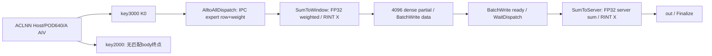

# SGL DeepEP 跨节点加权 Combine A2 ACLNN 算子知识

## 算子速览

| 项目 | 内容 |
|---|---|
| 实际入口 | aclnnMoeDistributeCombineA2GetWorkspaceSize / aclnnMoeDistributeCombineA2，公开两段式ACLNN。 |
| 计算语义 | A2跨节点分层加权Combine：机内FP32加权→先RINT回BF16/FP16，跨server再FP32求和→再次RINT；恢复原token顺序。 |
| 输入输出 | ND BF16/FP16 expandX[T,H]、FP32 packed权重和Notify元数据→同dtype out[B,H]。无有效server的行未写。 |
| 执行类型 | 单K0 AIV_VECTOR+MTE+SDK AICPU/RDMA Hybrid，无可达Cube/AIC/MIX_CV。 |
| Kernel 路线 | R-001分层多server；R-002分层单server条件失败；R-003默认key2000无匹配body。BF16/FP16为同逻辑算子的实际dtype实例。 |
| 核心资源 | 双Queue两组、三FP32 scratch、全局4ER计数表、800MiB RDMA双半、IPC窗口；描述符存组window，不消费用户workspace。 |
| 来源闭包 | source_closed：全部Host route/失败终点→Info64/outer640→key3000完整body→SDK client/AICPU/RDMA_WRITE WR→driver primitive；key2000已知无router，不掩盖外部缺源。 |
| 验证状态 | 已完成源码闭包检查；本次知识提取未执行编译、真机、数值或性能测试。draft保留实际精度/密集容量/元数据与Host资源限制。 |

固定SGL dda6d36b0cdb4081e102d14c0a2fb276fc416e69、SDK9.1 e5451c7feba11f9e259f4fbc19c4bf82f8c0496c。P=csrc/deepep/ops2/，H=impl/adv_api/detail/hccl/。冻结Query候选[Normal API](../../../../apis/deepep/deepep_normal_dispatch_combine.md)已完整读，无该完整Operator，本卡create。前置[NotifyA2](sgl_deepep_notify_dispatch_a2.md)与[跨节点Dispatch](sgl_deepep_normal_dispatch_internode_a2.md)各自独立，不将三个算子合并为一张。

## 接口与语义

### 计算语义

R/r/S=EP域大小/本rank/R÷8，E/L=expert总数/E÷R，B=原token数，H/K=hidden/top-k，A=AIV数，X=BF16或FP16，M=4096固定padded token上界。expert packed expandX与expandScales[T]一一对应；权重来源是前次Dispatch逐packed row输出的FP32权重，公开expertScales[B,K]在此router不传body。

对每原token i，先在每源server a按local expert/source metadata取该server内8L个expert贡献，j递增执行FP32 Cast(NONE)→Muls(weight)→Add；若至少一个贡献，写 partial[a,i]=CastRINT_X(Σ_local FP32(expertResult)×weight)。再在原rank按server j递增，将offsetOuter[i,j]≥0的partial Cast(NONE)到FP32再Add，out[i]=CastRINT_X(Σ_valid server FP32(partial[j,i]))。两次回X的舍入不能替换为一次全FP32 top-k求和，FP16/BF16的中间精度也不同。

固定#define COMBINE_2SERVER_VERSION使partial按原始i的dense槽写，SumToServer也按i读；offsetOuter的正值ordinal只用来判断≥0，不决定地址。无任何有效server时out行未写，并非写零；某server无有效inner contribution时其partial槽也未写，必须由对应outer mask跳过。countOuter仅在Preload计算未再消费的offsetIndex，不参与当前dense地址。

元数据语义：epSendCounts[e,src]是每expert/source count，按当前expert rank的packed输出前缀找到expandX和权重；offsetInner[originServer,4096,E]给每原token在当前expert-server聚合IPC流中的occurrence offset，负值跳过。offsetOuter consumer要求[B,S]符号mask。NotifyA2实际offsetInner只分配[2,4096,E]，tokenServerIdx实际写[S,4096]；标准C++handle物理布局与广域S>2、当前outer consumer之间存在已见冲突，不声称端到端集成已修复。

### 输入、输出与属性

| 参数 | shape/layout | dtype | 约束、默认值与语义 |
|---|---|---|---|
| expandX | [T,H] ND/AutoContiguous | BF16/FP16 | Host二维/H32..7168且%32；T须覆盖epSendCounts生成的packed prefix，但未检查。INT32 OpDef列被outer明确拒绝。 |
| expertIds | [B,K] ND | INT32 | Host二维，由它取B/K；分层B0..4096，默认B0..256；K2..16。Body不读内容。 |
| expandIdx | 通常[4096,E] Notify展开索引 | INT32 | 必选OpDef，body绑定但未消费；接口头1D说明不能覆盖实际调用协议。 |
| epSendCounts | [E,R] ND | INT32 | body读4ER B，count非负/总量/packed prefix一致；Host未检查shape/extent。 |
| expertScales | required，C++仅empty[1] | FP32 | router未传body，不用于加权。 |
| tpSendCounts | optional | INT32 | 未传body；Info TP强制0。 |
| xActiveMask | optional | BOOL | 未传body，不删token。 |
| activationScale | optional | FP32 | 未传body，INT32计算拒绝。 |
| weightScale | optional | FP32 | 未传body。 |
| groupList | optional | INT64 | 未传body。 |
| expandScales | [T] packed权重 | FP32 | OpDef OPTIONAL，body实际逐expert row读取，不能为空或容量不足。 |
| offsetInner | raw所需[S,4096,E] | INT32 | 每originServer固定4096行，按expert列读当前8L列；标准Notify只准备2片，S>2无容量证明。 |
| offsetOuter | consumer[B,S] | INT32 | ≥0表示该token从server接收partial；dense版忽略正ordinal数值；标准Notify实际server-major冲突。 |
| countOuter | [≥B] | INT32 | Preload可读startBs-1，offsetIndex后续未用；不决定dense地址。 |
| x | [B,H] ND | 同expandX BF16/FP16 | out shape/dtype容量依OpDef/调用者，活动Host未完整校验；所有outer负时该row未写。 |
| sendCostStats | optional | INT32 | router未传body，无诊断输出。 |
| groupEp/R/r/E | 属性 | OpDef Int64，Host int* | R8..256/%8，0≤r<R，E1..512/%R；group被后续SDK使用但当前Host未完整判空/长度校验。 |
| groupTp/TP/tpRank | 属性 | string/int | TP/rank指针nonnull但强制Info0，groupTp未参与；没有TP数学语义。 |
| expertShardType/sharedExpertRankNum | 属性 | int | 指针nonnull但Info强制0；不据传值实现shared。 |
| sharedExpertNum/outDtype/commQuantMode/groupListType | 属性 | int | 默认1/0/0/0；活动Host不读取这些值，不能触发额外quant/dequant。 |
| globalBs | 属性 | int→u32 | 0→R*B，非0直接窄化，无合法范围检查；当前仅影响未消费的辅助指针算式。 |
| 环境 | env | string | PCIE=="1"且ROCE=="0"才key3000/B≤4096；其它key2000/B≤256，无router。 |

### 入口与版本

OpDef仅ascend910b，BF16→BF16/FP16→FP16成功配对；INT32输入列被Host拒绝、router也只有两种16bit类型。公开Normal文档A2跨节点背景与活动ops2 build共同支持本任务平台；CANN固定9.1.0，DeepEP README和SDK version.cmake补证，不扩其它版本/平台。

wrapper检查workspaceSize/executor输出指针，空返回ACLNN_ERR_INNER_NULLPTR(-1)，Execute检查executor非空；弱server selector在910B设AICPU，随后inner框架launch。生成inner/AutoContiguous/executor/stream为primitive边界。build.sh A2→ops2，compile_ascend_proj复制工程，CMake生成Host/tiling/kernel；安装base/comm_ctx覆盖必须保持实际读取前缀ABI，未以源码映射冒充安装实测。

默认Normal策略从handle解包Notify索引和Dispatch expandScales；runtime.internode_combine参数里的topk_weights最终C++未用于body加权，实际权重已经在expandScales中。C++ x要求二维连续、expertIds转I32、out=empty[B,H]，TP1随后Host归0、globalBs=4096R。返回recv_topk_weights/event为空包装，不新增第二个本entrykernel。

## Host/Launcher 执行流程

### 参数校验与前处理

1. outer MoeDistributeCombineTilingFunc先查expandXDesc非空、拒绝INT32。内部读取精确PCIE/ROCE字符串确定isLayered，再CheckShape检查expandX/expertIds二维、H%32且32..7168、K2..16、B上限4096(layered)/256(default)。先窄化u32，bs<0对无符号无实际保护。
2. CheckAttr按int*读取Int属性，只校验R/r/E范围/整除与指定指针非空，Info强制TP/rank/shard/shared0。globalBs0→RB，否则直接u32；缺expertIds时return false的graphStatus分支不是可靠GRAPH_FAILED。group/sharedExpertNum/outDtype/commQuantMode/groupListType和多数输入/输出dtype/shape未全检。
3. PlatformAscendC保存A/UB、block=CalcTschBlockDim(A,0,A)，无完整UB/window门禁，未显式设置ScheduleMode。默认key2000、layered key3000；router只有3000。
4. workspace返回16MiB+8E B；Device保存/使用参数列表却不消费workspaceGM，所有BatchWrite descriptor实际在windowOut_z+399MiB+8KiB。不能把用户8E切片错误写成descriptor owner。
5. 单EP cmd18/MultiPut=level0:fullmesh/defaultengine0，SDK GetTiling产init64/cc512；结果未被Host检查，GetTiling失败POD不可消费；框架组/SDK消息区与ACLNN workspace分开。

### 参数、Workspace 与生命周期

W=runtime context.winSize；RDMA固定800MiB，half400MiB，Z=399MiB。rp=alignDown32(Z/R)，每originServer密集partial段node=8rp；z在rawIN+Z+512R持久u32，旧z选IN/OUT half，core0数据提交后翻z^1/DCCI。IPC可用I=W-800MiB-4MiB-400MiB，保存u32；slice=I/R，nodeIpc=8slice。shareAddreRank[plane]=rawIN(localServerBase+plane)+800MiB，IPC data从+4MiB+originServer*nodeIpc起，IPC flags在+2MiB+32*(originServer*8+senderLocalRank)。

Init的Device assert检查W≥S*B*(2H+16K)+1204MiB，并打印Info字段；不是Host检查/运行验证。实际IPC须按sum_{localserver 8L experts} epSendCounts[e,dstRank]*(2H+32)≤nodeIpc；断言中B/metadata公式不证明此occurrence容量。固定dense RDMA还须2*4096*H≤8rp，与实际B无关。W负向扣除/u32窄化等未被Host先拒绝，不臆测assert后的具体平台表现。

stateValue/sumTarget来自IN_z+Z+512KiB处每core toggle：selfStatusTensor的INT32索引core*32，真实stride128B/core；各rank/core初值和callhalf顺序必须一致。core0将stateValue写OUT_z+Z首I32，readState用作ready源；对端等待IN_z+Z+512srcServer首I32==sumTarget。payload descriptor[0,S)与flag descriptor[S,2S)都在OUT_z+Z+8KiB，共64S B，区别于用户workspace。

caller输入/输出/executor/workspace存活至stream完成；runtime context/window/消息区至Finalize。AlltoAllDispatch IPC occurrence record带FP32 weight trailer，机内12345 flag被接收后清首u64，随后本地归约/密集返送。两次BatchWrite分别提交data、ready，SGL忽略handle；WaitDispatch按ready判断、末Finalize等待服务端状态。不得用返回handle当peer消费完成，也不把持久selector当跨任意stream锁。

Init中bkCount在localL赋值前按默认0绑定、sendCount派生的一些count/offset/share辅助指针和globalBs算式未由实际Process消费；只记录inactive边界，不据这些未用地址推导有效layout或具体结果错误。

### 启动图与失败传播



| 节点/边 | producer→consumer | offset/extent/dtype/layout | ordering | owner/lifetime/失败 |
|---|---|---|---|---|
| Host→K0 | inner→entry | 18个GM参数/POD640B，block=CalcTsch(A,0,A) | 当前stream AIV | key2000无body，不能声称已有fallback |
| IPC record | expert rank→local target plane | 2H+32 B/occurrence，trailer首F32 weight | Queue→MTE3→12345flag→SyncAll | runtime组，local sum消费前不覆写 |
| weighted partial | SumToWindow→OUT_z | X[4096,H] dense，inactive row不写 | FP32 Muls/Add→RINT→MTE3→尾SyncAll | runtime组，不是FP32网络payload |
| descriptor | AIV→AICPU | OUT_z+Z+8KiB，data/ready各32S B | MTE3/SyncAll/BatchWrite | window owner，直到server读完 |
| RDMA data | sameplane→origin rank | remote2*4096H B；dtype FP16声明，仅2B字节搬运 | SDK逐item线程/QP RDMA_WRITE | runtime window，BF16不数值转换 |
| ready | core0→origin peer | 32B首I32=stateValue | data先提交、ready后提交；Wait first==target | SDK错误未变成安全Device返回 |
| output | original rank→caller | 实际B行2H B；all-invalid不写 | Cast FP32/Add/RINT/MTE3/SyncAll | caller，未写域无零保证 |
| SDK失败 | client/RPC/PostSend/verbs | !multiServerFlag→HCCL_E_PARA等内部值 | CHK_RET传播，SGL未检查handle | 不编造具体用户报错 |

## Route 与参数设计

### 分核与资源计算

AlltoAllDispatch按R均分目的rank给A（former多一）；每目标rank先按expert/source全局count计算packed前缀与本server聚合offset。SumToWindow先由前S core各等待8个local rank ready，然后corePerServer=floor(A/S)，core%S选origin server，core/S选组内token块，均分固定4096；多出的A%S core参加对应尾SyncAll后返回。A<S时全部core先返回，不应误称后面的除0必然执行，但功能/flag覆盖仍要求A≥S。Preload/SumToServer只用前8core均分实际B，故必要A≥8。

Q=align32(2H+32)=2H+32，F=align32(4H)=4H，Ccnt=align32(4ER)，Ci=32L。
BuffInit一次、无Reset：moeQueue depth2 Q、moeSumQueue depth2 Q、rowTmpFloat/mul/sum各F、status32R、sendCount Ccnt、statusSumOut请求4→32、batchWriteItem32R、innerOffset Ci。
U_total=4Q+3F+Ccnt+64R+32+32L=20H+160+Ccnt+64R+32L≤totalUB；另TPipe handle≤64。Host只存UB没有此门禁，4ER全局表可独自超UB。声明未Init的scale/recvCount/expertWindow/offsetReduce/countReduce不计资源；输出cast视图alias mulBuf，没有另分配X输出buffer。

### Route 选择

| 顺序 | Route | Key/模板 | 精确选择条件与优先级 | 不适用去向 |
|---|---|---|---|---|
| 1 | R-001 分层多server两阶段加权归约 | 3000 / MoeDistributeCombineA2Layered<X,I32> | exact PCIE1/ROCE0；B≤4096；BF16/FP16配对；S>1；其它Hostguard通过 | S1到R-002 |
| 2 | R-002 分层单server条件失败边界 | 3000 / MoeDistributeCombineA2Layered<X,I32> | exact PCIE1/ROCE0；B≤4096；BF16/FP16配对；S1；其它Hostguard通过 | runtime !multiServerFlag有失败guard |
| 3 | R-003 默认环境无匹配body终点 | 2000/无匹配 | 非exactenv；B≤256；其它Hostguard通过 | router只3000；具体运行表现未测 |


```text
outer INT32 -> GRAPH_FAILED
shape/attr失败 -> GRAPH_FAILED
PCIE=="1" && ROCE=="0": B<=4096, key3000
  BF16或FP16 OpDef配对 -> MoeDistributeCombineA2Layered<X,I32>
  S>1 -> R-001；S1 -> R-002（runtime !multiServerFlag有明确失败）
其它环境: B<=256, key2000 -> R-003无匹配body
COMBINE_2SERVER_VERSION编译定义固定dense4096；#else压紧实现不形成当前Route
```

### 模板/实现执行矩阵

| Route | key/selector | dtype/shape/platform 完整命中条件 | 执行拓扑与 Kernel 节点 | 实际模板/body | 内存与同步特征 | tail/fallback |
|---|---|---|---|---|---|---|
| R-001 | 3000 | A2/exactenv/B0..4096、H32..7168/%32/K2..16、R8..256/%8/E1..512/%R；S>1 | 单K0 AIV+MTE+AICPU RDMA | MoeDistributeCombineA2Layered<bfloat16_t,int32_t> 或 <half,int32_t> | 4Q/3F/全4ER表、两阶段X舍入、dense4096/双BatchWrite | former/tail、A%S extra参与barrier、前8core actualB |
| R-002 | 3000 | A2/exactenv/B0..4096、H32..7168/%32/K2..16、R8..256/%8/E1..512/%R；S1 | 单K0 AIV+MTE+AICPU RDMA | MoeDistributeCombineA2Layered<bfloat16_t,int32_t> 或 <half,int32_t> | 4Q/3F/全4ER表、两阶段X舍入、dense4096/双BatchWrite | former/tail、A%S extra参与barrier、前8core actualB |
| R-003 | 2000 | A2/defaultenv/B0..256、H/K/R/E/r同公共域 | 无body节点 | 无匹配body | N/A | 已知终点，非自动fallback |


### 隐藏性能 Guard

| Guard | Host/Tiling 条件 | Device/资源原因 | 影响 Route | 不满足时去向 | 源码符号 |
|---|---|---|---|---|---|
| 分层环境 | exact PCIE1/ROCE0 | 只有key3000有实例 | 全部 | 默认2000已知无body | IsLayered/CalcTilingKey/router |
| 实际类型 | BF16/FP16配对，INT32outer拒绝 | 两个X模板，网络按2B传 | R-001/002 | Host/OpDef失败或无dtype实例 | router ORIG_DTYPE |
| UB/count表 | Host无U_total校验 | 4ER表+4Q+3F可能超UB | R-001/002 | draft资源条件，无tile fallback | BuffInit |
| A数量 | 未检查A≥max(S,8) | 等每server的core、8token接收core | R-001/002 | 源可见功能域限制 | SumToWindow/Preload/WaitDispatch |
| dense RDMA | 未校验2*4096H≤8rp | 固定4096行，B小仍发全块 | R-001/002 | 可能跨子区，不能宣称Host通过即足够 | COMBINE_2SERVER_VERSION/AlltoAllServerDispatch |
| IPC occurrence | Device只assert粗W公式 | 每dest本server expert occurrence合计*Q≤nodeIpc才容纳 | R-001/002 | 断言不覆盖该必要条件 | AlltoAllDispatch |
| 元数据extent/layout | 多数Host无shape校验 | inner[S,4096,E]、outer[B,S]，Notify仅2片/server-major | R-001/002集成 | 已见冲突，raw参数须有证明 | SumToWindow/SumToServer/Notify |
| 输出有效域 | Host不检查mask值/容量 | all-invalid跳过写，out empty allocation | R-001/002 | 不许读取为零值 | SumToServer::if(!flag)continue |
| 初始化/轮次 | 无统一状态初始化门禁 | z0/1，percore toggle相同；12345flag复用 | R-001/002 | 需要组同序/初值，非并发锁 | Init/WaitDispatch |
| 单server | Host允许R8 | SDK若!multiServerFlag拒绝cmd18；self item被过滤 | R-002 | 条件HCCL_E_PARA终点 | RunRpcServerApi |

### POD/ABI

Info自然size64/align8；outer init64@0、cc512@64、Info64@576，总640/align8。下表offset相对Info，未执行sizeof/安装ABI实测。hcclBufferSize未Host赋值，但Device assert打印读取；rsd未用，不能假默认。

| 结构 | 字段 | 类型/位宽 | ABI 布局 | 单位 | Host/launcher producer | Device consumer | 边界 |
|---|---|---|---|---|---|---|---|
| MoeDistributeCombineA2Info | epWorldSize | u32 | @0 | rank数 | attr R | server/core/window | R8..256/%8 |
| MoeDistributeCombineA2Info | tpWorldSize | u32 | @4 | rank数 | 强制0 | 未消费 | 输入被忽略 |
| MoeDistributeCombineA2Info | epRankId | u32 | @8 | rank | attr r | sameplane/server地址 | 0≤r<R |
| MoeDistributeCombineA2Info | tpRankId | u32 | @12 | rank | 强制0 | 未消费 | 无TP数学语义 |
| MoeDistributeCombineA2Info | expertSharedType | u32 | @16 | 枚举 | 强制0 | 未消费 | 输入ignored |
| MoeDistributeCombineA2Info | sharedExpertRankNum | u32 | @20 | rank数 | 强制0 | 未消费 | 输入ignored |
| MoeDistributeCombineA2Info | moeExpertNum | u32 | @24 | expert数 | attr E | L/count表/IPC expert | E1..512/%R |
| MoeDistributeCombineA2Info | globalBs | u32 | @28 | token数 | 0→RB/否则属性窄化 | 仅未消费的辅助pointer算式 | 无非0范围检查 |
| MoeDistributeCombineA2Info | bs | u32 | @32 | token数 | expertIds.dim0→u32 | actualB split/Deviceassert | layered≤4096/default≤256 |
| MoeDistributeCombineA2Info | k | u32 | @36 | slot数 | expertIds.dim1→u32 | assert W粗公式 | 2..16，实际local加权按8Loffset |
| MoeDistributeCombineA2Info | h | u32 | @40 | 元素数 | expandX.dim1→u32 | payload/Vector | 32..7168/%32 |
| MoeDistributeCombineA2Info | aivNum | u32 | @44 | 核数 | GetCoreNumAiv | split/前S/前8 | 额外A≥max(S,8) |
| MoeDistributeCombineA2Info | totalUbSize | u64 | @48 | B | GetCoreMemSize(UB) | assert打印，未做UBguard | 实际U_total另列 |
| MoeDistributeCombineA2Info | hcclBufferSize | u32 | @56 | B | 未赋值 | Device assert日志读取 | 不能假env默认 |
| MoeDistributeCombineA2Info | rsd | u32 | @60 | inactive | 未赋值 | 未消费 | 不假默认 |


SDK仅单EP，init.count1/offset[0]=64，其余0；engine默认0/op18/MultiPut。offset相对inner，reserved未写值不依赖。

| 结构 | 字段 | 类型/位宽 | ABI 布局 | 单位 | Host/launcher producer | Device consumer | 边界 |
|---|---|---|---|---|---|---|---|
| Mc2InitTilingInner | version | u32 | 0 | 版本枚举 | GetTiling: 100 | SDK初始化 | 不依赖reserved值 |
| 同上 | mc2HcommCnt | u32 | 4 | 通信组数 | GetTiling: 1 | 框架组配置 | 不依赖reserved值 |
| 同上 | offset | u32[8] | 8 | 字节偏移数组 | GetTiling: 64，其余0 | cc1/cc2定位 | 不依赖reserved值 |
| 同上 | debugMode | u8 | 40 | 枚举 | GetTiling: default0 | SDK | 不依赖reserved值 |
| 同上 | preparePosition | u8 | 41 | 枚举 | GetTiling: default0 | SDK | 不依赖reserved值 |
| 同上 | queueNum | u16 | 42 | queue数 | GetTiling: default0 | SDK working core | 不依赖reserved值 |
| 同上 | commBlockNum | u16 | 44 | block数 | GetTiling: default0 | SDK资源 | 不依赖reserved值 |
| 同上 | devType | u8 | 46 | 枚举 | GetTiling: runtime SoC | 平台实现选择 | 不依赖reserved值 |
| 同上 | reserved | char[17] | 47 | 保留字节 | GetTiling: 未显式清全部 | inactive | 不依赖reserved值 |
| Mc2CcTilingInner | skipLocalRankCopy | u8 | 0 | 布尔 | GetTiling: default0 | 框架 | 不依赖reserved值 |
| 同上 | skipBufferWindowCopy | u8 | 1 | 布尔 | GetTiling: default0 | 框架 | 不依赖reserved值 |
| 同上 | stepSize | u8 | 2 | step数 | GetTiling: default0 | 框架 | 不依赖reserved值 |
| 同上 | version | u8 | 3 | 版本枚举 | GetTiling: 1 | 固定协议 | 不依赖reserved值 |
| 同上 | reserved | char[9] | 4 | 保留字节 | GetTiling: memset0 | inactive | 不依赖reserved值 |
| 同上 | commEngine | u8 | 13 | 枚举 | GetTiling: default0(AICPU) | AICPU BatchWrite资源；无CCU | 不依赖reserved值 |
| 同上 | srcDataType | u8 | 14 | dtype枚举 | GetTiling: default0=INT8 | MTE不读作payload dtype，payload由模板决定 | 不依赖reserved值 |
| 同上 | dstDataType | u8 | 15 | dtype枚举 | GetTiling: default0=INT8 | MTE不读取该字段 | 不依赖reserved值 |
| 同上 | groupName | char[128] | 16 | 组名字符 | GetTiling: EP/TP字符串 | 框架组关联 | 不依赖reserved值 |
| 同上 | algConfig | char[128] | 144 | 算法配置字符 | GetTiling: MultiPut=level0:fullmesh | 框架资源组装；本body直接MTE | 不依赖reserved值 |
| 同上 | opType | u32 | 272 | 命令枚举 | GetTiling: EP18 | 框架通信资源声明 | 不依赖reserved值 |
| 同上 | reduceType | u32 | 276 | reduce枚举 | GetTiling: default0 | 本body不做payload reduce | 不依赖reserved值 |
| 同上 | reserved2 | char[232] | 280 | 保留字节 | GetTiling: 未显式清全部 | inactive | 不依赖reserved值 |

| 结构 | 字段 | 类型/位宽 | ABI 布局 | 单位 | Host/launcher producer | Device consumer | 边界 |
|---|---|---|---|---|---|---|---|
| TilingData | mc2InitTiling | opaque64 | @0 | B | GetTiling | InitV2 | version100 |
| 同上 | mc2CcTiling | opaque512 | @64 | B | GetTiling cmd18 | SetCcTilingV2(64) | 单EP |
| 同上 | moeDistributeCombineInfo | Info64 | @576 | mixed | Host | Init | 全字段上表 |
| A2 BatchWriteItem | localBuf | u64 | @0 | 地址 | data/ready构造 | SDK AICPU | registered OUT |
| 同上 | remoteBuf | u64 | @8 | 地址 | 同上 | SDK PostSend | target IN |
| 同上 | count | u64 | @16 | 元素数 | data4096H（self0）/ready8 | dtypeSize乘2/4 | data=2*4096H B，ready32B |
| 同上 | dataType | u32 | @24 | 枚举 | dataFP16/readyINT32 | DataUnitSize | BF16只按2B搬运，不转FP16值 |
| 同上 | remoteRankId | u32 | @28 | rank | r%8+8targetServer | SDK按rank分线程/self过滤 | size32/align8 |
| SGL/SDK context前缀 | winSize | u64 | @24 | B | runtime组 | IPC_DATA_SIZE/Device assert | 本地只消费此context字段，SDK其余地址用自己的布局 |
| SDK context | workSpace | u64 | @0 | 地址 | runtime组 | client消息/Finalize | 非ACLNNworkspace |
| 同上 | rankId | u32 | @16 | rank | runtime组 | GetWindows | fixed前缀 |
| 同上 | rankNum | u32 | @20 | rank数 | runtime组 | rank合法检查 | 非AIV数量 |
| 同上 | windowsIn | u64[32] | @32 | 地址 | runtime组 | multiFlag0路径 | 多server走data映射 |
| 同上 | windowsOut | u64[32] | @288 | 地址 | runtime组 | multiFlag0路径 | 不借950布局 |
| 同上 | multiFlag | u8 | @8872 | 布尔 | runtime组 | 910B地址选择 | 自然布局推导 |
| 同上 | data | IbVerbsData* | @8880 | 地址 | runtime组 | local/remoteInput/Output.addr | 自然size8888/align8 |
| IbVerbsData | remoteInput | MemDetails | @0 | size/addr/key | runtime组 | target IN | MemDetails size24 |
| 同上 | remoteOutput | MemDetails | @24 | size/addr/key | runtime组 | 预留该prefix | 当前body只查remoteIN |
| 同上 | localInput | MemDetails | @48 | size/addr/key | runtime组 | local IN | runtime资源 |
| 同上 | localOutput | MemDetails | @72 | size/addr/key | runtime组 | local OUT | runtime资源 |
| 同上 | res | u8[24] | @96 | B | runtime组 | 未消费 | 自然size120 |
| MemDetails | size | u64 | @0 | B | runtime注册 | Getkey记录范围 | 不证明整个len已校验 |
| 同上 | addr | u64 | @8 | 地址 | runtime注册 | SDK地址/WR | Getkey只测起始地址 |
| 同上 | key | u32 | @16 | key | runtime注册 | lkey/rkey | padding至24 |

### Route 源码闭包

| Route | Key/selector | Host/Tiling producer | POD/参数 | Kernel entry/router 节点 | Kernel body/直接依赖 | 构建接线 |
|---|---|---|---|---|---|---|
| R-001 | 3000/exactenv/S>1 | csrc/deepep/ops2/op_host/moe_distribute_combine_a2_tiling.cpp::MoeDistributeCombineA2TilingFuncImpl/IsLayered/CalcTilingKey | Info64/outer640/SDKinit64/cc512 | csrc/deepep/ops2/op_kernel/moe_distribute_combine_a2.cpp::moe_distribute_combine_a2 | 完整csrc/deepep/ops2/op_kernel/moe_distribute_combine_a2_layered.h；local base；SDK client→AICPU BatchWrite→PostSend→RDMA_WRITE | ops2 OpDef ascend910b、build.sh/compile_ascend_proj.sh、Host/kernel CMake |
| R-002 | 3000/exactenv/S1 | csrc/deepep/ops2/op_host/moe_distribute_combine_a2_tiling.cpp::MoeDistributeCombineA2TilingFuncImpl/IsLayered/CalcTilingKey | Info64/outer640/SDKinit64/cc512 | csrc/deepep/ops2/op_kernel/moe_distribute_combine_a2.cpp::moe_distribute_combine_a2 | 完整csrc/deepep/ops2/op_kernel/moe_distribute_combine_a2_layered.h；local base；SDK client→AICPU BatchWrite→PostSend→RDMA_WRITE | ops2 OpDef ascend910b、build.sh/compile_ascend_proj.sh、Host/kernel CMake |
| R-003 | 2000/defaultenv | csrc/deepep/ops2/op_host/moe_distribute_combine_a2_tiling.cpp::MoeDistributeCombineA2TilingFuncImpl/IsLayered/CalcTilingKey | Info64/outer640/SDKinit64/cc512 | csrc/deepep/ops2/op_kernel/moe_distribute_combine_a2.cpp::moe_distribute_combine_a2 | 没有key2000对应body；固定router已明确 | ops2 OpDef ascend910b、build.sh/compile_ascend_proj.sh、Host/kernel CMake |


## Kernel 实现

### 公共执行流程

key3000单K0，<bfloat16_t,int32_t>与<half,int32_t>实际实例；无Cube/MIX_CV或其它Host kernel。AlltoAllDispatch把专家row+weight送到本server目的plane，SumToWindow归约并先RINT成X，AlltoAllServerDispatch密集返送4096partial，SetStatus第二次提交ready，WaitDispatch后SumToServer原token累加并再RINT。COMBINE_2SERVER_VERSION为当前固定编译定义，压紧#else不是活动Route。

SDK闭包实际为BatchWrite<true>→CommonPrepareImpl/AssembleHcclMsg(handle/seq/valid/commit)→RunRpcServerApi→HandleBatchWriteOperation/ConcurrentPostSendWqe，按remoteRankId%workedThreadNum分线程、忽略self，逐itemcount×dtypeSize→PostSend/Getkey→CCL_KERNEL Transport::HcclBatchWrite→HnsPostSend。SGE含localaddr/length/lkey，WR含remoteaddr/rkey/RDMA_WRITE、链末SIGNALED；动态HrtHnsIbvExpPostSend下发，非NORMAL QP再RdmaSend doorbell SQE/LaunchTask复制SQ并写SQ_TAIL。Getkey以起始addr选注册key，未核验整个长度末端；每item只一个buffer，不能把S误当单PostSend八buffer上限。两次data/ready提交在相同remote线程/QP顺序上排队，peer仍用ready等待；SDK投稿完成不等于peer消费。Finalize控制/错误沿client和服务端实现已读，停止于driver verbs/编码函数指针、网络硬件和运行时组资源primitive，没有缺失的自有通信算法体。R-003则没有Device节点，不借其它入口body填充。

### Route R-001：分层多server两阶段加权归约

#### 适用条件

A2，exact PCIE="1"/ROCE="0"、key3000；BF16→BF16或FP16→FP16，B0..4096、H32..7168且%32、K2..16、R8..256/%8、E1..512/%R、rank合法。S>1。元数据容量/布局和资源额外guard见前文。

##### 选择证据

| 层级 | 文件 | 符号 | 源码谓词/参数 | 结果/下一跳 |
|---|---|---|---|---|
| API | csrc/deepep/ops2/op_host/op_api/aclnn_moe_distribute_combine_a2.cpp | aclnnMoeDistributeCombineA2* | 输出指针/executor非空 | inner |
| Host | csrc/deepep/ops2/op_host/moe_distribute_combine_a2_tiling.cpp | MoeDistributeCombineA2IsLayered/MoeDistributeCombineA2CalcTilingKey | exact env1/0、shape/attr合法 | 3000/Info64 |
| router | csrc/deepep/ops2/op_kernel/moe_distribute_combine_a2.cpp | moe_distribute_combine_a2 | BF16/FLOAT16 && key3000 | MoeDistributeCombineA2Layered<DTYPE_EXPAND_X,int32_t> |
| body | csrc/deepep/ops2/op_kernel/moe_distribute_combine_a2_layered.h | Init/Process | S=R/8 >1；固定COMBINE_2SERVER_VERSION | 两阶段加权/求和 |

#### Device 数据流

##### 函数级调用链

```text
ACLNN inner -> K0 moe_distribute_combine_a2(18 GM参数,POD640)
 -> MoeDistributeCombineA2Layered<X,int32_t>::Init
 -> SDK InitV2/SetCcTilingV2(64)/GetWindowsInAddr/GetWindowsOutAddr
 -> BuffInit -> SplitCoreCal -> Process
 -> AlltoAllDispatch -> SumToWindow -> AlltoAllServerDispatch -> SetStatus
 -> Preload -> WaitDispatch -> SumToServer -> SDK Finalize
每次BatchWrite -> CommonPrepare/Assemble -> AICPU RunRpcServerApi
 -> HandleBatchWriteOperation/ConcurrentPostSendWqe -> PostSend/Getkey
 -> HcclBatchWrite/HnsPostSend RDMA_WRITE -> dynamic verbs/doorbell SQ primitive
```

##### 源码等价伪码

```text
# 等价伪码，非可执行实现
Init旧z选400MiB half；每core INT32index32core处toggle0/1，BuffInit一次
AlltoAllDispatch: split R目的rank；读全4ER count计算packed prefix和server expert offset
  Queue record=2H payload+32B trailer（首F32 weight），MTE到目的localplane IPC
  PIPE_ALL后发布12345 flag；SyncAll
SumToWindow: 前Score各等/清8localrank flags；SyncAll
  cps=floor(A/S)，core%S选server、core/S均分固定4096，extra core尾barrier返回
  每token读本server8L inner offsets，valid贡献按j递增Cast F32/Muls(weight)/Add
  若无贡献不写；否则RINT回X，写dense OUT_z+server*8rp+i*2H；SyncAll
每servercore构造data item(count remote4096H/self0,dtypeFP16)，写window descriptor
SyncAll；core0 BatchWrite(S)，翻z；selfServercore Queue localcopy4096rows OUT→IN
core0构造第二组ready items(count8/I32)，更新self status，BatchWrite第二数组，SyncAll
前8core Preload split实际B；前Score WaitDispatch等首I32==toggle；SyncAll
SumToServer按j递增，outer[i*S+j]>=0时读dense i槽，Cast F32/Add
有贡献才RINT回X写out；all-invalid不写；SyncAll；Finalize
```

#### 内存与数据搬运

##### 资源与搬运表

| 层级/缓冲区 | offset/地址公式 | extent/容量公式 | dtype/layout | producer | consumer | owner/lifetime | 对齐/复用 |
|---|---|---|---|---|---|---|---|
| GM expert/weight | packed prefix/H / scale[prefix+t] | 2TH /4T B | X/F32 | expert/Dispatch | AlltoAllDispatch | caller/K0 | 实际权重为expandScales |
| GM count/inner | count[eR+src] / inner[server,4096,E] | 4ER /4*S*4096*E B | I32 | Notify/caller | 两机内阶段 | caller | 标准Notify仅2片 |
| GM outer/countOuter | outer[i*S+j] / count[start-1] | 4BS/4B B | I32 | Notify/caller | final/Preload | caller | outer只符号；count结果未用 |
| GM out | out[iH] | 2BH B | X | final sum | caller | caller | valid行写；全invalid不写 |
| IPC record | rawIN(localplane)+800MiB+4MiB+server*nodeIpc+offset*Q | Q=2H+32 B/occurrence | X+首F32 trailer | expert MTE3 | local sum | runtime组 | 余28B trailer未定义 |
| IPC flags | rawIN(localplane)+800MiB+2MiB+32*(server*8+sender) | 32B/slot | 首I64=12345 | sender | 前Score等8slot | runtime组 | 读后清首I64 |
| partial data | OUT/IN_z+server*8rp+i*2H | 4096*2H B/server | X dense | local sum/RDMA | final sum | runtime组/callhalf | B小仍dense |
| ready | IN_z+399MiB+512srcServer | 32B首I32 | toggle0/1 | SetStatus | WaitDispatch | runtime组 | 不是12345 IPC flag |
| toggle | IN_z+399MiB+512KiB+128core | 首I32 | 0/1 | Init | stateValue/sumTarget | 持久/callhalf | I32索引32core=128Bstride |
| selector | rawIN+399MiB+512R | u32 | z0/1 | core0flip | 下callInit | 持久 | DCCI不充当锁 |
| window descriptor | OUT_z+399MiB+8KiB | data32S+ready32S B | A2item32 | servercore/core0 | AICPU | runtime组 | 不是用户workspace |
| ACLNN workspace | user pointer | 16MiB+8E B | opaque | caller | 无body消费 | caller/stream结束 | 不虚构slice |
| UB moeQueue | BuffInit | 2Q，depth2 B | X+32B trailer | expandX/OUT DMA | IPC/IN MTE3 | 全K0 | Queue slot事件 |
| UB moeSumQueue | BuffInit | 2Q，depth2 B | X | IPC/IN DMA | Cast/Muls/Add | 全K0 | DeQue/FreeTensor |
| UB rowTmpFloatBuf | BuffInit | F=4H B | F32 | Cast NONE | Muls/Add | 全K0 | PIPE_V |
| UB mulBuf | BuffInit | F=4H B | F32 raw/X alias | Cast RINT | OUT/out MTE3 | 全K0 | MTE3_V |
| UB sumFloatBuf | BuffInit | F=4H B | F32 | Duplicate0/Add | Cast RINT | 全K0 | 每token清零 |
| UB statusBuf | BuffInit | 32R B | I64/I32 alias | flag/status DMA | scalar wait/publish | 全K0 | 阶段barrier |
| UB sendCountBuf | BuffInit | align32(4ER) B | I32 | 全表DMA | prefix计算 | 全K0 | 无Reset |
| UB statusSumOutBuf | BuffInit | 请求4→32 B | F32 | 当前未用 | 未用 | 全K0 | 仍计分配 |
| UB batchWriteItemBuf | BuffInit | 32R B | u64/u32 alias | 标量item | window MTE3 | 全K0 | S_MTE3 |
| UB innerOffsetBuf | BuffInit | 32L B | I32 | inner offset DMA | 8L贡献循环 | 全K0 | MTE2_S |

##### 分层内存布局


全部一次BuffInit，无Reset；Queue trailer与mulBuf输出X视图在原分配内，不加独立buffer。

##### 字节账与复用顺序

```text
U_total=4Q+3F+align32(4ER)+64R+32+32L<=totalUB
Q=2H+32，F=4H；等价20H+160+align32(4ER)+64R+32L
Host未检查UB式/TPipe64handle。dynamic_ub=N/A，user workspace实际自有slice0。
IPC每expert occurrence GM读2H+4Bweight、IPC写Q、local sum读Q。
partial每有效token/server OUT写2H；网络每remote server固定2*4096H B。
ready每remote server32B；self数据descriptor count0，Queue实际localcopy4096rows2H。
window descriptor两数组64S B，AICPU按32B/item读取。
final每validserver/token读2H，out每有贡献行写2H。
IPC12345 flag写32B/slot，读8slot32B/轮询后清8slot32B；
ready32B/轮询，无固定轮询次数/本地timeout。
```

| 复用子区 | 写入者 | 读取者/消费点 | 下一次覆盖 | 同步或释放依据 | 安全条件 |
|---|---|---|---|---|---|
| moeQueue+trailer | GM/weight | IPC或selfcopy MTE3 | 下一row | Queue/PIPE_ALL | flag在record后 |
| moeSumQueue | IPC/IN DMA | Cast/Muls/Add | 下一offset/server | DeQue/FreeTensor/PIPE_V | 机内才取trailer |
| sumFloat | Duplicate0/Add | RINT | 下一token | PIPE_V/V_MTE3 | 两阶段之间X舍入 |
| mulBuf X alias | Cast RINT | OUT/out DMA | 下一token | MTE3_V | 不视为独立并行buffer |
| z half/IPC | 发送者 | local/final sum | 后call | 12345/ready/SyncAll/Finalize | 同序、容量、初值满足 |

#### 同步、精度与尾块

##### 同步与数值边界表

| 阶段 | primitive/机制 | producer | consumer/等待点 | 保护对象 | 精度/尾块 |
|---|---|---|---|---|---|
| IPC | Queue/PIPE_ALL/12345flag | X+F32weight | 等/清8rank/SyncAll | occurrence records | 2H有效，trailer余字节不读 |
| local sum | Cast NONE/Muls/Add/RINT | 8L贡献 | X partial | H元素 | local expert顺序，第一次RINT |
| 分核 | SyncAll/extra core尾barrier | all AIV | data提交 | 4096dense slots | 不是按实际B；A≥S |
| 网络 | BatchWrite/WR RDMA_WRITE | data后ready | peerIN/WaitDispatch | data2*4096H+ready32 | FP16仅2B大小；BF16不数值转换 |
| final sum | Cast NONE/Add/RINT | 各serverXpartial | out | H元素 | server递增，第二次RINT/all-invalid不写 |
| 收尾 | 前8core actualB/SyncAll/Finalize | output/SDK | stream完成 | lifetime | A≥8；handle错误未检查 |

#### 关键实现

##### 符号证据表

| 阶段 | 文件 | 符号/模板实例 | 实现事实 |
|---|---|---|---|
| Host/Tiling | csrc/deepep/ops2/op_host/moe_distribute_combine_a2_tiling.cpp | MoeDistributeCombineA2TilingFuncImpl/MoeDistributeCombineA2CalcTilingKey | 3000/shape/attrs |
| router | csrc/deepep/ops2/op_kernel/moe_distribute_combine_a2.cpp | MoeDistributeCombineA2Layered<DTYPE_EXPAND_X,int32_t> | BF16/FP16 |
| body | csrc/deepep/ops2/op_kernel/moe_distribute_combine_a2_layered.h | AlltoAllDispatch/SumToWindow | weight trailer、8L FP32 weighted/RINT |
| body | csrc/deepep/ops2/op_kernel/moe_distribute_combine_a2_layered.h | AlltoAllServerDispatch/SetStatus/WaitDispatch | dense4096/双BatchWrite/toggle |
| body | csrc/deepep/ops2/op_kernel/moe_distribute_combine_a2_layered.h | Preload/SumToServer/Process | actualB/outer符号/第二次RINT |
| SDK核心 | impl/adv_api/detail/hccl/cc/src/aicpu_kfc/framework/device/aicpu_kfc/framework/aicpu_kfc_batchwrite_process.cc | HandleBatchWriteOperation/ConcurrentPostSendWqe | 逐item真实posting/Self过滤 |
| SDK WR | impl/adv_api/detail/hccl/cc/src/aicpu_kfc/platform/resource/transport/device/transport_device_ibverbs.cc | HnsPostSend | SGE/lkey/rkey/RDMA_WRITE |

### Route R-002：分层单server条件失败边界

#### 适用条件

A2，exact PCIE="1"/ROCE="0"、key3000；BF16→BF16或FP16→FP16，B0..4096、H32..7168且%32、K2..16、R8..256/%8、E1..512/%R、rank合法。S=1；runtime !multiServerFlag时SDK返回HCCL_E_PARA，置true时self item被过滤而非远端算法。元数据容量/布局和资源额外guard见前文。

##### 选择证据

| 层级 | 文件 | 符号 | 源码谓词/参数 | 结果/下一跳 |
|---|---|---|---|---|
| API | csrc/deepep/ops2/op_host/op_api/aclnn_moe_distribute_combine_a2.cpp | aclnnMoeDistributeCombineA2* | 输出指针/executor非空 | inner |
| Host | csrc/deepep/ops2/op_host/moe_distribute_combine_a2_tiling.cpp | MoeDistributeCombineA2IsLayered/MoeDistributeCombineA2CalcTilingKey | exact env1/0、shape/attr合法 | 3000/Info64 |
| router | csrc/deepep/ops2/op_kernel/moe_distribute_combine_a2.cpp | moe_distribute_combine_a2 | BF16/FLOAT16 && key3000 | MoeDistributeCombineA2Layered<DTYPE_EXPAND_X,int32_t> |
| body | csrc/deepep/ops2/op_kernel/moe_distribute_combine_a2_layered.h | Init/Process | S=R/8 =1；固定COMBINE_2SERVER_VERSION | 两阶段加权/求和 |

#### Device 数据流

##### 函数级调用链

```text
ACLNN inner -> K0 moe_distribute_combine_a2(18 GM参数,POD640)
 -> MoeDistributeCombineA2Layered<X,int32_t>::Init
 -> SDK InitV2/SetCcTilingV2(64)/GetWindowsInAddr/GetWindowsOutAddr
 -> BuffInit -> SplitCoreCal -> Process
 -> AlltoAllDispatch -> SumToWindow -> AlltoAllServerDispatch -> SetStatus
 -> Preload -> WaitDispatch -> SumToServer -> SDK Finalize
每次BatchWrite -> CommonPrepare/Assemble -> AICPU RunRpcServerApi
 -> HandleBatchWriteOperation/ConcurrentPostSendWqe -> PostSend/Getkey
 -> HcclBatchWrite/HnsPostSend RDMA_WRITE -> dynamic verbs/doorbell SQ primitive
```

##### 源码等价伪码

```text
# 等价伪码，非可执行实现
Init旧z选400MiB half；每core INT32index32core处toggle0/1，BuffInit一次
AlltoAllDispatch: split R目的rank；读全4ER count计算packed prefix和server expert offset
  Queue record=2H payload+32B trailer（首F32 weight），MTE到目的localplane IPC
  PIPE_ALL后发布12345 flag；SyncAll
SumToWindow: 前Score各等/清8localrank flags；SyncAll
  cps=floor(A/S)，core%S选server、core/S均分固定4096，extra core尾barrier返回
  每token读本server8L inner offsets，valid贡献按j递增Cast F32/Muls(weight)/Add
  若无贡献不写；否则RINT回X，写dense OUT_z+server*8rp+i*2H；SyncAll
每servercore构造data item(count remote4096H/self0,dtypeFP16)，写window descriptor
SyncAll；core0 BatchWrite(S)，翻z；selfServercore Queue localcopy4096rows OUT→IN
core0构造第二组ready items(count8/I32)，更新self status，BatchWrite第二数组，SyncAll
前8core Preload split实际B；前Score WaitDispatch等首I32==toggle；SyncAll
SumToServer按j递增，outer[i*S+j]>=0时读dense i槽，Cast F32/Add
有贡献才RINT回X写out；all-invalid不写；SyncAll；Finalize
```

#### 内存与数据搬运

##### 资源与搬运表

| 层级/缓冲区 | offset/地址公式 | extent/容量公式 | dtype/layout | producer | consumer | owner/lifetime | 对齐/复用 |
|---|---|---|---|---|---|---|---|
| GM expert/weight | packed prefix/H / scale[prefix+t] | 2TH /4T B | X/F32 | expert/Dispatch | AlltoAllDispatch | caller/K0 | 实际权重为expandScales |
| GM count/inner | count[eR+src] / inner[server,4096,E] | 4ER /4*S*4096*E B | I32 | Notify/caller | 两机内阶段 | caller | 标准Notify仅2片 |
| GM outer/countOuter | outer[i*S+j] / count[start-1] | 4BS/4B B | I32 | Notify/caller | final/Preload | caller | outer只符号；count结果未用 |
| GM out | out[iH] | 2BH B | X | final sum | caller | caller | valid行写；全invalid不写 |
| IPC record | rawIN(localplane)+800MiB+4MiB+server*nodeIpc+offset*Q | Q=2H+32 B/occurrence | X+首F32 trailer | expert MTE3 | local sum | runtime组 | 余28B trailer未定义 |
| IPC flags | rawIN(localplane)+800MiB+2MiB+32*(server*8+sender) | 32B/slot | 首I64=12345 | sender | 前Score等8slot | runtime组 | 读后清首I64 |
| partial data | OUT/IN_z+server*8rp+i*2H | 4096*2H B/server | X dense | local sum/RDMA | final sum | runtime组/callhalf | B小仍dense |
| ready | IN_z+399MiB+512srcServer | 32B首I32 | toggle0/1 | SetStatus | WaitDispatch | runtime组 | 不是12345 IPC flag |
| toggle | IN_z+399MiB+512KiB+128core | 首I32 | 0/1 | Init | stateValue/sumTarget | 持久/callhalf | I32索引32core=128Bstride |
| selector | rawIN+399MiB+512R | u32 | z0/1 | core0flip | 下callInit | 持久 | DCCI不充当锁 |
| window descriptor | OUT_z+399MiB+8KiB | data32S+ready32S B | A2item32 | servercore/core0 | AICPU | runtime组 | 不是用户workspace |
| ACLNN workspace | user pointer | 16MiB+8E B | opaque | caller | 无body消费 | caller/stream结束 | 不虚构slice |
| UB moeQueue | BuffInit | 2Q，depth2 B | X+32B trailer | expandX/OUT DMA | IPC/IN MTE3 | 全K0 | Queue slot事件 |
| UB moeSumQueue | BuffInit | 2Q，depth2 B | X | IPC/IN DMA | Cast/Muls/Add | 全K0 | DeQue/FreeTensor |
| UB rowTmpFloatBuf | BuffInit | F=4H B | F32 | Cast NONE | Muls/Add | 全K0 | PIPE_V |
| UB mulBuf | BuffInit | F=4H B | F32 raw/X alias | Cast RINT | OUT/out MTE3 | 全K0 | MTE3_V |
| UB sumFloatBuf | BuffInit | F=4H B | F32 | Duplicate0/Add | Cast RINT | 全K0 | 每token清零 |
| UB statusBuf | BuffInit | 32R B | I64/I32 alias | flag/status DMA | scalar wait/publish | 全K0 | 阶段barrier |
| UB sendCountBuf | BuffInit | align32(4ER) B | I32 | 全表DMA | prefix计算 | 全K0 | 无Reset |
| UB statusSumOutBuf | BuffInit | 请求4→32 B | F32 | 当前未用 | 未用 | 全K0 | 仍计分配 |
| UB batchWriteItemBuf | BuffInit | 32R B | u64/u32 alias | 标量item | window MTE3 | 全K0 | S_MTE3 |
| UB innerOffsetBuf | BuffInit | 32L B | I32 | inner offset DMA | 8L贡献循环 | 全K0 | MTE2_S |

##### 分层内存布局


全部一次BuffInit，无Reset；Queue trailer与mulBuf输出X视图在原分配内，不加独立buffer。

##### 字节账与复用顺序

```text
U_total=4Q+3F+align32(4ER)+64R+32+32L<=totalUB
Q=2H+32，F=4H；等价20H+160+align32(4ER)+64R+32L
Host未检查UB式/TPipe64handle。dynamic_ub=N/A，user workspace实际自有slice0。
IPC每expert occurrence GM读2H+4Bweight、IPC写Q、local sum读Q。
partial每有效token/server OUT写2H；网络每remote server固定2*4096H B。
ready每remote server32B；self数据descriptor count0，Queue实际localcopy4096rows2H。
window descriptor两数组64S B，AICPU按32B/item读取。
final每validserver/token读2H，out每有贡献行写2H。
IPC12345 flag写32B/slot，读8slot32B/轮询后清8slot32B；
ready32B/轮询，无固定轮询次数/本地timeout。
```

| 复用子区 | 写入者 | 读取者/消费点 | 下一次覆盖 | 同步或释放依据 | 安全条件 |
|---|---|---|---|---|---|
| moeQueue+trailer | GM/weight | IPC或selfcopy MTE3 | 下一row | Queue/PIPE_ALL | flag在record后 |
| moeSumQueue | IPC/IN DMA | Cast/Muls/Add | 下一offset/server | DeQue/FreeTensor/PIPE_V | 机内才取trailer |
| sumFloat | Duplicate0/Add | RINT | 下一token | PIPE_V/V_MTE3 | 两阶段之间X舍入 |
| mulBuf X alias | Cast RINT | OUT/out DMA | 下一token | MTE3_V | 不视为独立并行buffer |
| z half/IPC | 发送者 | local/final sum | 后call | 12345/ready/SyncAll/Finalize | 同序、容量、初值满足 |

#### 同步、精度与尾块

##### 同步与数值边界表

| 阶段 | primitive/机制 | producer | consumer/等待点 | 保护对象 | 精度/尾块 |
|---|---|---|---|---|---|
| IPC | Queue/PIPE_ALL/12345flag | X+F32weight | 等/清8rank/SyncAll | occurrence records | 2H有效，trailer余字节不读 |
| local sum | Cast NONE/Muls/Add/RINT | 8L贡献 | X partial | H元素 | local expert顺序，第一次RINT |
| 分核 | SyncAll/extra core尾barrier | all AIV | data提交 | 4096dense slots | 不是按实际B；A≥S |
| 网络 | BatchWrite/WR RDMA_WRITE | data后ready | peerIN/WaitDispatch | data2*4096H+ready32 | FP16仅2B大小；BF16不数值转换 |
| final sum | Cast NONE/Add/RINT | 各serverXpartial | out | H元素 | server递增，第二次RINT/all-invalid不写 |
| 收尾 | 前8core actualB/SyncAll/Finalize | output/SDK | stream完成 | lifetime | A≥8；handle错误未检查 |

#### 关键实现

##### 符号证据表

| 阶段 | 文件 | 符号/模板实例 | 实现事实 |
|---|---|---|---|
| Host/Tiling | csrc/deepep/ops2/op_host/moe_distribute_combine_a2_tiling.cpp | MoeDistributeCombineA2TilingFuncImpl/MoeDistributeCombineA2CalcTilingKey | 3000/shape/attrs |
| router | csrc/deepep/ops2/op_kernel/moe_distribute_combine_a2.cpp | MoeDistributeCombineA2Layered<DTYPE_EXPAND_X,int32_t> | BF16/FP16 |
| body | csrc/deepep/ops2/op_kernel/moe_distribute_combine_a2_layered.h | AlltoAllDispatch/SumToWindow | weight trailer、8L FP32 weighted/RINT |
| body | csrc/deepep/ops2/op_kernel/moe_distribute_combine_a2_layered.h | AlltoAllServerDispatch/SetStatus/WaitDispatch | dense4096/双BatchWrite/toggle |
| body | csrc/deepep/ops2/op_kernel/moe_distribute_combine_a2_layered.h | Preload/SumToServer/Process | actualB/outer符号/第二次RINT |
| SDK核心 | impl/adv_api/detail/hccl/cc/src/aicpu_kfc/framework/device/aicpu_kfc/framework/aicpu_kfc_batchwrite_process.cc | HandleBatchWriteOperation/ConcurrentPostSendWqe | 逐item真实posting/Self过滤 |
| SDK WR | impl/adv_api/detail/hccl/cc/src/aicpu_kfc/platform/resource/transport/device/transport_device_ibverbs.cc | HnsPostSend | SGE/lkey/rkey/RDMA_WRITE |

### Route R-003：默认环境无匹配body终点

#### 适用条件

A2、非exact PCIE1/ROCE0，活动Host shape/attr通过，B≤256/H32..7168且%32/K2..16，产生key2000。source_closed只表示追到router无匹配，不表示默认通信实现已存在。

##### 选择证据

| 层级 | 文件 | 符号 | 源码谓词/参数 | 结果/下一跳 |
|---|---|---|---|---|
| Host | P/op_host/moe_distribute_combine_a2_tiling.cpp | MoeDistributeCombineA2IsLayered/MoeDistributeCombineA2CalcTilingKey | isLayered=false | key2000 |
| router | P/op_kernel/moe_distribute_combine_a2.cpp | moe_distribute_combine_a2 | 只有TILING_KEY_IS(3000) | 没有Init/Process实例 |

#### Device 数据流

##### 函数级调用链

```text
ACLNN inner -> Host Info64/POD640/key2000
 -> moe_distribute_combine_a2 -> BF16/FP16 guard -> key3000条件false
 -> 无MoeDistributeCombineA2Layered调用终点
```

##### 源码等价伪码

```text
# 等价伪码
Host(defaultenv,B<=256): key=2000
entry: if dtype in BF16/FP16 and key==3000: Init/Process
# 当前key2000没有body分支
```

#### 内存与数据搬运

##### 资源与搬运表

| 层级/缓冲区 | offset/地址公式 | extent/容量公式 | dtype/layout | producer | consumer | owner/lifetime | 对齐/复用 |
|---|---|---|---|---|---|---|---|
| Host workspace/POD | 框架参数 | 16MiB+8E/POD640B | opaque | Host/SDK资源配置 | 无对应body消费 | caller/executor | 不伪造有效output |
| Device资源 | N/A | 0个可达body节点 | N/A | N/A | N/A | N/A | 不借3000资源补算法 |

##### 分层内存布局

N/A：没有可达Device body分配。Host资源仍可生成，不能据此认为完成加权Combine。

##### 字节账与复用顺序

```text
可达自有body UB/workspace slice/通信字节=N/A（无body节点）
Host声明workspace=16MiB+8E，POD640B，不等于Device执行结果。
```

| 复用子区 | 写入者 | 读取者/消费点 | 下一次覆盖 | 同步或释放依据 | 安全条件 |
|---|---|---|---|---|---|
| N/A | 无body | 无body | N/A | 框架launch/lifetime仍适用 | 不可作为默认可用实现 |

#### 同步、精度与尾块

##### 同步与数值边界表

| 阶段 | primitive/机制 | producer | consumer/等待点 | 保护对象 | 精度/尾块 |
|---|---|---|---|---|---|
| 无匹配router | N/A | Host key2000 | 条件false | 无自有算法结果 | 未执行codegen/runtime，不臆测具体错误 |

#### 关键实现

##### 符号证据表

| 阶段 | 文件 | 符号/模板实例 | 实现事实 |
|---|---|---|---|
| Host/Tiling producer | P/op_host/moe_distribute_combine_a2_tiling.cpp | MoeDistributeCombineA2CalcTilingKey | false→2000 |
| Kernel entry/router | P/op_kernel/moe_distribute_combine_a2.cpp | moe_distribute_combine_a2 | 只有3000 |
| Device body/helper | N/A | 无实际实例 | 已知终点，不是找不到核心源码 |

## 算子特定优化

### Trick T-001：随IPC expert row内嵌权重并先机内归约

#### 触发与源码依据

- 适用 Route：R-001/002，key3000/X BF16或FP16；使用前Dispatch packed expandScales。
- Golden 来源：[SumToWindow L525-L536](https://github.com/sgl-project/sgl-kernel-npu/blob/dda6d36b0cdb4081e102d14c0a2fb276fc416e69/csrc/deepep/ops2/op_kernel/moe_distribute_combine_a2_layered.h#L525-L536)。

**官方源码（固定 Commit 连续逐字摘录）**：

```cpp
            float scaleVal = InUbTemp(0);
            SyncFunc<AscendC::HardEvent::S_V>();
            moeSumQueue_.EnQue(tmpUb_);
            LocalTensor<ExpandXType> tmpOtherUb_ = moeSumQueue_.DeQue<ExpandXType>();
            Cast(rowTmpFloatLocal_, tmpOtherUb_, AscendC::RoundMode::CAST_NONE, axisH_);
            PipeBarrier<PIPE_V>();
            AscendC::Muls(rowTmpFloatLocal_, rowTmpFloatLocal_, scaleVal, axisH_);
            PipeBarrier<PIPE_V>();
            AscendC::Add(sumFloatLocal_, sumFloatLocal_, rowTmpFloatLocal_, axisH_);
            moeSumQueue_.FreeTensor<ExpandXType>(tmpOtherUb_);
            PipeBarrier<PIPE_V>();
        }
```

#### 机制与设计原因

AlltoAllDispatch把每row的F32 weight放Queue记录的payload后2H字节，记录跨度Q=2H+32；目的localplane依据inner offset收集8L专家贡献，先Cast NONE到F32、Muls该trailer权重、Add到FP32sum。机内先归约减少跨server专家row传输，但partial回X使网络只传2H B/token/server，而非所有expert occurrence或FP32partial；代价是精度必须保留中间RINT。moeSumQueue depth2保护DMA/Vector消费，FreeTensor归还slot但不释放BuffInit池。

#### 迁移边界

- 适用：8localrank/server、packed专家输出与逐row权重严格对应的分层Combine。
- 前提：IPC occurrence容量、inner offset[S,4096,E]、Q/H对齐和UB全4ER表满足，metadata物理布局有证明。
- 失效：不能用未消费expertScales[B,K]替代expandScales，不能省中间X舍入后声称同一数值语义；raw TP/shared输入没有body实现。
- 未验证：本次知识提取未执行编译、真机、数值或性能测试。

#### 错误做法

把它解释为跨所有expert只累加一次FP32会漏掉真实partial Cast RINT；源代码明确先回X，再由SumToServer Cast NONE/Add/RINT。固定仓没有错误替代实现的数值测试，本文不编造误差界或性能比例。

### Trick T-002：固定dense token槽绕过压紧地址重建

#### 触发与源码依据

- 适用 Route：R-001/002，固定#define COMBINE_2SERVER_VERSION；#else压紧代码当前不可达。
- Golden 来源：[SumToWindow L538-L550](https://github.com/sgl-project/sgl-kernel-npu/blob/dda6d36b0cdb4081e102d14c0a2fb276fc416e69/csrc/deepep/ops2/op_kernel/moe_distribute_combine_a2_layered.h#L538-L550)。

**官方源码（固定 Commit 连续逐字摘录）**：

```cpp
        if (!isTokenInServer) {
            continue;
        }
        LocalTensor<ExpandXType> castUbIn = mulBuf_.Get<ExpandXType>();
        SyncFunc<AscendC::HardEvent::MTE3_V>();
        Cast(castUbIn, sumFloatLocal_, AscendC::RoundMode::CAST_RINT, axisH_);
        SyncFunc<AscendC::HardEvent::V_MTE3>();
#ifdef COMBINE_2SERVER_VERSION
        DataCopy(localOutWindow_[i * axisH_], castUbIn, axisH_);
#else
        DataCopy(localOutWindow_[countRels[i] * axisH_], castUbIn, axisH_);
#endif
        PipeBarrier<PIPE_V>();
```

#### 机制与设计原因

partial用原始token i定位OUT槽，最终也用i读取而不解offsetOuter正ordinal；offsetOuter仅valid符号mask。该定义使countReL在前Score固定4096，BatchWrite按4096H个FP16大小元素发全dense段，自身用Queue复制4096行。避免当前压紧分支countRels寻址，但实际B小并不缩小网络extent；未写的inactive partial可以随dense段传输，最终必须被准确outer mask排除。

#### 迁移边界

- 适用：固定4096容量且dense地址/valid mask一致的相同数学协议。
- 前提：2*4096H≤8rp、IPC/OUT/IN真实容量，metadata索引精确；无有效server的out行未写，不自动零填。
- 失效：改成按实际B发数据或开启#else压紧需同时改countReL、写读offset和metadata，不可只改网络count。
- 未验证：本次知识提取未执行编译、真机、数值或性能测试。

#### 错误做法

仅按实际B核算window/network字节会漏掉4096密集传输。源码有明确inactive #else压紧地址，当前#define使其不成为备用Route，不能声称资源不足自动切过去。

## 模板与实现对比

| 对比维度 | R-001/002 key3000 | R-003 key2000 | 设计选择依据 |
|---|---|---|---|
| 命中条件/优先级 | exactenv、B≤4096、BF16/FP16 | 其它env、B≤256 | 默认key没有实现 |
| 模板与 dtype | MoeDistributeCombineA2Layered<X,I32> | 无实例 | 两个16bit成功配对；INT32拒绝 |
| 循环与分核 | R目的split、S组dense4096、前8actualB | N/A | 单K0内部阶段 |
| Queue/TBuf/寄存器/dynamic UB/通信 window | 4Q+3F+Ccnt+64R+32+32L；800MiB/IPC | 没有body分配 | 不是同资源fallback |
| 内存总占用与复用 | 一次BuffInit/noReset、alias在已分配内 | Host仍声明workspace/POD | source闭合不等于有效运行 |
| 搬运/Vector/SIMT/NDDMA/通信 API | MTE/Cast/Muls/Add、SDK RDMA_WRITE | N/A | 无Cube/SIMT/NDDMA |
| 同步、精度与 tail | 中间RINT+最终RINT、IPC12345/readytoggle/Finalize | N/A | 额外core参与尾barrier |
| fallback/失败边界 | 单server依runtimeguard；资源/布局域未全检 | router已知终点 | 不臆测具体codegen/runtime错误 |

## 平台差异

| 项目 | A2 | A3 | Ascend 950 |
|---|---|---|---|
| 支持状态 | 本卡，ops2 OpDef仅ascend910b | 此入口无OpDef声明，不扩 | 此入口无OpDef声明，不扩 |
| Host/Launcher | key3000 exactenv；2000无body | 不适用 | 不适用 |
| Kernel/资源 | 8localrank、A2 item32、SDK AICPU、BF16/FP16 | 不可借同名BatchWrite不同ABI迁移 | SDK9.1 BatchWrite文档不支持950 |

## 限制与失败边界

- draft/source_closed指全部自有route与SDK RDMA核心可追溯。默认key2000为已知无body终点；不是“源码缺失的算法已闭合”，也不猜特定codegen/runtime报错。
- 当前两阶段各自RINT回X，不能宣称一次FP32全top-k累加。没有有效outer贡献的out行未写；C++empty分配不提供零保证。机内无贡献partial也未写，mask必须排除。
- dense4096使actualB较小仍传2*4096H/remote server；每server段8rp容量必要式、IPC expert occurrence容量都不被Host完整校验。Device粗W assert不证明实际最大count容量。
- UB包括4ER全局count表且无tile/fallback；Host没有U_total/64handle/A≥max(S,8)等门禁。A<S时实际分支先返回，不能虚构后面除0一定执行。
- 活动Host按int*读Int64属性，元数据/output shape/dtype未全检，globalBs非0直接窄化；TP/shared属性归0，多个optional输入router不传，但expandScales实际必读。生成inner/框架ABI未编译验证。
- NotifyA2标准offsetInner只有2片，当前body对S>2会按[S,4096,E]读；Notify tokenServerIdx物理[S,4096]与SumToServer[B,S]符号consumer不同。raw ACLNN必须提供body要求的容量/布局，不能据标准C++handle声称广域端到端正确。
- 状态初值/每core 128B toggle/selector z0或1、12345flag清理、两次RDMA同QP顺序、组同序调用与stream生命周期均须满足；持久selector不是跨任意stream锁。SDK错误沿服务端返回但SGL忽略handle，flag轮询无本地timeout，不臆测具体用户错误。
- descriptor在runtime OUTwindow+399MiB+8KiB，总64S；用户workspace16MiB+8E未被body消费。避免把8E写成两个descriptor数组；SDK消息区是另一组资源。
- 数据item声明FP16只是2B单位，对BF16不做浮点类型转换；IPC trailer32B只首F32有定义，余字节不消费。未用的countOuter-derived offsetIndex、globalBs辅助pointer和早绑定bkCount不能反推有效数据流。
- 安装CMake可能替换base/comm_ctx，本文只固定读取的winSize@24与SDK自身地址映射，未声称全结构/安装二进制ABI实测。当前无缺失自有外部payload核心，停止于动态verbs/SQE编码指针/Vector/DMA/runtime primitive；未运行上游/测试/检查，不填写verified。

## 源码索引

### 链路索引

| 链路阶段 | 文件 | 关键符号 | 支撑内容 |
|---|---|---|---|
| 公开入口/约束 | [sgl:python/deep_ep/doc/NORMAL_API.md](https://github.com/sgl-project/sgl-kernel-npu/blob/dda6d36b0cdb4081e102d14c0a2fb276fc416e69/python/deep_ep/doc/NORMAL_API.md) | dispatch/combine | 平台、配套 handle 与加权语义 |
| 版本 | [sgl:README.md](https://github.com/sgl-project/sgl-kernel-npu/blob/dda6d36b0cdb4081e102d14c0a2fb276fc416e69/README.md) | 安装说明 | CANN 固定来源 |
| 版本/配置 | [sgl:python/deep_ep/README.md](https://github.com/sgl-project/sgl-kernel-npu/blob/dda6d36b0cdb4081e102d14c0a2fb276fc416e69/python/deep_ep/README.md) | Normal long sequence | 9.1.0、平台和轮次环境配置 |
| Python入口 | [sgl:python/deep_ep/deep_ep/buffer.py](https://github.com/sgl-project/sgl-kernel-npu/blob/dda6d36b0cdb4081e102d14c0a2fb276fc416e69/python/deep_ep/deep_ep/buffer.py) | Buffer.combine | 默认策略分发 |
| Python策略 | [sgl:python/deep_ep/deep_ep/strategies/normal_strategy.py](https://github.com/sgl-project/sgl-kernel-npu/blob/dda6d36b0cdb4081e102d14c0a2fb276fc416e69/python/deep_ep/deep_ep/strategies/normal_strategy.py) | _internode_combine | handle字段原样解包、原权重与ExpandScales传递 |
| C++调用 | [sgl:csrc/deepep/deep_ep.cpp](https://github.com/sgl-project/sgl-kernel-npu/blob/dda6d36b0cdb4081e102d14c0a2fb276fc416e69/csrc/deepep/deep_ep.cpp) | Buffer::internode_combine | 传入Notify索引/Dispatch权重、输出分配与ACLNN调用 |
| launcher helper | [sgl:csrc/deepep/pytorch_npu_helper.hpp](https://github.com/sgl-project/sgl-kernel-npu/blob/dda6d36b0cdb4081e102d14c0a2fb276fc416e69/csrc/deepep/pytorch_npu_helper.hpp) | EXEC_NPU_CMD | 当前 stream/executor 的框架调用边界 |
| 构建 | [sgl:build.sh](https://github.com/sgl-project/sgl-kernel-npu/blob/dda6d36b0cdb4081e102d14c0a2fb276fc416e69/build.sh) | deepep/deepep2 | A2→ops2、A3/950→ops |
| 构建 | [sgl:csrc/deepep/CMakeLists.txt](https://github.com/sgl-project/sgl-kernel-npu/blob/dda6d36b0cdb4081e102d14c0a2fb276fc416e69/csrc/deepep/CMakeLists.txt) | deep_ep_cpp | pybind 与 opapi/hccl 链接 |
| 构建 | [sgl:csrc/deepep/compile_ascend_proj.sh](https://github.com/sgl-project/sgl-kernel-npu/blob/dda6d36b0cdb4081e102d14c0a2fb276fc416e69/csrc/deepep/compile_ascend_proj.sh) | BuildAscendProj/CopyOps | 生成模板工程及覆盖相应 ops |
| 构建 | [sgl:csrc/deepep/ops2/CMakeLists.txt](https://github.com/sgl-project/sgl-kernel-npu/blob/dda6d36b0cdb4081e102d14c0a2fb276fc416e69/csrc/deepep/ops2/CMakeLists.txt) | npu_op_package | 包Host/kernel子目录 |
| 构建 | [sgl:csrc/deepep/ops2/op_host/CMakeLists.txt](https://github.com/sgl-project/sgl-kernel-npu/blob/dda6d36b0cdb4081e102d14c0a2fb276fc416e69/csrc/deepep/ops2/op_host/CMakeLists.txt) | npu_op_code_gen/cust_opapi/cust_optiling | OpDef/tiling/wrapper生成链接 |
| 构建 | [sgl:csrc/deepep/ops2/op_kernel/CMakeLists.txt](https://github.com/sgl-project/sgl-kernel-npu/blob/dda6d36b0cdb4081e102d14c0a2fb276fc416e69/csrc/deepep/ops2/op_kernel/CMakeLists.txt) | ascendc_kernels | kernel编译与安装头替换边界 |
| Device helper | [sgl:csrc/deepep/ops2/op_kernel/moe_distribute_base.h](https://github.com/sgl-project/sgl-kernel-npu/blob/dda6d36b0cdb4081e102d14c0a2fb276fc416e69/csrc/deepep/ops2/op_kernel/moe_distribute_base.h) | HcclOpParam/SyncFunc/GetBaseWindAddr | context/事件/窗口地址 |
| 前置元数据producer | [sgl:csrc/deepep/ops2/op_kernel/notify_dispatch_a2.h](https://github.com/sgl-project/sgl-kernel-npu/blob/dda6d36b0cdb4081e102d14c0a2fb276fc416e69/csrc/deepep/ops2/op_kernel/notify_dispatch_a2.h) | BuildTokenSeverIdxData | S×4096物理布局与当前consumer冲突 |
| SDK公开约束 | [sdk:docs/api/SIMD-API/高阶API/HCCL通信类/HCCL-Tiling侧接口/GetTiling-100.md](https://gitcode.com/cann/asc-devkit/blob/e5451c7feba11f9e259f4fbc19c4bf82f8c0496c/docs/api/SIMD-API/高阶API/HCCL通信类/HCCL-Tiling侧接口/GetTiling-100.md) | Mc2CcTilingConfig::GetTiling | 非0结果不可消费 |
| SDK接口 | [sdk:include/adv_api/hccl/hccl_tiling.h](https://gitcode.com/cann/asc-devkit/blob/e5451c7feba11f9e259f4fbc19c4bf82f8c0496c/include/adv_api/hccl/hccl_tiling.h) | Mc2CcTilingConfig | Host setter/GetTiling |
| SDK POD | [sdk:include/adv_api/hccl/hccl_tilingdata.h](https://gitcode.com/cann/asc-devkit/blob/e5451c7feba11f9e259f4fbc19c4bf82f8c0496c/include/adv_api/hccl/hccl_tilingdata.h) | Mc2InitTiling/Mc2CcTiling | 64/512字节opaque容器 |
| SDK POD | [sdk:include/adv_api/hccl/internal/hccl_tiling_msg.h](https://gitcode.com/cann/asc-devkit/blob/e5451c7feba11f9e259f4fbc19c4bf82f8c0496c/include/adv_api/hccl/internal/hccl_tiling_msg.h) | Mc2InitTilingInner/Mc2CcTilingInner | 逐字段序列化布局 |
| SDK producer | [sdk:impl/adv_api/tiling/hccl/hccl_tiling_impl_def.h](https://gitcode.com/cann/asc-devkit/blob/e5451c7feba11f9e259f4fbc19c4bf82f8c0496c/impl/adv_api/tiling/hccl/hccl_tiling_impl_def.h) | Mc2CcTilingConfigImpl | Host 赋值/默认项 |
| SDK producer | [sdk:impl/adv_api/tiling/hccl/hccl_tiling.cpp](https://gitcode.com/cann/asc-devkit/blob/e5451c7feba11f9e259f4fbc19c4bf82f8c0496c/impl/adv_api/tiling/hccl/hccl_tiling.cpp) | GetTiling | init/cc 序列化 |
| SDK内存机制 | [sdk:impl/basic_api/kernel_tpipe_impl.h](https://gitcode.com/cann/asc-devkit/blob/e5451c7feba11f9e259f4fbc19c4bf82f8c0496c/impl/basic_api/kernel_tpipe_impl.h) | TPipe::InitBuffer/Reset | 32B对齐、pool与句柄递增、Reset生命周期 |
| SDK版本 | [sdk:version.cmake](https://gitcode.com/cann/asc-devkit/blob/e5451c7feba11f9e259f4fbc19c4bf82f8c0496c/version.cmake) | ASCENDC_VERSION | 固定9.1.0 |
| SDK公开地址契约 | [sdk:docs/api/SIMD-API/高阶API/HCCL通信类/HCCL-Kernel侧接口/GetWindowsInAddr.md](https://gitcode.com/cann/asc-devkit/blob/e5451c7feba11f9e259f4fbc19c4bf82f8c0496c/docs/api/SIMD-API/高阶API/HCCL通信类/HCCL-Kernel侧接口/GetWindowsInAddr.md) | GetWindowsInAddr | rank非法返回nullptr |
| SDK接口 | [sdk:include/adv_api/hccl/hccl.h](https://gitcode.com/cann/asc-devkit/blob/e5451c7feba11f9e259f4fbc19c4bf82f8c0496c/include/adv_api/hccl/hccl.h) | Hccl<AICPU> | 默认config与Finalize |
| SDK实现选择 | [sdk:include/adv_api/hccl/internal/hccl.h](https://gitcode.com/cann/asc-devkit/blob/e5451c7feba11f9e259f4fbc19c4bf82f8c0496c/include/adv_api/hccl/internal/hccl.h) | HcclImpl | 平台实例分发 |
| SDK AICPU client | [sdk:impl/adv_api/detail/hccl/impl/platform_v220/hccl_aicpu.h](https://gitcode.com/cann/asc-devkit/blob/e5451c7feba11f9e259f4fbc19c4bf82f8c0496c/impl/adv_api/detail/hccl/impl/platform_v220/hccl_aicpu.h) | InitV2/GetWindowsInAddr | devType/multiFlag地址映射 |
| SDK client | [sdk:impl/adv_api/detail/hccl/common/hccl_aicpu_impl.h](https://gitcode.com/cann/asc-devkit/blob/e5451c7feba11f9e259f4fbc19c4bf82f8c0496c/impl/adv_api/detail/hccl/common/hccl_aicpu_impl.h) | InitInner/Finalize/SendMsgToServer | 消息区对齐、finalize控制与等待 |
| SDK client helper | [sdk:impl/adv_api/detail/hccl/common/hccl_aicpu_common.h](https://gitcode.com/cann/asc-devkit/blob/e5451c7feba11f9e259f4fbc19c4bf82f8c0496c/impl/adv_api/detail/hccl/common/hccl_aicpu_common.h) | HcclImpl | cache/restart与上下文访问 |
| SDK context | [sdk:impl/adv_api/detail/hccl/common/hccl_inner_def.h](https://gitcode.com/cann/asc-devkit/blob/e5451c7feba11f9e259f4fbc19c4bf82f8c0496c/impl/adv_api/detail/hccl/common/hccl_inner_def.h) | HcclCombineOpParam/IbVerbsData | multiFlag/data与32项数组ABI |
| SDK client声明 | [sdk:impl/adv_api/detail/hccl/common/hccl_aicpu_def.h](https://gitcode.com/cann/asc-devkit/blob/e5451c7feba11f9e259f4fbc19c4bf82f8c0496c/impl/adv_api/detail/hccl/common/hccl_aicpu_def.h) | HcclImpl | 成员/working core/handle状态 |
| SDK控制 | [sdk:impl/adv_api/detail/hccl/common/hccl_control.h](https://gitcode.com/cann/asc-devkit/blob/e5451c7feba11f9e259f4fbc19c4bf82f8c0496c/impl/adv_api/detail/hccl/common/hccl_control.h) | ControlMsgType/HCCL_CHECK_RESTART | Finalize消息/重试边界 |
| SDK公开约束 | [sdk:docs/api/SIMD-API/高阶API/HCCL通信类/HCCL-Kernel侧接口/BatchWrite.md](https://gitcode.com/cann/asc-devkit/blob/e5451c7feba11f9e259f4fbc19c4bf82f8c0496c/docs/api/SIMD-API/高阶API/HCCL通信类/HCCL-Kernel侧接口/BatchWrite.md) | BatchWrite | 32B A2 item、跨server/非self、handle与生命周期 |
| SDK通信核心 | [sdk:impl/adv_api/detail/hccl/cc/src/aicpu_kfc/framework/device/aicpu_kfc/framework/aicpu_kfc_process.cc](https://gitcode.com/cann/asc-devkit/blob/e5451c7feba11f9e259f4fbc19c4bf82f8c0496c/impl/adv_api/detail/hccl/cc/src/aicpu_kfc/framework/device/aicpu_kfc/framework/aicpu_kfc_process.cc) | RunRpcServerApi/GetCommonHcclMsg | 910B/多server gate、cmd18实际服务 |
| SDK通信核心 | [sdk:impl/adv_api/detail/hccl/cc/src/aicpu_kfc/framework/device/aicpu_kfc/framework/aicpu_kfc_batchwrite_process.cc](https://gitcode.com/cann/asc-devkit/blob/e5451c7feba11f9e259f4fbc19c4bf82f8c0496c/impl/adv_api/detail/hccl/cc/src/aicpu_kfc/framework/device/aicpu_kfc/framework/aicpu_kfc_batchwrite_process.cc) | HandleBatchWriteOperation/ConcurrentPostSendWqe | 按remoteRank分线程、每item/self跳过/完成计数 |
| SDK通信核心 | [sdk:impl/adv_api/detail/hccl/cc/src/aicpu_kfc/framework/device/utils/hccl_aicpu_utils.cc](https://gitcode.com/cann/asc-devkit/blob/e5451c7feba11f9e259f4fbc19c4bf82f8c0496c/impl/adv_api/detail/hccl/cc/src/aicpu_kfc/framework/device/utils/hccl_aicpu_utils.cc) | PostSend/Getkey | buffer→registered key/MemDetails/doorbell |
| SDK通信核心 | [sdk:impl/adv_api/detail/hccl/cc/src/aicpu_kfc/platform/resource/transport/transport.cc](https://gitcode.com/cann/asc-devkit/blob/e5451c7feba11f9e259f4fbc19c4bf82f8c0496c/impl/adv_api/detail/hccl/cc/src/aicpu_kfc/platform/resource/transport/transport.cc) | HcclBatchWrite | CCL_KERNEL RDMA_WRITE派发 |
| SDK通信核心 | [sdk:impl/adv_api/detail/hccl/cc/src/aicpu_kfc/platform/resource/transport/device/transport_device_ibverbs.cc](https://gitcode.com/cann/asc-devkit/blob/e5451c7feba11f9e259f4fbc19c4bf82f8c0496c/impl/adv_api/detail/hccl/cc/src/aicpu_kfc/platform/resource/transport/device/transport_device_ibverbs.cc) | HnsPostSend | SGE/WR/RDMA_WRITE链和SIGNALED末项 |
| SDK通信核心 | [sdk:impl/adv_api/detail/hccl/cc/src/aicpu_kfc/platform/common/adapter/adapter_verbs.cc](https://gitcode.com/cann/asc-devkit/blob/e5451c7feba11f9e259f4fbc19c4bf82f8c0496c/impl/adv_api/detail/hccl/cc/src/aicpu_kfc/platform/common/adapter/adapter_verbs.cc) | HrtHnsIbvExpPostSend | 动态verbs与AGAIN/NETWORK错误 |
| SDK通信核心 | [sdk:impl/adv_api/detail/hccl/cc/src/aicpu_kfc/framework/device/aicpu_kfc/algorithm/aicpu_dispatcher.cc](https://gitcode.com/cann/asc-devkit/blob/e5451c7feba11f9e259f4fbc19c4bf82f8c0496c/impl/adv_api/detail/hccl/cc/src/aicpu_kfc/framework/device/aicpu_kfc/algorithm/aicpu_dispatcher.cc) | RdmaSend/LaunchTask | 非NORMAL QP doorbell SQE/SQ_TAIL |
| 入口声明 | [sgl:csrc/deepep/ops2/op_host/op_api/aclnn_moe_distribute_combine_a2.h](https://github.com/sgl-project/sgl-kernel-npu/blob/dda6d36b0cdb4081e102d14c0a2fb276fc416e69/csrc/deepep/ops2/op_host/op_api/aclnn_moe_distribute_combine_a2.h) | aclnnMoeDistributeCombineA2* | 14输入及属性/两输出签名 |
| 入口实现 | [sgl:csrc/deepep/ops2/op_host/op_api/aclnn_moe_distribute_combine_a2.cpp](https://github.com/sgl-project/sgl-kernel-npu/blob/dda6d36b0cdb4081e102d14c0a2fb276fc416e69/csrc/deepep/ops2/op_host/op_api/aclnn_moe_distribute_combine_a2.cpp) | GetWorkspaceSize/Execute | null输出指针/executor检查、server type |
| OpDef | [sgl:csrc/deepep/ops2/op_host/moe_distribute_combine_a2.cpp](https://github.com/sgl-project/sgl-kernel-npu/blob/dda6d36b0cdb4081e102d14c0a2fb276fc416e69/csrc/deepep/ops2/op_host/moe_distribute_combine_a2.cpp) | MoeDistributeCombineA2 | BF16/FP16配对/INT32列、A2平台/属性 |
| Host | [sgl:csrc/deepep/ops2/op_host/moe_distribute_combine_a2_tiling.cpp](https://github.com/sgl-project/sgl-kernel-npu/blob/dda6d36b0cdb4081e102d14c0a2fb276fc416e69/csrc/deepep/ops2/op_host/moe_distribute_combine_a2_tiling.cpp) | MoeDistributeCombineA2TilingFuncImpl/CalcTilingKey | 环境3000/2000、属性/shape/POD/workspace |
| Host include | [sgl:csrc/deepep/ops2/op_host/tiling_args.h](https://github.com/sgl-project/sgl-kernel-npu/blob/dda6d36b0cdb4081e102d14c0a2fb276fc416e69/csrc/deepep/ops2/op_host/tiling_args.h) | Moe constants | Host包含，当前活动window由Device控制 |
| POD | [sgl:csrc/deepep/ops2/op_kernel/moe_distribute_combine_a2_tiling.h](https://github.com/sgl-project/sgl-kernel-npu/blob/dda6d36b0cdb4081e102d14c0a2fb276fc416e69/csrc/deepep/ops2/op_kernel/moe_distribute_combine_a2_tiling.h) | MoeDistributeCombineA2Info/TilingData | Info64/outer640逐字段 |
| router | [sgl:csrc/deepep/ops2/op_kernel/moe_distribute_combine_a2.cpp](https://github.com/sgl-project/sgl-kernel-npu/blob/dda6d36b0cdb4081e102d14c0a2fb276fc416e69/csrc/deepep/ops2/op_kernel/moe_distribute_combine_a2.cpp) | moe_distribute_combine_a2 | 仅key3000/两dtype实例 |
| Device body | [sgl:csrc/deepep/ops2/op_kernel/moe_distribute_combine_a2_layered.h](https://github.com/sgl-project/sgl-kernel-npu/blob/dda6d36b0cdb4081e102d14c0a2fb276fc416e69/csrc/deepep/ops2/op_kernel/moe_distribute_combine_a2_layered.h) | MoeDistributeCombineA2Layered | 两阶段归约、密集4096、全部UB/window/RDMA同步 |

### 实现复用检查

| 检查项 | 可复用事实 | 不得改变的约束 | 源码符号 |
|---|---|---|---|
| ABI/POD | Info64/outer640、单EP64/512、A2 item32 | 字段位宽/offset/单位/inactive项、属性int*边界 | MoeDistributeCombineA2Info/TilingData |
| 调用顺序 | expert output/Dispatch权重/Notify索引→Combine | 同handle、inner/outer物理布局、exactenv；key2000无body | normal_strategy/Buffer::internode_combine |
| workspace/内存 | 用户slice0、descriptor在window64S | 4ER计数表、4Q/3F、dense4096容量/IPC count容量 | BuffInit/AlltoAllServerDispatch |
| 同步 | 12345/readytoggle/双BatchWrite/Finalize | percore128B state、data后ready、sameQP、stream lifetime | SetStatus/WaitDispatch |
| 精度与尾块 | 两阶段各RINT、前8actualB输出 | local8L和server顺序、invalid未写 | SumToWindow/SumToServer |
| 失败边界 | default无body/INT32拒绝/资源与集成冲突 | source_closed≠runtimecorrect，不能补造缺失实现 | CalcTilingKey/router/Process |
