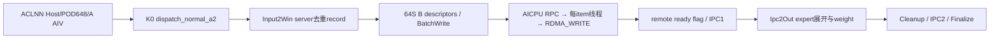
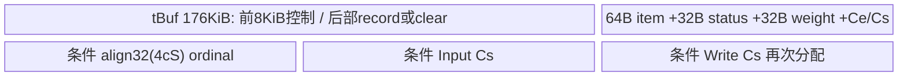

# SGL DeepEP 跨节点 BF16 Dispatch A2 ACLNN 算子知识

## 算子速览

| 项目 | 内容 |
|---|---|
| 实际入口 | aclnnDispatchNormalA2GetWorkspaceSize / aclnnDispatchNormalA2，公开两段式ACLNN。 |
| 计算语义 | A2分层BF16非量化token分发：每源token按目的server去重传输，再由目的server内MTE按expert/source索引展开；同时输出对应expert权重。 |
| 输入输出 | ND BF16 x[B,H]、INT32 expertIds及NotifyA2 metadata、FP32 expertScales权重→BF16 recvX[T,H]/FP32 expandScales[T]。其余公开输出未由当前活跃body写入。 |
| 执行类型 | 单K0 AIV_VECTOR+MTE+SDK AICPU BatchWrite/RDMA Hybrid；无可达Cube/AIC/MIX_CV。 |
| Kernel 路线 | R-001/002多server两环境key；R-003/004为Host可达单server分支，保留SDK非multiServerFlag的已知失败终点。全部实例BF16,false,false,false。 |
| 核心资源 | 18MiB workspace、176KiB raw UB及追加metadata TBuf；800MiB RDMA双半、server子区、800MiB之后IPC控制。 |
| 来源闭包 | source_closed：wrapper→活动A2 Host/POD→两个key→完整分层body→SDK消息、AICPU master/slave、registered key、RDMA_WRITE WR→verbs/doorbell驱动primitive。 |
| 验证状态 | 已完成源码闭包检查；本次知识提取未执行编译、真机、数值或性能测试。draft明确Host/producer冲突与资源条件。 |

固定SGL dda6d36b0cdb4081e102d14c0a2fb276fc416e69、SDK9.1 e5451c7feba11f9e259f4fbc19c4bf82f8c0496c。P=csrc/deepep/ops2/，H=impl/adv_api/detail/hccl/。冻结Query同主题[Normal API](../../../../apis/deepep/deepep_normal_dispatch_combine.md)已完整读，无完整Operator，本卡create。[NotifyDispatchA2](sgl_deepep_notify_dispatch_a2.md)为独立元数据前置算子，本文读取其实际producer映射，不把它合成当前唯一算子。

## 接口与语义

### 计算语义

R=EP ranks、r=本rank、S=R/8 servers、s=floor(r/8)、p=r%8、E=expert总数、L=E/R、B=expertIds.dim0、H=x.dim1、K=top-k、Ka=align8(K)、A=AIV数。有效expert e属于rank floor(e/L)。tokenServerIdx按当前body所需的[token,server]协议给出去重row ordinal，-1跳过；u[j]=tokenServerCnt[j]。一次源token带完整K个expert/权重，只需为每个目的server放一份record，同server多expert不额外增加网络record。

Record C=2H+16Ka字节：BF16 payload@0/2H B，expertId@2H/4Ka B，F32权重@2H+4Ka/4Ka B，tokenIdx保留区@2H+8Ka/4Ka B，scale保留区@2H+12Ka/4Ka B。q0只写payload和各前K项expert/weight；padding、tokenIdx/scale保留区未初始化，仍随C字节传输，不能将它们当作有效输出。

接收目的rank对每srcRank和本地expert，从NotifyA2的srcOffset[e,src,i]取该源server去重流row，从dstOffset[e,src,i]取本地packed输出row。recvX[dst,:]=x_sourceToken[:]，无数值量化；在record K项中查e，选择最后一个匹配的slot k，将expandScales[dst]=expertScales_source[token,k]。它输出权重，不在Dispatch乘权重；多次匹配取最后一项是源码行为。若无匹配，payload已写、weight不写。输出顺序由dstOffset表定义，通常expert-major/source-major，非原token顺序。

当前body不写expandIdxOut、expertTokenNumsOut、epRecvCountOut，也不在q0写dynamicScalesOut；不能把公开OpDef所列全部输出承诺为已实现。C++所返回专家计数、Combine handle来自先前NotifyA2，不应错认为本entry生成。xActiveMask/诊断和quant helper在活跃实例不参与。仅BF16非量化实例属于本文；Python允许INT8不等于router有INT8body。

### 输入、输出与属性

| 参数 | shape/layout | dtype | 约束、默认值与语义 |
|---|---|---|---|
| x | [B,H] ND/AutoContiguous | BF16活跃实例 | A2 Host只查二维/H，B从expertIds取，不验证x.dim0一致或dtype；H32..7168且H%32=0，公开Normal文档更窄为7168。FP16配对与硬编码BF16冲突。 |
| expertIds | [B,K] ND | INT32 | Host二维，B0..4096/K2..16；未扫描expert值。OpDef声明INT32。 |
| scales | optional二维 | FP32 | q0必须不存在；q2存在与否Host可接受但无router。 |
| xActiveMask | optional | BOOL OpDef | router不传body，忽略；不能用于删token。 |
| expertScales | [B,K] ND | FP32 | 实际原始top-k权重，body直接读；Host A2未查nonnull/dim/extent。C++传new_topk_weights。 |
| tokenServerIdx | 实际consumer [B,S] | INT32 | Host仅shape对象nonnull；每token/server给ordinal或-1。实际NotifyA2 producer写[S,4096]，物理协议冲突另列，不自动转置。 |
| tokenServerCnt | [S] | INT32 | 每源去往各server的unique count；Host只nonnull。 |
| epRankTokenCnt | [E,R] | INT32 | 每expert/source count；Host只nonnull。 |
| srcOffsetRankTokenIdx | [E,R,4096] | INT32 | 去重record ordinal，Device固定4096stride；非负且在对应u范围是必要条件。 |
| dstOffsetRankTokenIdx | [E,R,4096] | INT32 | 本地packed输出offset，容量与有效count一致；Host不查。 |
| recvX | [T,H] ND | BF16 | 至少覆盖max有效dst+1；A2 Host不检查输出shape/dtype。 |
| expandScales | [T] | FP32 | 每packed row对应权重，body输出有效域如上。 |
| dynamicScales/expandIdx/expertTokenNums/epRecvCount | 公开输出 | F32/I32/I64/I32 | 活跃q0 body不写；不能当作有效产物消费。 |
| waitRecvCostStats | optional | INT32 OpDef | router不传，body无诊断写入。 |
| groupEp/R/r/E | 属性 | OpDef Int64，Host按int*读 | group非空strlen，无128上界；R8..256且%8=0，0≤r<R，E1..512且E%R=0。 |
| groupTp/TP/tpRank | 属性 | string/int | TP/rank指针要求nonnull但Info强制0/0；groupTp不读，不构成TP语义。 |
| expertShardType/sharedExpertRankNum | 属性 | int | 指针nonnull但强制Info0；忽略传值。sharedExpertNum默认1但活动A2不读取。 |
| quantMode | 属性 | int | Host0或2，本卡0；q0禁scales。q2 key+2(+10scale)无body，不声明INT8支持。 |
| globalBs | 属性 | int | 指针nonnull但忽略值，Info强制R*B。 |
| expertTokenNumsType | 属性 | int | 0或1，默认1；Info/body保存但不写计数输出。 |
| IPC环境 | env | string | HCCL_INTRA_PCIE_ENABLE=="1"且HCCL_INTRA_ROCE_ENABLE=="0"才加100000000；缺任一或其它值用默认key，同一body。 |

### 入口与版本

实际注册DispatchNormalA2TilingFunc无条件调MoeDistributeDispatchA2TilingFuncImpl；文件中的CheckIsA2/MoeDistributeDispatchA3TilingFuncImpl/通用输出校验没有被该注册调用，不可把其约束补到活动A2。OpDef同时声明ascend910b/ascend910_93，但本任务只提取公开A2；支持9.1.0由DeepEP README与SDK version.cmake固定，未扩大到9.0。SDK BatchWrite官方A2要求不同server且目标不是self；实际910B服务端逐item跳过self，本body仍生成self两项，协议/实现区别必须保留。

GetWorkspaceSize原参数透传inner；Execute若弱符号存在且当前SoC910B选择AICPU server，否则MTE。生成inner、Contiguous/executor和stream启动属于框架primitive。build.sh的A2目标选择ops2；compile_ascend_proj复制op_host/op_kernel，CMake生成cust_opapi/tiling/kernel。kernel CMake可能从安装目录覆盖base/comm_ctx，固定本地读取的winSize前缀必须保持；未以其它版本header当9.1安装ABI实测。

Python默认Normal策略num_rdma_ranks>1进入_internode_dispatch，拒绝非bf16/int8模式，INT8包装会选q2但当前router无body。C++先执行独立aclnnNotifyDispatchA2，host读total_recv_token分配max(1,total)输出；B=4096 metadata为Notify容量，实际B可更小。然后调用本entry，TP1等属性在Host又归0。输入权重缺省ones，但部分topk_weights存在性检查前会取其dim；不宣称可选包装的所有组合安全。返回handle含Notify的expand_idx/ep_rank_token_cnt/offset_inner/token_server_idx/count_outer和当前expandScales，event/async未新增第二个本entry kernel。

## Host/Launcher 执行流程

### 参数校验与前处理

1. 获得A2TilingData，CheckShape：x/expertIds非空、rank2；但两处非法dim分支return false，在graphStatus返回语境不是可靠GRAPH_FAILED，可能继续使用未完整初始化Info。h/bs/k先窄化u32，h%32/0<h≤7168、bs≤4096、2≤k≤16；没有x.dim0一致检查。5个Notify metadata只检查shape对象nonnull。q0且scales存在返回GRAPH_FAILED。
2. CheckAttr按int*读取OpDef Int属性，检查group strlen>0、R%8/上界256/rank、E%R/上界512、q0/2、expertTokenNumsType0/1及其余指针。Info强制TP/rank/shard/shared=0、globalBs=R*B；groupTp/sharedExpertNum未参与。位宽读取/窄化风险保留，未实测框架属性ABI。
3. GetPlatformInfo保存A/totalUB；block=CalcTschBlockDim(A,0,A)，未设置完整UB/window/resource门禁。key=2000000000+1000+q+10[hasScales]+100000000[PCIE1&&ROCE0]。
4. workspace=16MiB system+1MiB user+1MiB注释dumpprof，共18MiB。Body从收到的user workspace base用64S字节descriptor，后续expertToServerCnt pointer只绑定未读写，dumpprof未见消费。框架system前缀分离属于launcher primitive，不以body指针猜测用户raw地址再加16MiB。
5. SetHcommCfg只有EP，cmd18、algConfig="MultiPut=level0:fullmesh"，默认engine0。SDK GetTiling序列化init64/cc512，返回值未被Host检查；SDK字符串长度/参数失败会使POD不可消费。该字符串只是资源配置，Device实际提交BatchWrite；A3未调用函数的AlltoAll配置不属于当前route。

### 参数、Workspace 与生命周期

W=runtime context.winSize，Device窄化u32；RDMA固定800MiB、half400MiB，D=alignDown4096((400MiB-1MiB)/S)，Z=399MiB。持久bufferChosen在rawIN+Z+512R，读取旧z不做0/1合法性检查，core0提交后写z^1。数据IN/OUT基址=rawWindow+400MiB*z。目的server j record区域为OUT_z+jD+32+ordinal*C；对端相同plane rank p+8j的IN_z+sD为接收区。各local plane映射直接MTE。

IPC控制shareAddrs[i]=rawIN(localServerBase+i)+800MiB；8个local rank flag各占32B，magic位于+2MiB-2048+32core，每core读/写32B、仅首u64加1。每call Magic递增，IPC1值2magic+1、IPC2值2magic+2，Wait读首u64≥阈值；不把≥描述成exact equality。记录同rank同序/同magic，32bitz与64bitmagic两种用途不可互换。800MiB后实际IPC容量、寄存器/driver指针由runtime保证。

代码还计算RANK_SIZE_ON_IPC=alignDown512((W-800MiB-4MiB)/(L*R))，但当前body不消费该值；因此不能把这个未用算式当Host的有效window校验，也不据其unsigned下溢断言具体运行错误。需要实际覆盖RDMA/IPC访问范围，Host不核对W。

input/output/workspace caller拥有至stream完成；runtime组window和SDK message区在整个Finalize前有效。descriptor在提交前MTE3完成+SyncAll，至服务端读完/通信与IPC阶段结束不可覆盖；BatchWrite返回handle不是peer接收完成。当前body不Wait(handle)，依WaitWindow/IPC1/IPC2以及末Finalize保证源码中的阶段顺序，SDK失败未被解析为安全Device返回。

### 启动图与失败传播



| 节点/边 | producer→consumer | offset/extent/dtype/layout | ordering | owner/lifetime/失败 |
|---|---|---|---|---|
| Host→K0 | inner→dispatch_normal_a2 | 19 GM参数、POD648B，AIV block=CalcTsch(A,0,A) | 当前stream | 框架，Host失败不产合法launch |
| 预处理metadata | NotifyA2→K0 | counts4ER B、src/dst各4ER*4096 B、ordinal4BS B | Notify/专家索引就绪 | caller；producer物理布局冲突另列 |
| packed record | Input2Win→RDMA | C字节/去重token，prefix32B | MTE3/PIPE_ALL/SyncAll后提交 | runtime OUT/IN，peer消费前不重用 |
| descriptors | AIV各core→AICPU core0入口 | workspace+64j：data32B+flag32B | S_MTE3、全核SyncAll | caller workspace，至Finalize |
| RDMA payload/flag | expert server→dest same-plane | 32+u[j]C B，然后32B flag | 同目标/QP顺序由通信primitive保证；receiver观察flag | runtime window |
| local IPC | 各plane→8 local ranks | 每rank32B，首u64=2magic+phase | Wait>=threshold、SyncAll | runtime+800MiB |
| output | Ipc2Out→caller | recvX2H B/row、weight4B/row | MTE2/MTE3/PIPE_ALL和尾SyncAll | caller；其余公开输出未写 |
| 失败 | SDK RPC→runtime错误状态 | !multiServerFlag→HCCL_E_PARA；PostSend/verbs错误沿CHK_RET | SGL忽略handle值、flag轮询无timeout | 不虚构由这些状态必然出现的用户错误码 |

## Route 与参数设计

### 分核与资源计算

split(T,A,c)按q=T/A、rem=T%A、count=q+[c<rem]、start=cq+min(c,rem)分former/tail。Input2Win按B分核，空sender不追加tokenServerIdxBuf/serverCountBuf；WriteRdmaCntInfo按S分核，空core不追加第二serverCountBuf；descriptor构造同样按S。WaitWindow每core只等待对应server，IPC每core只处理对应local rank，因此必要A≥max(S,8)，Host未检查。magic预留2048B/32=64 core，A>64没有对应slot隔离证明。

UB所有InitBuffer经SDK align32；没有Queue，没有Reset。base=176KiB tBuf+64B batchWriteInfoBuf+32B statusBuf+align32(4S) expertToServerIdxBuf+align32(4E) expertCountBuf+32B weightBuf。Input有c>0再追加align32(4cS)+align32(4S)，Write有server工作再追加align32(4S)，即两次同一serverCountBuf.InitBuffer累加，不能以变量名相同当复用。U_peak=base+上述条件项≤Info.totalUbSize，同时TPipe handle≤64；Host无实际门禁。

tBuf[0,8KiB)为阶段control/临时，tBuf+8KiB处C字节record在Input和Ipc2Out之间复用；各dtype GetWithOffset是同一raw UB别名，不额外分配。q0未调用QuantProcess；不能把176KiB注释推成额外FP32量化buffer。H%32/Ka8保证C为32B倍数。Cleanup scratch需要max(32E,512S)≤176KiB-8KiB，固定Host E≤512/S≤32满足该局部条件，但并不能证明全部UB预算满足。

### Route 选择

| 顺序 | Route | Key/模板 | 精确选择条件与优先级 | 不适用去向 |
|---|---|---|---|---|
| 1 | R-001 默认环境多server | 2000001000 / BF16,BF16,false,false,false | q0/scales absent、Host合法、缺任一或其它环境组合；S>1；BF16配对 | S1到对应单serverRoute；SDK错误见边界 |
| 2 | R-002 PCIE1/ROCE0多server | 2100001000 / BF16,BF16,false,false,false | q0/scales absent、Host合法、PCIE=="1"&&ROCE=="0"；S>1；BF16配对 | S1到对应单serverRoute；SDK错误见边界 |
| 3 | R-003 默认环境单server分支 | 2000001000 / BF16,BF16,false,false,false | q0/scales absent、Host合法、缺任一或其它环境组合；S=1；BF16配对 | runtime !multiServerFlag返回HCCL_E_PARA；无remote item |
| 4 | R-004 PCIE1/ROCE0单server分支 | 2100001000 / BF16,BF16,false,false,false | q0/scales absent、Host合法、PCIE=="1"&&ROCE=="0"；S=1；BF16配对 | runtime !multiServerFlag返回HCCL_E_PARA；无remote item |


```text
活动注册函数无条件A2Impl；文件内A3函数未调用
q0 + scales absent + shape/attrs通过 -> key 2000001000
若PCIE=="1"且ROCE=="0" -> key 2100001000
两key都实例BF16/BF16,false,false,false
S=R/8>1 -> 对应多serverRoute；S=1 -> 相同body；若runtime !multiServerFlag，SDK拒绝；即使置true也不补造跨server payload
q2 (+2/+12) -> Host可产key但router无匹配body；不声明INT8
router额外2000000000 -> 活动Host从不产生
FP16 OpDef列/其它错误dtype -> 活动body仍硬编码BF16，公开类型与body冲突
```

### 模板/实现执行矩阵

| Route | key/selector | dtype/shape/platform 完整命中条件 | 执行拓扑与 Kernel 节点 | 实际模板/body | 内存与同步特征 | tail/fallback |
|---|---|---|---|---|---|---|
| R-001 | 2000001000 | A2，B0..4096/H32..7168且%32=0/K2..16，R%8/E%R、q0、scales absent；缺任一或其它环境组合；S>1 | K0 AIV+SDK AICPU RDMA Hybrid | CamMoeDistributeDispatchA2Layered<bfloat16_t,bfloat16_t,false,false,false> | 176KiB raw UB+条件TBuf、descriptor/两half/IPC1&2 | split former/tail，空token仍通信 |
| R-002 | 2100001000 | A2，B0..4096/H32..7168且%32=0/K2..16，R%8/E%R、q0、scales absent；PCIE=="1"&&ROCE=="0"；S>1 | K0 AIV+SDK AICPU RDMA Hybrid | CamMoeDistributeDispatchA2Layered<bfloat16_t,bfloat16_t,false,false,false> | 176KiB raw UB+条件TBuf、descriptor/两half/IPC1&2 | split former/tail，空token仍通信 |
| R-003 | 2000001000 | A2，B0..4096/H32..7168且%32=0/K2..16，R%8/E%R、q0、scales absent；缺任一或其它环境组合；S1 | K0 AIV+SDK AICPU RDMA Hybrid | CamMoeDistributeDispatchA2Layered<bfloat16_t,bfloat16_t,false,false,false> | 176KiB raw UB+条件TBuf、descriptor/两half/IPC1&2 | Host可达；runtime非多server有真实失败guard |
| R-004 | 2100001000 | A2，B0..4096/H32..7168且%32=0/K2..16，R%8/E%R、q0、scales absent；PCIE=="1"&&ROCE=="0"；S1 | K0 AIV+SDK AICPU RDMA Hybrid | CamMoeDistributeDispatchA2Layered<bfloat16_t,bfloat16_t,false,false,false> | 176KiB raw UB+条件TBuf、descriptor/两half/IPC1&2 | Host可达；runtime非多server有真实失败guard |


### 隐藏性能 Guard

| Guard | Host/Tiling 条件 | Device/资源原因 | 影响 Route | 不满足时去向 | 源码符号 |
|---|---|---|---|---|---|
| 活动类型 | Host A2未查dtype，router硬编码BF16 | FP16不能按其值语义重解释为BF16 | 全部 | 冲突终点，非FP16支持Route | OpDef/router |
| q0/scales | q0且scales存在拒绝 | false,false,false没有smooth/quant | 全部 | GRAPH_FAILED；q2无body | CheckShape/CalcTilingKey |
| 核数量 | 未查A≥max(S,8)/A≤64 | WaitWindow/IPC flag每core一个peer、magic32B/core | 全部 | draft资源条件 | WaitWindow/SetIpcFlag/Init |
| RDMA容量 | 无W/capacity检查 | 每server D需≥32+u[j]C；399MiB固定按S均分 | 全部 | 无Host拒绝，caller保证 | SERVER_SIZE_ON_WIN |
| IPC/window | 无W范围检查，W转u32 | 数据800MiB + IPC magic/flags真实地址 | 全部 | draft，不能用未用RANK_SIZE算式证明 | Init |
| UB | 未检查U_peak | 176KiB+追加TBuf，serverCount重复请求不Reset | 全部 | 无fallback | Init/Input2Win/WriteRdmaCntInfo |
| metadata布局 | Host只nonnull | Notify实际[S,4096] vs Input期望[B,S] | 全部集成 | 已见producer/consumer冲突，不能伪造转置 | BuildTokenSeverIdxData/Input2Win |
| prefix/output范围 | 无值扫描 | count/src/dst及u决定全部GM地址 | 全部 | 必须配套且容量有效 | Ipc2Out |
| 单server | Host允许R8 | SDK RunRpcServerApi在runtime multiServerFlag=false时拒绝 | R-003/004 | 条件成立的HCCL_E_PARA路径；不以R单独猜runtimeflag | SDK服务端 |
| selector与清状态 | 未查区域不重叠 | z0时CleanUp extent=max(32E,512S)，selector相对status为512R；若extent>512R则覆盖selector | 全部满足条件者 | 已见地址重叠，不臆测后续具体错误 | bufferChosenGlobal/CleanUp |
| 公开输出 | 无输出检查 | body仅写recvX/expandScales，其他未写 | 全部 | 不可宣称全部输出有效 | Init/Ipc2Out |
| 零域 | B0可通过 | 本地无发送token仍生成/提交2S descriptor和flag；Ipc2Out独立按各源epRankTokenCnt接收，只有全部有效接收计数为0才无输出token | 全部 | 保持控制协议；没有通用“空输入不启动” | Process |

### POD/ABI

Info自然size72/align8，外壳init64@0、cc512@64、Info72@576，总648/align8。是固定字段自然布局推导，未执行ABI实测。Host按int*读取Int64属性的风险与POD的明确u32布局分开；不要依OpDef直接按64bit手写Info。

| 结构 | 字段 | 类型/位宽 | ABI 布局 | 单位 | Host/launcher producer | Device consumer | 边界 |
|---|---|---|---|---|---|---|---|
| CamMoeDistributeDispatchA2Info | epWorldSize | u32 | @0 | rank数 | R指针值 | Init.worldSize/serverNum | R8..256,%8 |
| CamMoeDistributeDispatchA2Info | tpWorldSize | u32 | @4 | rank数 | 强制0 | 未消费 | 输入TP被忽略 |
| CamMoeDistributeDispatchA2Info | epRankId | u32 | @8 | rank | r指针值 | window/plane/server地址 | 0≤r<R |
| CamMoeDistributeDispatchA2Info | tpRankId | u32 | @12 | rank | 强制0 | 未消费 | inactiveTP |
| CamMoeDistributeDispatchA2Info | expertSharedType | u32 | @16 | 枚举 | 强制0 | 未消费 | 输入ignored |
| CamMoeDistributeDispatchA2Info | sharedExpertRankNum | u32 | @20 | rank数 | 强制0 | 未消费 | 输入ignored |
| CamMoeDistributeDispatchA2Info | moeExpertNum | u32 | @24 | expert数 | E指针值 | L=E/R/循环/UB | E1..512,%R |
| CamMoeDistributeDispatchA2Info | quantMode | u32 | @28 | 枚举 | q指针值 | body模板硬编码不按此选quant | 当前q0；q2无router |
| CamMoeDistributeDispatchA2Info | globalBs | u32 | @32 | token数 | R*B | 仅未用combine offset算式 | 忽略输入globalBs |
| CamMoeDistributeDispatchA2Info | bs | u32 | @36 | token数 | expertIds.dim0→u32 | Input split/metadata | 0..4096，未等x.dim0 |
| CamMoeDistributeDispatchA2Info | k | u32 | @40 | slot数 | expertIds.dim1→u32 | Ka/record/expert扫描 | 2..16 |
| CamMoeDistributeDispatchA2Info | h | u32 | @44 | 元素数 | x.dim1→u32 | payload/record | 32..7168,%32 |
| CamMoeDistributeDispatchA2Info | aivNum | u32 | @48 | 核数 | GetCoreNumAiv | split/flag/WaitWindow | 额外核数guard未查 |
| CamMoeDistributeDispatchA2Info | isQuant | bool | @52 | 布尔 | scales shape存在 | 活跃false实例不消费quant | q0要求false |
| CamMoeDistributeDispatchA2Info | reserved1 | bool | @53 | inactive | 未赋值 | 不消费 | 不假默认 |
| CamMoeDistributeDispatchA2Info | reserved2 | bool | @54 | inactive | 未赋值 | 不消费 | 不假默认 |
| CamMoeDistributeDispatchA2Info | reserved3 | bool | @55 | inactive | 未赋值 | 不消费 | 不假默认 |
| CamMoeDistributeDispatchA2Info | totalUbSize | u64 | @56 | B | GetCoreMemSize(UB) | 未用于容量判断 | 实际UB式另列 |
| CamMoeDistributeDispatchA2Info | hcclBufferSize | u32 | @64 | B | 未赋值 | 不消费；body用context.winSize | 不假env值 |
| CamMoeDistributeDispatchA2Info | expertTokenNumsType | u32 | @68 | 枚举 | attr0/1 | Init保存，未输出count | 不能当作已实现count/cumsum |


SDK当前仅一个EP：init.mc2HcommCnt=1、offset[0]=64、其余0；engine默认0、opType18、algConfig MultiPut=level0:fullmesh。下表offset相对inner；未显式写的reserved不假定0。

| 结构 | 字段 | 类型/位宽 | ABI 布局 | 单位 | Host/launcher producer | Device consumer | 边界 |
|---|---|---|---|---|---|---|---|
| Mc2InitTilingInner | version | u32 | 0 | 版本枚举 | GetTiling: 100 | SDK初始化 | 不依赖reserved值 |
| 同上 | mc2HcommCnt | u32 | 4 | 通信组数 | GetTiling: 1 | 框架组配置 | 不依赖reserved值 |
| 同上 | offset | u32[8] | 8 | 字节偏移数组 | GetTiling: 64，其余0 | cc1/cc2定位 | 不依赖reserved值 |
| 同上 | debugMode | u8 | 40 | 枚举 | GetTiling: default0 | SDK | 不依赖reserved值 |
| 同上 | preparePosition | u8 | 41 | 枚举 | GetTiling: default0 | SDK | 不依赖reserved值 |
| 同上 | queueNum | u16 | 42 | queue数 | GetTiling: default0 | SDK working core | 不依赖reserved值 |
| 同上 | commBlockNum | u16 | 44 | block数 | GetTiling: default0 | SDK资源 | 不依赖reserved值 |
| 同上 | devType | u8 | 46 | 枚举 | GetTiling: runtime SoC | 平台实现选择 | 不依赖reserved值 |
| 同上 | reserved | char[17] | 47 | 保留字节 | GetTiling: 未显式清全部 | inactive | 不依赖reserved值 |
| Mc2CcTilingInner | skipLocalRankCopy | u8 | 0 | 布尔 | GetTiling: default0 | 框架 | 不依赖reserved值 |
| 同上 | skipBufferWindowCopy | u8 | 1 | 布尔 | GetTiling: default0 | 框架 | 不依赖reserved值 |
| 同上 | stepSize | u8 | 2 | step数 | GetTiling: default0 | 框架 | 不依赖reserved值 |
| 同上 | version | u8 | 3 | 版本枚举 | GetTiling: 1 | 固定协议 | 不依赖reserved值 |
| 同上 | reserved | char[9] | 4 | 保留字节 | GetTiling: memset0 | inactive | 不依赖reserved值 |
| 同上 | commEngine | u8 | 13 | 枚举 | GetTiling: default0(AICPU) | AICPU BatchWrite资源；无CCU | 不依赖reserved值 |
| 同上 | srcDataType | u8 | 14 | dtype枚举 | GetTiling: default0=INT8 | 当前payload模板不读作payload dtype，payload由模板决定 | 不依赖reserved值 |
| 同上 | dstDataType | u8 | 15 | dtype枚举 | GetTiling: default0=INT8 | 当前payload模板不读取该字段 | 不依赖reserved值 |
| 同上 | groupName | char[128] | 16 | 组名字符 | GetTiling: EP/TP字符串 | 框架组关联 | 不依赖reserved值 |
| 同上 | algConfig | char[128] | 144 | 算法配置字符 | GetTiling: MultiPut=level0:fullmesh | 框架资源组装；本body直接MTE | 不依赖reserved值 |
| 同上 | opType | u32 | 272 | 命令枚举 | GetTiling: EP18 | 框架通信资源声明 | 不依赖reserved值 |
| 同上 | reduceType | u32 | 276 | reduce枚举 | GetTiling: default0 | 本body不做payload reduce | 不依赖reserved值 |
| 同上 | reserved2 | char[232] | 280 | 保留字节 | GetTiling: 未显式清全部 | inactive | 不依赖reserved值 |

| 结构 | 字段 | 类型/位宽 | ABI 布局 | 单位 | Host/launcher producer | Device consumer | 边界 |
|---|---|---|---|---|---|---|---|
| A2TilingData | mc2InitTiling | opaque64 | @0 | B | SDK GetTiling | InitV2 | version100/单EP |
| 同上 | mc2CcTiling | opaque512 | @64 | B | SDK GetTiling cmd18 | SetCcTilingV2(64) | body使用BatchWrite |
| 同上 | moeDistributeDispatchInfo | Info72 | @576 | mixed | A2 Host | Init | 上表逐字段 |
| BatchWriteItem A2 | localBuf | u64 | @0 | 地址 | ConstructDataAndFlagBatchWriteInfo | SDK ConcurrentPostSendWqe | source registered window |
| 同上 | remoteBuf | u64 | @8 | 地址 | 同上 | SDK PostSend | dest IN |
| 同上 | count | u64 | @16 | 元素数 | 数据32+uC/flag32 | SDK乘DataUnitSize(INT8)=1 | 本算子按B计 |
| 同上 | dataType | u32 | @24 | 枚举 | HCCL_DATA_TYPE_INT8 | SDK DataUnitSize | 不转换BF16数据 |
| 同上 | remoteRankId | u32 | @28 | rank | p+8j | SDK线程分派/self过滤 | item自然32B |
| 本地HcclOpResParam | winSize | u64 | @24 | B | runtime组 | Init.totalSize_窄化u32 | 只读此字段；与SDK A2context前32B同位，不推断其余完整结构兼容 |
| SDK HcclCombineOpParam | workSpace | u64 | @0 | 地址 | runtime组 | InitInner/Finalize消息 | 不同于ACLNNworkspace |
| 同上 | rankId | u32 | @16 | rank | runtime组 | GetWindows地址分支 | defaultconfig workingcore0 |
| 同上 | rankNum | u32 | @20 | rank数 | runtime组 | rank合法检查 | 不证明拓扑可达 |
| 同上 | windowsIn | u64[32] | @32 | 地址 | runtime组 | multiFlag0路径 | 多server需实际data映射 |
| 同上 | windowsOut | u64[32] | @288 | 地址 | runtime组 | multiFlag0路径 | 不借用950布局 |
| 同上 | multiFlag | u8 | @8872 | 布尔 | runtime组 | 910B分支 | 自然布局推导 |
| 同上 | data | IbVerbsData* | @8880 | 地址 | runtime组 | data[rank].local/remoteInput/Output.addr | 32项数组之外实际映射 |
| SDK MemDetails | size | u64 | @0 | B | runtime注册 | Getkey | 本路径只用起始地址选key，未验证整个len末端 |
| 同上 | addr | u64 | @8 | 地址 | runtime注册 | SDK GetWindows/PostSend | local/remote有效地址 |
| 同上 | key | u32 | @16 | key | runtime注册 | WR lkey/rkey | 自然size24 |
| SDK IbVerbsData | remoteInput | MemDetails | @0 | 地址/容量/key | runtime组 | remote IN | 自然size120 |
| 同上 | remoteOutput | MemDetails | @24 | 地址/容量/key | runtime组 | remote OUT | 当前body只查询remoteIN |
| 同上 | localInput | MemDetails | @48 | 地址/容量/key | runtime组 | local IN | GetWindowsInAddr |
| 同上 | localOutput | MemDetails | @72 | 地址/容量/key | runtime组 | local OUT | GetWindowsOutAddr |
| 同上 | res | u8[24] | @96 | B | runtime组 | 不消费 | 保留 |

### Route 源码闭包

| Route | Key/selector | Host/Tiling producer | POD/参数 | Kernel entry/router 节点 | Kernel body/直接依赖 | 构建接线 |
|---|---|---|---|---|---|---|
| R-001 | 2000001000/缺任一或其它环境组合/S>1 | csrc/deepep/ops2/op_host/dispatch_normal_a2_tiling.cpp::MoeDistributeDispatchA2TilingFuncImpl/CheckShape/CheckAttr/CalcTilingKey | Info72/outer648、SDKinit64/cc512、workspace64S item | csrc/deepep/ops2/op_kernel/dispatch_normal_a2.cpp::dispatch_normal_a2 | 完整csrc/deepep/ops2/op_kernel/a2/cam_moe_distribute_dispatch_a2_layered.h；base/comm_args；SDK client→AICPU BatchWrite→PostSend→RDMA_WRITE/driver primitive | ops2 OpDef ascend910b，build.sh/compile_ascend_proj.sh，Host/kernel CMake |
| R-002 | 2100001000/PCIE=="1"&&ROCE=="0"/S>1 | csrc/deepep/ops2/op_host/dispatch_normal_a2_tiling.cpp::MoeDistributeDispatchA2TilingFuncImpl/CheckShape/CheckAttr/CalcTilingKey | Info72/outer648、SDKinit64/cc512、workspace64S item | csrc/deepep/ops2/op_kernel/dispatch_normal_a2.cpp::dispatch_normal_a2 | 完整csrc/deepep/ops2/op_kernel/a2/cam_moe_distribute_dispatch_a2_layered.h；base/comm_args；SDK client→AICPU BatchWrite→PostSend→RDMA_WRITE/driver primitive | ops2 OpDef ascend910b，build.sh/compile_ascend_proj.sh，Host/kernel CMake |
| R-003 | 2000001000/缺任一或其它环境组合/S1 | csrc/deepep/ops2/op_host/dispatch_normal_a2_tiling.cpp::MoeDistributeDispatchA2TilingFuncImpl/CheckShape/CheckAttr/CalcTilingKey | Info72/outer648、SDKinit64/cc512、workspace64S item | csrc/deepep/ops2/op_kernel/dispatch_normal_a2.cpp::dispatch_normal_a2 | 完整csrc/deepep/ops2/op_kernel/a2/cam_moe_distribute_dispatch_a2_layered.h；base/comm_args；SDK client→AICPU BatchWrite→PostSend→RDMA_WRITE/driver primitive | ops2 OpDef ascend910b，build.sh/compile_ascend_proj.sh，Host/kernel CMake |
| R-004 | 2100001000/PCIE=="1"&&ROCE=="0"/S1 | csrc/deepep/ops2/op_host/dispatch_normal_a2_tiling.cpp::MoeDistributeDispatchA2TilingFuncImpl/CheckShape/CheckAttr/CalcTilingKey | Info72/outer648、SDKinit64/cc512、workspace64S item | csrc/deepep/ops2/op_kernel/dispatch_normal_a2.cpp::dispatch_normal_a2 | 完整csrc/deepep/ops2/op_kernel/a2/cam_moe_distribute_dispatch_a2_layered.h；base/comm_args；SDK client→AICPU BatchWrite→PostSend→RDMA_WRITE/driver primitive | ops2 OpDef ascend910b，build.sh/compile_ascend_proj.sh，Host/kernel CMake |


## Kernel 实现

### 公共执行流程

全部Host可达q0 key进入相同CamMoeDistributeDispatchA2Layered<bfloat16_t,bfloat16_t,false,false,false>，单K0不是多个Host kernel。Input→record→SDK RDMA→IPC expert展开→Cleanup的通信任务图不含Cube/AIC或MIX_CV。QuantProcess虽然有定义，三个bool均false后不在可达Device图，不摄入INT8数学语义。GetExpRank/IsInSameServer/SetTokenCnt等未被实际Process调用，不以声明未用函数视作缺失核心。

SDK实际边界：Hccl BatchWrite<true>→CommonPrepareImpl建立handle/提交消息，AssembleHcclMsg写descriptor GM地址、dataCnt=2S、version/seq/valid；RunRpcServerApi仅910B、检查multiServerFlag后调用HandleBatchWriteOperation。master将任务送入ring队列，线程按remoteRankId%workedThreadNum分工，逐item忽略self，count×dtypeSize构造本地/远端buffer，等待各线程posting计数完成。每item PostSend只含一个buffer，因此SDK最多8段限制不能误套成2S≤8。

PostSend/Getkey从已注册IN/OUT范围按起始地址取得lkey/rkey（代码未用length验证末端），组装MemDetails；CCL_KERNEL Transport::HcclBatchWrite→HnsPostSend生成SGE(localaddr/length/lkey)、WR(remoteaddr/rkey/RDMA_WRITE)，链末SIGNALED，经HrtHnsIbvExpPostSend动态verbs下发。非NORMAL QP追加RdmaSend doorbell SQE，LaunchTask复制SQ环并更新SQ_TAIL。停止于动态verbs驱动、SQE编码函数指针、网络硬件/运行时资源primitive，不把它们虚构为本仓算法。错误经CHK_RET传播服务端，SGL忽略BatchWrite handle状态且轮询无本地timeout，因此不从内部错误值推断具体用户表现。

### Route R-001：默认环境多server

#### 适用条件

A2、q0、scales absent、BF16→BF16、活动Host guard通过；缺任一环境值或 !(PCIE=="1" && ROCE=="0")；R≥16/S>1。两环境key实际body完全相同，非两个通信算法。当前server分块按S，实际prefix/offset/ordinal需满足本文协议；未声称Notify producer已修复。

##### 选择证据

| 层级 | 文件 | 符号 | 源码谓词/参数 | 结果/下一跳 |
|---|---|---|---|---|
| API | csrc/deepep/ops2/op_host/op_api/aclnn_dispatch_normal_a2.cpp | aclnnDispatchNormalA2GetWorkspaceSize/Execute | 原参数透传，910B server AICPU | 生成inner |
| Host | csrc/deepep/ops2/op_host/dispatch_normal_a2_tiling.cpp | DispatchNormalA2TilingFunc/MoeDistributeDispatchA2CalcTilingKey | A2、q0、scales absent、BF16→BF16、活动Host guard通过；缺任一环境值或 !(PCIE=="1" && ROCE=="0")；R≥16/S>1 | key2000001000；Info72 |
| Router | csrc/deepep/ops2/op_kernel/dispatch_normal_a2.cpp | dispatch_normal_a2 | TILING_KEY_IS(2000001000) | CamMoeDistributeDispatchA2Layered<bfloat16_t,bfloat16_t,false,false,false> |
| Body | csrc/deepep/ops2/op_kernel/a2/cam_moe_distribute_dispatch_a2_layered.h | Init/Process | S=R/8；固定8local rank，false,false,false | 同body，按server/localrank/core分工 |
| SDK | impl/adv_api/detail/hccl/cc/src/aicpu_kfc/framework/device/aicpu_kfc/framework/aicpu_kfc_process.cc | RunRpcServerApi | devType910B；cmd18 && multiServerFlag | HandleBatchWriteOperation；否则HCCL_E_PARA |

#### Device 数据流

##### 函数级调用链

```text
ACLNN inner -> K0 dispatch_normal_a2(19 GM参数,POD648)
 -> CamMoeDistributeDispatchA2Layered<BF16,BF16,false,false,false>::Init
   -> SDK InitV2 / SetCcTilingV2(64) / GetWindowsInAddr/GetWindowsOutAddr
   -> 读取z与每core magic++ / InitBuffer基础TBuf
 -> Process
   -> Input2Win -> PIPE_ALL -> SyncAll
   -> WriteRdmaCntInfo -> DispatchBetweenServer
     -> ConstructDataAndFlagBatchWriteInfo -> PIPE_ALL -> SyncAll
     -> core0 Hccl::BatchWrite<true>(workspace,2S) -> flip z
       -> CommonPrepareImpl/AssembleHcclMsg -> AICPU RunRpcServerApi
       -> HandleBatchWriteOperation -> ConcurrentPostSendWqe -> PostSend/Getkey
       -> Transport::HcclBatchWrite -> HnsPostSend(RDMA_WRITE)
       -> dynamic verbs；非NORMAL QP再RdmaSend/LaunchTask
   -> WaitWindow -> SyncAll -> SetIpcFlag(1)/WaitIpcFlag(1) -> SyncAll
   -> Ipc2Out -> SyncAll -> core0 CleanUp
   -> SetIpcFlag(2)/WaitIpcFlag(2) -> SyncAll -> SDK Finalize
```

##### 源码等价伪码

```text
# 等价伪码，非可执行实现
Init: read z from rawIN+399MiB+512R；每core magic从IPC metadata加1
split B by A -> 本core token区间；若非空追加ordinal/counter TBuf
每token: 读BF16 payload2H、INT32 expert4K、F32 weight4K到tBuf+8KiB的record
对server j：若ordinal[token,j]!=-1，写C字节到OUT_z+jD+32+ordinal*C
若j==selfServer，再直接MTE同地址偏移到IN_z；MTE3_MTE2后复用record
SyncAll；按S分核读取tokenServerCnt，保存u[j]；此阶段不把count prefix写回GM
按S分核构造每j data/flag两个32B item；SyncAll
core0 BatchWrite(workspace,2S)，忽略返回handle，selector=z^1写回DCCI
SDK 逐item跳过self，远端按rank分线程post data后flag
WaitWindow：core<S且不是selfServer，等待对应server状态首I32==0xffffffff
SyncAll；前8core各发布/等待一个localrank IPC1 (首u64>=2magic+1)；SyncAll
for sourceRank in R:
  plane=sourceRank%8，srcServer=sourceRank/8
  recordBase=rawIN(localserverbase+plane)+z400MiB+srcServer*D+32
  for local expert e：count=epRankTokenCnt[e,sourceRank]，split count by A
    每实际i：src=srcTable[(eR+sourceRank)*4096+i]；dst=dstTable[同址]
    DMA C到tBuf+8KiB，先写2H B payload到recvX[dst,H]
    扫K expert找到最后匹配slot；若无匹配continue（weight未写）
    写expandScales[dst]=weight[slot]；无q0 dynamicScales/计数/expandIdx输出
SyncAll；core0清readStatus max(32E,512S)字节
发布/等待IPC2 (>=2magic+2)，SyncAll，Finalize
```

#### 内存与数据搬运

##### 资源与搬运表

| 层级/缓冲区 | offset/地址公式 | extent/容量公式 | dtype/layout | producer | consumer | owner/lifetime | 对齐/复用 |
|---|---|---|---|---|---|---|---|
| GM input | x[tH] / expertIds[tK] / expertScales[tK] | 2BH /4BK/4BK B | BF16/I32/F32 ND | caller | Input2Win | caller/K0结束 | 实际前K项；H/Ka保证C%32=0 |
| GM ordinal/count | tokenServerIdx[token*S+j] / tokenServerCnt[j] | 4BS/4S B consumer域 | I32 | Notify/caller | Input/WriteRdmaCntInfo | caller | 真实Notify物理[S,4096]冲突，未隐式转置 |
| GM expert/source | count[eR+src] | 4ER B | I32 | Notify | Ipc2Out | caller | 每expert/source数量 |
| GM offsets | (eR+src)*4096+i | src/dst各4ER*4096 B | I32 | Notify | Ipc2Out | caller | 固定4096stride；不由B替代 |
| GM outputs | recvX[dstH]/expandScales[dst] | 2TH/4T B | BF16/F32 | Ipc2Out | caller/Combine | caller | 仅有效dst和匹配weight |
| workspace item | userPtr+64j | 64S B | 2个A2 item/server | AIV构造 | AICPU | caller/至Finalize | 32B item；18MiB中仅此活跃slice |
| workspace unused | userPtr+64S | expertToServerCnt pointer绑定未用 | u32 | 无 | 无 | 保留 | 不虚构输出scratch消费 |
| RDMA OUT/IN | rawWindow+z400MiB+jD | D B/server，record前32B | BF16+I32/F32 packed | Input/RDMA | RDMA/Ipc2Out | runtime组/当前half | D align4096；payload C align32 |
| RDMA status | window_z+399MiB+512srcServer | 32B/peer，512B stride | 首I32 0xffffffff | 远端flag item | WaitWindow | runtime组 | 仅首I32有定义/被读 |
| selector | rawIN+399MiB+512R | 首u32 | u32 z | core0翻转 | 下次Init | runtime持久 | z应0/1；z0 Cleanup可能覆盖 |
| IPC flag | rawIN(localrank)+800MiB+32peer | 8*32B | 首u64=2magic+phase | 前8core | 前8peer core | runtime持久 | Wait>=，其余字节不消费 |
| IPC magic | rawIN(self)+800MiB+2MiB-2048+32core | 32B/core，预留2048B | 首u64递增 | Init | Set/WaitIpcFlag | runtime跨call | 必要A≤64/无溢出约定 |
| UB batchWriteInfoBuf | InitBuffer | 64B | 两个item u64/u32别名 | scalar | workspace MTE3 | 全K0 | 每core构造多个server时重复同64B |
| UB statusBuf | InitBuffer | 32B | I32 | readStatus DMA | WaitWindow scalar | 全K0 | 单peer轮询 |
| UB expertToServerIdxBuf | InitBuffer | align32(4S) B | u32 | WriteRdmaCntInfo | Construct item | 全K0 | 按servercore分工 |
| UB expertCountBuf | InitBuffer | align32(4E) B | I32 | Duplicate0 | 后续不消费 | 全K0 | 不是expertTokenNumsOut |
| UB tBuf | InitBuffer | 176KiB | raw byte别名 | metadata/input/DMA | 所有阶段 | 全K0，无Reset | [0,8KiB)控制；+8KiB record |
| UB weightBuf | InitBuffer | 32B | 首F32有效 | 选中weight | expandScales DMA4B | 全K0 | MTE3_S/PIPE_ALL复用 |
| UB tokenServerIdxBuf | Input非空时追加 | align32(4cSendS) B | I32 | ordinal DMA | per-token/server | 全K0 | 一次bulk当前core区间 |
| UB serverCountBuf请求1 | Input非空时追加 | align32(4S) B | I32 | 当前Input未用 | 保留pool请求 | 全K0 | 不因未用而少算 |
| UB serverCountBuf请求2 | Write有server工作时再次追加 | align32(4S) B | I32 | tokenServerCnt DMA | u[j] scalar | 全K0 | 同对象重新InitBuffer，不回收前次 |
| UB aliases | tBuf+8192 | C B；Ipc声明可用176KiB-8KiB | BF16/u8/u32/F32视图 | Input/Ipc DMA | payload与weight | 阶段复用 | 不新增pool分配 |
| UB cleanup alias | tBuf+8192 | max(32E,512S) B | I32 zeros | core0Duplicate | status clear DMA | Cleanup阶段 | 同record子区已在Ipc2Out后完成 |

##### 分层内存布局



每个TBuf见上表，无Queue/dynamic UB，无Reset。tBuf内不同dtype是同地址别名，不同时算多份。

##### 字节账与复用顺序

```text
Cs=align32(4S), Ce=align32(4E), J=align32(4cSendS)
U_peak=176KiB+64+32+Cs+Ce+32 + [cSend>0]*(J+Cs) + [cServer>0]*Cs
要求U_peak<=Info.totalUbSize，Host未检查；TPipe handle<=64。
record C=2H+16Ka，真实payload2H，前K专家与权重各4K，其余padding/保留区不定义。
网络每remote server j发送 (32+u[j]*C)+32=u[j]*C+64 B；zero u仍两个32B。
Self两个item由SDK跳过，self payload来自Input的直接MTE，不计成网络record。
每源token GM读2H+8K B，向每有效server写C，self还向IN多写C。
Ipc每expert occurrence读C、写2H payload+4B weight；无额外量化。
metadata ordinal每active发送core读4cS；count每active servercore读4S。
workspace写/服务端读64S B；其余18MiB预留当前body无有效消费。
IPC每rank每phase向8localrank各写32B；轮询32B/次，次数无固定上界。
status wait32B/次；CleanUp写max(32E,512S) B。
```

| 复用子区 | 写入者 | 读取者/消费点 | 下一次覆盖 | 同步或释放依据 | 安全条件 |
|---|---|---|---|---|---|
| tBuf record | Input DMA | OUT/IN MTE3 | 下一token | MTE3_MTE2 | 先完成所有server写再改record |
| tBuf record | Ipc DMA | out payload/weight | 下一expert occurrence | MTE3_MTE2/PIPE_ALL | 无匹配仍只定义payload |
| batchWriteInfoBuf | scalar twoitems | workspace MTE3 | 下一server | S_MTE3，下一server开头PIPE_ALL | 不能workspace消费前覆盖GM descriptor |
| OUT_z/IN_z | Input/RDMA | Ipc2Out | 隔一call同z | WaitWindow/IPC1/IPC2/Finalize与组调用顺序 | D容量、地址有效、数据先于flag |
| tBuf Cleanup | core0zeros | readStatus clear | 下一call record | Ipc2Out后的SyncAll，末IPC2/SyncAll | 源码没有CleanUp后、SetIpcFlag2前额外SyncAll，不补造 |
| selector | 提交后z^1 | 下callInit | Cleanup可能覆盖 | DCCI只保证可见不保证区域隔离 | z0且clear extent>512R存在真实重叠 |

#### 同步、精度与尾块

##### 同步与数值边界表

| 阶段 | primitive/机制 | producer | consumer/等待点 | 保护对象 | 精度/尾块 |
|---|---|---|---|---|---|
| input | MTE2_S/MTE3_MTE2 | payload/expert/weight | server循环/下一token | raw record | BF16位搬运无Cast；只写K有效metadata |
| 跨机提交 | PIPE_ALL+SyncAll | 各core payload/item | core0 BatchWrite | workspace/OUT窗口 | 0token仍提交控制 |
| SDK client | InitV2/SetCcTilingV2/CommonPrepare/commit/flush | descriptor GM地址 | AICPU RPC | 消息/handle | cmd18、itemNum2S、queue0 |
| SDK RDMA | remoteRank分线程、PostSend/WR | registered window | verbs/doorbell | data后flag同QP顺序 | INT8只按字节传C，不转换BF16 |
| remote ready | WaitWindow首I32==0xffffffff | 对端flag item | core<S且非self | RDMA完成/本plane窗口 | A≥S，否则部分server无等待core |
| IPC1 | 首u64>=2magic+1、SyncAll | 8个localrankplane | Ipc2Out前 | 本server各plane数据 | A≥8，同call magic配置 |
| expert展开 | MTE2_MTE3/MTE2_S/MTE3_S/PIPE_ALL | C-byte record | payload/selectedweight | UB/out | split count tail精确；固定4096offsetstride |
| 清理/IPC2 | Cleanup、首u64>=2magic+2、SyncAll | core0clear/前8core flags | 下一call | 状态/组调用生命周期 | 无显式Cleanup后post前barrier；不假装完整正确性证明 |
| 收尾 | SDK Finalize默认sync | 本端提交/输出 | serverfinish计数/reset | 消息区/组资源 | 不是遗漏的payload算法，实际已追到RDMA core |
| 未写输出 | N/A | 无 | 不得消费 | metadata outputs | q0动态scale/计数/expandIdx无有效值 |

#### 关键实现

##### 符号证据表

| 阶段 | 文件 | 符号/模板实例 | 实现事实 |
|---|---|---|---|
| Host/Tiling producer | csrc/deepep/ops2/op_host/dispatch_normal_a2_tiling.cpp | MoeDistributeDispatchA2CheckShapeAndSetTiling/MoeDistributeDispatchA2CheckAttrAndSetTiling/MoeDistributeDispatchA2CalcTilingKey | q0/key2000001000；输出校验非活动通用函数 |
| Kernel entry/router | csrc/deepep/ops2/op_kernel/dispatch_normal_a2.cpp | CamMoeDistributeDispatchA2Layered<bfloat16_t,bfloat16_t,false,false,false> | 两环境相同body、无量化/Cube |
| Device body/helper | csrc/deepep/ops2/op_kernel/a2/cam_moe_distribute_dispatch_a2_layered.h | Input2Win/ConstructDataAndFlagBatchWriteInfo/DispatchBetweenServer | 去重record，64S item，core0单次BatchWrite，翻selector |
| Device body/helper | csrc/deepep/ops2/op_kernel/a2/cam_moe_distribute_dispatch_a2_layered.h | WaitWindow/SetIpcFlag/WaitIpcFlag/Ipc2Out/CleanUp | ready/IPC门控、expert展开/权重、状态清理 |
| SDK client | impl/adv_api/detail/hccl/common/hccl_aicpu_impl.h | CommonPrepareImpl/SendMsgToServer/Finalize | valid/seq/handle/commit/finish生命周期 |
| SDK服务 | impl/adv_api/detail/hccl/cc/src/aicpu_kfc/framework/device/aicpu_kfc/framework/aicpu_kfc_batchwrite_process.cc | HandleBatchWriteOperation/ConcurrentPostSendWqe | 按rank分线程/跳过self/逐itemPostSend |
| SDK WR | impl/adv_api/detail/hccl/cc/src/aicpu_kfc/platform/resource/transport/device/transport_device_ibverbs.cc | HnsPostSend | SGE+RDMA_WRITE WR，非未展开调用名 |

### Route R-002：PCIE1/ROCE0多server

#### 适用条件

A2、q0、scales absent、BF16→BF16、活动Host guard通过；PCIE=="1" && ROCE=="0"；R≥16/S>1。两环境key实际body完全相同，非两个通信算法。当前server分块按S，实际prefix/offset/ordinal需满足本文协议；未声称Notify producer已修复。

##### 选择证据

| 层级 | 文件 | 符号 | 源码谓词/参数 | 结果/下一跳 |
|---|---|---|---|---|
| API | csrc/deepep/ops2/op_host/op_api/aclnn_dispatch_normal_a2.cpp | aclnnDispatchNormalA2GetWorkspaceSize/Execute | 原参数透传，910B server AICPU | 生成inner |
| Host | csrc/deepep/ops2/op_host/dispatch_normal_a2_tiling.cpp | DispatchNormalA2TilingFunc/MoeDistributeDispatchA2CalcTilingKey | A2、q0、scales absent、BF16→BF16、活动Host guard通过；PCIE=="1" && ROCE=="0"；R≥16/S>1 | key2100001000；Info72 |
| Router | csrc/deepep/ops2/op_kernel/dispatch_normal_a2.cpp | dispatch_normal_a2 | TILING_KEY_IS(2100001000) | CamMoeDistributeDispatchA2Layered<bfloat16_t,bfloat16_t,false,false,false> |
| Body | csrc/deepep/ops2/op_kernel/a2/cam_moe_distribute_dispatch_a2_layered.h | Init/Process | S=R/8；固定8local rank，false,false,false | 同body，按server/localrank/core分工 |
| SDK | impl/adv_api/detail/hccl/cc/src/aicpu_kfc/framework/device/aicpu_kfc/framework/aicpu_kfc_process.cc | RunRpcServerApi | devType910B；cmd18 && multiServerFlag | HandleBatchWriteOperation；否则HCCL_E_PARA |

#### Device 数据流

##### 函数级调用链

```text
ACLNN inner -> K0 dispatch_normal_a2(19 GM参数,POD648)
 -> CamMoeDistributeDispatchA2Layered<BF16,BF16,false,false,false>::Init
   -> SDK InitV2 / SetCcTilingV2(64) / GetWindowsInAddr/GetWindowsOutAddr
   -> 读取z与每core magic++ / InitBuffer基础TBuf
 -> Process
   -> Input2Win -> PIPE_ALL -> SyncAll
   -> WriteRdmaCntInfo -> DispatchBetweenServer
     -> ConstructDataAndFlagBatchWriteInfo -> PIPE_ALL -> SyncAll
     -> core0 Hccl::BatchWrite<true>(workspace,2S) -> flip z
       -> CommonPrepareImpl/AssembleHcclMsg -> AICPU RunRpcServerApi
       -> HandleBatchWriteOperation -> ConcurrentPostSendWqe -> PostSend/Getkey
       -> Transport::HcclBatchWrite -> HnsPostSend(RDMA_WRITE)
       -> dynamic verbs；非NORMAL QP再RdmaSend/LaunchTask
   -> WaitWindow -> SyncAll -> SetIpcFlag(1)/WaitIpcFlag(1) -> SyncAll
   -> Ipc2Out -> SyncAll -> core0 CleanUp
   -> SetIpcFlag(2)/WaitIpcFlag(2) -> SyncAll -> SDK Finalize
```

##### 源码等价伪码

```text
# 等价伪码，非可执行实现
Init: read z from rawIN+399MiB+512R；每core magic从IPC metadata加1
split B by A -> 本core token区间；若非空追加ordinal/counter TBuf
每token: 读BF16 payload2H、INT32 expert4K、F32 weight4K到tBuf+8KiB的record
对server j：若ordinal[token,j]!=-1，写C字节到OUT_z+jD+32+ordinal*C
若j==selfServer，再直接MTE同地址偏移到IN_z；MTE3_MTE2后复用record
SyncAll；按S分核读取tokenServerCnt，保存u[j]；此阶段不把count prefix写回GM
按S分核构造每j data/flag两个32B item；SyncAll
core0 BatchWrite(workspace,2S)，忽略返回handle，selector=z^1写回DCCI
SDK 逐item跳过self，远端按rank分线程post data后flag
WaitWindow：core<S且不是selfServer，等待对应server状态首I32==0xffffffff
SyncAll；前8core各发布/等待一个localrank IPC1 (首u64>=2magic+1)；SyncAll
for sourceRank in R:
  plane=sourceRank%8，srcServer=sourceRank/8
  recordBase=rawIN(localserverbase+plane)+z400MiB+srcServer*D+32
  for local expert e：count=epRankTokenCnt[e,sourceRank]，split count by A
    每实际i：src=srcTable[(eR+sourceRank)*4096+i]；dst=dstTable[同址]
    DMA C到tBuf+8KiB，先写2H B payload到recvX[dst,H]
    扫K expert找到最后匹配slot；若无匹配continue（weight未写）
    写expandScales[dst]=weight[slot]；无q0 dynamicScales/计数/expandIdx输出
SyncAll；core0清readStatus max(32E,512S)字节
发布/等待IPC2 (>=2magic+2)，SyncAll，Finalize
```

#### 内存与数据搬运

##### 资源与搬运表

| 层级/缓冲区 | offset/地址公式 | extent/容量公式 | dtype/layout | producer | consumer | owner/lifetime | 对齐/复用 |
|---|---|---|---|---|---|---|---|
| GM input | x[tH] / expertIds[tK] / expertScales[tK] | 2BH /4BK/4BK B | BF16/I32/F32 ND | caller | Input2Win | caller/K0结束 | 实际前K项；H/Ka保证C%32=0 |
| GM ordinal/count | tokenServerIdx[token*S+j] / tokenServerCnt[j] | 4BS/4S B consumer域 | I32 | Notify/caller | Input/WriteRdmaCntInfo | caller | 真实Notify物理[S,4096]冲突，未隐式转置 |
| GM expert/source | count[eR+src] | 4ER B | I32 | Notify | Ipc2Out | caller | 每expert/source数量 |
| GM offsets | (eR+src)*4096+i | src/dst各4ER*4096 B | I32 | Notify | Ipc2Out | caller | 固定4096stride；不由B替代 |
| GM outputs | recvX[dstH]/expandScales[dst] | 2TH/4T B | BF16/F32 | Ipc2Out | caller/Combine | caller | 仅有效dst和匹配weight |
| workspace item | userPtr+64j | 64S B | 2个A2 item/server | AIV构造 | AICPU | caller/至Finalize | 32B item；18MiB中仅此活跃slice |
| workspace unused | userPtr+64S | expertToServerCnt pointer绑定未用 | u32 | 无 | 无 | 保留 | 不虚构输出scratch消费 |
| RDMA OUT/IN | rawWindow+z400MiB+jD | D B/server，record前32B | BF16+I32/F32 packed | Input/RDMA | RDMA/Ipc2Out | runtime组/当前half | D align4096；payload C align32 |
| RDMA status | window_z+399MiB+512srcServer | 32B/peer，512B stride | 首I32 0xffffffff | 远端flag item | WaitWindow | runtime组 | 仅首I32有定义/被读 |
| selector | rawIN+399MiB+512R | 首u32 | u32 z | core0翻转 | 下次Init | runtime持久 | z应0/1；z0 Cleanup可能覆盖 |
| IPC flag | rawIN(localrank)+800MiB+32peer | 8*32B | 首u64=2magic+phase | 前8core | 前8peer core | runtime持久 | Wait>=，其余字节不消费 |
| IPC magic | rawIN(self)+800MiB+2MiB-2048+32core | 32B/core，预留2048B | 首u64递增 | Init | Set/WaitIpcFlag | runtime跨call | 必要A≤64/无溢出约定 |
| UB batchWriteInfoBuf | InitBuffer | 64B | 两个item u64/u32别名 | scalar | workspace MTE3 | 全K0 | 每core构造多个server时重复同64B |
| UB statusBuf | InitBuffer | 32B | I32 | readStatus DMA | WaitWindow scalar | 全K0 | 单peer轮询 |
| UB expertToServerIdxBuf | InitBuffer | align32(4S) B | u32 | WriteRdmaCntInfo | Construct item | 全K0 | 按servercore分工 |
| UB expertCountBuf | InitBuffer | align32(4E) B | I32 | Duplicate0 | 后续不消费 | 全K0 | 不是expertTokenNumsOut |
| UB tBuf | InitBuffer | 176KiB | raw byte别名 | metadata/input/DMA | 所有阶段 | 全K0，无Reset | [0,8KiB)控制；+8KiB record |
| UB weightBuf | InitBuffer | 32B | 首F32有效 | 选中weight | expandScales DMA4B | 全K0 | MTE3_S/PIPE_ALL复用 |
| UB tokenServerIdxBuf | Input非空时追加 | align32(4cSendS) B | I32 | ordinal DMA | per-token/server | 全K0 | 一次bulk当前core区间 |
| UB serverCountBuf请求1 | Input非空时追加 | align32(4S) B | I32 | 当前Input未用 | 保留pool请求 | 全K0 | 不因未用而少算 |
| UB serverCountBuf请求2 | Write有server工作时再次追加 | align32(4S) B | I32 | tokenServerCnt DMA | u[j] scalar | 全K0 | 同对象重新InitBuffer，不回收前次 |
| UB aliases | tBuf+8192 | C B；Ipc声明可用176KiB-8KiB | BF16/u8/u32/F32视图 | Input/Ipc DMA | payload与weight | 阶段复用 | 不新增pool分配 |
| UB cleanup alias | tBuf+8192 | max(32E,512S) B | I32 zeros | core0Duplicate | status clear DMA | Cleanup阶段 | 同record子区已在Ipc2Out后完成 |

##### 分层内存布局


每个TBuf见上表，无Queue/dynamic UB，无Reset。tBuf内不同dtype是同地址别名，不同时算多份。

##### 字节账与复用顺序

```text
Cs=align32(4S), Ce=align32(4E), J=align32(4cSendS)
U_peak=176KiB+64+32+Cs+Ce+32 + [cSend>0]*(J+Cs) + [cServer>0]*Cs
要求U_peak<=Info.totalUbSize，Host未检查；TPipe handle<=64。
record C=2H+16Ka，真实payload2H，前K专家与权重各4K，其余padding/保留区不定义。
网络每remote server j发送 (32+u[j]*C)+32=u[j]*C+64 B；zero u仍两个32B。
Self两个item由SDK跳过，self payload来自Input的直接MTE，不计成网络record。
每源token GM读2H+8K B，向每有效server写C，self还向IN多写C。
Ipc每expert occurrence读C、写2H payload+4B weight；无额外量化。
metadata ordinal每active发送core读4cS；count每active servercore读4S。
workspace写/服务端读64S B；其余18MiB预留当前body无有效消费。
IPC每rank每phase向8localrank各写32B；轮询32B/次，次数无固定上界。
status wait32B/次；CleanUp写max(32E,512S) B。
```

| 复用子区 | 写入者 | 读取者/消费点 | 下一次覆盖 | 同步或释放依据 | 安全条件 |
|---|---|---|---|---|---|
| tBuf record | Input DMA | OUT/IN MTE3 | 下一token | MTE3_MTE2 | 先完成所有server写再改record |
| tBuf record | Ipc DMA | out payload/weight | 下一expert occurrence | MTE3_MTE2/PIPE_ALL | 无匹配仍只定义payload |
| batchWriteInfoBuf | scalar twoitems | workspace MTE3 | 下一server | S_MTE3，下一server开头PIPE_ALL | 不能workspace消费前覆盖GM descriptor |
| OUT_z/IN_z | Input/RDMA | Ipc2Out | 隔一call同z | WaitWindow/IPC1/IPC2/Finalize与组调用顺序 | D容量、地址有效、数据先于flag |
| tBuf Cleanup | core0zeros | readStatus clear | 下一call record | Ipc2Out后的SyncAll，末IPC2/SyncAll | 源码没有CleanUp后、SetIpcFlag2前额外SyncAll，不补造 |
| selector | 提交后z^1 | 下callInit | Cleanup可能覆盖 | DCCI只保证可见不保证区域隔离 | z0且clear extent>512R存在真实重叠 |

#### 同步、精度与尾块

##### 同步与数值边界表

| 阶段 | primitive/机制 | producer | consumer/等待点 | 保护对象 | 精度/尾块 |
|---|---|---|---|---|---|
| input | MTE2_S/MTE3_MTE2 | payload/expert/weight | server循环/下一token | raw record | BF16位搬运无Cast；只写K有效metadata |
| 跨机提交 | PIPE_ALL+SyncAll | 各core payload/item | core0 BatchWrite | workspace/OUT窗口 | 0token仍提交控制 |
| SDK client | InitV2/SetCcTilingV2/CommonPrepare/commit/flush | descriptor GM地址 | AICPU RPC | 消息/handle | cmd18、itemNum2S、queue0 |
| SDK RDMA | remoteRank分线程、PostSend/WR | registered window | verbs/doorbell | data后flag同QP顺序 | INT8只按字节传C，不转换BF16 |
| remote ready | WaitWindow首I32==0xffffffff | 对端flag item | core<S且非self | RDMA完成/本plane窗口 | A≥S，否则部分server无等待core |
| IPC1 | 首u64>=2magic+1、SyncAll | 8个localrankplane | Ipc2Out前 | 本server各plane数据 | A≥8，同call magic配置 |
| expert展开 | MTE2_MTE3/MTE2_S/MTE3_S/PIPE_ALL | C-byte record | payload/selectedweight | UB/out | split count tail精确；固定4096offsetstride |
| 清理/IPC2 | Cleanup、首u64>=2magic+2、SyncAll | core0clear/前8core flags | 下一call | 状态/组调用生命周期 | 无显式Cleanup后post前barrier；不假装完整正确性证明 |
| 收尾 | SDK Finalize默认sync | 本端提交/输出 | serverfinish计数/reset | 消息区/组资源 | 不是遗漏的payload算法，实际已追到RDMA core |
| 未写输出 | N/A | 无 | 不得消费 | metadata outputs | q0动态scale/计数/expandIdx无有效值 |

#### 关键实现

##### 符号证据表

| 阶段 | 文件 | 符号/模板实例 | 实现事实 |
|---|---|---|---|
| Host/Tiling producer | csrc/deepep/ops2/op_host/dispatch_normal_a2_tiling.cpp | MoeDistributeDispatchA2CheckShapeAndSetTiling/MoeDistributeDispatchA2CheckAttrAndSetTiling/MoeDistributeDispatchA2CalcTilingKey | q0/key2100001000；输出校验非活动通用函数 |
| Kernel entry/router | csrc/deepep/ops2/op_kernel/dispatch_normal_a2.cpp | CamMoeDistributeDispatchA2Layered<bfloat16_t,bfloat16_t,false,false,false> | 两环境相同body、无量化/Cube |
| Device body/helper | csrc/deepep/ops2/op_kernel/a2/cam_moe_distribute_dispatch_a2_layered.h | Input2Win/ConstructDataAndFlagBatchWriteInfo/DispatchBetweenServer | 去重record，64S item，core0单次BatchWrite，翻selector |
| Device body/helper | csrc/deepep/ops2/op_kernel/a2/cam_moe_distribute_dispatch_a2_layered.h | WaitWindow/SetIpcFlag/WaitIpcFlag/Ipc2Out/CleanUp | ready/IPC门控、expert展开/权重、状态清理 |
| SDK client | impl/adv_api/detail/hccl/common/hccl_aicpu_impl.h | CommonPrepareImpl/SendMsgToServer/Finalize | valid/seq/handle/commit/finish生命周期 |
| SDK服务 | impl/adv_api/detail/hccl/cc/src/aicpu_kfc/framework/device/aicpu_kfc/framework/aicpu_kfc_batchwrite_process.cc | HandleBatchWriteOperation/ConcurrentPostSendWqe | 按rank分线程/跳过self/逐itemPostSend |
| SDK WR | impl/adv_api/detail/hccl/cc/src/aicpu_kfc/platform/resource/transport/device/transport_device_ibverbs.cc | HnsPostSend | SGE+RDMA_WRITE WR，非未展开调用名 |

### Route R-003：默认环境单server分支

#### 适用条件

A2、q0、scales absent、BF16→BF16、活动Host guard通过；缺任一环境值或 !(PCIE=="1" && ROCE=="0")；R=8/S=1。两环境key实际body完全相同，非两个通信算法。该Host可达分支仍无条件构造self的2项并提交BatchWrite；runtime multiServerFlag=false时服务端明确返回HCCL_E_PARA。若runtime为true，逐item过滤self而非执行跨server通信，不能伪造成功远端payload。

##### 选择证据

| 层级 | 文件 | 符号 | 源码谓词/参数 | 结果/下一跳 |
|---|---|---|---|---|
| API | csrc/deepep/ops2/op_host/op_api/aclnn_dispatch_normal_a2.cpp | aclnnDispatchNormalA2GetWorkspaceSize/Execute | 原参数透传，910B server AICPU | 生成inner |
| Host | csrc/deepep/ops2/op_host/dispatch_normal_a2_tiling.cpp | DispatchNormalA2TilingFunc/MoeDistributeDispatchA2CalcTilingKey | A2、q0、scales absent、BF16→BF16、活动Host guard通过；缺任一环境值或 !(PCIE=="1" && ROCE=="0")；R=8/S=1 | key2000001000；Info72 |
| Router | csrc/deepep/ops2/op_kernel/dispatch_normal_a2.cpp | dispatch_normal_a2 | TILING_KEY_IS(2000001000) | CamMoeDistributeDispatchA2Layered<bfloat16_t,bfloat16_t,false,false,false> |
| Body | csrc/deepep/ops2/op_kernel/a2/cam_moe_distribute_dispatch_a2_layered.h | Init/Process | S=R/8；固定8local rank，false,false,false | 同body，按server/localrank/core分工 |
| SDK | impl/adv_api/detail/hccl/cc/src/aicpu_kfc/framework/device/aicpu_kfc/framework/aicpu_kfc_process.cc | RunRpcServerApi | devType910B；cmd18 && multiServerFlag | HandleBatchWriteOperation；否则HCCL_E_PARA |

#### Device 数据流

##### 函数级调用链

```text
ACLNN inner -> K0 dispatch_normal_a2(19 GM参数,POD648)
 -> CamMoeDistributeDispatchA2Layered<BF16,BF16,false,false,false>::Init
   -> SDK InitV2 / SetCcTilingV2(64) / GetWindowsInAddr/GetWindowsOutAddr
   -> 读取z与每core magic++ / InitBuffer基础TBuf
 -> Process
   -> Input2Win -> PIPE_ALL -> SyncAll
   -> WriteRdmaCntInfo -> DispatchBetweenServer
     -> ConstructDataAndFlagBatchWriteInfo -> PIPE_ALL -> SyncAll
     -> core0 Hccl::BatchWrite<true>(workspace,2S) -> flip z
       -> CommonPrepareImpl/AssembleHcclMsg -> AICPU RunRpcServerApi
       -> HandleBatchWriteOperation -> ConcurrentPostSendWqe -> PostSend/Getkey
       -> Transport::HcclBatchWrite -> HnsPostSend(RDMA_WRITE)
       -> dynamic verbs；非NORMAL QP再RdmaSend/LaunchTask
   -> WaitWindow -> SyncAll -> SetIpcFlag(1)/WaitIpcFlag(1) -> SyncAll
   -> Ipc2Out -> SyncAll -> core0 CleanUp
   -> SetIpcFlag(2)/WaitIpcFlag(2) -> SyncAll -> SDK Finalize
```

##### 源码等价伪码

```text
# 等价伪码，非可执行实现
Init: read z from rawIN+399MiB+512R；每core magic从IPC metadata加1
split B by A -> 本core token区间；若非空追加ordinal/counter TBuf
每token: 读BF16 payload2H、INT32 expert4K、F32 weight4K到tBuf+8KiB的record
对server j：若ordinal[token,j]!=-1，写C字节到OUT_z+jD+32+ordinal*C
若j==selfServer，再直接MTE同地址偏移到IN_z；MTE3_MTE2后复用record
SyncAll；按S分核读取tokenServerCnt，保存u[j]；此阶段不把count prefix写回GM
按S分核构造每j data/flag两个32B item；SyncAll
core0 BatchWrite(workspace,2S)，忽略返回handle，selector=z^1写回DCCI
SDK 若!multiServerFlag返回HCCL_E_PARA；否则2个self item均被过滤
WaitWindow：core<S且不是selfServer，等待对应server状态首I32==0xffffffff
SyncAll；前8core各发布/等待一个localrank IPC1 (首u64>=2magic+1)；SyncAll
for sourceRank in R:
  plane=sourceRank%8，srcServer=sourceRank/8
  recordBase=rawIN(localserverbase+plane)+z400MiB+srcServer*D+32
  for local expert e：count=epRankTokenCnt[e,sourceRank]，split count by A
    每实际i：src=srcTable[(eR+sourceRank)*4096+i]；dst=dstTable[同址]
    DMA C到tBuf+8KiB，先写2H B payload到recvX[dst,H]
    扫K expert找到最后匹配slot；若无匹配continue（weight未写）
    写expandScales[dst]=weight[slot]；无q0 dynamicScales/计数/expandIdx输出
SyncAll；core0清readStatus max(32E,512S)字节
发布/等待IPC2 (>=2magic+2)，SyncAll，Finalize
```

#### 内存与数据搬运

##### 资源与搬运表

| 层级/缓冲区 | offset/地址公式 | extent/容量公式 | dtype/layout | producer | consumer | owner/lifetime | 对齐/复用 |
|---|---|---|---|---|---|---|---|
| GM input | x[tH] / expertIds[tK] / expertScales[tK] | 2BH /4BK/4BK B | BF16/I32/F32 ND | caller | Input2Win | caller/K0结束 | 实际前K项；H/Ka保证C%32=0 |
| GM ordinal/count | tokenServerIdx[token*S+j] / tokenServerCnt[j] | 4BS/4S B consumer域 | I32 | Notify/caller | Input/WriteRdmaCntInfo | caller | 真实Notify物理[S,4096]冲突，未隐式转置 |
| GM expert/source | count[eR+src] | 4ER B | I32 | Notify | Ipc2Out | caller | 每expert/source数量 |
| GM offsets | (eR+src)*4096+i | src/dst各4ER*4096 B | I32 | Notify | Ipc2Out | caller | 固定4096stride；不由B替代 |
| GM outputs | recvX[dstH]/expandScales[dst] | 2TH/4T B | BF16/F32 | Ipc2Out | caller/Combine | caller | 仅有效dst和匹配weight |
| workspace item | userPtr+64j | 64S B | 2个A2 item/server | AIV构造 | AICPU | caller/至Finalize | 32B item；18MiB中仅此活跃slice |
| workspace unused | userPtr+64S | expertToServerCnt pointer绑定未用 | u32 | 无 | 无 | 保留 | 不虚构输出scratch消费 |
| RDMA OUT/IN | rawWindow+z400MiB+jD | D B/server，record前32B | BF16+I32/F32 packed | Input/RDMA | RDMA/Ipc2Out | runtime组/当前half | D align4096；payload C align32 |
| RDMA status | window_z+399MiB+512srcServer | 32B/peer，512B stride | 首I32 0xffffffff | 远端flag item | WaitWindow | runtime组 | 仅首I32有定义/被读 |
| selector | rawIN+399MiB+512R | 首u32 | u32 z | core0翻转 | 下次Init | runtime持久 | z应0/1；z0 Cleanup可能覆盖 |
| IPC flag | rawIN(localrank)+800MiB+32peer | 8*32B | 首u64=2magic+phase | 前8core | 前8peer core | runtime持久 | Wait>=，其余字节不消费 |
| IPC magic | rawIN(self)+800MiB+2MiB-2048+32core | 32B/core，预留2048B | 首u64递增 | Init | Set/WaitIpcFlag | runtime跨call | 必要A≤64/无溢出约定 |
| UB batchWriteInfoBuf | InitBuffer | 64B | 两个item u64/u32别名 | scalar | workspace MTE3 | 全K0 | 每core构造多个server时重复同64B |
| UB statusBuf | InitBuffer | 32B | I32 | readStatus DMA | WaitWindow scalar | 全K0 | 单peer轮询 |
| UB expertToServerIdxBuf | InitBuffer | align32(4S) B | u32 | WriteRdmaCntInfo | Construct item | 全K0 | 按servercore分工 |
| UB expertCountBuf | InitBuffer | align32(4E) B | I32 | Duplicate0 | 后续不消费 | 全K0 | 不是expertTokenNumsOut |
| UB tBuf | InitBuffer | 176KiB | raw byte别名 | metadata/input/DMA | 所有阶段 | 全K0，无Reset | [0,8KiB)控制；+8KiB record |
| UB weightBuf | InitBuffer | 32B | 首F32有效 | 选中weight | expandScales DMA4B | 全K0 | MTE3_S/PIPE_ALL复用 |
| UB tokenServerIdxBuf | Input非空时追加 | align32(4cSendS) B | I32 | ordinal DMA | per-token/server | 全K0 | 一次bulk当前core区间 |
| UB serverCountBuf请求1 | Input非空时追加 | align32(4S) B | I32 | 当前Input未用 | 保留pool请求 | 全K0 | 不因未用而少算 |
| UB serverCountBuf请求2 | Write有server工作时再次追加 | align32(4S) B | I32 | tokenServerCnt DMA | u[j] scalar | 全K0 | 同对象重新InitBuffer，不回收前次 |
| UB aliases | tBuf+8192 | C B；Ipc声明可用176KiB-8KiB | BF16/u8/u32/F32视图 | Input/Ipc DMA | payload与weight | 阶段复用 | 不新增pool分配 |
| UB cleanup alias | tBuf+8192 | max(32E,512S) B | I32 zeros | core0Duplicate | status clear DMA | Cleanup阶段 | 同record子区已在Ipc2Out后完成 |

##### 分层内存布局


每个TBuf见上表，无Queue/dynamic UB，无Reset。tBuf内不同dtype是同地址别名，不同时算多份。

##### 字节账与复用顺序

```text
Cs=align32(4S), Ce=align32(4E), J=align32(4cSendS)
U_peak=176KiB+64+32+Cs+Ce+32 + [cSend>0]*(J+Cs) + [cServer>0]*Cs
要求U_peak<=Info.totalUbSize，Host未检查；TPipe handle<=64。
record C=2H+16Ka，真实payload2H，前K专家与权重各4K，其余padding/保留区不定义。
网络每remote server j发送 (32+u[j]*C)+32=u[j]*C+64 B；zero u仍两个32B。
Self两个item由SDK跳过，self payload来自Input的直接MTE，不计成网络record。
每源token GM读2H+8K B，向每有效server写C，self还向IN多写C。
Ipc每expert occurrence读C、写2H payload+4B weight；无额外量化。
metadata ordinal每active发送core读4cS；count每active servercore读4S。
workspace写/服务端读64S B；其余18MiB预留当前body无有效消费。
IPC每rank每phase向8localrank各写32B；轮询32B/次，次数无固定上界。
status wait32B/次；CleanUp写max(32E,512S) B。
```

| 复用子区 | 写入者 | 读取者/消费点 | 下一次覆盖 | 同步或释放依据 | 安全条件 |
|---|---|---|---|---|---|
| tBuf record | Input DMA | OUT/IN MTE3 | 下一token | MTE3_MTE2 | 先完成所有server写再改record |
| tBuf record | Ipc DMA | out payload/weight | 下一expert occurrence | MTE3_MTE2/PIPE_ALL | 无匹配仍只定义payload |
| batchWriteInfoBuf | scalar twoitems | workspace MTE3 | 下一server | S_MTE3，下一server开头PIPE_ALL | 不能workspace消费前覆盖GM descriptor |
| OUT_z/IN_z | Input/RDMA | Ipc2Out | 隔一call同z | WaitWindow/IPC1/IPC2/Finalize与组调用顺序 | D容量、地址有效、数据先于flag |
| tBuf Cleanup | core0zeros | readStatus clear | 下一call record | Ipc2Out后的SyncAll，末IPC2/SyncAll | 源码没有CleanUp后、SetIpcFlag2前额外SyncAll，不补造 |
| selector | 提交后z^1 | 下callInit | Cleanup可能覆盖 | DCCI只保证可见不保证区域隔离 | z0且clear extent>512R存在真实重叠 |

#### 同步、精度与尾块

##### 同步与数值边界表

| 阶段 | primitive/机制 | producer | consumer/等待点 | 保护对象 | 精度/尾块 |
|---|---|---|---|---|---|
| input | MTE2_S/MTE3_MTE2 | payload/expert/weight | server循环/下一token | raw record | BF16位搬运无Cast；只写K有效metadata |
| 跨机提交 | PIPE_ALL+SyncAll | 各core payload/item | core0 BatchWrite | workspace/OUT窗口 | 0token仍提交控制 |
| SDK client | InitV2/SetCcTilingV2/CommonPrepare/commit/flush | descriptor GM地址 | AICPU RPC | 消息/handle | cmd18、itemNum2S、queue0 |
| SDK RDMA | remoteRank分线程、PostSend/WR | registered window | verbs/doorbell | data后flag同QP顺序 | INT8只按字节传C，不转换BF16 |
| remote ready | WaitWindow首I32==0xffffffff | 对端flag item | core<S且非self | RDMA完成/本plane窗口 | A≥S，否则部分server无等待core |
| IPC1 | 首u64>=2magic+1、SyncAll | 8个localrankplane | Ipc2Out前 | 本server各plane数据 | A≥8，同call magic配置 |
| expert展开 | MTE2_MTE3/MTE2_S/MTE3_S/PIPE_ALL | C-byte record | payload/selectedweight | UB/out | split count tail精确；固定4096offsetstride |
| 清理/IPC2 | Cleanup、首u64>=2magic+2、SyncAll | core0clear/前8core flags | 下一call | 状态/组调用生命周期 | 无显式Cleanup后post前barrier；不假装完整正确性证明 |
| 收尾 | SDK Finalize默认sync | 本端提交/输出 | serverfinish计数/reset | 消息区/组资源 | 不是遗漏的payload算法，实际已追到RDMA core |
| 未写输出 | N/A | 无 | 不得消费 | metadata outputs | q0动态scale/计数/expandIdx无有效值 |

#### 关键实现

##### 符号证据表

| 阶段 | 文件 | 符号/模板实例 | 实现事实 |
|---|---|---|---|
| Host/Tiling producer | csrc/deepep/ops2/op_host/dispatch_normal_a2_tiling.cpp | MoeDistributeDispatchA2CheckShapeAndSetTiling/MoeDistributeDispatchA2CheckAttrAndSetTiling/MoeDistributeDispatchA2CalcTilingKey | q0/key2000001000；输出校验非活动通用函数 |
| Kernel entry/router | csrc/deepep/ops2/op_kernel/dispatch_normal_a2.cpp | CamMoeDistributeDispatchA2Layered<bfloat16_t,bfloat16_t,false,false,false> | 两环境相同body、无量化/Cube |
| Device body/helper | csrc/deepep/ops2/op_kernel/a2/cam_moe_distribute_dispatch_a2_layered.h | Input2Win/ConstructDataAndFlagBatchWriteInfo/DispatchBetweenServer | 去重record，64S item，core0单次BatchWrite，翻selector |
| Device body/helper | csrc/deepep/ops2/op_kernel/a2/cam_moe_distribute_dispatch_a2_layered.h | WaitWindow/SetIpcFlag/WaitIpcFlag/Ipc2Out/CleanUp | ready/IPC门控、expert展开/权重、状态清理 |
| SDK client | impl/adv_api/detail/hccl/common/hccl_aicpu_impl.h | CommonPrepareImpl/SendMsgToServer/Finalize | valid/seq/handle/commit/finish生命周期 |
| SDK服务 | impl/adv_api/detail/hccl/cc/src/aicpu_kfc/framework/device/aicpu_kfc/framework/aicpu_kfc_batchwrite_process.cc | HandleBatchWriteOperation/ConcurrentPostSendWqe | 按rank分线程/跳过self/逐itemPostSend |
| SDK WR | impl/adv_api/detail/hccl/cc/src/aicpu_kfc/platform/resource/transport/device/transport_device_ibverbs.cc | HnsPostSend | SGE+RDMA_WRITE WR，非未展开调用名 |

### Route R-004：PCIE1/ROCE0单server分支

#### 适用条件

A2、q0、scales absent、BF16→BF16、活动Host guard通过；PCIE=="1" && ROCE=="0"；R=8/S=1。两环境key实际body完全相同，非两个通信算法。该Host可达分支仍无条件构造self的2项并提交BatchWrite；runtime multiServerFlag=false时服务端明确返回HCCL_E_PARA。若runtime为true，逐item过滤self而非执行跨server通信，不能伪造成功远端payload。

##### 选择证据

| 层级 | 文件 | 符号 | 源码谓词/参数 | 结果/下一跳 |
|---|---|---|---|---|
| API | csrc/deepep/ops2/op_host/op_api/aclnn_dispatch_normal_a2.cpp | aclnnDispatchNormalA2GetWorkspaceSize/Execute | 原参数透传，910B server AICPU | 生成inner |
| Host | csrc/deepep/ops2/op_host/dispatch_normal_a2_tiling.cpp | DispatchNormalA2TilingFunc/MoeDistributeDispatchA2CalcTilingKey | A2、q0、scales absent、BF16→BF16、活动Host guard通过；PCIE=="1" && ROCE=="0"；R=8/S=1 | key2100001000；Info72 |
| Router | csrc/deepep/ops2/op_kernel/dispatch_normal_a2.cpp | dispatch_normal_a2 | TILING_KEY_IS(2100001000) | CamMoeDistributeDispatchA2Layered<bfloat16_t,bfloat16_t,false,false,false> |
| Body | csrc/deepep/ops2/op_kernel/a2/cam_moe_distribute_dispatch_a2_layered.h | Init/Process | S=R/8；固定8local rank，false,false,false | 同body，按server/localrank/core分工 |
| SDK | impl/adv_api/detail/hccl/cc/src/aicpu_kfc/framework/device/aicpu_kfc/framework/aicpu_kfc_process.cc | RunRpcServerApi | devType910B；cmd18 && multiServerFlag | HandleBatchWriteOperation；否则HCCL_E_PARA |

#### Device 数据流

##### 函数级调用链

```text
ACLNN inner -> K0 dispatch_normal_a2(19 GM参数,POD648)
 -> CamMoeDistributeDispatchA2Layered<BF16,BF16,false,false,false>::Init
   -> SDK InitV2 / SetCcTilingV2(64) / GetWindowsInAddr/GetWindowsOutAddr
   -> 读取z与每core magic++ / InitBuffer基础TBuf
 -> Process
   -> Input2Win -> PIPE_ALL -> SyncAll
   -> WriteRdmaCntInfo -> DispatchBetweenServer
     -> ConstructDataAndFlagBatchWriteInfo -> PIPE_ALL -> SyncAll
     -> core0 Hccl::BatchWrite<true>(workspace,2S) -> flip z
       -> CommonPrepareImpl/AssembleHcclMsg -> AICPU RunRpcServerApi
       -> HandleBatchWriteOperation -> ConcurrentPostSendWqe -> PostSend/Getkey
       -> Transport::HcclBatchWrite -> HnsPostSend(RDMA_WRITE)
       -> dynamic verbs；非NORMAL QP再RdmaSend/LaunchTask
   -> WaitWindow -> SyncAll -> SetIpcFlag(1)/WaitIpcFlag(1) -> SyncAll
   -> Ipc2Out -> SyncAll -> core0 CleanUp
   -> SetIpcFlag(2)/WaitIpcFlag(2) -> SyncAll -> SDK Finalize
```

##### 源码等价伪码

```text
# 等价伪码，非可执行实现
Init: read z from rawIN+399MiB+512R；每core magic从IPC metadata加1
split B by A -> 本core token区间；若非空追加ordinal/counter TBuf
每token: 读BF16 payload2H、INT32 expert4K、F32 weight4K到tBuf+8KiB的record
对server j：若ordinal[token,j]!=-1，写C字节到OUT_z+jD+32+ordinal*C
若j==selfServer，再直接MTE同地址偏移到IN_z；MTE3_MTE2后复用record
SyncAll；按S分核读取tokenServerCnt，保存u[j]；此阶段不把count prefix写回GM
按S分核构造每j data/flag两个32B item；SyncAll
core0 BatchWrite(workspace,2S)，忽略返回handle，selector=z^1写回DCCI
SDK 若!multiServerFlag返回HCCL_E_PARA；否则2个self item均被过滤
WaitWindow：core<S且不是selfServer，等待对应server状态首I32==0xffffffff
SyncAll；前8core各发布/等待一个localrank IPC1 (首u64>=2magic+1)；SyncAll
for sourceRank in R:
  plane=sourceRank%8，srcServer=sourceRank/8
  recordBase=rawIN(localserverbase+plane)+z400MiB+srcServer*D+32
  for local expert e：count=epRankTokenCnt[e,sourceRank]，split count by A
    每实际i：src=srcTable[(eR+sourceRank)*4096+i]；dst=dstTable[同址]
    DMA C到tBuf+8KiB，先写2H B payload到recvX[dst,H]
    扫K expert找到最后匹配slot；若无匹配continue（weight未写）
    写expandScales[dst]=weight[slot]；无q0 dynamicScales/计数/expandIdx输出
SyncAll；core0清readStatus max(32E,512S)字节
发布/等待IPC2 (>=2magic+2)，SyncAll，Finalize
```

#### 内存与数据搬运

##### 资源与搬运表

| 层级/缓冲区 | offset/地址公式 | extent/容量公式 | dtype/layout | producer | consumer | owner/lifetime | 对齐/复用 |
|---|---|---|---|---|---|---|---|
| GM input | x[tH] / expertIds[tK] / expertScales[tK] | 2BH /4BK/4BK B | BF16/I32/F32 ND | caller | Input2Win | caller/K0结束 | 实际前K项；H/Ka保证C%32=0 |
| GM ordinal/count | tokenServerIdx[token*S+j] / tokenServerCnt[j] | 4BS/4S B consumer域 | I32 | Notify/caller | Input/WriteRdmaCntInfo | caller | 真实Notify物理[S,4096]冲突，未隐式转置 |
| GM expert/source | count[eR+src] | 4ER B | I32 | Notify | Ipc2Out | caller | 每expert/source数量 |
| GM offsets | (eR+src)*4096+i | src/dst各4ER*4096 B | I32 | Notify | Ipc2Out | caller | 固定4096stride；不由B替代 |
| GM outputs | recvX[dstH]/expandScales[dst] | 2TH/4T B | BF16/F32 | Ipc2Out | caller/Combine | caller | 仅有效dst和匹配weight |
| workspace item | userPtr+64j | 64S B | 2个A2 item/server | AIV构造 | AICPU | caller/至Finalize | 32B item；18MiB中仅此活跃slice |
| workspace unused | userPtr+64S | expertToServerCnt pointer绑定未用 | u32 | 无 | 无 | 保留 | 不虚构输出scratch消费 |
| RDMA OUT/IN | rawWindow+z400MiB+jD | D B/server，record前32B | BF16+I32/F32 packed | Input/RDMA | RDMA/Ipc2Out | runtime组/当前half | D align4096；payload C align32 |
| RDMA status | window_z+399MiB+512srcServer | 32B/peer，512B stride | 首I32 0xffffffff | 远端flag item | WaitWindow | runtime组 | 仅首I32有定义/被读 |
| selector | rawIN+399MiB+512R | 首u32 | u32 z | core0翻转 | 下次Init | runtime持久 | z应0/1；z0 Cleanup可能覆盖 |
| IPC flag | rawIN(localrank)+800MiB+32peer | 8*32B | 首u64=2magic+phase | 前8core | 前8peer core | runtime持久 | Wait>=，其余字节不消费 |
| IPC magic | rawIN(self)+800MiB+2MiB-2048+32core | 32B/core，预留2048B | 首u64递增 | Init | Set/WaitIpcFlag | runtime跨call | 必要A≤64/无溢出约定 |
| UB batchWriteInfoBuf | InitBuffer | 64B | 两个item u64/u32别名 | scalar | workspace MTE3 | 全K0 | 每core构造多个server时重复同64B |
| UB statusBuf | InitBuffer | 32B | I32 | readStatus DMA | WaitWindow scalar | 全K0 | 单peer轮询 |
| UB expertToServerIdxBuf | InitBuffer | align32(4S) B | u32 | WriteRdmaCntInfo | Construct item | 全K0 | 按servercore分工 |
| UB expertCountBuf | InitBuffer | align32(4E) B | I32 | Duplicate0 | 后续不消费 | 全K0 | 不是expertTokenNumsOut |
| UB tBuf | InitBuffer | 176KiB | raw byte别名 | metadata/input/DMA | 所有阶段 | 全K0，无Reset | [0,8KiB)控制；+8KiB record |
| UB weightBuf | InitBuffer | 32B | 首F32有效 | 选中weight | expandScales DMA4B | 全K0 | MTE3_S/PIPE_ALL复用 |
| UB tokenServerIdxBuf | Input非空时追加 | align32(4cSendS) B | I32 | ordinal DMA | per-token/server | 全K0 | 一次bulk当前core区间 |
| UB serverCountBuf请求1 | Input非空时追加 | align32(4S) B | I32 | 当前Input未用 | 保留pool请求 | 全K0 | 不因未用而少算 |
| UB serverCountBuf请求2 | Write有server工作时再次追加 | align32(4S) B | I32 | tokenServerCnt DMA | u[j] scalar | 全K0 | 同对象重新InitBuffer，不回收前次 |
| UB aliases | tBuf+8192 | C B；Ipc声明可用176KiB-8KiB | BF16/u8/u32/F32视图 | Input/Ipc DMA | payload与weight | 阶段复用 | 不新增pool分配 |
| UB cleanup alias | tBuf+8192 | max(32E,512S) B | I32 zeros | core0Duplicate | status clear DMA | Cleanup阶段 | 同record子区已在Ipc2Out后完成 |

##### 分层内存布局


每个TBuf见上表，无Queue/dynamic UB，无Reset。tBuf内不同dtype是同地址别名，不同时算多份。

##### 字节账与复用顺序

```text
Cs=align32(4S), Ce=align32(4E), J=align32(4cSendS)
U_peak=176KiB+64+32+Cs+Ce+32 + [cSend>0]*(J+Cs) + [cServer>0]*Cs
要求U_peak<=Info.totalUbSize，Host未检查；TPipe handle<=64。
record C=2H+16Ka，真实payload2H，前K专家与权重各4K，其余padding/保留区不定义。
网络每remote server j发送 (32+u[j]*C)+32=u[j]*C+64 B；zero u仍两个32B。
Self两个item由SDK跳过，self payload来自Input的直接MTE，不计成网络record。
每源token GM读2H+8K B，向每有效server写C，self还向IN多写C。
Ipc每expert occurrence读C、写2H payload+4B weight；无额外量化。
metadata ordinal每active发送core读4cS；count每active servercore读4S。
workspace写/服务端读64S B；其余18MiB预留当前body无有效消费。
IPC每rank每phase向8localrank各写32B；轮询32B/次，次数无固定上界。
status wait32B/次；CleanUp写max(32E,512S) B。
```

| 复用子区 | 写入者 | 读取者/消费点 | 下一次覆盖 | 同步或释放依据 | 安全条件 |
|---|---|---|---|---|---|
| tBuf record | Input DMA | OUT/IN MTE3 | 下一token | MTE3_MTE2 | 先完成所有server写再改record |
| tBuf record | Ipc DMA | out payload/weight | 下一expert occurrence | MTE3_MTE2/PIPE_ALL | 无匹配仍只定义payload |
| batchWriteInfoBuf | scalar twoitems | workspace MTE3 | 下一server | S_MTE3，下一server开头PIPE_ALL | 不能workspace消费前覆盖GM descriptor |
| OUT_z/IN_z | Input/RDMA | Ipc2Out | 隔一call同z | WaitWindow/IPC1/IPC2/Finalize与组调用顺序 | D容量、地址有效、数据先于flag |
| tBuf Cleanup | core0zeros | readStatus clear | 下一call record | Ipc2Out后的SyncAll，末IPC2/SyncAll | 源码没有CleanUp后、SetIpcFlag2前额外SyncAll，不补造 |
| selector | 提交后z^1 | 下callInit | Cleanup可能覆盖 | DCCI只保证可见不保证区域隔离 | z0且clear extent>512R存在真实重叠 |

#### 同步、精度与尾块

##### 同步与数值边界表

| 阶段 | primitive/机制 | producer | consumer/等待点 | 保护对象 | 精度/尾块 |
|---|---|---|---|---|---|
| input | MTE2_S/MTE3_MTE2 | payload/expert/weight | server循环/下一token | raw record | BF16位搬运无Cast；只写K有效metadata |
| 跨机提交 | PIPE_ALL+SyncAll | 各core payload/item | core0 BatchWrite | workspace/OUT窗口 | 0token仍提交控制 |
| SDK client | InitV2/SetCcTilingV2/CommonPrepare/commit/flush | descriptor GM地址 | AICPU RPC | 消息/handle | cmd18、itemNum2S、queue0 |
| SDK RDMA | remoteRank分线程、PostSend/WR | registered window | verbs/doorbell | data后flag同QP顺序 | INT8只按字节传C，不转换BF16 |
| remote ready | WaitWindow首I32==0xffffffff | 对端flag item | core<S且非self | RDMA完成/本plane窗口 | A≥S，否则部分server无等待core |
| IPC1 | 首u64>=2magic+1、SyncAll | 8个localrankplane | Ipc2Out前 | 本server各plane数据 | A≥8，同call magic配置 |
| expert展开 | MTE2_MTE3/MTE2_S/MTE3_S/PIPE_ALL | C-byte record | payload/selectedweight | UB/out | split count tail精确；固定4096offsetstride |
| 清理/IPC2 | Cleanup、首u64>=2magic+2、SyncAll | core0clear/前8core flags | 下一call | 状态/组调用生命周期 | 无显式Cleanup后post前barrier；不假装完整正确性证明 |
| 收尾 | SDK Finalize默认sync | 本端提交/输出 | serverfinish计数/reset | 消息区/组资源 | 不是遗漏的payload算法，实际已追到RDMA core |
| 未写输出 | N/A | 无 | 不得消费 | metadata outputs | q0动态scale/计数/expandIdx无有效值 |

#### 关键实现

##### 符号证据表

| 阶段 | 文件 | 符号/模板实例 | 实现事实 |
|---|---|---|---|
| Host/Tiling producer | csrc/deepep/ops2/op_host/dispatch_normal_a2_tiling.cpp | MoeDistributeDispatchA2CheckShapeAndSetTiling/MoeDistributeDispatchA2CheckAttrAndSetTiling/MoeDistributeDispatchA2CalcTilingKey | q0/key2100001000；输出校验非活动通用函数 |
| Kernel entry/router | csrc/deepep/ops2/op_kernel/dispatch_normal_a2.cpp | CamMoeDistributeDispatchA2Layered<bfloat16_t,bfloat16_t,false,false,false> | 两环境相同body、无量化/Cube |
| Device body/helper | csrc/deepep/ops2/op_kernel/a2/cam_moe_distribute_dispatch_a2_layered.h | Input2Win/ConstructDataAndFlagBatchWriteInfo/DispatchBetweenServer | 去重record，64S item，core0单次BatchWrite，翻selector |
| Device body/helper | csrc/deepep/ops2/op_kernel/a2/cam_moe_distribute_dispatch_a2_layered.h | WaitWindow/SetIpcFlag/WaitIpcFlag/Ipc2Out/CleanUp | ready/IPC门控、expert展开/权重、状态清理 |
| SDK client | impl/adv_api/detail/hccl/common/hccl_aicpu_impl.h | CommonPrepareImpl/SendMsgToServer/Finalize | valid/seq/handle/commit/finish生命周期 |
| SDK服务 | impl/adv_api/detail/hccl/cc/src/aicpu_kfc/framework/device/aicpu_kfc/framework/aicpu_kfc_batchwrite_process.cc | HandleBatchWriteOperation/ConcurrentPostSendWqe | 按rank分线程/跳过self/逐itemPostSend |
| SDK WR | impl/adv_api/detail/hccl/cc/src/aicpu_kfc/platform/resource/transport/device/transport_device_ibverbs.cc | HnsPostSend | SGE+RDMA_WRITE WR，非未展开调用名 |

## 算子特定优化

### Trick T-001：按目的server去重网络record、机内按expert展开

#### 触发与源码依据

- 适用 Route：R-001/002；R-003/004保留同一Input阶段但不形成有效跨server传输。
- 触发条件：q0活跃实例、tokenServerIdx按body[token,S]协议有效，多个expert可属于同一server。
- Golden 来源：[Input2Win L439-L450](https://github.com/sgl-project/sgl-kernel-npu/blob/dda6d36b0cdb4081e102d14c0a2fb276fc416e69/csrc/deepep/ops2/op_kernel/a2/cam_moe_distribute_dispatch_a2_layered.h#L439-L450)。

**官方源码（固定 Commit 连续逐字摘录）**：

```cpp
        SyncFunc<AscendC::HardEvent::MTE2_S>();
        for (int j = 0; j < serverNum; j++) {
            if (tokenServerIdxTensor_(i * serverNum + j) == -1) {
                continue;
            }
            uint32_t destOffset =
                j * SERVER_SIZE_ON_WIN + tokenStructLen_ * tokenServerIdxTensor_(i * serverNum + j) + TOKEN_COUNT_SIZE;
            DataCopy(sendTokensU8Tensor_[destOffset], tokenTempTensorU8_[0], tokenStructLen_);
            if (j == rankId_ / SERVER_RANK_SIZE) {
                DataCopy(readTokensU8Tensor_[destOffset], tokenTempTensorU8_[0], tokenStructLen_);
            }
        }
```

#### 机制与设计原因

一次读取token/完整expert与权重向量，for j只对ordinal!=-1的server写一份C字节record，网络按u[j]而非该server expert occurrence数计费。相同server通过IN直接MTE拷贝；跨server由目标同plane接收，再由本地expert根据src/dst表从8个plane窗口展开，因此payload与expert索引分层。destOffset的jD选server子区，ordinal*C选去重row，+32跳过未消费的count prefix。DataCopy长度C是packed record字节，H%32与Ka8确保32B倍数，不能改成H元素而丢metadata。

#### 迁移边界

- 适用：8 local rank/server、server去重表/全局expert-source offset已就绪的非量化BF16分发。
- 前提：当前consumer[token,S]布局、C/每server D容量、8plane MTE可达及同QP数据先于flag；Notify实际[S,4096]producer冲突需要独立修复，本文没有代写修复。
- 失效：q2没有router；FP16 OpDef列不可据硬编码BF16当等价；非8-rank拓扑不能沿用plane公式。
- 未验证：本次知识提取未执行编译、真机、数值或性能测试。

#### 错误做法

源码明确使用ordinal==-1跳过无目的server，不能每token无条件发送所有server；也不能仅凭C++shape[B,S]注释把实际Notify的server-major写法当作已转置。固定仓可见该producer/consumer冲突，但没有对应运行测试结果。

### Trick T-002：data/flag双descriptor汇总后由core0提交

#### 触发与源码依据

- 适用 Route：全部；多server时远端有效，单server还需runtime multiServerFlag，self由SDK跳过。
- Golden 来源：[DispatchBetweenServer L615-L626](https://github.com/sgl-project/sgl-kernel-npu/blob/dda6d36b0cdb4081e102d14c0a2fb276fc416e69/csrc/deepep/ops2/op_kernel/a2/cam_moe_distribute_dispatch_a2_layered.h#L615-L626)。

**官方源码（固定 Commit 连续逐字摘录）**：

```cpp
    ConstructDataAndFlagBatchWriteInfo();
    PipeBarrier<PIPE_ALL>();
    SyncAll<true>();
    if ASCEND_IS_AIV {
        if (aivId_ == 0) {
            HcclHandle batchWriteResultData = hccl_.BatchWrite<true>((GM_ADDR)(dataBatchWriteInfoTensor_.GetPhyAddr()),
                                                                     serverNum * PER_MSG_RDMA_SEND_TIME);
            bufferChosenGlobal_(0) = bufferId_ ^ 1;
            DataCacheCleanAndInvalid<uint32_t, AscendC::CacheLine::SINGLE_CACHE_LINE, AscendC::DcciDst::CACHELINE_OUT>(
                bufferChosenGlobal_);
        }
    }
```

#### 机制与设计原因

各core按S分工为每server构造data/flag两个32B item到workspace+64j，先PIPE_ALL/SyncAll，core0一次提交2S项；同remoteRank的两项被SDK分到同工作线程，先post数据再postflag。count按INT8字节解释，BF16不经SDK数值转换。sender在提交后翻z，receiver WaitWindow等flag首I32==0xffffffff并做IPC1/IPC2；提交返回handle不代替对端可见/消费完成。SDK posting线程处理每item一个buffer，不能因2S可能>8而误称违反单PostSend八buffer上限。

#### 迁移边界

- 适用：相同runtime registered window及A2 item32B ABI。
- 前提：descriptor有效至服务端消费/Finalize，workspace64S不被覆盖、A≥S、远端ready/IPC同步成立；SDK错误并未由SGL变成安全返回。
- 失效：A3的BatchWrite item是另一ABI，950无本SDK BatchWrite；不得换同名调用后保留此32B布局。
- 未验证：本次知识提取未执行编译、真机、数值或性能测试。

#### 错误做法

将BatchWrite返回视为可以立即复用当前OUT/IN或descriptor会跳过源码WaitWindow/IPC生命周期。固定仓未提供这样的替代实现测试，不编造网络性能比例或错误码。

## 模板与实现对比

| 对比维度 | 默认key | PCIE1/ROCE0 key | 设计选择依据 |
|---|---|---|---|
| 命中条件/优先级 | 2000001000，环境缺任一或非指定值 | 2100001000，精确1/0 | 仅key不同，router同body |
| 模板与 dtype | BF16,BF16,false,false,false | 完全相同 | 不按Python INT8包装机械拆量化支持 |
| 循环与分核 | B/S/expert occurrence各自split(A) | 相同 | S1保留独立runtime失败guard |
| Queue/TBuf/寄存器/dynamic UB/通信 window | 无Queue，176KiB raw +追加metadata TBuf，800MiB双half | 相同 | 所有actual requests与aliases逐表计费 |
| 内存总占用与复用 | 无Reset，同对象serverCount两次追加 | 相同 | UB表达式/64handle非Host校验 |
| 搬运/Vector/SIMT/NDDMA/通信 API | MTE+SDK AICPU/RDMA_WRITE，Vector仅Duplicate清理 | 相同 | 无Cube/SIMT/NDDMA |
| 同步、精度与 tail | BF16 bit-copy、split tail、WaitWindow/IPC1/2/Finalize | 相同 | 只权重选择无乘法/反量化 |
| fallback/失败边界 | 无第三算法fallback，q2 key无body | 相同 | R8 Host接受、runtime非多server拒绝；layout/output已见缺陷 |

## 平台差异

| 项目 | A2 | A3 | Ascend 950 |
|---|---|---|---|
| 支持状态 | 本卡，公开Normal+A2 OpDef与活动BF16实例 | OpDef另有声明，当前任务不扩A3，不能据声明证明A2分层ABI兼容 | 没有当前ops2入口对应活动950支持声明 |
| Host/Launcher | unconditional A2Impl，910B AICPU server | wrapper会MTE，但不借此添加A3实现Route | 不适用 |
| Kernel/资源 | 8localrank、A2 BatchWrite item32B、RDMA800MiB与IPC | SDK A3 BatchWrite item64B不同，不能复用32B描述符 | SDK9.1 BatchWrite文档不支持950 |

## 限制与失败边界

- draft/source_closed：入口到自有body及SDK RDMA core已闭合；这不证明端到端结果正确，也不掩盖真实缺源。本卡无未找到的外部payload算法，停止于动态driver/Vector/DMA/runtime组资源primitive。
- 固定NotifyA2的BuildTokenSeverIdxData按server*4096写，而Input2Win按token*S+j读；C++仅shape[B,S]不能修复物理布局。使用其原handle直接推断正确分发不成立。另NotifyA2本身存在双server配对限制，不能从当前Host R≤256推导完整上游多server支持。
- 本entry只写recvX/expandScales有效域；其余声明输出未写。recv_topk_idx/recv_topk_weights在C++分配但此调用不填这两个返回Tensor，不把未初始化容量当结果。
- OpDef FP16列与硬编码BF16冲突；A2活动Host不做dtype/output校验，非法dim分支return false也不可靠失败。q2 Host可产key但router无body；不声称internode INT8实现。
- 活动A2读取int*属性、BS来自expertIds、x.dim0不核对、TP/shared/globalBs传值被忽略；元数据内容/容量没有完整检查。B0仍执行通信控制，不省略必要stream/group生命周期。
- RDMA固定D容量需32+u[j]C≤D；W及800MiB后IPC访问范围/窄化、A≥max(8,S)/A≤64、UB实际请求/64handle须满足。Host没有这些完整guard，不能用未消费RANK_SIZE_ON_IPC算式证明安全。
- z0时Cleanup从IN_z+399MiB起清max(32E,512S)，selector在rawIN+399MiB+512R；若clear extent>512R（Host域内如E>16R），两区域真实重叠。仅说明地址推导，不臆测具体后续运行错误。源码也无Cleanup后、IPC2发布前额外全核barrier，不补造完整同步证明。
- SDK A2公开禁止same-server/self BatchWrite；body生成self两item，实际server跳过self。!runtime.multiServerFlag返回HCCL_E_PARA，不能只从R=8猜runtime flag。SGL不检查BatchWrite handle，WaitWindow/IPC本地循环无timeout，内部错误不能擅自映射成某用户错误。
- prefix32B、record padded/unused字段和flag余字节未全部初始化；当前consumer只取定义字段。SDK Getkey只按起始地址选key，整体extent仍由caller保证。magic递增/2magic+phase溢出与跨stream同序需要真实运行验证。
- 活动CMake从安装目录替换base/comm_ctx是部署ABI边界；本文固定本地winSize@24与SDK前缀映射，未称全结构或安装二进制实测兼容。未执行上游/检查/测试，不填写verified，不承诺性能。

## 源码索引

### 链路索引

| 链路阶段 | 文件 | 关键符号 | 支撑内容 |
|---|---|---|---|
| 公开入口/约束 | [sgl:python/deep_ep/doc/NORMAL_API.md](https://github.com/sgl-project/sgl-kernel-npu/blob/dda6d36b0cdb4081e102d14c0a2fb276fc416e69/python/deep_ep/doc/NORMAL_API.md) | dispatch/combine | 平台、配套 handle 与加权语义 |
| 版本 | [sgl:README.md](https://github.com/sgl-project/sgl-kernel-npu/blob/dda6d36b0cdb4081e102d14c0a2fb276fc416e69/README.md) | 安装说明 | CANN 固定来源 |
| 版本/配置 | [sgl:python/deep_ep/README.md](https://github.com/sgl-project/sgl-kernel-npu/blob/dda6d36b0cdb4081e102d14c0a2fb276fc416e69/python/deep_ep/README.md) | Normal long sequence | 9.1.0、平台和轮次环境配置 |
| Python入口 | [sgl:python/deep_ep/deep_ep/buffer.py](https://github.com/sgl-project/sgl-kernel-npu/blob/dda6d36b0cdb4081e102d14c0a2fb276fc416e69/python/deep_ep/deep_ep/buffer.py) | Buffer.combine | 默认策略分发 |
| Python策略 | [sgl:python/deep_ep/deep_ep/strategies/normal_strategy.py](https://github.com/sgl-project/sgl-kernel-npu/blob/dda6d36b0cdb4081e102d14c0a2fb276fc416e69/python/deep_ep/deep_ep/strategies/normal_strategy.py) | dispatch/_internode_dispatch | num_rdma_ranks分流、bf16/INT8包装与固定body冲突 |
| C++调用 | [sgl:csrc/deepep/deep_ep.cpp](https://github.com/sgl-project/sgl-kernel-npu/blob/dda6d36b0cdb4081e102d14c0a2fb276fc416e69/csrc/deepep/deep_ep.cpp) | Buffer::internode_dispatch | NotifyA2前置/分配/ACLNN调用/返回handle |
| launcher helper | [sgl:csrc/deepep/pytorch_npu_helper.hpp](https://github.com/sgl-project/sgl-kernel-npu/blob/dda6d36b0cdb4081e102d14c0a2fb276fc416e69/csrc/deepep/pytorch_npu_helper.hpp) | EXEC_NPU_CMD | 当前 stream/executor 的框架调用边界 |
| 构建 | [sgl:build.sh](https://github.com/sgl-project/sgl-kernel-npu/blob/dda6d36b0cdb4081e102d14c0a2fb276fc416e69/build.sh) | deepep/deepep2 | A2→ops2、A3/950→ops |
| 构建 | [sgl:csrc/deepep/CMakeLists.txt](https://github.com/sgl-project/sgl-kernel-npu/blob/dda6d36b0cdb4081e102d14c0a2fb276fc416e69/csrc/deepep/CMakeLists.txt) | deep_ep_cpp | pybind 与 opapi/hccl 链接 |
| 构建 | [sgl:csrc/deepep/compile_ascend_proj.sh](https://github.com/sgl-project/sgl-kernel-npu/blob/dda6d36b0cdb4081e102d14c0a2fb276fc416e69/csrc/deepep/compile_ascend_proj.sh) | BuildAscendProj/CopyOps | 生成模板工程及覆盖相应 ops |
| 构建 | [sgl:csrc/deepep/ops2/CMakeLists.txt](https://github.com/sgl-project/sgl-kernel-npu/blob/dda6d36b0cdb4081e102d14c0a2fb276fc416e69/csrc/deepep/ops2/CMakeLists.txt) | npu_op_package | 包Host/kernel子目录 |
| 构建 | [sgl:csrc/deepep/ops2/op_host/CMakeLists.txt](https://github.com/sgl-project/sgl-kernel-npu/blob/dda6d36b0cdb4081e102d14c0a2fb276fc416e69/csrc/deepep/ops2/op_host/CMakeLists.txt) | npu_op_code_gen/cust_opapi/cust_optiling | OpDef/tiling/wrapper生成链接 |
| 构建 | [sgl:csrc/deepep/ops2/op_kernel/CMakeLists.txt](https://github.com/sgl-project/sgl-kernel-npu/blob/dda6d36b0cdb4081e102d14c0a2fb276fc416e69/csrc/deepep/ops2/op_kernel/CMakeLists.txt) | ascendc_kernels | kernel编译与安装头替换边界 |
| Device helper | [sgl:csrc/deepep/ops2/op_kernel/moe_distribute_base.h](https://github.com/sgl-project/sgl-kernel-npu/blob/dda6d36b0cdb4081e102d14c0a2fb276fc416e69/csrc/deepep/ops2/op_kernel/moe_distribute_base.h) | HcclOpParam/SyncFunc/GetBaseWindAddr | context/事件/窗口地址 |
| Device常量 | [sgl:csrc/deepep/ops2/op_kernel/comm_args.h](https://github.com/sgl-project/sgl-kernel-npu/blob/dda6d36b0cdb4081e102d14c0a2fb276fc416e69/csrc/deepep/ops2/op_kernel/comm_args.h) | Moe::NOTIFY_DISPATCH_BUFF_OFFSET | Device窗口偏移 |
| 入口声明 | [sgl:csrc/deepep/ops2/op_host/op_api/aclnn_dispatch_normal_a2.h](https://github.com/sgl-project/sgl-kernel-npu/blob/dda6d36b0cdb4081e102d14c0a2fb276fc416e69/csrc/deepep/ops2/op_host/op_api/aclnn_dispatch_normal_a2.h) | aclnnDispatchNormalA2* | 完整参数顺序 |
| 入口实现 | [sgl:csrc/deepep/ops2/op_host/op_api/aclnn_dispatch_normal_a2.cpp](https://github.com/sgl-project/sgl-kernel-npu/blob/dda6d36b0cdb4081e102d14c0a2fb276fc416e69/csrc/deepep/ops2/op_host/op_api/aclnn_dispatch_normal_a2.cpp) | GetWorkspaceSize/Execute | inner透传/910B AICPU server |
| OpDef | [sgl:csrc/deepep/ops2/op_host/dispatch_normal_a2.cpp](https://github.com/sgl-project/sgl-kernel-npu/blob/dda6d36b0cdb4081e102d14c0a2fb276fc416e69/csrc/deepep/ops2/op_host/dispatch_normal_a2.cpp) | DispatchNormalA2 | 公开dtype列/默认属性/平台 |
| Host | [sgl:csrc/deepep/ops2/op_host/dispatch_normal_a2_tiling.cpp](https://github.com/sgl-project/sgl-kernel-npu/blob/dda6d36b0cdb4081e102d14c0a2fb276fc416e69/csrc/deepep/ops2/op_host/dispatch_normal_a2_tiling.cpp) | DispatchNormalA2TilingFunc/MoeDistributeDispatchA2TilingFuncImpl | 活动校验、key、18MiB、cmd18 |
| router | [sgl:csrc/deepep/ops2/op_kernel/dispatch_normal_a2.cpp](https://github.com/sgl-project/sgl-kernel-npu/blob/dda6d36b0cdb4081e102d14c0a2fb276fc416e69/csrc/deepep/ops2/op_kernel/dispatch_normal_a2.cpp) | dispatch_normal_a2 | 实际BF16 false,false,false实例 |
| POD | [sgl:csrc/deepep/ops2/op_kernel/cam_moe_distribute_dispatch_tiling.h](https://github.com/sgl-project/sgl-kernel-npu/blob/dda6d36b0cdb4081e102d14c0a2fb276fc416e69/csrc/deepep/ops2/op_kernel/cam_moe_distribute_dispatch_tiling.h) | CamMoeDistributeDispatchA2Info/TilingData | Info72/outer648逐字段 |
| Device body | [sgl:csrc/deepep/ops2/op_kernel/a2/cam_moe_distribute_dispatch_a2_layered.h](https://github.com/sgl-project/sgl-kernel-npu/blob/dda6d36b0cdb4081e102d14c0a2fb276fc416e69/csrc/deepep/ops2/op_kernel/a2/cam_moe_distribute_dispatch_a2_layered.h) | CamMoeDistributeDispatchA2Layered | 全部数据/IPC/RDMA/解包/同步 |
| 前置元数据producer | [sgl:csrc/deepep/ops2/op_kernel/notify_dispatch_a2.h](https://github.com/sgl-project/sgl-kernel-npu/blob/dda6d36b0cdb4081e102d14c0a2fb276fc416e69/csrc/deepep/ops2/op_kernel/notify_dispatch_a2.h) | BuildTokenSeverIdxData | S×4096物理布局与当前consumer冲突 |
| SDK公开约束 | [sdk:docs/api/SIMD-API/高阶API/HCCL通信类/HCCL-Tiling侧接口/GetTiling-100.md](https://gitcode.com/cann/asc-devkit/blob/e5451c7feba11f9e259f4fbc19c4bf82f8c0496c/docs/api/SIMD-API/高阶API/HCCL通信类/HCCL-Tiling侧接口/GetTiling-100.md) | Mc2CcTilingConfig::GetTiling | 非0结果不可消费 |
| SDK接口 | [sdk:include/adv_api/hccl/hccl_tiling.h](https://gitcode.com/cann/asc-devkit/blob/e5451c7feba11f9e259f4fbc19c4bf82f8c0496c/include/adv_api/hccl/hccl_tiling.h) | Mc2CcTilingConfig | Host setter/GetTiling |
| SDK POD | [sdk:include/adv_api/hccl/hccl_tilingdata.h](https://gitcode.com/cann/asc-devkit/blob/e5451c7feba11f9e259f4fbc19c4bf82f8c0496c/include/adv_api/hccl/hccl_tilingdata.h) | Mc2InitTiling/Mc2CcTiling | 64/512字节opaque容器 |
| SDK POD | [sdk:include/adv_api/hccl/internal/hccl_tiling_msg.h](https://gitcode.com/cann/asc-devkit/blob/e5451c7feba11f9e259f4fbc19c4bf82f8c0496c/include/adv_api/hccl/internal/hccl_tiling_msg.h) | Mc2InitTilingInner/Mc2CcTilingInner | 逐字段序列化布局 |
| SDK producer | [sdk:impl/adv_api/tiling/hccl/hccl_tiling_impl_def.h](https://gitcode.com/cann/asc-devkit/blob/e5451c7feba11f9e259f4fbc19c4bf82f8c0496c/impl/adv_api/tiling/hccl/hccl_tiling_impl_def.h) | Mc2CcTilingConfigImpl | Host 赋值/默认项 |
| SDK producer | [sdk:impl/adv_api/tiling/hccl/hccl_tiling.cpp](https://gitcode.com/cann/asc-devkit/blob/e5451c7feba11f9e259f4fbc19c4bf82f8c0496c/impl/adv_api/tiling/hccl/hccl_tiling.cpp) | GetTiling | init/cc 序列化 |
| SDK内存机制 | [sdk:impl/basic_api/kernel_tpipe_impl.h](https://gitcode.com/cann/asc-devkit/blob/e5451c7feba11f9e259f4fbc19c4bf82f8c0496c/impl/basic_api/kernel_tpipe_impl.h) | TPipe::InitBuffer/Reset | 32B对齐、pool与句柄递增、Reset生命周期 |
| SDK版本 | [sdk:version.cmake](https://gitcode.com/cann/asc-devkit/blob/e5451c7feba11f9e259f4fbc19c4bf82f8c0496c/version.cmake) | ASCENDC_VERSION | 固定9.1.0 |
| SDK公开地址契约 | [sdk:docs/api/SIMD-API/高阶API/HCCL通信类/HCCL-Kernel侧接口/GetWindowsInAddr.md](https://gitcode.com/cann/asc-devkit/blob/e5451c7feba11f9e259f4fbc19c4bf82f8c0496c/docs/api/SIMD-API/高阶API/HCCL通信类/HCCL-Kernel侧接口/GetWindowsInAddr.md) | GetWindowsInAddr | rank非法返回nullptr |
| SDK接口 | [sdk:include/adv_api/hccl/hccl.h](https://gitcode.com/cann/asc-devkit/blob/e5451c7feba11f9e259f4fbc19c4bf82f8c0496c/include/adv_api/hccl/hccl.h) | Hccl<AICPU> | 默认config与Finalize |
| SDK实现选择 | [sdk:include/adv_api/hccl/internal/hccl.h](https://gitcode.com/cann/asc-devkit/blob/e5451c7feba11f9e259f4fbc19c4bf82f8c0496c/include/adv_api/hccl/internal/hccl.h) | HcclImpl | 平台实例分发 |
| SDK AICPU client | [sdk:impl/adv_api/detail/hccl/impl/platform_v220/hccl_aicpu.h](https://gitcode.com/cann/asc-devkit/blob/e5451c7feba11f9e259f4fbc19c4bf82f8c0496c/impl/adv_api/detail/hccl/impl/platform_v220/hccl_aicpu.h) | InitV2/GetWindowsInAddr | devType/multiFlag地址映射 |
| SDK client | [sdk:impl/adv_api/detail/hccl/common/hccl_aicpu_impl.h](https://gitcode.com/cann/asc-devkit/blob/e5451c7feba11f9e259f4fbc19c4bf82f8c0496c/impl/adv_api/detail/hccl/common/hccl_aicpu_impl.h) | InitInner/Finalize/SendMsgToServer | 消息区对齐、finalize控制与等待 |
| SDK client helper | [sdk:impl/adv_api/detail/hccl/common/hccl_aicpu_common.h](https://gitcode.com/cann/asc-devkit/blob/e5451c7feba11f9e259f4fbc19c4bf82f8c0496c/impl/adv_api/detail/hccl/common/hccl_aicpu_common.h) | HcclImpl | cache/restart与上下文访问 |
| SDK context | [sdk:impl/adv_api/detail/hccl/common/hccl_inner_def.h](https://gitcode.com/cann/asc-devkit/blob/e5451c7feba11f9e259f4fbc19c4bf82f8c0496c/impl/adv_api/detail/hccl/common/hccl_inner_def.h) | HcclCombineOpParam/IbVerbsData | multiFlag/data与32项数组ABI |
| SDK client声明 | [sdk:impl/adv_api/detail/hccl/common/hccl_aicpu_def.h](https://gitcode.com/cann/asc-devkit/blob/e5451c7feba11f9e259f4fbc19c4bf82f8c0496c/impl/adv_api/detail/hccl/common/hccl_aicpu_def.h) | HcclImpl | 成员/working core/handle状态 |
| SDK控制 | [sdk:impl/adv_api/detail/hccl/common/hccl_control.h](https://gitcode.com/cann/asc-devkit/blob/e5451c7feba11f9e259f4fbc19c4bf82f8c0496c/impl/adv_api/detail/hccl/common/hccl_control.h) | ControlMsgType/HCCL_CHECK_RESTART | Finalize消息/重试边界 |
| SDK公开约束 | [sdk:docs/api/SIMD-API/高阶API/HCCL通信类/HCCL-Kernel侧接口/BatchWrite.md](https://gitcode.com/cann/asc-devkit/blob/e5451c7feba11f9e259f4fbc19c4bf82f8c0496c/docs/api/SIMD-API/高阶API/HCCL通信类/HCCL-Kernel侧接口/BatchWrite.md) | BatchWrite | 32B A2 item、跨server/非self、handle与生命周期 |
| SDK通信核心 | [sdk:impl/adv_api/detail/hccl/cc/src/aicpu_kfc/framework/device/aicpu_kfc/framework/aicpu_kfc_process.cc](https://gitcode.com/cann/asc-devkit/blob/e5451c7feba11f9e259f4fbc19c4bf82f8c0496c/impl/adv_api/detail/hccl/cc/src/aicpu_kfc/framework/device/aicpu_kfc/framework/aicpu_kfc_process.cc) | RunRpcServerApi/GetCommonHcclMsg | 910B/多server gate、cmd18实际服务 |
| SDK通信核心 | [sdk:impl/adv_api/detail/hccl/cc/src/aicpu_kfc/framework/device/aicpu_kfc/framework/aicpu_kfc_batchwrite_process.cc](https://gitcode.com/cann/asc-devkit/blob/e5451c7feba11f9e259f4fbc19c4bf82f8c0496c/impl/adv_api/detail/hccl/cc/src/aicpu_kfc/framework/device/aicpu_kfc/framework/aicpu_kfc_batchwrite_process.cc) | HandleBatchWriteOperation/ConcurrentPostSendWqe | 按remoteRank分线程、每item/self跳过/完成计数 |
| SDK通信核心 | [sdk:impl/adv_api/detail/hccl/cc/src/aicpu_kfc/framework/device/utils/hccl_aicpu_utils.cc](https://gitcode.com/cann/asc-devkit/blob/e5451c7feba11f9e259f4fbc19c4bf82f8c0496c/impl/adv_api/detail/hccl/cc/src/aicpu_kfc/framework/device/utils/hccl_aicpu_utils.cc) | PostSend/Getkey | buffer→registered key/MemDetails/doorbell |
| SDK通信核心 | [sdk:impl/adv_api/detail/hccl/cc/src/aicpu_kfc/platform/resource/transport/transport.cc](https://gitcode.com/cann/asc-devkit/blob/e5451c7feba11f9e259f4fbc19c4bf82f8c0496c/impl/adv_api/detail/hccl/cc/src/aicpu_kfc/platform/resource/transport/transport.cc) | HcclBatchWrite | CCL_KERNEL RDMA_WRITE派发 |
| SDK通信核心 | [sdk:impl/adv_api/detail/hccl/cc/src/aicpu_kfc/platform/resource/transport/device/transport_device_ibverbs.cc](https://gitcode.com/cann/asc-devkit/blob/e5451c7feba11f9e259f4fbc19c4bf82f8c0496c/impl/adv_api/detail/hccl/cc/src/aicpu_kfc/platform/resource/transport/device/transport_device_ibverbs.cc) | HnsPostSend | SGE/WR/RDMA_WRITE链和SIGNALED末项 |
| SDK通信核心 | [sdk:impl/adv_api/detail/hccl/cc/src/aicpu_kfc/platform/common/adapter/adapter_verbs.cc](https://gitcode.com/cann/asc-devkit/blob/e5451c7feba11f9e259f4fbc19c4bf82f8c0496c/impl/adv_api/detail/hccl/cc/src/aicpu_kfc/platform/common/adapter/adapter_verbs.cc) | HrtHnsIbvExpPostSend | 动态verbs与AGAIN/NETWORK错误 |
| SDK通信核心 | [sdk:impl/adv_api/detail/hccl/cc/src/aicpu_kfc/framework/device/aicpu_kfc/algorithm/aicpu_dispatcher.cc](https://gitcode.com/cann/asc-devkit/blob/e5451c7feba11f9e259f4fbc19c4bf82f8c0496c/impl/adv_api/detail/hccl/cc/src/aicpu_kfc/framework/device/aicpu_kfc/algorithm/aicpu_dispatcher.cc) | RdmaSend/LaunchTask | 非NORMAL QP doorbell SQE/SQ_TAIL |

### 实现复用检查

| 检查项 | 可复用事实 | 不得改变的约束 | 源码符号 |
|---|---|---|---|
| ABI/POD | Info72/outer648、SDKinit64/cc512、A2 item32 | 逐字段u32/bool/u64、单EP、属性int*风险、inactive字段 | A2Info/TilingData/BatchWriteItem |
| 调用顺序 | NotifyA2→本entry→handle消费者 | 物理ordinal协议不能由shape注释替代，IPC/SDK阶段同序 | BuildTokenSeverIdxData/Input2Win |
| workspace/内存 | 18MiB；有效descriptor64S，176KiB raw+追加TBuf | 无Reset；D/IPC实际extent、z0 Cleanup/selector重叠边界 | Init/ConstructDataAndFlagBatchWriteInfo/CleanUp |
| 同步 | data后flag、WaitWindow、IPC1/2、Finalize | A/S/8plane、magic、driver/QP顺序、handle/descriptor生命周期 | DispatchBetweenServer/WaitIpcFlag |
| 精度与尾块 | BF16位搬运+最后expert匹配weight | 只实际B/count尾，固定4096stride；未写输出不消费 | Ipc2Out |
| 失败边界 | q2无body、FP16冲突、runtime非多server拒绝 | source_closed不等于运行正确；不编造具体runtime表现 | MoeDistributeDispatchA2CalcTilingKey/router/RunRpcServerApi |
