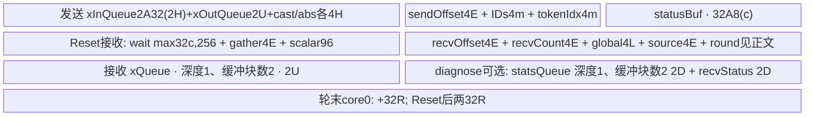

# SGL DeepEP NormalDispatch MXFP8量化 950 ACLNN 算子知识

## 算子速览

| 项目 | 内容 |
|---|---|
| 实际入口 | `aclnnCamMoeDispatchNormalGetWorkspaceSize` / `aclnnCamMoeDispatchNormal`，公开两段式ACLNN。 |
| 计算语义 | `quant_mode=3`：依布局/通知给出的 expert→source→round 偏移，量化FP16/BF16 hidden行到FP8并附带[source rank,原token,top-k槽]，并输出每32元素一个E8M0共享指数scale；不做topk权重乘法。 |
| 输入输出 | x `[N,H]`、topk `[N,K]`、7个INT32布局元数据；输出紧凑`recvX[T,H]`及`assistInfo[3T]`；scales `[T*Mx]` 为E8M0共享指数。 |
| 执行类型 | 单K0 AIV_VECTOR+非Cube通信Hybrid；MTE直接访问注册窗口，Vector承担MXFP8量化（ComputeMaxExp/ComputeScale/ComputeFp8Data），同时生成/归约状态及可选诊断。无可达Cube/AIC/MIX_CV、SIMT或NDDMA节点。 |
| Kernel 路线 | R-001 950 legacy共享区；R-002 950 hybrid隔离区。各路线同时保留诊断开关、单/多轮及空轮控制。 |
| 核心资源 | 逐阶段Reset的双buffer绑定队列与TBuf；注册window内512B token槽、32B状态；Host workspace=`16MiB+512*A²`。 |
| 来源闭包 | `source_closed`：公开wrapper→Host检查/字段→POD→全部当前语义可达entry/body/helper与活动构建；SDK Tiling及A2窗口生命周期展开到实际实现。DMA/Vector指令、runtime组/context配置和自动生成inner为明确框架primitive边界。 |
| 验证状态 | 已完成源码闭包检查；本次知识提取未执行编译、真机、数值或性能测试。因Host静态作用域、资源及边界guard问题保留draft。 |

背景接口与模式选择复用[DeepEP Normal API](../../../../apis/deepep/deepep_normal_dispatch_combine.md)。[NotifyDispatch](sgl_deepep_notify_dispatch.md)提供本算子的偏移与计数；本卡不把前置独立ACLNN算子合并成新逻辑语义。C++先执行其并D2H读header，再提交本入口。文档的alltoall策略使用其它算子，不是本入口隐藏路线。

## 接口与语义

### 计算语义

记`R=epWorldSize,r=epRankId,E=moeExpertNum,L=E/R,Q=round,P=perRoundTokens,M=realMaxBs,A=aivNum`。实际全局轮数`Qreal=ceil(M/P)`；源s的本地轮数`ceil(N_s/P)`。布局生产者必须保证`Qreal<=Q`且P>0。

源s的第q轮有效top-k slot t映射原token `n=qP+floor(t/K)`，专家e=`topkIdx[n,t%K]`；若e无效则跳过。写到该源自己的共享窗口 `slot=sendOffset[q,e]+sendTokenIdx[n,t%K]`。slot内将H个XType逐token量化成H个FP8，并写三元组`[s,n,t%K]`，scale实际A256(H)处存Mx个E8M0；triple在Hbuf+A32(Mx)，packet末额外保留Mx字节。

接收rank拥有local expert l，来源s对应扁平`i=lR+s`，本轮数量`c=recvCount[q,i]-(i?recvCount[q,i-1]:0)`，源槽起点`recvOffset[q,i]`。目标起点为`d=expertGlobalOffset[l]+srcRankInExpertOffset[i]+rInSrcRankOffset[i,q]`。于是对`0<=j<c`：`recvX[d+j,:]=QuantMXFP8(X_s[n_j,:])`，`recvXScales[(d+j)*Mx:(d+j+1)*Mx]=E8M0_scales_s[n_j,:]`，`assistInfo[3(d+j):3(d+j+1)]=[s,n_j,k_j]`。目标物理布局按local expert→source rank→round→expert内发生序号排列；每次top-k选择均独立复制，不对同源token在不同expert去重。

MX按32元素共享指数，Mx=ceil(H/32)、M2=Align2(Mx)，不是整token求单一浮点max和除法。ComputeMaxExp提取BF16 bits&0x7f80并按block取max；FP16先识别0x7c00非有限指数、CAST_TRUNC转BF16再取指数，非有限用0x7f80替代。ComputeScale按E4M3FN=0x0400/E5M2=0x0780选择目标指数常量，先clamp最大指数至不小于目标，sharedExp=clamped-target，再右移7形成E8M0字节，显式选择zero/invalid编码。内部乘数按BF16位模式0x7f00-sharedExp构造，特殊差值0x7f00改0x0040。

ComputeFp8Data对每block广播BF16因子。BF16输入先BF16乘再升FP32；FP16输入拆偶/奇lane升FP32后乘BF16因子升来的FP32，Interleave恢复顺序。Out CastTrait为ZERO/SAT/ZEROING/CAST_RINT，DIST_PACK4_B32写FP8字节。输出每token Mx个E8M0，而非每token一个FP32 inverseScale。特殊值和尾部以实际MicroAPI序列为准，本次未验证数值。

### 输入、输出与属性

| 参数 | shape/layout | dtype | 约束、默认值与语义 |
|---|---|---|---|
| x | `[N,H]` ND，OpDef AutoContiguous | BF16或FP16 | 按32元素提取指数；FP16数值乘法走FP32，BF16先在BF16中乘。 |
| topkIdx | `[N,K]` ND | INT32 | K1..min(16,E)；无效expert跳过，负值先转uint32后同样被>=E排除。 |
| sendOffset | `[Q,E]` | INT32 | 每轮按全局expert排列的发送exclusive prefix。 |
| sendTokenIdx | `[N,K]` | INT32 | 布局给出expert内零基序号，未由Host验证容量/范围。 |
| recvOffset | `[Q,L,R]`可扁平`[Q,E]` | INT32 | 每localexpert/source在对应源window中的起点。 |
| recvCount | 同recvOffset | INT32 | 每轮跨`i=lR+s` inclusive prefix，单段数量用差分。 |
| expert_global_offset | `[L]` | INT32 | localexpert全局紧凑起点。 |
| srcrank_in_expert_offset | `[L,R]`，E元素 | INT32 | expert内来源exclusive prefix。 |
| r_in_srcrank_offset | `[L,R,Q]` | INT32 | 每expert/source内轮次exclusive prefix。 |
| recvX | `[T,H]` ND | FLOAT8_E4M3FN 或 FLOAT8_E5M2 | Host检查rank2和H，不检查T等于真实count。 |
| recvXScales | `[T*Mx]`扁平，Mx=ceil(H/32) | FLOAT8_E8M0 | Host核dtype但不核MX rank/总长；C++按T*H/32分配，需核对非32整除H。 |
| assistInfoForCombine | `[3T]` | INT32 | 三元组扁平连续，Host只核一维与dtype，未核总长。 |
| waitRecvCostStats | 可选`[R]` | INT32 | 有shape即开诊断，atomic累加；调用端应清零并保持足够padding。 |
| groupEp | string | — | 长度1..127。 |
| epWorldSize | int64→uint32 | — | R2..384。 |
| epRankId | int64→uint32 | — | 0<=r<R。 |
| groupTpOptional | string默认空 | — | TP>1才要求1..127；body未执行TPcollective。 |
| tpWorldSize | int64默认0 | — | Host接受0..2；2使key加100，但entry没有这些body。 |
| tpRankId | int64默认0 | — | TP<=1必须0，否则0..TP-1。 |
| moeExpertNum | int64→uint32 | — | >0、平台上界、E%R==0、L>0；状态总数<=1280。 |
| quantMode | int64默认0 | — | 本卡仅3；1无entry body，不补成静态量化；0/2/4/5为其它逻辑算子。 |
| realMaxBs | int64默认0→uint32 | — | Host只检查pointer；决定实际轮数，0直接不进入循环。 |
| globalBs | int64默认0→uint32 | — | Host要求>0；maxBs=floor(globalBs/R)用于容量估计。 |
| round | API int32，内部属性int64→uint32，默认4 | — | metadata stride及combine空间；未检查数值/与Qreal一致。 |
| perRoundTokens | API int32，内部属性int64→uint32，默认1024 | — | P，未检查非0；C++更外层约束不能视作ACLNN自身guard。 |

公开NORMAL_API给出的更窄可用范围须与Host接受域区分：A2单机N<=8192且H仅7168；A3公开H1024..7168、普通N<=8192/长序列搬运N<=32k。Host ops2允许N0..65536/H1024..7168/E<=512，ops允许N0..131072/H1024..8192/E<=1024；这些较宽接受域并不自动扩展发布承诺。950公开支持由README、Normal API A5说明、ascend950 OpDef与活动编译guard共同给出；不从A3上界外推950性能或数值验证。

### 入口与版本

公开Python use_mxfp8=True在950选择mx_fp8_e4m3；C++支持E4M3FN/E5M2并分配E8M0 scales。ACLNN Host mode3只接受这两类FP8，格式变体保持同一共享指数语义。HIFLOAT8不在该Host可达集合。Normal API仅发布A5 intranode支持。

两段wrapper仅转交自动生成inner。ops设置weak server type为MTE、MC2engine3；ops2为AICPU、engine默认0，A2 body `InitV2/SetCcTilingV2/Finalize`均实际执行。CANN选择9.1.0，以固定DeepEP README版本标签及固定SDK version.cmake为依据；未以头文件存在推导其它版本。

## Host/Launcher 执行流程

### 参数校验与前处理

顺序为`GetAttrAndSetTilingData→TilingCheck(CheckTensorDim,DataType,Format)→CheckAttrs→CheckTensorShape→window检查→SetWorkSpace→SetHcommCfg→key/blockDim/schedule/POD`。错误返回GRAPH_FAILED，wrapper透传inner status。OpDef对9输入AutoContiguous为框架前处理；固定源码不展示其生成体。

Host核对x、topk、recvX二维，assist一维；有诊断输出时核一维/INT32。x为BF16/FP16，topk为INT32，mode3要求recvX为FP8、scales为FLOAT8_E8M0；Host不核MX rank/总长。格式检查拒绝FRACTAL_NZ，OpDef只登记ND；元数据各输入的全部shape/extent未在本Host检查。N与topk第一维相同，H在平台Host区间，K正且<=16/E。globalBs>0，E可均分R。round/P/M仅pointer检查后窄化，不检查0、负值、溢出或Qreal<=Q。

ops的CheckTensorDataType末尾`OP_LOGI`实参引用分支内声明的`dynamicScalesDesc`，固定文本存在作用域风险；是否被宏裁掉以及编译后果本次未验证，不伪造编译结果。该风险不影响记录其预期Host/Device映射，但阻止以源码闭包替代运行保证。

### 参数、Workspace 与生命周期

Host请求`WS=16MiB+512*A*A` bytes。Device接收workspaceGM但当前body不读写它；runtime SyncAll或框架私有用途不能凭该参数名推导新slice。调用端用`EXEC_NPU_CMD`按workspace/executor两段流程在当前NPU stream提交，工作区、输入和输出保持到stream完成。自动生成inner/Contiguous、runtime GetHcclContext与组资源分配是框架边界。

C++ intranode_dispatch先调用NotifyDispatch，整块D2H读取`[maxBs,total,perExpert]` header，令M=max(header.maxBs,numWorstTokens)，`globalBs=min(P,M)*R`；分配T=max(total,1)行输出/3Tassist以及每token Mx个E8M0 scales。Q/P来自Buffer配置，默认1/8192；长序列配置Q1..256/P32..8192且乘积<=131072，get_dispatch_layout再次检查N<=Q*P。ACLNN独立调用不继承这些C++断言。

SetHcommCfg依次生成init、cc1 AlltoAll(type8)、cc2 AllGather(type6)，alg分别fullmesh/pairwise与ring；只用于通信资源/context准备，当前body没有调用SDK AllToAll/AllGather。GetTiling返回非0代表结果不可用，但SGL未检查这些返回码。TP<=1时groupTp可空，仍调用cc2 GetTiling，空组是否被runtime使用由框架决定；不能声称Device有TP路线。

### 启动图与失败传播

| 节点/边 | producer→consumer | 介质与offset/extent | ordering | owner/lifetime/失败 |
|---|---|---|---|---|
| K0启动 | inner→cam_moe_dispatch_normal→实际模板 | 9输入、4输出、workspace、tiling；blockDim=CalcTschBlockDim(A,0,A)；schedule mode1 | 当前ACL stream，batch模式所有核同时起 | Host错误不提交；未知key无body无fallback。 |
| 模型payload | 每源InputToShare→各目标ShareToOutputLongSeq | 本源window token槽，每槽G bytes，读S有效bytes，含Mx字节E8M0scale与三元组 | 每源全核SetStatus前SyncAll；目标轮询expert/source状态后拷贝 | HCCL window为组所有；下一轮覆盖前round握手。 |
| 旁带scale与三元组 | FillTriple→接收MTE3→assistInfo/scales | 每token scale offset A256(H)、Mx bytes；triple offset Hbuf+A32(Mx)、12B；output3d INT32 | 绑定Queue/FillTriple硬事件→DMA | 与同一payload槽生灭，scale由QuantDynamicMx写slot A256(H)处Mx/M2字节，接收端分离有效Mx。 |
| 轮次控制 | 全rank消费本轮→SetRoundStatus/WaitRoundStatus | 32B/rank浮点1标记，轮控制区 | CopyOut后SyncAll，core0广播、轮询总和8R并清零，再SyncAll | Qreal>1包含最后一轮；Qreal<=1不发。 |
| 诊断 | 状态轮询→atomic输出 | stats[srcRankOffset: +Dstat/4] | S_MTE3、SetAtomicAdd/None；caller清零 | 多核累加允许重叠，round/byte上界须检查。 |

## Route 与参数设计

### 分核与资源计算

定义A32(x)=ceil(x/32)*32、A256(x)=ceil(x/256)*256、A512(x)=ceil(x/512)*512、A8(x)=ceil(x/8)*8。XType两字节、Out一字节；Mx=ceil(H/32)、M2=Align2(Mx)、Hbuf=A32(H)、ScaleBuf=A32(Mx)、TripleOffset=Hbuf+ScaleBuf。源码S=Hbuf+ScaleBuf+12+Mx（triple后又加Mx），U=A32(S)、G=A512(S)。QuantDynamicMx的scale实际地址A256(H)，CopyOut也从此处读Mx字节，不能自行改成Hbuf。H为256倍数时二者一致，Host未强制该对齐。

输入queue每块A32(2H)、输出queue每块U；接收拷S字节、输出H个FP8、Mx个E8M0及12B triple。Host仍按最坏2B DispatchSlot=A512(A32(2H)+44)估算window，未按MX实际S做能力判断。Ccombine=A512(2H)*(Q>1?2:1)。4H tokenCastFloatBuf被当uint16 scratch：maxExp起点byte0；halfScale起点4*Align32(M2) bytes、extent2M2。tokenAbsFloatBuf仍申请4H但MX早退不消费，必须计入分配。

各核status/expert索引数`c_i=floor(E/A)+(i<E%A)`，起点`floor(E/A)*i+min(i,E%A)`。发送按当前轮有效slot数`Fq=K*min(P,max(N-qP,0))`，`m_i=floor(Fq/A)+(i<Fq%A)`同法分配。A3/950每轮只读取`rInSrcRankOffset[i*Q+q]`这E个值；A2整个Q*E一次拷UB。Host记录totalUb但未以实际逐核总量选择fallback。

window Host估算使用maxBs=globalBs/R、最坏输出2B：`DispatchSlot=A512(A32(2H)+44)`（Host按最坏2B估算，Device FP8实际G更小）,`CombineSlot=Ccombine`；每半数据需求`maxBs*K*(DispatchSlot+Ccombine)`。具体保留区/half/地址见各Route。env GetMaxWindowSize默认200MiB，DEEPEP_HCCL_BUFFSIZE优先HCCL_BUFFSIZE，helper用uint16接收stoi结果；解析错误日志后保留原值，无ActualWindowSize查询。

### Route 选择

| 顺序 | Route | Key/模板 | 精确选择条件与优先级 | 不适用去向 |
|---:|---|---|---|---|
| 1 | R-001 950 legacy共享区 | 15003 / `CamMoeDispatchNormalA5<XType,fp8_e4m3fn_t或fp8_e5m2_t,fp8_e8m0_t,true,true,false,false>` | 950活动OpDef，quant_mode=3，TP∈{0,1}，isHybridDeployment=false | 检查失败GRAPH_FAILED；TP=2→key+100无body。 |
| 2 | R-002 950 hybrid隔离区 | 15003 / `CamMoeDispatchNormalA5<XType,fp8_e4m3fn_t或fp8_e5m2_t,fp8_e8m0_t,true,true,false,false>` | 950活动OpDef，quant_mode=3，TP∈{0,1}，isHybridDeployment=true | 检查失败GRAPH_FAILED；TP=2→key+100无body。 |

```text
attrs/shape/dtype/format/window不满足 -> GRAPH_FAILED
mode3 + TP2 -> baseKey+100 -> entry无body
mode3 + TP0/1 -> 15003 (950)
ops hybrid仅env DEEPEP_HYBRID_DEPLOYMENT恰为"1"；否则legacy；ops2不读hybrid
entry compile guard __DAV_C310__ && Out FP8 E4M3FN/E5M2 -> DynamicQuant=true、IsMxQuant=true模板
body Qreal==0直接结束；Qreal>=1逐轮；诊断输出存在则额外buffer/atomic；Qreal>1每轮含末轮握手
```

### 模板/实现执行矩阵

| Route | key/selector | dtype/shape/platform 完整命中条件 | 执行拓扑与 Kernel 节点 | 实际模板/body | 内存与同步特征 | tail/fallback |
|---|---|---|---|---|---|---|
| R-001 950 legacy共享区 | 15003, hybrid=false | X∈BF16/FP16、Out=FP8，mode3，TP<=1，Host全部检查；950 | 单K0 AIV/窗口MTE | `CamMoeDispatchNormalA5<XType,fp8_e4m3fn_t或fp8_e5m2_t,fp8_e8m0_t,true,true,false,false>` | token队列深度1、缓冲块数2；诊断可选；Qreal>1轮握手；对应window布局 | Fq按quotient/remainder，invalidexpert跳过，Qreal0无输出；无资源fallback。 |
| R-002 950 hybrid隔离区 | 15003, hybrid=true | X∈BF16/FP16、Out=FP8，mode3，TP<=1，Host全部检查；950 | 单K0 AIV/窗口MTE | `CamMoeDispatchNormalA5<XType,fp8_e4m3fn_t或fp8_e5m2_t,fp8_e8m0_t,true,true,false,false>` | token队列深度1、缓冲块数2；诊断可选；Qreal>1轮握手；对应window布局 | Fq按quotient/remainder，invalidexpert跳过，Qreal0无输出；无资源fallback。 |

### 隐藏性能 Guard

| Guard | Host/Tiling 条件 | Device/资源原因 | 影响 Route | 不满足时去向 | 源码符号 |
|---|---|---|---|---|---|
| MX packet域 | Host不检查H%256/scale容量 | scale实际A256(H)，packet由A32(H)推导；须A256(H)+M2<=U、有效scale终点<=S且不覆盖triple | 全部 | 无fallback，draft | QuantDynamicMx/Init |
| P/M/Q有效 | Host仅pointer，无P>0/Qreal<=Q检查 | ceil除P、Qstride、每轮复用buffer | 全部 | P0除零风险/越元数据域，无fallback | CheckAttrs/InputToShare/Process |
| 状态/本地expert | E%R=0,L>0,E<=512或1024，<=1280 | 每E个expert/source状态，L作为除数 | 全部 | Host失败 | GetAttrAndSetTilingData/CheckAttrs |
| UB总量 | 仅记录totalUbSize | sender 2*A32(2H)+2U+8H；WaitStatus Reset后receiver仅2U加本phase metadata/状态/诊断/offset，按后文UB_wait/UB_recv及轮次握手各阶段取峰值，不能叠加已释放的发送input队列与量化scratch | 全部 | 没有tile裁剪或IsCapable | InputToShare/WaitStatus/ShareToOutputLongSeq |
| 槽/窗口容量 | Host按globalBs/R和保留区估算 | Device按min(M,P)、K和G/Ccombine寻址；envW需与actual一致 | 全部 | Host估算超W失败，其余未guard差异 | TilingImpl/Init/GetWindAddrByRankId |
| TP | 允许0..2，TP2 key+100 | entry未实现TP2 | 全部 | key10102/13102/15103无body | CalTilingKey/entry |
| 诊断长度 | Host仅一维INT32 | 原子拷贝Dstat=A32(4c_i)，可能有尾padding | 全部诊断 | 不自动缩小DMA | WaitStatus |
| 950context数组 | Host允许R384 | 本地HcclCombinOpParam窗口数组32项 | 950 | 超32未拒绝；不得按新SDK数组大小解释旧ABI | moe_distribute_base.h |
| 发布shape范围 | Host接受域宽于Normal API | 不能将接线当发布承诺 | 全部 | 较宽范围仅实现事实，无验证 | NORMAL_API/Host constants |

### POD/ABI

Info字段按源码自然布局推导size80、align8，非编译测量；uint32连续0..55，4bool56..59，padding60..63，两个uint64@64/72。SDK init64、两Cc各512，故外层info推导offset1088、总1168。Host与Device同头；ops2相同POD结构但hybrid/isQuant/reserved不参与活跃选择。

| 结构 | 字段 | 类型/位宽 | ABI 布局 | 单位 | Host/launcher producer | Device consumer | 边界 |
|---|---|---|---|---|---|---|---|
| CamMoeDispatchNormalInfo | epWorldSize | uint32 | 0 | rank | cast ep_world_size | Init epRankSize；分rank | 2..384 |
| CamMoeDispatchNormalInfo | tpWorldSize | uint32 | 4 | rank | cast tp_world_size | key选择；活跃body未用TP | 0..2，2无body |
| CamMoeDispatchNormalInfo | epRankId | uint32 | 8 | rank | cast ep_rank_id | 窗口/三元组/状态目标 | 0..R-1 |
| CamMoeDispatchNormalInfo | tpRankId | uint32 | 12 | rank | cast tp_rank_id | 当前实例不使用TP | TP<=1须0 |
| CamMoeDispatchNormalInfo | moeExpertNum | uint32 | 16 | expert | cast moe_expert_num | E/L、分核与buffer | E%R==0 |
| CamMoeDispatchNormalInfo | quantMode | uint32 | 20 | enum | cast quant_mode | 本卡固定3；router false | 不合入量化语义 |
| CamMoeDispatchNormalInfo | realMaxBs | uint32 | 24 | token | cast real_max_bs | realRound与预留combine空间 | Host未检查数值 |
| CamMoeDispatchNormalInfo | globalBs | uint32 | 28 | token | cast global_bs | Host容量/maxBs；Device存成员 | >0，未检查上限 |
| CamMoeDispatchNormalInfo | round | uint32 | 32 | round | cast round | offset stride与combine双缓冲 | 未检查数值 |
| CamMoeDispatchNormalInfo | perRoundTokens | uint32 | 36 | token/round | cast per_round_tokens | ceil/各轮分token | 必须非0，Host未guard |
| CamMoeDispatchNormalInfo | bs | uint32 | 40 | token | x.dim0 | localRound、当前轮tail | Host允许0 |
| CamMoeDispatchNormalInfo | k | uint32 | 44 | expert/token | topk_idx.dim1 | 展开slot、三元组k | 1..min(16,E) |
| CamMoeDispatchNormalInfo | h | uint32 | 48 | element | x.dim1 | token字节/输出行stride | 见平台公开边界 |
| CamMoeDispatchNormalInfo | aivNum | uint32 | 52 | core | platform AIV count | blockNum与quotient/remainder | CalcTschBlockDim一致 |
| CamMoeDispatchNormalInfo | isQuant | bool | 56 | flag | 本Host未显式赋值 | 本实例不读取 | 不是template selector |
| CamMoeDispatchNormalInfo | isEnableDiagnose | bool | 57 | flag | wait统计输出shape!=nullptr | 诊断UB/atomic路径 | 调用端需初始化输出 |
| CamMoeDispatchNormalInfo | isHybridDeployment | bool | 58 | flag | ops: env恰为1；ops2未赋值 | ops改变数据offset；ops2不读 | 不能推断其它env值为true |
| CamMoeDispatchNormalInfo | reserved3 | bool | 59 | byte | 未显式赋值 | 未读取 | inactive |
| CamMoeDispatchNormalInfo | totalUbSize | uint64 | 64 | byte | platform UB size | 未据此裁剪buffer | 自然布局padding60..63 |
| CamMoeDispatchNormalInfo | totalWinSize | uint64 | 72 | byte | GetMaxWindowSize | 数据半区/窗口计算 | 来自env而非actual查询 |
| CamMoeDispatchNormalTilingData | mc2InitTiling | SDK64B | 0 | byte | GetTiling(init) | entry/context或Info读取 | 不自行重排 |
| CamMoeDispatchNormalTilingData | mc2CcTiling1 | SDK512B | 64 | byte | GetTiling(cc1) | entry/context或Info读取 | 不自行重排 |
| CamMoeDispatchNormalTilingData | mc2CcTiling2 | SDK512B | 576 | byte | GetTiling(cc2) | entry/context或Info读取 | 不自行重排 |
| CamMoeDispatchNormalTilingData | camMoeDispatchNormalInfo | Info80B | 推导1088 | byte | Host各检查函数 | entry/context或Info读取 | 不自行重排 |

SDK公开reserved[64]/reserved[512]外壳的实际inner如下。生成Cc时UpdateMc2InitTiling追加offset；GetTiling返回值SGL未检查。

| 结构 | 字段 | 类型/位宽 | ABI 布局 | 单位 | Host/launcher producer | Device consumer | 边界 |
|---|---|---|---|---|---|---|---|
| Mc2InitTilingInner | version | uint32 | 0 | 序列化 | GetTiling/Update：100 | InitV2/框架 | SDK固定定义 |
| Mc2InitTilingInner | mc2HcommCnt | uint32 | 4 | 序列化 | GetTiling/Update：0→2 | 框架通信配置 | SDK固定定义 |
| Mc2InitTilingInner | offset | uint32[8] | 8..39 | 序列化 | GetTiling/Update：[64,576,0,...] | 在线Cc定位 | SDK固定定义 |
| Mc2InitTilingInner | debugMode | uint8 | 40 | 序列化 | GetTiling/Update：0 | SDK诊断 | SDK固定定义 |
| Mc2InitTilingInner | preparePosition | uint8 | 41 | 序列化 | GetTiling/Update：0 | SDK消息配置 | SDK固定定义 |
| Mc2InitTilingInner | queueNum | uint16 | 42 | 序列化 | GetTiling/Update：0 | 默认单queue | SDK固定定义 |
| Mc2InitTilingInner | commBlockNum | uint16 | 44 | 序列化 | GetTiling/Update：0 | SDK通信core配置 | SDK固定定义 |
| Mc2InitTilingInner | devType | uint8 | 46 | 序列化 | GetTiling/Update：SetDevType调用rtGetSocVersion | SDK context路线 | SDK固定定义 |
| Mc2InitTilingInner | reserved | char[17] | 47..63 | 序列化 | GetTiling/Update：未显式清全区 | inactive | SDK固定定义 |
| Mc2CcTilingInner(cc1/cc2) | skipLocalRankCopy | uint8 | 0 | 序列化 | GetTiling：0 | SDK框架/A2 SetCc | 两Cc同ABI、值分列 |
| Mc2CcTilingInner(cc1/cc2) | skipBufferWindowCopy | uint8 | 1 | 序列化 | GetTiling：0 | SDK框架/A2 SetCc | 两Cc同ABI、值分列 |
| Mc2CcTilingInner(cc1/cc2) | stepSize | uint8 | 2 | 序列化 | GetTiling：0 | SDK框架/A2 SetCc | 两Cc同ABI、值分列 |
| Mc2CcTilingInner(cc1/cc2) | version | uint8 | 3 | 序列化 | GetTiling：1 | SDK框架/A2 SetCc | 两Cc同ABI、值分列 |
| Mc2CcTilingInner(cc1/cc2) | reserved | char[9] | 4..12 | 序列化 | GetTiling：memset0 | SDK框架/A2 SetCc | 两Cc同ABI、值分列 |
| Mc2CcTilingInner(cc1/cc2) | commEngine | uint8 | 13 | 序列化 | GetTiling：ops=3 AIV；ops2=0 | SDK框架/A2 SetCc | 两Cc同ABI、值分列 |
| Mc2CcTilingInner(cc1/cc2) | srcDataType | uint8 | 14 | 序列化 | GetTiling：0 | SDK框架/A2 SetCc | 两Cc同ABI、值分列 |
| Mc2CcTilingInner(cc1/cc2) | dstDataType | uint8 | 15 | 序列化 | GetTiling：0 | SDK框架/A2 SetCc | 两Cc同ABI、值分列 |
| Mc2CcTilingInner(cc1/cc2) | groupName | char[128] | 16..143 | 序列化 | GetTiling：cc1=groupEp；cc2=groupTp | SDK框架/A2 SetCc | 两Cc同ABI、值分列 |
| Mc2CcTilingInner(cc1/cc2) | algConfig | char[128] | 144..271 | 序列化 | GetTiling：cc1 AlltoAll=level0:fullmesh;level1:pairwise；cc2 AllGather=level0:ring | SDK框架/A2 SetCc | 两Cc同ABI、值分列 |
| Mc2CcTilingInner(cc1/cc2) | opType | uint32 | 272 | 序列化 | GetTiling：cc1=8；cc2=6 | SDK框架/A2 SetCc | 两Cc同ABI、值分列 |
| Mc2CcTilingInner(cc1/cc2) | reduceType | uint32 | 276 | 序列化 | GetTiling：0 | SDK框架/A2 SetCc | 两Cc同ABI、值分列 |
| Mc2CcTilingInner(cc1/cc2) | reserved2 | char[232] | 280..511 | 序列化 | GetTiling：未显式清全区 | SDK框架/A2 SetCc | 两Cc同ABI、值分列 |

950 `__DAV_C310__`使HcclOpParam别名替换为HcclCombinOpParam。SDK/runtime生产context，SGL只消费下列字段；未调用CCU任务。自然布局推导size576/align8，不以新SDK或ops-transformer的64-rank定义替换该固定32-rank ABI。

| 结构 | 字段 | 类型/位宽 | ABI 布局 | 单位 | Host/launcher producer | Device consumer | 边界 |
|---|---|---|---|---|---|---|---|
| HcclCombinOpParam | workSpace | uint64 | 0 | byte/地址或rank | runtime通信组框架 | 本body不读 | 非算子Host自制，布局须一致 |
| HcclCombinOpParam | workSpaceSize | uint64 | 8 | byte/地址或rank | runtime通信组框架 | 本body不读 | 非算子Host自制，布局须一致 |
| HcclCombinOpParam | rankId | uint32 | 16 | byte/地址或rank | runtime通信组框架 | GetStatusDataSpaceGm选择self | 非算子Host自制，布局须一致 |
| HcclCombinOpParam | rankDim | uint32 | 20 | byte/地址或rank | runtime通信组框架 | 本body不读 | 非算子Host自制，布局须一致 |
| HcclCombinOpParam | winSize | uint64 | 24 | byte/地址或rank | runtime通信组框架 | 本body用POD totalWin而非此值 | 非算子Host自制，布局须一致 |
| HcclCombinOpParam | windowsIn | uint64[32] | 32..287 | byte/地址或rank | runtime通信组框架 | GetBaseWindAddr(+4MiB)/StateAddr(+0) | 非算子Host自制，布局须一致 |
| HcclCombinOpParam | windowsOut | uint64[32] | 288..543 | byte/地址或rank | runtime通信组框架 | 本body不读 | 非算子Host自制，布局须一致 |
| HcclCombinOpParam | xnAddr | uint64 | 544 | byte/地址或rank | runtime通信组框架 | CCU字段inactive | 非算子Host自制，布局须一致 |
| HcclCombinOpParam | ckeAddr | uint64 | 552 | byte/地址或rank | runtime通信组框架 | CCU字段inactive | 非算子Host自制，布局须一致 |
| HcclCombinOpParam | msAddr | uint64 | 560 | byte/地址或rank | runtime通信组框架 | inactive | 非算子Host自制，布局须一致 |
| HcclCombinOpParam | msSize | uint64 | 568 | byte/地址或rank | runtime通信组框架 | inactive | 非算子Host自制，布局须一致 |

### Route 源码闭包

| Route | Key/selector | Host/Tiling producer | POD/参数 | Kernel entry/router 节点 | Kernel body/直接依赖 | 构建接线 |
|---|---|---|---|---|---|---|
| R-001 950 legacy共享区 | 15003,hybrid=false | csrc/deepep/ops/op_host/cam_moe_dispatch_normal_tiling.cc，TilingImpl | Info及2Cc | csrc/deepep/ops/op_kernel/cam_moe_dispatch_normal.cpp，cam_moe_dispatch_normal | csrc/deepep/ops/op_kernel/cam_moe_dispatch_normal_a5.h，Init/InputToShare/SetStatus/WaitStatus/ShareToOutputLongSeq/轮同步；公共base/comm_args | OpDef ascend950 guarded，Host/kernel CMake，root build自动选择 |
| R-002 950 hybrid隔离区 | 15003,hybrid=true | csrc/deepep/ops/op_host/cam_moe_dispatch_normal_tiling.cc，TilingImpl | Info及2Cc | csrc/deepep/ops/op_kernel/cam_moe_dispatch_normal.cpp，cam_moe_dispatch_normal | csrc/deepep/ops/op_kernel/cam_moe_dispatch_normal_a5.h，Init/InputToShare/SetStatus/WaitStatus/ShareToOutputLongSeq/轮同步；公共base/comm_args | OpDef ascend950 guarded，Host/kernel CMake，root build自动选择 |

## Kernel 实现

### 公共执行流程

每调用先读取并翻转每core的dataState选择器，DCCI刷新；读取的是旧值，用它决定本调用半区。所有rank的调用序列和状态初始化须一致。InputToShare先Reset，按轮发送有效slot→输入队列copy→QuantProcess→输出队列写scale/三元组；SetStatus在全核屏障后向每目标expert/source写32B状态；WaitStatus重新Reset，轮询每核分配的状态、清标志、全核同步；ShareToOutputLongSeq使用相同xQueue读远端槽→分别输出FP8 payload、Mx字节E8M0scale和12B assist。Qreal>1才在每轮末执行所有rank消费完成握手，防止下一轮覆盖共享发送区。

DynamicQuant=true、IsMxQuant=true。QuantInit→QuantProcess→QuantDynamicMx→ComputeMaxExp→ComputeScale→ComputeFp8Data为当前可达量化链；QuantDynamicMx完成后Free输入并立即return，不进入ReduceMaxInplace。其它模式entry不在本逻辑语义可达集合。未调用Cube、矩阵库或外部数学算子；通信本体为可见GM窗口MTE与状态协议。模板中声明但没有调用的ShareToOutput/UpdateOutput不补成额外路线。

### Route R-001：950 legacy共享区

#### 适用条件

##### 选择证据

| 层级 | 文件 | 符号 | 源码谓词/参数 | 结果/下一跳 |
|---|---|---|---|---|
| Host | `csrc/deepep/ops/op_host/cam_moe_dispatch_normal_tiling.cc` | TilingImpl/CalTilingKey | ops/ascend950及__DAV_C310__，mode3，TP0/1，hybrid=false；全部检查通过 | key15003；AIV A；schedule1 |
| entry | `csrc/deepep/ops/op_kernel/cam_moe_dispatch_normal.cpp` | cam_moe_dispatch_normal | __DAV_C310__ && Out FP8编译guard且key15003 | `CamMoeDispatchNormalA5<XType,fp8_e4m3fn_t或fp8_e5m2_t,fp8_e8m0_t,true,true,false,false>` |
| body | `csrc/deepep/ops/op_kernel/cam_moe_dispatch_normal_a5.h` | Process/Init | Qreal=ceil(M/P)；诊断存在开额外buffer；hybrid选择数据offset | 同单kernel全部阶段 |

#### Device 数据流

##### 函数级调用链

```text
inner launch cam_moe_dispatch_normal,blockDim=CalcTschBlockDim(A,0,A),schedule1
 -> CamMoeDispatchNormalA5<XType,fp8_e4m3fn_t或fp8_e5m2_t,fp8_e8m0_t,true,true,false,false>::Init -> context/selector/POD绑定/token槽参数
 -> Process -> for q<Qreal:
   -> InputToShare -> Reset -> QuantInit(input/output 深度1、缓冲块数2+FP32 buffers)/send offsets/slot metadata -> QuantProcess -> FillTriple -> shared window
   -> SetStatus -> sparse Duplicate(1.0)/SyncAll -> remote expert/source flags
   -> WaitStatus -> Reset -> state DMA/ReduceSum [optional BlockReduceSum+atomic stats]
                   -> clear state first lane/SyncAll
   -> ShareToOutputLongSeq -> expert/source/round offsets -> remote token slot
                   -> Queue DeQue -> assistInfo12B + recvX H bytes+scaleMxB -> FreeTensor
   -> if Qreal>1: SyncAll -> core0 SetRoundStatus/WaitRoundStatus -> SyncAll
 -> HcclOpParam在310上替换为32-rank HcclCombinOpParam；不调用CCU、不调用Hccl Init/Finalize，只有MTE窗口
```

##### 源码等价伪码

```text
# 伪码；所有DataCopyExtParams单块copy的blockLen为有效bytes，stride均0
load old dataState from context.windowsIn[context.rankId]+1050KiB+core*512B; store selector=(old==0?1:0), DCCI
Data(s)=context.windowsIn[s]+4MiB+dataState*((W-4MiB)/2)+min(M,P)*K*Ccombine+106MiB
State(s)=context.windowsIn[s]+dataState*550KiB
RoundState(s)=context.windowsIn[s]+roundMagic*4KiB+450KiB
for q in [0,ceil(M/P)):
 Reset; QuantInit: xInQueue(2,A32(2H)),xOutQueue(2,U),castFloat4H,absFloat4H; sendOffsetBuf(4E); copy sendOffset[q,E]
 Fq=K*min(P,max(N-qP,0)); partition Fq over A -> start,m
 if m>0: Init expertIdsBuf(4m),sendTokenIdxBuf(4m); DMA corresponding slot metadata
 for t in [start,start+m):
  e=(uint32)expertId[t-start]; if e>=E:continue
  slot=sendOffset[e]+sendTokenIdx[t-start]
  xInQueue Alloc -> DMA x[(qP+t/K),H] -> EnQue/DeQue
  xOutQueue Alloc -> QuantProcess [精确pipeline见该Route下文] -> EnQue/DeQue
  write triple [r,qP+t/K,t%K] at Hbuf+A32(Mx); S_MTE3 -> DMA S bytes to Data(r)+G*slot -> Free
 allocate statusBuf32*A8(c_i); Duplicate0 then sparse bitmask0x0101010101010101 writes fp32 1.0 in first lane of every32B
 PIPE_ALL; SyncAll
 for globalexpert e in assigned status range:
  dst=e/L; offset32*(r+(e%L)*R); DMA8 INT32 -> State(dst)+offset
 Reset; allocate wait/offset/count/xQueue/optional diagnostic buffers
 read recvOffset[q,E],recvCount[q,E]
 if assigned statusrange empty: SyncAll and return WaitStatus
 while sumFlags!=c_i:
  DataCopy blocks=c_i,blockLen=1 DataBlock,src/dststride0 -> waitStatus
  ReduceSum(mask1,repeat=c_i,stride1) -> fp32 scalar; MTE2_V/V_S
  optional blockReduce 8lane flags; detect changed source status -> accumulate cycle/50 in INT32 stats
 optional AtomicAdd stats padded Dstat bytes, restore AtomicNone
 clear first lane of each state via sparse Duplicate0 -> DMA; MTE3_S; SyncAll
 Init expertGlobalOffsetBuf(4L),srcRankOffsetBuf(4E); 只取E个本轮值rInSrcrankOffsetGT[i*Q+q]到4E字节TBuf
 for coreStatusIndex in assigned c_i range:
  i=R*(coreStatusIndex%L)+floor(coreStatusIndex/L)（source优先映射到localexpert/source）
  s=i%R;l=i/R;c=recvCount[i]-(i?recvCount[i-1]:0)
  d=expertGlobal[l]+srcRankOffset[i]+roundOffset[i,q]
  for j<c:
   Queue Alloc -> DMA S bytes Data(s)+G*(recvOffset[i]+j) -> EnQue/DeQue
   DMA12 bytes at Hbuf+A32(Mx) -> assistInfo[3*(d+j)]
   DMA Mx bytes at A256(H) -> recvXScales[(d+j)*Mx]; DMA H bytes -> recvX[(d+j)*H]; Free
 if ceil(M/P)>1:
  SyncAll; core0 allocate roundStatus32R, write8 float1 to everyrank RoundState+32*r
  Reset; core0 allocate two32R TBuf; wait Sum(all8Rfloats)==8R; clear all; MTE3_S
  roundMagic^=1; SyncAll
```

量化核心（950，当前Route完整实例）：DynamicQuant=true、IsMxQuant=true。QuantProcess调用QuantDynamicMx后Free输入并return，不进入scalar Abs/ReduceMaxInplace/alpha除法。M2=Align2(ceil(H/32))；maxExpAddr=tokenCastFloatBuf byte0；halfScaleAddr=float视图[Align32(M2)]即byte4Align32(M2)；mxScaleAddr=xOutQueue packet[A256(H)]。按ComputeMaxExp→ComputeScale<OutFP8>→ComputeFp8Data<XType,OutFP8,CAST_TRUNC,CAST_RINT>执行。

ComputeMaxExp用V=VECTOR_REG_WIDTH bytes、VL=V/2个16bit元素，loop=ceil(H/(2VL))：DIST_DINTLV_B16双载，提取指数并Max合并，ReduceMaxWithDataBlock每32元素产一个指数，DataCopyUnAlign/Post每轮写V/32个uint16结果。UpdateMask处理H尾，第二mask虽生成但部分操作仍使用第一mask，保留实际语句边界。ComputeScale循环ceil(M2/(V/2))，按mask比较invalid/zero、clamp、Subtract/ShiftRight7；DIST_PACK_B16低字节打包E8M0；内部BF16因子写halfScale。ComputeFp8Data再次双载，DIST_E2B_B16把每因子广播到32B。FP16用RegLayout ZERO/ONE升FP32、乘、Interleave；BF16先BF16乘再升FP32；输出CastTrait ZERO/SAT/ZEROING/CAST_RINT，四次DIST_PACK4_B32每次64B片。mask3/4由H*2剩余量生成，覆盖有效lane。MicroAPI指令及寄存器物理分配是primitive边界，不虚构寄存器字节。

#### 内存与数据搬运

##### 资源与搬运表

| 层级/缓冲区 | offset/地址公式 | extent/容量公式 | dtype/layout | producer | consumer | owner/lifetime | 对齐/复用 |
|---|---|---|---|---|---|---|---|
| 注册window数据 | `context.windowsIn[s]+4MiB+dataState*((W-4MiB)/2)+min(M,P)*K*Ccombine+106MiB` | Host估算每半maxBs*K*(DispatchSlot+Ccombine)，每token stride G | FP8 payload+E8M0scale+三元组 | InputToShare | 各目标ShareToOutputLongSeq | 通信组，两调用parity、逐轮复用 | 2*(maxBs*K*(DispatchSlot+Ccombine)+106MiB)<=W；legacy Host未额外加window级4MiB prefix，Device仍扣4MiB后再+4MiB |
| 状态window | `context.windowsIn[s]+dataState*550KiB`；offset32*(source+l*R) | 每轮32E bytes，首float=1 | 8×32bit/slot | SetStatus | WaitStatus | 组window；消费者清零 | 仅首lane有效，padding初值不当数值数据 |
| selector/轮区 | `context.windowsIn[context.rankId]+1050KiB+core*512B`；`context.windowsIn[s]+roundMagic*4KiB+450KiB` | selector每core512B stride，轮区32R bytes | selectorINT32/轮标志FP32 | Init/core0 | Init/WaitRoundStatus | 跨调用/跨轮 | 旧selector选本调用；轮结束才复用 |
| xInQueue/xOutQueue | 发送phase，均深度1、缓冲块数2 | 2*A32(2H)+2U | VECIN XType/VECOUT FP8 | MTE2/QuantProcess/FillTriple | Vector/MTE3 | 发送slot处理 | 输入Cast消费后Free，输出DMA后Free |
| tokenCastFloatBuf/tokenAbsFloatBuf | 发送phase两个独立TBuf | 4H+4H | 首片uint16 scratch，第二片inactive | ComputeMaxExp/ComputeScale | ComputeFp8Data | 每slot复用 | maxExp byte0，halfScale byte4Align32(M2)，不能解释成alpha |
| xQueue | Wait Reset后接收phase，深度1、缓冲块数2 | 2U | TQueBind VECIN→VECOUT FP8 | 远端MTE2 | payload/scale/triple MTE3 | 接收阶段 | 与发送input/output物理生命周期分开 |
| sendOffset/slot metadata | UB各独立TBuf | 4E+4m_i+4m_i请求 | INT32 | GM DMA | scalar路由 | 发送phase，metadata仅m>0分配 | 物理块对齐按API，不以logical长度替代request |
| statusBuf | 发送phase后追加 | 32*A8(c_i) | INT32位模式FP32 | Duplicate | peer MTE3 | 发送至Wait Reset | expNum0仍可申请0，Host不特别处理 |
| waitStatus/gather/scalar | Wait Reset后 | max(32c_i,256)+4E+96 | FP32/INT32别名 | 状态DMA/Vector | scalar/清flag | 接收phase | scalar sum offset32，3块共96B |
| recvOffset/recvCount | 同phase独立TBuf | 4E各 | INT32 | GM DMA | loop scalar | Wait到Share结束 | 不是输出tensor计数scratch |
| diagnoseQueue/recvStatus | 仅diagnose | 2Dstat +2Dstat | INT32 stats/两组FP32历史 | Duplicate/BlockReduce/scalar | atomic GM | Wait Reset到输出后 | Dstat=A32(4c_i)，GetWithOffset长度实参为Dstat而非Dstat/4，须按实际写域判断 |
| 输出偏移TBuf | Wait之后追加 | expertGlobal4L + source4E + round4E | INT32 | GM数据 | 目的地址 | 接收phase | 只取E个本轮值rInSrcrankOffsetGT[i*Q+q]到4E字节TBuf |
| roundStatusBuf/tempRoundStatusBuf | core0，无额外Queue | Set阶段32R；Reset后32R+32R | FP32 | core0/remote ranks | Sum/clear | Qreal>1轮末 | 8float/32B每rank，Reset是物理复用点 |
| workspace | entry workspaceGM | 16MiB+512A² | raw | 框架 | body未显式读写 | executor/stream | 不发明kernel slice |
| SIMT/dynamicUB/寄存器 | N/A | N/A | 未用该执行族 | — | — | scalar寄存器分配不可见 | 不估算编译器寄存器占用 |

##### 分层内存布局



##### 字节账与复用顺序

```text
发送请求 UB_send=2*A32(2H)+2U+8H+4E+8m_i+32*A8(c_i)；m_i=0不分配IDs/tokenIdx两TBuf
接收等待 UB_wait=2U+12E+96+max(32c_i,256)+diagnose*4Dstat
接收输出 UB_recv=UB_wait+4L+4E+4E (只本round)
Qreal>1,core0广播前追加32R：UB_emitRound=UB_recv+32R
WaitRound Reset后core0 UB_roundWait=64R；其他核Reset后直接return
physical按每次InitBuffer与对齐分配；上述为源request之和，非编译器实测
max(UB_send,UB_recv,UB_emitRound,UB_roundWait)<=平台UB 为必要条件；Host未据此guard
workspace=16MiB+512A²；dynamic_ub=N/A
```

| 复用子区 | 写入者 | 读取者/消费点 | 下一次覆盖 | 同步或释放依据 | 安全条件 |
|---|---|---|---|---|---|
| xInQueue | 输入MTE2 | ComputeMaxExp/ComputeFp8Data | 下一slot输入 | EnQue/DeQue，QuantDynamicMx返回后FreeTensor | 数据必须被两次VF输入消费后再释放 |
| tokenCastFloatBuf scratch | MaxExp/Scale | Scale/Fp8Data | 下一slot | 顺序VF调用/当前pipe | 2*A8(Mx)<=4Align32(M2)，4Align32(M2)+2M2<=4H；abs片inactive仍分配4H |
| xOutQueue/xQueue | 发送量化/接收MTE2 | payload/scale/triple MTE3 | 下个slot | Queue FreeTensor与FillTriple事件 | Mx字节scale和12Btriple同slot，所有DMA先提交 |
| 全部发送UB | Input/SetStatus | window DMA | WaitStatus Reset | PIPE_ALL/SyncAll、SetStatus末MTE3_S | 不把queue free当作跨rank收到 |
| waitStatus | peer状态MTE2 | ReduceSum/诊断 | 下一poll/清0 | MTE2_V/V_S/S_V/V_MTE3 | 清flag只首lane；padding不参与mask1归约 |
| recvStatus前后两片 | BlockReduceSum/历史值 | scalar变化检测 | 下一poll | V_S/S_V | Dstat字节物理区，GetWithOffset view的元素数与extent不可混淆 |
| 数据window本轮 | 发送源 | 目标copyout | 下一轮InputToShare | Qreal>1所有rank round握手 | 单轮跨调用parity依一致调用序列保护 |
| 接收UB/轮区 | Share输出/core0广播 | 目标/round Sum | WaitRound Reset或下轮Input Reset | copyout末queue释放、SyncAll、广播MTE3_S | A2 SetRoundStatus缺显式V_MTE3须保留同步风险 |

#### 同步、精度与尾块

##### 同步与数值边界表

| 阶段 | primitive/机制 | producer | consumer/等待点 | 保护对象 | 精度/尾块 |
|---|---|---|---|---|---|
| QuantDynamicMx | ComputeMaxExp/ComputeScale/ComputeFp8Data顺序VF；MicroAPI masks、Interleave、PACK | BF16/FP16 | FP8+E8M0 | uint16指数/BF16因子scratch和输出packet | FP16先FP32乘；BF16先BF16乘；FP8 Sat CAST_RINT；零/invalid位模式显式处理 |
| payload/sideband | TQueBind 深度1、缓冲块数2、FillTriple MTE3_S/S_MTE3 | GM copy/scalar | window MTE3 | S bytes token | BF16/FP32分块乘法与FP8 Sat CAST_RINT；仅H个FP8输出，另写Mx字节scale |
| expert状态 | Duplicate sparse64-bit mask 0x0101010101010101；PIPE_ALL/SyncAll | 所有发送core | 远端状态读者 | 32B/slot first FP32 | 0x3f800000位模式1.0，8lane stride；c_i尾分核 |
| 等待/清理 | DataCopy(c_i blocks,1block)；ReduceSum(mask1,repeat c_i,stride1) | peer MTE3 | WaitStatus sum==c_i | 专家/source状态 | c_i<=E且1的求和可精确；无timeout |
| diagnostic | BlockReduceSum(mask=min(c_i,8)*8,repeat=ceil(c_i/8),strides1,1,8)；AtomicAdd INT32 | 新到状态/系统cycle | stats GM | 诊断padding块 | cycle差/50再INT32，累计时间及溢出未检查；输出预清零 |
| GM计数/offset | MTE2_S与TQueSync<PIPE_MTE2,PIPE_S> | metadata DMA | 接收scalar地址 | 4E/QE偏移 | counts差分/offset INT32，单调性和负值未验证 |
| 轮完成 | SyncAll；广播8float1；SumParams{1,8R,8R}；清8Rfloats | 全rank消费完 | core0 roundwait | 32R轮区 | target8R，最后一轮也握手；无timeout |
| 结束 | 队列Free/末轮屏障；平台生命周期见调用链 | 输出MTE3 | 框架stream完成 | 输出/window/workspace | M=0无while；N=0但M>0仍需发布空count状态 |

950 InputToShare在__DAV_C310__下把FLOAT_OVERFLOW_MODE_CTRL(bit60)设0；MXFP8 entry在分支前读取旧控制位，Process设0后该key分支return，未见恢复。FP8量化经过FP32/FP8，但该控制寄存器副作用必须记录，不能凭局部变量oriOverflowMode推测恢复。接收tokenInParams用uint16有效字节长，axisHCommu_也窄化uint16；H<=8192时本MXFP8 S最大8716，仍在uint16范围内。

#### 关键实现

##### 符号证据表

| 阶段 | 文件 | 符号/模板实例 | 实现事实 |
|---|---|---|---|
| Host/Tiling producer | `csrc/deepep/ops/op_host/cam_moe_dispatch_normal_tiling.cc` | TilingImpl/CalTilingKey/SetWorkSpace | mode3/key15003、window/WS、Info字段 |
| Kernel entry/router | `csrc/deepep/ops/op_kernel/cam_moe_dispatch_normal.cpp` | cam_moe_dispatch_normal | `CamMoeDispatchNormalA5<XType,fp8_e4m3fn_t或fp8_e5m2_t,fp8_e8m0_t,true,true,false,false>` |
| Device body/helper | `csrc/deepep/ops/op_kernel/cam_moe_dispatch_normal_a5.h` | InputToShare/FillTriple/SetStatus | slot分核、payload+三元组、全核发布状态 |
| Device body/helper | `csrc/deepep/ops/op_kernel/cam_moe_dispatch_normal_a5.h` | WaitStatus/ShareToOutputLongSeq/SetRoundStatus/WaitRoundStatus | 等待与清flag、目的偏移、round屏障、诊断 |
| context/窗口 | `csrc/deepep/ops/op_kernel/moe_distribute_base.h` | HcclOpParam/GetBaseWindAddrByRankId/GetBaseWindStateAddrByRankId | HcclOpParam在310上替换为32-rank HcclCombinOpParam；不调用CCU、不调用Hccl Init/Finalize，只有MTE窗口 |

### Route R-002：950 hybrid隔离区

#### 适用条件

##### 选择证据

| 层级 | 文件 | 符号 | 源码谓词/参数 | 结果/下一跳 |
|---|---|---|---|---|
| Host | `csrc/deepep/ops/op_host/cam_moe_dispatch_normal_tiling.cc` | TilingImpl/CalTilingKey | ops/ascend950及__DAV_C310__，mode3，TP0/1，hybrid=true；全部检查通过 | key15003；AIV A；schedule1 |
| entry | `csrc/deepep/ops/op_kernel/cam_moe_dispatch_normal.cpp` | cam_moe_dispatch_normal | __DAV_C310__ && Out FP8编译guard且key15003 | `CamMoeDispatchNormalA5<XType,fp8_e4m3fn_t或fp8_e5m2_t,fp8_e8m0_t,true,true,false,false>` |
| body | `csrc/deepep/ops/op_kernel/cam_moe_dispatch_normal_a5.h` | Process/Init | Qreal=ceil(M/P)；诊断存在开额外buffer；hybrid选择数据offset | 同单kernel全部阶段 |

#### Device 数据流

##### 函数级调用链

```text
inner launch cam_moe_dispatch_normal,blockDim=CalcTschBlockDim(A,0,A),schedule1
 -> CamMoeDispatchNormalA5<XType,fp8_e4m3fn_t或fp8_e5m2_t,fp8_e8m0_t,true,true,false,false>::Init -> context/selector/POD绑定/token槽参数
 -> Process -> for q<Qreal:
   -> InputToShare -> Reset -> QuantInit(input/output 深度1、缓冲块数2+FP32 buffers)/send offsets/slot metadata -> QuantProcess -> FillTriple -> shared window
   -> SetStatus -> sparse Duplicate(1.0)/SyncAll -> remote expert/source flags
   -> WaitStatus -> Reset -> state DMA/ReduceSum [optional BlockReduceSum+atomic stats]
                   -> clear state first lane/SyncAll
   -> ShareToOutputLongSeq -> expert/source/round offsets -> remote token slot
                   -> Queue DeQue -> assistInfo12B + recvX H bytes+scaleMxB -> FreeTensor
   -> if Qreal>1: SyncAll -> core0 SetRoundStatus/WaitRoundStatus -> SyncAll
 -> HcclOpParam在310上替换为32-rank HcclCombinOpParam；不调用CCU、不调用Hccl Init/Finalize，只有MTE窗口
```

##### 源码等价伪码

```text
# 伪码；所有DataCopyExtParams单块copy的blockLen为有效bytes，stride均0
load old dataState from context.windowsIn[context.rankId]+1050KiB+core*512B; store selector=(old==0?1:0), DCCI
Data(s)=context.windowsIn[s]+4MiB+dataState*((W-4MiB)/2)+min(M,P)*K*Ccombine+107MiB+72KiB
State(s)=context.windowsIn[s]+dataState*550KiB
RoundState(s)=context.windowsIn[s]+roundMagic*4KiB+450KiB
for q in [0,ceil(M/P)):
 Reset; QuantInit: xInQueue(2,A32(2H)),xOutQueue(2,U),castFloat4H,absFloat4H; sendOffsetBuf(4E); copy sendOffset[q,E]
 Fq=K*min(P,max(N-qP,0)); partition Fq over A -> start,m
 if m>0: Init expertIdsBuf(4m),sendTokenIdxBuf(4m); DMA corresponding slot metadata
 for t in [start,start+m):
  e=(uint32)expertId[t-start]; if e>=E:continue
  slot=sendOffset[e]+sendTokenIdx[t-start]
  xInQueue Alloc -> DMA x[(qP+t/K),H] -> EnQue/DeQue
  xOutQueue Alloc -> QuantProcess [精确pipeline见该Route下文] -> EnQue/DeQue
  write triple [r,qP+t/K,t%K] at Hbuf+A32(Mx); S_MTE3 -> DMA S bytes to Data(r)+G*slot -> Free
 allocate statusBuf32*A8(c_i); Duplicate0 then sparse bitmask0x0101010101010101 writes fp32 1.0 in first lane of every32B
 PIPE_ALL; SyncAll
 for globalexpert e in assigned status range:
  dst=e/L; offset32*(r+(e%L)*R); DMA8 INT32 -> State(dst)+offset
 Reset; allocate wait/offset/count/xQueue/optional diagnostic buffers
 read recvOffset[q,E],recvCount[q,E]
 if assigned statusrange empty: SyncAll and return WaitStatus
 while sumFlags!=c_i:
  DataCopy blocks=c_i,blockLen=1 DataBlock,src/dststride0 -> waitStatus
  ReduceSum(mask1,repeat=c_i,stride1) -> fp32 scalar; MTE2_V/V_S
  optional blockReduce 8lane flags; detect changed source status -> accumulate cycle/50 in INT32 stats
 optional AtomicAdd stats padded Dstat bytes, restore AtomicNone
 clear first lane of each state via sparse Duplicate0 -> DMA; MTE3_S; SyncAll
 Init expertGlobalOffsetBuf(4L),srcRankOffsetBuf(4E); 只取E个本轮值rInSrcrankOffsetGT[i*Q+q]到4E字节TBuf
 for coreStatusIndex in assigned c_i range:
  i=R*(coreStatusIndex%L)+floor(coreStatusIndex/L)（source优先映射到localexpert/source）
  s=i%R;l=i/R;c=recvCount[i]-(i?recvCount[i-1]:0)
  d=expertGlobal[l]+srcRankOffset[i]+roundOffset[i,q]
  for j<c:
   Queue Alloc -> DMA S bytes Data(s)+G*(recvOffset[i]+j) -> EnQue/DeQue
   DMA12 bytes at Hbuf+A32(Mx) -> assistInfo[3*(d+j)]
   DMA Mx bytes at A256(H) -> recvXScales[(d+j)*Mx]; DMA H bytes -> recvX[(d+j)*H]; Free
 if ceil(M/P)>1:
  SyncAll; core0 allocate roundStatus32R, write8 float1 to everyrank RoundState+32*r
  Reset; core0 allocate two32R TBuf; wait Sum(all8Rfloats)==8R; clear all; MTE3_S
  roundMagic^=1; SyncAll
```

量化核心（950，当前Route完整实例）：DynamicQuant=true、IsMxQuant=true。QuantProcess调用QuantDynamicMx后Free输入并return，不进入scalar Abs/ReduceMaxInplace/alpha除法。M2=Align2(ceil(H/32))；maxExpAddr=tokenCastFloatBuf byte0；halfScaleAddr=float视图[Align32(M2)]即byte4Align32(M2)；mxScaleAddr=xOutQueue packet[A256(H)]。按ComputeMaxExp→ComputeScale<OutFP8>→ComputeFp8Data<XType,OutFP8,CAST_TRUNC,CAST_RINT>执行。

ComputeMaxExp用V=VECTOR_REG_WIDTH bytes、VL=V/2个16bit元素，loop=ceil(H/(2VL))：DIST_DINTLV_B16双载，提取指数并Max合并，ReduceMaxWithDataBlock每32元素产一个指数，DataCopyUnAlign/Post每轮写V/32个uint16结果。UpdateMask处理H尾，第二mask虽生成但部分操作仍使用第一mask，保留实际语句边界。ComputeScale循环ceil(M2/(V/2))，按mask比较invalid/zero、clamp、Subtract/ShiftRight7；DIST_PACK_B16低字节打包E8M0；内部BF16因子写halfScale。ComputeFp8Data再次双载，DIST_E2B_B16把每因子广播到32B。FP16用RegLayout ZERO/ONE升FP32、乘、Interleave；BF16先BF16乘再升FP32；输出CastTrait ZERO/SAT/ZEROING/CAST_RINT，四次DIST_PACK4_B32每次64B片。mask3/4由H*2剩余量生成，覆盖有效lane。MicroAPI指令及寄存器物理分配是primitive边界，不虚构寄存器字节。

#### 内存与数据搬运

##### 资源与搬运表

| 层级/缓冲区 | offset/地址公式 | extent/容量公式 | dtype/layout | producer | consumer | owner/lifetime | 对齐/复用 |
|---|---|---|---|---|---|---|---|
| 注册window数据 | `context.windowsIn[s]+4MiB+dataState*((W-4MiB)/2)+min(M,P)*K*Ccombine+107MiB+72KiB` | Host估算每半maxBs*K*(DispatchSlot+Ccombine)，每token stride G | FP8 payload+E8M0scale+三元组 | InputToShare | 各目标ShareToOutputLongSeq | 通信组，两调用parity、逐轮复用 | 2*(maxBs*K*(DispatchSlot+Ccombine)+109MiB+72KiB)<=W；legacy Host未额外加window级4MiB prefix，Device仍扣4MiB后再+4MiB |
| 状态window | `context.windowsIn[s]+dataState*550KiB`；offset32*(source+l*R) | 每轮32E bytes，首float=1 | 8×32bit/slot | SetStatus | WaitStatus | 组window；消费者清零 | 仅首lane有效，padding初值不当数值数据 |
| selector/轮区 | `context.windowsIn[context.rankId]+1050KiB+core*512B`；`context.windowsIn[s]+roundMagic*4KiB+450KiB` | selector每core512B stride，轮区32R bytes | selectorINT32/轮标志FP32 | Init/core0 | Init/WaitRoundStatus | 跨调用/跨轮 | 旧selector选本调用；轮结束才复用 |
| xInQueue/xOutQueue | 发送phase，均深度1、缓冲块数2 | 2*A32(2H)+2U | VECIN XType/VECOUT FP8 | MTE2/QuantProcess/FillTriple | Vector/MTE3 | 发送slot处理 | 输入Cast消费后Free，输出DMA后Free |
| tokenCastFloatBuf/tokenAbsFloatBuf | 发送phase两个独立TBuf | 4H+4H | 首片uint16 scratch，第二片inactive | ComputeMaxExp/ComputeScale | ComputeFp8Data | 每slot复用 | maxExp byte0，halfScale byte4Align32(M2)，不能解释成alpha |
| xQueue | Wait Reset后接收phase，深度1、缓冲块数2 | 2U | TQueBind VECIN→VECOUT FP8 | 远端MTE2 | payload/scale/triple MTE3 | 接收阶段 | 与发送input/output物理生命周期分开 |
| sendOffset/slot metadata | UB各独立TBuf | 4E+4m_i+4m_i请求 | INT32 | GM DMA | scalar路由 | 发送phase，metadata仅m>0分配 | 物理块对齐按API，不以logical长度替代request |
| statusBuf | 发送phase后追加 | 32*A8(c_i) | INT32位模式FP32 | Duplicate | peer MTE3 | 发送至Wait Reset | expNum0仍可申请0，Host不特别处理 |
| waitStatus/gather/scalar | Wait Reset后 | max(32c_i,256)+4E+96 | FP32/INT32别名 | 状态DMA/Vector | scalar/清flag | 接收phase | scalar sum offset32，3块共96B |
| recvOffset/recvCount | 同phase独立TBuf | 4E各 | INT32 | GM DMA | loop scalar | Wait到Share结束 | 不是输出tensor计数scratch |
| diagnoseQueue/recvStatus | 仅diagnose | 2Dstat +2Dstat | INT32 stats/两组FP32历史 | Duplicate/BlockReduce/scalar | atomic GM | Wait Reset到输出后 | Dstat=A32(4c_i)，GetWithOffset长度实参为Dstat而非Dstat/4，须按实际写域判断 |
| 输出偏移TBuf | Wait之后追加 | expertGlobal4L + source4E + round4E | INT32 | GM数据 | 目的地址 | 接收phase | 只取E个本轮值rInSrcrankOffsetGT[i*Q+q]到4E字节TBuf |
| roundStatusBuf/tempRoundStatusBuf | core0，无额外Queue | Set阶段32R；Reset后32R+32R | FP32 | core0/remote ranks | Sum/clear | Qreal>1轮末 | 8float/32B每rank，Reset是物理复用点 |
| workspace | entry workspaceGM | 16MiB+512A² | raw | 框架 | body未显式读写 | executor/stream | 不发明kernel slice |
| SIMT/dynamicUB/寄存器 | N/A | N/A | 未用该执行族 | — | — | scalar寄存器分配不可见 | 不估算编译器寄存器占用 |

##### 分层内存布局


##### 字节账与复用顺序

```text
发送请求 UB_send=2*A32(2H)+2U+8H+4E+8m_i+32*A8(c_i)；m_i=0不分配IDs/tokenIdx两TBuf
接收等待 UB_wait=2U+12E+96+max(32c_i,256)+diagnose*4Dstat
接收输出 UB_recv=UB_wait+4L+4E+4E (只本round)
Qreal>1,core0广播前追加32R：UB_emitRound=UB_recv+32R
WaitRound Reset后core0 UB_roundWait=64R；其他核Reset后直接return
physical按每次InitBuffer与对齐分配；上述为源request之和，非编译器实测
max(UB_send,UB_recv,UB_emitRound,UB_roundWait)<=平台UB 为必要条件；Host未据此guard
workspace=16MiB+512A²；dynamic_ub=N/A
```

| 复用子区 | 写入者 | 读取者/消费点 | 下一次覆盖 | 同步或释放依据 | 安全条件 |
|---|---|---|---|---|---|
| xInQueue | 输入MTE2 | ComputeMaxExp/ComputeFp8Data | 下一slot输入 | EnQue/DeQue，QuantDynamicMx返回后FreeTensor | 数据必须被两次VF输入消费后再释放 |
| tokenCastFloatBuf scratch | MaxExp/Scale | Scale/Fp8Data | 下一slot | 顺序VF调用/当前pipe | 2*A8(Mx)<=4Align32(M2)，4Align32(M2)+2M2<=4H；abs片inactive仍分配4H |
| xOutQueue/xQueue | 发送量化/接收MTE2 | payload/scale/triple MTE3 | 下个slot | Queue FreeTensor与FillTriple事件 | Mx字节scale和12Btriple同slot，所有DMA先提交 |
| 全部发送UB | Input/SetStatus | window DMA | WaitStatus Reset | PIPE_ALL/SyncAll、SetStatus末MTE3_S | 不把queue free当作跨rank收到 |
| waitStatus | peer状态MTE2 | ReduceSum/诊断 | 下一poll/清0 | MTE2_V/V_S/S_V/V_MTE3 | 清flag只首lane；padding不参与mask1归约 |
| recvStatus前后两片 | BlockReduceSum/历史值 | scalar变化检测 | 下一poll | V_S/S_V | Dstat字节物理区，GetWithOffset view的元素数与extent不可混淆 |
| 数据window本轮 | 发送源 | 目标copyout | 下一轮InputToShare | Qreal>1所有rank round握手 | 单轮跨调用parity依一致调用序列保护 |
| 接收UB/轮区 | Share输出/core0广播 | 目标/round Sum | WaitRound Reset或下轮Input Reset | copyout末queue释放、SyncAll、广播MTE3_S | A2 SetRoundStatus缺显式V_MTE3须保留同步风险 |

#### 同步、精度与尾块

##### 同步与数值边界表

| 阶段 | primitive/机制 | producer | consumer/等待点 | 保护对象 | 精度/尾块 |
|---|---|---|---|---|---|
| QuantDynamicMx | ComputeMaxExp/ComputeScale/ComputeFp8Data顺序VF；MicroAPI masks、Interleave、PACK | BF16/FP16 | FP8+E8M0 | uint16指数/BF16因子scratch和输出packet | FP16先FP32乘；BF16先BF16乘；FP8 Sat CAST_RINT；零/invalid位模式显式处理 |
| payload/sideband | TQueBind 深度1、缓冲块数2、FillTriple MTE3_S/S_MTE3 | GM copy/scalar | window MTE3 | S bytes token | BF16/FP32分块乘法与FP8 Sat CAST_RINT；仅H个FP8输出，另写Mx字节scale |
| expert状态 | Duplicate sparse64-bit mask 0x0101010101010101；PIPE_ALL/SyncAll | 所有发送core | 远端状态读者 | 32B/slot first FP32 | 0x3f800000位模式1.0，8lane stride；c_i尾分核 |
| 等待/清理 | DataCopy(c_i blocks,1block)；ReduceSum(mask1,repeat c_i,stride1) | peer MTE3 | WaitStatus sum==c_i | 专家/source状态 | c_i<=E且1的求和可精确；无timeout |
| diagnostic | BlockReduceSum(mask=min(c_i,8)*8,repeat=ceil(c_i/8),strides1,1,8)；AtomicAdd INT32 | 新到状态/系统cycle | stats GM | 诊断padding块 | cycle差/50再INT32，累计时间及溢出未检查；输出预清零 |
| GM计数/offset | MTE2_S与TQueSync<PIPE_MTE2,PIPE_S> | metadata DMA | 接收scalar地址 | 4E/QE偏移 | counts差分/offset INT32，单调性和负值未验证 |
| 轮完成 | SyncAll；广播8float1；SumParams{1,8R,8R}；清8Rfloats | 全rank消费完 | core0 roundwait | 32R轮区 | target8R，最后一轮也握手；无timeout |
| 结束 | 队列Free/末轮屏障；平台生命周期见调用链 | 输出MTE3 | 框架stream完成 | 输出/window/workspace | M=0无while；N=0但M>0仍需发布空count状态 |

950 InputToShare在__DAV_C310__下把FLOAT_OVERFLOW_MODE_CTRL(bit60)设0；MXFP8 entry在分支前读取旧控制位，Process设0后该key分支return，未见恢复。FP8量化经过FP32/FP8，但该控制寄存器副作用必须记录，不能凭局部变量oriOverflowMode推测恢复。接收tokenInParams用uint16有效字节长，axisHCommu_也窄化uint16；H<=8192时本MXFP8 S最大8716，仍在uint16范围内。

#### 关键实现

##### 符号证据表

| 阶段 | 文件 | 符号/模板实例 | 实现事实 |
|---|---|---|---|
| Host/Tiling producer | `csrc/deepep/ops/op_host/cam_moe_dispatch_normal_tiling.cc` | TilingImpl/CalTilingKey/SetWorkSpace | mode3/key15003、window/WS、Info字段 |
| Kernel entry/router | `csrc/deepep/ops/op_kernel/cam_moe_dispatch_normal.cpp` | cam_moe_dispatch_normal | `CamMoeDispatchNormalA5<XType,fp8_e4m3fn_t或fp8_e5m2_t,fp8_e8m0_t,true,true,false,false>` |
| Device body/helper | `csrc/deepep/ops/op_kernel/cam_moe_dispatch_normal_a5.h` | InputToShare/FillTriple/SetStatus | slot分核、payload+三元组、全核发布状态 |
| Device body/helper | `csrc/deepep/ops/op_kernel/cam_moe_dispatch_normal_a5.h` | WaitStatus/ShareToOutputLongSeq/SetRoundStatus/WaitRoundStatus | 等待与清flag、目的偏移、round屏障、诊断 |
| context/窗口 | `csrc/deepep/ops/op_kernel/moe_distribute_base.h` | HcclOpParam/GetBaseWindAddrByRankId/GetBaseWindStateAddrByRankId | HcclOpParam在310上替换为32-rank HcclCombinOpParam；不调用CCU、不调用Hccl Init/Finalize，只有MTE窗口 |

## 算子特定优化

### Trick T-001：用 expert/source/round 三层前缀将每轮数据直接写入最终紧凑位置

#### 触发与源码依据

- 适用 Route：本卡全部Route，所有实际round。
- 触发条件：metadata与发送slot协议一致，E%R==0，前序Notify已完成。
- Golden 来源：[固定连续行836–840](https://github.com/sgl-project/sgl-kernel-npu/blob/dda6d36b0cdb4081e102d14c0a2fb276fc416e69/csrc/deepep/ops/op_kernel/cam_moe_dispatch_normal_a5.h#L836-L840)。

**官方源码（固定 Commit 连续逐字摘录）**：

```cpp
        int32_t rInSrcrankIndex = local_e * epRankSize + fromRank;
        int32_t expertGlobalOffset = expertGlobalOffsetTensor(local_e);
        int32_t srcrankInExpertOffset = srcrankInExpertOffsetTensor(i);
        int32_t rInSrcrankOffset = rInSrcrankOffsetTensor(rInSrcrankIndex);
        int32_t writeOffset = expertGlobalOffset + srcrankInExpertOffset + rInSrcrankOffset;
```

#### 机制与设计原因

三个INT32偏移分别覆盖所有本地expert、expert内所有source、source内所有round，求和后每个量化接收段直接写最终输出位置。无需先物化每轮输出再拼接或重排；来源三元组随token槽搬运供Combine逆向路由。A3/950每轮仅收集E个round偏移到UB，A2仍搬全部QE，不能把二者UB上界混为一项。这里不声称融合收益或性能百分比。

#### 迁移边界

- 适用：按expert/source分段且轮次顺序可预知的token路由。
- 前提：所有metadata由一致的布局生产者生成；recvCount是按`lR+s`的inclusive prefix；T覆盖总接收域。
- 失效：更换计数顺序、非单调count、目标前缀溢出，必须重建metadata与地址公式，不能直接沿用。
- 未验证：本次知识提取未执行编译、真机、数值或性能测试。

#### 错误做法

将recvCount当独立count会破坏本body的差分；固定源码有明确`recvCount[i]-preCount`，不能仅按名字省掉前缀解释。未提供运行反例或性能测量。

### Trick T-002：仅在多轮时做所有rank消费完成握手，安全复用发送窗口

#### 触发与源码依据

- 适用 Route：本卡全部Route。
- 触发条件：`Qreal=ceil(M/P)>1`，每轮包括最后一轮。
- Golden 来源：[固定连续行901–907](https://github.com/sgl-project/sgl-kernel-npu/blob/dda6d36b0cdb4081e102d14c0a2fb276fc416e69/csrc/deepep/ops/op_kernel/cam_moe_dispatch_normal_a5.h#L901-L907)。

**官方源码（固定 Commit 连续逐字摘录）**：

```cpp
            if (realRound > 1) {
                SyncAll<true>();
                SetRoundStatus();
                WaitRoundStatus();
                roundMagic = roundMagic == 0 ? 1 : 0;
                SyncAll<true>();
            }
```

#### 机制与设计原因

所有核完成当前round CopyOut后先SyncAll，由core0向全部rank写32B全1轮标志，再等待本rank收齐所有rank、清标志；第二次SyncAll才准许下一次InputToShare重用同一发送区。Qreal<=1省去这组rank握手，跨调用由dataState双半区分隔。A3/950另外轮换roundMagic控制槽，A2只用调用dataState槽；这是同步差异，不得平移成相同地址协议。

#### 迁移边界

- 适用：共享远端发送窗口逐轮复用、消费者可能晚于源完成发布的场景。
- 前提：所有rank参与相同Qreal、相同调用序列，状态已初始化且清理正确。
- 失效：某rank早退或P/M不一致会失去握手前提；源码没有本地timeout或替代路线。
- 未验证：本次知识提取未执行编译、真机、数值或性能测试。

#### 错误做法

不能用SetStatus前的SyncAll替代轮末rank握手：前者只证明该rank全部核已发送，源码仍为远端消费完成设置单独的round信号。固定仓未提供删除屏障后的运行对照。

### Trick T-003：按block指数直接生成E8M0，省去整token单scale浮点除法

#### 触发与源码依据

- 适用 Route：全部Route，mode3、DynamicQuant/IsMxQuant均true。
- 触发条件：32元素共享指数，C310 MicroAPI。
- Golden 来源：[固定连续行169–177](https://github.com/sgl-project/sgl-kernel-npu/blob/dda6d36b0cdb4081e102d14c0a2fb276fc416e69/csrc/deepep/ops/op_kernel/quantize_functions.h#L169-L177)。

**官方源码（固定 Commit 连续逐字摘录）**：

```cpp
            MicroAPI::Sub(sharedExp, vdMaxExp, maxExpValue, preMaskScale);
            // 右移得到缩放值
            MicroAPI::ShiftRights(scaleValue, sharedExp, SHR_NUM_FOR_BF16, preMaskScale);
            // 特殊值处理
            MicroAPI::Select<uint16_t>(scaleValue, scaleValue, fp8NanRegTensor, cmpResult);
            MicroAPI::Select<uint16_t>(scaleValue, scaleValue, zeroRegTensor, zeroMask);

            MicroAPI::DataCopy<uint16_t, MicroAPI::PostLiteral::POST_MODE_UPDATE, MicroAPI::StoreDist::DIST_PACK_B16>(
                mxScaleLocalAddr, scaleValue, vlForHalfNumber / DIGIT_TWO, preMaskScale);
```

#### 机制与设计原因

最大指数按32元素归约，减目标指数常量后右移7位形成8bit共享指数，并结合zero/invalid掩码。DIST_PACK_B16直接生成E8M0；内部BF16乘数单独生成，不能把E8M0当FP32 inverseScale消费。FP16与BF16数据乘法中间精度不同，掩码/Interleave/pack一起保持来源布局。

#### 迁移边界

- 适用：32元素MXFP8 E4M3FN/E5M2。
- 前提：指数位、block归约、scale A256(H)及scratch M2容量，所有rank同packet协议。
- 失效：更换block大小或PerToken标量scale会改变数学语义，源码无fallback。
- 未验证：本次知识提取未执行编译、真机、数值或性能测试。

#### 错误做法

把E8M0字节按4B浮点逆scale读取与dtype/字节协议相矛盾；固定仓未提供替代实现运行对照。

## 模板与实现对比

| 对比维度 | legacy或A2路线 | hybrid路线 | 设计选择依据 |
|---|---|---|---|
| 命中条件/优先级 | ops env非恰为1；ops2不读该开关 | ops env恰为1 | Host布尔字段，不生成新key |
| 模板与 dtype | mode3的BF16/FP16 DynamicQuant=true、IsMxQuant=true模板 | 同模板 | 按32元素指数位生成E8M0，FP16/BF16采用不同乘法中间精度 |
| 循环与分核 | slot/status quotient/remainder；950接收转置映射 | 同平台相同映射 | 所有round直接最终位置 |
| Queue/TBuf/寄存器/dynamic UB/通信 window | Queue 深度1、缓冲块数2、phase Reset；legacy数据区与LL有重叠约定 | 提高数据offset隔离LL状态 | 不改变payload数学语义 |
| 内存总占用与复用 | 逐Route UB请求账；单轮省round握手 | 相同UB，window保留更多 | Host env window检查 |
| 搬运/Vector/SIMT/NDDMA/通信 API | MTE窗口+Duplicate/ReduceSum；无SIMT/NDDMA/Cube | 相同 | 不是调用SDK collective完成核心payload |
| 同步、精度与 tail | FP8量化复制及E8M0共享指数；尾slot分核；诊断INT32 atomic | 相同 | 不合并量化语义 |
| fallback/失败边界 | TP2无body、M/P/Q/metadata资源未全guard | 同限制，需全组一致hybrid值 | 无resource fallback |

## 平台差异

| 项目 | A2 | A3 | Ascend 950 |
|---|---|---|---|
| 支持状态 | Normal API明确FP8/FP4只限A5，不生成本语义卡 | 同样不支持本语义 | A5公开支持MXFP8，且仅intranode |
| Host/Launcher | 不从普通INT8接线推导FP8支持 | mode3虽可算出key13003，entry无对应body，不是支持 | quant_mode3→15003；TP2→15103无body |
| Kernel/资源 | 无本语义实例 | 无本语义实例 | __DAV_C310__与FP8 dtype guard；每32元素E8M0scale，32-rank context和实际window布局 |

## 限制与失败边界

- Host允许一般H，而scale起点A256(H)与Hbuf=A32(H)不总一致；静态例H1025：Mx33，S=1056+64+12+33=1165、U1184，scale起点1280已超声明packet。该结论是公式推导，未运行访存/真机；不能用常见H对齐掩盖。
- C++按T*H/32分配scales，Device每token拷ceil(H/32)字节；H非32整除需核容量。writer按M2和block归约有尾padding，须核A256(H)+M2、maxExp/halfScale及triple不重叠。
- tokenAbsFloatBuf在MX路径未消费却仍申请4H，scratch片实际保存uint16/BF16位模式；不以PerToken FP8的FP32 alpha替换。特殊零/invalid处理可见，不沿用标量除零故障描述。
- `draft`反映固定源静态作用域风险、P/M/Q及UB/元数据容量未全guard，不表示已执行编译失败或观察到真机错误；source_closed只表示来源与实际调用体已闭合。
- TP=2的Host检查可通过，key加100，但entry没有10102/13102/15103，不能声称存在TP AllGather body。量化mode1也没有body，本卡不补造静态量化producer。
- M=0直接不进入while、不写输出；N=0但其他rank M>0仍要参加空count状态通信；P=0的除法、负M/Q/P窄化、globalBs/offset溢出、Qreal超过metadata Q没有独立ACLNN保护。
- 元数据指针shape/dtype等主要由OpDef和外层提供；Host未核各offset/count域、输出T/3T容量，非法count或prefix会进入未guard寻址。
- UB按每phase实际InitBuffer累计；发送status追加、接收expert/source/round追加和core0广播追加均不能忽略。totalUbSize字段没有对应capability selector。
- 可选诊断输出需预清零；padded atomic DMA长度可能超过逻辑R的最后元素，GetWithOffset<float>(Dstat)以byte数作元素view长度，不能只凭view长度推测物理写越界，仍须检查实际BlockReduce/atomic范围。
- A2 body在auto-sync关闭时SetRoundStatus缺少A3/950的显式V_MTE3，保留排序风险；ops2 Host412MiB保留估算与Device210MiB实际偏移不同，不能把两个公式强行统一。
- 950固定context数组只有32项而Host允许R384，未检查context容量；不得把其它commit的64-rank数组ABI当作兼容证明。950 legacy Host容量公式未单独加4MiB前缀，Device数据半区实际扣除它；hybrid通过每半多2MiB计一次window级前缀。
- Hybrid只隔离Normal/LL状态布局，payload仍共享数据区，不能据“hybrid”名称推导任意并发跨stream调用安全。所有rank需一致window大小、调用parity、Qreal和hybrid模式。
- Mx字节E8M0有效，其余packet padding未必初始化；scale实际A256(H)与triple域不得重叠。窗口512Bstride、有效S、UB U三个长度不可互换；三元组必须位于Hbuf+A32(Mx)。
- 本次知识提取未执行编译、真机、数值或性能测试；未声明verified。

## 源码索引

### 链路索引

| 链路阶段 | 文件 | 关键符号 | 支撑内容 |
|---|---|---|---|
| primary | `python/deep_ep/doc/NORMAL_API.md` | `NORMAL_API.md` | 固定入口、约束、参数、实现或构建证据 |
| supporting | `README.md` | `README.md` | 固定入口、约束、参数、实现或构建证据 |
| supporting | `python/deep_ep/README.md` | `README.md` | 固定入口、约束、参数、实现或构建证据 |
| implementation | `build.sh` | `build.sh` | 固定入口、约束、参数、实现或构建证据 |
| implementation | `csrc/deepep/compile_ascend_proj.sh` | `compile_ascend_proj.sh` | 固定入口、约束、参数、实现或构建证据 |
| implementation | `csrc/deepep/deep_ep.cpp` | `Buffer::intranode_dispatch` | 固定入口、约束、参数、实现或构建证据 |
| implementation | `csrc/deepep/pytorch_npu_helper.hpp` | `EXEC_NPU_CMD` | 固定入口、约束、参数、实现或构建证据 |
| implementation | `python/deep_ep/deep_ep/strategies/normal_strategy.py` | `DefaultNormalCommStrategy._intranode_dispatch` | 固定入口、约束、参数、实现或构建证据 |
| header | `csrc/deepep/ops/op_host/op_api/aclnn_cam_moe_dispatch_normal.h` | `aclnn_cam_moe_dispatch_normal.h` | 固定入口、约束、参数、实现或构建证据 |
| implementation | `csrc/deepep/ops/op_host/op_api/aclnn_cam_moe_dispatch_normal.cpp` | `aclnn_cam_moe_dispatch_normal.cpp` | 固定入口、约束、参数、实现或构建证据 |
| implementation | `csrc/deepep/ops/op_host/cam_moe_dispatch_normal.cpp` | `CamMoeDispatchNormal OpDef 或 cam_moe_dispatch_normal entry` | 固定入口、约束、参数、实现或构建证据 |
| implementation | `csrc/deepep/ops/op_host/cam_moe_dispatch_normal_tiling.cc` | `TilingImpl/CheckAttrs/CalTilingKey/SetWorkSpace/SetHcommCfg` | 固定入口、约束、参数、实现或构建证据 |
| header | `csrc/deepep/ops/op_host/mc2_tiling_utils.h` | `GetMaxWindowSize/IsHybridDeployment` | 固定入口、约束、参数、实现或构建证据 |
| header | `csrc/deepep/ops/op_host/tiling_args.h` | `Host window布局` | 固定入口、约束、参数、实现或构建证据 |
| implementation | `csrc/deepep/ops/op_host/CMakeLists.txt` | `CMakeLists.txt` | 固定入口、约束、参数、实现或构建证据 |
| header | `csrc/deepep/ops/op_kernel/cam_moe_dispatch_normal_tiling.h` | `Info/TilingData` | 固定入口、约束、参数、实现或构建证据 |
| implementation | `csrc/deepep/ops/op_kernel/cam_moe_dispatch_normal.cpp` | `CamMoeDispatchNormal OpDef 或 cam_moe_dispatch_normal entry` | 固定入口、约束、参数、实现或构建证据 |
| header | `csrc/deepep/ops/op_kernel/cam_moe_dispatch_normal.h` | `CamMoeDispatchNormal/Init/Process全部方法` | 固定入口、约束、参数、实现或构建证据 |
| header | `csrc/deepep/ops/op_kernel/moe_distribute_base.h` | `HcclOpResParam/HcclOpParam/window helpers` | 固定入口、约束、参数、实现或构建证据 |
| header | `csrc/deepep/ops/op_kernel/comm_args.h` | `Ceil/offset常量` | 固定入口、约束、参数、实现或构建证据 |
| implementation | `csrc/deepep/ops/op_kernel/CMakeLists.txt` | `CMakeLists.txt` | 固定入口、约束、参数、实现或构建证据 |
| header | `csrc/deepep/ops/op_kernel/window_layout.h` | `A3WindowLayout/A5WindowLayout` | 固定入口、约束、参数、实现或构建证据 |
| header | `csrc/deepep/ops/op_kernel/cam_moe_dispatch_normal_a5.h` | `CamMoeDispatchNormalA5/Init/Process全部方法` | 固定入口、约束、参数、实现或构建证据 |
| header | `csrc/deepep/ops/op_kernel/moe_distribute_v2_base.h` | `InitWinState定义，本实例不调用` | 固定入口、约束、参数、实现或构建证据 |
| SDK primary | `docs/api/SIMD-API/高阶API/HCCL通信类/HCCL-Tiling侧接口/GetTiling-100.md` | `GetTiling-100.md` | 固定9.1.0 Tiling字段、A2窗口/生命周期或公开契约 |
| SDK header | `include/adv_api/hccl/hccl_tiling.h` | `hccl_tiling.h` | 固定9.1.0 Tiling字段、A2窗口/生命周期或公开契约 |
| SDK header | `include/adv_api/hccl/hccl_tilingdata.h` | `hccl_tilingdata.h` | 固定9.1.0 Tiling字段、A2窗口/生命周期或公开契约 |
| SDK header | `include/adv_api/hccl/internal/hccl_tiling_msg.h` | `hccl_tiling_msg.h` | 固定9.1.0 Tiling字段、A2窗口/生命周期或公开契约 |
| SDK header | `impl/adv_api/tiling/hccl/hccl_tiling_impl_def.h` | `hccl_tiling_impl_def.h` | 固定9.1.0 Tiling字段、A2窗口/生命周期或公开契约 |
| SDK implementation | `impl/adv_api/tiling/hccl/hccl_tiling.cpp` | `hccl_tiling.cpp` | 固定9.1.0 Tiling字段、A2窗口/生命周期或公开契约 |
| SDK supporting | `docs/api/SIMD-API/高阶API/HCCL通信类/HCCL-Kernel侧接口/GetWindowsInAddr.md` | `GetWindowsInAddr.md` | 固定9.1.0 Tiling字段、A2窗口/生命周期或公开契约 |
| SDK supporting | `docs/api/SIMD-API/高阶API/HCCL通信类/HCCL-Kernel侧接口/InitV2.md` | `InitV2.md` | 固定9.1.0 Tiling字段、A2窗口/生命周期或公开契约 |
| SDK supporting | `docs/api/SIMD-API/高阶API/HCCL通信类/HCCL-Kernel侧接口/Finalize.md` | `Finalize.md` | 固定9.1.0 Tiling字段、A2窗口/生命周期或公开契约 |
| SDK header | `include/adv_api/hccl/hccl.h` | `hccl.h` | 固定9.1.0 Tiling字段、A2窗口/生命周期或公开契约 |
| SDK implementation | `impl/adv_api/detail/hccl/impl/hccl_impl.h` | `hccl_impl.h` | 固定9.1.0 Tiling字段、A2窗口/生命周期或公开契约 |
| SDK implementation | `impl/adv_api/detail/hccl/impl/platform_v220/hccl_aicpu.h` | `hccl_aicpu.h` | 固定9.1.0 Tiling字段、A2窗口/生命周期或公开契约 |
| SDK implementation | `impl/adv_api/detail/hccl/common/hccl_aicpu_impl.h` | `hccl_aicpu_impl.h` | 固定9.1.0 Tiling字段、A2窗口/生命周期或公开契约 |
| SDK supporting | `version.cmake` | `version.cmake` | 固定9.1.0 Tiling字段、A2窗口/生命周期或公开契约 |

| 量化核心 | `csrc/deepep/ops/op_kernel/quantize_functions.h` | ComputeMaxExp/ComputeScale/ComputeFp8Data | 当前实例完整MicroAPI实现 |
| 对齐helper | `csrc/deepep/ops/op_kernel/common.h` | Ceil32/Align2/Align32/Align256 | M2/scratch/scale偏移 |

每行只列单个文件，均在Frontmatter sources；SDK文件属于其固定仓，不能拼接到SGL源码根。未实例化的量化helper、其它策略与其它独立算子不作为本卡核心实现。

### 实现复用检查

| 检查项 | 可复用事实 | 不得改变的约束 | 源码符号 |
|---|---|---|---|
| ABI/POD | Info80B自然布局推导，init64+2Cc512 | 字段顺序/位宽/未赋值inactive字段；950 context替换ABI | CamMoeDispatchNormalInfo/HcclOpParam |
| 调用顺序 | publish payload→expert状态→wait→copyout→round握手 | 局部全核同步与跨rank消费完成协议各自保留 | Process/InputToShare/SetStatus/WaitRoundStatus |
| workspace/内存 | 16MiB+512A²；phase Queue/TBuf请求；G/S/U分离 | owner/lifetime、A2全QE偏移与其它平台仅E区别 | SetWorkSpace/InitBuffer/GetRInSrcRankOffsetForRound |
| 同步 | 32B首FP32状态、清零、diagnostic atomic、window parity | state/round区地址与slot数；A2缺显式排序风险不隐藏 | SetStatus/WaitStatus/SetRoundStatus |
| 精度与尾块 | BF16/FP16→FP32量化→FP8；metadata INT32；E8M0 scales | 原token/topk triple、scale及inclusive count差分；Fq former-tail | FillTriple/ShareToOutputLongSeq |
| 失败边界 | Host检查失败；TP2无body；资源无fallback | 不能以来源闭包/字段存在证明运行正确 | CalTilingKey/entry/Host checks |
