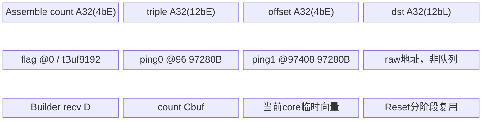

# SGL DeepEP NotifyDispatch 950 ACLNN 算子知识

## 算子速览

| 项目 | 内容 |
|---|---|
| 实际入口 | `aclnnNotifyDispatchGetWorkspaceSize` / `aclnnNotifyDispatch`，公开两段式ACLNN。 |
| 计算语义 | expert count→三元组[count,源发送偏移,源轮token数]→跨rank交换→本地expert/source/round各层前缀及容量。 |
| 输入输出 | 2输入10输出，全部INT32 ND；sendData虽为input，实际也被kernel改写为发送scratch。 |
| 执行类型 | 单notify_dispatch AIV_VECTOR，含Scalar轮询与MTE访问远端窗口；没有AIC/Cube、MIX、SIMT或NDDMA节点。 |
| Kernel 路线 | R-001：950 key223 |
| 核心资源 | caller元数据GM、持久通信window、raw UB两份95KiB ping-pong、分批TBuf与8个统计核独立scratch；Host另申请18MiB workspace。 |
| 来源闭包 | `source_closed`：入口、Host/POD、实际router/body、组装/通信/flag/全部统计、helper与活动build闭合；生成式inner、硬件MTE和HCCL建域/地址映射是框架边界。 |
| 验证状态 | 已完成源码闭包检查；本次知识提取未执行编译、真机、数值或性能测试。可见资源/输入/对齐风险保留draft，无verified。 |

本卡已完整阅读并复用[Normal API卡](../../../../apis/deepep/deepep_normal_dispatch_combine.md)与[布局API卡](../../../../apis/deepep/deepep_get_dispatch_layout.md)，补全Operator实现，不覆盖API。下文`ops/`、`ops2/`均相对`csrc/deepep/`，SDK为固定asc-devkit9.1.0，不指本机滚动安装。

## 接口与语义

### 计算语义

令R=rankSize、d=rankId、Q=round、P=perRoundTokens、N_s=源rank s实际token数、E=sendCount/(3Q)、L=E/R。输入`c[s,q,e]`是本源rank逐轮expert count。先求本源本轮expert exclusive prefix `a[s,q,e]=Σ(v<e)c[s,q,v]`，组装三元组`[c,a,n]`，`n[s,q]=min(P,max(N_s-qP,0))`；padding轮的整个三元组置0。sendData被改写为`[dst,Q,L,3]`，目的rank d收到`recvData[s,q,l,:]=[c[s,q,dL+l],a[s,q,dL+l],n[s,q]]`。

设C[q,l,s]=c[s,q,dL+l]：

```text
sendDataOffset[q,e] = a[d,q,e]
recvCount[q,l,s] = Σ((i,j)按(l,s)字典序≤(l,s)) C[q,i,j]  # 每轮inclusive prefix
recvOffset[q,l,s] = a[s,q,dL+l]
recvTokensPerExpert[q,l] = Σs C[q,l,s]
totalRecvTokens = Σq,l,s C[q,l,s]
maxBs = max_s Σq n[s,q]  # 同轮同源只取一次第三字段
expertGlobalOffset[l] = Σ(i<l),q,s C[q,i,s]
srcrankInExpertOffset[l,s] = Σ(j<s),q C[q,l,j]
rInSrcrankOffset[l,s,q] = Σ(p<q) C[p,l,s]
```

本算子不搬embedding、不做INT8/FP8量化、不计算专家FFN。recvCount是每轮累计值，不能当作raw count；rInSrcrankOffset是跨轮exclusive prefix。普通Notify的A2封装只用于单机，跨机层次化NotifyDispatchA2是另一逻辑算子。

### 输入、输出与属性

| 参数 | shape/layout | dtype | 约束、默认值与语义 |
|---|---|---|---|
| sendData | ND `[R,Q,L,3]`，总3QE元素 | INT32 | caller分配empty，kernel先写入；不可与counts或输出alias。 |
| tokenPerExpertData | ND `[Q,E]` | INT32 | DispatchLayout逐轮expert count；包含padding轮可读容量。 |
| sendCount | 标量 | INT32→UINT32 | Host>0，应等于3QE；Device转entry INT64 len；未检查整除。 |
| numTokens | 标量 | INT32→UINT32 | Host>=0，本源实际N；N0且Q/P有效时填零。 |
| commGroup | NUL结尾字符串 | char* | 非空且长度<128；各rank同域、同shape、同调用顺序。 |
| rankSize | 标量 | INT32→UINT32 | Host1..384；不等于每个平台实际window数组上界保证。 |
| rankId | 标量 | INT32→UINT32 | Host0..R-1。 |
| localRankSize | 标量 | INT32→UINT32 | Host只验指针；Device除法要求>0，普通Python设置为R。 |
| localRankId | 标量 | INT32→UINT32 | Host只验指针；body主要再由rank%localRankSize计算局部id。 |
| round | 标量 | INT32→UINT32 | Q>0且Q>=ceil(N/P)为调用者前提，Host未验值。 |
| perRoundTokens | 标量 | INT32→UINT32 | P>0，Device用于除法/取模，Host未验值。 |
| sendDataOffset | ND `[Q,E]` | INT32 | 当前源rank每轮expert exclusive prefix。 |
| recvData | ND `[R,Q,L,3]` | INT32 | 来自各源三元组；后处理共同GM输入。 |
| recvCount | ND `[Q,L,R]` | INT32 | 每轮按(localExpert,src)inclusive prefix。 |
| recvOffset | ND `[Q,L,R]` | INT32 | 各源全局expert发送偏移。 |
| expertGlobalOffset | ND `[L]` | INT32 | 全轮全来源expert exclusive prefix。 |
| srcrankInExpertOffset | ND `[L,R]` | INT32 | expert内按src exclusive prefix。 |
| rInSrcrankOffset | ND `[L,R,Q]` | INT32 | expert/src内按round exclusive prefix。 |
| totalRecvTokens | ND `[1]` | INT32 | 所有本地expert接收出现总数。 |
| maxBs | ND `[1]` | INT32 | 所有源实际token数最大。 |
| recvTokensPerExpert | ND `[Q,L]` | INT32 | 逐轮逐expert raw count。 |
| workspaceSize/executor | 两段式出参 | UINT64/aclOpExecutor** | caller按GetWorkspaceSize申请并保持到stream完成。 |

### 入口与版本

README公开A2/A3/950与CANN9.0.0/9.1.0，本卡固定最新该范围9.1.0。`Buffer::intranode_dispatch`创建上述元数据并调用aclnnNotifyDispatch；返回后D2H一次读取合并的`recv_header=[maxBs,totalRecvTokens,recvTokensPerExpert...]`，后续token dispatch属于调用者下一算子，不混入Notify图。此入口没有V2后缀。950有独立body，A2活动root build走ops2，不从目录里其它平台的兼容key推导可达性。

## Host/Launcher 执行流程

### 参数校验与前处理

wrapper GetWorkspaceSize原样透传inner，无自有Contiguous/View/TransData；执行wrapper设置HcclServerType后调用inner。Host顺序：取属性及指针→检查group长度、R∈(0,384]、r∈[0,R)、sendCount>0、numTokens>=0→检查输入输出desc/dtype及窗口→SetWorkSpace→MC2配置→key→平台AIV数/UB总量。localRankSize/localRankId/Q/P仅验指针。OpDef所有tensor只INT32 ND；Host的宽dtype检查不构成额外公开BF16/FP16/FLOAT算子路线。没有tensor shape、E/L/round整除、Q/P正域或每core UB检查。

### 参数、Workspace 与生命周期

Host申请`16MiB系统+1MiB kernel+1MiB A2参数=18MiB`；entry传入workspace但body不寻址，不应据此推断caller元数据/window/UB有额外保护。MC2 opType8、`AlltoAll=level0:fullmesh;level1:pairwise`；A3/950设置AIV_ENGINE，A2 ops2不设置此项。实际payload由本地raw MTE实现，没有外部AlltoAll核心调用。

环境窗口优先DEEPEP_HCCL_BUFFSIZE，其次HCCL_BUFFSIZE，UINT16默认200MiB，stoi异常保留默认、成功可截断。Host比较`dataSize*sendCount+2MiB<=envWindow`；ops另要求≤固定102MiB notify区，ops2没有102MiB条件。这不是每个ping-pong半片的容量证明，也未核对runtime真实窗口。输入、输出、scratch和workspace活到stream完成，窗口和magic由域持久持有；临时Reset不释放GM，也不代表其它rank已消费完。

### 启动图与失败传播

单notify_dispatch，blockDim=平台AIV数；Assemble→SyncAll→InputToShare/ShareToShare→SyncAll→8类统计在同kernel。通信写recvData[3QE]、统计core共享只读该片，ordering是第二次SyncAll。Host显式失败返回GRAPH_FAILED，wrapper返回inner状态，unknown key无输出，无资源不足的替代实现。A2忽略SetCcTilingV2返回值，也未检查GetWindowsInAddr nullptr；异步错误仍由框架/stream传播，不伪造自有错误恢复。

## Route 与参数设计

### 分核与资源计算

令A=GetBlockNum、k=ceil(R/A)，核c负责rank区间[ck,min((c+1)k,R))。checkRank[8]要求k<=8，统计core0..7要求A>=8；Host未显式检查。E=len/3/Q、L=E/R整数截断，调用者须保证Q>0、E>0、E%R==0及sendCount一致。batchRounds=b限制每批轮数，尾批b'=min(b,Q-q0)，UB按最大b申请、DMA按b'提交。

### Route 选择

| 顺序 | Route | Key/模板 | 精确选择条件与优先级 | 不适用去向 |
|---:|---|---|---|---|
| 1 | R-001 | 223 / NotifyDispatchA5<int> | ops Short_SoC_version==Ascend950、OpDef __DAV_C310__950 config | 其它平台不进本卡，unknown key无输出 |

```text
950 ops→key223→A5 body
b=(Q==1?1:E>512?8:L>=128?16:E<=256?32:16)
```

### 模板/实现执行矩阵

| Route | key/selector | dtype/shape/platform 完整命中条件 | 执行拓扑与 Kernel 节点 | 实际模板/body | 内存与同步特征 | tail/fallback |
|---|---|---|---|---|---|---|
| R-001 | 223/950 | 前述INT32有效域 | 单AIV_VECTOR/MTE节点 | NotifyDispatchA5<int>及八Build | runtime窗口/1000KiB magic、b批次、raw双buffer | actual b'，无资源fallback |

### 隐藏性能 Guard

| Guard | Host/Tiling 条件 | Device/资源原因 | 影响 Route | 不满足时去向 | 源码符号 |
|---|---|---|---|---|---|
| batch b | Device按Q/E/L selector，见决策树 | 按bE而不是QE申请主要TBuf | 所有 | 无运行UB失败后二次减b | Init |
| 窗口估计 | 4sendCount+2MiB<=env；ops另<=102MiB | 两MiB flag和三元组payload | 所有 | 显式超限失败；半片/真实window缺guard | CheckTensorDataType |
| A>=8、ceil(R/A)<=8 | Host未检查 | 八统计core、局部checkRank[8] | 所有 | 无fallback | InitCoreGroup/ShareToShareSlice |
| Q/P/localRankSize正值 | 只验指针 | 含除法/取模；N0不等于Q0 | 所有 | 无安全零域路线 | InitSmallFullMesh/Assemble |
| E、L整数布局 | 未验sendCount%(3Q)/E%R | perRankDataNum=len/R应等于3QL | 所有 | 截断不是兼容fallback | GetDataCount |
| UB总量 | totalUbSize仅记录 | raw最高194688B；Asm/8builder预算见下 | 所有 | 未比较所有实际申请 | InitBuffer |
| core0 float临时片 | A3/A2仅A32(4b)，950 A32(4bE) | Cast实际写b'E个float | 所有 | A3/A2无补偿，draft | BuildTotalRecvTokens |
| core7逐pair对齐 | 无Host guard | 最后一对的对齐地址可能超过命名片 | 所有 | 无额外padding/fallback | BuildRInSrcrankOffset |

### POD/ABI

Info自然对齐推导sizeof56/align8：9个UINT32共36B，padding4B，两个UINT64；未执行sizeof/offsetof探针。MC2外层ABI由CANN定义，当前repo未给其独立size断言，不伪造固定外层offset。

| 结构 | 字段 | 类型/位宽 | ABI 布局 | 单位 | Host/launcher producer | Device consumer | 边界 |
|---|---|---|---|---|---|---|---|
| NotifyDispatchTilingData | mc2InitTiling | Mc2InitTiling | 首对象 | 配置 | SetHcommCfg.GetTiling | MC2；A2 InitV2 | 框架ABI |
| NotifyDispatchTilingData | mc2CcTiling1 | Mc2CcTiling | offset由前对象决定 | 配置 | SetHcommCfg.GetTiling | A2 SetCcTilingV2(offsetof) | 实际payload rawMTE |
| NotifyDispatchTilingData | notifyDispatchInfo | NotifyDispatchInfo | 外层offset取决MC2 | 自有POD | TilingFuncImpl | GET_TILING_DATA_WITH_STRUCT | 内部布局下表 |
| NotifyDispatchInfo | rankSize | UINT32/32 | +0 | rank | rank_size | 地址/分核R | 1..384 |
| NotifyDispatchInfo | rankId | UINT32/32 | +4 | rank | rank_id | 当前rank/magic | 0..R-1 |
| NotifyDispatchInfo | localRankSize | UINT32/32 | +8 | rank | local_rank_size | nodeNum/xRankSize除法 | 仅验指针 |
| NotifyDispatchInfo | localRankId | UINT32/32 | +12 | rank | local_rank_id | Init参数，主要再求r%localRankSize | 仅验指针 |
| NotifyDispatchInfo | sendCount | UINT32/32 | +16 | INT32元素 | sendCount | len→E与perRankDataNum | >0，整除另守 |
| NotifyDispatchInfo | numTokens | UINT32/32 | +20 | token | num_tokens | realQ与尾轮n | >=0 |
| NotifyDispatchInfo | round | UINT32/32 | +24 | 轮 | round | E除法/batch循环/布局 | 仅验指针 |
| NotifyDispatchInfo | perRoundTokens | UINT32/32 | +28 | token/轮 | perRoundTokens | realQ/模运算 | 仅验指针 |
| NotifyDispatchInfo | aivNum | UINT32/32 | +32 | 核 | GetCoreNumAiv | blockDim同值，body用GetBlockNum | 平台实际值 |
| NotifyDispatchInfo | totalUbSize | UINT64/64 | +40，+36..39 padding | byte | Platform.GetCoreMemSize(UB) | body不用于预算 | 不能作为已校验上界 |
| NotifyDispatchInfo | totalWinSize | UINT64/64 | +48 | byte | 环境窗口MiB | A3/A2半片；950另取runtime | 不是实际测量 |

entry compat参数op/root/cycleCount/scaleCount=0、scale/offset=nullptr、extraFlag0，实际拷贝传COPYONLY=-1。CommArgs大对象虽被include但不实例化，不当作当前外部POD。HCCL上下文由runtime产生，不能删减大结构仅保留活跃字段后重定义ABI。

### Route 源码闭包

| Route | Key/selector | Host/Tiling producer | POD/参数 | Kernel entry/router 节点 | Kernel body/直接依赖 | 构建接线 |
|---|---|---|---|---|---|---|
| R-001 | 223/950 | ops/op_host/notify_dispatch_tiling.cc | NotifyDispatchTilingData | ops/op_kernel/notify_dispatch.cpp | notify_dispatch_a5.h、copy/comm/base | root950→ops、950 OpDef、Host/kernel CMake |

## Kernel 实现

### 公共执行流程

entry读POD，只进INT32 body。core0先由counts组装sendData，并按目的rank重排；SyncAll后各core把负责目的片写自己的window，再向相应目的rank发布源rank flag；目的rank等待自己的各源flag，从源窗口pull自己那片到recvData。第二次SyncAll后Reset，各统计core从同一GM片独立生成输出，没有统计输出互相依赖。算法、数组布局和8类统计的完整循环见各Route。

### Route R-001：950 全互联元数据交换

#### 适用条件

##### 选择证据

| 层级 | 文件 | 符号 | 源码谓词/参数 | 结果/下一跳 |
|---|---|---|---|---|
| Host | ops/op_host/notify_dispatch_tiling.cc | NotifyDispatchTilingFuncImpl | 950活动build、OpDef INT32 ND | key223、AIV blockDim |
| router | ops/op_kernel/notify_dispatch.cpp | notify_dispatch | TILING_KEY_IS(223) | NotifyDispatchA5<int>::Init/Process |
| batch | ops/op_kernel/notify_dispatch_a5.h | Init | Q==1→1；否则E>512→8；否则L>=128→16；否则E<=256→32；其余16 | b决定所有主要TBuf，非另一个kernel |

#### Device 数据流

##### 函数级调用链

```text
notify_dispatch→NotifyDispatchA5<int>::Init→InitSmallFullMesh→窗口/magic
Process→core0 AssembleSendData→SyncAll
       →InputToShareSlice→CpGM2GMPingPong→payload完成后写源flag
       →ShareToShareSlice→WaitSyncFlag/WaitOneRankPartFlag→pull各源自己的dest片
       →SyncAll→pipe.Reset
       →core0..7八个Build方法→输出
```

##### 源码等价伪码

```text
# 伪码；单位在地址式标出
E=len/3/Q，L=E/R，perRankDataNum=len/R
Init窗口和每core magic，取magic%2；window公式见内存表
if core==0:
 Reset TPipe，分配count/triple/offset/单dst triple TBuf
 for q0=0;q0<Q;q0+=b:
   b'=min(b,Q-q0)，拷4b'E字节count
   对每q：真实轮按expert扫描生成[count,prefix,n]；padding轮三个字段都置0
   写sendDataOffset[q0,E]；对每dst重排L专家并写sendData[(dstQ+q0)L*3]
SyncAll
first=core*ceil(R/A)，nRank=min(ceil(R/A),R-first)
if nRank>0:
 sendData[first*(len/R)]→本rank窗口+2MiB+first*(len/R)*4
 两份rawUB各最多97280B，MTE3完成后发布8B magic*2+1到负责dest的flag[src*32]
 ShareToShare按rank%nRank旋转src遍历，最多checkRank[8]
 等本rank负责源flag的高32位匹配且值>=magic*2+1
 pull srcWindow+2MiB+destRank*(len/R)*4 →recvData[src*(len/R)]，长度4len/R
SyncAll；Reset TPipe
core0 total：重排raw C，数值Cast到FP32，ReduceSum并跨batch累加→4B输出
core1 count：各q按(l,src)inclusive prefix→4b'E
core2 offset：三元组第二字段转[q,l,src]→4b'E
core3 maxBs：每q/src只加一次第三字段n，最后max_src→4B
core4 perExpert：每q/l求sum_src→4b'L
core5 expertGlobal：跨q/src累计L totals，再exclusive prefix_l→4L
core6 sourceInExpert：跨q累计E totals，再各l内exclusive prefix_src→4E
core7 roundInSource：E个持久count跨batch，逐(l,src)生成各q exclusive prefix
                     →GM[(lR+src)Q+q0]的4b'字节
```

core7临时每pair的起点`A32(4*(lR+s)*b')`字节，必须满足`A32(4*(E-1)*b')+4b'<=A32(4bE)`。源码无此guard，b=Q=1且4E正好32对齐时最后pair可从命名片末尾开始；只记录静态访问边界。

#### 内存与数据搬运

##### 资源与搬运表

设A32(x)=ceil(x/32)*32，D=R*A32(12bL)，Cbuf=A32(4bE)。ReorderOutput按src分区，当前batch每源stride=A32(12b'L)/4元素；DataCopyPad(1,12b'L,0,0,0)，手工设置各src偏移。

| 层级/缓冲区 | offset/地址公式 | extent/容量公式 | dtype/layout | producer | consumer | owner/lifetime | 对齐/复用 |
|---|---|---|---|---|---|---|---|
| count/send GM | count[qE+e]；send[(dstQ+q)L*3+le*3+f] | 4QE /12QE byte | INT32 | caller/core0 | Assemble/transport | stream完成前caller持有 | send输入实际改写 |
| recvData GM | ((srcQ+q)L+le)*3 | 12QE byte | INT32 triple | ShareToShare | 八Build | 单call | 第二SyncAll后只读 |
| 其它输出GM | 接口表每shape | offset/count各4QE，expert4L、source4E、round4QE、header8+4QL | INT32 | 统计core | 后续dispatch/caller | caller | 输出形状不可只按总byte互换 |
| Assemble UB | Reset后四TBuf | 2A32(4bE)+A32(12bE)+A32(12bL) | INT32 | DMA/Scalar | Offset/triple CopyOut | core0 Assemble | 无TQue，事件0 |
| flag UB | tBuf byte0，Init申请8192；raw scalar地址0 | 等待nRank*32 byte，最多8rank | UINT64 | MTE2/Scalar | 比较/flag CopyOut | 通信阶段 | 等待完成后可被raw copy覆盖 |
| ping-pong UB | raw byte96、97408 | 两份97280，最高触达194688 | INT32同区input/output | MTE2 | MTE3 | 每copy | event0/1，tail min(remaining,97280) |
| core0统计 | Reset后recv/count/float/tmp | D+2Cbuf+32 | INT32/FP32 | Reorder/Cast/ReduceSum | total输出 | 当前core | float片A32(4bE)，Cast b'E在命名片内；仍需核其它预算 |
| core1/2统计 | recv与count或offset | D+Cbuf | INT32 | reorder/scalar | count/offset GM | 当前core | 当前b'输出 |
| core3统计 | recv、tmp32、perRank、seen | D+32+2A32(4R) | INT32 | reorder/scalar | maxBs GM | 当前core | seen每轮清0 |
| core4统计 | recv、count、localExpert批次tmp | D+Cbuf+A32(4bL) | INT32 | reorder/Scalar | perExpert GM | 当前core | 每q写L个 |
| core5统计 | recv、count、两L向量 | D+Cbuf+2A32(4L) | INT32 | reorder/Scalar | expertGlobal GM | 当前core | 一个向量跨batch累计 |
| core6统计 | recv、count、两E向量 | D+Cbuf+2A32(4E) | INT32 | reorder/Scalar | srcInExpert GM | 当前core | 跨batch累计 |
| core7统计 | recv、count、E持久、batch输出 | D+2Cbuf+A32(4E) | INT32 | reorder/Scalar | roundInSrc GM | 当前core | pair对齐触达需另证 |
| window | GetBaseWindStateAddrByRankId(ctx,rank,self)+(magic%2)*(runtimeWinSize-4MiB)/2 | payload12QE；前2MiB flag | INT32/UINT64 | 本地/远端MTE3 | 远端/本地MTE2 | 通信域跨call | HcclCombinOpParam windowsIn[32]，Host没有R<=32 guard |
| workspace | entry未寻址 | Host18MiB | byte | executor | 框架 | caller直到stream完成 | 不补偿UB/window |
| L1/L0/dynamicUB/SIMT/NDDMA | N/A | 0自有申请 | N/A | N/A | N/A | N/A | 无Cube/MIX节点 |
| 寄存器/局部数组 | scalar prefix/count/地址/magic；checkRank[8] | 未提供寄存器预算 | scalar | Device | Device | 当前loop | rank/core guard如上 |

##### 分层内存布局



##### 字节账与复用顺序

```text
AssembleUB=2A32(4bE)+A32(12bE)+A32(12bL)
Transport footprint=max(8192,97408+97280)=194688 byte
BuilderUB按上表单core分别核算，不能将八core申请相加或只看平台totalUbSize。
workspace=18MiB；dynamicUB=N/A；window payload=4sendCount；每rank片=4sendCount/R。
Host未逐项比较所有TBuf/实际触达与UB上界；上式不是已通过的资源验证。
```

| 复用子区 | 写入者 | 读取者/消费点 | 下一次覆盖 | 同步或释放依据 | 安全条件 |
|---|---|---|---|---|---|
| sendData改写 | Assemble | InputToShare | 下call | SyncAll | 不alias counts/其它输出 |
| ping0/1 | MTE2 | MTE3 | i+2片 | MTE3_MTE2 0/1，尾双wait、MTE3_S3 | 当前copy排空才复用 |
| source window | InputToShare | 目的rank ShareToShare | 后续同parity call | payload完成后flag | 各rank按序调用，不提前复用 |
| flag读UB→raw copy | WaitOneRankPartFlag | Scalar | CpGM2GMPingPong | MTE2_S后比较结束 | 不与raw DMA重叠 |
| recvData | ShareToShare | 八Build | 下call | SyncAll | 不能读半成品 |
| Builder scratch | reorder/Vector/Scalar | 输出DMA | 下一batch | S_MTE3、MTE3_MTE2/MTE3_V、V_S | core0大小/core7对齐风险不隐去 |

#### 同步、精度与尾块

##### 同步与数值边界表

| 阶段 | primitive/机制 | producer | consumer/等待点 | 保护对象 | 精度/尾块 |
|---|---|---|---|---|---|
| Assemble | S_MTE2/MTE2_S与S_MTE3/MTE3_S 0 | DMA/Scalar | 下批/copy | counts/triple/offset | padding轮置零，N0但Q/P须有效 |
| 阶段交接 | 两次SyncAll<true> | 组装/通信cores | 通信/Build | send/recvData | 闲核仍参加，A>=8 |
| 远端ready | magic*2+1，32B间隔内写8B，轮询MTE2_S | source payload完成 | 目的WaitSyncFlag | 对应发送片 | 高32匹配且>=，无通用超时 |
| raw copy尾 | CpGM2UB/CpUB2GM，DataCopyExtParams(1,size,0,0,0) | GM↔UB | 对向DMA | 97280B双片 | size单位byte，INT32无cast/atomic |
| total | Cast INT32→FP32 CAST_NONE，ReduceSum，标量转INT32 | raw counts | total输出 | float scratch | FP32精确整数与INT32溢出边界 |
| prefix/其它 | Duplicate完整申请元素清0，Scalar累加，S_V/V_S/MTE3_* | Builder | 输出DMA | TBuf | b'有效输出，pair对齐触达另核 |
| 生命周期 | Reset、DMA排空、框架退出 | 当前阶段 | 下一阶段/caller | UB/window/output | 不等于释放GM/全部远端消费完成 |

950用本repo的HcclOpParam=HcclCombinOpParam，字段rankId/rankDim/winSize/windowsIn[32]。GetBaseWindStateAddrByRankId在__DAV_C310__直接返回windowsIn[rank]，并没有+4MiB；magic在GetStatusDataSpaceGm即windowsIn[self]+1000KiB+core*256B。虽然半片基准减4MiB，不应从其它Normal/LL的data helper推断这里自动跳过4MiB。Host R384与该32项ABI必须分别限定，不声称任意384rank均可达。

core0 float临时片已按bE扩大，这只消除A3/A2的该命名片不匹配，不证明其它UB/ReduceSum工作片与core7对齐安全。当前NotifyA5没有调用SDK GetWindowsInAddr、BatchWrite或CCU，其实际MTE窗口寻址完全可见。

#### 关键实现

##### 符号证据表

| 阶段 | 文件 | 符号/模板实例 | 实现事实 |
|---|---|---|---|
| Host/Tiling producer | ops/op_host/notify_dispatch_tiling.cc | GetAttrAndSetTilingData/CheckTensorDataType/TilingFuncImpl | 属性、窗口、key/AIV/18MiB |
| entry/router | ops/op_kernel/notify_dispatch.cpp | notify_dispatch | key223→NotifyDispatchA5<int> |
| Device body/helper | ops/op_kernel/notify_dispatch_a5.h | Init/Assemble/Process、八Build | 批次、输入改写、rawMTE交换、全部前缀 |
| 搬运/flag | ops/op_kernel/notify_dispatch_a5.h与ops/op_kernel/data_copy.h | CpGM2GMPingPong/CpGM2UB/CpUB2GM/WaitOneRankPartFlag | byte容量、双buffer事件与magic |


## 算子特定优化

### Trick T-001：分批元数据与跨批持久前缀

#### 触发与源码依据

- 适用 Route：本卡全部路线。
- 触发条件：平台selector给b，当前b'=min(b,Q-q0)，跨batch的expert/source累加器保留。
- Golden 来源：[csrc/deepep/ops/op_kernel/notify_dispatch_a5.h 第175–178行](https://github.com/sgl-project/sgl-kernel-npu/blob/dda6d36b0cdb4081e102d14c0a2fb276fc416e69/csrc/deepep/ops/op_kernel/notify_dispatch_a5.h#L175-L178)

**官方源码（固定 Commit 连续逐字摘录）**：

```cpp
        for (int rBase = 0; rBase < totalRounds; rBase += batchRounds) {
            int currentBatch = (rBase + batchRounds > totalRounds) ? (totalRounds - rBase) : batchRounds;
            uint32_t tokenPerExpertCopyLen = currentBatch * numExperts * sizeof(int32_t);
            DataCopyExtParams tokenPerExpertParams = {1U, tokenPerExpertCopyLen, 0U, 0U, 0U};
```

#### 机制与设计原因

组装与重排UB主要随bE而非QE增长；BuildExpGlobalOffset、BuildsrcRankInExpOffset、BuildRInSrcrankOffset保留持久累加器，依次产生全轮前缀。Q1在A3/950把b降到1，A2仍16/32，预算不能机械互换。尾batch只搬实际b'轮；不是把padding部分也当有效计数。

#### 迁移边界

- 适用：输出保留Q维、但UB需要批次化的元数据交换。
- 前提：selector、持久累加器、实际DMA长度和事件保持，先核UB风险。
- 失效：不能每batch清掉持久前缀后仍声称全Q语义；大E本b超预算时无后备路线。
- 未验证：本次知识提取未执行编译、真机、数值或性能测试。

#### 错误做法

固定仓未提供可验证运行反例；源码可核对持久累加器在batch外清零，batch内只增加，不得改写这一作用域。

### Trick T-002：本源窗口一次落地、目的按片 pull

#### 触发与源码依据

- 适用 Route：本卡全部路线，窗口ABI保持对应平台。
- 触发条件：INT32 COPYONLY、发送元数据已按dst连续排列。
- Golden 来源：[csrc/deepep/ops/op_kernel/notify_dispatch_a5.h 第248–252行](https://github.com/sgl-project/sgl-kernel-npu/blob/dda6d36b0cdb4081e102d14c0a2fb276fc416e69/csrc/deepep/ops/op_kernel/notify_dispatch_a5.h#L248-L252)

**官方源码（固定 Commit 连续逐字摘录）**：

```cpp
            readGt = sendDataInputGt[copyOffset * perRankDataNum];
            CpGM2GMPingPong<T>(copyLen * perRankDataNum * sizeof(T), readGt, writeGt[copyOffset * perRankDataNum],
                               COPYONLY);
            uint64_t v = MergeMagicWithValue(magic, 1);
            *inputUB = v;
```

#### 机制与设计原因

发送片先复制到本rank共享window，目的rank在ready后读取自己的连续片，避免每目的单独长期驻留拷贝buffer。两份95KiB rawUB按MTE3_MTE2 event0/1交替，最后双wait排空；source访问次序按rank%copyLen旋转，但记录仍落正确src offset。flag必须在该源片payload MTE3完成后发布。

#### 迁移边界

- 适用：全rank窗口可被本地MTE映射访问的元数据交换。
- 前提：magic/ping-pong一致、窗口足量、每core rank<=8、rawUB范围与flag先后保持。
- 失效：A2跨机使用另一个NotifyDispatchA2入口，不把此图套成RDMA层次通信。
- 未验证：本次知识提取未执行编译、真机、数值或性能测试。

#### 错误做法

源码具有payload完成后置flag及两次SyncAll，不能提前置flag；固定仓未提供该错误改动的可验证运行反例。

## 模板与实现对比

| 对比维度 | 组装/交换 | 8core统计 | 设计选择依据 |
|---|---|---|---|
| 命中条件/优先级 | 每call必经，core0组装再全核通信 | 第二次SyncAll后core0..7各进一个Build | 同kernel阶段，不是额外算子 |
| 模板与dtype | INT32三元组 | INT32前缀，total数值Cast/FP32归约 | 不把宽dtype检查当额外OpDef |
| 循环与分核 | q0 batch、dst、expert，rank区间ceil(R/A) | q0/q/expert/src；按输出职责分核 | 减少统计输出之间依赖 |
| Queue/TBuf/寄存器/window | TBuf、raw双buffer、magic持久window | 每core独立D/Cbuf/临时向量 | 无TQue/dynamicUB/SIMT/NDDMA |
| 内存总占用与复用 | Assemble/transport先后复用 | 单核预算分别求和，不加8核总量 | Reset阶段边界 |
| 搬运/Vector/通信 API | DataCopyPad、CpGM2UB/CpUB2GM、flagpoll | Scalar/Copy、Duplicate、Cast/ReduceSum | 全部核心本地可见 |
| 同步、精度与tail | MTE事件、magic检查、97280B尾块 | b'尾批有效DMA、INT32/FP32边界 | 不补造overflow和空Q支持 |
| fallback/失败边界 | Host拒绝、unknown key无输出 | 命名片不足无替代算法 | draft明确未验证风险 |

## 平台差异

| 项目 | A2 | A3 | Ascend 950 |
|---|---|---|---|
| 支持状态 | 普通Notify单机；跨机另入口 | 支持 | 同名入口独立body |
| Host/Launcher | root A2→ops2，key23，wrapper AICPU | ops key23、AIV engine、MTE wrapper | ops key223、__DAV_C310__950 config |
| Kernel/资源 | SDK windows mapper，末8MiB保留状态；b16/32 | HcclOpResParam，Exp900KiBmagic，Q1 b1 | HcclCombinOpParam windowsIn[32]、runtime winSize-4MiB半片、magic1000KiB、core0 float片bE |

## 限制与失败边界

- 来源闭合不表示运行正确；未测试且没有verified。core0 scratch（A3/A2）及core7对齐容量见Route静态条件，不猜具体崩溃/数值表现。
- Q/P/localRankSize未验正值，sendCount与E/L/Q/shape未验整除/一致性；Host接受域不能外推为安全域。至少8核、每核最多8rank也未显式guard。
- INT32前缀和总量可溢出；total的FP32数值归约超精确整数域可能舍入。不是位模式float reduction，更不是量化。
- Host窗口估计没有证明实际双半片足量；A2 W-8MiB有下溢边界，950窗口数组32项与Host384上界不一致，平台实际寻址必须独立保持。
- magic实际Merge为magic*2+value，非注释所述左移32；等待高32位相同且value>=目标。并发/调用次序不一致/过早半片复用可能破坏协议，无通用超时fallback。
- A2SDK生命周期与window选择已读固定9.1真实实现；HCCL建域、映射、硬件MTE及通用服务端控制是框架边界。950没有调用GetWindowsInAddr，不能套其不支持950的产品表否定本地窗口mapper。
- OpDef multi_kernel标志不等于实际多Device launch；workspace指针当前未用不等于可以不提供GetWorkspaceSize要求的空间。

## 源码索引

### 链路索引

| 链路阶段 | 文件 | 关键符号 | 支撑内容 |
|---|---|---|---|
| 公开依据 | `python/deep_ep/doc/NORMAL_API.md` | `NORMAL_API.md` | 公开语义/支持/版本 |
| 公开依据 | `python/deep_ep/README.md` | `README.md` | 公开语义/支持/版本 |
| 固定实现/构建 | `csrc/deepep/deep_ep.cpp` | `deep_ep.cpp` | 本卡入口、POD、body、搬运/同步或活动build |
| 固定实现/构建 | `csrc/deepep/pytorch_npu_helper.hpp` | `pytorch_npu_helper.hpp` | 本卡入口、POD、body、搬运/同步或活动build |
| 固定实现/构建 | `python/deep_ep/deep_ep/strategies/normal_strategy.py` | `normal_strategy.py` | 本卡入口、POD、body、搬运/同步或活动build |
| 固定实现/构建 | `build.sh` | `build.sh` | 本卡入口、POD、body、搬运/同步或活动build |
| 固定实现/构建 | `csrc/deepep/compile_ascend_proj.sh` | `compile_ascend_proj.sh` | 本卡入口、POD、body、搬运/同步或活动build |
| 固定实现/构建 | `csrc/deepep/ops/op_host/op_api/aclnn_notify_dispatch.h` | `aclnn_notify_dispatch.h` | 本卡入口、POD、body、搬运/同步或活动build |
| 固定实现/构建 | `csrc/deepep/ops/op_host/op_api/aclnn_notify_dispatch.cpp` | `aclnn_notify_dispatch.cpp` | 本卡入口、POD、body、搬运/同步或活动build |
| 固定实现/构建 | `csrc/deepep/ops/op_host/notify_dispatch.cpp` | `notify_dispatch.cpp` | 本卡入口、POD、body、搬运/同步或活动build |
| 固定实现/构建 | `csrc/deepep/ops/op_host/notify_dispatch_tiling.cc` | `notify_dispatch_tiling.cc` | 本卡入口、POD、body、搬运/同步或活动build |
| 固定实现/构建 | `csrc/deepep/ops/op_host/mc2_tiling_utils.h` | `mc2_tiling_utils.h` | 本卡入口、POD、body、搬运/同步或活动build |
| 固定实现/构建 | `csrc/deepep/ops/op_host/CMakeLists.txt` | `CMakeLists.txt` | 本卡入口、POD、body、搬运/同步或活动build |
| 固定实现/构建 | `csrc/deepep/ops/op_kernel/notify_dispatch_tiling.h` | `notify_dispatch_tiling.h` | 本卡入口、POD、body、搬运/同步或活动build |
| 固定实现/构建 | `csrc/deepep/ops/op_kernel/notify_dispatch.cpp` | `notify_dispatch.cpp` | 本卡入口、POD、body、搬运/同步或活动build |
| 固定实现/构建 | `csrc/deepep/ops/op_kernel/notify_dispatch.h` | `notify_dispatch.h` | 本卡入口、POD、body、搬运/同步或活动build |
| 固定实现/构建 | `csrc/deepep/ops/op_kernel/comm_args.h` | `comm_args.h` | 本卡入口、POD、body、搬运/同步或活动build |
| 固定实现/构建 | `csrc/deepep/ops/op_kernel/data_copy.h` | `data_copy.h` | 本卡入口、POD、body、搬运/同步或活动build |
| 固定实现/构建 | `csrc/deepep/ops/op_kernel/CMakeLists.txt` | `CMakeLists.txt` | 本卡入口、POD、body、搬运/同步或活动build |
| 固定实现/构建 | `csrc/deepep/ops/op_host/tiling_args.h` | `tiling_args.h` | 本卡入口、POD、body、搬运/同步或活动build |
| 固定实现/构建 | `csrc/deepep/ops/op_kernel/window_layout.h` | `window_layout.h` | 本卡入口、POD、body、搬运/同步或活动build |
| 固定实现/构建 | `csrc/deepep/ops/op_kernel/moe_distribute_base.h` | `moe_distribute_base.h` | 本卡入口、POD、body、搬运/同步或活动build |
| 固定实现/构建 | `csrc/deepep/ops/op_kernel/moe_distribute_v2_base.h` | `moe_distribute_v2_base.h` | 本卡入口、POD、body、搬运/同步或活动build |
| 固定实现/构建 | `csrc/deepep/ops/op_kernel/notify_dispatch_a5.h` | `notify_dispatch_a5.h` | 本卡入口、POD、body、搬运/同步或活动build |

### 实现复用检查

| 检查项 | 可复用事实 | 不得改变的约束 | 源码符号 |
|---|---|---|---|
| ABI/POD | 9UINT32+2UINT64 Info、MC2外层 | 字段顺序/单位、平台真实context ABI | NotifyDispatchInfo/InitSmallFullMesh |
| 调用顺序 | Assemble→SyncAll→window exchange→SyncAll→Build | 单kernel及payload先于flag | Process |
| workspace/内存 | 18MiB框架请求；sendData改写、recvData交接 | b selector、raw96/97408、各coreTBuf及对齐上界 | InitBuffer/CpGM2GMPingPong/Build* |
| 同步 | MTE事件、双SyncAll、magic轮换 | 不提前复用window、UB及输出 | WaitOneRankPartFlag |
| 精度与尾块 | INT32前缀、FP32总数、b'实际DMA | overflow/精度域、padding和正Q/P | Assemble/BuildTotalRecvTokens |
| 失败边界 | Host显式失败、unknown key无输出 | 不补造资源fallback或已修复/已测结果 | Tiling/entry |
